
# arxiv digest (quant-ph + cond-mat) — 2026-10-13

*125 papers · 21 relevant · 1 highlighted*

## 🔥 Most relevant (21)

*Every paper with at least one nonzero topic score, sorted by best-matching score. 🔥 marks scores ≥4/5. Click the title to jump to the full entry below; click [arXiv] to open the paper page. `(secondary)` marks papers from de-prioritized cond-mat archives.*

Show 21 relevant papers

- [When irrelevance governs: dissipation-regression scaling in open quantum criticality](#paper-2610.13033) [[arXiv]](http://arxiv.org/abs/2610.13033v1) — 🔥 `Keldysh / 2PI / non-Gaussian methods` **4/5** · 🔥 `driven-dissipative phase transition` **4/5** · 🔥 `non-equilibrium universality` **4/5** · `correlated / nonlocal dissipation` **3/5** · `methods for driven-dissipative` **3/5** · `analog quantum simulation` **2/5** · `quantum measurements` **1/5**
- [Exact solutions of non-Markovian dissipative Ising models](#paper-2610.12546) [[arXiv]](http://arxiv.org/abs/2610.12546v1) — 🔥 `methods for driven-dissipative` **4/5** · `analog quantum simulation` **3/5** · `correlated / nonlocal dissipation` **3/5** · `driven-dissipative phase transition` **3/5** · `Keldysh / 2PI / non-Gaussian methods` **2/5** · `non-equilibrium universality` **2/5** · `quantum measurements` **2/5** · `Tavis-Cummings & cavity-many-emitter` **1/5**
- [Latent Symmetry in Quantum Zeno Dynamics](#paper-2610.12647) [[arXiv]](http://arxiv.org/abs/2610.12647v1) — 🔥 `quantum measurements` **4/5** · `analog quantum simulation` **3/5** · `correlated / nonlocal dissipation` **3/5** · `driven-dissipative phase transition` **3/5** · `methods for driven-dissipative` **3/5** · `non-equilibrium universality` **2/5** · `Keldysh / 2PI / non-Gaussian methods` **1/5** · `Tavis-Cummings & cavity-many-emitter` **1/5**
- [Dissipative Majorana Chain---Anomalies and Non-Invertible Symmetries](#paper-2610.12607) [[arXiv]](http://arxiv.org/abs/2610.12607v1) — 🔥 `methods for driven-dissipative` **4/5** · `correlated / nonlocal dissipation` **3/5** · `driven-dissipative phase transition` **3/5** · `non-equilibrium universality` **3/5** · `Keldysh / 2PI / non-Gaussian methods` **2/5** · `analog quantum simulation` **2/5** · `Frenkel-Kontorova` **1/5** · `quantum measurements` **1/5**
- [Locality-Preparation Time Tradeoffs in Dissipative Quantum Systems](#paper-2610.13784) [[arXiv]](http://arxiv.org/abs/2610.13784v1) — 🔥 `correlated / nonlocal dissipation` **4/5** · `analog quantum simulation` **3/5** · `driven-dissipative phase transition` **3/5** · `methods for driven-dissipative` **3/5** · `non-equilibrium universality` **3/5** · `quantum measurements` **2/5** · `Keldysh / 2PI / non-Gaussian methods` **1/5**
- [Flat-band quantum geometry from embedded quench dynamics](#paper-2610.12555) [[arXiv]](http://arxiv.org/abs/2610.12555v1) — 🔥 `analog quantum simulation` **4/5** · `methods for driven-dissipative` **3/5** · `non-equilibrium universality` **3/5** · `quantum measurements` **3/5** · `driven-dissipative phase transition` **2/5** · `scars & prethermalization` **2/5** · `Keldysh / 2PI / non-Gaussian methods` **1/5**
- [Finite Quantum Engineering Thermodynamics](#paper-2610.13511) [[arXiv]](http://arxiv.org/abs/2610.13511v1) — 🔥 `quantum measurements` **4/5** · `analog quantum simulation` **3/5** · `Full counting statistics` **2/5** · `methods for driven-dissipative` **2/5** · `Keldysh / 2PI / non-Gaussian methods` **1/5** · `correlated / nonlocal dissipation` **1/5** · `driven-dissipative phase transition` **1/5** · `non-equilibrium universality` **1/5**
- [Ultrafast laser-stimulated field emission from a metal: a non-equilibrium Green's functions approach](#paper-2610.13251) [[arXiv]](http://arxiv.org/abs/2610.13251v1) — 🔥 `Keldysh / 2PI / non-Gaussian methods` **4/5** · `methods for driven-dissipative` **3/5** · `quantum measurements` **3/5** · `analog quantum simulation` **1/5** · `correlated / nonlocal dissipation` **1/5** · `driven-dissipative phase transition` **1/5** · `non-equilibrium universality` **1/5**
- [A Warped Born Rule Turns an Observer into a Maxwell's Demon](#paper-2610.13936) [[arXiv]](http://arxiv.org/abs/2610.13936v1) — 🔥 `quantum measurements` **4/5** · `methods for driven-dissipative` **3/5** · `non-equilibrium universality` **3/5** · `analog quantum simulation` **1/5** · `correlated / nonlocal dissipation` **1/5** · `driven-dissipative phase transition` **1/5**
- [Correlated Pair Creation with Positive- and Negative-Frequency Oscillators in a Trapped-Ion Quantum Simulator](#paper-2610.12579) [[arXiv]](http://arxiv.org/abs/2610.12579v1) — 🔥 `analog quantum simulation` **4/5** · `driven-dissipative phase transition` **2/5** · `non-equilibrium universality` **2/5** · `Keldysh / 2PI / non-Gaussian methods` **1/5** · `QC/QI experiment` **1/5** · `Tavis-Cummings & cavity-many-emitter` **1/5** · `methods for driven-dissipative` **1/5** · `quantum optics experiment` **1/5**
- [Operational signatures of exceptional quantum channels](#paper-2610.13622) [[arXiv]](http://arxiv.org/abs/2610.13622v1) — 🔥 `quantum measurements` **4/5** · `driven-dissipative phase transition` **3/5** · `methods for driven-dissipative` **3/5** · `Full counting statistics` **1/5** · `correlated / nonlocal dissipation` **1/5** · `non-equilibrium universality` **1/5**
- [Engineering Ergodicity-Breaking and Stable Emergent Conservation Laws in a Generic Quantum Many-body System Under Strong Periodic Drive](#paper-2610.12551) [[arXiv]](http://arxiv.org/abs/2610.12551v1) — 🔥 `scars & prethermalization` **4/5** · `analog quantum simulation` **3/5** · `driven-dissipative phase transition` **1/5** · `methods for driven-dissipative` **1/5** · `non-equilibrium universality` **1/5**
- [Entropy Production in Mesoscopic Electronic Transport Beyond Weak-Coupling](#paper-2610.12652) [[arXiv]](http://arxiv.org/abs/2610.12652v1) — 🔥 `Full counting statistics` **4/5** · `Keldysh / 2PI / non-Gaussian methods` **2/5** · `non-equilibrium universality` **2/5** · `methods for driven-dissipative` **1/5** · `quantum measurements` **1/5**
- [An entangling Hubbard quasiparticle collider on a digital quantum processor](#paper-2610.13946) [[arXiv]](http://arxiv.org/abs/2610.13946v1) — 🔥 `QC/QI experiment` **4/5** · `analog quantum simulation` **3/5** · `quantum measurements` **2/5**
- ⭐ [Analog quantum simulation of Shastry-Sutherland Ising materials](#paper-2610.12800) [[arXiv]](http://arxiv.org/abs/2610.12800v1) — 🔥 `Rydberg arrays` **4/5** · 🔥 `analog quantum simulation` **4/5** · `QC/QI experiment` **1/5**
- [All-optical deconvolution via quantum cross-correlation spectroscopy with bright twin beams](#paper-2610.13074) [[arXiv]](http://arxiv.org/abs/2610.13074v1) — 🔥 `quantum optics experiment` **4/5** · `interference shaping light` **3/5** · `quantum measurements` **1/5**
- [TLS loss in superconducting resonators on epitaxial hBN thin films](#paper-2610.12556) [[arXiv]](http://arxiv.org/abs/2610.12556v1) — 🔥 `QC/QI experiment` **4/5** · `analog quantum simulation` **1/5** · `correlated / nonlocal dissipation` **1/5** · `driven-dissipative phase transition` **1/5** · `quantum optics experiment` **1/5**
- [Enhanced analogue quantum computation with a logically-encoded XX gadget](#paper-2610.13845) [[arXiv]](http://arxiv.org/abs/2610.13845v1) — 🔥 `analog quantum simulation` **4/5** · `QC/QI experiment` **3/5**
- [Robust Golden Ratio universality as a consequence of a circulant symmetry](#paper-2610.13842) [[arXiv]](http://arxiv.org/abs/2610.13842v1) — 🔥 `non-equilibrium universality` **4/5** · `Keldysh / 2PI / non-Gaussian methods` **1/5** · `driven-dissipative phase transition` **1/5** · `methods for driven-dissipative` **1/5**
- [Replica Transition at Measurement-Altered Ising Criticality](#paper-2610.13802) [[arXiv]](http://arxiv.org/abs/2610.13802v1) — 🔥 `quantum measurements` **4/5** · `Full counting statistics` **1/5** · `Keldysh / 2PI / non-Gaussian methods` **1/5**
- [Encoding Matters: A Qubit-Efficient Reformulation for Quantum Resilient Routing](#paper-2610.13621) [[arXiv]](http://arxiv.org/abs/2610.13621v1) — 🔥 `QC/QI experiment` **4/5**

## ⭐ Highlighted (1)

*Papers by authors on your watch list. Click the title to jump to the full entry below; click [arXiv] to open the paper page.*

Show 1 highlighted papers

- ⭐ [Analog quantum simulation of Shastry-Sutherland Ising materials](#paper-2610.12800) [[arXiv]](http://arxiv.org/abs/2610.12800v1) — Mikhail D. Lukin

## All papers (82, sorted by relevance)

*Papers from quant-ph and your primary cond-mat archives (quant-gas, stat-mech, str-el, dis-nn). Highlighted papers (⭐) come first, then everything else sorted by topic-relevance score, highest first.*

### ⭐ [Analog quantum simulation of Shastry-Sutherland Ising materials](http://arxiv.org/abs/2610.12800v1)

**Highlighted author(s):** Mikhail D. Lukin  
**Authors:** Vahagn Mkhitaryan, Milan Kornjača, Mao Lin, Alexander Schuckert, Majd Hamdan, Sergio H. Cantú, Ammar Ali, Tommaso Macrí, Nathan Gemelke, Alexander Keesling, Peter Komar, Travis S. Humble, Alexei Bylinski, Pedro L. S. Lopes, Fangli Liu, Alexandra Boltasseva, Mikhail D. Lukin, Arnab Banerjee, Vladimir M. Shalaev, Sheng-Tao Wang  
**Type:** both · **Category:** other · **PDF:** <https://arxiv.org/pdf/2610.12800v1>  
**Analysis basis:** full PDF text, analyzed in chunks
**Topic relevance:** 🔥 `Rydberg arrays` **4/5** · 🔥 `analog quantum simulation` **4/5** · `QC/QI experiment` **1/5**

↔ Scroll figures horizontally

<figure class="paper-figure-card">
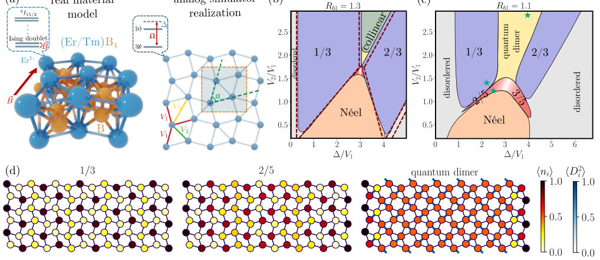
<figcaption class="paper-figure-caption"><b>Fig 1.</b> FIG. 1. Quantum Shastry-Sutherland model motivated by rare-earth tetraborides and its Rydberg phase diagram. (a) (left) Crystal structure of the rare-earth tetraboride family, which includes the Ising-like materials TmB4 and ErB4 [22]. The rare-earth ions form Shastry-Sutherland layers [10] and are surrounded by boron cages. In ErB4, the 4I15/2 multiplet is split by the crystal-field environment into Kramers doublets, with the lowest-energy doublet forming the effective Ising degree of freedom. Longitudinal and transverse magnetic fields couple anisotropically to this doublet, while interactions between the rare-earth moments generate effective in-plane Ising couplings. (right) The...</figcaption>
</figure>
<figure class="paper-figure-card">
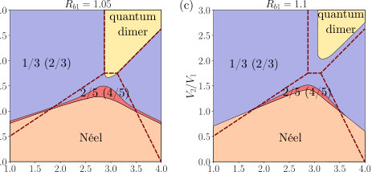
<figcaption class="paper-figure-caption"><b>Fig 2.</b> FIG. 2. Variational modeling of the transverse-field Shastry-Sutherland phase diagram. (a) The states identified numerically are modeled using minimal variational Ans¨atze. Single-site Ans¨atze are shown within the unit cell of each ordered state, with colors and arrow directions denoting the independent parameters θi. The quantum-dimer regime is described by an entangled two-site Ansatz that admixes the one-excitation dimer states with zero- and two-excitation configurations. (b)–(c) Phase diagrams obtained by vari- ationally minimizing the energy within the Ansatz spaces shown in (a) at two transverse-field strengths (see Methods, smaller Rb1 corresponds to a stronger transverse field)....</figcaption>
</figure>
<figure class="paper-figure-card">
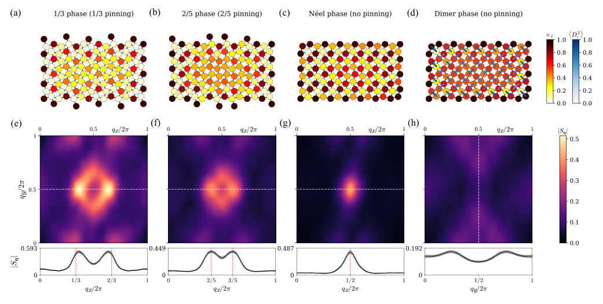
<figcaption class="paper-figure-caption"><b>Fig 3.</b> FIG. 3. Representative experimental signatures of phases in the quantum Shastry-Sutherland lattice. (a)– (d) Rydberg-density profiles, ⟨ni⟩, of states prepared using detuning sweeps on the Aquila analog quantum simulator (see Methods) [38]. Specifically, (a) shows the 1/3-filling ordered state prepared with 1/3-favoring boundary pinning, (b) shows the 2/5-filling ordered state prepared with 2/5-favoring boundary pinning, and (c) shows the N´eel state prepared without auxiliary pinning atoms, for which the native open boundary favors N´eel order. (d) shows experimental signatures at a parameter point associated with the quantum-dimer regime, also without auxiliary pinning atoms,...</figcaption>
</figure>
<figure class="paper-figure-card">
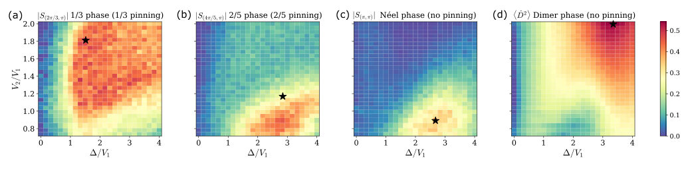
<figcaption class="paper-figure-caption"><b>Fig 4.</b> FIG. 4. Experimental order-parameter response maps of the Rydberg Shastry-Sutherland lattice. Experimentally measured structure-factor amplitudes, |Sq|, at the dominant ordering wavevectors for the density-ordered states and the average local dimer occupation, ⟨D2⟩= (1/N) P</figcaption>
</figure>
<figure class="paper-figure-card">
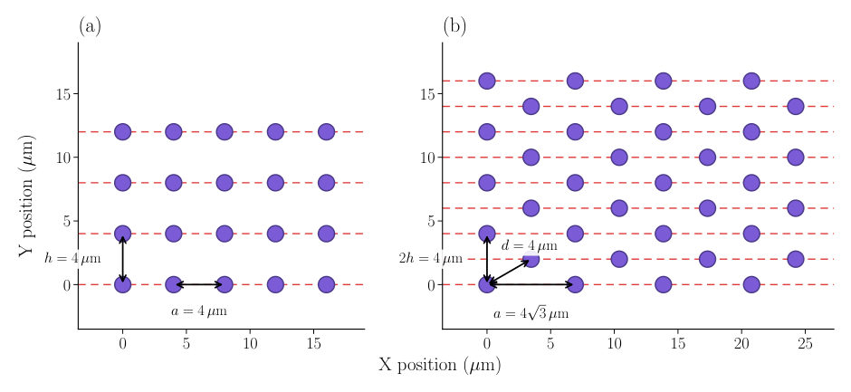
<figcaption class="paper-figure-caption"><b>Fig 5.</b> FIG. 5. Reservoir packing under the 4 µm optical-resolution limit. (a) Default square packing: rows and sites are both spaced by 4 µm. (b) Hexagonal packing at the configuration used here with alternate rows offset by a/2. The adjacent-row distance d and the skip-row vertical distance 2h both sit at 4 µm, giving a = 4 √</figcaption>
</figure>

**Summary.** This paper uses programmable Rydberg-atom arrays to simulate the quantum phase diagram of Ising magnets on the Shastry-Sutherland lattice, motivated by rare-earth materials. By combining DMRG calculations with experiments, the authors identify and confirm the existence of quantum-fluctuation-stabilized phases, such as 2/5 filling plateaus and quantum-dimer states. This establishes Rydberg arrays as a powerful tool for exploring frustrated quantum matter.

**Why it may be interesting.** This work is highly relevant as it uses Rydberg arrays—a premier tool in AMO physics—to simulate complex, frustrated quantum Hamiltonians, directly bridging fundamental condensed matter theory with cutting-edge quantum simulation hardware.

Detailed structure

**Main problem.** The study investigates how tunable quantum fluctuations reorganize the classically frustrated phase diagram of Ising-like magnets, motivated by rare-earth tetraborides.

**Main result.** The work experimentally and theoretically identifies novel quantum-stabilized phases, including a 2/5 filling plateau and a symmetry-preserving quantum-dimer regime, beyond the classical predictions.

**Method.** The research combines Density Matrix Renormalization Group (DMRG) calculations to map the phase diagram with experiments using programmable Rydberg-atom arrays to probe these quantum signatures.

**Model / system.** The system is an Ising magnet on the Shastry-Sutherland lattice, modeled by an effective Hamiltonian realized using Rydberg atoms in optical-tweezer arrays. The platform allows independent control over geometry and external fields (transverse and longitudinal).

**Key observables.** Order parameters such as structure factors (for 1/3, 2/5, Néel phases), local dimer occupation ($\langle D_i^2 
angle$), and dimer-dimer correlators ($C_{ij}$).

**Important parameters / regimes.** Transverse field strength (controlled by Rabi frequency $\Omega$) and detuning ($\Delta$), which tune the system between classical and quantum regimes.

**Assumptions / limitations.** The primary assumption is that the Rydberg array can accurately simulate the complex, material-motivated Hamiltonian, and that the measured response maps reflect the underlying quantum phase diagram.

**Figures summary.** Figures illustrate the crystal structure and mapping to the spin model, the calculated phase diagram showing classical and quantum regimes, and experimental response maps comparing different boundary pinning conditions for various order parameters.

**Paper structure.** The paper first establishes the physical motivation from rare-earth magnets, then details the mapping onto the Rydberg platform and the theoretical tools (DMRG). It proceeds to calculate and identify quantum regimes (2/5 plateau, quantum dimer) and concludes by presenting experimental measurements confirming these predicted signatures across varying boundary conditions.

Abstract

Frustrated magnets host rich emergent behavior because competing interactions generate dense manifolds of low-energy states. The Ising Shastry-Sutherland model is a paradigmatic setting, motivated experimentally by Ising-like rare-earth tetraborides such as TmB$_4$ and ErB$_4$, whose field-induced magnetization plateaus have motivated extensive microscopic modeling. Yet how tunable quantum fluctuations reorganize this material-motivated phase diagram remains largely unexplored. Here, we realize a transverse- and longitudinal-field Ising model on the Shastry-Sutherland lattice using a programmable Rydberg-atom array. We map its quantum phase diagram using density matrix renormalization group calculations and probe corresponding signatures experimentally in arrays containing more than 110 atoms. Beyond the established classical phases, the calculations identify two regimes absent in the classical limit and stabilized at finite transverse field: a $2/5$ filling plateau whose finite stability region emerges from a classically degenerate phase boundary and a symmetry-preserving quantum-dimer regime replacing classically selected collinear order. Experiments on finite open arrays reveal signatures consistent with these regimes across three boundary-pinning conditions, with the resulting response maps agreeing qualitatively with the calculated phase diagram. Our results establish programmable Rydberg-atom arrays as tools for exploring frustrated, material-motivated Hamiltonians and motivate searches for new, quantum-driven magnetization plateaus and quantum-dimer behavior in ErB$_4$ under a transverse field or in strain-tuned TmB$_4$.

[↑ back to top](#top)

### [When irrelevance governs: dissipation-regression scaling in open quantum criticality](http://arxiv.org/abs/2610.13033v1)

**Authors:** Fan Zhong  
**Type:** theory · **Category:** statistical mechanics · **PDF:** <https://arxiv.org/pdf/2610.13033v1>  
**Analysis basis:** full PDF text, analyzed in chunks
**Topic relevance:** 🔥 `Keldysh / 2PI / non-Gaussian methods` **4/5** · 🔥 `driven-dissipative phase transition` **4/5** · 🔥 `non-equilibrium universality` **4/5** · `correlated / nonlocal dissipation` **3/5** · `methods for driven-dissipative` **3/5** · `analog quantum simulation` **2/5** · `quantum measurements` **1/5**

↔ Scroll figures horizontally

<figure class="paper-figure-card">
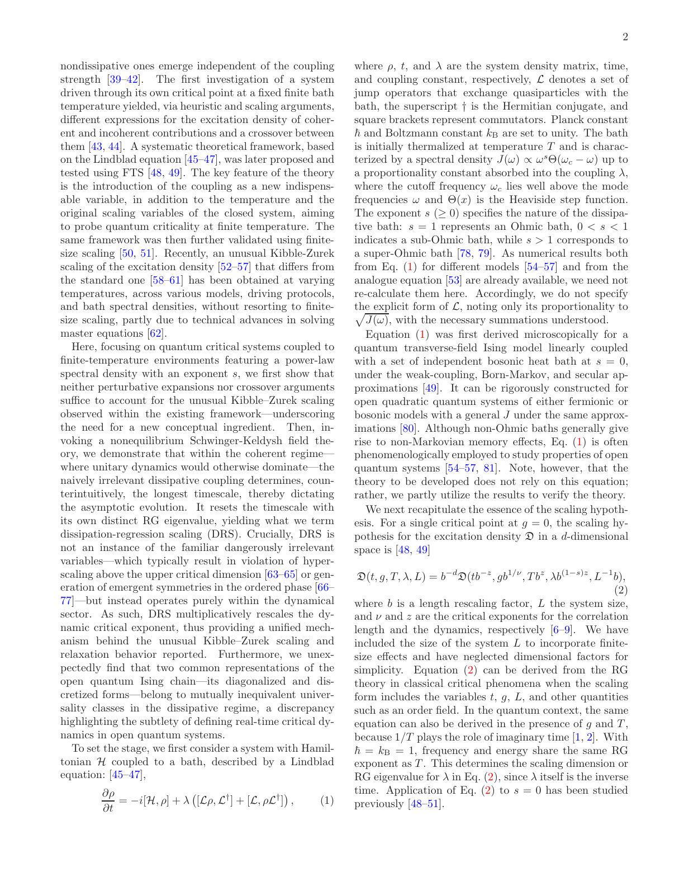
<figcaption class="paper-figure-caption"><b>Fig 1.</b> Low-resolution page preview, page 2</figcaption>
</figure>
<figure class="paper-figure-card">
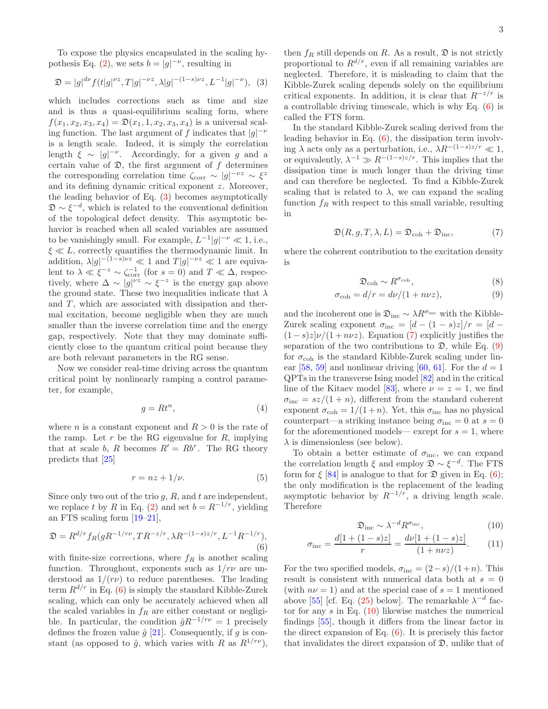
<figcaption class="paper-figure-caption"><b>Fig 2.</b> Low-resolution page preview, page 3</figcaption>
</figure>
<figure class="paper-figure-card">
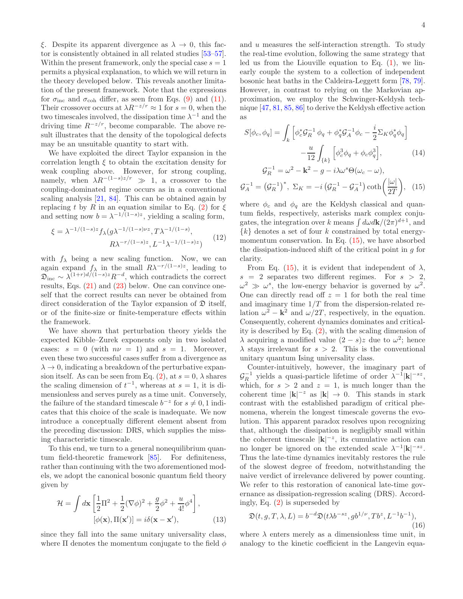
<figcaption class="paper-figure-caption"><b>Fig 3.</b> Low-resolution page preview, page 4</figcaption>
</figure>
<figure class="paper-figure-card">
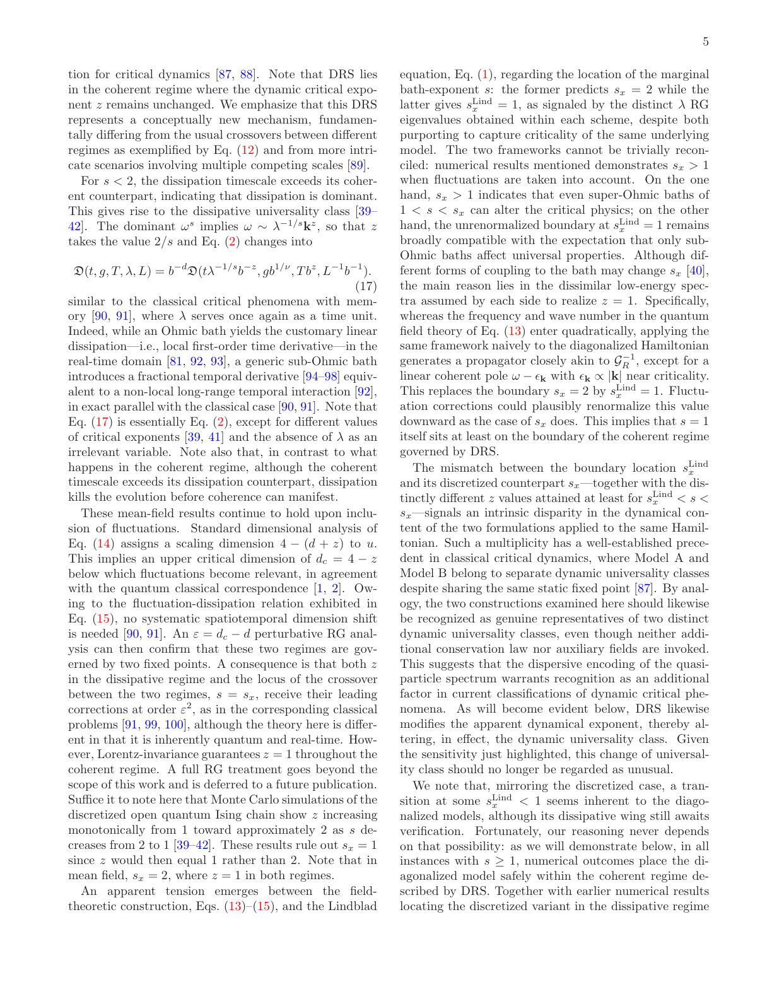
<figcaption class="paper-figure-caption"><b>Fig 4.</b> Low-resolution page preview, page 5</figcaption>
</figure>
<figure class="paper-figure-card">
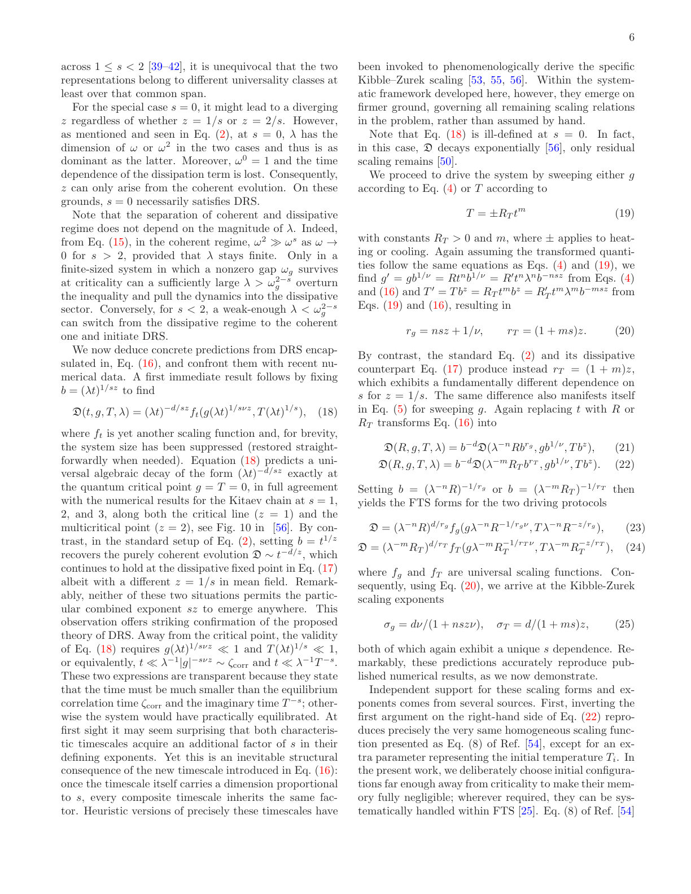
<figcaption class="paper-figure-caption"><b>Fig 5.</b> Low-resolution page preview, page 6</figcaption>
</figure>

**Summary.** This paper develops the Dissipation-Regression Scaling (DRS) framework to describe the real-time dynamics of quantum phase transitions in open quantum systems. Using advanced field theory techniques, the authors show that even couplings initially deemed irrelevant can dictate the system's longest timescale. This provides a unified explanation for unusual scaling behaviors observed in quantum criticality experiments and simulations.

**Why it may be interesting.** This work provides a powerful, generalized scaling framework for non-equilibrium dynamics in open quantum systems, which is crucial for understanding decoherence and relaxation in realistic quantum devices.

Detailed structure

**Main problem.** The paper investigates the real-time dynamics of quantum phase transitions in open quantum systems coupled to finite-temperature environments.

**Main result.** It introduces Dissipation-Regression Scaling (DRS), a novel scaling law that counterintuitively shows that a naively irrelevant dissipative coupling determines the longest timescale in the coherence-dominated regime.

**Method.** The analysis employs the Schwinger-Keldysh formalism and Renormalization-Group (RG) theory, extending standard scaling hypotheses to account for dissipation effects.

**Model / system.** The study focuses on open quantum systems, exemplified by the open quantum Ising chain, whose dynamics are governed by the Lindblad equation and analyzed using a bosonic quantum field theory approach.

**Key observables.** Excitation density (D) and topological defect density (related to Kibble-Zurek scaling).

**Important parameters / regimes.** Bath spectral exponent (s), coupling strength ($\lambda$), temperature (T), and the dynamic critical exponent (z).

**Assumptions / limitations.** The theory distinguishes between coherence-dominated and dissipation-dominated regimes, and it notes that standard perturbation theory and simple scaling arguments are insufficient.

**Figures summary.** Not specified (The notes detail scaling equations and functional forms rather than describing figure content).

**Paper structure.** The paper builds from the general problem of QPT dynamics in open systems, develops the Schwinger-Keldysh framework, derives scaling forms for different regimes (quasi-equilibrium vs. FTS), and culminates in the proposal and validation of the DRS mechanism.

Abstract

The real-time dynamics of quantum phase transitions in open systems coupled to finite-temperature environments sits at the heart of contemporary condensed-matter and quantum-information science. Here, invoking a Schwinger-Keldysh formalism, we uncover that, within the coherence-dominated regime of critical real-time evolution, a dissipative coupling deemed naively irrelevant determines, counterintuitively, the longest timescale that holds sway. Possessing a well-defined temporal scaling dimension, it engenders a novel dissipation-regression scaling that systematically reproduces the unusual Kibble-Zurek scaling and relaxation observed in recent numerical studies. By contrast, dissipation-dominated dynamics behaves qualitatively differently. There, furthermore, we show that the discretized and diagonalized formulations of the same open quantum Ising chain realize distinct universality classes.

[↑ back to top](#top)

### [Exact solutions of non-Markovian dissipative Ising models](http://arxiv.org/abs/2610.12546v1)

**Authors:** Mohammad Maghrebi  
**Type:** theory · **Category:** other · **PDF:** <https://arxiv.org/pdf/2610.12546v1>  
**Analysis basis:** full PDF text, analyzed in chunks
**Topic relevance:** 🔥 `methods for driven-dissipative` **4/5** · `analog quantum simulation` **3/5** · `correlated / nonlocal dissipation` **3/5** · `driven-dissipative phase transition` **3/5** · `Keldysh / 2PI / non-Gaussian methods` **2/5** · `non-equilibrium universality` **2/5** · `quantum measurements` **2/5** · `Tavis-Cummings & cavity-many-emitter` **1/5**

↔ Scroll figures horizontally

<figure class="paper-figure-card">
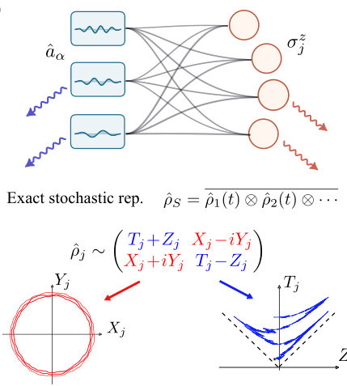
<figcaption class="paper-figure-caption"><b>Fig 1.</b> FIG. 1. Schematic model and exact stochastic solution. (a) Spins coupled to lossy bosonic modes and subject to local spin dissipation. The bosons mediate Ising-type interactions and give rise to non-Markovian dynamics. (b) The reduced den- sity matrix of the spins is obtained by averaging the product of individual stochastic density matrices which are generally nei- ther trace-1 nor positive. Without a transverse field or local spin dissipation, their matrix elements form two closed, ex- actly solvable pairs: their transverse components (Xj, Yj) un- dergo stochastic rotations, while the evolution of the diagonal components (Tj, Zj) resembles stochastic Lorentz boosts, as shown...</figcaption>
</figure>
<figure class="paper-figure-card">
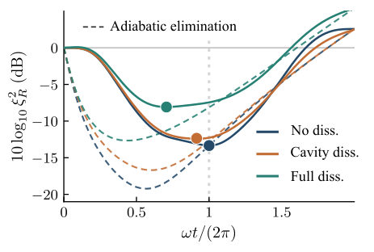
<figcaption class="paper-figure-caption"><b>Fig 2.</b> FIG. 2. Spin squeezing with non-Markovian dynamics and Markovian dissipation. Exact (solid) and adiabatically elim- inated (dashed) dynamics of the Wineland parameter are shown for N = 1000 spins uniformly coupled to a single bosonic mode with g/ω = 1.8. Different curves represent no dissipation (blue), cavity loss only (orange), and cavity loss together with local spin dephasing, emission, and pumping (green). Local spin dissipation shifts the optimal squeezing (marked by solid circles) earlier and reduces the achievable squeezing. Spins initially point along +x and the bosonic mode is in its vacuum state. Dissipation parameters are κ/ω = 0.05 and Γϕ/ω = 0.01, Γ↓= Γ↑= Γϕ/2, compara- ble to...</figcaption>
</figure>

**Summary.** This paper presents an exact stochastic method to solve the dynamics of dissipative Ising models coupled to bosonic environments. It successfully handles the interplay between non-Markovian bath effects and local spin dissipation without resorting to approximations like adiabatic elimination. The results are vital for accurately characterizing quantum devices where environmental noise is complex.

**Why it may be interesting.** This work provides rigorous, non-perturbative tools to analyze open quantum systems, which is crucial for designing and understanding quantum devices where environmental coupling is complex and non-Markovian.

Detailed structure

**Main problem.** Characterizing the dynamics of open quantum systems, especially interacting many-body systems, when environmental noise induces non-Markovian effects alongside standard Markovian dissipation.

**Main result.** The authors developed an exact stochastic representation to solve the dynamics, showing that the full non-Markovian evolution significantly deviates from predictions based on adiabatic elimination.

**Method.** The core method involves using an exact stochastic representation to decouple the many-body dynamics into individual spin evolutions, avoiding the approximation of adiabatically eliminating the bosonic bath modes.

**Model / system.** The model consists of Ising spins coupled to lossy bosonic modes mediating Ising-type interactions. The dynamics are governed by a quantum master equation incorporating bosonic loss and local spin dissipation (dephasing, relaxation).

**Key observables.** Spin observables, spin correlations, and the Spin Squeezing parameter ($\xi_R^2$).

**Important parameters / regimes.** The interplay between non-Markovian dynamics (captured by the Green's function $G(t)$) and Markovian dissipation rates ($\kappa, \Gamma'$).

**Assumptions / limitations.** The stochastic approach is exact, but obtaining closed-form solutions for all correlation functions remains challenging, necessitating numerical solutions for complex regimes.

**Figures summary.** Figure 2 compares the exact dynamics (solid line) against the adiabatically eliminated dynamics (dashed line) for the Wineland parameter under various dissipation conditions.

**Paper structure.** The paper first introduces the general master equation, then details the exact stochastic representation for solving spin dynamics. It analyzes specific observables like spin squeezing, compares exact results to the adiabatic limit, and derives time-local equations for correlation functions.

Abstract

Applications of quantum devices and simulators require an accurate understanding of their dynamics as well as the effects of environmental noise. While some sources of noise can be modeled as Markovian dissipation, coupling to resonators or vibrational modes often produces non-Markovian dynamics as well, making it difficult to characterize the system, particularly for interacting many-body systems. Here, we identify a broad class of exactly solvable many-body quantum systems with both non-Markovian dynamics and Markovian dissipation. We consider a prototypical model of spins coupled to lossy bosonic modes that mediate Ising-type interactions. We exclude a transverse field but allow local spin dissipation that need not commute with the interactions, including dephasing, relaxation, pumping, and even processes that generate coherences. Using an exact stochastic representation, we decouple the many-body dynamics into the evolution of individual spins, yielding exact spin observables and correlations without adiabatically eliminating the bosons. In the Markovian limit, our solutions describe Ising models with correlated dephasing and nonreciprocal interactions. An example of spin squeezing shows that both the achievable squeezing and its optimal preparation time depend strongly on the interplay between non-Markovian dynamics and Markovian dissipation.

[↑ back to top](#top)

### [Latent Symmetry in Quantum Zeno Dynamics](http://arxiv.org/abs/2610.12647v1)

**Authors:** Stefano Longhi  
**Type:** theory · **Category:** other · **PDF:** <https://arxiv.org/pdf/2610.12647v1>  
**Analysis basis:** full PDF text, analyzed in chunks
**Topic relevance:** 🔥 `quantum measurements` **4/5** · `analog quantum simulation` **3/5** · `correlated / nonlocal dissipation` **3/5** · `driven-dissipative phase transition` **3/5** · `methods for driven-dissipative` **3/5** · `non-equilibrium universality` **2/5** · `Keldysh / 2PI / non-Gaussian methods` **1/5** · `Tavis-Cummings & cavity-many-emitter` **1/5**

↔ Scroll figures horizontally

<figure class="paper-figure-card">
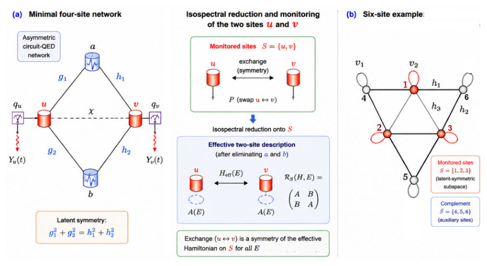
<figcaption class="paper-figure-caption"><b>Fig 1.</b> FIG. 1. Latent symmetry and monitored-network models. (a) Minimal four-resonator circuit-QED network considered in the main text. Two monitored resonators u and v are coupled through the auxiliary resonators a and b with generally different coupling patterns (g1, g2) and (h1, h2). The condition g2 1 + g2 2 = h2 1 + h2 2 produces an exact latent exchange symmetry between u and v, despite the absence of a corresponding geometrical symmetry of the physical network. Continuous QND monitoring of the occupations of u and v yields the measurement records Yu(t) and Yv(t). Center: isospectral reduction onto the monitored subspace S = {u, v} eliminates the auxiliary sites and yields an effective...</figcaption>
</figure>
<figure class="paper-figure-card">
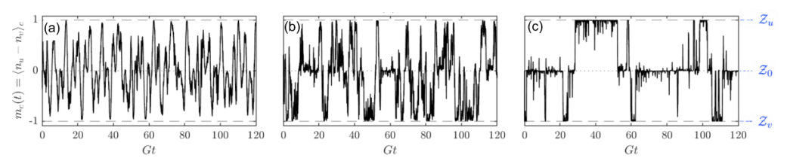
<figcaption class="paper-figure-caption"><b>Fig 2.</b> FIG. 2. Emergence of quantum-Zeno subspaces in individual continuously monitored trajectories. Conditional latent polar- ization mc(t) = ⟨nu −nv⟩c for (a) γ/G = 0.5, (b) γ/G = 3, and (c) γ/G = 15. The coupling vectors are parametrized according to Eq. (8) with α = 10◦and β = 55◦, and the resonators are taken at resonance, ∆= ϵ0. The initial state is the latent-even state |ψc(0)⟩= (|u⟩+|v⟩)/ √</figcaption>
</figure>
<figure class="paper-figure-card">
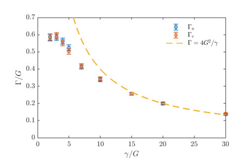
<figcaption class="paper-figure-caption"><b>Fig 3.</b> FIG. 3. Latent-symmetry-constrained Zeno escape rates. Numerically extracted escape rates Γu and Γv from the po- larized sectors Zu and Zv as a function of the monitoring strength γ/G. For each value of γ, the two rates are indepen- dently estimated from 103 first-passage trajectories initialized in |u⟩and |v⟩, respectively. First passage to either of the other Zeno sectors is identified using the localization thresh- old pth = 0.9, with right-censored trajectories included in the rate estimator. The coupling vectors are parametrized accord- ing to Eq. (8) with α = 10◦, β = 55◦, and ∆= ϵ0. Numerical integration uses G dt = 2 × 10−4 and a maximum observation time GTmax = 60. The...</figcaption>
</figure>
<figure class="paper-figure-card">
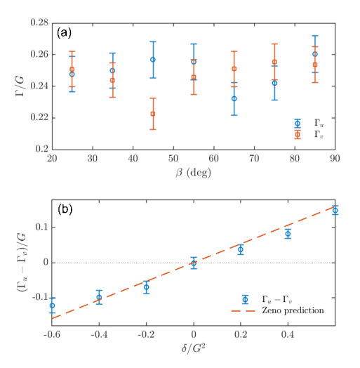
<figcaption class="paper-figure-caption"><b>Fig 4.</b> FIG. 4. Control of Zeno escape dynamics by latent symme- try. (a) Escape rates Γu and Γv under deformation of the mi- croscopic coupling geometry along the latent-symmetric man- ifold. The angle α = 10◦is fixed while β is varied from 25◦to 85◦in steps of 10◦, with ∥g∥= ∥h∥= G maintained through- out. Despite the resulting geometrical inequivalence of the local coupling environments, the two independently extracted rates remain equal within statistical uncertainty. (b) Escape- rate splitting upon breaking the latent symmetry. The cou- pling directions are fixed at α = 10◦and β = 55◦, while the norm of g is kept fixed, ∥g∥= G, and that of h is varied according to ∥h∥= rG. Consequently, δ/G2 =...</figcaption>
</figure>

**Summary.** This paper demonstrates that a hidden or 'latent' symmetry can dictate the dynamics of a quantum system undergoing continuous measurement, even if the physical hardware does not possess that symmetry. Using a circuit-QED model, the authors show this symmetry forces geometrically distinct measurement-selected subspaces to exhibit identical statistical properties, revealing a deep underlying organizing principle in quantum Zeno dynamics.

**Why it may be interesting.** This work is highly relevant as it connects abstract symmetry principles (latent symmetry) to concrete, measurable phenomena in open quantum systems (QZE), providing a powerful tool to predict robust behavior in engineered quantum devices like circuit QED.

Detailed structure

**Main problem.** The paper investigates whether a latent symmetry can govern the structure and dynamics of quantum-Zeno subspaces, even when the underlying physical network geometry lacks such a symmetry.

**Main result.** Latent symmetry acts as a hidden organizing principle, enforcing exact, measurable relations (like identical escape rates) between quantum-Zeno subspaces that are otherwise geometrically inequivalent.

**Method.** The analysis uses exact isospectral reduction of the Hamiltonian onto the monitored subspace, followed by analyzing the resulting dynamics using the Lindblad master equation and stochastic master equations.

**Model / system.** The model is a minimal circuit-QED network of coupled microwave resonators (four resonators in the minimal case). Dynamics are governed by continuous Quantum-Nondemolition (QND) monitoring of local photon occupations.

**Key observables.** Escape rates ($\Gamma_u, \Gamma_v$), conditional latent polarization ($m_c(t)$), and the ensemble imbalance ($\langle \hat{n}_u - \hat{n}_v 
angle_{ens}$).

**Important parameters / regimes.** Measurement strength ($\gamma$), coupling strengths ($g, h$), and the ratio of measurement strengths ($\gamma_u / \gamma_v$).

**Assumptions / limitations.** The analysis assumes the dispersive coupling regime for readout ancillas and requires equal measurement strengths ($\gamma_u = \gamma_v$) to preserve the latent symmetry during monitoring.

**Figures summary.** Figures illustrate the effective Hamiltonian invariant under $u \leftrightarrow v$ after isospectral reduction, and show that the equality of Zeno escape rates ($\Gamma_u = \Gamma_v$) persists when latent symmetry is maintained, while rate splitting occurs when the symmetry is broken.

**Paper structure.** The paper progresses from defining the physical system and the concept of latent symmetry, to performing the isospectral reduction to find the effective Hamiltonian, and finally analyzing the dynamics (both unconditional and conditional) to demonstrate the symmetry's imprint on measurable quantities like escape rates.

Abstract

Quantum Zeno dynamics constrains a continuously monitored system to measurement-selected subspaces. Here we show that the structure of such Zeno subspaces can be governed by a \emph{latent symmetry}, namely a symmetry that is absent from the geometry of the underlying physical network. We consider a minimal circuit-QED network of coupled microwave resonators subject to quantum-nondemolition (QND) monitoring of local photon occupations. Two distinguished resonators are geometrically inequivalent, yet are exactly exchanged by a latent symmetry of the network. Strong monitoring partitions the single-excitation Hilbert space into three quantum-Zeno subspaces, two of which correspond to localization on the distinguished resonators. Latent symmetry exactly exchanges these two Zeno subspaces and enforces identical escape and residence statistics despite their different microscopic environments. In the strong-measurement regime their residence times grow linearly with the measurement strength and diverge in the ideal Zeno limit, where the measurement subspaces become dynamically disconnected. Our results show that latent symmetry can act as a hidden organizing principle of quantum Zeno dynamics, imposing exact relations between measurement-selected subspaces that are geometrically inequivalent in the physical system.

[↑ back to top](#top)

### [Dissipative Majorana Chain---Anomalies and Non-Invertible Symmetries](http://arxiv.org/abs/2610.12607v1)

**Authors:** Hung-Hsuan Teh, Tokiro Numasawa  
**Type:** theory · **Category:** statistical mechanics · **PDF:** <https://arxiv.org/pdf/2610.12607v1>  
**Analysis basis:** full PDF text, analyzed in chunks
**Topic relevance:** 🔥 `methods for driven-dissipative` **4/5** · `correlated / nonlocal dissipation` **3/5** · `driven-dissipative phase transition` **3/5** · `non-equilibrium universality` **3/5** · `Keldysh / 2PI / non-Gaussian methods` **2/5** · `analog quantum simulation` **2/5** · `Frenkel-Kontorova` **1/5** · `quantum measurements` **1/5**

↔ Scroll figures horizontally

<figure class="paper-figure-card">
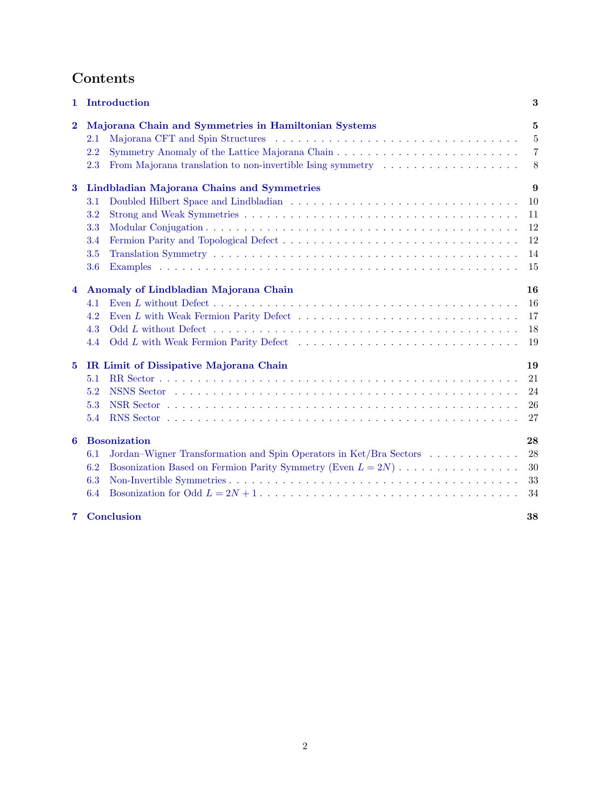
<figcaption class="paper-figure-caption"><b>Fig 1.</b> Low-resolution page preview, page 2</figcaption>
</figure>
<figure class="paper-figure-card">
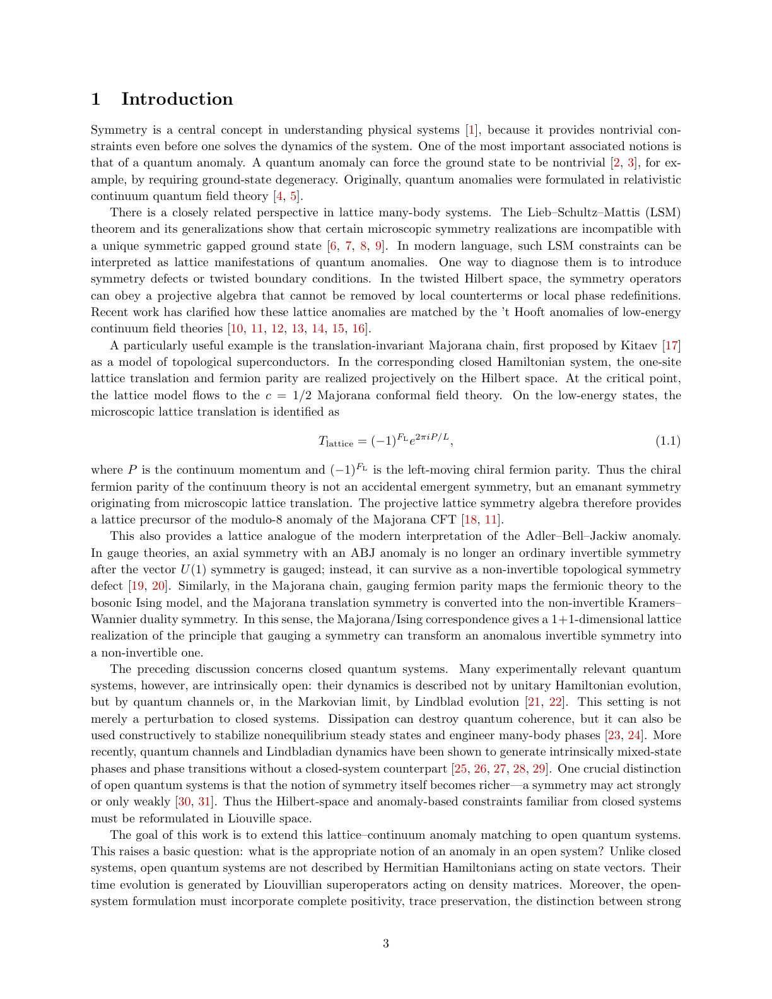
<figcaption class="paper-figure-caption"><b>Fig 2.</b> Low-resolution page preview, page 3</figcaption>
</figure>
<figure class="paper-figure-card">
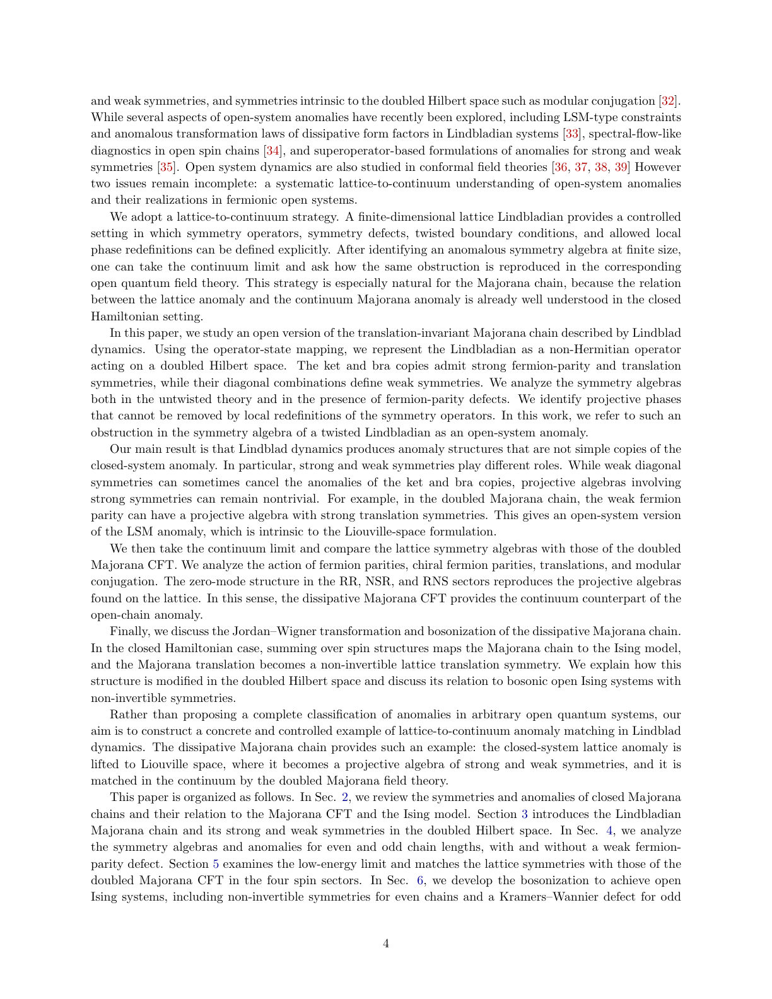
<figcaption class="paper-figure-caption"><b>Fig 3.</b> Low-resolution page preview, page 4</figcaption>
</figure>
<figure class="paper-figure-card">
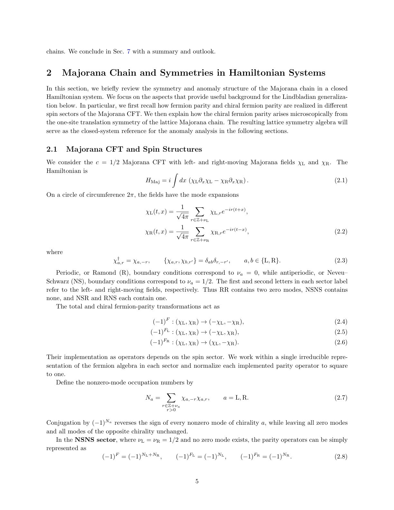
<figcaption class="paper-figure-caption"><b>Fig 4.</b> Low-resolution page preview, page 5</figcaption>
</figure>
<figure class="paper-figure-card">
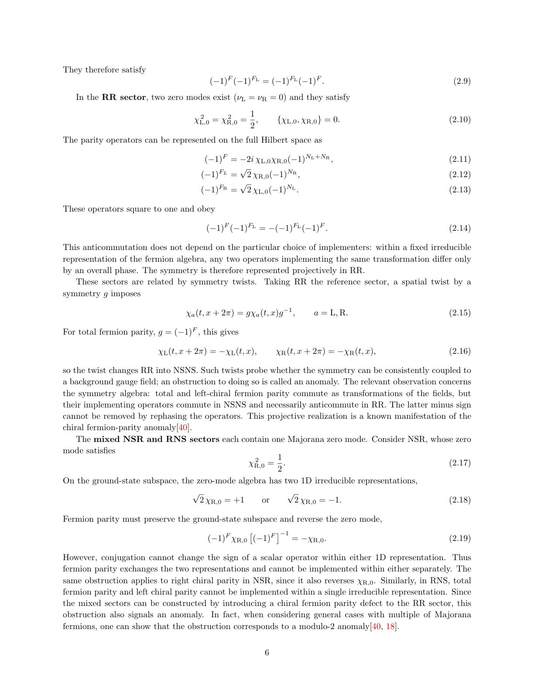
<figcaption class="paper-figure-caption"><b>Fig 5.</b> Low-resolution page preview, page 6</figcaption>
</figure>

**Summary.** This paper investigates the symmetries and anomalies of Majorana chains undergoing dissipation, moving beyond standard unitary models. By mapping the dynamics to a doubled Hilbert space, the authors derive that the open system exhibits specific non-invertible symmetries, such as Kramers–Wannier duality, depending on the chain's parity. This provides a rigorous theoretical tool for analyzing constraints in open quantum many-body systems.

**Why it may be interesting.** This work provides a controlled framework for understanding how fundamental concepts like anomalies and non-invertible symmetries manifest when moving from unitary (closed) to dissipative (open) quantum evolution, which is crucial for realistic quantum simulations.

Detailed structure

**Main problem.** The paper aims to extend the concept of quantum anomalies and symmetry constraints from closed quantum systems to open quantum systems governed by dissipation.

**Main result.** The study establishes that dissipative Majorana chains yield Ising Lindbladians exhibiting non-invertible Kramers–Wannier symmetries for even lengths, and a duality defect for odd lengths.

**Method.** The authors use the operator-state mapping to represent the Lindbladian as a non-Hermitian operator on a doubled Hilbert space, analyzing symmetry algebras and performing lattice bosonization.

**Model / system.** The system is the dissipative Majorana chain, whose dynamics are described by Lindblad dynamics. The analysis involves mapping the system to a doubled Hilbert space and relating the lattice structure to the doubled Majorana CFT.

**Key observables.** Strong and weak fermion parities, lattice symmetry algebras, and the resulting Ising Lindbladian structure.

**Important parameters / regimes.** Even and odd chain lengths ($L$), and the presence of collective energy dephasing.

**Assumptions / limitations.** The standard notion of symmetry must be reformulated in Liouville space due to dissipation, and the analysis relies on specific boundary conditions for the CFT correspondence.

**Paper structure.** The paper progresses by first reviewing closed Majorana chains, then introducing the Lindbladian chain, analyzing symmetries for even/odd lengths, matching lattice symmetries to the doubled Majorana CFT, and finally developing the lattice bosonization to open Ising systems.

Abstract

We study symmetries and anomalies of dissipative Majorana chains described by Lindblad dynamics. Using the operator-state mapping, we represent the Lindbladian as a non-Hermitian operator on a doubled Hilbert space. In this formulation, the ket and bra contours admit strong fermion parities and strong translations, while their diagonal combinations define weak symmetries. For even and odd chain lengths, we diagnose anomalies by comparing symmetry algebras with and without weak fermion-parity defects. These algebras retain the lattice precursor of the modulo-$8$ anomaly of the closed Majorana chain and exhibit projective relations between strong fermion parity and weak translation, as well as between weak fermion parity and strong translation, which are intrinsic to open quantum systems. We establish the IR correspondence between the lattice symmetry algebras and those of the doubled Majorana CFT in four spin sectors, identifying chiral fermion parities emanated from the lattice translations. Finally, we develop the lattice bosonization of the dissipative chain. For even length with collective energy dephasing, combining the defect and no-defect sectors and imposing GSO projections gives rise to an Ising Lindbladian with non-invertible Kramers--Wannier symmetries descending from the anomalous strong translation and fermion parity of the Majorana chain. For odd length, constructing mutually commuting ket- and bra-sector spin operators instead yields an Ising Lindbladian with a Kramers--Wannier duality defect. Our results provide a controlled framework for extending lattice anomalies and non-invertible symmetries to open quantum systems.

[↑ back to top](#top)

### [Locality-Preparation Time Tradeoffs in Dissipative Quantum Systems](http://arxiv.org/abs/2610.13784v1)

**Authors:** Philipp Westhoff, Sara Murciano, Mattia Moroder  
**Type:** theory · **Category:** statistical mechanics · **PDF:** <https://arxiv.org/pdf/2610.13784v1>  
**Analysis basis:** full PDF text, analyzed in chunks
**Topic relevance:** 🔥 `correlated / nonlocal dissipation` **4/5** · `analog quantum simulation` **3/5** · `driven-dissipative phase transition` **3/5** · `methods for driven-dissipative` **3/5** · `non-equilibrium universality` **3/5** · `quantum measurements` **2/5** · `Keldysh / 2PI / non-Gaussian methods` **1/5**

↔ Scroll figures horizontally

<figure class="paper-figure-card">
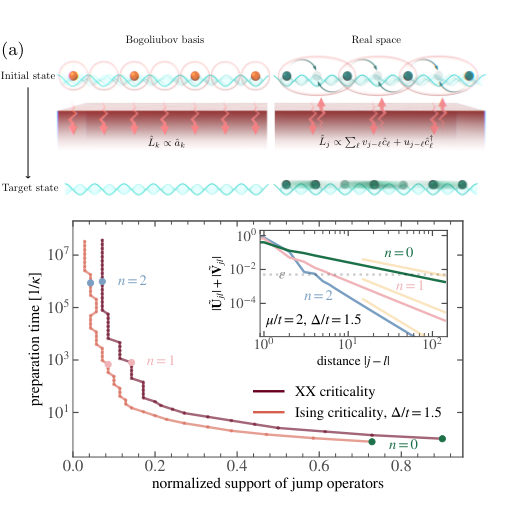
<figcaption class="paper-figure-caption"><b>Fig 1.</b> FIG. 1. Locality-preparation time tradeoff. (a) Schematic of dissipative ground-state preparation. In the Bo- goliubov basis (left), the target ground state is simply the quasiparticle vacuum, whereas in real space (right) it has a nontrivial structure. In the main text, we show how the jump operators can be optimized to maximize their real-space local- ity while preserving the target steady state. (b) Preparation time, expressed in units of κ−1, as a function of the normal- ized support of the jump operators at XX and Ising criticality (see Fig. 2). Highlighted points correspond to integer values of the suppression exponent n. The inset shows the correspond- ing real-space decay of the...</figcaption>
</figure>
<figure class="paper-figure-card">
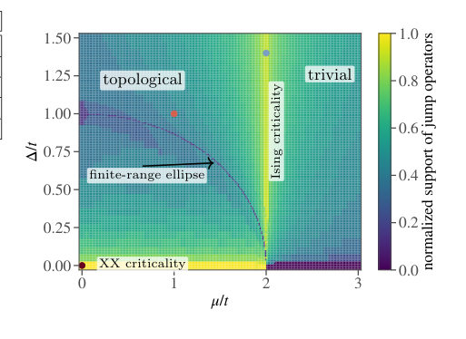
<figcaption class="paper-figure-caption"><b>Fig 2.</b> FIG. 2. Locality of the dissipator at fixed prepara- tion time across the Kitaev phase diagram. Support of the jump operators required to prepare the ground state at fixed dissipative gap 2∆L/κ = 1, as a function of the chem- ical potential µ/t and pairing strength ∆/t. The support is determined from the spatial extent of the real-space jump- operator coefficients above a cutoff ϵ = 0.005 for a system with N = 100 sites.</figcaption>
</figure>
<figure class="paper-figure-card">
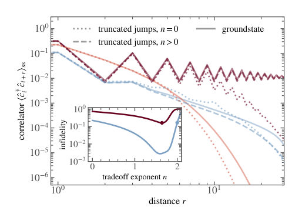
<figcaption class="paper-figure-caption"><b>Fig 3.</b> FIG. 3. Accuracy of finite-range dissipators. Steady- state correlator |⟨ˆc† i ˆci+r⟩ss| obtained after truncating the jump operators, compared with the exact ground-state result (solid lines). Dotted lines correspond to direct truncation of the real-space Bogoliubov annihilators, i.e., the trivial mixing βk = 1 (n = 0). Dashed lines instead exploit a nontrivial mixing βk (n &gt; 0) to suppress the momentum-space discon- tinuities and improve the spatial decay of the jump operators before applying the same finite-range truncation. The inset shows the steady-state infidelity 1 −FHS, where FHS is the normalized Hilbert-Schmidt overlap, as a function of the sup- pression exponent n for the two...</figcaption>
</figure>
<figure class="paper-figure-card">
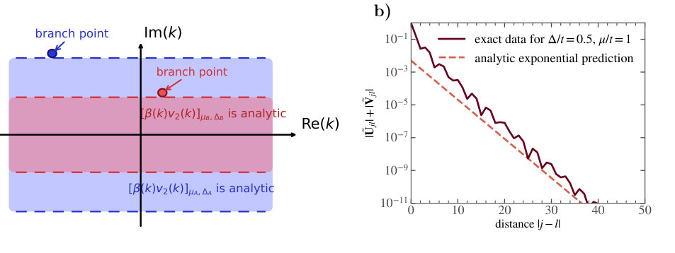
<figcaption class="paper-figure-caption"><b>Fig 4.</b> FIG. 1. Localization of the jump operators in the topological phase. Left: Schematic analytic continuation to the complex momentum plane. For a given set of Hamiltonian parameters, the localization length ξ is determined by the singularity closest to the real axis: the corresponding branch point bounds the strip of analyticity and lies at an imaginary distance 1/ξ from the real axis. Right: Real-space jump-operator coefficients | ˜Ujl| + | ˜Vjl|, comparing the exact numerical Fourier coefficients with the asymptotic exponential decay rate derived in Eq. (D31) in the topological phase. The agreement confirms the exponential decay governed by ξ.</figcaption>
</figure>
<figure class="paper-figure-card">
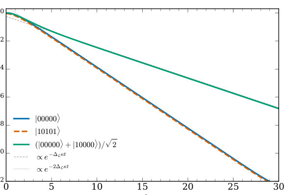
<figcaption class="paper-figure-caption"><b>Fig 5.</b> FIG. 2. Parity-controlled relaxation and Mpemba-type acceleration. Trace distance D(ˆρ(t), ˆρgs) from the target steady state for a Kitaev chain with N = 5, t = 1, ∆= 0, and µ = 1. The full Lindblad dynamics, including the Kitaev Hamiltonian and Bogoliubov jump operators ˆLk = √κ ˆak, is solved by exact diagonalization of the Lindbladian. The definite- parity states |00000⟩(blue) and |10101⟩(orange dashed) have no overlap with the slowest odd-parity coherence modes and asymptotically decay with rate 2∆L. The parity-coherent state (|00000⟩+|10000⟩)/ √</figcaption>
</figure>

**Summary.** This paper establishes a rigorous relationship between how locally the dissipation is engineered and how fast a quantum system can reach its steady state. Using the Kitaev chain model, the authors show that critical points impose a severe, system-size-dependent cost on preparation time, while gapped phases allow for fast, local preparation. This work is crucial for understanding the fundamental limits of dissipative quantum control.

**Why it may be interesting.** This work provides quantitative, fundamental constraints on the feasibility of engineering quantum states using open system dynamics, directly impacting the design principles for quantum simulators and quantum control.

Detailed structure

**Main problem.** The paper quantifies the fundamental tradeoff between the spatial locality of engineered dissipation and the required preparation time for driving a quantum system to a steady state.

**Main result.** At critical points, achieving high locality forces the preparation time to grow algebraically with system size, whereas gapped phases allow for exponentially localized dissipation with a finite preparation time.

**Method.** The authors establish an exact locality-preparation time relation for quadratic fermionic systems by analyzing the structure of jump operators derived from the Lindbladian dynamics.

**Model / system.** The analysis is performed on quadratic fermionic systems, specifically exemplified by the one-dimensional Kitaev chain, which exhibits distinct critical and gapped phases.

**Key observables.** Preparation time ($	au$), spatial decay of jump operator coefficients (locality), and steady-state fidelity.

**Important parameters / regimes.** System size ($N$), Kitaev chain parameters ($\mu, t, \Delta$), and the exponent ($n$) controlling the suppression of jump operator tails.

**Assumptions / limitations.** The approach is exact for quadratic fermionic systems, and the analysis relies on the analytic structure of Bogoliubov coefficients in momentum space.

**Figures summary.** Figures illustrate the support of jump operators across the Kitaev phase diagram, showing extended support at criticality and localized support in gapped phases. Other figures compare steady-state correlators and fidelity under different truncation assumptions.

**Paper structure.** The paper first introduces the problem of locality vs. time tradeoff, develops the exact relation for quadratic fermions, applies this framework to the Kitaev chain to distinguish scaling laws in critical vs. gapped regimes, and concludes by identifying the conditions for fast, local preparation.

Abstract

Dissipative state preparation engineers quantum many-body states as steady states of an open-system dynamics. The spatial range of the required dissipation sets both the feasibility of analog implementations and the connectivity and control complexity of digital ones. Yet how this locality quantitatively constrains preparation times remains largely unknown. Here, we establish an exact locality-preparation time relation for quadratic fermionic systems and develop a construction that optimizes the locality of the dissipative dynamics while preserving the target state. Applied to the Kitaev chain, our framework reveals sharply different locality-preparation time tradeoffs in critical and gapped regimes. At criticality, suppressing the algebraic tails of the jump operators necessarily forces the preparation time to grow algebraically with system size. By contrast, both trivial and topological gapped phases admit exponentially localized dissipation with a finite preparation time in the thermodynamic limit. Our results identify when fast dissipative preparation is compatible with local control and when criticality imposes an unavoidable dynamical cost.

[↑ back to top](#top)

### [Flat-band quantum geometry from embedded quench dynamics](http://arxiv.org/abs/2610.12555v1)

**Authors:** Ilia Komissarov, Daniel E. Sheehy, Ahana Chakraborty  
**Type:** theory · **Category:** other · **PDF:** <https://arxiv.org/pdf/2610.12555v1>  
**Analysis basis:** full PDF text, analyzed in chunks
**Topic relevance:** 🔥 `analog quantum simulation` **4/5** · `methods for driven-dissipative` **3/5** · `non-equilibrium universality` **3/5** · `quantum measurements` **3/5** · `driven-dissipative phase transition` **2/5** · `scars & prethermalization` **2/5** · `Keldysh / 2PI / non-Gaussian methods` **1/5**

↔ Scroll figures horizontally

<figure class="paper-figure-card">
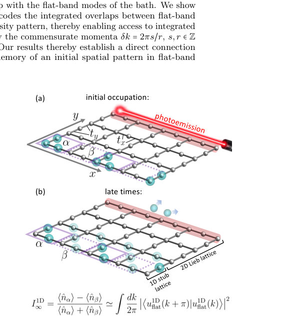
<figcaption class="paper-figure-caption"><b>Fig 1.</b> Figure 1. (a) We consider a two-dimensional Lieb lattice in which a single α bipartition of the one-dimensional subset of sites is locally populated by fermions or bosons, with a single particle per site, as indicated by the blue spheres. (b) At late times, dispersive particles spread to the driven edge, shown in red, where they are removed, which leads to a stationary density pattern in the vicinity of the initially populated edge. The resulting sublattice density imbalance, quantified between the α and β sectors of the one-dimensional stub lattice, is related to the quantum distance between the 1D flat-band states dflat k,k+π (3).</figcaption>
</figure>
<figure class="paper-figure-card">
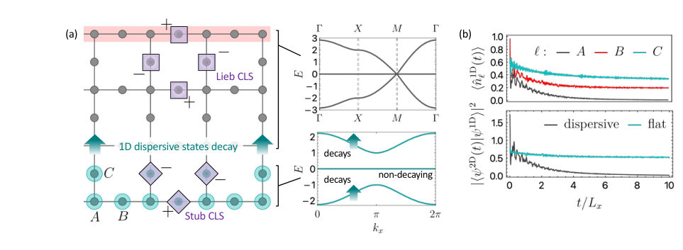
<figcaption class="paper-figure-caption"><b>Fig 2.</b> Figure 2. (a) Spectral filtering of dispersive states in a fully-filled 1D stub lattice coupled to an initially empty 2D Lieb lattice. As the system evolves, the particles, shown with blue circles, decay into the 2D, leaving a persistent localized pattern. This occurs because both the 1D system and the 2D bath host flat bands (see the band structures on the right). The subradiant nature of the 1D compact localized states (purple diamonds) originates from their finite overlap with the CLS of the 2D Lieb lattice (purple squares). (b) Time evolution of sublattice occupations ⟨ˆnℓ⟩(10) and of the overlap between the 2D wavefunction ψ and the 1D stub eigenstates. At late times, only ⟨ˆnB⟩and...</figcaption>
</figure>
<figure class="paper-figure-card">
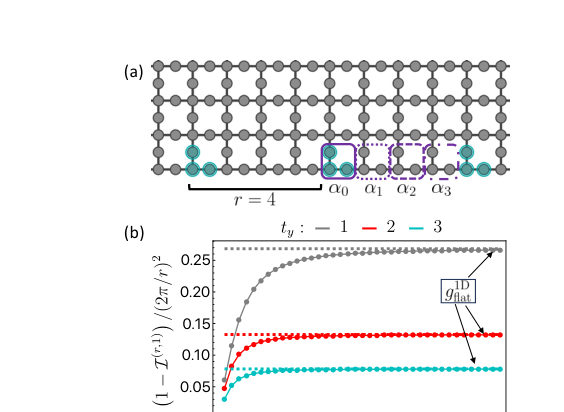
<figcaption class="paper-figure-caption"><b>Fig 3.</b> Figure 4. (a) Embedding setup used to probe the r-partite flat-band imbalance I(r,s) ∞ for a 1D stub lattice embedded into a 2D Lieb lattice: every r-th unit cell of the stub lattice is ini- tially occupied (illustrated for r = 4 with sublattices labeled as α0, α1, α2, α3). (b) The r-partite intrinsic imbalance for s = 1 (15), subtracted from unity and normalized by the squared mo- mentum displacement (2π/r)2, is shown with markers (solid lines serve as visual guides). As a function of r, all curves converge to the flat-band quantum metric g1D flat (dashed lines), showing that the r-partite imbalance directly probes this quan- tity (see (17)).</figcaption>
</figure>
<figure class="paper-figure-card">
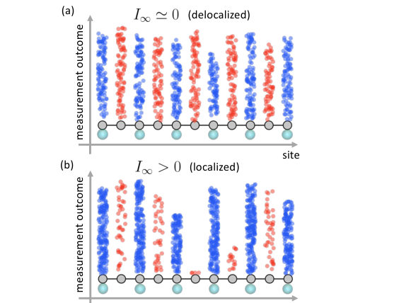
<figcaption class="paper-figure-caption"><b>Fig 4.</b> Figure 5. Behavior of imbalance in the delocalized (top) and lo- calized (bottom) systems, with the blue spheres at the bottom indicating the initial placement of distinguishable particles in the system. The 200 measurement outcomes of the particle density at late times t in the time-evolved state ∣ψ(t)⟩(23) are represented with blue and red circles. (a) In the delocal- ized system (21), at long times, both sublattices are equally occupied on average, reflecting the plane-wave character of the eigenstates of the system and the vanishing of the late-time imbalance (19), indicating the absence of retention of the ini- tial density pattern. (b) The same initial state evolved under the Anderson...</figcaption>
</figure>

**Summary.** The paper introduces a novel experimental protocol using ultracold atoms in optical lattices to probe the quantum geometry of isolated energy bands. By coupling a 1D flat-band system to a 2D bath via a quench, the authors show that the long-time decay of local particle occupations directly measures the integrated quantum distance between the flat-band states. This establishes a direct, measurable link between quantum geometry and the memory of initial spatial patterns.

**Why it may be interesting.** This work directly connects measurable, local observables (site occupations) in ultracold atom setups to fundamental, hard-to-measure quantities like quantum geometry, providing a powerful diagnostic tool for AMO physics.

Detailed structure

**Main problem.** The primary challenge is experimentally accessing the quantum geometry of individual energy bands, especially in systems where conventional probes fail, such as flat-band regimes.

**Main result.** The late-time occupation pattern in a quench protocol directly encodes the integrated overlaps between flat-band states, providing a measurable proxy for the integrated flat-band quantum metric.

**Method.** The authors propose an on-site quench protocol where a 1D flat-band lattice is coupled to a 2D flat-band bath, using local occupation measurements to filter out dispersive excitations.

**Model / system.** The system involves coupling a 1D flat-band lattice to a 2D flat-band bath, modeled using Lieb lattices or square lattices. The dynamics are simulated by time evolution under a modified Hamiltonian that selectively removes dispersive excitations.

**Key observables.** Bipartite density imbalance ($I_{1D}(t)$) and the generalized $r$-partite imbalance ($I(r,s)$), which encode integrated quantum distances.

**Important parameters / regimes.** The quench protocol parameters, the momentum transfer $\delta k$, and the ratio of coupling strengths (e.g., $t'_y \ll t_y$) are crucial for controlling the measurement.

**Assumptions / limitations.** The method assumes that the late-time occupation pattern retains memory of the initial spatial pattern, allowing the extraction of quantum geometric information.

**Figures summary.** Figure 1 illustrates the setup using local population in a 2D Lieb lattice and the resulting stationary density pattern. Figure 2 details the spectral filtering mechanism and the evolution in the 1D stub coupled to the 2D bath.

**Paper structure.** The paper introduces the problem of measuring band geometry, proposes the quench protocol using 1D-to-2D coupling, derives the relationship between the late-time imbalance and quantum overlaps, and discusses generalizations to $r$-partite measures.

Abstract

Quantum geometry underlies a wide range of correlated phenomena in electronic systems, yet accessing the geometry of individual bands remains experimentally challenging. Advances in quantum simulators, such as ultracold atoms in optical lattices, have enabled local state preparation and site-resolved measurements, offering direct access to quantum dynamics beyond conventional transport probes. These developments naturally raise the question of whether band-resolved quantum geometry can be extracted from local occupation readouts. Here, we propose an on-site quench protocol to probe the flat-band quantum geometry via local occupation measurements in an atomic lattice. Our scheme dynamically isolates the flat-band sector by coupling a one-dimensional flat-band lattice to a two-dimensional flat-band bath. The bath selectively removes dispersive excitations, while compact localized states remain trapped due to their overlap with the flat-band modes of the bath. We show that the late-time occupation pattern directly encodes the integrated overlaps between flat-band states separated by the wavevector of the initial density pattern, thereby enabling access to integrated quantum distances between the states separated by the commensurate momenta $δk = 2 πs/r$, $s,r \in \mathbb Z$ and to the integrated flat-band quantum metric. Our results thereby establish a direct connection between quantum geometry and the long-time memory of an initial spatial pattern in flat-band systems.

[↑ back to top](#top)

### [Finite Quantum Engineering Thermodynamics](http://arxiv.org/abs/2610.13511v1)

**Authors:** Borhan Ahmadi  
**Type:** theory · **Category:** statistical mechanics · **PDF:** <https://arxiv.org/pdf/2610.13511v1>  
**Analysis basis:** full PDF text, analyzed in chunks
**Topic relevance:** 🔥 `quantum measurements` **4/5** · `analog quantum simulation` **3/5** · `Full counting statistics` **2/5** · `methods for driven-dissipative` **2/5** · `Keldysh / 2PI / non-Gaussian methods` **1/5** · `correlated / nonlocal dissipation` **1/5** · `driven-dissipative phase transition` **1/5** · `non-equilibrium universality` **1/5**

↔ Scroll figures horizontally

<figure class="paper-figure-card">
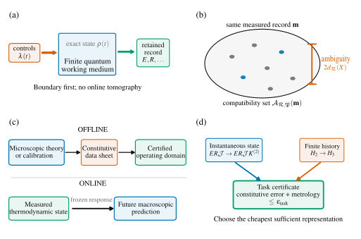
<figcaption class="paper-figure-caption"><b>Fig 1.</b> FIG. 1. Finite quantum engineering thermodynam- ics. (a) The working medium, its boundary, and the con- trols are fixed before selecting what to measure. The mi- croscopic state is ρ(t), but routine operation retains only a small record. (b) Distinct microscopic states can give the same record. Their possible differences in a requested output define the unresolved prediction ambiguity. (c) Detailed dy- namics is used offline to fit and test a constitutive response; online prediction then combines this fixed response with the measured record, without tomography. (d) Missing motion can be probed through present currents and derivatives or through earlier records. The choice balances...</figcaption>
</figure>
<figure class="paper-figure-card">
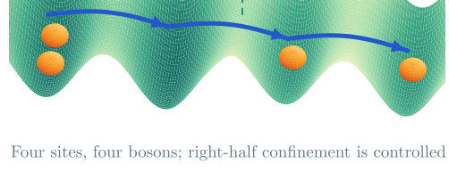
<figcaption class="paper-figure-caption"><b>Fig 2.</b> FIG. 2. Four-site Bose–Hubbard working medium. Four bosons occupy four lattice sites, with nearest-neighbor hopping J (blue arrows) and on-site interaction U. The con- trolled energy offset Λ(t) couples to the right-half particle number NR. The measured record R(t) gives the probabili- ties of finding different numbers of bosons in that half.</figcaption>
</figure>
<figure class="paper-figure-card">
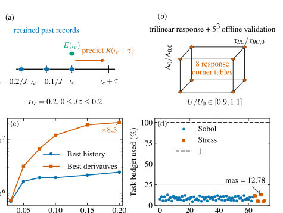
<figcaption class="paper-figure-caption"><b>Fig 3.</b> FIG. 3. A quantum constitutive data sheet for the Bose–Hubbard working medium. (a) At the decision time, the online state uses present energy and the spatial record together with two ensemble records stored from earlier times to predict future right-half occupations. (b) Only eight corner tables are calibrated across the ±10% parameter box. A separate 53 lattice tests sensitivity between corners; it does not increase the online measurement state. (c) At the nom- inal point, finite history needs fewer repeated preparations than the best direct-derivative state. Its advantage grows to approximately 8.5-fold at Jτ = 0.20, showing that more di- rect dynamical information is not always cheaper...</figcaption>
</figure>
<figure class="paper-figure-card">
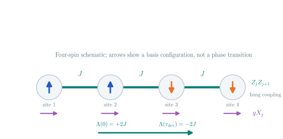
<figcaption class="paper-figure-caption"><b>Fig 4.</b> FIG. 4. Driven transverse-field Ising chain. Four spins interact through nearest-neighbor coupling J and evolve un- der a transverse field g. The longitudinal control Λ(t) couples to the total number of up spins N↑. The measured record R(t) gives the probabilities of different up-spin counts. The arrows illustrate a possible spin configuration.</figcaption>
</figure>
<figure class="paper-figure-card">
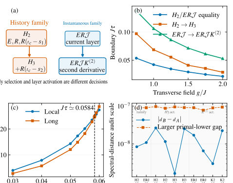
<figcaption class="paper-figure-caption"><b>Fig 5.</b> FIG. 5. Choosing the measured state in the driven Ising chain. (a) Two nested choices are compared: one or two earlier records, and direct current observables with or without the second derivative. Adding a layer is distinct from choosing the cheaper family. (b) As the forecast hori- zon grows, the repetition-cost crossover comes first, followed by activation of the second history node and then the direct curvature layer, at every tested transverse field. These are representation boundaries, not microscopic phase transitions. (c) Within the two-lag history family, a nearby and a longer- memory architecture exchange order near Jτ ≃0.0584. This residual-first diagnostic is not one of the...</figcaption>
</figure>

**Summary.** This paper introduces a task-aware thermodynamic framework for finite quantum systems, determining the minimal set of measurements needed to predict future behavior without knowing the full quantum state. It uses operator geometry and compares different state representations (like history vs. instantaneous) to quantify the trade-off between prediction accuracy and experimental measurement cost. The result is a rigorous method for creating reusable, qualified descriptions of quantum processes.

**Why it may be interesting.** This work provides a powerful, quantitative methodology for characterizing the minimal information required to predict complex quantum dynamics, which is crucial for designing realistic quantum engines and quantum control protocols.

Detailed structure

**Main problem.** To develop a rigorous thermodynamic framework for finite quantum systems that predicts macroscopic behavior without requiring knowledge of the full microscopic state, while explicitly accounting for measurement costs.

**Main result.** The required description is not universal; it must be an 'experimentally economical description' tailored to the specific prediction task, balancing constitutive approximation accuracy against measurement feasibility.

**Method.** The authors develop a task-based method using operator geometry to separate exact energy accounting from calibrated macroscopic prediction, comparing direct measurements against historical records.

**Model / system.** The framework is tested on finite quantum working media, specifically the Bose-Hubbard model and the driven Ising chain, which serve as testbeds for the general thermodynamic formalism.

**Key observables.** Measured records (e.g., probabilities $p_r(t)$), unresolved state ambiguity ($d_R(X)$), and the total measurement cost (number of required shots).

**Important parameters / regimes.** The task definition $\Theta_{	ext{eng}}$ dictates the required state description; key regimes involve comparing instantaneous vs. history-based reconstruction.

**Assumptions / limitations.** The framework does not replace classical entropy-based admissibility conditions, and the final results are presented as 'engineering optima' rather than universal theorems.

**Figures summary.** Figures illustrate the process of using detailed dynamics offline to fit constitutive responses for online prediction, and tables compare resource costs (shot counts) for different state representations (history vs. instantaneous).

**Paper structure.** The paper progresses from defining the general task-based thermodynamic problem, to applying it to the Bose-Hubbard model to quantify ambiguity, and finally comparing the resource efficiency of history-based versus instantaneous state reconstructions using the Ising model.

Abstract

A useful thermodynamic model predicts what a device will do without tracking its full microscopic state. For a finite quantum working medium, the difficult question is which quantities should actually be measured. We develop a task-based method that keeps exact energy accounting separate from calibrated macroscopic prediction. Operator geometry identifies what a measured record determines and bounds what remains uncertain. We then compare direct measurements of dynamical observables with earlier measurements of the same coarse record, selecting the representation together with its measurement cost. A Bose--Hubbard example yields a compact response table tested over a continuous operating region and on unseen microscopic trajectories. A driven Ising chain shows why history is not always the cheaper choice. The result is a way to turn detailed quantum dynamics into a small, reusable, and explicitly qualified thermodynamic description.

[↑ back to top](#top)

### [Ultrafast laser-stimulated field emission from a metal: a non-equilibrium Green's functions approach](http://arxiv.org/abs/2610.13251v1)

**Authors:** Luciano Jacopo D'Onofrio, Adolfo Avella, Martin Eckstein  
**Type:** theory · **Category:** strongly correlated electrons · **PDF:** <https://arxiv.org/pdf/2610.13251v1>  
**Analysis basis:** full PDF text, analyzed in chunks
**Topic relevance:** 🔥 `Keldysh / 2PI / non-Gaussian methods` **4/5** · `methods for driven-dissipative` **3/5** · `quantum measurements` **3/5** · `analog quantum simulation` **1/5** · `correlated / nonlocal dissipation` **1/5** · `driven-dissipative phase transition` **1/5** · `non-equilibrium universality` **1/5**

↔ Scroll figures horizontally

<figure class="paper-figure-card">
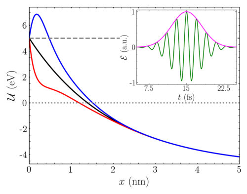
<figcaption class="paper-figure-caption"><b>Fig 1.</b> FIG. 1. Vacuum barrier profile near the matter-vacuum in- terface at three different instants of time: equilibrium (t = 0, black), field maximum (t = tcen, red), and field minimum (t = tcen + Tper/2, blue). The following parameters are used: Vpot = 10 V, F = 5 V/nm, E0 = 2 V/nm, γ0 = 15, λnf = 0.25 nm, λg = 1 nm, tcen = 15 fs, τp = 7 fs, and Tper = 2 fs. The Fermi level (µ = 0 eV) and work func- tion (ϕ = 5 eV) are denoted with dotted and dashed gray lines, respectively. The inset shows the normalized temporal evolution of the pulse electric field (green) modulated by a Gaussian envelope (magenta), both in arbitrary units.</figcaption>
</figure>
<figure class="paper-figure-card">
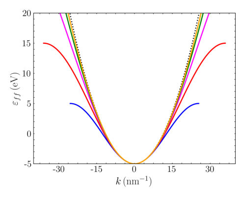
<figcaption class="paper-figure-caption"><b>Fig 2.</b> FIG. 2. Comparison of the far-field free-electron parabola (dotted black line) with tight-binding energy dispersions ob- tained for tv = 2.5 eV (blue), tv = 5.0 eV (red), tv = 10 eV (magenta), tv = 20 eV (green), and tv = 40 eV (yellow). The discrepancy between the parabolic and tight-binding dis- persions worsens at higher momenta and decreases as tv in- creases.</figcaption>
</figure>
<figure class="paper-figure-card">
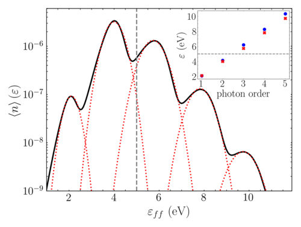
<figcaption class="paper-figure-caption"><b>Fig 3.</b> FIG. 4. Time-integrated far-field electron energy distribution (black solid line), fitted with Gaussian functions (red dotted lines) centered at the arising peaks. In the inset, the peak en- ergy positions obtained from the Gaussian fitting procedure (red crosses) are compared with integer multiples of the pho- ton energy (blue circles), corresponding to different photon orders. In both panels, the work function (ϕ = 5 eV) is indi- cated by a dashed gray line.</figcaption>
</figure>
<figure class="paper-figure-card">
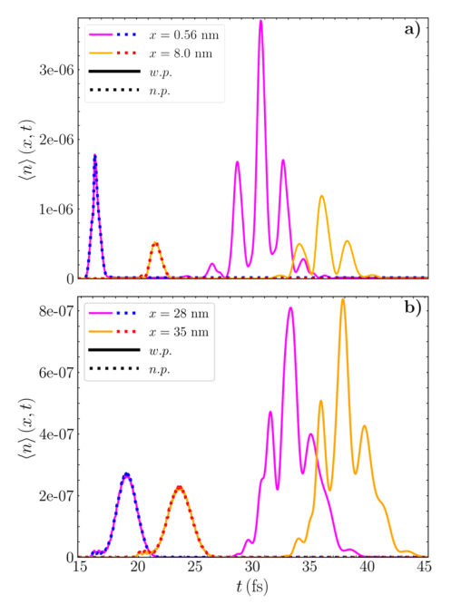
<figcaption class="paper-figure-caption"><b>Fig 4.</b> FIG. 3. Time evolution of electronic populations close to the matter-vacuum interface (a) and in the far-field region (b), shown both with (solid lines) and without (dotted lines) the laser pulse. Specifically, with the vacuum lattice constant set to b = 0.062 nm, the following distances from the interface are considered: x = 0.56 nm (blue and magenta) and x = 8.0 nm (red and orange) in (a); x = ¯x = 28 nm (blue and magenta) and x = 35 nm (red and orange) in (b). In both cases, the artificial electronic bunches in the with- and without-pulse curves overlap in time and are therefore removed via the sub- traction ⟨n⟩(x, t) = ⟨n⟩w.p. (x, t) −⟨n⟩n.p. (x, t).</figcaption>
</figure>
<figure class="paper-figure-card">
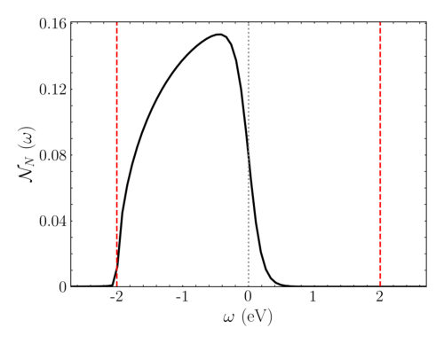
<figcaption class="paper-figure-caption"><b>Fig 5.</b> FIG. 5. Density of occupied states on the last matter site (NN) plotted vs. energy in the uncorrelated case. The vertical dashed red lines mark the boundaries of the matter-energy dispersion (−2 eV and 2 eV) when U = 0, while the dotted gray one coincides with the Fermi level.</figcaption>
</figure>

**Summary.** This work proposes a theoretical framework using non-equilibrium Green's functions to model electron emission from a metal tip driven by intense laser pulses. By incorporating electron-electron interactions, the authors show that correlation effects significantly modify the emitted electron spectrum. This provides a versatile tool for analyzing field emission in strongly correlated quantum systems.

**Why it may be interesting.** The combination of ultrafast non-equilibrium dynamics with strong correlation effects (Hubbard-like interactions) in a mesoscopic geometry is highly relevant for understanding energy transfer and emission in advanced quantum devices.

Detailed structure

**Main problem.** The paper addresses the theoretical challenge of simulating ultrafast laser-stimulated field emission from a metal while accurately incorporating many-body strong correlation effects, which are often neglected in existing models.

**Main result.** The non-equilibrium Green's function approach successfully describes the out-of-equilibrium electron dynamics, revealing that correlation effects modify the electronic structure and are transferred to the far-field spectrum, leading to a dynamic back-action regime.

**Method.** The study employs the non-equilibrium Green's function (NEGF) formalism, extending it to include electron-electron interactions via the second-Born approximation.

**Model / system.** The system is a metallic nanotip modeled in one dimension, coupled to a vacuum region and driven by an intense ultrafast laser pulse. The Hamiltonian is decomposed into tip, vacuum, and coupling terms.

**Key observables.** Far-field energy distribution of emitted electrons, local density of occupied states, and the dynamic polarization of the emitter.

**Important parameters / regimes.** Ultrafast laser pulse parameters, applied potential bias ($V_{pot}$), and the strength of electron-electron interactions.

**Assumptions / limitations.** The model uses a one-dimensional treatment along the normal direction and treats the tip-vacuum coupling perturbatively in some analyses.

**Figures summary.** Not specified.

**Paper structure.** The paper develops the NEGF framework for out-of-equilibrium dynamics, details the inclusion of correlation effects via the second-Born approximation, and culminates in solving the Dyson equation to characterize the dynamic back-action regime.

Abstract

Ultrafast laser-assisted field emission from metallic nanotips is a promising route for generating coherent electron pulses. However, existing theoretical models often neglect many-body strong correlation effects in the emitter's electronic structure and its response to the optical field. In this work, we propose a theoretical framework based on the non-equilibrium Green's function formalism to simulate the out-of-equilibrium electron dynamics across a strongly driven matter-vacuum interface, in a one-dimensional model. Treating the tip-vacuum coupling perturbatively, we find that the interplay between strong-field emission and multi-photon emission regimes can be described in terms of a filtering of the emitter's local density of occupied states through field-dressed vacuum propagators. By including electron-electron interactions via the second-Born approximation, we show that correlation-induced modifications in the electronic structure are directly transferred to the far-field spectrum. Finally, by self-consistently solving the Dyson equation at the interface, we uncover a dynamic back-action regime driven by the optical field, characterized by a periodic polarization of the emitter, which reshapes the far-field spectrum. This shows that the non-equilibrium Green's functions approach provides a versatile framework for exploring and analyzing field emission of correlated electrons.

[↑ back to top](#top)

### [A Warped Born Rule Turns an Observer into a Maxwell's Demon](http://arxiv.org/abs/2610.13936v1)

**Authors:** Olumakinde Ogunnaike  
**Type:** theory · **Category:** statistical mechanics · **PDF:** <https://arxiv.org/pdf/2610.13936v1>  
**Analysis basis:** full PDF text, analyzed in chunks
**Topic relevance:** 🔥 `quantum measurements` **4/5** · `methods for driven-dissipative` **3/5** · `non-equilibrium universality` **3/5** · `analog quantum simulation` **1/5** · `correlated / nonlocal dissipation` **1/5** · `driven-dissipative phase transition` **1/5**

↔ Scroll figures horizontally

<figure class="paper-figure-card">
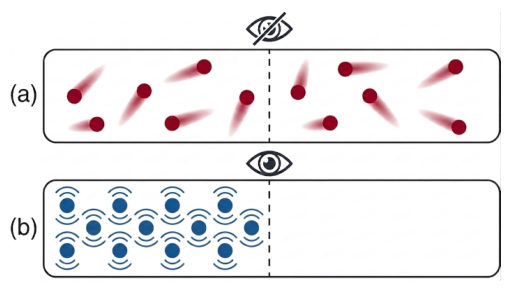
<figcaption class="paper-figure-caption"><b>Fig 1.</b> FIG. 1. A many-body Maxwell’s demon. (a) Ordinary dif- fusion explores a uniform gas. (b) Reweighting occupation- measurement histories can collect the particles into dense, nearly frozen regions for warped rules with b &gt; 1.</figcaption>
</figure>
<figure class="paper-figure-card">
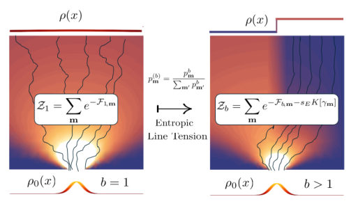
<figcaption class="paper-figure-caption"><b>Fig 2.</b> FIG. 2. Regular diffusion and entropic selection of particle his- tories. Left: at b = 1, a localized distribution spreads toward a uniform gas. Right: for b &gt; 1, globally weighted histories fa- vor fewer uncertain readouts and can select a phase-separated gas. The inset schematically sums over measurement records m, each with reference cost Fb,m and a collection of particle paths γm. The total activity K[γm] = P</figcaption>
</figure>
<figure class="paper-figure-card">
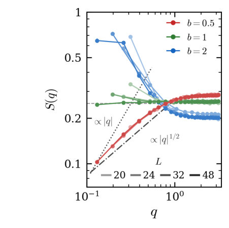
<figcaption class="paper-figure-caption"><b>Fig 3.</b> FIG. 3. Numerical signatures of the entropic bias in sequential pure-state histories on open, half-filled chains, L = 20–48. The full structure factor is enhanced at small q for b = 2 (blue), nearly flat for b = 1 (green), and suppressed for b = 0.5 (red). Spectra average the latter half of each run. Power laws are guides, not fitted asymptotic exponents. Methods and definitions are in Appendix G.</figcaption>
</figure>
<figure class="paper-figure-card">
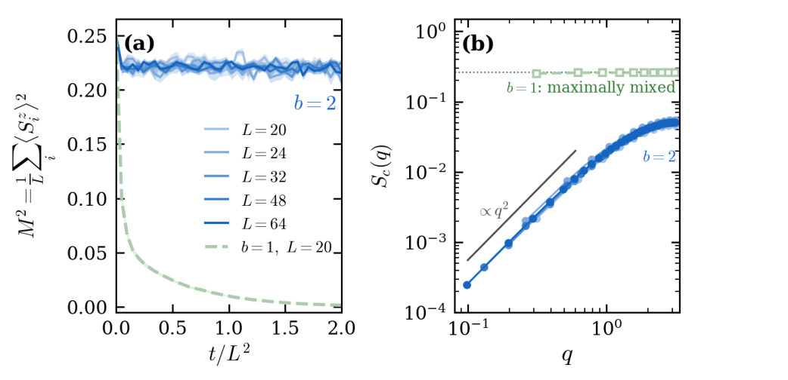
<figcaption class="paper-figure-caption"><b>Fig 4.</b> FIG. 4. Complementary signatures in the history-averaged density-matrix ensemble with Haar-random number-conserving gates. (a) M 2 = L−1 P</figcaption>
</figure>
<figure class="paper-figure-card">
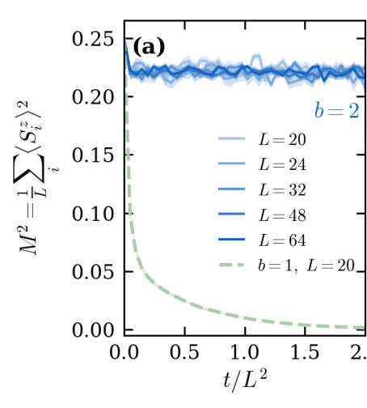
<figcaption class="paper-figure-caption"><b>Fig 5.</b> Figure 3 instead draws each outcome from its own con- ditional pure state, implementing P seq b in Eq. (4). Its structure factor retains both the conditional density pro- files and their quantum fluctuations. Here fU = 0.6. The unlike-pair block is</figcaption>
</figure>

**Summary.** This work explores how modifying the Born rule in quantum measurements introduces a systematic bias into the system's evolution. This bias causes the quantum gas to either cluster into dense, frozen states ($b>1$) or become highly uniform (hyperuniform, $b<1$). The findings suggest that the act of observation itself can act as an engine for entropy change, analogous to Maxwell's Demon.

**Why it may be interesting.** It provides a deep, non-trivial link between the fundamental postulates of quantum measurement (the Born rule) and macroscopic thermodynamic behavior (entropy extraction and phase ordering), which is highly relevant to non-equilibrium statistical mechanics.

Detailed structure

**Main problem.** The paper investigates the many-body consequences of replacing the standard Born rule in quantum measurements with a warped rule, $p_b(m) \propto \lVert P_m|\psi
angle
Vert^{2b}$. This modification introduces a probabilistic bias over measurement histories.

**Main result.** The bias dictates the system's long-term state: $b>1$ drives the gas toward clustering (entropy extraction, like Maxwell's demon), while $b<1$ suppresses long-wavelength fluctuations, leading to a hyperuniform gas.

**Method.** The analysis uses information theory, comparing the warped rule to the standard Born rule, and employs numerical simulations like Matrix Product States (MPS) to study the resulting phase selection in 1D quantum gases.

**Model / system.** The study models a diffusing quantum gas with conserved particle number, analyzed in 1D. The dynamics are related to an activity-biased Symmetric Exclusion Process (SEP) when considering the continuous-time limit.

**Key observables.** Structure factors $S(q)$, local polarization $M_2(t)$, and the bias parameter $b$.

**Important parameters / regimes.** The bias parameter $b$, which controls the sign of the entropic bias ($b-1$). Regimes include $b>1$ (clustering) and $b<1$ (hyperuniformity).

**Assumptions / limitations.** The analysis distinguishes between global and sequential normalization procedures, and the connection to solvable classical models (SEP) is used to guide the understanding of the quantum bias.

**Figures summary.** Figures illustrate the physical effect of the bias, showing particle collection for $b>1$ and suppression of fluctuations for $b<1$ via structure factor comparisons.

**Paper structure.** The paper develops the mathematical framework by introducing the warped rule, deriving the resulting bias, and then applying this framework to a 1D quantum gas model, comparing results across different ensemble averaging methods.

Abstract

Quantum mechanics seems to be an incredibly delicate theory. Slight alterations to nearly any part of its structure can lead to huge qualitative differences and wildly unphysical predictions. Here, we explore the many-body consequences of replacing the Born rule $p(m)\propto\|P_m|ψ\rangle|^2$ by a warped rule $p_b(m)\propto\|P_m|ψ\rangle\|^{2b}$. Specifically, in systems with conserved particle number, evolution punctuated by repeated local particle observations acquires a probabilistic bias over measurement histories with an effect controlled by the sign of $b-1$. For $b>1$, this bias generically drives the gas to collect into nearly frozen configurations. Similar to the action of Maxwell's demon, the simple act of observation seems to extract entropy from a closed system. For $b<1$, the bias is reversed, generically scouring out long-wavelength fluctuations to produce a hyperuniform gas. We study this effect in a one-dimensional quantum gas, where these two phases are derived analytically for a particular measurement scheme and corroborated numerically for more general procedures with discrete-time projective-measurement circuit models using matrix product state simulations. We additionally discuss how this bias manifests in a common technique that often employs this warped rule, the ``replica trick,'' implying qualitative differences between finite-replica and replica-limit calculations.

[↑ back to top](#top)

### [Correlated Pair Creation with Positive- and Negative-Frequency Oscillators in a Trapped-Ion Quantum Simulator](http://arxiv.org/abs/2610.12579v1)

**Authors:** Visal So, Mingjian Zhu, Han Pu, Guido Pagano  
**Type:** theory · **Category:** other · **PDF:** <https://arxiv.org/pdf/2610.12579v1>  
**Analysis basis:** full PDF text, analyzed in chunks
**Topic relevance:** 🔥 `analog quantum simulation` **4/5** · `driven-dissipative phase transition` **2/5** · `non-equilibrium universality` **2/5** · `Keldysh / 2PI / non-Gaussian methods` **1/5** · `QC/QI experiment` **1/5** · `Tavis-Cummings & cavity-many-emitter` **1/5** · `methods for driven-dissipative` **1/5** · `quantum optics experiment` **1/5**

↔ Scroll figures horizontally

<figure class="paper-figure-card">
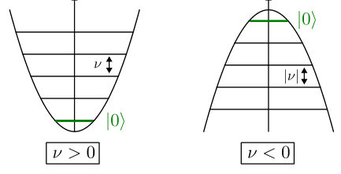
<figcaption class="paper-figure-caption"><b>Fig 1.</b> FIG. 1. Engineering the sign of an effective mode frequency. (a) The two frequency components of the bichromatic laser field [colored vertical bars] are placed symmetrically about the shifted carrier ωq −ω0 at a distance ωm + δ. For δ &lt; 0, the tones lie between the carrier and the motional sidebands and realize an ordinary oscillator with ν = −δ &gt; 0. For δ &gt; 0, they lie outside the sidebands and realize a negative-frequency oscillator with ν = −δ &lt; 0. (b) Corresponding energy ladders in the rotating frame. For ν &lt; 0, the ladder is inverted, and the phonon vacuum |0⟩lies at the top of the effective energy spectrum. We emphasize that the parabolic curves depict rotating-frame energies rather...</figcaption>
</figure>
<figure class="paper-figure-card">
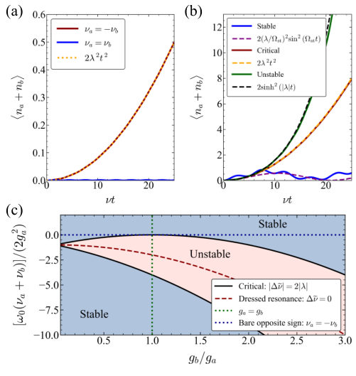
<figcaption class="paper-figure-caption"><b>Fig 2.</b> FIG. 2. Bosonic pair dynamics and dynamical instability in the two-mode quantum Rabi model in the Schrieffer-Wolff frame. (a) Comparison between the all-positive-frequency case, νb = ν (blue), and the opposite-sign case, νb = −ν (red), for ga = gb = ν. The opposite-sign case has λ = 0.02ν and ∆eν = 0.04ν = 2|λ|, placing it at the critical boundary. (b) Stable, critical, and dynamically unstable regimes at fixed pair coupling λ = 0.08ν. The stable case (blue) has ga = ν, gb = 4ν, νb = −ν, and ∆eν = 0.34ν. The critical case (red) has ga = gb = 2ν, νb = −ν, and ∆eν = 0.16ν = 2|λ|. The unstable case (green) has ga = gb = 2ν, νb = −1.16ν, and ∆eν = 0. In panels (a) and (b), the system is...</figcaption>
</figure>
<figure class="paper-figure-card">
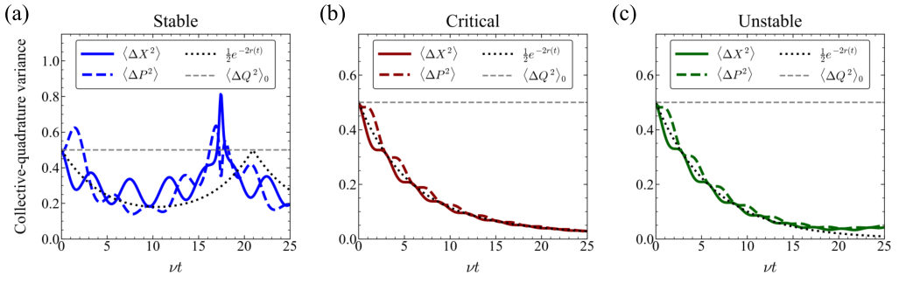
<figcaption class="paper-figure-caption"><b>Fig 3.</b> FIG. 3. Collective-quadrature squeezing in the stable, critical, and dynamically unstable regimes. The initial state and parameter sets are the same as in Fig. 2(b). Solid and dashed colored curves show the variances ⟨∆X2⟩and ⟨∆P 2⟩, respectively, for the full quantum Rabi model in the Schrieffer-Wolff frame, while black dotted curves show the dispersive rotating-wave prediction. The local quadrature phases satisfy ϕa + ϕb = arg[⟨a(t)b(t)⟩] + π, following the instantaneous squeezed axes (see Appendix F). The gray horizontal dashed line denotes the two-mode-vacuum variance, ⟨ψ0|∆X2|ψ0⟩= ⟨ψ0|∆P 2|ψ0⟩= 1/2 ≡ ⟨∆Q2⟩0, and values below this level indicate squeezing. Panels (a)–(c) correspond to...</figcaption>
</figure>
<figure class="paper-figure-card">
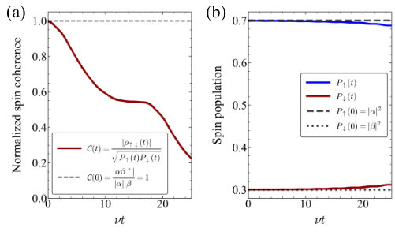
<figcaption class="paper-figure-caption"><b>Fig 4.</b> FIG. 4. Spin coherence and populations of the opposite-sign two-mode quantum Rabi model. The system is initialized in (α |↑⟩+ β |↓⟩) ⊗|0a, 0b⟩with |α|2 = 0.70 and |β|2 = 0.30. The parameters are ω0 = 100ν, νa = ν, νb = −1.16ν, and ga = gb = 2ν, corresponding to the dispersive pair coupling λ = 2gagb/ω0 = 0.08ν. (a) Population-normalized spin coherence, C(t) = |ρ↑↓(t)|/ p</figcaption>
</figure>
<figure class="paper-figure-card">
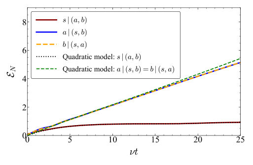
<figcaption class="paper-figure-caption"><b>Fig 5.</b> FIG. 5. Spin-boson and tripartite entanglement generated by the full two-mode quantum Rabi dynamics. Logarithmic negativities are evaluated across the three bipartitions s|(a, b), a|(s, b), and b|(s, a). The parameters and initial state are the same as in Fig. 4. Analytical predictions from the quadratic dispersive model (see Appendix I) are shown for comparison; within this model, Ea|(s,b) N = Eb|(s,a) N .</figcaption>
</figure>

**Summary.** This paper demonstrates how trapped-ion quantum simulators can be used to engineer complex bosonic dynamics by controlling the relative signs of effective motional frequencies. By switching these signs, the system's interaction changes from simple energy exchange to correlated pair creation, enabling the generation of highly entangled, non-Gaussian bosonic states.

**Why it may be interesting.** This work provides a concrete, programmable method using trapped ions to engineer non-equilibrium quantum dynamics, moving beyond simple resonance to exploit frequency sign control for advanced quantum state preparation.

Detailed structure

**Main problem.** The paper addresses how engineering the relative signs of effective bosonic frequencies can fundamentally change the dynamics in spin-boson systems, transitioning the interaction from simple excitation exchange to correlated pair creation.

**Main result.** By controlling the sign of the effective frequencies, the system realizes a two-mode parametric amplifier exhibiting distinct oscillatory, critical, and exponentially amplifying regimes, leading to the generation of multi-partite entanglement.

**Method.** The analysis relies on deriving effective Hamiltonians using the Schrieffer-Wolff transformation and analyzing the resulting dynamics in the dispersive regime.

**Model / system.** The system is a trapped-ion quantum simulator modeled by a spin-boson Hamiltonian coupled to multiple bosonic motional modes. The control mechanism involves using bichromatic laser fields to program the effective frequencies ($
u$) to have opposite signs.

**Key observables.** Collective-quadrature squeezing, bipartite and tripartite spin-boson entanglement (measured via logarithmic negativity), and the Duan-Simon separability bound violation.

**Important parameters / regimes.** The relative signs of the effective bosonic frequencies ($
u_a$ and $
u_b$), the detuning ($\delta$), and the system's operating regime (dispersive, critical, unstable).

**Assumptions / limitations.** The analysis assumes the Lamb-Dicke regime and operates within the dispersive regime, allowing for perturbative expansions in the coupling strengths.

**Figures summary.** Figures illustrate the engineering of frequency signs using laser tones and show comparisons of bosonic populations and quadrature variances across different dynamic regimes (stable, critical, unstable).

**Paper structure.** The paper progresses from establishing the frequency control mechanism (sign switching) to deriving the effective two-mode Hamiltonian, analyzing the resulting squeezing and entanglement in different dynamic regimes, and finally detailing the generation of non-Gaussian entangled states via spin postselection.

Abstract

Spin-dependent forces enable independent control over the effective frequencies of bosonic motional modes and their coupling strengths to spins in trapped-ion spin-boson quantum simulators. We show that the relative signs of these effective frequencies provide an important programmable resource for engineering distinct multimode dynamics. Focusing on a two-mode quantum Rabi model, changing the frequencies of the two modes from the same sign to opposite signs reorganizes the resonance structure of the spin-mediated bosonic interaction, converting the dominant resonant process from excitation exchange to correlated pair creation. In the dispersive regime, the resulting effective interaction realizes a two-mode parametric amplifier with stable oscillatory, critical, and exponentially amplifying regimes separated by a spin-dependent instability threshold. Across these regimes, the dynamics generate collective-quadrature squeezing and bipartite motional entanglement. Preparing the spin in a coherent superposition further allows different spin components to experience distinct stability regimes, generating tripartite spin-boson entanglement, while spin postselection can coherently combine the conditional bosonic branches to generate non-Gaussian entangled bosonic states. Finally, we outline an implementation using parameters within reach of current trapped-ion platforms.

[↑ back to top](#top)

### [Operational signatures of exceptional quantum channels](http://arxiv.org/abs/2610.13622v1)

**Authors:** Paulo A. Brandão  
**Type:** theory · **Category:** other · **PDF:** <https://arxiv.org/pdf/2610.13622v1>  
**Analysis basis:** full PDF text, analyzed in chunks
**Topic relevance:** 🔥 `quantum measurements` **4/5** · `driven-dissipative phase transition` **3/5** · `methods for driven-dissipative` **3/5** · `Full counting statistics` **1/5** · `correlated / nonlocal dissipation` **1/5** · `non-equilibrium universality` **1/5**

↔ Scroll figures horizontally

<figure class="paper-figure-card">

<figcaption class="paper-figure-caption"><b>Fig 1.</b> FIG. 1. Probability p+(n) of obtaining the outcome + after n successive applications of the exceptional channel ΦEP, for λ = 0.8 and the initial state ρ0 = 1</figcaption>
</figure>
<figure class="paper-figure-card">

<figcaption class="paper-figure-caption"><b>Fig 2.</b> Figure 1 shows how the visibility of the exceptional point depends on the observable, even though the channel and the initial state are kept fixed. For the direction</figcaption>
</figure>

**Summary.** This paper introduces an operational theory for exceptional points (EPs) by analyzing the repeated application of quantum channels ($\Phi^n$) rather than relying on Hamiltonians. It shows that the characteristic signature of an EP—a polynomial-exponential term—is not inherent to the dynamics but depends on the specific measurement observable used. This provides a direct, experimentally accessible diagnostic tool for identifying EPs in open quantum systems.

**Why it may be interesting.** This work provides a powerful, measurement-centric framework to detect EPs in open quantum systems, moving the concept from purely Hamiltonian/Liouvillian analysis to directly measurable quantities.

Detailed structure

**Main problem.** To develop an operational theory for exceptional points (EPs) that bypasses the need for a Hamiltonian or a master equation.

**Main result.** The operational signature of an EP is revealed through discrete polynomial-exponential terms in the measurement probabilities, which depend critically on the specific measurement observable used.

**Method.** The analysis uses the repeated application of a completely positive trace-preserving (CPTP) quantum channel ($\Phi^n$) and relates the resulting probabilities to the Jordan chain structure of the channel superoperator.

**Model / system.** The general system is described by a CPTP quantum channel ($\Phi$), which governs the evolution of the density matrix. A specific example uses a qubit model in a 2D Hilbert space analyzed via Pauli operators.

**Key observables.** The probability $p_A^n(x|
ho) = 	ext{tr}[A(x)\Phi^n(
ho)]$, particularly the transient term proportional to $n\lambda^{n-1}$.

**Important parameters / regimes.** The channel parameters ($	heta, \lambda$) defining the EP, and the measurement observable $A$ (or its corresponding measurement direction $\vec{m}$).

**Assumptions / limitations.** The theory is formulated independently of PT symmetry, Lindblad equations, and continuous-time limits; the observable $A$ is assumed to be a POVM.

**Figures summary.** Figure 1 illustrates the dependence of the measured probability $p_+(n)$ on the measurement direction $\vec{m}$, showing the signature only for a specific direction $\vec{m}_a$.

**Paper structure.** The paper first establishes the general operational framework using CPTP channels and Jordan chains. It then applies this framework to a concrete qubit model, explicitly calculating the time evolution and demonstrating the measurement dependence of the EP signature.

Abstract

Exceptional points (EPs) are usually introduced as defective degeneracies of non-Hermitian Hamiltonians and, in fully open quantum dynamics, of Liouvillian generators. Here we formulate an operational theory of exceptional points that does not invoke a Hamiltonian or a master equation. The primitive dynamical object is a completely positive trace-preserving (CPTP) quantum channel $Φ$, applied an integer number $n$ of times, while physical data are probabilities $p_n^{\mathbf A}(x|ρ)$ associated with states $ρ$ and observables $\mathbf A$ having measurements results $x$. We define exceptional channels through nontrivial Jordan chains of $Φ$ and show that a Jordan block of order $m$ generates discrete polynomial-exponential terms with maximal degree $m-1$. This places the physics of exceptional points in contact with what can be directly measured in experiments.

[↑ back to top](#top)

### [Engineering Ergodicity-Breaking and Stable Emergent Conservation Laws in a Generic Quantum Many-body System Under Strong Periodic Drive](http://arxiv.org/abs/2610.12551v1)

**Authors:** Sagnik Chaudhuri, Anirban Das, Asmi Haldar, Arnab Das  
**Type:** theory · **Category:** statistical mechanics · **PDF:** <https://arxiv.org/pdf/2610.12551v1>  
**Analysis basis:** full PDF text, analyzed in chunks
**Topic relevance:** 🔥 `scars & prethermalization` **4/5** · `analog quantum simulation` **3/5** · `driven-dissipative phase transition` **1/5** · `methods for driven-dissipative` **1/5** · `non-equilibrium universality` **1/5**

↔ Scroll figures horizontally

<figure class="paper-figure-card">

<figcaption class="paper-figure-caption"><b>Fig 1.</b> FIG. 1. Nonuniversal Floquet Thermalization and Freezing Under Strong Driving. Left: for L = 20, the magneti- zation autocorrelation remains near unity for H1, decays nearly to zero for H2, and reaches an intermediate plateau for H3; the inset shows the late-time averaged magnetization autocorrelation Am for L = 14, 16, 18, 20 (the late-time averages have been computed over 1000 uniformly spaced cycle numbers in 108 ≤n ≤1011). Right: starting from a finite-temperature mixed state (β = 0.05), mx retains its initial value for H1, while H2 and H3 relax to their infinite-time diagonal-ensemble averages (dotted lines); the inset shows |DEA(mx) −mx(0)| versus L. The decreasing plateaus of H2, H3...</figcaption>
</figure>
<figure class="paper-figure-card">

<figcaption class="paper-figure-caption"><b>Fig 2.</b> FIG. 2. Restoring Operator Memory by Hamiltonian Engineering: Upper panels: H2; lower panels: H3. Left: static corrections give near-unity memory (triangles), whereas the original models lose memory with increasing L (circles). Right: the combined drive components (red triangles) remove the downward size trend present for incomplete combinations. Amplitudes are indicated; ωa denotes the corresponding model’s frequency. The late-time averages Am are computed over 1000 uniformly spaced cycle numbers in 108 ≤n ≤1011. Real-time dynamics and amplitude scans appear in the Supplemental Material [20].</figcaption>
</figure>
<figure class="paper-figure-card">

<figcaption class="paper-figure-caption"><b>Fig 3.</b> FIG. 3. Quasi-locality of Heff in Spin-flip Ordered Se- ries for the bond-driven Ising model in the strongly driven regime. The main panel shows the Frobenius norm ∥H(ξ) eff∥ of the even-ξ spin-flip sectors for H2 + HC 2 as a function of the Hamming distance ξ, for JD = 30ω1 and system sizes L = 8, 10, 12, 14. For all system sizes, the norm rapidly decays with increasing ξ, and the decay sets in at approximately the same spin-flip distance, indicating a robust quasi-local struc- ture of the effective Hamiltonian. The right inset shows the corresponding spin-flip-resolved norm for H2 without the cor- rection term, where, apart from the diagonal sector ξ = 0, the dominant weight is...</figcaption>
</figure>

**Summary.** This theoretical work develops methods to engineer stable, non-thermalizing quantum phases in periodically driven many-body systems. By identifying a necessary condition—that the effective Hamiltonian's time-independent part must be X-only—the authors propose specific local modifications to the system Hamiltonian or drive. These engineering techniques successfully stabilize dynamical freezing and ensure the effective dynamics remain quasi-local, offering a pathway to control quantum information flow.

**Why it may be interesting.** This work provides a concrete, engineering-based mechanism to control fundamental quantum dynamics (thermalization vs. localization) in periodically driven systems, which is highly relevant for designing quantum simulators or robust quantum memories.

Detailed structure

**Main problem.** The paper addresses the challenge of engineering stable ergodicity-breaking (EB) phases and emergent conservation laws in quantum many-body systems subjected to strong periodic driving.

**Main result.** Local engineering of the system's Hamiltonian or drive operator can stabilize Dynamical Freezing (DF) by enforcing a specific X-only structure on the effective time-independent part of the Hamiltonian, leading to a quasi-local effective Floquet Hamiltonian.

**Method.** The analysis combines Floquet theory, the construction of an effective Hamiltonian ($H_{	ext{eff}}$), and diagnostic tools like long-time autocorrelation functions and the Frobenius norm applied to spin-flip ordered series.

**Model / system.** The study uses generic quantum many-body systems, often modeled by spin chains (e.g., Ising-type models $H_1, H_2, H_3$), subjected to time-periodic driving $H(t)$. The dynamics are analyzed in the rotating frame.

**Key observables.** Normalized long-time-averaged autocorrelation of local operators ($m_x$), and the weight of spin-flip sectors ($\lVert H(\xi)_{	ext{eff}} 
Vert$) of the effective Hamiltonian.

**Important parameters / regimes.** Strong drive amplitude ($AD$), the threshold for ergodicity breaking, and the Hamming distance ($\xi$) used to probe the locality of $H_{	ext{eff}}$.

**Assumptions / limitations.** The core conjecture is that stable EB requires the time-independent part of the rotating frame Hamiltonian ($V_0$) to be composed exclusively of X operators. Quasi-locality is assumed to be sufficient for stable, non-thermalizing dynamics.

**Figures summary.** Figures compare autocorrelation functions showing memory retention (stable EB) versus decay (unstable DF). They also plot the weight of spin-flip sectors ($\lVert H(\xi)_{	ext{eff}} 
Vert$) to demonstrate that engineered protocols suppress large-$\xi$ weight, indicating quasi-locality.

**Paper structure.** The paper establishes the problem of strong driving leading to ergodicity breakdown, introduces the criterion for stable EB ($V_0$ must be X-only), details two engineering routes (time-independent and drive modification), and finally verifies the success of these engineering methods by showing the resulting $H_{	ext{eff}}$ is quasi-local.

Abstract

A periodically driven quantum many-body system is believed to approach a locally infinite-temperature-like state as dictated by the ergodicity hypothesis, when all the couplings/parameters are of the same order. When the drive is stronger than a threshold value, a large class of systems is shown to break this mandate, exhibiting Dynamical Freezing (DF): ergodicity is broken due to the emergence of local operators with permanent memory of their initial values (PRX 11, 021008, 2021). However, an exception to DF has recently been noted in a particular setting (PRX 16, 011041, 2026). Here we identify the condition for ergodicity-breaking in a system under strong drive, and show how to stabilize DF by exact, local engineering. We further show that the Floquet Hamiltonian $H_{eff} = (i/T)\ln{[U(T)]}$ is non-local when ordered by spin-flips, in a non-DF system, while it turns quasi-local under our simple, local DF engineering that keeps the Hamiltonian $H(t)$ still non-integrable at each $t$. This perplexing non-universality is absent in equilibrium, where non-integrability is believed to imply ergodicity and thermalization universally. Our work paves a way to engineering novel ergodicity-broken interacting Floquet phases of matter in various quantum platforms, and also endows DF-assisted quantum error mitigation and state stabilization techniques (see Nature 653, 1027 (2026)) with unprecedented versatility and flexibility.

[↑ back to top](#top)

### [Entropy Production in Mesoscopic Electronic Transport Beyond Weak-Coupling](http://arxiv.org/abs/2610.12652v1)

**Authors:** Ivana R. A. C. Lucena, Caio H. Lewenkopf, Alexandre R. Rocha  
**Type:** theory · **Category:** statistical mechanics · **PDF:** <https://arxiv.org/pdf/2610.12652v1>  
**Analysis basis:** full PDF text, analyzed in chunks
**Topic relevance:** 🔥 `Full counting statistics` **4/5** · `Keldysh / 2PI / non-Gaussian methods` **2/5** · `non-equilibrium universality` **2/5** · `methods for driven-dissipative` **1/5** · `quantum measurements` **1/5**

↔ Scroll figures horizontally

<figure class="paper-figure-card">

<figcaption class="paper-figure-caption"><b>Fig 1.</b> FIG. 1. Schematic representation of a two-terminal meso- scopic conductor connected to left (L) and right (R) electronic reservoirs. The solid green curve illustrates the total energy- dependent transmission T (ε), where µα denotes the chemi- cal potential and Γα the coupling to lead α ∈{L, R}. Thin black lines depict the line-shape profiles of individual reso- nant levels with average level spacing ∆. (a) Weak-coupling regime (Γ ≪∆), characterized by well-isolated single-level resonances. (b) Strong-coupling regime (Γ ≳∆), featuring strongly overlapping resonances with coherent level broaden- ing.</figcaption>
</figure>
<figure class="paper-figure-card">

<figcaption class="paper-figure-caption"><b>Fig 2.</b> FIG. 2. Probability distributions P∆t(N) of the net trans- ferred particle number in the weak-coupling regime, with ΓL = ΓR = 0.00125 eV (Γ = 0.0025 eV). Panels (a,b) cor- respond to a chemical potential difference ∆µ = 0.8 eV and panels (c,d) correspond to ∆µ = 2.0 eV. The left column [(a,c)] shows results for kBT = 0.25 eV, while the right column [(b,d)] corresponds to kBT = 0.025 eV. Different curves corre- spond to increasing dimensionless observation times Γ∆t/ℏ. The vertical dotted line marks N = 0, separating forward (N &gt; 0) from backward (N &lt; 0) particle transfer events.</figcaption>
</figure>
<figure class="paper-figure-card">

<figcaption class="paper-figure-caption"><b>Fig 3.</b> FIG. 4. Cumulants of the particle distribution in the weak- coupling regime as functions of bias voltage ∆µ. In all panels, ΓL = ΓR = 0.00125 eV (Γ = 0.0025 eV) and ε0 = −0.5 eV. (a) First cumulant (average particle current IN) and (b) sec- ond cumulant (zero-frequency noise S2) normalized per di- mensionless observation time. (c) Dimensionless skewness S (normalized third cumulant) and (d) dimensionless kurtosis K (normalized fourth cumulant). Purple curves correspond to kBT = 0.25 eV and orange curves to kBT = 0.025 eV. The vertical dotted line at ∆µ = 1 eV marks the threshold bias at which the resonant level enters the transport window for the symmetric voltage drop considered here. The...</figcaption>
</figure>
<figure class="paper-figure-card">

<figcaption class="paper-figure-caption"><b>Fig 4.</b> FIG. 5. Probability distributions P∆t(N) of the net trans- ferred particle number in the strong-coupling regime for trans- mission probabilities (a) τ = 0.2, (b) τ = 0.5, and (c) τ = 0.8. The distributions P∆t(N) are shown for different dimension- less observation times ∆tkBT/h, as indicated by the color scale. The insets show ln[P∆t(N)/P∆t(−N)] (symbols) at ∆tkBT/h = 16, together with the fluctuation-theorem pre- diction AN (solid line). Here, kBT = 0.25 eV and ∆µ = 0.20 eV (A = 0.8).</figcaption>
</figure>
<figure class="paper-figure-card">

<figcaption class="paper-figure-caption"><b>Fig 5.</b> FIG. 6. First four current cumulants in the strong-coupling regime for a single energy-independent transmission channel with transparency τ. (a) First cumulant C1 and (b) second cumulant C2, as functions of the transmission probability τ for different values of the thermodynamic affinity A. (c) Di- mensionless skewness S (normalized third cumulant) and (d) dimensionless kurtosis K (normalized fourth cumulant). The dashed red curves correspond to the large-bias limit A →∞. Horizontal dashed lines indicate the universal fermionic lower bound (-1/2), while the horizontal dotted lines mark the sym- metric weak-coupling large-bias result S∞ WC = K∞ WC = 1/4.</figcaption>
</figure>

**Summary.** This theoretical work analyzes the statistical fluctuations of entropy production in mesoscopic conductors, moving beyond the simple weak-coupling approximations. By using the full counting statistics framework, the authors demonstrate that the fundamental fluctuation symmetry relating forward and backward entropy production is robustly maintained even when strong coupling and significant level broadening are present. This confirms the deep connection between microscopic reversibility and macroscopic thermodynamic constraints in quantum transport.

**Why it may be interesting.** This work provides a rigorous extension of fluctuation theorems into the strongly coupled, non-equilibrium regime of quantum transport, which is crucial for understanding irreversible processes in nanoscale devices.

Detailed structure

**Main problem.** The paper investigates the full statistics of entropy production in coherent mesoscopic electronic transport, specifically extending the analysis beyond the standard weak-coupling regime.

**Main result.** The fluctuation symmetry governing entropy production remains strictly preserved in the steady-state, long-time limit, even when substantial coherent broadening modifies the transport statistics.

**Method.** The analysis employs the Landauer-Büttiker scattering framework, relating entropy production to the full counting statistics (FCS) of particle transport via the Cumulant Generating Function (CGF).

**Model / system.** The model is a two-terminal mesoscopic conductor connected to electronic reservoirs, analyzed in regimes ranging from weak-coupling (isolated resonances) to strong-coupling (broadened resonances).

**Key observables.** Entropy production ($\sigma$), particle transfer full counting statistics, and higher-order cumulants ($S(\infty), K(\infty)$).

**Important parameters / regimes.** Coupling strength ($\Gamma$), bias voltage ($\Delta\mu$), temperature ($T$), and channel transparency ($	au$).

**Assumptions / limitations.** The analysis assumes isothermal conditions ($T_L = T_R = T$) and relies on extending theoretical results derived initially for weak coupling.

**Figures summary.** Figures illustrate the difference between weak-coupling and strong-coupling resonance regimes, and show the bias dependence of particle transfer probabilities and the behavior of the first four cumulants as a function of channel transparency.

**Paper structure.** The paper builds from the general framework of FCS and entropy production, derives analytical expressions for the CGF in different limits, and then analyzes how higher-order cumulants reveal distinct signatures of resonant transport while confirming the robustness of the fluctuation symmetry.

Abstract

We investigate the full statistics of entropy production in coherent mesoscopic conductors beyond the weak-coupling regime. Using the inside-outside perspective and the Landauer-Büttiker scattering framework, we relate entropy production to the full counting statistics of particle transport and show that the corresponding cumulant-generating function satisfies the fluctuation symmetry independently of the coupling strength. We obtain closed analytical expressions for the cumulant-generating function in the weak- and strong-coupling limits, enabling a detailed characterization of entropy production distributions and higher-order cumulants. These cumulants reveal distinct signatures of resonant transport and coherent fermionic partitioning. While coupling-induced broadening substantially modifies the transport statistics, the fluctuation symmetry imposed by microscopic reversibility remains preserved in the long-time limit.

[↑ back to top](#top)

### [An entangling Hubbard quasiparticle collider on a digital quantum processor](http://arxiv.org/abs/2610.13946v1)

**Authors:** Chan Bin Bark, Hanbyul Kim, Yoonil Koo, SeungBeom Hong, Seik Pak, Kwang Jun Ahn, Sangmo Cheon, Youngseok Kim, Moon Jip Park  
**Type:** both · **Category:** strongly correlated electrons · **PDF:** <https://arxiv.org/pdf/2610.13946v1>  
**Analysis basis:** full PDF text, analyzed in chunks
**Topic relevance:** 🔥 `QC/QI experiment` **4/5** · `analog quantum simulation` **3/5** · `quantum measurements` **2/5**

↔ Scroll figures horizontally

<figure class="paper-figure-card">

<figcaption class="paper-figure-caption"><b>Fig 1.</b> FIG. 1. Doublon–holon collider on a 42-qubit chain. (a) Conceptual figure of the doublon–holon collision. (b) Qubit layout on the ibm boston processor and the initial state. Two neighboring qubits in the chain (box) form one Hubbard site, and the two qubits correspond to the spin-up and spin-down orbitals, respectively. Black arrows denote the spin direction of an occupied orbital, and empty circles denote empty orbitals. On the half-filled N´eel background, a doublon (red) is prepared on one side and a holon (blue) on the other side. (c) Schematic of the entanglement structure generated by quasiparticle scattering. Top row: Depending on the interaction strength, the two quasiparticles...</figcaption>
</figure>
<figure class="paper-figure-card">

<figcaption class="paper-figure-caption"><b>Fig 2.</b> FIG. 2. Charge dynamics of the doublon–holon collision. (a–c) Charge density ∆ni(T) of the doublon–holon collision as a function of time for interaction strength U = 1 (a), 3.5 (b), and 7 (c). The evolution time is shown for 10 time points from T = 0.4 to 4.0, and the initial positions of the doublon and holon excitations are marked by stars. (d–f) Site-resolved charge density for U = 1 (d), 3.5 (e), and 7 (f). The top row shows the experimental results at T = 1.2 (before the collision) and the bottom row at T = 3.2 (after the collision); gray plots are the raw data and yellow plots are the results after mitigation. (g–i) For U = 1 (g), 3.5 (h), and 7 (i), time-resolved profiles of the...</figcaption>
</figure>
<figure class="paper-figure-card">

<figcaption class="paper-figure-caption"><b>Fig 3.</b> FIG. 3. Interaction dependence of the collision dy- namics. Experimental results (mitigated) at T = 3.2 for U = 1, 2, · · · , 8 and U = 3.5. (a) Total charge P</figcaption>
</figure>
<figure class="paper-figure-card">

<figcaption class="paper-figure-caption"><b>Fig 4.</b> FIG. 4. Comparison of the doublon–holon(d-h) and doublon–doublon(d-d) collisions. (a, b) Heat maps of the site-resolved doublon density ∆di as a function of time for various interaction strengths in the d-h collision (a) and the d-d collision (b). The evolution time is shown for 10 time points from T = 0.4 to 4.0. (c) Interaction dependence of the particle-number variance of the left-half sites, ∆V (NL), at the reference time T = 3.2 after the collision. Blue points are for the d-h collision and pink points for the d-d collision. The dashed lines show the Var(NL) = 4T (1 −T ) for d–h and 0 for d–d, plotted on the right axis.</figcaption>
</figure>

**Summary.** This work demonstrates the first measurement of quasiparticle scattering in the Fermi-Hubbard model on a quantum processor by colliding doublons and holons. The results confirm theoretical predictions for the scattering matrix and quantify the entanglement generated during the collision. This establishes the quantum processor as a powerful new tool for probing strongly correlated electron physics.

**Why it may be interesting.** It bridges the gap between highly complex, strongly correlated theoretical models (like the Hubbard model) and near-term quantum hardware capabilities, providing a concrete, measurable testbed for many-body physics.

Detailed structure

**Main problem.** To experimentally realize and measure quasiparticle scattering (doublon-holon collision) in the Fermi-Hubbard model on a digital quantum processor to probe interaction-driven physics.

**Main result.** The measured transmission probability agrees with the Bethe-ansatz scattering matrix, and the collision generates measurable entanglement, which is absent in control collisions between identical quasiparticles.

**Method.** The study combines quantum simulation on a superconducting quantum processor with advanced error mitigation techniques (symmetry restoration) and theoretical analysis using scattering theory.

**Model / system.** The Fermi-Hubbard model is simulated on a half-filled 1D chain using a digital quantum processor (IBM superconducting qubits). Quasiparticles (doublons and holons) are created and their collision dynamics are measured.

**Key observables.** Transmission probability ($T$), entanglement entropy ($S_{	ext{num}}$), particle-number fluctuation ($	ext{Var}(N_L)$), and charge density maps.

**Important parameters / regimes.** Interaction strength ($U$) relative to hopping ($J$), and the system size ($L=21$ sites).

**Assumptions / limitations.** The collision is assumed to be elastic, and the measurement of entanglement relies on inferring coherence from particle-number fluctuations rather than full state tomography.

**Figures summary.** Figures show space-time maps of charge density during propagation and collision for varying $U/J$. Key plots quantify $T$ vs. $U$, and compare particle number variance for different collision types (d-h vs. d-d).

**Paper structure.** The paper progresses from setting up the quasiparticle scattering experiment on the quantum hardware, measuring the transmission probability $T$ and comparing it to theory, to quantifying the generated entanglement via particle number fluctuations, and finally detailing the necessary error mitigation techniques.

Abstract

Scattering of quasiparticles provides direct access to the interactions that govern strongly correlated systems. In this work, we realize the quasiparticle scattering experiment of the Fermi-Hubbard model on a digital quantum processor by colliding a doublon and a holon in the half-filled chain of 21 sites encoded on 42 qubits of the ibm_boston processor. For the first time, we measure the transmission probability of quasiparticles of the Hubbard model on quantum hardware, which agrees with the Bethe-ansatz scattering matrix without free parameters. Beyond the scattering probabilities, the collision generates entanglement by superposing the transmitted and reflected components, which we infer from the particle-number fluctuation. In sharp contrast, a control collision between two doublons shows neither the interaction dependence nor the number fluctuation, as expected for indistinguishable particles. Our work demonstrates that the ability to create quasiparticles of a chosen flavor on demand and program their motion and interactions makes a digital quantum processor a new experimental toolset for probing the entanglement structure generated by quasiparticle scattering.

[↑ back to top](#top)

### [All-optical deconvolution via quantum cross-correlation spectroscopy with bright twin beams](http://arxiv.org/abs/2610.13074v1)

**Authors:** Yujiro Eto  
**Type:** both · **Category:** other · **PDF:** <https://arxiv.org/pdf/2610.13074v1>  
**Analysis basis:** full PDF text, analyzed in chunks
**Topic relevance:** 🔥 `quantum optics experiment` **4/5** · `interference shaping light` **3/5** · `quantum measurements` **1/5**

↔ Scroll figures horizontally

<figure class="paper-figure-card">

<figcaption class="paper-figure-caption"><b>Fig 1.</b> Figure 1: Experimental framework for QCCS and spectral characteristics of the probe and</figcaption>
</figure>
<figure class="paper-figure-card">

<figcaption class="paper-figure-caption"><b>Fig 2.</b> Figure 2: Simultaneous verification of temporal and frequency correlations in bright twin</figcaption>
</figure>
<figure class="paper-figure-card">

<figcaption class="paper-figure-caption"><b>Fig 3.</b> Figure 3: Correlation-sensitive CARS process and spectral resolution limit imposed by probe</figcaption>
</figure>
<figure class="paper-figure-card">

<figcaption class="paper-figure-caption"><b>Fig 4.</b> Figure4: Demonstrationofall-optical spectral super-resolution. (A, B)Sum-frequency intensity</figcaption>
</figure>

**Summary.** The paper introduces Quantum Cross-Correlation Spectroscopy (QCCS) to solve the fundamental problem of spectral convolution in spectroscopy. By using quantum-correlated twin beams in an SFG readout, the method physically bypasses the instrument response function limit. This allows for the direct, all-optical recovery of narrow spectral features previously masked by broadband probes.

**Why it may be interesting.** This work provides a powerful, non-linear quantum optical technique to overcome fundamental measurement limitations, offering a pathway for high-fidelity spectroscopy under conditions previously requiring complex numerical inversion.

Detailed structure

**Main problem.** Spectroscopic measurements are fundamentally limited by the convolution between the system's intrinsic response and the instrument response function, creating an ill-posed inverse problem.

**Main result.** Quantum Cross-Correlation Spectroscopy (QCCS) successfully achieves all-optical deconvolution, recovering narrow intrinsic Raman bands completely obscured by a large probe bandwidth without numerical deconvolution.

**Method.** The technique utilizes quantum cross-correlation spectroscopy with macroscopic twin beams in a Sum-Frequency Generation (SFG) readout channel to exploit quantum correlations.

**Model / system.** The system involves coherent anti-Stokes Raman scattering (CARS) using twin beams (signal and idler) generated via Parametric Down-Conversion (PDC). The theoretical analysis treats fields as operators to derive the correlation-enhanced SFG signal.

**Key observables.** Recovery of narrow Raman bands (e.g., 8 cm⁻¹ and 15 cm⁻¹); the correlation-enhanced SFG spectrum.

**Important parameters / regimes.** Macroscopic twin beams (high photon flux); 500-femtosecond temporal window; probe bandwidth ($\approx 75 	ext{ cm}^{-1}$).

**Assumptions / limitations.** The analysis assumes the preservation of quantum frequency correlations during the light-matter interaction and operates in the macroscopic photon-number regime.

**Figures summary.** Figures illustrate the experimental setup, the dependence of SFG intensity on temporal delays ($	au_1, 	au_2$), and the final spectra showing the recovered narrow bands after background subtraction.

**Paper structure.** The paper moves from identifying the convolution problem, proposing QCCS using twin beams, detailing the experimental measurements to isolate the correlation-enhanced signal, and finally providing a rigorous quantum-optical derivation of the underlying correlation terms.

Abstract

The resolution of spectroscopic measurements is fundamentally limited by the convolution between a system's intrinsic response and the instrument response function, creating an ill-posed inverse problem. While entangled photons can theoretically bypass these limits, low photon flux has hindered their experimental realization. Here, we propose quantum cross-correlation spectroscopy (QCCS), utilizing macroscopic twin beams (signal and idler beams) to physically circumvent this convolution limit in coherent anti-Stokes Raman scattering. Employing the signal beam as a broadband probe, QCCS achieves all-optical deconvolution through a correlation-enhanced sum-frequency generation channel between the convoluted anti-Stokes and idler beams. By subtracting the uncorrelated background using a 500-femtosecond temporal window, we successfully retrieve narrow Raman bands (8 cm^{-1} and 15 cm^{-1}) completely obscured by a 75 cm^{-1} probe bandwidth without numerical deconvolution or prior knowledge. Our results establish macroscopic quantum correlations as a robust resource for high-fidelity spectroscopy, paving the way for ultrashort-pulse-free operando studies under natural, incoherent excitation conditions.

[↑ back to top](#top)

### [TLS loss in superconducting resonators on epitaxial hBN thin films](http://arxiv.org/abs/2610.12556v1)

**Authors:** J. Christiansen-Salameh, D. J. Temples, R. Linehan, S. Sussman, Aloyse Maille, F. Abouzahr, L. Alexis, K. Anyang, D. Bowring, G. Bratrud, E. Celi, A. H. Colón Cesaní, R. Khatiwada, D. Molenaar, O. Peek, A. Rodriguez, O. Seidel, D. Schlom, D. Sotir, S. Uemura, Y. Wu, E. Figueroa-Feliciano, D. Baxter, Z. Tian  
**Type:** experiment · **Category:** quantum information and computing · **PDF:** <https://arxiv.org/pdf/2610.12556v1>  
**Analysis basis:** full PDF text, analyzed in chunks
**Topic relevance:** 🔥 `QC/QI experiment` **4/5** · `analog quantum simulation` **1/5** · `correlated / nonlocal dissipation` **1/5** · `driven-dissipative phase transition` **1/5** · `quantum optics experiment` **1/5**

↔ Scroll figures horizontally

<figure class="paper-figure-card">

<figcaption class="paper-figure-caption"><b>Fig 1.</b> FIG. 1. Diagram of a phonon-mediated quasiparticle burst in a superconducting resonator. We hypothesize that the inser- tion of a 2D material at the superconductor-substrate inter- face, as indicated in yellow in the right diagram, will reflect and diffuse athermal phonons originating from the substrate to prevent Cooper pair-breaking and protect the device from correlated decoherence.</figcaption>
</figure>
<figure class="paper-figure-card">

<figcaption class="paper-figure-caption"><b>Fig 2.</b> FIG. 2. Representative example of a resonance at fR = 4.265 GHz and the Diameter Correction Method (DCM) fit (black line) of the linear magnitude (orange data points) and phase (magenta data points) of the S21 parameter. The inset shows the DCM fit in the complex plane with a red star des- ignating fR.</figcaption>
</figure>
<figure class="paper-figure-card">

<figcaption class="paper-figure-caption"><b>Fig 3.</b> FIG. 3. Power-dependence of the internal loss (δi) of hBN (red circles) and control (blue triangles) resonators as a function of ⟨n⟩, the average photon number in the resonator. The error bars represent the 95% confidence interval of the DCM fit. The box plots compile the low-power internal loss (δLP i ) across the set of resonators on the hBN (red) and control (blue) chips, and are constructed from only the lowest power measurement for each control or hBN resonator, which vary in ⟨n⟩due to unique values of Q for each resonator.</figcaption>
</figure>
<figure class="paper-figure-card">

<figcaption class="paper-figure-caption"><b>Fig 4.</b> FIG. 4. Temperature-dependence of fractional frequency shift of hBN (red circles) and control (blue triangles) resonators. (a) δf(T)/f0 across the measured temperature span up to 1.1 K. The error bars show the 95% confidence interval of the DCM fit and are obscured by the marker size. The orange line demonstrates negligible contribution to δf/f0 from thermal quasiparticles as predicted by Mattis-Bardeen theory. The inset shows the TLS-dominated temperature regime below 300 mK used for fitting. (b) Representative fits to Equation (1) where Tc is set to 8.9 K and α is set to 0.1. The selected resonators shown are control R1 (blue triangles) and hBN R2 (red circles). (c) Extracted FδTLS 0 for...</figcaption>
</figure>
<figure class="paper-figure-card">

<figcaption class="paper-figure-caption"><b>Fig 5.</b> Figure 4b shows the δf(T)/f0 for select hBN and con- trol resonators (i.e., one of each) up to 300 mK along with the fit to Equation (1) from which Fδ0 TLS is found. The extracted Fδ0 TLS of all resonators measured in the tem- perature sweep using this method are shown in Figure 4c. The median Fδ0 TLS for the hBN and control resonators are 5.54×10−6 with standard deviation of 3.9×10−7 and 3.43×10−6 with standard deviation of 6.1×10−7, respec-</figcaption>
</figure>

**Summary.** This experimental work investigates using epitaxial hexagonal boron nitride (hBN) as a low-loss dielectric interface layer for superconducting resonators. By measuring resonator quality factors under varying power and temperature, the authors demonstrate that hBN significantly helps maintain low dielectric loss, offering a materials-driven pathway to reduce decoherence in solid-state quantum computing platforms.

**Why it may be interesting.** This work directly addresses material science challenges in superconducting quantum hardware by proposing a 2D material interface engineering solution to reduce decoherence sources, which is highly relevant to open quantum systems.

Detailed structure

**Main problem.** The primary goal is to mitigate energy loss and decoherence in superconducting circuits, specifically addressing losses caused by phonon-mediated quasiparticle bursts and Two-Level Systems (TLS).

**Main result.** The integration of epitaxial hBN thin films into superconducting resonators maintains low dielectric loss, suggesting hBN can be used to suppress phonon-mediated errors in quantum devices.

**Method.** The researchers fabricated niobium resonators on epitaxial hBN films and performed radiofrequency measurements, including power and temperature sweeps, to characterize various loss mechanisms.

**Model / system.** The physical system is a superconducting resonator (Nb film) fabricated atop few-layer, epitaxial hexagonal boron nitride (hBN) grown on sapphire. The mechanism studied involves the interaction between the superconductor and the substrate interface, where hBN is hypothesized to reflect detrimental athermal phonons.

**Key observables.** Resonator Quality Factor (Q), dielectric loss tangent ($	an \delta$), internal loss ($\delta_i$), and the power/temperature dependence of TLS loss components.

**Important parameters / regimes.** Low-power internal loss tangent on the order of $10^{-6}$; superconducting gap energy ($2\Delta$); temperature range (15–300 mK); and the presence of the hBN interface.

**Assumptions / limitations.** The study assumes that the epitaxial hBN film effectively reflects and diffuses athermal phonons, thereby protecting the superconducting circuit from substrate-induced energy loss.

**Figures summary.** Figures illustrate the concept of phonon reflection by 2D materials, show resonance fits extracting Q factors, and present power and temperature dependence plots for various loss components.

**Paper structure.** The paper details the MBE growth of hBN, the sputtering/etching process for the Nb resonators, and then proceeds to cryogenic measurements analyzing the power and temperature dependence of the resonator's loss characteristics.

Abstract

The integration of low-loss dielectrics into superconducting circuits is of importance to the functionality of quantum computers and sensors. In this work, we fabricate and measure niobium resonators atop few-layer, epitaxial hexagonal boron nitride (hBN) grown by Molecular Beam Epitaxy on a sapphire substrate and compare against a control counterpart without hBN. We conduct radiofrequency measurements which probe the responses to power, temperature, and temporal fluctuations of two-level systems. The resonators integrating hBN maintain low dielectric loss with a low-power internal loss tangent on the order of $10^{-6}$, and demonstrate hBN can be added to the conventional superconducting qubit stack with minimal degradation of the quality factor. This research represents a first step towards a materials-driven strategy to eliminate phonon-mediated correlated errors in solid-state quantum systems, which leverages the thermal properties of 2D materials to prevent athermal phonons excited in the device substrate from transmitting across the superconductor-substrate interface. The same technique applied to quantum sensors would maximize phonon collection by blocking phonons from entering passive metal films.

[↑ back to top](#top)

### [Enhanced analogue quantum computation with a logically-encoded XX gadget](http://arxiv.org/abs/2610.13845v1)

**Authors:** Robert J. Banks, Natasha Feinstein, Roopayan Ghosh, Sebastian Schulz, Kristel Michielsen, Sougato Bose, P. A. Warburton  
**Type:** both · **Category:** quantum information and computing · **PDF:** <https://arxiv.org/pdf/2610.13845v1>  
**Analysis basis:** full PDF text, analyzed in chunks
**Topic relevance:** 🔥 `analog quantum simulation` **4/5** · `QC/QI experiment` **3/5**

↔ Scroll figures horizontally

<figure class="paper-figure-card">

<figcaption class="paper-figure-caption"><b>Fig 1.</b> FIG. 1. The truss gadget described in section II for n = 5 physical qubits. Qubits are represented by blue nodes. (a) shows the physical qubits and (b) shows the equivalent log- ical spin-chain. Black edges denote ZZ interactions. Red edges denote XX interactions. Each edge is labelled with the strength of the interaction. The text inside each node shows the local field per qubit.</figcaption>
</figure>
<figure class="paper-figure-card">

<figcaption class="paper-figure-caption"><b>Fig 2.</b> FIG. 2. (a) Physical and (b) target Hamiltonians used in the ion trap experiment. Qubits are in blue while ZZ and XX interactions are black and red, respectively. The local fields per qubit are shown in blue. In the physical system all nearest- neighbour interactions J(1) zz are of the same magnitude, as are all next-nearest-neighbour interactions J(2) zz . In the target system all ZZ and XX interactions are of the same magnitude. Time evolution of the occupation probabilities for the computational basis states |00011⟩(c) and |01010⟩(d). The exact continuous-time evolution (red) is compared with the corresponding measurements obtained from the truss implementation on the IonQ Forte...</figcaption>
</figure>
<figure class="paper-figure-card">

<figcaption class="paper-figure-caption"><b>Fig 3.</b> FIG. 3. Time evolution of the probability distribution over the computational basis states for a five-qubit system. Each row corresponds to a computational basis state (the down and up spin states are denoted by 0 and 1, respectively), while the horizontal axis denotes the evolution time. The colour represents the probability Pb(t) = |⟨b|ψ(t)⟩|2 of measuring the computational basis state b, with darker colours indicating lower probabilities and brighter yellow indicating higher probabilities, as shown by the accompanying colour bar. Panel (a) shows the exact continuous-time evolution obtained by numerically solving the Schrödinger equation. Panel (b) shows the corresponding implementation...</figcaption>
</figure>
<figure class="paper-figure-card">

<figcaption class="paper-figure-caption"><b>Fig 4.</b> FIG. 4. (a) shows the K2,5 MWIS graph utilised in section III B. Panels (b-f) show numerical results associated with this graph with the hardness parameter set to δw = 1.4, as obtained by exact diagonalisation. Panel (b) shows the evolution of the gap, ∆E01(s), over the course of the anneal without the presence of an XX interaction. Plots (c-f) show the evolution around the location of the perturbative crossing without and with the presence of an XX interaction (between qubits A1 and A2) on the left and right respectively. Plots (c) and (e) show the evolution of the gap, ∆E01(s). Plots (d) and (f) show the evolution of the instantaneous state overlaps |⟨E0(s)|E0⟩| (blue) and |⟨E0(s)|E1⟩|...</figcaption>
</figure>
<figure class="paper-figure-card">

<figcaption class="paper-figure-caption"><b>Fig 5.</b> FIG. 5. Performance of a K2,5 MWIS instance using the truss gadget on the D-Wave Advantage2_system2. (a) Log- ical MWIS graph with an XX coupling between qubits A1 and A2. (b) Truss encoding of the XX coupling in terms of native X and Z fields and ZZ interactions. The variables C1–10 denote auxiliary variables required to implement the resulting ZZZ couplings. (c) Global-minimum basin proba- bility as a function of the hardness parameter δw, comparing implementations with XX coupling (20–27 physical qubits) and without XX coupling (7 physical qubits). Solid lines show experimental results obtained on the D-Wave Advan- tage2_system2 using 64 simultaneous minor embeddings (see Fig. 6) and...</figcaption>
</figure>

**Summary.** This paper introduces the 'truss gadget,' an exact physical circuit design that generates necessary two-body XX interactions using only readily available one-body X/Z fields and ZZ interactions. By experimentally validating this gadget on trapped ions and applying it to the maximum-independent-set problem, the authors demonstrate a significant, thousand-fold enhancement in ground state finding probability compared to implementations lacking the XX coupling.

**Why it may be interesting.** This work directly addresses the crucial engineering bottleneck in quantum computation: mapping desired high-level interactions (like XX) onto the limited native couplings of current hardware (like ZZ and X/Z fields).

Detailed structure

**Main problem.** The primary challenge is overcoming hardware limitations in analogue quantum computation that prevent the native implementation of beneficial two-body XX interactions required for simulating complex Hamiltonians.

**Main result.** The proposed 'truss gadget' provides an exact, hardware-compatible construction to generate effective XX interactions, leading to an approximate thousand-fold improvement in finding the ground state for the weighted maximum-independent-set problem.

**Method.** The authors introduce the truss gadget, a specific physical circuit construction, and validate its dynamics both through theoretical derivation and experimental measurement on a trapped-ion quantum processor.

**Model / system.** The system involves quantum annealing/adiabatic quantum computation, where the logical qubits are encoded using physical qubits via the truss gadget. The physical realization utilizes accessible one-body X/Z fields and two-body ZZ interactions.

**Key observables.** Probability of finding a state close to the ground state for the maximum-independent-set problem; time evolution of occupation probabilities.

**Important parameters / regimes.** The improvement factor of $\sim 10^3$ in ground state probability; the physical Hamiltonian $\hat{H}_{	ext{Truss}}^{	ext{Phys}}$ and the resulting logical Hamiltonian $	ilde{H}_{	ext{Truss}}^{	ext{Logical}}$.

**Assumptions / limitations.** The gadget construction is exact and does not rely on asymptotically large energy penalties, although the comparison to other gadget types highlights inherent trade-offs.

**Figures summary.** Figures illustrate the truss gadget structure on physical qubits, compare the time evolution of probability distributions between the target XX Hamiltonian and the truss gadget implementation, and show the physical graph structure for the encoded problem.

**Paper structure.** The paper progresses from identifying the need for XX interactions in quantum annealing, to introducing the truss gadget as a superior construction, validating its dynamics experimentally on trapped ions, and finally applying it to solve a specific combinatorial optimization problem (MWIS).

Abstract

The introduction of two-body XX interactions has been shown to improve the performance of quantum annealing in solving certain combinatorial optimisation problems and would enable the simulation of a broader class of many-body Hamiltonians. Due to experimental constraints, such interactions are typically not natively available on analogue quantum devices. To overcome this limitation we introduce the truss gadget. This is an exact construction that generates two-body XX interactions using only one-body X and Z fields and two-body ZZ interactions which are readily accessible on, for instance, superconducting quantum annealers. We experimentally validate the construction by reproducing the dynamics of a target XX Hamiltonian on a trapped-ion quantum processor. We then apply the gadget to an illustrative set of instances of the weighted maximum-independent-set problem on a superconducting quantum annealer. We empirically determine an approximate thousand-fold improvement in the probability of finding a state close to the ground state for these instances, over implementation without an XX interaction.

[↑ back to top](#top)

### [Robust Golden Ratio universality as a consequence of a circulant symmetry](http://arxiv.org/abs/2610.13842v1)

**Authors:** Luka Paljk, Johannes Schmidt, Vladislav Popkov  
**Type:** theory · **Category:** statistical mechanics · **PDF:** <https://arxiv.org/pdf/2610.13842v1>  
**Analysis basis:** full PDF text, analyzed in chunks
**Topic relevance:** 🔥 `non-equilibrium universality` **4/5** · `Keldysh / 2PI / non-Gaussian methods` **1/5** · `driven-dissipative phase transition` **1/5** · `methods for driven-dissipative` **1/5**

↔ Scroll figures horizontally

<figure class="paper-figure-card">

<figcaption class="paper-figure-caption"><b>Fig 1.</b> FIG. 1. Schematic setup of the M-lane SSEP (18) with M = 5. The circulant symmetry of the rates is realized by the invariance of the rates under the rotation of the tube by the angle 2π/M. Particles (filled disks) hop along a lane and never hop across, ensuring particle number conservation in each lane. The net drift of the chosen yellow particle (18) de- pends on the occupations of the tinted surface only: particles at lateral distance s = 1 (coloured blue) and s = 2 (coloured wine) enter with weights γ1, and weights −γ1 respectively. The shown configuration contains three blue and one wine particle, resulting in the net right drift of the chosen particle pλ k,k+1 −qλ k,k+1 = (γ1/2)(3 −1)...</figcaption>
</figure>
<figure class="paper-figure-card">

<figcaption class="paper-figure-caption"><b>Fig 2.</b> FIG. 2. Space–time propagation of the three normal modes Eq. (21) in real space. Monte Carlo structure factor of the M = 5 multilane SSEP, at different times. The regular mode σ0 stays at the origin while the two umbilic modes σ∓travel at c∓= ∓ √</figcaption>
</figure>
<figure class="paper-figure-card">

<figcaption class="paper-figure-caption"><b>Fig 3.</b> FIG. 3. Dynamic structure factor for all modes of the M = 5 multilane SSEP with Bernoulli rates. Data collapse with the predicted GR dynamical exponent z = φ of the comoving structure factor Sα(x, t) at times t = 214, 216, 218, 220. Monte Carlo simulation data are given by full lines, see Fig. 2 for colour coding. The panels are ordered by characteristic velocity. The left (a) and right (c) structure factors belong to umbilic modes and are related by a mirror symmetry. The lower row shows the data in logarithmic scale for the y axis. The black dashed curve is the L´evy-stable scaling function (21) with z = φ and β = +1 (a), β = 0 (b), β = −1 (c); its position and scale are pinned to the...</figcaption>
</figure>

**Summary.** This work demonstrates that the Golden Ratio dynamical universality class can emerge robustly in certain stochastic lattice models, such as the multilane exclusion process. This emergence is not accidental but is a direct consequence of a global circulant symmetry present in the system's flux Jacobian. The analysis uses advanced mode-coupling theory to predict and confirm this universal scaling behavior for systems with an odd number of conserved quantities.

**Why it may be interesting.** The connection between a simple global symmetry (circulant symmetry) and a fundamental mathematical constant ($\phi$) governing non-equilibrium dynamics is highly relevant for understanding universal behavior in complex many-body systems.

Detailed structure

**Main problem.** The paper seeks to establish a robust, symmetry-based mechanism for the emergence of the Golden Ratio (GR) dynamical universality class in stochastic many-body systems, overcoming the need for fine-tuning.

**Main result.** The GR universality class appears generically in systems possessing an odd number ($M \ge 5$) of conserved quantities, provided a global circulant symmetry exists in the flux Jacobian.

**Method.** The analysis employs Nonlinear Fluctuating Hydrodynamics (NLFH) and mode-coupling theory (MCT) generalized to handle degenerate conserved modes.

**Model / system.** The primary model is a multilane exclusion process, which is a generalization of the SSEP, analyzed using its continuous time master equation and associated conserved modes.

**Key observables.** Dynamical exponent $z$, the dynamic structure factor $S_{\alphaeta}(x, t)$, and the characteristic velocities $c_\alpha$.

**Important parameters / regimes.** The number of conserved laws $M$ must be odd and $M \ge 5$. The Golden Ratio $\phi = (1 + \sqrt{5})/2$ is the target exponent.

**Assumptions / limitations.** The analysis assumes the existence of a Bernoulli stationary measure and relies heavily on the presence of the global circulant symmetry of the flux Jacobian.

**Figures summary.** Figures illustrate the schematic setup of the $M=5$ multilane SSEP, the space-time propagation of the normal modes, and the dynamic structure factor collapsing onto the predicted GR scaling function.

**Paper structure.** The paper is structured across several theoretical sections (S-I to S-IV) covering the proof of stationarity, the derivation of GR subset conditions via MCT, and the final asymptotic analysis of the effective mode-coupling equations.

Abstract

We find a robust scenario for the emergence of the Golden Ratio (GR) dynamical universality class, characterized by the dynamical exponent $z \equiv \varphi=\frac{1}{2}(1+\sqrt{5})$. Previously, its emergence required fine-tuning of system parameters. Here, the GR universality class appears generically in a wide class of Markov processes as a consequence of a global, circulant symmetry of the flux Jacobian. This symmetry leads to GR universality in systems where the total number of conservation laws is odd and larger than three. We introduce a multilane exclusion process with Bernoulli stationary measure as a minimal, parameter-free model, which features GR universality for all conserved modes, most of which are doubly degenerate. Our predictions, based on mode-coupling theory generalized to treat degenerate conserved modes, are corroborated by large-scale Monte Carlo simulations.

[↑ back to top](#top)

### [Replica Transition at Measurement-Altered Ising Criticality](http://arxiv.org/abs/2610.13802v1)

**Authors:** Kabir Khanna, Sara Murciano, Romain Vasseur  
**Type:** theory · **Category:** statistical mechanics · **PDF:** <https://arxiv.org/pdf/2610.13802v1>  
**Analysis basis:** full PDF text, analyzed in chunks
**Topic relevance:** 🔥 `quantum measurements` **4/5** · `Full counting statistics` **1/5** · `Keldysh / 2PI / non-Gaussian methods` **1/5**

↔ Scroll figures horizontally

<figure class="paper-figure-card">

<figcaption class="paper-figure-caption"><b>Fig 1.</b> FIG. 1. Replica phase diagram. For Q &gt; 1, the BCC fugacity λ is irrelevant and λ →0 in the IR, keeping the cat state |↑⟩⊗2Q ⊕|↓⟩⊗2Q stable. Conversely, for Q &lt; 1, λ becomes relevant and destabilizes the cat-state, driving the system toward the infrared fixed point λ →∞, characterized by the freely fluctuating boundary state |f⟩⊗2Q. At the sin- gularity Q∗= 1, the completeness condition P</figcaption>
</figure>
<figure class="paper-figure-card">

<figcaption class="paper-figure-caption"><b>Fig 2.</b> FIG. 2. Evaluation of seff in orders of θ2n. Markers denote the partial sums of the series evaluated at θ∗= π/4, truncated at order O(θ2n). The horizontal dotted line indicates the ref- erence value seff ≃−0.254392 reported in Ref. [64]. The inset shows the absolute deviation of the truncated series from this reference value on a logarithmic scale. The expansion coeffi- cients are obtained by numerically evaluating the correspond- ing integrals.</figcaption>
</figure>

**Summary.** This paper analyzes the universal physics arising from measuring gapless quantum ground states, focusing on the critical Ising chain. It reveals that the replicated ensemble itself undergoes a phase transition exactly at the physical limit ($Q=1$), which standard methods fail to capture. By employing Boundary Conformal Field Theory, the authors analytically calculate key universal quantities, providing a unified description of measurement outcomes and post-measurement states.

**Why it may be interesting.** This work provides a deep theoretical understanding of how measurement back-action modifies critical quantum systems, using advanced CFT techniques to calculate universal quantities previously only known numerically. This methodology is highly relevant for understanding quantum measurement processes in many-body systems.

Detailed structure

**Main problem.** The paper investigates universal phenomena arising from performing measurements on gapless quantum ground states, specifically focusing on a phase transition within the replicated post-measurement ensemble itself.

**Main result.** The replicated post-measurement ensemble undergoes a phase transition precisely at the physically relevant replica limit $Q 	o 1$, which is explained using Boundary Conformal Field Theory (BCFT). The authors provide an analytic calculation for the universal constant in the Shannon entropy of the measurement record.

**Method.** The primary methods involve replica techniques combined with Boundary Conformal Field Theory (BCFT) to analyze the effective action governing the replica flow. Calculations utilize generating functions and perturbative expansions in the replica parameter $Q$.

**Model / system.** The system studied is the critical Ising chain, modeled by the $c=1/2$ Ising Conformal Field Theory (CFT). Measurements are modeled as weak coupling ($\gamma$) to the spin field $\sigma(x)$ on the ground state $|\psi_0
angle$.

**Key observables.** Replicated Born Weight ($p_Q^m$), R\'enyi entropy ($R(Q)$), Shannon entropy ($S$), and measurement-averaged spin correlators ($C_k(x)$).

**Important parameters / regimes.** Replica number $Q$ (especially the limit $Q 	o 1$), measurement strength $\gamma$, and the effective boundary condition parameter $\lambda$.

**Assumptions / limitations.** The analysis assumes the validity of replica methods near the critical point, despite the transition occurring at the physical limit $Q=1$. Calculations often rely on continuum limits and isolating universal $\mathcal{O}(1)$ contributions.

**Figures summary.** Figure 1 illustrates the replica phase diagram, showing the singularity at $Q^*=1$. Other figures detail the evaluation of universal constants derived from the BCC operator expansion.

**Paper structure.** The paper first establishes the problem of measurement-induced criticality and the failure of standard replica treatments at $Q=1$. It then employs BCFT to analyze the replica transition, deriving the universal constant for the Shannon entropy. Finally, it extends these tools to calculate higher-order measurement-averaged spin correlators.

Abstract

Performing measurements on gapless quantum ground states can give rise to new universal phenomena, whose origins remain poorly understood even for the paradigmatic Ising critical point. Replica methods offer a natural framework to study such post-measurement ensembles, with the replica limit $Q\to 1$ describing physical Born-averaged observables. Here we show that, for the monitored critical Ising chain, the replicated post-measurement ensemble of states itself undergoes a phase transition precisely at the physically relevant replica limit $Q \to 1$, preventing standard replica treatments. We use boundary conformal field theory (BCFT) methods to explain the underlying mechanism of this transition. Our methods yield a perturbative analytic calculation of the universal $O(1)$ constant in the Shannon entropy of the measurement record, previously known only numerically. We also apply our tools to study measurement-averaged spin correlators, providing a unified description of the universal properties of measurement outcomes and post-measurement states in the critical Ising chain.

[↑ back to top](#top)

### [Encoding Matters: A Qubit-Efficient Reformulation for Quantum Resilient Routing](http://arxiv.org/abs/2610.13621v1)

**Authors:** Emanuele G. Dalla Torre, Bat-El Friedman, Daniel Porat  
**Type:** both · **Category:** quantum information and computing · **PDF:** <https://arxiv.org/pdf/2610.13621v1>  
**Analysis basis:** full PDF text, analyzed in chunks
**Topic relevance:** 🔥 `QC/QI experiment` **4/5**

↔ Scroll figures horizontally

<figure class="paper-figure-card">

<figcaption class="paper-figure-caption"><b>Fig 1.</b> FIG. 1: Workflow for the proposed approach to solving net- work optimization problems. The highlighted step (3) repre- sents the rule-based encoding reduction that transforms the 24-qubit canonical formulation into a 7-qubit representation, before simulation and hardware execution.</figcaption>
</figure>
<figure class="paper-figure-card">

<figcaption class="paper-figure-caption"><b>Fig 2.</b> FIG. 2: Rule-based reduction of the canonical encoding for the S2 benchmark case executed on quantum hardware, with paths to (a) T1 and (b) T2. Each annotation of the form “#N →q” denotes the application of the Nth reduction rule, map- ping a canonical variable either to a fixed value or to one of the surviving logical variables. The final reduced encoding contains the seven logical variables q0, . . . , q6 and their com- plementaries ¯qi = 1 −qi.</figcaption>
</figure>
<figure class="paper-figure-card">

<figcaption class="paper-figure-caption"><b>Fig 3.</b> FIG. 3: Comparison between the canonical benchmark en- coding (gray) and the proposed reduced encoding (orange). The four groups report the number of qubits, the number of two-qubit entangling gates, the ideal ground-state success probability, and the hardware optimal-solution probability, respectively.</figcaption>
</figure>

**Summary.** This work introduces a structure-aware encoding reduction technique to efficiently map complex routing problems onto quantum circuits, significantly reducing the required number of qubits and circuit complexity. By applying this reduction to a benchmark routing problem, the authors achieved a 100X improvement in success probability when running the model on a trapped-ion quantum computer. This demonstrates that careful problem formulation can make current quantum hardware much more effective for practical optimization tasks.

**Why it may be interesting.** While focused on quantum computation, the explicit benchmarking on trapped-ion hardware provides direct experimental validation of encoding efficiency, which is crucial for understanding the practical limits of quantum simulation.

Detailed structure

**Main problem.** The paper addresses the critical resource overhead (qubit count and circuit size) when mapping complex logistics and routing problems onto quantum circuits for near-term quantum computers.

**Main result.** A structure-aware encoding reduction method was developed that substantially lowers the required qubit count (from 24 to 7 for a benchmark) and improved the success probability on a trapped-ion QPU by 100X.

**Method.** The core method involves applying deterministic, local logical rules to simplify the standard canonical QUBO encoding of graph problems, thereby reducing the number of necessary variables without altering the optimization objective.

**Model / system.** The problem is formulated as a QUBO model derived from graph optimization problems (like latency-resilient routing). Benchmarking was performed on a trapped-ion quantum computer, and the optimization was executed using QAOA circuits.

**Key observables.** Qubit count (reduction from 24 to 7), compiled circuit complexity (gates), and hardware success probability (100X improvement).

**Important parameters / regimes.** The penalty coefficient $\alpha=10$ was used to enforce constraints in the QUBO formulation.

**Assumptions / limitations.** The reduction rules are assumed to be local and deterministic, and the method's generalizability is claimed for other network and logistic problems.

**Figures summary.** Figure 1 illustrates the workflow showing the reduction from the original formulation to the reduced model. Figure 2 details the application of the five reduction rules to the benchmark case. Figure 3 compares the resource metrics (qubits, gates) between the canonical and reduced encodings.

**Paper structure.** The paper introduces the problem of resource overhead in quantum encoding, details the structure-aware reduction method using five specific rules, validates the reduction via exhaustive enumeration, and finally benchmarks the reduced model on a trapped-ion QPU, comparing results against the canonical encoding.

Abstract

Qubits are powerful computational resources because each additional qubit doubles the size of the accessible state space. This expressive power comes at a cost: adding qubits also increases circuit size, constraint overhead, and exposure to hardware noise. These limitations are especially critical for near-term quantum computers, making the number of qubits required to formulate a problem a central practical concern. In this work, we present a method for efficiently mapping logistics and routing problems onto qubits through structure-aware encoding reduction. We demonstrate the method on a benchmark problem of latency-resilient routing under dual-link failures. For this benchmark, the reduced formulation substantially lowers both the qubit count and the compiled circuit complexity while preserving the original optimization task. By running the reduced model on the same trapped-ion quantum computer as the benchmark, we obtain a 100X improvement in the success probability. This finding shows how careful problem formulation can make current quantum hardware substantially more effective for practical optimization.

[↑ back to top](#top)

### [Pulsed control of an entanglement-breaking index: thermal valleys, a certified valve, and its open-close asymmetry](http://arxiv.org/abs/2610.13135v1)

**Authors:** Eran Kopel  
**Type:** theory · **Category:** quantum information and computing · **PDF:** <https://arxiv.org/pdf/2610.13135v1>  
**Analysis basis:** full PDF text, analyzed in chunks
**Topic relevance:** `correlated / nonlocal dissipation` **3/5** · `driven-dissipative phase transition` **3/5** · `methods for driven-dissipative` **3/5** · `Keldysh / 2PI / non-Gaussian methods` **2/5** · `non-equilibrium universality` **2/5** · `quantum measurements` **2/5**

↔ Scroll figures horizontally

<figure class="paper-figure-card">

<figcaption class="paper-figure-caption"><b>Fig 1.</b> Figure 1: End margin of the 88-round composite at QR1 against the length of a centred pulse (float64). Mode OPEN (blue): hold 0.4016, pulses to p = 0.05 (solid) and 0.24 (dashed); mode CLOSE (orange): hold 0.05, pulses to 0.4016 (solid) and 0.62 (dashed). Above zero the composite is PPT (entanglement broken), below zero NPT (entangled). Dots mark the minimal switching pulse; the values at k = 0 and the switch at k = 8 (solid blue) are certified.</figcaption>
</figure>
<figure class="paper-figure-card">

<figcaption class="paper-figure-caption"><b>Fig 2.</b> Figure 2: (a) λmin of the composite of the first r rounds at QR1 near the read-out, for the unpulsed hold and centred pulses of 7, 8 and 12 rounds to p = 0.05 (float64; points at integer rounds; all four schedules are continued with hold rounds beyond round 88). One round of pulse moves the crossing past round 88. (b) The lever |L(r)| on the k = 12 schedule (float64), the parameter-free law of Eq. (13) for a linear approach crossing at 88.2548 (dashed), the effective law of Eq. (14) (dotted), and the certified levers at rounds 84 to 88 (squares).</figcaption>
</figure>

**Summary.** This theoretical work analyzes the entanglement-breaking index of a quantum channel controlled by varying bath polarizations. The authors identify a 'thermal valley' structure exhibiting a pronounced open-close asymmetry in how the entanglement switch can be manipulated. By using certified arithmetic, they provide rigorous bounds on these quantum resource diagnostics.

**Why it may be interesting.** The study provides a highly quantitative, certified framework for diagnosing subtle quantum resource properties (entanglement) in open quantum systems, which is crucial for designing robust quantum protocols.

Detailed structure

**Main problem.** The paper investigates the entanglement-breaking index of a quantum channel, specifically analyzing how this index behaves when the channel is composed of rounds with varying bath polarizations.

**Main result.** A specific 'valve' structure was identified where entanglement can be restored by a precise, short pulse (8 rounds), demonstrating a significant open-close asymmetry compared to the cost of closing the valve (21-35 rounds).

**Method.** The analysis relies on rigorous mathematical certification using ball arithmetic (Arb) to determine the sign of the minimum eigenvalue of the partially transposed Choi matrix, diagnosing entanglement status.

**Model / system.** The system models a message qubit interacting with two ancillas in a three-qubit feedback circuit, where the interaction is controlled by a tunable bath polarization parameter, $p$.

**Key observables.** Entanglement-breaking index ($n_{EB}$), contrast of thermal valleys, and the minimum eigenvalue ($\lambda_{\min}$) of the partially transposed Choi matrix.

**Important parameters / regimes.** Bath polarization $p$ (ranging from 0 to 1), number of rounds ($n$), and the required pulse length for switching states.

**Assumptions / limitations.** The analysis assumes the channel action is affine in $p$, and the results are certified using high-precision arithmetic, though experimental realization requires extremely low error rates.

**Figures summary.** The notes reference tables detailing certified valley targets and a 'Pulse Atlas' quantifying the minimal pulse lengths required to switch the composite state between certified PPT (closed) and NPT (open) states.

**Paper structure.** The paper progresses by defining the entanglement-breaking index, searching for 'thermal valleys' in the index as a function of bath polarization, and culminating in a detailed analysis of the observed asymmetry between opening and closing the entanglement switch.

Abstract

The entanglement-breaking index of a channel is the number of self-compositions after which all entanglement with a reference system is destroyed. In a thermal qubit collision loop whose round is affine in the bath polarisation p, some circuits have thermal valleys: on an interior window of p the index falls below its infinite-temperature value. Rounds at different p compose exactly, so every schedule of polarisations defines a composite channel whose entanglement-breaking status can be certified in ball arithmetic. A gated search of 33 million random circuits finds no valley with contrast above about 3e-3, with an interior maximum near index 90, and yields six certified targets. At the reference target, held inside its window for 88 rounds, a centred excursion to p = 0.05 restores entanglement at exactly eight rounds: every shorter centred pulse certifiably fails, and so do the same eight rounds at the start. A 53-round pulse certifiably beats the static protocol, a depth-three valley is walked down its staircase by pulse duration, and a 1.2 per cent coherent tilt of the ancilla opens the switch at fixed population. Closing the switch costs 21 to 35 rounds. The asymmetry is not one of local rates, which agree to within about two per cent at matched circuit positions (certified). It is one of distance and response: closing must remove an entanglement margin 2.2 times larger, and while hot rounds added to a window hold act almost independently, window rounds added to a hot hold act collectively. Near the crossing, the lever of the log-margin is that of a linear approach to the entanglement-breaking boundary, with no free parameter. At the reference target, depolarising noise of about $4ν/n$ per round kills a signature of size $ν$ read after $n$ rounds: 1.3e-4 for the static signal, 6.5e-6 for the eight-round switch.

[↑ back to top](#top)

### [Second quantization and compactness of induced Gaussian quantum Markov semigroups](http://arxiv.org/abs/2610.13358v1)

**Authors:** Zheng Li  
**Type:** theory · **Category:** statistical mechanics · **PDF:** <https://arxiv.org/pdf/2610.13358v1>  
**Analysis basis:** full PDF text, analyzed in chunks
**Topic relevance:** `driven-dissipative phase transition` **3/5** · `methods for driven-dissipative` **3/5** · `Keldysh / 2PI / non-Gaussian methods` **2/5** · `correlated / nonlocal dissipation` **2/5** · `non-equilibrium universality` **2/5** · `analog quantum simulation` **1/5** · `quantum measurements` **1/5** · `scars & prethermalization` **1/5**

↔ Scroll figures horizontally

<figure class="paper-figure-card">

<figcaption class="paper-figure-caption"><b>Fig 1.</b> Low-resolution page preview, page 2</figcaption>
</figure>
<figure class="paper-figure-card">

<figcaption class="paper-figure-caption"><b>Fig 2.</b> Low-resolution page preview, page 3</figcaption>
</figure>
<figure class="paper-figure-card">

<figcaption class="paper-figure-caption"><b>Fig 3.</b> Low-resolution page preview, page 4</figcaption>
</figure>
<figure class="paper-figure-card">

<figcaption class="paper-figure-caption"><b>Fig 4.</b> Low-resolution page preview, page 5</figcaption>
</figure>
<figure class="paper-figure-card">

<figcaption class="paper-figure-caption"><b>Fig 5.</b> Low-resolution page preview, page 6</figcaption>
</figure>

**Summary.** This theoretical paper analyzes Gaussian quantum Markov semigroups by characterizing the compactness of their induced semigroups. It proves that compactness is equivalent to several key stability conditions, such as having a compact resolvent and a unique invariant state. The methodology uses advanced second quantization techniques to derive explicit formulas for the spectrum and norms of the system's generator.

**Why it may be interesting.** This work provides rigorous mathematical tools to analyze the long-time behavior and stability of open quantum systems, which is crucial for understanding thermalization and dissipation in quantum many-body physics.

Detailed structure

**Main problem.** The paper characterizes the compactness of Hilbert-Schmidt semigroups induced by finite-mode Gaussian quantum Markov semigroups and establishes equivalences between this compactness and other physical properties.

**Main result.** Compactness is equivalent to the compact resolvent, drift stability, and the uniqueness of the normal invariant state. Furthermore, the spectral properties of the generator are explicitly determined.

**Method.** The study employs second quantization techniques to analyze the induced semigroups, relating the quantum dynamics to properties of the associated one-particle operators and their weighted covariance matrices.

**Model / system.** The model concerns Gaussian quantum Markov semigroups (QMSs), which describe bosonic dynamics characterized by quadratic Hamiltonians and linear noise operators, acting on Fock spaces.

**Key observables.** The generator spectrum $\sigma(L(s))$, the spectral gap ($	ext{gap } L$), the resolvent operator $(L(s) - \lambda I)^{-1}$, and the induced semigroups $T^{(s)}_t$.

**Important parameters / regimes.** The embedding parameter $s \in [0, 1]$, which governs the relationship between different representations of the semigroup.

**Assumptions / limitations.** The analysis heavily relies on the Gaussian assumption for the invariant state, although results are extended to general faithful normal invariant states.

**Figures summary.** Not specified.

**Paper structure.** The paper proceeds by first establishing the equivalence of several stability and compactness conditions (Chunk 1). It then details the mathematical machinery using second quantization to calculate weighted covariance matrices and identify the generator on the Hilbert-Schmidt space (Chunk 2). Finally, it performs a detailed spectral analysis of the generator, comparing spectral gaps and resolvent properties (Chunks 3 & 4).

Abstract

We characterize compactness of the Hilbert-Schmidt semigroups induced by finite-mode Gaussian quantum Markov semigroups with a faithful normal invariant state. A unitary second-quantization representation for every $ s $-embedding shows that compactness at one positive time, compact resolvent, drift stability, and uniqueness of the normal invariant state are equivalent. These conditions imply immediate trace-class membership for all embeddings. We derive exact trace-norm and Hilbert--Schmidt norm formulas, an embedding-independent trace identity, and the generator spectrum with algebraic multiplicities. Examples show that compactness does not require the existence of a spectral gap and that a spectral gap need not imply compactness when the invariant state is not unique.

[↑ back to top](#top)

### [Aubry-André transition in photonic time quasicrystals](http://arxiv.org/abs/2610.13538v1)

**Authors:** Shuhang Chen, Qi Zhu  
**Type:** theory · **Category:** disordered systems and neural networks · **PDF:** <https://arxiv.org/pdf/2610.13538v1>  
**Analysis basis:** full PDF text, analyzed in chunks
**Topic relevance:** `analog quantum simulation` **3/5** · `driven-dissipative phase transition` **3/5** · `methods for driven-dissipative` **2/5** · `non-equilibrium universality` **2/5** · `Frenkel-Kontorova` **1/5** · `Keldysh / 2PI / non-Gaussian methods` **1/5** · `interference shaping light` **1/5**

↔ Scroll figures horizontally

<figure class="paper-figure-card">

<figcaption class="paper-figure-caption"><b>Fig 1.</b> FIG. 1. Photonic time quasicrystal and its localization tran- sition. (a) Spatially uniform medium at successive times. (b) Pulse areas, proportional to cos Xm (top), and the re- sulting permittivity (bottom); the pulse width is schematic. (c) Wave-packet intensity at kd0 = π/2 in the delocalized (λ = 0.6, L = 0) and localized (λ = 1.3, L = ln 1.3) phases. Each time row is normalized, because the localized intensity grows by more than 30 orders of magnitude. (d) Growth rate L versus λ at E = 0: exact (black), quasiperiodic (circles), and disordered (gray) pulses.</figcaption>
</figure>
<figure class="paper-figure-card">

<figcaption class="paper-figure-caption"><b>Fig 2.</b> FIG. 2. Mobility edge in momentum and acceleration criterion. (a) Growth rate L of the impulsive model in the plane of wave number k (in units of 1/d0) and pulse area σ; exact mobility edges for b = 0 (dashed) and b = ±0.5 (colored); the narrow tongues below them are momentum gaps. (b) Permittivity ϵ(t) of the layered crystal at r = 0.6 for f(X) = sin X. (c) L(h) and dL/dh at r = 0.7 for delocalized (kd0 = 25.9), gap (22.2), and localized (44.8) wave numbers, where h is the imaginary phase shift and hsub is the half-width of the zero-exponent strip; the slopes at h →0+ are 0, 0, 1, with N = 50000. (d) At kd0 = 109.5, dL/dh versus h for increasing r; the slope at h →0+ jumps from 0 to 1...</figcaption>
</figure>
<figure class="paper-figure-card">

<figcaption class="paper-figure-caption"><b>Fig 3.</b> FIG. 3. Frequency spectra and wave-number filtering. (a) Power spectra of the field at three fixed wave numbers for r = 0.6, computed after factoring out the overall exponential growth and normalized to their maxima: delocalized (kd0 = 24.13), gap (24.41), and localized (36.72). (b) Band power relative to input; (c) band centroids ¯x relative to the launch center, including reflected tails; (d) final intensity profiles, separately normalized, with the input shaded. Position x and time t are scaled by d0 and τ, respectively. The input bands, at r = 0.6, are kd0 ∈[24.05, 24.21] and [104.33, 104.49]. Theo. (lines): transfer matrices; Sim. (circles): staggered-grid Yee- FDTD calculation.</figcaption>
</figure>

**Summary.** This paper proves the existence of the Aubry-André transition in photonic time quasicrystals, showing that wave localization occurs at specific momentum values (mobility edges) rather than just at critical modulation strengths. By extending established concepts from spatial lattices to the time domain, it offers deep insights into wave propagation control in time-varying photonic structures.

**Why it may be interesting.** This work bridges concepts from solid-state physics (Anderson/Aubry-André localization) into the time domain of photonics, providing a powerful tool for understanding wave transport in engineered time-varying media.

Detailed structure

**Main problem.** The paper investigates the existence and nature of the Aubry-André transition in photonic time quasicrystals, extending the concept from spatial lattices to the time domain.

**Main result.** The Aubry-André transition is confirmed to exist in these time-modulated photonic systems, occurring at mobility edges in momentum space rather than in energy.

**Method.** The analysis employs transfer matrix methods, utilizing Avila's global theory and calculating the Lyapunov exponent (growth rate) across different modulation strengths and wave numbers.

**Model / system.** The system models light propagation in photonic time quasicrystals, where the permittivity is modulated periodically in time. The dynamics are governed by an equation related to the almost-Mathieu equation, analyzed via a transfer matrix approach.

**Key observables.** Lyapunov exponent (growth rate $L$), mobility edges in momentum, and Avila's acceleration ($
u$).

**Important parameters / regimes.** Modulation strength ($\lambda$), wave number ($k$), and the ratio of modulation contrast ($r$).

**Assumptions / limitations.** The analysis relies on the impulsive modulation limit (exact reduction to the Aubry-André model) and the use of Avila's theory for general analytic modulations.

**Figures summary.** Figures illustrate the transition using wave-packet intensity and growth rate vs. modulation strength, showing mobility edges in momentum space, and comparing power spectra for delocalized, gap, and localized wave numbers.

**Paper structure.** The paper establishes the physical analogy to the Aubry-André model, derives the governing equations, and then uses advanced mathematical tools (Avila's theory, Lyapunov exponents) to pinpoint the transition mechanism, showing it manifests as a momentum-dependent mobility edge.

Abstract

In one dimension, Anderson localization by a disordered potential sets in at any strength, whereas localization by a quasiperiodic potential in the Aubry-André model occurs through a transition at a critical strength. Disordered photonic time crystals exhibit a temporal counterpart of this Anderson localization, in which light, instead of decaying in space, stops propagating and grows in time. Whether a counterpart of the Aubry-André transition exists in photonic time quasicrystals remains an open question. Here we show that it does, and that the transition occurs at mobility edges in momentum rather than in energy. These edges arise even under impulsive modulation, where the field obeys the self-dual almost-Mathieu equation exactly, and for general analytic modulations Avila's global theory reveals the condition under which they form. The Aubry-André transition thus extends from spatial lattices to the time domain, where it sorts light by wave number into components that propagate and components that stop and grow.

[↑ back to top](#top)

### [Graph-theoretic framework for semi-Markov networks: transient and stationary occupation probabilities, hitting times and weak ergodicity breaking](http://arxiv.org/abs/2610.13505v1)

**Authors:** Julian Voits  
**Type:** theory · **Category:** statistical mechanics · **PDF:** <https://arxiv.org/pdf/2610.13505v1>  
**Analysis basis:** full PDF text, analyzed in chunks
**Topic relevance:** `scars & prethermalization` **3/5** · `analog quantum simulation` **2/5** · `methods for driven-dissipative` **2/5** · `Keldysh / 2PI / non-Gaussian methods` **1/5** · `correlated / nonlocal dissipation` **1/5** · `driven-dissipative phase transition` **1/5** · `non-equilibrium universality` **1/5** · `quantum measurements` **1/5**

↔ Scroll figures horizontally

<figure class="paper-figure-card">

<figcaption class="paper-figure-caption"><b>Fig 1.</b> Fig. 1 Illustration of graph-theoretic concepts. (a) A directed graph G = (V (G), E(G)) with 7 vertices. (b) A path P1→3 ⊂G from 1 to 3. (c) A spanning forest F1→3 [3,7] ⊂G with roots 3 and 7 containing a path from 1 to 3. (d) A spanning tree T[7] ⊂G with root 7.</figcaption>
</figure>
<figure class="paper-figure-card">

<figcaption class="paper-figure-caption"><b>Fig 2.</b> Fig. 2 Illustration of the construction of the augmented graph. (a) A base graph G = (V (G), E(G)) with V (G) = {1, 2, 3, 4, 5} and E(G) = {(1, 2), (2, 3), (3, 1), (3, 4), (4, 5), (5, 3), (5, 4)}. (b) The aug- mented graph G∗= (V (G∗), E(G∗)) obtained from G by adding an extra vertex ∗and connecting all the other vertices in V (G) to it, i.e., V (G∗) = V (G) ∪{∗} and E(G∗) = E(G) ∪{(i, ∗) | i ∈V (G)}.</figcaption>
</figure>
<figure class="paper-figure-card">

<figcaption class="paper-figure-caption"><b>Fig 3.</b> Fig. 3 Illustration of the augmented graph of a semi-Markov network with two states. (a) The network on the augmented graph G∗= (V (G∗), E(G∗)) = ({1, 2, ∗}, {(1, 2), (2, 1), (1, ∗), (2, ∗))}). The edges leading to ∗are given a weight s. (b) The spanning trees of G∗rooted at ∗(upper panel) and the spanning forests with roots 1, ∗and 2, ∗(lower panel) which correspond to the combinatorial terms to explicitly express the resolvent.</figcaption>
</figure>
<figure class="paper-figure-card">

<figcaption class="paper-figure-caption"><b>Fig 4.</b> Fig. 4 Illustration of the convergence to the limiting occupation distribution for two-state semi- Markov networks. The plot shows Monte Carlo estimates of the occupation probability of state 1 p1(t) from 105 trajectories and the dashed lines show the analytical solutions for the limiting occupation distribution. For the finite-mean case (blue curve), gamma distributions were chosen with (r1, θ1) = (2, 1</figcaption>
</figure>

**Summary.** This paper introduces a powerful graph-theoretic framework to analyze semi-Markov networks, which model systems with non-exponential waiting times. It extends combinatorial results, such as those involving spanning trees, to derive explicit formulas for occupation probabilities and hitting times. This work is significant for understanding complex stochastic dynamics, particularly in regimes exhibiting weak ergodicity breaking.

**Why it may be interesting.** While the focus is on classical stochastic processes, the mathematical tools—especially the use of graph theory to solve complex linear systems derived from time-domain dynamics—are highly relevant to analyzing open quantum systems or quantum networks where non-Markovian dynamics are present.

Detailed structure

**Main problem.** To develop a rigorous graph-theoretic framework for analyzing semi-Markov networks, extending established results from standard Markov chains to systems with non-exponential dwell times.

**Main result.** The framework successfully generalizes combinatorial representations (like those involving spanning trees) to semi-Markov networks, providing formulas for occupation probabilities and hitting times, and characterizing weak ergodicity breaking in heavy-tailed regimes.

**Method.** The analysis heavily relies on Laplace transforms, extending the Markov Chain Tree Theorem by replacing constant rates with memory kernels, and utilizing graph theory on an augmented graph to derive matrix inverses.

**Model / system.** The model is a semi-Markov network defined on a finite directed graph, characterized by non-exponential sojourn time distributions, which allows for complex stochastic transitions between coarse-grained states.

**Key observables.** Occupation probabilities (transient and stationary), hitting-time distributions and moments, and the characterization of weak ergodicity breaking via time-additive state observables.

**Important parameters / regimes.** The analysis distinguishes between finite-mean and infinite-mean sojourn times, and uses pseudo-rates derived from the inverse mean sojourn time.

**Assumptions / limitations.** The core extension assumes that the graph-theoretic structure generalizes naturally, unlike spectral methods, and the analysis often relies on Tauberian theorems for asymptotic limits.

**Figures summary.** Figures illustrate the graph structure, the construction of an augmented graph G* for analysis, and the convergence of occupation probabilities for both finite-mean (Gamma) and heavy-tailed (Pareto type II) cases.

**Paper structure.** The paper builds from defining the semi-Markov process and its Laplace transforms, deriving the generalized master equation using graph theory on an augmented graph, and finally applying these tools to calculate stationary limits, hitting times, and analyze weak ergodicity breaking.

Abstract

Semi-Markov networks provide a natural framework for describing stochastic transitions between coarse-grained states with non-exponential dwell times, with applications ranging from biophysics and neuroscience to epidemiology and finance. Here, it is shown that finite semi-Markov networks admit explicit combinatorial representations of their Laplace-transformed occupation probabilities and hitting-time distributions as sums over weighted spanning trees and forests of an augmented graph. These representations yield asymptotic results, including a generalization of the Markov Chain Tree Theorem to semi-Markov networks, in which the rate constants replaced by pseudo-rates given by the inverse mean sojourn time weighted by the exit probability through this channel, as well as the long-time scaling of hitting-time survival probabilities in the presence of infinite-mean sojourn times. They also extend recently derived combinatorial formulas for hitting-time moments to the semi-Markov setting. In particular, the mean hitting-time formula coincides with that of a Markov network with the corresponding pseudo-rates, which also yields a short proof of the constancy of Kemeny's constant for finite-mean semi-Markov networks. Finally, we use the same framework to show that weak ergodicity breaking occurs generically for time-additive state observables that are nonconstant on the support of the limiting distribution in heavy-tailed semi-Markov networks.

[↑ back to top](#top)

### [Predicting the Final Stationary State of Sheared 2D Euler Fluids](http://arxiv.org/abs/2610.13615v1)

**Authors:** Renato Pakter, Yan Levin  
**Type:** theory · **Category:** statistical mechanics · **PDF:** <https://arxiv.org/pdf/2610.13615v1>  
**Analysis basis:** full PDF text, analyzed in chunks
**Topic relevance:** `Keldysh / 2PI / non-Gaussian methods` **3/5** · `non-equilibrium universality` **3/5** · `methods for driven-dissipative` **2/5** · `analog quantum simulation` **1/5** · `correlated / nonlocal dissipation` **1/5** · `driven-dissipative phase transition` **1/5** · `scars & prethermalization` **1/5**

↔ Scroll figures horizontally

<figure class="paper-figure-card">

<figcaption class="paper-figure-caption"><b>Fig 1.</b> FIG. 1. Initial velocity field of a sheared 2D fluid described by Eq. (7). Color map provides the azimuthal velocity. The shear zone is located between −w &lt; z &lt; w. For z &gt; w velocity is −u0 and below z &lt; −w it is +u0. The coordinate z is measured in units of R.</figcaption>
</figure>
<figure class="paper-figure-card">

<figcaption class="paper-figure-caption"><b>Fig 2.</b> FIG. 4. Comparison between the stationary transverse vortex fraction n(z) obtained using the core-halo distribution (red solid curve) and the molecular dynamics simulations (black circles) for (a) w/R = 0.08 (most unstable mode n = 5); and (b) w/R = 0.13 (most unstable mode n = 3). The numerical results are obtained by averaging over 10 different times after the system has reached a quasi-stationary state. The coordi- nate z is measured in units of R.</figcaption>
</figure>
<figure class="paper-figure-card">

<figcaption class="paper-figure-caption"><b>Fig 3.</b> FIG. 5. The stationary state resulting from unstable shear flow described by Eq. (7) with w/R = 0.08. The coordinate z is measured in units of R. Top panel is the vorticity field, Γ(r). Color map in log scale indicates the normalized strength of the field. Middle panel shows the fluid velocity calculated using the stream function ψch obtained from the core-halo distribution Eq. (14). The black solid curves are the stream lines, equipotentials of ψch. The color map indicates a nor- malized speed of the fluid at a given position. We note that the speed vanishes at the center of the core – eye of the hur- ricane – and at the point opposite to it (θ = ±π) and reaches its maximum at the core...</figcaption>
</figure>

**Summary.** This work develops a non-equilibrium statistical mechanics framework to determine the final, stationary state of 2D Euler fluids after shear-induced turbulence. By analyzing the Vlasov dynamics, the authors predict that the system relaxes into a universal core-halo structure, rather than reaching a simple equilibrium state. This provides a powerful, general framework for understanding turbulence saturation in inviscid fluids.

**Why it may be interesting.** While focused on classical fluid dynamics, the use of non-equilibrium statistical mechanics, Vlasov dynamics, and the concept of universal asymptotic states mirrors theoretical approaches used in analyzing complex quantum many-body systems far from equilibrium.

Detailed structure

**Main problem.** The paper aims to predict the final stationary state to which a sheared 2D Euler fluid relaxes after undergoing the Kelvin-Helmholtz (KH) instability.

**Main result.** The relaxation process leads to a robust core-halo structure, which is established as a universal statistical consequence of shear-induced turbulence saturation.

**Method.** The authors employ a general non-equilibrium statistical mechanics framework, constructing a self-consistent ansatz solution for the Vlasov equation to bypass solving the time-dependent Euler equations.

**Model / system.** The system is an incompressible 2D Euler fluid analyzed in the thermodynamic limit, modeled using a Vlasov-Poisson framework for the vortex gas dynamics.

**Key observables.** The final stationary vorticity distribution, characterized by a population-inverted core and a tenuous halo.

**Important parameters / regimes.** The shear rate ($w/R$) and the initial vortex density ($\eta_0$) are key parameters governing the instability and relaxation.

**Assumptions / limitations.** The analysis moves beyond standard Boltzmann-Gibbs equilibrium assumptions, and the core-halo ansatz assumes constant core density and a linear halo dependence on the stream function.

**Figures summary.** Figures illustrate the initial velocity field, the temporal evolution showing core-halo formation, Poincaré maps showing bounded chaotic diffusion, and comparisons between theoretical core-halo predictions and Molecular Dynamics simulations.

**Paper structure.** The paper establishes the problem using the 2D Euler equations and KH instability, develops a non-equilibrium statistical mechanics framework using the Vlasov equation, derives the self-consistent core-halo ansatz, and validates the results against MD simulations.

Abstract

The Kelvin-Helmholtz (KH) instability is a fundamental signature of the natural world, manifesting in phenomena ranging from atmospheric clouds to the iconic turbulence of Jupiter's Great Red Spot. While the linear dynamics of this instability is well-understood, the ultimate fate of the fluid --- the final stationary state to which it relaxes --- remains a formidable challenge. In this paper, we present a general non-equilibrium statistical mechanics framework that allows us to predict the asymptotic vorticity distribution of a sheared 2D Euler fluid. By constructing a self-consistent ansatz for the solution of the Vlasov equation, we determine the stationary stream function without explicitly solving the time-dependent Euler equations. We demonstrate that the relaxation leads to a population-inverted core, where high-energy states are fully occupied, surrounded by a tenuous halo of vortices in the lower-energy regions of configuration space. This result establishes the core-halo structure as a robust statistical consequence of the system's evolution, offering a universal framework for understanding the saturation of shear-induced turbulence in inviscid 2D fluids.

[↑ back to top](#top)

### [Continuous-wave AC magnetometry up to hundreds of megahertz using nitrogen-vacancy centers under a strong transverse magnetic field](http://arxiv.org/abs/2610.13153v1)

**Authors:** Ryusei Okaniwa, Rui Suzuki, Yuichiro Matsuzaki, Norio Tokuda, Junko Ishi-Hayase  
**Type:** experiment · **Category:** other · **PDF:** <https://arxiv.org/pdf/2610.13153v1>  
**Analysis basis:** full PDF text, analyzed in chunks
**Topic relevance:** `QC/QI experiment` **3/5** · `quantum measurements` **3/5** · `quantum optics experiment` **2/5** · `analog quantum simulation` **1/5**

↔ Scroll figures horizontally

<figure class="paper-figure-card">

<figcaption class="paper-figure-caption"><b>Fig 1.</b> FIG. 1. Energy level diagram of the NV electron spin in the ground state manifold. Under no field or a weak transverse bias field, the energy eigenstates are approximately {|+⟩, |−⟩, |0⟩} (|±⟩= (|+1⟩±|−1⟩)/ √</figcaption>
</figure>
<figure class="paper-figure-card">

<figcaption class="paper-figure-caption"><b>Fig 2.</b> FIG. 2. (a) MW transition frequencies as a function of |Bbias|. Each |Bbias| is estimated from ODMR spectra. Red and blue dots indicate the higher (f+′0′) and lower (f−0′) transitions, respectively. Both shift to higher frequencies with increasing |Bbias|. (b) CW-ODMR spectra at |Bbias| = 15.8,30.4, and 50.7 mT for cases 1–3, corresponding to the pairs of dots enclosed by wavy boxes in (a). ODMR spectra for cases 2 and 3 are vertically offset for clarity. Spectra for cases 1 and 2 were measured at MW power of −30 dBm, whereas that for case 3 was recorded at −20 dBm to enhance the PL contrast.</figcaption>
</figure>
<figure class="paper-figure-card">

<figcaption class="paper-figure-caption"><b>Fig 3.</b> FIG. 3. (a) CW-ODMR spectra with Lorentzian fitting for various RF amplitudes at |Bbias| = 30.4 mT (case 2), focusing on the f−0′ transition. The black curve corresponds to the case without RF, showing a single PL dip. The red and blue curves represent data at BRF = 221 µT and 35.9 µT, respectively. The red curve exhibits two distinct PL dips (fMWresC and fMWresD described in Eqs. (9)– (10)), indicated by pink dotted lines, signifying the formation of the RF-dressed states. The PL intensity was recorded at a fixed MW frequency f−0′, as indicated by the gray dotted line. (b) Colormap of CW-ODMR spectra as a function of the RF amplitude, where darker regions correspond to PL dips. The energy...</figcaption>
</figure>
<figure class="paper-figure-card">

<figcaption class="paper-figure-caption"><b>Fig 4.</b> FIG. 4. (a) Changes in PL intensity induced by RF amplitude for cases 1–3. These measurements were performed under MW of −20 dBm. In all cases, the PL intensity initially decreases and then begins to increase above a threshold RF amplitude. (b) Magnified view of the PL intensity variation corresponding to case 3 in (a). (c) Variation in PL intensity (signal, S) up to approximately 12 µT for each case at a fixed MW frequency f−0′. To enable a comparison of the changes in each case, the starting points of the plots are aligned. A decrease in PL intensity occurs. To estimate the RF sensitivity, dS/dBRF was obtained by linear fitting (S = aBRF + S0). (d) Sensitivities (δS/| dS</figcaption>
</figure>
<figure class="paper-figure-card">

<figcaption class="paper-figure-caption"><b>Fig 5.</b> FIG. 5. (a) ODMR contrasts for f+′0′ and f−0′ transitions as a function of |Bbias|. The contrast is defined as the reduction from the baseline to the dip minimum obtained by Lorentzian fitting of the ODMR dip, taking a negative value. The red and blue dots correspond to f+′0′ and f−0′, respectively. In both cases, the contrast gradually decreases due to Bx-induced spin mixing. (b) CW-ODMR linewidths (FWHM) for the corresponding transitions as a function of |Bbias|. In both cases, the linewidth broadens with increasing |Bbias|, where the linewidth for the f+′0′ transition is approximately twice that for f−0′. All plots in (a) and (b) were measured at identical MW and laser powers.</figcaption>
</figure>

**Summary.** This paper introduces a novel, continuous-wave technique for AC magnetometry using NV centers in diamond, circumventing the need for high-power microwave pulses. By applying a strong transverse magnetic field, the system forms tunable RF-dressed states, enabling the detection of magnetic fields up to hundreds of MHz. This establishes a simple, widely tunable quantum sensing method for magnetic field measurements.

**Why it may be interesting.** This work provides a robust, non-pulsed quantum sensing platform for magnetic fields, directly relevant to open quantum systems and quantum optics by utilizing coherent control (dressing) in a solid-state solid-state quantum sensor.

Detailed structure

**Main problem.** To develop a high-frequency AC magnetometry technique using Nitrogen-Vacancy (NV) centers that avoids the technical difficulties associated with high-power microwave pulses.

**Main result.** The authors successfully demonstrated frequency-tunable detection of AC magnetic fields across a wide range (14.4–632 MHz) using a continuous-wave optically detected magnetic resonance (CW-ODMR) approach.

**Method.** The technique relies on creating RF-dressed states by applying a strong static transverse magnetic field ($B_x$) to tune the energy separation between NV electron spin states, allowing detection via CW-ODMR.

**Model / system.** The physical system is the NV center in diamond, whose electron spin Hamiltonian is analyzed. The method involves diagonalizing the total Hamiltonian, which includes terms for strain, static magnetic fields, and the applied microwave/RF driving fields.

**Key observables.** AC magnetic field frequency range (14.4–632 MHz), sensitivity ($\mu	ext{T}/\sqrt{	ext{Hz}}$), ODMR contrast, and linewidth.

**Important parameters / regimes.** Strong transverse magnetic field ($B_x$), bias magnetic field strength, and the frequency range of the target AC field.

**Assumptions / limitations.** The method is limited by the degradation of ODMR contrast and linewidth at large transverse fields, which is a key factor limiting high-frequency sensitivity.

**Figures summary.** Figures illustrate the energy level diagrams showing the formation of RF-dressed states, the spectral dips observed under RF irradiation, and the dependence of sensitivity on the bias field strength.

**Paper structure.** The paper progresses from identifying the limitations of pulsed magnetometry to proposing the CW-ODMR approach. It details the theoretical framework involving Hamiltonian diagonalization, presents experimental measurements across a wide frequency range, and analyzes the sources of sensitivity degradation.

Abstract

Nitrogen-vacancy (NV) centers in diamond are promising quantum sensors for AC magnetic fields. However, conventional dynamical-decoupling-based magnetometry becomes technically demanding at high frequencies because of the requirement for increasingly short and high-power microwave pulses. This paper describes an AC magnetometry technique based on continuous-wave optically detected magnetic resonance (CW-ODMR) measurements, which enables the detection of signals in the hundred-MHz range. By applying a strong static magnetic field transverse to the NV axis, the energy separation between the relevant electron-spin states was tuned and resonantly coupled with the target radiofrequency (RF) magnetic field, thereby forming RF-dressed states. Unlike pulsed dynamical-decoupling schemes, this approach does not require high-power microwave pulse sequences. The key feature of our method is that the detectable frequency can be tuned by controlling the bias magnetic field strength. Using this methodology, we have experimentally achieved the frequency-tunable detection of AC magnetic fields from 14.4-632 MHz. The sensitivity was 0.558 uT/Hz^(0.5) at 14.4 MHz and 24.4 uT/Hz^(0.5) at 632 MHz. We characterized the field-dependent ODMR contrast and linewidth, and found that their degradation at large transverse fields is a important factor limiting the high-frequency sensitivity. These results establish a simple CW-ODMR approach for widely tunable RF magnetic-field sensing without high-power pulsed spin control.

[↑ back to top](#top)

### [Graphene double quantum dot as a solid-state two-level system in the THz range](http://arxiv.org/abs/2610.13196v1)

**Authors:** Alexis Wietzke, Solen Coeymans, Benjamin Hue, Simon Messelot, Aurelien Schmitt, Michael Rosticher, Kenji Watanabe, Takashi Taniguchi, Jerome Tignon, Sukhdeep Dhillon, Rebeca Ribeiro, Audrey Cottet, Matthieu Delbecq, Takis Kontos, Juliette Mangeney  
**Type:** both · **Category:** other · **PDF:** <https://arxiv.org/pdf/2610.13196v1>  
**Analysis basis:** full PDF text, analyzed in chunks
**Topic relevance:** `Keldysh / 2PI / non-Gaussian methods` **3/5** · `methods for driven-dissipative` **3/5** · `analog quantum simulation` **2/5** · `quantum measurements` **1/5**

↔ Scroll figures horizontally

<figure class="paper-figure-card">

<figcaption class="paper-figure-caption"><b>Fig 1.</b> Figure 1: Artificial molecule made of hBN-encapsulated graphene DQD. (A) Schematic illus-</figcaption>
</figure>
<figure class="paper-figure-card">

<figcaption class="paper-figure-caption"><b>Fig 2.</b> Figure 2: Probing the DQD device in the intermediate coupling regime. (A) Charge stability</figcaption>
</figure>
<figure class="paper-figure-card">

<figcaption class="paper-figure-caption"><b>Fig 3.</b> Figure 3: Determining the interdot tunnel rate of the two-level system. (A) High-resolution</figcaption>
</figure>

**Summary.** This paper reports the realization of a THz two-level quantum system using an hBN-encapsulated graphene double quantum dot. By combining low-temperature transport measurements with advanced Green's function theory, the authors successfully characterized the system's molecular-like bonding/antibonding states, achieving a resonance frequency of 0.145 THz. This platform offers a practical, integrable solid-state building block for future THz quantum technologies.

**Why it may be interesting.** This work directly addresses the intersection of solid-state quantum physics and THz quantum optics, providing a solid-state platform compatible with on-chip integration for exploring fundamental light-matter interactions.

Detailed structure

**Main problem.** The goal is to extend the transition frequency of matter-based two-level quantum systems from the microwave/optical domain into the Terahertz (THz) spectral range to exploit unique THz properties for quantum technologies.

**Main result.** The authors demonstrate that an hBN-encapsulated graphene double quantum dot realizes a two-level system with a measurable transition frequency of $\sim 0.145$ THz.

**Method.** The study combines low-temperature transport spectroscopy in the dark with theoretical modeling using the nonequilibrium Green's function formalism.

**Model / system.** The physical system is an hBN-encapsulated graphene double quantum dot (DQD) acting as an artificial molecule. The analysis models the system's charge transport and energy level hybridization using advanced quantum transport theory.

**Key observables.** Source-drain current ($I_{SD}$), differential conductance ($G_{diff}$), and the energy separation between bonding and antibonding molecular states.

**Important parameters / regimes.** Tunneling rates ($\Gamma_L, t, \Gamma_R$), charging energies, and the resonance frequency ($\sim 0.145$ THz).

**Assumptions / limitations.** The analysis relies on the DQD structure to create a tunable two-level system, and the use of Green's functions is necessary to analyze transport beyond the simple sequential tunneling limit.

**Figures summary.** Figures illustrate the DQD device architecture, the charge stability diagram showing the honeycomb pattern, and energy level diagrams confirming the formation of the artificial molecule and its THz resonance.

**Paper structure.** The paper progresses from establishing the need for THz quantum systems, detailing the DQD realization and measurement techniques (transport spectroscopy), and finally using theoretical modeling (Green's functions) to extract key parameters like the interdot coupling strength and resonance frequency.

Abstract

Matter-based two-level quantum systems are fundamental building blocks of quantum technologies, underpinning applications in quantum computing, simulation, communication, and sensing. Today, most of these two-level quantum systems, including Rydberg atoms, trapped ions, superconducting circuits, molecules, and quantum dots, involve transition frequencies in microwave or optical domains. However, extending their transition frequency to the THz spectral range could provide numerous benefits, leveraging the unique properties of THz radiation. Here, we show that an hBN-encapsulated graphene double quantum dot realizes a two-level system with a transition frequency in the THz spectral range. Using low-temperature transport spectroscopy in the dark combined with modeling based on nonequilibrium Green's function formalism, we demonstrate the formation of an artificial molecule, featuring bonding and antibonding states separated by an energy of up to 0.6 meV, corresponding to a resonance frequency of 0.145 THz. This approach provides direct access to important parameters of open double quantum dot systems, including tunneling rates, offering a practical alternative to conventional techniques such as photon-assisted tunneling, which are challenging to implement at THz frequencies. The realized 2D-material-based THz two-level system, compatible with direct on-chip integration, could serve as a key building block for future THz quantum technologies. Furthermore, by involving a single-electron transition, coupling these devices to a THz resonator could enable the exploration of ultra-strong light-matter interactions at the fundamental limit of a single transition coupled to a single cavity, beyond the reach of existing THz quantum systems based on collective transitions.

[↑ back to top](#top)

### [Judd-Ofelt analysis and coherent spectroscopy of europium-based molecular complexes for quantum information applications](http://arxiv.org/abs/2610.13664v1)

**Authors:** Nicholas Lester Jobbitt, Sascha Weis, Timo Schweizer, Vishnu Unni Chorakkunnath, Evgenij Vasilenko, Tobias Haas, Barbora Brachnakova, Senthil Kumar Kuppusamy, Hartmut Schubert, Mario Ruben, Michael Seitz, David Hunger  
**Type:** experiment · **Category:** quantum information and computing · **PDF:** <https://arxiv.org/pdf/2610.13664v1>  
**Analysis basis:** full PDF text, analyzed in chunks
**Topic relevance:** `QC/QI experiment` **3/5** · `quantum optics experiment` **3/5** · `interference shaping light` **1/5** · `quantum measurements` **1/5**

↔ Scroll figures horizontally

<figure class="paper-figure-card">

<figcaption class="paper-figure-caption"><b>Fig 1.</b> Fig. 1 Schematic showing the energy-level system of Eu3+. The coherent 5D0 −→ 7F0 transition is located at a wavelength of approximately 580 nm. Each state is comprised of three doubly-degenerate hyperfine states due to the I = 5/2 nuclear spin of both naturally occurring isotopes of europium.</figcaption>
</figure>
<figure class="paper-figure-card">

<figcaption class="paper-figure-caption"><b>Fig 2.</b> Fig. 2 Molecular structures of: (A) 1-Eu, (B) 2-Eu, (D) 3-Eu and (E) 4-Eu, and the measured room temperature fluorescence spectra of (C) 1-Eu and 2-Eu, and (F) 3-Eu and 4-Eu. Excitation was provided at 532 nm. Insets with ×10 zoom are provided showing the coherent 5D0 −→ 7F0 transition located at ∼580 nm in addition to the 5D0 −→7F5, 6 transitions located between 720 and 850 nm.</figcaption>
</figure>
<figure class="paper-figure-card">

<figcaption class="paper-figure-caption"><b>Fig 3.</b> Fig. 3 Molecular structures of: (A) 5-Eu, (B) 6-Eu, (D) 7-Eu and (E) 8-Eu, and the measured room temperature fluorescence spectra of (C) 5-Eu and 6-Eu, and (F) 7-Eu and 8-Eu. Excitation was provided at 532 nm. Insets with ×10 zoom are provided showing the coherent 5D0 −→ 7F0 transition located at ∼580 nm in addition to the 5D0 −→7F5, 6 transitions located between 720 and 850 nm.</figcaption>
</figure>
<figure class="paper-figure-card">

<figcaption class="paper-figure-caption"><b>Fig 4.</b> Fig. 4 Molecular structures of: (A) 9-Eu, (B) 10-Eu, (D) 11-Eu and (E) 12-Eu, and the measured room temperature fluorescence spectra of (C) 9-Eu and 10-Eu, and (F) 11-Eu and 12-Eu. Excitation was provided at 532 nm. Insets with ×10 zoom are provided showing the coherent 5D0 −→ 7F0 transition located at ∼580 nm in addition to the 5D0 −→7F5, 6 transitions located between 720 and 850 nm.</figcaption>
</figure>
<figure class="paper-figure-card">

<figcaption class="paper-figure-caption"><b>Fig 5.</b> Fig. 5 (A) - (C) Inhomogeneous linescans at room temperature of (A) 1-Eu and 2-Eu, (B) 4-Eu, and (C) 5-Eu and 6-Eu. (D) - (F) Inhomogeneous linescans at 4.2 K of (D) 4-Eu, (E) 5-Eu and (F) 6-Eu are also presented. Lorentzian fits were performed on all measurements to extract the optical inhomogeneous linewidths. Double Lorentzian fits were performed on the room temperature measurements of 1-Eu and 2-Eu and the 4.2 K measurements of 6-Eu, whereas all remaining measurements were fitted with a single Lorentzian. The resulting fitted values are presented in Table 2.</figcaption>
</figure>

**Summary.** This research characterizes $	ext{Eu}^{3+}$-based molecular complexes to optimize them for quantum information applications. By combining Judd-Ofelt analysis with advanced optical coherence measurements, the authors establish that lower local symmetry enhances the key transition's strength. The findings provide crucial guidelines for designing highly coherent solid-state quantum emitters.

**Why it may be interesting.** This work directly addresses the development of solid-state quantum emitters, providing structure-property relationships that guide the rational design of materials for quantum memory and quantum networking applications.

Detailed structure

**Main problem.** To develop rare-earth-ion based molecular complexes as a promising platform for quantum information applications by understanding and enhancing their optical coherence.

**Main result.** Lower point-group symmetry ($	ext{C}_1, 	ext{C}_2$) significantly increases the branching ratio of the coherent $^5D_0 
ightarrow ^7F_0$ transition, and some complexes exhibit optical coherence times ($T_{	ext{2}}^{	ext{opt}}$) up to $2.3 \mu	ext{s}$ at $4.2 	ext{ K}$.

**Method.** The study combines comprehensive optical characterization, Judd-Ofelt analyses to probe local symmetry, and advanced coherence measurements like two-pulse photon echo and spectral-hole burning.

**Model / system.** The physical system is $	ext{Eu}^{3+}$-based molecular complexes, utilizing the highly coherent $^5D_0 
ightarrow ^7F_0$ transition ($\sim 580 	ext{ nm}$) as the quantum emitter. The analysis relies on crystal field theory and Judd-Ofelt parameters to link structure to optical properties.

**Key observables.** Optical coherence time ($T_{	ext{2}}^{	ext{opt}}$), branching ratios, inhomogeneous linewidths, and the ratio of electric-dipole to magnetic-dipole transition strengths.

**Important parameters / regimes.** Low point-group symmetry ($	ext{C}_1, 	ext{C}_2$), cryogenic temperature ($4.2 	ext{ K}$), and the crystal field environment.

**Assumptions / limitations.** Judd-Ofelt theory is used, though the authors note its limitation in fully accounting for state mixing crucial for the nominally forbidden transition.

**Figures summary.** Figures illustrate the $	ext{Eu}^{3+}$ energy levels and the measured coherence times/branching ratios for various complexes, comparing different measurement techniques (e.g., photon echo vs. spectral hole burning).

**Paper structure.** The paper systematically characterizes twelve complexes, performing Judd-Ofelt analyses to deduce local symmetry, measuring linewidths to assess crystalline order, and finally performing coherence measurements to quantify quantum memory potential.

Abstract

Rare-earth-ion based molecular crystals are emerging as a promising platform for quantum information applications, combining long optical coherence times with the chemical tunability of coordination chemistry. Here we present a comprehensive optical characterisation of twelve Eu$^{3+}$-based molecular complexes, with a focus on the coherent $^{5}\text{D}_{0} \longrightarrow \ ^{7}\text{F}_{0}$ transition at $\sim$580 nm. Judd-Ofelt analyses are performed across all complexes, providing insights into ligand-field environments, local point-group symmetries, and the resulting branching ratios of the coherent transition. We find that lower point-group symmetry (C$_1$, C$_2$) yields higher branching ratios of the $^{5}\text{D}_{0} \longrightarrow \ ^{7}\text{F}_{0}$ transition, exceeding 1\% in several complexes. Optical inhomogeneous linewidths measured at 4.2 K reveal narrow linewidths for some complexes of below ten GHz, indicative of a highly ordered crystalline environment. Optical coherence measurements of one of the complexes, 5-Eu, yields an optical coherence time of $T_{\text{2}}^{\text{opt}} = 2.3~μ\mathrm{s}$ at 4.2 K, comparable to the best-performing molecular systems reported to date. Systematic characterisation and quantitative comparison will be key to find structure-property relations guiding rational design of optimised complexes for quantum information applications.

[↑ back to top](#top)

### [Lieb-Robinson bounds for irreversible dynamics via adaptive Dyson expansion](http://arxiv.org/abs/2610.12731v1)

**Authors:** Carla Rubiliani, Marius Wesle, Tom Wessel  
**Type:** theory · **Category:** statistical mechanics · **PDF:** <https://arxiv.org/pdf/2610.12731v1>  
**Analysis basis:** full PDF text, analyzed in chunks
**Topic relevance:** `methods for driven-dissipative` **3/5** · `Keldysh / 2PI / non-Gaussian methods` **1/5** · `analog quantum simulation` **1/5** · `correlated / nonlocal dissipation` **1/5** · `driven-dissipative phase transition` **1/5** · `non-equilibrium universality` **1/5**

↔ Scroll figures horizontally

<figure class="paper-figure-card">

<figcaption class="paper-figure-caption"><b>Fig 1.</b> Figure 1: Examples of sequences to illustrate the definitions of paths and self-avoiding paths.</figcaption>
</figure>

**Summary.** This paper introduces an adaptive Dyson expansion technique to analyze time evolution in quantum spin systems undergoing irreversible dynamics. By expanding commutators using self-avoiding paths, the authors derive Lieb-Robinson bounds that are remarkably general, holding true regardless of the specific Hamiltonian or dissipative terms used to generate the evolution.

**Why it may be interesting.** This work provides a powerful, general mathematical tool to prove locality bounds for open quantum systems, which is crucial for understanding thermalization and correlation spreading in many-body physics.

Detailed structure

**Main problem.** The paper aims to derive Lieb-Robinson bounds for the dynamics of quantum spin systems, specifically extending these bounds to cover irreversible dynamics.

**Main result.** A novel adaptive Dyson expansion is developed that yields Lieb-Robinson bounds independent of the specific Hamiltonian or dissipative on-site terms generating the dynamics.

**Method.** The core method involves constructing an adaptive Dyson expansion for commutators using sums over self-avoiding paths of sets, which then directly implies the locality bounds.

**Model / system.** The study focuses on quantum spin systems evolving under time-dependent and irreversible dynamics, modeled by local, time-dependent dissipative terms (Lindbladian dynamics is a special case).

**Key observables.** Lieb-Robinson bounds, which quantify the finite speed of propagation of quantum correlations, and the norm of the commutator $\left\|[A, 	au_{s,t} B]
ight\|$.

**Important parameters / regimes.** The time separation ($t-s$), the distance between local regions ($d(X,Y)$), and the structure of the dissipative generator $\Phi$.

**Assumptions / limitations.** The dynamics are generated by local, time-dependent dissipative terms, and the method relies on the algebraic framework of a quasi-local algebra.

**Figures summary.** Not specified.

**Paper structure.** The paper follows a two-step structure: first, deriving the adaptive Dyson expansion for the commutator, and second, using this expansion to derive the Lieb-Robinson bounds.

Abstract

In this note, we study a broad class of time-dependent and irreversible dynamics for quantum spin systems in both finite and infinite volume. We develop a simple and flexible strategy for expanding commutators of the form $[A,τ_{s,t} \, B]$ in terms of self-avoiding paths of sets, where $A$ and $B$ are local operators and $τ_{s,t}$ is the Heisenberg time evolution. This adaptive Dyson expansion requires no backwards time evolution and is thus also applicable to irreversible dynamics. Furthermore, we discuss how such an expansion directly implies Lieb-Robinson bounds. A central feature of our result is that the obtained Lieb-Robinson bounds are independent of any Hamiltonian and dissipative on-site terms of the generator.

[↑ back to top](#top)

### [Trainable Quantum-Native Language Models: Dissipative Memory, Capacity Limits, and Hardware Validation](http://arxiv.org/abs/2610.12806v1)

**Authors:** Deniz Yunus Göğüş  
**Type:** both · **Category:** quantum information and computing · **PDF:** <https://arxiv.org/pdf/2610.12806v1>  
**Analysis basis:** full PDF text, analyzed in chunks
**Topic relevance:** `methods for driven-dissipative` **3/5** · `quantum measurements` **2/5** · `QC/QI experiment` **1/5** · `correlated / nonlocal dissipation` **1/5** · `driven-dissipative phase transition` **1/5**

↔ Scroll figures horizontally

<figure class="paper-figure-card">

<figcaption class="paper-figure-caption"><b>Fig 1.</b> Figure 1: The three memory dynamics compared. UMW: unitary conjugation (norm-preserving, cannot contract stored distinctions). UMW-D: unitary write followed by a fixed learned dis- sipation channel (a work qubit coupled, reset, and discarded). UMW-G: one learned CPTP map per token, writing and forgetting jointly. All rows read out with the same 256-outcome Born-rule POVM, with no softmax; the sampled byte is the next input.</figcaption>
</figure>
<figure class="paper-figure-card">

<figcaption class="paper-figure-caption"><b>Fig 2.</b> Figure 2: Full recurrence against retrained one-token (h1) and two-token (h2) controls of the same parameterization and parameter count; dots are individual seeds, bars their means. Dotted and dashed lines: the tuned bigram (2.3406) and the classical 4-gram (1.5125) on the same test set.</figcaption>
</figure>
<figure class="paper-figure-card">

<figcaption class="paper-figure-caption"><b>Fig 3.</b> Figure 3: Key–value recall ladder (exp 295, single seed). Left: answer accuracy against width for K = 1, 2, 3 stored pairs, with the 0.5 bar and the value-marginal floor. Right: value content and full configuration entropy of the largest K solved at each width, with the single-copy accessible-information ceiling of n bits drawn as an information-scale reference only, not as a task-solvability threshold.</figcaption>
</figure>
<figure class="paper-figure-card">

<figcaption class="paper-figure-caption"><b>Fig 4.</b> Figure 4: Perturbed coin, one memory qubit: stationary memory entropy S(¯ρ) against excess prediction error, for trained models without (dark) and with (teal) the annealed entropy penalty; markers denote p = 0.3 (circle), 0.4 (square), 0.45 (triangle). Grey curves: the attacked classical frontier per p; dashed: Cµ = ln 2; dotted: the quantum optima Cq(p).</figcaption>
</figure>
<figure class="paper-figure-card">

<figcaption class="paper-figure-caption"><b>Fig 5.</b> Figure 5: Hardware validation on ibm_marrakesh. (a) Total variation distance between the measured computational-basis memory-register distribution and the simulator’s predicted diag- onal, for line (Job A′) and ring (Job A) circuits, against the distance between the prediction and the uniform null (hollow markers). (b) Per-bit |phw(bit = 1) −psim| for Jobs B (L=8), B2 (L=8 with dynamical decoupling and twirling) and B3 (L=4); red bars are medians, dashed line the 0.10 bar. (c) Transpiled two-qubit gate counts for the two entanglers.</figcaption>
</figure>

**Summary.** This paper proposes and tests quantum-native language models where the memory state is a small quantum register whose evolution is controlled by learned quantum channels. By incorporating dissipation, the model achieves useful, context-dependent memory, demonstrating performance gains over purely unitary approaches. The work validates this architecture end-to-end on quantum hardware while concluding that no computational quantum advantage is demonstrated over classical baselines.

**Why it may be interesting.** The work directly addresses how non-unitary, dissipative dynamics—which are central to open quantum systems theory—can be engineered into a functional, trainable computational primitive for complex tasks like language modeling.

Detailed structure

**Main problem.** The paper investigates the necessary memory dynamics for trainable quantum-native recurrent language models, assessing their capacity limits and validating the architecture on current quantum hardware.

**Main result.** Introducing learned, token-conditioned dissipation significantly improves memory retention over purely unitary dynamics, allowing the model to solve key-value recall tasks up to two stored pairs using a small quantum register.

**Method.** The authors train the model by minimizing the negative log-likelihood of the next byte, using quantum channels (CPTP maps) to govern the state evolution and direct Born-rule measurements for output probabilities.

**Model / system.** The model uses a small quantum register ($
ho_t$) as its hidden state, with transitions governed by learned, token-conditioned quantum channels. The output probability is read directly from the measurement expectation value, bypassing classical vocabulary projections.

**Key observables.** Negative log-likelihood (NLL) improvement (e.g., +0.20 nats/byte), key-value recall accuracy (e.g., 2 pairs at 6-7 qubits), and physical measurement of bit probabilities on hardware.

**Important parameters / regimes.** Context length (up to 12 tokens), quantum register width (4-7 qubits), and the comparison between unitary vs. dissipative channels.

**Assumptions / limitations.** The tested models are classically simulable at the tested widths, and the primary limitation is an empirical two-token memory horizon, not a proven fundamental capacity law.

**Figures summary.** The notes detail comparisons between different memory dynamics (unitary vs. dissipative) and show quantitative performance gains across various context lengths and memory tasks.

**Paper structure.** The paper progresses by first establishing the failure of unitary recurrence, then introducing and testing learned dissipation/gating mechanisms, benchmarking memory capacity via key-value recall, and finally validating the full pipeline on real quantum hardware.

Abstract

We study byte-level autoregressive language models whose hidden state is a small quantum register, whose transitions are learned token-conditioned quantum channels, and whose next-byte probabilities come directly from Born-rule measurements without a learned classical vocabulary projection or softmax. In the fixed-width recurrent setting, unitary dynamics cannot contract or reset stored distinctions; experimentally, unitary recurrence loses to its retrained one-token control in every tested variant. Introducing learned dissipation, then token-conditioned dissipative gating, yields useful memory beyond one token. The gated model improves test negative log-likelihood by 0.20 +/- 0.03 nats/byte over retrained parameter-matched one-token controls at context length 12, and by 0.29-0.33 at longer contexts, but never beats retrained two-token controls. A key-value recall benchmark shows a width-dependent threshold: one stored pair meets the pre-registered accuracy bar at 4-5 memory qubits, two pairs at 6-7, and three pairs remain unsolved. This is consistent with, but does not establish, a capacity explanation for the short effective memory horizon. As a secondary result, one-qubit models reach lower stationary memory entropy than a heuristically optimized classical predictive frontier at matched error in 9/9 seeds. On IBM Heron hardware, computational-basis memory-register distributions show signal against a uniform null in 12/12 circuits across prefixes of up to 12 tokens, next-bit probabilities pass pre-registered accuracy bars at four-token prefixes, and bytes are generated autoregressively by sampling physically measured bit probabilities. The tested models are classically simulable and substantially worse than classical n-gram baselines. We claim no computational quantum advantage.

[↑ back to top](#top)

### [A new approach to the Kondo effect: sophomore's dream function and Lee-Yang zeros](http://arxiv.org/abs/2610.13666v1)

**Authors:** V. Yu. Irkhin  
**Type:** theory · **Category:** strongly correlated electrons · **PDF:** <https://arxiv.org/pdf/2610.13666v1>  
**Analysis basis:** full PDF text, analyzed in chunks
**Topic relevance:** `Keldysh / 2PI / non-Gaussian methods` **3/5** · `analog quantum simulation` **2/5** · `methods for driven-dissipative` **2/5**

↔ Scroll figures horizontally

<figure class="paper-figure-card">

<figcaption class="paper-figure-caption"><b>Fig 1.</b> FIG. 1: Temperature dependence of the relative resis- tivity ρ(T )/ρu according to (21) (orange) in comparison with the Hamann approximation (8) (green) and the NRG- interpolating approximation (25) (blue). The inset shows the low-T behavior; the result with drift correction improv- ing the agreement with (25) is shown by red. The cutoff 1/w →1/w + exp(−T/TK) is used for the main figure, but not for inset.</figcaption>
</figure>

**Summary.** This paper presents a novel analytical framework for the Kondo effect crossover by mapping the physics onto the distribution of Lee-Yang zeros in the complex plane. It derives the universal crossover backbone using the Gamma function and provides a generalized, compact description applicable to various impurity models. This offers a powerful mathematical tool for understanding quantum impurity scattering beyond standard approximations.

**Why it may be interesting.** The rigorous mathematical machinery involving complex zeros (Lee-Yang zeros) to describe a crossover phenomenon is highly sophisticated and applicable to understanding quantum critical points or spectral features in strongly correlated systems, which is relevant to AMO physics when considering impurity coupling.

Detailed structure

**Main problem.** The paper aims to develop a rigorous analytical theory to describe the full temperature crossover of the Kondo effect, moving beyond existing approximations.

**Main result.** The crossover backbone is found to be governed by the Gamma function $\Gamma(\alpha + T_K/(2 \pi T))$, and the method provides a compact, one-parameter description via a Fano lineshape.

**Method.** The approach utilizes an effective partition function generalizing the sophomore's dream integral, modeling the crossover via the passage through an equidistant ladder of Lee-Yang zeros in the complex plane.

**Model / system.** The primary system is the Kondo model, extended to $\mathrm{SU}(N)$ and including underscreened and Anderson impurity models. The analysis focuses on the temperature dependence of the effective coupling constant.

**Key observables.** Resistivity ratio ($
ho_{NS}/
ho_u$), free energy $F(T)$, and the scattering phase shift $\delta(T)$.

**Important parameters / regimes.** Kondo temperature ($T_K$), Friedel sum rule offset ($\alpha=1/2$), and the temperature-dependent trajectory $t(T)$.

**Assumptions / limitations.** The partition function is treated as an effective approximation, and the crossover is characterized by the structure of Lee-Yang zeros rather than a real-axis singularity.

**Figures summary.** Figure 1 compares the calculated relative resistivity $
ho(T)/
ho_u$ using a derived formula against the standard Hamann approximation.

**Paper structure.** The paper builds from defining the effective partition function and relating the crossover to Lee-Yang zeros, deriving the universal Gamma function backbone, connecting this to Fermi-liquid theory via Euler-Maclaurin, and finally extending the formalism to various impurity models and lattice systems.

Abstract

We develop an analytical approach to the Kondo problem based on an effective partition function that generalizes the sophomore's dream integral. The Kondo crossover is represented as a passage through an approximately equidistant ladder of its Lee-Yang zeros in the complex plane, rather than as a singularity on the real axis. Summation over this ladder yields the Gamma function $Γ(α+ T_K/(2 πT))$ as the universal crossover backbone, where the offset $α=1/2$ is fixed by the Friedel sum rule. The Euler-Maclaurin expansion connects the discrete zero structure to the Nozieres Fermi-liquid theory through Bernoulli numbers. A two-cutoff formula provides a compact, essentially one-parameter description of the full crossover in terms of a temperature-space Fano lineshape which is a thermal average of the energy-space Fano resonance observed in STM. Drift corrections are treated. The approach extends to $\mathrm{SU}(N)$ Coqblin-Schrieffer, underscreened and Anderson impurity models, and Kondo lattices.

[↑ back to top](#top)

### [A robust digital receiver architecture for continuous-variable quantum key distribution](http://arxiv.org/abs/2610.13090v1)

**Authors:** Lu Fan, Xuesong Xu, Miao Yu, Zhengyu Li, Yunsong Yin, Hao Shi, Xuanyu Guo, Song Yu, Yichen Zhang  
**Type:** experiment · **Category:** quantum information and computing · **PDF:** <https://arxiv.org/pdf/2610.13090v1>  
**Analysis basis:** full PDF text, analyzed in chunks
**Topic relevance:** `quantum optics experiment` **3/5** · `interference shaping light` **2/5** · `QC/QI experiment` **1/5** · `quantum measurements` **1/5**

↔ Scroll figures horizontally

<figure class="paper-figure-card">

<figcaption class="paper-figure-caption"><b>Fig 1.</b> Fig. 1: The three current detection architectures for CV-QKD. (a) Homodyne detection: Signal and local oscillator (LO) at the same frequency are mixed via a beam splitter (BS) to measure a single baseband quadrature (X or P) using one BHD. (b) Optical heterodyne detection: Signal and LO are mixed in a 90◦optical hybrid, simultaneously measuring X and P quadratures via dual BHDs. (c) Digital heterodyne detection: An LO with a frequency offset Ωgenerates an intermediate frequency signal, from which baseband X and P are simultaneously extracted via digital signal processing (DSP).</figcaption>
</figure>
<figure class="paper-figure-card">

<figcaption class="paper-figure-caption"><b>Fig 2.</b> Fig. 2: (a) Diagram of DDC including down-conversion and filtering. (b) Frequency-domain spectral diagram demonstrat- ing the frequency folding effect. During the digital mixing operation, spectral convolution inevitably aliases the uncon- trolled broadband noise and potential side-channel manipula- tions from the image band directly into the desired baseband, contaminating the target quantum signal.</figcaption>
</figure>
<figure class="paper-figure-card">

<figcaption class="paper-figure-caption"><b>Fig 3.</b> Fig. 3: (a) The PM model of proposed receiver structure. (b) The EB model of the proposed digital down-conversion with dual-BHDs receiver. Both the I-channel and Q-channel possess image frequency operator, enabling reconstruction to eliminate it. (c) Further simplification of (b), where quantum state no longer contains image frequency operators.</figcaption>
</figure>
<figure class="paper-figure-card">

<figcaption class="paper-figure-caption"><b>Fig 4.</b> Fig. 4: (a) Experimental setup of the LLO CV-QKD system. IQ modulator, in-phase and quadrature modulator; PMBS, polarization maintaining beam splitter; VOA, variable optical attenuator; PBC, polarization beam combiner; SMF, single- mode fiber; polarization controller. (b) DSP routines. Crucially, the operator reconstruction scheme is applied to correct for hardware imbalances and suppressing image-band leakage after static DSP procedures. AWG, arbitrary waveform generator; ZC, Zadoff-Chu; SRRC, square root-raised cosine; DSO, digital storage oscilloscope; CPR, carrier phase recovery; MIMO, multi-input multi-output.</figcaption>
</figure>
<figure class="paper-figure-card">

<figcaption class="paper-figure-caption"><b>Fig 5.</b> Fig. 5: (a) Estimated excess noise for eight groups of exper- imental data. The excess noise result of the green sphere is estimated under the 30km channel, with an average value of 0.029 SNU. Excess noise with 42km channel are indicated by red spheres, with the average value underestimated to 0.034 SNU. (b) The secret key rate for 30km and 42km system with the proposed receiver structure. The solid line represents the theoretical simulation curve based on the estimated system parameters. The green and red star is general experimental secret key rate with 22.5Mbps@30km and 11.4Mbps@42km, respectively.</figcaption>
</figure>

**Summary.** This paper addresses the security flaw in digital receivers for CV-QKD caused by image-frequency noise generated during down-conversion. The authors introduce a novel dual-path digital architecture that mathematically and physically cancels this problematic image-frequency component. This results in a robust, high-performance quantum key distribution system validated over 42 km.

**Why it may be interesting.** It provides a concrete, hardware-implementable solution to a fundamental security vulnerability (image-frequency leakage) in a leading quantum communication technology (CV-QKD).

Detailed structure

**Main problem.** The digital down-conversion (DDC) algorithm used in continuous-variable quantum key distribution (CV-QKD) lacks rigorous quantum security analysis regarding image-frequency crosstalk.

**Main result.** The proposed dual-path digital receiver architecture successfully cancels the image-frequency component, achieving a high secret key rate of 11.4 Mbps over 42 km.

**Method.** The authors propose a novel operator reconstruction detection scheme by performing a non-equal weighted combination of output operators along two optical paths in the digital domain.

**Model / system.** The system is a CV-QKD setup employing digital heterodyne detection, where the quantum signal is processed through a DDC stage that introduces an image-frequency component.

**Key observables.** Secret Key Rate (SKR), excess noise (0.034 shot noise unit), and the cancellation of image-frequency crosstalk.

**Important parameters / regimes.** 42 km fiber length, 11.4 Mbps key rate, and the specific weighting factors used in the dual-path combination.

**Assumptions / limitations.** The reconstruction relies on the ability to coherently combine digitized I and Q signals to systematically destruct the image-frequency modes.

**Figures summary.** Figures illustrate the comparison between different detection architectures (Homodyne, Optical, Digital Heterodyne) and the spectral aliasing effect inherent in the DDC process.

**Paper structure.** The paper first identifies the security loophole in DDC, then mathematically models the frequency folding effect, proposes the dual-path reconstruction scheme, and finally validates its performance through practical experiments.

Abstract

Continuous-variable quantum key distribution utilizes advanced digital signal processing techniques to mitigate channel impairments, driving the progress of high-performance quantum secure communications. Specifically, digital heterodyne receivers are commonly implemented using down-conversion algorithms to detect both components simultaneously where the signal is modulated onto an intermediate frequency to avoid low-frequency noise and bypass stringent optical phase-locking requirements. However, a rigorous analysis of the quantum security implications of the digital down-conversion algorithm remains absent. In this paper, we investigate the algorithm process from the perspective of quantum operator evolution, revealing that the frequency folding effect inherent in down-conversion inevitably mixes the image-frequency information into the baseband signal. To address this issue, we propose a novel operator reconstruction detection scheme based on dual-path digital heterodyne receiver. By performing a non-equal weighted combination of the output operators along two optical paths in the digital domain, this scheme perfectly cancels out the image-frequency operator physically. The robust receiver architecture preserves the baseband noise-suppression advantages, inherently achieves perfect mode balancing for asymmetric optical detection losses, and fundamentally closes the image-frequency crosstalk. Practical experiments have validated the feasibility of the proposed architecture and its effective suppression of image-frequency noise, achieving a performance of 11.4 Mbps @ 42 km. This work lays a solid theoretical and algorithmic foundation for future high-performance, highly secure digital continuous-variable quantum key distribution systems.

[↑ back to top](#top)

### [Temporal-Access Resource Theory for Continuous Process Tensors](http://arxiv.org/abs/2610.13110v1)

**Authors:** He Wang  
**Type:** theory · **Category:** quantum information and computing · **PDF:** <https://arxiv.org/pdf/2610.13110v1>  
**Analysis basis:** full PDF text, analyzed in chunks
**Topic relevance:** `quantum measurements` **3/5** · `Keldysh / 2PI / non-Gaussian methods` **1/5** · `correlated / nonlocal dissipation` **1/5** · `driven-dissipative phase transition` **1/5** · `methods for driven-dissipative` **1/5**

↔ Scroll figures horizontally

<figure class="paper-figure-card">

<figcaption class="paper-figure-caption"><b>Fig 1.</b> Low-resolution page preview, page 2</figcaption>
</figure>
<figure class="paper-figure-card">

<figcaption class="paper-figure-caption"><b>Fig 2.</b> Low-resolution page preview, page 3</figcaption>
</figure>
<figure class="paper-figure-card">

<figcaption class="paper-figure-caption"><b>Fig 3.</b> Low-resolution page preview, page 4</figcaption>
</figure>
<figure class="paper-figure-card">

<figcaption class="paper-figure-caption"><b>Fig 4.</b> Low-resolution page preview, page 5</figcaption>
</figure>
<figure class="paper-figure-card">

<figcaption class="paper-figure-caption"><b>Fig 5.</b> Low-resolution page preview, page 6</figcaption>
</figure>

**Summary.** This work introduces a resource theory for continuous quantum processes that quantifies task protection under time-resolved control. It shows that simply measuring the input and output endpoints is insufficient to characterize the true capability of a quantum process. The theory provides measurable bounds that account for the internal temporal structure and control investment required for a task.

**Why it may be interesting.** It provides a rigorous framework for quantifying control imperfections in open quantum systems by distinguishing between what can be inferred from simple measurements versus what is achievable through active, time-dependent control.

Detailed structure

**Main problem.** The paper develops a fixed-task resource theory for continuous process tensors to quantify how well a quantum process can protect a logical task under time-resolved control, addressing limitations of endpoint-only characterization.

**Main result.** The theory establishes that internal time controls provide task capabilities that cannot be determined solely by measuring the uncontrolled input-output endpoint channel.

**Method.** It uses operational distance measures based on complete experimental records and defines task error relative to an ideal, resource-rich reference task.

**Model / system.** The model involves continuous process tensors (cPTs) describing quantum processes with physical access interfaces, entrance-erasing free objects, and budgeted free conversions.

**Key observables.** Task error ($\epsilon_	au$), calibrated capability, operational distance ($d_a$), and resource advantage.

**Important parameters / regimes.** Control budget ($B$), time resolution ($\delta t$), and the structure of the physical access interfaces.

**Assumptions / limitations.** The theory relies on the assumption that the task requires protecting the internal process structure, not just the endpoints, and uses the complete-record convention.

**Figures summary.** Not specified (Notes refer to TABLE I listing principal symbols and access classes).

**Paper structure.** The paper builds the theory by defining operational distances and task errors, establishing the free baseline, and then proving separations between endpoint-only characterization and full temporal control capability.

Abstract

The uncontrolled endpoint channel can conceal how well a quantum process can protect a logical task under time-resolved control. We formulate a fixed-task resource theory of continuous process tensors with physical access interfaces, entrance-erasing free objects, and budgeted free conversions. Complete-record total-variation error measures performance; the calibrated capability is monotone under conversions that preserve a common free baseline. For unknown-state transmission the baseline is exactly $1-d^{-2}$. Two qubit processes with the same endpoint channel have optimal errors $0$ and $p=\sin^2(2gh)$ at the same finite pulse budget in an ideal-transparent system-only window architecture, forcing any endpoint-only predictor to err by at least $p/2$ on one of them. An exactly solvable family shows how the allocation of a fixed interaction phase around a control window sets the attainable error, and a nontrivial perfect echo requires and attains total control action $π$ in that architecture. The separation extends directly to every qubit unitary target at a budget that includes its boundary gate, while unitary tasks in any dimension have baseline $1-d^{-2}$ whenever a budget-feasible free realization gives the depolarizing output. Complete-record implementation bounds quantify coherent and dissipative control imperfections. Continuous-process randomized compilation supplies physical instrument pullbacks; compatible completion conditions extend their action, and certified dynamical bounds yield achievable task-error and capability guarantees. The resulting theory identifies temporal structure and control investment that endpoint characterization alone cannot resolve.

[↑ back to top](#top)

### [A Hardware-Native Trapped-Ion Hybrid Qudit-Oscillator Instruction Set](http://arxiv.org/abs/2610.13843v1)

**Authors:** Masoud Hakimi Heris, Yuan Liu, Frank Mueller  
**Type:** theory · **Category:** other · **PDF:** <https://arxiv.org/pdf/2610.13843v1>  
**Analysis basis:** full PDF text, analyzed in chunks
**Topic relevance:** `QC/QI experiment` **3/5** · `analog quantum simulation` **3/5**

↔ Scroll figures horizontally

<figure class="paper-figure-card">

<figcaption class="paper-figure-caption"><b>Fig 1.</b> FIG. 1. Position of this work. Hybrid instruction sets pair a qubit with one or more oscillators, while trapped-ion qudit control enlarges the discrete register but keeps the dynamics discrete. This work connects these directions as follows: A trapped-ion instruction set in which a d-level qudit and its motional modes are both computational registers, with level- selective couplings between them and a universality guaran- tee.</figcaption>
</figure>
<figure class="paper-figure-card">

<figcaption class="paper-figure-caption"><b>Fig 2.</b> FIG. 2. Three-chromophore energy-transfer model used as the vibronic benchmark. An excitation initially localized on chromophore A can transfer to chromophores B and C while coupled to vibrational modes.</figcaption>
</figure>
<figure class="paper-figure-card">

<figcaption class="paper-figure-caption"><b>Fig 3.</b> FIG. 3. Single second-order Trotter step of the generalized qudit compilation on the qudit and four-qumode register (Fock cutoff N = 8). The step uses 27 ISA operations and no SWAP or CNOT operations. This multitone version uses 27 scheduled control blocks, while the reference decomposition contains 34 ISA operations, and neither has SWAP or CNOT operations. R denotes an unconditional mode rotation, CΠR, CΠzD, Zd, XE, and CΠxD denote the instruction-set primitives of Sec. II.</figcaption>
</figure>
<figure class="paper-figure-card">

<figcaption class="paper-figure-caption"><b>Fig 4.</b> Figure 4 compares three trajectories over the full 2 ps window considering direct integration of Hlab, the Trot- terized qudit compilation of Hlab, and the qubit com- pilation of the displaced-frame Hcqed. The Trotterized qudit dynamics match the exact lab-frame evolution to an RMSE of order 10−4, so the Trotter error is negligible at the step size used. The qubit compilation reproduces the published reference trajectory to 0.031%, confirming that our reimplementation of the reference is faithful. The two compiled models differ from each other by 1.6% at these parameters. The residual arises between two different finite-dimensional representations, Hlab and the displaced-frame Hcqed, with...</figcaption>
</figure>
<figure class="paper-figure-card">

<figcaption class="paper-figure-caption"><b>Fig 5.</b> Figure 8 shows the closed-system population RMSE against the unitary Trotter step size on a log–log scale. After tightening the numerical integration tolerances so that the solver error remains below the Trotter er- ror, both compilations exhibit the expected second-order Suzuki scaling. Over the fitted range τ ≥5 fs, the fitted slopes are 1.981 for the qudit compilation and 2.027 for the qubit reference (R2 = 1.0000 for both). At the pro- duction step size τ = 5 fs, the mean population RMSE is</figcaption>
</figure>

**Summary.** This paper proposes a novel hardware-native instruction set for trapped-ion quantum computers by utilizing the multilevel structure of individual ions as qudits. By encoding the entire electronic manifold into one ion, the authors simplify Hamiltonian mapping and demonstrate a projected ten-fold speedup over traditional qubit-based encoding for simulating complex molecular dynamics.

**Why it may be interesting.** This work directly addresses the hardware limitations of trapped-ion quantum computing by proposing a sophisticated, physically grounded ISA that leverages internal electronic structure, which is highly relevant for AMO physicists working on quantum simulation.

Detailed structure

**Main problem.** Scaling trapped-ion quantum processors is challenging; the authors propose using the multilevel structure of individual ions (qudits) to increase computational capacity per ion.

**Main result.** They introduce a hardware-native instruction set for qudit-oscillator coupling, demonstrating that this approach can project a ten-fold speedup for Trotter steps compared to traditional qubit-only encoding.

**Method.** The work involves defining a set of hardware-native ISA primitives (e.g., qudit phase shift, level-conditioned displacement) and developing a timing model to project gate execution times.

**Model / system.** The system is a trapped-ion hybrid qudit-oscillator processor, coupling a general d-level internal register (qudit) to bosonic motional modes. The architecture allows the entire electronic manifold to be stored in one ion, simplifying Hamiltonian mapping.

**Key observables.** Average Root Mean Square Error (RMSE) of 1.1% when reproducing vibronic dynamics; projected speedup factor of ~10 for Trotter steps.

**Important parameters / regimes.** The system uses a $^{40}	ext{Ca}^+$ qudit processor; key parameters include detunings ($\delta$) and various Rabi/drive frequencies.

**Assumptions / limitations.** The timing model assumes a sequential scheduling of gates, and the speedup projection relies on the qudit encoding being superior to the qubit encoding for the given task.

**Figures summary.** Figures conceptually illustrate the qudit-oscillator coupling within the instruction set, while tables detail the five native ISA primitives and the timing costs for qubit vs. qudit encodings.

**Paper structure.** The paper first introduces the qudit concept to overcome scaling limits, details the five fundamental hardware-native ISA primitives, proves the universality of a subset of these primitives, and finally validates the approach by simulating a complex vibronic dynamics problem and analyzing the resulting timing model.

Abstract

Scaling trapped-ion processors by adding ions remains challenging. A complementary route exploits the multilevel internal structure of each ion to increase the computational Hilbert space per ion. We introduce a hardware-native hybrid qudit-oscillator instruction set for a general d-level internal register coupled to bosonic modes and prove that three of its native operation families suffice for universality of one qudit coupled to several modes. Adding an entangling operation between ions extends universality to a connected register of several qudits. The architecture natively supports both phase-space and sideband instruction sets and is implemented in the open-source framework HybridLane. As a representative application, we reproduce the dissipative vibronic dynamics of a three-chromophore complex previously simulated on a hybrid qubit-oscillator superconducting platform. Moving from a one-qubit-per-state register to a single qudit stores the entire electronic manifold in one ion, so every electronic coupling becomes a local intra-ion transition and the lab-frame Hamiltonian compiles directly into the ISA. Under the stated sequential timing model from a 40Ca+ qudit processor, one Trotter step is projected to run about ten times faster on the qudit, with an average RMSE of approximately 1.1 percent against the published reference.

[↑ back to top](#top)

### [Distinguishing Flat and Warped Extra Dimensions with Unruh-DeWitt Detectors](http://arxiv.org/abs/2610.13016v1)

**Authors:** Ashmita Das, Anjana Krishnan, Soumitra Sengupta  
**Type:** theory · **Category:** other · **PDF:** <https://arxiv.org/pdf/2610.13016v1>  
**Analysis basis:** full PDF text, analyzed in chunks
**Topic relevance:** `quantum measurements` **3/5** · `Keldysh / 2PI / non-Gaussian methods` **2/5** · `Full counting statistics` **1/5**

↔ Scroll figures horizontally

<figure class="paper-figure-card">

<figcaption class="paper-figure-caption"><b>Fig 1.</b> FIG. 1: For d = 1 and R = 1012 TeV−1, we plot F(E) as a function of E for the flat and large extra-dimensional scenarios. In the top and bottom panel, E varies over the ranges 0–5 × 10−12 TeV, 0–1 × 10−6 TeV, respectively.</figcaption>
</figure>
<figure class="paper-figure-card">

<figcaption class="paper-figure-caption"><b>Fig 2.</b> FIG. 2: Top panel and bottom panel show the profile function as a function of R for E = 1 MeV and d = 1. The (R, E) axes are plotted with the unit TeV−1, TeV respectively.</figcaption>
</figure>
<figure class="paper-figure-card">

<figcaption class="paper-figure-caption"><b>Fig 3.</b> FIG. 3: F(E) vs E plots for two flat extra dimensions while R = 1012 TeV−1.</figcaption>
</figure>
<figure class="paper-figure-card">

<figcaption class="paper-figure-caption"><b>Fig 4.</b> FIG. 5: Profile function vs E for a single warped extra-dimensional model with Ry = 10−15 TeV−1. E and F(E) are in TeV unit.</figcaption>
</figure>
<figure class="paper-figure-card">

<figcaption class="paper-figure-caption"><b>Fig 5.</b> FIG. 4: F(E) vs R plots for two flat extra dimensions while fixing the energy gap at E = 10−6 TeV.</figcaption>
</figure>

**Summary.** This theoretical paper proposes using a quantum detector interacting with a scalar field to distinguish between flat and warped extra dimensions. By analyzing the resulting detector response function, the authors show that the pattern of the signal is fundamentally different for the two geometries. This provides a testable, qualitative diagnostic tool for extra-dimensional models.

**Why it may be interesting.** The use of a quantum detector to probe fundamental spacetime geometry differences (flat vs. warped) is a key topic in quantum gravity phenomenology, providing a concrete, measurable signature for extra dimensions.

Detailed structure

**Main problem.** The paper aims to develop a quantum diagnostic tool using a Unruh-DeWitt detector to experimentally distinguish between the geometric features of flat versus warped extra dimensions.

**Main result.** The detector's response function exhibits distinct patterns: a smooth continuum for flat dimensions (ADD model) versus a sharp, sensitive increment for warped dimensions (RS model).

**Method.** The analysis computes the detector's profile function by calculating transition rates (emission/absorption) using first-order perturbation theory applied to the field's two-point correlation function.

**Model / system.** The system involves a two-level Unruh-DeWitt detector coupled to a bulk scalar field propagating in higher-dimensional spacetimes, specifically comparing flat (ADD) and warped (RS) geometries.

**Key observables.** The detector's profile function, which is sensitive to the spacing of the Kaluza-Klein (KK) mass spectrum and the detector's energy resolution.

**Important parameters / regimes.** The compactification radius ($R$), the energy gap of the detector ($\Delta E$), and the dimensionality of spacetime are crucial parameters.

**Assumptions / limitations.** The analysis assumes the gauge hierarchy problem is addressed by parameter choice, and it relies on the detector response sampling the geometry encoded in the two-point correlation function.

**Figures summary.** The notes mention tables summarizing the calculated mass modes for both flat and warped extra dimensions, showing dependence on parameters like the compactification radius.

**Paper structure.** The paper builds from general detector response calculations (including comparisons to Rindler/Minkowski backgrounds) to specific applications, deriving the response function for both flat and warped extra dimensions using KK mode summations.

Abstract

We examine the response of a two level Unruh-DeWitt (UD) detector interacting with the Kaluza-Klein (KK) mass modes of a bulk scalar field in extra dimensional models. Considering two of the promising extra dimensional models with distinct compactifications, such as large, flat extra dimensions in the Arkani Hamed, Dimopoulos \& Dvali (ADD) framework and warped extra dimensions in the Randall-Sundrum (RS) scenario, we compute the profile function of the detector. We extend this computation to the 6 dimensional doubly compactified spacetime geometry. The profile function of the detector has been examined as a function of the energy gap of the detector, the compactification radius of the extra dimension, and the dimensionality of spacetime, requiring the chosen parameter space appropriately such that the gauge hierarchy problem is duly addressed. We find that the pattern of the profile function is dictated by the spacing of the KK mass spectrum and the resolution of the detector. For ADD model, the spacing between successive KK modes decreases with the increasing compactification radius, yielding a smoothly increasing continuum pattern in the profile function. Whereas for the RS warped geometry model, a tiny deviation in the radius of the extra dimension produces a large change in the same, resulting a sharp increment. The resolvability of the KK mode structure is sensitive to the underlying geometry of the spacetime, providing a qualitative distinction between flat and warped extra dimensional scenarios within the UD detector framework.

[↑ back to top](#top)

### [Error Mitigation by Zero-Noise Extrapolation (ZNE) in Indirect-Control System](http://arxiv.org/abs/2610.13038v1)

**Authors:** Arijit Das, Masaki Owari  
**Type:** theory · **Category:** quantum information and computing · **PDF:** <https://arxiv.org/pdf/2610.13038v1>  
**Analysis basis:** full PDF text, analyzed in chunks
**Topic relevance:** `analog quantum simulation` **3/5** · `quantum measurements` **2/5** · `methods for driven-dissipative` **1/5**

↔ Scroll figures horizontally

<figure class="paper-figure-card">

<figcaption class="paper-figure-caption"><b>Fig 1.</b> FIGURE 2. An illustration of the n-th layer of an indirect-control VQE ansatz circuit for a five-qubit system. The first two qubits constitute the control unit, where arbitrary quantum gate operations can be applied, while the remaining three qubits are not directly accessible and evolve solely under the system’s intrinsic dynamics.</figcaption>
</figure>
<figure class="paper-figure-card">

<figcaption class="paper-figure-caption"><b>Fig 2.</b> FIGURE 3. Noise boosting of the standard indirect-control VQE circuit is achieved using unitary folding, where a noisy unitary gate G is replaced by GG†G. We refer to the circuit containing such noisy G†G identity gates as a folded circuit. The n-th layer of a 7-qubit indirect-control folded circuit with noisy time-evolution is depicted, where IR1x is an abbreviation for R† X RX on the 1st qubit, ICZ represents CZ †CZ, and IY represents Y †Y . The highlighted section</figcaption>
</figure>
<figure class="paper-figure-card">

<figcaption class="paper-figure-caption"><b>Fig 3.</b> FIGURE 4. A 6-qubit, 30-layer indirect-control VQE ansatz with initial random time parameters sampled from the range [0, Tmax = 20] is used. The minimum expectation value of the 6-qubit HIsing is estimated. The results compare Trotterized time-evolution with a single time-evolution gate subject to local depolarizing noise for various given decoherence rates γ, where the noise strength scales with the duration of the evolution. The error bars represent the standard deviation computed from 10 independent trials, each consisting of VQE optimization. The resulting standard deviation reflects the variability arising from the random initialization of the variational parameters.</figcaption>
</figure>
<figure class="paper-figure-card">

<figcaption class="paper-figure-caption"><b>Fig 4.</b> FIGURE 5. A 6-qubit, 30-layer indirect-control VQE ansatz with initial random time parameters sampled from the range [0, Tmax = 20] and a decoherence rate of γ = 0.001 is used. The minimum expectation value of the 6-qubit HIsing is estimated. The results compare Trotterized time-evolution with a single time-evolution gate subject to local depolarizing noise, where the noise strength scales with the duration of the evolution. Noise levels are amplified using unitary folding. The error bars represent the standard deviation computed from 10 independent trials, each consisting of VQE optimization. The resulting standard deviation reflects the variability arising from the random initialization...</figcaption>
</figure>
<figure class="paper-figure-card">

<figcaption class="paper-figure-caption"><b>Fig 5.</b> FIGURE 6. Single-variate Richardson extrapolation of different orders is shown. A 7-qubit, 30-layer indirect-control VQE ansatz with initial random time parameters sampled from the range [0, Tmax = 20] is used. The minimum expectation value of the 7-qubit HIsing is estimated. The time-evolution gates are simulated using Mn = 1 in Equation (23). Local depolarizing noise with γ = 0.001 in Equation (25) is applied only to the multi-qubit time-evolution gate. The error bars represent the standard deviation computed from 10 independent trials, each consisting of VQE optimization followed by ZNE. The resulting standard deviation reflects the variability arising from the random initialization of...</figcaption>
</figure>

**Summary.** This paper addresses the challenge of applying Zero-Noise Extrapolation (ZNE) error mitigation to quantum simulations performed under the indirect-control paradigm. By analyzing the 1D XY spin chain, the authors overcome the theoretical hurdles associated with noise amplification in time-evolution dominated systems. The result is a concrete, feasible error mitigation protocol that enhances the reliability of VQE calculations on hardware with limited control access.

**Why it may be interesting.** This work is highly relevant to AMO physics and open quantum systems because it tackles the practical limitations of simulating complex, interacting many-body systems (like spin chains) on near-term quantum hardware by combining advanced quantum control techniques (indirect-control) with necessary error mitigation protocols (ZNE).

Detailed structure

**Main problem.** The paper investigates the feasibility of applying Zero-Noise Extrapolation (ZNE) error mitigation to the Variational Quantum Eigensolver (VQE) when implemented within the resource-constrained indirect-control quantum computing paradigm.

**Main result.** The authors propose a viable ZNE-based error mitigation strategy for indirect-control VQE by exploiting the inherent symmetry of the one-dimensional XY spin chain, despite the challenges posed by continuous time-evolution.

**Method.** The core method combines the indirect-control VQE framework with Zero-Noise Extrapolation (ZNE), which estimates the true zero-noise expectation value by extrapolating measurements taken at artificially increased noise levels.

**Model / system.** The study uses the 1D XY spin chain model ($H_{XY}$) as the physical system. The computation is performed using an indirect-control architecture, where external operations are limited to a small control unit while the rest of the system evolves under its intrinsic Hamiltonian.

**Key observables.** The primary observable is the energy expectation value, $E(\lambda)$, which is measured as a function of the noise parameter $\lambda$.

**Important parameters / regimes.** The noise parameter $\lambda$, the system Hamiltonian $H_{XY}$, and the control unit parameters $\vec{	heta}_n$ are key parameters. The minimum achievable noise level $\lambda_0$ is also critical.

**Assumptions / limitations.** The work assumes that the expectation value of the full system Pauli operator can be measured at the end of the circuit, and that the noisy expectation value $E(\lambda)$ can be accurately modeled as a polynomial in $\lambda$ for extrapolation.

**Figures summary.** Figure 1 illustrates the indirect-control architecture, distinguishing the control subsystem from the inaccessible part evolving under the drift Hamiltonian. Figure 2 shows the structure of the indirect-control VQE ansatz circuit for a five-qubit system.

**Paper structure.** The paper first establishes the indirect-control VQE framework, noting its advantages for NISQ devices. It then identifies the gap regarding error mitigation, specifically ZNE. The bulk of the work addresses the technical challenge of implementing ZNE (unitary folding) with continuous time-evolution, culminating in the proposed, symmetry-exploiting ZNE strategy for the 1D XY chain.

Abstract

The indirect-control paradigm offers a scalable approach to quantum computation by restricting external operations to a small subset of qubits, whereas the entire system evolves under its intrinsic many-body Hamiltonian. This framework reduces hardware complexity and limits the noise introduced through control channels. Recently, Anan et al. proposed an implementation of the variational quantum eigensolver (VQE) within this indirect-control architecture. However, the impact and integration of quantum error mitigation techniques in such a setting remain largely unexplored. In particular, zero-noise extrapolation (ZNE), a widely used error mitigation strategy, has not yet been systematically adapted to indirect-control VQE. A key requirement of ZNE is the controlled amplification of noise, which is commonly achieved through circuit-level techniques such as unitary folding. In the indirect-control framework, however, quantum operations are largely governed by continuous time-evolution under the system Hamiltonian, making the construction of physically realizable inverse operations non-trivial. In this study, we investigate the feasibility of implementing ZNE within the indirect-controlVQEframework.We address the challenges associated with unitary folding in the presence of time-evolution operators and, with a minimal relaxation of the indirect-control constraint, we propose a ZNE-based error-mitigation strategy that exploits the symmetry of the one-dimensional XY spin chain.

[↑ back to top](#top)

### [Optimal linear-optical interferometers for unitary t-designs in a multi-photon Fock space](http://arxiv.org/abs/2610.12646v1)

**Authors:** Robert A. Grinshtein, Ivan V. Dyakonov, Stanislav S. Straupe  
**Type:** theory · **Category:** quantum information and computing · **PDF:** <https://arxiv.org/pdf/2610.12646v1>  
**Analysis basis:** full PDF text, analyzed in chunks
**Topic relevance:** `interference shaping light` **3/5** · `analog quantum simulation` **2/5** · `quantum measurements` **1/5**

↔ Scroll figures horizontally

<figure class="paper-figure-card">

<figcaption class="paper-figure-caption"><b>Fig 1.</b> FIG. 1. (a) Schematic of the programmable linear-optical interferometer used to generate matrices from the ensemble K. Static mode-mixing layers W alternate with programmable phase-shifter layers Φl(θl), and each choice of phases Θ(i) produces a unitary matrix Ui. (b) Optimization workflow for constructing an ε-approximate unitary t-design. For a fixed number of programmable layers L, the phase settings for each matrix from an ensemble are optimized by minimizing the frame potential loss, and the procedure is repeated until the target design condition is satisfied.</figcaption>
</figure>
<figure class="paper-figure-card">

<figcaption class="paper-figure-caption"><b>Fig 2.</b> FIG. 2. Schematic of the physical test for a 1-design. A single photon sequentially passes through a preparation interferom- eter Q(θin), the unitary operation under test U ∈K from 1-design set, and a measurement interferometer Q(θout).</figcaption>
</figure>
<figure class="paper-figure-card">

<figcaption class="paper-figure-caption"><b>Fig 3.</b> FIG. 3. Optimal programmable interferometers obtained for ε-approximate unitary 1-designs at three accuracy thresholds: (a) ε = 10−2, (b) ε = 10−4, and (c) ε = 10−6. The results are shown for the number of modes d = 3, . . . , 15. The lower panels present the corresponding physical-simulation estimates of the mean transition probability, and the error bars are computed from the data for individual monomials at each value of d.</figcaption>
</figure>
<figure class="paper-figure-card">

<figcaption class="paper-figure-caption"><b>Fig 4.</b> FIG. 4. Minimal values of the frame-potential loss obtained for d = 3, . . . , 15 over 50 random optimization runs with L = 2.</figcaption>
</figure>
<figure class="paper-figure-card">

<figcaption class="paper-figure-caption"><b>Fig 5.</b> FIG. 5. Optimal programmable interferometers obtained for ε-approximate unitary 2-designs at three accuracy thresholds: (a) ε = 10−1, (b) ε = 5 · 10−2, and (c) ε = 10−2. The results are shown for the number of modes d = 3, . . . , 8. The lower graphs present the corresponding physical-simulation estimates of the mean transition probability.</figcaption>
</figure>

**Summary.** This paper develops methods to engineer approximate unitary t-designs in multi-photon Fock spaces using programmable linear-optical interferometers. By optimizing the interferometer structure using the frame potential, the authors demonstrate that the required physical resources scale much more favorably than previously thought. This has practical implications for building scalable quantum state preparation devices.

**Why it may be interesting.** This work directly addresses resource optimization in quantum optics, showing how to engineer complex quantum states (t-designs) using minimal physical controls, which is crucial for scalable photonic quantum computation.

Detailed structure

**Main problem.** The primary goal is to construct unitary t-designs in a multi-photon Fock space using programmable linear-optical interferometers while minimizing the number of tunable parameters.

**Main result.** The study shows that shallow interferometers can accurately reproduce Haar-averaged first moments (1-designs), and the required number of parameters scales empirically as $2d$ for 1-designs, which is better than the expected $O(d^2)$.

**Method.** The authors use the frame potential as an optimization objective, employing advanced gradient calculations (including Weingarten calculus) to minimize the deviation from the Haar measure.

**Model / system.** The physical platform is a programmable linear-optical interferometer acting on a multi-photon Fock space. The unitary evolution is constructed from static mode-mixing layers (like the DFT matrix) and programmable phase-shifter layers.

**Key observables.** Frame Potential Loss (FPL), single-photon transition probabilities, average channel fidelities, and photon-number expectation values ($\langle \hat{n}_k 
angle$).

**Important parameters / regimes.** Number of modes ($d$), number of photons ($n$), and the order of the design ($t=1, 2$).

**Assumptions / limitations.** The analysis assumes the programmable interferometer architecture and relies on optimizing the system to minimize FPL below a threshold $\epsilon$.

**Figures summary.** Figures illustrate the interferometer schematics, the optimization workflow, and numerical results showing the minimal FPL for 1-designs across various dimensions ($d$).

**Paper structure.** The paper progresses from defining the problem (t-designs in Fock space) to developing the optimization framework (frame potential loss), deriving the necessary gradient formulas for $t=1$ and $t=2$, and finally applying these tools to benchmark the required physical resources.

Abstract

We investigate the construction of unitary $t$-designs in a multi-photon Fock space on programmable linear-optical interferometers. Using the frame potential as the optimization objective, we identify architectures that realize approximate unitary 1- and 2-designs with considerably fewer controllable parameters than required for universal linear optics. For example, we find numerical evidence suggesting that for unitary 1-designs, the required number of programmable parameters scales empirically as $2d$ with the number of modes $d$, instead of $O(d^2)$. We benchmark the resulting ensembles using single-photon transition probabilities and average channel fidelities. Furthermore, as a practical result, we develop a photon-number estimation protocol for multi-photon Fock states that leverages these optimized 1- and 2-designs. Our findings demonstrate that shallow interferometers can accurately reproduce Haar-averaged first moments, while second-moment-sensitive observables provide a considerably stricter test for approximate unitary 2-designs.

[↑ back to top](#top)

### [Wideband microwave resonator for NV center vector magnetometry](http://arxiv.org/abs/2610.13379v1)

**Authors:** S. V. Bolshedvorskii, E. A. Koreshin, V. V. Soshenko, I. S. Cojocaru, S. M. Drofa, P. G. Vilyuzhanina, N. I. Salangin, A. M. Kozodaev, A. Chernyavskiy, A. N. Smolyaninov, P. V. Kapitanova, S. Ya. Kilin, A. V. Akimov  
**Type:** experiment · **Category:** other · **PDF:** <https://arxiv.org/pdf/2610.13379v1>  
**Analysis basis:** full PDF text, analyzed in chunks
**Topic relevance:** `QC/QI experiment` **3/5** · `quantum measurements` **3/5**

↔ Scroll figures horizontally

<figure class="paper-figure-card">

<figcaption class="paper-figure-caption"><b>Fig 1.</b> Figure 1. The resonator topologies and results of the numerical study of their</figcaption>
</figure>

**Summary.** This paper presents the design and experimental realization of a compact, hand-held vector magnetometer based on NV centers in diamond. The key innovation is a planar microwave resonator that efficiently drives the multiple resonance orientations required for full vector measurement over a wide frequency band. The resulting device achieves a sensitivity of 1.2 nT/sqrt(Hz), making it a practical tool for mobile magnetic sensing applications.

**Why it may be interesting.** This work directly applies principles of quantum sensing using solid-state defects (NV centers) and requires detailed knowledge of microwave engineering and quantum Hamiltonian analysis, making it highly relevant to AMO physics.

Detailed structure

**Main problem.** The goal is to develop a compact, hand-held vector magnetometer using Nitrogen-Vacancy (NV) centers in diamond that can efficiently measure the magnetic field vector across multiple orientations.

**Main result.** The authors successfully fabricated and tested a planar microwave resonator design that enables broadband, uniform driving of the NV centers, achieving a device sensitivity of about 1.2 nT/sqrt(Hz).

**Method.** The study involves designing and optimizing a planar microwave resonator topology (specifically Topology 3) to generate a uniform, broadband microwave magnetic field, which is then used to measure the NV center's spin resonance frequencies via ODMR spectroscopy.

**Model / system.** The physical system is the NV color center in diamond, whose spin Hamiltonian is analyzed. The measurement relies on the vector magnetometry protocol, which interrogates four distinct ODMR peaks corresponding to different crystallographic orientations.

**Key observables.** Magnetic field vector components ($\mathbf{B}$), resonance frequencies ($f_i$), and the final measured sensitivity ($1.2 	ext{ nT}/\sqrt{	ext{Hz}}$).

**Important parameters / regimes.** 100 MHz bandwidth, 0.5 W microwave input power, and the planar resonator's low Q-factor design.

**Assumptions / limitations.** The primary assumption is that the planar resonator can provide a sufficiently uniform and broadband microwave field to excite all necessary NV orientations simultaneously for vector measurement.

**Figures summary.** Figures illustrate the comparison of three resonator topologies, showing simulated reflection coefficients, magnetic field amplitudes, and uniformity histograms, culminating in the selection of the best performing planar design.

**Paper structure.** The paper progresses from identifying the need for a broadband resonator for vector magnetometry, through simulating and comparing multiple resonator topologies, to fabricating the optimal planar design and finally demonstrating the measurement protocol and sensitivity.

Abstract

The nitrogen-vacancy (NV) color center in diamond has found applications in magnetometry across various geometrical scales. In particular, vector magnetometry using hand-held devices with low power consumption is of interest for mobile and geological applications. However, such a device requires efficient driving of the four different orientations of the NV center, thus placing demands on a broadband microwave resonator that provides a uniform and highly insensitive microwave magnetic field at the resonance frequencies of the NV centers. Here, we propose a unique planar resonator design that enables efficient driving of all four orientations of NV color centers over a 100 MHz range with only 0.5 W of microwave input power and 250 mW of laser power, allowing vector magnetic field measurements. Using the planar resonator to drive NV centers in diamond, a compact vector magnetometer was fabricated and experimentally studied. The sensitivity of the device is about \[{1.2\text{ nT}}/{\sqrt{\text{Hz}}}\;\]. While this is not a record sensitivity for diamond-based magnetometers, this device occupies its own niche as a compact hand-held magnetometer.

[↑ back to top](#top)

### [Temperature evolution of spin dynamics in extended Kitaev models within an Abrikosov fermion theory beyond mean field](http://arxiv.org/abs/2610.13401v1)

**Authors:** Daiki Sasamoto, Joji Nasu  
**Type:** theory · **Category:** strongly correlated electrons · **PDF:** <https://arxiv.org/pdf/2610.13401v1>  
**Analysis basis:** full PDF text, analyzed in chunks
**Topic relevance:** `Keldysh / 2PI / non-Gaussian methods` **3/5** · `analog quantum simulation` **1/5** · `methods for driven-dissipative` **1/5**

↔ Scroll figures horizontally

<figure class="paper-figure-card">

<figcaption class="paper-figure-caption"><b>Fig 1.</b> FIG. 1. (a) Honeycomb lattice on which the S = 1/2 extended Ki- taev model is defined. The blue, green, and red lines denote the x, y, and z bonds, respectively. The gray arrows indicate the primitive translation vectors a1 and a2. The black (white) circles represent the A (B) sublattice. (b) First and extended Brillouin zones of the orig- inal honeycomb lattice. Filled symbols denote the high-symmetry points. The gray arrows indicate the primitive reciprocal lattice vec- tors b1 and b2 corresponding to a1 and a2 in real space.</figcaption>
</figure>
<figure class="paper-figure-card">

<figcaption class="paper-figure-caption"><b>Fig 2.</b> FIG. 2. Schematic view of the parameter regime considered here. The yellow region comprises the low-temperature Kitaev QSL and its connected Kitaev-dominated thermal regime. The blue and un- shaded regions denote magnetic order and a conventional paramag- net, respectively. The translucent green region denotes a proximate spin-liquid regime in which Kitaev-like dynamical correlations per- sist. It can overlap the ordered regime because it is a crossover rather than a distinct thermodynamic phase. Dashed gray curves indicate crossovers, while the solid gray curve marks the magnetic ordering boundary. The red dashed arrow denotes the zero-temperature di- rection studied in Refs. [71, 72]. The...</figcaption>
</figure>
<figure class="paper-figure-card">

<figcaption class="paper-figure-caption"><b>Fig 3.</b> FIG. 3. (a) Schematic representation of the four-point vertex Vµρλν q defined in Eq. (65). (b) Bubble diagrams contributing to the bare Matsubara Wick susceptibility χ(0)(q, iωn). In addition to the conven- tional particle-number-conserving bubble, anomalous bubble con- tributions also appear, reflecting the particle-number-nonconserving nature of the Abrikosov fermion mean-field theory. (c) Feynman- diagram representation of the Dyson equation for the RPA suscepti- bility. The shaded bubble denotes the RPA-dressed Matsubara sus- ceptibility χRPA(q, iωn), obtained by connecting the bare matrices χ(0)</figcaption>
</figure>
<figure class="paper-figure-card">

<figcaption class="paper-figure-caption"><b>Fig 4.</b> FIG. 4. Temperature evolution of the dynamical spin structure factor S (q, ω) for the pure Kitaev model, calculated using the present parton- RPA approach. The upper panels [(a)–(c)] show the results for the FM Kitaev model (K &lt; 0), while the lower panels [(d)–(f)] show those for the AFM Kitaev model (K &gt; 0). From left to right, the panels correspond to T/|K| = 0.0, T/|K| = 0.1, and T/|K| = 0.2.</figcaption>
</figure>
<figure class="paper-figure-card">

<figcaption class="paper-figure-caption"><b>Fig 5.</b> FIG. 5. Temperature evolution of the liquid-saddle response S (q, ω) for the Kitaev–Heisenberg model, calculated using the present parton- RPA approach. The upper and lower rows correspond to the FM Kitaev–FM Heisenberg (K &lt; 0, J/|K| = −0.05) and FM Kitaev–AFM Heisenberg (K &lt; 0, J/|K| = 0.05) models, respectively. From left to right, the panels correspond to T/|K| = 0.0, T/|K| = 0.1, and T/|K| = 0.2.</figcaption>
</figure>

**Summary.** This paper develops a finite-temperature parton mean-field theory to study spin dynamics in extended Kitaev models, which are relevant to real magnetic materials. By incorporating non-Kitaev interactions via the RPA, the authors calculate the dynamical spin structure factor. The results confirm the model's ability to capture complex phenomena like spectral weight shifts and spinon-to-magnon crossovers in the presence of thermal fluctuations.

**Why it may be interesting.** The framework developed for calculating finite-temperature dynamics in highly correlated magnetic systems provides a powerful, non-perturbative tool for understanding fractionalized excitations beyond simple mean-field treatments.

Detailed structure

**Main problem.** Calculating the finite-temperature dynamics of spin excitations in extended Kitaev models, especially when non-Kitaev interactions break integrability.

**Main result.** The theory successfully reproduces characteristic features of the pure Kitaev model and predicts a spinon-to-magnon crossover in the presence of additional interactions.

**Method.** The authors develop a finite-temperature parton mean-field theory utilizing the Abrikosov-fermion representation and incorporate interaction effects via the Random Phase Approximation (RPA).

**Model / system.** The study focuses on extended Kitaev models on lattices like the honeycomb lattice, incorporating Kitaev, Heisenberg, and $\Gamma$ interactions, and considering external magnetic fields.

**Key observables.** Dynamical spin structure factor S(q, omega), low-energy spectral weight, and static magnetic response softening.

**Important parameters / regimes.** Temperature (T), magnetic field strength (h), and the relative strengths of Kitaev, Heisenberg, and $\Gamma$ couplings.

**Assumptions / limitations.** The primary approximation is the use of the parton mean-field theory combined with the Random Phase Approximation (RPA) to handle non-integrable, finite-temperature dynamics.

**Figures summary.** Not specified in detail, but the context implies figures illustrating the lattice structure, parameter phase diagrams, and spectral functions.

**Paper structure.** The paper establishes the Kitaev model as a benchmark, identifies the difficulty posed by non-Kitaev interactions, introduces the Abrikosov-fermion/RPA framework, validates it against the pure Kitaev case, and then applies it to extended models to study crossovers and instabilities.

Abstract

The $S=1/2$ Kitaev model provides an exactly solvable setting in which spin fractionalization produces itinerant Majorana fermions coupled to an emergent $\mathbb{Z}_2$ gauge field. In realistic Kitaev magnets, however, non-Kitaev interactions break integrability and make their finite-temperature dynamics difficult to calculate. We develop a finite-temperature parton mean-field theory based on the Abrikosov-fermion representation and incorporate the effects of exchange interactions through the random phase approximation to calculate the dynamical spin structure factor. For the pure Kitaev model, the method reproduces a strong, nearly dispersionless peak at a finite low energy together with a broad continuum at higher energies. It also reproduces the momentum dependence of the dynamical spin structure factor and its temperature evolution, including the downward shift of the low-energy spectral weight, in qualitative agreement with continuous-time quantum Monte Carlo calculations. Within the present theory, the contraction of the continuum is traced to the temperature-induced reduction of the bond amplitudes, which narrows the parton bands and compresses the two-parton phase space. For ferromagnetic Kitaev coupling, the energy of the low-energy peak is minimized at the $Γ$ point for a ferromagnetic Heisenberg interaction and maximized there for an antiferromagnetic interaction. In the ferromagnetic Kitaev-$Γ$ model, the static response develops a finite-momentum softening, indicating an instability toward the period-three magnetic order reported in numerical studies. For uniform-ferromagnetic states selected by a $[111]$ magnetic field, we find that a broad parton continuum coexists with magnonlike dispersive structures, producing spectral features consistent with a spinon-to-magnon crossover.

[↑ back to top](#top)

### [Frustrated Topological Orbital Magnetism](http://arxiv.org/abs/2610.12557v1)

**Authors:** Sergio Garrido Bourkhaeva, Claudio Castelnovo, Wojciech J. Jankowski  
**Type:** theory · **Category:** other · **PDF:** <https://arxiv.org/pdf/2610.12557v1>  
**Analysis basis:** full PDF text, analyzed in chunks
**Topic relevance:** `analog quantum simulation` **3/5** · `Keldysh / 2PI / non-Gaussian methods` **1/5**

↔ Scroll figures horizontally

<figure class="paper-figure-card">

<figcaption class="paper-figure-caption"><b>Fig 1.</b> FIG. 1. Frustrated topological orbital magnetic orders. (a), (c) Pyrochlore lattice realizations of geometrically frustrated orbital magnetism and corresponding staggered magnetic fluxes. (b), (d) Kagome planes illustrating the Aharonov–Bohm phases (φ) and tunnelling amplitudes between nearest neighbor (t1), and next- nearest neighbor (t2) orbitals. (a) Frustrated toroidal orbital magnet with toroidization T in a 1-in-3-out (dark purple arrows) tetrahedral configuration of antichiral orbital magnetization cur- rents. (b) Antichiral pattern of fluxes, resulting in frustrated topological orbital ferrotoroidic order.(c) Frustrated orbital ferro- magnetic order with Weyl semimetal topology and...</figcaption>
</figure>
<figure class="paper-figure-card">

<figcaption class="paper-figure-caption"><b>Fig 2.</b> FIG. 2. Frustrated orbital toroidization from PT -symmetric non-Abelian topological nodal lines. (a), (c) Topological nodal lines underpinning the toroidization through non-Abelian Berry connection vortices in 2-in-2-out and 3-in-1-out flux configurations, respectively. (b), (d) Momentum-space-resolved toroidization densities contributed by single-particle states supporting the nodal structures over the BZ, in 2-in-2-out and 3-in-1-out antichiral Aharonov–Bohm flux configurations. The nodal lines between bands n = 1,2, n = 2,3, and n = 3,4 are shown in red, blue, and yellow, respectively. The green spheres represent the triple nodal points.</figcaption>
</figure>
<figure class="paper-figure-card">

<figcaption class="paper-figure-caption"><b>Fig 3.</b> FIG. 3. Controlling frustrated ferrotoroidic orbital magnetic orders. (a) Orbital toroidization (Tx,Ty,Tz) and (b) asymmetric magnetoelectric tensor (αxy,αyz,αzx) components as a function of chemical potential µ and magnetic flux φ, in a 2-in-2-out pattern. (c), (d) Same for a 3-in- 1-out pattern. The anisotropic magnetoelectric tensor components can be experimentally accessed via zero-field current-induced Hall effects.</figcaption>
</figure>
<figure class="paper-figure-card">

<figcaption class="paper-figure-caption"><b>Fig 4.</b> FIG. 4. Frustrated orbital Weyl magnets. Topological Weyl nodes carrying positive (red) and negative (blue) Berry curvatures that arise in 2-in-2-out (a) and 3-in-1-out (b) frustrated orbital magnetic orders. (c) Fermi arcs arising in frustrated orbital Weyl magnets on the pyrochlore lattice. (d) Bulk orbital magnetization and chiral edge current due to the Weyl nodes in a pyrochlore FTOM.</figcaption>
</figure>
<figure class="paper-figure-card">

<figcaption class="paper-figure-caption"><b>Fig 5.</b> FIG. 5. Probing frustrated orbital magnets with Weyl topology. (a) Orbital magnetization (Mx,My,Mz) and (b) anisotropic Hall conductivity tensor components (σxy,σyz,σzx) as a function of the chemical potential µ and flux φ, for the 2-in-2-out flux configuration. (c) and (d) same for the 3-in-1-out flux configuration.</figcaption>
</figure>

**Summary.** This work introduces the concept of frustrated topological orbital magnetism by analyzing systems where geometric frustration interacts with magnetic fluxes. The authors theoretically establish that this interplay leads to measurable orbital magnetic orders, such as toroidization and magnetization. These orders are diagnosed by unique transport signatures, including current-induced Hall effects, providing clear targets for experimental material searches.

**Why it may be interesting.** While focused on condensed matter magnetism, the deep reliance on topological invariants (Berry curvature, nodal lines) and the connection between geometric frustration and emergent macroscopic responses (Hall effects) provides a rich theoretical framework applicable to understanding exotic quantum states in other systems.

Detailed structure

**Main problem.** The paper investigates 'frustrated topological orbital magnetism' (FTOMs) by studying the complex interplay between geometric frustration and Aharonov-Bohm fluxes in three dimensions.

**Main result.** The authors identify two classes of FTOMs characterized by ground-state orbital toroidization (T) or net orbital magnetization (M), linking these orders to specific topological nodal lines and measurable Hall effects.

**Method.** The study employs theoretical analysis using Bloch Hamiltonians, calculating topological invariants like the Berry connection and quadrupole moment, and deriving signatures for various Hall effects.

**Model / system.** The model uses effective spinless Hamiltonians on the pyrochlore lattice, incorporating nearest and next-nearest neighbor hopping terms coupled to staggered Aharonov-Bohm fluxes.

**Key observables.** Orbital toroidization (T), net orbital magnetization (M), current-induced zero-field Hall effect, anisotropic anomalous Hall effects, and the Berry curvature dipole (D_ij).

**Important parameters / regimes.** Flux patterns (e.g., 2-in-2-out, 3-in-1-out), lattice geometry (pyrochlore/kagome), and the presence/absence of P and T symmetries.

**Assumptions / limitations.** The analysis focuses on spinless lattice models, assuming orbital magnetic orders can be realized in the limit of vanishing spin-orbital coupling.

**Figures summary.** Figures illustrate different types of frustrated orbital magnetic orders and associated flux patterns, and show topological nodal lines underpinning toroidization related to specific flux configurations.

**Paper structure.** The paper progresses by defining the physical problem (FTOMs), deriving mathematical tools (quadrupole moment, Berry connection), establishing the link between toroidization and nodal lines, and finally detailing the measurable consequences like nonlinear Hall effects.

Abstract

By studying the interplay of geometric frustration with Aharonov-Bohm fluxes in three dimensions, we unveil a rich playground exhibiting topological semimetallic ground states with orbital magnetic dipole, quadrupole and ferrotoroidic orders, akin to spin patterns in classical spin ices - a class of phenomena which we dub frustrated topological orbital magnetism. We demonstrate that the ground-state toroidizations underpinned by non-Abelian topological nodal lines induce measurable current-induced Hall phenomena. We further find that distinct 2-in-2-out and 3-in-1-out frustrated orbital current patterns can be associated with topological Weyl node charges, and corresponding anisotropic linear and nonlinear Hall effects. We propose signatures for experimental validation of distinct frustrated topological orbital magnetic orders in candidate materials.

[↑ back to top](#top)

### [Homogeneous to multi-scale inhomogeneous complex magnetism in Ba3LnRu2O9 (Ln = Gd, Ho), Revealed by muSR and Machine-Learned Muon-Site Calculations](http://arxiv.org/abs/2610.12726v1)

**Authors:** S. Ghosh, K. Sharma, E. Kushwaha, M. Kumar, G. Roy, A. Pandey, F. L. Pratt, S. Cottrell, D. T. Adroja, T. Basu  
**Type:** both · **Category:** strongly correlated electrons · **PDF:** <https://arxiv.org/pdf/2610.12726v1>  
**Analysis basis:** full PDF text, analyzed in chunks
**Topic relevance:** `quantum measurements` **3/5** · `analog quantum simulation` **1/5**

↔ Scroll figures horizontally

<figure class="paper-figure-card">

<figcaption class="paper-figure-caption"><b>Fig 1.</b> FIG. 1. Crystal structure of the hexagonal 6H-perovskite Ba3LnRu2O9 (Ln = Ho, Gd), showing face-sharing Ru2O9 dimers connected through corner-sharing LnO6 octahedra. The geometry supports competing Ru-Ru and Ru-Ln mag- netic interactions.</figcaption>
</figure>
<figure class="paper-figure-card">

<figcaption class="paper-figure-caption"><b>Fig 2.</b> FIG. 2. ZF µSR asymmetry spectra at selected temperatures for (a) Ba3HoRu2O9 and (b) Ba3GdRu2O9. Solid lines are fits using Eq. (2) and Eq. (3), respectively. The Ho compound shows two-component exponential relaxation, whereas the Gd compound exhibits Gaussian-like relaxation consistent with a more homogeneous magnetic state.</figcaption>
</figure>
<figure class="paper-figure-card">

<figcaption class="paper-figure-caption"><b>Fig 3.</b> FIG. 3. Temperature dependence of the ZF µSR fitting parameters. (a,b) Initial asymmetries and relaxation rates for Ba3HoRu2O9, showing magnetic anomalies near 10 K and persistent correlations up to 46 K. (c,d) Corresponding pa- rameters for Ba3GdRu2O9, with a clear peak near 14.5 K associated with antiferromagnetic ordering.</figcaption>
</figure>
<figure class="paper-figure-card">

<figcaption class="paper-figure-caption"><b>Fig 4.</b> FIG. 4. Temperature dependence of the initial asymmetry ratio A1/A2 for Ba3HoRu2O9 (black spheres, left axis) and Ba3GdRu2O9 (red spheres, right axis).</figcaption>
</figure>
<figure class="paper-figure-card">

<figcaption class="paper-figure-caption"><b>Fig 5.</b> FIG. 5. LF µSR asymmetry spectra of Ba3HoRu2O9 measured under different longitudinal fields at (a) 5 K, (b) 10 K, (c) 30 K, (d) 50 K, and (e) 60 K. Solid lines are fits using Eq. (2). Partial LF decoupling and remaining relaxation indicate coexistence of quasi-static and dynamic magnetism.</figcaption>
</figure>

**Summary.** This work uses muon spin rotation ($\mu	ext{SR}$) to compare the magnetic ordering in $	ext{Ba}_3	ext{LnRu}_2	ext{O}_9$ using $	ext{Ho}$ and $	ext{Gd}$. The results show that $	ext{Ho}$ leads to a complex, multi-scale inhomogeneous magnetic state, while $	ext{Gd}$ yields a conventional, homogeneous state. This confirms that the rare-earth ion acts as a critical tuning parameter controlling the magnetic ground state via $4d$-$4f$ interactions.

**Why it may be interesting.** The use of $\mu	ext{SR}$ to distinguish between different types of magnetic disorder (static vs. dynamic, homogeneous vs. multi-scale) provides a powerful experimental handle on complex magnetic ground states, which is relevant for understanding frustrated or correlated electron systems.

Detailed structure

**Main problem.** To investigate how the rare-earth ion ($	ext{Ln}$) controls the magnetic ground state in $4d$-$4f$ coupled perovskites, specifically distinguishing between homogeneous and complex, multi-scale inhomogeneous magnetism.

**Main result.** The magnetic state transitions from complex, multi-scale inhomogeneity in $	ext{Ba}_3	ext{HoRu}_2	ext{O}_9$ to a homogeneous state in $	ext{Ba}_3	ext{GdRu}_2	ext{O}_9$, demonstrating the rare-earth ion as a key tuning parameter.

**Method.** The study combines experimental muon spin rotation ($\mu	ext{SR}$) measurements (ZF and LF) with machine-learning-assisted muon-site calculations to probe local magnetic environments.

**Model / system.** The physical system is the hexagonal $6	ext{H}$-perovskite $	ext{Ba}_3	ext{LnRu}_2	ext{O}_9$ ($	ext{Ln} = 	ext{Gd}, 	ext{Ho}$), focusing on the interplay between $4d$ ($	ext{Ru}$) and $4f$ ($	ext{Ln}$) magnetic moments.

**Key observables.** Muon spin relaxation rates ($\lambda$), asymmetry spectra $A(t)$, and the identification of multiple magnetic energy scales (e.g., near $46	ext{ K}$ and $10	ext{ K}$).

**Important parameters / regimes.** The rare-earth ion ($	ext{Ln}$), which dictates the degree of magnetic anisotropy and the nature of the $4f$ coupling.

**Assumptions / limitations.** The analysis assumes that $\mu	ext{SR}$ probes local magnetic fields, and that the observed relaxation functions (Gaussian vs. two-component exponential) accurately distinguish between static and dynamic magnetic disorder.

**Figures summary.** Figures compare $\mu	ext{SR}$ spectra, showing two-component exponential relaxation for $	ext{Ho}$ (inhomogeneous) versus Gaussian-like relaxation for $	ext{Gd}$ (homogeneous).

**Paper structure.** The paper establishes the scientific problem by comparing $	ext{Ba}_3	ext{HoRu}_2	ext{O}_9$ and $	ext{Ba}_3	ext{GdRu}_2	ext{O}_9$. It presents $\mu	ext{SR}$ data showing distinct relaxation behaviors, which are then interpreted using ML calculations to confirm the structural origin of the magnetic inhomogeneity, concluding with the role of the rare-earth ion as a tuning knob.

Abstract

We report a comprehensive muon spin rotation and relaxation (muSR) study of the hexagonal 6H-perovskites Ba3LnRu2O9 (Ln = Gd, Ho) to investigate the role of rare-earth anisotropy in the magnetic ground state of 4d-4f coupled systems. Ba3HoRu2O9 exhibits two successive magnetic orderings at TN1 = 46 K and TN2 = 10 K, leading to a complex magnetic ground state, whereas Ba3GdRu2O9, with Gd3+ (L = 0) S-state ions, shows primarily single magnetic ordering at TN = 14.5 K. Zero-field (ZF) and longitudinal-field (LF) muSR measurements reveal markedly different magnetic behavior despite their structural similarity. Ba3HoRu2O9 displays a multi-scale inhomogeneous magnetic state characterized by two-component exponential relaxation, broad local-field distributions, incomplete LF decoupling, and persistent spin dynamics. The muSR results identify two characteristic magnetic energy scales near 46 and 10 K, associated with correlated Ru-Ho interactions and quasistatic magnetic ordering, respectively. Redfield analysis further demonstrates strong local magnetic fields and distributed spin fluctuation timescales, confirming magnetic inhomogeneity. Machine-learning-assisted muon-site and dipolar-field calculations show that the broad field distribution naturally arises from muons sensing distinct coexisting magnetic domains at different structural sites. In contrast, Ba3GdRu2O9 exhibits a comparatively homogeneous antiferromagnetic ground state below 14.5 K, with Gaussian relaxation consistent with a narrow static field distribution. These results establish that the rare-earth ion in Ba3LnRu2O9 is a powerful tuning parameter, driving the ground state from homogeneous to complex, multi-scale inhomogeneous behavior through competing 4d-4f magnetic interactions.

[↑ back to top](#top)

### [Interplay of disorder and spin liquid physics in the triangular-lattice antiferromagnet YbZn2GaO5](http://arxiv.org/abs/2610.13346v1)

**Authors:** Hafsa Zeroual, Shams Sohel Islam, Toni Shiroka, Thomas James Hicken, Rabindranath Bag, Sara Haravifard, Hubertus Luetkens, Philippe Mendels, Edwin Kermarrec, Fabrice Bert  
**Type:** experiment · **Category:** strongly correlated electrons · **PDF:** <https://arxiv.org/pdf/2610.13346v1>  
**Analysis basis:** full PDF text, analyzed in chunks
**Topic relevance:** `analog quantum simulation` **3/5** · `quantum measurements` **1/5**

↔ Scroll figures horizontally

<figure class="paper-figure-card">

<figcaption class="paper-figure-caption"><b>Fig 1.</b> FIG. 1. a Evolution with temperature of the 71Ga NMR central line normalized to the maximum for H ∥c and H ⊥c, measured at 8.996 T. The dashed vertical line at νref = 116.808 MHz indicates the reference frequency. b At low temperatures, the 71Ga NMR central line splits into two and is fitted with two Gaussians (purple curve). Filling colors reflect the two distinct crystallographic sites. c Relative weights of the two central lines. d NMR line shift of the two sites for H ⊥c as a function of the bulk susceptibility measured at 5 T. The temperature range is 2–280 K, while the applied magnetic field is 8.996 or 5.24 T. Red lines represent linear fits of K vs χ. e Complete 71Ga NMR spectrum...</figcaption>
</figure>
<figure class="paper-figure-card">

<figcaption class="paper-figure-caption"><b>Fig 2.</b> FIG. 2. a Temperature evolution of the ZF muon spin asymmetry, AZF(t) for YbZn2GaO5. Dashed and solid lines represent fits using simple- and stretched-exponential functions. b The temperature dependence of the muon-spin relaxation rate suggests three distinct regimes: high temperature (HT), crossover, and persistent fluctuations. c Temperature dependence of the stretch exponent β. d Muon-spin asymmetry curves ALF(t) for different longitudinal fields at a fixed temperature, T ≃0.1 K. e Longitudinal field (LF) dependence of the muon-spin relaxation rate λ. The solid line represents a two-component fit [power- law + Redfield, Eq. (7)], while the violet and green dashed lines show the...</figcaption>
</figure>

**Summary.** This work uses NMR and muSR on YbZn2GaO5 to probe its magnetic state, finding clear evidence of structural disorder due to site mixing. Crucially, the measurements demonstrate that dynamic spin fluctuations persist to very low temperatures, suggesting that the material retains QSL-like behavior despite the structural imperfections.

**Why it may be interesting.** The combination of structural probes (NMR) with advanced magnetic relaxation measurements (muSR) to diagnose the stability of exotic quantum states (QSL) in the presence of disorder is highly relevant to understanding frustrated magnetism in correlated materials.

Detailed structure

**Main problem.** The study investigates the complex interplay between structural disorder and the potential for a U(1) Dirac quantum spin-liquid (QSL) ground state in the triangular-lattice antiferromagnet YbZn2GaO5.

**Main result.** The experiments confirm substantial structural disorder (Ga/Zn site mixing) but also show persistent, dynamic spin fluctuations down to the lowest measured temperatures, suggesting the survival of QSL-like excitations despite the disorder.

**Method.** The research employs complementary experimental techniques: 71Ga Nuclear Magnetic Resonance (NMR) to probe local structural disorder and spin dynamics, and Muon Spin Relaxation (muSR) to measure low-energy spin fluctuations.

**Model / system.** The physical system is YbZn2GaO5, a triangular-lattice antiferromagnet. The analysis models the spin dynamics using theoretical frameworks like 2D+0D spin relaxation components to characterize the nature of spin correlations.

**Key observables.** NMR spin-lattice relaxation rate (power-law temperature dependence), muSR relaxation rates (lambda_1, lambda_2), and the quadrupolar frequency distribution.

**Important parameters / regimes.** Low temperatures (down to 30 mK), the exchange energy scale, and the structural mixing ratio (x = 0.68 +/- 0.02).

**Assumptions / limitations.** The analysis assumes that the observed spin dynamics can be decomposed into spatially extended (2D) and localized (0D) fluctuation channels.

**Figures summary.** Figures show NMR spectra confirming two inequivalent sites and the temperature dependence of the spin-lattice relaxation rate. MuSR data illustrate the temperature evolution of relaxation rates, which are modeled using a 2D+0D component fit.

**Paper structure.** The paper progresses by first establishing the structural disorder using NMR, then characterizing the magnetic dynamics using both NMR (power-law relaxation) and muSR (2D+0D fitting), culminating in the conclusion that dynamic fluctuations persist despite structural imperfections.

Abstract

YbZn2GaO5 has recently emerged as a structurally ideal triangular-lattice antiferromagnet and a promising candidate for hosting a U(1) Dirac quantum spin-liquid (QSL) ground state. However, signatures of broadened crystal electric field (CEF) excitations have raised questions about potential site disorder and its impact on the intrinsic spin dynamics. In this study, we employ 71Ga nuclear magnetic resonance (NMR) and muon spin relaxation (muSR) to microscopically probe both the structural and magnetic properties of YbZn2GaO5. NMR spectra reveal two inequivalent 71Ga sites and a broad distribution of quadrupolar frequencies, providing clear evidence of Ga$^{3+}$/Zn$^{2+}$ site mixing and local CEF randomness. The NMR spin-lattice relaxation rate exhibits, down to 1.3~K, a power-law temperature dependence, consistent with persisting spin dynamics below the exchange energy scale in a frustrated magnet. Complementary muSR measurements further show that the spin dynamics persist down to 30mK, with no signs of spin freezing. Together, these results establish that YbZn2GaO5 presents substantial structural disorder, while the persistence of dynamic spin fluctuations down to the lowest temperatures may indicate the survival of QSL-like excitations despite such disorder.

[↑ back to top](#top)

### [Role of composition-tuned disorder on magnetic exchange interactions in NiRuMnGa](http://arxiv.org/abs/2610.13107v1)

**Authors:** Manikantha Panda, Prabuddha Kant Mishra, Vinod Kumar, Wilfrid Prellier, Rahul Sharma, Tapas Paramanik  
**Type:** both · **Category:** disordered systems and neural networks · **PDF:** <https://arxiv.org/pdf/2610.13107v1>  
**Analysis basis:** full PDF text, analyzed in chunks
**Topic relevance:** `analog quantum simulation` **3/5** · `scars & prethermalization` **1/5**

↔ Scroll figures horizontally

<figure class="paper-figure-card">

<figcaption class="paper-figure-caption"><b>Fig 1.</b> Figure 1. (Color online) Compositional tuning of magnetic properties in Ni-Mn-Ga based Heusler alloys.</figcaption>
</figure>
<figure class="paper-figure-card">

<figcaption class="paper-figure-caption"><b>Fig 2.</b> Figure 2. (Color online) (a-c) Crystal structure of NiRuMnGa considering different Wyckoff position of constituent element while fixing Ga at 4d position. (d) Majority spin-up band. (e) Density of states. (f) Minority spin-down band.</figcaption>
</figure>
<figure class="paper-figure-card">

<figcaption class="paper-figure-caption"><b>Fig 3.</b> Figure 3(a) presents the room-temperature powder X-ray diffraction (PXRD) pattern (scattered circles) of the pow- dered polycrystalline NiRuMnGa sample, together with the Rietveld refinement profile (red line), Bragg reflection po- sitions, and the corresponding difference curve. The ex- perimental pattern is well reproduced by the calculated profile for the fundamental Bragg reflections, and no ad- ditional reflections attributable to secondary phases are observed, confirming the formation of a single-phase com- pound within the detection limit of PXRD. The refine- ment indicates that NiRuMnGa crystallizes in the cu- bic LiMgPdSn-type structure with space group F43m (No. 216), with a...</figcaption>
</figure>
<figure class="paper-figure-card">

<figcaption class="paper-figure-caption"><b>Fig 4.</b> Figure 3. (Color online) (a) Rietveld refinement of the room-temperature powder X-ray diffraction (PXRD) pattern of polycrys- talline NiRuMnGa. The vertical tick marks indicate the Bragg reflection positions, while the blue curve represents the difference between the observed and calculated diffraction profiles. The inset (I) and (II) shows the fitting of super lattice reflections for ordered and disordered structure, respectively. (b) Crystal structure of NiRuMnGa with 50% B2-type disorder. (c–e) Simulated PXRD patterns showing the enlarged view of the (111) and (200) superlattice reflections generated using VESTA software for (c) 50% Ni–Ru disorder, (d) 50% Mn–Ga disorder, and (e) 50%...</figcaption>
</figure>
<figure class="paper-figure-card">

<figcaption class="paper-figure-caption"><b>Fig 5.</b> Figure 4. (Color online) (a) Temperature dependence of dc susceptibility χ(T) measured under zero-field-cooled (ZFC) and field- cooled (FC) protocols at an applied field of 0.1 T for NiRuMnGa. The inset shows MFC −MZFC as a function of temperature. (b) Temperature dependence of magnetization under ZFC and FC conditions at applied fields of 0.01, 0.05, 3 and 5 T. (c) AT line shows the variation of Tirr with applied field. (d) Inverse susceptibility χ−1(T) at an applied field of 0.1 T along with the Curie–Weiss fit using Eq. (6).</figcaption>
</figure>

**Summary.** This paper experimentally and computationally investigates the magnetic properties of the NiRuMnGa Heusler alloy, focusing on the impact of compositional disorder. The findings reveal strong evidence for magnetic frustration due to competing exchange interactions, leading to a cluster glass state rather than conventional long-range magnetic order. This work highlights how structural imperfections can stabilize complex, disordered magnetic ground states.

**Why it may be interesting.** The focus on glassy magnetic states, spin-glass behavior, and the role of structural disorder in mediating complex magnetic interactions is highly relevant to understanding frustrated quantum many-body systems.

Detailed structure

**Main problem.** The study investigates how compositional disorder affects the magnetic exchange interactions within the quaternary Heusler alloy NiRuMnGa.

**Main result.** The competition between ferromagnetic and antiferromagnetic interactions, exacerbated by structural disorder, leads to the stabilization of a cluster glass magnetic state in the material.

**Method.** The research combines experimental measurements (PXRD, DC/AC magnetometry, heat capacity) with first-principles electronic structure calculations.

**Model / system.** The physical system is the quaternary Heusler alloy NiRuMnGa. The structural disorder is characterized as B2-type site intermixing, and the magnetic behavior is modeled by analyzing competing exchange interactions.

**Key observables.** ZFC-FC irreversibility, slow spin dynamics (AC susceptibility), unsaturated magnetization, and the absence of a conventional heat-capacity anomaly.

**Important parameters / regimes.** The magnetic transition temperature ($\sim 48$ K), the applied magnetic field (up to 7 T), and the degree of site disorder.

**Assumptions / limitations.** The study assumes the LiMgPdSn-type crystal structure and interprets the magnetic response based on established models for glassy magnetic states.

**Figures summary.** Figures illustrate the crystal structure, spin-resolved DOS, and magnetic measurements (ZFC/FC curves, AC susceptibility) confirming glassy magnetic behavior.

**Paper structure.** The paper follows a structure of structural characterization (PXRD/Rietveld refinement revealing disorder), electronic structure calculation (DOS/polarization), and comprehensive magnetic characterization (DC/AC measurements) to build a case for magnetic frustration.

Abstract

We report the experimental investigation of the quaternary Heusler alloy NiRuMnGa, complemented by first-principles calculations. The energetically favorable crystal structure was identified from first-principles calculations and subsequently used as the structural model for refinement of the powder X-ray diffraction data. The refinement shows good agreement with the experimental pattern and reveals substantial B2-type disorder involving Ni/Ru and Mn/Ga site intermixing. The dc magnetic response exhibits pronounced ZFC--FC irreversibility near $\sim 48$ K, with the irreversibility temperature shifting toward lower temperatures under increasing magnetic field, indicating a field-sensitive glassy state. The isothermal magnetization remains unsaturated up to 7 T, reaching only $\sim 0.4\,μ_{\mathrm{B}}$/f.u., accompanied by pronounced hysteresis, suggesting competing exchange interactions and frustrated magnetic moments. AC susceptibility, together with magnetic relaxation and memory measurements, confirms slow spin dynamics characteristic of a cluster glass state. The lack of a discernible heat-capacity anomaly near the irreversibility temperature further supports the absence of conventional long-range magnetic order. Collectively, these results demonstrate that competition between ferromagnetic and antiferromagnetic interactions in NiRuMnGa leads to magnetic frustration and stabilizes a cluster glass state.

[↑ back to top](#top)

### [A scalable sample-based quantum diagonalization solver for general Pauli-sum Hamiltonians](http://arxiv.org/abs/2610.13907v1)

**Authors:** Yutaro Iiyama  
**Type:** theory · **Category:** numerical methods · **PDF:** <https://arxiv.org/pdf/2610.13907v1>  
**Analysis basis:** full PDF text, analyzed in chunks
**Topic relevance:** `analog quantum simulation` **3/5**

↔ Scroll figures horizontally

<figure class="paper-figure-card">

<figcaption class="paper-figure-caption"><b>Fig 1.</b> Fig. 1. Validation of the conjugate gradient eigensolver</figcaption>
</figure>

**Summary.** This paper introduces a highly scalable, GPU-accelerated solver for finding the ground state of quantum systems described by Pauli-sum Hamiltonians using Sample-based Quantum Diagonalization (SQD). It details the implementation of a specialized eigensolver and matrix-vector product optimized for massive parallel computing. The work demonstrates strong scaling and successfully validates the method on the transverse-field Ising model.

**Why it may be interesting.** The development of highly scalable, GPU-optimized, matrix-free solvers is crucial for simulating quantum many-body systems beyond the reach of traditional diagonalization methods, directly impacting research in quantum magnetism and condensed matter theory.

Detailed structure

**Main problem.** The paper addresses the need for a scalable ground-state solver for Sample-based Quantum Diagonalization (SQD) applied to general Pauli-sum Hamiltonians.

**Main result.** A scalable solver built on JAX API is presented, capable of subspace diagonalization in very large dimensions and demonstrating good strong scaling on many-GPU HPC facilities.

**Method.** It combines a locally optimal conjugate gradient (LOCG) eigensolver with a specialized, matrix-free matrix-vector operation tailored for Pauli-sum Hamiltonians.

**Model / system.** The methodology is tested using the one-dimensional transverse-field Ising model (TFIM) as a physical validation case. The general Hamiltonian is a Pauli-sum: H = sum(c_k P_k).

**Key observables.** The two lowest energy eigenvalues ($E_0, E_1$) of the TFIM, and the energy gap ($E_1 - E_0$).

**Important parameters / regimes.** Subspace dimension ($N$) up to $2^{30}-1$; the number of parallel GPU nodes (up to 128).

**Assumptions / limitations.** The matrix-vector operation must perform the projection in situ to avoid storing the full reduced Hamiltonian matrix; the eigensolver relies on the matrix being Hermitian.

**Figures summary.** Figure 1a shows the energy gap vs. magnetic field for the 30-site TFIM, and Figure 1b shows the time-to-completion scaling with the number of parallel nodes, demonstrating good strong scaling.

**Paper structure.** The paper first introduces the general problem of SQD for Pauli-sum Hamiltonians. It details the implementation using JAX for the eigensolver (LOCG) and the specialized matrix-vector operation. Validation is performed on the TFIM, demonstrating both the numerical results and the scalability of the implementation.

Abstract

A scalable ground-state solver to be used in sample-based quantum diagonalization (SQD) is presented. The solver is built on JAX API, and is intended to be run on GPU platforms and possibly many-GPU high-performance computing facilities. It is capable of subspace diagonalization in up to $2^{30}$-dimensional subspace, with possible upgrades to enable even larger-scale operations. The two main components, a general-purpose eigensolver and an SQD-specific matrix-vector operation function, are described in detail. Efficiency of the eigensolver with respect to the GPU memory is demonstrated using a simple physics model. Furthermore, good strong scaling of the eigensolver in many-GPU environment is observed.

[↑ back to top](#top)

### [Classification of bipartite observables II: NIP observables and the Todorcevic trichotomy](http://arxiv.org/abs/2610.12908v1)

**Authors:** Eduardo Dueñez, José Iovino  
**Type:** theory · **Category:** statistical mechanics · **PDF:** <https://arxiv.org/pdf/2610.12908v1>  
**Analysis basis:** full PDF text, analyzed in chunks
**Topic relevance:** `quantum measurements` **3/5**

↔ Scroll figures horizontally

<figure class="paper-figure-card">

<figcaption class="paper-figure-caption"><b>Fig 1.</b> Figure 1. The classes of observables and of families of responses, with their physical examples and the minimal families of the heptachotomy that they contain. The regions are nested: uniformly stable ⊆stable ⊆NIP3 ⊆NIP2 ⊆NIP1 ⊆NIP. The innermost examples are those of Part I [DI26].</figcaption>
</figure>
<figure class="paper-figure-card">

<figcaption class="paper-figure-caption"><b>Fig 2.</b> Figure 2. The seven minimal families of the heptachotomy, arranged by the class of the Todorˇcevi´c trichotomy to which their closures belong, each with the physical picture of its realization (Theorem 8.5): how a tree of preparations approaches its idealized limits.</figcaption>
</figure>
<figure class="paper-figure-card">

<figcaption class="paper-figure-caption"><b>Fig 3.</b> Figure 3. The Todorˇcevi´c trichotomy as a decision tree, with the canonical compacta and the minimal families of the heptachotomy at its leaves (compare [DIMW+26, Section 4.2]). For observables the dashed leaf merges with the metrizable one (Theorem 6.6).</figcaption>
</figure>

**Summary.** This paper classifies bipartite quantum observables by mapping their idealized response functions onto abstract mathematical structures derived from model theory and descriptive set theory. It establishes that physical properties like stability correspond to specific mathematical regularity conditions (e.g., being of the first Baire class). The work provides a powerful, abstract framework for understanding the limitations and structure of quantum measurements.

**Why it may be interesting.** It provides a deep, abstract framework for understanding when quantum measurements are well-behaved (stable/NIP) by connecting quantum information diagnostics to fundamental results in set theory and model theory.

Detailed structure

**Main problem.** The paper classifies bipartite quantum observables by linking their mathematical properties (like the NIP condition) to topological and set-theoretic structures (Todorčević trichotomy). It aims to establish a rigorous dictionary between abstract model theory and physical measurements.

**Main result.** The classification shows that observables fall into distinct mathematical classes (related to the Todorčević trichotomy), with specific physical examples like photon number comparison belonging to certain NIP levels.

**Method.** The analysis heavily employs advanced mathematical tools, including model theory (NIP property, Shelah's dividing lines) and descriptive set theory (Rosenthal compacta, Todorčević trichotomy).

**Model / system.** The study focuses on bipartite observables measured on two independent quantum systems. Specific models analyzed include the Ising model in a transverse field, photon number comparisons, and position/causal order comparisons.

**Key observables.** Idealized responses of observables, stability, NIP property, superfluid weight ($D_s$), and Drude weight ($D$).

**Important parameters / regimes.** The analysis depends on the order of limits when calculating expectation values (e.g., $\lim_{m	o 0} \lim_{V	o\infty}$ vs. $\lim_{V	o\infty} \lim_{m	o 0}$), and the gap structure of excitations.

**Assumptions / limitations.** The analysis relies on the mathematical validity of idealized preparations (limits) and specific assumptions (S1) and (S2) regarding spectral representations.

**Figures summary.** Figures map the classification space, showing how physical systems realize the seven minimal families derived from the Todorčević trichotomy.

**Paper structure.** The paper progresses by defining stability and the NIP property for observables, relating these to the structure of their idealized response sets (Rosenthal compacta), and then mapping this structure onto the known classification schemes from model theory (Todorčević trichotomy).

Abstract

A bipartite observable is stable when its idealized responses are continuous. We show that it is NIP exactly when they are of the first Baire class. They then form a Rosenthal compactum, and the dividing lines of Shelah in model theory, together with the classification of Rosenthal compacta of Todorčević, acquire a physical meaning. For observables, mixtures of states make every hereditarily separable compactum of idealized responses metrizable, and the Todorčević trichotomy becomes a classification into three classes. Each class contains a physical order: the comparison of photon numbers, the comparison of positions, and the causal order of spacetime, whose idealized responses are not first countable because a light cone can shrink to a point; the comparison of two phases on a circle joins it there. Each of the seven minimal families of the heptachotomy, which Argyros, Dodos and Kanellopoulos extracted from the methods of Todorčević, is realized by a tree of preparations of photons, of a particle in a box, or of a spin chain read by a probe; the spin chain also shows that NIP, unlike its uniform version, is not symmetric between the two parties. Finally, for the Ising model in a transverse field we show that, in the ordered phase, the responses of the two pure phases form split pairs whose midpoints, the responses of the symmetric state, form an uncountable discrete set; the proof uses a Lee--Yang theorem for this model.

[↑ back to top](#top)

### [Finite-Size Limits of Adaptive Pauli Prediction](http://arxiv.org/abs/2610.13652v1)

**Authors:** Luofei Wang, Boyu Liu, Zihe Wang, Zhangqi Yin  
**Type:** theory · **Category:** quantum information and computing · **PDF:** <https://arxiv.org/pdf/2610.13652v1>  
**Analysis basis:** full PDF text, analyzed in chunks
**Topic relevance:** `quantum measurements` **3/5**

↔ Scroll figures horizontally

<figure class="paper-figure-card">

<figcaption class="paper-figure-caption"><b>Fig 1.</b> FIG. 1. Fixed-state realization of an adaptive fingerprinting attack (schematic). (a) The analyst’s private matrix K, fixed before interaction, defines xi = (e(d) i , Ki,∗) and the diagonal state ρK, on d + L qubits before padding. The highlighted coordinates give ⟨vj, xi⟩2 = uj i ⊕Kij = qj i . (b) The analyst zeros accused entries, masks the resulting column, and submits one Pauli query. The mechanism receives the initial state copies and arriving queries. Its answer determines bj, which updates accusations and the next code column. Dashed arrows carry the private round pad and response feedback. Register lengths are schematic.</figcaption>
</figure>
<figure class="paper-figure-card">

<figcaption class="paper-figure-caption"><b>Fig 2.</b> FIG. 2. Theoretical polynomial exponents at fixed accuracy for M = ⌈nα⌉. The old lower bound is min{α/2, 1/3} and the new lower bound is min{α, 1}/2. The published HLHP upper exponent is min{α/2, 1}. The online preprint upper expo- nent coincides with the new lower curve; symbols distinguish them. Logarithmic factors are suppressed in this exponent plot, including the remaining upper-bound factor log n for fixed α &gt; 1. The curves are analytic bounds, not fitted data.</figcaption>
</figure>
<figure class="paper-figure-card">

<figcaption class="paper-figure-caption"><b>Fig 3.</b> Figure 2 distinguishes this exponent statement from the published upper bound. The logarithmic interval for α &gt; 1 remains, and intermediate budgets can retain smaller gaps; for example, M = ⌈n log n⌉gives Ω(√n) ≤N ∗≤ O(√n log n). For diagonal inputs, computational-basis measurement identifies the corresponding classical problem of adaptive parity prediction from n-bit samples. HLHP already give a finite-dimensional lower bound for this class; Eq. (2) improves its dependence on the number of bits. For gen- eral bounded queries, our instantiation of Theorem 12 of Ref. [20] on a 2n-point universe gives an Ωα(√n log n)</figcaption>
</figure>

**Summary.** This work establishes the fundamental resource cost for performing adaptive Pauli predictions on quantum states. It proves that the required number of quantum copies scales as $\Theta(\sqrt{\min\{n, M\}})$, which is significantly different from the cost required for non-adaptive measurements. This result sets a key benchmark for quantum information processing tasks.

**Why it may be interesting.** The rigorous quantification of the data cost associated with adaptive quantum queries provides fundamental limits on quantum machine learning and quantum state tomography protocols.

Detailed structure

**Main problem.** The paper determines the minimum quantum data (number of copies) required for an adaptive Pauli prediction task, where subsequent measurements depend on previous outcomes.

**Main result.** The required number of copies scales as $\Theta(\sqrt{\min\{n, M\}})$ for $M \le n$, establishing a tight bound by matching lower and upper bounds.

**Method.** The authors use information-theoretic fingerprinting frameworks, constructing lower bounds using diagonal states and analyzing the information flow through adaptive measurements.

**Model / system.** The model involves estimating the expectation value of Pauli observables ($	ext{Tr}(P_j 
ho)$) on $n$ qubits using $N$ copies of an unknown state $
ho$ in an adaptive query setting.

**Key observables.** Minimum required copy budget $N^*(n, M)$, Pauli observables $P_j$, and the estimation error $\epsilon$.

**Important parameters / regimes.** $n$ (number of qubits), $M$ (number of queries), $\epsilon$ (accuracy), and the scaling factor $\sqrt{\min\{n, M\}}$.

**Assumptions / limitations.** The lower bound proof relies on mapping the quantum prediction mechanism to a legal fingerprinting coalition, and the analysis assumes a fixed accuracy $\epsilon_0$.

**Figures summary.** Figure 1 schematically illustrates the adaptive fingerprinting process using a private key $K$ and Pauli queries. Figure 2 compares theoretical polynomial exponents for fixed accuracy bounds.

**Paper structure.** The paper develops bounds by first establishing a lower bound using information theory (fingerprinting) and then matching this with existing published upper bounds to prove the scaling law $N^*(n, M) = \Theta(\sqrt{M})$ for $M \le n$.

Abstract

Can quantum data reliably answer questions chosen from earlier results? We prove that $M$ adaptive Pauli predictions on $n$ qubits require $Ω(\sqrt{\min\{n,M\}})$ copies at fixed accuracy. Published upper bounds make this tight for $M\le n$. Thus $n$ adaptive predictions cost $Θ(\sqrt n)$ copies, whereas a fixed list costs only $O(\log n)$. The lower bound uses diagonal states and commuting observables, identifying a statistical cost of adaptation. We also quantify how this cost increases with precision.

[↑ back to top](#top)

### [Real Fiducial Vectors Only Exist in Dimensions $d\equiv 3 \pmod{4}$](http://arxiv.org/abs/2610.13168v1)

**Authors:** Igor Van Loo, Frédérique Oggier  
**Type:** theory · **Category:** other · **PDF:** <https://arxiv.org/pdf/2610.13168v1>  
**Analysis basis:** full PDF text, analyzed in chunks
**Topic relevance:** `quantum measurements` **3/5**

↔ Scroll figures horizontally

<figure class="paper-figure-card">

<figcaption class="paper-figure-caption"><b>Fig 1.</b> Figure 1: The number field Q(b) in which the coefficients of the fiducial vector of Theorem 2.2 exist, with its subfields and their respective discriminants.</figcaption>
</figure>
<figure class="paper-figure-card">

<figcaption class="paper-figure-caption"><b>Fig 2.</b> Figure 2: Restrictions on the dimension d in which a real fiducial vector can exist in, based on its coordinate field. Dotted arrows represent a subcase, full arrows represent an implication.</figcaption>
</figure>

**Summary.** This paper uses advanced algebraic number theory to determine the necessary mathematical conditions for the existence of real Weyl-Heisenberg fiducial vectors, which are key components in defining SIC-POVMs. The central finding is that such vectors can only exist in dimensions $d$ congruent to 3 modulo 4. The work demonstrates that the structure of the underlying number field imposes severe restrictions on the possible dimensions.

**Why it may be interesting.** While highly abstract, the constraints derived here place severe mathematical limitations on the physical realization of certain quantum states (SIC-POVMs), which are fundamental tools in quantum measurement theory and quantum information.

Detailed structure

**Main problem.** The paper investigates the strict mathematical restrictions on the dimensions ($d$) and coordinate fields ($\mathbb{K}$) for the existence of real Weyl-Heisenberg fiducial vectors associated with SIC-POVMs.

**Main result.** The primary result is that such real fiducial vectors can only exist in dimensions $d$ such that $d \equiv 3 \pmod{4}$. Furthermore, existence is highly constrained based on the algebraic structure of the coordinate field $\mathbb{K}$.

**Method.** The analysis heavily employs algebraic number theory, utilizing concepts like 2-adic valuations, ramification indices, and properties of field extensions ($\mathbb{K}/\mathbb{Q}$) to derive necessary conditions for the existence of the vectors.

**Model / system.** The study is rooted in the mathematical structure underlying Symmetric Informationally Complete Positive-Operator-Valued Measures (SIC-POVMs) in quantum information theory. The core object is the real fiducial vector $v \in \mathbb{R}^d$ that defines these measures.

**Key observables.** The existence of the real fiducial vector $v$, and the associated inner product relations derived from the equiangular nature of the generated lines.

**Important parameters / regimes.** The dimension $d$, the structure of the coordinate field $\mathbb{K}$ (e.g., totally real, quadratic, cyclotomic), and the congruence class of $d$ modulo 4.

**Assumptions / limitations.** The analysis often proceeds by assuming the existence of the vector $v$ within a specific number field $\mathbb{K}$ and relies on conjectures regarding the containment of the field generated by the projector $\Pi(v)$.

**Figures summary.** Figure 2 summarizes the main restrictions on the dimension $d$ for the existence of a real fiducial vector based on the algebraic properties of the coordinate field $\mathbb{K}$.

**Paper structure.** The paper progresses by first establishing necessary conditions for the existence of real fiducial vectors (e.g., ruling out even dimensions). It then systematically analyzes the constraints imposed by the algebraic number field $\mathbb{K}$ (e.g., totally real, odd degree) using advanced tools like 2-adic valuations to narrow down possible dimensions to $d \equiv 3 \pmod{4}$.

Abstract

We investigate restrictions on the dimensions and coordinate fields of real Weyl-Heisenberg fiducial vectors. Our main result is that such vectors can exist only in dimensions $d\equiv 3\pmod{4}$. This result is motivated by evidence showing that real Weyl-Heisenberg fiducial vectors can exist only in dimensions $d = 4m^2 + 3, m \in \mathbb{Z}_{\geq 0}$. We further restrict the possible dimensions when the coordinate field is a totally real number field, an even or odd degree extension of $\mathbb{Q}$, a real quadratic field, or a maximal real subfield of a cyclotomic field. Lastly, we establish non-existence over odd-degree number fields under either positivity of all non-trivial cyclic-shift overlaps or a conjectural containment of a distinguished quadratic field in the SIC field.

[↑ back to top](#top)

### [Bicycle Race: small two-block codes on the Pareto frontier](http://arxiv.org/abs/2610.13880v1)

**Authors:** Gideon Lee  
**Type:** theory · **Category:** quantum information and computing · **PDF:** <https://arxiv.org/pdf/2610.13880v1>  
**Analysis basis:** full PDF text, analyzed in chunks
**Topic relevance:** `QC/QI experiment` **2/5** · `Rydberg arrays` **2/5** · `analog quantum simulation` **2/5**

↔ Scroll figures horizontally

<figure class="paper-figure-card">

<figcaption class="paper-figure-caption"><b>Fig 1.</b> Figure 1: The best kd2/n available with at most n physical qubits, for CSS codes of check weight seven, eight and nine and n ≤320. Gray: the codes from our literature set alone; blue: with the codes of this work. Squares mark our codes that set a step; faint points are all codes on the (n, k, d) Pareto front whose distance clears the floor of their respective bands. A step can carry over to larger n through direct sums (two copies of a code keep kd2/n and double n). kd2/n weights distance heavily and was the figure of merit our searches optimized; the same comparison for kd/n, for the overhead n/k against d, and as Pareto fronts is in Apps. G.4 and G.1.</figcaption>
</figure>
<figure class="paper-figure-card">

<figcaption class="paper-figure-caption"><b>Fig 2.</b> Figure 2: The search pipeline. Top: the outer loop. A target (check weight and n band) is first sampled uniformly over groups and block pairs; we then return to theory to try to explain what the good codes have in common. Later rounds then sample toward those structures. Bottom: every candidate (G, a, b) is reduced up to equivalence, screened with cheap bounds on k and d, and given a distance, witnesses first and exact for the survivors; the results are compared with the literature and may feed the next round.</figcaption>
</figure>
<figure class="paper-figure-card">

<figcaption class="paper-figure-caption"><b>Fig 3.</b> Figure 3: (a) The X and Z checks of each code on its most local twisted torus, which sit in a 5 × 5 window (App. B.3). Filled circles are left-block qubits, open circles right-block qubits, and the square is the check; every other check of the same type is a translation of the one shown. (b) Logical error rates of [[102, 20, 10]] (blue) and [[120, 24, 10]] (orange), per logical qubit per round, pL = 1 −(1 −Pfail)1/(10k), against the physical error rate p, averaged over X- and Z- memory experiments of 10 rounds. Circuits: one ancilla per check, circuit distance 8, on 204 and 240 qubits. Noise: depolarizing noise at gates, preparation, and measurement only, as in Refs. [ZDG+26, YDD26]. The...</figcaption>
</figure>
<figure class="paper-figure-card">

<figcaption class="paper-figure-caption"><b>Fig 4.</b> Figure 4: Check weight nine. (a) The best distance with at most n physical qubits and at least k logical qubits, for several k, at check weight nine (including all CSS codes with check weight nine and n ≤320 in the literature set). Markers give the code that sets each step, in the color of the largest k it serves: stars, new with this work; squares, two-block codes from the literature; circles, other literature codes, tagged by family; faint, literature codes whose distance is only an upper bound. This is the (n, k, d) Pareto front sliced at fixed k, with n kept on the horizontal axis. Check weight seven is in Fig. 11, and weights five, six and eight in Fig. 12. (b) Our weight-nine codes on...</figcaption>
</figure>
<figure class="paper-figure-card">

<figcaption class="paper-figure-caption"><b>Fig 5.</b> Figure 5: Layouts of two-block codes, drawn as in Fig. 3a: each site carries a left (filled) and a right (open) qubit, the square is the X check, and the arrows give the group elements that one step right and one step up act as. (a) [[120, 24, 10]] over C30 × C2 = ⟨x⟩× ⟨y⟩laid out by its generators: the ordinary 30 × 2 torus, on which one check spans 21 columns. (b) The same code laid out by u = xy and v = x11, a twisted torus: every check fits in 5 × 5 sites. (c) [[102, 20, 10]] over the cyclic group C51 = ⟨g⟩, which has a single generator, laid out by g2 and g7, again in 5 × 5.</figcaption>
</figure>

**Summary.** This paper performs an exhaustive, systematic search for optimal two-block quantum LDPC codes, analyzing their performance across various physical sizes and check weights. By developing specialized search pipelines, the authors establish new state-of-the-art performance records for key metrics like $kd^2/n$. The results are highly relevant for experimental quantum computing platforms, particularly those utilizing neutral atoms.

**Why it may be interesting.** The explicit mention of suitability for neutral-atom arrays and movable qubits directly connects the abstract theory of quantum error correction to current, leading-edge experimental platforms in AMO physics.

Detailed structure

**Main problem.** The paper systematically searches for and characterizes high-performing two-block quantum LDPC codes to map out their performance on the Pareto frontier.

**Main result.** The authors census numerous two-block codes, setting new records for the $kd^2/n$ metric compared to published literature across various check weights and physical sizes up to 320 qubits.

**Method.** The methodology involves designing an algebraic search pipeline using constraints to enumerate codes, followed by comparing performance metrics like $kd^2/n$ against established theoretical bounds.

**Model / system.** The focus is on two-block group-algebra codes, which are a specific, simple class of quantum LDPC codes suitable for implementation on platforms like neutral-atom arrays.

**Key observables.** Code parameters $(n, k, d)$ and performance metrics such as $kd^2/n$, $d/n$, and $n/k$.

**Important parameters / regimes.** Check weights (specifically 5 through 9), physical qubit size ($n \le 320$), and the group structure (abelian vs. non-abelian).

**Assumptions / limitations.** The search is computationally limited to $n \le 320$ and check weights up to nine; the analysis compares results against existing literature bounds.

**Figures summary.** Figures systematically plot the Pareto fronts and performance metrics ($d$ vs $n$, $kd^2/n$ vs $n$) for various check weights, comparing the authors' results against literature bounds.

**Paper structure.** The paper progresses by defining the search space, presenting exhaustive censuses for specific constraints (e.g., weight-six codes), and then systematically comparing the best found codes against established theoretical and experimental bounds across multiple figures and tables.

Abstract

Two-block group-algebra codes are among the simplest quantum LDPC codes, and many of them are translation invariant on a twisted torus, which suits neutral-atom arrays and other platforms with movable qubits. We ask how far they go at small sizes when searched systematically across all groups. To tackle this question, we use a series of algebraic constraints and screens to design a search pipeline capable of enumerating broad and complete swathes of two-block codes on a laptop. With it we census about $10^8$ two-block codes with up to $320$ qubits at check weights five to nine. Several of these censuses are exhaustive, and support complete statements; for instance, the Gross code is, up to equivalence, the only abelian weight-six two-block code with $n \le 200$ to reach $kd^2/n=12$, and the known $[[64,18,8]]$ is the best two-block code by $kd^2/n$ across weights five to nine with $n \le 94$. The censuses are also large enough to give insights into where good codes live - they concentrate in a handful of groups; abelian groups give the best codes at small $n$ and non-abelian groups at large $n$, with the crossover appearing to move out as the check weight grows; and high quality codes become $100$ to $1000$ times rarer per draw from weight six to weights eight and nine. Using the group algebra and the census data to steer a statistical search finds four to fifteen times as many good codes as uniform draws in equal time. Among the codes found are $[[102,20,10]]$ and $[[120,24,10]]$ at check weight nine, which we simulate in noisy syndrome-extraction circuits, and $[[288,16,16]]$, the best weight-six two-block code with $n \le 300$. At check weights seven to nine, our best codes exceed the best published $kd^2/n$ with exact distance at the same check weight in most length bands up to $320$ qubits. All codes are available in a public database.

[↑ back to top](#top)

### [Quantum extreme learning for forecasting experimental chaotic electronic circuits](http://arxiv.org/abs/2610.13388v1)

**Authors:** Mohammad Sharifian, Qingyu Li, Chiranjib Mukhopadhyay, Abolfazl Bayat, Ludovico Minati  
**Type:** both · **Category:** disordered systems and neural networks · **PDF:** <https://arxiv.org/pdf/2610.13388v1>  
**Analysis basis:** full PDF text, analyzed in chunks
**Topic relevance:** `analog quantum simulation` **2/5** · `QC/QI experiment` **1/5** · `methods for driven-dissipative` **1/5** · `quantum measurements` **1/5**

↔ Scroll figures horizontally

<figure class="paper-figure-card">

<figcaption class="paper-figure-caption"><b>Fig 1.</b> FIG. 1: Schematic overview of the proposed framework. The experimental electronic chaos generator produces four signals, uC1, uC2, iL1, and iL2, which are discretized using a sampling lag m determined from the first 1/e crossing of the autocorrelation function of each signal. Selected past samples, separated by this lag, are encoded into qubits through rotation encoding, while the remaining Nhid qubits remain in |0⟩. All qubits evolve under the reservoir Hamiltonian H for a time τ, followed by measurements of the local Pauli expectation values. The resulting measurement vector is used to train the linear readout and to predict the signal values.</figcaption>
</figure>
<figure class="paper-figure-card">

<figcaption class="paper-figure-caption"><b>Fig 2.</b> FIG. 2: Oscillator circuit topology and experimental implementation. (a) Oscillator printed circuit board realization. (b) Experi- mental measurement setup. (c) Detailed circuit implementation and signal-conditioning circuits. (d) Physical AECG circuit. (e) Equivalent circuit used for the dynamical model.</figcaption>
</figure>
<figure class="paper-figure-card">

<figcaption class="paper-figure-caption"><b>Fig 3.</b> FIG. 3: Prediction results of maplike discretization. The left and right columns show the theory and experiment results, respec- tively: (a,b) uC1, (c,d) uC2, (e,f) iL1, and (g,h) iL2. The gray curves represent the actual continuous signals, while the triangles and circles represent the true and predicted extrema, respectively.</figcaption>
</figure>
<figure class="paper-figure-card">

<figcaption class="paper-figure-caption"><b>Fig 4.</b> Figure 2(a) shows the printed circuit board used to realize the chaotic oscillator, while Fig. 2(b) presents the experimental measurement setup used to acquire the chaotic signals simul- taneously. The detailed circuit implementation, including the signal-conditioning stages, is shown in Fig. 2(c). The physi- cal topology and its reduced equivalent circuit are shown in Figs. 2(d) and 2(e), respectively. The transistor emitter is grounded, while its base and collector are connected through inductors L1 and L2, respectively, to a common node. This node is connected to ground through C1 and to the DC sup- ply VS through R. Its chaotic dynamics arise from the mutual interaction between a...</figcaption>
</figure>
<figure class="paper-figure-card">

<figcaption class="paper-figure-caption"><b>Fig 5.</b> FIG. 4: Performance heatmap for maplike discretization. The top row shows the theoretical results and the bottom row shows the experimental results. Panels (a,b), (c,d), (e,f), and (g,h) correspond to uC1, uC2, iL1, and iL2, respectively.</figcaption>
</figure>

**Summary.** This work applies Quantum Extreme Learning (QEL) to forecast continuous time-series data generated by chaotic electronic circuits. It tackles the critical issue of discretizing continuous signals using two specialized sampling methods. The results show that QEL successfully predicts these complex dynamics, proving its utility for processing real-world, non-linear physical measurements on near-term quantum simulators.

**Why it may be interesting.** The application of quantum machine learning techniques (QEL) to model and predict complex, non-linear, and chaotic dynamics from physical circuits provides a novel bridge between quantum computation and condensed matter/classical physics modeling.

Detailed structure

**Main problem.** The paper addresses the challenge of forecasting continuous time-series signals, particularly those exhibiting chaotic behavior, using quantum computing devices.

**Main result.** The Quantum Extreme Learning (QEL) algorithm achieves high forecasting accuracy for both simulated and experimental chaotic signals, demonstrating robustness against moderate decoherence.

**Method.** The method involves encoding classical time-series data into quantum states, evolving these states under a quantum Hamiltonian, and then using linear regression on the measurement expectation values for prediction.

**Model / system.** The system utilizes an experimental chaotic electronic circuit generating four continuous signals, and the quantum model employs an open nearest-neighbor XYZ spin chain Hamiltonian for evolution.

**Key observables.** Forecasting accuracy quantified by Root Mean Square Error (RMSE) for four signals ($u_{C1}, u_{C2}, i_{L1}, i_{L2}$); autocorrelation function $R[k]$.

**Important parameters / regimes.** Discretization lag ($m$) determined by the $1/e$ crossing of the autocorrelation function; quantum evolution time $	au$; number of steps ($N_{steps}$) and hidden qubits ($N_{hid}$).

**Assumptions / limitations.** The primary assumption is that the QEL framework can effectively map continuous chaotic dynamics onto quantum measurements, and the discretization method must be carefully chosen (peak/trough vs. autocorrelation timescale).

**Figures summary.** Figures illustrate the schematic framework of QEL (encoding, evolution, readout) and show the oscillator circuit topology and experimental setup.

**Paper structure.** The paper introduces the problem of continuous signal forecasting, details the QEL protocol (encoding, evolution via Hamiltonian, readout), discusses two discretization approaches (maplike and uniform), and validates the method using both simulated and real experimental chaotic circuit data.

Abstract

Quantum reservoir computing and its special case, quantum extreme learning, are powerful tools for predicting classical discrete time-series with quantum devices. Forecasting continuous signals, however, requires careful discretization as oversampling artificially boosts short-term accuracy but fails over realistic intervals, while undersampling captures too few features and yields poor predictions. Here, we experimentally generate four continuous time-series signals from a chaotic electronic circuit for forecasting with quantum extreme learning. Since simplified circuit models do not fully capture real behaviour, it is unclear whether algorithms that predict simulated time-series also work for experimental signals. We address discretization via two approaches: (i) sampling local peaks/troughs; and (ii) uniform sampling at the autocorrelation timescale. The former captures resonant behaviour, while the latter fully captures chaotic features as well as allowing the reconstruction of chaotic attractors. Our algorithm achieves high forecasting accuracy for both simulated and experimental signals, demonstrating its power for continuous signal processing on near-term quantum simulators, and remains robust against moderate decoherence.

[↑ back to top](#top)

### [Utilizing Neural Networks for Solving Functional Renormalization Group Flow Equations](http://arxiv.org/abs/2610.13754v1)

**Authors:** J. Gurzó, G. Fejős  
**Type:** theory · **Category:** statistical mechanics · **PDF:** <https://arxiv.org/pdf/2610.13754v1>  
**Analysis basis:** full PDF text, analyzed in chunks
**Topic relevance:** `Keldysh / 2PI / non-Gaussian methods` **2/5** · `methods for driven-dissipative` **2/5** · `analog quantum simulation` **1/5**

↔ Scroll figures horizontally

<figure class="paper-figure-card">

<figcaption class="paper-figure-caption"><b>Fig 1.</b> FIG. 1: The nonlinear transformation connecting consecutive activation layers of a FFN.</figcaption>
</figure>
<figure class="paper-figure-card">

<figcaption class="paper-figure-caption"><b>Fig 2.</b> FIG. 2: Schematics of the PINN training. The cycle is repeated until convergence.</figcaption>
</figure>
<figure class="paper-figure-card">

<figcaption class="paper-figure-caption"><b>Fig 3.</b> FIG. 3: Comparing the grid and the PINNs results for the T = 0 fixed temperature training. The results are obtained with P = 10, ε = 0.2, and the neural network had 4 hidden layers with 40 neurons each.</figcaption>
</figure>
<figure class="paper-figure-card">

<figcaption class="paper-figure-caption"><b>Fig 4.</b> FIG. 4: The loss function throughout the T = 0 fixed temperature training.</figcaption>
</figure>
<figure class="paper-figure-card">

<figcaption class="paper-figure-caption"><b>Fig 5.</b> FIG. 5: The loss function throughout the varying temperature training.</figcaption>
</figure>

**Summary.** This paper introduces a novel Physics-Informed Neural Network (PINNs) technique to solve the functional renormalization group (FRG) flow equations for $O(N)$ field theories. By framing the problem as a neural network optimization, it overcomes the limitations of previous methods, such as reliance on the large-$N$ approximation or the computational scaling issues of traditional grid methods. The method successfully predicts the temperature dependence of the phase transition order parameter.

**Why it may be interesting.** While focused on statistical mechanics, the successful application of PINNs to solve complex, non-linear differential equations governing phase transitions provides a powerful, generalizable computational tool applicable to many quantum many-body systems.

Detailed structure

**Main problem.** The paper addresses the challenge of developing a generalizable and accurate numerical method to solve the functional renormalization group (FRG) flow equations for effective potentials.

**Main result.** The proposed Physics-Informed Neural Network (PINNs) approach successfully learns the temperature, field, and scale dependencies of the effective potential, matching grid-based results for the order parameter curve.

**Method.** It employs a PINNs framework, formulating the PDE as an optimization problem by minimizing the PDE residue, which avoids the limitations of traditional grid-based discretization schemes.

**Model / system.** The study focuses on the $O(N)$ symmetric scalar field theory, analyzing its finite temperature phase transition using the Local Potential Approximation (LPA) for the Wetterich flow equation.

**Key observables.** The flow of the effective potential $V_k(
ho)$, the order parameter $
ho_{0,k=0}(T)$, and the PDE residue heatmap.

**Important parameters / regimes.** The number of components $N$, spatial dimension $d$, renormalization group scale $k$, and inverse temperature $eta=1/T$.

**Assumptions / limitations.** The primary assumption is that the solution can be accurately represented by a structured ansatz combined with a neural network, circumventing the need for large-$N$ approximations or dense grid sampling.

**Figures summary.** Figures compare the PINNs prediction for the order parameter vs. temperature curve against grid methods, showing convergence as the network size increases, and display PDE residue heatmaps to validate training quality.

**Paper structure.** The paper introduces the FRG framework and the limitations of prior methods; it then details the PINNs formulation, comparing it against grid-based Runge-Kutta results, and finally demonstrates the method's success by showing temperature-dependent generalization.

Abstract

A novel physics-informed neural networks (PINNs) based approach for solving functional renormalization group flow equations is presented. We investigate the finite temperature phase transition in $O(N)$ models without relying on the large-$N$ approximation, which was used in earlier attempts with similar methods. We argue that these previous solutions cannot easily be generalized for more complex symmetries, and hence our approach can provide new insight. Our technique relies on a series of ansätze that combines the small- and large-field approximation schemes with a neural network, leading to a highly accurate approximation over the entire field range. We compare the PINNs approach with traditional grid-based Runge-Kutta results and show that the network can successfully learn the temperature, field, and scale dependencies of the effective potential in the local potential approximation.

[↑ back to top](#top)

### [Improved classical optimization of fermionic Hamiltonians beyond Gaussian states](http://arxiv.org/abs/2610.12844v1)

**Authors:** Ojas Parekh  
**Type:** theory · **Category:** strongly correlated electrons · **PDF:** <https://arxiv.org/pdf/2610.12844v1>  
**Analysis basis:** full PDF text, analyzed in chunks
**Topic relevance:** `Keldysh / 2PI / non-Gaussian methods` **2/5** · `analog quantum simulation` **2/5**

↔ Scroll figures horizontally

<figure class="paper-figure-card">

<figcaption class="paper-figure-caption"><b>Fig 1.</b> Low-resolution page preview, page 2</figcaption>
</figure>
<figure class="paper-figure-card">

<figcaption class="paper-figure-caption"><b>Fig 2.</b> Low-resolution page preview, page 3</figcaption>
</figure>
<figure class="paper-figure-card">

<figcaption class="paper-figure-caption"><b>Fig 3.</b> Low-resolution page preview, page 4</figcaption>
</figure>
<figure class="paper-figure-card">

<figcaption class="paper-figure-caption"><b>Fig 4.</b> Low-resolution page preview, page 5</figcaption>
</figure>
<figure class="paper-figure-card">

<figcaption class="paper-figure-caption"><b>Fig 5.</b> Low-resolution page preview, page 6</figcaption>
</figure>

**Summary.** This paper develops a polynomial-time classical algorithm to approximate the largest eigenvalue of a quartic fermionic Hamiltonian. It achieves this by establishing a rigorous upper bound that combines Gaussian expectations with sparse Fock-basis expectations. This improves the state-of-the-art approximation ratio for finding ground state energies in complex fermionic systems.

**Why it may be interesting.** The techniques developed—using moment matrix bounds and combining different state representations (Gaussian vs. sparse)—are highly relevant for optimizing ground state energies in strongly correlated fermionic models where exact diagonalization is intractable.

Detailed structure

**Main problem.** The paper addresses the challenge of finding the largest eigenvalue ($\lambda_{\max}$) of a complex, traceless quartic fermionic Hamiltonian ($H$) in polynomial time.

**Main result.** It presents a randomized classical algorithm that approximates $\lambda_{\max}(H)$ with an error bounded by $O(1/\sqrt{n})$, significantly improving upon previous bounds.

**Method.** The approach combines two candidate states—a Gaussian state and a sparse Fock-basis state—by leveraging a key eigenvalue bound ($\lambda_{\max}(H) \le G(H) + 5\sqrt{n} \sigma$).

**Model / system.** The system is an $n$-mode fermionic system described by a homogeneous quartic Hamiltonian $H$, involving Majorana operators. The analysis heavily relies on moment matrices and properties derived from Gaussian states.

**Key observables.** The largest eigenvalue $\lambda_{\max}(H)$ of the Hamiltonian, and the expectation values $\langle H 
angle_{\psi}$ for candidate states $|\psi
angle$.

**Important parameters / regimes.** The system size $n$, the normalized Frobenius norm $\sigma$, and the approximation error factors like $c_G \log(2n)$ and $\sqrt{n}$.

**Assumptions / limitations.** The analysis assumes the applicability of moment matrix techniques and relies on bounding the difference between moment matrices of different states.

**Paper structure.** The paper builds upon establishing a crucial eigenvalue bound ($\lambda_{\max}(H) \le G(H) + 5\sqrt{n} \sigma$) by analyzing moment matrices, and then constructs a randomized algorithm that tests the two candidate states (Gaussian vs. sparse Fock-basis) derived from this bound.

Abstract

We give a polynomial-time randomized classical algorithm that approximates the largest eigenvalue $λ_{\max}$ of a traceless quartic fermionic Hamiltonian $H$ on $n$ modes. The algorithm achieves energy at least $λ_{\max}/O(\sqrt n)$ and outputs either a fermionic Gaussian state or a polynomially sparse state in the Fock basis. This is achieved through a new upper bound on $λ_{\max}$ in terms of the maximum energy of a Gaussian state and $\sqrt{2^{-n}\operatorname{Tr}(H^2)}$.

[↑ back to top](#top)

### [Tropical QFT and the sine-Gordon model](http://arxiv.org/abs/2610.12653v1)

**Authors:** Michael Borinsky, Jury Radkovski, Suriyah Rajalingam Kannagi  
**Type:** theory · **Category:** statistical mechanics · **PDF:** <https://arxiv.org/pdf/2610.12653v1>  
**Analysis basis:** full PDF text, analyzed in chunks
**Topic relevance:** `Keldysh / 2PI / non-Gaussian methods` **2/5** · `analog quantum simulation` **1/5** · `non-equilibrium universality` **1/5**

↔ Scroll figures horizontally

<figure class="paper-figure-card">

<figcaption class="paper-figure-caption"><b>Fig 1.</b> Figure 1: The potential V (x) = −x −1</figcaption>
</figure>
<figure class="paper-figure-card">

<figcaption class="paper-figure-caption"><b>Fig 2.</b> Figure 2: Plots of the effective action Γtr ren(φ) at couplings g2 and αren obtained using the convergent αren expansion (77).</figcaption>
</figure>
<figure class="paper-figure-card">

<figcaption class="paper-figure-caption"><b>Fig 3.</b> Figure 3: Plots of the shifted effective action Γtr ren(φ) −Γtr ren at couplings g2 and αren obtained using the numerical integration of the Ansatz (87). The blue dashed line depicts the scale- invariant solution computed using (30).</figcaption>
</figure>
<figure class="paper-figure-card">

<figcaption class="paper-figure-caption"><b>Fig 4.</b> Figure 4: Schematic view of the tropical sine-Gordon RG flow. The x-axis shows values of 0 &lt; g2 &lt; 2 parameterizing the bare sine-Gordon Lagrangians. The y-axis schematically represents the effective actions at different scales, given by different values of αren. Black arrows schematically indicate the RG flow with increasing αren at fixed g2. The blue dashed curve is the limit αren →∞.</figcaption>
</figure>
<figure class="paper-figure-card">

<figcaption class="paper-figure-caption"><b>Fig 5.</b> Figure 5: Fourth versus second φ-derivative of the effective action at φ = 0 evaluated at x = 0 in undeformed sine-Gordon theory (recall that φ is a function of the position x before tropical- ization). By construction, the graphs are scheme independent.</figcaption>
</figure>

**Summary.** This work develops the framework of Tropical Quantum Field Theory, treating it as an exactly solvable limit of standard QFTs. Using the sine-Gordon model as a test case, the authors show that the theory's renormalization group flow is completely characterized by its infrared fixed points. The methodology connects quantum field theory calculations to classical integrable systems via the Hamilton-Jacobi equation.

**Why it may be interesting.** While focused on QFT, the use of RG flow, fixed points, and the connection to classical integrable systems (like the sine-Gordon model) provides powerful mathematical tools applicable to analyzing critical phenomena and phase transitions in condensed matter systems.

Detailed structure

**Main problem.** The paper investigates Tropical Quantum Field Theory (Tropical QFT) as an exactly solvable deformation limit of ordinary QFTs.

**Main result.** It demonstrates that all scale-invariant tropical QFTs with periodic effective actions in 2D are the infrared fixed points of a flow originating from sine-Gordon Lagrangians.

**Method.** The analysis employs functional renormalization group methods and studies the tropical loop equation, relating large-order loop expansion behavior to the Hamilton-Jacobi equation.

**Model / system.** The primary testbench model is the two-dimensional sine-Gordon theory, analyzed through its tropical deformation limit ($\xi 	o 0^+$) applied to a general scalar QFT potential.

**Key observables.** The $eta$-functions, the tropical effective action ($\Gamma_{	ext{tr}}$), and the action computed via the Hamilton-Jacobi equation (tropical instantons).

**Important parameters / regimes.** The deformation parameter $\xi$, the coupling constants ($\lambda_k$), and the dimension $D$ (especially $D=2$).

**Assumptions / limitations.** The relationship between the Borel singularity in the large-loop expansion and the classical action (tropical instantons) is noted as heuristic.

**Figures summary.** Figure 6 illustrates the surface $\Sigma$ and two trajectories (red and green) in the context of the tropical sine-Gordon model, with the red trajectory yielding the relevant action value.

**Paper structure.** The paper progresses by defining Tropical QFT via the $\xi 	o 0^+$ limit, deriving the governing tropical loop equation, applying RG methods to solve the model analytically and numerically, and finally connecting the large-order behavior to classical Hamilton-Jacobi dynamics.

Abstract

A tropical quantum field theory is an exactly solvable deformation limit of an ordinary QFT, governed by a non-linear partial differential equation. We use the integrable two-dimensional sine-Gordon theory as a testbench to compare the exact features of an undeformed model with its tropical counterpart. We classify scale-invariant tropical QFTs in $D=2$ and leverage functional renormalization group methods to demonstrate that all scale-invariant theories with periodic effective actions are infrared fixed points of flows originating from sine-Gordon Lagrangians. For the tropical sine-Gordon model, we compute the $β$-functions exactly, solve the renormalized theory both via a convergent expansion and numerically for all admissible couplings, and illustrate the complete renormalization group flow from the Gaussian to the IR fixed point. Finally, we study the large-order behaviour of the loop expansion and relate it to the Hamilton-Jacobi equation, whose solutions we interpret as tropical instantons.

[↑ back to top](#top)

### [Correlation-Based Measurement of Entanglement in Rank-2 Mixed States](http://arxiv.org/abs/2610.13579v1)

**Authors:** M. I. Samar, V. M. Tkachuk  
**Type:** both · **Category:** quantum information and computing · **PDF:** <https://arxiv.org/pdf/2610.13579v1>  
**Analysis basis:** full PDF text, analyzed in chunks
**Topic relevance:** `quantum measurements` **2/5** · `QC/QI experiment` **1/5**

↔ Scroll figures horizontally

<figure class="paper-figure-card">

<figcaption class="paper-figure-caption"><b>Fig 1.</b> Figure 1: Unified circuit for preparation and measurement of the two-qubit logical states. The binary parameters l, m ∈{0, 1} select Case I (l = 0, m = 1), Case II (l = 1, m = 1), or Case III (l = 1, m = 0). The rotation Rc ∈{I, Rx(π/2), Ry(−π/2)} selects the measurement basis.</figcaption>
</figure>
<figure class="paper-figure-card">

<figcaption class="paper-figure-caption"><b>Fig 2.</b> Figure 2: Reconstructed concurrence C(ρ) as a function of the mixing parameter p for θ ∈{π/6, π/4, π/3, π/2}. Lines show the exact results, while filled symbols represent noisy simulations using the FakeKingston backend model. Different line styles and marker shapes correspond to different values of θ.</figcaption>
</figure>
<figure class="paper-figure-card">

<figcaption class="paper-figure-caption"><b>Fig 3.</b> Figure 3: Schematic N-qubit state-preparation and measurement circuit. The first qubit is prepared by U(ai, bi) and entangled with the remaining qubits of subsystem A by CNOT gates. The qubits of subsystem B are prepared by U(θj, ϕj) and coupled to the first qubit through controlled-Z gates. For the measurement of Rx, Rc = Ry(−π/2), while for Ry, Rc = Rx(π/2). The remaining qubits of subsystem A are rotated by Ry(−π/2), and the qubits of subsystem B are measured directly in the computational basis.</figcaption>
</figure>
<figure class="paper-figure-card">

<figcaption class="paper-figure-caption"><b>Fig 4.</b> Figure 4: Concurrence C(ρ) as a function of p for uniform and mixed angle configurations. Lines show the exact results and filled symbols the error-mitigated FakeKingston simulations. For N = 5, readout mitigation is used, whereas for N = 10 it is supplemented by linear ZNE.</figcaption>
</figure>
<figure class="paper-figure-card">

<figcaption class="paper-figure-caption"><b>Fig 5.</b> Figure 5: Representative comparison of the exact, raw, and mitigated concurrence. For N = 5, only readout mitigation is applied, while for N = 10 linear ZNE is additionally included.</figcaption>
</figure>

**Summary.** This paper develops a correlation-based method to estimate entanglement (concurrence) in mixed quantum states by restricting the analysis to rank-2 states. It derives analytical formulas for both two- and multi-qubit systems using only measurements of Pauli correlations. The results are validated against noisy simulations, demonstrating a robust protocol for entanglement estimation with minimal experimental overhead.

**Why it may be interesting.** This work provides a highly practical, resource-efficient protocol for entanglement verification, which is crucial for assessing quantum hardware performance and validating quantum information protocols.

Detailed structure

**Main problem.** The paper addresses the challenge of accurately quantifying entanglement in mixed quantum states, specifically focusing on rank-2 mixed states in multi-qubit systems.

**Main result.** They derive closed-form, correlation-based expressions for concurrence and generalized concurrence for these states, which can be estimated using only a small number of Pauli correlation measurements.

**Method.** The method leverages the structure of rank-2 states, mapping the problem onto a logical qubit description whose Pauli operators admit factorizable physical realizations. Entanglement is then calculated using measurable Pauli expectation values.

**Model / system.** The study concerns two- and multi-qubit systems, focusing on states $
ho$ that are restricted to a rank-2 subspace embedded in a logical two-dimensional subspace ($\mathcal{H}_L$).

**Key observables.** Concurrence ($C(
ho)$) and generalized concurrence across $N$-qubit bipartitions.

**Important parameters / regimes.** The mixing parameter $p$ defining the rank-2 state, and the angles ($	heta_j$) characterizing the logical Pauli operators.

**Assumptions / limitations.** The analysis is restricted to rank-2 mixed states, and the derivation relies on the assumption that the logical Pauli operators have factorizable physical realizations.

**Figures summary.** Figures illustrate the unified circuits for state preparation and measurement, showing reconstructed concurrence versus the mixing parameter $p$ for both two-qubit and $N$-qubit systems, comparing exact theory to noisy simulation results.

**Paper structure.** The paper proceeds by establishing the theoretical framework for rank-2 states and their logical encoding. It then derives the analytical formulas for concurrence in the two-qubit and general $N$-qubit cases, followed by validation through noisy simulations using error mitigation techniques.

Abstract

We study correlation-based entanglement evaluation in rank-2 mixed states of two- and multi-qubit systems. The relevant two-dimensional subspace is treated as a logical qubit embedded in the physical Hilbert space, and factorizable realizations of its logical Pauli operators are classified. For two qubits, this yields nontrivial canonical encodings related by local Clifford transformations. The relation between logical and physical Bloch vectors admits a geometric interpretation as a transversely deformed Bloch sphere, leading to closed-form expressions for two-qubit concurrence and generalized concurrence across $N$-qubit bipartitions. The entanglement scaling factor is obtained directly from complementary-subsystem correlations, without prior calibration of state-preparation parameters. Noisy simulations using the IBM Quantum FakeKingston backend model, with readout-error mitigation and zero-noise extrapolation, confirm the analytical results up to $N=10$ qubits. The protocol therefore enables entanglement estimation from only a small number of measurement settings for this class of rank-2 logical states.

[↑ back to top](#top)

### [Error correction and quantum information spreading on sparse random graphs](http://arxiv.org/abs/2610.12597v1)

**Authors:** Giovanni Cemin, Marin Bukov, Andrea Solfanelli  
**Type:** theory · **Category:** quantum information and computing · **PDF:** <https://arxiv.org/pdf/2610.12597v1>  
**Analysis basis:** full PDF text, analyzed in chunks
**Topic relevance:** `analog quantum simulation` **2/5**

↔ Scroll figures horizontally

<figure class="paper-figure-card">

<figcaption class="paper-figure-caption"><b>Fig 1.</b> FIG. 1. (a) Schematic of a Floquet random circuit on 𝑁qubits living on a graph, generated by the stroboscopic application of 𝑈. The unitary 𝑈is built by placing a two-qubit gate on every edge, non- blocking (NB, green solid line) with probability 1 −𝑝and blocking (B, red dashed line) with probability 𝑝. (b) Sample realizations of the long-range (LR) and power-of-two (PWR2) graphs embedded in 1D. Each pair of sites (𝑖, 𝑗) is connected with probability 𝑝𝑖𝑗∝𝑟−𝛼, where 𝑟:= |𝑖−𝑗| is the distance between sites 𝑖and 𝑗; for PWR2, 𝑟is restricted to powers of 2. (c) The two gate types: the non- blocking (NB) gate spreads information across the edge it acts on, while the blocking (B) gate hosts a...</figcaption>
</figure>
<figure class="paper-figure-card">

<figcaption class="paper-figure-caption"><b>Fig 2.</b> FIG. 2. Cutting probability 𝑃cut(𝑖) across the threshold spectral di- mension. Exact evaluation of Eqs. (C1) and (C7) at 𝑝= 0.5, for the long-range (solid) and power-of-two (dashed) graphs at matched spectral dimension. The black line marks the critical value 𝑑∗ 𝑠= 2. For 𝑑𝑠&gt; 𝑑∗ 𝑠, the cutting probability vanishes as a stretched exponen- tial; for 𝑑𝑠&lt; 𝑑∗ 𝑠it saturates at a finite value and absolute cuts survive in the thermodynamic limit. Two microscopically different graph families with the same spectral dimension share the same exponent, differing only by a prefactor. Inset: an absolute cut at site 𝑖requires every bond crossing it to carry a blocking gate.</figcaption>
</figure>
<figure class="paper-figure-card">

<figcaption class="paper-figure-caption"><b>Fig 3.</b> FIG. 3. Spectral dimension governs the criticality of Floquet Clifford circuits on random graphs. (a) Finite-size scaling collapse of the second-moment ratio 𝑄= ⟨𝐼⟩2/⟨𝐼2⟩of the quantum conditional mutual information 𝐼(𝐴: 𝐶| 𝐵), for the tripartition shown in the inset (|𝐴| = |𝐵| = |𝐶| = 𝑁/4), at 𝛼= 1.95 (𝑑𝑠= 40/19). Top: raw 𝑄versus blocking probability 𝑝for system sizes 𝑁= 128–2048. Bottom: corrected ratio 𝑄−𝑁−𝜔𝐺collapsed against the scaling variable 𝑥of Eq. (20). (b) Top: critical blocking probability 𝑝𝑐versus spectral dimension 𝑑𝑠for long-range and PWR2 graphs; the star marks the theoretical value 𝑝𝑐= 0 at the threshold spectral dimension 𝑑∗ 𝑠= 2. The shaded regions mark the volume-law...</figcaption>
</figure>
<figure class="paper-figure-card">

<figcaption class="paper-figure-caption"><b>Fig 4.</b> FIG. 4. CSS codes from Floquet Clifford circuits. (a) The circuit as an encoder: a single data qubit |𝜓⟩and 𝑁−1 ancillas |0⟩are evolved by 𝑈𝑡, defining an [[𝑁, 1, D]] CSS code whose distance splits into two sectors, D = min(𝑑𝑋, 𝑑𝑍). (b) Representative realization of the non-blocking cluster on the ring (gray). The logical ¯𝑍is a cycle winding once around the ring, of length 𝑑𝑍(red); the logical ¯𝑋is a set of sites severing every winding path, of size 𝑑𝑋(blue). (c) Mean code distance ⟨D⟩versus blocking probability 𝑝at fixed spectral dimension 𝑑𝑠= 10/3 (𝛼= 1.6 LR graph). The distance vanishes above the percolation threshold 𝑝𝑐≃0.67 (dotted) and grows with 𝑁below it. At finite 𝑁, it peaks at...</figcaption>
</figure>
<figure class="paper-figure-card">

<figcaption class="paper-figure-caption"><b>Fig 5.</b> FIG. 5. Blockade is a property of a site, not of an edge. Probability that the operator 𝑍1(𝑡), seeded at the leftmost edge of an 𝑁= 32 1D chain, acts nontrivially on site 𝑗after 𝑡periods of the brick-wall Floquet circuit. Each realization draws an independent random two- qubit Clifford with no single-site LIOM for every NB gate, while the B gate is fixed to CZ; the average is over 400 realizations. The color scale is logarithmic and starts at one realization; sites outside the support in every realization are left white. Below each plot, schematic zooms on seven sites around the dashed one show two Floquet periods, with NB gates (green) and B gates (red). Left: with only NB gates, the...</figcaption>
</figure>

**Summary.** This work establishes the spectral dimension ($d_s$) as the universal metric controlling quantum information dynamics on sparse random graphs. It shows that $d_s$ governs the transition between localized and ergodic entanglement regimes and optimizes the trade-off in quantum error-correcting code distance. This provides a crucial theoretical tool for designing robust quantum hardware based on engineered connectivity.

**Why it may be interesting.** It provides a powerful, universal geometric diagnostic ($d_s$) to predict fundamental quantum properties (like error resilience) in complex, engineered quantum hardware architectures.

Detailed structure

**Main problem.** The paper investigates how the underlying structure of an interaction graph dictates the dynamics of quantum information and the performance limits of quantum error-correcting codes (QEC) on non-Euclidean geometries.

**Main result.** The spectral dimension ($d_s$) of the graph is identified as the universal parameter governing both quantum information spreading (area-law vs. volume-law entanglement) and the scaling of the QEC code distance.

**Method.** The analysis uses Floquet random Clifford circuits on sparse random graphs, relating spectral properties (via the graph Laplacian) to entanglement measures and code distance scaling.

**Model / system.** The model involves quantum many-body systems whose interactions are defined by a sparse random graph. Dynamics are simulated using Floquet random Clifford circuits containing both blocking and non-blocking gates.

**Key observables.** Spectral dimension ($d_s$), entanglement entropy scaling (area-law vs. volume-law), and the achievable code distance.

**Important parameters / regimes.** The spectral dimension ($d_s$), which is determined by the graph's connectivity structure and the balance between competing error channels (graph cuts vs. winding cycles).

**Assumptions / limitations.** The framework extends concepts from classical complex networks to non-equilibrium quantum dynamics, assuming implementability on platforms like neutral atoms.

**Figures summary.** Figure 1 schematically illustrates the Floquet random circuit on the LR and PWR2 graphs. Other figures relate to the cutting probability $P_{cut}(i)$ and the spectral gap scaling.

**Paper structure.** The paper establishes the problem by noting the limitations of Euclidean lattices, introduces $d_s$ as the key parameter, and then analyzes how $d_s$ controls the entanglement transition (percolation) and optimizes the trade-off in QEC code distance scaling.

Abstract

Quantum error-correcting codes on graph geometries beyond regular euclidean lattices have emerged as a promising route toward robust quantum information processing. A major challenge in quantum error correction is the trade-off between favorable properties of codes constructed in high dimensionality and the need for locality in practical implementations on near-term hardware. Sparse intermediate geometries may combine the advantages of both, but how their structure governs quantum information dynamics and code performance remains unclear. Here we show that the spectral dimension $d_s$, defined from the low-energy spectrum of the graph Laplacian, is the universal parameter connecting these properties. Using Floquet random Clifford circuits on two distinct sparse graph architectures with tunable spectral dimension, we find that $d_s$ governs both quantum information spreading and the scaling of the resulting quantum error-correcting code distance. We identify a geometry-induced entanglement phase transition from localized area-law to ergodic volume-law, whose universality is determined by $d_s$ and exhibits long-range percolation criticality. In the ergodic phase, the circuit acts as a CSS code encoder whose code distance is set by the competition between two logical sectors --- the cost of severing the graph and the length of its shortest winding cycle --- which connectivity pushes in opposite directions. The spectral dimension organizes this trade-off, highlighting a maximum at intermediate $d_s$ retaining sparse connectivity and physical realizability.

[↑ back to top](#top)

### [Ground-State Phase Diagram of the Effective Model with Antiferromagnetic Nearest-Neighbor and Ferromagnetic Next-Nearest-Neighbor Interactions in 1/1 Periodic Approximants to Icosahedral Quasicrystals](http://arxiv.org/abs/2610.12840v1)

**Authors:** Shinji Watanabe  
**Type:** theory · **Category:** strongly correlated electrons · **PDF:** <https://arxiv.org/pdf/2610.12840v1>  
**Analysis basis:** full PDF text, analyzed in chunks
**Topic relevance:** `analog quantum simulation` **2/5**

↔ Scroll figures horizontally

<figure class="paper-figure-card">

<figcaption class="paper-figure-caption"><b>Fig 1.</b> Fig. 1. (Color online) Tsai-type cluster of Au-SM-Tb consists of (a) clus- ter center, (b) dodecahedron, (c) icosahedron, (d) icosidodecahedron and (e) defect rhombic triacontahedron with Au (yellow), SM (blue), and Tb (gray). The frame box denotes the (expanded) unit cell of the bcc lattice of the 1/1 AC Au-SM-Tb. (f) Local configuration of atoms surrounding the Tb atom in the Tsai-type cluster. The z axis is the pseudo 5-fold axis. The yz plane is the mirror plane. The angle θ is defined between the magnetic easy axis J for the CEF ground state and the pseudo 5-fold axis (z axis) within the mirror (yz) plane.</figcaption>
</figure>
<figure class="paper-figure-card">

<figcaption class="paper-figure-caption"><b>Fig 2.</b> Fig. 2. (Color online) The N.N. interactions J1 and the N.N.N. interactions J2 for (a) intra icosahedron and (b) inter icosahedron are depicted by solid lines and dashed lines, respectively. In (b), the unit cell of the bcc lattice of the 1/1 AC with the lattice constant a is denoted as a frame box.</figcaption>
</figure>
<figure class="paper-figure-card">

<figcaption class="paper-figure-caption"><b>Fig 3.</b> Fig. 3. (Color online) Unit normal vector ˆnijk (red arrow) of the triangular surface formed by the i, j, and k sites defined by the anticlockwise direction for (a) icosahedron and (b) inter icosahedrons. (c) Pentagonal pyramid com- posed of the apex and five basal vertices, which correspond to the vertex of the icosahedron and vertices of the outer icosahedrons, respectively.</figcaption>
</figure>
<figure class="paper-figure-card">

<figcaption class="paper-figure-caption"><b>Fig 4.</b> Fig. 5. (Color online) The non-collinear ferrimagnetic state for θ = 0◦de- noted by the black double-square symbol in Fig. 4. The framebox denotes the unit cell.</figcaption>
</figure>
<figure class="paper-figure-card">

<figcaption class="paper-figure-caption"><b>Fig 5.</b> Fig. 4. (Color online) The ground-state phase diagram in the plane of −J2/J1 for J1 &lt; 0 and J2 &gt; 0 and the anisotropy angle θ. (a) J1 = 0 (up- per panel) and 10−1 ≤−J2/J1 ≤102 in logarithmic plot (lower panel). (b) The enlargement for 0 ≤−J2/J1 ≤3. In (a) and (b), the colored regions de- note magnetic orders characterized by the topological charge |n| = 3 (blue), 1 (pink), and 0 (white). The open symbols denote FM orders and the filled sym- bols denote AFM orders. The vertical dashed lines at θ = 0◦, 90◦and 180◦are the guides for the eyes. The vertical dotted lines at θ = θc0 = 13.570◦, θc1 = 79.475◦, θc2 = 103.570◦and θc3 = 127.665◦and the vertical dash-dotted lines at θ = θ0 = 58.282◦and...</figcaption>
</figure>

**Summary.** This theoretical work maps the magnetic ground-state phase diagram for rare-earth magnetic systems modeled on icosahedral quasicrystal approximants. By analyzing the competition between antiferromagnetic and ferromagnetic interactions, the authors identify several stable non-collinear magnetic orders. The study is significant for linking crystal structure, magnetic interactions, and topological properties in complex materials.

**Why it may be interesting.** The combination of geometric frustration (quasicrystals) with magnetic interactions and topological invariants provides a rich platform for understanding emergent quantum magnetic phenomena beyond simple lattice models.

Detailed structure

**Main problem.** The study aims to determine the ground-state phase diagram of an effective magnetic model describing interactions in 1/1 periodic approximants to icosahedral quasicrystals.

**Main result.** The research reveals that various non-collinear ferrimagnetic and antiferromagnetic orders are stabilized, with the specific ground state depending critically on the ratio of $J_2/J_1$ and the magnetic anisotropy angle $	heta$.

**Method.** The authors used complete enumeration of magnetic moment configurations combined with topological analysis (calculating total chirality $\chi_T$ and topological charge $n$) to map the phase diagram.

**Model / system.** The system is based on rare-earth-based 1/1 approximants to icosahedral quasicrystals. The effective Hamiltonian includes nearest-neighbor (AFM, $J_1$) and next-nearest-neighbor (FM, $J_2$) interactions, alongside magnetic anisotropy from the Crystal Electric Field (CEF).

**Key observables.** Ground-state phase diagram, magnetic space groups ($ar{R}3$, $C2'/m'$, etc.), topological charge ($n$), and total chirality ($\chi_T$).

**Important parameters / regimes.** The ratio $J_2/J_1$ and the magnetic anisotropy angle $	heta$ are the primary tuning parameters.

**Assumptions / limitations.** The analysis relies on the effective model Hamiltonian and the assumption that ground states can be found via complete enumeration of magnetic configurations.

**Figures summary.** Figures illustrate the Tsai-type cluster components, the geometry of N.N. and N.N.N. bonds, the main phase diagram mapping stable magnetic structures vs. $J_2/J_1$ and $	heta$, and the $	heta$ dependence of magnetic moments and chirality.

**Paper structure.** The paper systematically analyzes the magnetic interactions (N.N. and N.N.N.) within the quasicrystal structure, calculates topological invariants, and maps out the resulting ground-state phase diagram based on interaction ratios and anisotropy.

Abstract

By performing complete enumeration of all configurations of magnetic moments, we have determined the ground-state phase diagram of the effective model with antiferromagnetic nearest-neighbor interactions $J_1$ and ferromagnetic next-nearest-neighbor interactions $J_2$ on the 1/1 periodic approximant to icosahedral quasicrystal. Depending on the ratio of $J_2/J_1$ and the magnetic anisotropy arising from the crystalline electric field, various non-collinear ferrimagnetic orders and antiferromagnetic orders are shown to be stabilized, whose magnetic space groups are identified as $R\bar{3}$, $C2'/m'$, $Pm'm'2$ and $I_{\rm P}m'\bar{3}'$. We have revealed the topological as well as magnetic property of each ground state with degeneracy, which is useful to understand experimental observations of magnetic structures and domains in the rare-earth-based 1/1 approximants.

[↑ back to top](#top)

### [Odd-parity surface magnetism in a Kondo insulator](http://arxiv.org/abs/2610.12573v1)

**Authors:** Maxim Dzero, Brian M. Andersen  
**Type:** theory · **Category:** strongly correlated electrons · **PDF:** <https://arxiv.org/pdf/2610.12573v1>  
**Analysis basis:** full PDF text, analyzed in chunks
**Topic relevance:** `Keldysh / 2PI / non-Gaussian methods` **2/5**

↔ Scroll figures horizontally

<figure class="paper-figure-card">

<figcaption class="paper-figure-caption"><b>Fig 1.</b> FIG. 2. Surface spectral function of the nonmagnetic apex of (001) SmB6 tip, A00(k∥, ω), along ¯Γ– ¯ X– ¯ M–Y –¯Γ of the sur- face Brillouin zone shown using the logarithmic color scale, in units of eV−1. Energies are measured from the Fermi level EF = −6.35 meV (dotted line), fixed by charge neu- trality of the bulk. Dashed lines are the edges of the pro- jected valence and conduction bulk bands, maxkz Ev(k∥, kz) and minkz Ec(k∥, kz) correspondingly. Parameters of ˆHbulk: td = −2 eV, tf = 0.05 eV, ηd = −0.3, ηf = −0.29, V = 36.5 meV, with ϵd and ϵf chosen so that the d and f levels at Γ lie at 0.2 eV and −10 meV (ϵd = 4.4 eV, ϵf = −116.5 meV). The band-bending potential is U(j) = U0e−j/λB...</figcaption>
</figure>
<figure class="paper-figure-card">

<figcaption class="paper-figure-caption"><b>Fig 2.</b> FIG. 3. Largest eigenvalue λmax of the linearized self- consistency kernel ˆU 1/2 ˆχ ˆU 1/2, Eq. (32), with ˆU = diag(Udf, Iff) and ˆχab(j, j′) the static layer susceptibility in the { ˆO∆, ˆOM} channel, as a function of the two couplings Udf and Iff, Eq. (29), at T = 10 K. The thick black line λmax = 1 separates the normal (time-reversal-symmetric) surface from the time-reversal-symmetry-broken (TRSB) one. Thin grey lines are iso-contours of λmax, and the dashed lines mark the single-channel thresholds U c df = 118 meV (at Iff = 0) and Ic ff = 49 meV (at Udf = 0). Model parameters used to gen- erate this plot are: td = −2, tf = 0.05, V = 0.0365 eV, ηd = −0.3, ηf = −0.29, εd = 4.4 eV, εf =...</figcaption>
</figure>
<figure class="paper-figure-card">

<figcaption class="paper-figure-caption"><b>Fig 3.</b> FIG. 5. Temperature dependence of the order parameters ∆j=0 and exchange field hj=0 on the apex extracted from the solution of the self-consistency equations (31). The parame- ters used to generate this plot are the same as those used for Fig. 4.</figcaption>
</figure>
<figure class="paper-figure-card">

<figcaption class="paper-figure-caption"><b>Fig 4.</b> FIG. 4. Self-consistent layer profiles of the two compo- nents of the surface order parameter at Udf = 116.8 meV, Iff = 20 meV (a point on the Tc = 10 K line of Fig. 3): the odd-parity hybridization amplitude ∆j (main panel) and the f-shell Weiss exchange field hj (inset) for T = 1.2, 5.2 and 8.7 K, j = 0 being the apex layer. The profiles are obtained by iterating Eqs. (31) to convergence on N = 18 explicit lay- ers coupled to the nonmagnetic semi-infinite bulk, with the same model parameters, band-bending potential and k∥mesh as in Fig. 3 above. Notably, the exchange field hj is con- fined to the first three to four layers, whereas ∆j decays over the whole explicit region, reflecting the...</figcaption>
</figure>
<figure class="paper-figure-card">

<figcaption class="paper-figure-caption"><b>Fig 5.</b> FIG. 6. Spin polarization of the apex, ρspin/ρt, at T = 5.2 K, computed with the self-consistent fields ∆j and hj at this temperature and with equal tunneling amplitudes, td = tf. Both ρspin and ρt are convolved with −∂f/∂ω at the same temperature. The spectra are obtained with γ = 0.15 meV on the same N = 18 layers and k∥mesh as in Fig. 4.</figcaption>
</figure>

**Summary.** This paper develops a theoretical framework to explain magnetic contrast observed in tunneling spectroscopy of Kondo insulators. It shows that the required sign change in conductance necessitates the breaking of time-reversal symmetry at the surface. This symmetry breaking is linked to the condensation of an odd-parity order parameter, providing a unique spectroscopic fingerprint of magnetism driven by electronic correlations.

**Why it may be interesting.** The mechanism relies on the interplay between topological surface states, symmetry breaking (TRSB), and strong electronic correlations ($d-f$ hybridization), which are central themes in advanced condensed matter theory.

Detailed structure

**Main problem.** To theoretically explain the experimentally observed sign change in the tunneling conductance (magnetic contrast) when the bias voltage is reversed in a Kondo insulator junction.

**Main result.** The sign change is a spectroscopic signature of Time-Reversal Symmetry Breaking (TRSB) on the $	ext{SmB}_6$ surface, driven by the condensation of a time-reversal-odd order parameter ($\Delta P_T$).

**Method.** The authors use a mean-field theory applied to the surface electronic structure, analyzing the spectral function and tunneling current using time-reversal symmetry decomposition.

**Model / system.** The system involves a topological Kondo insulator ($	ext{SmB}_6$) nanowire tip tunneling into a bi-collinear antiferromagnet ($	ext{Fe}_{1+x}	ext{Te}$). The theory models the interaction between conduction $d$- and localized $f$-electrons.

**Key observables.** Tunneling conductance, which exhibits a sign change near zero bias voltage ($\delta I_{	ext{odd}}$).

**Important parameters / regimes.** Transition temperature $T_c \approx 10 	ext{ K}$; the time-reversal-odd hybridization amplitude $\Delta P_T$.

**Assumptions / limitations.** The analysis assumes the substrate magnetic pattern is perfectly commensurate and collinear, and the tunneling process is treated perturbatively.

**Figures summary.** Not specified.

**Paper structure.** The paper establishes the necessity of TRSB to explain the magnetic contrast, develops a mean-field theory for the $	ext{SmB}_6$ surface, predicts the condensation of the odd-parity order parameter $\Delta P_T$, and finally links this condensation to the sign reversal in the spin-polarized conductance.

Abstract

We formulate a theory of spin-polarized tunneling between a nanowire tip of a topological Kondo insulator SmB$_6$ and the bi-collinear antiferromagnet Fe$_{1+x}$Te in which the tunneling conductance which measures magnetic contrast changes sign when the bias is reversed. First we show that no time reversal symmetric tip, however strong its spin-momentum locking is, can produce experimentally observed magnetic contrast, which implies that time reversal must be broken at the tip surface. Within a mean-field treatment of the surface theory of SmB$_6$ we find that the interaction between conduction d-and f-electrons drives a surface phase transition near T$_c$ ~10 K in which the time reversal odd component of the Kondo hybridization amplitude condenses in the same symmetry channel as an out-of-plane surface magnetization, gapping out the Dirac surface states. Below the transition the spin-resolved spectral function of each gapped surface Dirac cone is odd in energy about its node. For a charge-neutral apex the Fermi level lies between the surface $Γ$ and $X$ Dirac nodes, so the spin-polarized conductance, which is determined by this function at the bias energy, reverses its sign close to zero bias. This sign change is thus a spectroscopic signature of time reversal symmetry breaking on the surface of SmB6.

[↑ back to top](#top)

### [Percolation of Data Constraints and Reorganization of Boolean Function States in Parity Learning](http://arxiv.org/abs/2610.13233v1)

**Authors:** Han Ma  
**Type:** theory · **Category:** disordered systems and neural networks · **PDF:** <https://arxiv.org/pdf/2610.13233v1>  
**Analysis basis:** full PDF text, analyzed in chunks
**Topic relevance:** `quantum measurements` **2/5**

↔ Scroll figures horizontally

<figure class="paper-figure-card">

<figcaption class="paper-figure-caption"><b>Fig 1.</b> Figure 1: Identifiable support, model state, and predictive performance. Added unseen data monotonically expand the graph-defined identifiable support. Training on these data produces a reduced state within the available support. Across added-data size, small additions differentiate that state, whereas larger additions produce target-selective recoherence. Many different learned function-states yield the same predictive performance.</figcaption>
</figure>
<figure class="paper-figure-card">

<figcaption class="paper-figure-caption"><b>Fig 2.</b> Figure 2: Output-position dependence from epoch 20 to generalization onset, averaged over 24 N = 1280 runs. Rows are the 11 sampled checkpoints, and columns are outputs j = 1–11. (A) Change in effective Schmidt rank relative to epoch 20. (B) Target-mode population. (C) Accuracy over the full binary space. The overlaid lines mark the furthest outputs satisfying the differentiation, joint low-Schmidt-rank target-alignment, and accuracy criteria defined in the text. The lines guide the eye. The heatmap values are the primary quantities.</figcaption>
</figure>
<figure class="paper-figure-card">

<figcaption class="paper-figure-caption"><b>Fig 3.</b> Figure 3: Training trajectories at small and large dataset sizes. Top: training-set and held-out block accuracy for N = 64, and held-out block accuracy for N = 1280. Bottom: excess effective Schmidt rank Kf −1, whose single-mode value is zero. For N = 64, interpolation leaves a persistent differentiated plateau. For N = 1280, generalization onset is associated with low-Kf states. The highlighted retreat corresponds to a drop in accuracy and a rise in Kf −1. For N = 1280 both the accuracy and the saved exact function states begin at epoch 20, the first archived checkpoint. Bold lines highlight one individual trajectory for N = 64 and two for N = 1280. Faint lines show the remaining seeds,...</figcaption>
</figure>
<figure class="paper-figure-card">

<figcaption class="paper-figure-caption"><b>Fig 4.</b> Figure 4: Function-state observables against predictive accuracy along the N = 1280 trajectories. Each point is one checkpoint of the 24 runs from epoch 20 to epoch 220, so the range extends well past generalization onset. Blue marks checkpoints before onset and orange marks those at or after it. Gray shading marks the accuracy band 0.18 ≤Ablk ≤0.32. (A) Excess effective Schmidt rank on a logarithmic scale. (B) Crossing-gauge Γ1. (C) Target-mode population w⋆, with the dashed line marking w⋆= Ablk. Accuracy here is evaluated on the full binary space.</figcaption>
</figure>
<figure class="paper-figure-card">

<figcaption class="paper-figure-caption"><b>Fig 5.</b> Figure 5: Branches from an identical starting model. (A) Kf −1 along 800 continuation updates in the distinct, duplicate, and control branches, which respectively add 1,216 unseen input–output pairs, add the same number of resampled copies of the original data, and continue on the original N = 64 training set. The distinct branch develops the lowest Kf −1. (B) Mean Schmidt spectra at the common branch point, at the distinct-branch update-25 checkpoint, and at the two update-800 endpoints. The common-start and duplicate-endpoint spectra nearly coincide, and the common start is drawn as a black dashed curve with open markers. By update 800, the distinct branch (green) has more weight in the...</figcaption>
</figure>

**Summary.** This work analyzes the reorganization of a neural network's learned Boolean function state using quantum information theory metrics. It distinguishes between 'differentiation' (sharp distinction via small data) and 'target-selective recoherence' (settling on a single rule via large data). The findings reveal a structured, multi-stage process governing how a model learns and refines its knowledge.

**Why it may be interesting.** The use of quantum information measures (Schmidt rank, purity) to diagnose classical machine learning dynamics provides a powerful, non-trivial theoretical lens for understanding generalization and learning mechanisms.

Detailed structure

**Main problem.** The paper investigates how a neural network's learned Boolean function reorganizes its state as it is trained on accumulating data, contrasting the effects of small versus large data additions.

**Main result.** Learning proceeds through distinct stages: initial differentiation (broadening the state spectrum) followed by target-selective recoherence (reconcentrating the state on the target rule).

**Method.** The analysis uses quantum information metrics, specifically the inverse subsystem purity ($K_f$), applied to the function-state derived from the network's sign table.

**Model / system.** The model is a trained neural network whose output is treated as a pure quantum state $|\psi_h
angle$ defined on the input binary string. The input is bipartitioned into $A$ and $B$ for quantum analysis.

**Key observables.** Inverse subsystem purity ($K_f$), Schmidt spectrum, target-mode population ($w_\star$), constraint graph connectivity, and block accuracy.

**Important parameters / regimes.** Data addition size (small vs. large), training progress ($	au$), and the structure of the constraint graph.

**Assumptions / limitations.** The function-state is treated as a pure, lossless representation of the classical sign table, and the analysis relies on bipartite decomposition of the input.

**Figures summary.** Figures illustrate the evolution of $K_f$ and $w_\star$ showing differentiation for small data additions and recoherence for large additions. Other figures track the evolution of these metrics across different output positions and training epochs.

**Paper structure.** The paper systematically analyzes the dynamics of learning by first defining the function-state and its quantum metrics. It then contrasts the effects of small vs. large data additions (differentiation vs. recoherence). Finally, it establishes a temporal ordering of learning aspects: constraint identifiability, function-state organization, and predictive accuracy.

Abstract

We study how a neural network reorganizes its learned function as training proceeds and as previously unseen parity data accumulate. The trained model is itself a Boolean function on binary strings of finite length. We then evaluate it on all data, inside and outside the training set, and read off its complete sign table. Its $\pm1$ entries are the amplitudes of a normalized state, dubbed the function-state, whose inverse subsystem purity $K_f=1/\textrm{Tr}(ρ_A^2)$ is an effective Schmidt rank. We find that small data additions broaden the Schmidt spectrum, whereas larger additions reconcentrate it in the target mode. The former is called differentiation because the model distinguishes inputs more sharply. The latter is called target-selective recoherence, where the model settles on the single rule shared by the added data. As the dataset grows, the connectivity of the constraint graph defined by the training set increases monotonically, whereas the learned inverse purity changes nonmonotonically. On a fixed connected dataset, as learning proceeds, the Schmidt spectrum begins to reorganize, followed by gains in target alignment and later by improvement in predictive accuracy. This ordering distinguishes three aspects of learning: constraint identifiability, function-state organization, and predictive accuracy. At fixed data size, a function that has already been learned can re-differentiate, an event we call retreat, without changing graph connectivity. Recovery reconcentrates the Schmidt spectrum in a similar target-selective pattern, without exact recurrence of the Boolean state. Thus the percolation of data constraints fixes the identifiable support, while the reduced state produced by training continues to reorganize even after that support stops changing.

[↑ back to top](#top)

### [Quantum Information-Theoretic Analysis of Optical Fiber Sensing via Stimulated Brillouin Scattering](http://arxiv.org/abs/2610.12980v1)

**Authors:** Kiran Adhikari, Janis Nötzel  
**Type:** theory · **Category:** other · **PDF:** <https://arxiv.org/pdf/2610.12980v1>  
**Analysis basis:** full PDF text, analyzed in chunks
**Topic relevance:** `quantum measurements` **2/5**

↔ Scroll figures horizontally

<figure class="paper-figure-card">

<figcaption class="paper-figure-caption"><b>Fig 1.</b> Figure 1. Normalized Brillouin gain spectrum for a standard silica single-mode fiber near 1550 nm with parameters summarized in Table I. At zero detuning, the gain is maximum. It then decreases rapidly with a linewidth set by ΓB.</figcaption>
</figure>
<figure class="paper-figure-card">

<figcaption class="paper-figure-caption"><b>Fig 2.</b> Figure 4. Short-segment SBS power factor |µi(Ω)|2 as a function of detuning ∆f = (Ω−ΩB)/2π using representative parameters for a standard silica single-mode fiber near 1550 nm, summarized in Tables I and II.</figcaption>
</figure>
<figure class="paper-figure-card">

<figcaption class="paper-figure-caption"><b>Fig 3.</b> Figure 3. Real and imaginary parts of the Brillouin response using representative parameters for a standard silica single-mode fiber near 1550 nm, summarized in Tables I and II. In both panels, the real part gives the resonant SBS gain response, while the imaginary part gives the dispersive phase response and changes sign across the Brillouin resonance.</figcaption>
</figure>
<figure class="paper-figure-card">

<figcaption class="paper-figure-caption"><b>Fig 4.</b> Figure 5. SBS-induced phonon-noise spectrum |νi(Ω)|2 as a function of detuning ∆f = (Ω−ΩB)/2π using representative parameters for a standard silica single-mode fiber near 1550 nm, summarized in Tables I and II.</figcaption>
</figure>
<figure class="paper-figure-card">

<figcaption class="paper-figure-caption"><b>Fig 5.</b> Figure 6. Coherent (solid) and thermal (dashed) contributions to the quantum Fisher information per mode for estimating the Brillouin frequency fB, as a function of the input probe photon number E. For Pp = 10 mW and ∆f = 10 MHz, Fcoh increases linearly with E, whereas Fth remains constant. The contributions become equal at E∗≈6.35 × 105 photons per mode, marking the transition from thermal to coherent information dominance.</figcaption>
</figure>

**Summary.** This paper establishes a quantum information-theoretic framework to analyze sensing using Stimulated Brillouin Scattering (SBS) in optical fibers. By modeling the fiber as a cascade of bosonic Gaussian channels, the authors calculate the Quantum Fisher Information (QFI) to determine the ultimate precision limit. This is crucial for developing next-generation, quantum-enhanced fiber sensing and intrusion detection systems.

**Why it may be interesting.** This work provides a rigorous quantum limit analysis for a practical quantum sensing platform (optical fiber), bridging quantum information theory with applied quantum optics.

Detailed structure

**Main problem.** The paper develops a quantum information-theoretic framework to determine the fundamental quantum limits for sensing using Stimulated Brillouin Scattering (SBS) in optical fibers.

**Main result.** The framework successfully computes the Quantum Fisher Information (QFI) for SBS-dependent parameters, identifying optimal measurement strategies that approach the quantum limit.

**Method.** The analysis models the fiber segment as a bosonic Gaussian quantum channel and employs the Symmetric Logarithmic Derivative (SLD) formalism to calculate the QFI.

**Model / system.** The physical system is an optical fiber utilizing SBS, modeled by a linearized opto-acoustic Hamiltonian. The evolution is treated as a cascade of single-mode bosonic Gaussian channels.

**Key observables.** Quantum Fisher Information (QFI), optimal measurement settings, and the output state (displaced thermal state).

**Important parameters / regimes.** Brillouin frequency shift ($\Omega_B/2\pi$), linewidth ($\Gamma_B/2\pi$), and the input pump power ($P_p$).

**Assumptions / limitations.** The optical pump field is assumed to be strong enough to be approximated by a classical coherent field, and the analysis relies on small-segment approximations.

**Figures summary.** Figure 1 shows the Lorentzian SBS gain spectrum; Figure 2 illustrates the interacting probe, pump, and Stokes photons; subsequent figures detail the dependence of power factors and QFI on parameters.

**Paper structure.** The paper progresses from deriving the input-output relation for a small fiber segment (modeling it as a bosonic Gaussian channel) to calculating the QFI using the SLD formalism, culminating in applications to fiber-tapping detection.

Abstract

Stimulated Brillouin scattering (SBS) is a powerful mechanism for distributed sensing in optical fibers, as the Brillouin response is highly sensitive to local material parameters. Assuming the input probe is a quantum state, we develop a quantum-information-theoretic framework for SBS-based fiber sensing and intrusion detection. Starting from a linearized opto-acoustic Hamiltonian, we derive an effective input-output relation for a short fiber segment. We then model each fiber segment as a single-mode bosonic Gaussian channel and the entire fiber as a cascade of quantum channels. We then compute the quantum Fisher information for general SBS-dependent parameters and identify optimal measurement settings to achieve the quantum limit, comparing them with receiver-constrained strategies such as heterodyne detection and photon counting. In addition, we propose an adaptive approach that achieves first-order asymptotic optimality and provides a novel second-order correction to address preliminary miscalibration. As an application, we apply the framework to the fiber-tapping detection problem.

[↑ back to top](#top)

### [Separating Field--Camp Alignment from Structural Balance in a Frustrated Random-Field Ising Model of Social Networks](http://arxiv.org/abs/2610.12578v1)

**Authors:** Natalia Romero  
**Type:** theory · **Category:** disordered systems and neural networks · **PDF:** <https://arxiv.org/pdf/2610.12578v1>  
**Analysis basis:** full PDF text, analyzed in chunks
**Topic relevance:** `analog quantum simulation` **2/5**

↔ Scroll figures horizontally

<figure class="paper-figure-card">

<figcaption class="paper-figure-caption"><b>Fig 1.</b> FIG. 1. Sampling-protocol invariance check. χ (susceptibil- ity) ratio between the two schedule constructions, by density (n = 20 paired disorder realisations/cell, Wilcoxon signed- rank test, ∗= p &lt; 0.05) — diverges sharply from r ≈2, reach- ing 7.5–10× by r = 16. Ground-state statistics are invariant to this choice by construction (Eq. (6)) and are not plotted here, since a flat line at 1.0 adds nothing beyond that state- ment. This divergence is directly load-bearing for Sec. III’s interpretation of the energy-gap test’s apparent weakening at high rh under the unadjusted convention.</figcaption>
</figure>
<figure class="paper-figure-card">

<figcaption class="paper-figure-caption"><b>Fig 2.</b> FIG. 2. Balance-structured vs. independent sign placement, rh = 1. Bond satisfaction, field share, and χ vs. balance structural- noise (0 = perfect balance, 1 = perfect anti-balance), by density; dotted line marks the matched independent-sign anchor.</figcaption>
</figure>
<figure class="paper-figure-card">

<figcaption class="paper-figure-caption"><b>Fig 3.</b> FIG. 3. Isolating field–camp alignment from triadic structure. Left: mean DKS by arm and density (error bars: SEM over 30 realisations; n.s. marks the A-vs-C comparisons from Table II where no significant difference from the negative control was detected). Right: bond satisfaction in the single lowest observed configuration, aligned vs. permuted, by density.</figcaption>
</figure>
<figure class="paper-figure-card">

<figcaption class="paper-figure-caption"><b>Fig 4.</b> FIG. 4. Energy-gap Kolmogorov–Smirnov real-vs-null test (m = 10, N = 90). Left: significance vs. rh under the schedule- adjusted sampling protocol. Right: significance vs. closeness to balance at rh = 1; per-point sample size shown below each pair (n = 30 at the reused anchor, n = 50 elsewhere), and the anchor point is plotted without an error bar since it reuses an earlier pass that did not retain per-trial values. ∗= p &lt; 0.05.</figcaption>
</figure>

**Summary.** This work investigates a frustrated random-field Ising model representing social networks to determine if partisan alignment or structural balance dictates the system's energy landscape. By comparing three controlled conditions, the authors rigorously prove that the correlation between an individual's field and their social camp membership (field-camp alignment) is the primary driver of the observed ordering effect, not structural balance alone.

**Why it may be interesting.** The use of spin glass models and energy landscape analysis, combined with rigorous statistical separation of physical effects (alignment vs. structure), provides a sophisticated theoretical framework applicable to complex systems exhibiting quenched disorder.

Detailed structure

**Main problem.** The paper aims to quantitatively separate the influence of 'field–camp alignment' from 'structural balance' when analyzing the energy landscape of a frustrated random-field Ising model applied to social networks.

**Main result.** Field–camp alignment, rather than structural balance alone, is the dominant factor driving the observed difference in the energy-gap distribution compared to a random baseline.

**Method.** The authors use a confound-controlled statistical design, comparing three conditions (independent baseline, balance-structured, and permuted) using the Kolmogorov-Smirnov test on the energy-gap distribution sampled via simulated annealing.

**Model / system.** The model is a frustrated random-field Ising model, defined by a Hamiltonian including ferromagnetic and antiferromagnetic couplings, applied to social network structures. The field term is derived from individual partisan leanings (field-camp alignment).

**Key observables.** Energy-gap distribution (measured via Kolmogorov-Smirnov test), and the statistical difference between the energy landscapes of the three tested sign-placement conditions.

**Important parameters / regimes.** System size (N up to 300), the ratio of field to coupling strength ($r_h$), and the structural noise parameter ($
u$).

**Assumptions / limitations.** The analysis relies on a confound-controlled comparison design to isolate the effect of alignment from structure, and the quantitative measurement is considered robust away from the unfrustrated ferromagnet limit.

**Figures summary.** Figures likely show the results of the KS test comparing the energy-gap distribution for the aligned vs. null/permuted conditions across varying system sizes and field/coupling ratios.

**Paper structure.** The paper establishes the physical model and the core problem (separating two effects), details the three comparative simulation conditions, presents the statistical analysis using the KS test on the energy-gap, and concludes that alignment is the primary driver of the observed energy landscape modification.

Abstract

Frustrated Ising models of social networks mix ferromagnetic (agreement-seeking) and antiferromagnetic (antagonistic) couplings, and the antagonistic bonds are almost always placed independently at a fixed rate, yielding a +/-J spin glass. Real signed networks (Epinions, Slashdot, Wikipedia) instead show an excess of balanced triads, and perfectly balanced placement is gauge-equivalent to an unfrustrated ferromagnet. We compare three sign-placement conditions on a frustrated random-field Ising model of a polarised population, sharing an identical graph, field assignment, and edge-weight magnitudes: an independent baseline; a balance-structured condition whose camp membership coincides with each voter's field sign; and the same condition with camp labels randomly permuted, so triadic balance is identical by construction while the camp-field correlation is removed. On a confound-controlled Kolmogorov-Smirnov test of the sampled energy-gap distribution (simulated annealing), the aligned condition differs from the baseline at every density tested (p = 7.3e-8), while the permuted condition shows no significant difference (paired mean difference 0.003, 95% CI [-0.041, 0.046]). Field-camp alignment, not triadic balance alone, drives the effect. The qualitative direction follows from a known mapping; the contribution is a quantitative, confound-controlled measurement of the effect's size away from that limit, robust to parallel-tempering sampling, system sizes up to N = 300, and structural noise calibrated to real networks, while triadic balance alone produces no detectable effect at N = 90 and at most a small one at N = 180-300 (paired change in KS distance about 0.04, 95% CI upper bound below 0.09).

[↑ back to top](#top)

### [An Instability of the Quantum Markov Length](http://arxiv.org/abs/2610.12929v1)

**Authors:** David C. Newsom, Michael Levin  
**Type:** theory · **Category:** statistical mechanics · **PDF:** <https://arxiv.org/pdf/2610.12929v1>  
**Analysis basis:** full PDF text, analyzed in chunks
**Topic relevance:** `Keldysh / 2PI / non-Gaussian methods` **1/5** · `analog quantum simulation` **1/5** · `correlated / nonlocal dissipation` **1/5** · `driven-dissipative phase transition` **1/5** · `methods for driven-dissipative` **1/5** · `non-equilibrium universality` **1/5**

↔ Scroll figures horizontally

<figure class="paper-figure-card">

<figcaption class="paper-figure-caption"><b>Fig 1.</b> FIG. 1. Geometry used to define the Markov length in two dimensions. Here, C is any finite region encircling A, with B filling the space between them.</figcaption>
</figure>
<figure class="paper-figure-card">

<figcaption class="paper-figure-caption"><b>Fig 2.</b> FIG. 2. Gate structure of the depth-2 channel E (gray boxes). Individual sites (black dots) are grouped into two-site unit cells (dotted lines). The CMI regions A, B, and C each consist of a whole number of unit cells.</figcaption>
</figure>
<figure class="paper-figure-card">

<figcaption class="paper-figure-caption"><b>Fig 3.</b> FIG. 3. Channel structure of a finite open chain containing the causal cone of ABC.</figcaption>
</figure>

**Summary.** This work proves that the Markov length, a useful measure for characterizing quantum phases, is not robust against weak local noise channels. The instability manifests as an algebraic decay of the conditional mutual information, even when the channels are nearly identity operations. This challenges current theoretical frameworks that rely on the stability of such quantities for defining phase equivalence.

**Why it may be interesting.** It provides a rigorous mathematical challenge to definitions of phase equivalence in quantum many-body systems by showing that simple local perturbations can destroy key long-range order parameters.

Detailed structure

**Main problem.** The paper investigates the stability of the Markov length, a quantity used to characterize mixed-state phases of matter, under the influence of weak local quantum channels.

**Main result.** The Markov length is generally unstable under weak local channels, failing even for pure product states due to algebraic decay of the conditional mutual information (CMI).

**Method.** The authors use asymptotic analysis, Fourier methods, and spectral analysis of correlation matrices derived from Gaussian states to calculate the decay rates of the CMI.

**Model / system.** The analysis is performed on one-dimensional fermionic chains, generalized to bosonic and qubit chains, focusing on translation-invariant states with local rank deficiency.

**Key observables.** Conditional Mutual Information (CMI), von Neumann entropy, and the Markov length ($\xi$).

**Important parameters / regimes.** Channel strength ($\epsilon$), system size ($N$), and the nature of the local channels (e.g., Gaussian channels).

**Assumptions / limitations.** The instability is shown to hold for any translation-invariant state possessing at least one rank-deficient reduced density operator.

**Figures summary.** Figure 1 illustrates the geometry defining the Markov length, while Figure 2 shows the gate structure of the depth-two channel acting on a fermionic chain.

**Paper structure.** The paper establishes the definition of the Markov length via CMI, demonstrates the instability using a fermionic chain model, analyzes the algebraic decay rooted in spectral properties, and discusses the implications for phase equivalence.

Abstract

The Markov length, the length scale governing the exponential decay of conditional mutual information (CMI) in a quantum many-body state, has proven useful for characterizing mixed-state phases of matter. Nevertheless, we show that a state's Markov length is not generally stable under weak local channels. The failure of stability occurs already at a pure product state. We demonstrate this explicitly in a one-dimensional fermionic chain, where a fine-tuned depth-two circuit of nearest-neighbor Gaussian channels maps the vacuum to a state whose CMI decays \emph{algebraically} and whose Markov length is therefore infinite, even when the channels are taken arbitrarily close to the identity. The algebraic decay is rooted in the nonanalyticity of the von Neumann entropy at rank-deficient density operators. We exhibit an analogous instability on an ordinary qubit chain. More generally, we show that the Markov length is unstable in any translation-invariant state with even a single rank-deficient reduced density operator. These results pose a challenge to recent definitions of mixed-state phase equivalence based on the Markov length.

[↑ back to top](#top)

### [Parametric Glassiness in Graphene-based Electronic Lévy Glass](http://arxiv.org/abs/2610.13638v1)

**Authors:** Caue N. da Silva, Diego B. Fonseca, Adauto J. F. de Souza, Antônio M. S. Macêdo, Luiz Felipe C. Pereira, Anderson L. R. Barbosa  
**Type:** theory · **Category:** disordered systems and neural networks · **PDF:** <https://arxiv.org/pdf/2610.13638v1>  
**Analysis basis:** full PDF text, analyzed in chunks
**Topic relevance:** `Keldysh / 2PI / non-Gaussian methods` **1/5** · `analog quantum simulation` **1/5** · `driven-dissipative phase transition` **1/5** · `methods for driven-dissipative` **1/5** · `non-equilibrium universality` **1/5** · `scars & prethermalization` **1/5**

↔ Scroll figures horizontally

<figure class="paper-figure-card">

<figcaption class="paper-figure-caption"><b>Fig 1.</b> FIG. 1. (a) Illustration of an ELG sample. It consists of an AGNR-based representation in blue and with length L and width W, embedded in a random distribution of EQDs, illustrated in yellow. The sample is connected to two leads (shown in red) and deposited on a gray substrate. (b) The conductance G is plotted as a function of Fermi energy E (normalized by the hopping parameter t) for both pristine AGNR and ZGNR samples. In panels (c) and (d), the conductance energy spectrum through an AGNR-based ELG sample is presented as a function of electrostatic potential U for N = 1 and N = 30, where N is the number of propagating modes in the leads, respectively.</figcaption>
</figure>
<figure class="paper-figure-card">

<figcaption class="paper-figure-caption"><b>Fig 2.</b> FIG. 2. (a) Mean and (b) variance of the conductance energy spectral intensity, Eqs. 1 and 2, and (c) the dimensionless relative variance Vrel = var[ϵ]/⟨ϵ⟩2 versus propagating wave modes N, for AGNR (even and odd modes separated), ZGNR, and 2DEG-based ELG samples. The left vertical axis uses the common scale for AGNR and ZGNR samples, while the right vertical axis uses the 2DEG scale.</figcaption>
</figure>
<figure class="paper-figure-card">

<figcaption class="paper-figure-caption"><b>Fig 3.</b> FIG. 3. Histograms of the parametric-overlap distribution P(q) of AGNR-based ELG samples for different wave modes N ((a-d) odd modes in blue, (e-h) even modes in red), showing reentrant changes in spectral correlations as N varies.</figcaption>
</figure>
<figure class="paper-figure-card">

<figcaption class="paper-figure-caption"><b>Fig 4.</b> FIG. 4. qmax (values of q which maximize the distribu- tion P(|q|)) versus wave modes N for AGNR (even and odd modes), ZGNR, and the 2DEG-based ELG samples.</figcaption>
</figure>

**Summary.** This work analyzes parametric mesoscopic glassiness in graphene-based electronic Lévy glasses by studying how transport properties change when a system parameter (like the Fermi energy or electrostatic potential) is tuned. The authors use an overlap distribution, inspired by spin-glass theory, to show reentrant behavior, suggesting that the transport landscape undergoes reorganizations indicative of mesoscopic chaos rather than reaching a true thermodynamic equilibrium.

**Why it may be interesting.** The concept of 'parametric glassiness' offers a non-equilibrium analogue to spin-glass physics, providing a powerful diagnostic tool for understanding complex, highly structured transport in disordered quantum materials.

Detailed structure

**Main problem.** The study investigates parametric glassiness and RSB-like overlap phenomenology in complex disordered conductors, distinguishing this from equilibrium glass phases.

**Main result.** The system exhibits reentrant changes in overlap distributions when tuning the Fermi energy, suggesting pinning and parameter-induced reorganizations in coherent transport, which is general to scale-free disorder geometries.

**Method.** Transport properties are calculated using the Landauer-Büttiker relation within a tight-binding framework, and the overlap distribution is analyzed by varying the electrostatic potential (parametric replica).

**Model / system.** The system is a graphene-based electronic Lévy glass (ELG) containing randomly distributed Electrostatic Quantum Dots (EQDs) whose radii follow a power-law distribution. The Hamiltonian is defined by hopping and on-site potentials.

**Key observables.** Overlap distribution $P(q)$, mean and variance of the conductance energy spectrum ($\langle \epsilon 
angle$, $	ext{var}[\epsilon]$), and the relative variance $V_{	ext{rel}}$.

**Important parameters / regimes.** Fermi energy ($E$), electrostatic potential ($U$), and the number of propagating wave modes ($N$).

**Assumptions / limitations.** The interpretation of the overlap is explicitly distinguished from the equilibrium Parisi construction, as the parameter change ($U$) modifies the Hamiltonian.

**Figures summary.** Figures illustrate the dependence of conductance on $E$ and $U$, and show the overlap distribution $P(q)$ exhibiting reentrant behavior as the number of modes $N$ changes for both graphene and 2DEG systems.

**Paper structure.** The paper establishes the physical model (ELG), introduces the diagnostic tool (RSB-like overlap), analyzes the effect of tuning parameters ($E$ or $U$), and concludes by interpreting the reentrant behavior as evidence of mesoscopic chaos rather than thermodynamic equilibrium.

Abstract

Complex disordered conductors can display highly structured and parameter-sensitive transport even in the absence of a thermodynamically stable glass phase. Overlap distributions originally developed for replica symmetry breaking (RSB) provide a useful diagnostic of this organization, provided that their interpretation is distinguished from the equilibrium Parisi construction. In this study, we report RSB-like overlap phenomenology and parametric mesoscopic glassiness in a graphene-based electronic Lévy glass, a device that mimics optical phenomena via electronic processes. By tuning the Fermi energy, we can control the number of propagating wave modes and observe reentrant changes from narrowly centered to broad or bimodal overlap distributions. The phenomenology is observed in both graphene-based and conventional two-dimensional electron-gas electronic Lévy glasses, indicating its generality. Sample-resolved overlap distributions show that the effect is intrinsic to each disorder landscape, whereas the normalized conductance variance shows that the growth of the absolute variance is mainly caused by the increasing mean conductance. We therefore interpret the overlap as a measure of correlation among hierarchically organized transport pathways and the reentrant behavior as evidence of pinning, parameter-induced reorganizations, and mesoscopic chaos in coherent transport.

[↑ back to top](#top)

### [Entropic-ordered superfluid](http://arxiv.org/abs/2610.12635v1)

**Authors:** Isabella Zane, Andrew Lucas  
**Type:** theory · **Category:** statistical mechanics · **PDF:** <https://arxiv.org/pdf/2610.12635v1>  
**Analysis basis:** full PDF text, analyzed in chunks
**Topic relevance:** `Frenkel-Kontorova` **1/5** · `Keldysh / 2PI / non-Gaussian methods` **1/5** · `driven-dissipative phase transition` **1/5** · `methods for driven-dissipative` **1/5** · `non-equilibrium universality` **1/5**

↔ Scroll figures horizontally

<figure class="paper-figure-card">

<figcaption class="paper-figure-caption"><b>Fig 1.</b> Figure 1: The transverse fluctuation strength g(h) = ⟨y|y⟩(h) at a = 0.6 for three values of κ. Arrows mark the h →0 limits χ0, dotted lines the asymptotes 1/(2κ + a), and dots the crossings of the Goldstone level g = 1, i.e., the ordered states. The curve is strictly decreasing, so each crossing is transversal and unique: det B &gt; 0 by (G.25). Near the critical line the crossing slides to h →0; near κmin the asymptote pinches against the level and the crossing escapes to h →∞; in both limits the crossing flattens, which is the linear vanishing of det B at the marginal edges.</figcaption>
</figure>
<figure class="paper-figure-card">

<figcaption class="paper-figure-caption"><b>Fig 2.</b> Figure 2: det B on the ordered branch over the wedge (a, κ), exactly independent of temperature. Grey squares: no ordered branch (χ0 &lt; 1). The ordered region is bounded below by κmin(a) (red dashed; Ω→Ω1 for a ≤1) and above by the exact critical line χ0 = 1 (orange dotted), which satisfies a = ρ (1 −2κ∗) with ρ ∈(4/π, 3</figcaption>
</figure>
<figure class="paper-figure-card">

<figcaption class="paper-figure-caption"><b>Fig 3.</b> Figure 3: Approach to the three boundaries of the ordered region. Left: critical line, det B ∝(κ∗−κ) down to relative distance 10−6. Middle: collective threshold Ω→Ω1 (a ≤1), det B ∝(κ −κmin); the downturn at the right of each curve is the approach to the critical line. Right: single-rotor threshold Ω→Ω2 (a &gt; 1): det B remains O(1), since the collective amplitude sector stays stiff at the condensate transition.</figcaption>
</figure>

**Summary.** This paper develops a classical lattice model for superfluidity exhibiting 'entropic order' at high temperatures. By analyzing the system's dynamics using a soft-rotor XY model, the authors confirm that the superfluid state remains dynamically stable, passing rigorous mathematical tests concerning spectral gaps and fluctuation-dissipation consistency.

**Why it may be interesting.** The concept of 'entropic order' providing high-temperature stability is a non-standard mechanism for order, and the rigorous mathematical treatment of the resulting hydrodynamics connects statistical mechanics to advanced PDE theory (hypocoercivity).

Detailed structure

**Main problem.** To understand the dynamics of a superfluid that maintains order at arbitrarily high temperatures due to 'entropic order,' and to verify the consistency of its hydrodynamics with fundamental theorems.

**Main result.** The analysis confirms that the system exhibits spectral gaps for non-Goldstone modes, suggesting the dynamics remain well-defined even in the high-temperature, entropic-ordered regime.

**Method.** The study employs mean-field theory, analyzing the system's dynamics using overdamped Langevin equations and applying advanced mathematical tools like Poincaré inequalities and spectral gap analysis.

**Model / system.** The model is a minimal classical lattice system based on a modified 3D XY model incorporating 'soft' rotors, allowing for continuous variables and modeling superfluidity via entropic ordering.

**Key observables.** Order parameter ($ar{s}$), average rotor length ($ar{r}$), hydrodynamic behavior, and the spectral gap ($\lambda'$).

**Important parameters / regimes.** Temperature ($T$) relative to a critical temperature ($T_c$), and the coupling parameters ($a, b$) of the soft rotor Hamiltonian.

**Assumptions / limitations.** The analysis relies on the mean-field limit and assumes the validity of coercivity conditions (H2, H3, H4) for establishing spectral properties.

**Figures summary.** Not specified.

**Paper structure.** The paper progresses from defining the soft rotor model and its thermodynamics (mean-field analysis) to studying the resulting hydrodynamics, culminating in a rigorous mathematical analysis of the spectral properties and coercivity of the evolution operator.

Abstract

We present a minimal classical lattice model of superfluidity at arbitrarily high temperatures, using a modified three-dimensional XY model with ``soft" rotors. The global U(1) symmetry is spontaneously broken above a positive critical temperature due to entropic order. We study hydrodynamics in this high-temperature regime and verify consistency with the fluctuation-dissipation theorem, explaining how the large noise variance at very high temperatures is not sufficient to destroy superfluidity or the long lifetime of Goldstone modes.

[↑ back to top](#top)

### [Real-Time Relaxation Dynamics of Dark Excitons in Mirror-Symmetric Monolayers](http://arxiv.org/abs/2610.12996v1)

**Authors:** Rishabh Saraswat, Mantasha Ansari, Rekha Verma, Sitangshu Bhattacharya  
**Type:** theory · **Category:** strongly correlated electrons · **PDF:** <https://arxiv.org/pdf/2610.12996v1>  
**Analysis basis:** full PDF text, analyzed in chunks
**Topic relevance:** `Keldysh / 2PI / non-Gaussian methods` **1/5** · `correlated / nonlocal dissipation` **1/5** · `driven-dissipative phase transition` **1/5** · `methods for driven-dissipative` **1/5**

↔ Scroll figures horizontally

<figure class="paper-figure-card">

<figcaption class="paper-figure-caption"><b>Fig 1.</b> FIG. 1. (a) G0W0 band structure of monolayer GaN with band sym- metries, with parities of the bands overlaid. Blue is p = −1, while red is p = +1, with the σ and π-like band edges labelled. Lime and blue markers denote the bright (Q = 0) and momentum-dark excitons, respectively. (b) Phonon dispersion with the green dashed line marks modes providing the requisite momentum for phonon- assisted PLE. Inset: atomic displacements of the lowest energy mode (Ga: red, N: blue). The colorbar defines each atoms contribution. (c) Absorptance spectrum with excitonic oscillator strengths (yellow bars). The lowest-energy and brightest doubly degenerate excitons are highlighted in orange/green and...</figcaption>
</figure>
<figure class="paper-figure-card">

<figcaption class="paper-figure-caption"><b>Fig 2.</b> FIG. 2. (a)-(f) The exc-ph coupling strength, Gβλν(0, q) 2 (in 102 meV2) from the lowest bright exciton at Γ (λ = 1) to the lowest excitonic band (β = 1) at Q + q = q, mapped across the BZ for the six energy-ordered phonon branches of monolayer GaN. The cyan line marks the transition of the lowest excitonic band from even par- ity (p = +1) to odd (p = −1). All panels share the same color scale.</figcaption>
</figure>
<figure class="paper-figure-card">

<figcaption class="paper-figure-caption"><b>Fig 3.</b> FIG. 3. (a) Exciton dispersion for the five lowest excitons. The size and colormap of the bands represent the linewidth at 300 K for each point. The phonon-assisted PLE mechanism has been plotted against each band. The satellite is in gold, the bright peak is in red. Qphonon represents the phonon momentum that connects K to Γ. (b) The linewidths for the exciton states 1 and 4 at Γ have been plotted for temperatures ranging from 5–300 K. (c)-(d) The linewidths segregated by the emission and absorption components for the first 5 excitonic bands at the Γ point are plotted, at temperatures 77 K and 300 K respectively. (e)-(f) The linewidths at 300 K plotted for the states 1 and 4 across the BZ....</figcaption>
</figure>
<figure class="paper-figure-card">

<figcaption class="paper-figure-caption"><b>Fig 4.</b> FIG. 4. Real-time snapshots of exciton thermalization in monolayer GaN at 300 K, following optical injection at Q = 0 weighted by oscillator strengths. (a)–(c) Exciton occupation NQ across the Brillouin zone at t = 1 fs, 30 fs, and after thermalization. (d),(g) The same population projected onto the exciton dispersion at 30 fs and t →∞; marker area scales with occupation of the dominant channel filling a state, circles denote emission, squares denote absorption, and color identifies the dominant phonon branch. (e),(h) The instantaneous scattering flux resolved by branch, separated into emission and absorption, plotted on a shared logarithmic axis. (f),(i) The corresponding energy...</figcaption>
</figure>

**Summary.** This work uses group theory and many-body perturbation theory to derive exact mirror parity selection rules governing exciton-phonon scattering in planar monolayers. By solving the real-time Boltzmann transport equation, the authors map out how symmetry dictates the actual relaxation pathways and linewidths of dark excitons in materials like GaN and hBN.

**Why it may be interesting.** The rigorous application of symmetry principles (group theory) to dictate the dynamics of open quantum systems (excitons coupled to phonons) provides a powerful framework for understanding energy relaxation in solid-state quantum emitters.

Detailed structure

**Main problem.** The study determines if mirror parity selection rules govern not just allowed but also the actual exciton-phonon scattering channels responsible for relaxation and indirect emission across the entire Brillouin zone.

**Main result.** The analysis establishes strict selection rules based on mirror parity ($\sigma_h$), showing that only specific phonon modes can mediate scattering, which dictates the exciton's relaxation pathway across the BZ.

**Method.** The authors combine group theory with ab initio many-body perturbation theory to derive parity rules, and then solve the real-time Boltzmann transport equation (rt-BTE) to model time-dependent exciton populations.

**Model / system.** The research focuses on planar D3h monolayers, using GaN and hBN as test cases. The model incorporates exciton-phonon coupling derived from symmetry analysis across the entire Brillouin zone.

**Key observables.** Exciton linewidths, exciton parity ($\sigma_h$), exciton population dynamics $N_Q(t)$, and exciton-phonon coupling strength $G_{eta\lambda
u}$.

**Important parameters / regimes.** Temperature (77 K and 300 K), momentum ($\mathbf{Q}$), and the symmetry element ($\sigma_h$).

**Assumptions / limitations.** The analysis assumes the existence of a horizontal mirror plane ($\sigma_h$) and that $\sigma_h$ commutes with the BSE Hamiltonian.

**Figures summary.** Figures map exc-ph coupling strength across the BZ, show exciton dispersion and linewidths at different temperatures, and illustrate time-snapshots of exciton occupation across the BZ.

**Paper structure.** The paper first derives the mirror parity ($\sigma_h$) selection rules using group theory and ab initio methods. It then applies these rules to calculate exciton linewidths and solves the real-time Boltzmann transport equation to track population dynamics, benchmarking results on GaN and hBN.

Abstract

Symmetry governs which exciton-phonon (\textit{exc-ph}) scattering channels \textit{can} exist, but not which a relaxing exciton actually uses. Combining group theory with \textit{ab initio} many-body perturbation theory, we derive the mirror parity $σ_h$, of finite-momentum excitons in planar $D_{3h}$ monolayers, and form exact \textit{exc-ph} selection rules that hold across the whole Brillouin zone. The parity of the lowest exciton band changes across a closed contour. The even phonons connect states of the same parity, while odd phonons connect states of opposite parity. We use these rules to compute exciton linewidths and we solve the real-time Boltzmann transport equation for monolayer GaN as the test case and benchmark it against monolayer \textit{h}BN.

[↑ back to top](#top)

### [Evolution and breakdown of chiral anomaly in Weyl semiconductor tellurium](http://arxiv.org/abs/2610.13084v1)

**Authors:** Zhifeng Xue, Jiaji Zhao, Yi Ji, Fuyang Chen, Nannan Tang, Gangjian Jin, Bing Shen, Bin Wang, Yang Wang, Mingxi Chi, Jin-Zhu Zhao, Ruiqiang Wang, Qizhong Zhu, He Wang, Huakun Zuo, Donghui Guo, Dingyong Zhong, Mingxun Deng, Huichao Wang  
**Type:** both · **Category:** strongly correlated electrons · **PDF:** <https://arxiv.org/pdf/2610.13084v1>  
**Analysis basis:** full PDF text, analyzed in chunks
**Topic relevance:** `driven-dissipative phase transition` **1/5** · `non-equilibrium universality` **1/5**

↔ Scroll figures horizontally

<figure class="paper-figure-card">

<figcaption class="paper-figure-caption"><b>Fig 1.</b> Figure 4D shows the phase diagram based on the values of order parameter ∆, where the black</figcaption>
</figure>
<figure class="paper-figure-card">

<figcaption class="paper-figure-caption"><b>Fig 2.</b> Figure 1. Electronic band structure and Weyl physics in Weyl semiconductor Te. A</figcaption>
</figure>
<figure class="paper-figure-card">

<figcaption class="paper-figure-caption"><b>Fig 3.</b> Figure 2. Fermi-level-modulated negative longitudinal magnetoresistance. A-C The</figcaption>
</figure>
<figure class="paper-figure-card">

<figcaption class="paper-figure-caption"><b>Fig 4.</b> Figure 3. The evolution of negative longitudinal magnetoresistance under high magnetic</figcaption>
</figure>
<figure class="paper-figure-card">

<figcaption class="paper-figure-caption"><b>Fig 5.</b> Figure 4. Suppression and reversal of the negative longitudinal magnetoresistance (LMR)</figcaption>
</figure>

**Summary.** This work explores the chiral anomaly in Weyl semiconductor tellurium, demonstrating that the negative longitudinal magnetoresistance (NLMR) is highly tunable by controlling the Fermi level. Crucially, the research reports a dramatic reversal of this MR to a positive value in the extreme quantum limit, suggesting a field-induced transition into a correlated electronic state like a Charge Density Wave.

**Why it may be interesting.** The observation of a field-induced phase transition (CDW formation) driven by electron-electron interactions in a topological material under extreme magnetic fields provides a rich playground for studying emergent correlated quantum states, which is highly relevant to strongly correlated electron physics.

Detailed structure

**Main problem.** The paper investigates the tunability and evolution of the chiral anomaly, which manifests as negative longitudinal magnetoresistance (NLMR), in topological Weyl semiconductor tellurium.

**Main result.** The NLMR is robustly linked to the chiral anomaly, but in the extreme quantum limit, the magnetoresistance reverses to positive values, suggesting a field-induced phase transition into a collective electronic state, possibly a Charge Density Wave (CDW).

**Method.** The study combines first-principles calculations, quantum oscillation measurements (SdH), and detailed fitting of longitudinal magnetoresistance (LMR) and magnetoconductivity (MC) data.

**Model / system.** The physical system is doped tellurium, a Weyl semiconductor exhibiting massless Weyl fermions. The analysis models transport by incorporating contributions from the chiral anomaly, weak localization/antilocalization effects, and standard magnetoconductivity terms.

**Key observables.** Negative Longitudinal Magnetoresistance (NLMR), Positive Longitudinal Magnetoresistance (PLMR), chiral anomaly coefficient ($C_w$), and magnetoconductivity ($\sigma_{xx}$).

**Important parameters / regimes.** Fermi level ($E_F$) tuning relative to the Weyl point, magnetic field strength (especially in the quantum limit), and cryogenic temperatures.

**Assumptions / limitations.** The NLMR is primarily attributed to the chiral anomaly due to its field-orientation dependence, and the PLMR reversal is linked to electron-electron interactions (EEI) driving a CDW state.

**Figures summary.** Figures illustrate the band structure showing Weyl points, LMR curves demonstrating NLMR enhancement near the Weyl point, and the reversal to PLMR at high fields, alongside SdH oscillations confirming the Fermi surface structure.

**Paper structure.** The paper progresses by establishing the platform (Te), quantifying the chiral anomaly via tunable NLMR, analyzing the crossover from low-field to quantum-limit transport, and finally proposing the CDW transition mechanism responsible for the MR reversal.

Abstract

Chiral anomaly in topological materials manifests as negative longitudinal magnetoresistance, yet the tunability and evolution of this effect remain elusive. Here we show that doped tellurium serves as a versatile platform to realize a giant negative longitudinal magnetoresistance that is highly tunable via the Fermi level and magnetic field. By moving the Fermi level towards the Weyl point, we observe a pronounced enhancement of negative magnetoresistance, which arises from chiral anomaly and robustly persists up to ambient temperature. Beyond the quantum limit, the system exhibits positive linear magnetoconductance, serving as a compelling transport signature of the chiral anomaly in the lowest Landau level. Notably, in the extreme quantum limit at cryogenic temperatures, the magnetoresistance undergoes a dramatic reversal from negative to positive. This reversal points to a potential field-induced phase transition into a collective electronic state driven by enhanced electron-electron interactions. Our findings provide valuable insights into the unconventional chiral transport and emergent correlated quantum states under extreme magnetic fields.

[↑ back to top](#top)

### [GPU-Based Parallel BP Decoding for Quantum LDPC Memory](http://arxiv.org/abs/2610.13879v1)

**Authors:** Ming Wang, Yanbo Zhao, Ang Li, Frank Mueller  
**Type:** both · **Category:** quantum information and computing · **PDF:** <https://arxiv.org/pdf/2610.13879v1>  
**Analysis basis:** full PDF text, analyzed in chunks
**Topic relevance:** `QC/QI experiment` **1/5** · `quantum measurements` **1/5**

↔ Scroll figures horizontally

<figure class="paper-figure-card">

<figcaption class="paper-figure-caption"><b>Fig 1.</b> Figure 1: Overview of BP-SF. (a) An initial BP attempt returns immediately if its estimate satisfies the input syndrome; otherwise, hard-decision oscillations identify a candidate set Φ. (b) Sparse trial vectors supported on Φ generate shifted syndromes for independent BP trials. (c) The first syndrome-valid trial is mapped back by undoing its trial vector.</figcaption>
</figure>
<figure class="paper-figure-card">

<figcaption class="paper-figure-caption"><b>Fig 2.</b> Figure 2: Schematic workflow for sliding-window decoding. Decode the core and buffer together, but finalize only the older core estimates. As new syndrome data arrive, slide the window forward and revisit the buffer with more context.</figcaption>
</figure>
<figure class="paper-figure-card">

<figcaption class="paper-figure-caption"><b>Fig 3.</b> Figure 3: BP convergence survival on the J144, 12, 12K code under circuit-level noise with the fraction of samples not yet converged by each iteration. We use 10,000 samples per physical error rate and a maximum of 1,000 iterations.</figcaption>
</figure>
<figure class="paper-figure-card">

<figcaption class="paper-figure-caption"><b>Fig 4.</b> Figure 5: Effect of candidate selection on the J144, 12, 12K code under circuit-level noise. “5 Trials” denotes one initial BP attempt and up to four additional trials upon failure, with at most 200 iterations per attempt. Each additional trial re- verses one prior LLR. Candidate positions are the four most oscillating bits or are selected at random. BP1000 uses a sin- gle attempt with at most 1,000 iterations.</figcaption>
</figure>
<figure class="paper-figure-card">

<figcaption class="paper-figure-caption"><b>Fig 5.</b> Figure 4: Precision and recall probabilities of candidate bit selection on the J144, 12, 12K code. We evaluate the correla- tion between candidate bits and actual error locations by identifying the top 50 most frequently flipped bits among approximately 8,700 error mechanisms (fewer than 50 are selected if some of the top-ranked bits are never flipped). The decoder is run with a maximum of 50 iterations, and statis- tics are collected over 1,000 decoding failures. This analysis reveals how well bit-level oscillation can serve as a heuristic for error localization.</figcaption>
</figure>

**Summary.** This paper presents highly optimized, GPU-accelerated decoding algorithms for quantum LDPC codes used in quantum memory. By introducing windowed and streaming operations to the Belief Propagation decoder, the authors achieve substantial speedups and reduced latency compared to existing state-of-the-art methods. These results are crucial for realizing fault-tolerant quantum computation by enabling faster error correction cycles.

**Why it may be interesting.** The focus on high-speed, low-latency decoding algorithms directly impacts the feasibility and scaling of quantum computation, which is a core concern for quantum information theorists.

Detailed structure

**Main problem.** Developing fast and accurate decoders for quantum low-density parity-check (qLDPC) codes to support fault-tolerant quantum computing and keep pace with syndrome extraction rates.

**Main result.** The proposed parallel BP-SF decoder significantly reduces the 99.9th-percentile call latency by a factor of 13.15, and windowed decoding achieves a 17.1-fold speedup over monolithic methods in long-running memory simulations.

**Method.** The work extends Belief Propagation (BP) decoding using syndrome-flip trials (BP-SF) by implementing windowed and streaming operations on a CUDA-accelerated platform, alongside advanced graph transformations like GARI.

**Model / system.** The system involves quantum error correction (QEC) using qLDPC codes, where the decoder processes syndrome measurements derived from Pauli operators acting on physical qubits.

**Key observables.** 99.9th-percentile call latency, logical error rate (LER), per-round compute time, and correction-release age (delay).

**Important parameters / regimes.** Tested on the [[144,12,12]] bivariate bicycle code at a physical error rate p = 0.002, and simulated up to 512 decoding rounds.

**Assumptions / limitations.** The use of BP as an approximation for the \#P-complete exact quantum decoding problem, and approximations in full-frame decoding such as factorizing second-sector priors.

**Figures summary.** Figures illustrate the workflow for BP-SF, detailing initial BP, oscillation detection, sparse trial generation, and the process for sliding-window decoding.

**Paper structure.** The paper builds upon prior BP-SF work by integrating it with GPU acceleration, windowing, and joint correlated-error models to address the practical challenges of continuous syndrome data arrival in quantum memory.

Abstract

Quantum low-density parity-check (qLDPC) decoding requires reliable corrections and low latency over long syndrome histories. We extend BP-SF, an oscillation-guided belief-propagation (BP) decoder with independent syndrome-flip trials, by introducing windowed and streaming operations. Our CUDA implementation combines disordered-memory retries, sliding windows, correlation-aware graphs, and layered scheduling. Circuit-level simulations test fixed-basis memory and complete logical Pauli-frame recovery. On the [[144,12,12]] bivariate bicycle code at physical error rate p = 0.002, parallel BP-SF reduces 99.9th-percentile call latency by a factor of 13.15 relative to an eight-chain Relay-BP GPU baseline on 100,000 matched samples for which every tested method's initial BP stage fails within 80 iterations. Windowed BP-SF maintains a flat logical error rate and nearly constant per-round compute time through 512 rounds, reaching a 17.1-fold speedup over monolithic decoding. In 512-round full-frame streaming decoding with 2.97-ms syndrome arrivals, layered BP-SF on a transformed joint graph with 20 retries reduces 99.9th-percentile correction-release age from 166.29 to 36.25 ms relative to the joint graph with flooding updates and 100 retries. These results connect parallel BP post-processing to lower decoding costs and earlier correction release in streaming quantum memory.

[↑ back to top](#top)

### [Maximally antiflat fixed-particle-number fermionic states](http://arxiv.org/abs/2610.13903v1)

**Authors:** Rahul Gupta, Arya Haghighian, James D. Whitfield  
**Type:** theory · **Category:** other · **PDF:** <https://arxiv.org/pdf/2610.13903v1>  
**Analysis basis:** full PDF text, analyzed in chunks
**Topic relevance:** `Keldysh / 2PI / non-Gaussian methods` **1/5** · `analog quantum simulation` **1/5**

↔ Scroll figures horizontally

<figure class="paper-figure-card">

<figcaption class="paper-figure-caption"><b>Fig 1.</b> FIG. 1. Small-sector saturability classification through M ≤ 10. T: trivial vacuum/full sectors. B: block saturators. C: cyclic-family saturators. R: one-particle or one-hole rank ob- struction. O: odd-M two-fermion or two-hole obstruction.</figcaption>
</figure>
<figure class="paper-figure-card">

<figcaption class="paper-figure-caption"><b>Fig 2.</b> FIG. 2. Exact four-point Wick-error RMS for block and cyclic saturators versus M, grouped by family. All states shown have flat 1RDMs and maximal first antiflatness; the one-body data do not fix the connected quartic tensor, although for N ≤3 its Frobenius norm is fixed within each sector.</figcaption>
</figure>

**Summary.** This theoretical paper characterizes the limits of fermionic non-Gaussianity by studying 'antiflatness' ($F_1$) for fixed-particle-number states. It establishes that maximal $F_1$ requires the one-body density matrix to be perfectly uniform. Furthermore, it develops a quantitative hierarchy, showing that higher-order correlations are not independent but are strictly bounded by the degree of one-body flatness.

**Why it may be interesting.** The rigorous mathematical framework connecting low-order correlation measures (like $F_1$) to higher-order structure ($\Lambda$) provides powerful tools for characterizing quantum entanglement and non-Gaussianity in interacting fermionic systems, relevant to strongly correlated materials.

Detailed structure

**Main problem.** The study aims to characterize the extremal forms of fermionic antiflatness ($F_1$) and to establish a constrained hierarchy linking one-body flatness to higher-order correlations in pure, number-conserving fermionic states.

**Main result.** Maximal first antiflatness is equivalent to the one-body reduced density matrix being completely uniform ($\Gamma = (N/M)I$), and the connected quartic structure is quantitatively bounded by $F_1$.

**Method.** The authors use algebraic constraints derived from particle number conservation to relate the first antiflatness ($F_1$) to the 1RDM, and then employ density matrix purity arguments and specialized bounds (like Christiansen's estimate) to constrain higher-order cumulants.

**Model / system.** The system consists of spinless fermionic modes described by creation/annihilation operators, restricted to pure quantum states with a fixed particle number $N$ within $M$ single-particle modes.

**Key observables.** Fermionic Antiflatness ($F_1$), One-Body Reduced Density Matrix ($\Gamma$), Connected Two-Body Reduced Density Matrix Cumulant ($\Lambda$), and the connected four-point correlation tensor ($Q_4$).

**Important parameters / regimes.** Fixed particle number $N$, number of modes $M$, and the ratio $N/M$.

**Assumptions / limitations.** The analysis is restricted to pure states with a fixed particle number $N$, and the derivation of the quartic bound relies on a Hilbert-Schmidt estimate.

**Figures summary.** Not specified.

**Paper structure.** The paper proceeds by first deriving the reduction of $F_1$ to the 1RDM, solving the existence problem for maximally antiflat states, and finally investigating the structure of correlations beyond the covariance level by analyzing $\Lambda$ and $Q_4$.

Abstract

Fermionic Gaussian states are completely characterized by their two-point correlations, making the covariance matrix a natural reference for quantifying non-Gaussian structure. Motivated by fermionic antiflatness, we study its extremal form for pure number-conserving states and ask which states can be maximally antiflat and how they can be constructed. We show that, at fixed particle number, maximal first antiflatness is equivalent to a completely flat one-body reduced density matrix, and we obtain a complete existence classification together with explicit block and cyclic-orbit constructions of all allowed sectors. We then investigate the structure that appears beyond the covariance level. Maximally antiflat states with identical one-body data can exhibit distinct connected four-point correlations, which we characterize through the four-point Majorana Wick error and, equivalently, the connected two-body reduced density matrix cumulant. We show that this quartic structure is necessarily nonzero and formulate its extremization as a two-body reduced density matrix (2RDM) purity problem. Combining this framework with a Hilbert--Schmidt estimate of Christiansen for truncated two-body correlations, we obtain an upper bound on the connected quartic structure in terms of first antiflatness. Our results establish both a complete characterization of maximal fermionic antiflatness at fixed particle number and a constrained hierarchy linking covariance-level flatness to higher-order non-Gaussian correlations.

[↑ back to top](#top)

### [No advantage from classical assistance for energy-constrained bosonic dephasing channels](http://arxiv.org/abs/2610.13854v1)

**Authors:** Amir Arqand, Graeme Smith  
**Type:** theory · **Category:** quantum information and computing · **PDF:** <https://arxiv.org/pdf/2610.13854v1>  
**Analysis basis:** full PDF text, analyzed in chunks
**Topic relevance:** `correlated / nonlocal dissipation` **1/5** · `driven-dissipative phase transition` **1/5**

↔ Scroll figures horizontally

<figure class="paper-figure-card">

<figcaption class="paper-figure-caption"><b>Fig 1.</b> Low-resolution page preview, page 2</figcaption>
</figure>
<figure class="paper-figure-card">

<figcaption class="paper-figure-caption"><b>Fig 2.</b> Low-resolution page preview, page 3</figcaption>
</figure>
<figure class="paper-figure-card">

<figcaption class="paper-figure-caption"><b>Fig 3.</b> Low-resolution page preview, page 4</figcaption>
</figure>
<figure class="paper-figure-card">

<figcaption class="paper-figure-caption"><b>Fig 4.</b> Low-resolution page preview, page 5</figcaption>
</figure>
<figure class="paper-figure-card">

<figcaption class="paper-figure-caption"><b>Fig 5.</b> Low-resolution page preview, page 6</figcaption>
</figure>

**Summary.** This theoretical work proves that for bosonic dephasing channels, the quantum and private communication capacities are robust against classical assistance when an average photon-number constraint is active. The key finding is that these capacities are determined by optimizing the coherent information over constrained Fock-diagonal input states. This establishes a fundamental limit on information transfer in noisy bosonic quantum channels.

**Why it may be interesting.** It provides rigorous, quantitative bounds on information transmission rates through realistic noisy bosonic channels, directly impacting the design of quantum communication protocols.

Detailed structure

**Main problem.** The paper proves the coincidence of four different communication capacities (quantum, private, and their classically assisted variants) for single-mode bosonic dephasing channels when an average photon-number constraint is imposed.

**Main result.** Under the average photon-number constraint, all four capacities are equal to the coherent information optimized over Fock-diagonal input states satisfying that constraint.

**Method.** The proof utilizes relative entropy comparisons with the completely dephasing channel to derive chain rules for Rains relative entropy and the relative entropy of entanglement, bounding achievable rates for adaptive protocols.

**Model / system.** The system analyzed is a single-mode bosonic dephasing channel acting on bosonic input states, constrained by a finite average photon number E.

**Key observables.** Quantum capacity (Q), private capacity (P), coherent information ($I_c$), Rains relative entropy, and relative entropy of entanglement.

**Important parameters / regimes.** The average photon-number constraint E, which must be finite.

**Assumptions / limitations.** The result holds for any finite constraint E, and the analysis extends to countably supported photon-number distributions.

**Paper structure.** The paper establishes the capacity equality by first deriving relative entropy bounds using comparisons with the completely dephasing channel, then applying these bounds to prove the capacity theorems for both quantum and private communication.

Abstract

We prove that four capacities of single-mode bosonic dephasing channels coincide under an average photon-number constraint: the unassisted quantum capacity, the unassisted private capacity, the two-way classically assisted quantum capacity, and the two-way public-classically assisted private capacity. The assistance may be interactive: the parties can exchange classical messages between channel uses and choose subsequent inputs based on earlier outcomes. For every finite value of the constraint, their common value is the coherent information optimized over Fock-diagonal input states satisfying the constraint. The proof uses a relative entropy comparison with the completely dephasing channel to derive chain rules for the Rains relative entropy and the relative entropy of entanglement. These chain rules give an upper bound on the rates achievable by adaptive protocols whose mean input photon number is constrained on average over all channel uses. We also show that both chain rules are attained by canonical purifications of finite-energy Fock-diagonal states.

[↑ back to top](#top)

### [Search for free non-Abelian anyons in paired composite-fermion states](http://arxiv.org/abs/2610.12645v1)

**Authors:** Mytraya Gattu, J. K. Jain  
**Type:** theory · **Category:** strongly correlated electrons · **PDF:** <https://arxiv.org/pdf/2610.12645v1>  
**Analysis basis:** full PDF text, analyzed in chunks
**Topic relevance:** `Keldysh / 2PI / non-Gaussian methods` **1/5** · `analog quantum simulation` **1/5**

↔ Scroll figures horizontally

<figure class="paper-figure-card">

<figcaption class="paper-figure-caption"><b>Fig 1.</b> FIG. 1: Panel (a) schematically depicts the parton ground state Ψ¯2¯2111; the arrow on top shows the magnetic field direction. Panels (b) and (d) show two quasiholes (QHs) and two quasiparticles (QPs) (marked by yellow boxes) in the odd-parity channel, and panels (c) and (e) in the even-parity channel. Note that a QP of the parton with filling factor 2 produces, due to complex conjugation, a QH of the ν = 1/2 state.</figcaption>
</figure>
<figure class="paper-figure-card">

<figcaption class="paper-figure-caption"><b>Fig 2.</b> FIG. 2: Binding energy ∆2 of two quasiholes (dashed) and two quasiparticles (solid) for ¯2213 at ν = 1/2 (top), and 2213 and ¯2215 at ν = 1/4 (middle and bottom), as a function of w/ℓB, for N ∼100 electrons. The width and density dependence approximately collapses onto w/ℓB (Fig. S2). Blue (red) curves show even (odd) channels; L⋆ rel is indicated. Gray bands mark the experimental onset of the fractional quantum Hall effect, obtained from Figs. 3 and 12 of Ref. [19]: w/ℓB = 8.9(2) at ν = 1/2 [17, 20, 60] and w/ℓB ≈12.4–12.8 at ν = 1/4 [18, 33]. Our results are meaningful only to the right of the vertical bands.</figcaption>
</figure>

**Summary.** This theoretical study investigates the stability of quasiparticles in even-denominator fractional quantum Hall states to determine if they exhibit non-Abelian statistics. Using parton theory and numerical simulations, the authors find that binding generally obscures the desired statistics, except for the $\nu=1/2$ state in wide quantum wells, which is proposed as a key platform for realizing non-Abelian anyons.

**Why it may be interesting.** This work directly addresses the topological nature of fractional quantum Hall states, which is a cornerstone of strongly correlated electron physics. The search for robust non-Abelian excitations is highly relevant to understanding topological quantum computation.

Detailed structure

**Main problem.** The study investigates whether the quasiparticles (QPs) or quasiholes (QHs) in even-denominator fractional quantum Hall (FQH) states bind together, which determines if the state supports non-Abelian braid statistics.

**Main result.** Generally, QPs/QHs bind into Abelian molecules, obscuring non-Abelian statistics, with the $\nu=1/2$ state in wide quantum wells being identified as a promising exception where free non-Abelian statistics might exist.

**Method.** The authors use the microscopic framework of parton theory, employing the Metropolis-Gibbs-Hastings algorithm to calculate the binding energy of two-particle excitations (QPs/QHs) in the Lowest Landau Level (LLL).

**Model / system.** The system is based on even-denominator FQH states, modeled using composite fermions (CFs) and analyzed on the Haldane spherical geometry. The calculations examine various parton representations ($\bar{2}213$, etc.) across different material platforms like wide quantum wells and graphene.

**Key observables.** Binding energy ($\Delta^2$), relative angular momentum ($L_{\text{rel}}$), and the existence of free QPs/QHs.

**Important parameters / regimes.** Filling factors ($\nu=5/2, 1/2, 1/4$), relative angular momentum channels (odd/even parity), and the ratio of well width to magnetic length ($w/\ell_B$).

**Assumptions / limitations.** The analysis neglects Landau Level (LL) mixing and transverse subband mixing when projecting the physics onto the ideal 2D LLL.

**Figures summary.** Figures illustrate the binding energy ($\Delta_2$) of two QHs and two QPs across different parton phases and LLs, showing the dependence on $L_{\text{rel}}$ and the relative stability of the bound states.

**Paper structure.** The paper systematically constructs the wavefunctions for two-particle excitations in various CF states, calculates the binding energy using numerical methods, and compares the results across different physical regimes (e.g., different LLs or quantum well widths) to pinpoint the conditions for non-Abelian behavior.

Abstract

The even-denominator fractional quantum Hall (FQH) states, understood as topological superconductors of composite fermions, are predicted to support elementary quasiparticles (QPs) or quasiholes (QHs) obeying non-Abelian braid statistics. Using the microscopic framework of parton theory, we investigate many experimentally observed paired composite-fermion states and find that their elementary QPs and QHs in general bind to form Abelian molecules, thus obscuring non-Abelian braid statistics. An exception is the $ν=1/2$ state in wide quantum wells, where our calculations show free QPs or QHs; we thus identify this state as an especially promising candidate for realizing and studying non-Abelian braid statistics. We also indicate how the study of such bound states can help reveal the topological structure of the state.

[↑ back to top](#top)

### [Theory of exciton-exciton interactions in crystalline systems](http://arxiv.org/abs/2610.13246v1)

**Authors:** L. Maisel Licerán, H. T. C. Stoof  
**Type:** theory · **Category:** strongly correlated electrons · **PDF:** <https://arxiv.org/pdf/2610.13246v1>  
**Analysis basis:** full PDF text, analyzed in chunks
**Topic relevance:** `Keldysh / 2PI / non-Gaussian methods` **1/5** · `analog quantum simulation` **1/5**

↔ Scroll figures horizontally

<figure class="paper-figure-card">

<figcaption class="paper-figure-caption"><b>Fig 1.</b> FIG. 1. Biexciton binding energy Eb 2𝑋for 𝑆e = 0 in a simple 2D square-lattice tight-binding model with the cosine dispersions of Eq. (33) as a function of the ratio 𝑈/𝑡between the interaction and hop- ping strengths. Different curves correspond to different values of the electron–electron and hole–hole repulsion strengths relative to the electron–hole attraction strength. For 𝑈/𝑡≲1 no bound biex- citons appear, and the behavior of Eb 2𝑋is nonmonotonic because the electron–hole attraction competes with the repulsion between identi- cal particles.</figcaption>
</figure>
<figure class="paper-figure-card">

<figcaption class="paper-figure-caption"><b>Fig 2.</b> FIG. 2. Imbalanced Lieb-lattice bilayer model and its associated band structure and quantum metric. The sketch in (a) shows the lattice that models each of the two layers in the system, together with the imbalanced intra- and intercell hopping strengths 𝑡intra = 𝐽(1 + 𝛿) and 𝑡inter = 𝐽(1−𝛿). In (b) we have plotted the dispersion of the three bands within the electron layer (red) and the hole layer (blue) and show the band gaps defined in the main text. The chemical potential lies at zero energy, so that the two flat bands are expected to host most of the excitonic weight as long as 𝐸g ≪𝐸intra g . Finally, (c) and (d) show the quantum-metric components 𝑔𝑥𝑥 𝒌 and 𝑔𝑥𝑦 𝒌, respectively. We have...</figcaption>
</figure>
<figure class="paper-figure-card">

<figcaption class="paper-figure-caption"><b>Fig 3.</b> FIG. 3. Exciton dispersions in the square Lieb-lattice model for different values of 𝛿. The ground-state exciton, shown in blue, has a finite effective mass at the Γ point despite the flatness of the electron and hole bands. The two exciton modes are well separated in energy for 𝛿≳0.1. The grey dashed line marks the electron–hole continuum, which is constant for the flat-band system. The axes are equal in all plots.</figcaption>
</figure>
<figure class="paper-figure-card">

<figcaption class="paper-figure-caption"><b>Fig 4.</b> FIG. 4. Momentum-space probability densities of excitonic states in the square Lieb-lattice model for two different values of 𝛿indicated at the top. The four plots in each column correspond to different total exciton momenta 𝑲, indicated on the bottom left of each plot. The small plots on the side correspond to the position-space probability densities, obtained via Fourier transformation of the momentum- space wave functions. Note that Φ𝑲(𝑹) is defined on the Bravais lattice, so that each square in these plots represents the excitonic weight on one unit cell.</figcaption>
</figure>
<figure class="paper-figure-card">

<figcaption class="paper-figure-caption"><b>Fig 5.</b> FIG. 5. Biexciton binding energies Eb 2X in the imbalanced Lieb-lattice model as a function of the dimensionless parameter 𝛿that quantifies the quantum metric of the flat band. The nontrivial quantum metric not only strongly influences the binding energies, but is also able to produce biexciton states in the electronic spin-triplet configuration, which contrasts with the Heitler–London result in conventional sys- tems at this level of approximation. In addition, the binding energy of biexcitons with 𝑆e = 1 is independent of the electron–electron repulsion strength 𝑈rep, making them very stable compared to their counterparts with 𝑆e = 0. All calculations have been performed on a 40 × 40...</figcaption>
</figure>

**Summary.** This paper presents a generalized microscopic theory for exciton-exciton interactions in crystalline semiconductors, moving beyond models restricted to simple materials. It develops the theory from the single-exciton Bethe–Salpeter equation to a full biexciton eigenvalue problem. The resulting framework allows for accurate quantitative predictions of correlated excitonic phases, particularly in systems exhibiting complex band structures like those found in 2D materials.

**Why it may be interesting.** The formalism for handling composite quasiparticles (excitons) and extending the interaction theory to incorporate underlying band structure details (quantum geometry) is highly relevant for understanding strongly correlated phases in modern 2D materials.

Detailed structure

**Main problem.** Developing a general microscopic theory for exciton-exciton interactions that accounts for the full composite nature of excitons, applicable beyond conventional semiconductors.

**Main result.** The theory successfully generalizes previous work to systems with nontrivial quantum geometry, showing that the biexcitonic spectrum strongly depends on these geometric effects.

**Method.** The theory builds upon the Bethe–Salpeter equation (BSE) for single excitons and extends it to a generalized eigenvalue problem for biexcitons, resulting in a Schrödinger-like equation.

**Model / system.** The study focuses on exciton-exciton interactions in crystalline semiconducting systems, applicable to 2D materials and those exhibiting band topology or moiré effects.

**Key observables.** Exciton dispersions, biexciton binding energies, and the biexcitonic spectrum.

**Important parameters / regimes.** Band topology, quantum geometry, and the degree of band hybridization.

**Assumptions / limitations.** The initial derivation assumes conservation of 'flavors' at the interaction vertex, and the final simplification involves approximations regarding the summation over exciton states.

**Paper structure.** The paper progresses from defining the general Hamiltonian and the single-exciton BSE to formulating the complex biexciton eigenvalue problem, simplifying it through symmetry arguments, and finally presenting the resulting Schrödinger-like equation for the biexciton energy.

Abstract

Excitons are bound electron-hole pairs in semiconductors whose interactions influence optical properties and determine their collective behavior and emergent correlated phases. Despite the theoretical and experimental significance of these phenomena, a microscopic theory of exciton-exciton interactions that takes into account the full composite nature of these quasiparticles is lacking. Here, we present a general theory of exciton-exciton interactions that builds upon our previous publication [Physical Review B 113, 155440 (2026)], which applied only to conventional semiconductors with weak band hybridization. By contrast, the theory presented here is valid in virtually any crystalline semiconducting system and can be applied to the study of biexciton formation and correlated excitonic phases in systems where band topology, quantum geometry, and moiré effects play a significant role. In addition to the analytical theory, we also present results in simple systems with flat bands with a nontrivial quantum metric and show that the biexcitonic spectrum differs strongly from that in the case without quantum geometry. Our theory paves the way for accurate quantitative calculations of biexciton spectra and excitonic many-body phases in modern condensed-matter systems.

[↑ back to top](#top)

### [Zak Phase Quantization without Global Symmetry through Destructive Interference](http://arxiv.org/abs/2610.13250v1)

**Authors:** Geonwoo Hwang, Jun-Won Rhim  
**Type:** theory · **Category:** other · **PDF:** <https://arxiv.org/pdf/2610.13250v1>  
**Analysis basis:** full PDF text, analyzed in chunks
**Topic relevance:** `analog quantum simulation` **1/5** · `interference shaping light` **1/5**

↔ Scroll figures horizontally

<figure class="paper-figure-card">

<figcaption class="paper-figure-caption"><b>Fig 1.</b> FIG. 1. Bulk and boundary properties of the two 2 × 2 parent models. Panels (a)–(c) correspond to the Perfect Pythagorean model with (a0, b0, θ, η) = (1, 0, π/4, 1), while panels (d)–(f) correspond to the Imperfect Pythagorean model with (a0, b0, θ, η) = (1, 0.5, π/4, 1). Panels (a,d) show the bulk band structures under periodic boundary conditions, and panels (b,e) show the finite-chain spectra under open boundary conditions, with the in-gap edge modes highlighted in red. The lattice and hopping structures are illustrated in the insets. Panels (c,f) display the real-space probability densities of the corresponding edge modes, demonstrating their localization at the boundaries. In both...</figcaption>
</figure>
<figure class="paper-figure-card">

<figcaption class="paper-figure-caption"><b>Fig 2.</b> FIG. 2. Band structure, OBC energy, and edge mode density plot for symmetry broken model. Rows (a)–(c), (d)–(f), and (g)–(i) correspond to the three representative LSS parameter sets (g, m) = (0.1, 0.1), (1, 0.1), (0.1, 1), respectively. Panels (a), (d), and (g) show the three PBC bands, ordered by increasing energy; the horizontal dashed lines mark the adjacent bulk gaps. Panels (b), (e), and (h) show the corresponding spectra of finite open chains. Gray points denote all OBC eigenvalues, whereas red points denote the selected boundary-localized states within the indicated bulk gap. The inset in panel (b) specifies the real-space unit cell and hopping convention used for all calculations....</figcaption>
</figure>
<figure class="paper-figure-card">

<figcaption class="paper-figure-caption"><b>Fig 3.</b> FIG. 3. Band structures, finite-chain spectra, and boundary-state densities for the parent armchair nanoribbon and its LSS- derived models. Panels (a)–(c), (d)–(f), and (g)–(i) correspond to the reflection-symmetric parent model, the ideal LSS model, and the perturbed LSS model, respectively. Panels (a), (d), and (g) show the PBC band structures over the Brillouin zone k ∈[−π, π]. The inset in panel (g) highlights the weak dispersion of the LSS-derived band induced by the leakage perturbation. Panels (b), (e), and (h) show the corresponding finite-chain spectra under open boundary conditions. Gray points denote all OBC eigenvalues, while red points indicate the selected in-gap...</figcaption>
</figure>
<figure class="paper-figure-card">

<figcaption class="paper-figure-caption"><b>Fig 4.</b> FIG. 4. Real-space illustration of CLS and the destructive-interference mechanism and their breakdown under a leakage perturbation for t1 ̸= 0 and t2 = 0. (a) In the ideal LSS construction, hopping amplitudes from the parent sector to connector sites B and E cancel by destructive interference, producing nodes at these sites and allowing the flat-sector eigenstates, including their amplitudes on the auxiliary site G, to remain compactly localized within a single unit cell. (b) The additional G–B hopping t1 introduces an uncanceled amplitude t1ψG from G to B, coupling the original flat-band sector to the remaining states. (c) In the ideal LSS construction, hopping amplitudes from the parent...</figcaption>
</figure>
<figure class="paper-figure-card">

<figcaption class="paper-figure-caption"><b>Fig 5.</b> FIG. 5. Finite-perturbation response in the (δ1, δ2) plane and perturbation response along the cut δ2 = 0. (a) Normalized occupied Zak phase, which remains closest to π near |δ1| ≃|δ2|. (b) Direct occupied gap, enhanced along δ1 ≃δ2 and reduced along δ1 ≃−δ2. (c) Robust region satisfying both |γocc|/π ≥0.98 and gdir/t ≥0.05. (d) Zak phase of the occupied bands as a function of δ1, with the red dashed line marking the criterion |γocc|/π = 0.98. (e) The ratio between the direct gap gdir between the fourth and fifth bands and t. (f) The ratio between the bandwidth of the LSS-derived fourth band, the nearly flat one, and t, with the red dashed line indicating W4/t = 0.10.</figcaption>
</figure>

**Summary.** This work introduces a novel mechanism showing that the quantized Zak phase in 1D electronic systems can be preserved even when the global symmetry responsible for it is explicitly broken. This protection arises from a 'local support symmetry' condition, which forces the relevant wave functions to remain confined to the parent topological sector via destructive interference. The findings establish wave-function support, rather than global symmetry, as the key guarantor of quantized quantum geometry.

**Why it may be interesting.** The core concept of protecting topological invariants via local wave-function support rather than global symmetries is highly relevant for designing robust quantum devices in condensed matter or photonics.

Detailed structure

**Main problem.** To establish a mechanism for the exact quantization of the Zak phase in 1D band structures without relying on a global symmetry of the full Hamiltonian.

**Main result.** The quantization is protected by a local support symmetry condition, which confines the relevant Bloch states to the parent sector via destructive interference.

**Method.** The analysis uses the construction of an enlarged Hamiltonian by coupling a parent Hamiltonian to a symmetry-breaking sector, and analyzing the resulting eigenstates using projector formalism.

**Model / system.** The study focuses on one-dimensional insulators modeled by an enlarged Bloch Hamiltonian $H(k)$ constructed from a parent Hamiltonian $h_A(k)$ and a symmetry-breaking coupling $W(k)$.

**Key observables.** Zak phase ($\gamma$), which is quantized to $\pi$ in the parent model; the persistence of quantized phase despite symmetry breaking.

**Important parameters / regimes.** The coupling matrix $W(k)$ and the condition $W^\dagger(k)|u_n(k)
angle = 0$ (Local Support Symmetry).

**Assumptions / limitations.** The existence of a parent insulator with a symmetry-quantized Zak phase and the ability to construct a coupling $W(k)$ that enforces the destructive interference condition.

**Figures summary.** Figures compare bulk and edge spectra for parent models, confirming the presence of the quantized Zak phase ($\gamma_{occ} = \pi$) in both the 'Perfect' and 'Imperfect Pythagorean' cases.

**Paper structure.** The paper develops the argument by first defining the problem (Zak phase quantization without global symmetry), then introducing the LSS condition via the enlarged Hamiltonian, demonstrating the preservation of the phase, and finally analyzing the failure of the mechanism under perturbation.

Abstract

The Zak phase provides a fundamental geometric characterization of one-dimensional band structures and, when quantized by symmetry, serves as a bulk indicator of polarization and boundary phenomena. Conventionally, its exact quantization is tied to a global symmetry of the Bloch Hamiltonian, such as inversion or reflection symmetry. Here, we demonstrate a distinct mechanism by which the Zak phase remains exactly quantized even when the corresponding protecting symmetry is explicitly broken at the level of the full Hamiltonian. The mechanism is based on local support symmetry and destructive interference: symmetry-breaking degrees of freedom are coupled to a topological parent system in such a way that the relevant Bloch states cannot leak into them. The preserved states therefore retain their parent wave functions and inherit their quantized Zak phase exactly, despite the absence of the protecting global symmetry. We establish this mechanism for general one-dimensional insulators and demonstrate it in an inversion-broken minimal model and a reflection-broken armchair nanoribbon, where a quantized $π$ Zak phase and associated boundary-localized states persist. We further show that perturbations violating the exact destructive-interference condition continuously dequantize the Zak phase, while a finite regime with a near-$π$ Zak phase and boundary response can survive. Our results establish wave-function support, rather than global symmetry alone, as a mechanism for protecting quantized quantum geometry in one-dimensional systems.

[↑ back to top](#top)

### [A Catalytic Algorithm for Transposing Unknown Qutrit Unitaries with Tight Query Bounds](http://arxiv.org/abs/2610.12664v1)

**Authors:** Yu-Ao Chen  
**Type:** theory · **Category:** quantum information and computing · **PDF:** <https://arxiv.org/pdf/2610.12664v1>  
**Analysis basis:** full PDF text, analyzed in chunks
**Topic relevance:** `quantum measurements` **1/5**

↔ Scroll figures horizontally

<figure class="paper-figure-card">

<figcaption class="paper-figure-caption"><b>Fig 1.</b> FIG. 1. An exact reusable catalyst. Three forward queries prepare |c(U)⟩A from the known memory state |0⟩A; each four- query circuit returns it in a product with the output state. The returned catalyst is ready for reuse.</figcaption>
</figure>

**Summary.** This paper develops exact, deterministic quantum circuits to transpose and invert an unknown qutrit unitary using minimal forward queries. By employing catalytic techniques, the authors not only construct these efficient circuits but also rigorously prove that the achieved query counts meet the theoretical lower bounds for $SU(3)$. This work advances the understanding of resource quantification in quantum information processing.

**Why it may be interesting.** It provides rigorous, resource-constrained quantum circuit design for fundamental unitary operations (transpose/inverse) on higher-dimensional quantum systems (qutrits), which is crucial for understanding the limits of quantum computation.

Detailed structure

**Main problem.** The paper focuses on constructing and analyzing the minimum resource cost (query count) required to deterministically transpose and invert an unknown qutrit unitary $U \in SU(3)$ using only forward queries.

**Main result.** The authors construct catalytic circuits that achieve the established lower bounds for processing queries ($q^	op=4$ and $q^\dagger=8$ for $d=3$) and also determine the minimum preparation query cost ($p \ge 3$) for transposition.

**Method.** The analysis uses techniques involving the differentiation of circuit responses, positivity constraints on the Choi matrix, and deriving functional identities ($\Lambda_f(U, H) = g_U(H) + \alpha_U(H)I$) to establish lower bounds.

**Model / system.** The system involves an unknown unitary $U$ acting on a qutrit ($d=3$). The protocol is catalytic, meaning it reuses an ancillary 'catalyst' state prepared independently of the input state.

**Key observables.** Query counts (preparation and processing), the minimum required dimension of the ancillary state ($M_{min}$), and the resulting transformation fidelity.

**Important parameters / regimes.** The dimension $d$ of the unitary group ($d=3$ for qutrits), and the number of queries $m$ for repeated use.

**Assumptions / limitations.** The protocols assume a fixed causal order and utilize forward queries only. The analysis relies on specific mathematical tools like tensor-Hom duality and positivity constraints.

**Figures summary.** Figures illustrate the reusable catalyst circuit for transposition (3 preparation queries, 4 processing queries per use) and the circuit structure for exact catalytic inversion.

**Paper structure.** The paper establishes lower bounds using functional analysis and positivity constraints, then constructs explicit circuits (for $d=3$) that match these bounds, detailing the preparation and processing steps for both transposition and inversion.

Abstract

We construct exact deterministic circuits for transposing and inverting an unknown qutrit unitary $U\in\mathrm{SU}(3)$ using only forward queries. Three queries prepare a catalyst independently of the input state. Four further queries implement transposition while returning the catalyst unchanged and uncorrelated with the output. Two uses within an antisymmetric encoding implement inversion with eight processing queries and return the same catalyst. Reusing the catalyst implements $m$ transpositions or inversions with $3+4m$ or $3+8m$ total queries, respectively. More generally, we prove that exact transposition and inversion of an unknown $U\in\mathrm{SU}(d)$, $d\ge2$, require at least $d+1$ and $d^2-1$ processing queries, respectively, in fixed causal order. These processing bounds hold for any program state prepared independently of the input state using finitely many forward queries, even if that state is consumed during processing. Both our catalytic qutrit algorithms attain their respective bounds. Moreover, exact qutrit transposition with four processing queries requires at least three preparation queries, and our construction attains this bound.

[↑ back to top](#top)

### [An elementary approach to the Szegő theorems](http://arxiv.org/abs/2610.12724v1)

**Authors:** Israel Klich, Ravisankar Rajagopal  
**Type:** theory · **Category:** statistical mechanics · **PDF:** <https://arxiv.org/pdf/2610.12724v1>  
**Analysis basis:** full PDF text, analyzed in chunks
**Topic relevance:** `analog quantum simulation` **1/5**

↔ Scroll figures horizontally

<figure class="paper-figure-card">

<figcaption class="paper-figure-caption"><b>Fig 1.</b> Figure 1: Origin of the strong Szeg˝o correction term: For a jump of length r ≤N, exactly r starting sites near each endpoint allow the path to leave the interval and return.</figcaption>
</figure>
<figure class="paper-figure-card">

<figcaption class="paper-figure-caption"><b>Fig 2.</b> Figure 2: Slow but sufficient algebraic decay. Both the exact boundary correction CN and the finite-N quadratic expression EN(V ) approach the strong Szeg˝o constant. Their convergence is slow because p = 1.2 lies close to the borderline value p = 1.</figcaption>
</figure>
<figure class="paper-figure-card">

<figcaption class="paper-figure-caption"><b>Fig 3.</b> Figure 3: Logarithmic growth for the borderline coefficients Vr = α/r. The left panel plots the exact determinant against log N. The right panel shows the local slope approaching the predicted coefficient α2 = 0.09.</figcaption>
</figure>
<figure class="paper-figure-card">

<figcaption class="paper-figure-caption"><b>Fig 4.</b> Figure 4: Example with decay slower than the borderline. For p = 0.75, the quadratic boundary sum grows as N1/2. The exact correction displays the same power-law growth over the accessible range but differs visibly from the quadratic expression, showing that higher-order boundary processes are no longer negligible.</figcaption>
</figure>
<figure class="paper-figure-card">

<figcaption class="paper-figure-caption"><b>Fig 5.</b> Figure 5: One fixed disorder realization. The correction for the full interval is indistinguishable from the direct sum obtained by removing the middle bond once the two edges are sufficiently far apart. The lower panel displays the rapidly decreasing decoupling error. The quadratic contribution 1 2 Tr  PNV 2PN −(PNV PN)2 remains only an approximation.</figcaption>
</figure>

**Summary.** This paper provides an elementary derivation of the strong Szegő theorem for Toeplitz determinants, interpreting the asymptotic correction as arising from boundary leakage paths. By developing this physical picture, the authors offer an intuitive understanding of spectral determinants that has implications for disordered systems and quantum correlation functions.

**Why it may be interesting.** The physical interpretation of the boundary correction via path counting and the free-fermion analogy provides a deep, intuitive understanding of spectral properties of operators relevant to quantum many-body systems.

Detailed structure

**Main problem.** The paper aims to derive the strong Szegő theorem and the Fisher-Hartwig formula for the asymptotic behavior of determinants of Toeplitz matrices in an elementary and intuitive manner.

**Main result.** The strong Szegő correction term is shown to arise physically from 'boundary leakage' paths, leading to a rigorous and elementary derivation of the established asymptotic formula.

**Method.** The derivation uses an elementary approach based on path counting, analyzing the boundary contributions of the matrix exponential, and employing complementary free-fermion arguments.

**Model / system.** The model involves Toeplitz matrices $T_N(f)$ whose entries depend only on the difference of indices, arising in contexts like partition functions or correlation functions in statistical mechanics.

**Key observables.** The logarithm of the determinant, $\log D_N(f)$, and the specific asymptotic correction term $\sum_{r>0} r V_r V_{-r}$.

**Important parameters / regimes.** The size of the finite region ($N$), the decay rate of the Fourier coefficients ($V_r$), and the boundary conditions (isolated vs. two boundaries).

**Assumptions / limitations.** The initial analysis assumes finite-range interactions, though the method is shown to be robust and extendable to slowly decaying or disordered potentials.

**Paper structure.** The paper builds from the established weak Szegő theorem to the strong Szegő theorem, developing the core idea through boundary leakage analysis, confirming the result via a free-fermion argument, and discussing extensions to disordered and higher-dimensional systems.

Abstract

The strong Szegő theorem and the Fisher-Hartwig formula describe the asymptotic behavior of determinants obtained by restricting translationally invariant operators to large finite regions. In particular, Szegő's theorem states that, beyond the leading extensive contribution to such a determinant, there is a universal finite correction, $\sum_{r>0} rV_rV_{-r}$ where $V_r$ are the Fourier coefficients of the logarithm of the symbol. Although this formula appears throughout analysis and mathematical physics, the origin of its quadratic form and of the weight $r$ is often obscured in its standard analytic derivations. We develop an elementary picture in which the strong Szegő term arises from boundary leakage: paths contributing to the matrix exponential leave the finite interval and subsequently return. Counting the shortest such excursions immediately produces the factor $r$. We then show that an isolated boundary contributes exactly one half of the strong Szegő correction, while the two boundaries of a long interval decouple. For finite-range matrices this gives a rigorous and intuitive elementary derivation of the asymptotics, with extensions to sufficiently rapidly decaying interactions. A complementary free-fermion argument provides a physical interpretation of the same cancellation mechanism. Numerical examples illustrate the asymtotics in the well controlled regime, the Fisher Hartwig logarithmic correction. The boundary formulation does not itself require translation invariance and therefore suggests natural extensions to disordered systems, higher dimensions, and symbols with internal matrix structure. To illustrate this we numerically go beyond the formal applicability region of the Szegő formula, considering slow decay and disordered cases, and showing in some cases a robustness of the approach even for slowly decaying but disordered potentials.

[↑ back to top](#top)

### [QTN-RQNN: Quantum Tensor Network-Based Recurrent Quantum Neural Network](http://arxiv.org/abs/2610.13694v1)

**Authors:** Amit S. Patel, Himanshu R. Patel, Bikash K. Behera, Pranav Mehta, Ghanshyam Tejani, Deepak Parashar  
**Type:** both · **Category:** quantum information and computing · **PDF:** <https://arxiv.org/pdf/2610.13694v1>  
**Analysis basis:** full PDF text, analyzed in chunks
**Topic relevance:** `methods for driven-dissipative` **1/5**

↔ Scroll figures horizontally

<figure class="paper-figure-card">

<figcaption class="paper-figure-caption"><b>Fig 1.</b> Fig. 1: Compact overview of the proposed QTN-RQNN framework. Preprocessed and QSMOTE-balanced features are processed sequentially by shared QTN-based recurrent cells while quantum memory is propagated across recurrent steps. Final measurements are used for fault classification.</figcaption>
</figure>
<figure class="paper-figure-card">

<figcaption class="paper-figure-caption"><b>Fig 2.</b> Fig. 2: Circuit-level structure of the proposed QTN-RQNN. Qubits q0 and q1 encode the current feature segment through RY (πxt,1) and RY (πxt,2), while q2 and q3 form the recurrent quantum-memory register. Each QTN layer applies trainable RY and RZ rotations followed by parameterized nearest-neighbor RZZ interactions on (q0, q1), (q2, q3), and (q1, q2). After L layers, the input subsystem is traced out and the resulting memory state ρM,t is propagated to the next recurrent step. The same QTN parameters are reused for t = 1, . . . , T. After the final step, local Z measurements of the memory qubits are supplied to a classical sigmoid output layer.</figcaption>
</figure>
<figure class="paper-figure-card">

<figcaption class="paper-figure-caption"><b>Fig 3.</b> Fig. 3: Threshold-independent discrimination performance of QTN-RQNN across the four datasets. The first row presents the ROC curves for (a) SPID, (b) CWRUBD, (c) EFDD, and (d) SFDD, while the second row presents the corresponding precision-recall (PR) curves for (e) SPID, (f) CWRUBD, (g) EFDD, and (h) SFDD.</figcaption>
</figure>
<figure class="paper-figure-card">

<figcaption class="paper-figure-caption"><b>Fig 4.</b> Fig. 4: Effect of the number of recurrent timesteps T on QTN-RQNN for (a) SPID, (b) CWRUBD, (c) EFDD, and (d) SFDD.</figcaption>
</figure>
<figure class="paper-figure-card">

<figcaption class="paper-figure-caption"><b>Fig 5.</b> Fig. 5: Effect of QTN circuit depth L on QTN-RQNN for (a) SPID, (b) CWRUBD, (c) EFDD, and (d) SFDD.</figcaption>
</figure>

**Summary.** This paper introduces QTN-RQNN, a novel recurrent quantum neural network that incorporates tensor-network structures to enhance efficiency for quantum machine learning tasks like fault diagnosis. By integrating structured local interactions and optimizing resource usage, it achieves state-of-the-art performance on specific datasets while significantly reducing required quantum gates compared to existing recurrent quantum models.

**Why it may be interesting.** The work directly addresses the resource limitations of NISQ devices by proposing a structured, resource-efficient quantum architecture for a practical ML task, which is highly relevant to quantum algorithm development.

Detailed structure

**Main problem.** Developing resource-conscious quantum architectures for Quantum Machine Learning (QML) to perform fault-diagnosis on noisy intermediate-scale quantum (NISQ) devices using imbalanced and heterogeneous data.

**Main result.** The proposed QTN-RQNN significantly improves classification performance on the SPID dataset while achieving a 25% reduction in two-qubit gate count compared to baseline recurrent models.

**Method.** The authors propose QTN-RQNN, which integrates tensor-network-inspired nearest-neighbor interactions into a recurrent quantum processing unit, utilizing QSMOTE for class balancing.

**Model / system.** The model is a Quantum Tensor Network-Based Recurrent Quantum Neural Network. It processes sequential data by encoding input features into a quantum state and propagating the memory state across recurrent steps using a structured unitary operation.

**Key observables.** F1-score, ROC-AUC, two-qubit-gate count, and the final readout vector $z = [\langle Z\otimes I
angle, \langle I\otimes Z
angle]^	op$.

**Important parameters / regimes.** The trainable parameters $\Theta = [	heta, w_0, w_1, b]$ govern the network's evolution and final classification layer.

**Assumptions / limitations.** The performance is dataset-dependent, and the study emphasizes the necessity of jointly considering predictive performance and circuit-resource requirements for near-term quantum applications.

**Figures summary.** Figures illustrate the compact overview of the QTN-RQNN architecture and its circuit-level structure, detailing input encoding and memory propagation.

**Paper structure.** The paper details the entire pipeline: data preprocessing (PCA, scaling), class balancing (QSMOTE), defining the recurrent input state, parameterizing the QTN-structured unitary ($U_{QTN}$), updating the reduced memory state via partial trace, and finally, optimizing the readout using a classical sigmoid layer.

Abstract

Resource constraints and imperfect quantum operations remain major challenges for quantum machine learning (QML) on noisy intermediate-scale quantum (NISQ) devices, particularly for fault-diagnosis tasks involving imbalanced and heterogeneous data. This work proposes QTN-RQNN, a Quantum Tensor Network-Based Recurrent Quantum Neural Network that integrates tensor-network-inspired nearest-neighbor interactions with recurrent quantum processing. The model sequentially encodes input features while propagating quantum memory across recurrent steps and incorporates QSMOTE for class balancing. QTN-RQNN is evaluated on four heterogeneous fault-diagnosis datasets SPID, CWRUBD, EFDD, and SFDD and compared with QNN, QTN-QNN, and RQNN baselines through classification, ablation, multi-seed, convergence, and quantum-resource analyses. Results show dataset-dependent predictive behavior, indicating that increased quantum architectural complexity does not universally improve classification. On SPID, QTN-RQNN improves the RQNN F1-score from 0.3077 to 0.4516 and ROC-AUC from 0.4485 to 0.6970, while the remaining datasets exhibit different performance-resource trade-offs and sensitivity to recurrent timesteps and circuit depth. Across all datasets, QTN-RQNN reduces the two-qubit-gate count from 32 to 24 per sample relative to RQNN, corresponding to a 25% reduction without increasing the four-qubit requirement; the same relative reduction is obtained for QTN-QNN over QNN. These findings establish QTN-RQNN as a resource-conscious recurrent quantum architecture and highlight the need to jointly consider predictive performance and circuit-resource requirements for near-term quantum fault diagnosis.

[↑ back to top](#top)

### [Quantum Query Complexity of Maximum Degree and its Generalizations](http://arxiv.org/abs/2610.13906v1)

**Authors:** Amin Shiraz Gilani, Nikhil S. Mande, Subhasree Patro, Nithish Raja  
**Type:** theory · **Category:** quantum information and computing · **PDF:** <https://arxiv.org/pdf/2610.13906v1>  
**Analysis basis:** full PDF text, analyzed in chunks
**Topic relevance:** `quantum measurements` **1/5**

↔ Scroll figures horizontally

<figure class="paper-figure-card">

<figcaption class="paper-figure-caption"><b>Fig 1.</b> Figure 1: Construction of the tournament Tx from an input x = (x(1), . . . , x(m)) to ORm ◦PrMajm. The orientations inside L form a fixed regular tournament, so every vertex of L has out-degree m within L. The orientations inside R, and between p and R, are fixed so that every vj has out-degree m/2 within R ∪{p}. The orientations of the dashed edges (i.e., the edges between vj and {ui, ¯ui}) depend on x(i) j . Specifically, if x(i) j = 1 then set ui →vj →¯ui, and if x(i) j = 0 then set ¯ui →vj →ui. Thus, deg+ Tx(ui) = m+wt(x(i)) and deg+ Tx(¯ui) = m+(m−wt(x(i))). Consequently, ∆+(Tx) = 3m/2 if (ORm ◦PrMajm)(x) = 0, and ∆+(Tx) = 3m/2 + 1 if (ORm ◦PrMajm)(x) = 1.</figcaption>
</figure>
<figure class="paper-figure-card">

<figcaption class="paper-figure-caption"><b>Fig 2.</b> Figure 2: Construction of the graph Gx from an input x = (x(1), . . . , x(m)) to ORm ◦PrMajm. The set L induces a fixed clique, while R induces a fixed independent set. The dotted edges (i.e., the edges between ui and vj) depend on x(i) j . Specifically, {ui, vj} is an edge if and only if x(i) j = 1. Thus, degGx(ui) = m −1 + wt(x(i)). Consequently, ∆(Gx) = 3m/2 −1 if (ORm ◦PrMajm)(x) = 0, and ∆(Gx) = 3m/2 if (ORm ◦PrMajm)(x) = 1.</figcaption>
</figure>
<figure class="paper-figure-card">

<figcaption class="paper-figure-caption"><b>Fig 3.</b> Figure 3: Construction of the graph Hx from an input x = (xv)v∈V to GCG k ◦PrMajn. The graph Hx has vertex set V ⊔L ⊔R, where L = {u1, . . . , un} and R = {w1, . . . , wn}. Inside V , we place the complement graph ¯G. For every i, j ∈[n], we add the edge {vi, uj} if and only if either i = j or {vi, vj} ∈E(G). Finally, for every i, j ∈[n], we add the edge {vi, wj} if and only if xvi[j] = 1. Consequently, every vertex vi ∈V has degree n + wt(xvi) ∈{3n/2, 3n/2 + 1}.</figcaption>
</figure>

**Summary.** This paper rigorously analyzes the quantum query complexity for several core graph problems, including finding the maximum degree and solving the MaxCut problem. It establishes that finding the maximum degree requires $\Theta(n^{3/2})$ queries, and provides detailed upper and lower bounds for the MaxCut problem, showing its computational hardness relative to degree computation.

**Why it may be interesting.** While the focus is on graph theory complexity, the techniques used—establishing lower bounds via reductions and deriving optimal quantum algorithms—are foundational to quantum information theory and quantum algorithm design.

Detailed structure

**Main problem.** The paper studies the quantum query complexity of fundamental graph problems, such as finding the maximum degree vertex and solving the Maximum (k, n-k)-Cut problem.

**Main result.** It establishes tight quantum query bounds, showing that finding the maximum degree requires $\Theta(n^{3/2})$ queries, and deriving upper and lower bounds for the MaxCut problem that depend on the size of the cut set $k$.

**Method.** The authors use quantum query complexity theory, employing techniques like reductions from known hard problems (e.g., graph collision) to establish lower bounds, and quantum maximum finding algorithms for upper bounds.

**Model / system.** The underlying model is graph theory, where the quantum query access is modeled via the adjacency matrix of the graph. The analysis focuses on the computational complexity of graph properties.

**Key observables.** Quantum query complexity $Q(\cdot)$, maximum degree $\Delta(G)$, and the size of the maximum $k$-cut $	ext{MaxCut}_{k,n}(G)$.

**Important parameters / regimes.** The graph size $n$, the cut set size $k$, and the exponent $3/2$ are critical parameters determining the complexity bounds.

**Assumptions / limitations.** The tight upper bound for $	ext{MaxCut}_{k,n}$ is conditional on a conjecture regarding $k$-Graph Collision ($	ext{GCG}_k$).

**Figures summary.** Figure 1 illustrates the construction of a tournament used to model a complex Boolean problem. Figure 2 shows the construction of a graph $G_x$ used to model the $	ext{OR}_m \circ 	ext{PrMaj}_m$ problem.

**Paper structure.** The paper proceeds by first establishing the $\Theta(n^{3/2})$ bounds for maximum degree/out-degree. It then tackles the MaxCut problem, deriving upper bounds using quantum maximum finding and establishing lower bounds via reductions from $k$-Graph Collision.

Abstract

We study the quantum query complexity of several basic graph problems. 1) We prove a tight $Θ(n^{3/2})$ bound for finding a maximum-out-degree vertex in an $n$-vertex tournament, resolving a conjecture of Mande, Paraashar, and Saurabh [FSTTCS'23]. 2) Using the same proof idea, we give a direct proof that finding a maximum-degree vertex in an $n$-vertex undirected graph requires $Θ(n^{3/2})$ quantum queries, a bound implicit in the work of Apers and Lee [CCC'21]. Both lower bounds above hold even for computing only the maximum degree or maximum out-degree. 3) We also study Maximum $(k,n-k)$-Cut, which asks for the largest cut with one side of size $k$. For every constant $k\geq 1$, we give an $O(n^{2-1/(k+1)})$-query quantum algorithm. 4) We establish a reduction to Maximum $(k,n-k)$-Cut involving $k$-Graph Collision, which asks whether the marked vertices of a known graph contain a $k$-clique. For $k\geq 3$, this yields unconditional lower bounds with exponents strictly larger than $3/2$, showing that this problem is strictly harder than computing maximum degree. Additionally, under a conjecture we propose for $k$-Graph Collision, the reduction yields a lower bound matching our upper bound above.

[↑ back to top](#top)

### [Quantum-assisted rendezvous on hypercubes: a quantum Bernoulli noise approach](http://arxiv.org/abs/2610.12949v1)

**Authors:** Ce Wang  
**Type:** theory · **Category:** quantum information and computing · **PDF:** <https://arxiv.org/pdf/2610.12949v1>  
**Analysis basis:** full PDF text, analyzed in chunks
**Topic relevance:** `quantum measurements` **1/5**

↔ Scroll figures horizontally

<figure class="paper-figure-card">

<figcaption class="paper-figure-caption"><b>Fig 1.</b> Low-resolution page preview, page 2</figcaption>
</figure>
<figure class="paper-figure-card">

<figcaption class="paper-figure-caption"><b>Fig 2.</b> Low-resolution page preview, page 3</figcaption>
</figure>
<figure class="paper-figure-card">

<figcaption class="paper-figure-caption"><b>Fig 3.</b> Low-resolution page preview, page 4</figcaption>
</figure>
<figure class="paper-figure-card">

<figcaption class="paper-figure-caption"><b>Fig 4.</b> Low-resolution page preview, page 5</figcaption>
</figure>
<figure class="paper-figure-card">

<figcaption class="paper-figure-caption"><b>Fig 5.</b> Low-resolution page preview, page 6</figcaption>
</figure>

**Summary.** This work analyzes quantum-assisted rendezvous on the hypercube using the Quantum Bernoulli Noises framework. It establishes that the ability to reach the no-signalling bound depends critically on the update step size $t$ relative to the dimension $d$. The findings reveal a structural breakdown of quantum advantage for larger step sizes, linking quantum walk dynamics directly to Hamming-sphere geometry.

**Why it may be interesting.** The connection between geometric structures (Hamming spheres) and fundamental quantum information bounds (no-signalling) provides deep insights into the limits of quantum correlations in discrete state spaces, which is relevant for quantum communication protocols.

Detailed structure

**Main problem.** The paper characterizes the conditions under which quantum strategies can achieve the no-signalling bound in a rendezvous game played on the hypercube.

**Main result.** Quantum advantage exists for nearest-neighbor updates ($t=1$) when $d$ is not a power of two, but for higher cardinality updates ($t \ge 2$) and $d > 2t$, the geometry of the Hamming spheres prevents achieving the no-signalling bound.

**Method.** The analysis uses the Quantum Bernoulli Noises (QBN) framework to model the two-agent quantum walk and establishes mathematical equivalences between quantum attainment, the existence of projective $t$-sphere resolutions, and compatible coin fields.

**Model / system.** The system is a two-agent quantum walk on the $d$-dimensional hypercube ($\Gamma^d$). The process is governed by local quantum updates implemented via the QBN approach, comparing classical, quantum, and no-signalling bounds.

**Key observables.** The success probability of the rendezvous, $\omega_{d,t}(P)$, and the no-signalling bound, $\omega_{NS}(d, t)$.

**Important parameters / regimes.** Dimension $d$ of the hypercube, and the update cardinality $t$ ($1 \le t \le d/2$).

**Assumptions / limitations.** The results focus on exact finite-dimensional quantum attainment, not asymptotic limits, and rely on the existence of specific projective $t$-sphere resolutions.

**Paper structure.** The paper builds from defining the rendezvous problem and the QBN model, establishing the no-signalling bound, proving the equivalence between quantum attainment and the existence of projective $t$-sphere resolutions, and finally analyzing the specific cases of $t=1$ versus $t \ge 2$ to characterize quantum advantage.

Abstract

We study quantum-assisted balanced rendezvous on the $d$-dimensional hypercube in a one-step two-agent quantum-walk framework, where the two agents move the same Hamming distance and meet at a common midpoint. The key structure is a projective $t$-sphere resolution, which governs exact finite-dimensional quantum attainment. Its scalar analogue recovers the corresponding classical characterization. We characterize finite-dimensional quantum attainment of the no-signalling benchmark, construct quantum strategies from projective sphere resolutions, and establish a rigidity theorem for optimal finite-dimensional strategies. A marked difference appears between nearest-neighbor and higher-cardinality updates: quantum advantage can occur in the former, whereas in the latter the geometry of the relevant Hamming spheres rules out exact finite-dimensional attainment of the no-signalling value. Together, these results connect quantum-walk dynamics, Hamming-sphere geometry, and quantum rendezvous within the quantum Bernoulli noises (QBN) framework.

[↑ back to top](#top)

### [Scalene Yang-Baxter triples realize all nearest-neighbour Hamiltonians with global additive symmetries](http://arxiv.org/abs/2610.13782v1)

**Authors:** Pramod Padmanabhan, Somnath Maity, Akash Sinha, Vladimir Korepin  
**Type:** theory · **Category:** statistical mechanics · **PDF:** <https://arxiv.org/pdf/2610.13782v1>  
**Analysis basis:** full PDF text, analyzed in chunks
**Topic relevance:** `analog quantum simulation` **1/5**

↔ Scroll figures horizontally

<figure class="paper-figure-card">

<figcaption class="paper-figure-caption"><b>Fig 1.</b> Low-resolution page preview, page 2</figcaption>
</figure>
<figure class="paper-figure-card">

<figcaption class="paper-figure-caption"><b>Fig 2.</b> Low-resolution page preview, page 3</figcaption>
</figure>
<figure class="paper-figure-card">

<figcaption class="paper-figure-caption"><b>Fig 3.</b> Low-resolution page preview, page 4</figcaption>
</figure>
<figure class="paper-figure-card">

<figcaption class="paper-figure-caption"><b>Fig 4.</b> Low-resolution page preview, page 5</figcaption>
</figure>
<figure class="paper-figure-card">

<figcaption class="paper-figure-caption"><b>Fig 5.</b> Low-resolution page preview, page 6</figcaption>
</figure>

**Summary.** This paper provides a comprehensive classification scheme for one-dimensional nearest-neighbor Hamiltonians that possess global additive symmetries. It establishes that these Hamiltonians are characterized by their bond densities commuting with the symmetry generators, which are systematically constructed using scalene Yang-Baxter triples. This method is powerful because it does not require the full translation invariance or standard Yang-Baxter integrability.

**Why it may be interesting.** This work provides a powerful, generalized algebraic framework (scalene YBE) to classify integrable or quasi-integrable models, extending beyond the constraints of standard Yang-Baxter integrability, which is crucial for understanding complex many-body dynamics.

Detailed structure

**Main problem.** To develop a systematic method for constructing one-dimensional nearest-neighbor Hamiltonians that possess global additive symmetries (uniform or staggered sums of local operators).

**Main result.** Every such Hamiltonian can be constructed from monodromy matrices built using regular and non-regular members of scalene Yang-Baxter triples, providing a classification beyond standard integrability assumptions.

**Method.** The construction relies on establishing a necessary and sufficient condition: the Hamiltonian density must lie in the commutant of the bond operators, which is then realized using the algebraic structure provided by the scalene Yang-Baxter equation.

**Model / system.** The study focuses on one-dimensional quantum spin chains on closed lattices of length L, characterized by nearest-neighbor Hamiltonians and associated conserved charges ($Q_+$ and $Q_-$).

**Key observables.** The conserved charges ($Q_+$ and $Q_-$) and the structure of the bond Hamiltonian densities ($h_{j,j+1}$).

**Important parameters / regimes.** The lattice length L (with specific requirements for staggered symmetry), and the local dimension of the spin system (e.g., spin-1/2, spin-1).

**Assumptions / limitations.** The results hold modulo local difference terms whose sum vanishes under periodic boundary conditions, and the method is representation-independent.

**Figures summary.** Not specified.

**Paper structure.** The paper first establishes the local commutant condition for conservation laws, then shows that the scalene Yang-Baxter equation provides the algebraic framework to realize these symmetries via monodromy matrices, culminating in a classification of the resulting Hamiltonians.

Abstract

We establish that bond Hamiltonian densities, up to local difference terms whose sum vanishes under periodic boundary conditions, lying in the commutant of bond operators, $w_j\pm w_{j+1}$, is a necessary and sufficient condition for a one-dimensional nearest-neighbour Hamiltonian to conserve a uniform or staggered sum of the one-site operators $w_j$. Starting from these local commutants, we show that every such Hamiltonian and its conserved charge can be obtained from monodromy matrices constructed using regular and non-regular members of scalene Yang-Baxter triples. The results hold on periodic chains of length $L\geq3$, with even length required in the staggered case. The results do not require translation invariance, and hence the interaction on each bond can be chosen independently from the full corresponding commutant. Our representation-independent construction applies in arbitrary finite local dimension and exhausts the Hamiltonians with either prescribed additive symmetry, without requiring ordinary Yang-Baxter integrability. We illustrate the construction with spin-$\tfrac12$ and spin-1 systems and discuss its relation to the double-commutant theorem. Classifying the one-site generators $w$ and their associated bond commutants provides a route to classifying such Hamiltonians with additive conserved charges.

[↑ back to top](#top)

### [Some remarks on the connection between generative diffusion and optimal transport](http://arxiv.org/abs/2610.13614v1)

**Authors:** Giulio Biroli, Marc Mézard  
**Type:** theory · **Category:** disordered systems and neural networks · **PDF:** <https://arxiv.org/pdf/2610.13614v1>  
**Analysis basis:** full PDF text, analyzed in chunks
**Topic relevance:** `Keldysh / 2PI / non-Gaussian methods` **1/5**

↔ Scroll figures horizontally

<figure class="paper-figure-card">

<figcaption class="paper-figure-caption"><b>Fig 1.</b> Figure 1: Backward generative trajectories of the active coordinate for the mixture (26) (m = 2.2, σ = 0.6), integrated from noise to data. Left, optimal transport: straight displacement-interpolation lines; the fan is already open at t = 1, separation taking place within the boundary layer τOT = Θ(Λ−1) of (32). Center, flow matching (independent coupling, linear clock): curved “tuning fork”, with the bifurcation at tlin ≃m/(1 + m) (dashed line), cf. (28). Right, diffusion (independent coupling, OU clock): the same bifurcation plotted against the rescaled forward OU time t/tf, which runs from 1 at the noise end (tf = 4 is the horizon of the simulation) to 0 at the data end; the dashed line...</figcaption>
</figure>

**Summary.** This paper establishes a deep theoretical link between generative diffusion models and optimal transport theory, showing that the diffusion process can be viewed as an annealing process in entropic OT. It further compares how different generative methods handle the emergence of structure (speciation) in multi-modal data, revealing fundamental differences in their underlying dynamics.

**Why it may be interesting.** The connection between generative modeling (a key ML topic) and fundamental physical concepts like optimal transport and variational principles provides deep theoretical insights into how complex dynamics emerge from simple energy minimization principles.

Detailed structure

**Main problem.** The paper investigates the deep mathematical connections between generative diffusion models, optimal transport (OT) theory, and the emergence of structure (speciation) in high-dimensional probability distributions.

**Main result.** It shows that the dynamics of diffusion models can be rigorously interpreted as an annealing process within the framework of entropic optimal transport, and it compares the speciation transition across different coupling schemes.

**Method.** The authors use mathematical derivations involving the Sinkhorn algorithm, variational principles for drift fields, and analyzing the scaling of the speciation transition for Gaussian mixture models.

**Model / system.** The primary models are generative diffusion processes (e.g., using Ornstein-Uhlenbeck noise) and the comparison is made using a high-dimensional Gaussian mixture model to study mode separation.

**Key observables.** Speciation transition time/scale, the temperature parameter T, and the minimal cost functional in the variational principle.

**Important parameters / regimes.** The noise level/temperature T, the dimension d, and the separation distance m between Gaussian modes.

**Assumptions / limitations.** The analysis relies on the Ornstein-Uhlenbeck noising process for the initial connection, and the comparison of speciation dynamics is done using a simplified Gaussian mixture model.

**Figures summary.** Figures compare backward generative trajectories for Optimal Transport, Flow Matching, and Diffusion, illustrating the different dynamics and the location/width of the speciation layer.

**Paper structure.** The paper proceeds by first establishing the link between the joint law of data and noise via entropic OT. It then compares the speciation transition across diffusion, flow matching, and OT, concluding with a general variational principle for the drift field.

Abstract

We discuss three simple connections between generative diffusion and optimal transport. First, the joint law of the data and of their Ornstein-Uhlenbeck noising is, at every time, the solution of an entropic optimal-transport problem, at a temperature set by the noise level. Backward diffusion can consequently be read as an annealing which gradually decreases the entropic regularization. Second, we study the speciation transition--how the modes of the data distribution emerge during generation--and compare how it happens in diffusion and flow matching with respect to optimal transport. Using Gaussian mixtures as high-dimensional example, we show that the dynamical instability through which diffusion and flow matching separate the modes becomes, for optimal transport, an exponentially thin boundary layer at the beginning of generation, which is rounded by entropic regularization. Third, considering a generic forward dynamics with a general confining potential, we show that the backward process driven by the score also satisfies a drift-based variational principle whose minimal cost is the entropy difference between initial and final distributions.

[↑ back to top](#top)

### [Spectral optimization of spherical lattices and applications to classical and quantum interacting spin systems](http://arxiv.org/abs/2610.12663v1)

**Authors:** Jonas Völler, Grigorios Makris, Fabian Hassler, Stefan Wessel  
**Type:** theory · **Category:** statistical mechanics · **PDF:** <https://arxiv.org/pdf/2610.12663v1>  
**Analysis basis:** full PDF text, analyzed in chunks
**Topic relevance:** `analog quantum simulation` **1/5**

↔ Scroll figures horizontally

<figure class="paper-figure-card">

<figcaption class="paper-figure-caption"><b>Fig 1.</b> Figure 1: Initialization of a spherical lattice starting from an icosahedral seed with a subdivision level of k = 3. (figure adapted from [3])</figcaption>
</figure>
<figure class="paper-figure-card">

<figcaption class="paper-figure-caption"><b>Fig 2.</b> Figure 2: Construction of the Laplacian couplings. Left: the dual lattice, obtained by connecting the circumcenters (open circles) of neighboring triangles, encloses the Voronoi cell of vertex i (shaded blue). Right: the coupling Ji j is set by half the ratio of the shared dual edge length l∗ i j to the direct lattice edge length li j.</figcaption>
</figure>
<figure class="paper-figure-card">

<figcaption class="paper-figure-caption"><b>Fig 3.</b> Figure 3: Energy spectrum of the free-particle Hamiltonian for base icosahedral lat- tices with N = 162 (left) and N = 642 (right) vertices. Both spectra exhibit the ex- pected continuum degeneracy only for ℓ≤2, which we indicate with green outlines. We furthermore indicate the first level with degeneracy splitting, corresponding to ℓ= 3, with red outlines. The labeling of the x-axis indicates the indexing of the en- ergy levels.</figcaption>
</figure>
<figure class="paper-figure-card">

<figcaption class="paper-figure-caption"><b>Fig 4.</b> Figure 4: Energy spectrum of the free-particle Hamiltonian for optimized icosahedral lattices with N = 162 (left) and N = 642 (right) vertices. The degeneracy of levels with ℓ≤2 is still exact. Furthermore, the optimized lattices exhibit substantially improved degeneracy for higher angular momentum energy levels. The labeling of the x-axis again indicates the indexing of the energy levels.</figcaption>
</figure>
<figure class="paper-figure-card">

<figcaption class="paper-figure-caption"><b>Fig 5.</b> Figure 5: Movement of the vertices during optimization. Left: the background shows the base icosahedral lattice. Blue arrows indicate where vertices will end up after optimizing. The arrows are only shown for one of the original 20 faces. The three vertices of the original regular icosahedron enclosing that face are indicated with white open circles. Right: sketch of how the optimization evens out the non-uniform projection of the initial lattice construction.</figcaption>
</figure>

**Summary.** This work develops a spectral optimization algorithm to improve the geometry of spherical lattices by minimizing the splitting of energy levels derived from the Laplace operator. By optimizing the lattice structure, the authors successfully restore rotational symmetry for critical spin models like the Ising model. The findings emphasize that achieving continuum symmetry requires both geometrically optimized lattices and the correct critical interaction couplings.

**Why it may be interesting.** The rigorous connection between geometric optimization (minimizing spectral splitting) and the recovery of continuum symmetries in critical quantum field theories is highly relevant for developing accurate lattice simulations in quantum many-body physics.

Detailed structure

**Main problem.** The paper addresses the challenge of accurately discretizing continuous geometries, like the sphere, for physical models while minimizing the artificial breaking of underlying symmetries.

**Main result.** Spectral optimization of the lattice geometry successfully restores rotational symmetry for critical models like the Ising and Potts models, provided the lattice geometry is optimized alongside appropriate critical couplings.

**Method.** A gradient descent algorithm is employed to minimize a loss function based on the spectral splitting of the free-particle Laplace operator's energy multiplets.

**Model / system.** The study focuses on discretizing physical systems (Ising, Potts, TFIM) on the sphere using icosahedral lattices, modeled via a lattice Hamiltonian derived from the discretized Laplace operator.

**Key observables.** Spectral splitting of energy multiplets (diagnosing SO(3) symmetry breaking), geometric uniformity measures ($
u_R, 
u_P$), and primary scaling dimensions for the 3D Ising CFT.

**Important parameters / regimes.** The optimization process is sensitive to the choice of couplings (e.g., constant vs. Laplacian) and the proximity to the critical point.

**Assumptions / limitations.** The optimization process is assumed to transfer its success from the free-particle spectrum to the full interacting models, though residual symmetry breaking persists in higher-angular-momentum states.

**Figures summary.** Figures illustrate the optimization process (Loss vs. Uniformity), compare symmetry breaking signals for different lattice orientations and coupling types, and show the temperature dependence of symmetry breaking.

**Paper structure.** The paper first introduces the spectral diagnostic tool and the optimization method using gradient descent on the free-particle spectrum. It then applies this to restore symmetry in critical spin models, concluding that both optimized geometry and critical couplings are necessary for full symmetry recovery.

Abstract

We develop an optimization algorithm for spherical lattice discretizations based on the spectrum of the discretized Laplace operator. Starting from refined icosahedral lattices, we minimize the splitting of the $(2\ell+1)$, $\ell=0,1,2,\dots$, continuum multiplets expected from $\mathrm{SO}(3)$ symmetry via gradient descent. This approach simultaneously produces lattices based on triangles with nearly uniform circumradii and perimeters. Although the optimization uses only the free-particle spectrum, we show that the resulting lattices carry over to interacting models. On the optimized lattices, rotational symmetry is restored for the critical Ising and Potts models and primary scaling dimensions are accurately reproduced for the three-dimensional Ising conformal field theory, when appropriate geometry-dependent interaction strengths are used. Higher-angular-momentum descendant states reveal weak residual symmetry breaking beyond the sectors protected by the underlying icosahedral symmetry.

[↑ back to top](#top)

### [System-Design Optimization of a Single-Transmitter, Single-Fiber QKD-based ITS Communication Link](http://arxiv.org/abs/2610.13359v1)

**Authors:** Shivang Srivastava, Guillaume Ricard, Yves Jaouën, Matteo Schiavon, Romain Alléaume  
**Type:** theory · **Category:** quantum information and computing · **PDF:** <https://arxiv.org/pdf/2610.13359v1>  
**Analysis basis:** full PDF text, analyzed in chunks
**Topic relevance:** `interference shaping light` **1/5**

↔ Scroll figures horizontally

<figure class="paper-figure-card">

<figcaption class="paper-figure-caption"><b>Fig 1.</b> FIGURE 1.</figcaption>
</figure>
<figure class="paper-figure-card">

<figcaption class="paper-figure-caption"><b>Fig 2.</b> FIGURE 2.</figcaption>
</figure>
<figure class="paper-figure-card">

<figcaption class="paper-figure-caption"><b>Fig 3.</b> FIGURE 3.</figcaption>
</figure>
<figure class="paper-figure-card">

<figcaption class="paper-figure-caption"><b>Fig 4.</b> FIGURE 4.</figcaption>
</figure>
<figure class="paper-figure-card">

<figcaption class="paper-figure-caption"><b>Fig 5.</b> FIGURE 5.</figcaption>
</figure>

**Summary.** This paper optimizes the design of a QKD-based communication link for ITS by modeling the joint support of secret key generation and classical data transmission over shared optical infrastructure. The key finding is that sharing physical components saves resources with minimal rate penalty, and improving receiver bandwidth offers the most significant rate enhancement. This suggests a practical integration path for future quantum networks.

**Why it may be interesting.** This work directly addresses the practical engineering challenges of deploying quantum networks by quantifying the trade-offs between hardware sharing, spectral management, and receiver electronics limitations.

Detailed structure

**Main problem.** The paper aims to optimize the system design for a shared single-transmitter, single-fiber Quantum Key Distribution (QKD) link used for Intelligent Transportation Systems (ITS) communication.

**Main result.** Sharing the transmitter and fiber resources significantly reduces hardware requirements with only a minor loss in the Secure Communication Rate (SCR) at metropolitan distances, while increasing receiver bandwidth provides a greater rate benefit than further spectral separation.

**Method.** The authors developed a model that jointly optimizes the SCR by considering the interplay between secret-key generation, classical data transport, spectral leakage, and noise sources like Raman scattering.

**Model / system.** The system models a coupled classical/CV-QKD architecture over a shared optical fiber, optimizing the rate based on a binomial 64-QAM security bound and incorporating hardware resource constraints.

**Key observables.** Secure Communication Rate (SCR) in Mbps, Hardware-Normalized Rate (kbit/s), and resource counts ($N_{Tx}, N_{fib}, N_{Rx/DSP}$).

**Important parameters / regimes.** Link distance (e.g., 25 km, 100 km), receiver bandwidth (e.g., 350 MHz to 750 MHz), and channel separation ($\Delta f$).

**Assumptions / limitations.** The model assumes a trusted receiver, incorporates spectral leakage and Raman scattering, and relies on a specific receiver-noise law for optimization.

**Figures summary.** Figures illustrate hardware resource comparisons (separated vs. shared links) and the dependence of the SCR on various parameters like bandwidth and separation.

**Paper structure.** The paper establishes the problem of resource optimization for shared QKD links, details the coupled mathematical model incorporating security and classical constraints, presents numerical results comparing shared vs. separated links, and concludes with an integrated design path.

Abstract

Deploying QKD-based secure communication at scale requires reducing duplicated optical hardware while preserving the rate of protected user data. Earlier studies established the physical feasibility of carrying CV-QKD and classical signals over shared infrastructure, motivating a quantitative comparison between optical hardware savings and the OTP-encrypted rate. We perform this comparison by defining the secure communication rate (SCR) as the rate jointly supported by secret-key generation and classical transport, and using it to optimize a shared discrete-modulation CV-QKD link. The model combines a binomial 64-QAM security bound with a trusted receiver, protocol traffic, spectral leakage - optical power leaking into the quantum receive band - and Raman scattering. At 25 km, the asymptotic model gives an optimized SCR of 12.079 Mbps, compared with 12.095 Mbps for a separated-link reference, while reducing the transmitter and fiber counts from two to one each in the modeled direction. Increasing channel separation suppresses spectral leakage, but the resulting SCR gain diminishes once receiver bandwidth limits the rate. Under the adopted receiver-noise law, increasing the bandwidth budget from 350 to 750 MHz raises the projected 25-km SCR to 24.535 Mbps despite higher trusted electronic noise. For the studied metropolitan link, sharing saves optical resources with little rate loss, while receiver-bandwidth improvements provide greater benefit than further spectral separation. Together, these results suggest an integration path: share the transmitter and fiber, limit unwanted classical power in the quantum receive band, and increase usable receiver bandwidth where the noise budget permits.

[↑ back to top](#top)

### [The Stone-Wales trefoil: a new topological defect in graphene](http://arxiv.org/abs/2610.13410v1)

**Authors:** M. V. Kondrin, Y. B. Lebed, V. V. Brazhkin  
**Type:** theory · **Category:** disordered systems and neural networks · **PDF:** <https://arxiv.org/pdf/2610.13410v1>  
**Analysis basis:** full PDF text, analyzed in chunks
**Topic relevance:** `analog quantum simulation` **1/5**

↔ Scroll figures horizontally

<figure class="paper-figure-card">

<figcaption class="paper-figure-caption"><b>Fig 1.</b> FIG. 1. Excessive specific heat in graphite. Symbols stand for experimental data (⋄-[3],◦-[4],+-[5]), curves depict Eq.1 with different Ea (dashed line – Ea = 1.16 eV, solid – 1.45 eV) and Qa = 3. Tm marks melting temperature of graphite according to experimental data[5, 6].</figcaption>
</figure>
<figure class="paper-figure-card">

<figcaption class="paper-figure-caption"><b>Fig 2.</b> FIG. 2. Single extended defect (marked in green) in graphene obtained by reconstruction of interatomic bonds with forma- tion of 5- and 7-membered cycles. It can be regarded as con- catenation of individual Stone-Wales defects (one of which is outlined in red).</figcaption>
</figure>
<figure class="paper-figure-card">

<figcaption class="paper-figure-caption"><b>Fig 3.</b> FIG. 3. Regular models of crossing of extended defects with different concentrations[12]. Green bonds depict network of defects , blue balls mark the point where the three defects meet, gray bonds connect area of unperturbed graphene.</figcaption>
</figure>
<figure class="paper-figure-card">

<figcaption class="paper-figure-caption"><b>Fig 4.</b> FIG. 4. Reconstruction of graphene bonds leading to for- mation of 1-1-1 Stone-Wales trefoil (shown in red). Gray bonds mark nearly unperturbed graphene. Yellow arrows show movements of carbon atoms in the process of bond re- construction.</figcaption>
</figure>
<figure class="paper-figure-card">

<figcaption class="paper-figure-caption"><b>Fig 5.</b> FIG. 6. 2-2-2 Stone-Wales trefoil as part of network of ex- tended defects.</figcaption>
</figure>

**Summary.** This theoretical study proposes the Stone-Wales trefoil as a novel topological defect in graphene to explain the anomalous high-temperature specific heat of graphite. Using DFT calculations, the authors determined that the formation energy of this extended defect structure yields an activation energy matching experimental measurements. This suggests that defect accumulation, rather than simple point defects, governs the material's thermal properties.

**Why it may be interesting.** While focused on condensed matter defects, the study of defect energy landscapes and their influence on bulk material properties touches upon the physics of disorder, which is central to disordered systems research.

Detailed structure

**Main problem.** The paper addresses the discrepancy between the measured specific heat of graphite at high temperatures and the theoretical Dulong-Petite law, attributing the deviation to accumulated defects.

**Main result.** The authors propose the Stone-Wales trefoil as a new topological defect whose formation energy, when averaged across extended defect networks, matches the activation energy derived from fitting the experimental specific heat data.

**Method.** Density Functional Theory (DFT) calculations were used to determine the formation energies of various extended topological defects in graphene.

**Model / system.** The physical system is graphene/graphite, and the model focuses on extended topological defects, specifically proposing the Stone-Wales trefoil structure formed by the concatenation of smaller defects.

**Key observables.** Specific heat ($c_p$), formation energy ($\Delta E$), and activation energy ($E_a$).

**Important parameters / regimes.** The calculated activation energy ($E_d = 1.44$ eV) is compared directly to the experimental activation energy derived from the specific heat fit.

**Assumptions / limitations.** The analysis assumes that the deviation in specific heat is solely due to the thermally activated formation and accumulation of these specific topological defects.

**Figures summary.** Figures illustrate the comparison between experimental specific heat data and theoretical models, and show the structural evolution and relaxation of the proposed Stone-Wales trefoil defect.

**Paper structure.** The paper first establishes the problem by analyzing the specific heat deviation. It then introduces the concept of extended defects, calculates the formation energies of various defect types (including the new trefoil), and finally correlates the calculated low activation energy with the experimental heat capacity data.

Abstract

Specific heat of graphite at high temperatures demonstrates significant deviation from the ``3R'' Dulong-Petite law. It can be explained by accumulation of defects with formation energy as low as 1.45 eV. Based on the density functional theory calculations, we propose a possible candidate of topological defects, whose energy is comparable to the growth activation energy.

[↑ back to top](#top)

### [Verifiable Sampling for Delegated Generative Quantum Machine Learning](http://arxiv.org/abs/2610.13211v1)

**Authors:** Matteo Inajetovic, Anna Pappa, Petros Wallden  
**Type:** theory · **Category:** quantum information and computing · **PDF:** <https://arxiv.org/pdf/2610.13211v1>  
**Analysis basis:** full PDF text, analyzed in chunks
**Topic relevance:** `quantum measurements` **1/5**

↔ Scroll figures horizontally

<figure class="paper-figure-card">

<figcaption class="paper-figure-caption"><b>Fig 1.</b> Fig. 1. Upper: d = 25, t = 50, 5 Repetitions. WS: Number of wrong generated samples. TD: Number of trap detections. p: probability to attack a round as defined in the main text. In the x-axis we have the 2n bitstrings samples where n is the number of bits. In green we highlight the correct samples belonging to the target distribution while in red the wrong ones. Bottom: Visualization of one of the runs from the upper figure experiment.</figcaption>
</figure>

**Summary.** This paper presents a novel, blind, and verifiable protocol for sampling from Quantum Generative Models when the computation is outsourced to a remote quantum server. It achieves security by combining techniques from blind quantum computing with trapification to detect malicious corruption. Crucially, the protocol moves beyond a simple pass/fail check by estimating the precise fraction of corrupted samples, offering a quantitative quality assessment for delegated quantum tasks.

**Why it may be interesting.** While focused on quantum computation security, the rigorous error bounding techniques and the development of quantifiable quality metrics ($\gamma$ estimation) are highly relevant for any quantum algorithm implementation where noise or adversarial attacks are a concern.

Detailed structure

**Main problem.** The paper addresses the challenge of securely delegating the sampling phase of Quantum Generative Models (QGMs) to a remote quantum server while ensuring verifiability against malicious behavior.

**Main result.** They propose a blind and verifiable sampling protocol that not only detects malicious corruption but also provides a fine-grained estimation of the exact amount of corrupted samples, $\gamma$.

**Method.** The protocol combines principles from Universal Blind Quantum Computing and utilizes trapification schemes to achieve verifiability, allowing for error bounding based on distance metrics like MMD, TVD, and DKL.

**Model / system.** The work focuses on Quantum Generative Models (QGMs) used for generating complex distributions, building upon concepts from Quantum Circuit Born Machines (QCBMs) and general quantum computation graphs.

**Key observables.** The key observables include the estimated corrupted sample ratio ($\gamma$), trap detections (TD), and the resulting confidence interval $[\gamma_l, \gamma_u]$ for the true corruption rate.

**Important parameters / regimes.** Key parameters include the number of computation rounds ($d$), test rounds ($t$), and the maximum tolerable corruption ratio ($\gamma_{\max}$).

**Assumptions / limitations.** The analysis assumes the existence of a suitable distance function $L$ allowing for linear factorization in $\gamma$, and for verifiable optimization, it assumes all gradient evaluations share the same MBQC graph.

**Figures summary.** Figure 1 illustrates the correlation between trap detections and wrong samples, while Table I presents numerical results for delegated inference under a Malicious Noise Model Attack.

**Paper structure.** The paper first introduces the need for secure delegation for QGMs, then details the Verifiable Sampling Protocol (Protocol 2) for inference, and finally extends this framework to provide verifiable end-to-end training for QGMs.

Abstract

Generative machine learning has shown remarkable results across a wide range of interdisciplinary tasks, motivating significant efforts toward Quantum Generative Models as a path to beyond-classical performance, given their capability of generating classically intractable distributions. However, comparatively little attention has been paid to securely delegating such computations to a powerful remote quantum server. In this work, we propose a blind and verifiable protocol for sampling that can be used for the inference phase of such quantum models. Such a protocol inherits blindness from Universal Blind Quantum Computing and achieves verifiability by exploiting known approaches based on trapification schemes. Alongside, to delegate the training phase, we discuss an extension of the previously proposed verifiable end-to-end Delegated Variational Quantum Algorithms (Inajetovic et al., Phys. Rev. Research, 2026).   Beyond the usual Accept/Abort outcome characterizing verification protocols, the sampling protocol for inference also provides, even against a malicious server, an estimation of the amount of corrupted generated samples, i.e., a fine-grained feature describing the quality of the outcome connecting verification protocols and application-level benchmarking.

[↑ back to top](#top)

## Other papers (25)

*Papers from primary archives without highlighted authors or any topic match. Click to expand.*

Show other papers

### [$q$-deformed Weil-Petersson Volumes from the Spectral Edge of DSSYK and Supersymmetric Extensions](http://arxiv.org/abs/2610.13899v1)

**Authors:** Wasif Ahmed, Joydeep Naskar, Krishan Saraswat  
**Type:** theory · **Category:** strongly correlated electrons · **PDF:** <https://arxiv.org/pdf/2610.13899v1>  
**Analysis basis:** full PDF text, analyzed in chunks

↔ Scroll figures horizontally

<figure class="paper-figure-card">

<figcaption class="paper-figure-caption"><b>Fig 1.</b> Low-resolution page preview, page 2</figcaption>
</figure>
<figure class="paper-figure-card">

<figcaption class="paper-figure-caption"><b>Fig 2.</b> Low-resolution page preview, page 3</figcaption>
</figure>
<figure class="paper-figure-card">

<figcaption class="paper-figure-caption"><b>Fig 3.</b> Low-resolution page preview, page 4</figcaption>
</figure>
<figure class="paper-figure-card">

<figcaption class="paper-figure-caption"><b>Fig 4.</b> Low-resolution page preview, page 5</figcaption>
</figure>
<figure class="paper-figure-card">

<figcaption class="paper-figure-caption"><b>Fig 5.</b> Low-resolution page preview, page 6</figcaption>
</figure>

**Summary.** This theoretical paper calculates $q$-deformed Weil-Petersson volumes by analyzing the spectral edges of the Double-scaled SYK (DSSYK) model. It successfully extends this methodology to supersymmetric $\mathcal{N}=1$ systems, demonstrating that these volumes arise naturally from the model's density of states in specific scaling limits. This provides a powerful, unified framework connecting random matrix theory, quantum gravity, and quantum field theory.

**Why it may be interesting.** The connection between geometric invariants (WP volumes) and the spectral properties of complex quantum many-body models like SYK provides deep insights into the structure of quantum gravity and random matrix theory, which often informs condensed matter theories.

Detailed structure

**Main problem.** The paper aims to determine $q$-deformed Weil-Petersson (WP) volumes, particularly extending the analysis to supersymmetric $\mathcal{N}=1$ extensions.

**Main result.** The authors show that $q$-deformed WP volumes can be derived from the spectral edges of the Double-scaled SYK (DSSYK) model, providing a systematic way to construct these volumes in supersymmetric contexts.

**Method.** The approach combines topological recursion, the ODE method, and analyzing scaling limits (e.g., $q 	o 1$) applied to the density of states derived from the DSSYK model.

**Model / system.** The primary model is the Double-scaled SYK (DSSYK) model, which is used to generate spectral curves and density of states. The analysis extends this to $\mathcal{N}=1$ supersymmetric extensions.

**Key observables.** Weil-Petersson volumes ($V_{WP}$), $q$-deformed WP volumes ($V_{qWP}$), and the spectral density $
ho_0(E)$.

**Important parameters / regimes.** The deformation parameter $q$, the scaling limit $q 	o 1$, and the boundary conditions (soft vs. hard edges).

**Assumptions / limitations.** The results rely on identifying the top-degree parts of discrete volumes and assuming that the spectral edge analysis correctly captures the geometric invariants.

**Paper structure.** The paper builds by first establishing the connection between $q$-deformed volumes and the DSSYK spectral curve, then applying this framework to the soft and hard edges of the $N=1$ DSSYK model to derive candidate super WP volumes.

Abstract

The $q$-deformed Weil-Petersson volumes of Do and Norbury are the top-degree parts of Okuyama's discrete volumes, which are defined by topological recursion on the spectral curve of the double-scaled SYK (DSSYK) model. We show that the same q-deformed volumes can be obtained from a double-scaled matrix model whose disk density is found by zooming in on the soft edges of the DSSYK density. Applying the same procedure to the hard edge of $\mathcal{N}=1$ DSSYK, we obtain candidate $q$-deformed $\mathcal{N}=1$ super Weil-Petersson volumes. They are polynomials of fixed degree, and they reduce to the $\mathcal{N}=1$ super Weil-Petersson volumes in a scaled $q\to1$ limit. These candidate volumes differ from the $\mathcal{N}=1$ volumes of Do and Norbury in (arXiv:2510.12431) up to what we call "irrelevant" contributions which exactly vanish in the scaled $q\to 1$ limit. Together, these results demonstrate how q-deformed volumes can be naturally associated to the spectral edges of various DSSYK models and provides an intuitive way to construct them in supersymmetric contexts.

[↑ back to top](#top)

### [A General Method for Extending Isoscattering Non-Isospectral Quantum Graphs](http://arxiv.org/abs/2610.13349v1)

**Authors:** Omer Farooq, Michal Lawniczak, Leszek Sirko  
**Type:** theory · **Category:** other · **PDF:** <https://arxiv.org/pdf/2610.13349v1>  
**Analysis basis:** full PDF text, analyzed in chunks

↔ Scroll figures horizontally

<figure class="paper-figure-card">

<figcaption class="paper-figure-caption"><b>Fig 1.</b> FIG. 1. (a) Graphs Γ1 and (b) Γ2 considered in Case 1. The bond lengths are given in units of l.</figcaption>
</figure>
<figure class="paper-figure-card">

<figcaption class="paper-figure-caption"><b>Fig 2.</b> FIG. 2. (a) The modulus |S(k)| and (b) the phase φ(k) of the scattering matrices calculated for the</figcaption>
</figure>
<figure class="paper-figure-card">

<figcaption class="paper-figure-caption"><b>Fig 3.</b> FIG. 3. (a) Graphs Γ1S and (b) Γ2S considered in Case 2. The graphs are obtained from Γ1 and</figcaption>
</figure>
<figure class="paper-figure-card">

<figcaption class="paper-figure-caption"><b>Fig 4.</b> FIG. 4. (a) The modulus |S(k)| and (b) the phase φ(k) of the scattering matrices calculated for</figcaption>
</figure>

**Summary.** This paper presents a general method to extend quantum graphs that are isoscattering (identical scattering matrices) but non-isospectral (different energy spectra). By analyzing two initial graphs, the authors demonstrate this property and then prove that attaching a standard star graph preserves this intriguing relationship in the extended system.

**Why it may be interesting.** This work is highly relevant to the study of open quantum systems and wave propagation on complex structures, providing a rigorous mathematical framework for understanding how local changes (like adding a star graph) affect global spectral and scattering properties.

Detailed structure

**Main problem.** To develop a general mathematical method for extending quantum graphs that exhibit the property of being isoscattering but non-isospectral.

**Main result.** The authors successfully demonstrated that the initial pair of graphs ($\Gamma_1, \Gamma_2$) are isoscattering but non-isospectral, and this property is preserved when extending both graphs by affixing an identical star graph ($\Gamma_S$).

**Method.** The analysis relies on the Titchmarsh-Weyl M-function formalism for graph gluing and comparing spectral properties (eigenvalues, Euler characteristic) against scattering matrix calculations.

**Model / system.** The system under study is quantum graphs, which are metric graphs governed by a self-adjoint Laplace operator. The model involves comparing two graphs ($\Gamma_1, \Gamma_2$) with the same length but different topologies, and then extending them by attaching a star graph ($\Gamma_S$) at a contact vertex.

**Key observables.** Scattering matrix ($S(k)$), eigenvalues ($k_n$), multiplicities ($m_n$), and the Euler characteristic ($\chi(\Gamma)$).

**Important parameters / regimes.** Total metric length ($L$), coupling constants, and the structure of the attached star graph ($\Gamma_S$).

**Assumptions / limitations.** The analysis assumes the validity of the Titchmarsh-Weyl M-function formalism for characterizing scattering properties upon graph extension.

**Figures summary.** Figure 1 illustrates the topologies of the initial graphs ($\Gamma_1$ and $\Gamma_2$). Figure 2 confirms the equality of the scattering matrices ($S_{\Gamma_1}(k) = S_{\Gamma_2}(k)$). Figure 3 shows the construction of the extended graphs ($\Gamma_{1S}$ and $\Gamma_{2S}$).

**Paper structure.** The paper first establishes the initial non-isospectral, isoscattering pair ($\Gamma_1, \Gamma_2$) using spectral and scattering analysis. It then introduces the extension procedure by attaching a star graph ($\Gamma_S$) and proves, using the M-function formalism, that the resulting extended graphs ($\Gamma_{1S}, \Gamma_{2S}$) retain both the isoscattering and non-isospectral characteristics.

Abstract

The present paper sets out a general method for extending the isoscattering, non-isospectral quantum graphs. The methodology is illustrated by considering two graphs, denoted by $Γ_1$ and $Γ_2$, which have the same total metric length but different topologies. It is demonstrated that, despite the fact that their scattering matrices are identical, their eigenvalues, denoted by $k_n$, and Euler characteristics differ from one another. The next step in the process is to extend both graphs by affixing the same star graph to each of them. Utilising the Titchmarsh-Weyl M-function formalism, it is proven that the newly constructed, extended graphs are also isoscattering and non-isospectral.

[↑ back to top](#top)

### [Altermagnetic Control of Charge-4e Superconductivity](http://arxiv.org/abs/2610.13584v1)

**Authors:** Yan-Guang Yue, Jie Lou, Yan Chen  
**Type:** theory · **Category:** statistical mechanics · **PDF:** <https://arxiv.org/pdf/2610.13584v1>  
**Analysis basis:** full PDF text, analyzed in chunks

↔ Scroll figures horizontally

<figure class="paper-figure-card">

<figcaption class="paper-figure-caption"><b>Fig 1.</b> FIG. 1. Altermagnetic control of the coherent charge sec- tor. (a) Conventional superconducting islands (blue) con- nected through altermagnetic links (orange); one S/AM/S junction is shown below. (b) Leading microscopic energy har- monics at T/t = 10−3; the network retains the converged harmonic spectrum. (c) Phase map: 2eπ, 4e, 2e0, and N denote staggered ordinary, independent composite, uniform ordinary, and normal regimes. Interfaces interpolate between supported finite-size assignments. The horizontal and vertical lines mark the representative temperature and fixed-M∗cuts; the white point marks the large-size BKT estimate. Here M∗ is defined by J1(M∗, 10−3t) = 0.</figcaption>
</figure>
<figure class="paper-figure-card">

<figcaption class="paper-figure-caption"><b>Fig 2.</b> FIG. 2. Independent composite coherence at M = M∗, T/t = 1.55 × 10−3. (a) The composite moment decays alge- braically for L = 64, 128, 256, 512; its effective exponent from L = 256, 512 agrees with the stiffness estimate at L = 512. (b) Both uniform and staggered ordinary moments scale as L−2, consistent with finite ordinary structure factors. Lines show the corresponding powers; error bars are smaller than several symbols.</figcaption>
</figure>
<figure class="paper-figure-card">

<figcaption class="paper-figure-caption"><b>Fig 3.</b> FIG. 3. Thermal loss of composite coherence at fixed M = M∗. (a) Composite-phase stiffness Υ4/T; the horizontal line is 2/π, and the band marks the working transition interval. (b) Leading logarithmic finite-size fit, including the square-torus factor f. The universal jump is a theoretical input to this fit. (c) The second-moment composite correlation length ξ4 grows with L below the transition and saturates at T/t = 1.65 × 10−3. Fit variants and winding-sector sampling limitations are reported in the SM.</figcaption>
</figure>
<figure class="paper-figure-card">

<figcaption class="paper-figure-caption"><b>Fig 4.</b> FIG. 4. Half-flux response at T/t = 10−3. (a) Physical twist free energies at M = M∗for L = 16, 32, obtained by thermodynamic integration. The points at α = π/2 use a refined integration grid. (b) Independent π-twist costs: the charge-4e phase remains compatible with zero through L = 128 (inset), while the ordinary control at M/t = 4.21 × 10−2</figcaption>
</figure>

**Summary.** This theoretical work demonstrates that coupling conventional superconductors through altermagnetic junctions allows for the creation and control of an independent charge-4e superconducting phase. By tuning the altermagnetic splitting, the system can be driven into this state, which is characterized by unique algebraic coherence and a BKT-type thermal transition. This establishes altermagnetism as a powerful tool for selecting specific superconducting coherence orders.

**Why it may be interesting.** The explicit control over higher-order superconducting coherence (charge-4e) using magnetic order parameters (altermagnetism) provides a novel mechanism for engineering superconducting ground states, relevant to understanding exotic pairing symmetries.

Detailed structure

**Main problem.** The paper aims to theoretically establish and characterize an independent charge-4e superconducting phase in a novel superconducting junction system.

**Main result.** The authors show that altermagnetism can microscopically tune the system to stabilize a charge-4e phase, which exhibits distinct algebraic coherence and undergoes a Berezinskii-Kosterlitz-Thouless (BKT) type thermal transition.

**Method.** The analysis involves calculating the temperature-dependent Josephson spectrum, analyzing the structure factor for different coherence channels, and applying BKT scaling analysis to diagnose the phase transition.

**Model / system.** The model is a two-dimensional classical array of conventional superconductors coupled via altermagnetic junctions (S/AM/S). The physics is governed by an effective phase Hamiltonian involving multiple Josephson coupling harmonics.

**Key observables.** Composite correlation function $C_{4e}(r)$, decay exponent $\eta_4$, and the composite-phase stiffness $\Upsilon_4$.

**Important parameters / regimes.** The altermagnetic splitting $M$ acts as the primary tuning parameter, controlling the transition between $2e_\pi$, $4e$, and $2e_0$ states.

**Assumptions / limitations.** The analysis assumes a classical, unscreened network description is applicable for the superconducting array.

**Figures summary.** Figures illustrate the phase diagram controlled by $M$, and show scaling behavior of the composite-phase stiffness ($\Upsilon_4/T$) and correlation length ($\xi_4$) consistent with a BKT transition.

**Paper structure.** The paper proceeds by first defining the physical system and the role of altermagnetism in controlling superconducting coherence. It then uses microscopic calculations to identify the charge-4e phase via correlation functions and finally confirms the phase stability and transition nature using BKT scaling and flux response measurements.

Abstract

We present, to our knowledge, the first theoretical realization of an independent charge-4e phase in a two-dimensional classical array of conventional superconductors coupled through altermagnetic junctions. Tuning the altermagnetic splitting suppresses the leading single-pair tunneling harmonic while retaining strong double-pair coupling, producing a finite charge-4e region between staggered and uniform charge-2e states. Using the complete temperature-dependent microscopic Josephson spectrum, we find short-range ordinary pair correlations alongside algebraic coherence of pairs of Cooper pairs. Berezinskii--Kosterlitz--Thouless scaling and a half-flux response further identify the charge-4e phase. Our results establish altermagnetism as a microscopic means to select between ordinary and composite superconducting coherence.

[↑ back to top](#top)

### [An Annealing-based Quantum Neural Network with Discrete Wavelet Transforms for Enhanced Air Pollution Nowcasting](http://arxiv.org/abs/2610.13882v1)

**Authors:** Otto Menegasso Pires, André Saimon, Daniela Herrmann, Prashant Kumar, Marcelo Moret, Erick Giovani Sperandio Nascimento  
**Type:** both · **Category:** disordered systems and neural networks · **PDF:** <https://arxiv.org/pdf/2610.13882v1>  
**Analysis basis:** full PDF text, analyzed in chunks

↔ Scroll figures horizontally

<figure class="paper-figure-card">

<figcaption class="paper-figure-caption"><b>Fig 1.</b> Figure 1: The feature map (a) is composed of a Superposition Layer and an Angle Encoding Layer, allocating one qubit for each feature within the dataset. During the encoding procedure, the circuit applies a rotation gate to each qubit j, with the rotation angle dictated by the parameterized value ¯xj corresponding to the normalized specific feature. The ansatz (b) of our quantum neural network model is defined by a variational operator parametrized by the vectors θ, φ, ω followed by a circular entanglement scheme as our entanglement operator. We define the circuit depth as the number of repetitions of the ansatz. Consequently, a model with depth-2 concatenates two identical blocks, each...</figcaption>
</figure>
<figure class="paper-figure-card">

<figcaption class="paper-figure-caption"><b>Fig 2.</b> Figure 2: Schematic of the DynexQML Framework for Hybrid Quantum-Classical Machine Learning. The framework integrates a gate-based QNN with neuromorphic quantum annealing emulation for scalable training. Steps: 1. The process begins with a gate-based quantum circuit; 2. This circuit is mapped to a QUBO problem, represented by a Hamiltonian Q(x). The problem is embedded within a QKerasLayer and solved on the Dynex neuromorphic platform, which emulates quantum annealing to find the ground state x∗= arg minx Q(x); 3. The annealing solution (bitstring x∗) is used to compute a loss function L(θ) based on the overlap with the target state. Circuit parameters θ are then updated via gradient...</figcaption>
</figure>
<figure class="paper-figure-card">

<figcaption class="paper-figure-caption"><b>Fig 3.</b> Figure 3: Time series plots illustrating the performance of the proposed QNN model with depth 2 and lookback 1 in forecasting PM2.5 concentrations (g/m3) in comparison with the classical baseline models. These results were obtained by training the models with the base dataset, without wavelets. From top to bottom, QNN, MLP, LSTM. In all panels, the blue line represents the model’s prediction, and the orange line represents the original (observed) PM2.5 data from the test set. The shaded light blue region indicates the 95% prediction interval, derived using quantile regression, representing the range within which future predicted values are expected to fall with 95% probability.</figcaption>
</figure>

**Summary.** This work proposes an annealing-based Quantum Neural Network (QNN) combined with Wavelet Transforms to forecast air pollution (PM2.5). By leveraging a neuromorphic quantum platform, the QNN demonstrates superior predictive accuracy compared to classical deep learning models on complex environmental data. This establishes a benchmark for applying scalable quantum machine learning to critical, non-linear real-world scientific challenges.

**Why it may be interesting.** The application of quantum annealing to solve a complex, non-linear, real-world data problem like environmental forecasting provides a concrete, albeit simulated, testbed for quantum machine learning utility beyond abstract quantum chemistry simulations.

Detailed structure

**Main problem.** The paper addresses the critical global health threat posed by air pollution, specifically forecasting fine particulate matter (PM2.5) concentrations (nowcasting).

**Main result.** The proposed Quantum Neural Network (QNN) framework significantly outperforms classical deep learning baselines (MLP, LSTM) on raw, high-entropy environmental data, achieving state-of-the-art predictive fidelity.

**Method.** A hybrid framework integrating variational quantum circuits with quantum annealing is used, enhanced by Discrete Wavelet Transforms for feature decomposition.

**Model / system.** The model is built on a neuromorphic quantum computing platform (DynexQML), encoding the problem into an energy minimization framework solved via quantum annealing to simulate a QNN structure.

**Key observables.** Normalized Mean Square Error (NMSE) and Pearson's R correlation coefficient are used to quantify predictive performance.

**Important parameters / regimes.** The model was successfully scaled and tested up to 172 qubits, with trainable parameters including variational angles ($	heta, \phi, \omega$) and model depth ($L$).

**Assumptions / limitations.** The performance is demonstrated on an emulated platform, meaning true physical quantum advantage over noise and decoherence has not been validated.

**Figures summary.** Figures illustrate the QNN structure (Feature Map and Ansatz) and time series comparisons showing QNN predictions versus classical models, including 95% prediction intervals.

**Paper structure.** The paper introduces the problem, details the QNN architecture (encoding, ansatz, output), explains the quantum annealing mapping (circuit to QUBO), validates the method against classical models using statistical tests, and concludes with performance metrics and future work.

Abstract

Air pollution poses a significant threat to public health, exacerbated by the rapid industrialization and urbanization of modern society. While traditional deep learning offers predictive capabilities, recent advancements in quantum machine learning (QML) present a compelling alternative. Here, we introduce a scalable hybrid framework that integrates variational quantum circuits with quantum annealing. Leveraging a neuromorphic quantum computing platform to transcend the qubit limitations of the NISQ era, we model particulate matter (PM$_{2.5}$) dynamics using high-density urban data from the UK. We demonstrate that our Quantum Neural Networks (QNNs) exhibit an intrinsic resilience to input volatility, significantly outperforming classical baselines (MLP and LSTM) on raw, high-entropy environmental data. Furthermore, we successfully scaled the model to 172 qubits, observing a synergistic enhancement when coupled with wavelet decomposition that achieves state-of-the-art predictive fidelity. These findings establish a critical benchmark for quantum utility, proving that scalable, neuromorphic quantum machine learning can now address complex, non-linear real-world problems.

[↑ back to top](#top)

### [Block encoding of semiseparable matrices via their generators](http://arxiv.org/abs/2610.13228v1)

**Authors:** Giacomo Antonioli, Gianna M. Del Corso, Roel Van Beeumen  
**Type:** theory · **Category:** quantum information and computing · **PDF:** <https://arxiv.org/pdf/2610.13228v1>  
**Analysis basis:** full PDF text, analyzed in chunks

↔ Scroll figures horizontally

<figure class="paper-figure-card">

<figcaption class="paper-figure-caption"><b>Fig 1.</b> Fig. 5.1: Construction of the block encoding of a 4 × 4 semiseparable matrix, shown on its first N = 4 columns. Colour encodes the u-index a = min(i,j) and shade the v-index b = max(i,j). Left, top and bottom rows: from ̃Lj = uj ⊗v and ̃Rj = vj ⊗u, the shifts Zsel and Zfix produce the lower/upper triangular columns Lj, Rj (background gray = zero, faded = discarded amplitudes). Right column: the Hadamard on the triangular qubit adds the branches, so each of the N identical copies now stacks all columns S0,...,SN−1 (U6); Zflip moves Sj to the head of the j-th copy (the four columns become distinct; faded = amplitudes later discarded); finally H⊗n superposes the copies and places S in the...</figcaption>
</figure>
<figure class="paper-figure-card">

<figcaption class="paper-figure-caption"><b>Fig 2.</b> Fig. 5.2: The circuit for the block encoding of a symmetric semiseparable matrix S(u,v)</figcaption>
</figure>
<figure class="paper-figure-card">

<figcaption class="paper-figure-caption"><b>Fig 3.</b> Fig. 7.1: Comparison of the subnormalization ratio r(N) = α/∥S∥2 between our method and FABLE, for different generator-pair types (one per plot).</figcaption>
</figure>
<figure class="paper-figure-card">

<figcaption class="paper-figure-caption"><b>Fig 4.</b> Fig. 8.1: Correctness of the encoding. For different testing models and different matrix size we report the error of the encoding assuming the generators correct up to machine precision. We see that the absolute error is O(10−15), comparable with the expected theoretical error.</figcaption>
</figure>
<figure class="paper-figure-card">

<figcaption class="paper-figure-caption"><b>Fig 5.</b> Fig. 8.2: Semiseparable reconstruction error scaling: sensitivity to ε (left) and N (right).</figcaption>
</figure>

**Summary.** This paper presents a novel, highly efficient quantum circuit for block-encoding semiseparable matrices by utilizing only the two generators that define them. By employing techniques based on cyclic shifts and the square-and-multiply principle, the authors achieve polylogarithmic circuit depth, demonstrating a significant quantum advantage over general encoding schemes for structured quantum data.

**Why it may be interesting.** This work provides a concrete example of how exploiting underlying mathematical structure (generator representation) in quantum data encoding can lead to an exponential quantum advantage in circuit complexity over general-purpose methods.

Detailed structure

**Main problem.** The paper aims to develop an explicit and highly efficient quantum circuit to construct a block encoding for semiseparable matrices directly from their defining generators.

**Main result.** They achieve a block encoding with $O(	ext{polylog } N)$ depth, significantly outperforming previous methods whose complexity scaled polynomially or quadratically with the matrix dimension $N$.

**Method.** The core method involves constructing the circuit using fundamental gates (cyclic shifts, swaps, Hadamard) and leveraging the algebraic structure of the generators via a 'square-and-multiply' principle.

**Model / system.** The focus is on encoding $N 	imes N$ semiseparable matrices, particularly those that are generator-representable (one-pair matrices), which are characterized by low-rank off-diagonal structure.

**Key observables.** Block-encoding error ($\epsilon$), circuit depth, and circuit size (gate count) are the primary observables used for comparison.

**Important parameters / regimes.** The matrix size $N$ (often set to $2^n$), the accuracy $\epsilon$, and the subnormalization factor $\alpha$ are key parameters.

**Assumptions / limitations.** The efficiency relies on the ability to implement basic gates efficiently via binary decomposition, and the comparison assumes the structure of the matrix is known via its generators.

**Figures summary.** Figures compare the encoding error across different matrix families (Random, Tridiagonal, Exponential) and, crucially, compare the circuit depth and size of the proposed exponential loader against established methods like FABLE, showing a dramatic scaling advantage.

**Paper structure.** The paper establishes the need for block encodings, reviews the structure of semiseparable matrices, develops the circuit construction using cyclic shifts and the square-and-multiply principle, and concludes with rigorous comparisons of scaling and error bounds against state-of-the-art techniques.

Abstract

We present an explicit quantum circuit that constructs a block encoding of a generator-representable semiseparable (one-pair) matrix directly from its two generators. For an $N\times N$ semiseparable matrix with $N=2^{n}$, the circuit uses $2n+2$ ancilla qubits and has $O({\rm polylog} N)$ depth, and it realizes a $(2\sqrt{N},\,2n+2,\,2 \sqrt{2}\ \varepsilon)$-block encoding, where $\varepsilon$ is controlled by the accuracy of the state-preparation routines that load the generators. The building blocks of the circuit are cyclic shifts, swaps, and Hadamard gates, each admitting an efficient implementation through the binary decomposition of the relevant indices.

[↑ back to top](#top)

### [Circuit Design Problems in Binary Polynomial Quantum Optimization](http://arxiv.org/abs/2610.13283v1)

**Authors:** Dylan Laplace Mermoud, Dimitri Watel, Sourour Elloumi, Andrea Simonetto  
**Type:** both · **Category:** quantum information and computing · **PDF:** <https://arxiv.org/pdf/2610.13283v1>  
**Analysis basis:** full PDF text, analyzed in chunks

↔ Scroll figures horizontally

<figure class="paper-figure-card">

<figcaption class="paper-figure-caption"><b>Fig 1.</b> Figure 1: Quantum circuits for a few simple Ising Hamiltonians.</figcaption>
</figure>
<figure class="paper-figure-card">

<figcaption class="paper-figure-caption"><b>Fig 2.</b> Figure 2: Template circuits for binary polynomials with 2 or 3 variables. We use the non-standard notation of superposing the rotation-Z gates and the cnot gate to stress that they can be simultaneously performed.</figcaption>
</figure>
<figure class="paper-figure-card">

<figcaption class="paper-figure-caption"><b>Fig 3.</b> Figure 3: Template circuit T4. Is useful to interpret Algorithm 1 as Gray code applied as considering the i-th qubit as ancilla for the Gray code of the polynomial up to zi. The last qubit represent z4Q(z), while the first three qubits are R(z), see Equation (5).</figcaption>
</figure>
<figure class="paper-figure-card">

<figcaption class="paper-figure-caption"><b>Fig 4.</b> Figure 4: Performance of each method (Random instances). [Left] The plots represent the fraction of in- stances (y-axis) for which a specific algorithm synthesizes a circuit under a given depth (x-axis). [Right] The plots represent the runtime in seconds for each algorithm versus the number of monomials in the polynomial (x-axis).</figcaption>
</figure>
<figure class="paper-figure-card">

<figcaption class="paper-figure-caption"><b>Fig 5.</b> Figure 5: Performance of each method (Random instances). The plots represent the depth (y-axis) which a specific algorithm yield versus the number of monomials in the polynomial (x-axis). The regression lines are only for display purpose.</figcaption>
</figure>

**Summary.** This paper tackles the challenge of efficiently compiling quantum circuits for solving binary polynomial optimization problems on near-term quantum hardware. It proves that the circuit design problem is NP-Complete while simultaneously proposing a novel, high-performing heuristic algorithm called Tempura. The research is crucial for advancing the practical feasibility of quantum computation for optimization tasks.

**Why it may be interesting.** This work directly addresses the practical limitations of current quantum hardware by providing theoretical bounds (NP-Completeness) and algorithmic improvements (Tempura) for mapping abstract optimization problems onto physical gate sets.

Detailed structure

**Main problem.** The core problem is designing the shallowest quantum circuit required to implement the time-evolution unitary associated with a given binary polynomial Hamiltonian (HUBO).

**Main result.** The authors prove that a decision variant of the circuit compilation problem is NP-Complete, and they propose a heuristic method (Tempura) that yields significantly shorter circuits than state-of-the-art approaches.

**Method.** The work combines theoretical complexity analysis (proving NP-Completeness via reduction from 3-edge-coloring) with the development and benchmarking of scalable heuristic algorithms.

**Model / system.** The system involves near-term quantum computers tasked with solving combinatorial optimization problems formulated as binary polynomials $P(z)$ over $\{-1, 1\}^n$. The Hamiltonian is $H_P(\mathbf{Z}) = \sum_{\mu \in \mathcal{M}} \alpha_\mu igotimes_{j=1}^n Z^{\mu_j}$.

**Key observables.** Circuit Depth (primary metric to minimize), Number of Qubits ($n$), Polynomial Degree ($d$), and Number of Monomials ($|\mathcal{M}|$)

**Important parameters / regimes.** The trade-off between using polynomial forms (HUBOs) for better scaling versus the resulting circuit depth overhead from decomposing high-degree gates ($d \ge 3$).

**Assumptions / limitations.** The analysis often relies on mapping $d$-qubit gates into standard 1- and 2-qubit gates (CNOT and rotation-Z gates).

**Figures summary.** Figures illustrate template circuits for small polynomials and show the application of a 'template-pruning method' to simplify complex quantum circuits. Tables provide extensive quantitative benchmarking comparing various compilation algorithms.

**Paper structure.** The paper progresses from establishing the physical motivation (HUBOs vs. QUBOs) to formulating the circuit design as a classical optimization problem. It then proves NP-Completeness via reduction, details structural properties of feasible circuits using lemmas, and concludes with empirical performance comparisons.

Abstract

Solving combinatorial optimization problems on near-term quantum computers mainly relies on their quadratic unconstrained binary formulation. Lately, binary polynomial formulations start to take the center stage, having a better scaling with respect to the number of used qubits. However, while quadratic forms are straightforward to implement on quantum circuits, polynomial forms of degree $d$ incur in circuit depth overheads, due to the lack of $d$-qubit gates, for $d\geq 3$, on current hardware. In this paper, we study the problem of designing the shallowest quantum circuit for a given polynomial form. We formulate it as a classical binary linear problem and we prove the \textsf{NP}-completeness of a variant of it. On the algorithmic side, we offer a scalable and performant heuristic method to tackle it, Tempura, as well as faster binary linear problem formulations, which offer computational feasibility while sacrificing optimality. Our performance evaluation shows that the algorithms yield far shorter circuits than the state-of-the-art approaches, and Tempura is mostly comparable with them in terms of runtime.

[↑ back to top](#top)

### [Construction of isoscattering non-isospectral quantum graphs using the concept of a germ graph](http://arxiv.org/abs/2610.13512v1)

**Authors:** Omer Farooq, Michał Ławniczak, Leszek Sirko  
**Type:** theory · **Category:** other · **PDF:** <https://arxiv.org/pdf/2610.13512v1>  
**Analysis basis:** full PDF text, analyzed in chunks

↔ Scroll figures horizontally

<figure class="paper-figure-card">

<figcaption class="paper-figure-caption"><b>Fig 1.</b> FIG. 1. The germ graph Γ1 with the contact vertices CV1 and CV2.</figcaption>
</figure>
<figure class="paper-figure-card">

<figcaption class="paper-figure-caption"><b>Fig 2.</b> FIG. 2. (a) The two-loop graph ΓA2 and (b) the three-loop graph ΓA3.</figcaption>
</figure>
<figure class="paper-figure-card">

<figcaption class="paper-figure-caption"><b>Fig 3.</b> FIG. 3. Calculated scattering properties of the attachment graphs ΓA2 (red line) and ΓA3 (blue</figcaption>
</figure>
<figure class="paper-figure-card">

<figcaption class="paper-figure-caption"><b>Fig 4.</b> FIG. 4. Geometry of the extended graphs: (a) Γ3, formed by attaching the ΓA2 to the germ graph</figcaption>
</figure>
<figure class="paper-figure-card">

<figcaption class="paper-figure-caption"><b>Fig 5.</b> FIG. 5. Calculated scattering properties of Γ3 (red line) and Γ4 (blue line): (a) modulus |S| and</figcaption>
</figure>

**Summary.** This paper utilizes the concept of germ graphs to construct two quantum graphs ($\Gamma_3$ and $\Gamma_4$) that serve as a counterexample in inverse scattering theory. The graphs are proven to be non-isospectral because their Euler characteristics differ, yet they are found to be isoscattering because their calculated one-port scattering matrices coincide numerically. This highlights that spectral and scattering information alone is insufficient to uniquely determine the structure of a quantum graph.

**Why it may be interesting.** The demonstration of isoscattering, non-isospectral graphs provides a concrete example of spectral/scattering non-uniqueness, which is a fundamental concept in inverse scattering theory relevant to quantum systems.

Detailed structure

**Main problem.** The study addresses the non-uniqueness of reconstructing a physical system's structure from its spectral or scattering data.

**Main result.** The authors constructed a pair of quantum graphs ($\Gamma_3$ and $\Gamma_4$) that are non-isospectral (different Euler characteristics) yet exhibit identical one-port scattering matrices (isoscattering).

**Method.** The analysis involves calculating the Euler characteristic ($\chi$) for spectral comparison and numerically computing the one-port scattering matrix ($S(\kappa)$) using directed-bond representations for scattering comparison.

**Model / system.** The physical system is modeled by quantum graphs, specifically constructing extended graphs ($\Gamma_3, \Gamma_4$) by attaching smaller graphs ($\Gamma_{A2}, \Gamma_{A3}$) to a central 'germ graph' ($\Gamma_1$).

**Key observables.** Euler characteristic ($\chi$), one-port scattering matrix ($S(\kappa)$), modulus ($|S|$), and phase ($\varphi$) of the scattering matrix.

**Important parameters / regimes.** Total metric length ($L = 3.5 	ext{ m}$) and dissipation ($eta = 0.0090 	ext{ m}^{-1/2}$).

**Assumptions / limitations.** The analysis assumes the Euler characteristic is a spectral invariant for the compact graphs considered.

**Figures summary.** Figures illustrate the graph constructions ($\Gamma_1, \Gamma_{A2}, \Gamma_{A3}$), and subsequent figures show the calculated modulus and phase of the scattering matrix for $\Gamma_3$ and $\Gamma_4$, demonstrating their numerical coincidence.

**Paper structure.** The paper builds upon the germ graph concept to construct extended graphs. It first establishes the properties of the attachment graphs ($\Gamma_{A2}, \Gamma_{A3}$) and then analyzes the resulting extended graphs ($\Gamma_3, \Gamma_4$) by comparing their topological invariants ($\chi$) and their scattering responses ($S(\kappa)$).

Abstract

The recently developed concept of germ graphs (P. Kurasov {\it et al.}, Phys. Rev. Research {\bf 7}, L022071 (2025)) is employed to construct families of isocattering, non-isospectral graphs that exhibit dissipation. More specifically, a new pair of isoscattering non-isospectral graphs is constructed by connecting the existing isoscattering non-isospectral graphs, so called attachments, to the different contact vertices of the germ graph. The existing isoscattering non-isospectral graphs contained a two-loop graph labelled $Γ_{A2}$ and a three-loop graph labelled $Γ_{A3}$. These graphs have an equal total metric length, but different topologies. The resulting graphs $Γ_3$ and $Γ_4$ are verified as non-isospectral using their Euler characteristics, while their isoscattering properties are investigated by calculating the one-port scattering matrices numerically.

[↑ back to top](#top)

### [Coset Lifted Product Codes: Constructing Quantum LDPC Codes from Non-Normal Subgroup Actions](http://arxiv.org/abs/2610.12782v1)

**Authors:** Rajendra Prasad Rajpurohit, V. Lalitha, Shayan Srinivasa Garani  
**Type:** theory · **Category:** quantum information and computing · **PDF:** <https://arxiv.org/pdf/2610.12782v1>  
**Analysis basis:** full PDF text, analyzed in chunks

↔ Scroll figures horizontally

<figure class="paper-figure-card">

<figcaption class="paper-figure-caption"><b>Fig 1.</b> Low-resolution page preview, page 2</figcaption>
</figure>
<figure class="paper-figure-card">

<figcaption class="paper-figure-caption"><b>Fig 2.</b> Low-resolution page preview, page 3</figcaption>
</figure>
<figure class="paper-figure-card">

<figcaption class="paper-figure-caption"><b>Fig 3.</b> Low-resolution page preview, page 4</figcaption>
</figure>
<figure class="paper-figure-card">

<figcaption class="paper-figure-caption"><b>Fig 4.</b> Low-resolution page preview, page 5</figcaption>
</figure>
<figure class="paper-figure-card">

<figcaption class="paper-figure-caption"><b>Fig 5.</b> Low-resolution page preview, page 6</figcaption>
</figure>

**Summary.** This paper introduces Coset Lifted Product (CLP) codes, a new family of quantum LDPC codes built using group theory and coset actions. By systematically searching over various group structures, the authors construct and certify quantum codes with parameters that surpass current state-of-the-art bounds. This provides a powerful, general algebraic method for designing high-performance quantum error correction codes.

**Why it may be interesting.** The work provides a powerful, general algebraic tool for constructing quantum codes, moving beyond standard constructions by incorporating non-normal subgroup actions, which is highly relevant for designing robust quantum memory and communication protocols.

Detailed structure

**Main problem.** The paper focuses on constructing quantum Low-Density Parity-Check (LDPC) codes using a novel algebraic framework.

**Main result.** They introduce Coset Lifted Product (CLP) codes, demonstrating that a systematic search over group pairs yields certified quantum codes exceeding previously known bounds on the quality metric Q.

**Method.** The construction combines protograph structures with the coset action of a subgroup $H$ within a finite group $G$, leading to the definition of the parity-check matrices $H_X$ and $H_Z$.

**Model / system.** The model is the quantum error-correcting code, specifically a CSS code, defined by two classical linear codes whose parity-check matrices satisfy the orthogonality condition $H_X H_Z^T = 0$.

**Key observables.** Code parameters $[[n, k, d]]$, the code rate $k/n$, and the quality metric $Q = kd^2/n$.

**Important parameters / regimes.** The construction depends on a finite group $G$, a subgroup $H \le G$ (which need not be normal), and associated protographs $A$ and $B$.

**Assumptions / limitations.** The method assumes the existence of the group algebra $\mathbb{F}_2[G]$ and relies on algebraic techniques involving coset actions and representation theory for dimension calculation.

**Figures summary.** No specific figures are described, but the notes detail the algebraic structure of the parity-check matrices derived from group actions.

**Paper structure.** The paper systematically defines the CLP code construction, proves it satisfies the CSS condition, derives dimension formulas for odd order groups, and culminates in a large-scale search yielding concrete, high-performing code examples.

Abstract

We introduce coset lifted product (CLP) codes, a family of quantum LDPC codes that combine the protograph structure of lifted product codes with the coset action of Aydin, Tamo, and Barg \cite{AydinTamoBarg2026}. Given a finite group $G$, a subgroup $H \le G$ that need not be normal, a protograph $A$ over $\mathbb F_2[G]$, and a protograph $B$ over $\mathbb F_2[N_G(H)]$, the two protographs act on the cosets $G/H$ from the left and from the right to produce quantum CSS codes. Further, for groups of odd order, we give an explicit formula for the dimension as a sum over the irreducible representations $ρ$ of $G$ of hypergraph product dimensions. A search over $14,843$ pairs $(G,H)$ with $H$ restricted to be non-normal and $120 \le n \le 400$ yields certified codes that exceed the best published value of $Q=kd^2/n$ at check weights $6,7$ and $9$, i.e., we obtain $[[360,20,20]]$ at $w=6$, a $[[360,24,20]]$ code at $w=7$, and codes $[[252,16,18]]$ and $[[288,16,20]]$ at $w=9$. Our search also produce high-distance codes with parameters $[[168,10,14]], [[240,8,20]]$ at $w=6$ and $[[216,8,18]]$ at $w=7$.

[↑ back to top](#top)

### [Decoder- and Noise-Aware Optimization Framework for Clifford-Deformed Quantum Error-Correcting Codes](http://arxiv.org/abs/2610.13589v1)

**Authors:** Julius Rye Bønnelykke, Benjamin Joecker, Peter Krogstrup, Vincent Philippe Michal, Mark Kamper Svendsen  
**Type:** theory · **Category:** quantum information and computing · **PDF:** <https://arxiv.org/pdf/2610.13589v1>  
**Analysis basis:** full PDF text, analyzed in chunks

↔ Scroll figures horizontally

<figure class="paper-figure-card">

<figcaption class="paper-figure-caption"><b>Fig 1.</b> FIG. 1. a) Example Clifford deformation (CD) on the distance-3 surface code. Data qubits are represented by filled circles and check qubits by black squares. Connections be- tween data and check qubits represent the applied two-qubit gates. The color of a data qubit indicates the specific change made to its connected gates. b,c,d) Outline of the Evolution- Based Best-arm Identification (EBBI) method. b) Initializa- tion: Uniformly pick K random CDs from An and simulate each until W logical errors have been observed. The posterior over the logical error rate PL is modeled as a beta distribu- tion. c) Sampling: At each step, the posterior with the largest standard deviation is simulated and...</figcaption>
</figure>
<figure class="paper-figure-card">

<figcaption class="paper-figure-caption"><b>Fig 2.</b> FIG. 2. Median performance over 25 independent runs of EBBI and random search as a function of shot count. The PL of specific CDs of interest [Table III] have been plotted as horizontal lines for comparison. The spread over all runs and over the central 15 out of 25 runs can be found in Fig. 11 in Appendix G. a-b) use the HBD noise model [34]. a) uses the distance-3 surface code with 3 syndrome extraction rounds. During the runtime of EBBI and random search, the noise model used noise strength psearch and η = 500, while the plotted points use p = 0.1% and η = 500 with an estimated PL from 108 shots. Reference lines for the PL of the CSS (undeformed code), XZZX [22] and B-XZZX (Fig. 3a,b)...</figcaption>
</figure>
<figure class="paper-figure-card">

<figcaption class="paper-figure-caption"><b>Fig 3.</b> FIG. 3. Generalization of results. a) Optimal distance-3 CD on the surface code under the HBD-SI1000 noise model, obtained from a search over all 39 A3-CDs; it is also the best CD found by EBBI. b) Best distance-5 CD on the surface code under HBD-SI1000 noise found by EBBI. c) Improve- ment in PL over the XZZX surface code for the undeformed CSS code under HBD-SI1000(p = 0.1%, η = 500), the tiled optimal distance-3 CD [23] (panel a) and the discovered B- XZZX code. The error bars show one standard deviation and are too small to see in the plot; each PL at distance-3 to distance-9 is estimated from 1010 shots in both the logical X and Z bases of the surface code, with distance-11 using 1011</figcaption>
</figure>
<figure class="paper-figure-card">

<figcaption class="paper-figure-caption"><b>Fig 4.</b> FIG. 4. a) Circuit diagrams illustrating stabilizer measurements in the surface code under different deformations in A3. Left: Measurement circuits expressed using the corresponding controlled-Pauli interactions. Right: Controlled-X and controlled-Y operations are decomposed into a single controlled-Z gate together with basis changes on the data qubit. b) ZXZ Euler decomposition up to a global phase of the basis-change gates used in panel a and their products. Virtual RZ rotations (dashed boxes) are implemented in software and therefore introduce negligible latency and are thus treated as ideal in this work.</figcaption>
</figure>
<figure class="paper-figure-card">

<figcaption class="paper-figure-caption"><b>Fig 5.</b> FIG. 7. Pearson correlation of the CD PL as the HBD noise model error strength p is increased from p = 0.1% to p = 0.25% (left plot) and p = 0.5% (right plot). Correlation numbers are reported for both the entire CD space and for only the 100 CDs with the lowest PL (at p = 0.1%) shown in the insets. Each PL was estimated using 108 shots.</figcaption>
</figure>

**Summary.** This work presents a novel optimization framework, EBBI, to efficiently search for the best Clifford Deformations for Quantum Error-Correcting Codes. By treating the noise and decoding process as a black box, EBBI significantly outperforms random search in finding CDs that minimize logical errors under realistic circuit-level noise. This advances the field toward scalable, practical fault-tolerant quantum computation.

**Why it may be interesting.** The development of EBBI provides a scalable, data-driven methodology for optimizing QEC codes, moving beyond brute-force searches to tackle complex, high-dimensional optimization problems in quantum information.

Detailed structure

**Main problem.** The core problem is finding the optimal Clifford Deformation (CD) for Quantum Error-Correcting Codes (QEC) to minimize the logical error rate, as exhaustive search over the exponentially growing space of CDs is infeasible.

**Main result.** The proposed algorithm, EBBI, successfully identifies near-optimal CDs with vastly fewer shots than random search, and it discovered a new, systematically scalable CD pattern (B-XZZX) with a measurable advantage over existing codes.

**Method.** The authors introduce Evolution-Based Best-arm Identification (EBBI), a shot-efficient search algorithm that treats the entire optimization process (circuit, noise, decoder) as a black box, combining evolutionary search principles with statistical sampling.

**Model / system.** The study focuses on QEC codes, specifically benchmarking on the surface code, and analyzing performance under realistic circuit-level noise models (e.g., Z-biased noise).

**Key observables.** Logical error rate ($P_L$), number of shots required for optimization, and the relative performance advantage of the discovered CD.

**Important parameters / regimes.** Code distance ($d$), physical error rate ($p$), and the specific noise model (e.g., SI1000-like).

**Assumptions / limitations.** The success of the search relies on the assumption that small changes in CD patterns result in similar logical error rates, allowing the search to be guided effectively.

**Figures summary.** Figures illustrate the EBBI search process (Initialization, Sampling, Pruning) and compare the PL rankings of various CDs under different noise models and decoders, showing EBBI's superior convergence.

**Paper structure.** The paper first establishes the difficulty of CD optimization, then details the EBBI algorithm, benchmarks its performance on the surface code using specific noise models, and concludes by demonstrating the scalability and novelty of the discovered optimal CD patterns.

Abstract

Practical fault-tolerant quantum computing requires qubit-efficient quantum error correction (QEC). Clifford deformations (CDs) modify the stabilizers of a QEC code to lower its logical error rate at no additional resource cost. However, the number of possible CDs grows exponentially with the number of qubits, making exhaustive search infeasible beyond small codes. In this work, we further show that under circuit level noise the optimal CD depends strongly on both the noise model and decoder. To make systematic CD optimization possible, we introduce Evolution-Based Best-arm Identification (EBBI), a shot-efficient search algorithm that treats the circuit, noise model and decoder as a black box. We benchmark EBBI's performance on the rotated surface code, under two strongly $Z$-biased circuit-level noise models with the PyMatching decoder. At distance 3, EBBI finds the optimal CD using up to $\sim 1100\times$ fewer shots than random search. At distance 5, when run at the target error rate, the median EBBI run converges to the CDs we believe to be optimal, while random search never converges. Under a $Z$-biased SI1000-like noise model, EBBI discovers a new CD, the B-XZZX code, which we generalized to larger distances. It differs from XZZX on only a fraction $\mathcal{O}(d^{-1})$ of the qubits at code distance $d$, yet its relative advantage grows from $\approx 5\%$ at $d = 3$ to $\approx 12\%$ at $d = 11$. We thus show that the B-XZZX pattern found by EBBI can be systematically scaled to larger code distances. Our work represents a first step towards scalable CD optimization for general QEC codes.

[↑ back to top](#top)

### [Diversity-Aware Ensemble of Quantum-Classical Models via Combinatorial Fusion](http://arxiv.org/abs/2610.13808v1)

**Authors:** Jingyan Xu, Yuanhong Wu, Samuel Yen-Chi Chen, Sean Patten, Christina Schweikert, D. Frank Hsu  
**Type:** theory · **Category:** other · **PDF:** <https://arxiv.org/pdf/2610.13808v1>  
**Analysis basis:** full PDF text, analyzed in chunks

↔ Scroll figures horizontally

<figure class="paper-figure-card">

<figcaption class="paper-figure-caption"><b>Fig 1.</b> Fig. 1: VQC architecture.</figcaption>
</figure>
<figure class="paper-figure-card">

<figcaption class="paper-figure-caption"><b>Fig 2.</b> Fig. 2: Representative circuit architectures on n = 4 qubits, illustrating three design philosophies in the 8-circuit pool. (a) StrongEnt; (b) TTN; (c) IQP. The remaining five circuits (BasicEnt, TwoDesign, Random, QAOA, MPS) follow one of these three philosophies and are described in the text.</figcaption>
</figure>
<figure class="paper-figure-card">

<figcaption class="paper-figure-caption"><b>Fig 3.</b> Fig. 3: Workflow of combining quantum and classical models using CFA.</figcaption>
</figure>
<figure class="paper-figure-card">

<figcaption class="paper-figure-caption"><b>Fig 4.</b> Fig. 5: Diversity rank-score functions for the four datasets.</figcaption>
</figure>
<figure class="paper-figure-card">

<figcaption class="paper-figure-caption"><b>Fig 5.</b> Fig. 6: Rank-score function graphs on the test sets of the four datasets (quantum models are highlighted in maroon).</figcaption>
</figure>

**Summary.** This work proposes Combinatorial Fusion Analysis (CFA) to improve Quantum Machine Learning by fusing predictions from multiple, architecturally diverse quantum circuits. CFA uses cognitive diversity and rank-score functions to systematically combine model outputs. The method proves superior to single-model approaches across various classification tasks, highlighting the value of structural diversity in quantum model ensembles.

**Why it may be interesting.** While focused on ML, the rigorous quantification of structural diversity (CD) and the systematic combination of multiple quantum models provides a novel, data-driven approach to characterizing the robustness and potential of complex quantum circuits.

Detailed structure

**Main problem.** The paper addresses the limitation of current Quantum Machine Learning (QML) pipelines that select only a single best quantum circuit architecture, ignoring structural diversity.

**Main result.** A novel framework, Combinatorial Fusion Analysis (CFA), combining predictions from diverse quantum and classical models consistently outperforms the best individual model on multiple binary classification benchmarks, showing improvements up to 6.03%.

**Method.** CFA is a model fusion framework that combines multiple scoring systems using the Rank-Score Function (RSF) and quantifies model dissimilarity via Cognitive Diversity (CD).

**Model / system.** The models are Variational Quantum Circuits (VQCs) acting as trainable function approximators within hybrid quantum-classical machine learning pipelines. The search space involves architecturally diverse circuits.

**Key observables.** Accuracy (up to 6.03% improvement), Cognitive Diversity (CD).

**Important parameters / regimes.** The search space is defined by choices like Hadamard Initialization, Encoding Rotation, and Entangling Topology.

**Assumptions / limitations.** The core assumption is that structural diversity across quantum circuit architectures can be leveraged to enhance predictive power through model fusion.

**Figures summary.** Figure 1 illustrates the general VQC architecture flow, and Figure 2 shows three representative circuit architectures on 4 qubits.

**Paper structure.** The paper introduces the problem of single-model reliance in QML, proposes the CFA framework using RSF and CD to measure diversity, and validates this fusion approach on four distinct binary classification benchmarks.

Abstract

Variational quantum circuits (VQCs) are highly sensitive to circuit architecture, yet most quantum machine learning pipelines select a single best design and discard the remaining candidates. This paper addresses whether the structural diversity across quantum circuit search spaces can be used to produce stronger predictions through model fusion. We apply Combinatorial Fusion Analysis (CFA), a model fusion framework that selects and combines multiple scoring systems using rank-score function (RSF) and cognitive diversity (CD), to a pool of 29 architecturally diverse classical models and quantum circuits. Using a diversity-aware model selection method, we identify subsets of maximally diverse models and combine them with both score and rank combination. Experiments on four binary classification benchmarks covering different domains demonstrate that CFA-based hybrid classical-quantum fusion consistently outperform the best individual model on every dataset considered with improvements up to 6.03% in accuracy. When comparing with relevant literatures, the CFA framework further achieves superior performance across all four datasets.

[↑ back to top](#top)

### [Dynamical Lie Algebras for Fixed-Gate Quantum Ansätze](http://arxiv.org/abs/2610.13709v1)

**Authors:** Orlane Zang, Daniel Juteau, Tony Quertier, Grégoire Barrué  
**Type:** theory · **Category:** quantum information and computing · **PDF:** <https://arxiv.org/pdf/2610.13709v1>  
**Analysis basis:** full PDF text, analyzed in chunks

↔ Scroll figures horizontally

<figure class="paper-figure-card">

<figcaption class="paper-figure-caption"><b>Fig 1.</b> Figure 3: A layer of our Ansatz. This layer consists of parameterised RY rotation gates, followed by unparameterised CX gates.</figcaption>
</figure>

**Summary.** This paper introduces an algebraic method to compute the Dynamical Lie Algebra (DLA) for quantum circuits combining trainable and fixed gates. By mapping the gate evolution to linear transformations over F_2, the authors prove that the effective generators are periodic, leading to a finite, computable description of the circuit's underlying symmetry structure. This is vital for understanding the limitations and scaling of variational quantum algorithms.

**Why it may be interesting.** This work provides deep mathematical tools (Lie algebra theory applied to quantum circuits) to characterize the expressive power and complexity scaling of variational quantum algorithms, which is crucial for understanding resource requirements in quantum computation.

Detailed structure

**Main problem.** The paper develops a method to compute the Dynamical Lie Algebra (DLA) for Parameterized Quantum Circuits (PQCs) that incorporate both trainable parameters and fixed, non-trainable entangling gates.

**Main result.** The DLA is characterized by the Lie closure of successive adjoint actions of the fixed gates on the initial trainable generators, leading to a finite, periodic set of effective generators.

**Method.** The core method involves analyzing the evolution of Pauli operators under fixed unitary conjugation, which is mapped to linear transformations by symplectic matrices over F_2, allowing the determination of the conjugation period.

**Model / system.** The model is a PQC Ansatz structure, typically $V_L = U W_L \cdots U W_1$, where $W_i$ are parameterized gates and $U$ is a fixed Clifford unitary block acting on $n$ qubits.

**Key observables.** The Dynamical Lie Algebra ($\mathfrak{g}_L$), the Lie Saturation Depth ($L_{	ext{Lie}}$), and the conjugation periodicity ($d$ or $T_n$).

**Important parameters / regimes.** The number of qubits ($n$), the structure of the fixed gate $U$ (e.g., ring of CX gates), and the field $\mathbb{F}_2$.

**Assumptions / limitations.** The fixed block $U$ is assumed to be a Clifford operator, and the analysis relies on representing Pauli strings and conjugation via linear algebra over $\mathbb{F}_2$.

**Figures summary.** Figure 1 illustrates the general HEA structure ($U W_L \cdots U W_1$), and Figure 2/3 show the decomposition of specific gates (like RZZ) used to verify the generator preservation method.

**Paper structure.** The paper establishes the framework by defining the DLA via generators. It then develops the algebraic machinery using adjoint actions and symplectic matrices to track the evolution of these generators layer by layer, culminating in the determination of the finite periodicity of the effective generator set.

Abstract

Parameterized Quantum Circuits have emerged as a central framework for variational quantum algorithms in the NISQ regime, with major applications in quantum simulation, combinatorial optimization, and, more recently, quantum machine learning (QML). By developing a new approach for computing dynamical Lie algebras associated with quantum circuits combining parametrized gates and non-parametrized entangling gates, we aim to extend the applicability of recent algebraic results to architectures that are actually used in quantum machine learning.

[↑ back to top](#top)

### [Entanglement Catalysis Beyond the Asymptotic Rate](http://arxiv.org/abs/2610.13602v1)

**Authors:** Alexander Streltsov  
**Type:** theory · **Category:** quantum information and computing · **PDF:** <https://arxiv.org/pdf/2610.13602v1>  
**Analysis basis:** full PDF text, analyzed in chunks

↔ Scroll figures horizontally

<figure class="paper-figure-card">

<figcaption class="paper-figure-caption"><b>Fig 1.</b> FIG. 1. Universal fixed-error second-order coefficients nor- malized by √</figcaption>
</figure>

**Summary.** This theoretical paper analyzes entanglement concentration, a key process in quantum information, focusing on performance limitations in finite systems. It proves that using an auxiliary 'entanglement catalyst' can fundamentally overcome the negative finite-size penalty that otherwise degrades protocol efficiency. The work provides exact mathematical characterizations of these catalytic gains.

**Why it may be interesting.** The rigorous mathematical determination of finite-size corrections in resource theories like entanglement is crucial for designing practical quantum protocols that operate away from the idealized asymptotic limit.

Detailed structure

**Main problem.** The paper investigates how an auxiliary state, or entanglement catalyst, can mitigate the finite-size penalty inherent in entanglement concentration protocols.

**Main result.** Catalysis completely overcomes the finite-size penalty for bipartite pure states, leading to a positive second-order correction term where unassisted protocols suffer a loss.

**Method.** The analysis uses advanced concepts from quantum information theory, including majorization, Klimesh functions, and asymptotic analysis of power sums to derive precise bounds.

**Model / system.** The system involves bipartite pure states undergoing entanglement concentration, aiming to convert multiple copies of a state into nearly perfect Bell pairs under finite error tolerance.

**Key observables.** Entanglement Entropy ($H$), the finite-size correction term ($\sqrt{n}$), and the comparison between catalytic ($b_{	ext{cat}}$) and unassisted ($b_0$) rate coefficients.

**Important parameters / regimes.** Error tolerance ($\epsilon$), number of copies ($n$), and the source state's Schmidt coefficients (represented by probability vectors $p$).

**Assumptions / limitations.** The analysis focuses on exact catalysis (where the catalyst is returned uncorrupted) and the finite-size scaling regime ($\sqrt{n}$ corrections) at fixed $\epsilon > 0$.

**Figures summary.** Figure 1 compares the universal fixed-error second-order coefficients, showing the sign-reversal interval ($0 < \epsilon < 1/\sqrt{2}$) where catalysis changes a loss into a gain.

**Paper structure.** The paper builds its argument by first establishing necessary and sufficient conditions using power-sum inequalities (Lemmas 6, 7, 10), then deriving upper and lower bounds on the achievable rate using asymptotic analysis, culminating in the proof that catalysis achieves the optimal rate.

Abstract

Quantum entanglement is a fundamental resource in quantum information science, commonly consumed to perform tasks like quantum teleportation and quantum key distribution. Entanglement concentration converts partially entangled pure states into nearly perfect Bell pairs. While its efficiency is well understood in the asymptotic limit, practical protocols must operate with finite systems. In this finite regime, and at the low error levels relevant in practice, performance is penalized by corrections that reduce the achievable yield. We investigate whether this fundamental finite-size penalty can be mitigated by an entanglement catalyst: an auxiliary state that aids the transformation but is returned exactly and uncorrupted. Although such a catalyst cannot increase the leading-order asymptotic yield, we show that it fundamentally alters the finite-size scaling. For every bipartite pure state with nonuniform Schmidt coefficients, we exactly determine the optimal second-order correction to the yield and show that catalysis completely overcomes this finite-size penalty.

[↑ back to top](#top)

### [Fast computational primitives for La-cross qLDPC codes](http://arxiv.org/abs/2610.12685v1)

**Authors:** Andrea Di Fini, Tom Hartweg, Laura Pecorari, Guido Pupillo, Samuel Crew  
**Type:** theory · **Category:** quantum information and computing · **PDF:** <https://arxiv.org/pdf/2610.12685v1>  
**Analysis basis:** full PDF text, analyzed in chunks

↔ Scroll figures horizontally

<figure class="paper-figure-card">

<figcaption class="paper-figure-caption"><b>Fig 1.</b> Figure 1: Canonical logical representatives in the [[65, 9, 4]] La-cross code. Colours distinguish three logical qubits: (0, 0), (1, 1) and (2, 2). Their X representatives occupy principal rows (left), while their Z representatives occupy principal columns (right). Only the 7 × 7 principal sector is shown.</figcaption>
</figure>
<figure class="paper-figure-card">

<figcaption class="paper-figure-caption"><b>Fig 2.</b> Figure 4: Surface-code interface for [[25, 1, 4]] →[[65, 9, 4]] with q = e1 and u = (1, 1, 1)T . (a) Two-layer CNOT pattern implementing the interface. (b) X-error propagation preserves principal columns. (c) Z-error propagation preserves principal rows. (d) A weight-D source readout error realizes Zsrc.</figcaption>
</figure>

**Summary.** This paper develops a comprehensive set of computational primitives for La-cross quantum LDPC codes, positioning them as a highly efficient alternative to surface codes. By analyzing the code's symmetries and logical operators, the authors prove that these codes support a complete Clifford+T instruction set. This advances the feasibility of building fault-tolerant quantum computers using low-overhead, structured codes.

**Why it may be interesting.** While focused on abstract quantum codes, the rigorous mathematical framework for achieving universal computation with low-connectivity structures is highly relevant to designing physical quantum hardware architectures.

Detailed structure

**Main problem.** The paper aims to develop fast and efficient computational primitives for La-cross quantum LDPC codes to enable fault-tolerant quantum computation.

**Main result.** The authors establish that La-cross codes provide a simple, low-connectivity generalization of surface code computation, supporting a complete Clifford+T instruction set across multiple encoded qubits.

**Method.** The methodology involves analyzing the code's intrinsic automorphisms, constructing canonical Pauli representatives, and proving the existence of disjoint physical representatives for logical operators.

**Model / system.** The focus is on La-cross hypergraph product (HGP) quantum LDPC codes, which are analyzed as a generalization of the surface code structure for quantum error correction.

**Key observables.** The logical Pauli algebra, the size of the automorphism group $\Gamma_{k,n}$, and the number of disjoint physical representatives ($D$).

**Important parameters / regimes.** Code parameters $[[n^2 + m^2, k^2, d(C_{k,n})]]$, and the required Clifford+T instruction set.

**Assumptions / limitations.** The study focuses on near-term regimes using small finite size codes whose structure natively supports fast logical operations.

**Figures summary.** Figure 1 illustrates the $k 	imes k$ grid arrangement of logical qubits and canonical X/Z representatives; other figures/tables detail the structure and size of the automorphism group $\Gamma_{k,n}$.

**Paper structure.** The paper develops by first defining the code structure and its logical operators, then analyzing the automorphism group to show it generates the Clifford group, followed by proving the existence of disjoint representatives and constructing the necessary interfaces for universal computation.

Abstract

Quantum LDPC codes promise to reduce the overhead of fault-tolerant quantum computation, but their practical use requires efficient logical gates, measurements, and access to non-Clifford resources. Here, we develop a complete set of computational primitives for La-cross hypergraph product codes. For a subclass of these codes, we show that seed automorphisms together with fold-transversal gates generate the full logical Clifford group up to Pauli corrections. We further prove that every rank one logical operator admits $D$ pairwise disjoint physical representatives, enabling parallel gauging and a space--time tradeoff for logical measurements. Finally, we construct an addressable surface code interface for injecting externally prepared resource states into selected logical qubits. Together, these results establish La-cross codes as a simple, low-connectivity generalisation of surface code computation, retaining analogous computational primitives while providing a complete Clifford+$T$ instruction set across multiple encoded qubits.

[↑ back to top](#top)

### [Genuine multipartite nonlocality detection in graph states](http://arxiv.org/abs/2610.13609v1)

**Authors:** Owidiusz Makuta, Flavio Baccari, Remigiusz Augusiak  
**Type:** theory · **Category:** quantum information and computing · **PDF:** <https://arxiv.org/pdf/2610.13609v1>  
**Analysis basis:** full PDF text, analyzed in chunks

↔ Scroll figures horizontally

<figure class="paper-figure-card">

<figcaption class="paper-figure-caption"><b>Fig 1.</b> FIG. 1. Numerical estimations of the fidelity with the target N-partite GHZ state as a function of the visibility p = β/βQ, computed for both the inequalities where the rotated party is r = 1 and r = 2. The fidelity is the GMNL inequality is compared against the equivalent BASTA inequalities for the same graph and rotated party choice.</figcaption>
</figure>
<figure class="paper-figure-card">

<figcaption class="paper-figure-caption"><b>Fig 2.</b> FIG. 3. The representatives of classes of graphs for which finding a vertex r with all its neighbours connected to each other and |Nr| ⩾2 is impossible. The class no. 19 is the graph in black, the class no. 45 is the graph in black plus one of the blue vertices, the class no. 134 is the graph in black plus both of the blue vertices and the class no. 135 is the graph in black plus one of the vertices in blue and the vertex in red.</figcaption>
</figure>

**Summary.** This paper addresses the experimental difficulty of detecting Genuine Multipartite Nonlocality (GMNL) in graph states. The authors introduce two novel classes of Bell inequalities tailored for this purpose. They derive rigorous mathematical bounds for these inequalities, providing a theoretical framework for testing genuine quantum correlations in multi-qubit systems.

**Why it may be interesting.** This work provides theoretical tools (specific Bell inequalities and rigorous bounds) to test fundamental quantum properties like GMNL, which is crucial for certifying genuine quantum correlations in complex quantum hardware.

Detailed structure

**Main problem.** The primary challenge is developing experimentally feasible methods to detect Genuine Multipartite Nonlocality (GMNL) in quantum systems.

**Main result.** The authors introduce two classes of multipartite Bell inequalities for graph states: one scaling linearly with parties and another offering higher noise robustness. They derive general functional bounds ($eta_{BL}$ and $eta_Q$) for GMNL detection.

**Method.** The work involves constructing and bounding specific Bell functionals ($\langle I 
angle$) using techniques like sum-of-squares decomposition and applying graph-theoretic constraints derived from local complementation equivalence.

**Model / system.** The study focuses on N-qubit graph states, $|	ext{G}
angle$, defined by a graph $G=(V, E)$. The detection relies on violating generalized multipartite Bell inequalities.

**Key observables.** The Bell functional $I$ (a linear combination of probabilities $\vec{p}$), the classical bound ($eta_L$), and the quantum bound ($eta_Q$).

**Important parameters / regimes.** The number of parties ($n$), the structure of the graph $G$, and parameters derived from the graph structure like $|\dot{N}_r|$.

**Assumptions / limitations.** The derivation relies heavily on Lemma 1 and Lemma 3, and the final bounds are derived under assumptions about the shortest path between parties and the local complementation equivalence of the graphs.

**Figures summary.** The notes mention TABLE I and TABLE II listing graph classes related to local complementation, and FIG. 3 illustrating graph representatives for specific problematic classes.

**Paper structure.** The paper progresses from identifying the difficulty of GMNL detection to adapting existing Bell inequalities (BASTA) and then deriving general, rigorous bounds ($eta_{BL}$ and $eta_Q$) for the functional $\langle I 
angle$ using advanced algebraic and graph-theoretic techniques.

Abstract

Experimental detection of multipartite Bell nonlocality faces many challenges. The increase in the size of the system demands a higher fidelity of state preparation, a higher detection efficiency, and a larger number of correlators that need to be estimated. These issues are even more pronounced if one wishes to detect a more restrictive variant of Bell nonlocality called genuine multipartite nonlocality (GMNL). In this work, we introduce two classes of multipartite Bell inequalities that are capable of detecting GMNL correlations and address different experimental hurdles in GMNL detection. The first class consists of the number of correlators that scales linearly with the number of parties. The second class increases the number of correlators and, in return, provides higher noise robustness of GMNL detection. Both classes of inequalities are constructed to detect GMNL in graph states, and in fact both can be used for self-testing of graph states and the performed measurements.

[↑ back to top](#top)

### [Harmonic analysis and circuit approximation of Sobolev functions on quantum input spaces](http://arxiv.org/abs/2610.13477v1)

**Authors:** Philipp Schmocker  
**Type:** theory · **Category:** quantum information and computing · **PDF:** <https://arxiv.org/pdf/2610.13477v1>  
**Analysis basis:** full PDF text, analyzed in chunks

↔ Scroll figures horizontally

<figure class="paper-figure-card">

<figcaption class="paper-figure-caption"><b>Fig 1.</b> Figure 1. Empirical RMSEK,L (5.1) between f and its approximation QK,Lf depending on the maximal circuit depth L ∈{8, 12, 16, 20, 24}, for different spec- tral cutoffs K ∈{0, 2, 4, 6, 8}. Solid lines with markers show the RMSE computed over 2000 i.i.d. samples [U1], . . . , [UN] ∼µPU(2), while dashed lines show the fit- ted theoretical rate from Theorem 4.2.</figcaption>
</figure>
<figure class="paper-figure-card">

<figcaption class="paper-figure-caption"><b>Fig 2.</b> Figure 2. Empirical RMSEK,L (5.2) between f and its approximation QK,Lf depending on the maximal circuit depth L ∈{8, 12, 16, 20, 24, 28}, for different spectral cutoffs K ∈{0, 1, 2, 3, 4}. Solid lines with markers show the RMSE computed over 2000 i.i.d. samples [x1], . . . , [xN] ∼µCP1, while dashed lines show the fitted theoretical rate from Theorem 4.4.</figcaption>
</figure>

**Summary.** This paper develops a unified mathematical framework to quantify the error when approximating functions defined on quantum state and operation spaces. By combining harmonic analysis with quantum circuit theory, it derives explicit, quantifiable bounds that separate the error sources from spectral truncation versus finite quantum circuit depth. This is crucial for assessing the theoretical limits of quantum simulation algorithms.

**Why it may be interesting.** This work provides a rigorous mathematical foundation for analyzing the convergence and error scaling when approximating quantum mechanical observables or state evolution operators using finite quantum circuits.

Detailed structure

**Main problem.** The paper derives rigorous approximation rates for Sobolev functions defined on key quantum spaces, including the complex unit sphere and unitary/projective unitary groups.

**Main result.** It establishes a quantitative bound showing that the total approximation error separates into a spectral truncation error and a circuit approximation error, allowing for the analysis of the trade-off between the two.

**Method.** The approach combines harmonic analysis on compact groups (using Peter-Weyl decomposition and the Laplace-Beltrami operator) with the theory of quantum circuit approximation, leveraging the Solovay-Kitaev theorem.

**Model / system.** The analysis applies to quantum states (on $S^{2d-1}$ or $\mathbb{CP}^{d-1}$) and quantum unitary operations (on $SU(d)$ or $PU(d)$). The framework is generalizable to functions on compact homogeneous spaces.

**Key observables.** The primary observable is the approximation error $\lVert f - Q_{K,L} f 
Vert_{L^2(G)}$, which is analyzed using empirical Root Mean Squared Error (RMSE) in numerical tests.

**Important parameters / regimes.** Key parameters include the Sobolev regularity ($s$), the spectral cutoff ($K$), and the circuit depth ($L$).

**Assumptions / limitations.** The analysis assumes the function $f$ is sufficiently smooth (analytic) and relies on the geometric structure of the specified quantum manifolds.

**Figures summary.** The figures empirically demonstrate that the calculated RMSE for both $	ext{PU}(2)$ and $	ext{CP}^1$ follows the theoretically predicted functional dependence on both the spectral cutoff $K$ and the circuit depth $L$.

**Paper structure.** The paper first establishes the mathematical machinery using harmonic analysis on general compact groups. It then applies this framework to specific quantum spaces, deriving the combined error bound, and finally validates this bound through numerical experiments on $	ext{PU}(2)$ and $	ext{CP}^1$.

Abstract

We derive approximation rates for Sobolev functions defined on the complex unit sphere and complex projective space, representing quantum states, and on the special and projective unitary groups, representing quantum unitary operations. By using harmonic analysis on compact groups and compact homogeneous spaces, we characterize the corresponding Peter--Weyl decompositions and Sobolev spaces via irreducible representations and the Laplace--Beltrami operator. Combining spectral truncation with finite-depth quantum-circuit approximation, invoking the Solovay--Kitaev theorem, we establish quantitative rates that separate the spectral truncation error from the circuit approximation error.

[↑ back to top](#top)

### [Holographic Krylov complexity in confining backgrounds: particle, string, and frames](http://arxiv.org/abs/2610.13555v1)

**Authors:** Jasper Nongmaithem, Deepak Kumar Kar, Ayush Kumar, Shreeya Rajesh Parab, David Dudal, Subhash Mahapatra  
**Type:** theory · **Category:** other · **PDF:** <https://arxiv.org/pdf/2610.13555v1>  
**Analysis basis:** full PDF text, analyzed in chunks

↔ Scroll figures horizontally

<figure class="paper-figure-card">

<figcaption class="paper-figure-caption"><b>Fig 1.</b> Figure 1: The trajectory z(t) of the probe particle for various values of z0. Here a = 0.1 and H = 10 are used. The red, green, blue, and brown curves correspond to z0 = 0.4, 0.8, 1.2, and 1.5, respectively.</figcaption>
</figure>
<figure class="paper-figure-card">

<figcaption class="paper-figure-caption"><b>Fig 2.</b> Figure 2: The trajectory z(t) of the probe particle for various values of a. Here z0 = 1.0 and H = 10 are used. Red, green, blue, brown, orange, and cyan curves correspond to a = 0, 0.1, 0.2, 0.3, 0.4, and 0.5, respectively.</figcaption>
</figure>
<figure class="paper-figure-card">

<figcaption class="paper-figure-caption"><b>Fig 3.</b> Figure 3: Behavior of proper momentum P¯ρ(t) for different values of a. Here, z0 = 1 and H = 10 are fixed. Red, green, blue, brown, orange, and cyan curves correspond to a = 0, 0.1, 0.2, 0.3, 0.4, and 0.5, respectively.</figcaption>
</figure>
<figure class="paper-figure-card">

<figcaption class="paper-figure-caption"><b>Fig 4.</b> Figure 4: Time dependent growth of the complexity εC(t) with different H . Here, a = 0.1 and z0 = 1 are considered. Red, green, blue, and cyan curves correspond to H = 5, 10, 15, and 20, respectively.</figcaption>
</figure>
<figure class="paper-figure-card">

<figcaption class="paper-figure-caption"><b>Fig 5.</b> Figure 5: Time dependence of the growth of complexity εC(t) for different values of a. Here, the parameters H = 10 and z0 = 1 are fixed. Red, green, blue, brown, orange, and cyan curves correspond to a = 0, 0.1, 0.2, 0.3, 0.4, and 0.5, respectively.</figcaption>
</figure>

**Summary.** This work applies holographic Krylov complexity to model the confined phase of QCD using two distinct background geometries. By analyzing particle and string probes in both the Einstein and string frames, the authors show that complexity diagnostics are highly sensitive to the chosen physical description. The findings suggest that while the complexity depends on the probe and frame, the string-frame description unifies the behavior of the two confining models.

**Why it may be interesting.** The concept of complexity as a diagnostic tool for quantum chaos and thermalization, applied here to strongly coupled gauge theories via holography, provides a powerful theoretical lens for understanding confinement dynamics.

Detailed structure

**Main problem.** The paper investigates holographic Krylov complexity in confining backgrounds to understand the dynamics of strongly interacting matter in the confined phase of QCD.

**Main result.** The complexity's behavior depends sensitively on the choice of probe (particle vs. string) and the gravitational frame (Einstein vs. string), though the string frame reveals a closer correspondence between the two confining geometries.

**Method.** The study uses the correspondence linking the growth rate of Krylov complexity to the proper radial momentum of infalling probes (particles and strings) in curved spacetime.

**Model / system.** The models are bottom-up holographic QCD descriptions using two specific confining backgrounds: the dilaton-deformed AdS-soliton and the deformed thermal-AdS spacetime, derived from an Einstein-dilaton gravity system.

**Key observables.** Krylov complexity, proper radial momentum, and the induced line element for probes.

**Important parameters / regimes.** Model parameters governing the deformations of the AdS-soliton and thermal-AdS geometries.

**Assumptions / limitations.** The analysis relies on the holographic conjecture linking complexity growth to radial momentum, and specific approximations are made for particle dynamics (e.g., setting initial transverse momentum to zero).

**Paper structure.** The paper analyzes particle dynamics in the Einstein frame for both backgrounds, contrasting oscillatory behavior (AdS-soliton) with exponential growth (thermal-AdS). It then examines string dynamics and particle dynamics in the string frame, noting qualitative similarities and oscillatory behavior in both cases.

Abstract

We investigate holographic Krylov complexity in bottom-up holographic QCD models describing the confined phase, using the recently proposed correspondence between the growth rate of Krylov complexity and the proper radial momentum of probes, such as particles and strings, falling in the bulk spacetime. As representative confining backgrounds, we consider two horizonless geometries, namely the dilaton-deformed AdS-soliton and the deformed thermal-AdS spacetime, both arising as solutions of an Einstein-dilaton gravity system. We find that the Krylov complexity associated with a massive particle exhibits qualitatively distinct behavior in these two backgrounds when analyzed in the Einstein frame. In the deformed AdS-soliton geometry, the complexity undergoes periodic oscillations, with both the oscillation period and amplitude depending on the parameters of the model. In contrast, in the deformed thermal-AdS geometry, the complexity grows exponentially at late times and does not display oscillatory behavior. We then investigate string dynamics in the string frame and find that the Krylov complexity exhibits oscillatory behavior in both confining backgrounds. This behavior is traced to the emergence of an additional turning point in the deep infrared of the string-frame geometry. Motivated by this observation, we further analyze massive-particle dynamics in the string frame, where we find qualitatively similar behavior in the two confining backgrounds. Our results demonstrate that the Krylov complexity of confined holographic systems depends sensitively on the choice of probe and frame, while also revealing a closer correspondence between the two confining geometries in the string-frame description.

[↑ back to top](#top)

### [Improving the lower bound on the Laughlin gap: An SDP search](http://arxiv.org/abs/2610.12700v1)

**Authors:** Qiang Gao  
**Type:** theory · **Category:** strongly correlated electrons · **PDF:** <https://arxiv.org/pdf/2610.12700v1>  
**Analysis basis:** full PDF text, analyzed in chunks

↔ Scroll figures horizontally

<figure class="paper-figure-card">

<figcaption class="paper-figure-caption"><b>Fig 1.</b> Figure 1: The certificate is found numerically and verified in rational arithmetic. Theorem 2.4, which rests on the uniform transfer argument of [5], converts it into the Fock-space inequality.</figcaption>
</figure>
<figure class="paper-figure-card">

<figcaption class="paper-figure-caption"><b>Fig 2.</b> Figure 2: SDP optima (circles) and exactly certified constants (squares) of Table 3 along the diagonal index bounds (¯p, ¯ȷ,¯ı, ¯t) = (n −1, n, n, n −1). The dashed line is 1/5, the constant in Corollary 1.2; the short gray mark is the original constant γold ∗.</figcaption>
</figure>

**Summary.** This paper significantly improves the theoretical lower bound on the spectral gap of the Laughlin state for interacting fermions using advanced mathematical optimization techniques. By formulating the problem as a Semidefinite Program (SDP) and systematically enlarging the mathematical constraints, the authors derive a much larger, rigorously certified gap constant. This advances the understanding of ground state properties in strongly correlated electron systems.

**Why it may be interesting.** The rigorous mathematical techniques (SDP, rational arithmetic verification) applied to a fundamental problem in fractional quantum Hall physics provide a powerful template for bounding spectral gaps in strongly correlated electron models.

Detailed structure

**Main problem.** The paper aims to improve the lower bound on the spectral gap of the Laughlin state for the full V1 interaction in a system of fermions on a sphere.

**Main result.** The authors establish a significantly larger lower bound for the gap, $\gamma^* \approx 0.219$, using Semidefinite Programming (SDP) techniques, implying the spectrum is bounded below by this value.

**Method.** The core method involves formulating the gap problem as a semidefinite program (SDP) by treating auxiliary operators as variables and systematically enlarging the set of orbital modes considered.

**Model / system.** The system is modeled by fermions interacting via the V1 pseudopotential Hamiltonian on a sphere, particularly analyzed at filling $1/3$. The analysis relies on operator inequalities of the form $H_Q^2 \ge \gamma H_Q$.

**Key observables.** The primary observable is the Laughlin spectral gap, quantified by the constant $\gamma$ in the inequality $H_Q^2 \ge \gamma H_Q$.

**Important parameters / regimes.** The analysis is concerned with the thermodynamic limit (large flux $Q$) and the specific filling fraction of $1/3$.

**Assumptions / limitations.** The improvement relies on the assumption that the SDP formulation can capture the true gap, although exact diagonalization suggests the true gap might be higher ($\approx 0.4$).

**Figures summary.** The notes mention Table 1 summarizing various rigorous constants $\gamma$ achieved through different bounding techniques, culminating in the final SDP-derived value $\gamma^*$.

**Paper structure.** The paper builds upon previous work by first establishing the inequality structure, then introducing sharper bounds (product-twirl, staircase price), and finally employing the SDP search over enlarged orbital modes to derive the improved, rigorously certified constant $\gamma^*$.

Abstract

A recent preprint by OpenAI resolved the spherical fermionic Laughlin spectral-gap conjecture for the full $V_1$ interaction by a Fock-space inequality: $H_Q^2\ge γH_Q$ on the lowest-Landau-level Fock space for all large flux $Q$ and every $γ$ below $0.0461673\ldots$, so that the gap above the Laughlin state at filling $1/3$ is at least $1/25$. That proof, with its original constant, has also been formalized in Lean. We show that the same argument supports a much larger constant. Two sharper estimates, a product-twirl bound for the three-body tail and a staircase price for the four-body allowance, raise the constant above $0.0601$ without changing the original certificate. Treating the auxiliary operators as the variables of a semidefinite program (SDP) and enlarging the finite set of orbital modes on which they act then gives $H_Q^2\geγH_Q$ for every $γ<γ_*=0.2190037845063196\ldots$, certified by exact rational arithmetic. Consequently the gap above the Laughlin state is at least $1/5$ for all sufficiently large spheres, and the untruncated planar $V_1$ Hamiltonian has positive spectrum bounded below by $γ_*$, uniformly in particle number and angular momentum. A heuristic extrapolation of the SDP optima suggests that auxiliary operators of the present form can give at most about $0.222$, while exact diagonalization of finite systems places the true gap near $0.4$. A larger family of auxiliary operators could push the bound further towards the true gap, and the SDP formulation makes such families easy to test. The proof of the improvement and the SDP search were completed by the AI model Claude Opus 5.5 (Anthropic) under the author's direction.

[↑ back to top](#top)

### [Magnetic-field-induced detwinning of orientational domains in altermagnet $α$-MnTe: A single-crystal neutron diffraction study](http://arxiv.org/abs/2610.13444v1)

**Authors:** Feihao Pan, Yishui Zhou, Sabreen Hammouda, Yinghao Zhu, Soohyeon Shin, Karin Schmalzl, Wolfgang Schmidt, Eric Ressouche, Oscar Fabelo, Yixi Su  
**Type:** experiment · **Category:** strongly correlated electrons · **PDF:** <https://arxiv.org/pdf/2610.13444v1>  
**Analysis basis:** full PDF text, analyzed in chunks

↔ Scroll figures horizontally

<figure class="paper-figure-card">

<figcaption class="paper-figure-caption"><b>Fig 1.</b> FIG. 1. (a) Crystal structure of α-MnTe, with the two opposite-spin Mn sublayers and the Te ligands. (b) Illustration of the [C2 ∥C6t1/2] spin-space-group operation connecting the opposite-spin Mn layers. (c), (d) Magnetic structures for the two in-plane moment orientations: [1, 1, 0] (Cmcm, No. 63.457) and [¯1, 1, 0] (Cm′c′m, No. 63.462). (e) Six-domain state with equal orientational and antiphase populations. The solid arrow refer to the moment direction in one layer, while the dashed arrow refer to the moment direction in the neighboring layer. (f) Single-orientation state in which antiphase partners may coexist. (g) Antiphase-selected state in which all three orientational variants may...</figcaption>
</figure>
<figure class="paper-figure-card">

<figcaption class="paper-figure-caption"><b>Fig 2.</b> FIG. 2. (a) Powder X-ray diffraction pattern and Rietveld refinement; tick marks indicate the α-MnTe and MnTe2 (&lt; 0.05%) phases. (b) Single-crystal neutron diffraction refinement (Iobs vs. Ical) collected at D23 (310 K, RF = 2.08) and D9 (300 K, RF = 3.98); the inset shows a photograph of a typical plate-like crystal. (c) Single-crystal neutron Laue pattern collected on OrientExpress at ILL. (d) Temperature dependence of the magnetic susceptibility at µ0H = 0.1 T for H ∥c and H ∥ab after zero-field cooling (ZFC) and during field-cooled cooling or warming (FCC or FCW); the grey region marks T ∗= 82.5–106.5 K and the dashed line TN = 307.5 K. (e) Full view of the magnetization as a function...</figcaption>
</figure>
<figure class="paper-figure-card">

<figcaption class="paper-figure-caption"><b>Fig 3.</b> FIG. 3. (a) Schematic of the scattering plane and the applied magnetic field direction in the neutron diffraction experiment. (b) 3D reciprocal space map of MnTe with the labeled reflections tracked in this study. (c) Relative change of the integrated intensities, (I(H) −I(0))/I(0), of the (1, 1, 1), (0, 1, ¯1), (¯1, 0, ¯1), and (¯1, 1, ¯1) reflections with H ∥[¯1, 1, 0]. The positive-field branch (0 to 6 T) was measured at T = 2 K; the negative branch shows the field-reversal protocol (+6 →0 →−2 T) at T = 230 K, demonstrating full recovery of the initial intensities at 0 T and re-saturation by −2 T (the positive-field branch at 230 K, omitted for clarity, closely follows the 2 K behavior)....</figcaption>
</figure>
<figure class="paper-figure-card">

<figcaption class="paper-figure-caption"><b>Fig 4.</b> FIG. 4. (a) Iobs versus Ical at 2 K and 0 T, assuming M ∥[1, 1, 0], with RF (Int) = 2.56 and rA : rB : rC = 0.306 : 0.26(7) : 0.43(7), statistically compatible with an approximately balanced orientational population. (b) Con- strained three-orientation refinement at 2 K and 2 T, yield- ing RF (Int) = 2.71, M ∥[1, 1, 0], M = 4.62(8) µB, and rA : rB : rC = 0.97 : 0.03(5) : 0; rC reaches its nonnegative lower bound. (c) Iobs versus Ical at 2 K and 0 T, assuming M ∥[¯1, 1, 0], with RF (Int) = 2.55 and rA : rB : rC = 0.354 : 0.39(7) : 0.25(7), statistically compatible with an approxi- mately balanced orientational population. (d) Alternative refinement with M ∥[¯1, 1, 0] at 2 K and 2 T, showing...</figcaption>
</figure>
<figure class="paper-figure-card">

<figcaption class="paper-figure-caption"><b>Fig 5.</b> FIG. 5. (a) Integrated intensity of the (0, 0, 1) reflection measured during field-cooled cooling (FCC) on D23, fitted over 250–310 K to I = I0[(TN −T)/TN]2β with TN = 306.79(15) K and β = 0.25732(45); the grey region marks 60.5–88.5 K. (b) Integrated intensity of the (1, 1, 0) reflection; no resolvable magnetic contribution or anomaly is observed. (c) Integrated intensity of the (¯1, 0, ¯1) reflection ; (d) Raw ϕ rocking scans of (0, 0, 1) across TN (310–301 K, FCC@D23). (e) Raw ϕ scans of (0, 0, 1) at selected temperatures from 84 to 2 K (FCC@D23). (f) Raw ϕ scans of (0, 0, 1) from 50 to 80 K during field-cooled warming (FCW@D23). (g) Raw ϕ scans of (1, 1, 0) at selected temperatures from...</figcaption>
</figure>

**Summary.** This experimental study uses single-crystal neutron diffraction to investigate how magnetic domains are controlled in the altermagnet $\alpha$-MnTe. By applying a specific in-plane magnetic field, the researchers successfully induced a near-single-orientation state, significantly improving the material's magnetic coherence. This non-contact domain control method offers a practical tool for studying fundamental magnetic properties in complex quantum materials.

**Why it may be interesting.** The control of magnetic order via external fields, especially in complex magnetic materials like altermagnets, touches upon fundamental concepts of symmetry breaking and emergent quantum phenomena relevant to quantum materials research.

Detailed structure

**Main problem.** Altermagnets, promising for spintronics, suffer from reduced macroscopic response due to averaging over multiple magnetic domain states.

**Main result.** Applying an in-plane magnetic field along $[ar{1}, 1, 0]$ induces a near-complete alignment of orientational magnetic domains in $\alpha$-MnTe, achieving a state compatible with single-domain behavior.

**Method.** Single-crystal neutron diffraction was used to measure magnetic intensities as a function of applied field and temperature.

**Model / system.** The study investigates the hexagonal altermagnet $\alpha$-MnTe, which possesses an A-type antiferromagnetic structure and exhibits six symmetry-related magnetic domain states.

**Key observables.** Magnetic domain population ratios ($r_A:r_B:r_C$), ordered moment direction ($\mathbf{M}$), and the evolution of magnetic reflection intensities under an applied field.

**Important parameters / regimes.** Applied magnetic field strength ($\mu_0H \approx 2$ T), temperature (2 K to 230 K), and the ordered moment magnitude ($4.62(8) \mu_B$ per Mn).

**Assumptions / limitations.** The analysis assumes that the field-prepared state is a near-single-orientation state, not a truly single-domain state, due to the limitations of unpolarized diffraction.

**Figures summary.** Figures illustrate the crystal structure, the various magnetic domain states, and the evolution of magnetic intensities tracked via neutron diffraction as a function of applied field.

**Paper structure.** The paper establishes the problem of domain averaging in altermagnets, details the use of single-crystal neutron diffraction, presents the field-induced detwinning results, and discusses the implications for controlling magnetic states.

Abstract

Altermagnets combine compensated magnetic order with momentum-dependent spin splitting, which makes them promising for future spintronic and magnonic applications, but their macroscopic responses can be strongly reduced by domain averaging. In hexagonal $α$-MnTe, three symmetry-related in-plane Néel-vector orientations and their time-reversal counterparts form six magnetic domain states, complicating both magnetic structure determination and measurements of the chiral magnon response. Using single-crystal neutron diffraction, we show that an in-plane field applied along the $[-1,1,0]$ direction produces a common magnetic domain orientation that saturates near $μ_0H=2$ T. A constrained refinement of 61 nuclear and magnetic reflections collected at 2 K and 2 T yields $\mathbf{M}\parallel[1,1,0]$, an ordered moment of $4.62(8)~μ_\mathrm{B}$ per Mn, and an orientational domain population at $r_A:r_B:r_C=0.97:0.03(5):0$ that is compatible with a nearly complete alignment of orientational domains. Furthermore, an abnormal behaviour in the temperature dependence of the selected reflections is observed in 60-88 K, its microscopic origin is discussed within the context of possible intrinsic piezomagnetic or magnetoelastic effects. Because unpolarized diffraction neither distinguishes domain repopulation from continuous Néel-vector rotation nor resolves time-reversal antiphase domains, the field-prepared state is a near-single-orientation state rather than a truly single-domain state. This non-contact domain control provides a practical complement to strain and field-cooling approaches for preparing well-defined magnetic states in bulk $α$-MnTe.

[↑ back to top](#top)

### [Modelling Josephson Junctions with Boundary Conditions: Towards High-Fidelity Models for Superconducting Qubits](http://arxiv.org/abs/2610.13417v1)

**Authors:** Luis Bueno Blanco, Juan Manuel Pérez-Pardo  
**Type:** theory · **Category:** quantum information and computing · **PDF:** <https://arxiv.org/pdf/2610.13417v1>  
**Analysis basis:** full PDF text, analyzed in chunks

↔ Scroll figures horizontally

<figure class="paper-figure-card">

<figcaption class="paper-figure-caption"><b>Fig 1.</b> Figure 3: Ground-state probability density |Ψ0(x)|2</figcaption>
</figure>
<figure class="paper-figure-card">

<figcaption class="paper-figure-caption"><b>Fig 2.</b> Figure 1: Five lowest signed energies of the ring as functions of the Josephson phase δ ∈(−π, π), for λ ∈ {−2, 0, 4} (line styles: dashed, solid, dotted). Curves are coloured by ring-family index nr (red: nr = 0; blue: nr = 1; green: nr = 2). Each nr ≥1 family consists of two branches k = nrπ ± δ/2 (17). For λ = 4 &gt; 2 the nr = 0 mode (red) is bound (E0 &lt; 0) for all δ.</figcaption>
</figure>
<figure class="paper-figure-card">

<figcaption class="paper-figure-caption"><b>Fig 3.</b> Figure 4: Ground-state momentum expectation ⟨ˆp0⟩ versus the Josephson phase δ, for a range of coup- ling strengths λ (colour bar). Blue: large negative λ (oscillatory ground state, strong barrier); red: large positive λ (bound or near-bound ground state). For |λ| ≫1 the curve is an almost pure sin δ; near λ = 0 higher harmonics build a sawtooth.</figcaption>
</figure>
<figure class="paper-figure-card">

<figcaption class="paper-figure-caption"><b>Fig 4.</b> Figure 2: Ground-state energy E0(δ) for λ ∈ {−2, 0, 1, 2, 4}. For λ = 1 (grey), vertical dashed lines mark the bound-state threshold δth = ±π/2 (19). For λ = 2 (red) the state is bound (E0 ≤0) for all δ, touching E = 0 only at δ = ±π; for λ = 4 (dark red) it is deeply bound everywhere.</figcaption>
</figure>
<figure class="paper-figure-card">

<figcaption class="paper-figure-caption"><b>Fig 5.</b> Figure 5: Numerically computed ⟨ˆp0⟩(solid), ob- tained by root-finding on (14), vs. the large-coupling truncations O(λ−1) (dashed) and O(λ−2) (dotted) of the series (28), at λ ∈{−10, −20, −50, −100}.</figcaption>
</figure>

**Summary.** This paper proposes a purely quantum-mechanical model for Josephson junctions by imposing self-adjoint boundary conditions on a particle moving on a loop. It successfully derives both the first and second Josephson relations from first principles. Crucially, the model predicts deviations from the simple sinusoidal current-phase relation for highly transparent junctions, offering a path to more accurate qubit Hamiltonians.

**Why it may be interesting.** This work provides a rigorous, first-principles quantum framework for modeling superconducting qubits, directly addressing the need for higher-fidelity Hamiltonians by predicting non-sinusoidal current-phase relations.

Detailed structure

**Main problem.** To develop high-fidelity quantum-mechanical models for Josephson junctions, which are critical nonlinear elements in superconducting qubits, by moving beyond standard, approximate descriptions.

**Main result.** The purely quantum-mechanical boundary-condition approach successfully reproduces both the first and second Josephson relations from first principles and naturally predicts higher-order corrections (higher Josephson harmonics) for transparent junctions.

**Method.** The authors formulate the problem by treating the junction as a point where the wave function must satisfy specific self-adjoint boundary conditions, solving the resulting spectral problem for the system Hamiltonian.

**Model / system.** The system is a charged particle confined to a one-dimensional loop containing a single Josephson junction. The junction is mathematically defined by self-adjoint boundary conditions involving a coupling strength ($\lambda$) and a phase jump ($\delta$).

**Key observables.** Supercurrent ($\langle\hat{p}_0
angle$), which is predicted to factorize as $I_c(\delta, \lambda)\sin\delta$; the voltage drop across the junction ($V \propto \dot{\delta}$).

**Important parameters / regimes.** Coupling strength ($\lambda$, controlling transparency); Superconducting phase difference ($\delta$); Critical current ($I_c$).

**Assumptions / limitations.** The model is based on a one-particle Hamiltonian approach, valid in the low-carrier-density regime, and assumes the junction is a point-like interface.

**Paper structure.** The paper establishes the physical necessity of a quantum-mechanical treatment, derives the model using self-adjoint boundary conditions, analyzes the resulting current-phase relation in various limits (opaque, transparent), and demonstrates the emergence of both Josephson relations from the fundamental quantum structure.

Abstract

Josephson junctions are the central nonlinear element of superconducting qubits, yet their standard description is reached through a chain of approximations. We propose a purely quantum-mechanical model of the junction, formulated directly in Hilbert space: a charged particle moves on a one-dimensional loop, and the junction is a point at which the wave function obeys self-adjoint boundary conditions, labelled by a coupling strength $λ$, which controls the transparency of the junction, and a phase jump $δ$, which plays the role of the superconducting phase difference. For a loop with a single junction we solve the spectral problem and show that the ground-state momentum expectation, identified with the supercurrent, factorises exactly as $\langle\hat{p}_0\rangle = I_c(δ,λ)\sinδ$. For opaque junctions $I_c$ becomes independent of $δ$ and the first Josephson relation $I=I_c\sinδ$ is recovered; for strongly attractive coupling, where the ground state is bound to the junction, the $\sinδ$ law is also recovered, but with an exponentially suppressed amplitude. For more transparent junctions, however, the model \emph{predicts} deviations from the pure $\sinδ$ law: $I_c$ acquires a dependence on $δ$ already at order $λ^{-2}$, compatible with the higher Josephson harmonics recently found necessary to describe superconducting qubit spectra, and a fully transparent contact yields a current linear in $δ$. When the phase varies in time, a gauge transformation shows that the voltage drop across the junction is proportional to $\dotδ$, so that the second Josephson relation emerges without being imposed. The boundary-condition approach thus reproduces both Josephson relations from first principles and predicts corrections to them, offering a route towards higher-fidelity models of superconducting qubits.

[↑ back to top](#top)

### [Modular Properties of Generalised Gibbs Ensembles: The Deformed KdV Hierarchy](http://arxiv.org/abs/2610.13875v1)

**Authors:** Faisal Karimi  
**Type:** theory · **Category:** statistical mechanics · **PDF:** <https://arxiv.org/pdf/2610.13875v1>  
**Analysis basis:** full PDF text, analyzed in chunks

↔ Scroll figures horizontally

<figure class="paper-figure-card">

<figcaption class="paper-figure-caption"><b>Fig 1.</b> Figure 1: Interpretation of the modular transformed GGE traces: on torus (I), the GGE is given by a defect inserted as an operator D in the trace; on torus (II) the defect is rotated and the transformed GGE is given by a trace over the Hilbert space HD with a defect Hamiltonian HD inserted in the trace. The arrows indicate the direction of time.</figcaption>
</figure>

**Summary.** This theoretical work constructs and analyzes deformed conserved charges associated with the modular transformation of a Generalized Gibbs Ensemble in 2D CFTs. By proving the infinite-order commutativity of these charges and matching their eigenvalues to the TBA results in specific models, the paper provides a powerful tool for studying integrable dynamics far from equilibrium.

**Why it may be interesting.** The connection between integrable structures (KdV hierarchy), quantum statistical ensembles (GGE), and exact solvability methods (TBA) is highly relevant for understanding non-equilibrium dynamics in quantum many-body systems.

Detailed structure

**Main problem.** The paper investigates the modular transformation of a Generalized Gibbs Ensemble (GGE) when a deformed KdV charge is inserted, aiming to understand the resulting conserved charges.

**Main result.** The authors constructed deformed KdV charges whose commutativity was proven to all orders in the chemical potential expansion. They showed that in the free fermion theory, these charges match the Thermodynamic Bethe Ansatz (TBA) expansion to all orders.

**Method.** The methodology involves constructing conserved charges as formal power series in the chemical potential ($\alpha$) derived from the asymptotic modular transformation of the GGE, and verifying their commutation relations.

**Model / system.** The study is set in the context of a 2D Conformal Field Theory (CFT) described by a GGE. Specific models tested include the $c=1/2$ free fermion theory and the Lee-Yang model.

**Key observables.** Deformed KdV charges, ground-state eigenvalues, and the coefficients of the TBA expansion.

**Important parameters / regimes.** Chemical potential ($\alpha$), central charge ($c$), and the deformation parameter ($\sigma$ or $\kappa$).

**Assumptions / limitations.** The analysis is restricted to the asymptotic (perturbative) regime in the chemical potential, and the results are treated as formal power series, ignoring non-perturbative contributions.

**Figures summary.** Figure 1 illustrates the modular transformation of the GGE trace involving defect insertions. Table 4 presents numerical values of the calculated eigenvalues for various charges across different low-lying states.

**Paper structure.** The paper first defines the deformed KdV hierarchy via the modular transformation of the GGE. It then proves the commutativity of these charges using recursion relations. Finally, it applies this framework to calculate eigenvalues in specific models, namely the free fermion theory and the Lee-Yang model.

Abstract

We construct a set of conserved charges which are deformations of quantum KdV charges. They are associated with the modular transformation of a GGE with the spin-$σ$ KdV charge inserted with chemical potential $α_σ$. The charges are formal power series in the chemical potential, with coefficients given by local integrals of motion. We define local recursion relations and equivalent flow equations, prove commutativity to all orders, and establish uniqueness of the currents modulo total derivatives for a fixed generating series. We show that the eigenvalues of these deformed charges can be obtained from the thermodynamic Bethe Ansatz in two models. In the $c=1/2$ free fermion theory, the deformed charges reduce to explicit linear combinations of undeformed KdV charges, and their ground-state eigenvalues agree with the TBA expansion to all orders. In the Lee-Yang model, we find numerical agreement through cubic order in the spin-$5$ deformation for the first few charges evaluated on low-lying states.

[↑ back to top](#top)

### [Odd-Parity Crystalline Electric Field and Multipoles in Icosahedral Quasicrystal and Approximant: Magnetic Toroidal and Electric Dipoles in Ce-Based Systems](http://arxiv.org/abs/2610.13009v1)

**Authors:** Shinji Watanabe, Syunta Furuya, Mitsuaki Kawamura  
**Type:** theory · **Category:** strongly correlated electrons · **PDF:** <https://arxiv.org/pdf/2610.13009v1>  
**Analysis basis:** full PDF text, analyzed in chunks

↔ Scroll figures horizontally

<figure class="paper-figure-card">

<figcaption class="paper-figure-caption"><b>Fig 1.</b> Fig. 1. (Color online) (a) Tsai-type cluster, (b) dodecahedron, (c) IC, (d) icosidodecahedron, and (e) defect</figcaption>
</figure>
<figure class="paper-figure-card">

<figcaption class="paper-figure-caption"><b>Fig 2.</b> Fig. 2. (Color online) (a) The α dependence of the CEF energy of 4f electrons at the Ce site. Spherical part</figcaption>
</figure>
<figure class="paper-figure-card">

<figcaption class="paper-figure-caption"><b>Fig 3.</b> Fig. 3. (Color online) (a) Ground-state phase diagram for J2/J1 (J1 &lt; 0, J2 &lt; 0) and α. (b) and (c) magnetic</figcaption>
</figure>
<figure class="paper-figure-card">

<figcaption class="paper-figure-caption"><b>Fig 4.</b> Fig. 4. (Color online) Side view of the vortex state with the magnetic toroidal moment TIC being illustrated</figcaption>
</figure>
<figure class="paper-figure-card">

<figcaption class="paper-figure-caption"><b>Fig 5.</b> Fig. 5. (Color online) (a) Ground-state phase diagram for J2/J1 with J1 &lt; 0 and α. (b) The magnetic moments</figcaption>
</figure>

**Summary.** This work theoretically investigates the electronic structure of Ce-based icosahedral quasicrystals by formulating an odd-parity Crystalline Electric Field theory. This theory predicts the existence of odd-parity multipoles, such as the magnetic toroidal dipole, which are crucial for understanding the material's exotic magnetic and electronic behavior. The findings suggest underlying mechanisms favoring ferroic interactions in these complex, non-periodic materials.

**Why it may be interesting.** The focus on symmetry breaking (odd-parity terms) and the emergence of exotic multipoles like the magnetic toroidal dipole connects to advanced topics in condensed matter magnetism and electronic structure.

Detailed structure

**Main problem.** The study aims to understand the electronic properties, particularly the crystalline electric field (CEF) and associated multipoles, in Icosahedral Quasicrystals (QCs) and their approximant crystals (ACs).

**Main result.** The odd-parity CEF, arising from local inversion symmetry breaking, leads to odd-parity multipoles like electric and magnetic toroidal dipoles, stabilizing noncollinear magnetic structures.

**Method.** The research employs theoretical formulation based on the point charge model to derive the CEF Hamiltonian, followed by calculating expectation values for multipole operators.

**Model / system.** The system under study is Ce-based icosahedral QCs and ACs. The theoretical framework involves deriving both even- and odd-parity CEF Hamiltonians for the $4f$ electrons.

**Key observables.** Odd-parity multipoles (electric dipole, magnetic toroidal dipole), cluster-type MT moment, and the magnetic easy axis direction.

**Important parameters / regimes.** The $4f$ and $5d$ energy levels, and the valence ratio ($\alpha$) in the approximant crystal.

**Assumptions / limitations.** The analysis assumes the local coordination environment and utilizes the point charge model for the CEF calculation.

**Figures summary.** Figures illustrate the atomic structure of the 1/1 AC, the local Ce coordination environment, and phase diagrams showing magnetic ground states based on varying parameters.

**Paper structure.** The paper progresses from establishing the structural context of QCs, formulating the necessary odd-parity CEF theory due to symmetry breaking, and culminating in the calculation of specific odd-parity multipole expectation values.

Abstract

Quasicrystals (QCs) lack periodic arrangement of atoms but possess unique structural order distinct from periodic crystals and random systems. The electronic property is far from complete understanding. Here we have formulated not only even-parity but also odd-parity crystalline electric field (CEF) in the Ce-based icosahedral QC and approximant crystal (AC) on the basis of the point charge model. Under the odd-parity CEF due to local-inversion symmetry breaking at the Ce site, the hybrid wavefunction of 4f and 5d states at Ce is shown to give rise to the odd-parity multipoles such as electric dipole and magnetic toroidal (MT) dipole. We have found that the vortex order in the 1/1 AC where the magnetic moments on each icosahedron swirl is characterized by the cluster-type MT moment. The ferroic alignment of the cluster MT moments in the vortex order gives rise to the electro-magnetic effect. The cluster-MT moment is shown to be resonated with the MT dipole moments in each icosahedron by tuning the 4f energy level and 5d energy level so as to approach. We have revealed a noncollinear magnetic structure is stabilized in the ground state of the icosahedral QC cluster, behind which there exists underlying mechanism to prefer the ferroic interaction for the net MT dipole moments between the icosahedrons. We point out that the 4f and 5d energy levels can be made approach at the valence transition or the valence crossover, which is ubiquitous in the rare-earth based ACs and QCs.

[↑ back to top](#top)

### [QTestBench: A Test Framework for Evaluating LLM-Generated Quantum Code](http://arxiv.org/abs/2610.13811v1)

**Authors:** Meriem Terki, Nouhaila Innan, Minghao Shao, Muhammad Kashif, Alberto Marchisio, Muhammad Shafique  
**Type:** theory · **Category:** quantum information and computing · **PDF:** <https://arxiv.org/pdf/2610.13811v1>  
**Analysis basis:** full PDF text, analyzed in chunks

↔ Scroll figures horizontally

<figure class="paper-figure-card">

<figcaption class="paper-figure-caption"><b>Fig 1.</b> Fig. 1: Illustrative generated-test assertions for the Coffee Conundrum challenge (Table I). Each snippet shows the discriminating checks; harness boilerplate is omitted.</figcaption>
</figure>
<figure class="paper-figure-card">

<figcaption class="paper-figure-caption"><b>Fig 2.</b> Fig. 2: QTestBench pipeline. Inputs: task description, official cases, and benchmark checker (oracle). Stage 1 generates syntactic, semantic, and behavioral pytest modules (one LLM call per type, temperature 0.8, no repair loop). Stage 2 builds a solution cohort, labels probes with the oracle, executes generated tests via runtime solution injection, and reports the metrics in Section III-C under Configuration A (trusted correct only), Configuration B (checker-labeled LLM cohort), and Configuration C (synthetic incorrect calibration; Section III-D).</figcaption>
</figure>
<figure class="paper-figure-card">

<figcaption class="paper-figure-caption"><b>Fig 3.</b> Fig. 3: Core assertion patterns for the three generated test types (Table II), exemplified on the Rainy Days challenge.</figcaption>
</figure>
<figure class="paper-figure-card">

<figcaption class="paper-figure-caption"><b>Fig 4.</b> Fig. 4: Three case studies on challenges other than the motivational example, connecting QTestBench metrics to concrete oracle vs. test outcomes.</figcaption>
</figure>

**Summary.** This paper introduces QTestBench, a novel framework to rigorously evaluate the quality of test suites generated by Large Language Models for quantum code. It moves beyond simple solution checking by measuring how well the generated tests can distinguish correct quantum implementations from faulty ones. The framework provides a reproducible benchmark, highlighting that while LLMs can write executable tests, their ability to detect bugs remains a significant challenge.

**Why it may be interesting.** This work provides a crucial, rigorous evaluation methodology for assessing the trustworthiness of AI-generated quantum verification code, which is vital for advancing quantum software development.

Detailed structure

**Main problem.** Existing quantum benchmarks only assess if LLMs generate correct quantum solutions, failing to measure if the generated *tests* can reliably distinguish correct implementations from faulty ones.

**Main result.** The best LLM generator achieved a test quality of 0.71 on QHack, demonstrating that mere executability overstates the true test quality.

**Method.** The authors introduce QTestBench, a framework that evaluates LLM-generated quantum test suites by comparing test verdicts against an independent benchmark checker across three validation cohorts.

**Model / system.** The work focuses on quantum code generation for quantum circuits, tested using established platforms like PennyLane QHack and Qiskit HumanEval tasks.

**Key observables.** Test Quality Score (TQS), Executability Score (ES), Correctness Score (CS), and Bug-Detection Score (BDS).

**Important parameters / regimes.** The evaluation involves syntactic, semantic, and behavioral test types, and uses oracle-verified synthetic mutants when natural faulty solutions are scarce.

**Assumptions / limitations.** The framework explicitly treats the generated tests as non-ground truth, relying instead on independent benchmark checkers as the oracle.

**Figures summary.** Figures illustrate the QTestBench pipeline, showing the comparison of test verdicts against checker labels, and tables summarize mean performance scores across different LLMs on QHack and Qiskit tasks.

**Paper structure.** The paper introduces the problem gap, details the QTestBench framework (two-stage pipeline), presents the metrics (ES, CS, BDS, TQS, CQ), benchmarks several LLMs on QHack and Qiskit, and discusses the implications of the results.

Abstract

Large language models (LLMs) have shown strong results in classical code generation and are increasingly used to write the unit tests that safeguard that code. Whether they can do the same for quantum software is less clear, because quantum programs are probabilistic, depend on numerical tolerances, and are judged by domain-specific checkers, so a well-formed test can still disagree with the benchmark's verdict. Existing quantum benchmarks measure whether a model produces a correct solution, but not whether its tests can distinguish correct implementations from faulty ones. We introduce QTestBench, a framework that evaluates LLM-generated quantum test suites against independent benchmark checkers, never treating the tests themselves as ground truth. For each task, QTestBench prompts models to produce syntactic, semantic, and behavioral tests, injects candidate solutions at runtime, and compares each test verdict with the checker's label under three validation cohorts, each answering a distinct diagnostic question. We benchmark five LLMs on eight PennyLane QHack challenges and ten Qiskit HumanEval tasks. Generated suites almost always execute, but discrimination lags behind: the best generator reaches a test quality of 0.71 on QHack and 0.34 on Qiskit HumanEval, so executability alone overstates test quality. Oracle-verified synthetic mutants stabilize bug-detection estimates when natural faulty solutions are scarce, as on three of ten Qiskit tasks that yield none. QTestBench offers a reproducible, cross-framework benchmark for the trustworthiness of LLM-generated quantum tests.

[↑ back to top](#top)

### [Quadratic XY-anisotropy correction to the spontaneous staggered magnetization of the gapped XYZ spin-$1/2$ chain](http://arxiv.org/abs/2610.12798v1)

**Authors:** Felipe Taha Sant'Ana  
**Type:** theory · **Category:** statistical mechanics · **PDF:** <https://arxiv.org/pdf/2610.12798v1>  
**Analysis basis:** full PDF text, analyzed in chunks

↔ Scroll figures horizontally

<figure class="paper-figure-card">

<figcaption class="paper-figure-caption"><b>Fig 1.</b> FIG. 1. The coefficient −CM(∆z) of Eq. (4) across the gapped antiferromagnetic phase ∆z &gt; 1 (solid black), to- gether with the leading near-critical asymptote 3π2</figcaption>
</figure>

**Summary.** This theoretical work calculates the leading quadratic correction to the staggered magnetization in the gapped XYZ spin-1/2 chain due to XY anisotropy. By employing advanced techniques from integrable models and elliptic functions, the authors derive a closed-form expression for this correction coefficient. The results provide quantitative predictions for the system's behavior near criticality and in the strong-coupling limit.

**Why it may be interesting.** The rigorous calculation of correlation function corrections in integrable quantum spin chains provides deep insights into critical behavior and the interplay between anisotropy and quantum fluctuations, relevant to understanding quantum phase transitions in magnetic materials.

Detailed structure

**Main problem.** The paper derives a closed-form expression for the coefficient governing the leading quadratic correction to the spontaneous staggered magnetization of the gapped XYZ spin-1/2 chain due to XY anisotropy.

**Main result.** A closed form for the coefficient is found, which is strictly negative and exhibits specific asymptotic behaviors in both the Ising and near-critical limits.

**Method.** The derivation utilizes the Baxter-Kelland-Jimbo-Miwa-Nakayashiki polarization formula, combining elliptic function theory with perturbation theory and comparison with numerical results.

**Model / system.** The system is the gapped XYZ spin-1/2 chain, characterized by three nearest-neighbor exchange couplings ($J_x, J_y, J_z$) and analyzed in the antiferromagnetic gapped regime.

**Key observables.** Spontaneous staggered magnetization ($ar{M}_z$), and the quadratic correction coefficient $C_M(\Delta_z)$.

**Important parameters / regimes.** XY anisotropy ($\gamma$), longitudinal anisotropy ($\Delta_z$), and the distance to the isotropic point ($\Delta_z - 1$).

**Assumptions / limitations.** The analysis relies on the validity of perturbation theory expansions in $\gamma^2$ and the use of elliptic variables to handle the implicit dependence of the Hamiltonian couplings.

**Figures summary.** Figure 1 compares the calculated $C_M(\Delta_z)$ against the known near-critical asymptote and the general near-critical expansion.

**Paper structure.** The paper builds upon the eight-vertex solution framework, deriving the coefficient $C_M$ by analyzing the polarization formula, confirming the result via fourth-order perturbation theory, and validating it against infinite-DMRG calculations.

Abstract

The staggered order parameter of the gapped XYZ spin-$1/2$ chain follows from the eight-vertex solution, but in elliptic variables that fix the Hamiltonian couplings only implicitly. We derive a closed form for the coefficient governing the leading quadratic response of the spontaneous staggered magnetization to the XY anisotropy at fixed longitudinal anisotropy in the gapped antiferromagnetic regime. Starting from the Baxter--Kelland--Jimbo--Miwa--Nakayashiki polarization formula, we show that at fixed longitudinal anisotropy both the modular nome and the crossing-parameter variable of the formula move with the XY anisotropy, and that the motion of the crossing-parameter variable reverses the sign of the expansion at fixed elliptic variables. The coefficient is a rational term plus a Lambert series. It is strictly negative and bounded above by a rational function of the longitudinal anisotropy, to which it is asymptotic in the Ising limit. At the isotropic point it diverges as the inverse five-halves power of the distance to that point, and since the Lambert sum has an asymptotic expansion with exponentially small remainder, the subleading terms of the divergence also follow in closed form. When the XY anisotropy vanishes as the five-fourths power of the distance to the isotropic point, the ratio of the perturbed to the unperturbed order parameter tends to a Gaussian in the scaling variable, and the quadratic truncation is controlled when that variable is small. A fourth-order perturbative calculation in the spin chain, with no input from the eight-vertex solution, reproduces the leading strong-coupling behaviour, and infinite-DMRG calculations at four anisotropies in the gapped regime are consistent with the closed form.

[↑ back to top](#top)

### [Quantum-Circuit Residuals for Receptor Functional Potency Prediction: Predictive Gains and Quadratic Structure](http://arxiv.org/abs/2610.13037v1)

**Authors:** Chenyan Jia, Yaping Ma, Yuen Wang, Cong Guo  
**Type:** theory · **Category:** disordered systems and neural networks · **PDF:** <https://arxiv.org/pdf/2610.13037v1>  
**Analysis basis:** full PDF text, analyzed in chunks

↔ Scroll figures horizontally

<figure class="paper-figure-card">

<figcaption class="paper-figure-caption"><b>Fig 1.</b> Figure 1: Quantum-circuit residual framework and structured controls. (A) Ligand struc- tures are used to predict receptor cAMP-related pEC50, with each receptor modeled sepa- rately. The MLP takes Morgan fingerprints, whereas the GNN combines molecular graphs and fingerprints. (B) The shared representation feeds the linear base head and quantum residual head; their outputs are summed and transformed back to the pEC50 scale. All three components are trained jointly end to end. The light-orange module shows amplitude encod- ing, a two-layer five-qubit circuit, and single-qubit Pauli-Z expectation-value readout. (C) Quadratic structure of the quantum residual and classical controls. The...</figcaption>
</figure>
<figure class="paper-figure-card">

<figcaption class="paper-figure-caption"><b>Fig 2.</b> Figure 2: GLP-1R functional potency prediction. (A,B) Out-of-fold MAE under random and structure-group splits, respectively; lower values indicate better performance. Circles denote individual-seed results, diamonds denote means, and error bars show sample standard deviations. MLP/GNN denote encoders, and MLP res. denotes the MLP residual head.</figcaption>
</figure>
<figure class="paper-figure-card">

<figcaption class="paper-figure-caption"><b>Fig 3.</b> Figure 3: Paired MAE comparisons of classical residual controls and quantum-residual mod- els on GLP-1R. (A,B) MLP encoder under random and structure-group splits, respectively; (C,D) GNN encoder under the corresponding splits. Differences are control MAE minus quantum-residual MAE, in pEC50 units: positive values favor the quantum residual (right), and negative values favor the classical control (left). Dashed lines mark zero difference. Cir- cles denote individual-seed differences, diamonds denote means, and error bars show sample standard deviations. Parentheses indicate trainable residual-head parameter counts; the quantum residual head has 36 parameters.</figcaption>
</figure>
<figure class="paper-figure-card">

<figcaption class="paper-figure-caption"><b>Fig 4.</b> Figure 4: Functional potency prediction for ADRB2 and MC4R. (A,B) Out-of-fold MAE for ADRB2 and MC4R, respectively, under both split schemes; lower values indicate better performance. MAE axes are scaled separately for each receptor. Circles denote individual- seed results, diamonds denote means, and error bars show sample standard deviations. MLP/GNN denote encoders; MLP res. and Real-orth. denote the MLP and real-orthogonal quadratic residual heads, respectively.</figcaption>
</figure>

**Summary.** This work proposes using quantum-circuit residuals as an advanced prediction head for molecular property prediction, specifically receptor functional potency. By jointly training a classical molecular encoder with this quantum residual, the authors significantly improve prediction accuracy over baseline models. This demonstrates a practical application of quantum feature extraction in computational chemistry and drug discovery.

**Why it may be interesting.** It provides a concrete, applied example of using quantum circuits not for simulating fundamental physics, but as a structured, high-dimensional feature extractor within a machine learning pipeline, which is relevant to ML-physics.

Detailed structure

**Main problem.** The paper addresses the challenge of accurately predicting receptor functional potency ($	ext{pEC}_{50}$) from molecular structures using machine learning.

**Main result.** The integration of a quantum-circuit residual head significantly reduces the Mean Absolute Error (MAE) compared to standard base models, demonstrating the potential of quantum feature extraction in cheminformatics.

**Method.** A hybrid quantum-classical model is trained where a molecular encoder (MLP or GNN) feeds into a prediction head composed of a linear base term and a quantum-circuit residual term.

**Model / system.** The system involves predicting biological activity ($	ext{pEC}_{50}$) for receptors like $	ext{GLP-1R}$. The quantum component uses amplitude encoding to map the molecular embedding into a five-qubit state, which is then processed by a parameterized quantum circuit to yield an expectation value residual.

**Key observables.** Mean Absolute Error (MAE) for $	ext{pEC}_{50}$ prediction, paired MAE differences, and performance under simulated noise.

**Important parameters / regimes.** The quantum residual head has 36 trainable parameters; performance is tested across random and structure-group data splits.

**Assumptions / limitations.** The quantum residual gains are compared against structured classical controls (e.g., real-orthogonal controls), and noise simulations assume ideal preparation and local Markovian noise.

**Figures summary.** Figures illustrate the quantum-circuit residual framework and compare MAE across different splits and noise levels; Tables quantify MAE improvements for various residual head structures.

**Paper structure.** The paper introduces the hybrid model, details the quantum residual calculation (including its quadratic form), evaluates performance on $	ext{GLP-1R}$ using various encoders and splits, compares against classical controls, and finally analyzes robustness under simulated noise.

Abstract

The predictive performance of neural networks for receptor functional potency modeling depends on both molecular representations and prediction-head design. Using GLP-1R cAMP-related pEC50 prediction as the primary task, we jointly train a classical molecular encoder with a linear base head and a shallow quantum-circuit residual head that share the learned molecular representation. We evaluate the models using random and structure-group splits, include tuned Chemprop as a domain reference, and extend the evaluation to ADRB2 and MC4R. Under the GLP-1R structure-group split, the quantum-residual models reduce mean absolute error relative to the corresponding base models from 0.677 to 0.639 with a multilayer perceptron (MLP) encoder and from 0.680 to 0.641 with a graph neural network (GNN) encoder. In structural control experiments, a parameter-count-matched real-orthogonal control achieves similar predictive performance, suggesting that some quantum-residual gains may be associated with structured quadratic feature interactions. By combining receptor functional potency prediction with structural analysis of the quantum residual, this study provides empirical evidence to inform compact residual-head design and highlights the potential of quantum-circuit parameterizations for this task.

[↑ back to top](#top)

### [X-ray absorption spectroscopic studies of oxygen-deficient double perovskite oxide NdBaCo$_2$O$_{5+δ}$ ($δ\sim 0.65$)](http://arxiv.org/abs/2610.13155v1)

**Authors:** Himanshu Pant, S. Khalid, R. Bindu  
**Type:** both · **Category:** strongly correlated electrons · **PDF:** <https://arxiv.org/pdf/2610.13155v1>  
**Analysis basis:** full PDF text, analyzed in chunks

↔ Scroll figures horizontally

<figure class="paper-figure-card">

<figcaption class="paper-figure-caption"><b>Fig 1.</b> FIG. 3. Comparison of calculated Nd LIII absorption spectra for different cluster sizes with respect to the absorbing atom along with experimental spectra. The cluster size in ˚A is given against each of the calculated spectra. The calculated spectra are shifted 0.8 eV towards higher energy, and vertical marks correspond to different features (A1 - A6) in the absorption spectra.</figcaption>
</figure>
<figure class="paper-figure-card">

<figcaption class="paper-figure-caption"><b>Fig 2.</b> FIG. 2. Comparison of (a) normalised experimental Nd LIII edge at 300 K for sample under study along with calculated XANES for NBCO 575; (b) calculated XANES for NBCO 5, NBCO 55 and NBCO 575; the inset shows the magnified view of features in the energy range 6215 - 6260 eV; (c) ex- perimental spectrum at 300 K; (c’) shows a magnified view of the experimental spectrum at 300 K in 6220 - 6260 eV range. Partial density of states (PDOS) calculated using the DFT + U approach for NBCO 575 corresponding to (d) Nd 5d states; the inset shows a magnified view for Nd 5d states in 10 - 40 eV range; (e) Nd 6s and 6p states; the inset shows the magnified view in the (-1) - 10 eV range; and (f) O 2p...</figcaption>
</figure>
<figure class="paper-figure-card">

<figcaption class="paper-figure-caption"><b>Fig 3.</b> FIG. 4. Comparison of (a) normalised experimental Ba LIII edge at 300 K for the sample under study along with cal- culated XANES for NBCO 575; (b) calculated XANES for NBCO 5, NBCO 55 and NBCO 575; the inset shows the magnified view of features in the energy range 5250 - 5280 eV; (c) magnified view of normalised experimental spectrum at 300 K (5265 - 5385 eV); (c’) magnified view of calculated XANES for NBCO 5, NBCO 55 and NBCO 575 (5265 - 5385 eV); (d) experimental spectrum at 300 K; the inset shows a magnified view of the features in the energy range 5255 - 5290 eV. PDOS calculated using the DFT + U approach for NBCO 575 corresponding to (e) Ba 5d states; the inset shows a magnified view...</figcaption>
</figure>
<figure class="paper-figure-card">

<figcaption class="paper-figure-caption"><b>Fig 4.</b> FIG. 5. Comparison of calculated Ba LIII absorption spectra for different cluster sizes with respect to the absorbing atom along with experimental spectra. The cluster size in ˚A is given against each of the calculated spectra. The calculated spectra are shifted 4.5 eV towards lower energy, and vertical marks correspond to different features (B1 - B9) in the absorption spectra.</figcaption>
</figure>
<figure class="paper-figure-card">

<figcaption class="paper-figure-caption"><b>Fig 5.</b> FIG. 7. Comparison of (a) normalised experimental Co K edge at 300 K for the sample under study along with calcu- lated spectra for NBCO 55 and different Co environments, i.e., octahedral (Cooct) and square pyramidal (Cosp). Sec- ond derivative of (b) experimental pre-edge at 300 K along with calculated spectra for (b’) Cooct and (b”) Cosp. Second derivative of (c) experimental near-edge spectrum at 300 K along with calculated spectra for (c’) Cooct and (c”) Cosp. The calculated spectra have been shifted 2.5 eV to match the white line in the experimental spectra.</figcaption>
</figure>

**Summary.** This work uses X-ray spectroscopy and DFT calculations to probe the electronic structure of oxygen-deficient double perovskites. The key finding is that oxygen vacancies may reside at basal sites, a counterintuitive result that successfully explains the material's variable range hopping conduction and magnetic behavior. This research aids in designing better oxygen sensors and controlling ionic mobility in these complex oxides.

**Why it may be interesting.** The strong correlation between structural defects (vacancies) and emergent electronic/magnetic properties is a hallmark of strongly correlated electron systems, making it relevant for understanding charge transport in complex oxides.

Detailed structure

**Main problem.** The study investigates the relationship between oxygen vacancy distribution, magnetic inhomogeneity, and charge transport in oxygen-deficient double perovskite oxides.

**Main result.** The XANES analysis suggests oxygen vacancies may occur at basal sites, which explains the observed Griffith phase and variable range hopping conduction mechanism.

**Method.** The research combines X-ray Absorption Near Edge Structure (XANES) spectroscopy with first-principles calculations based on Density Functional Theory (DFT+U) and multiple scattering methods.

**Model / system.** The physical system is the oxygen-deficient double perovskite oxide, NdBaCo2O(5+δ), which exhibits complex electronic and magnetic behavior dependent on oxygen stoichiometry.

**Key observables.** XANES spectral features (Co K, Ba LIII, Nd LIII edges), oxidation states, oxygen vacancy distribution (apical vs. basal sites), and magnetic transition temperatures.

**Important parameters / regimes.** Oxygen stoichiometry (δ), temperature (T), and the local coordination environment of the Co ions.

**Assumptions / limitations.** The analysis assumes that the local structure, probed by XANES, can reveal the true vacancy distribution, even when conflicting with common understanding.

**Figures summary.** Figures likely show calculated and measured XANES spectra across different edges, PDOS plots detailing Co 3d/4p hybridization, and structural models illustrating vacancy ordering.

**Paper structure.** The paper follows a structure of characterizing the material via synthesis and bulk measurements (XRD, Magnetometry), followed by detailed local electronic structure analysis using XANES and DFT+U calculations to pinpoint the role of oxygen vacancies.

Abstract

The degree of oxygen vacancy in A-site-doped layered double perovskite oxides can lead to anion vacancy ordering, which subsequently results in distinct superstructures. We have studied oxygen deficient double perovskite oxide, NdBaCo$2$O$_{5+δ}$ ($δ\sim$ 0.65), utilising X-ray absorption near edge structure (XANES) spectroscopy complemented by multiple scattering and first-principles calculations based on density functional theory (DFT+U). The present results establish a direct correlation between oxygen-vacancy distribution, magnetic inhomogeneity, and charge transport in layered cobaltates. Our investigations on the Co K, Ba, and Nd $L_{\mathrm{III}}$ edges suggest that the near-edge spectra, based on the number and shape of the spectral features, indicate the value of $δ$ for the compound under study lies closer to 0.75. The analysis of the Ba $L_{\mathrm{III}}$ edge spectrum confirms the +2 oxidation state for Ba ions. The Co K-edge near-edge spectra suggest the possibility of oxygen vacancies arising at the basal sites in addition to the apical sites. This is counterintuitive to the common understanding that oxygen vacancies usually occur at the apical sites, i.e., in the lanthanide (Nd) layer in these compounds. Such a distribution of oxygen vacancies naturally explains the Griffith phase and the conduction mechanism of variable range hopping observed in the compound. The vacancy distribution, when at the optimum level, can also bring about easier oxygen ion mobility and a more sensitive and faster oxygen sensor. We believe that our results will help in tailoring oxygen-ion mobility and enhancing oxygen-sensing performance.

[↑ back to top](#top)

## Secondary cond-mat archives

*Papers from cond-mat.mtrl-sci, mes-hall, other, soft, supr-con. These archives are de-prioritized — they appear at the end regardless of relevance score.*

### Relevant in secondary archives (12)

### [Anomaly induced transport in holographic superconductors](http://arxiv.org/abs/2610.13727v1)

**Authors:** Ashis Tamang, Nishal Rai, Javier Esteban, Eugenio Megias  
**Type:** theory · **Category:** statistical mechanics · **PDF:** <https://arxiv.org/pdf/2610.13727v1>  
**Analysis basis:** full PDF text, analyzed in chunks
**Topic relevance:** `Keldysh / 2PI / non-Gaussian methods` **3/5** · `driven-dissipative phase transition` **2/5** · `methods for driven-dissipative` **2/5** · `non-equilibrium universality` **2/5** · `analog quantum simulation` **1/5** · `correlated / nonlocal dissipation` **1/5**

↔ Scroll figures horizontally

<figure class="paper-figure-card">

<figcaption class="paper-figure-caption"><b>Fig 1.</b> Figure 1. Plots of the relation between the near horizon parameters, ϕh and ζ/(πT), for the O1 theory (left panel) and the O2 theory (right panel) with SSB.</figcaption>
</figure>
<figure class="paper-figure-card">

<figcaption class="paper-figure-caption"><b>Fig 2.</b> Figure 2. Results for the O1 theory. Plots of the solution of the background for At−(u) (left panel) and for ϕ(u) (right panel) as a function of u. We display: (i) the numerical solutions (solid blue lines), (ii) the analytical approximations near the horizon given by Eqs. (2.16)-(2.17) (dashed red line), and (iii) the analytical approximations near the boundary given by Eqs. (2.18)-(2.19) (dashed black lines). We have set ζ/(πT) = 0.2, ϕh = 1.074, ¯µ−= 0.465, ρ−/(πT)3 = 3.942, ⟨O1⟩/(πT) = 1.256 and ⟨O2⟩/(πT)3 = 0.</figcaption>
</figure>
<figure class="paper-figure-card">

<figcaption class="paper-figure-caption"><b>Fig 3.</b> Figure 3. Results for the O1 theory. Upper panels: plot of µ−/(πT) (left panel), ρ−/(πT)3</figcaption>
</figure>
<figure class="paper-figure-card">

<figcaption class="paper-figure-caption"><b>Fig 4.</b> Figure 4. Results for the O2 theory. Plots of the solution of the background for At−(u) (left panel) and for ϕ(u) (right panel) as a function of u. We have set ζ/(πT) = 0.2, ϕh = 3.004, ¯µ−= 11.334, ρ−/(πT)3 = 105.951, ⟨O1⟩/(πT) = 0 and ⟨O2⟩/(πT)3 = 91.368. See fig. 2 for further details.</figcaption>
</figure>
<figure class="paper-figure-card">

<figcaption class="paper-figure-caption"><b>Fig 5.</b> Figure 5. Results for the O2 theory. Upper panels: plot of µ−/(πT) (left panel), ρ−/(πT)3</figcaption>
</figure>

**Summary.** This work analyzes anomaly-induced transport in holographic superconductors exhibiting spontaneous symmetry breaking. By using Kubo formulae, the authors show that SSB extends the influence of anomalies into non-anomalous current sectors. The findings confirm that this effect is robust, remaining independent of the specific scalar field quantization used in the model.

**Why it may be interesting.** While focused on condensed matter/gravity duality, the study of transport coefficients and phase transitions (SSB) in strongly coupled systems is relevant to understanding non-equilibrium dynamics in quantum many-body systems.

Detailed structure

**Main problem.** The paper investigates how anomaly-induced transport properties behave in a holographic superconductor when spontaneous symmetry breaking (SSB) occurs, specifically examining the impact on non-anomalous currents.

**Main result.** SSB allows anomaly-induced transport to significantly impact the non-anomalous sector, and this effect is shown to be independent of the specific scalar field quantization chosen ($O_1$ vs $O_2$).

**Method.** The authors use Kubo formulae to compute chiral magnetic conductivities within the holographic framework, solving background field equations numerically in the probe limit.

**Model / system.** The model is a holographic superconductor incorporating vector, axial, and a non-anomalous U(1) gauge field, driven by a charged scalar field undergoing SSB. The analysis compares two quantization schemes ($\Delta=1$ and $\Delta=3$).

**Key observables.** Chiral magnetic conductivities ($\sigma_{B\dots}$), and the induced current $\langle J^w 
angle$ associated with the non-anomalous symmetry.

**Important parameters / regimes.** The scalar field quantization dimension ($\Delta=1$ or $\Delta=3$), the temperature relative to the critical temperature ($T/T_c$), and the limits $O_i 	o 0$ and $O_i 	o \infty$.

**Assumptions / limitations.** The analysis is performed in the probe limit, neglecting metric fluctuations, and relies on the AdS/CFT correspondence framework.

**Figures summary.** Figures compare numerical solutions for background fields and conductivities across different temperature regimes and quantization choices, validating results against analytical limits.

**Paper structure.** The paper introduces the model and solves for background fields ($O_1$ and $O_2$ theories), examines transverse fluctuations, derives constitutive relations using Kubo formulae, and finally presents the main results for conductivities.

Abstract

We investigate the anomaly-induced transport properties of a holographic superconductor exhibiting spontaneous symmetry breaking. The holographic model incorporates vector and axial gauge fields, an additional non-anomalous $U(1)$ symmetry, and a charged scalar field that drives the phase transition. Working in the probe limit, we numerically construct the superconducting background under two alternative scalar field quantizations, corresponding to operators with scaling dimensions $Δ=1$ and $Δ=3$ (denoted as the $O_1$ and $O_2$ theories, respectively). Using Kubo formulae, we compute the chiral magnetic conductivities and examine their response to the scalar condensate. Our findings demonstrate that spontaneous symmetry breaking allows anomaly-induced transport to extend beyond anomalous currents, significantly impacting the non-anomalous sector as well. Remarkably, this effect appears in both theories, indicating that the influence on the non-anomalous sector is independent of the chosen quantization. The comparison of our numerical results with the analytical limits for $O_i \to 0$ and $O_i \to \infty$ $(i=1,2)$ reveals consistent behavior across both theories.

[↑ back to top](#top)

### [Solitons in the nonlinear Schrödinger equation with the pseudo-Raman term, anti-diffusion gain and nonlinear loss](http://arxiv.org/abs/2610.13255v1)

**Authors:** Evgeny M. Gromov, Boris A. Malomed  
**Type:** theory · **Category:** other · **PDF:** <https://arxiv.org/pdf/2610.13255v1>  
**Analysis basis:** full PDF text, analyzed in chunks
**Topic relevance:** `driven-dissipative phase transition` **3/5** · `non-equilibrium universality` **3/5** · `methods for driven-dissipative` **2/5** · `Keldysh / 2PI / non-Gaussian methods` **1/5** · `correlated / nonlocal dissipation` **1/5**

↔ Scroll figures horizontally

<figure class="paper-figure-card">

<figcaption class="paper-figure-caption"><b>Fig 1.</b> Fig. 1. The spatiotemporal distribution ( )t x, Ψ produced by the</figcaption>
</figure>
<figure class="paper-figure-card">

<figcaption class="paper-figure-caption"><b>Fig 2.</b> Figure 2 additionally illustrates the suppression of the blow=up by displaying the maximum values of</figcaption>
</figure>
<figure class="paper-figure-card">

<figcaption class="paper-figure-caption"><b>Fig 3.</b> Fig. 2. The maximum value of ( )t x, Ψ vs. time, as produced by the same</figcaption>
</figure>
<figure class="paper-figure-card">

<figcaption class="paper-figure-caption"><b>Fig 4.</b> Fig. 3. Phase trajectories (24) for different values of C . Here and in Fig. 4,</figcaption>
</figure>
<figure class="paper-figure-card">

<figcaption class="paper-figure-caption"><b>Fig 5.</b> Fig. 4. Phase-plane trajectories of numerical solutions of Eqs. (19)-(20) with</figcaption>
</figure>

**Summary.** This paper analyzes solitons in a complex, nonconservative Nonlinear Schrödinger Equation featuring pseudo-Raman scattering, cubic loss, and anti-diffusion gain. By reducing the dynamics to a fixed-point analysis, the authors predict the existence of stable soliton states. The results are confirmed by numerical simulations, demonstrating how the system's stability depends critically on the balance between its various nonlinear and gain/loss terms.

**Why it may be interesting.** This work extends the standard soliton framework by incorporating multiple dissipative and gain terms (pseudo-SRS, cubic loss, anti-diffusion gain), making it highly relevant to advanced quantum optics and nonlinear wave physics.

Detailed structure

**Main problem.** The paper investigates the existence and dynamics of solitons within a nonconservative Nonlinear Schrödinger Equation (NLSE) that incorporates pseudo-Raman scattering, cubic loss, and a novel anti-diffusion gain term.

**Main result.** The analysis predicts that stable soliton solutions exist, corresponding to a stable fixed point (FP) in the derived dynamical system, provided the initial conditions fall within a specific attraction basin.

**Method.** The study employs a combination of analytical techniques, including the $	ext{sech}$ ansatz and reduction to coupled balance equations, alongside direct numerical simulations of the full nonconservative NLSE.

**Model / system.** The model is an NLSE derived from the Zakharov system, extended to include pseudo-SRS effects and cubic loss. A key feature is the linear anti-diffusion gain, which necessitates the use of absorptive boundary conditions to prevent blow-up.

**Key observables.** Soliton amplitude, wave momentum, and the stability/location of the fixed point (FP) in the reduced dynamical system.

**Important parameters / regimes.** The relationship between nonlinear-loss and anti-diffusion-gain coefficients ($\sigma$), which dictates the nature of the fixed point (e.g., stable spiral vs. center-type).

**Assumptions / limitations.** The analysis assumes the validity of the extended adiabatic approximation for deriving the NLSE, and the use of absorptive boundary conditions to manage the inherent blow-up tendency from the anti-diffusion gain.

**Figures summary.** Figures illustrate phase-plane trajectories showing attraction to the stable fixed point or decay, and direct simulations confirm stable soliton propagation when initial conditions match the predicted FP values.

**Paper structure.** The paper progresses by first defining the complex nonconservative NLSE model, then deriving the reduced dynamical system using analytical approximations, and finally corroborating the theoretical predictions through detailed numerical simulations.

Abstract

We introduce a nonconservative nonlinear Schrödinger equation (NLSE) which includes additional nonlinear terms accounting for the pseudo-stimulated-Raman-scattering (pseudo-SRS) effect and cubic loss. An essentially novel feature of the model is the linear anti-diffusion gain, which leads to the obvious blow-up in the infinite or spatially periodic system. We consider the absorptive boundary conditions, which suppress the blow-up driven by effective convective instability in the setup. The NSLE model is derived, in the extended adiabatic approximation, from the underlying Zakharov system, which includes the viscosity term acting on its low-frequency component and the anti-diffusion gain in the high-frequency (HF) one. The latter term appears if the expansion, with respect to the deviation of the wavenumber, is performed not around the minimum-loss point (as in the usual situation), but around a maximum-loss point. Dynamics of moving solitons in the model is addressed by means of analytical and numerical methods. The sech approximation for the soliton predicts it as a stable fixed point (FP) of the system of balance equations for the HF norm and wave momentum, derived in the moving reference frame. The FP attraction basin is identified too. The predictions are corroborated by direct simulations of the full NSLE with the absorptive boundary conditions.

[↑ back to top](#top)

### [Orbital transfer reveals material-selective structure in Rydberg excitons](http://arxiv.org/abs/2610.13149v1)

**Authors:** Mengli Wang, Peng Chen, Wenqi Xue, Haonan Xia, Hong Zhang, Benniu Zhang  
**Type:** both · **Category:** other · **PDF:** <https://arxiv.org/pdf/2610.13149v1>  
**Analysis basis:** full PDF text, analyzed in chunks
**Topic relevance:** `Keldysh / 2PI / non-Gaussian methods` **3/5** · `analog quantum simulation` **2/5** · `methods for driven-dissipative` **1/5**

↔ Scroll figures horizontally

<figure class="paper-figure-card">

<figcaption class="paper-figure-caption"><b>Fig 1.</b> Fig. 1. A held-out orbital reveals a material-dependent deviation. (a) The 1s, 2p and 2s energies determine the scalar RK model, which is then held fixed for the 3p test. (b) The 3p residual (observed minus predicted) is −7.38 meV in MoSe2, +2.22 meV in WSe2 and +5.58 meV in WS₂. Reported ±2σ peak-error boxes preserve the opposite MoSe2/WS2 signs. The boxes show sensitivity to simultaneous peak perturbations rather than confidence intervals; the extreme ±3σ WS₂ box reaches across zero (Fig. S4).</figcaption>
</figure>
<figure class="paper-figure-card">

<figcaption class="paper-figure-caption"><b>Fig 2.</b> Fig. 2. A useful screening model retains a state-selective remainder. (a) With literature high-field q and same-sample 1s–2s scaling, three one-parameter p-sector extensions calibrated on 2p offer modest improvement when tested on 3p. (b) In that separate benchmark, scalar RK reduces the held-out orbital RMSE from 11.10 to 3.68 meV relative to pure 2D Coulomb, a 66.8% reduction. (c) For the stated WSe2 p-specific comparison, the model separation falls from 1.03 meV at 3p to 0.13 meV at 6p. These results use a separate calibration from the primary Fig. 1 test.</figcaption>
</figure>
<figure class="paper-figure-card">

<figcaption class="paper-figure-caption"><b>Fig 3.</b> Fig. 3. Material-dependent orbital curvature at a fixed screening reference. (a) Removing gap and common-scale shifts from the 2p/3p energies leaves distinct divided-difference pairs in MoSe2, WS₂ and WSe2. (b) In the specified passive common-scalar single-pole projection, WS₂ has a positive-weight solution, MoSe2 fails that minimum test at the measured central values and WSe2 lies outside the tested shared-residue form. The classification is conditional on this representation; the alternative self-consistent WSe2 branch and multipole examples are treated in Supplementary Note 7A. A frozen prediction for the next WS₂ orbital WS₂ then turns this residual structure into a prospective...</figcaption>
</figure>
<figure class="paper-figure-card">

<figcaption class="paper-figure-caption"><b>Fig 4.</b> Fig. 4. A frozen model sets a prospective WS₂ 4p target. (a) The existing WS2 2p/3p curvatures fix a positive single-pole continuation, giving Q4p = +4.08 meV. (b) Fixed-q numerical propagation yields a median near +4.0 meV and a conditional 68% interval near +2.9 to +5.0 meV (Supplementary Note 13). The probability P(Q₄p &gt; 0) is evaluated under the fixed-q one-pole model with Gaussian peak-error propagation (200,000 draws); cross-device q variation and future experimental covariance are not included. A new 4p measurement on the same experimental platform can evaluate this previously frozen output once the independent parameter and measurement uncertainties are included. Discussion and...</figcaption>
</figure>

**Summary.** This research investigates the predictive power of an effective Hamiltonian (the Rytova-Keldysh model) describing Rydberg excitons in 2D semiconductors. By testing the model's prediction for an unmeasured state (3p or 4p), the authors reveal distinct, material-specific orbital signatures. These findings establish a method for using spectral data to constrain and predict the properties of higher-lying quantum states.

**Why it may be interesting.** This work directly probes the limits of effective Hamiltonians in strongly correlated or highly interacting quantum systems, providing a rigorous framework for testing the physical transferability of spectral models beyond the measured data points.

Detailed structure

**Main problem.** The study aims to determine how much material-specific electronic structure information can be extracted from Rydberg exciton spectra using an effective Hamiltonian calibrated on a subset of energy levels.

**Main result.** The analysis reveals distinct, material-dependent orbital patterns in the residuals, allowing for a parameter-fixed prediction of a future, unmeasured state (e.g., $Q_{4p}=+4.08 	ext{ meV}$ for $	ext{WS}_2$).

**Method.** The authors use spectral fitting techniques, comparing the Rytova-Keldysh (RK) Hamiltonian's predictions against measured exciton energies across different semiconductors.

**Model / system.** The system involves Rydberg excitons in atomically thin semiconductors ($	ext{MoSe}_2$, $	ext{WS}_2$, $	ext{WSe}_2$). The model is based on the scalar Rytova-Keldysh Hamiltonian, which accounts for nonlocal dielectric screening effects.

**Key observables.** The 3p energy residual ($E_{3p}(	ext{obs}) - E_{3p}(	ext{RK})$), material-dependent orbital curvatures ($C_{12;p}$), and the predicted energy of the next state ($Q_{4p}$).

**Important parameters / regimes.** The screening parameter $q$, and the energy shifts in meV (e.g., $-7.38 	ext{ meV}$ in $	ext{MoSe}_2$).

**Assumptions / limitations.** The primary assumption is that the RK model correctly captures the global dielectric screening, and the analysis relies on extrapolating physical constraints from measured states to predict unmeasured ones.

**Figures summary.** Figures illustrate the sign-reversal of the 3p residual across different materials, the reduction in error (RMSE) when using the RK model versus a pure 2D Coulomb reference, and the distinct material-dependent curvature patterns.

**Paper structure.** The paper progresses by first establishing the RK model using 1s, 2p, and 2s states, then testing its transferability to the 3p state, quantifying the error reduction, and finally using the observed orbital structure to constrain and predict the energy of the next higher state (4p).

Abstract

Rydberg excitons in atomically thin semiconductors offer a sensitive view of dielectric screening and electronic structure. As their spectra become increasingly well resolved, a central question is how much material information an effective Hamiltonian can predict beyond the states used to determine it. Using the 1s, 2p and 2s levels to determine a scalar Rytova-Keldysh Hamiltonian, we test its transfer to the excluded 3p state. The transfer deviations have opposite signs: the observed 3p lies 7.38 meV below the prediction in MoSe2 and 5.58 meV above it in WS2; the opposite signs persist across the complete reported +/-2-sigma peak-error boxes. In a separate high-field-calibrated benchmark, RK removes 66.8% of the orbital error of a pure two-dimensional Coulomb reference, making the remaining state-selective deviations particularly informative. After separating gap and common-scale contributions, the residuals reveal distinct material-dependent orbital patterns and constrain simple multichannel descriptions. For WS2, the measured 2p/3p curvatures yield a parameter-fixed prediction, Q4p=+4.08 meV, for a future same-platform measurement. Together these results show how a well-performing spectral model can be tested for transferable physical information, with the next unmeasured state providing an independent experimental check.

[↑ back to top](#top)

### [Predicting Nanofabrication Variance: A Conditional Diffusion Model](http://arxiv.org/abs/2610.13420v1)

**Authors:** Wenhan Zhang, Ben Mills, Oleksandr Buchnev, Kevin F. MacDonald  
**Type:** both · **Category:** disordered systems and neural networks · **PDF:** <https://arxiv.org/pdf/2610.13420v1>  
**Analysis basis:** full PDF text, analyzed in chunks
**Topic relevance:** `methods for driven-dissipative` **3/5** · `Keldysh / 2PI / non-Gaussian methods` **1/5** · `analog quantum simulation` **1/5** · `quantum measurements` **1/5**

↔ Scroll figures horizontally

<figure class="paper-figure-card">

<figcaption class="paper-figure-caption"><b>Fig 1.</b> FIG 1. Conditional diffusion model for FIB milling – training and application. (a) Representative pairs of binary mask and corresponding fabricated sample SEM images used for model training and validation. Note that in the binary masks, white areas are those to be milled, while in SEM images, milled regions [exposed silicon nitride substrate] appear darker than the surrounding [gold] surface. (b) Diffusion model training procedure – the full training dataset is generated through a ‘forward’ process of incrementally adding Gaussian noise to sample SEM images [upper row]. A U-Net is then trained to perform the reverse ‘de- noising’ process, conditioned on the binary mask. (c) From a set of...</figcaption>
</figure>
<figure class="paper-figure-card">

<figcaption class="paper-figure-caption"><b>Fig 2.</b> FIG 2. Diffusion model predictions vs. experimental FIB milling outcomes. (a, b) Histograms [overlaid with best-fit probability- density curves] of milled linewidths in simulated [orange bars and curves] and experimentally fabricated [blue] patterns of wide/narrow straight-line trenches milled through a gold film, in (a) vertical and (b) horizontal orientations, perpendicular and parallel respectively to the ion beam raster scan lines. Inset images show the relevant binary masks, representative section of corresponding experimental sample SEM images, and representative diffusion model-generated pseudo-SEM images. [Narrow trenches are omitted from (b) because high defect rates preclude...</figcaption>
</figure>
<figure class="paper-figure-card">

<figcaption class="paper-figure-caption"><b>Fig 3.</b> FIG 3. Principal component analysis of structural deformation modes diffusion model simulated vs. experimentally fabricated split- rings. (a) The split ring binary mask and corresponding representative experimental sample SEM images, and diffusion model- generated pseudo-SEM images. (b) Explained variance (EV) of the first five principal components of structural deformation in a decomposition of simulated pseudo-SEM images [orange] and fabricated sample SEM images [blue]. (c) Corresponding principal component eigenimages illustrating the spatial distributions of deformation modes. [The color scale represents dimensionless principal-component loadings, with positive/negative values denoting...</figcaption>
</figure>

**Summary.** This paper introduces a conditional diffusion model to overcome the limitation of deterministic fabrication simulations by modeling the full statistical distribution of outcomes from FIB milling. By training on input masks and resulting SEM images, the model predicts an ensemble of possible structures, allowing for statistical analysis of process variability. This establishes a probabilistic framework for designing robust nanostructures.

**Why it may be interesting.** While the physics is in materials science, the core methodology—using advanced generative ML models (Diffusion Models) to characterize the statistical uncertainty of a physical process—is highly relevant to modeling noise and uncertainty in quantum measurements or open quantum systems.

Detailed structure

**Main problem.** Existing models for nanofabrication processes, such as Focused Ion Beam (FIB) milling, predict only a single deterministic outcome, failing to account for the inherent stochastic variability caused by physical fluctuations.

**Main result.** The conditional diffusion model successfully predicts a realistic *distribution* of possible output sample structures, accurately capturing variations in edge morphology, linewidths, and defect probabilities observed experimentally.

**Method.** The authors trained a conditional diffusion model, using a U-Net architecture and SPADE blocks, to learn the statistical distribution of fabricated outcomes conditioned on the input design mask.

**Model / system.** The physical system is the fabrication of micro- and nanostructures (e.g., straight-line trenches) using FIB milling on thin gold films. The model learns the mapping from a binary input mask to the probability distribution of the resulting SEM image.

**Key observables.** Linewidth distributions, defect probabilities, and Principal Component Analysis (PCA) modes characterizing structural deformation.

**Important parameters / regimes.** Ablation-rate fluctuations, redeposition effects, and the input design mask geometry.

**Assumptions / limitations.** The model assumes that the statistical variability of the fabrication process can be effectively modeled by a conditional diffusion process, and that DDIM sampling provides sufficient fidelity for inference.

**Figures summary.** Figures compare simulated vs. experimental histograms of milled linewidths for straight-line trenches, and show PCA analysis comparing simulated and experimental structural deformation modes for complex geometries like split-rings.

**Paper structure.** The paper introduces the problem of fabrication variability, details the conditional diffusion model training (forward/reverse process, loss functions), demonstrates its ability to generate an ensemble of realistic outcomes, and validates its predictions against experimental measurements of linewidths and structural modes.

Abstract

Micro- and nanostructures fabricated by focused ion beam (FIB) milling invariably deviate from input designs due to systematic and stochastic effects such as ablation-rate fluctuations, and redeposition. As such, nominally identical iterations of a given process yield a distribution of non-identical fabrication outcomes, leading to variations in the physical (optical, mechanical) properties of fabricated structures. Existing models of the milling process typically predict a single deterministic fabrication result, neglecting this variability. Here we present a conditional diffusion model that learns the statistical distribution of process outcomes conditioned on input design, enabling it to predict a realistic distribution of possible output sample structures. These predictions accurately reproduce edge morphology, linewidth variations, and defect probabilities observed in fabricated samples, enabling statistical analysis of milling performance and the identification of dominant structural and process parameter-dependent deformation modes. The work establishes a probabilistic modelling framework for fabrication variability analysis and fabrication-aware design optimization.

[↑ back to top](#top)

### [Vacuum-field-mediated Landau-level reconstruction in a cavity-coupled two-dimensional electron gas](http://arxiv.org/abs/2610.12956v1)

**Authors:** Zi-Heng Zhu, Yu Chen  
**Type:** theory · **Category:** other · **PDF:** <https://arxiv.org/pdf/2610.12956v1>  
**Analysis basis:** full PDF text, analyzed in chunks
**Topic relevance:** `analog quantum simulation` **3/5** · `Keldysh / 2PI / non-Gaussian methods` **1/5** · `interference shaping light` **1/5** · `methods for driven-dissipative` **1/5**

↔ Scroll figures horizontally

<figure class="paper-figure-card">

<figcaption class="paper-figure-caption"><b>Fig 1.</b> FIG. 1. Cavity-coupled Landau-level geometry. A 2DEG in the x–y plane is subject to a perpendicular field B ˆz. The selected cavity mode is polarized along ˆx and spatially mod- ulated along ˆy with wave vector k0. Spectral and transport calculations use a strip with hard walls at x = ±Lx/2 and pe- riodic boundary conditions along y; chiral edge states there- fore propagate along y. The mirrors are schematic.</figcaption>
</figure>
<figure class="paper-figure-card">

<figcaption class="paper-figure-caption"><b>Fig 2.</b> FIG. 2. Spectral reconstruction at representative couplings. Panels (a)–(c): unfolded spectral weights for λcav = 0, 0.2, and 0.5. Point size encodes the Fourier-sector weight of each eigenstate and color encodes ⟨x⟩/ℓB. Repeated Landau-level branches at momenta shifted by 2nk0 are projections of the same reduced-zone eigenstate, not additional independent edge branches. Panel (d): strip density of states for the same three couplings, obtained with Gaussian broadening Γ = 0.01ωB.</figcaption>
</figure>
<figure class="paper-figure-card">

<figcaption class="paper-figure-caption"><b>Fig 3.</b> FIG. 3. Second-gap reduced-zone spectra and right-edge profiles. Panels (a)–(c): reduced-zone dispersions at E−Emin+1/2 = 2 for λcav = 0, 0.2, and 0.5. Orange and green circles mark the outer and inner right-edge branches used below. Panels (d)–(e): right-edge |Ψ(x)|2 at x ∈[5.5, 10]ℓB for those two branches, with λcav = 0 (black), 0.2 (blue), and 0.5 (red).</figcaption>
</figure>
<figure class="paper-figure-card">

<figcaption class="paper-figure-caption"><b>Fig 4.</b> FIG. 4. Occupied-subspace Chern numbers Cocc (a) and min- imum direct gaps over the twist grid (b) versus λcav. The cal- culation uses Nx × Ny = 16 × 8, flux ϕ = 1/16 per plaquette, k0a = π/4, rω = 5, and a 15 × 15 twist grid. The first three Chern numbers remain Cν = ν. The gaps decrease monoton- ically and none closes. A 21 × 21 twist grid yields the same integers.</figcaption>
</figure>
<figure class="paper-figure-card">

<figcaption class="paper-figure-caption"><b>Fig 5.</b> FIG. 5. Kubo conductivities versus band-minimum- referenced Fermi energy for λcav = 0, 0.2, and 0.5 at Lx = 20ℓB and η = 0.01ωB. Top: Hall conductivity σxy. Bottom left: transverse σinter xx , which is the complete σxx of the hard- wall strip. Bottom right: along-edge σinter yy , which omits the diagonal Drude weight. Hall steps shift with coupling, while the finite-width plateau values remain noninteger.</figcaption>
</figure>

**Summary.** This theoretical study examines how coupling a 2DEG in the quantum Hall regime to a structured cavity vacuum field reconstructs its Landau-level spectrum. The mechanism is identified as a finite-momentum ladder structure that redistributes edge states. Crucially, the analysis confirms that this reconstruction preserves the integer topological invariant (Chern number) while shifting transport energies.

**Why it may be interesting.** This work provides a clean theoretical mechanism for how structured vacuum fields can engineer quantum Hall physics, offering insights into how cavity coupling modifies bulk and edge states without violating fundamental topological invariants.

Detailed structure

**Main problem.** The study investigates how a structured vacuum field, mediated by a cavity, can reconstruct the Landau-level band structure and transport properties of a 2DEG in the integer quantum Hall regime.

**Main result.** The reconstruction occurs via a spatially local, finite-$k_0$ momentum ladder mechanism, which redistributes chiral edge states without altering the integer Chern number topology of the occupied subspace.

**Method.** The authors derived and diagonalized a gauge-complete single-particle Hamiltonian in the static, off-resonant limit, analyzing spectral and transport responses using strip geometry calculations.

**Model / system.** The system is a 2DEG in the integer quantum Hall regime coupled to a single, spatially modulated cavity mode. The effective Hamiltonian retains both paramagnetic and diamagnetic contributions, leading to momentum transfers of $\pm 2k_0$.

**Key observables.** Occupied-subspace Chern numbers ($C_
u$), Hall conductivity ($\sigma_{xy}$), and the spectral weight/band dispersions in the unfolded zone.

**Important parameters / regimes.** The coupling strength ($\lambda_{	ext{cav}}$), the cavity wave vector ($k_0$), and the ratio $k_0\ell_B$ (which dictates the ladder's spectral resolution).

**Assumptions / limitations.** The analysis relies on the static, off-resonant approximation ($\omega_{	ext{cav}} \gg \omega_B$) and is restricted to finite-width geometry calculations to analyze finite-size effects.

**Figures summary.** Figures show spectral reconstruction in the unfolded zone, confirming replicas at $k \pm 2k_0, k \pm 4k_0, \dots$. They also plot the Chern number remaining constant and the Hall conductivity showing shifts due to the cavity coupling.

**Paper structure.** The paper establishes the effective Hamiltonian by retaining gauge-invariant terms, analyzes the spectral consequences of the coupling via momentum ladder formation, and finally computes the topological invariants (Chern numbers) and transport responses (Kubo formulas) to confirm the reconstruction mechanism.

Abstract

We study a two-dimensional electron gas in the integer quantum Hall regime coupled to a single spatially modulated cavity mode in the static off-resonant limit. Retaining both paramagnetic and diamagnetic contributions on equal footing, we derive a gauge complete single-particle Hamiltonian in which virtual photon exchange generates a periodic kinetic renormalization and a diamagnetic scalar potential. Both terms transfer momentum by $2k_0$ and displace guiding centers by $ΔX=2k_0\ell_B^2$, forming a finite-$k_0$ momentum ladder. Diagonalizing the strip Hamiltonian, we find that the ladder reconstructs the Landau-level band structure and redistributes, rather than multiplies, the associated chiral edge states. Occupied-subspace Chern numbers remain $C_ν=ν$ for $ν=1,2,3$ throughout $0\leλ_{\mathrm{cav}}\le 0.5$, while the bulk gaps decrease without closing. Strip Kubo responses show cavity-induced displacements of the Hall-step energies; at finite width the plateau heights are noninteger and approach the integers as $L_x$ increases. The ladder is spectrally resolved at $k_0\ell_B=0.5$ and collapses at $k_0\ell_B=0.1$. These results isolate a spatially local, finite-$k_0$ momentum ladder as a clean-system mechanism by which a structured vacuum field reconstructs quantum Hall spectra and strip transport without changing the integer topology, complementary to cavity-mediated all-to-all hopping.

[↑ back to top](#top)

### [Equal-Spin local and nonlocal Andreev reflection in altermagnet/superconductor/altermagnet junction](http://arxiv.org/abs/2610.13193v1)

**Authors:** Kai-Yi Lyu, Xing Wang, Yu-Xian Li  
**Type:** theory · **Category:** other · **PDF:** <https://arxiv.org/pdf/2610.13193v1>  
**Analysis basis:** full PDF text, analyzed in chunks
**Topic relevance:** `Keldysh / 2PI / non-Gaussian methods` **3/5** · `methods for driven-dissipative` **2/5**

↔ Scroll figures horizontally

<figure class="paper-figure-card">

<figcaption class="paper-figure-caption"><b>Fig 1.</b> FIG. 1. (a) Schematic of the AM/SC/AM junction. The central region is an s-wave superconducting region. The two ellipses represent the Fermi surfaces of electrons with opposite spins in the AM region: the blue (red) ellipse corresponds to spin-up (spin-down) electrons. The orientation angle of the AM is defined by α relative to the x axis. The N´eel vector n lies in the x–z plane and forms an angle θL(R) with the z axis. Band structures of the AM at θL(R) = 0 for different orientation angles α: (b) αL(R) = 0, (c) αL(R) = π/4, and (d) αL(R) = π/4. Blue and red lines denote spin-up and spin-down electron bands, while green and purple lines represent spin-up and spin-down hole bands,...</figcaption>
</figure>
<figure class="paper-figure-card">

<figcaption class="paper-figure-caption"><b>Fig 2.</b> FIG. 2. Transmission channels in the AM nanoribbon at a fixed orientation angle α = 0. The inset in (a) shows a schematic of an AM nanoribbon. The channels correspond to spin-dependent electron–electron and hole–hole transmis- sion processes (equal-spin and spin-flip), shown for different N´eel vector angles: (a)-(c) θ = 0 and (d)-(f) θ = π/2, respec- tively.</figcaption>
</figure>
<figure class="paper-figure-card">

<figcaption class="paper-figure-caption"><b>Fig 3.</b> FIG. 3. Spin-dependent transmission channels for electrons and holes in the AM nanoribbon at a fixed orientation angle α = π/4, shown for different N´eel vector angles: (a)-(c) θ = 0 and (d)-(f) θ = π/2. The channels include electron–electron and hole–hole transmission processes with both equal-spin and spin-flip components.</figcaption>
</figure>
<figure class="paper-figure-card">

<figcaption class="paper-figure-caption"><b>Fig 4.</b> FIG. 4. Transmission channels in the AM nanoribbon at a fixed orientation angle α = 0. The channels characterize the spin character of electron–electron and hole–hole transmis- sion, including both equal-spin and spin-flip processes. Re- sults are shown for different N´eel vector angles: (a)-(c) θ = 0 and (d)-(f) θ = π/2, respectively.</figcaption>
</figure>
<figure class="paper-figure-card">

<figcaption class="paper-figure-caption"><b>Fig 5.</b> FIG. 5. (a), (b) display the TLAR and TCAR for αL = 0 and αR = 0. (c), (d) correspond to αL = 0 and αR = π/4, while (e), (f) show αL = 0 and αR = π/2. Dashed (solid) lines indicate conventional (equal-spin) AR. The N´eel vector angles are fixed at θL = 0 and θR = 0.</figcaption>
</figure>

**Summary.** This theoretical work examines Andreev reflection in AM/SC/AM junctions, focusing on how spin-dependent transport is controlled by magnetic order. The key finding is that rotating the Néel vector is the direct cause of equal-spin AR. This mechanism offers a pathway to engineer spin-dependent superconducting properties in magnetic heterojunctions.

**Why it may be interesting.** The study provides a clear mechanism (Néel vector rotation) to engineer specific superconducting transport phenomena (equal-spin AR) in magnetic heterostructures, which is highly relevant for spintronics and superconducting quantum devices.

Detailed structure

**Main problem.** The study investigates the equal-spin Andreev reflection (AR) phenomenon in an altermagnet/superconductor/altermagnet (AM/SC/AM) junction.

**Main result.** Equal-spin AR is shown to be directly caused by the rotation of the Néel vector in the altermagnet, enabling orientation-dependent superconducting transport.

**Method.** The analysis employs the Bogoliubov–de Gennes (BdG) formalism combined with the Landauer–Büttiker formula and non-equilibrium Green's functions.

**Model / system.** The physical system is an AM/SC/AM junction, where the AM is modeled using a tight-binding Hamiltonian dependent on the crystal orientation angle ($\alpha$) and the Néel vector angle ($	heta$).

**Key observables.** Local and crossed Andreev reflection coefficients ($T_{LAR}, T_{CAR}$), and the emergence of equal-spin AR channels.

**Important parameters / regimes.** Crystal orientation angle ($\alpha$), Néel vector angle ($	heta$), and incident energy ($E$).

**Assumptions / limitations.** The analysis assumes idealized high-transparency AM/SC interfaces without additional disorder.

**Figures summary.** Figures illustrate band structures showing spin-dependent channels based on $\alpha$, and plots show the dependence of AR coefficients on the Néel vector angle ($	heta_R$), demonstrating the transition from conventional to equal-spin AR.

**Paper structure.** The paper systematically analyzes the theoretical framework, first establishing the role of $\alpha$ in spin-dependent channels, then demonstrating that Néel vector rotation ($	heta$) induces spin-flip processes necessary for equal-spin AR, culminating in quantitative analysis of AR coefficients vs. $	heta$.

Abstract

We investigated the equal-spin Andreev reflection phenomenon in an altermagnet/super\-conductor/altermagnet (AM/SC/AM) junction, focusing on the roles of the crystal orientation angle and the Néel vector. The crystal orientation angle in the AM effectively determines the spin-dependent transport channels for both electrons and holes, leading to orientation-dependent local and crossed Andreev reflection in the AM/SC/AM junction. We studied how and under what conditions this equal-spin Andreev reflection occurs. Rotating the Néel vector in the AM substantially increases spin-flip channels for both electrons and holes, giving rise to equal-spin Andreev reflection. When the Néel vector $θ=π/2$, the spin-dependent transmission channels for crystal orientations $α=0$ and $α=π/2$ are completely the same, the Andreev reflection coefficients remain different, reflecting the distinct roles of the Néel vector in spin space and the crystal orientation in real space. By tuning the crystal orientation angle and the Néel vector, orientation-dependent conventional and equal-spin Andreev reflection can be realized. This study reveals that Néel vector rotation is the direct cause of equal-spin Andreev reflection in AM/SC/AM junctions and provides a viable pathway for realizing spin-dependent superconducting transport phenomena in AM heterojunctions.

[↑ back to top](#top)

### [Phononic Frequency Combs in Twisted Bilayer Transition Metal Dichalcogenide Heterostructures from First Principles](http://arxiv.org/abs/2610.13825v1)

**Authors:** Naman Arora, Adarsh Ganesan  
**Type:** theory · **Category:** other · **PDF:** <https://arxiv.org/pdf/2610.13825v1>  
**Analysis basis:** full PDF text, analyzed in chunks
**Topic relevance:** `analog quantum simulation` **2/5** · `driven-dissipative phase transition` **2/5** · `Frenkel-Kontorova` **1/5** · `Keldysh / 2PI / non-Gaussian methods` **1/5** · `correlated / nonlocal dissipation` **1/5** · `methods for driven-dissipative` **1/5** · `non-equilibrium universality` **1/5** · `scars & prethermalization` **1/5**

↔ Scroll figures horizontally

<figure class="paper-figure-card">

<figcaption class="paper-figure-caption"><b>Fig 1.</b> FIG. 1. Relaxed √</figcaption>
</figure>
<figure class="paper-figure-card">

<figcaption class="paper-figure-caption"><b>Fig 2.</b> FIG. 2. Phononic frequency combs in the two heterostructures at the same drive, f0 = 1186 fth. (a) MoS2/WSe2; (b) MoS2/MoSe2. In each, upper panels show the time-domain displacement of the driven mode (blue) and of the parametrically excited mode (orange); lower panels show the corresponding spectra about ω1 and ω2, with the mode frequencies marked by dashed lines. The envelope modulation in the time domain is the beating of the comb teeth against one another.</figcaption>
</figure>
<figure class="paper-figure-card">

<figcaption class="paper-figure-caption"><b>Fig 3.</b> FIG. 3. Drive sweeps of the two heterostructures, with drive in units of fth for each compound. (a) MoS2/WSe2; (b) MoS2/MoSe2. In each, from top: root-mean-square amplitude of the parametrically excited mode (X2), comb tooth count in mode 1 and in mode 2, and root-mean-square amplitude of the driven mode (X1). The dashed line marks comb onset and the dotted line comb death, which is not reached within the MoS2/MoSe2 sweep. All quantities change discontinuously at onset, identifying it as a subcritical transition.</figcaption>
</figure>
<figure class="paper-figure-card">

<figcaption class="paper-figure-caption"><b>Fig 4.</b> FIG. 4. Spectral entropy (upper trace of each panel) and envelope variance of the driven mode (lower trace) against drive. (a) MoS2/WSe2; (b) MoS2/MoSe2. Shaded bands mark the detected regimes; the dash-dotted line marks the entropy maximum, the dashed line comb onset and the dotted line comb death (MoS2/WSe2 only). In both compounds the entropy maximum precedes the onset, at which the entropy falls and the variance jumps to its plateau.</figcaption>
</figure>

**Summary.** This work uses first-principles DFT calculations to model phononic frequency combs in twisted TMD heterostructures. By calculating the full anharmonic coupling parameters, the authors predict the precise conditions—including the drive strength threshold—under which these spectral combs form. This provides a powerful, predictive tool for designing novel quantum materials based on lattice dynamics.

**Why it may be interesting.** The study models non-linear energy transfer in lattice vibrations, which is a key concept in open quantum systems and nonlinear dynamics. The use of first-principles methods to derive coupling parameters is highly relevant for designing quantum materials.

Detailed structure

**Main problem.** To predict a priori whether a given crystal can support a phononic frequency comb and to determine the required drive strength, overcoming previous limitations where coupling strengths were treated as free parameters.

**Main result.** The study successfully predicts comb generation in twisted TMD heterostructures, showing that the comb excitation threshold is set by the quality factors of the signal modes, and that the comb behavior is strongly chemistry dependent.

**Method.** The authors used Density Functional Theory (DFT) to calculate the complete parameter set, including second- and third-order force constants, which were then used to solve coupled, non-linear two-mode differential equations.

**Model / system.** The system is a twisted bilayer heterostructure of Transition Metal Dichalcogenides (TMDs), specifically MoS2/WSe2 and MoS2/MoSe2, forming a moiré supercell. The physics is modeled by the energy transfer between two coupled vibrational modes exhibiting an approximate 2:1 internal resonance.

**Key observables.** Comb tooth count, envelope variance, spectral entropy, and the comb excitation threshold (f_th).

**Important parameters / regimes.** The resonance ratio (omega_1/omega_2 ≈ 1.99), the quality factors (Q_2), and the anharmonic coupling constants (kappa_12, kappa_22).

**Assumptions / limitations.** The analysis is limited to a two-mode reduction, and the calculation of linewidths relies on random displacement sampling for third-order force constants, which is noted as a potential source of systematic error.

**Figures summary.** The notes mention Figure 4 showing spectral entropy and envelope variance versus drive for both heterostructures, and Table II quantitatively comparing comb characteristics between the two compounds.

**Paper structure.** The paper establishes the physical problem (predicting comb existence), details the first-principles methodology (DFT for force constants), presents the theoretical model (two-mode coupled equations), and concludes by comparing the results for the two different TMD bilayers.

Abstract

Phononic frequency combs are equidistant spectral ladders generated when a driven vibrational mode transfers energy to an autoparametrically excited subharmonic mode through anharmonic intermode coupling. In previous studies, the coupling strength governing this energy transfer has typically been treated as a free parameter, extracted from a fabricated device, or adopted from an earlier calculation for a specific mode pair. As a result, whether a given crystal can support a phononic frequency comb, and the drive strength required to generate it, has not been predictable a priori. Here we obtain the complete parameter set from density functional theory. Twisted bilayers of \MoSSe{} and \MoSMoSe{} at the commensurate angle $21.787^{\circ}$ adopt space group $P3$ in a 42-atom \rootseven{} moiré supercell. The second-order force constants provide the mode frequencies; the third-order constants provide the linewidths through the Boltzmann transport equation and hence the quality factors; and the same third-order tensor projected onto the phonon eigenvectors of a chosen mode pair provides the anharmonic couplings $\kt$ and $\kss$. Both bilayers constitute a mode pair within $0.8\%$ of the $2\!:\!1$ resonance with $ω_1/ω_2 = 1.9923$ in \MoSSe{} and $1.9943$ in \MoSMoSe{}. By integrating the resulting two-mode equations, both modes generate combs through a discontinuous transition: at $701\,\fth$ in \MoSSe{} the envelope variance rises from $2.1\times10^{3}$ to $1.37\times10^{4}$ and the tooth count of mode 1 from 7 to 16 within a single $5\,\fth$ increment, identifying the onset as subcritical. The spectral entropy peaks \emph{before} this jump, at $341\,\fth$. The two compounds carry comparable coupling, differing by a factor of $1.2$. However, the comb excitation threshold is set by the quality-factors of signal modes: $Q_2 = 672$ for \MoSSe{} and $Q_2 = 3844$ for \MoSMoSe{}.

[↑ back to top](#top)

### [Pulse-by-pulse imaging of reversible, collective reshaping in laser-excited gold nanorods](http://arxiv.org/abs/2610.13383v1)

**Authors:** Mees Dieperink, Loriane Monin, Ichiro Ohnishi, Takeo Sasaki, Yu Jimbo, Erik Garnett, Wiebke Albrecht  
**Type:** experiment · **Category:** other · **PDF:** <https://arxiv.org/pdf/2610.13383v1>  
**Analysis basis:** full PDF text, analyzed in chunks
**Topic relevance:** `driven-dissipative phase transition` **1/5** · `non-equilibrium universality` **1/5** · `quantum measurements` **1/5**

↔ Scroll figures horizontally

<figure class="paper-figure-card">

<figcaption class="paper-figure-caption"><b>Fig 1.</b> Fig. 1 Experimental platform and before – after response to pulsed optical excitation. (a) A schematic drawing of light-incoupling into a TEM column. (b) Schematic of the pulse-synchronized TEM imaging scheme: each 400 µs laser pulse is embedded in a 40 ms camera frame, enabling single- pulse structural snapshots. The laser pulse length is indicated in green. The resulting temperature increase and decay in time that the particles consequently experience is plotted in red (see Fig. S4 for zoom in). (c) Last stable frame before the start of the optical excitation, showing the initial mor- phology of the nanorod cluster. (d) Final frame after prolonged pulsed illumination, demonstrating that...</figcaption>
</figure>
<figure class="paper-figure-card">

<figcaption class="paper-figure-caption"><b>Fig 2.</b> Fig. 2 Pulse-resolved evolution of twinning and collective structural reorganization. (a) Early-stage twinning: a single rod exhibits a distinct {111}-type twin boundary. (b) Intermediate stage: twin boundaries appear in adjacent rods, indicating localized crystallographic alignment. (c) Late stage: extended regions of the cluster share similarly oriented twinning defects, demonstrating large-scale structural reorientation consistent with highly mobile atoms during pulsed excitation. (d) Particle deformation after twinning. (e,f Particle disappearance. (g) Relative timing of frames during experi- ment (colors correspond to a-f).</figcaption>
</figure>
<figure class="paper-figure-card">

<figcaption class="paper-figure-caption"><b>Fig 3.</b> Fig. 3 Quantitative analysis of pulse-to-pulse reshaping dynamics in an isolated nanorod. (a) Tip- asymmetry signal over a short time window showing alternating positive and negative excursions. Insets show corresponding TEM frames revealing intermediate morphologies. (b) Tip-asymmetry signal over the full experiment, demonstrating sustained high-amplitude fluctuations indicating per- sistent structural mobility. (c) Switching rate extracted from the asymmetry signal, showing an initial rise followed by saturation at ˜20 switches/s. A switch is counted when the asymmetry leaves the noise band with the opposite sign to the previous excursion, that is, when the direction of tip-to-tip...</figcaption>
</figure>
<figure class="paper-figure-card">

<figcaption class="paper-figure-caption"><b>Fig 4.</b> Fig. 4 Coupled reshaping and dynamical arrest in a nanorod pair. (a) Full-range evolution of the NR 12 asymmetry signal, showing a transition to dynamical arrest following a mass-transfer event (red line). (b) Full-range asymmetry signal for NR 19 displaying the same immobilization behavior. (c) Short-window tip-asymmetry signal for NR 12, revealing rapid directional reshaping. (d) TEM zoom-ins of NR 12 and NR 19 corresponding to the times highlighted in panel (c). (e) Short-window tip-asymmetry signal for NR 19 showing correlated dynamics with NR 12</figcaption>
</figure>
<figure class="paper-figure-card">

<figcaption class="paper-figure-caption"><b>Fig 5.</b> Fig. 5 Long-range coupled reshaping and reversible disappearance – reappearance dynamics. (a) TEM zoom-ins showing two widely separated nanorods (NR 17 and NR 18) undergoing coordinated reshaping despite multiple intervening rods. (b) Total projected-area traces for NR 17 and NR 18 over time, revealing complementary behavior indicative of long-range mass redistribution. (c) Projected- area trace for NR 11, exhibiting repeated disappearance and reappearance. (d) Corresponding TEM zoom-ins showing intermediate states and the robust reformation of the original rod-like morphology.</figcaption>
</figure>

**Summary.** Researchers used pulse-synchronized in situ TEM to observe gold nanorods undergoing structural changes in real-time under pulsed laser excitation. They revealed a highly dynamic, correlated reshaping process exhibiting a structural memory. This technique establishes a new platform for controlling and understanding light-induced structural changes in nanomaterials.

**Why it may be interesting.** The ability to resolve non-equilibrium structural dynamics event-by-event using pulsed light offers a powerful experimental tool for studying energy deposition and structural evolution in nanoscale systems, relevant to ultrafast energy transfer and phase transitions.

Detailed structure

**Main problem.** To resolve the spatiotemporal dynamics of structural transformations in nanomaterials driven by pulsed light, moving beyond simple before-and-after snapshots.

**Main result.** The system enters an unexpectedly dynamic regime exhibiting correlated, partly reversible restructuring, demonstrating a structural memory through repeated recovery of original shapes.

**Method.** The study uses pulse-synchronized in situ Transmission Electron Microscopy (TEM) to capture structural snapshots frame-by-frame during pulsed optical excitation.

**Model / system.** The physical system is gold nanorods (AuNRs) excited by a modulated CW laser tuned near the longitudinal Localized Surface Plasmon Resonance (LSPR). The analysis tracks structural changes like material redistribution and twin boundary nucleation.

**Key observables.** Structural state captured frame-by-frame, material redistribution, nucleation/propagation of twin boundaries, structural memory, and tip-asymmetry signal.

**Important parameters / regimes.** Peak temperature ($\sim 1115$ K), pulse duration ($400 \mu$s), and inter-pulse time ($40$ ms).

**Assumptions / limitations.** The analysis assumes the cooling time is much shorter than the inter-pulse time, validating independent excitation events; volume change quantification is estimated from projected areas.

**Figures summary.** Figures illustrate the experimental setup, pulse-resolved evolution of twinning and collective reorganization, and difference maps showing material gain or loss between pulses.

**Paper structure.** The paper progresses from establishing the novel pulse-synchronized TEM platform to detailing the observation of dynamic regimes, analyzing collective vs. isolated rod behavior, and finally comparing observed mass transport scales to theoretical diffusion limits.

Abstract

Nanomaterial properties are governed by atomic structure, and driving structural changes on demand could enable materials with programmable properties. Pulsed light is the most controllable route: wavelength, fluence, polarization and pulse timing can each be tuned to inject energy with nanometre and picosecond precision and mould atomic positions. Yet the spatiotemporal dynamics of these transformations have remained hidden, inferred only from before-and-after snapshots. Here we track gold nanorods in a transmission electron microscope under pulsed optical excitation, quantifying the structural transition frame by frame. The rods enter an unexpectedly dynamic regime: material redistributes within and between particles, twin boundaries nucleate and propagate, rods hundreds of nanometres apart reshape in concert, and individual rods almost vanish before recovering their original shape, indicating a structural memory. Driving and following these transformations with pulse-synchronized in situ electron microscopy could turn light-induced reshaping into a tool for setting structure, and consequently properties, on demand.

[↑ back to top](#top)

### [Electron binding by charge disorder surrounding gapped bilayer graphene](http://arxiv.org/abs/2610.12714v1)

**Authors:** Jude McClay, Angelika Knothe, Igor Rozhansky, Vladimir Fal'ko  
**Type:** theory · **Category:** disordered systems and neural networks · **PDF:** <https://arxiv.org/pdf/2610.12714v1>  
**Analysis basis:** full PDF text, analyzed in chunks
**Topic relevance:** `Keldysh / 2PI / non-Gaussian methods` **1/5**

↔ Scroll figures horizontally

<figure class="paper-figure-card">

<figcaption class="paper-figure-caption"><b>Fig 1.</b> FIG. 1. Two charge-disorder regimes in gapped BLG; Eb is the binding energy and Eg the spectral gap. (a) hBN- encapsulated BLG, relevant to gate-defined quantum dots, with ε = 4.5 for hBN. The interlayer potential difference ∆ is gate controlled; the lower panel shows Eb/Eg versus ∆ and the impurity distance from the nearest graphene layer. (b) Double ionic gating. The mean ion density n controls the displacement field and the corresponding self-consistent ∆. For an effective bound-state radius r, N r = πnr2 is the mean number of ions on one interface within the bound-state area, while Q is the magnitude of the local fluctuation in the difference between the ion numbers on the two...</figcaption>
</figure>
<figure class="paper-figure-card">

<figcaption class="paper-figure-caption"><b>Fig 2.</b> FIG. 2. Screening shifts bound levels towards the band edges. The valley-K spectrum is shown for an impurity 1 nm from the nearest graphene layer. The left plot uses the external potential only; the middle plots show representative bound-state probability densities with different spatial symmetries at ∆= 100 meV; the right plot includes out-of-plane and in-plane RPA screening. Solid and dashed curves correspond to impurities above and below the bilayer, respectively; the continua are shaded grey. The inset compares the ionic displacement-field contribution (first term of Eq. 7), the self-consistent ∆, and Eg for double ionic gating.</figcaption>
</figure>
<figure class="paper-figure-card">

<figcaption class="paper-figure-caption"><b>Fig 3.</b> FIG. 3. Binding weakens with impurity–bilayer separation and screening. Valley-K spectra are shown for impurity dis- tances of 10 nm (a,b), 2 nm (c,d), and 0.5 nm (e,f) from the nearest layer. Left: external potential only; right: out-of- plane and in-plane RPA screening. Solid and dashed lines correspond to impurities above and below the bilayer; colours distinguish ¯m = +1, 0, −1.</figcaption>
</figure>
<figure class="paper-figure-card">

<figcaption class="paper-figure-caption"><b>Fig 4.</b> FIG. 4. With screening, bound states remain shallow over most of the parameter range. (a) Binding energy Eb and (b) radius r versus ∆and impurity distance |z0| −d/2 from the nearest graphene layer.</figcaption>
</figure>
<figure class="paper-figure-card">

<figcaption class="paper-figure-caption"><b>Fig 5.</b> FIG. 5. The temperature Tf at which the ionic configura- tion freezes sets the characteristic ionic-charge fluctuation QT through the charging-energy condition Ech(QT ) = kBTf. For ions 0.5 nm from the nearest graphene layer, (a) the mean ion count N r at Q = 1, (b) Eb at QT , and (c) Eb/Eg are shown versus n and the polymer-matrix dielectric constant ε. Panels (b,c) compare Tf = 100, 300, and 500 K.</figcaption>
</figure>

**Summary.** This paper theoretically examines how charge disorder affects the electronic band structure of gapped bilayer graphene under different environmental conditions. By modeling screening effects, the authors find that disorder-induced bound states remain shallow, suggesting that transport in these materials is dominated by weak scattering rather than deep localization.

**Why it may be interesting.** The work provides quantitative predictions on how disorder affects electronic states in 2D materials, which is crucial for designing functional quantum devices where disorder mitigation is key.

Detailed structure

**Main problem.** The study investigates how charge disorder within the dielectric environment modifies the band-edge states of gapped bilayer graphene (BLG) by inducing electron and hole binding to Coulomb centers.

**Main result.** The research concludes that in both hBN-encapsulated and ionically gated regimes, charge disorder does not create deep midgap states, keeping bound states close to the conduction and valence band edges.

**Method.** The analysis employs theoretical modeling using the full four-band Slonczewski–Weiss–McClure Hamiltonian, incorporating both out-of-plane and in-plane dielectric screening via the Random-Phase Approximation (RPA).

**Model / system.** The system is gapped bilayer graphene (BLG) whose electronic properties are tuned by electrostatic means (hBN encapsulation or ionic gating). The model accounts for the complex dielectric response of the surrounding environment.

**Key observables.** Binding energy ($E_b$), the spectral gap ($E_g$), and the ratio $E_b/E_g$ are the primary diagnostics used to characterize the localized states.

**Important parameters / regimes.** Key parameters include the band gap ($\Delta$), the impurity distance ($z_0$), the dielectric constant ($\epsilon$), and the freezing temperature ($T_f$) for ionic gating.

**Assumptions / limitations.** The analysis assumes that for high ion densities, localization is governed by fluctuations in ion density rather than individual ions, and that inter-valley mixing is negligible.

**Figures summary.** Figures illustrate the binding energy ratio ($E_b/E_g$) dependence on gap tuning and impurity distance, and show how screening shifts bound levels towards the band edges.

**Paper structure.** The paper systematically analyzes two distinct charge disorder regimes—hBN encapsulation and ionic gating—using a unified theoretical framework that includes full Hamiltonian modeling and RPA screening calculations.

Abstract

Bilayer graphene (BLG) is a unique electronic material offering electrostatic tunability of its band gap. Here, we study how charge disorder in the dielectric environment modifies band-edge states by binding electrons and holes to Coulomb centres, taking into account the in- and out-of-plane dielectric response of Bernal bilayers. We apply this framework to (a) hBN-encapsulated medium-size-gap BLG used for gate-defined quantum dots, and (b) BLG under double n/p ionic gating. In hBN/BLG/hBN, we find that single remote charges produce only weakly bound states, with binding energies generally small compared with the BLG gap. Under ionic gating, we find that the bound states are too large to be trapped by individual ions -- localisation arises from fluctuations in the ion density, whose magnitude is limited by Coulomb charging energy at the freezing temperature $T_f$ of the ionic configuration. Thus, in both regimes, charge disorder does not produce deep midgap states, with the bound states remaining closer to the conduction and valence band edges.

[↑ back to top](#top)

### [Enhanced Coulomb pseudopotentials in high-pressure hydrides from first principles](http://arxiv.org/abs/2610.12563v1)

**Authors:** Kieran Bozier, Chris J. Pickard  
**Type:** theory · **Category:** strongly correlated electrons · **PDF:** <https://arxiv.org/pdf/2610.12563v1>  
**Analysis basis:** full PDF text, analyzed in chunks
**Topic relevance:** `Keldysh / 2PI / non-Gaussian methods` **1/5**

↔ Scroll figures horizontally

<figure class="paper-figure-card">

<figcaption class="paper-figure-caption"><b>Fig 1.</b> FIG. 1: Parity plot for the ambient pressure metallic elements, comparing the µ value calculated with the PBE functional in Mantel to those obtained in Ref. [30]. The grey region indicates a fractional difference within ±10%.</figcaption>
</figure>
<figure class="paper-figure-card">

<figcaption class="paper-figure-caption"><b>Fig 2.</b> FIG. 2: Comparison of impact of exchange-correlation potential on the µ value. The values are largely insensitive to the choice of functional, with discrepancies driven by changes in the electronic density of states at the Fermi level.</figcaption>
</figure>
<figure class="paper-figure-card">

<figcaption class="paper-figure-caption"><b>Fig 3.</b> FIG. 3: Periodic table of the ambient pressure metallic elements, with the value of Coulomb parameter µ given with the LDA, PBE and PBEsol functionals. The colour is set by the PBE value, shown in bold. The elements Cr to Ni are excluded due to their formation of magnetic ordering, which typically precludes conventional superconductivity. The LDA for La is omitted due to the lack of a pseudo-dojo pseudopotential.</figcaption>
</figure>
<figure class="paper-figure-card">

<figcaption class="paper-figure-caption"><b>Fig 4.</b> FIG. 4: Plots of the diagonal of the isoenergy averaged screened Coulomb interaction W(ε, ε). Data from Ref. [25] is shown in red and from this work in blue. The Fermi level is denoted by the dashed line. Note the different energy ranges for (b) and (d).</figcaption>
</figure>
<figure class="paper-figure-card">

<figcaption class="paper-figure-caption"><b>Fig 5.</b> FIG. 5: Comparison of a range of superconducting hydride systems. Each subfigure shows the density of states, the diagonal W(ε, ε) and horizontal W(ε, 0) cross sections, and a colourplot of the full matrix. The same colour range is used across all systems, illustrating the screened Coulomb matrix elements are strong for H3S, and weak for LaSc2H24.</figcaption>
</figure>

**Summary.** This work calculates the Coulomb pseudopotential ($\mu^*$) from first principles for superconducting hydrides under high pressure. By moving beyond empirical values, the authors show that strong Coulomb repulsion significantly suppresses the superconducting critical temperature ($T_c$). This provides a crucial, more accurate theoretical framework for predicting high-temperature superconductivity in these materials.

**Why it may be interesting.** While focused on superconductivity, the rigorous, first-principles calculation of electron-electron interactions ($\mu$) and their impact on pairing mechanisms is highly relevant to understanding strongly correlated electron systems where simple models fail.

Detailed structure

**Main problem.** Accurately determining the Coulomb pseudopotential ($\mu^*$) in the Eliashberg theory of superconductivity, as standard empirical values are insufficient for high-pressure hydrides.

**Main result.** The authors find that strong Coulomb repulsions, quantified by $\mu^*_{	ext{ME}} \approx 0.39$ for $	ext{Mg}_2	ext{IrH}_6$, significantly suppress $T_c$ compared to standard estimates, resolving previous factor-of-two discrepancies.

**Method.** First-principles calculations using the Random Phase Approximation (RPA) to evaluate the screened Coulomb interaction, followed by solving the Eliashberg equations in the variable density of states (vDOS) form.

**Model / system.** The study focuses on superconducting hydrides ($	ext{H}_3	ext{S}$, $	ext{YSbH}_6$, $	ext{Mg}_2	ext{IrH}_6$) under high pressure, treating superconductivity via the electron-phonon coupling mechanism modified by Coulomb repulsion.

**Key observables.** Superconducting critical temperature ($T_c$), Coulomb parameter ($\mu$), and Coulomb pseudopotential ($\mu^*_{	ext{ME}}$).

**Important parameters / regimes.** High density of states at the Fermi energy ($N_F$), and the pressure range studied.

**Assumptions / limitations.** The use of the Random Phase Approximation (RPA) for the screened Coulomb interaction and solving the Eliashberg equations using the vDOS form.

**Paper structure.** The paper establishes the inadequacy of empirical $\mu^*$ values, presents the first-principles calculation methodology using RPA for the screened Coulomb interaction, and concludes by demonstrating that the calculated $\mu^*$ leads to a substantial suppression of $T_c$ in specific hydride systems.

Abstract

In the Eliashberg theory of superconductivity, Coulomb interactions oppose the phonon-mediated attraction and suppress the superconducting critical temperature $T_{\mathrm{c}}$. However, most first-principles predictions continue to treat this repulsion with an empirical Coulomb pseudopotential $μ^*_{\text{ME}}$ in the range 0.1-0.15. Here we present first-principles calculations of the Coulomb parameter $μ$ and pseudopotential $μ^*_{\text{ME}}$ in superconducting hydrides across a range of pressures. The screened Coulomb interaction is evaluated at the random phase approximation level with the Mantel code. We demonstrate that several hydride systems, including H$_3$S, YSbH$_6$ and Mg$_2$IrH$_6$, have strong Coulomb repulsions driven by a large density of states at the Fermi energy, $N_{\mathrm{F}}$. For Mg$_2$IrH$_6$ we obtain $μ=0.62$ and $μ^*_{\text{ME}}\approx0.39$, leading to a 40 K suppression in $T_{\mathrm{c}}$ relative to a standard $μ^*_{\text{ME}}=0.16$. Our obtained $μ^*_{\text{ME}}$ is far above the conventional range and, accounting for the energy dependence of the density of states, resolves the factor-of-two discrepancy between $T_{\mathrm{c}}$ estimates of previous studies. Across all systems and pressures studied, we find that $μ$ closely tracks $N_{\mathrm{F}}$, suggesting that commonly used $μ^*_{\text{ME}}$ values lead to overestimated $T_{\mathrm{c}}$ in materials where the density of states at the Fermi energy is large.

[↑ back to top](#top)

### [Giant geometric nonlinear transport in inhomogeneously strained Bi$_2$Se$_3$ single crystalline slabs](http://arxiv.org/abs/2610.13542v1)

**Authors:** Igor Veremchuk, Pavlo Makushko, Anita Guarino, Muhammad Waqee Ur Rehman, Rosalba Tatiana Fittipaldi, Tobias Kosub, Alexej Pashkin, Fabian Ganss, Oleg A. Petrenko, Proloy T. Das, Rui Xu, Rhonald Burgos Atencia, Debottam Mandal, Antonio Vecchione, Carmine Ortix, Denys Makarov  
**Type:** experiment · **Category:** other · **PDF:** <https://arxiv.org/pdf/2610.13542v1>  
**Analysis basis:** full PDF text, analyzed in chunks
**Topic relevance:** `analog quantum simulation` **1/5**

↔ Scroll figures horizontally

<figure class="paper-figure-card">

<figcaption class="paper-figure-caption"><b>Fig 1.</b> FIG. 1. Macroscopic Bi2Se3 single crystalline slab. (a) Schematics of Bi2Se3 crystal structure composed of quintuple layers (QL) that are interfaced by the vdW gaps. (b) Optical image of the pristine Bi2Se3 single crystal used in this study. The black dashed line indicates the orientation of one of the mirror planes of the Bi2Se3 crystal lattice and black dotted rectangle indicates the sample piece cut for transport measurements. (c) Schematics of the cleavage process. The mirror plane (indicated in blue) is oriented along the long side of the slab, which is repeatedly cleaved until the sample thickness is reduced to 200 µm. (d) SEM image of the side face of the cleaved Bi2Se3 single...</figcaption>
</figure>
<figure class="paper-figure-card">

<figcaption class="paper-figure-caption"><b>Fig 2.</b> FIG. 2. Electrical transport characterisation of Bi2Se3 single-crystalline slab. (a,b) Schematics of the Bi2Se3 crys- talline slab interfaced with 8 contacts for electrical transport measurements. The surface of the crystal is color coded representing the distribution of the electrical potential across the crystal under electrical current sourced along the (a) long and (b) short edge of the slab [see also Supplementary Fig. 10]. (c,d) The longitudinal and transversal voltages measured at 30 K at the (c,d) first harmonic and (e,f) second harmonic. Error bars denote standard error of the signal measured for 60 s. Lines in panels (e,f) are fits to the data accordingly to U 2ω ∝(Iω)2. (g)...</figcaption>
</figure>
<figure class="paper-figure-card">

<figcaption class="paper-figure-caption"><b>Fig 3.</b> FIG. 4. Scaling analysis of nonlinear responsivity of single crystalline Bi2Se3 slab. The variation of transversal nonlinear responsivity of the Bi2Se3 slabs with conductivity σ can be fitted with aσ2 + bσ function.</figcaption>
</figure>

**Summary.** Researchers demonstrated a giant geometric nonlinear transport effect in bulk, strained $	ext{Bi}_2	ext{Se}_3$ slabs, achieving a record-high nonlinear responsivity. This enhancement is attributed to classical nonlinear transport driven by macroscopic strain gradients, opening a new pathway for engineering nonlinear electronic materials relevant to energy harvesting.

**Why it may be interesting.** While the focus is condensed matter transport, the study of macroscopic strain engineering to enhance nonlinear responses provides a powerful, non-quantum mechanism for controlling material properties, which has analogues in designing quantum devices.

Detailed structure

**Main problem.** The goal is to maximize nonlinear responsivity for developing energy harvesters and frequency upconverters by studying nonlinear electrical transport in topological insulators.

**Main result.** The study achieved a record-high nonlinear responsivity ($>10^4 \mu	ext{m}/	ext{V}$) in macroscopic, inhomogeneously strained $	ext{Bi}_2	ext{Se}_3$ slabs.

**Method.** The enhancement is attributed to a classical geometric nonlinear transport effect ($	ext{gNLTE}$) driven by complex strain gradients within the bulk material, rather than purely quantum geometric effects.

**Model / system.** The physical system is single crystalline, bulk topological insulator $	ext{Bi}_2	ext{Se}_3$ slabs, which are mechanically strained through cleavage, creating macroscopic strain gradients.

**Key observables.** Nonlinear responsivity ($	ext{E}_{ij}/	ext{E}_{2jj}$), linear conductivity ($\sigma$), and rectified DC voltage ($	ext{U}_{	ext{RDC}}$).

**Important parameters / regimes.** Record-high responsivity of $10^4 \mu	ext{m}/	ext{V}$; strain gradients ranging from $-0.9\%$ to $+0.9\%$.

**Assumptions / limitations.** The effect is argued to be purely classical and strain-driven, and that Joule heating effects can be excluded from the nonlinear signal.

**Figures summary.** Figures illustrate the crystal structure, strain mapping via Raman spectroscopy, and electrical transport measurements showing second harmonic responses and rectified DC voltage.

**Paper structure.** The paper details sample preparation and structural characterization (XRD, Raman) to confirm strain gradients, followed by electrical transport measurements (harmonic and DC voltage) to quantify the giant nonlinear responsivity and derive scaling laws.

Abstract

Electrical transport in non-centrosymmetric materials exhibits a nonlinear conductivity tensor component that generates second-harmonic voltages in response to applied electric fields. Harnessing this effect is essential for developing zero-threshold electromagnetic energy harvesters and broadband frequency upconverters, both of which require maximizing the nonlinear responsivity. Here, we demonstrate that inhomogeneously strained macroscopic slabs of the topological insulator Bi$_2$Se$_3$ achieve a record-high nonlinear responsivity of $10^4\,μ$m/V: a six orders of magnitude boost compared to its thin-film counterparts. We attribute this giant enhancement to a classical geometric nonlinear transport effect, which is driven by complex strain gradients within the bulk material. Notably, a similar geometric mechanism known as geometric nonlinear Hall was previously observed only in microscale-patterned structures. Our findings establish macroscopic strain engineering as a powerful route to enhance nonlinear transport, with immediate relevance to a broad class of layered systems, including transition metal dichalcogenides and moiré heterostructures.

[↑ back to top](#top)

### [Nonlocal Josephson coupling and current redistribution in a large-area graphene multiterminal Josephson junction](http://arxiv.org/abs/2610.12753v1)

**Authors:** Luojia Zhang, Kushagra Aggarwal, Jay D. Sau, Ethan G. Arnault, Kenji Watanabe, Takashi Taniguchi, Valla Fatemi  
**Type:** both · **Category:** other · **PDF:** <https://arxiv.org/pdf/2610.12753v1>  
**Analysis basis:** full PDF text, analyzed in chunks
**Topic relevance:** `correlated / nonlocal dissipation` **1/5**

↔ Scroll figures horizontally

<figure class="paper-figure-card">

<figcaption class="paper-figure-caption"><b>Fig 1.</b> FIG. 1. (a) Device structure of the Josephson Hall bar. (b) Optical image of the Josephson Hall bar with the mea- surement configuration. (c),(e) Differential resistance mea- sured under a source–drain bias I14, showing dV23/dI14 and dV14/dI14 in (c), and dV12/dI14 and dV34/dI14 in (e). Red dashed lines indicate the position of the NDLR. (d),(f) Cor- responding dc voltages V23 and V14 in (d), and V34 and V12 in (f), as functions of I14.</figcaption>
</figure>
<figure class="paper-figure-card">

<figcaption class="paper-figure-caption"><b>Fig 2.</b> FIG. 2. (a), (b) Measurement configuration for dV23/dI14 and dV14/dI14, respectively. (c), (d) dV23/dI14 and dV14/dI14 as a function of I14 and n. (e), (f) dV23/dI14 and dV14/dI14 as a function of I14 and TMXC, at a fixed density of 1×1012 cm−2. Panel (f) shows the expected critical current as a function of temperature for long (black dashed line) and short ballistic (green dashed line) junctions.</figcaption>
</figure>
<figure class="paper-figure-card">

<figcaption class="paper-figure-caption"><b>Fig 3.</b> FIG. 3. (a) Device measurement scheme (left) and extracted conductance matrix (right), where the thickness of the lines between nodes i and j is proportional to the conductance Gij. (b) Effective RSJ network model for the Josephson Hall bar device under dc I14 current bias. (c) Comparison of experimental data with simulation. Isw indicates the current at which the node pair 2-3 switches to a finite voltage state, and INDLR is the current at which the NDLR is maximized. (d) Equivalent circuits at different I14 regimes, color-coded as in (c). Blue indicates that the edge is superconducting, and red indicates that it is in a finite-voltage state. The critical-current parameters used in (c)...</figcaption>
</figure>
<figure class="paper-figure-card">

<figcaption class="paper-figure-caption"><b>Fig 4.</b> FIG. 4. (a)–(c) Differential resistance as a function of perpendicular magnetic field Bperp and current bias I14, measured across the global 1−4 response, the source-side 1−2 region, and the central 2−3 region, respectively. Arrows in (c) mark magnetic- field values where the NDLR is suppressed. (d) Schematic interpretation of the two magnetic-field-dependent superconducting contributions. Mode 1 represents a contact-adjacent contribution with a relatively well-defined interference area and sinc-like field dependence, while mode 2 represents an additional spatially extended contribution involving phase averaging over Andreev trajectories through the Hall-bar interior. (e) Normalized...</figcaption>
</figure>

**Summary.** This work investigates nonlocal superconducting transport in large-area graphene multiterminal Josephson junctions. By measuring the four-probe response, the authors observe a characteristic Negative Differential Longitudinal Resistance (NDLR). This effect is attributed to the collective interplay between nonlocal Josephson coupling and current redistribution within the network, highlighting the potential of these geometries for advanced nonlinear circuit applications.

**Why it may be interesting.** The emergence of NDLR due to network-level current redistribution in a mesoscopic superconducting circuit provides a novel diagnostic tool for characterizing complex superconducting-semiconductor interfaces, relevant to open quantum systems.

Detailed structure

**Main problem.** The research aims to explore physics beyond simple nearest-neighbor coupling in Multiterminal Josephson Junctions (MTJJs) by investigating nonlocal coupling effects in a large-area graphene platform.

**Main result.** The key finding is the observation of a pronounced Negative Differential Longitudinal Resistance (NDLR) in the four-probe response, which arises from the interplay between nonlocal Josephson coupling and nonlocal normal-state current redistribution.

**Method.** The study combines DC current bias measurements (four-probe configuration) with theoretical modeling using an effective Resistively Shunted Junction (RSJ) model applied to a conductance network.

**Model / system.** The physical system is a Josephson Hall bar geometry realized in graphene, forming a multiterminal Josephson network. The model treats the junction as a coupled conductance network, allowing for the description of nonlocal coupling between distant terminals.

**Key observables.** Negative Differential Longitudinal Resistance (NDLR) in the four-probe response, switching sequence of superconducting nodes, and the dependence of these features on carrier density and magnetic field.

**Important parameters / regimes.** Micron-scale dimensions, superconducting gap ($\Delta$), carrier density (gate voltage), and applied magnetic field ($B_{\perp}$).

**Assumptions / limitations.** The analysis often relies on extending analytical expressions derived for two-terminal junctions to the complex MTJJ geometry, and the full quantitative model must account for quasiparticle dynamics and distinct energy-phase relations in different channels.

**Figures summary.** Figures illustrate the device structure, the observation of NDLR in $I-V$ and $V-I$ curves, and the magnetic field dependence showing multiple interference modes (sinc-like and Gaussian-like) governing the supercurrent flow.

**Paper structure.** The paper progresses from establishing the physical platform (graphene MTJJ) to identifying the key non-local phenomenon (NDLR), modeling its origin through coupled nonlinear equations, and finally analyzing its robustness and magnetic field dependence across multiple measurement regions.

Abstract

Multiterminal Josephson junctions (MTJJs) extend conventional two-terminal Josephson physics to devices defined by multiple superconducting phases, where rich phenomena have been predicted. However, in conventional MTJJs, superconducting transport is often dominated by local coupling between neighboring leads, obscuring physics that goes beyond simple connectivity. Here, we realize a multiterminal Josephson network in a graphene Hall bar geometry with micron-scale dimensions, enabling substantial nonlocal coupling between distant terminals. Our key observation is a pronounced negative differential longitudinal resistance (NDLR) in the four-probe response near switching currents, while no such feature appears in two-terminal measurements. We reproduce the NDLR response with a network containing the interplay between two distinct forms of nonlocality: nonlocal Josephson coupling, which determines the switching sequence of the superconducting network, and nonlocal normal-state conductance, which redistributes current after different regions switch. Our results highlight the potential of the emergent NDLR for characterizing superconductor--semiconductor hybrid systems and for nonlinear circuits. Further, this Josephson Hall bar geometry provides a platform for exploring the interplay between mesoscopic superconductivity and many-body ground states in graphene-based heterostructures.

[↑ back to top](#top)

### Other secondary papers (6)

Show other secondary papers

### [Atomic Edge Resonators Flatten Phonon Bands in Biphenylene Nanoribbons](http://arxiv.org/abs/2610.13342v1)

**Authors:** V. L. Katkov, N. M. Chtchelkatchev, V. A. Osipov  
**Type:** theory · **Category:** other · **PDF:** <https://arxiv.org/pdf/2610.13342v1>  
**Analysis basis:** full PDF text, analyzed in chunks

↔ Scroll figures horizontally

<figure class="paper-figure-card">

<figcaption class="paper-figure-caption"><b>Fig 1.</b> Figure 2. Thermal band-edge shift ∆Eg(T) = Eg(T) −Eg(0) for (a) freestanding and (b) hBN-supported ribbons. Colors identify Nh. The reference Eg(0) includes zero-point renor- malization. For Nh = 7, 8, the curves track the change in band-edge separation after gap closure, rather than a finite insulating gap.</figcaption>
</figure>
<figure class="paper-figure-card">

<figcaption class="paper-figure-caption"><b>Fig 2.</b> Figure 1. Width-dependent band gap. Red and gold curves show the present static-lattice and zero-point-renormalized results, respectively. Black solid and dashed curves are ex- periment and DFT from Ref. 14; black dash-dotted and blue curves are DFT from Ref. 16 and earlier DFTB results [17]. The inset defines Nh for a ribbon with Nh = 4.</figcaption>
</figure>
<figure class="paper-figure-card">

<figcaption class="paper-figure-caption"><b>Fig 3.</b> Figure 4. (a) Phonon spectrum of a freestanding ribbon with Nh = 5, calculated within the tight-binding approxi- mation. The colored branches determine features A and B of the spectral function g2F(ω). (b)–(e) Displacement patterns of selected modes at the indicated values of q: WBM is the width-breathing mode, TW is the twisting mode, and ZA is the flexural acoustic mode. The displacement amplitudes are magnified for clarity.</figcaption>
</figure>
<figure class="paper-figure-card">

<figcaption class="paper-figure-caption"><b>Fig 4.</b> Figure 3. Signed gap-response spectrum g2F(ω) [Eq. (3)] for (a) freestanding and (b) hBN-supported ribbons. A and B mark the low-frequency and width-dependent groups of fea- tures. Colors label Nh. Frequencies are shown as ℏω/kB, with Gaussian broadening σ = 23 K.</figcaption>
</figure>
<figure class="paper-figure-card">

<figcaption class="paper-figure-caption"><b>Fig 5.</b> Figure 5. Normalized transverse profiles of the atomic dis- placement amplitudes An(q) for the TW (a) and ZA (b) branches of a freestanding ribbon with Nh = 5. The index n labels the atomic rows across the ribbon, and color denotes the wave vector q. The value qc corresponds to the crossover from motion distributed across the ribbon width to predomi- nantly edge-localized motion.</figcaption>
</figure>

**Summary.** This work demonstrates that the atomic structure at the edges of biphenylene nanoribbons can act as intrinsic resonators, flattening specific phonon branches. This localized vibrational resonance mechanism is shown to significantly influence the electronic band gap, particularly under thermal excitation. The findings establish edge chemistry as a powerful, controllable route for tailoring the electronic properties of carbon nanostructures.

**Why it may be interesting.** The concept of using engineered atomic structures (edge chemistry) to engineer collective excitations (phonons) and thereby tune electronic properties is highly relevant to designing novel quantum materials and nano-devices.

Detailed structure

**Main problem.** The study investigates how controlling atomic edge chemistry can manipulate the collective vibrational modes (phonons) in nanoribbons and consequently alter their electronic band structure.

**Main result.** H–F edge complexes act as intrinsic atomic resonators, causing low-frequency phonon bands to flatten, which contributes to thermal band-gap narrowing in the nanoribbon.

**Method.** The research employs a combination of machine-learned interatomic potentials, frozen-phonon calculations, and density-functional tight binding to model phonon dispersion and electronic response.

**Model / system.** The physical system is biphenylene nanoribbons, analyzed both freestanding and supported on hexagonal boron nitride (hBN), with the focus on the role of H–F edge complexes.

**Key observables.** Phonon bands, electronic band gap ($E_g$), signed gap-response spectrum ($g_{2F}(\omega)$), and mode eigenvectors (WBM, TW, ZA).

**Important parameters / regimes.** Wave vector ($q$), ribbon width ($N_h$), and temperature ($T$).

**Assumptions / limitations.** The analysis relies on harmonic gap analysis and approximations for gap renormalization, though the edge resonance mechanism is linked to local atomic dynamics.

**Figures summary.** Figures illustrate width-dependent band gaps (static vs. zero-point renormalized), thermal band-edge shifts, and the signed gap-response spectrum, mapping spectral features to specific vibrational modes.

**Paper structure.** The paper progresses by establishing the role of edge complexes as resonators, quantifying the resulting phonon band flattening via mode analysis, and finally connecting this vibrational control to measurable electronic properties like gap narrowing.

Abstract

We show that H--F edge complexes in biphenylene nanoribbons act as intrinsic atomic resonators, flattening low-frequency phonon branches. With increasing wave vector, flexural and twisting vibrations concentrate at the edges while motion of the carbon backbone is suppressed. Displacement profiles and edge-mass tuning identify a local-resonance mechanism, an atomic counterpart of a tuned mass damper. Combining machine-learned interatomic potentials, frozen-phonon calculations, and density-functional tight binding, we find that weakly dispersive modes contribute substantially to thermal band-gap narrowing. Zero-point motion shifts the calculated gap closure toward the experimentally observed ribbon widths. A hexagonal boron nitride substrate preserves the principal spectral features while reducing thermal renormalization. These results establish edge chemistry as a route to nearly flat phonon bands and connect a local atomic resonance to the electronic response of an entire nanoribbon.

[↑ back to top](#top)

### [Controlling the Atomic Reconstruction in Twisted MoSe$_2$/WSe$_2$ with a Monolayer hBN Spacer](http://arxiv.org/abs/2610.13493v1)

**Authors:** Johannes Figueiredo, Kaiyuan Chen, Aubrey Penn, Mirco Troue, Sebastian Loy, Kenji Watanabe, Takashi Taniguchi, Frances M. Ross, Julian Klein, Alexander W. Holleitner  
**Type:** experiment · **Category:** other · **PDF:** <https://arxiv.org/pdf/2610.13493v1>  
**Analysis basis:** full PDF text, analyzed in chunks

↔ Scroll figures horizontally

<figure class="paper-figure-card">

<figcaption class="paper-figure-caption"><b>Fig 1.</b> Figure 1: Atomic ordering in directly contacted and spacer-separated MoSe2/WSe2 heterobilayers. (a) Schematic cross section of the heterostructure, consisting of an hBN-encapsulated MoSe2/WSe2 bilayer that is partially separated by monolayer or bilayer hBN. While the TMD bilayer is rotated by ≈2°, the other layer rotations are random. (b) Optical micrograph of the sample. Scale bar, 5 µm. (c,d) Low- and medium-magnification HAADF- STEM images of the direct-contact region. The inset in (c) shows the FFT of the region outlined by the white dashed rectangle, yielding a distorted hexagonal arrangement of moiré peaks. Scale bar of inset, 0.1 nm-1. (e,f) Same as in (c,d), but for the...</figcaption>
</figure>
<figure class="paper-figure-card">

<figcaption class="paper-figure-caption"><b>Fig 2.</b> Figure 2: Atomic resolution HAADF-STEM of MoSe2/WSe2. (a) High-magnification HAADF-STEM image in the direct-contact region. The atomic reconstruction pattern features domains consisting of three high-symmetry crystallographic alignments outlined by the colored boxes. The domains are separated by domain walls with continuously changing atomic registries. (b) Same as in (a), but in the spacer-separated region. The image reveals an undisplaced lattice with smoothly varying atomic registry, where the high-symmetry points, marked by colored circles, occupy a periodic triangular moiré superlattice. (c,d,e) Magnified cutouts as marked in (a). The three atomic registries 𝐻𝑀</figcaption>
</figure>
<figure class="paper-figure-card">

<figcaption class="paper-figure-caption"><b>Fig 3.</b> Figure 3: 4D-STEM on spacer-separated and direct-contact MoSe2/WSe2. (a) Simulated diffraction pattern of an antiparallel rigid MoSe2/WSe2 bilayer twisted by ≈ 2°. Scale bar, 1 nm-1. (b) Representative diffraction pattern. Yellow arrows mark the six symmetry-equivalent reciprocal-space positions where the MoSe2 and WSe2 Bragg discs overlap. The red inset shows an enlarged overlap region, with the two discs outlined by dashed circles. Scale bar, 1 nm-1. (c) Real-space map obtained by summing the diffraction intensity in the six Bragg-disc overlap regions at each probe position. The black arrow marks the approximate boundary between the spacer-separated region on the left and the...</figcaption>
</figure>
<figure class="paper-figure-card">

<figcaption class="paper-figure-caption"><b>Fig 4.</b> Figure 4: Quantitative 4D-STEM analysis of the local lattice transformation in MoSe2/WSe2. (a,b) Real-space map and corresponding histogram of the local rotation after subtracting the mean twist, 𝜃𝑅, in the direct-contact region. (c,d) Same as in (a,b), but for the spacer-separated region. The black curve in (d) shows the corresponding distribution obtained from an analogous analysis of a simulated rigid moiré MoSe2/WSe2 bilayer. (e)--(h) Same as in (a)--(d), but for the dilation 𝑒. (i)--(l) Same as in (a)--(d), but for the uniaxial heterostrain 𝜖ℎ𝑒𝑡. For each quantity, the maps and histogram bins share the same color scale. Scale bars, 10 nm.</figcaption>
</figure>

**Summary.** This work uses advanced STEM techniques to investigate atomic reconstruction in MoSe2/WSe2 heterobilayers. The key finding is that inserting an ultrathin hBN spacer effectively suppresses this reconstruction. This structural control enhances the lattice homogeneity, creating a more uniform moiré superlattice ideal for optoelectronic studies.

**Why it may be interesting.** While focused on solid-state characterization, the ability to engineer structural uniformity at the atomic scale using an inert spacer layer is crucial for realizing predictable, high-quality quantum material platforms for exciton physics.

Detailed structure

**Main problem.** The study addresses the issue of atomic reconstruction in near-aligned MoSe2/WSe2 heterobilayers, which degrades the lateral homogeneity required for studying collective exciton phenomena.

**Main result.** The introduction of an ultrathin hBN spacer strongly suppresses this atomic reconstruction, leading to a highly uniform moiré superlattice structure that approaches ideal, rigid-moiré behavior.

**Method.** The research employs advanced electron microscopy techniques, specifically HAADF-STEM and 4D-STEM, combined with quantitative analysis of local lattice transformations.

**Model / system.** The physical system is the MoSe2/WSe2 van der Waals heterobilayer, investigated in two states: direct contact and separated by a monolayer or bilayer of hBN.

**Key observables.** Local rotation, dilation, uniaxial heterostrain, moiré superlattice periodicity, and the visibility of specific atomic stacking registries (e.g., HX_M).

**Important parameters / regimes.** The thickness of the spacer (1L or 2L hBN), and the degree of structural deviation from ideal rigid-moiré simulations.

**Assumptions / limitations.** The analysis assumes that the structural parameters in the spacer-separated region can be compared against simulations of ideal, rigid moiré superlattices.

**Figures summary.** Figures compare HAADF-STEM images showing reconstructed domains (direct contact) versus uniform superlattices (spacer-separated). 4D-STEM maps quantify the reduction in strain and rotation variability when the spacer is present.

**Paper structure.** The paper systematically compares the structural disorder in direct-contact vs. hBN-spaced regions using STEM imaging, followed by quantitative mapping of local lattice distortions (rotation, strain) to demonstrate the spacer's homogenizing effect.

Abstract

Twisted van der Waals heterobilayers are a promising material platform for studying collective exciton many-body phenomena, but near-aligned structures often exhibit a local, anisotropic atomic reconstruction that compromises lateral homogeneity. The present study describes how atomic-scale rearrangement in adjacent regions of hBN-encapsulated, near-aligned MoSe$_2$/WSe$_2$ heterobilayers is controlled by the presence of a mono- or bilayer hBN spacer between the two monolayers. High-angle annular dark-field STEM directly resolves the atomic alignment in both layers and shows that the spacer suppresses the reconstruction and strongly increases the structural uniformity of the heterobilayers. 4D-STEM quantitatively maps local rotation, dilation, and heterostrain, revealing that the separated regions remain consistent with rigid moiré superlattice simulations, whereas without the spacer the structural parameters have two to three times broader distributions. By suppressing reconstruction, ultrathin hBN spacers therefore provide an effective route to enhance lattice homogeneity in MoSe$_2$/WSe$_2$ heterobilayers targeting collective excitonic and optoelectronic phenomena.

[↑ back to top](#top)

### [Electron- and hole-doped superconductivity in two-dimensional electride ZrX$_2$ (X = Cl, Br, I)](http://arxiv.org/abs/2610.13124v1)

**Authors:** Tian-Xin Liu, Xin-Yang Li, Zuo-Wei Yin, Jing Jiang, Ben-Chao Gong, Wei Fan, Xiao-Le Qiu, Kai Liu  
**Type:** theory · **Category:** strongly correlated electrons · **PDF:** <https://arxiv.org/pdf/2610.13124v1>  
**Analysis basis:** full PDF text, analyzed in chunks

↔ Scroll figures horizontally

<figure class="paper-figure-card">

<figcaption class="paper-figure-caption"><b>Fig 1.</b> FIG. 1. Top and side views of monolayer (a) InSe and (b) ZrCl2. The yellow isosurface indicates the integrated charge densities (ICDs) of the topmost valence band. The isosurface of charge densities is set to 0.008 e/˚A3. Pink, light green, green, and blue-green balls represent In, Se, Zr, and Cl atoms, respectively. Band structure and density of states (DOS) of (c) InSe and (d) ZrCl2. The topmost valence band is high- lighted in red.</figcaption>
</figure>
<figure class="paper-figure-card">

<figcaption class="paper-figure-caption"><b>Fig 2.</b> FIG. 2. (a) Superconducting Tc of monolayer ZrX2 (X = Cl, Br, I) as functions of electron doping concentration x. (b) Band structure, density of states and Fermi surface of monolayer ZrCl2 at x = 0.05 e/f.u. (c) The ICDs of the CBM, corresponding to the region indicated by green dots in the enlarged view of (b). The isosurface of charge densities is set to 0.015 e/˚A3. (d) Phonon dispersion, phonon density of states, Eliashberg spectral function α2F(ω), and electron- phonon coupling constant λ of monolayer ZrCl2 at x = 0.05 e/f.u.</figcaption>
</figure>
<figure class="paper-figure-card">

<figcaption class="paper-figure-caption"><b>Fig 3.</b> FIG. 4. Band structure and Fermi surface of ZrCl2 at (a) x = 0.15 h/f.u. and (b) x = 0.2 h/f.u. The ICDs of topmost valance band from (c) K point and (d) Γ point. The isosurface of charge densities is set to 0.01 e/˚A3.</figcaption>
</figure>
<figure class="paper-figure-card">

<figcaption class="paper-figure-caption"><b>Fig 4.</b> FIG. 3. (a) Superconducting Tc of monolayer ZrX2 (X = Cl, Br, I) as functions of hole doping concentration x. (b) Phonon dispersion and α2F(ω) of ZrCl2 at x = 0.2 h/f.u. The size of red dot is proportional to the phonon linewidth γqν. (c) Doubly degenerate phonon mode at K point (ω = 115 cm−1), obtained from a √</figcaption>
</figure>
<figure class="paper-figure-card">

<figcaption class="paper-figure-caption"><b>Fig 5.</b> FIG. 5. (a) Total magnetic moment (µB/f.u.) of monolayer ZrX2 (X = Cl, Br, I) as functions of hole doping concentration x. NM DOS of monolayer ZrI2 at (b) x = 0.55 h/f.u. and (c) x = 0.60 h/f.u., FM DOS of monolayer ZrI2 at (d) x = 0.60 h/f.u.</figcaption>
</figure>

**Summary.** This theoretical study uses first-principles calculations to explore superconductivity in 2D electride materials, ZrX2. It demonstrates that electron doping can induce high critical temperatures ($T_c$) due to flat electronic bands, while hole doping results in much weaker superconductivity that eventually gives way to magnetic ordering. The findings establish ZrX2 as a promising, tunable platform for realizing bipolar superconductivity.

**Why it may be interesting.** The work directly addresses high-$T_c$ superconductivity in a controllable, engineered 2D platform, which is a major area of interest in condensed matter theory, particularly concerning the interplay between electronic structure and pairing mechanisms.

Detailed structure

**Main problem.** The study investigates the origin of bipolar superconductivity (superconductivity under both electron and hole doping) in simple, two-dimensional electride materials.

**Main result.** Monolayer ZrX2 exhibits high-$T_c$ superconductivity upon electron doping, attributed to flat bands, while hole doping yields much lower $T_c$ and eventually leads to competing magnetic instabilities.

**Method.** The research relies on first-principles calculations, including DFT, phonon calculations, and the evaluation of electron-phonon coupling (EPC) to determine superconducting critical temperatures ($T_c$).

**Model / system.** The physical system is the monolayer electride ZrX2 (X = Cl, Br, I), which is modeled as a 2D semiconducting platform capable of hosting superconductivity when doped with excess electrons or holes.

**Key observables.** Superconducting transition temperature ($T_c$), electron-phonon coupling constant ($\lambda$), Density of States ($N(\epsilon_F)$), and magnetic moment.

**Important parameters / regimes.** Doping concentrations (e.g., 0.01 e/f.u. for high $T_c$), and the comparison between electron- and hole-doping regimes.

**Assumptions / limitations.** The calculations assume the validity of the McMillan-Allen-Dynes formula for $T_c$ and that the structural stability can be confirmed by phonon and AIMD simulations.

**Figures summary.** Figures illustrate the dependence of $T_c$ on doping for both electron and hole doping, showing the high $T_c$ dome for electrons and the suppression/instability for holes. Band structures and DOS highlight the role of flat bands near the conduction band minimum.

**Paper structure.** The paper establishes the material platform, calculates $T_c$ vs. doping for both electron and hole doping, analyzes the physical origin of the asymmetry (flat bands vs. VBM), and concludes by positioning ZrX2 as a tunable platform for high-$T_c$ superconductors.

Abstract

Two-dimensional (2D) superconducting systems have recently emerged as a frontier in condensed matter physics, driven by their unique physical properties and potential applications. Using first-principles calculations, we show that monolayer ZrX$_2$ (X = Cl, Br, I), which is a family of 2D semiconducting electrides, hosts phonon-mediated superconductivity under both electron and hole dopings. Electron doping in ZrX$_{2}$ can achieve high superconducting transition temperatures at very low concentrations, with ZrBr$_2$ reaching $T_c = 30.0$ K at 0.01 \textit{e}/f.u., followed by ZrCl$_2$ (22.5 K at 0.05 \textit{e}/f.u.) and ZrI$_2$ (18.1 K at 0.01 \textit{e}/f.u.), for which the high $T_c$ originates from the flat conduction band minimum, with Van Hove singularities nearby enhancing the density of states. In contrast, hole doping requires higher concentrations (0.2--0.25 \textit{h}/f.u.) to activate superconductivity, yielding $T_c \sim 2$ K, and approaches a magnetic instability at elevated doping levels. By comparing with InSe and LaBr$_2$, we identify the spatial location and orbital character of excess electrons as key factors determining the strength of hole-doped superconductivity and the nature of competing orders. These findings establish monolayer ZrX$_2$ as a platform for bipolar superconductivity in a 2D electride and provide insights into flat-band engineering for high-$T_c$ superconductors.

[↑ back to top](#top)

### [Parity-Anomalous Hall Response of Chiral Lifshitz Fermions](http://arxiv.org/abs/2610.13017v1)

**Authors:** Yanmiao Han, Rundong Zhao, Yu-Hao Wan  
**Type:** theory · **Category:** other · **PDF:** <https://arxiv.org/pdf/2610.13017v1>  
**Analysis basis:** full PDF text, analyzed in chunks

↔ Scroll figures horizontally

<figure class="paper-figure-card">

<figcaption class="paper-figure-caption"><b>Fig 1.</b> FIG. 1. Hall response for a linear Dirac cone and a chiral Lifshitz fermion. The red dashed lines separate the parity-invariant low- energy window from the parity-breaking high-energy lattice sectors. For the linear cone with coupling qx + iqy, the anomalous response is σH = e2/2h. For the chiral Lifshitz fermion with coupling (qx + iqy)N, the response marked by the question mark is deter- mined in Sec. II.</figcaption>
</figure>
<figure class="paper-figure-card">

<figcaption class="paper-figure-caption"><b>Fig 2.</b> FIG. 2. Multilayer Haldane model. (a) Stacked honeycomb lattice; the two colors denote the A and B sublattices, and the purple dashed bonds denote the interlayer dimer hopping t⊥. (b) Phase diagram of the N-layer model in the (ϕ, M) plane; the critical lines M = ± √</figcaption>
</figure>
<figure class="paper-figure-card">

<figcaption class="paper-figure-caption"><b>Fig 3.</b> FIG. 3. Dispersion and winding number of the gapless cone at the K valley for the AB (top row), ABC (middle row), and ABCA (bottom row) stacks. (a), (c), (e) Power-law fits ∆E ∝|δk|n of the middle- band dispersion within the fit window, giving n = 2, 3, and 4. (b), (d), (f) Projected pseudospin textures d′(q) on the constant-energy contours CK: the arrows show the in-plane components (d′ x, d′ y) and the color shows d′ z. The insets give the unwrapped phase of d′ x +id′ y along the contour, yielding W = 2, 3, and 4 from Eq. (18).</figcaption>
</figure>
<figure class="paper-figure-card">

<figcaption class="paper-figure-caption"><b>Fig 4.</b> FIG. 4. Hall response and equilibrium current. (a) Kubo Hall con- ductance σxy(EF) of the AB, ABC, and ABCA stacks, with plateaus at 1, 3/2, and 2 in units of e2/h; the vertical dotted line marks the gapless energy EK. (b) Row-resolved equilibrium current density jx(y) at E = −0.5, calculated in a strip periodic along x and of width Ly = 180; the current is localized at the two boundaries. (c) Integrated current Ix(E, ¯y) at the same energy, which converges to W/2 = 1, 3/2, and 2 for the three stacks.</figcaption>
</figure>
<figure class="paper-figure-card">

<figcaption class="paper-figure-caption"><b>Fig 5.</b> FIG. 5. Dephasing-assisted six-terminal transport. (a) Hall-bar ge- ometry: Lead-L and Lead-R are the source and drain, and Leads- 1–4 are voltage probes attached at x = Lx/3 and 2Lx/3, with Lx = 300, Ly = 150, and L0 = Lx/3. Each voltage probe contacts eight complete stack cells, the virtual-probe grid spacing is four unit cells, and the wide-band couplings are γlr = 1.0 and γprobe = 0.5. (b), (d), (f) Hall conductivity σxy versus dephasing strength Γ for the AB, ABC, and ABCA stacks at EF = −0.4, −0.3, and −0.2; the dashed lines mark W/2 = 1, 3/2, and 2. (c), (e), (g) Corresponding longitudinal conductivity σxx, which remains finite.</figcaption>
</figure>

**Summary.** This paper analyzes the anomalous Hall response in chiral Lifshitz fermions, extending the concept from Dirac fermions. By modeling the system using multilayer Haldane lattices, the authors show that the Hall conductivity is quantized based on the Fermi-loop winding number ($W/2$). This establishes a winding-controlled mechanism distinct from conventional topological insulators.

**Why it may be interesting.** This work provides a concrete, higher-order topological mechanism for quantized anomalous Hall effects, linking it directly to the winding number of the Fermi surface rather than just the bulk Chern number.

Detailed structure

**Main problem.** The study investigates the parity-anomalous Hall response when the low-energy excitations are described by chiral Lifshitz fermions, representing a generalization beyond the standard massless Dirac fermion.

**Main result.** The anomalous Hall response is found to be quantized at $\sigma_{	ext{anom}}^{xy} = (W/2)e^2/h$, where $W$ is the Fermi-loop winding number, confirming a winding-controlled generalization of the anomaly.

**Method.** The response is calculated using the Kubo formula, supplemented by analyzing the pseudospin winding number ($W$) derived from the low-energy Hamiltonian and confirmed via boundary current calculations.

**Model / system.** The system is modeled using two-dimensional chiral Lifshitz fermions, realized in a lattice context via multilayer Haldane models tuned to a valley-selective critical line, isolating a single gapless chiral fermion.

**Key observables.** Anomalous Hall response ($\sigma_{	ext{anom}}^{xy}$), Fermi-loop winding number ($W$), and longitudinal conductivity ($\sigma_{xx}$).

**Important parameters / regimes.** The winding number $W$ (which equals $N$ for the $N$-th order Lifshitz fermion) and the stacking sequence of the Haldane layers (e.g., AB, ABC, ABCA).

**Assumptions / limitations.** The analysis relies on the necessity of a parity-breaking high-energy lattice regularization to define the low-energy chiral node, and it distinguishes this response from a standard Quantum Anomalous Hall insulator.

**Figures summary.** Figure 1 compares the linear Dirac cone response to the chiral Lifshitz fermion response. Figure 6 illustrates the Smrčka–Streda decomposition of the intrinsic bulk Hall conductivity for the ABC stack.

**Paper structure.** The paper establishes the anomaly for Dirac fermions, generalizes the concept to chiral Lifshitz fermions using a specific low-energy Hamiltonian, calculates the response based on the winding number $W$, and validates this result using multilayer Haldane models and Kubo calculations.

Abstract

The parity anomaly of a single massless Dirac fermion is manifested as a half-quantized Hall response once the required parity-breaking regularization is supplied. We study the corresponding response for two-dimensional chiral Lifshitz fermions. For a node with low-energy coupling (qx +iqy)^N, the Fermi-loop winding number W = N gives an anomalous Hall response σxy^anom = (W/2)e^2/h. We examine this mechanism in chiral multilayer Haldane models tuned to a valley-selective critical line, where a single gapless chiral Lifshitz fermion remains at the K valley. For the AB, ABC, and ABCA stacks, the projected pseudospin textures give W = 2, 3, 4, while Kubo calculations yield σxy = (1, 3/2, 2)e^2/h; integrated equilibrium boundary currents reproduce the same W/2 sequence. Six-terminal simulations with dephasing further show that the Hall conductivity is quantized at W/2 while the longitudinal conductivity remains finite. These results identify gapless chiral Lifshitz fermions as a higher-order, winding-controlled generalization of the parity-anomalous Hall response, distinct from a quantum anomalous Hall insulating state even when W/2 is an integer.

[↑ back to top](#top)

### [Realizing Two-Dimensional Altermagnets with 100% Spin Polarization along the [110] Direction in Ambidentate-Ligand Based Square Organometallic Lattices](http://arxiv.org/abs/2610.12791v1)

**Authors:** Qing-Bo Liu, Xin-Yi Chen, Xiangyang Li, Xingxing Li, Jinlong Yang  
**Type:** theory · **Category:** other · **PDF:** <https://arxiv.org/pdf/2610.12791v1>  
**Analysis basis:** full PDF text, analyzed in chunks

↔ Scroll figures horizontally

<figure class="paper-figure-card">

<figcaption class="paper-figure-caption"><b>Fig 1.</b> FIG. 1. Schematic illustration of spin-dependent transport in altermagnets. (a) A conventional altermagnet with k- dependent spin splitting along two arbitrary reciprocal-space directions, k1 and k2. Both spin-up and spin-down bands are dispersive, giving rise to finite group velocities (v↑ 1, v↓ 1 ̸= 0) and conductivities (σ↑ 1, σ↓ 1 &gt; 0) along the x1 direction, where x1 denotes the real-space direction corresponding to k1. (b) Corresponding transport schematic along the x1 direction, with red and blue channels representing spin-up and spin- down conduction, respectively. (c) A new altermagnet with coexisting spin-split dispersive and flat bands. Along the k1 direction, the dispersive...</figcaption>
</figure>
<figure class="paper-figure-card">

<figcaption class="paper-figure-caption"><b>Fig 2.</b> FIG. 2. Tight-binding model, band structures, and spin- transport properties. (a) Altermagnetic state in a 2D square lattice containing ambidentate ligands, with opposite spins located at lower-symmetry TM sites. Red and blue arrows indicate spin-up and spin-down, respectively, and gradient- colored trapezoids denote the ambidentate ligands. (b) Hop- ping processes on the square lattice: t1 (purple line), nearest- neighbor hopping between opposite-spin sites; t2 (royal blue line) and t3 (green line), next-nearest-neighbor hoppings be- tween same-spin sites; t4 (black line), nearest-neighbor hop- ping between same-spin sites. The ambidentate ligands give rise to t2 = t3. (c) Tight-binding...</figcaption>
</figure>
<figure class="paper-figure-card">

<figcaption class="paper-figure-caption"><b>Fig 3.</b> FIG. 3. Screening workflow for 2D altermagnetic (AM) MOFs. Based on 18 TM elements and 5 kinds of ambiden- tate ligands, we constructed 90 two-dimensional MOFs and screened out three altermagnetic candidates: Fe(taz)2Cl2, Co(app)2Cl2, and Fe(app)2Cl2.</figcaption>
</figure>
<figure class="paper-figure-card">

<figcaption class="paper-figure-caption"><b>Fig 4.</b> FIG. 4. (a1)-(c1) Crystal structures and spin-density dis- tribution with an isovalue of 0.003 ˚A −3 of Fe(taz)2Cl2, Co(app)2Cl2, and Fe(app)2Cl2, where red and blue isosur- faces denote the spin-up and spin-down components, respec- tively; J labels the exchange interaction between neighboring TMs. White, blue, black, purple, green, gray, and royal blue spheres denote H, N, C, P, Cl, Fe, and Co. (a2)-(c2) Band structures of Fe(taz)2Cl2, Co(app)2Cl2, and Fe(app)2Cl2 be- low the Fermi level. The red and blue solid lines represent the spin-up and spin-down bands calculated by DFT, respec- tively, while the green and pink dashed lines denote the corre- sponding bands fitted using the TB model....</figcaption>
</figure>

**Summary.** This work proposes a novel chemical strategy using ambidentate ligands to construct 2D altermagnetic organometallic lattices. By engineering the electronic structure to feature coexisting dispersive and flat spin-split bands, the authors demonstrated the realization of 100% spin polarization along the [110] direction in three specific materials. This paves the way for designing next-generation spintronic devices.

**Why it may be interesting.** The concept of altermagnetism and achieving perfect spin polarization via structural engineering in MOFs is highly relevant to spintronics and quantum materials research, bridging magnetism and electronic transport in a controllable solid-state manner.

Detailed structure

**Main problem.** The primary goal is to develop a feasible chemical strategy to design two-dimensional (2D) altermagnets that exhibit 100% spin polarization along a specific crystallographic direction, such as [110].

**Main result.** The authors successfully identified three promising organometallic candidates ($	ext{Fe}(	ext{taz})_2	ext{Cl}_2$, $	ext{Co}(	ext{app})_2	ext{Cl}_2$, and $	ext{Fe}(	ext{app})_2	ext{Cl}_2$) that realize this state, demonstrating direction-dependent full spin polarization in their valence bands.

**Method.** The study combines theoretical modeling using a tight-binding (TB) approach with first-principles calculations (DFT/PBE+U) to screen and characterize the electronic and magnetic properties of candidate materials.

**Model / system.** The physical system consists of 2D square lattice organometallic lattices built using ambidentate ligands. The theoretical framework involves a modified tight-binding Hamiltonian designed to capture the altermagnetic spin-splitting mechanism.

**Key observables.** 100% spin polarization along [110], spin-dependent transport ($\sigma_{xy}$), piezomagnetic response (net magnetic moment under strain), and the coexistence of dispersive and flat bands.

**Important parameters / regimes.** The key mechanism relies on the coexistence of a highly dispersive band in one spin channel and a flat band in the other, which suppresses transport in one spin channel.

**Assumptions / limitations.** The mechanism relies on the structural modification provided by ambidentate ligands, which breaks inversion symmetry and induces the necessary spin-splitting.

**Figures summary.** Figures illustrate the spin-dependent transport mechanisms, showing how the combination of dispersive and flat bands leads to 100% spin polarization along the [110] direction. Band structures and spin-resolved conductivity ($\sigma_{xy}$) are key diagnostic tools.

**Paper structure.** The paper progresses from defining the challenge (designing 100% spin-polarized altermagnets) to proposing a chemical strategy (ambidentate ligands), detailing the theoretical model (TB Hamiltonian), presenting the screening workflow (90 candidates), and finally confirming the results with three specific, highly polarized materials.

Abstract

Altermagnetism, as a novel magnetic paradigm, not only possesses a zero net magnetic moment, but also exhibits a substantial nonrelativistic spin-splitting effect. Currently, developing a simple and experimentally feasible method for designing altermagnets is eagerly pursued. Moreover, achieving 100% spin polarization along certain directions in valence or conduction bands for altermagnets remains challenging. To address these issues, based on a tight-binding model, we propose a viable chemical strategy for constructing organometallic altermagnets by using ambidentate ligands. Furthermore, in these organometallic altermagnets, direction-dependent 100% spin polarization along the [110] direction in band edges can be induced via the coexistence of altermagnetically spin-split dispersive and flat bands, where the flat band suppresses electron transport in one spin channel and the dispersive band enables conduction in the other spin channel. Then, via first-principles calculations, a screening of 90 two-dimensional ambidentate-ligand based square organometallic lattices leads to the identification of three altermagnetic materials, namely Fe(taz)2Cl2 (taz = 1,2,4- triazine), Co(app)2Cl2, and Fe(app)2Cl2 (app = 1,4-azaphosphinine), all of which possess 100% spin polarization along the [110] direction in valence bands, as well as notable piezomagnetic behavior. This study paves the way for achieving direction-dependent fully spin-polarization in altermagnetic materials.

[↑ back to top](#top)

### [The quantum geometry of the chemical bond](http://arxiv.org/abs/2610.12746v1)

**Authors:** Gabrielle Carrel, Nishchhal Verma, Fatmagül Katmer, Leslie M. Schoop, Raquel Queiroz  
**Type:** theory · **Category:** other · **PDF:** <https://arxiv.org/pdf/2610.12746v1>  
**Analysis basis:** full PDF text, analyzed in chunks

↔ Scroll figures horizontally

<figure class="paper-figure-card">

<figcaption class="paper-figure-caption"><b>Fig 1.</b> Figure 1: Chemical bonds build the quantum geometric tensor. (A) The QGT built from bonds. Every orbital is placed at the position of its atom, and bond vectors connect the atoms. The QGT is a sum over closed paths through three orbitals, α →β →γ →α. The product of the density-matrix elements along each path gives the three-center bond index bαβγ, weighted by products of bond-vector components. (B) The tensor’s real part, the quantum metric, reduces to a sum over two-center bond indices, bαβ = |ραβ|2. The metric per electron weights each bond index by bond-vector components, with the normalization of Eq. 1. Its trace weights each index by squared bond length, increasing with sharing at...</figcaption>
</figure>
<figure class="paper-figure-card">

<figcaption class="paper-figure-caption"><b>Fig 2.</b> Figure 2: Bond contributions to electronic fluctuations. (A–D) Representative fluctuation patterns for two-center polarization (αββα), two-center transfer (αβαβ), three-center (αββγ), and four-center (αβγδ) contributions. For the virtual transition from occupied ψn to empty ψm, the solid arrow δ →γ represents ⟨ψm|vν γδ|ψn⟩. The dashed arrow α →β represents ⟨ψm|vµ βα|ψn⟩, which enters Eq. 3 complex conjugated as ⟨ψn|vµ αβ|ψm⟩. Connecting lines represent elements of the occupied-state density matrix ρ and its empty-state complement ¯ρ = 1 −ρ, indicating coherent sharing of the filled and empty states across the orbitals, respectively. (E–H) Fluctuation diagrams of ionic NaCl, covalent...</figcaption>
</figure>
<figure class="paper-figure-card">

<figcaption class="paper-figure-caption"><b>Fig 3.</b> Figure 3: Fluctuation spectra and spatial range. (A) Eigenvalues of the full bond-bond fluctuation matrix, normalized by their sum. The full response has orthogonal eigenmodes, but a fluctuation motif can combine several of them. Their normalized transition kernels give the probability associated with each ordered pair of atomic sites and relative lattice displacement. (B) Cumulative weight of each selected fluctuation as a function of the distance between the two atomic sites. The circles mark r90, the distance enclosing 90% of its normalized weight; the curves include the full distribution. (C) Comparison of r90 with representative atomic separations and the iodine-trimer length. The...</figcaption>
</figure>
<figure class="paper-figure-card">

<figcaption class="paper-figure-caption"><b>Fig 4.</b> Figure 4: From bond loops to the Chern number of a crystal. (A–C) Signed geometric loop contributions on benzene, coronene and a 96-site flake; arrows denote directed bonds. Normalized site sums obey P i ci = C for the periodic sample; complete finite-system sums vanish. (D–F) Curvature spectra −2 Im Qxy(E) per electron, in a2/t. Red minus blue area gives the loop sum of Eq. 2. Multiplying by excitation energy gives the transverse absorptive conductivity, with prefactors in the supplementary text (section S10). In benzene and coronene, the positive and negative spectral areas cancel. In (F), the periodic bulk (red, offset) has C = +1; the 864-site flake (black) has an edge peak just above...</figcaption>
</figure>

**Summary.** This work develops a theoretical framework linking the quantum geometry of electronic states to chemical bonding motifs using the Quantum Geometric Tensor (QGT). It demonstrates that the QGT captures bonding character, distinguishing between ionic, covalent, and hypervalent bonds through specific fluctuation patterns. Crucially, it shows that topological features like the Chern number require the periodicity of a crystal, not just a finite molecule.

**Why it may be interesting.** The deep connection drawn between local chemical bonding motifs and global topological properties (Chern number) provides a powerful, geometry-based framework for predicting electronic properties in materials, which is highly relevant for designing novel quantum materials.

Detailed structure

**Main problem.** The paper aims to formally relate chemical bonding descriptions (like bond orders) to the quantum geometry of electronic states, thereby bridging chemical and physical descriptions of solids.

**Main result.** The quantum geometric tensor (QGT) quantifies bonding, showing that topological invariants like the Chern number are only non-zero in periodic solids, and that extended bonding fundamentally changes the dominant electronic fluctuations compared to molecular systems.

**Method.** The authors use $ab$ initio methods to compute the QGT, decomposing it into contributions from two-, three-, and four-center bond correlations, and relating these to measurable optical responses.

**Model / system.** The study analyzes electronic states in molecules (e.g., benzene) and periodic solids (e.g., lattices), using the one-particle reduced density matrix ($
ho_{\alphaeta}$) and the orbital-center approximation.

**Key observables.** Quantum Geometric Tensor (QGT), Quantum Metric ($\mathbf{g}_{\mu
u}$), Berry Curvature ($\Omega_{\mu
u}$), Bond Indices (two- and three-center), Chern Number ($C$), and optical conductivity ($\sigma_{abs}$).

**Important parameters / regimes.** Bonding motifs (ionic, covalent, hypervalent, metavalent), excitation energy ($E$), and the spatial extent of fluctuations ($r_{90}$).

**Assumptions / limitations.** The analysis relies on the orbital-center approximation and an independent-electron description, neglecting excitonic and local-field effects.

**Figures summary.** Figures illustrate how the QGT is built from bonds, showing the quantum metric from two-center bonds and the Berry curvature from three-center bonds weighted by oriented area. Other figures compare fluctuation patterns and spectra across different materials.

**Paper structure.** The paper progresses by first relating QGT to bond indices, then analyzing how bond fluctuations characterize different bonding types (ionic vs. covalent), and finally comparing the quantum geometry in finite molecules versus extended periodic lattices.

Abstract

Electronic properties of materials depend both on band energies and quantum geometry of electronic states. We relate bonding indices to the quantum geometric tensor (QGT), showing how chemical bonding dictates the momentum-space texture of bands, bridging chemical and physical descriptions of solids. We show the QGT decomposed into the three center bond index, weighted by their oriented area. Resolving these contributions by orbital pair reveals the donor--acceptor character that distinguish ionic, covalent, hypervalent, and metavalent bonding. We identify the bonding pattern for topology in materials: noncollinear three center bonds, which are the source of Berry curvature in solids. Bond fluctuation can be directly linked to electromagnetic response by resolving their energy spectrum, opening a quantitative route towards the design of physical properties of materials from bonding motifs.

[↑ back to top](#top)

