
# arxiv digest (quant-ph + cond-mat) — 2026-10-14

*130 papers · 24 relevant · 0 highlighted*

## 🔥 Most relevant (24)

*Every paper with at least one nonzero topic score, sorted by best-matching score. 🔥 marks scores ≥4/5. Click the title to jump to the full entry below; click [arXiv] to open the paper page. `(secondary)` marks papers from de-prioritized cond-mat archives.*

Show 24 relevant papers

- [Boson Sampling Using Fock States from On-Demand Single Photon Source Arrays: Quantum Complexity & Impact of Dephasing](#paper-2610.17773) [[arXiv]](http://arxiv.org/abs/2610.17773v1) — 🔥 `interference shaping light` **4/5** · `analog quantum simulation` **3/5** · `correlated / nonlocal dissipation` **3/5** · `methods for driven-dissipative` **3/5** · `Full counting statistics` **2/5** · `Keldysh / 2PI / non-Gaussian methods` **2/5** · `driven-dissipative phase transition` **2/5** · `non-equilibrium universality` **1/5** · `quantum measurements` **1/5**
- [Local error correction prolongs time-crystalline memory](#paper-2610.18124) [[arXiv]](http://arxiv.org/abs/2610.18124v1) — 🔥 `driven-dissipative phase transition` **4/5** · `QC/QI experiment` **3/5** · `analog quantum simulation` **3/5** · `methods for driven-dissipative` **3/5** · `quantum measurements` **3/5** · `non-equilibrium universality` **2/5** · `Keldysh / 2PI / non-Gaussian methods` **1/5** · `correlated / nonlocal dissipation` **1/5** · `scars & prethermalization` **1/5**
- [A complete quantum process model for physically realistic photo-detection in the joint photon-number and spectral degrees of freedom](#paper-2610.18267) [[arXiv]](http://arxiv.org/abs/2610.18267v1) — 🔥 `quantum measurements` **4/5** · `Full counting statistics` **3/5** · `interference shaping light` **3/5** · `quantum optics experiment` **3/5** · `correlated / nonlocal dissipation` **2/5** · `methods for driven-dissipative` **2/5** · `Keldysh / 2PI / non-Gaussian methods` **1/5** · `driven-dissipative phase transition` **1/5**
- [Dark state preparation in a zero-field-split molecular triplet](#paper-2610.18661) [[arXiv]](http://arxiv.org/abs/2610.18661v1) — 🔥 `methods for driven-dissipative` **4/5** · `driven-dissipative phase transition` **3/5** · `quantum measurements` **3/5** · `Keldysh / 2PI / non-Gaussian methods` **2/5** · `QC/QI experiment` **2/5** · `analog quantum simulation` **2/5** · `non-equilibrium universality` **2/5** · `correlated / nonlocal dissipation` **1/5**
- [Deep Mesoscopic Dynamics](#paper-2610.17885) [[arXiv]](http://arxiv.org/abs/2610.17885v1) — 🔥 `methods for driven-dissipative` **4/5** · `Keldysh / 2PI / non-Gaussian methods` **3/5** · `correlated / nonlocal dissipation` **3/5** · `driven-dissipative phase transition` **3/5** · `non-equilibrium universality` **2/5** · `Frenkel-Kontorova` **1/5** · `analog quantum simulation` **1/5** · `quantum measurements` **1/5** · `scars & prethermalization` **1/5**
- [Emergent Non-Biorthogonal Born Rule at Dynamical Quantum Phase Transitions](#paper-2610.17855) [[arXiv]](http://arxiv.org/abs/2610.17855v1) — 🔥 `driven-dissipative phase transition` **4/5** · `correlated / nonlocal dissipation` **3/5** · `methods for driven-dissipative` **3/5** · `non-equilibrium universality` **3/5** · `Keldysh / 2PI / non-Gaussian methods` **2/5** · `quantum measurements` **2/5** · `analog quantum simulation` **1/5**
- [Krylov Complexity and Quantum Many-body Scars in Non-Hermitian Kinetically Constrained Models](#paper-2610.17328) [[arXiv]](http://arxiv.org/abs/2610.17328v1) — 🔥 `scars & prethermalization` **4/5** · `Rydberg arrays` **3/5** · `analog quantum simulation` **3/5** · `driven-dissipative phase transition` **2/5** · `methods for driven-dissipative` **2/5** · `non-equilibrium universality` **2/5** · `correlated / nonlocal dissipation` **1/5**
- [Coherent Phonon Generation from Prethermal Carrier Populations in a Semiconductor](#paper-2610.18279) [[arXiv]](http://arxiv.org/abs/2610.18279v1) — 🔥 `scars & prethermalization` **4/5** · `driven-dissipative phase transition` **3/5** · `non-equilibrium universality` **3/5** · `Keldysh / 2PI / non-Gaussian methods` **2/5** · `methods for driven-dissipative` **2/5** · `correlated / nonlocal dissipation` **1/5** · `quantum measurements` **1/5**
- [Deterministic and programmable generation of mechanical multipartite entangled states](#paper-2610.18778) [[arXiv]](http://arxiv.org/abs/2610.18778v1) — 🔥 `QC/QI experiment` **4/5** · `analog quantum simulation` **3/5** · `methods for driven-dissipative` **2/5** · `quantum measurements` **2/5** · `Tavis-Cummings & cavity-many-emitter` **1/5** · `correlated / nonlocal dissipation` **1/5** · `driven-dissipative phase transition` **1/5** · `quantum optics experiment` **1/5**
- [Feedback-Controlled Self-Trapping of Solitons](#paper-2610.18191) [[arXiv]](http://arxiv.org/abs/2610.18191v1) `(secondary)` — 🔥 `quantum measurements` **4/5** · `driven-dissipative phase transition` **3/5** · `methods for driven-dissipative` **3/5** · `Keldysh / 2PI / non-Gaussian methods` **1/5** · `interference shaping light` **1/5** · `non-equilibrium universality` **1/5**
- [Observation of Photon Bunching in Broadband Multimode Thermal Light Enabled by Temporal Imaging](#paper-2610.17228) [[arXiv]](http://arxiv.org/abs/2610.17228v1) — 🔥 `quantum optics experiment` **4/5** · `Full counting statistics` **3/5** · `interference shaping light` **3/5** · `quantum measurements` **2/5**
- [Coherent optical control of a thousand qubits in a three-dimensional trapped-ion crystal](#paper-2610.17583) [[arXiv]](http://arxiv.org/abs/2610.17583v1) — 🔥 `QC/QI experiment` **4/5** · `analog quantum simulation` **3/5** · `quantum optics experiment` **2/5** · `correlated / nonlocal dissipation` **1/5** · `quantum measurements` **1/5**
- [Lifting: Quantum State Discrimination Framework for Mid-Circuit Measurements](#paper-2610.18482) [[arXiv]](http://arxiv.org/abs/2610.18482v1) — 🔥 `QC/QI experiment` **4/5** · `quantum measurements` **3/5** · `methods for driven-dissipative` **2/5** · `correlated / nonlocal dissipation` **1/5** · `quantum optics experiment` **1/5**
- [Macroscopic fluctuation theory of stochastic systems undergoing monitoring](#paper-2610.18500) [[arXiv]](http://arxiv.org/abs/2610.18500v1) — 🔥 `quantum measurements` **4/5** · `non-equilibrium universality` **3/5** · `Full counting statistics` **1/5** · `Keldysh / 2PI / non-Gaussian methods` **1/5** · `driven-dissipative phase transition` **1/5** · `methods for driven-dissipative` **1/5**
- [Development and experimental implementation of noise characterisation techniques on a superconducting quantum processor](#paper-2610.18000) [[arXiv]](http://arxiv.org/abs/2610.18000v1) — 🔥 `QC/QI experiment` **4/5** · `correlated / nonlocal dissipation` **2/5** · `methods for driven-dissipative` **2/5** · `quantum measurements` **2/5**
- [Fermionic non-Gaussianity via computable measures and experimentally accessible bounds](#paper-2610.17219) [[arXiv]](http://arxiv.org/abs/2610.17219v1) — 🔥 `analog quantum simulation` **4/5** · `Keldysh / 2PI / non-Gaussian methods` **2/5** · `methods for driven-dissipative` **1/5**
- [Optical parametric amplification of spatiotemporal optical vortices](#paper-2610.18203) [[arXiv]](http://arxiv.org/abs/2610.18203v1) — 🔥 `interference shaping light` **4/5** · `quantum optics experiment` **3/5**
- [Skin phase transition of a skyrmion in a ferromagnetic superfluid](#paper-2610.17796) [[arXiv]](http://arxiv.org/abs/2610.17796v1) — 🔥 `analog quantum simulation` **4/5** · `Keldysh / 2PI / non-Gaussian methods` **1/5** · `driven-dissipative phase transition` **1/5** · `methods for driven-dissipative` **1/5**
- [Unequal Coherent Ergotropy at Equal Interferometric Visibility and Energy in Quantum-Controlled Interferometers](#paper-2610.18474) [[arXiv]](http://arxiv.org/abs/2610.18474v1) — 🔥 `quantum measurements` **4/5** · `interference shaping light` **3/5**
- [Generating Superposition of Transverse Ising Ground States by Quantum Interaction](#paper-2610.17334) [[arXiv]](http://arxiv.org/abs/2610.17334v1) — 🔥 `analog quantum simulation` **4/5** · `quantum measurements` **2/5**
- [Observation of stacked vortex structure with number controllable Majorana zero mode in Bi$_{2}$Te$_{3}$/FeTe heterojunction](#paper-2610.17701) [[arXiv]](http://arxiv.org/abs/2610.17701v1) — 🔥 `QC/QI experiment` **4/5** · `analog quantum simulation` **1/5** · `quantum measurements` **1/5**
- [Scalable long-distance quantum fan-out gates with reduced resource overhead](#paper-2610.18049) [[arXiv]](http://arxiv.org/abs/2610.18049v1) — 🔥 `quantum optics experiment` **4/5** · `QC/QI experiment` **1/5** · `interference shaping light` **1/5**
- [Experimental Benchmarking of a 256-Qubit Room-Temperature NV-Diamond Quantum Processor with an Optically Programmable Biomolecular Quantum Bus](#paper-2610.18245) [[arXiv]](http://arxiv.org/abs/2610.18245v1) — 🔥 `QC/QI experiment` **4/5** · `quantum measurements` **1/5**
- [Experimental Realization of a C-Shunt Flux-Qubit Coupler for Controlled-Z Gates between Transmons](#paper-2610.18477) [[arXiv]](http://arxiv.org/abs/2610.18477v1) — 🔥 `QC/QI experiment` **4/5** · `quantum measurements` **1/5**

## All papers (81, sorted by relevance)

*Papers from quant-ph and your primary cond-mat archives (quant-gas, stat-mech, str-el, dis-nn). Highlighted papers (⭐) come first, then everything else sorted by topic-relevance score, highest first.*

### [Boson Sampling Using Fock States from On-Demand Single Photon Source Arrays: Quantum Complexity & Impact of Dephasing](http://arxiv.org/abs/2610.17773v1)

**Authors:** Swarnabha Chattaraj, Anupam Madhukar  
**Type:** theory · **Category:** quantum information and computing · **PDF:** <https://arxiv.org/pdf/2610.17773v1>  
**Analysis basis:** full PDF text, analyzed in chunks
**Topic relevance:** 🔥 `interference shaping light` **4/5** · `analog quantum simulation` **3/5** · `correlated / nonlocal dissipation` **3/5** · `methods for driven-dissipative` **3/5** · `Full counting statistics` **2/5** · `Keldysh / 2PI / non-Gaussian methods` **2/5** · `driven-dissipative phase transition` **2/5** · `non-equilibrium universality` **1/5** · `quantum measurements` **1/5**

📷 Fig 1

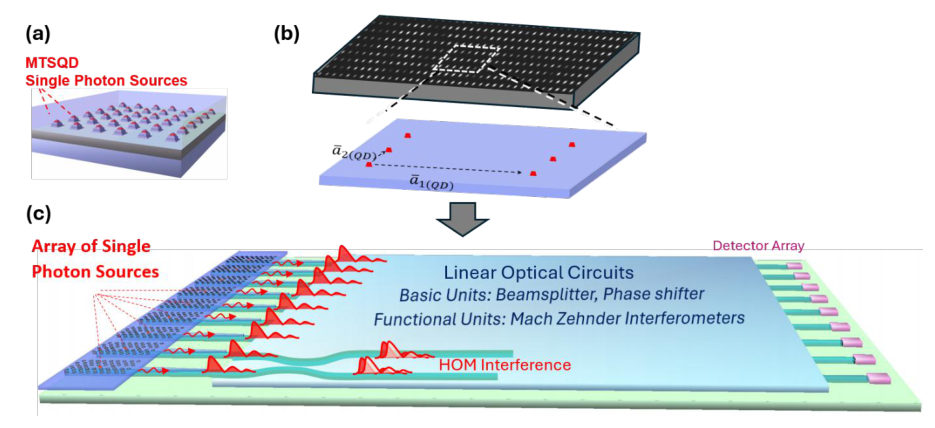 
Figure 1. MTSQD array [red dots in panel (a) schematic &amp; panel (b) white dots a large area photoluminescence image] as the enabler [panel (c) schematic] for standard Fock state-based Boson sampling in large arrays that offer better computational complexity than the Gaussian Boson sampling.

📷 Fig 2

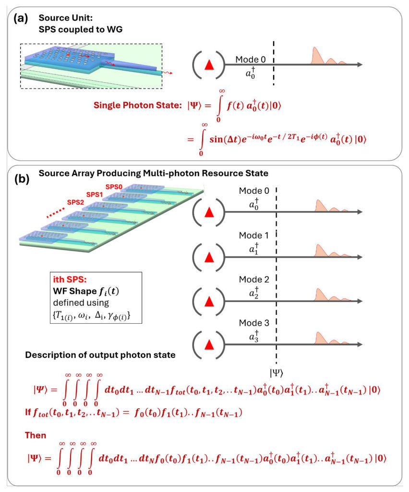 
Figure 2. Description of single and multi-photon resource state (a) Single Photon wave packet produced from a single MTSQD SPS coupled to photonic cavity and waveguide. The wave packet can be characterized by 𝑇1 (radiative decay lifetime), Δ (fine structure splitting, and 𝜔 (energy). (b) Description of a N-photon resource state that can be produced by an ordered array of SPSs (such as the MTSQDs) in the wave packet representation.

📷 Fig 3

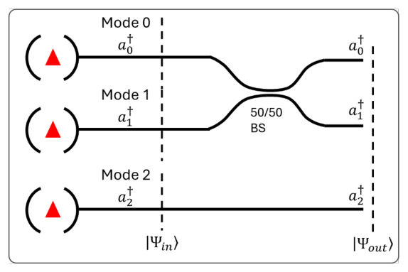 
Figure 3. Example of multiphoton wave packet transformation by a simple linear optical circuit in a 3 waveguide, 3 photon configurations.

📷 Fig 4

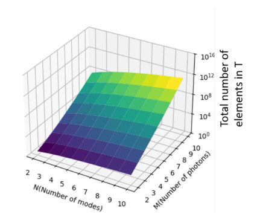 
Figure 4. Total number of elements of the T matrix, (𝑀+ 𝑁−1

📷 Fig 5

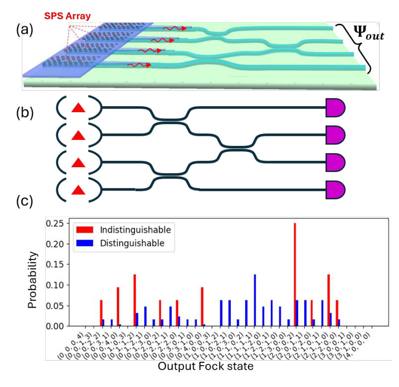 
Figure 5. (a) Device level schematic and (b) circuit-schematic of the 4-mode 4-photon QIP circuit and (c) the probability distribution of various Fock state configurations at the output. The red bars assume perfectly indistinguishable photons and the blue bars indicate distinguishable photons/ classical light.

**Summary.** This paper provides a comprehensive theoretical framework to analyze Boson Sampling using single photons from on-demand sources. It models how decoherence, specifically dephasing, affects the generation probability of highly entangled N-photon states. The key finding is that the achievable entanglement fidelity is quantitatively dictated by the ratio between the pure dephasing time and the photon decay time.

**Why it may be interesting.** This work is highly relevant as it bridges fundamental quantum optics theory (wave packet evolution, decoherence) directly to a major quantum computing primitive (Boson Sampling), providing concrete, measurable guidelines for experimental realization using solid-state emitters.

Detailed structure

**Main problem.** The paper analyzes the quantum complexity and the impact of dephasing on Boson Sampling when using Fock states generated from on-demand single photon sources.

**Main result.** The probability of generating entangled states, such as the 4-photon NOON state, is quantitatively shown to depend critically on the two-photon interference visibility, which is determined by the ratio of the pure dephasing timescale to the radiative decay timescale.

**Method.** The authors develop a theoretical framework that explicitly incorporates the symmetrization of N-photon states while accounting for the wave packet shape and decoherence mechanisms.

**Model / system.** The system models Boson Sampling using Fock states generated from arrays of on-demand single quantum dots (MTSQDs). The theory uses Fourier series representations for single-photon wave packets and generalizes the circuit transformation using a transfer matrix acting on the wave packet shape function.

**Key observables.** Probability of generation of N-photon entangled states (e.g., 4-photon NOON state); coincidence count histograms ($g^{(4)}$); two-photon interference visibility ($V_{TPI}$).

**Important parameters / regimes.** Radiative decay lifetime ($T_1$), pure dephasing timescale ($T_2^*$), and the ratio $T_2^*/T_1$.

**Assumptions / limitations.** The analysis assumes the weak-coupling limit for single-photon sources and simplifies the complex symmetrization by transferring the burden to the wave packet shape function.

**Figures summary.** Figures illustrate the MTSQD array enabling Fock state sampling, the single/multi-photon wave packet descriptions using $T_1$ and $T_2^*$, and plots showing the dependence of $P_{NOON}$ and coincidence histograms on the dephasing visibility.

**Paper structure.** The paper first establishes the physical platform (MTSQDs) and the theoretical challenge (decoherence). It then develops the mathematical framework by representing the state using wave packets and incorporating symmetrization. Finally, it applies this framework to calculate specific observables like the 4-photon NOON state probability, linking physical decay rates to quantum measurement outcomes.

Abstract

Boson sampling with array of on-demand single photons (discreet variable Fock states) as resource states provides distinct advantages in complexity scaling compared to single photon resource states mimicked by the states (continuous variable) generated in nonlinear photonics. Recent progress in realization of regular ordered array of mesa top single quantum dots (MTSQDs) enabling on-demand generation of many photon resource states with high single photon purity and indistinguishability [1,2] has opened the possibility of implementing chip-scale Boson sampling with single photons. An important question towards scale up of such circuits is how the dephasing and decay timescale of individual on-demand single photons affect the final probability distribution of the N-photon entangled state. In this work we report a framework that provides direct link between the physical sources of decoherence to the outcome of multiphoton correlation measurements. We explicitly incorporate the symmetrization of the N-photon states while accounting for the shape of the individual wave packets and dephasing. Using this framework, we show predictive estimates of the probability of generation of a 4-photon NOON state using an optical circuit initialized with 4 identical single photon wave packets, mimicking the emitted photons from MTSQD single photon sources reported in [2]. Specifically, we show how the probability of generating various 4-photon entangled states depend on the two-photon interference visibility which is determined by the pure dephasing timescale in relation to the radiative decay timescale. The results provide quantitative guidelines to measure 4 photon and higher number of entangled photon states generated in an optical circuit with on demand single photon sources and provide a link between physical processes such as temperature and the output state of the quantum optical circuits.

[↑ back to top](#top)

### [Local error correction prolongs time-crystalline memory](http://arxiv.org/abs/2610.18124v1)

**Authors:** Benedikt Fauseweh  
**Type:** both · **Category:** quantum information and computing · **PDF:** <https://arxiv.org/pdf/2610.18124v1>  
**Analysis basis:** full PDF text, analyzed in chunks
**Topic relevance:** 🔥 `driven-dissipative phase transition` **4/5** · `QC/QI experiment` **3/5** · `analog quantum simulation` **3/5** · `methods for driven-dissipative` **3/5** · `quantum measurements` **3/5** · `non-equilibrium universality` **2/5** · `Keldysh / 2PI / non-Gaussian methods` **1/5** · `correlated / nonlocal dissipation` **1/5** · `scars & prethermalization` **1/5**

📷 Fig 1

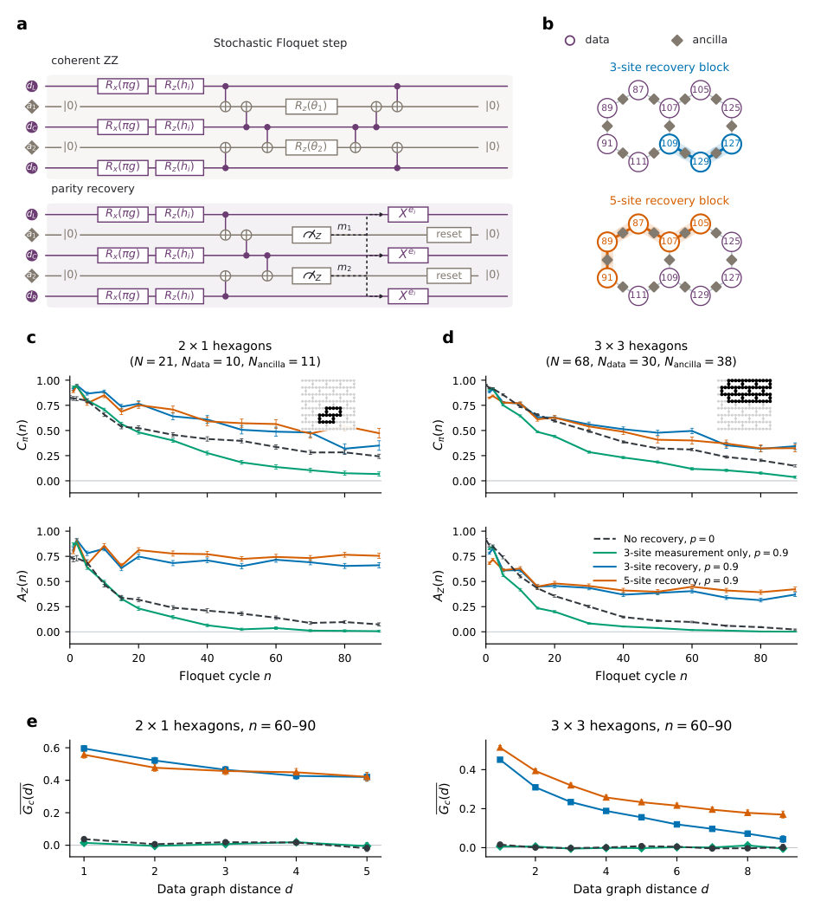 
Figure 1. Local bit-flip error correction extends temporal and spatial order. a, The stochastic drive step has two alternatives for a candidate recovery block. With probability 1−𝑝, entangling gates and local rotation gates implement coherent ZZ interactions. With probability 𝑝, parity measurements and conditional data flips implement recovery, followed by ancilla reset. b, Physical embeddings of example three-site and five-site recovery blocks on two adjacent hexagons. Circles are data qubits and diamonds are ancillas. c,d, Initial state memory and mean alignment 𝐴𝑍for the two patches. Insets mark the selected hardware qubits in black. e, Connected correlations versus distance on the data...

📷 Fig 2

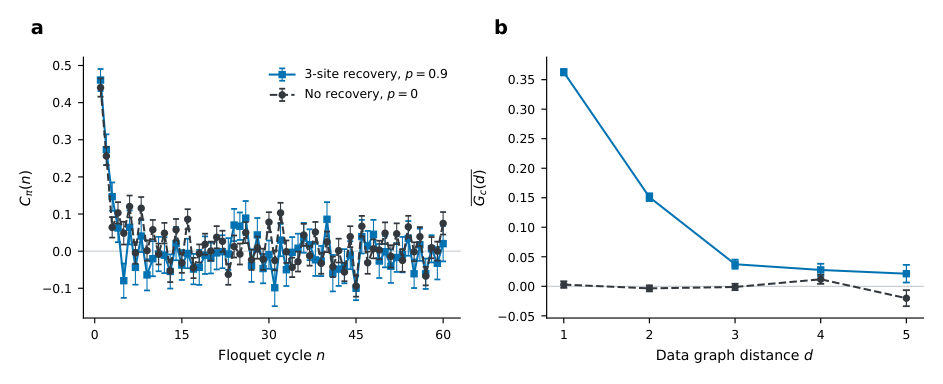 
Figure 2. Small pulse angle memory decay. a, Initial-state memory on two hexagons with ten data qubits and eleven ancillas at 𝑔= 0.67. Quenched interactions and fields use the same disorder intervals as Fig. 1. Bare evolution is compared with full three-site recovery at 𝑝= 0.9. Every circuit starts from |0000000000⟩, with 128 shots per condition at each depth from 1 to 60. b, Connected correlation averaged equally over cycles 40 to 60 after averaging pairs at each graph distance. Recovery maintains short-distance correlations while subharmonic memory is lost. Bars indicate one sampling standard error.

📷 Fig 3

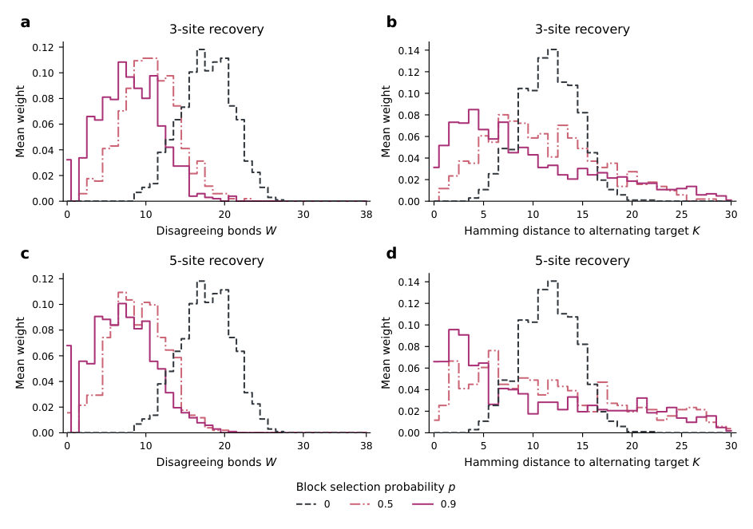 
Figure 3. Probability distributions for Hamming distance and bonds. Mitigated distributions on the 3 × 3 patch, normalized at each depth and averaged equally over the sampled cycles 60, 70, 80, 90. The acquired conditions are the shared bare reference 𝑝= 0 and recovery at 𝑝= 0.5 and 𝑝= 0.9. The 𝑝= 0 and 𝑝= 0.9 curves use 256 shots, while the 𝑝= 0.5 curve uses 128 shots. a,b, Three-site recovery. c,d, Five-site recovery. a,c, Number 𝑊of disagreeing data bonds. b,d, Hamming distance 𝐾from the target word. The two globally aligned orientations both have 𝑊= 0 but occupy opposite ends of the 𝐾axis.

📷 Fig 4

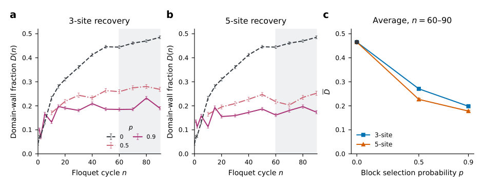 
Figure 4. Spatial order dependence on block activation probability. a,b, Domain wall fraction 𝐷(𝑛) on the 3 × 3 patch for three-site and five-site recovery at 𝑝= 0.5 and 𝑝= 0.9, with the shared bare reference 𝑝= 0. The shaded region marks cycles 60 to 90. c, Equal-depth averages over the sampled cycles 60, 70, 80, 90. Five-site recovery gives a lower wall fraction at both acquired nonzero probabilities. The 𝑝= 0.5 curves use 128 shots per circuit, all other curves use 256 shots. The black point is the bare reference.

📷 Fig 5

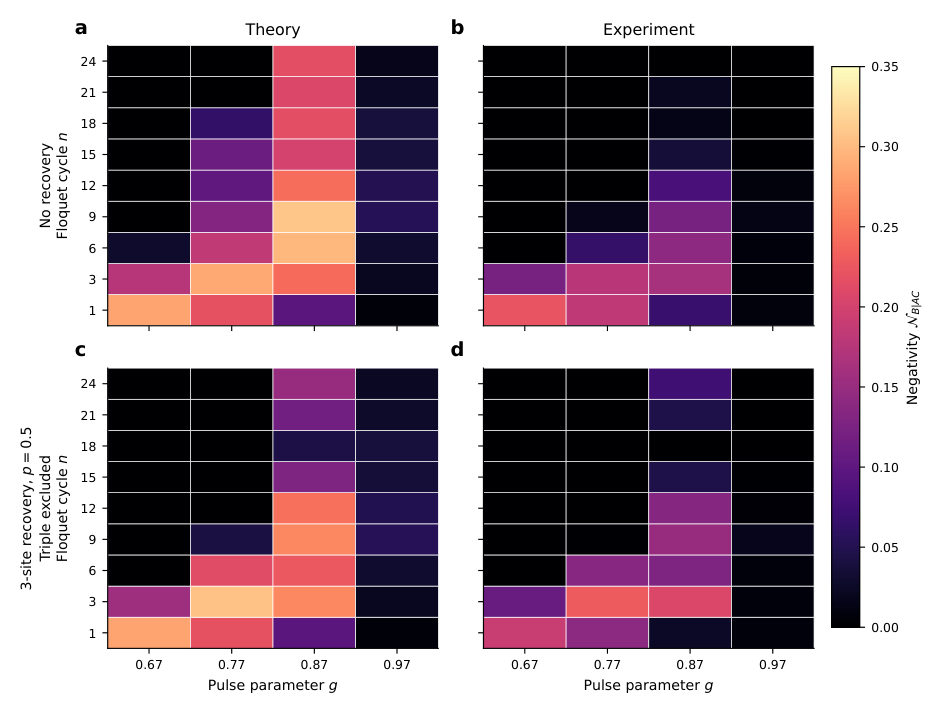 
Figure 5. Local entanglement during bare and recovered dynamics. Negativity across 91 | (89, 111) for a fixed data-qubit triple on the two-hexagon patch. a,b, Bare dynamics. c,d, Three-site recovery at 𝑝= 0.5. a,c, Exact ten-data-qubit theory with ideal gates and recovery. b,d, Density-matrix estimates from 27 Pauli settings with 768 shots each. All conditions start from |0⟩⊗10 and share the same quenched disorder. Recovery uses the same qubit activations in theory and experiment. Colors show fitted negativity.

**Summary.** This work demonstrates that applying local bit-flip error correction protocols can substantially extend the memory time of time-crystalline order in a noisy quantum simulation. By implementing recovery codes on a superconducting processor, the researchers successfully combat environmental decoherence, showing that the stabilization of spatial order is particularly pronounced. This highlights the utility of QEC techniques for preserving fragile, non-equilibrium quantum states.

**Why it may be interesting.** It directly addresses the crucial challenge of decoherence in simulating non-equilibrium quantum phases, providing a concrete demonstration of how quantum error correction can stabilize complex quantum memory effects.

Detailed structure

**Main problem.** The primary goal is to extend the memory time of time-crystalline order in a noisy quantum processor by implementing local error correction protocols.

**Main result.** Local bit-flip error correction significantly prolongs the time-crystalline memory decay time, with five-site recovery showing the greatest enhancement compared to bare dynamics.

**Method.** The study uses superconducting quantum processors to simulate a driven Ising model, applying stochastic local bit-flip error correction via repetition codes and syndrome measurements.

**Model / system.** The system is a driven, spatially disordered two-dimensional Ising model simulated on a superconducting quantum processor using a honeycomb lattice. The dynamics are governed by a Floquet Hamiltonian incorporating disorder and external driving.

**Key observables.** Temporal memory decay ($	au$), spatial alignment ($A_Z$), connected correlation function ($G_c(d, n)$), and quantum negativity ($\mathcal{N}$).

**Important parameters / regimes.** Error correction distances (three-site and five-site), block activation probability ($p$), and the driving strength ($g$).

**Assumptions / limitations.** The analysis assumes the ability to perform syndrome measurements and conditional recovery gates, and uses quenched disorder realizations.

**Figures summary.** Figures compare spatial alignment and connected correlations between bare evolution and recovery methods; Figure 2 shows temporal memory loss; Figure 4 tracks the domain-wall fraction $D(n)$ dependence on $p$.

**Paper structure.** The paper details the physical model and error correction implementation, presents quantitative measurements of memory decay and spatial order, and compares the performance of different recovery schemes against the bare noisy dynamics.

Abstract

Discrete time crystals are non-equilibrium phases of matter with spatiotemporal order and a response that breaks the time-translation symmetry of a periodic external drive. Interactions, spatial disorder and correlated random driving can in theory stabilize this order. In experiments, however, coupling to the environment limits the time crystal lifetime. Here we use stochastic local bit-flip error correction to prolong the time-crystalline response of a driven, spatially disordered two-dimensional Ising model on a superconducting quantum processor, using a repetition code with distances three and five on a honeycomb lattice with up to 68 physical qubits. Even though ancilla qubits, midcircuit syndrome measurements and decoding increase the required quantum and classical resources, the stochastic drive increases the memory decay time by a factor of up to two. At late times we observe that recovery stabilizes spatial order across the lattice. The spin-configuration distributions explain this separation, as recovery suppresses disagreeing bonds while broadening occupies completely reversed states. Syndrome measurements without correction accelerate the memory decay, demonstrating the importance of conditional correction. Our results show that local bit-flip error correction can preserve time-crystalline memory over more drive cycles than the bare dynamics.

[↑ back to top](#top)

### [A complete quantum process model for physically realistic photo-detection in the joint photon-number and spectral degrees of freedom](http://arxiv.org/abs/2610.18267v1)

**Authors:** Sadia Rafi, Aeysha Khalique  
**Type:** theory · **Category:** other · **PDF:** <https://arxiv.org/pdf/2610.18267v1>  
**Analysis basis:** full PDF text, analyzed in chunks
**Topic relevance:** 🔥 `quantum measurements` **4/5** · `Full counting statistics` **3/5** · `interference shaping light` **3/5** · `quantum optics experiment` **3/5** · `correlated / nonlocal dissipation` **2/5** · `methods for driven-dissipative` **2/5** · `Keldysh / 2PI / non-Gaussian methods` **1/5** · `driven-dissipative phase transition` **1/5**

📷 Fig 1

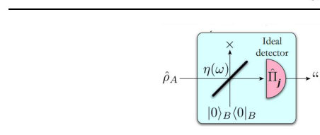 
Fig. 1 An inefficient detector is modelled as a perfect detector preceded by a beam splitter with transmittivity η(ω). The input ρA is incident at one port and vacuum at the other port, which is discarded.

📷 Fig 2

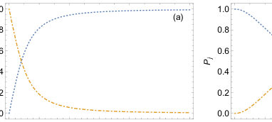 
Fig. 2 Probability Pj of detection of j = 1 photon (dotted curve) and j = 0 photon (dot-dashed curve) by (a) varying detector spectral bandwidth sd for fixed photon spectral bandwidth sA = 1 (b) varying photon spectral bandwidth sA for fixed detector spectral bandwidth sd = 1. Here µ = 0

📷 Fig 3

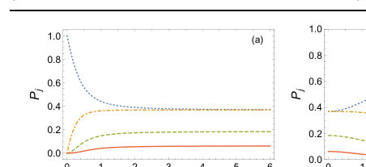 
Fig. 3 Probability Pj of detection of j = 0 photon (dotted curve), j = 1 photon (dot-dashed curve), j = 2 photons(dashed) and j = 3 (solid curve) in (a) by varying detector spectral bandwidth sd, for photon spectral bandwidth sA = 1, and in (b) by varying photon spectral bandwidth sA for sd = 1. µ = 0 for both.

📷 Fig 4

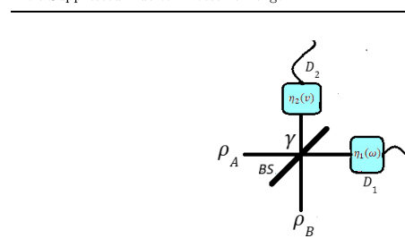 
Fig. 4 Hong-Ou-Mandel effect

📷 Fig 5

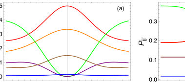 
Fig. 5 Probabilities Pjj′ of detection of j photons on one detector and j′ on the other vs the time delay T for P20 (orange), P02 (red), P11 (green), P01 (purple), P10 (brown) and P00 (blue) curve for (a) sd1 = 0.1, sd2 = 1.0, sA1 = sA2 = 0.1 and µ1 = µ2 = 0 and (b) sd1 = sd2 = 0.4, sA1 = 0.1, sA2 = 0.4, µ1 = 0.2 and µ2 = 0.

**Summary.** This paper introduces a comprehensive quantum process model for simulating realistic photodetection, moving beyond simple photon-number counting. By incorporating the spectral degrees of freedom via Kraus operators, it accurately models detector inefficiencies and spectral filtering. This tool is crucial for advancing quantum optics and quantum information processing by providing a physically grounded framework for analyzing photon detection events.

**Why it may be interesting.** This work provides a necessary, rigorous theoretical tool for accurately simulating real-world quantum optical experiments where spectral filtering and detector imperfections are significant.

Detailed structure

**Main problem.** Theoretical models of photo-detection often fail to account for the spectral characteristics of light, limiting their accuracy in quantum optical analyses.

**Main result.** The authors developed a complete quantum process model using Kraus operators that successfully incorporates both photon-number statistics and frequency-dependent detector response.

**Method.** The methodology involves deriving explicitly calculated Kraus operators within the operator-sum representation, treating the detector interaction via a beam-splitter model.

**Model / system.** The model describes photodetection in quantum optics experiments, applicable to various detectors, and is formulated to handle spectral filtering and photon loss mechanisms.

**Key observables.** Detection probabilities ($P_j$) for $j$ photons, and coincidence probabilities ($P_{jj'}$) for multi-photon processes like HOM interference.

**Important parameters / regimes.** Detector efficiency ($\eta(\omega)$), incident spectral profile ($\psi(\omega)$), and the spectral bandwidths of the incident and detector modes.

**Assumptions / limitations.** The detector interaction is modeled using a beam-splitter transformation, and the model is presented as a 'plug and play' replacement for simpler, idealized models.

**Figures summary.** Figures illustrate the physical setup (beam splitter model), show plots of detection probabilities ($P_j$) versus spectral bandwidths for single-photon and coherent state detection, and display the characteristic dip in coincidence probability for HOM interference.

**Paper structure.** The paper introduces the problem, derives the complete quantum process model using Kraus operators based on a beam-splitter analogy, and then applies this model to three canonical scenarios: single-photon detection, coherent state detection, and HOM interference.

Abstract

Photo-detection is a fundamental component of experimental photonics, yet theoretical models often treat detectors solely in the photon-number basis, neglecting other relevant degrees of freedom such as spectral characteristics. We present a complete quantum process model for physically realistic photodetection that incorporates both photon-number effects and frequency-dependent detector response, described through explicitly derived Kraus operators in the operator-sum representation. This formalism accommodates realistic inefficiencies, models detection within finite spectral windows, and can be directly substituted for idealized models in quantum optical analyses. The model leads to identifying the suitable detection window of the detectors relative to the spectral distribution of incident photons and conversely, in order to maximize the observability of quantum effects.

[↑ back to top](#top)

### [Dark state preparation in a zero-field-split molecular triplet](http://arxiv.org/abs/2610.18661v1)

**Authors:** Maria Pfahler, Andrea Donarini  
**Type:** both · **Category:** other · **PDF:** <https://arxiv.org/pdf/2610.18661v1>  
**Analysis basis:** full PDF text, analyzed in chunks
**Topic relevance:** 🔥 `methods for driven-dissipative` **4/5** · `driven-dissipative phase transition` **3/5** · `quantum measurements` **3/5** · `Keldysh / 2PI / non-Gaussian methods` **2/5** · `QC/QI experiment` **2/5** · `analog quantum simulation` **2/5** · `non-equilibrium universality` **2/5** · `correlated / nonlocal dissipation` **1/5**

📷 Fig 1

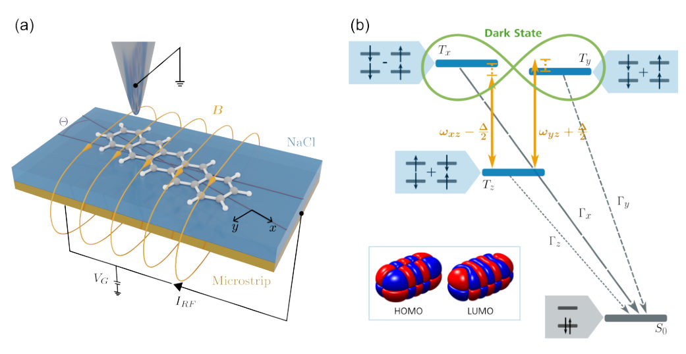 
FIG. 1: Dark state in single molecule ESR-AFM. (a) Pentacene is placed on a thick insulating substrate in a specific angle Θ with respect to the current direction in the underlying microstrip. The resulting magnetic field couples to the molecular spin. Additionally, a gate voltage is applied to tune the molecular charge. (b) Schematic visualization of the dark state in the ZFS triplet with driving and decay to singlet: Anisotropic frontier orbitals of pentacene populated by unpaired spins coupled by dipole-dipole interaction give rise to the zero-field splitting of the triplet.

📷 Fig 2

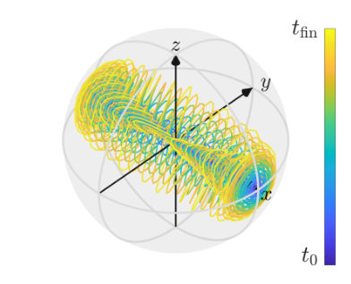 
FIG. 2: Trajectory in lab frame of the expectation values of the spin components for the initial pure state associated to |ψ⟩= 1 √

📷 Fig 3

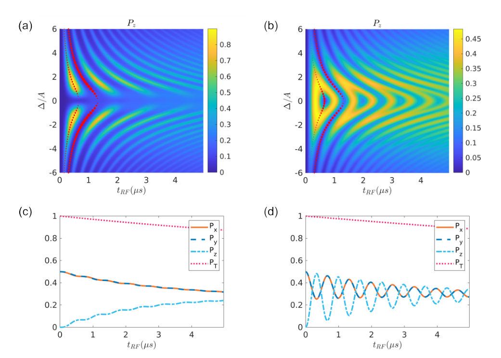 
FIG. 3: Near-resonant driving of dark and incoherent initial states. Tz-population Pz obtained for applying a rf drive with different detunings ∆, equal amplitudes (Axz = Ayz) and phase shifts ϕxz = ϕyz = 0 in (a) for the corresponding DS, and in (b) for the fully incoherent superposition 1

📷 Fig 4

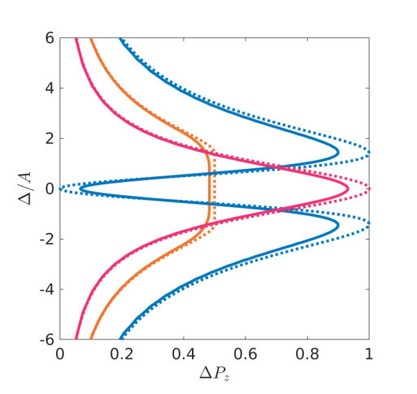 
FIG. 4: Amplitude of the first Pz oscillation for the DS (blue), the fully incoherent superposition of |Tx⟩and |Ty⟩(orange) and the bright state (magenta). The full lines result from the numerical simulations including dissipation. The dashed lines represent the analytical results in Eqs. (22) to (24).

📷 Fig 5

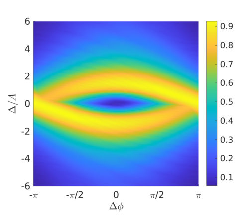 
FIG. 5: ∆Pz as a function of the phase difference ∆ϕ = ϕyz −ϕxz and the frequency detuning ∆of the rf driving. The initial state is the DS in Eq. (20) always prepared with ∆ϕDS = 0 and equal amplitudes R = 1.

**Summary.** This paper details a method to prepare and measure dark states in the spin resonance of a single molecule using an ESR-AFM setup. By modeling the system as an open quantum system, the authors derive the conditions for a stationary dark state, demonstrating its unique signature compared to classical or incoherent dynamics. This advances the use of molecular electronics for studying fundamental quantum coherence.

**Why it may be interesting.** This work directly applies advanced open quantum system techniques (Lindblad equation, dark state theory) to a solid-state molecular system, providing a pathway to observe fundamental quantum coherence phenomena in nanoscale devices.

Detailed structure

**Main problem.** The paper proposes a protocol to prepare and probe dark states in a single-molecule electron spin resonance setup using Atomic Force Microscopy (ESR-AFM).

**Main result.** The study characterizes the dark state as a coherent superposition of two ZFS states that remains stationary despite continuous resonant driving, providing a robust diagnostic tool for quantum coherence.

**Method.** The analysis employs a density-matrix formalism (Lindblad equation) to treat the system as a driven open quantum system, comparing the dynamics of the dark state against its incoherent counterpart.

**Model / system.** The system is a neutral molecule possessing a zero-field-split (ZFS) first excited triplet, coupled to an AFM tip and metallic microstrip. The dynamics are modeled using a Hamiltonian incorporating ZFS terms and time-dependent driving fields.

**Key observables.** Population of the triplet state ($P_z$), coherences (off-diagonal elements of $\hat{
ho}$), and the measured electrostatic force signal via ESR-AFM readout.

**Important parameters / regimes.** Zero-field splitting parameter ($D$), Zeeman splitting ($E$), and the detuning ($\Delta$) relative to the driving field.

**Assumptions / limitations.** The analysis assumes the molecule is well-positioned within the microstrip, and approximations like the Rotating Wave Approximation (RWA) and neglecting certain decay pathways are used.

**Figures summary.** Figures schematically illustrate the ESR-AFM setup and the dark state in the ZFS triplet. Later figures compare the time evolution of populations for the dark state versus an incoherent initial state.

**Paper structure.** The paper first establishes the physical setup and Hamiltonian, then derives the dark state condition using the density-matrix formalism in the rotating frame. It proceeds to characterize the state's properties by comparing coherent vs. incoherent dynamics and proposes measurable signatures.

Abstract

We propose a protocol to prepare and probe dark states in a single-molecule electron spin resonance based on atomic force microscopy (ESR-AFM), thus extending existing techniques developed to address Rabi oscillations. To this end, we simulate in analogy to atomic physics the coherent manipulation of a three-level system in the V-configuration using a multifrequency magnetic field. More specifically, we consider a neutral molecule with a zero-field-split (ZFS) first excited triplet and analyze within a pump-probe scheme the dynamics of the total triplet population. In the triplet subspace, the dark state is a coherent superposition formed by two ZFS states which does not evolve in time despite a continuous resonant driving towards the third one. We characterize the properties of this state comparing it to its fully incoherent counterpart. Within a density-matrix formalism for open systems, we then compute the expected dark state signatures both for ideal scenarios and for the realistic parameterization of ESR-AFM on pentacene.

[↑ back to top](#top)

### [Deep Mesoscopic Dynamics](http://arxiv.org/abs/2610.17885v1)

**Authors:** Yue Zhao, Shiqi Wu, Yihang Ouyang, Sergey Grebenchuk, Magdalena Grzeszczyk, Xiaoxu Zhao, Kostya S. Novoselov, Maciej Koperski, Qianxiao Li  
**Type:** both · **Category:** statistical mechanics · **PDF:** <https://arxiv.org/pdf/2610.17885v1>  
**Analysis basis:** full PDF text, analyzed in chunks
**Topic relevance:** 🔥 `methods for driven-dissipative` **4/5** · `Keldysh / 2PI / non-Gaussian methods` **3/5** · `correlated / nonlocal dissipation` **3/5** · `driven-dissipative phase transition` **3/5** · `non-equilibrium universality` **2/5** · `Frenkel-Kontorova` **1/5** · `analog quantum simulation` **1/5** · `quantum measurements` **1/5** · `scars & prethermalization` **1/5**

📷 Fig 1

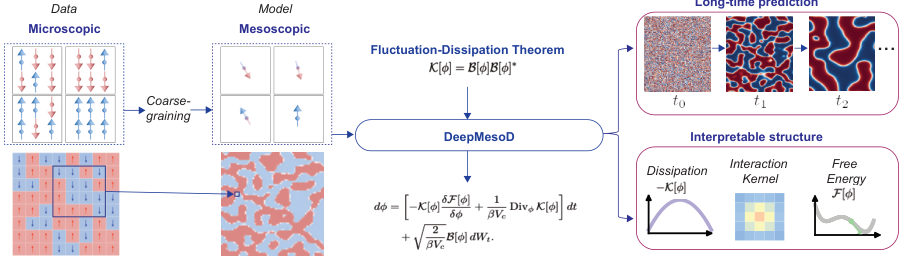 
Figure 1: Workflow of DeepMesoD. Microscopic trajectories are coarse-grained into observations of a mesoscopic field at a prescribed spatial scale. DeepMesoD uses these trajectories to estimate the physical structures in a mesoscopic field equation within a prescribed dynamical class.

📷 Fig 2

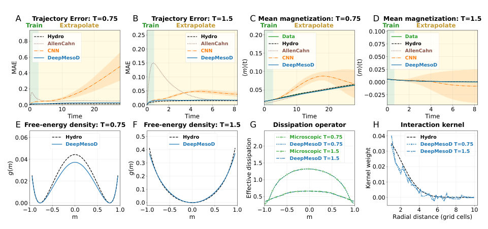 
Figure 2: Validation of DeepMesoD in the Ising–Kac system with hydrodynamic limit. The DeepMesoD rollouts are noise-free with the Itˆo thermal drift retained. A,B. Field mean ab- solute error at each evaluation time for T = 0.75 and T = 1.5. Green shading marks the training interval, and yellow shading marks the subsequent rollout-only interval. C,D. Mean magnetisa- tion during the same rollouts. E,F. Homogeneous free-energy density g(m), compared with the hydrodynamic-limit reference. Each curve is shifted independently so that its minimum is zero. G. Conditional dissipation-operator response E{[K[ϕ]1](x) | ϕ(x) = m}, compared with the reference in (4) computed from the corresponding...

📷 Fig 3

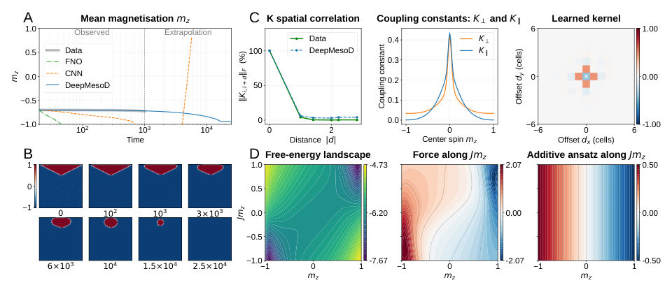 
Figure 3: Long-term stability and thermodynamic-structure recovery in atomistic spin dynamics. A. Long-term rollout from a triangular-domain initial condition on the same lat- tice. The DeepMesoD prediction is noise-free with the Itˆo thermal drift retained. Training uses random-initial-state trajectories. The triangular-domain initial condition is used for geometric- initial-condition extrapolation, not for fitting these stages. The dashed boundary at 1 ns separates the interval with an atomistic reference (“Observed”) from the interval without a reference (“Ex- trapolation”), ending at 25 ns. Time labels are in ps. The atomistic reference permits accuracy comparisons over 0–1 ns, but...

📷 Fig 4

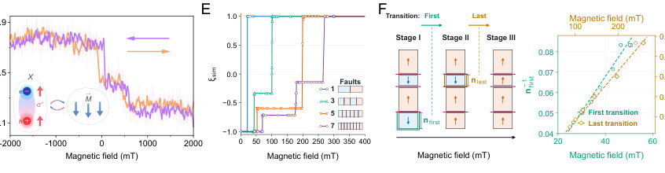 
Figure 4. A learned stacking-fault interaction connects internal geometry to multistep magnetic response in CrBr3. A. Structural and magnetic schematic of layered CrBr3. Left: crystal structure of CrBr3 (Cr atoms in purple, Br atoms in gold). Middle: top and side views of representative M-stacking and AB-stacking configurations, where M denotes monoclinic stacking and AB denotes rhombohedral stacking and the two adjacent layers are coloured purple and green. Right: schematic AFM (antiparallel) and FM (parallel) interlayer spin alignments across a stacking fault, shown alongside the simulated three-dimensional magnetisation field mz at the final time step. The light-blue plane marks the...

**Summary.** This paper introduces Deep Mesoscopic Dynamics (DeepMesoD), a neural network approach to derive effective field equations governing mesoscopic physics from microscopic simulations. By enforcing physical constraints like the fluctuation-dissipation theorem, it accurately models complex magnetic materials like $	ext{CrBr}_3$ and Heisenberg ferromagnets. This results in dramatic computational speedups while retaining crucial spatial details lost in simple averaging methods.

**Why it may be interesting.** This work provides a powerful, data-driven tool for simulating complex, spatially extended many-body systems where traditional analytical or purely microscopic simulations are intractable due to scale separation.

Detailed structure

**Main problem.** Developing an efficient method to simulate mesoscopic dynamics that resolves spatial patterns, overcoming the limitations of microscopic simulations (too small/short time) and bulk descriptions (erase patterns via averaging).

**Main result.** The DeepMesoD framework successfully learns effective mesoscopic field equations for complex magnetic systems, achieving massive computational speedups while accurately capturing physical phenomena like fault-induced coupling changes.

**Method.** The authors introduce Deep Mesoscopic Dynamics (DeepMesoD), using neural networks to learn the effective mesoscopic field equation directly from microscopic trajectories while enforcing physical constraints like the fluctuation-dissipation relation.

**Model / system.** The work applies to general dissipative mesoscopic dynamics, validated on the Ising-Kac model, 2D Heisenberg ferromagnets, and layered $	ext{CrBr}_3$ magnets, modeling the evolution of a mesoscopic field $\phi$ on a spatial domain $\Omega$.

**Key observables.** Free-energy functional, dissipation operator, learned interaction kernels, and magnetic response functions (e.g., fault-plane correlation $\xi_{sim}(h)$).

**Important parameters / regimes.** Coarse-graining scale, temperature ($T$), external magnetic field ($h_{	ext{ext}}$), and the number/placement of stacking faults.

**Assumptions / limitations.** The learned dynamics are constrained to satisfy the fluctuation-dissipation relation, and the method assumes that the underlying physics can be captured by a structured neural network representation of the effective equation.

**Figures summary.** Figures illustrate the workflow from microscopic trajectories to the learned mesoscopic equation. Specific figures detail the construction of multi-fault interlayer kernels and the resulting field dependence of the fault-plane correlation $\xi_{sim}(h)$ based on fault geometry.

**Paper structure.** The paper first introduces the DeepMesoD framework and validates it on the Ising-Kac model. It then applies the method to the 2D Heisenberg ferromagnet and layered $	ext{CrBr}_3$, demonstrating the ability to capture complex physics like fault-induced coupling changes, and finally details the mathematical construction for isolating the effect of fault geometry.

Abstract

Microscopic simulations resolve spatial patterns but are feasible only over small domains and short timescales, whereas bulk descriptions erase those patterns through spatial averaging. Mesoscopic fields preserve this spatial organisation, but their effective equations are known only for selected microscopic systems and scaling limits. We introduce Deep Mesoscopic Dynamics (DeepMesoD), which uses neural networks to learn an effective mesoscopic field equation from microscopic trajectories at a prescribed coarse-graining scale. For the nonconserved dissipative dynamics studied here, DeepMesoD learns the free-energy functional with a spatial interaction kernel and a state-dependent dissipation operator constrained by the fluctuation-dissipation relation. We first validate the construction in the Ising-Kac model, where the learned mesoscopic equation recovers the known hydrodynamic limit and rollouts remain stable far beyond the training horizon. We then treat two systems without closed-form mesoscopic descriptions. For a two-dimensional Heisenberg ferromagnet governed by atomistic spin dynamics, DeepMesoD learns a mesoscopic model whose predictions match atomistic references up to 1 ns, and a rollout with an unseen initial condition remains bounded up to 25 ns. For layered CrBr$_3$, the learned kernel captures the suppression and sign reversal of interlayer coupling at a stacking fault whose location and strength are not supplied as inputs. Controlled changes to the learned interaction show how fault number and placement shape multistep magnetic responses, complementing our magneto-photoluminescence measurements. Across the two atomistic systems, DeepMesoD achieves a three-to-four-order-of-magnitude reduction in wall-clock time compared with atomistic spin dynamics.

[↑ back to top](#top)

### [Emergent Non-Biorthogonal Born Rule at Dynamical Quantum Phase Transitions](http://arxiv.org/abs/2610.17855v1)

**Authors:** Wei-Wei Yang, Henning Schomerus, Jiangping Hu, Zhesen Yang  
**Type:** theory · **Category:** statistical mechanics · **PDF:** <https://arxiv.org/pdf/2610.17855v1>  
**Analysis basis:** full PDF text, analyzed in chunks
**Topic relevance:** 🔥 `driven-dissipative phase transition` **4/5** · `correlated / nonlocal dissipation` **3/5** · `methods for driven-dissipative` **3/5** · `non-equilibrium universality` **3/5** · `Keldysh / 2PI / non-Gaussian methods` **2/5** · `quantum measurements` **2/5** · `analog quantum simulation` **1/5**

📷 Fig 1

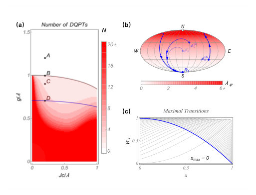 
FIG. 1. Phase diagram and the orthogonal DQPT. (a) Number NDQPT of zeros of det USS(t) within the observation window λt ≤60, versus Jc/λ and g/λ. The gray and blue curves mark the DQPT boundary and the EP-DQPT locus; points A–D at Jc/λ = 0.2 mark the no-DQPT (g/λ = 1.2), boundary (0.9953), generic (0.9), and EP-DQPT (0.7047) parameter sets. (b) Critical-time Loschmidt-echo landscape λψ = −ln Lψ(tc) on the Bloch sphere (Mollweide projection) at the boundary point B. The unique zero-echo state sits at the north pole, and the projected trajectories of distinct initial states ϕ(1,2,3) 0 all funnel into the output |R1⟩at the south pole. (c) Transition probability W1 = |⟨R1|Uc|ψ⟩|2 versus x =...

📷 Fig 2

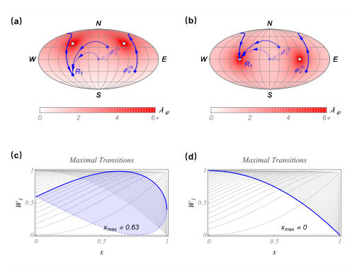 
FIG. 2. Critical-time Loschmidt-echo landscapes on the Bloch sphere [(a),(b)] and transition probability W1 versus x [(c),(d)], for the generic non-biorthogonal DQPT point [(a),(c)] and the EP-DQPT point [(b),(d)].

📷 Fig 3

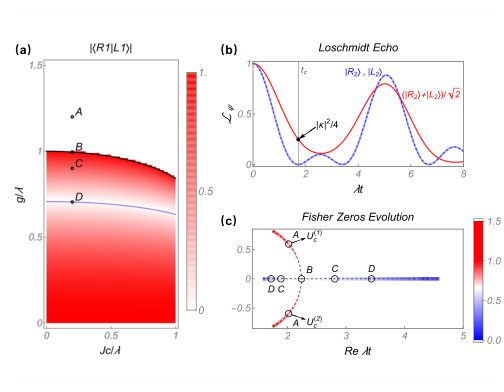 
FIG. 3. Critical-state geometry and critical-time structure. (a) Overlap |⟨L1|R1⟩| across the phase diagram; curves and points A–D as in Fig. 1(a). From the DQPT boundary to the EP-DQPT locus it falls from unity to zero, obeying |⟨R1|R2⟩|2+ |⟨L1|R1⟩|2 = 1. (b) Loschmidt echoes at the EP point D: those of |R2⟩and |L2⟩coincide and vanish at tc, whereas their equal superposition has L(tc) = |κ|2/4. (c) Fisher zeros of det USS in the complex-λt plane as g/λ varies at Jc/λ = 0.2; colors encode g/λ, dashed curves trace the zero trajectories, and circles mark points A–D.

📷 Fig 4

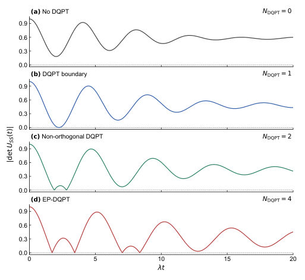 
FIG. 4. Absolute determinant dynamics, |D(t)| = | det USS(t)|, at the four representative points marked in Fig. 1(a). Panels (a)–(d) correspond to no DQPT, the DQPT boundary, a generic non-biorthogonal DQPT, and an EP- DQPT, respectively. The dashed line denotes |D(t)| = 0. Counting distinct zeros over the phase-diagram observation window, with the quadratic tangency in (b) counted once, gives NDQPT = (0, 1, 2, 4).

**Summary.** This paper develops a novel 'non-biorthogonal Born rule' to give a clear probabilistic meaning to non-Hermitian quantum dynamics, particularly near Dynamical Quantum Phase Transitions (DQPTs). By analyzing the determinant of the subsystem propagator, the authors distinguish between different types of transitions, including those occurring at exceptional points. It provides a rigorous link between the formalism of Hermitian quantum mechanics and the physics of open, non-Hermitian systems.

**Why it may be interesting.** This work is highly relevant to AMO physics and open quantum systems as it provides a fundamental, physically grounded framework for interpreting non-Hermitian dynamics, which often arises when modeling dissipation or coupling to an environment.

Detailed structure

**Main problem.** The paper aims to provide a rigorous probabilistic interpretation for non-Hermitian quantum mechanics, specifically in the context of Dynamical Quantum Phase Transitions (DQPTs). It addresses the ambiguity arising from the non-biorthogonal nature of left and right eigenstates.

**Main result.** The authors establish an 'emergent non-biorthogonal Born rule' based on the overlap of left and right states, which provides a clear, physically accessible transition probability. They also characterize Exceptional-Point DQPTs (EP-DQPTs) where eigenstates coalesce.

**Method.** The analysis generalizes DQPTs from a reference state to a physical subspace, utilizing the subspace propagator $U_S(t)$ and analyzing its determinant ($\det U_S(t)$) as a key diagnostic. The theory builds upon the framework of globally Hermitian systems.

**Model / system.** The study uses a model involving a two-level subsystem coupled to a 1D tight-binding chain (environment). The dynamics are governed by the subspace propagator $U_S(t) = \langle S|e^{-iHt}|S
angle$.

**Key observables.** Subspace propagator determinant ($\det U_S(t)$), Loschmidt echo amplitude, and the left-right eigenstate overlap $|\langle L_1|R_1
angle|$ (dynamical phase rigidity).

**Important parameters / regimes.** Coupling strengths ($g/\lambda, J_c/\lambda$), and the time evolution parameter $t$.

**Assumptions / limitations.** The standard biorthogonal normalization is assumed to be gauge-dependent and insufficient for direct probability interpretation. The analysis contrasts the behavior of the determinant in Markovian vs. non-Markovian regimes.

**Figures summary.** Figures illustrate the phase diagram showing the number of DQPT zeros and compare the Loschmidt echo landscapes and transition probability dependence at generic and EP-DQPT points.

**Paper structure.** The paper progresses by first establishing the need for a probabilistic interpretation in non-Hermitian dynamics. It then analyzes the DQPT diagnostic using the subspace propagator, deriving the non-biorthogonal Born rule. Finally, it characterizes the specific types of transitions, including EP-DQPTs, and contrasts the determinant criterion with known physical limits.

Abstract

Non-Hermitian dynamics possesses distinct left and right eigenstates, but their normalization freedom obscures a direct probabilistic interpretation.   Starting from a globally Hermitian system governed by the standard Born rule, we generalize dynamical quantum phase transitions (DQPTs) from a reference state to a physical subspace.   This generalization provides a clear probabilistic interpretation of left and right states: when each state is normalized to itself, their mutual overlap determines a directly accessible dynamical transition rate.   We discuss the new phenomena governed by this emergent non-biorthogonal Born rule and further identify a class of exceptional-point DQPTs (EP-DQPTs), at which the eigenstates of the critical propagator coalesce.   Our theory places the probabilistic interpretation of non-Hermitian quantum mechanics on the firm footing of Hermitian quantum mechanics.

[↑ back to top](#top)

### [Krylov Complexity and Quantum Many-body Scars in Non-Hermitian Kinetically Constrained Models](http://arxiv.org/abs/2610.17328v1)

**Authors:** Arkaprava Sil, Rudraksh Kaushik, Souvik Kundu, Prasant Mallik, Sudipto Singha Roy  
**Type:** theory · **Category:** other · **PDF:** <https://arxiv.org/pdf/2610.17328v1>  
**Analysis basis:** full PDF text, analyzed in chunks
**Topic relevance:** 🔥 `scars & prethermalization` **4/5** · `Rydberg arrays` **3/5** · `analog quantum simulation` **3/5** · `driven-dissipative phase transition` **2/5** · `methods for driven-dissipative` **2/5** · `non-equilibrium universality` **2/5** · `correlated / nonlocal dissipation` **1/5**

📷 Fig 1

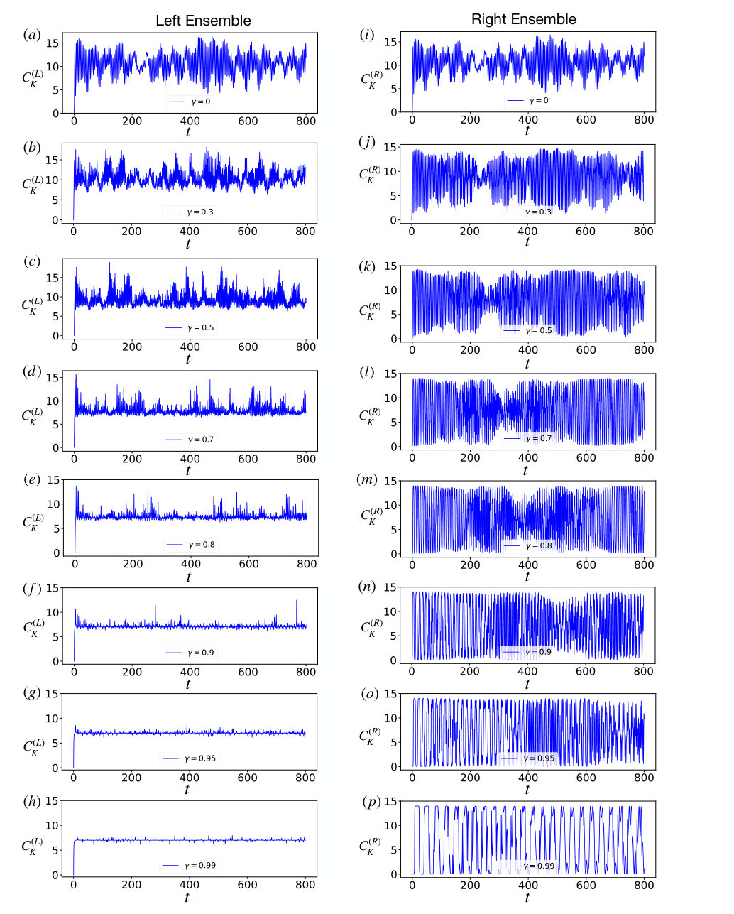 
Figure 1. Krylov complexity for the left and right ensembles in the non-Hermitian PXP model with increasing γ. In (a)–(h), we show the behavior obtained for the left ensemble (C(L) K ) for γ = 0.0, 0.3, 0.5, 0.7, 0.8, 0.9, 0.95, 0.99, respectively, with |Z2⟩taken as the initial state. The corresponding results for the right ensemble (C(R) K ) are shown in (i)–(p). All plots are for L = 14. For the left ensemble, increasing γ leads to a progressive suppression of the oscillations and a tendency towards saturation of C(L) K , whereas for the right ensemble the oscillations in C(R) K become increasingly prominent. This distinct behavior highlights the different Krylov-complexity dynamics of...

📷 Fig 2

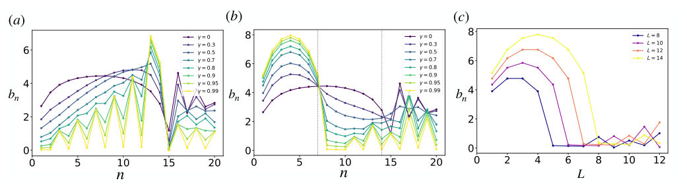 
Figure 2. Behavior of Arnoldi coefficients with Krylov steps. (a) Arnoldi coefficients bn as a function of the Krylov index n for the right eigenvector ensemble, shown for various non-Hermitian parameter values γ. The γ = 0 curve corresponds to the Hermitian PXP model and exhibits the characteristic arch-shaped profile associated with quantum many-body scar states. As γ increases, this arch-shaped structure is progressively modified, revealing a behavior distinctly different from the Hermitian limit. (b) bn versus n for the left eigenvector ensemble at the same values of γ. Unlike the right ensemble, a Hermitian-like arch-shaped imprint re-emerges even at large γ, but with a notable γ-...

📷 Fig 3

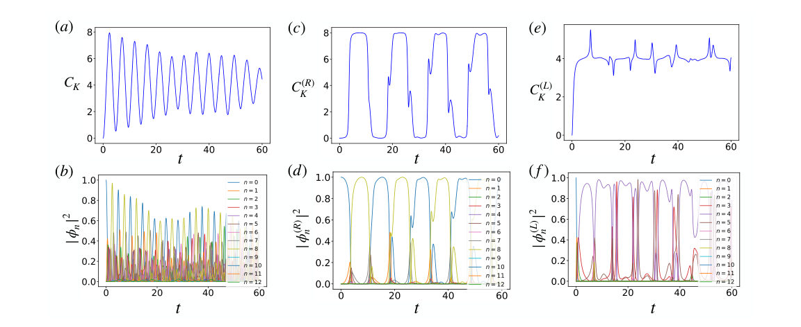 
Figure 3. Krylov complexity and probability dynamics in Hermitian and non-Hermitian PXP systems. (a) We replot the Krylov complexity CK(t) as a function of time for the Hermitian PXP model, to compare with the corresponding Krylov-space probabilities |ϕn(t)|2. Here, we consider L = 8, for which the Krylov-space dimension is 12. (b) Shows the Krylov-space probabilities |ϕn(t)|2 for the Hermitian case for all 12 Krylov states, highlighting the probability transfer between the Krylov states and the dominant oscillations of |ϕ0(t)|2 and |ϕ8(t)|2. (c) Depicts the Krylov complexity C(R) K (t) for the non-Hermitian right ensemble, showing the modified oscillatory behavior of the complexity, and...

📷 Fig 4

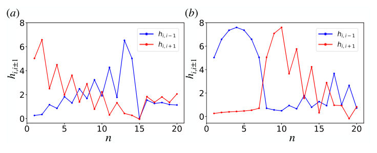 
Figure 4. Coefficients of the Hessenberg matrix in the right and left ensembles. (a) Here, we plot the coefficients of the Hesseneberg matrix, hi,i−1(bn) and hi,i+1, as a function of the Krylov index n for the right ensemble, while (b) shows the corresponding behavior for the left ensemble. In both cases, we observe that the behavior of hi,i−1 is almost the opposite of hi,i+1.

📷 Fig 5

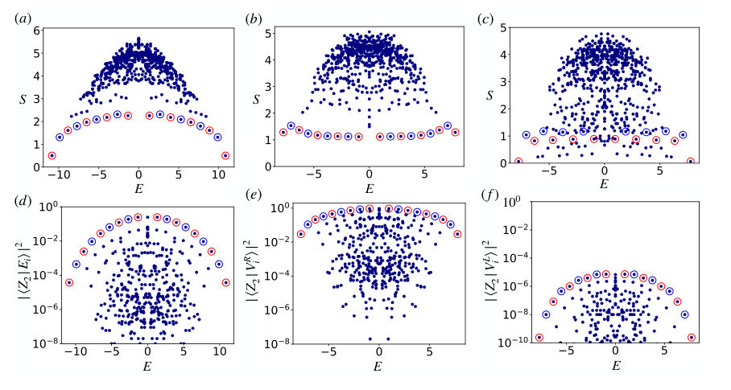 
Figure 5. Entanglement structure and scar-state overlaps in the Hermitian and non-Hermitian PXP models. (a) Shows the behavior of entanglement entropy (EE) with energy E, for the Hermitian PXP model (γ = 0). (b) and (c) show the corresponding EE versus E plots for the right and left ensembles, respectively, of the non-Hermitian PXP model at γ = 0.7. (d) Overlap of the PXP eigenstates with the |Z2⟩state. (e) and (f) show the corresponding overlaps for the right and left ensembles, respectively, of the non-Hermitian PXP model. All plots are for L = 18 and include the two momentum sectors k = 0 and π. The scar states are highlighted by circles, with red and blue circles denoting the k = 0 and...

**Summary.** This paper analyzes non-Hermitian generalizations of Rydberg blockade models to study thermalization breakdown. By comparing the left and right Krylov ensembles, the authors find that non-Hermiticity causes distinct dynamical signatures, necessitating separate characterization of these two ensembles. This highlights a key difference in dynamics when moving from Hermitian to non-Hermitian quantum systems.

**Why it may be interesting.** This work is highly relevant as it extends the study of quantum scars and ergodicity breaking into the non-Hermitian domain, a crucial area for understanding open quantum systems and realistic physical implementations like Rydberg arrays.

Detailed structure

**Main problem.** The study investigates the breakdown of thermalization and dynamics in non-Hermitian kinetically constrained quantum many-body systems, specifically addressing the fundamental difference between left and right eigenstate ensembles.

**Main result.** Non-Hermiticity causes distinct dynamical behaviors in the left and right Krylov ensembles, such as different trends in Krylov complexity and the emergence of unique non-scar eigenstates in the left ensemble.

**Method.** The authors employ Krylov complexity analysis, utilizing Arnoldi's algorithm to construct separate left and right Krylov bases for non-Hermitian generalizations of PXP and PPXPP models.

**Model / system.** The models are non-Hermitian generalizations of the paradigmatic PXP and PPXPP models, which are effective descriptions of a 1D Rydberg atom array subjected to the Rydberg blockade condition.

**Key observables.** Krylov complexity, Arnoldi coefficients, entanglement entropy, and the structure of quantum many-body scars.

**Important parameters / regimes.** The non-Hermiticity parameter ($\gamma$), system size ($L$), and the specific choice of probe states.

**Assumptions / limitations.** The analysis assumes that the left and right eigenstate ensembles must be treated separately because they encode distinct dynamical and structural information that cannot be inferred from the Hermitian limit.

**Figures summary.** The figures compare Krylov complexity evolution (showing oscillation vs. saturation) and illustrate the modification of Arnoldi coefficients and entanglement entropy across the left and right ensembles.

**Paper structure.** The paper progresses by introducing the non-Hermitian models, applying the Arnoldi method to generate left/right bases, and then analyzing the resulting Krylov complexity and eigenstate properties to draw conclusions about ensemble inequivalence.

Abstract

Thermalization in closed quantum systems and its breakdown are central to understanding the emergence of statistical behavior in isolated many-body systems. Kinetic constraints can hinder thermalization by restricting the allowed dynamics and giving rise to non-ergodic behavior. While various aspects of ergodicity breaking in kinetically constrained models have been extensively studied in Hermitian systems, their behavior in non-Hermitian kinetically constrained models remains less explored. In particular, the inequivalence of left and right eigenstate ensembles in non-Hermitian systems raises the question of whether they exhibit qualitatively different dynamical and eigenstate properties. In this work, we study non-Hermitian generalizations of the paradigmatic PXP and PPXPP models, focusing on their Krylov complexity, eigenstate structure, and dynamics. By exploiting the Arnoldi's algorithm, we find distinct behavior of Krylov complexity in the left and right eigenstate ensembles as non-Hermiticity is increased: in the right ensemble, it exhibits persistent oscillations with an increasing period, while in the left ensemble, it gradually saturates. The characteristic arch-shaped profile of the Arnoldi coefficients is also modified differently in the two ensembles, with a Hermitian-like arch re-emerging in the left ensemble at large non Hermiticity. Additionally, in the non-Hermitian PXP model, the right ensemble retains the characteristic scar structure, while the left ensemble develops additional non-scar eigenstates with anomalously low entanglement and large overlap with the vacuum state. These findings reveal that non-Hermiticity can affect Krylov dynamics and eigenstate structure differently in the left and right ensembles, demonstrating the need to treat them separately when characterizing non-Hermitian kinetically constrained systems.

[↑ back to top](#top)

### [Coherent Phonon Generation from Prethermal Carrier Populations in a Semiconductor](http://arxiv.org/abs/2610.18279v1)

**Authors:** Mingyu Shi, Matteo Savoini, Patrick Friebel, Andrea Annunziata, Thomas Metzger, Yunpei Deng, Laura Cattaneo, Steven L. Johnson  
**Type:** both · **Category:** other · **PDF:** <https://arxiv.org/pdf/2610.18279v1>  
**Analysis basis:** full PDF text, analyzed in chunks
**Topic relevance:** 🔥 `scars & prethermalization` **4/5** · `driven-dissipative phase transition` **3/5** · `non-equilibrium universality` **3/5** · `Keldysh / 2PI / non-Gaussian methods` **2/5** · `methods for driven-dissipative` **2/5** · `correlated / nonlocal dissipation` **1/5** · `quantum measurements` **1/5**

📷 Fig 1

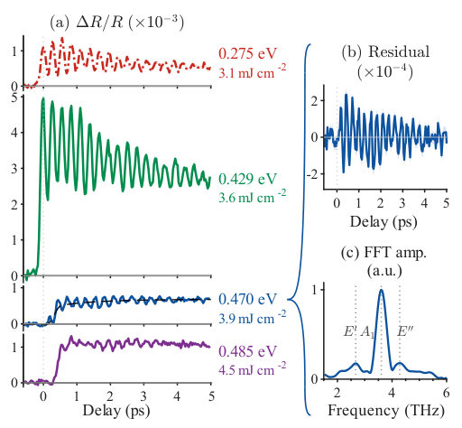 
FIG. 1. Representative transient reflectivities and coherent- phonon extraction. (a) Unscaled ∆R/R traces on a common amplitude scale; dash-dotted curves denote the longer-pulse setup. For photon energies ≤0.429 eV, t = 0 marks the first transient maximum; higher-energy traces retain the 0.429-eV delay zero. The black dashed curve is the 0.470-eV back- ground fit [20]. (b) Background-subtracted residual for the 0.470 eV pump data; shading denotes the standard error of the mean (SE). (c) Fourier spectrum for 0 ≤t ≤5 ps for the data in (b), with the E′, A1, and E′′ modes marked.

📷 Fig 2

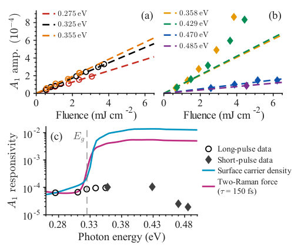 
FIG. 2. Fluence dependence and spectral evolution of the co- herent A1 response. (a),(b) Peak Fourier amplitudes versus incident fluence for long-pulse (open circles) and short-pulse (filled diamonds) data; dashed lines show linear fits. (c) Re- sponsivity versus photon energy compared with surface pho- tocarrier density at fixed fluence (cyan) and two-Raman force magnitude at ΩA1 (magenta), calculated from aT T for a 150-fs pulse. Both curves are scaled to the lowest-energy responsiv- ity. The gray dashed line marks Eg ≃0.325 eV.

📷 Fig 3

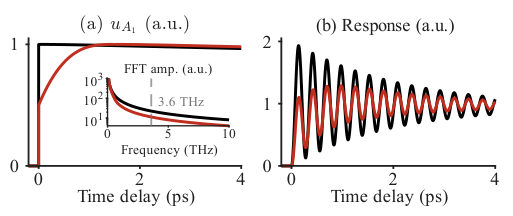 
FIG. 3. Effects of finite-time carrier thermalization on coher- ent phonon dynamics. (a) Instantaneous (black) and partially prompt, slowly rising (red) equilibrium shifts with equal max- ima. A weak long-time decay ensures a well-defined Fourier transform. Inset: Driving-force spectra over the full time win- dow; the dashed line marks the 3.6-THz A1 frequency. (b) Corresponding phonon trajectories with identical frequency and damping.

📷 Fig 4

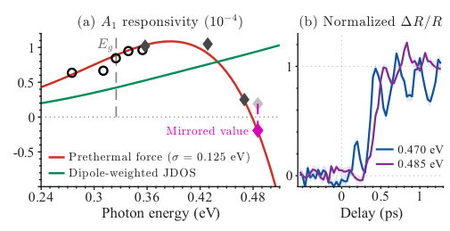 
FIG. 4. (a) Measured A1 responsivities (symbols), scaled prethermal force (red), and dipole-weighted JDOS (green) for σ = 0.125 eV. Circles and diamonds denote long- and short-pulse data. Light-gray and magenta diamonds show the measured and sign-inverted 0.485-eV values, joined by a magenta dashed line. The vertical gray dashed line marks Eg ≃0.325 eV; positive force contracts the Te helix. (b) 0.470-eV (blue) and 0.485-eV (purple) traces from Fig. 1, nor- malized to their 4–5 ps plateaus; shaded bands show SE.

**Summary.** This work investigates how ultrafast laser excitation generates coherent phonons in semiconductors like Tellurium. By comparing measurements with theoretical models, the authors demonstrate that the phonon response is governed by the specific electronic transitions excited (transition selectivity), rather than the total density of carriers assumed in simpler thermal models. This highlights the importance of non-equilibrium carrier dynamics in ultrafast solid-state physics.

**Why it may be interesting.** The focus on non-equilibrium carrier dynamics and the explicit calculation of coupling strengths ($\Delta g_{cv}$) to drive lattice vibrations provides a detailed mechanism for ultrafast energy/momentum transfer, relevant to open quantum systems modeling.

Detailed structure

**Main problem.** The paper tests the prevailing understanding of coherent phonon generation in semiconductors, specifically contrasting models based on thermalized carrier populations against those incorporating non-equilibrium dynamics.

**Main result.** The coherent phonon amplitude shows weak spectral dependence across the band gap, indicating that transition selectivity, rather than the total thermalized carrier density, controls the phonon generation process.

**Method.** The authors combine ultrafast pump-probe spectroscopy measurements with first-principles calculations using DFT to model the effective force driving the coherent lattice vibration.

**Model / system.** The study uses Tellurium (Te) as a semiconductor system, investigating the coupling between photoexcited carriers and the fully symmetric $A_1$ optical phonon mode near the electronic band gap.

**Key observables.** Coherent amplitude of the $A_1$ phonon mode, spectral dependence of the phonon responsivity, and the calculated prethermal force spectrum.

**Important parameters / regimes.** Excitation photon energy tuned across the band gap, and the resulting excited transition state lifetime (estimated in femtoseconds).

**Assumptions / limitations.** The analysis assumes the force can be derived from transition-resolved prethermal forces, and DFT calculations often assume a simplified quasi-equilibrium carrier temperature.

**Figures summary.** Figures show transient reflectivity traces ($\Delta R/R$) at various pump energies, and plots illustrate the spectral dependence of the $A_1$ mode amplitude and responsivity as a function of photon energy.

**Paper structure.** The paper progresses by first presenting experimental measurements showing the spectral dependence, then contrasting these results with predictions from standard models (like DECP theory), and finally proposing and validating a transition-resolved prethermal force model derived from first-principles calculations.

Abstract

Ultrafast laser excitation of carriers in semiconductors often results in the creation of fully symmetric coherent optical phonons, typically understood in terms of a thermalized transient carrier population. We test this understanding with systematic measurements and first-principles calculations of the photon-energy dependence of ultrafast-laser-driven coherent phonon generation in tellurium, using excitation wavelengths around the electronic band gap. We observe that, contrary to the expectations of models assuming a thermalized carrier population, the coherent amplitude of the fully symmetric $A_1$ mode changes only weakly when tuning wavelength across the band gap. The measured spectral dependence is instead reproduced by a transition-resolved prethermal force weighted by optical matrix elements and band- and momentum-dependent $A_1$ deformation potentials. Fitting this model to the data yields an excited transition state lifetime of a few femtoseconds. These results identify transition selectivity, rather than a thermalized total carrier density, as a key factor controlling coherent-phonon generation in semiconductors excited near a band gap.

[↑ back to top](#top)

### [Deterministic and programmable generation of mechanical multipartite entangled states](http://arxiv.org/abs/2610.18778v1)

**Authors:** Isabelle Franzen, Max-Emanuel Kern, Q. Rumman Rahman, Igor Kladarić, Stefano Marti, Yiwen Chu, Zhi-Yuan Wei, Matteo Fadel  
**Type:** both · **Category:** quantum information and computing · **PDF:** <https://arxiv.org/pdf/2610.18778v1>  
**Analysis basis:** full PDF text, analyzed in chunks
**Topic relevance:** 🔥 `QC/QI experiment` **4/5** · `analog quantum simulation` **3/5** · `methods for driven-dissipative` **2/5** · `quantum measurements` **2/5** · `Tavis-Cummings & cavity-many-emitter` **1/5** · `correlated / nonlocal dissipation` **1/5** · `driven-dissipative phase transition` **1/5** · `quantum optics experiment` **1/5**

📷 Fig 1

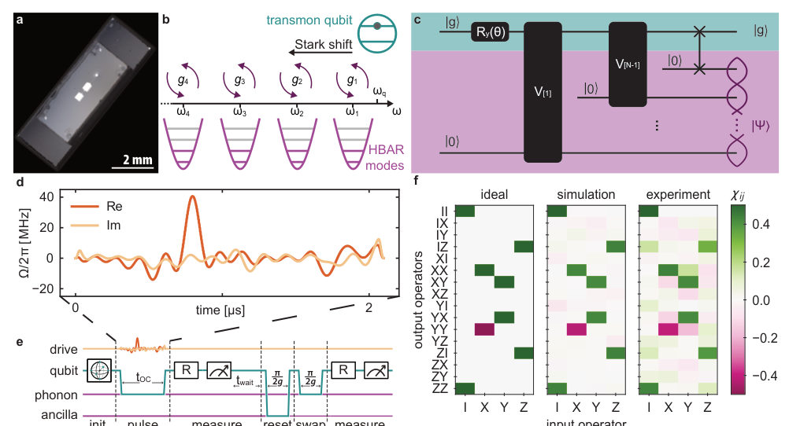 
FIG. 1. HBAR device and process tomography of the MPS preparation pulses. a) Micrograph of the transmon- HBAR device and b) its schematic illustration. The transmon can be frequency-shifted to become resonant with the individual phonon modes of the HBAR, to which it couples at rate gk. In this work, we only operate within the {|0⟩, |1⟩} subspace of each phonon mode. c) Algorithm to prepare MPS in an HBAR using isometries ˆV and the qubit as an ancilla. d) Pulse shape used for implementing the GHZ isometry Eq. (2). e) Gate sequence used to retrieve process maps. f) Process maps of the ideal, simulated, and experimental isometry Eq. (2) used for GHZ state preparation. See main text for...

📷 Fig 2

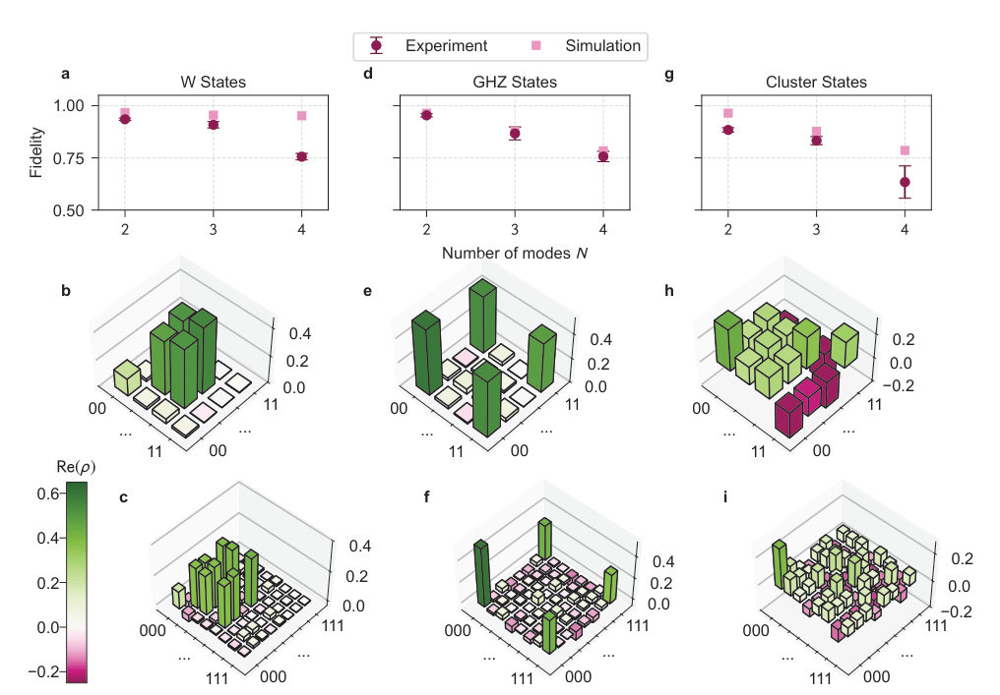 
FIG. 2. Fidelities of the prepared W, GHZ and cluster states, and density matrices. a) Experimental and simulated fidelities for W states prepared on different numbers of modes. b,c) Real part of representative density matrices for W2 and W3 states reconstructed from full state tomography. d,e,f) and g,h,i) show the same for GHZ and cluster states, respectively. Simulations include decoherence during the state-preparation sequence but not the sequential tomographic readout. For W states the decrease of the measured fidelities thus originates mainly from the readout, while for GHZ and cluster states the decrease reflects decoherence during the optimal-control pulses (see main text).

📷 Fig 3

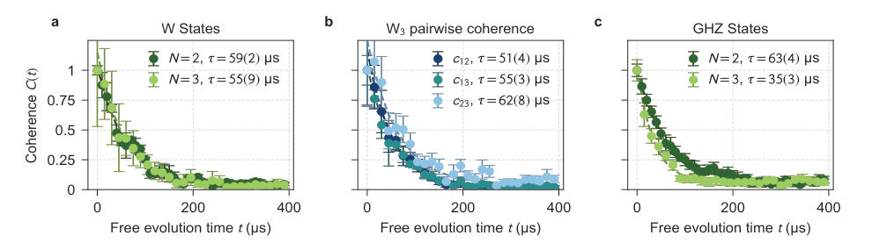 
FIG. 3. Free evolution of W and GHZ coherences. a) Coherence C(t), normalized to its value at t = 0, of W states with N = 2, 3 modes as a function of the free evolution time t. Lines show fits to Ae−t/τ + B, with the extracted decay times τ given in the legend. b) Pairwise coherences ckl(t) of the W3 state, fitted in the same way. c) Same as panel a, but for GHZ states. Unlike for W states, the GHZ decay rate depends on N. This dependence is here quantitatively explained by local decoherence alone, without any contribution from correlated dephasing (see main text for details).

**Summary.** The authors demonstrate a scalable method to deterministically create complex multipartite entangled states (like GHZ and W states) using a superconducting qubit coupled to mechanical resonators. They characterize these states and show how to use them for advanced correlated-noise sensing, establishing a promising route for quantum technologies using massive mechanical objects.

**Why it may be interesting.** This work bridges solid-state quantum hardware (superconducting circuits/acoustic resonators) with fundamental quantum information tasks (multipartite entanglement generation and noise characterization), providing a concrete, scalable platform for quantum simulation.

Detailed structure

**Main problem.** The paper addresses the challenge of deterministically and programmably generating multipartite entangled states among mechanical phonon modes, moving beyond current limitations to only entangled pairs.

**Main result.** They successfully demonstrated the preparation of W, GHZ, and cluster states, and established a method to quantify genuine multipartite entanglement and perform correlated-noise sensing.

**Method.** State preparation utilizes optimal-control-engineered isometries between a superconducting transmon qubit and successive phonon modes, followed by full state tomography and entanglement witness measurements.

**Model / system.** The physical platform is a superconducting transmon qubit coupled to a High-Overtone Bulk Acoustic Wave Resonator (HBAR) in a circuit quantum acoustics dynamics (cQAD) setup. The dynamics are governed by a Hamiltonian involving qubit, phonon, and coupling terms.

**Key observables.** Fidelity ($F$), Genuine Multipartite Entanglement (GME) witnesses ($	ext{Tr}[\hat{W}
ho]$), and coherence decay rates ($\Gamma_c$).

**Important parameters / regimes.** Qubit frequency ($\approx 5$ GHz), HBAR mode frequencies ($\approx 5$ GHz), and coupling strengths ($g_k/2\pi \approx 273$ kHz).

**Assumptions / limitations.** The state preparation focuses on the computational subspace $\{|0
angle_k, |1
angle_k\}$ for each mode, and the noise analysis relies on modeling local and collective decoherence channels.

**Figures summary.** Figures illustrate the HBAR device, the algorithm for MPS preparation using isometries, and the pulse shapes/gate sequences required for state generation.

**Paper structure.** The paper first details the experimental protocol for deterministic state preparation (isometries $
ightarrow$ iSWAP $
ightarrow$ state). It then characterizes the states using tomography and demonstrates sensing. A significant portion analyzes the theoretical decoherence of W, GHZ, and cluster states under various noise models.

Abstract

Multimode mechanical resonators offer a large set of densely packed, long-lived bosonic modes within a single compact device, making them attractive for quantum simulation, quantum information processing, and quantum-enhanced sensing. Many such applications rely on multipartite entanglement, yet deterministic mechanical entanglement has so far been largely limited to pairs of modes. Here we demonstrate the deterministic and programmable preparation of multipartite entangled states among the phonon modes of a high-overtone bulk acoustic wave resonator coupled to a superconducting transmon qubit. By sequentially applying optimal-control-engineered isometries between the qubit and successive modes, we generate matrix product states of bond dimension two, including $W$, Greenberger-Horne-Zeilinger (GHZ), and cluster states. We fully characterize these states via quantum state tomography and certify genuine multipartite entanglement among up to four modes. We further demonstrate correlated-noise sensing by exploiting the complementary decoherence responses of the stored $W$ and GHZ states, isolating inter-mode phase correlations from local decoherence and placing quantitative bounds on collective dephasing. Our results establish a scalable approach to preparing multipartite entangled states in mechanical systems, with promising applications in multiparameter sensing and tests of quantum mechanics with massive objects.

[↑ back to top](#top)

### [Observation of Photon Bunching in Broadband Multimode Thermal Light Enabled by Temporal Imaging](http://arxiv.org/abs/2610.17228v1)

**Authors:** Filip Sośnicki, Michał Mikołajczyk, Sanjay Kapoor, Dmitri B. Horoshko, Mikhail I. Kolobov, Michał Karpiński  
**Type:** experiment · **Category:** other · **PDF:** <https://arxiv.org/pdf/2610.17228v1>  
**Analysis basis:** full PDF text, analyzed in chunks
**Topic relevance:** 🔥 `quantum optics experiment` **4/5** · `Full counting statistics` **3/5** · `interference shaping light` **3/5** · `quantum measurements` **2/5**

📷 Fig 1

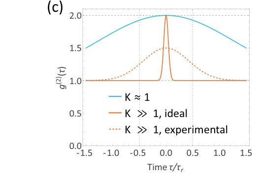 
FIG. 1. Time-resolved second-order autocorrelation measurement. (a) Hanbury Brown and Twiss (HBT) inter- ferometer comprising a 50:50 beamsplitter, two detectors, and a coincidence counter. (b) Temporal imaging (TI) preceding the HBT interferometer magnifies the signal timescale and, consequently, the time-resolved second-order autocorrelation, which reduces the required detector temporal resolution. (c) Normalized second-order coherence g(2)(τ) of thermal light for different numbers of modes K of the measured signal. For K ≈1, the broad correlation feature is resolved (solid blue line), while increasing K progressively narrows the feature (solid orange line). When its width falls below the...

📷 Fig 2

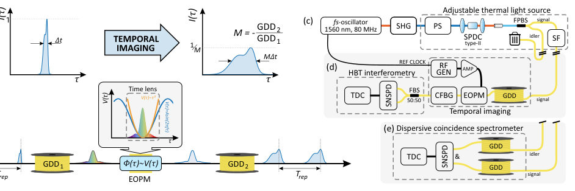 
FIG. 2. Temporal imaging and experimental setup. (a) Temporal imaging reshapes an optical pulse by increasing its duration while preserving its temporal profile. (b) The temporal imaging system uses two group-delay dispersions (GDDs) together with temporal phase modulation. Each pulse is stretched by the first GDD, after which a quadratic temporal phase is applied. The second GDD then further stretches the pulse, retrieving the pulse’s magnified temporal envelope. It is a pulse-by-pulse process that temporally magnifies the pulses’ envelope without changing the pulse repetition period. (c, d, e) Schematic of the experimental setup. (c) An amplified fs-oscillator produces laser pulses that...

📷 Fig 3

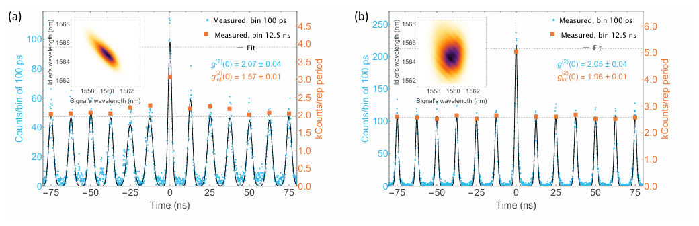 
FIG. 3. Time-magnified photon count histograms. 660-fold temporal-magnified time-delayed coincident photon count histograms when pumping the SPDC with a spectral bandwidth of (a) 0.2 nm and (b) 0.9 nm, corresponding to Schmidt numbers K = 1.68 and K = 1.02, respectively. The temporally magnified measurement points were binned into 100 ps bins (corresponding to 150 fs through the 660 temporal magnification factor; blue) for high temporal resolution and into 12.5 ns bins (corresponding to the pulse repetition period, which is not temporally magnified; orange) for low temporal resolution. Notice the central peak is narrower as compared to the others in (a), while the same in (b), which shows...

📷 Fig 4

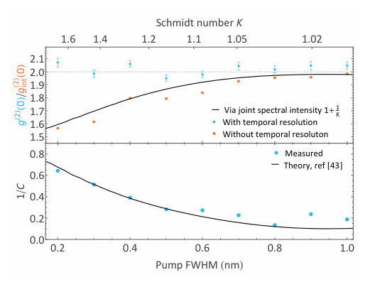 
FIG. 4. Scaling with the number of modes. Top: Zero- delay values of the second-order coherence function g(2)(τ = 0) for a range of the effective number of modes K, controlled by varying the pump spectral bandwidth, measured with high (blue) and low (orange) temporal resolution. The dashed hor- izontal line indicates the maximal value of 2 expected for the thermal state, while the black solid line shows the de- tector temporal averaging effect as 1 + 1 K . Bottom: Ratio ∆tM/ √

**Summary.** This paper introduces a novel technique called pre-detection temporal magnification to overcome the limitations of measuring photon bunching in broadband thermal light. By temporally stretching the optical field before measurement, the authors achieved direct observation of thermal photon bunching on sub-3.5 ps timescales. This establishes a general platform for broadband statistical optics with applications in ultrafast quantum and biophysical imaging.

**Why it may be interesting.** This work provides a powerful, general platform for broadband statistical optics, allowing measurements in the time domain that were previously restricted to narrow spectral bandwidths, which is highly relevant for quantum optics characterization.

Detailed structure

**Main problem.** The primary challenge is observing the temporal photon bunching characteristic of Bose-Einstein statistics in spectrally broadband, multimode thermal light, which is limited by detector temporal resolution.

**Main result.** The authors successfully demonstrated the direct observation of thermal photon bunching on sub-3.5 picosecond timescales, confirming the theoretical value of g^(2)(0) = 2 for broadband sources.

**Method.** They developed and implemented a novel technique called pre-detection temporal magnification, using an electro-optic time lens to stretch the optical field before measuring the intensity autocorrelation function in a conventional Hanbury Brown-Twiss (HBT) setup.

**Model / system.** The experiment uses broadband multimode thermal light generated via spontaneous parametric down-conversion (SPDC) pumped by femtosecond pulses. The measurement platform is an enhanced HBT interferometer incorporating the temporal magnification stage.

**Key observables.** The zero-delay second-order autocorrelation function, g^(2)(0); the effective number of modes (Schmidt number, K); and the time-resolved photon count histograms.

**Important parameters / regimes.** Temporal magnification factor of 660; measurement resolution better than 3.5 ps; spectral bandwidth up to 250 GHz.

**Assumptions / limitations.** The technique assumes that temporal magnification can effectively stretch the correlation time to resolve features below the detector's intrinsic time-averaging limit.

**Figures summary.** Figures illustrate the HBT setup, the temporal imaging scheme (using GDD and phase modulation), and show time-resolved histograms comparing high-resolution (100 ps) vs. low-resolution (ns) measurements of g^(2)(0) for both multimode and near-single-mode cases.

**Paper structure.** The paper establishes the theoretical limitation of measuring broadband bunching due to detector resolution, proposes temporal magnification as a solution, details the experimental implementation using SPDC and electro-optic lenses, and finally presents quantitative measurements confirming the expected thermal statistics.

Abstract

Photons emitted by incoherent sources exhibit temporal bunching, a fundamental manifestation of Bose-Einstein statistics first observed by Hanbury Brown and Twiss (HBT). While intensity correlation measurements originated in astronomy and are now central across quantum technologies, biophysics, and spectroscopy, observing temporal bunching in broadband thermal light remains limited by detector temporal resolution. Conventional approaches - such as streak cameras or optical upconversion - introduce severe trade-offs in efficiency, bandwidth, or setup versatility. Here, we propose and demonstrate a third route: pre-detection temporal magnification of the optical field prior to measuring its intensity autocorrelation function in a conventional HBT setup. Using an electro-optic time lens with a temporal magnification of 660, we resolve the temporal intensity autocorrelation of broadband thermal light generated via non-degenerate spontaneous parametric down-conversion with a bandwidth of 250 GHz. This enables direct observation of thermal photon bunching on sub-3.5 picosecond timescales without narrow spectral filtering, establishing pre-detection temporal imaging as a general platform for broadband statistical optics, with applications spanning ultrafast quantum optics, biophysical imaging, and potentially stellar intensity interferometry.

[↑ back to top](#top)

### [Coherent optical control of a thousand qubits in a three-dimensional trapped-ion crystal](http://arxiv.org/abs/2610.17583v1)

**Authors:** Yue Li, Yuxiang Huang, Yi Li, Xu Cheng, Zihan Xie, Qingyuan Mei, Chang-Ling Zou, Ya Wang, Xinhua Peng, Yiheng Lin, Jiangfeng Du  
**Type:** experiment · **Category:** other · **PDF:** <https://arxiv.org/pdf/2610.17583v1>  
**Analysis basis:** full PDF text, analyzed in chunks
**Topic relevance:** 🔥 `QC/QI experiment` **4/5** · `analog quantum simulation` **3/5** · `quantum optics experiment` **2/5** · `correlated / nonlocal dissipation` **1/5** · `quantum measurements` **1/5**

📷 Fig 1

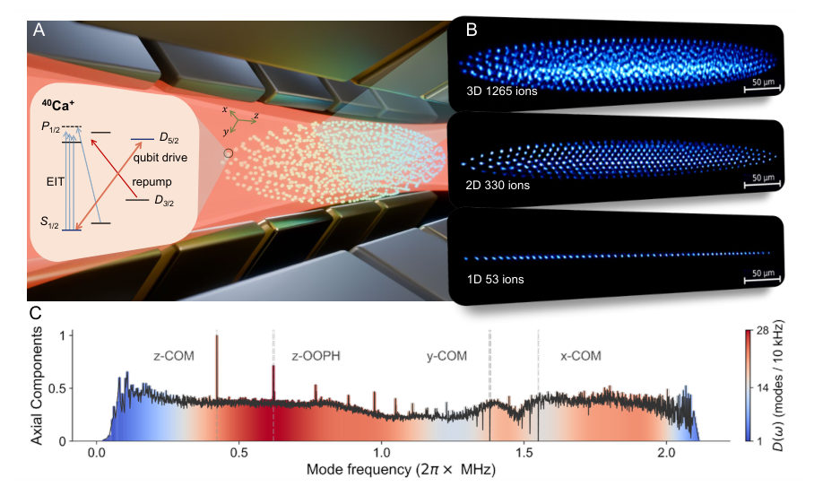 
FIG. 1. Experimental platform and collective vibrational spectrum of a large three-dimensional Coulomb crystal. a, Schematic of the cryogenic Paul trap and optical drives. We utilize multiple 397 nm lasers driving the S1/2 to P1/2 transition, forming parallel resonances for the EIT cooling. A coherent drive laser of 729 nm is applied for either sideband thermometry, coherent Rabi oscillation or Ramsey coherence interferometry, depending on the laser frequency detuning from resonance. b, Fluorescence imaging along the transverse direction gives the ion crystal configuration. Varied confinements along the three directions give linear, planar and cigar-shaped 3D ion crystal configurations,...

📷 Fig 2

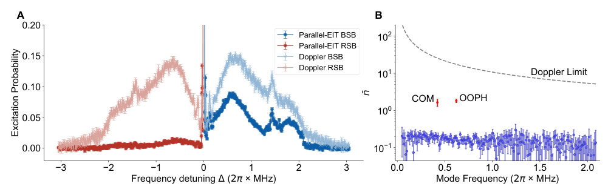 
FIG. 2. Broadband near-ground-state cooling of a dense three-dimensional vibrational spectrum. a, Red-sideband and blue-sideband ex- citation spectra after Doppler cooling and parallel-EIT cooling. Parallel-EIT produces enhanced sideband asymmetry over the entire measured frequency range, demonstrating broadband suppression of motional excitation. b, Mean phonon number estimated from sideband asymmetry after parallel-EIT cooling ¯n = pr/(pb −pr). Swept-frequency (2π×10 kHz steps) measurements from 2π×50 kHz to 2π×2.1 MHz reveal near-ground-state cooling (¯n &lt; 0.3) across most of the vibrational spectrum. The axial center-of-mass and out-of-phase modes are indepen- dently characterized due...

📷 Fig 3

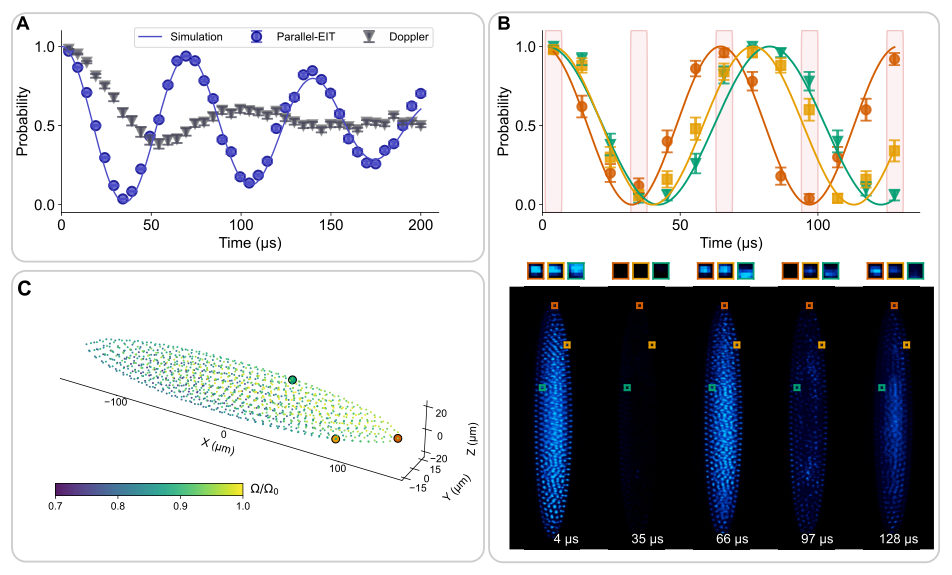 
FIG. 3. Coherent optical control of a three-dimensional ion crystal after cooling. a Global carrier Rabi oscillations measured by collecting fluorescence from the entire ion crystal with a photomultiplier tube (PMT), after conventional Doppler cooling or parallel-EIT cooling. The solid curve represents a simulation for the latter case, based on the above spatial distribution of the Rabi frequency, without incorporating motional-temperature effects or decoherence, and quantitatively reproduces the observed ensemble decay. b Rabi oscillation across the ion crystal. We observe high contrast Rabi oscillation within the ion crystal, from fluorescence images that correspond to the spin population...

📷 Fig 4

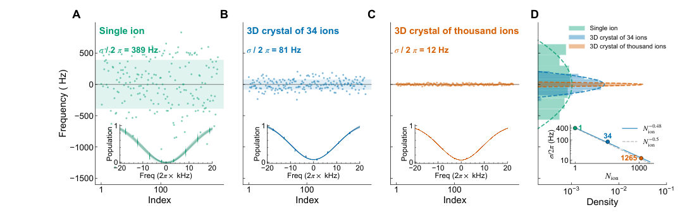 
FIG. 4. Ensemble-enhanced precision in transition spectroscopy. Probability distributions of the extracted optical-transition frequency become progressively narrower with increasing ion number for a single ion (green) in a, a 34-ion crystal (blue) in b, and a 3D Coulomb crystal containing 1,265 ions (orange) in c, measured under identical optical driving conditions. All fitting results are shown in the inset figure. The frequency deviations are referenced to the mean value ⟨f⟩for each dataset, and the corresponding standard deviations are σ/2π = 389 Hz, 81 Hz, and 12 Hz, respectively, with histogram shown in d. The inset of d shows the measured frequency uncertainty σ as a function of ion...

**Summary.** This paper reports on the coherent optical control of a large, three-dimensional crystal of trapped ions. The key challenge—the coupling to a dense spectrum of vibrational modes—is overcome by using broadband cooling techniques. The results confirm that the crystal functions as a high-fidelity quantum register, achieving long coherence times and superior frequency precision scaling with ion number.

**Why it may be interesting.** This work directly addresses the scaling challenge in trapped-ion quantum computing platforms by demonstrating robust global control despite the presence of a complex, high-dimensional vibrational bath, which is a major bottleneck in scaling trapped-ion quantum processors.

Detailed structure

**Main problem.** Achieving coherent optical control and high-precision metrology in large, three-dimensional (3D) trapped-ion crystals, which is challenging due to the coupling of the optical transition to a quasi-continuum bath of collective vibrational modes.

**Main result.** The authors successfully cooled thousands of vibrational modes below the single-phonon occupation and demonstrated ensemble optical coherence of 21.6 ms, showing that the dense mode spectrum does not impede global coherent control.

**Method.** The experiment utilizes broadband cooling via parallel-EIT techniques, followed by coherent manipulation measurements like Rabi oscillations and Ramsey interferometry on the trapped ion ensemble.

**Model / system.** The physical system is a 3D Coulomb crystal of over 1,200 trapped ions. The complexity arises from the dense, quasi-continuous spectrum of $\approx 3,600$ normal modes, which must be addressed for global control.

**Key observables.** Ensemble optical coherence time ($T_2$), optical-transition frequency uncertainty ($\sigma/2\pi$), mean phonon occupation ($ar{n}$), and local Rabi frequencies.

**Important parameters / regimes.** Ion number ($N_{	ext{ion}} \approx 1,265$), cooling bandwidth (50 kHz to 2.1 MHz), and frequency uncertainty scaling approaching projection-noise limits.

**Assumptions / limitations.** The cooling method relies on creating multiple cooling windows via parallel resonances to achieve broadband, sub-Doppler cooling without resolving individual modes.

**Figures summary.** Figures illustrate the experimental setup, the dense vibrational spectrum, the broadband cooling process via sideband asymmetry comparison, and the scaling of frequency uncertainty with ion number.

**Paper structure.** The paper progresses by first establishing the feasibility of cooling the dense mode spectrum, then demonstrating global coherent control (Rabi oscillations), and finally quantifying the metrological improvement by showing frequency uncertainty scaling towards the standard quantum limit.

Abstract

Leading quantum platforms are largely limited to one or two dimensions, whereas three-dimensional Coulomb crystals of trapped ions self-assemble into dense qubit arrays with no rearrangement overhead. Coherent optical control of such crystals has nonetheless been out of reach, because the optical transition couples to nearly all $3N$ collective modes, i.e., a thermally occupied quasi-continuum bath. Here we cool about 3,600 modes of a crystal of over 1,200 ions below single-phonon occupation, using a continuous cooling band that spans more than five octaves in vibrational spectrum, from about 50 kHz to 2.1 MHz. The crystal then serves as a register of optical qubits, allowing global initialization, coherent manipulation and collective detection. We demonstrate ensemble optical coherence of 21.6 milliseconds and reduce the optical-transition frequency uncertainty from 389 Hz for a single ion to 12 Hz for over a thousand ions, approaching the expected projection-noise scaling. Our approach could be extended to even larger crystals with phonon-mediated many-body couplings, opening a route towards entanglement-enhanced precision metrology and three-dimensional quantum simulation, particularly with spatial-shaped illumination for region-resolved collective control.

[↑ back to top](#top)

### [Lifting: Quantum State Discrimination Framework for Mid-Circuit Measurements](http://arxiv.org/abs/2610.18482v1)

**Authors:** Chi Zhang, Neel Vora, Yilun Xu, Gang Huang, Fan Chen, Lei Jiang  
**Type:** experiment · **Category:** quantum information and computing · **PDF:** <https://arxiv.org/pdf/2610.18482v1>  
**Analysis basis:** full PDF text, analyzed in chunks
**Topic relevance:** 🔥 `QC/QI experiment` **4/5** · `quantum measurements` **3/5** · `methods for driven-dissipative` **2/5** · `correlated / nonlocal dissipation` **1/5** · `quantum optics experiment` **1/5**

📷 Fig 1

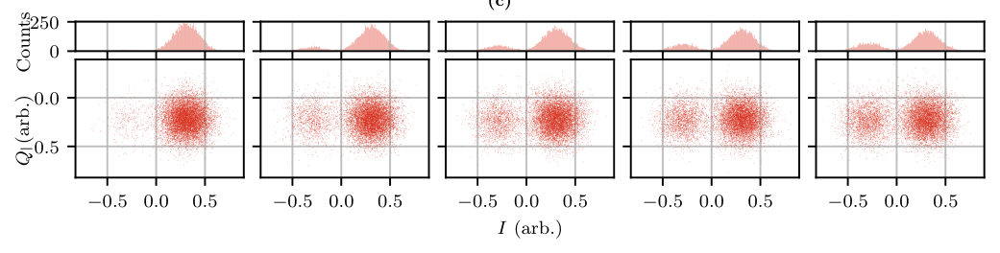 
FIG. 1. State deterioration reflected in readout-distribution changes in the five-cycle QR-Stabilizer workload. (a) Core circuit with a measured data qubit and a phase-kickback ancilla. Lifting proxy wires are omitted. (b) SPAM references for preparation labels 0 (blue) and 1 (red) on qubit 51 of ibm fez. 10,000 shots per class are sampled from the reference acquisitions for display. (c) Target-readout I–Q distributions ordered from cycles c1 to c5. (d) Equal-prior kernel density estimation (KDE) Bayes-risk estimates comparing the SPAM-0 reference with each ideal-1 target cycle, SPAM-trained NN-based QSD error rates, and transferred digital-error estimates. The curve labeled ibm fez...

📷 Fig 2

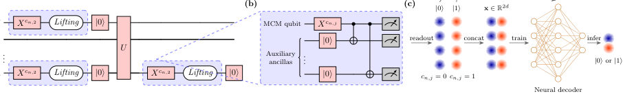 
FIG. 2. Lifting workflow. (a) Context-matched calibration executions prepare reference labels and place encoded readout at the workload’s measurement locations. (b) Local repetition encoding couples the labeled MCM qubit to d −1 auxiliary ancillas initialized to |0⟩. Concurrent readout supplies their joint I–Q readout signals. (c) The d I–Q pairs are concatenated into a 2d-component feature vector. Reference labels supervise neural training, and inference assigns a logical outcome to each target observation. Optional confidence selection retains a subset of observations before reporting retained-shot accuracy.

📷 Fig 3

 
FIG. 3. Error rates across five MCM cycles: the KDE Bayes- risk estimate, SPAM-trained NN-based QSD, the transferred ibm fez digital estimate from Fig. 1(d), and single-channel NN-based QSD with cycle-matched in situ calibration. The risk curve compares constructed reference–target distribu- tions. The decoder curves evaluate target shots. Contextual calibration changes the training references, while this com- parison retains the single-channel observation space.

📷 Fig 4

 
FIG. 5. Target-only and joint I–Q readout discrimination for d = 2 on ibm fez, using 10,000 shots per preparation la- bel. (a,b) Target and auxiliary (proxy) I–Q scatter, with blue and red denoting reference labels 0 and 1, respectively. (c,d) Signed quadratic-discriminant scores s1 −s0 from the two- dimensional target observations and four-dimensional joint I–Q readout signals. Annotated risks are equal-prior KDE- based estimates of distributional overlap, rather than held-out classifier error rates.

📷 Fig 5

 
FIG. 6. IBM Fez assignment accuracy versus encoding dis- tance d, comparing hardware measurements (emp.) with the fitted empirical model in Eq. (18). The curve labeled theo. uses κ = 0.45 and α = 9.03, fitted for the displayed distance sweep.

**Summary.** This paper introduces 'Lifting,' a novel framework designed to improve quantum state discrimination for mid-circuit measurements in superconducting quantum computers. It tackles two major issues: the fundamental error limit set by readout noise (Bayes risk) and the practical problem of state deterioration over the course of a quantum circuit. By using repetition encoding and calibrating the neural decoder with context-specific measurements, the framework significantly enhances the reliability of quantum error correction protocols.

**Why it may be interesting.** The focus on state deterioration and the necessity of context-aware calibration directly relates to open quantum systems dynamics and error management in physical quantum hardware, which is highly relevant to AMO physics and quantum optics.

Detailed structure

**Main problem.** The paper addresses the challenge of accurately performing Quantum State Discrimination (QSD) for Mid-Circuit Measurements (MCMs) in noisy superconducting quantum hardware.

**Main result.** The proposed 'Lifting' framework, which combines repetition encoding and in situ calibration, successfully improves QSD accuracy by accounting for state deterioration during circuit execution.

**Method.** The authors developed a framework that uses repetition encoding to supply joint I-Q readout signals, processes these signals with a neural network decoder, and trains the decoder using calibration data acquired contextually during the actual measurement workload.

**Model / system.** The work is implemented on superconducting quantum processors (e.g., IBM processors) using qubits governed by readout interactions described by a Hamiltonian involving I-Q demodulated signals. The core challenge is distinguishing between the measured analog signals and the underlying discrete quantum states.

**Key observables.** Joint In-phase (I) and Quadrature (Q) readout signals, whole-trace accuracy for stabilizer measurements, and final-syndrome correctness for QEC circuits.

**Important parameters / regimes.** Bayes risk (fundamental error limit), $T_1$ and $T_2$ decoherence times, and the number of auxiliary qubits used in encoding.

**Assumptions / limitations.** The primary assumption is that state deterioration (history dependence) causes the measured I-Q distributions to deviate significantly from static calibration references (SPAM).

**Figures summary.** Figures illustrate state deterioration in MCM workloads (like QR-Stabilizer), comparing initial calibration distributions to later, degraded distributions, and show the workflow of the Lifting framework using joint I-Q pairs.

**Paper structure.** The paper establishes the limitations of standard NN-based QSD due to noise and state deterioration. It then introduces the Lifting framework, detailing the components: repetition encoding, in situ calibration, and neural decoding. Finally, it validates the framework through experimental results on multiple MCM workloads.

Abstract

Quantum computing promises new capabilities beyond classical computation. Mid-circuit measurements (MCMs) enable error correction and outcome-dependent control, but their reliability is limited by noise on superconducting hardware. These operations depend on accurate quantum state discrimination (QSD), which assigns measured signals to state labels. Neural network-based (NN-based) QSD improves this assignment, yet its error remains bounded below by the Bayes risk of the available readout distributions. A complementary challenge is state deterioration as successive measurements accumulate and circuit execution advances, making static calibration less representative of the workload. We present Lifting, a QSD framework that addresses both challenges through repetition encoding, neural decoding, and in situ calibration. Encoding supplies joint in-phase and quadrature (I-Q) readout signals from the target and auxiliary qubits, while contextual calibration trains the decoder for the conditions encountered during execution. Our theoretical analysis shows that retaining additional channels from a fixed joint distribution cannot increase Bayes risk and establishes sufficient conditions for contraction of an overlap-based upper bound. Experiments across three IBM processors evaluate the framework on repeated stabilizer measurement, parity-check, and teleportation workloads.

[↑ back to top](#top)

### [Macroscopic fluctuation theory of stochastic systems undergoing monitoring](http://arxiv.org/abs/2610.18500v1)

**Authors:** João Costa, Pedro Ribeiro, Andrea De Luca  
**Type:** theory · **Category:** statistical mechanics · **PDF:** <https://arxiv.org/pdf/2610.18500v1>  
**Analysis basis:** full PDF text, analyzed in chunks
**Topic relevance:** 🔥 `quantum measurements` **4/5** · `non-equilibrium universality` **3/5** · `Full counting statistics` **1/5** · `Keldysh / 2PI / non-Gaussian methods` **1/5** · `driven-dissipative phase transition` **1/5** · `methods for driven-dissipative` **1/5**

📷 Fig 1

 
Figure 1: The two saddle-point branches generated by Eq. (46) are plotted for several values of K for SSEP at E = 4, J = 1, γ = 0, and n∗= 1/2. The line intensity decreases as K increases.

📷 Fig 2

 
Figure 2: In panel (a), we show the two ± saddle-point profiles that satisfy condition C for SSEP at E = 4, J = 1, γ = 0, and n∗= 1/2. In panel (b), we plot the corresponding effective potential Vγ,J(ρ), marking the value of K that satisfies condition C in yellow. K fixes the turning points of the saddle-point profiles, which we show in red and blue.

📷 Fig 3

 
Figure 4: Qγ,J(K) −Qγ,J(V∗) vs K −V∗, for different values of J, near the local critical current. At J = Jloc c (light orange), the perturbative condition is Q′ γ,Jloc c (V∗) = Gγ,Jloc c (V∗) = 0. For J &lt; Jloc c , the global minimum of Qγ,J(K) is

📷 Fig 4

 
Figure 5: Possible scenarios for the behavior of Qγ,J(K) −Qγ,J(V∗) as a function of K −V∗at J = Jloc c , where Q′(V∗) = G(V∗) = 0. The lighter curves sketch the profiles immediately before and after the transition. Panels (a) and (b) show cases when the local criterion (sign of Q′′(V∗)) is sufficient to detect the order of the transition; panel (c) shows a case when a distant minimum can still make the transition first order even though Q′′(V∗) &gt; 0; this clarifies why Q′′(V∗) &gt; 0 is a necessary but not sufficient condition for a putative second order transition.

📷 Fig 5

 
Figure 6: Nature of the putative critical point (J = Jc) for the particle-hole- symmetric KLS model at ϵ = 0.6 and δ = 0. Gray denotes the region with no DPT, while blue and red indicate first- and second-order DPTs, respectively. The solid black curve corresponds to Jc = 0. This curve is distinct from the gray dotted line, Jloc c = 0, which gives the local condition for the onset of a DPT. The solid red curve represents our derived condition B∗(E, γ) = 0 for the boundary between first- and second-order transitions, in agreement with the numerical results.

**Summary.** This paper extends Macroscopic Fluctuation Theory to study stochastic lattice gases under continuous monitoring. It shows that measurement fundamentally alters the system's effective dynamics by adding a confining term to the action. The work provides quantitative predictions about how monitoring affects phase transitions and current statistics in driven diffusive systems.

**Why it may be interesting.** The framework of MFT and large-deviation principles is central to non-equilibrium statistical mechanics, providing tools to analyze how external measurements or monitoring affect the steady-state and fluctuation properties of complex many-body systems.

Detailed structure

**Main problem.** Developing a macroscopic fluctuation theory for diffusive classical lattice gases subjected to continuous coarse-grained monitoring.

**Main result.** Observation adds a quadratic confining term to the MFT action, and for 1D models, monitoring can suppress dynamical phase transitions and change their order.

**Method.** The authors use Macroscopic Fluctuation Theory (MFT) in the typical-outcome (quenched) regime to derive large-deviation principles for current fluctuations.

**Model / system.** The system is a diffusive classical lattice gas on a bounded domain, modeled as a continuous time Markov process. The analysis is performed in the hydrodynamic limit, yielding a continuum description governed by the continuity equation.

**Key observables.** The current large-deviation function, the MFT action, and the cumulants of the current distribution.

**Important parameters / regimes.** The measurement strength (monitoring), the dimensionality ($d$), and the mobility of the system.

**Assumptions / limitations.** The analysis relies on the coarse-grained nature of the measurement (mesoscopic averaging) and treating measurements in the typical-outcome (quenched) regime.

**Figures summary.** Figure 19 illustrates the convergence of the saddle-point density and the left boundary profile for a monitored SSEP, showing the functional form of the rate function $\phi_\gamma(J)$.

**Paper structure.** The paper builds from reviewing MFT principles and defining coarse-grained measurements, applying this framework to derive the rate functional, and finally analyzing specific boundary effects in the strong-measurement limit.

Abstract

We develop a macroscopic fluctuation theory for diffusive classical lattice gases subject to continuous coarse-grained monitoring. Treating measurements in the typical-outcome (quenched) regime, we show that observation adds a quadratic confining term to the MFT action that pins the density to its hydrodynamic profile. We derive sufficient conditions under which, in the presence of monitoring, the current large-deviation function remains convex, the additivity principle holds, and dynamical phase transitions are excluded. For particle-hole-symmetric one-dimensional models we find that monitoring suppresses dynamical phase transitions and can change their order from second to first, as we demonstrate in the Katz--Lebowitz--Spohn model. In the strong-measurement limit, we find that the current distribution becomes Gaussian and determine the scaling of its cumulants: they follow simple power laws when the mobility remains nonzero throughout the system, but exhibit anomalous logarithmic scaling when the mobility vanishes at the boundaries.

[↑ back to top](#top)

### [Development and experimental implementation of noise characterisation techniques on a superconducting quantum processor](http://arxiv.org/abs/2610.18000v1)

**Authors:** Nelson M. M. Fernández, Francesco Grieco, Hetta Vappula, Stefano Mangini, Boris Sokolov, Elsi-Mari Borrelli, Matteo A. C. Rossi, Sergey N. Filippov, N. Walter Talarico  
**Type:** experiment · **Category:** quantum information and computing · **PDF:** <https://arxiv.org/pdf/2610.18000v1>  
**Analysis basis:** full PDF text, analyzed in chunks
**Topic relevance:** 🔥 `QC/QI experiment` **4/5** · `correlated / nonlocal dissipation` **2/5** · `methods for driven-dissipative` **2/5** · `quantum measurements` **2/5**

📷 Fig 1

 
FIG. 1: Coupling map and typical readout and CZ-gate fidelities of VTT Q50 [45]. Although the physical hard- ware topology labels start at 1, the software implemen- tation adopts 0-based indexing. The qubit labels are otherwise contiguous, except for the missing QB32. Ac- cordingly, the Qiskit backend reports 53 rather than 54 qubits, accounting for the deactivated qubit.

📷 Fig 2

 
FIG. 2: Cumulative distribution of PRX-gate, CZ-gate, and readout (RO) infidelities across VTT Q50 [45]. Each curve is the empirical distribution over all calibrated qubits, or all calibrated couplers, of the calibration set of 2026-08-21; the medians are 1.2×10−3, 9.6×10−3 and 2.9 × 10−2 respectively.

📷 Fig 3

 
FIG. 3: Noise learning protocol. After selecting the active qubit layout for the characterisation experiment, the cycle benchmarking (CB) protocol is used to determine the Pauli fidelity estimates required for fitting the noise model parameters.

📷 Fig 4

 
FIG. 4: Structure of the cycle benchmarking circuit for a depth-two block consisting of two layers of concurrent noisy CZ gates interleaved by single-qubit gates and pre- ceded by state-preparation gates Bi. In general, after a depth-d block, the inverse of the state preparation basis gates is applied, followed by measurement twirling gates Mi, randomly sampled from identity I and X gates. Fi- nally, all qubits are measured.

📷 Fig 5

 
FIG. 5: Basis selection protocol: Given the processor coupling map and the selected physical-qubit layout, if the qubit ordering satisfies the condition of [24, Theorem SIV.1], then there exist nine bases such that for each pair of physically connected qubits, the entire set {X, Y, Z}⊗2

**Summary.** This paper details the development and experimental implementation of advanced noise characterization techniques on a superconducting quantum processor. By refining cycle benchmarking and tensor-network tomography, the authors map the noise structure, track noise drift, and validate noise models. This work is crucial for understanding hardware limitations and scaling quantum computation.

**Why it may be interesting.** This work provides concrete, hardware-level techniques for quantifying noise sources in superconducting qubits, which is foundational knowledge for designing fault-tolerant quantum computation protocols.

Detailed structure

**Main problem.** The paper addresses the critical need to accurately characterize noise in superconducting quantum processors to enable effective error mitigation and establish reliable performance bounds.

**Main result.** The developed noise characterization methods allow for the extraction of approximate sublayer noise models, enabling the assessment of noise stability and providing estimates for the size of noise-mitigated circuits.

**Method.** The authors revise cycle-benchmarking protocols and extend tensor-network tomography to map the noise structure, track noise drift, and validate learned models against experimental measurements.

**Model / system.** The study uses a superconducting quantum processor with a square-lattice topology (VTT Q50) and models the noise using a Sparse Pauli–Lindblad (SPL) model for entangling gates.

**Key observables.** Single qubit readout fidelity, CZ Gate fidelity, Pauli fidelities ($f_a$), and total estimation error in benchmark circuits.

**Important parameters / regimes.** Noise parameter drift, circuit depth (L=15), and width (N=50) for error estimation.

**Assumptions / limitations.** The noise is assumed to be Pauli noise, and the analysis involves trade-offs between the efficiency and accuracy of different noise learning protocols.

**Figures summary.** Figures show coupling maps, gate/readout infidelities across the processor, and decay curves comparing measured vs. predicted signal decay for various observables on different lattice sizes.

**Paper structure.** The paper proceeds by detailing device specifications, then presenting the theory and modifications for cycle benchmarking and tensor-network tomography, followed by validation on benchmark circuits and final experimental results.

Abstract

Noise characterisation not only enables error mitigation but also provides valuable information about the intrinsic performance of a quantum device, identifying dominant error contributions and bounding noise stability well beyond the aggregated calibration data. Deploying such methods on a specific hardware topology must combine efficiency and accuracy, assess noise stability, and validate the reconstructed noise model. Here we develop and implement these methods on a superconducting processor with square-lattice topology. First, we revise the cycle-benchmarking protocol and reduce the bias arising from unlearnable degrees of freedom via a regularised cost function. Second, we extend a previously developed tensor-network tomography method to match the device layout and show how its accuracy can be improved by repeated layer execution. Both methods allow approximate sublayer noise models to be extracted from parent ones. Using noise characterisation as a tool, we map the noise structure, track drift, and validate the adequacy of the learnt noise models against experimentally observed noisy estimations in benchmark physical and chemistry circuits. These results inform further improvements in the underlying technology and provide estimates of the size of noise-mitigated circuits that the device can support.

[↑ back to top](#top)

### [Fermionic non-Gaussianity via computable measures and experimentally accessible bounds](http://arxiv.org/abs/2610.17219v1)

**Authors:** Leela Ganesh Chandra Lakkaraju, Naga Dileep Varikuti, Philipp Hauke  
**Type:** theory · **Category:** strongly correlated electrons · **PDF:** <https://arxiv.org/pdf/2610.17219v1>  
**Analysis basis:** full PDF text, analyzed in chunks
**Topic relevance:** 🔥 `analog quantum simulation` **4/5** · `Keldysh / 2PI / non-Gaussian methods` **2/5** · `methods for driven-dissipative` **1/5**

📷 Fig 1

 
FIG. 1. Non-Gaussianity of the ground state of the Fermi–Hubbard chain (solid curves), quantified by the distance to the closest Gaus- sian state (D(|ψ⟩)) obtained via the iterative procedure of Theo- rem 1. The N fermionic modes are at [for even N, panel (a)] or near half-filling [odd N, (b)]. For all N considered, the non-Gaussianity increases with U/t. The lower bound obtained in Theorem 4 (dash- dotted) provides a genuine witness of non-Gaussianity at intermedi- ate and strong interactions and becomes tighter with increasing N.

📷 Fig 2

 
FIG. 2. Lower bounds on the non-Gaussianity of the Fermi–Hubbard ground state at half filling, for N = 8 (light) and N = 10 (dark) sites. Shown are the geometric measure D(|ψ⟩) obtained from the iterative procedure of Theorem 1 (crosses), the lower bound DL of Theorem 4 (stars), and the antiflatness bound F1(|ψ⟩)/4n (circles), with n = 2N the number of fermionic modes. Below U/t ≈5.0 for N = 10 and U/t ≈6.2 for N = 8, DL vanishes and antiflatness supplies the only non-trivial bound; beyond these thresholds the or- dering reverses. Antiflatness cannot exceed 1/4 by construction and is almost independent of system size; the two circle curves nearly coincide, whereas DL keeps tracking the...

**Summary.** This paper introduces a geometric measure, the fidelity distance, to quantify fermionic non-Gaussianity in interacting quantum systems. It develops an iterative algorithm to compute this measure, providing a scalable route applicable even at strong coupling. The resulting witness relies only on measurable two- and four-point correlators, making it highly relevant for experimental quantum simulation platforms.

**Why it may be interesting.** This work provides a powerful, non-perturbative diagnostic tool for characterizing quantum correlations in strongly correlated systems, which is highly relevant for understanding quantum simulation results from platforms like ultracold atoms or superconducting circuits.

Detailed structure

**Main problem.** The paper addresses the challenge of quantifying fermionic non-Gaussianity in interacting quantum many-body systems, especially when perturbative methods fail.

**Main result.** They introduce a geometric measure, the fidelity distance, and derive a computable witness involving only two- and four-point fermionic correlators that remains accurate even at strong coupling.

**Method.** The core method involves defining the non-Gaussianity via the fidelity distance to the Gaussian manifold and developing an iterative formalism to numerically compute this distance.

**Model / system.** The primary model used for benchmarking is the Fermi-Hubbard model, which describes interacting fermions. The system's dynamics are analyzed by comparing the true state to the manifold of Gaussian states.

**Key observables.** Fidelity distance $D(
ho)$, two- and four-point fermionic correlators, and the ratio $U/t$ (interaction strength to hopping).

**Important parameters / regimes.** The interaction strength $U/t$, the regularization parameter $\epsilon$, and the system size $N$.

**Assumptions / limitations.** The Gaussian manifold is non-convex, and the derived bounds are shown to be faithful monotones of the resource theory, though the optimization process might converge to local minima.

**Figures summary.** Figures illustrate the non-Gaussianity $D(|\psi
angle)$ vs. $U/t$ for the Fermi-Hubbard chain, and compare various derived bounds ($D_G, D_L, D_U$) against each other.

**Paper structure.** The paper progresses by defining the geometric measure, developing the iterative numerical formalism, deriving a sharpened operator Jensen inequality to create an experimentally accessible witness, and finally benchmarking this witness on the Fermi-Hubbard model.

Abstract

Interacting fermions owe both their non-trivial correlations and their computational power to their departure from Gaussianity. Yet, quantifying that departure geometrically faces two challenges: the Gaussian manifold is non-convex, and perturbative treatments are confined to weak interactions. Here, we introduce a geometric measure of fermionic non-Gaussianity, the fidelity distance of a target state to the manifold of fermionic Gaussian states. We construct an iteration formalism to numerically access it, applicable also at strong coupling. Further, we prove a sharpened operator Jensen inequality, of interest in its own right. We use it to derive a witness that involves only two- and four-point fermionic correlators. Numerical benchmarks on the one-dimensional Fermi--Hubbard model show that the quality of the witness improves with system size and, for strong coupling, is tighter than antiflatness. Our results open a scalable route to charting non-Gaussianity of strongly-interacting fermionic quantum simulators.

[↑ back to top](#top)

### [Optical parametric amplification of spatiotemporal optical vortices](http://arxiv.org/abs/2610.18203v1)

**Authors:** Houan Teng, Chenhao Wan, Qiwen Zhan  
**Type:** both · **Category:** other · **PDF:** <https://arxiv.org/pdf/2610.18203v1>  
**Analysis basis:** full PDF text, analyzed in chunks
**Topic relevance:** 🔥 `interference shaping light` **4/5** · `quantum optics experiment` **3/5**

📷 Fig 1

 
Fig. 1 Conceptual illustration of topology-preserving optical parametric amplification of spatiotemporal optical vortices. A spatiotemporal optical vortex interacts with a coherent pump field through a second-order nonlinear process, where optical parametric amplification enables simultaneous energy scaling and topological information transfer. (a,b) Complex-field representations of the Gaussian pump and the input STOV signal, respectively. The pump provides nonlinear energy transfer, while the signal carries a transverse optical topology encoded in the coupled spatiotemporal domain. (c) Schematic of the three-wave mixing interaction, where the pump, signal and idler fields are coherently...

📷 Fig 2

 
Fig. 2 Experimental platform for generation, amplification and characterization of spatiotemporal optical vortices. A two-stage OPA system is developed for STOV generation, amplification and complex field characterization. A broadband seed generated through supercontinuum generation (i) is first amplified in OPA1 (iii) to provide sufficient energy for spatiotemporal modulation and a coherent idler reference. The pump pulse is generated through second-harmonic generation (ii). A programmable pulse shaper (iv) consisting of a grating, cylindrical lens and spatial light modulator introduces spatial-spectral coupling to generate STOVs with controlled topological charge. The structured pulse is...

📷 Fig 3

 
Fig. 3 Coherent amplification and topology preservation of spatiotemporal optical vortices. (a, b) Simulated and experimentally reconstructed complex fields of a STOV with ℓ=1 before and after OPA. (c, d) Corresponding results for a STOV with ℓ=2. For each case, intensity and phase distributions are shown in both the x−ω and x−t domains, linked by Fourier transformation. The amplified fields retain the phase singularities and topological structure of the input STOVs, with measured energy gains of approximately 63× and 58× for ℓ=1 and ℓ=2, respectively.

📷 Fig 4

 
Fig. 4 | Phase-conjugated topology transfer in generated idler STOVs. (a,b) Simulated and experimentally reconstructed complex fields of idler STOVs generated from input signal vortices with and , respectively. The idler fields exhibit reversed phase winding and opposite topological charges ( and ) in both the x−ω and x−t domains, demonstrating phase-conjugated transfer of spatiotemporal topology through nonlinear frequency conversion.

**Summary.** This paper presents the theoretical and experimental demonstration of using Optical Parametric Amplification (OPA) to amplify Spatiotemporal Optical Vortices (STOVs). The authors show that OPA can significantly boost the signal energy while faithfully preserving the complex spatiotemporal topological structure. This establishes OPA as a powerful, tunable platform for engineering high-intensity, structured light beams.

**Why it may be interesting.** This work is highly relevant to quantum optics and open quantum systems because it treats structured light (vortices) as carriers of quantum information (topological charge) that can be amplified and manipulated coherently using nonlinear parametric processes, bridging quantum optics with high-intensity light applications.

Detailed structure

**Main problem.** The primary goal is to demonstrate the theoretical analysis and experimental realization of amplifying Spatiotemporal Optical Vortices (STOVs) using Optical Parametric Amplification (OPA) while maintaining their complex spatiotemporal structure.

**Main result.** The study successfully shows that OPA can coherently amplify STOVs by a factor of $\sim 60$ while robustly preserving their topological charges. Furthermore, the generated idler beam inherits a phase-conjugated STOV topology.

**Method.** The research combines theoretical modeling (using coupled-wave equations and conservation laws) with advanced experimental techniques, specifically using programmable spatiotemporal pulse shapers and spatially resolved spectral interferometry for characterization.

**Model / system.** The physical system is the nonlinear interaction within an OPA setup, involving a pump, signal, and idler field. STOVs are structured light characterized by phase singularities in the spatiotemporal domain, coupling spatial and temporal dimensions.

**Key observables.** Signal energy enhancement factor ($\sim 60$-fold), topological charge ($\ell$), phase singularity location, and the phase-conjugated topology of the idler field.

**Important parameters / regimes.** Wavelength tunability (visible to near-infrared), topological charge ($\ell$), and the nonlinear coupling constant ($\chi^{(2)}$).

**Assumptions / limitations.** The analysis often assumes perfect phase matching ($\Delta k = 0$) for analytical derivations, and the process is modeled as an ideal parametric interaction.

**Figures summary.** Figures illustrate the conceptual process of topology-preserving OPA, showing the setup, the amplification of $\ell=1$ and $\ell=2$ STOVs with preserved singularities, and the resulting phase-conjugated topology transfer to the idler field.

**Paper structure.** The paper progresses from defining the problem (amplification and tunability of STOVs) to presenting the theoretical framework (coupled-wave equations) and then detailing the experimental realization using a two-stage OPA platform for characterization and demonstration of topology transfer.

Abstract

Spatiotemporal optical vortices (STOVs) are structured light featuring a phase singularity in the spatiotemporal domain, exhibiting unique topology that couples spatial and temporal dimensions. To date, amplification of STOVs remains unexplored, and their wavelength tunability is limited by available light sources. In this work, we present the theoretical analysis and experimental demonstration of optical parametric amplification (OPA) of STOVs. The pulse energy of the STOV signal is enhanced by a factor of 60, while its spatiotemporal structure is robustly preserved. The generated idler inherits the phase-conjugated STOV topology with the opposite topological charge, governed by simultaneous conservation of energy, linear momentum, and spatiotemporal orbital angular momentum. The intrinsic wavelength-conversion capability of OPA further provides a route towards spectrally tunable STOV generation, spanning from visible to near-infrared wavelength regimes. This work paves the way toward further development of multi-stage amplification architectures, facilitating applications of wavelength-tunable spatiotemporally structured light at ultrahigh intensities.

[↑ back to top](#top)

### [Skin phase transition of a skyrmion in a ferromagnetic superfluid](http://arxiv.org/abs/2610.17796v1)

**Authors:** Wooyoung Yun, Se Kwon Kim, Hiromitsu Takeuchi  
**Type:** theory · **Category:** quantum gases · **PDF:** <https://arxiv.org/pdf/2610.17796v1>  
**Analysis basis:** full PDF text, analyzed in chunks
**Topic relevance:** 🔥 `analog quantum simulation` **4/5** · `Keldysh / 2PI / non-Gaussian methods` **1/5** · `driven-dissipative phase transition` **1/5** · `methods for driven-dissipative` **1/5**

📷 Fig 1

 
FIG. 1. Plot of the order parameter amplitude fm(r) (solid lines) and the cross section of |Ψm(r)| (markers) for (a) q/µ = −0.14 and (b) q/µ = −0.90. Markers show |Ψm(x, 0)| extracted from the two-dimensional simulation. In (a), the skyrmion has the BA-skin structure with nonzero f0 at the domain wall. On the other hand, in (b), the skyrmion has the AF-skin structure with vanishing f0(r) and in-plane magnetization. (c-d) are the spin configuration for (c) q/µ = −0.14 and (d) q/µ = −0.90. Each arrow represents the spin direction, magnitude and the color represents the z-component of the spin sz.

📷 Fig 2

 
FIG. 2. Numerical results for 7Li condensate. (a) The plot of max(f0/√nF ) as a function of q/µ. The blue dots are the numerical values obtained by solving Eqs. (10,11) and the red dashed line is the critical value qc/µ ≈−0.769 obtained from BdG analysis. (b) The plots of skyrmion radius. The blue dots are the numerical values and the yellow solid line is the solution of Eq. (47), which is the theoretical prediction from hydrostatic approximation. The inset enlarges the vicinity of the critical point.

📷 Fig 3

 
FIG. 3. (Upper) The spectrum of ˜ϵ+ and (lower) qc/µ as a function of l, respectively, for cs/cn = −0.5.

📷 Fig 4

 
FIG. 4. The phase diagram for −1 &lt; cs/cn &lt; 0 and −1 &lt; q/µ &lt; 0 with p = 0. The blue dots represent the BA-skin phase, the yellow triangles represent the AF- skin phase, and the green inverted triangles represent the normal-core vortex phase. The red dashed curve is the criti- cal value for BA-AF transition, qc/µ [Eq. (41)], the purple dash-dotted line is the critical value for AF-Nc transition [Eq. (54)]. The straight black dotted line parallel to cs/cn- axis is qc1 [Eq. (58)], parallel to q/µ-axis is the cs/cn = γc [Eq. (59)]. The black dotted curve is the qc2, which is ob- tained numerically by parameter scanning (see the discussion below Eq. (59)). The cyan solid curve is the numerically-...

📷 Fig 5

 
FIG. 6. (Upper) The spectrum of ϵ0 and (lower) qc1/µ as a function of l, respectively.

**Summary.** This theoretical study maps out the complex phase diagram of skyrmion structures in a ferromagnetic spin-1 Bose-Einstein Condensate. By analyzing the Gross-Pitaevskii equation and its stability spectrum, the authors predict continuous transitions between BA-skin and AF-skin phases, alongside a discontinuous transition to a normal-core vortex state. This work advances the understanding of topological matter in quantum gases.

**Why it may be interesting.** This work is highly relevant to AMO physics as it explores topological defects (skyrmions) in ultracold atomic systems (BECs). The detailed phase diagram mapping and stability analysis provide concrete, predictive tools for controlling exotic quantum states in magnetic superfluids.

Detailed structure

**Main problem.** The paper investigates the skin phase transition of a skyrmion within a ferromagnetic superfluid realized in a spin-1 Bose-Einstein Condensate (BEC). It specifically analyzes the transition between three distinct soliton structures: BA-skin, AF-skin, and normal-core phases.

**Main result.** The skyrmion structure undergoes continuous phase transitions between the BA-skin and AF-skin phases, controlled by the quadratic Zeeman coefficient ratio ($q/\mu$). Furthermore, a discontinuous transition to a normal-core (Nc) vortex phase is predicted.

**Method.** The study employs theoretical analysis using the Bogoliubov-de Gennes (BdG) equation to estimate transition boundaries, complemented by numerical solutions of the Gross-Pitaevskii equation (GPE) for confirmation.

**Model / system.** The system is a spin-1 BEC, whose dynamics are governed by the GPE. The physics is controlled by dimensionless parameters, notably $q/\mu$ (quadratic Zeeman ratio) and $c_s/c_n$ (spin interaction ratio), under the assumption of zero linear Zeeman coefficient ($p=0$).

**Key observables.** The primary observables are the spatial profiles of the order parameter amplitude ($f_m(r)$) and the existence/nature of the skin structure (BA-skin vs. AF-skin).

**Important parameters / regimes.** The key controlling parameters are $q/\mu$ and $c_s/c_n$. The analysis focuses on the ferromagnetic regime ($c_s < 0$ and $q < 0$).

**Assumptions / limitations.** The analysis assumes rotational symmetry and utilizes the GPE framework. Specific approximations include using the BdG equation for stability analysis and the hydrostatic approximation for radius estimation.

**Figures summary.** Figures illustrate the structural differences between BA-skin and AF-skin phases at different $q/\mu$ values. Other figures map out the phase boundaries in the parameter space ($q/\mu$ vs. $c_s/c_n$) and show hysteresis loops characterizing the BA-Nc transition.

**Paper structure.** The paper progresses by first establishing the theoretical framework and identifying the three soliton phases. It then uses the BdG equation to analyze the continuous BA-AF transition and subsequently investigates the more complex, potentially discontinuous, transitions involving the normal-core phase.

Abstract

Compared with a scalar Bose-Einstein condensate (BEC), a spinor BEC supports richer phenomena because of its internal spin degrees of freedom, including topological solitons such as domain walls or skyrmions. Here, we theoretically reveal three distinct axisymmetric soliton structures formed as a circular domain wall in a spin-1 BEC, connected within fixed winding numbers. We refer to these structures as the broken-axisymmetry (BA)-skin, antiferromagnetic (AF)-skin and normal-core phases. Their occurrence is controlled by the two dimensionless parameters in the absence of linear Zeeman coefficient $p=0$: $q/μ$, the ratio of the quadratic Zeeman coefficient to the chemical potential, and $c_s/c_n$, the ratio of spin interaction to the density interaction. The BA-skin and AF-skin phases exhibit local easy-plane magnetic order and local easy-plane spin-nematic order, respectively, while the normal-core phase is similar to a doubly quantized vortex analogous to that of a scalar BEC with a density depletion at the center. We obtain semi-analytical estimates of selected transition boundaries separating these phases by analyzing the Bogoliubov-de Gennes equation and also numerically confirm them by solving the Gross-Pitaevskii equation. We estimate the skyrmion radius using a hydrostatic approximation and compare the result with numerical solutions. We envision our results on skyrmions in a spin-1 BEC can trigger further investigation on novel soliton structures in a magnetic superfluid.

[↑ back to top](#top)

### [Unequal Coherent Ergotropy at Equal Interferometric Visibility and Energy in Quantum-Controlled Interferometers](http://arxiv.org/abs/2610.18474v1)

**Authors:** Tonipe Anuradha, André H. A. Malavazi, Borhan Ahmadi, Lucas Pollyceno, Pedro R. Dieguez  
**Type:** theory · **Category:** quantum information and computing · **PDF:** <https://arxiv.org/pdf/2610.18474v1>  
**Analysis basis:** full PDF text, analyzed in chunks
**Topic relevance:** 🔥 `quantum measurements` **4/5** · `interference shaping light` **3/5**

📷 Fig 1

 
FIG. 1: Schematic circuit representation of the two Mach–Zehnder interferometric setups considered. In both cases, the interferometric path qubit is initialized in the Gibbs state. (a) In the QDCE, the first beam splitter (BS) is a fixed Hadamard gate (yellow box), while the second (purple box) is controlled by the BS controller. (b) In the QCRE, the roles are swapped, so that the first BS is controlled, while the sec- ond is a fixed Hadamard. In both cases, the phase shifter (gray box) imprints a relative phase ϕ on arm |1⟩.

📷 Fig 2

 
FIG. 2: (a)–(c) Output ergotropy components as functions of the phase ϕ for different values of the beam-splitter mixing angle α (legend), and (d) coherent ergotropy gap, at q = 1. (a) Incoherent ergotropy Rinc/ω, common to both setups since Rinc QDCE = Rinc QCRE [Eq. (41)], and nonzero only for cos ϕ &lt; 0, vanishing at α = π/2. (b) Coherent ergotropy of the QDCE, Rcoh QDCE/ω [Eq. (31)], which is phase-dependent through G(α, ϕ) and dips to zero at α = π/4, ϕ = π/2, 3π/2. (c) Coherent ergotropy of the QCRE, Rcoh QCRE/ω [Eq. (40)]. The QCRE coherent ergotropy is everywhere at least as large as that of the QDCE. (d) Heatmap of the coherent ergotropy gap Rcoh QCRE −Rcoh QDCE on the (α, ϕ) plane...

📷 Fig 3

 
FIG. 3: Contour maps of the total ergotropy R/qω on the (α, ϕ) plane for QDCE (left) and QCRE (right). Dotted white curves are iso-ergotropic contours [25]. The thermal factor q only rescales the map, so that Rθ/q is independent of the initial temperature [Eq. (46)] for q &gt; 0, extended to q = 0 by continuity. Both peak at the qubit maximum for α = 0, ϕ = π, and are pinned at ωq/2 along α = π/2. They differ in their zeros, since the QDCE output becomes passive at α = π/4, ϕ = π/2 and 3π/2 (dark regions), where the QCRE still yields ωq/(2 √

📷 Fig 4

 
FIG. 4: Work–like signal–to–noise ratio SNR for the (a) QDCE and (b) QCRE setups, and its equal (c) incoherent component, for q = 1/2. (d) SNRcoh gap.

📷 Fig 5

 
FIG. 5: Controller entropy difference S(ˆρQDCE C ) −S(ˆρQCRE C ) versus the coherent-ergotropy gap (Rcoh QCRE −Rcoh QDCE)/ω, for α ∈[0, π/2] and ϕ ∈[0, 2π], at four values of q. Stars mark the extreme points α = π/4, ϕ = π/2, 3π/2, and the dotted curve traces them as q varies.

**Summary.** This paper analyzes quantum interferometers to show that the extractable work (coherent ergotropy) depends not just on the output interference pattern, but also on the sequence of quantum operations performed. By comparing two setups, the authors demonstrate that path predictability, which is hidden from visibility measurements, dictates the available work. This highlights that visibility is an incomplete measure of quantum coherence for work extraction.

**Why it may be interesting.** This work provides a concrete, measurable example showing that thermodynamic work extraction (ergotropy) is a more sensitive measure of quantum coherence than simple interference visibility, linking quantum measurement theory to thermodynamics.

Detailed structure

**Main problem.** The study investigates whether the coherent ergotropy (unitarily extractable work) in quantum interferometers is sensitive to path predictability in ways that are invisible to standard measures like interference visibility.

**Main result.** The order of operations in the interferometer setup (QDCE vs. QCRE) can lead to different amounts of extractable coherent work, even when visibility and stored energy are identical.

**Method.** The authors compare two quantum-controlled interferometer arrangements by calculating the coherent ergotropy for both, extending the analysis to relativistic regimes.

**Model / system.** The system uses a two-level system (TLS) traversing a Mach-Zehnder Interferometer (MZI) whose beam-splitter control is governed by an auxiliary quantum degree of freedom, acting as a quantum battery.

**Key observables.** Coherent Ergotropy, Interference Visibility (V), Path Predictability (P), Which-Way Distinguishability (D), and the Landauer bound cost.

**Important parameters / regimes.** Path predictability ($P$), visibility ($V$), overlap ($
u$), and the control parameter $q$ (related to thermal state preparation).

**Assumptions / limitations.** The analysis assumes $\hbar=1$ and compares non-relativistic and relativistic limits where spin decoherence is introduced.

**Figures summary.** Figure 1 schematically illustrates the two comparative setups: the Quantum Delayed-Choice Experiment (QDCE) and the Quantum-Controlled Reality Experiment (QCRE) using BS gates.

**Paper structure.** The paper systematically compares the theoretical predictions for ergotropy and related coherence measures between the QDCE and QCRE setups, first in the non-relativistic limit, and then extending the formalism to include relativistic spin correlations.

Abstract

The ergotropy, or unitarily extractable work, of a quantum system naturally splits into incoherent and coherent contributions, respectively set by population inversion and coherences in the energy eigenbasis. We show that this split makes the coherent ergotropy of a Mach--Zehnder qubit sensitive to path predictability that the output interference fringes do not reveal. We send the path qubit, prepared as a thermal quantum battery, through two quantum-controlled interferometers built from the same elements, a fixed beam splitter and a beam splitter coherently controlled to be present or absent, differing only in the order in which these two act. The two arrangements share identical visibility, stored energy, and incoherent ergotropy at every point in the parameter space. Yet, for work extracted from the output battery alone, placing the controlled beam splitter first never yields less coherent ergotropy, and at fixed visibility and interferometric phase the difference is governed by the path predictability that this ordering creates. The same expression reappears as a purity deficit on the beam-splitter controller, so the work advantage comes with a Landauer bound on the cost of locally resetting the controller that is never larger at the same temperature. We further examine the effects of decoherence on the battery and consider a relativistic realization in which a Wigner rotation correlates the particle's spin with its path. Tracing out the spin decoheres the battery and allows the two arrangements to exhibit different coherent ergotropies even in regimes where their non-relativistic counterparts coincide. These results show that interference visibility is not a complete measure of the coherence available as work.

[↑ back to top](#top)

### [Generating Superposition of Transverse Ising Ground States by Quantum Interaction](http://arxiv.org/abs/2610.17334v1)

**Authors:** Koushik Das, Sayan Mondal, Ujjwal Sen  
**Type:** theory · **Category:** statistical mechanics · **PDF:** <https://arxiv.org/pdf/2610.17334v1>  
**Analysis basis:** full PDF text, analyzed in chunks
**Topic relevance:** 🔥 `analog quantum simulation` **4/5** · `quantum measurements` **2/5**

📷 Fig 1

 
Figure 1. A cat can be sitting, stretching, or lying down, representing three different phases in this illustration. Its behavior differs between these phases, but how would it behave in a superposition of them? In this work, we investigate coherent superpositions of ground states of the transverse-field Ising model belonging to the ferromagnetic, anti-ferromagnetic, and paramagnetic phases, and study the physical properties of the resulting states.

📷 Fig 2

 
Figure 2. Schematic of the setup for preparing superpositions of quantum Ising ground states and the corresponding superposition sectors. (a) A one-dimensional transverse-field Ising chain coupled to a central spin through the quantum interaction defined in Eqs. (1) and (2). (b) Superposition sectors in the J-δ plane for a spin-1/2 central system. The first and second letters denote the phases of the ground states |g(J −δ)⟩and |g(J + δ)⟩, respectively. (c) Superposition sectors in the J-δ plane for a spin-1 central system. The first, second, and third letters denote the phases of the ground states |g(J + δ)⟩, |g(J −δ)⟩, and |g(J)⟩, respectively. In panels (b) and (c), P, F, and A denote the...

📷 Fig 3

 
Figure 3. Transverse magnetization Mz of superpositions of quan- tum Ising ground states across the J–δ plane. (a) The state given in Eq. (12), generated using a spin-1/2 central system, with c+1 = c−1 = 1/ √

📷 Fig 4

 
Figure 4. Nearest-neighbor spin correlations of the state given in Eq. (12), generated using a spin-1/2 central system, across the J–δ plane. Panels (a), (b), and (c) show Cxx 1 , Cyy 1 , and Czz 1 , respectively. The system size is L = 100, with c+1 = c−1 = 1/ √

📷 Fig 5

 
Figure 5. Nearest-neighbor spin correlations of the state given in Eq. (14), generated using a spin-1 central system, across the J–δ plane. Panels (a), (b), and (c) show Cxx 1 , Cyy 1 , and Czz 1 , respectively. The system size is L = 100, with c+1 = c0 = c−1 = 1/ √

**Summary.** This work details a method to create quantum superpositions of ground states from the transverse-field Ising model by coupling the chain to a central auxiliary spin. By controlling the coupling strength via adiabatic evolution and measurement, the authors demonstrate control over superpositions spanning paramagnetic, ferromagnetic, and anti-ferromagnetic regimes. The study quantifies this control using magnetization, correlations, and shows that the quantum estimation sensitivity scales with Heisenberg scaling near critical points.

**Why it may be interesting.** The ability to coherently engineer superpositions across distinct quantum phases using a controllable interaction mechanism is highly relevant for quantum simulation and understanding quantum phase transitions in many-body systems.

Detailed structure

**Main problem.** The paper investigates the preparation and characterization of coherent superpositions of ground states belonging to different magnetic phases of the transverse-field Ising model.

**Main result.** The protocol successfully generates superpositions involving up to three distinct magnetic phases, and the quantum Fisher information exhibits Heisenberg scaling near critical points.

**Method.** State preparation is achieved via adiabatic evolution of the coupled system followed by projective measurement and post-selection on the central auxiliary spin.

**Model / system.** The system is a one-dimensional transverse-field Ising chain coupled to a central auxiliary spin (spin-1/2 or spin-1). The Hamiltonian involves nearest-neighbor coupling strength promoted to an operator acting on the central spin.

**Key observables.** Magnetization, nearest-neighbor spin correlations, nearest-neighbor entanglement, and Quantum Fisher Information (QFI).

**Important parameters / regimes.** The relative strengths of the transverse field ($h$) and the Ising interaction ($J$), which define the paramagnetic, ferromagnetic, and anti-ferromagnetic phases.

**Assumptions / limitations.** The state preparation relies on adiabatic evolution and subsequent projective measurement/post-selection.

**Figures summary.** Figures illustrate the setup, the superposition sectors in the J-delta plane for spin-1/2 and spin-1 systems, and the dependence of observables like magnetization and QFI on the coupling parameters.

**Paper structure.** The paper first introduces the physical model and the state preparation protocol using adiabatic evolution. It then analytically derives expressions for magnetization and spin correlations for different central spin types. Finally, it analyzes the sensitivity of the state using the Quantum Fisher Information, demonstrating its scaling properties.

Abstract

We investigate superpositions of quantum Ising ground states generated through a quantum interaction, in which the nearest-neighbor coupling strength is promoted to an operator acting on a central auxiliary spin. We prepare the central spin in a superposition, which allows the chain to evolve coherently under different effective interaction strengths. The states are prepared by adiabatic evolution of the joint system comprising the central spin and the many-body spin chain, followed by a measurement on the central spin and post-selection of a specific outcome. It is possible to prepare superpositions of transverse-field quantum Ising ground states belonging to the three magnetic phases, namely, the paramagnetic, ferromagnetic, and anti-ferromagnetic phases. For a spin-1/2 central system, it is possible to prepare superpositions of ground states belonging to any two phases, while for the spin-1 case, the superpositions may contain three ground states, each belonging to one of the three phases. We analytically derive expressions for the magnetization, spin correlations, and entanglement of such states. The magnetization and spin correlations show distinct features in different superposition sectors. The nearest-neighbor entanglement is largest where the transverse field and Ising interaction compete, and its behavior differs from that of the magnetic observables. We also derive the quantum Fisher information relevant to estimating the Ising interaction strength. And it exhibits multiple peaks near the critical points of the constituent ground states, with the maximum value showing Heisenberg scaling, for the parameters and system sizes examined.

[↑ back to top](#top)

### [Observation of stacked vortex structure with number controllable Majorana zero mode in Bi$_{2}$Te$_{3}$/FeTe heterojunction](http://arxiv.org/abs/2610.17701v1)

**Authors:** Xinru Han, Zhaokun Luo, Quanxin Hu, Xingjian Zhu, Xiaohong Pan, Dan Mu, Xinyu Liang, Zulin Xu, Qiheng Wang, Ryan L. Kong, Mingyuan Li, Zhengliang Zhang, Fazhi Yang, Mojun Pan, Xin Liu, Qiangqiang Gu, Baiqing Lv, Gan Wang, Hong Ding  
**Type:** experiment · **Category:** quantum information and computing · **PDF:** <https://arxiv.org/pdf/2610.17701v1>  
**Analysis basis:** full PDF text, analyzed in chunks
**Topic relevance:** 🔥 `QC/QI experiment` **4/5** · `analog quantum simulation` **1/5** · `quantum measurements` **1/5**

📷 Fig 1

 
Fig. 1| Interface superconductivity emerged in 1QL-Bi2Te3/FeTe with moiré modulation.

📷 Fig 2

 
Fig. 2| Anisotropic Abrikosov vortex and pair breaking induced quasiparticle interference.

📷 Fig 3

 
Fig. 3| Single vortex in superconducting Bi2Te3 island and analysis of the vortex bound

📷 Fig 4

 
Fig. 4| Schematic of hybrid vortices measurement and the concept of operation for MZM

**Summary.** This work reports the observation of number-controllable Majorana zero modes (MZMs) in a $	ext{Bi}_2	ext{Te}_3/	ext{FeTe}$ heterojunction. Using STM spectroscopy, the authors characterized a stacked-core vortex structure, confirming the existence of MZMs whose number can be tuned by external magnetic fields. This establishes the material as a highly controlled platform for topological quantum computing research.

**Why it may be interesting.** The direct experimental observation and control of MZMs in a solid-state heterostructure provide a crucial, tangible platform for realizing topological qubits, bridging condensed matter physics with quantum computation.

Detailed structure

**Main problem.** The primary goal is to establish a controllable solid-state platform for observing and manipulating Majorana zero modes (MZMs) necessary for fault-tolerant topological quantum computation.

**Main result.** The authors report spectroscopic evidence for number-controllable MZMs and stacked vortex structures in a stoichiometric $	ext{Bi}_2	ext{Te}_3/	ext{FeTe}$ heterojunction.

**Method.** Low-temperature scanning tunneling microscopy and spectroscopy ($	ext{STM/S}$) were used to probe the superconducting gap modulation and vortex bound states.

**Model / system.** The system is the stoichiometric one quintuple layer ($	ext{1QL}$) $	ext{Bi}_2	ext{Te}_3/	ext{FeTe}$ heterojunction, which forms a superconducting interface modulated by a moiré superlattice.

**Key observables.** Zero-bias conductance peaks ($	ext{ZBCP}$), stacked-core vortex structures, and the tunability of the number of MZMs.

**Important parameters / regimes.** Low temperature ($0.4 	ext{ K}$), perpendicular magnetic field ($1.0 	ext{ T}$), and the ability to tune MZM number via magnetic field and island size.

**Assumptions / limitations.** The analysis assumes that the observed discrete low-energy states are indeed MZMs, and that the system's topological properties are robustly controlled by the interface structure.

**Figures summary.** Figures illustrate the moiré superlattice structure, the anisotropic star-shaped vortex profile, and spectroscopic evidence showing the two distinct, stacked sets of vortex bound states.

**Paper structure.** The paper systematically analyzes the moiré pattern formation, characterizes the anisotropic vortex structure, and then details the spectroscopic signatures of the two coexisting, stacked vortex bound state branches, culminating in the demonstration of MZM tunability.

Abstract

Creation and control of Majorana zero modes (MZMs) in solid devices is the key challenge in realizing fault tolerant topological quantum computation. Here we report spectroscopic evidence for number controllable MZMs in stoichiometric one quintuple layer Bi$_{2}$Te$_{3}$/FeTe heterostructures, together with the observation of stacked vortices in superconducting islands. Low temperature scanning tunnelling microscopy and spectroscopy reveal a long period moire superlattice arising from lattice mismatch, which induces nanoscale modulation of superconducting gaps. Magnetic vortices exhibit a stacked core structure with two layer derived bound state branches: a dispersive branch evolving into an X-shaped pattern away from the vortex center, and a quantum-limit branch characterized by a spatially unsplit MZMs together with discrete integer quantized Caroli-de Gennes-Matricon states. Notably, MZMs are observed in all measured vortices, and their number can be tuned by magnetic field and the size of Bi$_{2}$Te$_{3}$ islands. These results establish stoichiometric 1QL-Bi$_{2}$Te$_{3}$/FeTe as a patterned superconducting interface that enables isolated and few-vortex Majorana configurations, providing a controlled platform for fuse MZMs.

[↑ back to top](#top)

### [Scalable long-distance quantum fan-out gates with reduced resource overhead](http://arxiv.org/abs/2610.18049v1)

**Authors:** Wen-Qiang Liu, Hai-Rui Wei  
**Type:** both · **Category:** quantum information and computing · **PDF:** <https://arxiv.org/pdf/2610.18049v1>  
**Analysis basis:** full PDF text, analyzed in chunks
**Topic relevance:** 🔥 `quantum optics experiment` **4/5** · `QC/QI experiment` **1/5** · `interference shaping light` **1/5**

📷 Fig 1

 
Figure 1. Quantum circuit for implementing an n-qubit long-distance Cn gate acting on n remote qubits A, B, . . . , N, based on the standard decomposition-based method [56]. Here CNOTj i denotes a CNOT gate with control qubit i and target qubit j. Qubits A, a1, . . . , an−1 are held by Alice, qubits B and b by Bob, qubits C and c by Charlie, and so on.

📷 Fig 2

 
Figure 2. (a) Circuit representation of the three-qubit fan-out C3 gate. (b) Quantum circuit for implementing a long-distance C3 gate on three spatially separated qubits A, B and C held by Alice, Bob, and Charlie, respectively. A pre-shared ancillary GHZ state acts as the quantum channel and interacts with the gate qubits via three local CNOT gates. The nonlocal C3 gate is completed by performing single-qubit measurements on the ancillary qubits in appropriate bases, followed by classical feed-forward operations.

📷 Fig 3

 
Figure 3. Quantum circuit for implementing a long-distance Cn gate on n remote qubits A, B, . . . , N. An n-qubit GHZ state as ancillary quantum channel and n local CNOT gates are required.

📷 Fig 4

 
Figure 5. Schematic optical setup to implement heralded and nondestructive long-distance Cn gate among n spatially separated parties. (a) An n-photon GHZ state is distributed among the n participants as an ancillary entangled resource. (b) Local optical module employed by Alice to manipulate her two photons A and a. (c) Identical optical modules used by the remaining parties (Bob to Nancy) to manipulate their respective photon pairs. The letters A to N denote the parties from Alice to Nancy.

📷 Fig 5

 
Figure 7. The generation of an n-qubit ancillary entangled state |ψ⟩ab...n for implementing the post-selected long- distance Cn gate. When n is even, n

**Summary.** This paper presents an optimized scheme for implementing the crucial $n$-qubit quantum fan-out gate ($C_n$) required for quantum networks. By leveraging pre-shared GHZ states, the authors drastically reduce the required number of gates compared to existing methods. They further demonstrate the experimental feasibility of this scheme using advanced linear optical architectures for photonic qubits.

**Why it may be interesting.** This work is highly relevant to quantum optics and quantum information, as it provides concrete, resource-optimized blueprints for building the core components needed for large-scale quantum networking using photons.

Detailed structure

**Main problem.** The paper addresses the critical need for scalable, long-distance quantum fan-out gates ($C_n$) necessary for distributed quantum computation and quantum networks.

**Main result.** The authors propose an efficient protocol using pre-shared GHZ states and local CNOT gates, significantly reducing gate counts compared to standard decomposition methods. They also developed high-success-probability optical architectures for heralded and post-selected gates.

**Method.** The work compares a standard decomposition-based approach against a novel scheme utilizing pre-shared multi-qubit entangled states (GHZ) and local operations, implemented both abstractly (qubit model) and physically (linear optics/photons).

**Model / system.** The primary focus is on implementing the $n$-qubit fan-out gate ($C_n$) using photonic qubits encoded in polarization states. The protocols are demonstrated using linear optics components like Polarizing Beam Splitters (PBSs) and Half-Wave Plates (HWPs).

**Key observables.** Gate counts (CNOT, Hadamard), success probabilities (e.g., $\left(rac{1}{2}
ight)^{3n-1}$), and fidelity under noise.

**Important parameters / regimes.** The efficiency calculations involve parameters like $\eta_s$ (per-photon survival efficiency) and $\eta_d$ (detection efficiency), which are crucial for assessing experimental feasibility.

**Assumptions / limitations.** The efficiency calculations rely on specific, state-of-the-art experimental parameters for photon sources and detectors. The protocol assumes the availability of a pre-shared $n$-qubit GHZ state.

**Figures summary.** Figures illustrate the quantum circuits for the standard decomposition-based $C_n$ gate and the proposed efficient $C_n$ gate using ancillary GHZ states. Another figure details the linear optics setup for the heralded $C_3$ gate using PBSs and HWPs.

**Paper structure.** The paper first establishes the problem of scalable long-distance $C_n$ gates. It then details the resource reduction achieved by using GHZ states over standard decomposition. Finally, it translates these concepts into concrete, high-fidelity optical architectures for heralded and post-selected gates.

Abstract

Scalable long-distance quantum gates are essential for distributed quantum computation and scalable quantum networks. We propose an efficient scheme for implementing an $n$-qubit fan-out gate $C^n$ (also known as a controlled-NOT-$\cdots$-NOT gate) across spatially separated parties. Our protocol requires only a pre-shared $n$-qubit Greenberger-Horne-Zeilinger state, $n$ local controlled-NOT (CNOT) gates, and feed-forward operations, thereby reducing both the CNOT and Hadamard gate counts by $(n-2)$ when compared with the standard decomposition-based approach. We further develop two optical architectures to implement the heralded and post-selected $n$-photon fan-out gates, respectively. These schemes require fewer single photons resources and achieve higher success probabilities than their decomposition-based counterparts, representing significant improvements. The results indicate that our approach is experimentally feasible and pave the way toward practical long-distance quantum computation.

[↑ back to top](#top)

### [Experimental Benchmarking of a 256-Qubit Room-Temperature NV-Diamond Quantum Processor with an Optically Programmable Biomolecular Quantum Bus](http://arxiv.org/abs/2610.18245v1)

**Authors:** Adams Ivanov, Daniela Herrmann, Erick Giovani Sperandio Nascimento  
**Type:** experiment · **Category:** quantum information and computing · **PDF:** <https://arxiv.org/pdf/2610.18245v1>  
**Analysis basis:** full PDF text, analyzed in chunks
**Topic relevance:** 🔥 `QC/QI experiment` **4/5** · `quantum measurements` **1/5**

📷 Fig 1

 
Figure 1: Processor-level architecture of Zeus-256, showing the NV-diamond substrate, optical excitation/programming/readout, MW and RF control, the optically programmable biomolecular quantum-bus coupling layer, measurement electronics, bias field, timing/synchronization, RFSoC pulse orchestration, and the feedback controller. The biomolecular layer contains the internal protein–chromophore triplet-spin mediator described in Sections 3.3 and 4; it is an interaction resource and not an additional user-exposed qubit register.

📷 Fig 2

 
Figure 2: Demonstrated Zeus-256 logical-qubit hierarchy and engineering scale-up path to Zeus-9984. The demonstrated 16 × 16 Zeus-256 register and one processor-level logical-qubit field are shown together with the optically programmable biomolecular quantum-bus coupling layer, which contains an internal metastable electronic triplet-spin mediator and provides effective local and long-range interaction pathways for compiled circuits. The figure also shows the principal engineering tasks associated with scaling the same architecture toward the target of 9,984 processor-level logical qubits.

📷 Fig 3

 
Figure 3: Processor-level schematic of the Zeus biomolecular quantum bus. The optically programmable biomolecular layer contains a proprietary protein–chromophore spin system similar to EYFP, incorporating a metastable electronic triplet spin degree of freedom used internally as part of the quantum bus. This molecular spin subsystem is an interaction mediator and is not exposed as an additional processor-level logical-qubit register. Optical programming changes the dielectric and coupling state of the biomolecular layer, while synchronized MW/RF control and fluorescence readout operate on selected NV-diamond processor-level logical qubits. The programmed material supports both local and...

📷 Fig 4

 
Figure 4: Bell–CHSH measurement results for Zeus. Left: Z/Z Bell-pair output probabilities. Centre: measured CHSH correlators. Right: measured CHSH parameter relative to the classical and Tsirelson bounds. Error bars denote one-sample standard errors.

📷 Fig 5

 
Figure 5: Bootstrap distribution of the Zeus CHSH parameter using 20,000 resampled experiments. The distribution has mean 2.80131 and σ = 0.04442; the directly measured value is S = 2.8008.

**Summary.** This paper reports on Zeus-256, a 256-qubit room-temperature NV-diamond quantum processor featuring a novel, optically programmable biomolecular quantum bus. The system was benchmarked across numerous quantum algorithms, demonstrating high fidelity in entanglement generation and factoring large numbers. It represents a significant step toward scalable, solid-state quantum computation by integrating multiple physical control mechanisms.

**Why it may be interesting.** The integration of a solid-state spin system (NV-diamond) with a bio-inspired, optically programmable quantum bus offers a novel, highly scalable pathway for realizing long-range connectivity in quantum computation, bridging solid-state physics with molecular engineering.

Detailed structure

**Main problem.** Developing scalable quantum processors that can simultaneously address qubit coherence, control fidelity, readout, inter-qubit connectivity, and overall system complexity.

**Main result.** The authors demonstrated a 256-qubit room-temperature NV-diamond processor capable of running complex algorithms, achieving high fidelity in GHZ state preparation and factorizing 84-bit numbers.

**Method.** The system executes OpenQASM 2.0 circuits, transpiling them into sequences controlling microwave, RF, optical, and biomolecular bus configurations.

**Model / system.** The platform is Zeus-256, a room-temperature NV-diamond processor where each logical qubit combines an NV electron-spin ensemble with nuclear-spin memory. Connectivity is mediated by a proprietary, optically programmable biomolecular quantum bus.

**Key observables.** Bell-CHSH value ($S = 2.8008 \pm 0.0446$), GHZ+ fidelity (99.8960%), Grover search success rate (93.55%), and successful factor recovery for 8-84 bit integers.

**Important parameters / regimes.** 256 simultaneously active processor-level logical qubits in a $16 	imes 16$ array; execution time of 551.694 ms for the 84-bit endpoint.

**Assumptions / limitations.** The biomolecular bus provides reconfigurable long-range interactions, but the timing metrics do not establish quantum advantage, and the 9,984-qubit scale is an engineering target.

**Paper structure.** The paper details the architecture, benchmarking across heterogeneous circuits (QFT, Grover, Shor, etc.), reporting quantitative results for entanglement fidelity and computational tasks.

Abstract

We report Zeus-256, a room-temperature nitrogen-vacancy (NV) diamond processor with 256 simultaneously active processor-level logical qubits arranged in a 16 x 16 array. Each logical qubit combines an NV electron-spin ensemble with nuclear-spin memory and ancillary resources. OpenQASM 2.0 circuits are transpiled into RFSoC-controlled microwave, radio-frequency, optical, timing, measurement and bus-configuration sequences. An optically programmable proprietary protein-chromophore layer with an internal metastable-triplet spin mediator provides a reconfigurable biomolecular quantum bus for local and long-range interactions. Benchmarks cover QFT, GHZ entanglement, Grover search, arithmetic, variational, neural-network, graph-state and Shor-family circuits. Factor recovery is reported for 11 integers of 8-84 bits, with 10 attempts per instance; the 84-bit endpoint uses 256 qubits and 40,250,342 reported gates, with a reported execution time of 551.694 ms. Bell-CHSH measurements yield S = 2.8008 +/- 0.0446. Three-qubit Grover search returns the marked state in 958 of 1,024 shots (93.55%), compared with an ideal reference of 94.53%. A separate 30,000-shot population-and-parity protocol yields fixed-phase GHZ+ fidelity of 99.8960%, an estimated standard error of 0.2885 percentage points and a conservative physical 95% interval of [98.2342%, 100%]. Timing metrics are partial and do not establish quantum advantage. Scaling to 9,984 processor-level logical qubits is an engineering target, distinct from the demonstrated register.

[↑ back to top](#top)

### [Experimental Realization of a C-Shunt Flux-Qubit Coupler for Controlled-Z Gates between Transmons](http://arxiv.org/abs/2610.18477v1)

**Authors:** Weiping Yuan, Silu Zhao, Li Li, Chenglin Deng, Zhenghe Liu, Yu Liu, Tianming Li, Mingchuan Wang, Bingjie Chen, Guihan Liang, Jiacheng Song, Jinming Guo, Shuaili Wang, Mingxuan Zhou, Xiaohui Song, Kai Xu, Heng Fan, Zhongcheng Xiang, Dongning Zheng  
**Type:** experiment · **Category:** quantum information and computing · **PDF:** <https://arxiv.org/pdf/2610.18477v1>  
**Analysis basis:** full PDF text, analyzed in chunks
**Topic relevance:** 🔥 `QC/QI experiment` **4/5** · `quantum measurements` **1/5**

📷 Fig 1

 
FIG. 1. TCT architecture and numerical design window. (a) Schematic connectivity of Qubit 1, the C-shunt coupler, and Qubit 2. (b) False-color device micrograph. (c) Equivalent circuit of the TCT device, showing Qubit 1 and Qubit 2, the central C-shunt flux-qubit coupler, the qubit-coupler capaci- tances C1c and C2c, the residual direct capacitance C12, and the control and readout lines. (d) Numerical |geff|/2π map for ωc/2π = 6.5 GHz, with the trajectory minimizing |ζZZ| overlaid. (f) Numerical |ζZZ|/2π map for ωc/2π = 5.8 GHz, with the |geff|/2π = 10 MHz contour overlaid.

📷 Fig 2

 
FIG. 2. Basic characterization of the TCT device. (a) Pulsed spectroscopy sequence: an XY probe drives Qubit 1, and the coupler-dependent response is detected through Qubit 2. (b) Broad C-shunt coupler spectroscopy versus external flux. (c) Enlarged spectroscopy near the data-qubit transitions, with overlaid three-mode transition curves. (d) Pulsed conditional Ramsey sequence for measuring the residual ZZ interaction, with the spectator qubit prepared using either I or Xπ. (e) Corresponding Ramsey maps. (f) Extracted ζZZ/2π and theoretical contributions. (g) Pulse sequence for extracting the effective transverse coupling from swap oscillations. (h) Swap-oscillation data. (i) Extracted...

📷 Fig 3

 
FIG. 3. Single-qubit and CZ randomized benchmarking (RB) and error analysis. (a,b) Simultaneous X-interleaved RB for Qubit 1 and Qubit 2. (c,d) Corresponding individual measurements. (e) Reference and CZ-interleaved RB for the 45 ns CZ gate, giving FCZ = 99.23(15)%. The inset shows the RB sequence. In (a)–(e), the reference and interleaved data are shown in dark colors and red, respectively. (f) Simulated reference (dashed lines, open circles) and CZ-interleaved (solid lines, squares) RB for four assumed coupler lifetimes, with data-qubit T1 = 17.50 and 25.17 µs from Table I. The simulations use a fixed, numerically optimized 45 ns CZ pulse and 20 ns single-qubit rotations, with relaxation...

📷 Fig 4

 
FIG. 4. Numerical analysis of spectral collisions and spectator interactions. (a) Schematic of a possible 3 × 3 nearest-neighbor array of negatively anharmonic transmon data qubits Q1–Q9 (blue crosses), linked by positively anharmonic, flux-tunable C-shunt couplers (pink links), denoted Cij for the link between Qi and Qj. (b) Bare-state |020⟩–|101⟩collision frequency for a representative cell Q1–C12–Q2, versus coupler anharmonicity. Other cells are omitted from this single-cell estimate. The pale pink band shows the collision range over the fixed mean-qubit-frequency allocation, and the gray band denotes the gate-control band. Markers identify representative TTT values and the TCT...

📷 Fig 5

 
Figure 4(a) sketches a possible nearest-neighbor lattice of transmon data qubits connected by C-shunt couplers Cij. The computational qubits remain transmons, for which established control and readout methods are avail- able [5, 7, 9, 10]. We use numerical simulations to examine where a coupler two-excitation collision lies relative to a selected gate-control band and how activating one gate changes the residual ZZ interactions on the inactive links of a six-qubit chain. For the representative cell Q1–C12–Q2, the bare states |020⟩and |101⟩, with occupations ordered as Qubit 1, coupler, Qubit 2, become degenerate at ωcol c = ¯ωq −αc/2, where ¯ωq = (ω1 + ω2)/2. This condition follows from the...

**Summary.** This paper reports the experimental realization of a C-shunt flux-qubit coupler connecting two transmon qubits. The device allows for precise tuning of qubit interactions, enabling the execution of a fast, high-fidelity Controlled-Z gate. The results confirm the feasibility of using such couplers to achieve both low-interaction idling and fast entangling operations.

**Why it may be interesting.** This work is highly relevant as it demonstrates a concrete, hardware-level solution for controlling qubit interactions in superconducting circuits, a core topic in quantum information processing.

Detailed structure

**Main problem.** The challenge is to design a superconducting quantum processor that can perform fast, high-fidelity entangling gates while maintaining a low-interaction, low-error idling state.

**Main result.** The authors experimentally demonstrated a C-shunt flux-qubit coupler enabling a 45 ns Controlled-Z (CZ) gate with a fidelity of 99.23(15)%, while achieving single-qubit fidelities above 99.7%.

**Method.** The work combines spectroscopic characterization, conditional Ramsey measurements to tune residual ZZ interactions, and randomized benchmarking to quantify gate fidelities.

**Model / system.** The system is a transmon-C-shunt-transmon (TCT) device. The coupler is flux-tunable and provides a positively anharmonic spectrum, allowing precise control over the qubit-qubit interaction strength ($\zeta_{ZZ}$) and effective exchange ($g_{	ext{eff}}$).

**Key observables.** Single-qubit X-gate fidelities (>99.7%), CZ gate fidelity (99.23(15)%), residual ZZ interaction strength ($\zeta_{ZZ}$), and effective transverse exchange ($g_{	ext{eff}}$).

**Important parameters / regimes.** Gate time (45 ns), coupler anharmonicity ($\alpha_c/2\pi \simeq 703$ MHz), and energy relaxation times ($T_1$ for qubits and coupler).

**Assumptions / limitations.** The primary limitation identified is coupler energy relaxation, which numerical simulations suggest can be mitigated by extending the coupler lifetime.

**Figures summary.** The figures likely present spectroscopy results mapping out the flux-tunable spectrum, Ramsey fringe patterns showing $\zeta_{ZZ}$ tuning, and benchmarking results quantifying gate fidelities.

**Paper structure.** The paper follows a structure of problem definition (need for tunable interaction), characterization (spectroscopy, measuring $\zeta_{ZZ}$ and $g_{	ext{eff}}$), gate implementation (CZ gate sequence), and performance benchmarking (RB measurements).

Abstract

Fast entangling gates and low-interaction idling require distinct operating conditions in superconducting quantum processors. We experimentally realize a transmon-C-shunt-transmon (TCT) device in which a flux-tunable, three-junction capacitively shunted flux-qubit coupler connects two transmon data qubits. The C-shunt coupler provides a flux-tunable, positively anharmonic spectrum for tailoring the interactions between the data qubits. Conditional Ramsey and swap measurements identify an idle region with near-zero residual ZZ interaction strength and suppressed transverse exchange. At this bias, simultaneous single-qubit interleaved randomized benchmarking yields X-gate fldelities above 99.7%, consistent with individual operation. A 45 ns nonadiabatic controlled-Z (CZ) gate achieves an interleaved randomized benchmarking fldelity estimate of 99.23(15)%. Numerical simulations identify coupler energy relaxation as an important limitation on CZ-gate fldelity and indicate that extending the coupler lifetime can improve gate performance. These results demonstrate the experimental feasibility of C-shunt flux-qubit couplers for combining low-interaction idling with fast entangling operations between transmon qubits.

[↑ back to top](#top)

### [Periodic-Pulse Control of Collective Emission and Photon Statistics in Interacting Quantum Emitters](http://arxiv.org/abs/2610.17367v1)

**Authors:** Kavalambramalil George Paulson, Fu Li, Hanna Terletska  
**Type:** theory · **Category:** other · **PDF:** <https://arxiv.org/pdf/2610.17367v1>  
**Analysis basis:** full PDF text, analyzed in chunks
**Topic relevance:** `Dicke superradiance` **3/5** · `Tavis-Cummings & cavity-many-emitter` **3/5** · `correlated / nonlocal dissipation` **3/5** · `interference shaping light` **3/5** · `methods for driven-dissipative` **3/5** · `Full counting statistics` **2/5** · `driven-dissipative phase transition` **2/5** · `superradiant laser` **2/5** · `Keldysh / 2PI / non-Gaussian methods` **1/5** · `analog quantum simulation` **1/5** · `non-equilibrium universality` **1/5** · `quantum measurements` **1/5**

📷 Fig 1

 
FIG. 1. Energy level diagrams of an identical two-emitter system in the bare, collective, and dressed bases are shown in Figs(a), (b), and (c), respectively.

📷 Fig 2

 
FIG. 2. Collective emission spectrum from a coupled two identical (∆1 = ∆2) emitter system under continuous driv- ing fields for ˆµ ⊥ˆr12. In (a) and (b), the laser is tuned to two-photon resonance (2ω0 = 2ωL) with Rabi frequencies Γ and 30Γ, respectively. The laser is tuned to the transition frequency of the superradiant state (∆= −Ω12) in (c) and (d), with the Rabi frequency set to Γ and 30Γ, respectively. The cases of weak and strong dipole–dipole coupling are con- sidered, corresponding to r12 = λ/4 and r12 = λ/20, where r12 and λ denote the interatomic distance and the resonant wavelength, respectively. The total time of evolution is con- sidered to be Γt = 4.

📷 Fig 3

 
FIG. 3. Normalized spectral distance ˜DS, tracking the rela- tive change between spectra at successive times, for a con- tinuously driven system of two identical coupled emitters (∆1 = ∆2) with ˆµ ⊥ˆr12. Panels (a) and (b) correspond to two-photon resonance (2ωL = 2ω0) at Rabi frequencies Γ and 30Γ, respectively, while panels (c) and (d) correspond to driving at the superradiant transition frequency (∆= −Ω12), at Rabi frequencies Γ and 30Γ, respectively. In each case, re- sults are shown for weak (r12 = λ/4) and strong (r12 = λ/20) dipole-dipole coupling, where r12 is the interatomic separa- tion and λ is the resonant wavelength.

📷 Fig 4

 
FIG. 4. Collective emission spectrum from a coupled two identical (∆1 = ∆2) emitter system under global σx rota- tion for ˆµ ⊥ˆr12. In (a) and (b), the laser is tuned to two- photon resonance (2ω0 = 2ωL), and in (c) and (d), the laser is tuned to the transition frequency of the superradiant state (∆= −Ω12). The rotation around the x axis is performed at inter pulse intervals τ = 0.1, 0.5 and 2.0 for dipole-dipole cou- pling strengths corresponding to r12 = λ/4 and r12 = λ/20, respectively. r12 and λ denote the interatomic distance and the resonant wavelength, respectively. The total time of evo- lution is considered to be Γt = 4.

📷 Fig 5

 
FIG. 5. (a) Gate error, 1−Fg, for a finite-duration π pulse as a function of the pulse Rabi frequency Ω0/Γ and the dipole-dipole coupling strength Ω12/Γ. The gate error decreases as Ω0 increases, indicating that sufficiently strong finite-duration pulses closely approximate the ideal instantaneous σx rotation, even in the presence of inter-emitter coupling. (b) Spectral distance, SD, between the spectra generated by finite-duration and instantaneous pulse sequences, evaluated for Np = 10 pulses. Smaller values of SD indicate better agreement with the instantaneous-pulse limit.

**Summary.** This paper explores controlling the light emitted by two coupled quantum emitters using periodic laser pulses. It demonstrates that pulsing allows for independent control over the emission spectrum and the photon statistics. This capability makes pulsed driving a powerful tool for tailoring quantum light sources compared to steady-state continuous driving.

**Why it may be interesting.** This work directly addresses quantum control in open quantum systems, showing how time-domain engineering (pulsing) can decouple spectral control from photon statistics control, which is highly relevant for designing quantum light sources.

Detailed structure

**Main problem.** The study investigates how periodic pulsed driving can control the collective emission spectra and photon statistics of two interacting quantum emitters, comparing this to continuous-wave (CW) excitation.

**Main result.** Periodic pulsed driving offers a versatile control mechanism, allowing the photon statistics ($g^{(2)}$) to become insensitive to resonance conditions in the short-pulse limit, while the emission spectrum is still tunable by the inter-pulse delay ($	au_D$).

**Method.** The analysis uses the master equation formalism to model the time evolution of the two-emitter system under both CW and pulsed driving protocols.

**Model / system.** The system consists of two identical, dipole-dipole-coupled two-level emitters. The dynamics are governed by a Hamiltonian and a master equation incorporating collective decay and coupling strengths.

**Key observables.** Collective emission spectra and the two-time photon correlation function, $g^{(2)}(t, 	au)$.

**Important parameters / regimes.** Inter-pulse delay ($	au_D$), Rabi frequency ($\Omega$), and detuning ($\Delta$).

**Assumptions / limitations.** The analysis relies on the Born-Markov approximation and often utilizes the instantaneous-pulse limit approximation for pulsed driving.

**Figures summary.** Figures illustrate the energy level diagrams, the dependence of $g^{(2)}(t, 	au)$ on $	au_D$ for pulsed driving, and comparisons of $g^{(2)}$ under CW versus pulsed driving at different resonance conditions.

**Paper structure.** The paper develops the theoretical framework by defining the Hamiltonian and master equation, then analyzes the spectral properties under CW driving, and finally extends the analysis to periodic pulsed driving to compare the control capabilities over spectra and photon statistics.

Abstract

We investigate the collective emission spectra and photon correlations of two identical dipole-dipole-coupled emitters under continuous-wave (CW) and periodic pulsed driving. Our results show that a periodic train of instantaneous $π_x$ pulses can generate emission spectra whose dominant features closely resemble those obtained under CW excitation. We find that the structure of the collective emission spectra reflects the interplay among the resonance conditions, dipole-dipole coupling, and the inter-pulse delay $τ_D$. We further demonstrate that finite-duration $π_x$ pulses with sufficiently high Rabi frequencies can closely reproduce the ideal instantaneous-pulse limit. In contrast to the emission spectra, the photon correlations $g^{(2)}(t,τ)$ are governed primarily by $τ_D$ and, unlike under CW driving, become increasingly insensitive to the resonance conditions in the short-pulse limit. These results establish periodic pulsed driving as a versatile means of tailoring both the emission spectra and the photon statistics of coupled two-emitter systems.

[↑ back to top](#top)

### [Broadening the reflection band of atomic mirrors by engineering the emitter-waveguide coupling](http://arxiv.org/abs/2610.17834v1)

**Authors:** C. -Y. Lee, G. -D. Lin, H. H. Jen, K. -T. Lin  
**Type:** theory · **Category:** other · **PDF:** <https://arxiv.org/pdf/2610.17834v1>  
**Analysis basis:** full PDF text, analyzed in chunks
**Topic relevance:** `Tavis-Cummings & cavity-many-emitter` **3/5** · `analog quantum simulation` **3/5** · `correlated / nonlocal dissipation` **3/5** · `interference shaping light` **3/5** · `Keldysh / 2PI / non-Gaussian methods` **2/5** · `driven-dissipative phase transition` **2/5** · `methods for driven-dissipative` **2/5** · `non-equilibrium universality` **1/5**

📷 Fig 1

 
FIG. 1. Schematic illustration of a geometry-engineered atomic mir- ror in a waveguide QED system. N two-level emitters are coupled to a bidirectional 1D waveguide with uniform interatomic spacing d along the propagation axis (z axis). The local spontaneous decay rates γ j are modulated by tailored transverse displacements of the emitters relative to the waveguide axis. Because the guided mode is evanescent in the transverse direction, such displacements modify the local coupling strength exponentially.

📷 Fig 2

 
FIG. 3. Distribution of the collective poles ˜pn = pn −ω0 (blue cir- cles) in the complex frequency plane for N = 20 and φ0 = 0.5π. The N transmission zeros are exactly degenerate at the origin [Eq. (9)] and are indicated by a single marker. (a) Uniform array (η = 0): the deepest superradiant pole lies at Im( ˜p)/γ0 ≈−3.17, while the subradiant poles crowd against the real axis within the narrow win- dow 0.51 ≲|Re( ˜p)|/γ0 ≲0.56 and pin the window edge there. (b) Coupling-engineered array (η = 0.5, σ = 0.1): the radiative width is shared more evenly, the deepest pole is raised to Im( ˜p)/γ0 ≈−2.67 and the shallowest is lifted by an order of magnitude, and no single mode limits the band.

📷 Fig 3

 
FIG. 4. Pole distribution and spectral reconstruction for a toy- model system (N = 4) at the anti-Bragg condition (φ0 = 0.5π). (a),(b) Complex-plane distributions of the collective poles ˜pn = pn −ω0 (blue circles) for (a) the uniform array and (b) the coupling- engineered Gaussian array (η = 0.5, σ = 0.25). The N-fold degen- erate transmission zero at the origin is marked by a single red cross. Dashed circles indicate the non-amplifying criterion of Eq. (13). (c),(d) Individual mode factors Fn(∆) for (c) the uniform array, in which the two near-real subradiant poles leave the plotted range at |∆|/γ0 ≈0.48 and peak at Fmax n = 36, and (d) the Gaussian array, in which no factor exceeds 3.2...

📷 Fig 4

 
FIG. 5. High-reflectivity bandwidth w (defined by |r|2 &gt; 0.99). Dis- crete markers are scattering-matrix numerical results; solid curves are the semiclassical prediction of Eqs. (15)–(19). (a) w versus emit- ter number N at the anti-Bragg condition (φ0 = 0.5π), showing the 1/N contraction toward the bulk limit and its breakdown at small N, where too few emitters lie within the envelope for a local band edge to exist. (b) w versus interatomic phase φ0 for N = 100, η = 0.5, σ = 0.1. The bandwidth is minimal at the anti-Bragg point and grows on approach to either Bragg point. The semiclassical curve is drawn only over the interval in which Eq. (22) is satisfied. Out- side it (shaded) the...

📷 Fig 5

 
Figure 5(b) shows the bandwidth as a function of the inter- atomic phase φ0 at fixed N = 100. The window is narrowest at the anti-Bragg point and widens monotonically toward ei- ther Bragg point, following the growth of the bulk bandgap γmax/sinφ0. Over the central range, the semiclassical curve agrees with the exact result within a few percent, and the agreement degrades toward either Bragg point, as predicted by Eq. (22). The deviation grows from 0.7% at φ0 = π/2 to 3.8% at both φ0 = 0.2π and 0.8π, and to 17% at both φ0 = 0.1π and 0.9π. At these three phases, σN min(φ0,π −φ0) equals 15.7, 6.3 and 3.1. This deviation reflects the breakdown of

**Summary.** This theoretical study demonstrates that by spatially engineering the coupling strength between emitters and a waveguide, one can significantly broaden the reflection band of atomic mirrors. Using advanced scattering and WKB methods, the authors show that this engineering equalizes the radiative widths of collective modes, leading to broadband, high-reflectivity windows. This establishes coupling profile design as a powerful tool for quantum optical device realization.

**Why it may be interesting.** This work provides concrete, tunable methods (spatial coupling engineering) to overcome fundamental limitations (Fabry-Perot oscillations) in designing high-performance quantum optical components like atomic mirrors.

Detailed structure

**Main problem.** The paper investigates how engineering the coupling between emitters and a waveguide can broaden the reflection band of atomic mirrors.

**Main result.** A Gaussian coupling profile successfully broadens the high-reflectivity window and suppresses detrimental Fabry-Perot oscillations compared to uniform arrays. Furthermore, an algebraic 1/N scaling law for the bandwidth contraction toward the bulk limit was derived.

**Method.** The study employs exact scattering calculations combined with spectral factorization and a semiclassical WKB analysis on the single-excitation sector.

**Model / system.** The system is a finite array of $N$ two-level emitters coupled to a 1D waveguide in a Waveguide Quantum Electrodynamics (QED) setup. The dynamics are governed by an effective non-Hermitian Hamiltonian.

**Key observables.** Reflection bandwidth, transmission ($t$) and reflection ($r$) amplitudes, and the distribution of collective poles in the complex frequency plane.

**Important parameters / regimes.** The coupling profile width ($\sigma$), the number of emitters ($N$), and the local decay rates ($\gamma_j$) are key parameters.

**Assumptions / limitations.** The analysis operates within the single-excitation sector, the Markovian approximation, and assumes linear photon dispersion.

**Figures summary.** Figures illustrate the reflection spectrum $|r|^2$ vs. detuning ($\Delta$) for different coupling strengths, showing broadening, and map the high-reflectivity bandwidth across the coupling parameter space.

**Paper structure.** The paper progresses from defining the physical model and Hamiltonian, to applying scattering theory to analyze the reflection spectrum, and finally deriving the finite-size scaling laws by mapping the problem to a continuous Helmholtz equation.

Abstract

We theoretically investigate single-photon coherent transport through a finite waveguide quantum electrodynamics (QED) array with spatially modulated emitter-waveguide couplings. By combining exact scattering calculations with spectral factorization and a semiclassical WKB analysis, we identify how the coupling profile controls the reflection bandwidth and its finite-size dependence. A Gaussian transverse displacement produces an exponential-of-Gaussian decay-rate profile that broadens the high-reflectivity window and suppresses the boundary-induced Fabry-Perot oscillations compared with a uniform array. The transmission zeros remain exactly degenerate at the atomic resonance for arbitrary positive coupling profiles at non-Bragg spacings. In contrast, the collective poles reorganize under the spatial modulation, redistributing their radiative widths and preventing individual subradiant resonances from terminating the reflection window. We further derive an algebraic 1/N scaling law for the contraction of the bandwidth toward its bulk value. The bulk bandwidth is determined by the largest local decay rate, whereas the finite-size correction increases as the profile becomes sharper, leading to an optimal profile width. These results establish spatial coupling engineering as a practical tool for designing broadband atomic mirrors in atom-nanofiber and circuit-QED platforms.

[↑ back to top](#top)

### [Towards an autonomous optomechanical Maxwell Demon engine](http://arxiv.org/abs/2610.18237v1)

**Authors:** Sander Stammbach, Giulio Gasbarri, Stefan Nimmrichter  
**Type:** theory · **Category:** statistical mechanics · **PDF:** <https://arxiv.org/pdf/2610.18237v1>  
**Analysis basis:** full PDF text, analyzed in chunks
**Topic relevance:** `driven-dissipative phase transition` **3/5** · `methods for driven-dissipative` **3/5** · `non-equilibrium universality` **3/5** · `quantum measurements` **3/5** · `Keldysh / 2PI / non-Gaussian methods` **2/5** · `analog quantum simulation` **1/5** · `correlated / nonlocal dissipation` **1/5** · `scars & prethermalization` **1/5**

📷 Fig 1

 
FIG. 1. Schematic representation of the autonomous demon engine. A qubit (red) with bare transition frequency ω0 is coupled to a harmonic-oscillator pointer (blue) of frequency ν. The qubit is coupled to a hot bath at temperature Th with rate parameter γh. Depending on the qubit state, the pointer potential is centered at xg = 0 or xe = − √

📷 Fig 2

 
FIG. 2. Steady-state excitation probability PB of a two-level battery, calculated using the global Born-Markov-Secular master equation. Population inversion PB &gt; 1/2 is indicated in green shades and delimited by the dashed line. In (a), we vary the cold-bath temperature Tc and the pointer damping rate γc for a fixed ∆= 2. In (b), we vary the detuning parameter ∆, defined through ωB = ω0 −∆λ2ν, and the qubit–pointer coupling strength λ. The vertical line marks the characteristic resonance ∆= 2. Unless varied explicitly, the parameters are ν = 0.01ω0, γh = 0.01ν, γc = 0.1ν, g = 0.3ν, Th = ω0/ ln 2, Tc = 1.2ν, and λ = 2.5. The red cross marks the common reference parameter set across the three...

📷 Fig 3

 
FIG. 3. Energy current and entropy production as a function of time. The system evolves according to the local master equation (4), and it is initialized in the ground state of the full Hamiltonian. The model parameters correspond to the red cross in Fig. 2. (a) Heat currents from the hot (red) and the cold (blue) bath, together with the average battery charging power (green). The dashed lines indicates the steady-state heat currents. (b) Entropy production rate (purple) and the corresponding hot- and cold-bath contribution (red and blue), entering Eq. (8).

📷 Fig 4

 
FIG. 5. Battery ergotropy as a function of time for multilevel batteries of various sizes n. The asymptotic steady-state val- ues are marked by the dashed lines. The model parameters are those of Fig. 4(a), and the combined system is initialized in the ground state of the full Hamiltonian.

📷 Fig 5

 
Figure 4 compares the steady-state charge for numer- ically accessible battery sizes from n = 2 to 9. We char- acterize the relative useful charge by the ergotropy nor- malized to the maximum battery energy, 0 ≤W/nωB ≤ 100%. Panel (a) corresponds to the reference parame- ter regime of Fig. 2, whereas in (b) we consider a five- fold larger cold-bath temperature, Tc = 6ν which results, as expected, in a lower relative charge of the battery. The semitransparent bars show the mean energy content of the battery normalized by the maximum energy nωB achievable by the battery. This quantity is barely above the ergotropy charge level in (a), but dominant in (b). At the lower cold-bath temperature,...

**Summary.** This paper models a quantum engine based on a mechanical Maxwell Demon, where a qubit interacts with a mechanical oscillator pointer to extract energy from a thermal bath. The pointer acts autonomously by conditioning the qubit's energy transfer to a quantum battery, allowing the system to perform work continuously. The analysis uses advanced master equation techniques to confirm the operational feasibility and quantify the extracted energy.

**Why it may be interesting.** This work directly addresses non-equilibrium thermodynamics and information theory by building a quantum mechanical realization of a classical concept (Maxwell's Demon), which is highly relevant to open quantum systems and energy transduction.

Detailed structure

**Main problem.** The paper develops a fully autonomous model of a mechanical Maxwell demon engine designed to convert heat absorbed by a qubit into useful work stored in an attached quantum battery.

**Main result.** The system successfully operates as a continuous thermal machine, demonstrating energy extraction quantified by the battery's steady-state ergotropy, all driven by the internal information processing of the mechanical pointer.

**Method.** The dynamics are analyzed using Lindblad master equations (local, global, and TCL2 forms) to model the coupled system, comparing theoretical predictions against established thermodynamic principles.

**Model / system.** The model consists of three coupled components: a qubit (working medium), a damped mechanical oscillator (the information-acquiring pointer), and a quantum battery (spin system). The coupling is governed by a Holstein-type Hamiltonian, enabling state-dependent resonance shifts.

**Key observables.** Steady-state population inversion of the battery (quantified by ergotropy), energy currents ($	ext{J}_h, 	ext{J}_c$), and entropy production ($\Sigma$).

**Important parameters / regimes.** The efficiency depends critically on the pointer relaxation rate ($\gamma_c$) being faster than the qubit dynamics ($\gamma_h$), and achieving resonance at $\omega_B \simeq \omega_0 - 2\lambda^2
u$.

**Assumptions / limitations.** The analysis assumes the pointer relaxation is fast compared to qubit dynamics, and it compares results derived from various master equation approximations (Local vs. Global BMS vs. TCL2).

**Figures summary.** Figures schematically illustrate the coupled system (qubit, oscillator, battery) and show time evolution plots comparing population dynamics predicted by different master equation formalisms.

**Paper structure.** The paper first establishes the physical model and the autonomous mechanism using the Holstein Hamiltonian. It then derives the necessary master equations, analyzes the resonance condition, and finally discusses the comparison between different theoretical descriptions (Lindblad vs. TCL2) and potential experimental platforms.

Abstract

We present a fully autonomous model of a mechanical Maxwell demon engine that converts heat absorbed by a qubit into population inversion in an attached quantum battery. A damped mechanical oscillator acts as a pointer that incorporates the essential demon function of information acquisition about the qubit state and subsequent feedback into the system dynamics, replacing external measurements and control operations. This is achieved by means of a Holstein-type Hamiltonian, which makes the pointer's equilibrium position depend on the qubit state and thereby induces a state-dependent resonance shift. The mechanism enables a selective energy transfer to an attached spin system that acts as the quantum battery. We derive both local and global Lindblad master equations for the coupled system and identify the parameter regimes in which the engine operates efficiently. The figure of merit is the resulting steady-state population inversion of the battery, quantified in terms of ergotropy. Based on these results, we discuss the necessary conditions for practical implementations of the demon engine on realistic experimental platforms.

[↑ back to top](#top)

### [Non-Hermitian Statistical Geometry](http://arxiv.org/abs/2610.18175v1)

**Authors:** Xi Hu, Yan-Qiong Ma, Su-Peng Kou  
**Type:** theory · **Category:** strongly correlated electrons · **PDF:** <https://arxiv.org/pdf/2610.18175v1>  
**Analysis basis:** full PDF text, analyzed in chunks
**Topic relevance:** `correlated / nonlocal dissipation` **3/5** · `driven-dissipative phase transition` **3/5** · `Keldysh / 2PI / non-Gaussian methods` **2/5** · `analog quantum simulation` **2/5** · `methods for driven-dissipative` **2/5** · `non-equilibrium universality` **2/5** · `Full counting statistics` **1/5** · `quantum measurements` **1/5**

📷 Fig 1

 
FIG. 1. Non-Hermitian softening and spectrum–geometry locking. (a) The projective eigenvalue ratio q = λ+/λ− characterizes a single two-channel exchange. The radial continuation q = ie2πκ extends the Ising reference q = i by changing relative channel amplification at fixed relative phase. (b) Two neighboring exchanges acting in a common logical space supply four ordered right-eigenlines. Their cross ratio x = cr(ℓ+ 1 , ℓ− 1 ; ℓ+ 2 , ℓ− 2 ) specifies the relative geometry; the sphere is schematic. (c) On the generic irreducible two-channel branch, Artin consistency imposes x = q + q−1 −1. For q = e2χ+2iθ, the horizontal coordinates are 2θ and 2χ, the height is Re x, and color encodes Im x....

📷 Fig 2

 
FIG. 2. Microscopic realization and geometric control in a five-arm Majorana network. (a) Five finite Kitaev arms coupled to a central Majorana γ0. The inset shows schematic projections of the junction-control loops C1 and C2 for neighboring exchanges. (b) Relative eigenline geometry extracted from full-Hamiltonian Kato holonomies along the designed radial branch. Open red circles and filled blue squares show the microscopic real and imaginary parts of x; the corresponding lines give Re x = −1 and Im x = 2 sinh(2πκ). (c) Projective Artin residual versus the independently evaluated spectral–geometric mismatch |xgeom −xspec|. Green circles denote the SGL protocol, orange diamonds the...

📷 Fig 3

 
FIG. 3. Finite-time realization of geometric exchange. (a) At κ = 0.10, projective distance dproj(Bdyn r (T), BK,r) between full finite-time logical operations and their Kato references for neighboring exchanges r = 1 (blue circles) and r = 2 (red squares). Filled symbols and solid lines correspond to Jsplit = 0; open symbols and dashed lines correspond to the persistent splitting Jsplit = 5 × 10−4. With zero splitting, longer protocols approach the Kato references. Persistent splitting selects an intermediate window that balances nonadiabatic corrections and internal dynamical evolution. (b) Projective distance between the uninterrupted microscopic exchange words 121 and 212 for κ = 0,...

📷 Fig 4

 
Figure 4(c) compares the independently reconstructed ∆xgeom with the two spectral responses ∆x(1,2) spec in the complex plane. The frozen two-dimensional protocol yields distinct single-exchange spectra and a neighboring-eigenframe re- sponse on comparable complex scales. Finite vortex sepa- ration produces differences between the relative-geometric response and the two spectral SGL predictions. The single- exchange spectra and relative eigenline geometry have distinct microscopic responses. SGL provides the alge- braic benchmark; finite separation and lattice geometry control the approach to that branch.

📷 Fig 5

 
FIG. 4. Independent spectral and relative-geometric responses in a two-dimensional vortex protocol. (a) Schematic four-vortex configuration in the chiral Kitaev honeycomb model, with blue, red, and green links denoting x, y, and z bonds. Plaquette vortices 1, 2, 3 participate in the neighboring exchanges B1 : 1 ↔2 and B2 : 2 ↔3; vortex 4 is a spectator. The arrows indicate the exchange pairs schematically. Both protocols start from the same configuration and use the same fixed non-Hermitian bond texture. (b) Magnitudes of the single-exchange spectral responses | ln |q1|| and | ln |q2|| versus the microscopic non-Hermitian coupling γ. The signed values ln |qr| are reported in the...

**Summary.** This work introduces non-Hermitian statistical geometry to study quantum statistics beyond the standard boson-fermion dichotomy. It develops a theory showing that relaxing Hermiticity enriches the exchange dynamics, which are then constrained by consistency conditions derived from braid and fusion algebra. The results provide a deep link between complex spectral data and geometric properties in topological matter.

**Why it may be interesting.** The framework provides a powerful mathematical tool to study how topological constraints break down or evolve when physical symmetries (like Hermiticity) are broken, which is highly relevant for understanding dissipative or open quantum systems in condensed matter.

Detailed structure

**Main problem.** The paper develops a theory of non-Hermitian statistical geometry to understand how quantum statistics behave when the underlying microscopic Hamiltonian is non-Hermitian, relaxing the rigidity found in conventional topological phases.

**Main result.** Non-Hermiticity enriches the exchange response by allowing relative channel amplification alongside relative phase, leading to a sequence where braid consistency, fusion coherence, and projective flatness sequentially constrain the exchange geometry.

**Method.** The authors use non-Hermitian generalizations of topological concepts, employing Kato transport, analyzing relative eigenline geometry, and testing consistency via generalized braiding and fusion equations.

**Model / system.** The theory applies to particle exchange in two dimensions, relevant to fractional quantum Hall physics and strongly correlated quantum matter. It analyzes the extension of conventional anyon theory into non-Hermitian regimes, using models like the Kitaev-Majorana network.

**Key observables.** Projective exchange spectrum ($q$), relative eigenline geometry ($x$), projective Kato curvature, and various coherence residuals ($\epsilon_{	ext{micro pent}}$, $\eta_{	ext{hex}}$).

**Important parameters / regimes.** The non-Hermiticity parameter (relaxing Hermiticity), the level $k$ of $SU(2)_k$, and the coupling strength $J_{	ext{split}}$ in finite-chain calculations.

**Assumptions / limitations.** The analysis relies on extending rigid unitary exchange data into a complex space and assumes the applicability of concepts like the Artin relation and the Pentagon/Hexagon equations.

**Figures summary.** Figures illustrate the relationship between the single-exchange spectrum and relative geometry via the Artin relation, and later show convergence diagnostics for small-loop holonomy tests confirming predicted analytic curvature values.

**Paper structure.** The paper progresses by first introducing the non-Hermitian framework, establishing the exact spectrum-geometry locking relation ($x = q + q^{-1} - 1$), and then rigorously testing this geometry using complex fusion and loop coherence diagnostics in finite-chain models.

Abstract

Particle exchange in two dimensions gives rise to quantum statistics beyond the boson-fermion dichotomy, with central roles in fractional quantum Hall physics, topological quantum computation, and strongly correlated quantum matter. In conventional topological phases, microscopic exchange geometry is compressed into rigid braid and fusion data. We develop a theory of non-Hermitian statistical geometry in which relaxing Hermiticity softens these exchange data into a larger complex space of spectral and relative-geometric degrees of freedom. For two adjacent braid generators, a single projective exchange spectrum is insufficient: their relative eigenline geometry supplies an additional gauge-invariant modulus. On the generic irreducible two-channel branch, braid consistency locks these coordinates through an exact spectrum-geometry relation. Using Riesz projectors and Kato transport, we realize this geometry in a five-arm Kitaev-Majorana network and test spectral and relative-geometric responses in an independent two-dimensional four-vortex Kitaev model. Finite-time dynamics tests the exchange operation, microscopic fusion sewing tests its composition across fusion descriptions, and matched-spectrum controls isolate the role of relative geometry. Nonzero projective Kato curvature shows that braid-consistent, fusion-coherent exchange can depend on the control path. Non-Hermiticity thus exposes exchange geometry, braid consistency re-locks it, fusion coherence further constrains it, and projective flatness determines when geometric exchange becomes intrinsically topological.

[↑ back to top](#top)

### [Fast charging of quantum batteries assisted by nonlinear couplings](http://arxiv.org/abs/2610.17599v1)

**Authors:** Y. -J. Shen, Y. -C. Shen, C. -H. Chu, H. H. Jen  
**Type:** theory · **Category:** statistical mechanics · **PDF:** <https://arxiv.org/pdf/2610.17599v1>  
**Analysis basis:** full PDF text, analyzed in chunks
**Topic relevance:** `driven-dissipative phase transition` **3/5** · `methods for driven-dissipative` **3/5** · `Keldysh / 2PI / non-Gaussian methods` **2/5** · `non-equilibrium universality` **2/5** · `Tavis-Cummings & cavity-many-emitter` **1/5** · `analog quantum simulation` **1/5** · `correlated / nonlocal dissipation` **1/5** · `quantum measurements` **1/5** · `scars & prethermalization` **1/5**

📷 Fig 1

 
FIG. 1. Schematic of the charger-battery setup with nonlinear cou- pling. The setup of a quantum battery (B)is coupled to a charger (C), mediated by a combination of linear (g1) and nonlinear (g2) coupling terms. In addition, the charger is subject to an external coherent driv- ing strength F and a dephasing rate γC.

📷 Fig 2

 
FIG. 2. Time evolution of battery energy and ergotropy under nonlin- ear couplings. The dynamics of energy EB and ergotropy EB respec- tively for (a,b) F = 0.5ωB and (c, d) F = 0.1ωB, with the same dephasing rate γC = 0.1ωB under linear-coupling regime g2 = 0 and a regime with finite nonlinear couplings. Critically damped be- haviors can be observed as g2 increases, accelerating the charging dynamics.

📷 Fig 3

 
FIG. 3. Plot of charging time (τ) as a function of γC with different g2. Rescaled charging time τ versus charger dissipation rate γC under (a) weak driving (F/g1 = 0.1), (b) strong driving (F/g1 = 10), and (c) optimal driving (F/g1 = 0.5), with g1 = ωB and n = 18 throughout. In each panel, blue dots show the g2 = 0 baseline, while green triangles show the numerical results for finite g2, taking the values g2 = 0.1ωB (top row), g2 = 0.5ωB (middle row), and g2 = 2ωB (bottom row). The vertical and horizontal gray lines define the optimal dephasing rate (γ∗ C) that minimizes the charging time for each numerical result with different g2. As g2 increases, the charging time deviates significantly...

📷 Fig 4

 
FIG. 4. Dynamics of energy and charging time for a quantum battery with nonlinear coupling without external driving. (a) Time evolu- tion of the normalized battery (EB) and charger (EC) energies un- der the resonance condition ωB = ωC = ωD, with γC = 2ωB and g1 = ωB. We compare protocol A (blue), corresponding to classical driving with F/g1 = 0.5, and protocol B (orange), corresponding to nonlinear coupling without external driving, with g2/g1 = 0.5. While both protocols approach the same steady-state energy, EB = EC = 0.5ωB, protocol B exhibits significantly faster initial charging dynamics, highlighting the charging enhancement enabled by nonlinear coupling alone. Note that EC(t) = EB(t)...

**Summary.** This theoretical work demonstrates that nonlinear coupling between a charger and a quantum battery can substantially accelerate the rate of energy charging. By analyzing the system dynamics under various driving conditions, the authors show that nonlinear interactions provide a unique resource for enhancing energy storage efficiency. This finding broadens the understanding of interaction-enabled quantum advantages in energy transfer.

**Why it may be interesting.** This work directly addresses open quantum systems dynamics, specifically energy transfer and non-equilibrium thermodynamics, which are central to AMO physics and quantum optics.

Detailed structure

**Main problem.** The paper investigates how nonlinear couplings can accelerate the charging process of quantum batteries, aiming to find energy transfer mechanisms superior to classical or linear quantum models.

**Main result.** Nonlinear charger-battery interactions significantly accelerate charging time, establishing nonlinear coupling as an effective resource for energy storage, even surpassing the performance of external driving fields.

**Method.** The study uses theoretical modeling based on the density matrix evolution governed by a master equation incorporating linear, nonlinear, and driving terms.

**Model / system.** The system is a charger-mediated quantum battery, modeled by a Hamiltonian including linear ($g_1$) and nonlinear ($g_2$) coupling terms, and evolving under dissipation ($\gamma_C$) and external driving ($F$).

**Key observables.** Charging Time ($	au$), Battery Energy ($E_B$), and Ergotropy (quantifying extractable work).

**Important parameters / regimes.** Coupling strengths ($g_1, g_2$), driving field strength ($F$), and dephasing rate ($\gamma_C$); analysis covers weak, strong, and optimal driving regimes.

**Assumptions / limitations.** The analysis assumes the resonance condition ($\omega_C = \omega_B = \omega_D$) and compares results across different coupling regimes.

**Figures summary.** Figures illustrate the time evolution of energy and ergotropy, and plot charging time ($	au$) versus dephasing rate ($\gamma_C$) for various coupling strengths, demonstrating the reduction in $	au$ due to $g_2$.

**Paper structure.** The paper progresses by defining the system Hamiltonian and master equation, deriving key observables like energy and ergotropy, and then systematically analyzing the impact of nonlinear coupling ($g_2$) across different driving regimes (weak, strong, and undriven) to quantify the acceleration of charging dynamics.

Abstract

Charger-mediated quantum batteries offer promising opportunities for efficient energy transfer and storage at the quantum level, with potential advantages beyond their classical counterparts. Here, we theoretically demonstrate that nonlinear charger-battery interactions can substantially accelerate the charging of quantum batteries. In the weak-driving regime, sufficiently strong nonlinear coupling can dominate over the effect of dephasing and significantly reduce the charging time. In the strong- and optimal-driving regimes, where the optimal driving strength maximizes the steady-state ergotropy in the linear-coupling regime, nonlinear coupling gives rise to a new optimum in the charging time beyond that of the linear-coupling regime, accompanied by nearly critically damped dynamics. Remarkably, even in the absence of external driving, nonlinear coupling alone can substantially reduce the charging time, providing an alternative route toward fast battery charging. Our results establish nonlinear charger-battery coupling as an effective resource for accelerating quantum-battery charging and broaden the scope of interaction-enabled quantum advantages in energy transfer and storage.

[↑ back to top](#top)

### [Time-Domain Observables for Resonant Scattering in Quantum Simulations of Lattice Gauge Theory](http://arxiv.org/abs/2610.17470v1)

**Authors:** Praveen Balaji, Patrick Draper, Enrico Rinaldi  
**Type:** both · **Category:** statistical mechanics · **PDF:** <https://arxiv.org/pdf/2610.17470v1>  
**Analysis basis:** full PDF text, analyzed in chunks
**Topic relevance:** `analog quantum simulation` **3/5** · `non-equilibrium universality` **3/5** · `Keldysh / 2PI / non-Gaussian methods` **2/5** · `QC/QI experiment` **2/5** · `driven-dissipative phase transition` **2/5** · `methods for driven-dissipative` **2/5** · `quantum measurements` **1/5**

📷 Fig 1

 
Figure 1: Examples of the action of the □operator on a plaquette. The subscripts “a” and “c” denote the active and control links respectively. The singlet degrees of freedom (DoFs) on the vertices have been omitted for clarity. As seen in the picture on the left, the □operator generates flux: the vacuum |1⟩state transforms to a plaquette of all |3⟩states, which has non-zero electric density. The picture on the right demonstrates the change of flux as well, but with a different transition. Only one of the basis states the □ operator generates upon acting on the initial state is shown.

📷 Fig 2

 
Figure 2: Left: The lowest electric energy glueball states at strong coupling. We consider the scattering of the particles formed from these excitations and their dressings. Right: An example of a chain of plaquettes with PBCs.

📷 Fig 3

 
Figure 3: Single-particle dispersions for N = 12 (left) and N = 16 (right) for g = 1.3. The departure of the k = 0 state from the fitted dispersion is a truncation effect.

📷 Fig 4

 
Figure 4: Evolution of a single packet over 12 plaquettes for g = 1.5 and g = 1.4, both with σk = 2.5 and k0 = 3. The packet is tracked by electric energy density across the chain.

📷 Fig 5

 
Figure 5: The |k, −k⟩two-particle scattering state dispersion relation for N = 12 for g = 1.8 (Left) and g = 1.5 (Right). The dispersion should follow the relation given in Eqn. 7. The red curve provides a fit over those parameters. At g = 1.8, the dispersion is given by α + β cos(k). As g is lowered, however, the fit includes higher harmonics.

**Summary.** This work tackles the challenging problem of simulating real-time scattering in lattice gauge theory using quantum computers. The authors develop specific time-domain observables to extract resonance information, moving beyond traditional spectral methods. By applying these techniques to a simplified toy model, they demonstrate the potential for near-term quantum hardware to probe complex quantum field dynamics.

**Why it may be interesting.** The focus on real-time, non-equilibrium dynamics and the development of hardware-implementable observables for strongly interacting quantum field theories makes this highly relevant for AMO physicists studying open quantum systems.

Detailed structure

**Main problem.** The paper investigates non-equilibrium quantum dynamics, specifically the real-time scattering processes of glueballs in pure SU(3) lattice gauge theory.

**Main result.** The authors propose time-domain observables to extract resonance properties from quantum simulations and demonstrate feasibility on near-term quantum hardware using a toy model.

**Method.** The study combines classical exact diagonalization for resonance characterization with quantum simulation techniques, including the use of a toy model implemented on a superconducting quantum processor.

**Model / system.** The physical system is glueball scattering in pure SU(3) lattice gauge theory, modeled on a one-dimensional plaquette chain. The Hamiltonian is derived from the Kogut-Susskind formulation, and the analysis utilizes techniques like the Friedrichs model to describe the resonance.

**Key observables.** Time-domain observables for resonance extraction, the avoided crossing gap (Delta_AC), and single/two-particle dispersion relations.

**Important parameters / regimes.** The coupling constant g, the lattice size N, and the Trotterization step number n are key parameters.

**Assumptions / limitations.** The analysis relies on truncating the Hilbert space (e.g., 'B' truncation) and using a simplified 1D plaquette chain for feasibility demonstrations.

**Figures summary.** Figures illustrate single-particle and two-particle dispersion relations, the action of lattice operators, and the resource scaling required for quantum simulation circuits.

**Paper structure.** The paper progresses from establishing the physical problem (real-time scattering in lattice gauge theory) to developing theoretical tools (time-domain observables, effective Hamiltonians) and finally demonstrating feasibility using a simplified toy model on near-term quantum hardware.

Abstract

Quantum computing may allow unprecedented access to nonequilibrium quantum dynamics, including problems of interest in particle physics, like the real-time development of scattering processes. Although fault-tolerant simulations at scale are still in the future, recent advancements toward early fault-tolerant simulations motivate building increasingly elaborate benchmark problems in order to assess state-of-the-art capabilities and test new algorithms and observables. In this work, we study glueball scattering on a line-of-plaquettes lattice in pure $SU(3)$ lattice gauge theory. We characterize scattering of the lowest-energy glueball states using classical exact diagonalization methods, identifying the continuum resonance structure using real-time simulations and approximate analytic methods, and we propose time-domain observables for extracting properties of the resonance from quantum simulations. We furthermore construct a toy model that shares the spectral features of the lattice gauge theory and demonstrate extraction of the observables. Feasibility on near-term hardware is demonstrated through simulation of a resonant collision of this toy model on Quantinuum System Model $\texttt{H2-2}$, with a 14-plaquette chain encoded in 28 qubits. The Trotterized circuit after optimization and compression requires $\sim 25n$ entangling gates for $n$ Trotter steps.

[↑ back to top](#top)

### [V-type Atomic Variance Squeezing](http://arxiv.org/abs/2610.18362v1)

**Authors:** Chenrui Bi, Hong-Mei Zou, Zhao-Yang Tong, Zijin Liang  
**Type:** theory · **Category:** other · **PDF:** <https://arxiv.org/pdf/2610.18362v1>  
**Analysis basis:** full PDF text, analyzed in chunks
**Topic relevance:** `Tavis-Cummings & cavity-many-emitter` **3/5** · `correlated / nonlocal dissipation` **3/5** · `driven-dissipative phase transition` **2/5** · `methods for driven-dissipative` **2/5** · `Keldysh / 2PI / non-Gaussian methods` **1/5** · `analog quantum simulation` **1/5** · `non-equilibrium universality` **1/5** · `quantum measurements` **1/5**

📷 Fig 1

 
FIG. 1: The influence of atomic initial state parameter α on variance squeezing factors V (Sx) and V (Sy) for the V-type atom. (a) V (Sx) as function of the dimensionless scaled time κt and α. (b) V (Sy) as function of κt and α. (c) V (Sx) (red solid line) and V (Sy) (blue dashed line) as functions of α at t = 0. (d) ∆Sx (red solid line), ∆Sy (blue dashed line) and p

📷 Fig 2

 
FIG. 2: The influence of atomic initial state parameter β on variance squeezing factors V (Sx) and V (Sy) for the V-type atom. (a) V (Sx) as function of the dimensionless scaled time κt and β. (b) V (Sy) as function of κt and β. (c) V (Sx) (red solid line) and V (Sy) (blue dashed line) as functions of α at t = 0. (d) ∆Sx (red solid line), ∆Sy (blue dashed line) and p

📷 Fig 3

 
FIG. 3: The influence of atomic initial state parameter ϕ on variance squeezing factors V (Sx) and V (Sy) for the V-type atom. (a) V (Sx) as function of the dimensionless scaled time κt and ϕ. (b) V (Sy) as function of κt and ϕ. (c) V (Sx) (red solid line) and V (Sy) (blue dashed line) as functions of α at t = 0. (d) ∆Sx (red solid line), ∆Sy (blue dashed line) and p

📷 Fig 4

 
Fig. 2(d) displays the dependence of the Heisen- berg criteria ∆Sx, ∆Sy and p

📷 Fig 5

 
FIG. 4: Time evolution of variance squeezing factors V (Sx) and V (Sy), as well as the expectation value of Sz for the V- type atom. γ0 = 0.01 (red solid line); γ0 = 0.1 (blue dashed line); γ0 = 5 (purple dotted line). The remaining parameters are set as κ = 1, θ = 0, and ∆= 0. (a) Variance-squeezing factor V (Sx); (b) Variance-squeezing factor V (Sy); (c) Ex- pectation value ⟨Sz⟩.

**Summary.** This theoretical study analyzes variance squeezing in a V-type atom coupled to a dissipative cavity. It finds that while squeezing alternates between $S_x$ and $S_y$ based on initial conditions, the $S_x$ squeezing depth is robustly determined by initial states. Furthermore, the research demonstrates that weak cavity coupling and appropriate detuning can significantly enhance the longevity of this quantum resource.

**Why it may be interesting.** This work provides detailed insights into how dissipation and external control parameters (like detuning) can be leveraged to protect and enhance quantum correlations, which is crucial for quantum communication protocols.

Detailed structure

**Main problem.** The paper investigates the variance squeezing of a V-type atom when it interacts with a dissipative cavity environment.

**Main result.** The $S_x$ variance squeezing depth is shown to be determined solely by the initial atomic parameters, independent of system parameters, while weak coupling and detuning enhance its robustness.

**Method.** The analysis involves deriving the reduced density matrix and calculating variance squeezing factors using the Heisenberg uncertainty relation for spin components.

**Model / system.** The system is a V-type three-level atom coupled to a single-mode dissipative cavity. The dynamics are governed by the system Hamiltonian and analyzed by tracing out the environment degrees of freedom.

**Key observables.** Variance squeezing factors ($V(S_x)$ and $V(S_y)$), standard deviations ($\Delta S_x, \Delta S_y$), and the expectation value $\langle S_z 
angle$.

**Important parameters / regimes.** Initial state parameter $\alpha$, cavity-environment coupling coefficient ($\kappa$), decay rate ($\gamma_0$), and detunings ($\Delta_1, \Delta_2$).

**Assumptions / limitations.** The study addresses the open system nature due to dissipation, moving beyond previous closed-system assumptions.

**Figures summary.** Figures illustrate the alternating nature of squeezing between $S_x$ and $S_y$ based on initial state parameters ($\alpha$), and show that $V(S_x)$ persistence is enhanced by weaker coupling ($\gamma_0/\kappa$) and increased detuning ($\Delta$).

**Paper structure.** The paper first establishes the theoretical framework for variance squeezing in the open system. It then analyzes the dependence on initial state parameters ($\alpha$), followed by a detailed study of system parameters, including coupling strength ($\gamma_0/\kappa$), the SGI parameter ($	heta$), and detuning ($\Delta$).

Abstract

Variance squeezing of a V-type atom interacting with a dissipative cavity is investigated. First, the influence of atomic initial state parameters on the variance squeezing is explored. The results show that the atomic variance squeezing switches alternately between Sx and Sy as the initial state parameter alpha sweeps from -pi to pi. The two squeezing intervals are symmetric about alpha = pi/4, each with a width of pi/2. For alpha = pi/14, only the Sx component can generate variance squeezing and will eventually disappear with time evolution due to unavoidable environmental noise. Then, the influence of system parameters on the variance squeezing is also studied. It is found that, the optical variance squeezing depth of Sx is determined solely by the atomic initial parameters and is independent of the system parameters. Both weak cavity-environment coupling and atom-cavity detuning can significantly enhance the robustness of the Sx variance squeezing. The SGI parameter has an extremely weak influence on variance squeezing. These results are beneficial for high-precision quantum communication applications.

[↑ back to top](#top)

### [Mathematical framework for simulation of non-perturbative cavity optomechanics with plate-like dielectrics](http://arxiv.org/abs/2610.17475v1)

**Authors:** Andrew Laeuger, Nancy Aggarwal  
**Type:** theory · **Category:** other · **PDF:** <https://arxiv.org/pdf/2610.17475v1>  
**Analysis basis:** full PDF text, analyzed in chunks
**Topic relevance:** `quantum measurements` **3/5** · `Keldysh / 2PI / non-Gaussian methods` **2/5** · `methods for driven-dissipative` **2/5** · `Tavis-Cummings & cavity-many-emitter` **1/5** · `analog quantum simulation` **1/5** · `correlated / nonlocal dissipation` **1/5** · `driven-dissipative phase transition` **1/5** · `interference shaping light` **1/5**

📷 Fig 1

 
FIG. 1. Basic diagram of a plate-like levitated sensor trapped within a cavity. A spatially similar trap and probe beam, with powers Ptrap and Pprobe, respectively, enter the cavity of length Lc from the left. The planar sensor, with thickness Ls, is trapped a distance Lt away from the input mirror. Darker red shades indicate greater laser intensities. The sensor’s cross section captures nearly the entire beam profile for both the trap and probe lasers at the trap location. The probe beam’s primary use is readout of the sensor position, but it also cools the sensor’s motion along the cavity axis.

📷 Fig 2

 
FIG. 2. Schematic diagram of quadrature component vec- tors for (left) a free space element of length L and (right) a moving mirror with amplitude reflectivity and transmissivity coefficients ρ and τ which is displaced from its mean position by a distance x ≪λ.

📷 Fig 3

 
FIG. 3. Schematic diagram of the carrier and sideband fields entering, propagating within, and leaving a moving dielectric slab (gray) of length Ls which experiences displacement x(t). Field vector labels are chosen for comparison to Fig. 4.

📷 Fig 4

 
FIG. 4. Diagram of the carrier and sideband fields in the cavity with a levitated dielectric. The labels for vectors describing the fields at various locations will be used in a number of calculations within Sec. I. The relative phase accumulated over free propagation elements for a laser with detuning ∆is written above the blue brackets.

📷 Fig 5

 
FIG. 5. A set of transfer functions to the two quadratures of the reflected readout port. Here, we set the parameters Ls = 0.25λ/n and ∆= −0.5κ. Gray lines mark the trap resonant frequency (dotted) and new resonant frequency af- ter including the probe beam’s optical spring effect (dashed). Transfer function input ports include an external force (top), trap beam field fluctuations (middle), and probe beam field fluctuations (bottom). For the laser fluctuation entries, we only plot the response to a1 and a2 here because their ana- logues in p1 and p2 do not provide any noteworthy additional information.

**Summary.** This paper develops a comprehensive, self-consistent mathematical framework for analyzing cavity optomechanics involving dielectric sensors. It overcomes limitations of previous models by treating the dielectric's field restructuring non-perturbatively. The resulting formalism allows for accurate calculation of optical forces and mechanical back-action, crucial for designing next-generation quantum detectors.

**Why it may be interesting.** This work is highly relevant as it provides advanced theoretical tools for modeling quantum light-matter interactions in complex, non-linear optical cavities, which is central to modern quantum sensing and cavity QED.

Detailed structure

**Main problem.** The paper addresses the lack of a self-consistent mathematical framework for simulating cavity optomechanics when a finite-thickness dielectric plate significantly restructures the intracavity optical field.

**Main result.** A new formalism is developed that incorporates Fresnel reflection, internal propagation, optical forces, and mechanical back-action directly into the field equations, providing a systematic starting point for detector response calculations.

**Method.** The methodology extends the vacuum two-photon formalism by solving the field evolution across free space, moving mirrors, and the dielectric slab using quadrature decomposition.

**Model / system.** The system is a cavity containing a planar, levitated dielectric sensor. The model treats the interaction non-perturbatively, accounting for the dielectric's full optical response rather than assuming a fixed field basis.

**Key observables.** Carrier and sideband transfer functions, optical forces (DC and AC), mechanical back-action, and the total noise budget for detector response.

**Important parameters / regimes.** Dielectric thickness ($L_s$), cavity length ($L_c$), trap laser power ($P_{	ext{trap}}$), and the sensor's refractive index ($n$).

**Assumptions / limitations.** The model assumes fields are well-described by plane waves propagating between surfaces of infinite areal extent aligned with the cavity axis, and that all optics are lossless.

**Figures summary.** Fig. 1 shows the basic setup with two coaxial lasers and the dielectric sensor. Fig. 3 illustrates the field entering, propagating within, and leaving the moving dielectric slab.

**Paper structure.** The paper builds the framework by first defining the field evolution across different optical elements (free space, moving mirrors, dielectric slab) using the two-photon formalism, leading to self-consistent calculations of forces and back-action.

Abstract

Cavity optomechanical models typically treat a sensor either as a perturbative polarizable object in a pre-existing optical field, or solve the field at a fixed equilibrium and linearize in a fixed optical-mode basis. Neither self-consistently determines the spatially resolved cavity field, the optical force, the mechanical equilibrium, and the back-action when a finite-thickness dielectric plate intercepts the entire optical mode and restructures the intracavity field. In this companion paper to [1], we develop that treatment by extending the vacuum two-photon formalism to finite-thickness planar dielectrics, incorporating their Fresnel reflection, internal propagation, optical forces, and mechanical back-action directly into the field equations. We derive the carrier and sideband transfer functions needed to describe the coupled optical-mechanical system, including optomechanical cooling and the response to external perturbations. The result is a systematic starting point for calculating detector response and noise budgets for cavity experiments with intracavity dielectrics, including gravitational wave detectors deploying levitated sensors.

[↑ back to top](#top)

### [Turning a superconducting diode into a Feynman ratchet to realize a nanoscale heat engine](http://arxiv.org/abs/2610.17257v1)

**Authors:** Konstantinos Kontogeorgiou, İnanç Adagideli, Géraldine Haack, Fabian Hassler  
**Type:** theory · **Category:** statistical mechanics · **PDF:** <https://arxiv.org/pdf/2610.17257v1>  
**Analysis basis:** full PDF text, analyzed in chunks
**Topic relevance:** `driven-dissipative phase transition` **3/5** · `non-equilibrium universality` **3/5** · `Keldysh / 2PI / non-Gaussian methods` **2/5** · `methods for driven-dissipative` **2/5** · `correlated / nonlocal dissipation` **1/5** · `quantum measurements` **1/5**

📷 Fig 1

 
FIG. 1. (a) Circuit realizing the Feynman ratchet, with two degrees of freedom φ1, φ2. The upper branch, characterized by the phase φ1, consists of a superconducting diode (gray box) overdamped by a resistor R at temperature T1 in par- allel. The voltage across this branch is denoted by V1. This upper branch is tightly coupled via an inductance Leff to the lower branch characterized by the phase φ2. The lower branch contains a resistor R held at a different temperature T2. The voltage of the second branch, in the tight-coupling limit as- sumed is V2 ≈V1. The upper branch may be biased by the external current Iext. (b) For concreteness, we consider an implementation of the superconducting...

📷 Fig 2

 
FIG. 2. Open-circuit voltage is shown in units of V0 = I0R, while the temperature T1 of the ‘cold’ reservoir is given in units of T0 = EJ/kB. The values of the ‘hot’ reservoir tem- perature T2 are indicated in the inset. The coupling strength is fixed at κ = ℏ2/(4e2EJLeff) = 0.1 for all curves. Panel (a) demonstrates that for T2 ≲2.3T0, the maximum voltage occurs at finite T1, whereas for T2 ≳2.3T0, the maximum is reached at T1 →0 [panel (b)]. The blue curve for T2 = 6T0 and T1 = 0 marks the overall maximum voltage V1 = 0.045V0 attainable at κ = 0.1.

📷 Fig 3

 
FIG. 3. Open-circuit voltage is shown in units of V0 = RI0, and the cold-reservoir temperature T1 is given in units of T0 = EJ/kB. The values of the dimensionless coupling constant κ are indicated in the inset. The hot-reservoir temperature is fixed at T2 = 5T0 for all curves. Panel (a) shows that for κ ≲0.04, the maximum voltage occurs at finite T1, whereas for κ ≳0.04 the maximum shifts to T1 →0, see panel (b). For consistency, the case κ = 0 is also included, where the voltage vanishes as expected.

📷 Fig 4

 
FIG. 4. (a) Circuit voltage in units of V0 = RI0 as a function of Iext in units of I0. The circuit parameters are κ = 0.1, T2 = 2.3T0 and T1 = 0. This panel demonstrates that the dependence of the voltage as a function of the external applied current is linear in our regime. The point of maximum power is given for the values of Iext in which the voltage takes half of its maximum value. (b) Heat flow when operated as a heat engine: the lower and upper branches of the circuit are presented respectively as hot and cold reservoirs. The circuit works as a heat engine, extracting the heat −Q2 from the hot reservoir, delivering Q1 to the cold reservoir while producing the work W = −Q1 −Q2.

📷 Fig 5

 
FIG. 5. Panel (a) shows the heat-engine efficiency η as a func- tion of the hot-reservoir temperature T2, given in units of T0, for different values of the coupling strengths κ. The maxi- mal efficiency is denoted by ηmax. As the coupling strength increases, the efficiency decreases. At the same time, the tem- perature T2 at which the efficiency reaches its maximum shifts toward lower values. This behavior is further illustrated in panel (b), which shows the corresponding cold-reservoir tem- perature T1 at maximum efficiency, also in units of T0. For sufficiently large T1, the dependence is approximately linear. As T1 approaches zero, however, the curves become increas- ingly smooth, as...

**Summary.** The authors propose using a superconducting diode as a physical realization of a Feynman ratchet to build a nanoscale heat engine. By exploiting thermal fluctuations across a temperature gradient, the device can generate directed work, demonstrating energy conversion efficiency. Furthermore, the analysis shows it can operate in reverse, functioning as a Peltier cooler.

**Why it may be interesting.** This work directly addresses non-equilibrium thermodynamics and energy conversion at the nanoscale, which is a key area connecting statistical mechanics to quantum phenomena and open quantum systems.

Detailed structure

**Main problem.** To realize a nanoscale heat engine by converting thermal energy into work using a superconducting diode acting as a Feynman ratchet.

**Main result.** The setup successfully functions as a heat engine, generating work from a temperature gradient via thermal fluctuations, and can also operate as a Peltier cooler by reversing the applied current.

**Method.** The dynamics are analyzed using Langevin equations to model the superconducting phases under thermal fluctuations, and thermodynamic principles (First Law) are applied to calculate work and heat flow.

**Model / system.** The system is a superconducting circuit incorporating a Josephson junction-based diode, coupled to two thermal reservoirs at different temperatures ($T_1$ and $T_2$).

**Key observables.** Output power, efficiency ($\eta$), Seebeck coefficient ($S$), open-circuit voltage ($V_1$), work ($\dot{W}$), and heat flows ($\dot{Q}_1, \dot{Q}_2$).

**Important parameters / regimes.** Temperature gradient ($\Delta T = T_2 - T_1$), coupling strength ($\kappa$), and external bias current ($I_{	ext{ext}}$).

**Assumptions / limitations.** The analysis assumes a small effective inductance ($V_1 \approx V_2$) and focuses on the regime where work extraction is driven by thermal fluctuations.

**Figures summary.** Figures illustrate the efficiency ($\eta$) dependence on reservoir temperatures and coupling strength, and show the optimal conditions for maximum efficiency, confirming the heat engine and cooling capabilities.

**Paper structure.** The paper first establishes the physical model and theoretical framework using Langevin equations. It then analyzes the heat engine performance by calculating work and efficiency, followed by an investigation of the reverse operation (Peltier cooling) using the Seebeck coefficient.

Abstract

Feynman's ratchet illustrates how work can be extracted from thermal fluctuations in the presence of two heat baths at different temperatures. While some experimental realizations of the ratchet effect have been studied, most lack miniaturization, which is important for some applications. Here, we propose a physical implementation of Feynman's ratchet based on Josephson junctions exhibiting the superconducting diode effect. This setup functions as a heat engine that generates work solely from a temperature gradient via thermal fluctuations. We analyze its output power and efficiency, and, through the Seebeck coefficient, identify the conditions under which the device operates in reverse, functioning instead as a Peltier cooler.

[↑ back to top](#top)

### [Can the system dynamics remain structurally non-Markovian while its experimentally accessible memory signatures disappear?](http://arxiv.org/abs/2610.18582v1)

**Authors:** Sayan Sengupta, Anish Sharma, George Biswas, Anindya Biswas  
**Type:** theory · **Category:** other · **PDF:** <https://arxiv.org/pdf/2610.18582v1>  
**Analysis basis:** full PDF text, analyzed in chunks
**Topic relevance:** `correlated / nonlocal dissipation` **3/5** · `methods for driven-dissipative` **2/5** · `quantum measurements` **2/5** · `Keldysh / 2PI / non-Gaussian methods` **1/5** · `analog quantum simulation` **1/5** · `driven-dissipative phase transition` **1/5** · `non-equilibrium universality` **1/5**

📷 Fig 1

 
FIG. 1. Return probability dynamics for the Ising interaction with quasi-static coupling disorder at ϵ/J0 = 1.8 for all three scenarios, S1, S2, and S3. The inset magnifies the long-time behavior, revealing the weak non monotonic variation of the return probability around PR = 1/2.

📷 Fig 2

 
FIG. 3. Comparison of the ℓ1-norm of coherence dynamics in S2 and S3 for the Ising interaction at strong disorder ϵ/J0 = 1.8. While both dynamics appear nearly monotonic on the scale of the main panel, the inset magnifies the first revival region and reveals a small but finite revival in S3, whereas the Haar-averaged S2 dynamics remains monotonic.

📷 Fig 3

 
FIG. 2. This figure shows the critical ratio rc = ϵ/J0 required for monotonic decay of ℓ1-norm of coherence as a function of initial bath longitudinal polarization(or equivalently popula- tion imbalance) mz. The curve is symmetric about mz = 0 and the divergence at mz = 0 indicates the absence of a finite critical ratio for maximally coherent initial bath states.

📷 Fig 4

 
FIG. 4. ℓ1-norm of coherence for the Heisenberg interaction for S1 with quasi-static coupling disorder at ϵ/J0 = 1. The bath states m = (1, 0, 0) and m = (1, 1, 1)/ √

📷 Fig 5

 
FIG. 5. Comparison of ℓ1-norm of coherence for Heisenberg Interaction for S2 and S3 scenarios.While both dynamics ap- pear nearly monotonic on the main panel, the magnified insets reveal small but finite coherence revivals in both scenarios.

**Summary.** This theoretical study examines the robustness of non-Markovian quantum dynamics when the coupling to the environment is subject to unresolved disorder. The authors demonstrate that while disorder can make memory effects unresolvable, structural non-Markovianity can persist if the bath state physically fluctuates or if transverse interactions are present. This has implications for interpreting experimental measurements in open quantum systems.

**Why it may be interesting.** This work directly addresses the crucial experimental challenge of distinguishing true structural non-Markovianity from apparent Markovian behavior caused by measurement limitations or environmental averaging.

Detailed structure

**Main problem.** The paper investigates whether a quantum system's dynamics can retain structural non-Markovianity (CP indivisibility) even when the memory effects are suppressed or become unresolvable due to unresolved quasi-static disorder in the system-bath coupling.

**Main result.** Transverse exchange interactions and physical fluctuations of the bath state are shown to preserve dynamical indivisibility against coupling disorder, even when memory signatures are suppressed.

**Method.** The analysis uses process tomography to reconstruct disorder-averaged dynamical maps and employs the criterion of CP divisibility to characterize Markovianity, extending results analytically to multiple bath spins.

**Model / system.** The model involves an open quantum system (spin qubit) coupled to a bath of spins. The coupling is subjected to quasi-static disorder, and the analysis compares different averaging procedures (fixed vs. fluctuating bath states).

**Key observables.** CP divisibility (for Markovianity), coherence revivals, and the $\ell_1$-norm of coherence.

**Important parameters / regimes.** Disorder strength ($\epsilon$), bath polarization, and the presence/absence of transverse exchange coupling.

**Assumptions / limitations.** The disorder is assumed to be quasi-static, and the analysis focuses on the divisibility of the disorder-averaged dynamical map.

**Figures summary.** Not specified, but the notes detail complex mathematical derivations involving multiple substitutions and transformations to evaluate integrals related to coherence measures.

**Paper structure.** The paper progresses by first analyzing the pure dephasing case with disorder, then generalizing to $N$ spins, introducing anisotropic Heisenberg interactions, and finally discussing the implications of physical bath state fluctuations.

Abstract

We investigate how unresolved quasistatic disorder in system bath coupling affects non-Markovian dynamics in spin environments. The coupling is fixed within each experimental shot but varies between shots, so repeated shot tomography reconstructs a disorder averaged dynamical map. For a single spin bath with pure dephasing Ising interaction, disorder can drive a transition to CP-divisible dynamics for fixed bath preparations, with a critical strength set by bath polarization along the interaction axis. However, when the bath state fluctuates physically between shots, the averaged dynamics remain CP indivisible at any finite disorder strength. We extend these results analytically to inhomogeneously coupled pure dephasing baths of any number \(N\) of non-interacting spins. At any finite disorder strength, one unpolarized bath spin suffices to retain CP-indivisible dynamics, whereas a fully polarized bath yields Markovian (CP-divisible) dynamics. Dynamics with physically fluctuating bath states likewise remain non-Markovian (CP indivisible) at finite disorder for arbitrary \(N\) in the pure dephasing case. For anisotropic Heisenberg interactions, any nonzero transverse exchange eliminates the disorder driven transition to CP divisibility in a single spin bath. Exact diagonalization of anisotropic models with inhomogeneous couplings up to \(N=12\) reveals persistent trace distance revivals for fixed bath preparations, sampled Haar random preparations, and physically fluctuating bath states, showing that this effect of transverse exchange extends beyond a single bath spin. Increasing disorder still suppresses experimentally accessible revivals and can make memory effects unresolvable at finite measurement resolution even as the dynamics remain CP indivisible. Thus, transverse exchange and physical bath state fluctuations preserve dynamical indivisibility against unresolved coupling disorder.

[↑ back to top](#top)

### [Charge-selective topological locking and ultraslow coarsening in magnetoelastic media](http://arxiv.org/abs/2610.18320v1)

**Authors:** Tirthankar Banerjee, Amaresh Jaiswal  
**Type:** theory · **Category:** statistical mechanics · **PDF:** <https://arxiv.org/pdf/2610.18320v1>  
**Analysis basis:** full PDF text, analyzed in chunks
**Topic relevance:** `non-equilibrium universality` **3/5** · `Keldysh / 2PI / non-Gaussian methods` **2/5** · `scars & prethermalization` **2/5** · `Frenkel-Kontorova` **1/5** · `correlated / nonlocal dissipation` **1/5** · `driven-dissipative phase transition` **1/5** · `methods for driven-dissipative` **1/5**

📷 Fig 1

 
FIG. 1. Representative snapshots of the magnetic orientation θ , elastic principal-axis orientation ϕ , and the corresponding topological defects at time t = 200, for fixed isotropic mag- netostriction ciso = 1. Circles and squares denote magnetic (qθ = ±1) and elastic (qϕ = ±1/2) defects. Colors indi- cate topological charges. Dashed circles highlight representa- tive defect-annihilation clusters [25]. (a)–(c) cor = 0 = csh: Both magnetic vortex and anti-vortex bind to +1/2 elastic defects. (d)–(f) csh = 2 = 4cor: magnetic and elastic de- fects lock with the same sign of the respective topological charges. (g)–(i) csh = −2 = −4cor: charge-locking between magnetic and elastic defects with...

📷 Fig 2

 
FIG. 2. (a) Magnetic defect density ⟨nθ⟩= ⟨Nθ/LxLy⟩vs. time t for different choices of coupling constants. Data aver- aged over 40 realizations. Parameters: Lx = 512 = Ly, dx = 1, dt = 0.01. (b) ⟨vθ⟩ p

📷 Fig 3

 
FIG. 3. Dissipative mechanics of magnetoelasticity. (a,b) Mean isotropic friction, 1 2Tr ζ (triangles), resolved into cor- responding magnetic (ζN, squares) and elastic (ζu, circles) contributions [Eqs. (12)-(13)]. For isotropic coupling csh = 0 = cor (a), dissipation is dominated by magnetic defect cores. In the presence of orientational coupling csh = 2 = 4cor (b), elastic friction generates much larger dissipation at suffi- ciently late times. Parameters: Lx = 512 = Ly, dx = 1, dt = 0.01, ciso = 1. Other parameters same as in Fig. 1. Data aver- aged over 40 initial realizations. (c–h) Representative defect configurations (c,f), Tr ζ (d,g), and off-diagonal component ζxy (e,h), for the...

**Summary.** This theoretical work analyzes how the symmetry of magnetoelastic coupling governs the topological structure of defects in coupled magnetic and elastic materials. The authors show that quadrupolar coupling enforces specific charge-locking rules, which in turn lead to ultraslow, power-law coarsening kinetics. This establishes symmetry control as a mechanism to tune defect topology and ordering dynamics.

**Why it may be interesting.** The concept of symmetry controlling topological defects and slowing down relaxation dynamics is highly relevant to understanding glassy dynamics, domain coarsening in magnetic materials, and defect physics in condensed matter systems.

Detailed structure

**Main problem.** The paper investigates how the symmetry of magnetoelastic coupling dictates the topological organization of defects and alters the kinetics of phase ordering in coupled magnetic and elastic media.

**Main result.** Quadrupolar coupling leads to charge-selective topological locking between magnetic and elastic defects, resulting in anomalously slow coarsening dynamics characterized by a power-law decay $t^{-2/5}$ and a dynamic exponent $z \simeq 5$.

**Method.** The analysis involves deriving an effective magnetic free energy by adiabatically eliminating the elastic field and studying the resulting defect dynamics using continuum field theories.

**Model / system.** The system is a 2D magnetoelastic medium modeled by a free energy functional coupling an in-plane magnetic order parameter $N(\mathbf{r}, t)$ to an elastic strain field $u(\mathbf{r}, t)$. The coupling includes isotropic and quadrupolar terms.

**Key observables.** Defect density decay ($\sim t^{-2/5}$), average defect velocity ($\sim t^{-4/5}$), and the topological relationship between elastic ($q_\phi$) and magnetic ($q_	heta$) defect charges.

**Important parameters / regimes.** Coupling coefficients ($c_{	ext{or}}, c_{	ext{sh}}$), which determine the locking regime (e.g., $q_\phi = q_	heta$ vs. $q_\phi = -q_	heta$).

**Assumptions / limitations.** The dynamics are assumed to be purely relaxational, and the analysis often involves adiabatic elimination of the elastic field.

**Figures summary.** Figures illustrate defect binding patterns under isotropic vs. quadrupolar coupling, and show the spatial response of coupled fields, highlighting the extended elastic contribution from quadrupolar coupling.

**Paper structure.** The paper progresses by first establishing the general magnetoelastic free energy, then analyzing the specific topological locking rules dictated by the symmetry of the coupling (isotropic vs. quadrupolar), and finally deriving the effective magnetic Hamiltonian and the resulting slow coarsening kinetics.

Abstract

We demonstrate that the symmetry of magnetoelastic coupling governs the topological organization of composite defects and can qualitatively alter phase-ordering kinetics. In a two-dimensional theory of an in-plane magnetic vector coupled to elastic strain, we find that integer magnetic vortices bind pairs of elementary elastic half-defects. Isotropic magnetostriction produces a core-induced elastic winding independent of the magnetic charge, giving defect binding without charge locking and leaving the magnetic sector with essentially XY-like coarsening. In contrast, quadrupolar magnetoelastic coupling locks magnetic and elastic defect charges: continuous rotational symmetry favors $q_φ=q_θ$, whereas crystalline anisotropy can reverse the locking to $q_φ=-q_θ$. We reveal that both locking sectors display anomalously slow vortex annihilation: defect density shows a power-law decay $t^{-2/5}$, while the average defect-velocity scales as $t^{-4/5}$. These results are consistent with a dynamic exponent $z\simeq 5$. We show that this coarsening slowdown is associated with large anisotropic elastic friction. An adiabatic elimination of the elastic field reveals that isotropic magnetostriction merely renormalizes local magnetic interactions, whereas orientational coupling induces effective nonlocal interactions between magnetic spins. Our experimentally testable results thus establish magnetoelastic coupling symmetry as a means of controlling defect topology and ordering kinetics.

[↑ back to top](#top)

### [Quantum-enhanced mechanical sensing with machine-learning estimation](http://arxiv.org/abs/2610.18776v1)

**Authors:** Finn Müßigbrodt, Andraž Omahen, Q. Rumman Rahman, Giulio Corazza, Yiwen Chu, Matteo Fadel  
**Type:** both · **Category:** other · **PDF:** <https://arxiv.org/pdf/2610.18776v1>  
**Analysis basis:** full PDF text, analyzed in chunks
**Topic relevance:** `quantum measurements` **3/5** · `QC/QI experiment` **2/5** · `analog quantum simulation` **2/5** · `methods for driven-dissipative` **2/5** · `Keldysh / 2PI / non-Gaussian methods` **1/5** · `quantum optics experiment` **1/5**

📷 Fig 1

 
FIG. 1. Mechanical resonator device and sensing protocol. (a) False-colour image of the cQAD device, comprising a superconducting transmon qubit (blue) coupled to a high-overtone bulk acoustic wave resonator (HBAR, pink). An external signal of amplitude Ωis sensed by the device. (b) Illustration of displacement sensing in phase space. The external drive displaces the Wigner distribution of the prepared Fock-state probe by an amount α, indicated by the arrow. (c) Experimental sequence for the sensing protocol. A shaped optimal control (OC) pulse prepares the target Fock state while the qubit is tuned into resonance with the phonon mode; the qubit is subsequently reset by using an ancilla...

📷 Fig 2

 
FIG. 2. Displacement response and Fisher information of Fock-state probes. (a), Conditional probabilities P(µ|d) for detecting µ ∈{0, . . . , 5} phonons as a function of the displacement amplitude d, for an initial Fock state |k⟩with k ∈{0, . . . , 7}. Points show the experimentally measured probabilities and solid curves the fits to the analytical model. (b), Fisher information F[d] obtained from the fitted phonon-number distributions in a, for the same initial Fock states. Dotted horizontal lines indicate the ideal Fock-state quantum Fisher information FQ[d] = 4(2k + 1) for k = 0, 1, 2. Shaded regions indicate the uncertainty of the inferred Fisher information.

📷 Fig 3

 
FIG. 3. Sensitivity scaling. Maximum Fisher information Fmax as a function of the (final) mean phonon number ¯n of the probe state. The orange line denotes the ideal Fisher infor- mation scaling FQ = 4(2¯n + 1), achieved by Fock states and unitary displacements. The green curve is the FQ achieved by Fock states in the presence of losses during the displace- ment, as described by Eq. (5) for our experimental parame- ters. The red curve further includes state preparation errors, as described by an ansatz state of the same fidelity Fk as the one measured [55]. Blue points show the Fisher information measured experimentally, which saturates for ¯n ≳4. This sat- uration arises from the...

📷 Fig 4

 
FIG. 4. Model-free displacement estimation with a neural network. Comparison between the Bayesian analysis based on the fitted response Eq. (9) (blue) and on the neural-network posterior Eq. (12) (orange), for a probe prepared in |4⟩. (a) Posterior probability for a single record of M = 100 single-shot outcomes acquired at the true displacement amplitude d∗= 0.30 (dotted line). The two posteriors coincide over the full plotted range. Inset: histogram of the detected phonon numbers µ in this record. (b) Residuals between the measured posterior probabilities P(d|µ) and each reconstruction, as a function of the measurement outcome µ (summed over the calibrated displacement range). The network...

**Summary.** This research demonstrates quantum-enhanced sensing using a microgram-scale acoustic resonator coupled to a transmon qubit. By preparing the mechanical mode in non-Gaussian Fock states, the authors achieved a 7.0 dB improvement in signal sensitivity over classical limits. The use of machine learning for estimation further validates this quantum advantage in a robust, model-free manner.

**Why it may be interesting.** This work directly bridges quantum information theory (quantum metrology, non-Gaussian states) with macroscopic quantum systems (mechanical oscillators), providing a concrete, high-impact platform for testing fundamental quantum limits in condensed matter/AMO physics.

Detailed structure

**Main problem.** The paper addresses achieving quantum-enhanced mechanical sensing beyond the Standard Quantum Limit (SQL) for unknown phase signals using macroscopic mechanical oscillators.

**Main result.** They demonstrated a 7.0 dB sensitivity gain in signal-amplitude estimation using a microgram-scale acoustic resonator prepared in non-Gaussian Fock states, validated by both analytical and model-free neural network estimation.

**Method.** The methodology combines optimal control for non-Gaussian state preparation, weak resonant signal interaction, and advanced Bayesian estimation techniques, including training a neural network for model-free parameter estimation.

**Model / system.** The system is a microgram-scale acoustic mode of a high-overtone bulk acoustic wave resonator (HBAR) coupled to a transmon qubit (cQAD device). The sensing protocol involves preparing the mechanical mode in Fock states $|k
angle$ and measuring its response to a weak resonant signal.

**Key observables.** Fisher information (achieving five times the vacuum value), signal-amplitude sensitivity gain (7.0 dB), and the phonon-number distribution.

**Important parameters / regimes.** Fock state number ($k \le 7$), signal amplitude ($d$), phonon loss rate ($\Gamma$), and the measurement time ($t$).

**Assumptions / limitations.** The initial estimation relies on a parametrized model, which is improved by using a model-free neural network estimator to mitigate systematic bias from model mismatch.

**Figures summary.** Figures illustrate the cQAD setup and sensing protocol, showing measured phonon-number populations for vacuum and $|4
angle$ probes, and quantifying the quantum advantage via the squared Hellinger distance.

**Paper structure.** The paper moves from establishing the physical platform and Hamiltonian to detailing the sensing protocol (state preparation, weak signal interaction, readout). It then presents the quantitative results, comparing the achieved sensitivity gain against classical limits and demonstrating the robustness of the estimation using machine learning.

Abstract

Massive mechanical oscillators couple directly to forces, accelerations and gravity, making them attractive probes of new physics and of quantum mechanics at macroscopic scales. Pushing sensitivities beyond the standard quantum limit for signals of unknown phase requires non-Gaussian quantum states, whose metrological advantage has so far been confined to lighter systems such as trapped ions. Here we operate a microgram-scale acoustic mode of a high-overtone bulk acoustic wave resonator as a phase-insensitive quantum-enhanced sensor. A transmon qubit prepares the mode in Fock states of up to seven phonons by optimal control, and resolves its phonon-number distribution after interaction with a weak resonant signal. Bayesian analysis yields a Fisher information five times the vacuum value, a 7.0 dB gain in signal-amplitude sensitivity over any classical probe state, irrespective of its energy, currently limited by state preparation infidelities. We then train a neural network on the measured sensor response to perform Bayesian estimation without any analytical model of the system, showing the same sensitivity gain with half the systematic bias. Our results establish acoustic resonators prepared in non-Gaussian states as quantum-enhanced probes for high-frequency gravitational waves, dark matter and wave-function collapse.

[↑ back to top](#top)

### [Spectrally enhanced gravitational redshift signals in photonic interferometry](http://arxiv.org/abs/2610.18131v1)

**Authors:** Jerzy Paczos, Piotr T. Grochowski, Natalia Bruno, Emanuele Distante, Stephan Welte, Magdalena Zych  
**Type:** theory · **Category:** other · **PDF:** <https://arxiv.org/pdf/2610.18131v1>  
**Analysis basis:** full PDF text, analyzed in chunks
**Topic relevance:** `interference shaping light` **3/5** · `quantum optics experiment` **3/5** · `Tavis-Cummings & cavity-many-emitter` **2/5** · `analog quantum simulation` **2/5** · `quantum measurements` **1/5**

📷 Fig 1

 
Figure 1: Cavity-quantum-electrodynamics-enhanced photonic interferometry in a gravitational field. An input photon is split at a beam splitter (BS) between the arms of a Michelson interferometer, which terminate in identical optical scatterers positioned at different heights, each implemented as a cavity coupled to an ultranarrow atomic transition. Due to the gravitational redshift, the two otherwise identical scatterers are probed at different detunings; the reflected am- plitudes therefore differ in magnitude and phase, producing a gravitationally induced change in the output interference visibility and phase. An externally controlled phase φ in the upper arm is used to scan the fringes.

📷 Fig 2

 
Figure 2: Gravitational signatures in photon interfer- ence. (a) Reflection probability R(∆) and (b) reflection phase ϕr(∆) of a single-sided cavity-QED scatterer versus detun- ing ∆/γ, for C = 0.2, 0.5, and 1. The dashed vertical lines represent the photon detuning in each arm for: (a) upper-arm resonance and (b) symmetric detuning. (c),(d) Detection prob- ability P0(φ) at one output port as a function of the scanned interferometer phase φ, for three lower-arm probe detunings: a far-detuned reference ∆l ≫γ (blue), upper-arm-resonance ∆l = ωg (orange), and symmetric detuning ∆l = ωg/2 (green), where ωg ≡|δωg| is evaluated at h = 10 cm. (c) At h = 0, all settings yield full-contrast fringes...

📷 Fig 3

 
Figure 3: Centimetre-scale gravitational redshifts produce large interferometric signals. (a) Visibility loss 1 −V for the 87Sr clock transition as a function of height separation h and atom–cavity cooperativity C, evaluated at the upper- arm-resonance operating point, ∆u = 0 and ∆l = −δωg. At C = 0.5, the reflected amplitude from the resonant arm vanishes, so the reflected photon carries complete which-path information, and the visibility is completely lost. White con- tours show the average reflection probability Ravg = (Rl + Ru)/2, which quantifies the fraction of photons contributing to the reflected-output signal. (b) Gravity-induced phase dif- ference |Φg| evaluated at the...

📷 Fig 4

 
Figure 4: Finite-bandwidth response of the interferomet- ric signatures. Visibility and phase response for a Gaussian probe spectrum with angular-frequency bandwidth σ. (a) Ef- fective visibility loss 1 −V eff for the upper-arm-resonance operating point, ∆u = 0 and ∆l = −δωg. (b) Effec- tive gravity-induced phase shift |Φeff g |/π for the symmetric- detuning operating point, ∆u = δωg/2 and ∆l = −δωg/2. (c) Effective visibility loss for the symmetric detuning. The curves correspond to different vertical separations h for the 87Sr clock transition and C = 0.5. The lower horizontal axis gives the dimensionless bandwidth σ/γ, while the upper axis gives the corresponding Gaussian full width at...

📷 Fig 5

 
Figure 5: Interferometric response versus cooperativity at symmetric detuning. (a) Effective visibility loss 1 − V eff and (b) effective gravity-induced phase shift |Φeff g |/π versus atom–cavity cooperativity C, for probe linewidths ∆νFWHM = 10, 20, and 50 mHz. The curves are calculated for h = 10 cm and symmetric detuning, ∆u = −∆l = δωg/2.

**Summary.** This paper proposes a novel tabletop method to test gravitational redshift by using photonic interferometers coupled to atomic scatterers. Instead of requiring kilometer-long paths, the technique leverages the sharp spectral features of atomic resonances to convert minute frequency shifts into large, measurable changes in interference visibility and phase. This opens a practical route for quantum optics experiments bridging quantum mechanics and general relativity.

**Why it may be interesting.** This work is highly relevant to AMO physics and quantum optics as it pushes the boundaries of precision measurement by integrating fundamental physics (GR) with advanced quantum light-matter interaction techniques (Cavity QED).

Detailed structure

**Main problem.** The paper addresses the challenge of testing the intersection of quantum mechanics and general relativity by detecting minute gravitational redshift effects on quantum interference.

**Main result.** By coupling photonic interferometers to atomic scatterers, the authors propose replacing kilometer-scale geometric path accumulation with spectral enhancement, enabling tabletop measurements of gravitational redshift effects.

**Method.** The method involves modeling the interaction of photons with ultranarrow atomic resonances within cavity-QED or waveguide-QED setups to convert small frequency shifts into large, measurable changes in reflection amplitude and phase.

**Model / system.** The physical system is a photonic interferometer (Michelson or Mach-Zehnder) where the arms are enhanced by coupling to single-sided atom-cavity scatterers. The analysis uses input-output theory to derive reflection and transmission amplitudes based on the cooperativity parameter $C$.

**Key observables.** Interference visibility loss ($1-V$), gravity-induced phase shift ($\Phi_g$), reflection amplitude $r(\Delta)$, and transmission probability $T(\Delta)$.

**Important parameters / regimes.** Cooperativity ($C$), atomic transition linewidth ($\gamma$), cavity decay rate ($\kappa$), and the gravitational redshift $\delta\omega_g$.

**Assumptions / limitations.** The analysis often assumes lossless cavities and utilizes approximations for finite-bandwidth Gaussian probes, though it compares cavity-QED and waveguide-QED models.

**Figures summary.** Figures illustrate the interferometer setups (Michelson/M-Z) and plot the frequency-dependent transmission probability $T(\Delta)$ and acquired phase $\phi_t(\Delta)$ for varying cooperativity $C$, showing the characteristic spectral dips.

**Paper structure.** The paper builds from the general problem of gravitational redshift in interferometry, proposes the spectral enhancement mechanism using atomic resonances, derives the necessary theoretical expressions for cavity-QED and waveguide-QED systems, and concludes by quantifying the measurable signal for tabletop experiments.

Abstract

Quantum mechanics and general relativity are remarkably successful, yet their joint predictions remain beyond direct experimental reach. Photonic interferometers operating in a gravitational field offer a promising route to test this regime: gravitational redshift differentiates photon propagation between vertically separated arms, leading to a predicted phase shift and reduction in interference visibility. These effects are minute on laboratory scales, motivating existing proposals to consider large interferometer areas to accumulate them geometrically. Indeed, such schemes typically require kilometre-scale optical paths to produce appreciable interferometric signals. Here, we propose a strategy that replaces geometric accumulation with spectral enhancement by coupling the two interferometer arms to optical scatterers based on ultranarrow atomic transitions. These transitions serve as local spectral references: gravitational redshift changes the photon's detuning from each resonance, producing large differences in reflection amplitude and hence substantial visibility loss and interferometric phase shift already for centimetre-scale height differences. We quantify the experimental requirements and assess the feasibility of implementation with current or near-term technology. Our proposal thus opens a route to tabletop optical tests of the interplay between quantum mechanics and general relativity.

[↑ back to top](#top)

### [Molecular-Dynamics Verification of Effective Gravity under Heat Conduction](http://arxiv.org/abs/2610.18250v1)

**Authors:** Satoshi Uruno, Naoko Nakagawa  
**Type:** both · **Category:** statistical mechanics · **PDF:** <https://arxiv.org/pdf/2610.18250v1>  
**Analysis basis:** full PDF text, analyzed in chunks
**Topic relevance:** `non-equilibrium universality` **3/5** · `analog quantum simulation` **2/5** · `driven-dissipative phase transition` **2/5** · `Frenkel-Kontorova` **1/5** · `Keldysh / 2PI / non-Gaussian methods` **1/5** · `methods for driven-dissipative` **1/5**

📷 Fig 1

 
FIG. 1. System and representative separated configurations at Tm = 0.43. (a) Simulation geometry. (b),(c) Equilib- rium and heat-conducting configurations, respectively, for (¯ρ, N, L/W) = (0.4, 3200, 2) at g = 1.32 × 10−5; εp = 0 in (b) and εp ≃0.09 in (c), with T1 = 0.4325 and T2 = 0.4275. (d) Schematic isotherm. The vertical dotted lines mark the two mean densities used in the simulations, ¯ρ = 0.05 and 0.4; the horizontal dashed line denotes ps. Yellow and cyan indicate the metastable and spinodal regions, respec- tively. (e) The elongated near-binodal system, (¯ρ, N, L/W) = (0.05, 3380, 20), at ∆T = 0.02 (εp ≃0.36), displayed horizon- tally with gravity pointing right and heat flowing...

📷 Fig 2

 
FIG. 2. Effective-gravity test near the gas-side binodal, (¯ρ, N, L/W) = (0.05, 3380, 20). The same representative ⟨X⟩/L responses are plotted against (a) g and (b) geff. Open circles and triangles denote increasing and decreasing scans at ∆T = 0; crosses and pluses denote the corresponding scans at ∆T = 0.02 (εp ≃0.36).

📷 Fig 3

 
FIG. 3. Transition points for L/W = 20 compared with the prediction geff = 0 (black line). Upper and lower panels show increasing and decreasing g, respectively. Circles mark the last pre-switch value; bars extend to the first post-switch value and show scan resolution, not statistical uncertainty. Small horizontal offsets separate overlapping points at the same εp. The authors’ results were plotted using Python code prepared with assistance from OpenAI Codex.

📷 Fig 4

 
Figure 2(a) compares ⟨X⟩/L at ∆T = 0 and 0.02 as functions of g. In equilibrium, liquid lies above the gas for g &lt; 0 and below it for g &gt; 0. The increasing and decreasing scans change configuration near g = 0, with no resolved hysteresis width. Under heat conduction, the transition shifts to positive g in both directions. Liquid therefore remains above gas over a finite range of down- ward gravity for which it lies below gas in equilibrium. Using the independently measured equilibrium satura- tion pressures, we predict a shift ∆ps/(m¯ρL) ≃7 × 10−5

📷 Fig 5

 
FIG. 4. Effective-gravity test in the hysteretic system, (¯ρ, N, L/W) = (0.4, 3200, 2). (a) ⟨X⟩/L responses from one selected cycle at each temperature difference. (b) Switching- frequency distributions for increasing (left) and decreasing (right) g, each containing 48 events. Blue (red) symbols de- note increasing (decreasing) scans: open circles (triangles) for ∆T = 0 and crosses (pluses) for ∆T = 0.005 (εp ≃0.09). Connecting lines in (b) are blue for ∆T = 0 and red for ∆T = 0.005 and guide the eye.

**Summary.** This work uses molecular dynamics simulations on a 2D fluid to investigate how heat conduction affects the liquid-gas phase transition. The results successfully validate the predictions of global thermodynamics, showing that the transition point shifts predictably away from zero effective gravity. This establishes a thermodynamic framework for predicting non-equilibrium structure formation.

**Why it may be interesting.** While the system is classical, the methodology of using global thermodynamics to predict non-equilibrium phase behavior is highly relevant to understanding phase transitions in complex quantum many-body systems where external gradients are present.

Detailed structure

**Main problem.** The study tests the predictive power of global thermodynamics in describing non-equilibrium structure formation, specifically how heat conduction shifts the phase transition point in a fluid.

**Main result.** Molecular dynamics simulations confirm that the configurational transition shifts from zero effective gravity ($g_{	ext{eff}}=0$) to a finite, positive value under weak heat conduction, matching global thermodynamic predictions.

**Method.** The authors use classical molecular dynamics simulations to model a 2D Lennard-Jones fluid under varying gravitational fields and temperature gradients.

**Model / system.** The system is a 2D Lennard-Jones fluid confined between two boundaries held at different temperatures ($T_1$ and $T_2$) to induce heat conduction. The dynamics are governed by particle-particle and wall-particle interactions, incorporating external forces like gravity.

**Key observables.** Configurational order parameter ($\langle X 
angle/L$), transition points, and hysteresis response.

**Important parameters / regimes.** Weak heat conduction ($\Delta T > 0$), effective gravity ($g_{	ext{eff}}$), and the saturation-pressure difference ($\Delta p_s$).

**Assumptions / limitations.** The analysis is restricted to weak heat conduction regimes, and the theory relies on linear approximations for free energy differences.

**Figures summary.** Figures show the configurational order parameter ($\langle X 
angle/L$) versus gravity ($g$ and $g_{	ext{eff}}$) for both equilibrium ($\Delta T=0$) and heat-conducting ($\Delta T>0$) states, demonstrating the shift in the transition point.

**Paper structure.** The paper establishes the theoretical framework using global thermodynamics, applies this to a 2D Lennard-Jones fluid via MD simulations, and compares the observed shift in the liquid-gas transition under heat conduction against the theoretical prediction based on saturation pressures.

Abstract

We test the effective-gravity prediction of global thermodynamics using standard molecular dynamics of a two-dimensional Lennard-Jones fluid. Under weak heat conduction with the lower boundary hotter than the upper boundary, the transition between liquid below gas and liquid above gas shifts from zero to finite downward gravity. Using independently measured equilibrium saturation pressures, we calculate the shift predicted by global thermodynamics and find agreement with the observed transition shift. The transition occurs at zero effective gravity, where the hydrostatic pressure difference balances the saturation-pressure difference between the two boundaries. The hysteresis response under heat conduction also agrees with the equilibrium response when plotted against effective gravity. These results establish the predictive power of global thermodynamics for nonequilibrium structure formation.

[↑ back to top](#top)

### [Optical interferometric tools for probing memory effects](http://arxiv.org/abs/2610.17322v1)

**Authors:** Saheli Mukherjee, Bivas Mallick, Samyadeb Bhattacharya, Ananda G. Maity, A. S. Majumdar  
**Type:** theory · **Category:** other · **PDF:** <https://arxiv.org/pdf/2610.17322v1>  
**Analysis basis:** full PDF text, analyzed in chunks
**Topic relevance:** `interference shaping light` **3/5** · `quantum measurements` **2/5** · `analog quantum simulation` **1/5** · `correlated / nonlocal dissipation` **1/5** · `driven-dissipative phase transition` **1/5** · `methods for driven-dissipative` **1/5** · `quantum optics experiment` **1/5**

📷 Fig 1

 
Figure 1: The interferometer setup consists of two 50 −50 beam splitters (denoted by BS I and BS II), a phase shifter (PS(ϕ)), two mirrors (Mirrors I and II) and a detector. |0⟩and ρ represent the inputs to the path and internal dof. U represents a controlled unitary acting on the internal dof as target. M is a measurement performed along path |0⟩in the computational basis.

📷 Fig 2

 
Figure 2: Visibility-based BLP measure of non-Markovianity as a function of the Ohmicity parameter for dephasing dynamics.

📷 Fig 3

 
Figure 3: Visibility-based BLP measure of non-Markovianity as a function of the Ohmicity parameter for depolarizing dynamics.

**Summary.** This paper introduces optical interferometry as a powerful, experimentally accessible tool to detect non-Markovian memory effects in open quantum systems. By monitoring changes in the interference pattern's phase shift and visibility, researchers can distinguish between memoryless (Markovian) and memory-retaining (non-Markovian) dynamics. This offers a simple framework for quantum sensing and noisy quantum devices.

**Why it may be interesting.** This work provides a highly operational and experimentally feasible diagnostic tool for memory effects, bridging abstract quantum information theory with concrete quantum optics measurements.

Detailed structure

**Main problem.** The paper addresses the challenge of experimentally detecting and characterizing non-Markovian memory effects in open quantum systems.

**Main result.** It establishes that both the phase shift and the visibility of an optical interference pattern serve as simple, experimentally accessible, and sufficient signatures to witness non-Markovian dynamics.

**Method.** The authors utilize quantum interferometry, specifically analyzing the measurable phase shift and interference visibility, to diagnose the memory properties of the system's evolution.

**Model / system.** The analysis is framed for open quantum systems, often modeled using qubit dynamics, and is experimentally illustrated using a Mach-Zehnder interferometer setup.

**Key observables.** Phase shift ($\arg[	ext{Tr}(U
ho)]$) and interference visibility ($|	ext{Tr}(U
ho)|$).

**Important parameters / regimes.** The dynamics are characterized by the presence or absence of memory effects, distinguishing between Markovian (memoryless) and non-Markovian regimes.

**Assumptions / limitations.** The method relies on the direct link between quantum coherence and interference visibility, and the analysis uses the small time approximation for certain theoretical mappings.

**Figures summary.** Figure 1 schematically shows the interferometer setup. Figure 3 illustrates the visibility-based measure of non-Markovianity for depolarizing dynamics.

**Paper structure.** The paper progresses from defining the problem of non-Markovianity to introducing interferometric methods. It details the use of phase shifts for witness-based detection and then focuses on visibility as a robust, monotonically non-increasing signature under Markovian evolution.

Abstract

Recent efforts to detect non-Markovian memory have become increasingly important, motivated by the broad relevance of memory effects in quantum information processing, metrology, and thermodynamic engines. Here, we show that interferometric methods, particularly the phase shift and visibility, provide an experimentally accessible framework for probing environmental effects and witnessing non-Markovian dynamics. Specifically, suitably constructed witness operators enable the detection of non-Markovianity through measurable phase shifts in the interference pattern. Furthermore, we prove that the interferometric visibility is monotonically non-increasing under incoherent CP-divisible (Markovian) dynamics. Consequently, any revival of the optimized visibility constitutes a sufficient signature of information backflow and hence non-Markovianity. The effectiveness of the proposed phase-based and visibility approaches is illustrated for representative examples of non-Markovian dynamics. Our results offer a simple and experimentally feasible framework for probing memory effects, with potential applications in quantum sensing and noisy intermediate-scale quantum devices.

[↑ back to top](#top)

### [Resource-based reliability of quantum-coherent devices](http://arxiv.org/abs/2610.18236v1)

**Authors:** Bowen Sun, D. L. Zhou  
**Type:** theory · **Category:** quantum information and computing · **PDF:** <https://arxiv.org/pdf/2610.18236v1>  
**Analysis basis:** full PDF text, analyzed in chunks
**Topic relevance:** `correlated / nonlocal dissipation` **3/5** · `Keldysh / 2PI / non-Gaussian methods` **1/5** · `analog quantum simulation` **1/5** · `driven-dissipative phase transition` **1/5** · `methods for driven-dissipative` **1/5** · `non-equilibrium universality` **1/5** · `quantum measurements` **1/5**

📷 Fig 1

 
FIG. 1. QRNG operation and resource-reliability assessment. (a) A prepared M-spin register undergoes pure dephasing. Incoherent processing of N independent copies supplies mN target coherent qubits for readout. The conversion error is ϵN, and the residual state τN is excluded from the yield. The separate assessment strip contains NM logical slots, with + denoting target slots (Φ2) and 0 incoherent placeholders (|0⟩⟨0|). Uniform sampling gives the exact target-label probability mN/(NM), approaching RRE(t) for optimal processing with ϵN →0. Slot counts are schematic. (b) For the symmetric product input, a collective bath (gik = gk, hence Cij = 1) permits the magnetization-sector...

📷 Fig 2

 
FIG. 2. QRNG resource reliability with analytical long-time reference lines for M = 3, q = 1/2, η = 0.10, ωc = 4, β = 2, and ℏ= 1. Both baths have the same isolated-spin ker- nel Γ(t), and the spatial bath uses Cij = exp[−|i −j|a/ξ] with ξ/a = 0.75. (a) Reliability curves and their limits (log2 3)/4 ≃0.39624 (collective) and 0 (spatial). (b) Numer- ically differentiated resource hazard rates and their limits 0 (collective) and 2πη/β ≃0.31416 (spatial). Solid curves are numerical results, and dashed lines are analytical predictions. The annotations suppress the common RE and (1/2) indices.

📷 Fig 3

 
FIG. 3. Total interspin correlation Itot[ρS(t)] of the full re- duced spin state, with all bath-induced phases retained. Pa- rameters are the same as in Fig. 2, with M = 3 and q = 1/2. The solid blue and dash-dotted orange curves correspond to collective and finite-range spatial baths. Dashed horizontal lines mark the analytical limits Icom(∞) = 3(log2 3)/4 ≃ 1.18872 bits and Isp(∞) = 0, where com and sp label the two baths. Equation (64) relates this total correlation to the difference between total coherence and the sum of one-spin coherences.

📷 Fig 4

 
FIG. 4. Register-size and preparation-bias dependence of QRNG resource reliability. (a),(c) Collective bath with M = 2, 4, 8, 16, 64, 256. (b),(d) Spatially resolving bath with M = 2, 4, 8 and ξ/a = 0.75. The upper row uses q = 0.5 and the lower row q = 0.2. Each column has its own size legend, with matching colors, line styles, and markers for the shared sizes. Markers indicate selected numerical time points. The common vertical scale displays CRE[ρS(t)]/M, whose initial values are 1 and h2(0.2) ≃0.72193, respectively. Inset in (c): exact collective long-time reliability for 2 ≤M ≤256, evaluated from Eq. (48) for both biases. All bath parameters are the same as in Fig. 2.

📷 Fig 5

 
FIG. 6. Full-phase interferometer readout for M = 4, T2 = 4, η = 0.06, ωc = 5, β = 3, and ℏ= 1. Ideal preparation and analysis are assumed. (a) CSS all-zero probability and (b) GHZ parity mean for local, spatial (ξ/a = 1.2), and collective baths at the same Γ(t). All bath-induced phases are retained.

**Summary.** This work introduces a resource-based reliability framework to assess quantum devices whose failure is characterized by resource depletion rather than entering a fixed failure subspace. By linking operational tasks (like QRNG generation or interferometry) to specific coherence measures, the authors quantify the remaining useful resource capacity. This provides a powerful, task-specific tool for assessing quantum hardware robustness against environmental noise.

**Why it may be interesting.** It provides a rigorous, task-dependent way to quantify device longevity in open quantum systems, moving beyond simple failure probability to resource depletion.

Detailed structure

**Main problem.** The paper develops a resource-based reliability framework for quantum-coherent devices that degrade by losing necessary resources without entering a fixed failure subspace.

**Main result.** The framework quantifies reliability using a task-specific resource monotone, providing a measure distinct from classical survival probability.

**Method.** It extends classical reliability concepts (like the hazard rate) to quantum resources, applying the framework to QRNGs and interferometers.

**Model / system.** The analysis uses the spin-boson model to study environmental decoherence in multi-spin systems, comparing collective versus spatially resolving noise effects.

**Key observables.** Relative-entropy coherence, logarithmic l1 coherence, resource reliability $R_Q(t)$, and the resource hazard rate $h_Q(t)$.

**Important parameters / regimes.** The resource measure depends critically on the chosen task, allowed operations, and the specific coherence monotone used.

**Assumptions / limitations.** The framework requires fixing the task, allowed operations, and the resource monotone; the analysis often assumes pure-dephasing dynamics.

**Figures summary.** Figures illustrate finite-record resource-reliability assessment, comparing inference under collective noise versus true/partially correlated resources, and showing mean absolute estimation error versus model-mismatch bias.

**Paper structure.** The paper introduces the resource-based reliability concept, applies it to QRNGs and interferometers using coherence measures, and uses the solvable spin-boson model to analyze how different noise structures affect these resource metrics.

Abstract

Quantum devices can lose the resource needed for a specified function without entering a fixed failure subspace. We propose a resource-based reliability framework for this situation, quantifying the remaining task-relevant resource relative to a stated ideal capacity. The resource measure is selected through its operational connection to the task and the allowed operations. We develop this approach for a trusted quantum random-number generator and a calibrated two-port interferometer. Relative-entropy coherence determines the optimal asymptotic yield of standard coherent qubits under incoherent operations for the former, while logarithmic $l_1$ coherence quantifies the fringe resource of the latter and determines its calibrated correct-port probability. An exactly solvable multi-spin spin-boson model illustrates how environmental records affect these resources at the same isolated-spin dephasing strength. Collective noise preserves coherence within magnetization sectors for product inputs, but enhances the decay of Greenberger-Horne-Zeilinger branch coherence. Finite-record simulations connect the resource definitions to measurement counts and show that increasing the sample size reduces statistical fluctuations without eliminating bias from an incorrect many-spin noise model. The resulting framework provides a task-specific route to reliability assessment when a fixed failure projector is insufficient, while keeping retained resource capacity distinct from a classical survival probability.

[↑ back to top](#top)

### [Enhanced weak-field sensing using detuned squeezing](http://arxiv.org/abs/2610.17682v1)

**Authors:** Li-Wen Zhang, Yang Liu, Han-Jie Zhu, Wei Qin  
**Type:** theory · **Category:** other · **PDF:** <https://arxiv.org/pdf/2610.17682v1>  
**Analysis basis:** full PDF text, analyzed in chunks
**Topic relevance:** `quantum measurements` **3/5** · `QC/QI experiment` **2/5** · `analog quantum simulation` **2/5** · `quantum optics experiment` **1/5**

📷 Fig 1

 
FIG. 1. (a) Schematic of the trapped-ion system used in our protocol. The spin and the motional mode are entangled through a spin-dependent ODF with strength g, while squeezing the motional mode is simultaneously applied to enhance both the coupling strength and the weak field to be measured. The spin has two states |↑⟩and |↓⟩, with a transition frequency ω and a decay rate Γ. The damping rate of the motional mode is denoted by κ. (b) Our single-step protocol for enhancing the sensitivity of a weak field, based on detuned squeezing and spin-motion entanglement.

📷 Fig 2

 
FIG. 3. Time evolution of the mean phonon number ⟨ˆa†ˆa⟩ for a fixed detuning ∆c and different squeezing degrees r over a single phase-space loop. The mean phonon number always reaches its maximum value ¯nmax at t = T/2. We have assumed that g = 0.1∆c and ∆c/2π = 1.0 kHz.

📷 Fig 3

 
Figure 3 shows the corresponding time evolution of the mean phonon number for different squeezing degrees. Reference [32] evaluates the QFI using a state that does not exist during the corresponding sensing process. To avoid this possible ambiguity, we calculate the QFI directly from the time-dependent state in Eq. (4), where the weak field is encoded throughout the evolution. Defining the signal-induced displacement as ζ = ηT, the corresponding QFI is

📷 Fig 4

 
FIG. 2. (a) Wigner functions of the motional mode during one complete phase-space loop. The initial state is a squeezed vacuum state ˆS(reiθ)|0⟩. At t = T, the motional state returns to its initial phase-space position, and at the same time the spin and motional degrees of freedom become disentangled. The parameters are Ω/2π = 5 kHz, g/2π = 4 kHz, η = 100 Hz, and T = 0.2 ms. (b) Schematic representation of the spin states at t = 0 (left) and t = T (right) on the Bloch spheres. The spin-motion entanglement maps the displacement induced by the signal into a rotation of the spin state, ˆU = eiϕ(T )ˆσz.

📷 Fig 5

 
FIG. 4. (a) Squeezing degree r and (b) displacement sensitivity ∆ζ as a function of the scaled interrogation time gT for different detunings ∆c. The dashed line in (b) refers to the SQL. The squeezing degree and the sensitivity depend on the ratio of ∆c/g.

**Summary.** This paper proposes a novel quantum sensing protocol for trapped-ion spin-oscillator systems to measure weak fields with enhanced precision. By simultaneously utilizing detuned motional squeezing and spin-oscillator entanglement, the protocol achieves an exponential improvement in sensitivity over standard methods. The analysis confirms that this quantum advantage persists even in the presence of realistic technical noise.

**Why it may be interesting.** This work is highly relevant as it directly tackles quantum metrology using trapped ions, a canonical platform in AMO physics. The combination of squeezing and entanglement to achieve super-SQL scaling is a key theoretical advance.

Detailed structure

**Main problem.** The primary goal is to achieve measurement precision for weak-field sensing that surpasses the Standard Quantum Limit (SQL).

**Main result.** The proposed protocol achieves an exponential improvement in sensitivity over unsqueezed cases by combining detuned motional squeezing and spin-oscillator entanglement.

**Method.** The authors develop a streamlined, single-step protocol that maps the weak field signal onto the spin phase shift, quantifying sensitivity using the Quantum Fisher Information (QFI).

**Model / system.** The system modeled is a trapped-ion spin-oscillator system. The dynamics are governed by a Hamiltonian involving detuned parametric amplification (DPA) coupling the spin ($\hat{\sigma}_z$) to the motional mode ($\hat{a}$).

**Key observables.** Quantum Fisher Information (QFI), Quantum Cramér-Rao Bound (QCRB), accumulated phase $\phi(T)$, and the final expectation value $\langle\hat{\sigma}_y
angle_f$.

**Important parameters / regimes.** Detuning ($\Delta_c$), squeezing degree ($r$), interrogation time ($T$), and noise parameters ($\sigma, \Gamma, \kappa$).

**Assumptions / limitations.** The analysis considers the system's evolution under the influence of various noise sources, including frequency fluctuations, spin decoherence, and motional damping.

**Figures summary.** Figure 2 illustrates Wigner functions and schematic spin states for the motional mode loop. Figure 3 shows the time evolution of the mean phonon number.

**Paper structure.** The paper introduces the problem of surpassing the SQL, details the Hamiltonian and the combined squeezing/entanglement protocol, derives the sensitivity using QFI, and analyzes the performance in both ideal and noisy environments.

Abstract

Achieving measurement precision beyond the standard quantum limit (SQL) is a fundamental object in quantum metrology. In this manuscript, we propose a streamlined protocol for weak signal sensing in a trapped-ion spin-oscillator system that simultaneously exploits detuned motional squeezing and spin-oscillator entanglement. By combining these two quantum resources, the phase accumulation in this spin system is significantly accelerated, as a result achieving an exponential improvement in the sensitivity over unsqueezed cases. Remarkably, we show that the significant metrological gain provided by our protocol persists in noisy environments, with the sensitivity remaining below the SQL. In particular, our protocol retains a distinct advantage in the short interrogation time regime, thus demonstrating the practical potential in quantum-enhanced sensing.

[↑ back to top](#top)

### [GWPTools: An extensible Wolfram Language framework for time-dependent Gaussian wave packet dynamics](http://arxiv.org/abs/2610.17683v1)

**Authors:** Jeremy B. Maddox, Ismail Giliani, Carter M. Heck, Connor S. Mattingly  
**Type:** theory · **Category:** other · **PDF:** <https://arxiv.org/pdf/2610.17683v1>  
**Analysis basis:** full PDF text, analyzed in chunks
**Topic relevance:** `quantum measurements` **3/5** · `Keldysh / 2PI / non-Gaussian methods` **2/5** · `methods for driven-dissipative` **2/5** · `analog quantum simulation` **1/5**

📷 Fig 1

 
Figure 1: Visual representation of the GWPObject summary boxes generated by the GWP constructor for varying input parameters. The frontend interface provides immediate access to the top-level state metadata, while the underlying data container stores the full 11-element parameter bus utilized by the polymorphic dispatcher.

📷 Fig 2

 
Figure 2: A three-dimensional visualization of the exact spatio-temporal probability den- sity grid (data) generated for the freely dispersing Gaussian wave packet (OBJ3). Because the data is generated algebraically, the surface avoids the numerical accumulation errors typical of discretized time-evolution solvers.

📷 Fig 3

 
Figure 3: Exact Bohmian trajectories overlaid on the time-dependent spatial probabil- ity density ρ(x, t). (a) Evolution of a Gaussian wave packet within a standard har- monic oscillator potential ("HO"), demonstrating periodic breathing and stable kinemat- ics. (b) Complex driven dynamics within a non-resonant forced harmonic oscillator ("NonResonantForcedHO"). In both cases, the hydrodynamic trajectories—corresponding to probability quantiles c ∈{1/10, 2/10, . . . , 9/10}—are generated algebraically by directly evaluating the exact inverse cumulative distribution function ("XC"). This analytical map- ping completely bypasses the need for numerical differential equation solvers,...

📷 Fig 4

 
Figure 4: Exact analytical dynamics of superposition states within a harmonic oscillator potential. The panels illustrate a displaced coherent state wave packet colliding with a stationary ground-state wave packet. Panels (a) and (c) display the antisymmetric superposition, showcasing the persistent probability node at the origin during the collision event (t = π/2). Panels (b) and (d) display the symmetric superposition, demonstrating constructive interference at the collision center.

📷 Fig 5

 
Figure 5: Exact propagation of a reduced density matrix simulating an open quantum sys- tem coupled to a harmonic environment. Panel (a) plots the time-dependent decoherence function, illustrating the continuous loss of quantum coherence as the system evolves. Panel (b) shows the exact spatio-temporal probability density ρ(x, t) overlaid with the position center parameter xt (solid line). The analytical evaluation captures the exact spatial broadening and environmental damping dictated by the Caldeira-Leggett master equation.

**Summary.** This paper introduces GWPTools, a specialized Wolfram Language framework designed to compute the exact time evolution of Gaussian wave packets. It provides a unified symbolic-numeric engine to model quantum dynamics in quadratic potentials, allowing for the exact calculation of complex observables like quantum potential and Bohmian trajectories. This tool serves as a rigorous benchmark for validating numerical methods across various quantum physics regimes.

**Why it may be interesting.** This is highly relevant as it provides a powerful, exact analytical tool for studying non-equilibrium quantum dynamics, which is crucial for benchmarking advanced numerical solvers used in AMO physics and open quantum systems.

Detailed structure

**Main problem.** The paper addresses the need for an exact, analytical framework to model complex time-dependent quantum phenomena, specifically bridging the gap between classical trajectories and full quantum mechanics for benchmarking purposes.

**Main result.** The authors introduce GWPTools, a Wolfram Language framework that provides an exact symbolic-numeric engine for calculating Gaussian wave packet dynamics, enabling rigorous testing of various numerical methods.

**Method.** The framework uses a unified symbolic-numeric architecture based on a 'parameter bus' to solve the coupled ODEs governing the time evolution of Gaussian wave packet parameters for quadratic potentials.

**Model / system.** The primary model is the time-dependent Gaussian wave packet ($\Psi$), which is used to study quantum dynamics in various potentials, including free particles, harmonic oscillators, and general quadratic potentials $V(x, t) = V_0(t) + V_1(t)x + V_2(t)x^2$.

**Key observables.** Arbitrary-order spatial/momentum derivatives, expectation values ($\langle x^n 
angle, \langle p^n 
angle$), probability density, Bohmian trajectories, Wigner function, and Wehrl entropy.

**Important parameters / regimes.** The time-dependent parameters defining the Gaussian wave packet ($\alpha_t, x_t, p_t, \gamma_t$) and the coefficients of the quadratic potential ($V_0, V_1, V_2$).

**Assumptions / limitations.** The core engine is restricted to external potentials that are exactly quadratic in space and time to guarantee purely symbolic evaluation, although experimental extensions are noted for piecewise functions.

**Paper structure.** The paper introduces the GWPTools framework, details the exact analytical methods for calculating derivatives and expectation values, and then extends the application to quantum hydrodynamics, Bohmian trajectories, and phase-space representations.

Abstract

Gaussian wave packets provide an exact analytical foundation for modeling time-dependent quantum phenomena, effectively bridging the gap between classical trajectories and full quantum mechanics. We introduce GWPTools, a highly extensible Wolfram Language framework designed to compute exact time-dependent Gaussian wave packet dynamics using a unified symbolic-numeric architecture. Built upon a robust ``parameter bus'' and polymorphic dispatch, the software serves as an interactive pedagogical tool for exploring quantum theory and an exact algebraic engine for rigorously benchmarking numerical grid-based and trajectory methodologies. Version 1.0.0 focuses on exact time evolution in driven one-dimensional quadratic potentials. Native extensions into quantum hydrodynamics and phase space representations enable exact energy decompositions, analytical Bohmian trajectories, and symbolic derivations of quasi-probability distributions and information metrics. We demonstrate the framework's modular scalability by prototyping interference in superpositions, open-system decoherence, and coupled two-dimensional oscillators. Ultimately, these capabilities establish a versatile foundation for maximizing the reach of exact analytical modeling toward increasingly complex driven quantum systems.

[↑ back to top](#top)

### [Competing delocalisation and localisation induced by the dipolar tail in fragmented lattice gases](http://arxiv.org/abs/2610.18747v1)

**Authors:** Sabhyata Gupta, Adith Sai Aramthottil, Luis Santos  
**Type:** theory · **Category:** quantum gases · **PDF:** <https://arxiv.org/pdf/2610.18747v1>  
**Analysis basis:** full PDF text, analyzed in chunks
**Topic relevance:** `analog quantum simulation` **3/5** · `scars & prethermalization` **3/5** · `Frenkel-Kontorova` **1/5**

📷 Fig 1

 
FIG. 2. Distribution of the crossover value (V/t)∗over all ini- tial states for which ∆¯η changes sign, for (a) the 1/r3 interac- tion and (b) the modified dipolar interaction with βeff = 1.8. The dashed vertical line in each panel marks the median, (V/t)∗ med = 13.0 for 1/r3 and 8.1 for βeff = 1.8. The larger NNN coupling for βeff = 1.8 shifts the distribution towards smaller (V/t)∗.

📷 Fig 2

 
FIG. 1. Late-time inhomogeneity ¯η as a function of V/t for the NN model (black), the bare dipolar interaction 1/r3 (blue), and the modified dipolar interaction with βeff = 1.8 (red), for an L = 16, N = 8 chain with open boundary conditions. Solid lines show the average over all 4410 initial states in the NNN = 4 manifold, while shaded regions indicate the corre- sponding standard deviation. The NN result increases mono- tonically, whereas the dipolar models lie below it at smaller V/t and above it at larger V/t. The stronger NNN coupling for βeff = 1.8 shifts the crossover to smaller V/t and produces a larger inhomogeneity at strong coupling. The average is taken over τ ∈[900, 1000] ℏ/t....

📷 Fig 3

 
FIG. 3. Eigenstates and inter-manifold hybridisation for the L = 16, N = 8 chain. Panels (a) and (b) show the inverse participation ratio IPRµ of the full-Hamiltonian eigenstates as a function of the eigenenergy Eµ at V/t = 7, for (a) the NN model and (b) the bare 1/r3 interaction. The dashed line indicates the median IPR in each panel. At this intermediate coupling, the dipolar interaction yields a smaller median IPR, showing that the eigenstates are spread over a larger number of Fock configurations than in the NN model. Panel (c) quantifies the associated inter-manifold hybridisation through the excess standard deviation of the NN-bond number, ∆σNNN (see text). Results are shown for the...

📷 Fig 4

 
Figure 4 shows the eigenstates of the Hamiltonian pro- jected onto the NNN = 4 manifold, P4HP4. In the NN model, all Fock configurations within this manifold have the same interaction energy 4V . The NN interac- tion therefore leaves their degeneracy intact; within the projected Hamiltonian it contributes only an overall en- ergy shift. The corresponding eigenstates consequently remain strongly delocalised in the Fock basis, with low IPR, independently of V/t, as shown in Fig. 4(a). The dipolar tail changes this situation qualitatively. Already its leading contribution, V2NNNN, lifts the degeneracy between Fock configurations with different NNNN. As V/t increases, configurations with...

📷 Fig 5

 
Figure 3(c) shows ∆σNNN for both dipolar interactions. It is positive and maximal at intermediate V/t ∼5, demon- strating that the dipolar tail keeps the state distributed over a broader range of NNN manifolds than in the NN model. At larger V/t, ∆σNNN decreases towards zero as inter-manifold hybridisation becomes suppressed in both models. The confinement-modified dipolar inter- action with βeff = 1.8 produces a larger ∆σNNN, showing that its stronger NNN coupling enhances the delocalising inter-manifold mechanism.

**Summary.** This theoretical study examines how dipole-dipole interactions affect hard-core bosons in 1D lattices, revealing a non-monotonic competition between delocalisation and localisation. The interaction strength dictates a crossover point where the tail switches from enhancing delocalisation to promoting localization. This crossover is experimentally relevant for systems involving magnetic atoms.

**Why it may be interesting.** This work directly addresses the dynamics of interacting quantum gases, particularly those involving dipole-dipole interactions relevant to ultracold atoms and polar molecules, providing a detailed picture of how long-range forces can stabilize or destabilize quantum coherence.

Detailed structure

**Main problem.** The paper investigates how the long-range tail of dipole-dipole interactions modifies the dynamics of strongly interacting hard-core bosons in a one-dimensional lattice, focusing on the competition between delocalisation and localisation.

**Main result.** The effect of the dipolar tail is non-monotonic with increasing interaction strength ($V/t$), causing a crossover from an enhancing delocalising role at intermediate ratios to a localising role at larger ratios.

**Method.** The dynamics are studied using real-time evolution simulations, analyzing the system's fragmentation into manifolds defined by the number of nearest-neighbour bonds ($N_{\mathrm{NN}}$).

**Model / system.** The system is modeled as hard-core bosons on an open 1D lattice governed by a Hamiltonian including nearest-neighbour hopping and long-range dipole-dipole interactions ($V_r \propto 1/r^3$ or confinement-modified).

**Key observables.** Late-time spatial inhomogeneity ($ar{\eta}$), Inverse Participation Ratio (IPR), and the crossover scale $(V/t)^*$.

**Important parameters / regimes.** The interaction-to-tunnelling ratio ($V/t$) and the confinement-modified interaction exponent ($eta_{	ext{eff}}$).

**Assumptions / limitations.** The analysis assumes the existence of a generic crossover scale $(V/t)^*$ that dictates the transition between the two competing physical regimes.

**Figures summary.** Figures compare the late-time inhomogeneity ($ar{\eta}$) for different interaction models (NN, bare dipolar, modified dipolar) as a function of $V/t$, demonstrating the crossover behavior.

**Paper structure.** The paper analyzes the Hamiltonian, defines diagnostics ($ar{\eta}$, IPR), and then systematically explores the parameter space ($V/t$) to map out the non-monotonic crossover between inter-manifold delocalisation and intra-manifold localisation.

Abstract

We investigate how the long-range tail of dipole-dipole interactions modifies the dynamics of strongly interacting hard-core bosons in a one-dimensional lattice. In the nearest-neighbour model, large interactions generate an emergent Hilbert-space fragmentation into manifolds labelled by the number of nearest-neighbour bonds \(N_{\mathrm{NN}}\). The dipolar tail has a non-monotonic effect on this fragmented dynamics as the interaction-to-tunnelling ratio \(V/t\) is increased. At intermediate \(V/t\), it enhances delocalisation relative to the nearest-neighbour model by reducing the energetic detuning between neighbouring \(N_{\mathrm{NN}}\) manifolds and sustaining their hybridisation by hopping. At larger \(V/t\), the same tail lifts degeneracies within each manifold, beginning with the splitting associated with the next-nearest-neighbour bond number \(N_{\mathrm{NNN}}\), and promotes intra-manifold localisation and Hilbert-space shattering. The competition between these two effects produces a crossover from a delocalising to a localising role of the dipolar tail, visible in the late-time spatial inhomogeneity. This crossover occurs for nearly all initial states considered and persists at different fillings. Transverse confinement strengthens the short-range part of the dipolar tail and shifts the crossover to lower \(V/t\), bringing it into the regime relevant to current experiments with magnetic atoms and polar molecules.

[↑ back to top](#top)

### [Ghost unitaries for loss-resilient photonic resource-state generation](http://arxiv.org/abs/2610.17300v1)

**Authors:** Kevin J. Randles, Manuel H. Muñoz-Arias, Kevin Thompson  
**Type:** theory · **Category:** quantum information and computing · **PDF:** <https://arxiv.org/pdf/2610.17300v1>  
**Analysis basis:** full PDF text, analyzed in chunks
**Topic relevance:** `interference shaping light` **3/5** · `methods for driven-dissipative` **2/5** · `quantum measurements` **2/5**

📷 Fig 1

 
FIG. 1. HOM-state generation in the (a) direct and (b) ghost implementations. In (a), the lossy beamsplitter acts on the delivered signal modes (top); in (b), the transposed beamsplitter acts on the heralding idler modes (bottom). For equal squeezing, both cases can be mapped onto the unified model in (c), with the implementation dependence captured by the lumped efficiencies ηs and ηi of Eq. (9).

📷 Fig 2

 
FIG. 2. HOM-state generation comparison for equal squeezing. (a) Maximum fidelity max(F(g) HOM, F(d) HOM) and (b) fidelity difference F(g) HOM−F (d) HOM versus squeezing strength |λ|2 and beamsplitter loss rate γBS = 1 −ηBS. Here we fix ηp = 0.99 and ηd = 0.98. The solid line [white in (a), black in (b)] marks F(g) HOM = F (d) HOM; the dotted blue line in (b) is the only-beamsplitter-loss locus of Eq. (25).

📷 Fig 3

 
FIG. 3. HOM fidelity under unequal squeezing. Main panel: Ghost implementation fidelity as a function of the squeezing parameters |λ0,1| with ηp = 0.99, ηd = 0.98, γBS = 0.1, and arg(λ0/λ1) = 0.1. Inset: corresponding direct implementation fidelity using the same scale and axes. Both plots are symmetric under λ0 ↔λ1.

📷 Fig 4

 
FIG. 4. Heralded Bell-state generation using the (a) direct and (b) ghost implementations. The boxed interferometer in (a) is the standard four-photon, eight-mode Bell-state-generation circuit; in the ghost implementation its transpose is applied to the idler modes. The lumped efficiencies η0, · · · η3 (see legend) have implementation-dependent values; see Eq. (28). The representative click patterns ⃗σ = (1100) and ⃗ι = (00001111) are shown.

📷 Fig 5

 
FIG. 5. Bell-state generation comparison for equal squeezing. (a) Maximum fidelity max(F(g) Bell, F(d) Bell) and (b) fidelity difference F(g) Bell −F (d) Bell versus |λ|2 and γBS. We fix ηp = 0.99, ηd = 0.98, and use a hybrid spatial- frequency model with low-loss transverse spatial beam- splitter, ηT = 0.99. The results are qualitatively similar if we take ηT = ηBS. The solid line marks F(g) Bell = F (d) Bell; the dotted blue line in (b) is the corresponding locus in the limit of only frequency-beamsplitter loss.

**Summary.** This paper introduces 'ghost-unitary' techniques to improve the generation of entangled photonic resource states by relocating the required unitary transformation to the heralding modes. This method effectively mitigates the performance degradation caused by interferometric loss, leading to higher-fidelity states than direct methods. It provides a crucial theoretical tool for building robust quantum photonic circuits.

**Why it may be interesting.** This work provides a concrete, mathematically derived technique to mitigate the detrimental effects of photon loss in linear-optical quantum computing architectures, which is a major bottleneck in photonic quantum information.

Detailed structure

**Main problem.** Developing loss-resilient methods for generating high-quality entangled photonic resource states (RSG) for quantum information processing.

**Main result.** The 'ghost-unitary' implementation, which applies the transformation to heralding modes, significantly outperforms direct implementations by suppressing false-positive heralding events caused by interferometric loss.

**Method.** The authors utilize the transpose identity of multi-mode squeezed vacuum states to redefine the resource-generation interferometer operation from the resource modes to the heralding modes.

**Model / system.** The work focuses on discrete-variable photonic quantum information processing using entangled few-photon states (Bell, GHZ states) generated probabilistically from multi-mode squeezed vacuum sources.

**Key observables.** Fidelity of the generated resource state ($F$), Heralding Probability ($p$), and overall resource generation yield ($Y = p 	imes F$).

**Important parameters / regimes.** Squeezing strength ($|\lambda|^2$), various loss parameters ($\eta_{BS}, \eta_p, \eta_d$), and the number of entangled qubits ($n$).

**Assumptions / limitations.** The analysis primarily focuses on the regime where interferometric loss is the dominant imperfection, and the ghost implementation is defined by exploiting the bipartite system's transpose identity.

**Figures summary.** Figures compare the fidelity and yield of direct versus ghost implementations for HOM state generation and teleportation, showing the parameter regimes where the ghost method provides an advantage.

**Paper structure.** The paper introduces the ghost-unitary concept, analyzes its application to various resource states (Bell, GHZ), and provides detailed comparisons with direct methods for both state generation and subsequent quantum tasks like teleportation and fusion.

Abstract

Entangled few-photon states, such as Bell and Greenberger-Horne-Zeilinger (GHZ) states, are central resources for discrete-variable photonic quantum information processing. In many architectures, these states are generated probabilistically by first heralding single photons from biphoton sources and then interfering them in linear-optical circuits. In this work, we show that the entanglement structure of said biphoton sources can be directly exploited for noise-engineering to deliver higher quality resource states. Using the transpose identity of multi-mode squeezed vacuum states, we introduce "ghost-unitary" implementations in which the target resource-generation interferometer is applied to the heralding modes rather than to the delivered resource modes. When the dominant imperfection is interferometric loss, this relocation converts direct amplitude damping of the output into false-positive heralding events that require both higher-pair emission and photon loss. In the low-squeezing regime, these events are parametrically suppressed, yielding higher-fidelity conditional resource states. We analyze this mechanism for single-qubit states, two-photon NOON states, Bell states, and a family of $n$-qubit GHZ states, as well as for single-qubit teleportation and type-I-fusion-based resource growth. Across these examples, we delineate finite parameter regimes in which ghost-unitary implementations outperform direct implementations, with particular relevance to frequency-bin photonics where active linear-optical transformations can be relatively lossy. We also prove that, in the setting considered here, the direct implementation of the $n$-GHZ family delivers identically damped outputs: equivalent to the ideal state followed by uniform amplitude damping. This extends the known $n=2,3$ cases and provides a structural result of independent interest for photonic quantum information processing.

[↑ back to top](#top)

### [WannierSTM: Efficient superconducting scanning-probe spectroscopy from maximally localized Wannier functions](http://arxiv.org/abs/2610.17943v1)

**Authors:** Oscar Moreno Segura, Dorye L. Esteras, Andrei Shumilin, Gonzalo Rivero-Carracedo, Riku Tuovinen, José J. Baldoví  
**Type:** theory · **Category:** other · **PDF:** <https://arxiv.org/pdf/2610.17943v1>  
**Analysis basis:** full PDF text, analyzed in chunks
**Topic relevance:** `Keldysh / 2PI / non-Gaussian methods` **3/5** · `methods for driven-dissipative` **3/5** · `driven-dissipative phase transition` **1/5**

📷 Fig 1

 
Figure 1: a) Schematic of the transport setup consisting of a central region coupled to two electrodes. b) Close-up of the central region.

📷 Fig 2

 
Figure 2: Workflow of the WannierSTM simulation pipeline, showing preprocessing, Hamiltonian construction, transport calcu- lation, and post-processing steps. Dashed lines indicate optional paths. Wannier_functions and Orca_functions are activated depending on the type of input files and whether STM scanning is enabled, while Patch_wannier is activated when periodic Wannier Hamiltonians are used.

📷 Fig 3

 
Figure 3: (a) Spectral function, (b) current-voltage, and (c) differential conductance for the YSR model. Parameters: N = 50, t = 1, µ = 0, ∆= 0.1, Γ = 0.05, and β = 10. In panel (c), the dashed vertical lines are calculated using Equation (16).

📷 Fig 4

 
Figure 4: (a) Spectral function and (b) differential conductance for nanowires of different length. The model parameters are t = 1, µ = 0, ∆= 0.1, α = 0.5, and Vz = 0.25, corresponding to the topological phase. (c) Differential conductance for different values of the confining potential with N = 50 in the topologically trivial regime. Parameters: t = 1, µ = 2, ∆= 0.1, α = 0.5, and Vz = 1.2. In all cases, Γ = 0.01 and β = 10.

📷 Fig 5

 
Figure 5: Side view of the optimized crystal structures of (a) Fe3GaTe2 and (b) Fe2CoGaTe2 monolayers.

**Summary.** This paper presents WannierSTM, a novel Python framework that efficiently simulates superconducting STM spectroscopy. It merges first-principles electronic structure (via MLWF) with the NEGF formalism to calculate transport properties. This allows for rapid, large-scale mapping of complex superconducting and magnetic phenomena at the atomic scale.

**Why it may be interesting.** This work is highly relevant as it provides a powerful, efficient tool for simulating open quantum systems (the STM junction) in superconducting regimes, bridging complex many-body physics with practical computational methods.

Detailed structure

**Main problem.** The paper addresses the computational challenge of simulating superconducting scanning tunneling microscopy (STM) spectroscopy using first-principles methods.

**Main result.** It introduces WannierSTM, a unified and computationally efficient Python framework for rapid spectroscopic calculations in superconducting hybrid nanostructures.

**Method.** The method combines maximally localized Wannier functions (MLWF) derived from DFT with the Nonequilibrium Green's Function (NEGF) formalism.

**Model / system.** The model simulates an open quantum system consisting of a central superconducting region coupled to STM tip and substrate electrodes. Superconductivity is incorporated via an effective pairing potential in the Nambu-spinor formalism.

**Key observables.** Current-voltage characteristics (I-V) and differential conductance (dI/dV) spectra.

**Important parameters / regimes.** Low-bias STM/STS regimes; systems exhibiting spin-orbit coupling, magnetic textures, and spin polarization.

**Assumptions / limitations.** The calculation uses the wide-band limit approximation for electrode coupling and treats superconductivity at a mean-field level without self-consistent feedback from non-equilibrium currents.

**Figures summary.** Figure 1 schematically illustrates the transport setup, showing the central region coupled to two electrodes (L and R).

**Paper structure.** The paper builds a theoretical framework by combining MLWF-based Hamiltonians with NEGF theory. It derives transport quantities analytically, avoiding explicit energy integrations, and demonstrates its application to various superconducting and magnetic systems.

Abstract

We present a Python-based program that combines maximally localized Wannier functions-based first-principles electronic structure with the nonequilibrium Green's function formalism to enable efficient simulations of scanning tunneling microscopy (STM). The workflow builds upon standard density functional theory packages to construct compact transport Hamiltonians that preserve the properties of realistic materials. Superconductivity is incorporated via an effective pairing potential within the Nambu-spinor formalism, while coupling to the STM tip and substrate electrodes is treated using the wide-band limit approximation. Within this formulation, transport quantities such as current-voltage characteristics and differential conductance are evaluated in a closed analytical form. This avoids explicit numerical energy integrations and enables rapid spectroscopic calculations over broad parameter spaces. The framework provides a unified and computationally efficient approach for modeling superconducting hybrid nanostructures with spin-orbit coupling, magnetic textures, and spin polarization. Representative applications in spin chains, two-dimensional and molecular magnets on a superconductor demonstrate its robust capabilities for both simple model systems and realistic ab initio molecular structures relevant to modern STM experiments.

[↑ back to top](#top)

### [An Aubry-André localized optical lattice clock](http://arxiv.org/abs/2610.17499v1)

**Authors:** Shuo Ma, Anke Stölzel, Bennett Christensen, Zhuoli Ding, Dhruva Ganapathy, Andrew Householder, Genyue Liu, Shimon Kolkowitz  
**Type:** both · **Category:** other · **PDF:** <https://arxiv.org/pdf/2610.17499v1>  
**Analysis basis:** full PDF text, analyzed in chunks
**Topic relevance:** `analog quantum simulation` **3/5** · `Frenkel-Kontorova` **1/5** · `interference shaping light` **1/5** · `quantum measurements` **1/5**

📷 Fig 1

 
FIG. 1. A horizontal strontium optical lattice clock with two collinear lattices at incommensurate magic wavelengths and variable depths. (A) Schematic of the setup confining 87Sr in a horizontal one-dimensional optical lattice formed by 813 nm light co-aligned with a 497 nm lattice with tunable power in the retro-reflected beam allowing for a dipole trap for radial confinement, and a variable secondary lattice depth. Clock laser light propagates axially along the lattice, interrogating either a single ensemble of atoms via Rabi spectroscopy, or two ensembles via differential Ramsey spectroscopy. (B) (Top) Potential for an 813 nm lattice with a depth of 20 E813 R in dark red, with the...

📷 Fig 2

 
FIG. 2. Tunneling-induced broadening of Rabi spectra in individual 1D horizontal lattices, at 813 nm and 497 nm. (A)&amp;(B) Excitation fraction as a function of clock laser detuning for the 813 nm (left, red points) and 497 nm (right, blue points) lattices at various lattice depths, following a 𝜋–pulse with Ω = 2𝜋× 104 Hz and 2𝜋× 111 Hz, respectively. The theoretical curves (solid lines in matching colors) are overlaid with experimental data (round markers). The topmost panels summarize all spectra shown below on a common excitation fraction scale. (C) On-resonance excited-state fraction versus lattice depth for the 813 nm (red squares) and 497 nm (blue circles) lattices. Points are...

📷 Fig 3

 
FIG. 3. Localization induced recovery of the clock spectrum. (A) Excitation fraction in 3P0 versus clock detuning for the 813 nm primary lattice at 5.78 E813 R (orange points, top row) and the 497 nm primary lattice at 13.2 E497 R (green points, bottom row), for increasing secondary lattice depth. The lineshape predicted by the model is shown by the solid lines in matching color. Increasing the secondary lattice depth narrows the broadened spectrum and restores the carrier. (B)&amp;(C) FWHM and on-resonance excitation, respectively, versus secondary lattice depth for different primary lattice depths. The measured Rabi spectra (points) and calculated spectra (solid lines) are fitted with a...

📷 Fig 4

 
FIG. 4. Localization induced increase in coherence times in differential Ramsey spectroscopy. A differential Ramsey measurement repeated 20 times with varying phase between the two 𝜋/2–pulses maps out an ellipse per fixed Ramsey dark time when plotting excitation fraction in ensemble 1 parametrically over excitation fraction in ensemble 2. (A&amp;C) Measured ellipse contrast for three exemplary primary lattice depths and different disorder strength over Ramsey dark time. The contrast at a given primary lattice depth increases with disorder up to some threshold, until other decoherence effects dominate. Error bars represent the ±1𝜎uncertainties on the ellipse fit extracted from jackknifing....

**Summary.** This paper demonstrates that introducing a secondary, quasiperiodically modulated optical lattice can induce Aubry-André localization in an atomic clock system. This localization effectively suppresses detrimental atomic tunneling, which is a major source of decoherence in shallow lattices. The results show a significant recovery of the narrow, ideal clock transition spectrum and greatly extended coherence times, paving the way for next-generation space-based atomic clocks.

**Why it may be interesting.** This work provides a concrete, experimentally verifiable mechanism (AA localization) to control quantum coherence in a highly sensitive quantum sensor platform (optical lattice clocks), bridging condensed matter localization physics with precision measurement.

Detailed structure

**Main problem.** Operating optical lattice clocks in space requires suppressing atomic tunneling between lattice sites to maintain coherence and achieve high precision.

**Main result.** Implementing Aubry-André localization in a bichromatic optical lattice restores a narrow, Fourier-limited clock spectrum and improves Ramsey coherence times by up to two orders of magnitude.

**Method.** The authors model the system using the Aubry-André Hamiltonian, simulating Rabi spectra and coherence decay by varying lattice depths and introducing a secondary lattice modulation.

**Model / system.** The system uses $^{87}	ext{Sr}$ atoms in a bichromatic optical lattice formed by two magic-wavelength lasers, emulating free fall. The physics is governed by the Aubry-André Hamiltonian, which describes the transition from a delocalized Bloch state to an exponentially localized state when a secondary lattice is introduced.

**Key observables.** Rabi spectra (measuring spectral narrowing), Ramsey coherence times ($	au$), and the on-resonance excitation fraction.

**Important parameters / regimes.** The ratio of lattice wavelengths ($eta$), the modulation amplitude ($\Delta$), and the lattice depths ($U_{813}, U_{497}$).

**Assumptions / limitations.** The AA Hamiltonian is derived by perturbatively projecting the secondary lattice modulation onto the lowest band of the primary lattice. The analysis also considers the regime where the secondary lattice acts as a weak modulation.

**Figures summary.** Figures show the transition of Rabi spectra from broadened, tunneling-limited spectra to narrow, Fourier-limited spectra upon applying AA localization. Other figures detail the temperature dependence of motional line pulling shifts.

**Paper structure.** The paper first establishes the problem of tunneling in space-based clocks. It then introduces and models the AA localization technique using a bichromatic lattice. The core of the work involves demonstrating the recovery of narrow spectral features and long coherence times by analyzing Rabi spectra and coherence decay rates.

Abstract

Optical lattice clocks in space could improve satellite navigation systems and enable new tests of fundamental physics, including gravitational-wave detection and tests of relativity. In microgravity, atoms can tunnel to degenerate neighboring lattice sites, broadening the clock transition and limiting coherence times. We demonstrate Aubry-André localization in a bichromatic optical lattice formed by two magic-wavelength lasers, suppressing tunneling in a horizontal lattice clock emulating free fall. We recover a Fourier-limited clock Rabi spectrum and measure Ramsey coherence times of up to 2 s in shallow lattices, with up to 100-fold improvement over the delocalized regime. These results establish Aubry-André localization as a practical route to controlling tunneling in future space-based clocks, and open a path to operating terrestrial clocks at shallower lattice depths.

[↑ back to top](#top)

### [Explicitly correlated ground states with a feedback-free variational hybrid algorithm](http://arxiv.org/abs/2610.18681v1)

**Authors:** Benjamin Corbett, Akimasa Miyake  
**Type:** both · **Category:** strongly correlated electrons · **PDF:** <https://arxiv.org/pdf/2610.18681v1>  
**Analysis basis:** full PDF text, analyzed in chunks
**Topic relevance:** `analog quantum simulation` **3/5** · `QC/QI experiment` **2/5** · `quantum measurements` **1/5**

📷 Fig 1

 
FIG. 1. Transcorrelated momentum-space DMRG with the Gutzwiller factor eJD produces the approximate ground state |ϕ⟩and nonvariational energy Etc. A quantum processor prepares |ϕ⟩, rotates it to real space, and measures in fixed diagonal and hopping bases. The samples are calibrated to reproduce known MPS expectation values and reused to optimize arbitrary real-space diagonal correlators Cθ entirely in classical post-processing, without a quantum–classical feedback loop.

📷 Fig 2

 
FIG. 2. (a) Transcorrelated energy Etc, sampled explicitly correlated energy Eec, and the minimum of its second-order Taylor approximation E(2) ec , Eq. (4), for the one-parameter Gutzwiller correlator versus bond dimension χ for the spin-blocked (SB) and spin-interleaved (SI) orderings. (b) Relative Eec errors for the Gutzwiller, 59-parameter, and 103-parameter correlators and for a Gutzwiller correlator on a non-transcorrelated (J = 0) reference, which barely improves on direct DMRG (not shown). (c) Median and central 68% interval from partitioning 157 million samples for the χ = 1024 SI MPS into experiments of varying size, with and without calibration. Horizontal lines mark the exact...

📷 Fig 3

 
FIG. 3. Relative width of 95% bootstrap confidence inter- vals versus total samples M = M (d) + 4NM (s) for raw and calibrated (cal.) energies from χ = 4 SB MPSs with the Gutzwiller correlator. Widths are divided by the reference ground-state energy magnitude, from exact diagonalization for 4 × 4 and auxiliary-field QMC for 6 × 6 [34]. The alloca- tion is M (d) : M (s) = 122 : 3. Plotted budgets have at least 95% successful replicates; dashed power-law fits use M ≥106.

📷 Fig 4

 
FIG. 4. (a) Energy bootstrap distributions from raw and particle-number-postselected (p.s.) H2-2 data without calibration. (b) Postselected, calibrated hardware data and 1,000 calibrated noise-free experiments matched to the retained sample count in every measurement setting. (c) The z-component of the spin correlations from postselected and calibrated H2-2 data, matched- sample noise-free experiments, the biorthogonal transcorrelated MPS (t.c.), and the exact ground state (g.s.), averaged over displacements of length ρ. Solid and dashed lines in (a) and (b) mark the exact ground-state and full-sample noise-free energies.

📷 Fig 5

 
FIG. 5. The explicitly correlated energy landscape with the Gutzwiller correlator, eθD, for the χ = 1024 SI MPS. Shown are the infinite-sample limit Eec, M →∞, the second-order Taylor approximation E(2) ec , and ten randomly selected exper- iments each using 314,000 samples with and without calibra- tion. The horizontal line is the exact ground-state energy.

**Summary.** This work introduces a novel, feedback-free variational hybrid algorithm to calculate ground states for strongly correlated electron models like the Fermi-Hubbard model. By separating the quantum state preparation (MPS in momentum space) from the variational optimization (classical post-processing), the authors overcome a fundamental basis mismatch. The method demonstrates high accuracy on quantum hardware, making it a promising resource-efficient tool for quantum simulation.

**Why it may be interesting.** The development of a feedback-free hybrid quantum algorithm for strongly correlated systems is crucial for scaling quantum simulation beyond current hardware limitations, offering a path to variational optimization without iterative quantum feedback.

Detailed structure

**Main problem.** The paper addresses the challenge of accurately simulating strongly correlated electron systems by incorporating explicitly correlated ground states while resolving the fundamental mismatch between momentum-space reference states and real-space correlators.

**Main result.** They propose and demonstrate a feedback-free variational hybrid algorithm that achieves a low relative ground-state energy error (down to 3.5% with calibration) on a 32-qubit quantum processor for the 2D Fermi-Hubbard model.

**Method.** The method uses a quantum processor to prepare a low-entanglement momentum-space Matrix Product State (MPS), rotates it to real space, and then optimizes the correlator parameters entirely in classical post-processing, avoiding quantum-classical feedback.

**Model / system.** The primary model is the fully periodic 2D Fermi–Hubbard model, described by a Hamiltonian involving hopping ($t$) and on-site repulsion ($U$). The simulation is benchmarked on a $4 	imes 4$ lattice using 32 qubits on a quantum hardware platform.

**Key observables.** Ground-state energy ($E_{gs}$), relative ground-state energy error, and spin correlation observables ($S_{zz}(
ho)$).

**Important parameters / regimes.** Bond dimension ($\chi=4$), lattice size ($4 	imes 4$), and the ratio $U/t=4$.

**Assumptions / limitations.** The transcorrelated energy is non-variational, and the algorithm relies on classical post-processing for variational optimization, avoiding quantum-classical feedback loops.

**Figures summary.** Figures compare the convergence of transcorrelated vs. explicitly correlated energies, show the impact of calibration on energy error estimates, and compare correlation observables across different simulation methods.

**Paper structure.** The paper introduces the theoretical mismatch, details the hybrid algorithm flow (Transcorrelated DMRG $
ightarrow$ Quantum Sampling $
ightarrow$ Classical Minimization), presents results on the Fermi-Hubbard model, and compares its resource scaling favorably against other quantum simulation techniques.

Abstract

Explicitly correlated methods, which represent dominant short-range correlations by a diagonal Jastrow-type correlator, are designed to accurately describe systems of strongly correlated electrons, such as the fully periodic 2D Fermi--Hubbard model. However, as the reference state is compact in momentum space whereas the correlator acts naturally in real space, there is a fundamental mismatch of bases that classical algorithms resolve only by restricting the reference or the correlator. Here we propose a hybrid algorithm in which a quantum processor prepares a low-entanglement momentum-space matrix product state (MPS), precomputed classically by the transcorrelated method at the cost of a nonvariational energy, rotates it to real space, and measures in bases fixed by the Hamiltonian. Because the measurement bases are independent of the correlator, the correlator can be variationally optimized entirely in classical post-processing with no quantum-classical feedback loop. We demonstrate our algorithm on 32 qubits of Quantinuum's H2-2 with a bond-dimension-4 MPS for the half-filled $4 \times 4$ lattice and achieve a relative ground-state energy error of $16 \pm 4\%$ after postselection, reduced to $3.5 \pm 0.5\%$ by calibration using low-order moments from the MPS. Compared with other feedback-free hybrid algorithms, even under generous assumptions, our method requires fewer samples than quantum-selected configuration interaction and fewer two-qubit gates than quantum Krylov methods.

[↑ back to top](#top)

### [PULSUS: Direct Frequency-Domain Multidimensional Spectroscopy Beyond the Impulsive Rotating-Wave Approximation](http://arxiv.org/abs/2610.18712v1)

**Authors:** Alfonso Castillo-Gonzolez, Eric R. Bittnre  
**Type:** theory · **Category:** other · **PDF:** <https://arxiv.org/pdf/2610.18712v1>  
**Analysis basis:** full PDF text, analyzed in chunks
**Topic relevance:** `methods for driven-dissipative` **3/5** · `Keldysh / 2PI / non-Gaussian methods` **1/5** · `correlated / nonlocal dissipation` **1/5** · `driven-dissipative phase transition` **1/5**

📷 Fig 1

 
FIG. 1. Overview of the PULSUS direct frequency-domain formulation and the controlled approximation hierarchy. (a) An open-system molecular model specified by H, {Lk}, µ, and ρ0 is represented in Liouville space and evaluated directly at requested spectral coordinates using Liouvillian resolvents and finite-pulse dressing operators. The representative spectrum shown is obtained from the full finite-pulse calculation. The plotted energy coordinates are related to the angular-frequency variables by Ej = ℏωj. (b) Hierarchy of models used to separate the physical approximations. Model A retains finite-width pulses and the complete interaction superoperator V . Model B applies the rotating-wave...

📷 Fig 2

 
FIG. 2. External validation of the finite-pulse implementation against the analytical Gaussian-pulse benchmark of Smallwood et al. at waiting time T = 2πσ. (a) Magnitude of the analytical reference spectrum. (b) Corresponding UF2 result. (c) PULSUS Model B finite-pulse RWA result. The spectra in panels (a)–(c) are normalized by the maximum magnitude of the analytical spectrum. (d) Pointwise discrepancy between UF2 and the analytical result, shown as log10(|∆S|/ max |Sana|); the relative Frobenius discrepancy is 0.343%. (e) Corresponding discrepancy for PULSUS Model B, with relative Frobenius discrepancy 0.000733%. The frequency axes are expressed in units of the characteristic frequency ω0....

📷 Fig 3

 
FIG. 3. Targeted frequency sampling of the finite-pulse nonrephasing spectrum for the coupled-dimer benchmark. (a) Dense 641 × 641 reference spectrum. (b) Reconstruction from a uniform global grid with N = 3721 sampled coordinates, giving ϵrec = 21.3%. (c) Reconstruction obtained from the structured local-refinement strategy with the same coordinate budget, giving ϵrec = 3.24%. Panels (a)–(c) show the response magnitude normalized by the maximum of the dense reference spectrum. (d) Initial 21 × 21 survey used to identify the spectrally active region. The white contour indicates the 10% magnitude threshold and the dashed rectangle shows the padded target window defined in Eq. (82). (e)...

📷 Fig 4

 
FIG. 4. Sampling and computational efficiency of the arbitrary-coordinate finite-pulse calculation. (a) Relative complex spectral reconstruction error, Eq. (83), as a function of the number of evaluated spectral coordinates for the uniform global grid, targeted separable grid, and structured local-refinement strategy. (b) The same reconstruction error plotted against the median wall-clock time required to obtain the sampled spectrum. Horizontal dashed lines indicate representative reconstruction errors of 10%, 5%, and 2%. Near the 10% level, the uniform calculation requires 8649 coordinates and 13.87 ms, whereas the structured local-refinement strategy reaches 9.10% error using 1392...

📷 Fig 5

 
FIG. 5. Approximation-regime map for the coupled-dimer model as a function of electronic coupling J and pulse intensity FWHM. The color scale shows the combined rephasing and nonrephasing relative discrepancy defined in Sec. II, on a logarithmic scale. (a) A −B: error introduced by the rotating-wave approximation while retaining finite-pulse Liouvillian dressing. (b) B −C: error introduced by neglecting molecular evolution during the pulse envelopes. (c) C −D: error associated with removing the finite spectral bandwidth and taking the impulsive limit. (d) A −D: total discrepancy between the full finite-pulse model and the impulsive-RWA description. Black contours indicate relative errors of...

**Summary.** This paper introduces PULSUS, a novel direct frequency-domain method for calculating nonlinear molecular response in open quantum systems. It allows researchers to systematically compare the accuracy of various approximations, such as the Rotating-Wave Approximation and the impulsive limit. The results show that these approximations are not universally valid and must be tested independently for quantitative spectral interpretation.

**Why it may be interesting.** This work provides a powerful, systematic computational tool to rigorously test the validity and limitations of standard approximations (like RWA) in complex, non-equilibrium quantum optical spectroscopy.

Detailed structure

**Main problem.** The paper addresses the need for a direct frequency-domain framework to calculate multidimensional spectroscopy for open quantum systems, moving beyond the limitations of the impulsive rotating-wave approximation (RWA).

**Main result.** The authors demonstrate that the total error from approximations (RWA, finite pulse duration) is nonmonotonic, and the RWA and impulsive approximations cannot be assumed to improve simultaneously, necessitating direct comparison.

**Method.** They introduce PULSUS, which calculates the third-order response directly in the frequency domain using Liouvillian resolvents, allowing for systematic comparison across various approximations.

**Model / system.** The system involves open quantum dynamics governed by a Lindblad master equation, which is mapped onto Liouville space. The calculation models molecular response to time-dependent Gaussian pulses.

**Key observables.** Third-order correlation functions ($R^{(3)}$) and their frequency-domain counterparts, $M^{(3)}(\omega_3, T, \omega_1)$.

**Important parameters / regimes.** Pulse duration ($	au_{FWHM}$), waiting time ($T$), and the spectral coordinates ($\omega_1, \omega_3$).

**Assumptions / limitations.** The framework assumes the separated-pulse regime, treats the field interaction perturbatively, and utilizes a time-independent field-free Liouvillian.

**Figures summary.** Figures illustrate pointwise spectral discrepancies between the full finite-pulse model and the impulsive-RWA model across different pulse durations, highlighting the failure of approximations.

**Paper structure.** The paper develops the theoretical framework by defining the Liouvillian resolvent, deriving the mixed frequency-time response equation, and then systematically applying and comparing four distinct approximation models (Model A through Model D) to diagnose the sources of error.

Abstract

We introduce PULSUS, a direct frequency-domain framework for multidimensional spectroscopy of open quantum systems beyond the impulsive rotating-wave approximation. Coherence-frequency intervals are represented through Liouvillian resolvents, while finite Gaussian pulses are incorporated through operator-valued functions of the field-free Liouvillian. This enables direct evaluation on Cartesian grids or arbitrary spectral coordinates while retaining molecular evolution during the pulse envelopes and, when required, the complete light--matter interaction.   The implementation is validated against analytical and independent time-domain benchmarks and supports targeted spectral sampling that reduces the number of evaluated coordinates when the response is spectrally localized. A controlled hierarchy of finite-pulse, rotating-wave, short-pulse, and impulsive models separates the errors introduced by each approximation. For a coupled electronic dimer, the total impulsive-RWA error is nonmonotonic in pulse duration: an intermediate regime provides the highest accuracy, whereas ultrashort pulses expose coupling-enabled beyond-RWA pathways and longer pulses develop substantial finite-pulse corrections. These results show that the impulsive and rotating-wave approximations cannot be assumed to improve simultaneously and should be tested when quantitatively interpreting multidimensional spectra. PULSUS provides a direct frequency-domain framework for carrying out that comparison.

[↑ back to top](#top)

### [Directed percolation in higher-order social dilemmas](http://arxiv.org/abs/2610.18506v1)

**Authors:** Pablo Villegas, Sandro Meloni  
**Type:** theory · **Category:** statistical mechanics · **PDF:** <https://arxiv.org/pdf/2610.18506v1>  
**Analysis basis:** full PDF text, analyzed in chunks
**Topic relevance:** `non-equilibrium universality` **3/5** · `Keldysh / 2PI / non-Gaussian methods` **1/5** · `driven-dissipative phase transition` **1/5**

📷 Fig 1

 
Figure 1. Microscopic models and mean-field phase diagram. (A) Higher-order game: players on a hypergraph play pairwise games on 2-hyperedges and three-player games on 3-hyperedges, and a focal player i copies a neighbor j with the Fermi probability f(πj −πi). The tables give the payoffs of a cooperator and of a defector as functions of the strategies of their co-players. (B) Pairwise game with short-lived memory, Eq. (7), in which every event involves at most two entities. Binary encounters create short-lived memories (mediators) that decay at rate ν; the memory X facilitates cooperation, whereas Z and Y inhibit it. Imitation acts at rates (1 ± g1)/2, with a bias g1 toward cooperation. (C)...

📷 Fig 2

 
Figure 2. Mean field. (A) Quasistationary density and (B) lifetime at S = 0 versus population size, 10 ≤N ≤5 × 105. Lines: exact QS solution of the well-mixed birth-death process of the game for the pairwise game (δ = 0), a higher-order game below the tricritical point (δ = 0.05), and the tricritical point (δ = δtc). Symbols: Gillespie simulations of the pairwise network of Eq. (7) in a well-mixed population, with the same Landau coefficients (error bars smaller than the symbols). Dashed guides: mean-field DP (ρ ∼N−1/2, τ ∼N1/2) and TDP (ρ ∼N−1/3, τ ∼N2/3). (C) First-order region at S = −0.1: stationary densities ρ∗versus δ, with the mean-field branches ρ+ (solid) and ρ−(dotted). Symbols:...

📷 Fig 3

 
Figure 3. Two dimensions. Critical dynamics on triangular lattices for the pairwise game (δ = 0) and for a purely three-player game on all elementary triangles (δ = 1, a = −1/2). (A–C) Spreading from a single cooperator at Spw c = 0.03754 and Sho c = 0.26239: (A) survival probability P(t), (B) mean number of cooperators N(t), and (C) mean-square radius R2(t) of surviving clusters. Each curve superimposes three lattice sizes, L = 1024, 2048, and 4096, run up to tmax = 104, 3 × 104, and 105, respectively (4.6 × 108 pairwise and 4.6 × 107 three-player runs in total); no cluster reaches the boundary, so the three sizes coincide. Insets: local slopes. (D) Finite-size scaling of the density decay...

**Summary.** This paper analyzes social dilemmas on hypergraphs to determine if complex, multi-player interactions are essential for emergent critical behavior. By deriving a mesoscopic Langevin equation, the authors show that the critical dynamics, such as the transition to an absorbing state, are robust and governed by the simpler, pairwise interaction theory. This suggests that the critical physics is universal, regardless of the complexity of the underlying group interactions.

**Why it may be interesting.** While focused on social dynamics, the rigorous application of absorbing phase transition theory (DP universality class) and the comparison between mean-field and microscopic dynamics provides a powerful framework applicable to non-equilibrium statistical physics systems.

Detailed structure

**Main problem.** The study investigates whether emergent phenomena observed in complex, higher-order social dilemmas on hypergraphs can be accurately reproduced by simpler, strictly pairwise interaction dynamics.

**Main result.** The critical behavior, including the scaling exponents and the structure of the phase diagram (DP line, TDP point), is found to be universal and governed by the pairwise theory, suggesting group interactions do not alter the large-scale critical physics.

**Method.** The authors derive a mesoscopic Langevin equation for the density of cooperators and compare its operator content and mean-field fixed points against those derived from a purely pairwise model.

**Model / system.** The model uses social dilemmas where players adopt Cooperation or Defection, modeled on hypergraphs (including 3-player games). The dynamics are governed by strategy copying rules, leading to an absorbing phase transition analyzed via field theory.

**Key observables.** Directed Percolation (DP) line, Tricritical Point (TDP), critical exponents ($\delta_s, 	heta, 2/z$), and the critical mass ($
ho_{1/2}$).

**Important parameters / regimes.** Payoff parameters (S, T, W), the fraction of 3-player games ($\delta$), and the lattice dimension ($d=2$).

**Assumptions / limitations.** The analysis relies on deriving the mesoscopic Langevin equation via Kramers–Moyal expansion and comparing mean-field fixed points between the higher-order and pairwise models.

**Figures summary.** Figures illustrate the mean-field phase diagram showing the DP/TDP regions and show lattice simulations confirming that critical exponents match established 2D DP values for both game types.

**Paper structure.** The paper progresses from deriving the mesoscopic Langevin equation for higher-order games, analyzing its operator content, and then constructing a strictly pairwise model that reproduces the same coefficients and critical scaling, culminating in lattice simulations confirming universality.

Abstract

Multiplayer social dilemmas on hypergraphs show a variety of emergent phenomena, which has been attributed to group interactions. Here we test whether pairwise dynamics can reproduce them as well. We derive the mesoscopic Langevin equation of a testbed model and find the operator content of absorbing phase transitions: a directed-percolation line, a tricritical point, and a first-order region whose spinodal is the explosive transition. In our analysis, three-player games only set the values of the Landau coefficients. We construct a strictly pairwise model with short-lived memory, in which every event involves at most two entities, that reproduces these coefficients term by term and has exactly the same mean-field fixed points. Simulations confirm that the two dynamics share mean-field critical and tricritical scaling and the size of the critical mass, and that a purely three-player game on a two-dimensional triangular lattice lies in the directed-percolation class. For these games, the explosive transition and the critical mass therefore do not require group interactions, and the critical behavior is that of the pairwise theory.

[↑ back to top](#top)

### [Distributed quantum phase sensing using an SU(1,1) Perelomov coherent state in a Mach-Zehnder interferometer network](http://arxiv.org/abs/2610.17447v1)

**Authors:** Seloua Boulifa, Abdallah Slaoui, Hanane EL Hadfi, Rachid Ahl Laamara  
**Type:** theory · **Category:** quantum information and computing · **PDF:** <https://arxiv.org/pdf/2610.17447v1>  
**Analysis basis:** full PDF text, analyzed in chunks
**Topic relevance:** `interference shaping light` **3/5** · `quantum measurements` **2/5**

📷 Fig 1

 
FIG. 1. Distributed quantum sensing setup using N Mach–Zehnder (MZI) interferometers. (a) Entangled strategy, where a state |φ⟩, dis- tributed by an N-mode quantum circuit, feeds the various MZIs in an entangled form. (b) A separable strategy in which each MZI in- dependently receives a state |φk⟩. In both cases, ϕ1, . . . , ϕN represent the relative phase shifts introduced in each interferometer.

📷 Fig 2

 
FIG. 2. The optimal sensitivity for the entangled strategy as a func- tion of µ for N = 2, nξ = 100, a = 0.5 and τ = 0.8. The red dots represent the numerical evaluation of equation (40) and the red line represents the analytical prediction defined by (43). The vector µ is given by µT = 1√

📷 Fig 3

 
FIG. 4. (a) Optimal quantum sensitivity obtained by numerically optimizing the quantum Cram´er–Rao bound (QCRB) under the sep- arable strategy (48) (red points), as a function of µ. The reference curves correspond to (51) (blue line) and (50) (green line). (b) Op- timal average number of photons in the first mode as a function of the total average number of photons, for different values of µ. The parameters are those from Figure (2).

📷 Fig 4

 
FIG. 3. Optimal quantum sensitivity of the entanglement strategy (43) (N = 2, a = 0.5) for different values of µ: (a) as a function of nξ (|τ|2 = 0.7); (b) as a function of |τ|2 (nξ = 100). The same vector µ as the Fig (2).

📷 Fig 5

 
FIG. 5. The numerical evaluation of the sensitivity gain given by Eq. (52) as a function of µ. The other parameters are identical to that of Fig. (2)

**Summary.** This theoretical study proposes using an entangled quantum state, specifically an SU(1,1) Perelomov coherent state, within a network of Mach-Zehnder interferometers for distributed quantum sensing. By analyzing the Quantum Fisher Information Matrix, the authors prove that the entangled approach significantly surpasses the standard shot-noise limit and is systematically superior to any separable sensing scheme. This work provides crucial guidelines for designing high-precision quantum metrology devices.

**Why it may be interesting.** This work is highly relevant to quantum optics and quantum metrology, providing concrete theoretical guidelines on how to engineer quantum correlations (entanglement) into linear optical circuits to surpass classical sensing limits.

Detailed structure

**Main problem.** The paper addresses the challenge of achieving high-precision, simultaneous estimation of multiple relative phase shifts in a distributed quantum sensing network.

**Main result.** The use of an entangled quantum state, generated via an SU(1,1) Perelomov coherent state, is shown to systematically outperform separable sensing strategies, achieving an accuracy gain up to $N$ times better.

**Method.** The analysis employs multi-parameter quantum estimation theory, specifically calculating the Quantum Fisher Information Matrix (QFIM) and deriving the Quantum Cramér-Rao Bound (QCRB) for both entangled and separable input states.

**Model / system.** The physical platform modeled is a reconfigurable network of $N$ Mach-Zehnder interferometers (MZIs). The quantum resource utilized is a Perelomov coherent state derived from the SU(1,1) group representation.

**Key observables.** The primary observable is the estimation precision, quantified by the QCRB for the weighted linear combination of phase shifts ($\mu \cdot \phi$).

**Important parameters / regimes.** The key parameters include the number of interferometers ($N$), the asymmetry of the first beam splitter (optimal at maximum imbalance), and the total average photon number.

**Assumptions / limitations.** The analysis simplifies by setting the number of independent measurements ($M$) to 1, and it focuses on the theoretical QFI/QCRB without detailing the final measurement step.

**Figures summary.** Figure 1 illustrates the comparison between the entangled (global/parallel) and separable (local/sequential) strategies for the MZI network setup.

**Paper structure.** The paper first establishes the problem of distributed sensing, then develops the theoretical framework using the QFIM/QCRB. It systematically compares the performance of the entangled versus separable strategies, culminating in the demonstration of the entanglement advantage.

Abstract

We present a theoretical study of distributed quantum sensing using a reconfigurable network of $N$ Mach--Zehnder interferometers to simultaneously estimate weighted linear combinations of relative phase shifts. The proposed scheme relies on injecting a Perelomov coherent state, generated from the SU(1,1) group representation, into one port of a passive quantum circuit while the remaining modes are initialized in the vacuum state, thereby establishing non-trivial quantum correlations among the sensors. Based on multi-parameter quantum estimation theory, our analysis shows that this entangled strategy outperforms the standard shot-noise limit and asymptotically achieves the Heisenberg limit. Furthermore, we highlight the crucial role of the first beam splitter's asymmetry; specifically, the optimal transmission coefficient that maximizes sensitivity corresponds to its maximum imbalance. Compared to a separable approach utilizing the same total average photon number, the entangled strategy yields a more efficient use of quantum resources, guaranteeing an accuracy gain between $1$ and $N$. This demonstrates that the entangled strategy is systematically superior to its separable counterpart. Ultimately, these results illustrate the potential of entangled distributed quantum sensor networks for high-precision measurements and provide clear guidelines for optimizing interferometric architectures in quantum metrology.

[↑ back to top](#top)

### [Multi-parameter estimation enhanced by level crossing Hamiltonian structure with Bayesian feedback](http://arxiv.org/abs/2610.17790v1)

**Authors:** Ryo Tatsumi, Le Bin Ho, Hiroaki Matsueda  
**Type:** theory · **Category:** quantum information and computing · **PDF:** <https://arxiv.org/pdf/2610.17790v1>  
**Analysis basis:** full PDF text, analyzed in chunks
**Topic relevance:** `quantum measurements` **3/5** · `analog quantum simulation` **2/5**

📷 Fig 1

 
FIG. 1. The eigenvalue of the system’s Hamiltonian as a function of the parameter s where (a) q(a) ̸= 0, (b) q(a) = 0.

📷 Fig 2

 
FIG. 2. QFI for the ground state of a two-level system. Heatmaps of (a) Qss and (b) Qaa computed from the ground state. (c) Qss as a function of s for several fixed values of a, and (d) Qaa as a function of a for several fixed values of s. In all panels, the QFI increases as the system approaches the crossing point (s, a) = (0, 0), where it becomes sharply enhanced.

📷 Fig 3

 
FIG. 3. QFI with a unitary process in two-level systems. The heatmaps of (a) Qss, (b) Qaa, and (c) Tr[Q−1] with initial state has θ = 0. The heatmaps of (d)Qss, (e)Qaa, and (f)Tr[Q−1] with initial state has θ = π/2.

📷 Fig 4

 
FIG. 4. (a)The probability density function pn(s, a) sharply peaked around the true value (sr, ar) = (0.2, −0.1) where n = 10000. (b)Blue and orange line exhibits the expected value of s and a as a function of the measurement number n. They approach to their true value represented the dotted line. (c)Measured uncertainty of the parameters. Solid lines shows var(s) + var(a) and the dot line shows the classical bound derived from the CFIM.

📷 Fig 5

 
FIG. 5. The eigenvalues of Hamiltonian for (a)Bx = 0 and (b)Bx = 0.2. The energy levels of ϵ2 and ϵ4 are degenerate when Bx = 0.

**Summary.** This paper develops a theoretical framework showing that quantum energy level crossings are optimal operating points for multi-parameter quantum metrology. By implementing a resource-efficient sensing protocol based on unitary dynamics and Bayesian estimation, the authors prove that the estimation precision can reach the fundamental Holevo bound. This suggests a simple, scalable method for achieving high-precision sensing across various quantum hardware platforms.

**Why it may be interesting.** This work provides a concrete, physically intuitive mechanism (level crossings) to enhance quantum sensing beyond standard protocols, which is highly relevant for designing practical quantum sensors using platforms like superconducting qubits or trapped ions.

Detailed structure

**Main problem.** The study establishes a framework connecting level crossing structures in quantum systems to the ultimate precision limits achievable in multi-parameter quantum metrology.

**Main result.** The research demonstrates that level crossings serve as universal operating points for high-precision quantum sensing, allowing the estimation precision to saturate the Holevo Cramér–Rao bound.

**Method.** The authors employ unitary quench dynamics combined with Bayesian estimation techniques to construct a resource-efficient sensing protocol.

**Model / system.** The analysis uses simple models like the two-level system ($H = s\sigma_z + a\sigma_x$) and extends to the two-spin Ising model, focusing on the Hamiltonian structure near level crossings.

**Key observables.** Quantum Fisher Information Matrix (QFIM) components ($Q_{ss}, Q_{aa}, Q_{sa}$), Classical Fisher Information Matrix (CFIM), and the variance sum $	ext{var}(s) + 	ext{var}(a)$.

**Important parameters / regimes.** The parameters being estimated are typically related to magnetic fields or coupling strengths ($s$ and $a$, or $B_z$ and $B_x$).

**Assumptions / limitations.** The analysis often relies on approximations near the level-crossing point ($\delta 	o 0$) and utilizes optimal Positive Operator-Valued Measures (POVMs) to achieve the theoretical bounds.

**Figures summary.** Figures illustrate eigenvalue behavior near crossings, heatmaps show QFI component enhancement near $(0, 0)$, and plots compare the achievable variance sum against the theoretical classical bound.

**Paper structure.** The paper progresses from establishing the general connection between level crossings and metrology, deriving QFIMs for unitary evolution, proposing a Bayesian adaptive protocol, and validating the results using both simple two-level and complex Ising model examples.

Abstract

Level crossings, where two quantum energy levels intersect, are ubiquitous in quantum systems and play a central role in controlling quantum dynamics. In this study, we establish a framework that connects these level crossing structures to the ultimate precision limits of quantum metrology. By analyzing a Hamiltonian with the level crossings structure, we identify the conditions under which multiple parameters can be estimated simultaneously with maximal sensitivity near the level crossing point. We then construct a resource efficient sensing protocol based on unitary quench dynamics and Bayesian estimation, enabling high precision, low cost parameter estimation without requiring entanglement or complex control. We present a protocol whose estimation precision saturates the Holevo Cramer Rao bound, the tightest achievable precision bound in multi parameter estimation. Using the two level model and the two spin Ising model as illustrative examples, we demonstrate how the protocol can be applied to a system with level crossing Hamiltonian structure. Our findings reveal that level crossings serve as universal operating points for precision quantum metrology, offering a simple and scalable path toward practical multi parameter sensing across diverse quantum platforms.

[↑ back to top](#top)

### [Orbital Angular Momentum Transfer and Beam-Quality Limits in Fork-Grating Electron Diffraction](http://arxiv.org/abs/2610.18401v1)

**Authors:** P. K. Tsiopa, S. S. Baturin  
**Type:** theory · **Category:** other · **PDF:** <https://arxiv.org/pdf/2610.18401v1>  
**Analysis basis:** full PDF text, analyzed in chunks
**Topic relevance:** `interference shaping light` **3/5** · `Keldysh / 2PI / non-Gaussian methods` **1/5** · `methods for driven-dissipative` **1/5**

📷 Fig 1

 
FIG. 1. Geometry of fork-grating preparation with compensa- tion of the selected order’s deterministic transverse momentum. The fixed incident angle ϕ is chosen so that Km = 0 in Eq. (24); the mean component of that order then propagates along the grating normal z. The coordinates (ρ, θ) are measured about this common axis. The notation k′ = 0 in the schematic denotes zero residual transverse wave vector, k⊥= 0.

📷 Fig 2

 
FIG. 2. Displacement of single-component diffraction profiles for m = 1 due to residual transverse tilt. The blue and red curves correspond to kx = 0 and kx = 107 m−1, respectively, with ky = 0, at z −ζ = 3 mm in the low-density regime described in the text. The profiles of Eq. (33) are shown along the positive x axis of the compensated selected order; the plotting labels (ρ0, θ0) denote the common coordinates (ρ, θ). The tilted component is displaced by αm = (z −ζ)kx/k [Eq. (26)], and its vortex zero remains at its own displaced center.

📷 Fig 3

 
FIG. 3. Effect of incoherent transverse-momentum averaging on the observed diffraction profile for m = 1 at z −ζ = 3 mm, with negligible Hartree correction. The blue curve is the centered component kx = ky = 0; the red curve is the ensemble profile of Eq. (34) for the Gaussian distribution in Eq. (19), with σk = 107 m−1. Both curves are line profiles along the positive x axis, with ρ0 = ρ and θ0 = θ = 0. Averaging over the displaced component centers fills the intensity minimum at the mean beam center and smooths the radial oscillations.

📷 Fig 4

 
FIG. 4. Diffraction profiles including the common radial electromagnetic Hartree phase for m = 1 of Eq. (17), at z−ζ = 3 mm. The blue curve represents the centered component kx = ky = 0; the red curve represents the incoherent Gaussian ensemble with σk = 107 m−1. The curves are plotted along the positive x axis, using ρ0 = ρ and θ0 = θ = 0. The broader radial structure compared with Fig. 3 illustrates the defocusing action of the Hartree phase. The scale ρc in Eq. (35) characterizes the exponential branch of the solution. This common radial phase preserves the full-plane OAM moments and transverse-state purity. The concentration for this figure is taken as n = 1018m−3 and ˜χem ≈1.5 × 1014.

**Summary.** This work theoretically investigates how electron beams generate and propagate vortex beams using a fork-grating, accounting for non-ideal beam properties and space-charge effects. It establishes that while the mean OAM is topologically protected, the beam's transverse purity is limited by the variance of the OAM. The analysis uses advanced wave propagation techniques under several key approximations.

**Why it may be interesting.** It provides a rigorous theoretical framework for understanding how fundamental quantum numbers like OAM are preserved or degraded in complex wave propagation scenarios involving strong electromagnetic interactions, relevant to quantum beam shaping.

Detailed structure

**Main problem.** The paper analyzes the transfer of Orbital Angular Momentum (OAM) and the resulting beam-quality limits when generating electron vortex beams using a fork-grating structure.

**Main result.** The mean OAM ($\langle L_z 
angle_m$) is robustly fixed by the topological rule ($\langle L_z 
angle_m = m\hbar$), while the transverse purity ($P_{\perp,m}$) is determined by the variance of the OAM ($\Delta L_{z,m}$).

**Method.** The analysis uses Fresnel propagation and the quasistatic electromagnetic Hartree approximation to derive analytical expressions for diffraction orders and OAM statistics.

**Model / system.** The system involves an electron beam modeled as a paraxial Gaussian ensemble passing through a fork-grating, preceded by an interaction with a space-charge potential (Hartree self-field).

**Key observables.** Mean OAM ($\langle L_z 
angle_m$), Transverse Purity ($P_{\perp,m}$), OAM Dispersion ($\Delta L_{z,m}$), and the final diffracted beam profile.

**Important parameters / regimes.** The topological order $m$, the residual transverse momentum spread ($\Delta L_{z,m}$), and the strength of the accumulated Hartree phase ($	ilde{\chi}_{	ext{em}}$).

**Assumptions / limitations.** The derivation relies on several smallness conditions, including the paraxial approximation and the first-Hartree eikonal phase screen, which neglects higher-order self-field effects.

**Paper structure.** The paper builds from modeling the incident beam and the effect of the Hartree potential, through deriving the diffraction orders using Fresnel propagation, and finally calculating the OAM statistics and beam purity.

Abstract

We analyze fork-grating generation of electron vortex beams beyond the ideal single-mode approximation. The incident beam is described as a paraxial Gaussian ensemble with finite transverse momentum spread and a first electromagnetic Hartree phase accumulated before the grating. Within Fresnel propagation we derive an analytical expression for each diffraction order and determine the corresponding orbital-angular-momentum statistics. The mean OAM of a selected order remains fixed by the topological rule, $\langle L_z\rangle_m=mp\hbar$, while its variance is set by the residual transverse momentum spread of the beam prepared at the grating. For the Gaussian mixture, the transverse purity is $\mathcal P_{\perp,m}=[1+2(ΔL_{z,m}/\hbar)^2]^{-1}$. The observed annular profile is governed by a separate propagation-dependent blurring scale, so a beam can retain well-defined mean OAM while having low transverse purity or a partially filled vortex minimum. Within the radial phase-screen approximation, the Hartree self-field modifies the propagated profile while preserving the full-plane OAM moments and transverse purity.

[↑ back to top](#top)

### [Phases of a rotating Bose-Einstein condensate trapped in a hard-wall potential](http://arxiv.org/abs/2610.18527v1)

**Authors:** Hélène Perrin, G. M. Kavoulakis  
**Type:** theory · **Category:** quantum gases · **PDF:** <https://arxiv.org/pdf/2610.18527v1>  
**Analysis basis:** full PDF text, analyzed in chunks
**Topic relevance:** `analog quantum simulation` **3/5** · `Keldysh / 2PI / non-Gaussian methods` **1/5**

📷 Fig 1

 
FIG. 1: Phase diagram, where on the x axis is the rotational frequency of the trap Ω(in units of Ω0 = ℏ/(MR2 0)) and on the y axis is the (dimensionless) coupling g. Here we have a hard-wall trapping potential with R/R0 = 3. The solid lines, which are given by Eq. (13), give the discontinuous transi- tions, while the dotted curves give the continuous ones. The dotted curves separate the phase diagram into two parts. In the lower part the order parameter corresponds to vortices of multiple quantization. In the upper part, the order parame- ter corresponds to a mixed state, see Eq. (14). In the region of multiple quantization, each time one crosses a solid line, the circulation increases by...

📷 Fig 2

 
FIG. 2: (Colour online). (a), (c), (e), (g) Density and (b), (d), (f), (h) phase of the order parameter, in a hard-wall potential, with R/R0 = 3, for the case of multiply-quantized vortex states, where the order parameter is ∝eim0θ, with g = 2. In (a) and (b) Ω/Ω0 = 0.75, where m0 = 2; in (c) and (d) Ω/Ω0 = 0.90, where m0 = 3; in (e) and (f) Ω/Ω0 = 1.05, where m0 = 4; in (g) and (h) Ω/Ω0 = 1.20, where m0 = 5. Here the axes are measured in units of R0, and the density in units of R−2 0 .

📷 Fig 3

 
FIG. 3: The transverse profile of the density that corresponds to Fig. 2 (a), i.e., for g = 2, m0 = 2, and Ω/Ω0 = 0.75. Here R/R0 = 3, the x axis is measured in units of R0, and the y axis in units of R−2 0 .

📷 Fig 4

 
FIG. 4: (Colour online). (a), (c), (e), (g) Density and (b), (d), (f), (h) phase of the order parameter, in a hard-wall potential, with R/R0 = 3, and g = 10. In (a) and (b) Ω/Ω0 = 0.75; in (c) and (d) Ω/Ω0 = 1.00; in (e) and (f) Ω/Ω0 = 1.15; in (g) and (h) Ω/Ω0 = 1.30. Here the axes are measured in units of R0, and the density in units of R−2 0 .

📷 Fig 5

 
FIG. 5: More general phase diagram (log-log plot), where on the x axis is the rotational frequency of the trap Ω(in units of Ω0) and on the y axis is the (dimensionless) coupling g. Here we have a hard-wall trapping potential, with R/R0 = 3. The circles “•” denote the multiply-quantized vortex states, which are very close to the Bessel eigenstates of the non-interacting problem. The asterisks “∗” denote the mixed states, which are linear superpositions of Bessel eigenstates. The squares “■” denote the phase of a vortex lattice. The stars “⋆” denote the phase of a vortex lattice with a hole. Finally, the diamonds “♦” denote the giant-vortex phase, which resembles the multiply-quantized...

**Summary.** This paper maps out the complex phase diagram of a rotating Bose-Einstein condensate confined in a hard-wall potential. By varying the rotational frequency and interaction strength, the authors identify transitions between multiple quantized vortex states, vortex lattices, and giant vortices. The results provide a detailed theoretical understanding of how quantum fluid topology responds to external rotation and interatomic interactions.

**Why it may be interesting.** This work provides a comprehensive phase diagram for a fundamental quantum system (BEC) under rotation, demonstrating how topological defects (vortices) and interaction strength dictate the macroscopic quantum state, which is highly relevant for understanding superfluid dynamics.

Detailed structure

**Main problem.** The study investigates the rotational properties and resulting quantum phases of a zero-temperature Bose-Einstein condensate confined within a hard-wall potential.

**Main result.** The system exhibits multiple distinct phases—including vortex lattices, central holes, and giant vortices—whose stability depends critically on the interplay between the rotational frequency ($\Omega$) and the interaction coupling constant ($g$).

**Method.** The analysis employs mean-field theory, utilizing energy functionals and solving the problem in the quasi-two-dimensional limit by expanding the order parameter in Bessel eigenfunctions.

**Model / system.** The system is a Bose-Einstein condensate gas confined by a hard-wall potential and subjected to rotation. The dynamics are governed by an energy functional incorporating kinetic, interaction, and rotational energy terms.

**Key observables.** The primary observables are the stable phases (e.g., multiple quantization, vortex lattice, giant vortex) and the corresponding phase diagram mapping $\Omega$ versus $g$.

**Important parameters / regimes.** Key parameters include the angular velocity ($\Omega$), the coupling constant ($g$), and the hard-wall radius ($R$). The analysis covers regimes from weak to strong interactions.

**Assumptions / limitations.** The analysis assumes zero temperature and utilizes the mean-field approximation, which is justified even in the Thomas-Fermi limit.

**Figures summary.** The figures illustrate the phase diagram ($\Omega$ vs. $g$) showing transitions between various vortex states, and also show the density and phase profiles of the order parameter for specific parameter choices.

**Paper structure.** The paper systematically analyzes the problem by first defining the Hamiltonian and reducing it to quasi-2D. It then examines the phase transitions across different coupling regimes (repulsive vs. attractive $g$) and rotational frequencies ($\Omega$), mapping out the full phase diagram.

Abstract

We investigate the rotational properties of a zero-temperature Bose-Einstein condensed gas, which is confined in a hard-wall potential. For weak interactions the gas carries its angular momentum via vortices of multiple quantization. As the coupling increases and for sufficiently slow rotational frequencies of the trap, the multiply-quantized vortex states become unstable against a mixed state. For stronger couplings, as the angular frequency of the trap increases, there is a transition from a vortex lattice, to a vortex lattice with a hole at the trap center, and finally to a giant vortex. For weak effective attractive interactions we still have vortices of multiple quantization. These states become unstable towards states which break the axial symmetry of the problem and resemble center-of-mass excitation, as the coupling becomes more negative. Finally, for even more attractive forces, the system becomes unstable against collapse.

[↑ back to top](#top)

### [Emergent Loop Geometry in Gauge-Equivariant Graph Neural Networks](http://arxiv.org/abs/2610.18742v1)

**Authors:** Ali Rayat, Gia-Wei Chern  
**Type:** theory · **Category:** statistical mechanics · **PDF:** <https://arxiv.org/pdf/2610.18742v1>  
**Analysis basis:** full PDF text, analyzed in chunks
**Topic relevance:** `analog quantum simulation` **3/5**

📷 Fig 1

 
FIG. 1. Schematic of the graph neural network (GNN) and message-passing architecture. The input lattice is represented as a graph with information carried by both nodes and edges. Starting from the input edge variables Uij and local node features Vinput i , successive message-passing layers generate hidden node features Vi and edge features Eij. At each layer, an edge feature Eij is updated using information from the edge itself and the two nodes at its endpoints (top), while a node feature Vi is updated by combining its own features with information aggregated from its four nearest-neighbor nodes (bottom). Repeated message passing therefore propagates information over increasingly extended...

📷 Fig 2

 
FIG. 2. Examples of closed lattice paths generated by gauge- equivariant message passing and represented by node features Vi. The green circle marks the reference node i at which each loop is anchored, while the red arrows indicate the ordered sequence of lattice links forming the path. Starting from ele- mentary plaquette loops, successive node and edge message- passing operations generate increasingly extended and geo- metrically complex closed paths, including paths that retrace links or revisit lattice sites. Panels (a)–(i) show representative short loops generated at different stages of this recursive con- struction. The corresponding message-gathering operations for these examples are...

📷 Fig 3

 
FIG. 3. Representative closed paths generated by the recursive loop-sampling algorithm. Rows (a)–(c) show realizations at recursion depths n = 4, 5, and 6, respectively; ℓdenotes the full contour length of each path. The green star marks the reference site where the path begins and ends. Color indicates the traversal step k, progressing from the beginning to the end of each path. Unlike the short examples in Fig. 2, these realizations are generated by stochastic selection of node and edge message operations, without prescribing their shapes. Paths generated at the same depth vary substantially in length and geometry and can traverse links repeatedly, revisit sites, and contain nested or...

📷 Fig 4

 
FIG. 4. Loop-length statistics of recursively generated closed paths. (a) Semilog plot of the loop-length distribution Pn(ℓ) in d = 2 for recursion depths n = 2, . . . , 6. The tails bend downward, indicating that their decay steepens with ℓand is faster than a single exponential over the displayed range. (b) Mean loop length ⟨ℓ⟩and (c) maximum observed loop length ℓmax as functions of recursion depth for d = 2, 3, 4. Both increase rapidly with depth; the maximum is the largest length in the sampled loops, rather than the maximum allowed by the recursion.

📷 Fig 5

 
Figure 4(a) shows that the length distribution Pn(ℓ) broadens and shifts toward larger ℓwith increasing depth. The growth of its mean follows exactly from the additive lengths of the message products. Let ¯ℓV (n) and ¯ℓE(n) denote the mean node and edge lengths after n updates. The three node choices contribute lengths ℓV , 2ℓV , and ℓV + 2ℓE, while the four edge products contribute ℓE, ℓE + ℓV , ℓE + ℓV , and ℓE + 2ℓV . Averaging these choices gives

**Summary.** This work analyzes the geometry of paths generated by gauge-equivariant Graph Neural Networks operating on lattice gauge theory configurations. It finds that while the total path length can grow exponentially, the actual spatial area explored grows much more slowly. This reveals a fundamental distinction between path traversal order and physical spatial extent in these complex quantum models.

**Why it may be interesting.** The concept of path complexity and geometric constraints emerging from local interactions (like message passing) has parallels in understanding entanglement structure or correlation functions in many-body quantum systems.

Detailed structure

**Main problem.** The study investigates the geometry of internal structures generated by gauge-equivariant graph neural networks (GNNs) when processing gauge links, noting that the receptive field alone is insufficient to capture the full geometric complexity.

**Main result.** A clear separation exists between the rapid, exponential growth of the path's contour length and the much slower growth of its actual spatial extent, indicating repeated traversal of compact regions.

**Method.** The analysis involves studying the statistical ensemble of closed lattice walks generated by recursive node- and edge-feature operations, independently of the network's training process.

**Model / system.** The model is based on lattice gauge theories (like QCD) simulated on a lattice, where information is encoded in gauge links ($U_{ij}$) and processed via gauge-equivariant message passing within a GNN framework.

**Key observables.** Contour length ($\ell$), Radius of Gyration ($	ext{Rg}$), Number of Distinct Visited Sites ($N_{	ext{distinct sites}}$), and Effective Dimension ($D_{	ext{eff}}$).

**Important parameters / regimes.** Network depth (recursion depth $n$), spatial dimension ($d=2, 3, 4$), and the underlying gauge group structure.

**Assumptions / limitations.** The analysis assumes that the path generation process can be decoupled from the final non-linear processing steps, allowing for the study of the underlying path connectivity.

**Figures summary.** Figure 8 plots geometric observables ($	ext{Rg}$, $N_{	ext{distinct sites}}$, $D_{	ext{eff}}$) against loop length ($\ell$) for various dimensions and recursion depths, showing that spatial metrics grow much slower than the path length.

**Paper structure.** The paper first establishes the GNN framework for gauge links, then analyzes the recursive path generation process, and finally compares the resulting path length statistics (contour length vs. spatial metrics) to reveal the geometric hierarchy.

Abstract

Gauge-equivariant graph neural networks generate ordered products of gauge links through local message passing, but the geometry of these internal structures is not captured by the receptive field alone. We investigate the statistical ensemble of closed lattice walks generated by recursive node- and edge-feature operations, independently of network training. Analytical and numerical results reveal a separation between rapid growth of contour length and much slower spatial expansion: deeper compositions generate increasingly long paths through repeated traversal of relatively compact regions. Loop expansions of fermionic observables provide a physical interpretation of this hierarchy, showing how spatial locality remains compatible with high-order dependence on nearby gauge fields. These findings identify complementary roles of network depth in extending spatial reach and enriching the representations constructed within that reach, providing a geometrical perspective on learning lattice gauge observables.

[↑ back to top](#top)

### [Optimal Lower Bound on the Sample Complexity of Coherent Classical Shadows for Mixed States](http://arxiv.org/abs/2610.18031v1)

**Authors:** Pavel Svetlichnyy  
**Type:** theory · **Category:** quantum information and computing · **PDF:** <https://arxiv.org/pdf/2610.18031v1>  
**Analysis basis:** full PDF text, analyzed in chunks
**Topic relevance:** `quantum measurements` **3/5**

📷 Fig 1

 
Low-resolution page preview, page 2

📷 Fig 2

 
Low-resolution page preview, page 3

📷 Fig 3

 
Low-resolution page preview, page 4

📷 Fig 4

 
Low-resolution page preview, page 5

📷 Fig 5

 
Low-resolution page preview, page 6

**Summary.** This paper derives a rigorous lower bound on the sample complexity required for coherent classical shadows protocols to estimate quantum state properties. The bound quantifies the minimum number of quantum copies needed, showing it depends on the state rank, observable constraints, and desired accuracy. The methodology is advanced, drawing parallels to complexity theory problems like Boolean Hidden Matching.

**Why it may be interesting.** This work provides fundamental, information-theoretic limits on how efficiently quantum states can be characterized using shadow measurements, which is crucial for designing practical quantum characterization protocols.

Detailed structure

**Main problem.** The paper aims to determine the optimal lower bound on the sample complexity ($T$) required for coherent classical shadows protocols to estimate expectation values of observables for an unknown quantum state.

**Main result.** A lower bound for the required number of copies $T$ is established as $T = \Omega \left( \min \left( rac{\sqrt{rF\ell}}{\epsilon}, rac{(F\ell)^{2/3}}{\epsilon^{4/3}} 
ight) + rac{\ell}{\epsilon^2} 
ight)$.

**Method.** The proof uses techniques inspired by the Boolean Hidden Matching problem, involving a Gaussian-lift noise kernel and bounding the distinguishing advantage in an auxiliary game.

**Model / system.** The study concerns an unknown quantum state $
ho$ on a $d$-dimensional system with a maximum rank $r$. The estimation protocol involves applying a POVM $\{M_z\}_z$ to $T$ copies of the state, followed by measurements of $M$ observables.

**Key observables.** The observables $O_i$ are constrained by $\lVert O 
Vert_{	ext{op}} \le 1$ and $\lVert O_0 
Vert_F^2 \le F$, where $O_0$ is the traceless part of the observable.

**Important parameters / regimes.** Key parameters include the dimension $d$, state rank $r$, Frobenius bound $F$, number of observables $M$, accuracy $\epsilon$, failure probability $\delta$, and $\ell = \max\{\log(2M), \log(1/\delta)\}$.

**Assumptions / limitations.** The result holds under the mild assumption $\log(2M) \lesssim d \min\{r, F\}$.

**Paper structure.** The paper details the problem setup, presents the main theorem establishing the lower bound, and develops the proof strategy by relating it to the Boolean Hidden Matching problem and analyzing information extraction bounds.

Abstract

We study coherent classical shadows protocols for an unknown $d$-dimensional quantum state of rank at most $r$, allowing an arbitrary joint measurement on all available copies. For observables with operator norm at most one and centered squared Frobenius norm at most $F$, we study the minumum number of copies $T$ needed for the protocol to successed with propbability $1 - δ$. We prove a lower bound on $T$, that depends both on $δ$ and the number $M$ of post-measurement observables. Denoting $\ell=\max\{\log(2M),\log(1/δ)\}$, we show that $T=Ω\left(\min\left\{\frac{\sqrt{rF\ell}}{\varepsilon},\frac{(F\ell)^{2/3}}{\varepsilon^{4/3}}\right\}+\frac{\ell}{\varepsilon^2}\right)$ under the mild assumption $\log(2M)\lesssim d\min\{r,F\}$. The lower bound nearly matches the known upper bound and matches the conjectural strengthening of the known upper bound.   The proof is inspired by the framework of the proof of the lower bound for Boolean Hidden Matching. We develop a Gaussian-lift noise kernel that transfers forward and reverse Gaussian hypercontractivity to the Grassmannian, allowing us to bound the distinguishing advantage in an auxiliary game with a revealed query observable. We use Schur--Weyl structure and posterior moment bounds to control arbitrary coherent measurements on the source side.

[↑ back to top](#top)

### [Quantum skyrmion molecule: two quantum skyrmions bound by coherent magnon exchange](http://arxiv.org/abs/2610.17299v1)

**Authors:** Ricardo L. Silva  
**Type:** theory · **Category:** strongly correlated electrons · **PDF:** <https://arxiv.org/pdf/2610.17299v1>  
**Analysis basis:** full PDF text, analyzed in chunks
**Topic relevance:** `analog quantum simulation` **3/5**

📷 Fig 1

 
FIG. 1. Flake geometries. (a) Discs of 31, 55, and 85 sites used for a single skyrmion. (b) Stadium of half-width r0 = 4.6 and length d = 16 (261 sites) used for the free pair. Gray dots mark the first shell of the frozen ferromagnetic background. The dashed lines delimit the central column C (x = 0); the regions A′ (x &lt; 0) and B′ (x &gt; 0) are used for the number dis- tribution P(nA) and the mutual information (Appendix B).

📷 Fig 2

 
FIG. 2. Binding energy per flipped spin, e(Nf), of a single quantum skyrmion (DMRG, χ = 1000–1200) on the 55-site disc for K = 0.02, 0.03, and 0.04 (filled symbols), and on the 85-site disc for K = 0.03 (open symbols). The minimum at N ∗ f = 7 (dotted line) defines the natural size; its position is independent of K and of the flake, while its depth is not.

📷 Fig 3

 
FIG. 3. Distribution P(nA) of the number of flipped spins in the left half of a stadium. (a) K = 0.20, Nf = 3+3 skyrmions placed at d = 2, 3, and 4 with weak wells (hw = 0.02): P(nA) is broad and has no peak at nA = 3; strong wells (hw = 0.4, dashed line) make it bimodal. The two skyrmions have coalesced. (b) K = 0.03, Nf = 7+7, free pair (hw = 0) on the 217- and 261-site stadiums: a sharp peak at nA = 7 identifies two skyrmions.

📷 Fig 4

 
FIG. 4. Pinned pair at K = 0.03 (hw = 0.01, r0 = 3.7 stadiums). (a) Interaction energy U(d) = E(14) −2E(7) as a function of the well separation d; open squares, χ = 2000. Inset: U at d = 8 as a function of the pinning strength hw. (b) Weight P(nA = 7) of the 7+7 configuration, showing that the pair remains two objects at all d.

📷 Fig 5

 
FIG. 5. Free pair (hw = 0, K = 0.03). (a) Local density of flipped spins, ⟨Sz i ⟩+ 1/2, in the Nf = 14 ground state of the 261-site stadium. (b) Column profile n(x) of the same state and of the single-skyrmion reference (Nf = 7) in the same stadium; the two lobes of the pair are 5.5 lattice spacings apart. (c) Three DMRG starts on the 217-site stadium end at different separations with monotonically increasing energy (in units of J1, relative to Efm); the lowest, at separation 5.5, is the ground state.

**Summary.** This work theoretically examines the formation of a 'quantum skyrmion molecule' in frustrated magnets. Using DMRG, the authors show that two skyrmions bind into a stable dimer due to coherent magnon exchange, a quantum effect. This molecule is proposed as a novel candidate for realizing two-qubit elements in quantum computation.

**Why it may be interesting.** The concept of a quantum molecule formed by topological excitations (skyrmions) and its characterization via quantum information measures (mutual information) makes it highly relevant to understanding emergent quantum states in magnetic materials.

Detailed structure

**Main problem.** The study investigates the binding energy and quantum coupling mechanism between two quantum skyrmions in a frustrated spin-1/2 magnet.

**Main result.** Two skyrmions of natural size form a stable, weakly bound molecule mediated by coherent magnon exchange, which is confirmed by excess number fluctuations and in-plane spin correlations.

**Method.** The research employs advanced numerical techniques, including Exact Diagonalization and Density-Matrix Renormalization Group (DMRG), alongside entanglement measures like mutual information.

**Model / system.** The system is a spin-1/2 triangular-lattice magnet described by a Hamiltonian involving nearest-neighbor ($J_1$) and next-nearest-neighbor ($J_2$) couplings, subject to easy-axis anisotropy ($K$).

**Key observables.** Binding energy ($U$), equilibrium separation, number fluctuations ($P(n_A)$ variance), and in-plane spin correlations ($\langle S^+_i S^-_j 
angle$).

**Important parameters / regimes.** The natural size is set by the minimum of the single skyrmion binding energy at $N_f^*=7$. The binding strength depends on the anisotropy $K$.

**Assumptions / limitations.** The calculated free-pair binding energy is treated as an upper bound because the energy continues to decrease with increasing DMRG bond dimension ($\chi$).

**Figures summary.** Figures illustrate the minimum binding energy for single skyrmions at $N_f^*=7$, and compare probability distributions and in-plane correlations for bound vs. independent pairs.

**Paper structure.** The paper first establishes the single skyrmion size via binding energy analysis, then analyzes the interaction energy for pairs, and finally uses fluctuation and correlation measurements to confirm the coherent, quantum nature of the binding.

Abstract

Quantum skyrmions in frustrated spin-$1/2$ magnets are bound states of a few flipped spins in a ferromagnetic background. Using exact diagonalization and density-matrix renormalization group calculations for the $J_1$--$J_2$ triangular-lattice model with easy-axis anisotropy $K$, we ask what happens when two such objects are brought together. The binding energy per flipped spin of a single skyrmion has a minimum at $\Nf^{*}=7$ for $K=0.02$--$0.04$, and skyrmions smaller than $\Nf^{*}$ do not exist as pairs: at any distance they coalesce into a single larger object, and pinning wells cannot prevent it. Two skyrmions of natural size, by contrast, form a bound molecule without pinning or external field, with binding energy $U\simeq-0.007J_1$ at $K=0.03$--$0.04$ and an equilibrium separation of $5.5$ lattice spacings that does not depend on $K$ or on the size of the simulation domain; at $K=0.02$, where the single skyrmion is itself marginally bound, the pair is unbound within our resolution. The two constituents keep their identity ($7+7$ flipped spins) and are coupled by a coherent exchange of magnons, visible as number fluctuations between the two halves of the domain in excess of those of two independent skyrmions and as in-plane spin correlations between the two skyrmion walls that reach $0.16$ across the gap. These correlations follow the vortex pattern of the two textures and lock their relative helicity, the quantum counterpart of the helicity-dependent interaction of classical skyrmions. We discuss the molecule as a self-assembled two-qubit element for skyrmion helicity qubits in a single layer.

[↑ back to top](#top)

### [Direct view of exciton and carrier dynamics in twisted bilayer graphene](http://arxiv.org/abs/2610.17984v1)

**Authors:** Gianmarco Gatti, Anders S. Mortensen, Zhihao Jiang, Alfred J. H. Jones, Gesa-R. Siemann, Thomas S. Nielsen, Søren Ulstrup, Naina Kushwaha, Bruce Weaver, Yu Zhang, Emma Springate, Charlotte E. Sanders, Vibha Reddy, Ulrich Starke, Philip Hofmann  
**Type:** experiment · **Category:** strongly correlated electrons · **PDF:** <https://arxiv.org/pdf/2610.17984v1>  
**Analysis basis:** full PDF text, analyzed in chunks
**Topic relevance:** `Keldysh / 2PI / non-Gaussian methods` **2/5** · `analog quantum simulation` **2/5** · `driven-dissipative phase transition` **2/5** · `methods for driven-dissipative` **2/5** · `non-equilibrium universality` **2/5** · `correlated / nonlocal dissipation` **1/5** · `quantum measurements` **1/5** · `scars & prethermalization` **1/5**

📷 Fig 1

 
FIG. 2. (Color online) Excited electron and exciton dynamics at the m point of the mini Brillouin zone, where the vHs is located, in 9◦tBLG. (a)–(c) Photoemission intensity differ- ence plots obtained by subtracting an ARPES spectrum mea- sured 250 fs before the temporal overlap t0 of the pump and probe pulses from spectra measured at selected time delays ∆t = t −t0. The data were measured along the same mo- mentum path as in Fig. 1(d). In panel (a), the tight-binding band structure is overlaid as a black dotted line. A vertical bar indicates the pump photon energy. (d) Normalized pho- toemission intensity integrated over the dashed boxes of the same color in panel (a). Solid lines are fits...

📷 Fig 2

 
FIG. 1. (Color online) Characterization of the tBLG sample. (a) Optical image and photoemission intensity in an (E, k) re- gion of interest around the top-layer Dirac cone, measured at the Artemis TR-ARPES facility. (b) Photoemission intensity near the Brillouin-zone corner 300 meV below the Fermi en- ergy, together with a sketch of the two Brillouin zones. (c), (d) Photoemission intensity along the two dashed lines in panel (b), showing the electronic dispersion near the van Hove sin- gularity. The dotted orange lines in panel (d) show the band structure calculated using a tight-binding model. The data in panels (b)–(d) were obtained at the SGM-4 microARPES setup.

📷 Fig 3

 
FIG. 3. (Color online) Excited carrier dynamics at the Dirac cones of the top layer, bottom layer, and bare QFMLG. Dif- ference plots at ∆t = 150 fs near (a) Kt, (b) Kb, and (c) KQFMLG, where KQFMLG denotes the K point of the uncov- ered quasi-free-standing monolayer graphene on SiC.

📷 Fig 4

 
FIG. 4. (Color online) Time-dependent electronic temper- ature Te(t) for the top layer (blue) and bottom layer (red). Symbols are experimental data; solid lines are fits to the three- temperature model described in the text. The inset sketches the proposed ultrafast electron transfer from the top to the bottom layer in the built-in interlayer electric field ⃗E. The curved arrows indicate optical excitation, and the arrow be- tween the cones indicates interlayer electron transfer.

📷 Fig 5

 
FIG. 6. (Color online) Characterization of the twist angle. Constant-energy map measured 200 meV below the Fermi energy on the tBLG sample at the SGM-4 beamline using 70 eV photons with linear horizontal polarization. Red (blue) lines mark part of the hexagonal Brillouin zone of the top (bottom) graphene layer.

**Summary.** This work uses time-resolved ARPES to probe exciton and carrier dynamics in twisted bilayer graphene. Key findings include the direct observation of a 'ghost-Fano' exciton and the demonstration that doping differences induce an ultrafast, field-driven energy transfer between the two graphene layers, leading to distinct electronic temperature profiles.

**Why it may be interesting.** The study provides experimental evidence of non-equilibrium energy transfer and correlation effects (excitons) in a tunable 2D material system, which is highly relevant for understanding correlated electronic states in novel quantum materials.

Detailed structure

**Main problem.** The study investigates the ultrafast dynamics of excitons and charge carriers in twisted bilayer graphene (tBLG) to understand energy relaxation mechanisms.

**Main result.** The research identified a 'ghost-Fano' exciton signature and revealed an ultrafast, field-driven energy redistribution, causing the two graphene layers to reach significantly different peak electronic temperatures.

**Method.** Time-resolved angle- and position-resolved photoemission spectroscopy (ARPES) was used, coupled with fitting models like the three-temperature model.

**Model / system.** The system is twisted bilayer graphene (tBLG) on SiC at a specific twist angle. The analysis models carrier and energy relaxation using a three-temperature framework ($T_e, T_p, T_l$) and incorporates concepts like interlayer electric fields and excitonic resonances.

**Key observables.** Exciton binding energy, exciton lifetime ($	au_X$), peak electronic temperatures ($T_e$), and the time evolution of these temperatures.

**Important parameters / regimes.** Twist angle ($9 \pm 1^\circ$), doping offsets (e.g., 30 meV), and the interlayer electric field strength ($\approx 0.1 	ext{ V/nm}$).

**Assumptions / limitations.** The analysis relies on fitting experimental spectra using the finite-slit Fermi-edge model and the three-temperature model, assuming the energy transfer is field-biased and ultrafast.

**Figures summary.** Figures illustrate sample characterization, exciton/carrier dynamics at the van Hove singularity, and time-dependent electronic temperature evolution for the top and bottom layers, fitted to a three-temperature model.

**Paper structure.** The paper progresses from characterizing the system and observing the exciton signature (ghost-Fano exciton) to analyzing the layer-dependent electronic temperature dynamics, culminating in the attribution of temperature asymmetry to interlayer energy transfer driven by doping differences.

Abstract

Twisted bilayer graphene (tBLG) on H-intercalated SiC (twist angle of $9 \pm 1^{\circ}$) is studied by position\mbox{-}, time\mbox{-}, and angle-resolved photoemission spectroscopy (ARPES). Both graphene layers are hole doped, with a Dirac-point offset of 30~meV. Time-resolved ARPES near the van Hove singularity reveals a spectral feature within the hybridization-induced band gap, together with excited electrons in the conduction band. The in-gap feature exhibits distinct dynamics, and its binding energy and $k$-space location are consistent with the proposed non-hydrogenic ``ghost-Fano'' exciton arising from destructive interference between two nearly degenerate excitonic channels. Near the Dirac points, the twist separates the largely layer-polarized Dirac cones in momentum space, providing direct layer selectivity. We find markedly different peak electronic temperatures in the two graphene layers, even though their subsequent cooling dynamics are very similar. We attribute this to an ultrafast interlayer redistribution of electronic energy, driven by an interlayer electric field that arises from the different doping in the layers.

[↑ back to top](#top)

### [Dynamical BEC formation and vanishing entropy for trapped bosons in non-relativistic QED via nonlinear resonance cascades](http://arxiv.org/abs/2610.17923v1)

**Authors:** Thomas Chen, Ali Mezher  
**Type:** theory · **Category:** quantum gases · **PDF:** <https://arxiv.org/pdf/2610.17923v1>  
**Analysis basis:** full PDF text, analyzed in chunks
**Topic relevance:** `Keldysh / 2PI / non-Gaussian methods` **2/5** · `methods for driven-dissipative` **2/5** · `Tavis-Cummings & cavity-many-emitter` **1/5** · `analog quantum simulation` **1/5** · `correlated / nonlocal dissipation` **1/5** · `driven-dissipative phase transition` **1/5** · `non-equilibrium universality` **1/5** · `quantum measurements` **1/5** · `scars & prethermalization` **1/5**

📷 Fig 1

 
Low-resolution page preview, page 2

📷 Fig 2

 
Low-resolution page preview, page 3

📷 Fig 3

 
Low-resolution page preview, page 4

📷 Fig 4

 
Low-resolution page preview, page 5

📷 Fig 5

 
Low-resolution page preview, page 6

**Summary.** This theoretical paper proves that trapped bosons coupled to a quantized radiation field undergo irreversible dynamical purification, regardless of their initial mixed state. By tracking the one-particle density matrix, the authors show that the system's entropy vanishes asymptotically, forcing the state into a pure condensate ground state. This establishes a rigorous mechanism for condensation driven by radiative relaxation in a quantum many-body setting.

**Why it may be interesting.** This work provides a rigorous mathematical proof for the thermalization/purification process in a quantum system, showing how interaction with a continuum field drives the system towards a pure, condensed ground state, which is a key topic in quantum optics and many-body physics.

Detailed structure

**Main problem.** The paper rigorously establishes the dynamical formation of a complete Bose-Einstein condensate (BEC) and the asymptotic purification of trapped bosons coupled to a quantized radiation field.

**Main result.** It proves that any initially mixed, positive-entropy state purifies to the ground state, and the von Neumann entropy of the macroscopic one-particle density matrix vanishes asymptotically.

**Method.** The analysis involves deriving the Hartree hierarchy from the BBGKY hierarchy and tracking the one-particle density matrix through a nonlinear resonance cascade while taking successive limits ($N 	o \infty$, weak-coupling, $T 	o \infty$).

**Model / system.** The system consists of trapped bosons interacting with a quantized radiation field, governed by a closed, unitary Hamiltonian. The dynamics are analyzed via the macroscopic one-particle density matrix $\kappa_T$.

**Key observables.** Macroscopic one-particle density matrix ($\kappa_T$) and its von Neumann entropy ($S[\kappa_T]$).

**Important parameters / regimes.** Time ($T$), particle number ($N$), coupling strength ($\eta$), and the initial state's entropy ($0 < S[\kappa_0] < \infty$).

**Assumptions / limitations.** Assumes a non-vanishing initial ground state component and strictly positive downward Fermi-Golden-Rule rates for the radiative relaxation process.

**Paper structure.** The argument proceeds by defining $\kappa_T$ via the de Finetti measure $\mu_0$ over mean-field particle-field orbits, establishing convergence results by analyzing the nonlinear resonance cascade equation.

Abstract

The dynamical formation of a complete Bose-Einstein condensate and the asymptotic purification of trapped bosons coupled to a quantized radiation field are rigorously established. By tracking the macroscopic one-particle density matrix $κ_T$ through a nonlinear resonance cascade, it is demonstrated that radiative relaxation irreversibly depletes all excited trap modes, even when the initial macroscopic state $κ_0$ is genuinely mixed. Here $κ_T$ is an average, with respect to a de Finetti measure $μ_0$, over mean-field particle-field orbits, so that the mixedness of $κ_0$ reflects a statistical ensemble of orbits. Under the assumptions of a non-vanishing initial ground state component and strictly positive downward Fermi-Golden-Rule rates, strong trace-norm convergence to a pure condensate is proven, $$   \lim_{T\to\infty} \| κ_T-|χ_0\rangle\langleχ_0| \|_{\mathfrak{S}_1(\mathfrak{h})} = 0 \, . $$ Furthermore, the von Neumann entropy of the macroscopic one-particle density matrix is shown to vanish asymptotically, $$   \lim_{T\to\infty}S[κ_T]=0 \, , $$ without any claim of monotonicity in $T$. Thus, any initially mixed, positive-entropy state ($0<S[κ_0]<\infty$) is purified to the ground state $|χ_0\rangle\langleχ_0|$. For the proof, we derive the Hartree hierarchy of the coupled system of bosons and photons from the finite-$N$ BBGKY hierarchy of the microscopic quantum many-body system, establishing trace-norm convergence in the mean-field limit as $N\to\infty$. The limits are taken successively; first $N\to\infty$, then the weak-coupling limit, and finally $T\to\infty$. Although the global particle-field evolution remains unitary, the macroscopic one-particle state converges to a pure state as energy and correlations are continuously radiated into the dispersive field.

[↑ back to top](#top)

### [Finite temperature Fredholm determinants for dynamical correlation functions](http://arxiv.org/abs/2610.18750v1)

**Authors:** Oleksandr Gamayun  
**Type:** theory · **Category:** statistical mechanics · **PDF:** <https://arxiv.org/pdf/2610.18750v1>  
**Analysis basis:** full PDF text, analyzed in chunks
**Topic relevance:** `Keldysh / 2PI / non-Gaussian methods` **2/5** · `methods for driven-dissipative` **2/5** · `non-equilibrium universality` **2/5** · `analog quantum simulation` **1/5** · `driven-dissipative phase transition` **1/5**

📷 Fig 1

 
Low-resolution page preview, page 2

📷 Fig 2

 
Low-resolution page preview, page 3

📷 Fig 3

 
Low-resolution page preview, page 4

📷 Fig 4

 
Low-resolution page preview, page 5

📷 Fig 5

 
Low-resolution page preview, page 6

**Summary.** This work analyzes the long-time asymptotics of dynamical correlation functions using Fredholm determinants. By employing the Effective Form Factor method and solving associated Riemann-Hilbert problems, the authors determine the full asymptotic structure, including the transition profile. This provides a rigorous theoretical framework for calculating transport properties, such as the structure factor, in quantum many-body systems.

**Why it may be interesting.** The techniques developed—using RHP and effective form factors to analyze determinants—are powerful tools for calculating correlation functions and transport properties in complex quantum many-body systems, relevant to non-equilibrium dynamics.

Detailed structure

**Main problem.** The paper studies the long-time, large-distance asymptotics of finite-temperature dynamical Fredholm determinants used to calculate correlation functions in quantum many-body systems.

**Main result.** The authors determine the effective phase shift and the transition profile joining its two branches, successfully recovering the generalized hydrodynamic prediction for the hard-rod dynamical structure factor.

**Method.** The analysis employs the Effective Form Factor approach, combining Riemann-Hilbert problems (RHP) with nonlinear steepest descent to solve for the asymptotic behavior of the determinant.

**Model / system.** The study concerns dynamical correlation functions, modeled via a generalized sine-kernel Fredholm determinant $D_
u(x, t) = \det(1 + \hat{K})$, applicable to systems like hard rods.

**Key observables.** Dynamical structure factor, effective phase shift, finite normalization constant (Barnes factor).

**Important parameters / regimes.** Long-time, large-distance limits ($x, t 	o \infty$), finite temperature, and the jump parameter $\Delta$.

**Assumptions / limitations.** The derivation relies on approximating the kernel $\hat{K}$ with a solvable form $\hat{V}$ and solving the resulting Riccati equation using parabolic-cylinder functions.

**Figures summary.** Not specified by the notes, but the analysis involves deriving explicit formulas for the asymptotic logarithm of the determinant and solving differential equations.

**Paper structure.** The paper progresses by first establishing the asymptotic form of the determinant using the EFF method, then solving the associated differential equations (leading to parabolic-cylinder functions), and finally fixing the normalization constant by connecting to the high-temperature Gaussian $eta$ ensemble via RHP analysis.

Abstract

We study the long-time, large-distance asymptotics of finite-temperature dynamical Fredholm determinants using effective form factors. The method expresses these asymptotics as a functional of an effective phase shift. We determine its two branches on either side of a quadratic stationary point and the transition profile joining them. The profile is expressed through parabolic-cylinder functions. Its connection to the high-temperature Gaussian $β$ ensemble fixes the finite normalization, in agreement with an independent Riemann--Hilbert analysis. We also show that the leading exponential asymptotics suffice to recover the Euler-scale prediction of generalized hydrodynamics for the dynamical structure factor of hard rods.

[↑ back to top](#top)

### [Extending the mean first-passage-time formalism to the reconstruction of high free-energy barriers: A top-start approach](http://arxiv.org/abs/2610.18653v1)

**Authors:** Ying Jiang, Ivan Saika-Voivod  
**Type:** theory · **Category:** statistical mechanics · **PDF:** <https://arxiv.org/pdf/2610.18653v1>  
**Analysis basis:** full PDF text, analyzed in chunks
**Topic relevance:** `methods for driven-dissipative` **2/5** · `Keldysh / 2PI / non-Gaussian methods` **1/5** · `analog quantum simulation` **1/5** · `driven-dissipative phase transition` **1/5** · `non-equilibrium universality` **1/5** · `quantum measurements` **1/5**

📷 Fig 1

 
FIG. 1: Schematic representation of regions A and B relative to the common reflecting and initial position a = x0. Region A extends from a toward the absorbing boundary b1 &lt; a and carries a steady-state flux JA &lt; 0, whereas region B extends from a toward the absorbing boundary b2 &gt; a and carries a steady-state flux JB &gt; 0. The position a need not coincide with the free-energy maximum.

📷 Fig 2

 
FIG. 2: Model double-well potentials used in the RW simulations for the low-, medium-, and high-barrier cases. The corresponding barrier heights, measured from the left-well minimum, are approximately 2, 8, and 20kBT, respectively.

📷 Fig 3

 
FIG. 3: Conventional MFPT reconstruction for the low- and medium-barrier model potentials. The first and second rows correspond to the low- and medium-barrier cases, respectively. From left to right, the columns show Pst(x), −lnPst(x), the MFPT τ(x), and the reconstructed free-energy profile βU(x). All the RW results are compared with TM calculations, while the reconstructed free-energy profiles are compared with the corresponding model potentials.

📷 Fig 4

 
FIG. 4: Two-region reconstruction for the low-, medium-, and high-barrier model potentials. The rows correspond to increasing barrier height. From left to right, the columns show the region-specific steady-state distributions PA st(x) and PB st(x), the corresponding MFPTs τA(x) and τB(x), and the reconstructed free-energy profile βU(x). All the RW results are compared with TM calculations. In the free-energy panels, the model potential is compared with reconstructions obtained from the RW and TM quantities for regions A and B.

📷 Fig 5

 
FIG. 5: Top-start reconstruction for the low-, medium-, and high-barrier model potentials. The rows correspond to increasing barrier height. From left to right, the columns show the region-specific steady-state distributions PA st(x) and PB st(x), the corresponding MFPTs τA(x) and τB(x), and the reconstructed free-energy profile βU(x). The steady-state distributions and MFPTs obtained from the top-start RW trajectories are compared with TM calculations, while the reconstructed free-energy profiles are compared directly with the corresponding model potentials.

**Summary.** This work extends the Mean First-Passage Time (MFPT) formalism to reliably reconstruct free-energy profiles across very high barriers. It introduces a "top-start" sampling technique that overcomes the inefficiency of waiting for rare spontaneous crossings. This method is validated using random-walk simulations and confirms its accuracy where conventional sampling fails.

**Why it may be interesting.** While focused on classical statistical mechanics, the rigorous mathematical framework for rare event sampling and barrier crossing dynamics is foundational to understanding non-equilibrium processes in complex quantum systems, such as quantum tunneling rates or reaction rates in open quantum systems.

Detailed structure

**Main problem.** The paper addresses the challenge of reconstructing high free-energy barriers from Mean First-Passage Time (MFPT) data, a task made computationally prohibitive by the rarity of spontaneous barrier crossings.

**Main result.** A novel "top-start" extension to the MFPT formalism is introduced, which accurately reconstructs free-energy profiles even in the high-barrier regime by initiating trajectories near the barrier top.

**Method.** The method leverages Markov-chain transition-matrix formulations to establish the equivalence between the top-start approach and conventional two-region constructions for calculating MFPTs and free-energy profiles.

**Model / system.** The model involves a particle undergoing Brownian motion along a one-dimensional potential landscape, which is discretized and treated as a Markov process. The dynamics are governed by the Fokker-Planck equation in the continuous limit.

**Key observables.** Mean first-passage time ($	au(x)$), steady-state distribution ($P_{st}(x)$), and the reconstructed free-energy profile ($eta U(x)$).

**Important parameters / regimes.** The analysis covers low, medium, and high free-energy barrier regimes, with the inverse temperature $eta = 1/(k_B T)$ being a key parameter.

**Assumptions / limitations.** The dynamics are assumed to be Markovian, and the reconstruction relies on the established relationships between MFPT, steady-state flux, and the potential energy landscape.

**Figures summary.** Figures illustrate the decomposition of a top-start trajectory into region-restricted paths for different sides of a barrier, confirming the equivalence between the simulation method and theoretical region-specific calculations.

**Paper structure.** The paper first establishes the theoretical basis using MFPT and steady-state flux relations, then introduces the top-start sampling technique, and finally validates this method using random-walk simulations across varying barrier heights.

Abstract

Rare events, such as crystal nucleation in mildly supercooled liquids, are characterized by waiting times that can be much longer than the timescale of the underlying microscopic dynamics. The mean first-passage time (MFPT) formalism [J. Wedekind and D. Reguera, J. Phys. Chem. B 112, 11060 (2008)] provides a route to reconstruct one-dimensional free-energy profiles from the MFPT and steady-state distribution measured along a reaction coordinate, but conventional implementations become inefficient for sufficiently high barriers because spontaneous crossings are rarely observed. We introduce a "top-start" extension that initiates trajectories near the barrier top and reconstructs the free-energy profile from their subsequent evolution away from the barrier toward lower-free-energy regions. We establish the equivalence between the top-start and two-region constructions using a Markov-chain transition-matrix formulation. We validate the method using one-dimensional random-walk simulations across low, medium, and high free-energy barriers, with transition-matrix calculations providing an exact benchmark for the corresponding discretized models. The top-start reconstruction remains accurate in the high-barrier regime where conventional MFPT sampling becomes prohibitively inefficient.

[↑ back to top](#top)

### [Steering the Fidelity in State Preparation on Noisy Bosonic Systems with Risk-Seeking Optimization](http://arxiv.org/abs/2610.18495v1)

**Authors:** Riccardo Piantoni, Riccardo Pellini, Maurizio Ferrari Dacrema, Paolo Cremonesi  
**Type:** theory · **Category:** quantum information and computing · **PDF:** <https://arxiv.org/pdf/2610.18495v1>  
**Analysis basis:** full PDF text, analyzed in chunks
**Topic relevance:** `methods for driven-dissipative` **2/5** · `quantum measurements` **2/5** · `analog quantum simulation` **1/5** · `correlated / nonlocal dissipation` **1/5** · `driven-dissipative phase transition` **1/5**

📷 Fig 1

 
Low-resolution page preview, page 2

📷 Fig 2

 
Low-resolution page preview, page 3

📷 Fig 3

 
Low-resolution page preview, page 4

📷 Fig 4

 
Low-resolution page preview, page 5

📷 Fig 5

 
Low-resolution page preview, page 6

**Summary.** This paper proposes using risk-seeking optimization to improve state preparation fidelity on noisy bosonic quantum computers. Instead of maximizing the average fidelity, the method optimizes for the probability of achieving high-fidelity states by analyzing individual noise trajectories. This approach yields substantial improvements in state quality metrics compared to traditional average fidelity optimization.

**Why it may be interesting.** This work directly tackles the practical challenge of noise in quantum computation by providing a mathematically rigorous framework (risk-sensitive optimization) to control the probability distribution of state quality, which is crucial for fault-tolerant quantum information processing.

Detailed structure

**Main problem.** The paper addresses the limitations of standard state preparation methods for bosonic quantum computers, which only optimize the average fidelity when noise is present.

**Main result.** Risk-seeking optimization techniques can significantly reduce the infidelities of specific pure states in the prepared ensemble by orders of magnitude compared to optimizing the average fidelity.

**Method.** The authors adapt risk-sensitive optimization, using entropic risk measures, to optimize parameters by focusing on the distribution of fidelities across individual quantum noise trajectories rather than just their expectation value.

**Model / system.** The study models state preparation on bosonic quantum systems (qudits) subjected to photon loss noise, utilizing the SNAP-Displacement (SD) protocol.

**Key observables.** Fidelity (pure-state and average), $\epsilon$-probability (probability of achieving a certain fidelity), and Success Rate (SR).

**Important parameters / regimes.** Risk coefficient ($eta$), noise parameters like cavity decoherence time ($T_1$), and the number of SD-blocks ($B$).

**Assumptions / limitations.** The core assumption is that optimizing trajectory-wise objectives using risk measures is superior to optimizing the expectation value of the fidelity.

**Figures summary.** The figures likely compare the performance metrics (e.g., $\epsilon$-probability vs. $eta$) obtained using standard average fidelity optimization versus the proposed risk-seeking objectives, demonstrating the trade-off control.

**Paper structure.** The paper first establishes the problem with average fidelity optimization, then introduces risk-seeking optimization via entropic risk measures, details the Monte Carlo estimation of gradients for trajectory-wise objectives, and finally presents comparative results showing the benefits and trade-offs of different risk objectives.

Abstract

In order to execute quantum algorithms on bosonic quantum computers, it is necessary to encode their inputs into a desired target quantum state, with a process called state preparation. In real settings, state preparation methods operate in stochastic scenarios, where the prepared state is represented as a mixed state, that is a probabilistic ensemble of pure states. Therefore, existing state preparation methods optimize a variational ansatz by averaging over all possible sequences of photon loss events contained in the prepared ensemble, yielding an output state which approximates the desired target with a certain average fidelity. Such an approach, however, does not take into account directly the distribution of fidelities across states in the ensemble. In this work, we aim to maximize the fidelity of only a subset of pure states sampled from the prepared ensemble, at the cost of reducing the average fidelity overall. This trade-off is relevant when the goal is to obtain high-fidelity states with a certain probability, rather than maximizing the average fidelity of the prepared ensemble. We borrow and adapt objective functions from risk-sensitive optimization, a framework that optimizes specific characteristics of a distribution rather than only its expectation, and that has been successfully applied in Reinforcement Learning. In the considered experimental settings, our results show that the infidelities of some pure states in the prepared ensemble can be reduced by up to four orders of magnitude when using risk-seeking objectives, compared to those achieved using the standard optimization of the average fidelity. Furthermore, we show that it is possible to control the trade-off between the probability of obtaining high-fidelity states and the lowest infidelity threshold reached, providing the flexibility to select the operating point that best suits a certain application.

[↑ back to top](#top)

### [Universal entanglement detection with geometrically optimal witnesses](http://arxiv.org/abs/2610.17592v1)

**Authors:** Xuanran Zhu, Keyi Huang, Chao Zhang, Xinfang Nie, Qi Zhao, Dawei Lu  
**Type:** both · **Category:** quantum information and computing · **PDF:** <https://arxiv.org/pdf/2610.17592v1>  
**Analysis basis:** full PDF text, analyzed in chunks
**Topic relevance:** `quantum measurements` **2/5** · `QC/QI experiment` **1/5** · `analog quantum simulation` **1/5**

📷 Fig 1

 
FIG. 1. Schematic diagram of GEWs for detecting arbitrary entanglement structures. The convex, compact set C denotes the set of states without the desired entanglement structure. For example, for genuine multipartite entanglement detection, C can be chosen as the set of biseparable states. A GEW is constructed based on the nearest state σ ∈C to the target entangled state ρ, as determined by the Hilbert-Schmidt dis- tance D. The hyperplane defined by the GEW separates ρ from C, thereby certifying the entanglement structure of ρ.

📷 Fig 2

 
FIG. 2. Numerical and experimental results for the Horodecki states ρb. A positive value indicates the presence of entangle- ment. The dashed line represents the numerical results of the HS measure. Dots denote the mean expectation values of the GEWs, multiplied by a negative sign, from repeated experi- ments, while the error bars represent the standard deviations. The bound entangled state (BES) regions are shaded in gray.

📷 Fig 3

 
FIG. 3. Numerical and experimental results for the state ϱ in Eq. (11) under depolarizing noise with different visibility p. Here, Wk represents the constructed GEW for the target state ϱ, and a negative value of ⟨Wk⟩indicates the presence of k-entangled states. The dashed lines correspond to the nu- merical results, while the dots denote the experimental results obtained from repeated experiments. The blue and orange regions indicate the areas of different k-entangled states de- tected by the GEW.

📷 Fig 4

 
FIG. 4. Numerical and experimental results for the noisy state Np(|ψ⟩) = p|ψ⟩⟨ψ| + (1 −p) I

📷 Fig 5

 
FIG. 5. Schematic diagram of convex hull approximation (CHA): (a) Traditional CHA: Random sampling of a large number of extreme points. (b) Dynamic CHA: A small num- ber of extreme points characterized by variational parameters.

**Summary.** This paper presents a universal framework to construct geometrically optimal entanglement witnesses (GEWs) by analyzing the geometry of quantum states in Hilbert-Schmidt space. By finding the nearest separable state, the method achieves maximal distinguishability for detecting various forms of entanglement. The framework is shown to be robust against noise and is experimentally validated using a four-qubit NMR system.

**Why it may be interesting.** This work provides a powerful, generalizable tool for characterizing quantum correlations, which is fundamental to quantum information theory and understanding quantum resources in complex physical systems.

Detailed structure

**Main problem.** The primary challenge is constructing optimal entanglement witnesses (EWs) for arbitrary quantum systems, which is difficult due to the high dimensionality of quantum state spaces.

**Main result.** The authors introduce a unified framework for geometrically optimal witnesses (GEWs) that provide maximal distinguishability between a target state and the set of separable states, enabling universal entanglement detection.

**Method.** The GEW is constructed by leveraging the geometric properties of the target state relative to the set of separable states in Hilbert-Schmidt space, solved via dynamic convex hull approximation and gradient-based optimization.

**Model / system.** The framework is demonstrated using a four-qubit nuclear spin quantum system realized in an NMR platform, allowing for experimental feasibility testing.

**Key observables.** Entanglement detection (negative expectation value of the witness), visibility threshold for noise robustness, and the reconstruction of Pauli coefficients from spectral measurements.

**Important parameters / regimes.** Noise parameter $p$ (for depolarizing noise), the structure of the entanglement (bipartite, multipartite, high-dimensional), and the Hamiltonian parameters ($J_{ij}, 
u_i$).

**Assumptions / limitations.** The optimization process relies on approximating the true global minimizer ($\sigma^\star$) via numerical techniques, which is not guaranteed to be exact.

**Figures summary.** Figure 1 schematically illustrates GEWs, showing the convex set $C$ of states lacking desired entanglement structure. Other figures likely compare GEW performance against other witnesses for bound and multipartite entanglement.

**Paper structure.** The paper establishes the theoretical framework for GEWs, details the numerical optimization process (CHA/DREAM model), proves theoretical bounds on robustness, and concludes with applications to specific entanglement types (bound, multipartite) and an experimental demonstration on a four-qubit NMR system.

Abstract

Constructing optimal entanglement witnesses for arbitrary quantum systems remains a formidable challenge, hindered by the structural complexity of high-dimensional quantum state spaces. In this work, we overcome this barrier by introducing a unified framework for constructing geometrically optimal witnesses capable of identifying arbitrary entanglement structures. By leveraging the geometric properties of a target quantum state relative to a specific entanglement structure in Hilbert-Schmidt space, these witnesses are constructed in an efficient and effective manner. Among all nontrivial witnesses, they provide maximal distinguishability between the target state and the set of states without the desired entanglement structure. As a result, our approach enables the universal detection of bipartite, multipartite, and high-dimensional entanglement. To demonstrate its experimental feasibility, we apply the framework to a four-qubit nuclear spin quantum system. Compared to existing methods, our approach offers enhanced noise robustness, broader detection universality, and improved construction efficiency, providing a powerful and versatile tool for advancing the characterization and understanding of entanglement in quantum systems.

[↑ back to top](#top)

### [Altermagnetic Ground States on the Ammann--Beenker Tiling](http://arxiv.org/abs/2610.18441v1)

**Authors:** SeungBeom Hong, YunHo Kim, Moon Jip Park, GiBaik Sim  
**Type:** theory · **Category:** other · **PDF:** <https://arxiv.org/pdf/2610.18441v1>  
**Analysis basis:** full PDF text, analyzed in chunks
**Topic relevance:** `Keldysh / 2PI / non-Gaussian methods` **2/5** · `analog quantum simulation` **1/5**

📷 Fig 1

 
FIG. 1. (a) Parity decomposition in the four-dimensional hypercubic parent lattice. The parity P splits the 24 sublattice vectors α into two groups of eight, drawn as cubes for VA (P = 1) and VB (P = 0). (b) Number of bonds of each class n versus the number of sites N. (c) Graphs in physical space after cut-and-project: GAB formed by the J1 bonds, and GA, GB formed by the J4 bonds.

📷 Fig 2

 
FIG. 2. (a) Ground-state phase diagram of the J1–J4 model for θ ∈[0, π], with phase boundaries at θ ≈0.95 and 1.37. At θ = 0 and π, GA and GB decouple, having an arbitrary relative angle ϕAB. (b) Relative angle ϕAB between the ordering axes nA of GA and nB of GB in spin space. (c) F/F and (d) coplanar AM/N ground states at the θ marked in (a): relaxed spins on GA and GB, projected onto the Sx–Sz plane (top), and their average over each sublattice α on the cubes VA and VB (bottom).

📷 Fig 3

 
FIG. 3. Spin-resolved electronic structure of the canted AM/N state at h = 1, θ = 0.3, and η = 0.05. (a) DOS resolved along ˆz, the ordering axis of GA, whose two channels coincide by [C2x ∥C8z]. (b) DOS resolved along ˆx, the order- ing axis of GB, whose two channels split. (c),(d) LDOS spin splitting ρ+ˆa −ρ−ˆa at ω = −1, normalized to its maximum, for (c) ˆa = ˆz and (d) ˆa = ˆx.

📷 Fig 4

 
FIG. 4. Spin-resolved transmission through the canted AM/N state at θ = 0.3, h = 1 and E = −1, plotted radially versus rotation angle ϕ. (a) Device geometry: nonmagnetic square- lattice leads, source S and drain D, coupled by tc to the tiling and rotated jointly by ϕ, with the contact region enlarged in the inset. (b) Transmission T±ˆz resolved along ˆz, the ordering axis of GA, whose two channels are exchanged by [C2x ∥C8z] under ϕ →ϕ+π/4, T+ˆz(ϕ+π/4) = T−ˆz(ϕ). (c) Transmission T±ˆx resolved along ˆx, the ordering axis of GB, whose two channels each preserve C8z.

**Summary.** This work determines the exact altermagnetic ground state of a Heisenberg model on the Ammann-Beenker quasicrystal. By analyzing the system's symmetry and coupling structure, the authors establish a coplanar altermagnetic order. Crucially, they confirm this magnetic state by calculating spin-resolved electronic transport, showing characteristic spin-splitting signatures unique to altermagnets in this nonperiodic setting.

**Why it may be interesting.** The connection established between the exact magnetic ground state (altermagnetism) and its measurable signature in spin-resolved electronic transport provides a powerful theoretical tool for characterizing exotic magnetic order in low-dimensional or quasiperiodic materials.

Detailed structure

**Main problem.** The study aims to identify the exact altermagnetic ground states of a classical Heisenberg model placed on the geometrically complex Ammann-Beenker quasicrystal tiling.

**Main result.** The ground state is a coplanar altermagnet characterized by the symmetry $[C_{2x} \parallel C_{8z}]$, which is confirmed by observing axis-selective spin-resolved electronic transport signatures.

**Method.** The authors use a combination of analytical methods exploiting the parity structure of the parent lattice and advanced Green's function techniques to calculate spin-resolved transport properties.

**Model / system.** The system is a classical Heisenberg model on the Ammann-Beenker tiling, which is derived from a 4D hypercubic lattice. The model is coupled to itinerant electrons via an onsite exchange coupling, allowing for transport calculations.

**Key observables.** Spin-resolved transmission function $T_{\pm\hat{a}}(E, \phi)$ and the spin-group symmetry $[C_{2x} \parallel C_{8z}]$.

**Important parameters / regimes.** The coupling ratio parameterized by $	heta$ (where $J_1 = \sin 	heta$ and $J_4 = \cos 	heta$), and the contact angle $\phi$.

**Assumptions / limitations.** The analysis relies on perturbative expansions in small cantings ($\delta_n$) for determining the ground state structure, and the transport calculations use self-consistent Dyson equations.

**Figures summary.** Figures illustrate the AM/N and F/F phases, the coplanar altermagnet structure, and the spin-resolved electronic structure and transmission showing characteristic $\phi$-dependencies.

**Paper structure.** The paper first determines the ground state by analyzing the Heisenberg model on the AB tiling using lattice parity and energy minimization. It then extends the analysis to electronic transport, calculating spin-resolved LDOS and transmission to confirm the altermagnetic nature in a nonperiodic setting.

Abstract

We identify exact altermagnetic ground states of a classical Heisenberg model on a quasicrystal. Considering the Ammann--Beenker tiling as an example, we determine the ground states by exploiting the parity structure of its parent four-dimensional hypercubic lattice. The ground state hosts coplanar altermagnetic order characterized by the preserved spin-group symmetry $[C_{2x}\parallel C_{8z}]$. Without translational symmetry, the momentum-space spin splitting that usually identifies altermagnets is not directly accessible. We instead couple the spins to itinerant electrons and show spin-resolved transport with $g$-wave symmetry, confirming the altermagnetic nature in a nonperiodic system. Our results establish a geometric route to altermagnetic order in quasicrystals, connecting exact magnetic ground states to their spin-resolved transport signatures.

[↑ back to top](#top)

### [Beyond Gaussian Entanglement: Practical Criteria for Polynomially Excited Quantum States](http://arxiv.org/abs/2610.18365v1)

**Authors:** Gábor Homa, Richárd Balka, Nikolett Német, András Bodor, Tamás Kiss, András Csordás  
**Type:** theory · **Category:** quantum information and computing · **PDF:** <https://arxiv.org/pdf/2610.18365v1>  
**Analysis basis:** full PDF text, analyzed in chunks
**Topic relevance:** `Keldysh / 2PI / non-Gaussian methods` **2/5** · `analog quantum simulation` **1/5**

📷 Fig 1

 
Figure 1. Schematic block diagram of a possible experimen- tal implementation of polynomial excitations. First, k input modes in Gaussian thermal states are subjected to a linear unitary Bogoliubov transformation (LUBO). To account for dissipative processes, optional vacuum modes can be added at the input and traced out at the output (green lines). Pho- tons can then be added or subtracted (PA/PS) from selected modes, conditioned on the corresponding measurement out- comes. Finally, another Bogoliubov transformation can be performed.

📷 Fig 2

 
Figure 3. Symplectic eigenvalues ν∗ i , i = 1, 2, 3 after par- tial transpose at time t as a function of t. Thin black line indicates the value 1.

📷 Fig 3

 
Figure 4. The Mercer’s quantity M (2.2) as a function of the polynomial parameter κ for the polynomial Gauss- ian density matrix (5.23). Mercer weights ck and posi- tions (xk, yk, zk) are: ck = (k −i)k, (xk, yk, zk) = (1/kk) · (0.1, 0.8, −0.2) (left panel), and ck = (k + i)k, (xk, yk, zk) = (−1/k)k · (0.1, 0.8, −0.2) (right panel). i is the imaginary unit and k = 1, . . . , 10, GKLC parameters are taken as in Eq.(5.4).

📷 Fig 4

 
Figure 5. The Mercer’s quantity M after partial reflec- tion in the third coordinates as a function of the polyno- mial parameter κ for the polynomial Gaussian density ma- trix (5.23). Mercer weights and positions are: ck = (k −i)k, (xk, yk, zk) = (1/kk)(0.1, 0.8, −0.2) (red line) and ck = (k + i)k, (xk, yk, zk) = (−1/k)k(0.1, 0.8, −0.2) (blue line). i is the imaginary unit and k = 1, . . . , 10, GKLC parameters are taken as in Eq. (5.4).

📷 Fig 5

 
Figure 6. Negativity N as a function of the polynomial pa- rameter κ for the polynomial Gaussian density matrix (5.23). Partial reflection was in the third coordinates. GKLC param- eters are taken as in Eq. (5.4).

**Summary.** This paper develops a powerful mathematical framework to quantify entanglement in continuous-variable quantum systems that go beyond simple Gaussian descriptions. It proves that polynomial excitations either preserve or generate NPT entanglement between subsystems, establishing a robust conservation law. This work connects abstract mathematical theory to practical quantum optics implementations.

**Why it may be interesting.** It provides rigorous mathematical tools to analyze non-Gaussian correlations in continuous-variable systems, which is crucial for understanding quantum computation beyond simple Gaussian resource states.

Detailed structure

**Main problem.** The paper aims to characterize quantum entanglement in continuous-variable multipartite quantum systems, specifically extending entanglement detection beyond standard Gaussian states.

**Main result.** Polynomial excitations preserve or create Negative Partial Transpose (NPT) entanglement between subsystems, meaning the number of NPT entangled pairs cannot decrease under these operations.

**Method.** The authors developed an analytical methodology that reduces the infinite-dimensional positivity problem for NPT entanglement detection to a finite-dimensional linear algebra problem for polynomially excited separable pure states.

**Model / system.** The study focuses on continuous-variable quantum systems, including those modeled by Gaussian states subjected to polynomial excitations (non-Gaussian operations). Examples include quantum optics and systems involving vibrational modes.

**Key observables.** Subsystem entanglement, NPT entanglement (Negative Partial Transpose), and quantum entanglement negativity.

**Important parameters / regimes.** The non-locality of the excitation, tuned by a continuous parameter $\kappa$.

**Assumptions / limitations.** The analysis is most powerful for states expressible as a finite number of creation and annihilation operators acting on an initial Gaussian state.

**Figures summary.** Figure 1 schematically illustrates the experimental implementation of polynomial excitations, combining linear unitary transformations (like beam splitters) with non-Gaussian processes such as photon addition/subtraction.

**Paper structure.** The paper establishes the mathematical framework for entanglement detection beyond Gaussian states, proves the conservation law for NPT entanglement under polynomial excitations, applies this to specific examples (like three-mode mixed Gaussian states), and concludes with deriving closed analytical expressions for covariance matrices.

Abstract

Polynomial excitations consisting of creation and annihilation operators are studied. Subsystem entanglement is proven produced and preserved by such manipulations. NPT entanglement already present between any two subsystems of a general pure or mixed multipartite Gaussian state is preserved under all polynomial excitations. Nevertheless, these excitations can create NPT entanglement between initially separable subsystems, implying that the number of NPT entangled pairs cannot decrease. Polynomial excitations of a wide class of initially separable pure states are considered. For these states, the method reduces the infinite-dimensional positivity problem to a finite-dimensional one: after partial transposition, NPT entanglement is equivalent to a corresponding bilinear representation matrix not being positive semi-definite. Furthermore, using symplectic diagonalization and spectral decomposition, an explicit transformation is constructed between the Fock-space and position representations. It is applied to quadratic excitations of a three-mode mixed Gaussian state. The behavior of the NPT entanglement is tracked between subsystems as a function of a parameter $κ$, which tunes the non-locality of the excitation, and quantum negativity is evaluated. Under a chosen quadratic Hamiltonian, the resulting unitary time evolution maintains NPT entanglement for long intervals, interrupted only by short periods of PPT states. Finally, a closed analytical expression is derived for the covariance matrix of a general quadratic operator for an arbitrary number of degrees of freedom in phase space. Our framework directly connects mathematical foundations, theoretical modeling, and experimentally feasible implementations.

[↑ back to top](#top)

### [Free energy of non-convex multi-species Ising spin glasses with external fields](http://arxiv.org/abs/2610.18350v1)

**Authors:** Jeanne Boursier, Jean-Christophe Mourrat  
**Type:** theory · **Category:** disordered systems and neural networks · **PDF:** <https://arxiv.org/pdf/2610.18350v1>  
**Analysis basis:** full PDF text, analyzed in chunks
**Topic relevance:** `Keldysh / 2PI / non-Gaussian methods` **2/5** · `analog quantum simulation` **1/5**

📷 Fig 1

 
Low-resolution page preview, page 2

📷 Fig 2

 
Low-resolution page preview, page 3

📷 Fig 3

 
Low-resolution page preview, page 4

📷 Fig 4

 
Low-resolution page preview, page 5

📷 Fig 5

 
Low-resolution page preview, page 6

**Summary.** This theoretical paper calculates the limit free energy for multi-species Ising spin glasses, overcoming previous limitations by not requiring the assumption of convexity in the Hamiltonian's covariance. It achieves this by reformulating the problem using an 'uninverted' variational formula defined over Brownian martingales, providing a powerful new mathematical tool for disordered systems physics.

**Why it may be interesting.** The rigorous mathematical machinery developed for calculating free energies in complex disordered systems, especially the variational approach over martingales, provides powerful tools applicable to analyzing complex energy landscapes in quantum many-body systems.

Detailed structure

**Main problem.** The paper aims to identify the limit free energy of mean-field multi-species Ising spin glasses, crucially without assuming convexity of the Hamiltonian's covariance function.

**Main result.** The limit free energy is given by an 'uninverted' variational formula expressed as an infimum over Brownian martingales, replacing standard supremum formulations.

**Method.** The proof involves relating the free energy to solutions of a Hamilton-Jacobi equation, utilizing Hopf representations, and employing convex duality to derive the final variational form.

**Model / system.** The system is a multi-species Ising spin glass defined on $\{-1, 1\}^N$ spins, subjected to Gaussian random interactions and external fields. The analysis focuses on the thermodynamic limit of the free energy.

**Key observables.** Limit free energy ($F_N$), enriched free energy, and the solution to the Hamilton-Jacobi equation.

**Important parameters / regimes.** Time parameter $t$, external field $h$, and the species proportions $\lambda$.

**Assumptions / limitations.** The method avoids assuming convexity of the covariance function $\xi$, although fixing the magnetization allows for local convexity arguments.

**Figures summary.** Not specified.

**Paper structure.** The structure progresses by first analyzing the free energy on fixed magnetization 'slices' using PDE techniques, then deriving the general variational formula via the Hopf representation, and finally establishing convergence results comparing cascade and branch descriptions.

Abstract

We identify the limit free energy of mean-field multi-species spin glasses with +/-1 spins, allowing for the presence of external fields, and without assuming any convexity property of the covariance function of the Hamiltonian. The limit is given by an "uninverted" variational formula over Brownian martingales. The proof consists in first identifying the limit free energy of configurations with a fixed magnetization. Once the magnetization is fixed, we can show the convergence of the enriched free energy to the solution of a Hamilton-Jacobi equation. The magnetization constraint is also used to show the convexity of the initial condition in this equation, and this yields a variational representation of the solution, as a Hopf formula. Convex duality then turns this formula into an optimization over martingales whose initial values are the prescribed magnetizations.

[↑ back to top](#top)

### [Imaging the topological sign of a Dirac mass with spin-polarized tunneling](http://arxiv.org/abs/2610.17464v1)

**Authors:** Payman Kazemikhah, Ruolun Zhang, Byunghoon Kim, Xiangyu Luo, Zachary Ducorsky, Yu-Peng Zhu, Md. Shafayat Hossain, M. Zahid Hasan  
**Type:** theory · **Category:** other · **PDF:** <https://arxiv.org/pdf/2610.17464v1>  
**Analysis basis:** full PDF text, analyzed in chunks
**Topic relevance:** `quantum measurements` **2/5** · `analog quantum simulation` **1/5**

📷 Fig 1

 
FIG. 1. Local readout of the Dirac-mass sign. (a) A spin-polarized tip with reversible polarization ±Pz probes a C3 axis of a magnetic topological-insulator surface. Domains with opposite exchange masses M have opposite Berry curvatures, and their boundary hosts a chiral mode with in-plane spin perpendicular to the wall. (b) Massive Dirac spectra for the two domains, colored by ⟨σz⟩. The band-edge spin reverses with M; the dashed line marks the zeroth Landau level, E0 = −M for eB &gt; 0. (c) Rotation-axis selection rule. For the band-edge state αpz↑+βp+↓, the m = 1 component vanishes on the C3 axis, so an axial tip couples to a fully polarized state, ceff z = 1, independent of the orbital...

📷 Fig 2

 
FIG. 2. On-axis spin equals the Hall sign. Selection rule in a C3v spin–orbital model (p orbitals, spin–orbit and orbital Rashba coupling, exchange along z, SM S6). (a) Deviation 1 −|ceff z | of the tip polarization of the upper band edge along the cell diagonal for three tip heights. It vanishes on the C3 axes. The zero at the bridge site reflects the model’s twofold axis. (b) Tip asymmetry near the gap on and off the axis, and orbital-traced. Dashed, Eq. (5) with δ = −0.23. The orbital-traced polarization has the opposite sign at both edges (+0.16, −0.48). (c) For 250 random parameter sets, the on-axis spin of the upper edge always equals sgn Ωocc. The orbital-traced spin has either sign.

📷 Fig 3

 
FIG. 3. Domain walls as self-calibrating controls. Domain walls in the doubler-free continuum model (M0 = 0.3, wall width 0.9 v/M0, η = 0.1M0). (a) log10 ρ0 with the in-gap Jackiw–Rebbi mode. (b) ρz/ρ0, exactly antisymmetric about the wall. (c) At E = 0 the mode has spin perpendicular to the wall (ρx/ρ0 = −0.82) and is invisible to a z tip. (d) Cuts at E = 1.2M0 for the continuum (±0.73) and lattice F1 (+0.57, −0.77). The asymmetry of F1 comes from its time-reversal-odd regulator.

📷 Fig 4

 
FIG. 4. Field route, decision statistics, and tip-induced mass. (a) Landau levels for eB &gt; 0 (lower) and eB &lt; 0 (upper) for the continuum with curvature (solid) and lattice F1 (dotted), M = 0.3, 2πϕ = 0.031, with E0 = −sgn(eB)(M −β|eB|). (b) Probability of a correct decision at 99% confidence, Eq. (7) (lines) and Monte Carlo (circles), M = 15 meV. (c) Bias from a tip-induced mass in fits that use one side of the gap, 1/E only versus joint fit. The band marks ±1 standard error at σ = 0.01G0.

**Summary.** This work presents a theoretical framework to image the sign of the Dirac mass in topological materials using spin-polarized tunneling spectroscopy. By exploiting crystalline symmetries and analyzing spin asymmetries, the authors show that the sign of the Berry curvature can be determined locally. This capability allows researchers to map out where the topological character changes within a material, which is a significant advance over merely detecting the presence of a gap.

**Why it may be interesting.** The technique provides a powerful, real-space diagnostic tool to map out the topological character (sign of the mass) of materials, moving beyond simple gap detection.

Detailed structure

**Main problem.** The primary goal is to develop a local spectroscopic technique to determine the topological sign of a Dirac mass ($M$) in magnetic topological surfaces, which is currently inaccessible using standard gap magnitude measurements.

**Main result.** The topological sign of the mass can be determined by measuring the spin asymmetry in tunneling spectroscopy, particularly when exploiting crystalline rotation symmetry or analyzing the zeroth Landau level.

**Method.** The authors use theoretical modeling based on spin-polarized tunneling spectroscopy (STM) applied to surface Hamiltonians, analyzing spin asymmetries and domain wall physics.

**Model / system.** The study focuses on magnetic topological surfaces exhibiting a Dirac cone gapped by an exchange mass $M$. Models include tight-binding descriptions on $C_3$ axes and continuum models for domain walls.

**Key observables.** Tunneling asymmetry ($
ho_W$), the sign of the occupied-band Berry curvature ($\Omega_{	ext{occ}}$), and the energy of the zeroth Landau level ($E_0$).

**Important parameters / regimes.** The mass $M$, the tip polarization $P$, and the crystalline symmetry axis ($C_3$ axis).

**Assumptions / limitations.** The method relies on the existence of crystalline rotation symmetry ($C_n$ axis) to enforce spin polarization at the band edge, and the analysis assumes the tip probes the band-edge state.

**Figures summary.** Figures illustrate the readout mechanism using spin-polarized tips on $C_3$ axes, showing domain-dependent Berry curvature signs, and demonstrate the Jackiw–Rebbi mode at domain walls with characteristic antisymmetry.

**Paper structure.** The paper establishes the theoretical limitations of current spectroscopy, develops the spin-polarized tunneling measurement protocol using symmetry constraints, and validates the method using domain wall physics and Landau level analysis.

Abstract

A Dirac mass is characterized not only by its magnitude but also by its sign, which influences the Berry curvature, Hall response, and the propagation direction of chiral boundary modes. However, local spectroscopy of magnetic topological surfaces has so far accessed only the gap magnitude $|M|$. Here we show how the topological sign of $M$ can be determined locally. We first establish the sign information that spin-resolved tunneling can access and the reference required to obtain an absolute Hall sign. Although spin--orbital entanglement generally obscures the relation between measured spin and Dirac pseudospin, crystalline rotation symmetry alleviates this ambiguity at the band edge. On a $C_3$ axis, an axial tip couples to a fully spin-polarized state whose tunneling asymmetry directly reveals the sign of the occupied-band Berry curvature, independent of orbital composition. We further show that the zeroth Landau level provides an independent mass-sign measurement with an unpolarized tip, while opposite domains and their chiral domain-wall modes provide self-consistency checks. These results pave the way for imaging the locations where the topological character changes within a material, rather than merely identifying where a spectral gap appears.

[↑ back to top](#top)

### [Superexchange coupling between a dilute Gd3+ probe and orphan spins in a valence-bond glass](http://arxiv.org/abs/2610.18722v1)

**Authors:** Patrick Colgan, Artur Solodovnyk, Jeremy P. Carlo, Scott Dietrich  
**Type:** experiment · **Category:** disordered systems and neural networks · **PDF:** <https://arxiv.org/pdf/2610.18722v1>  
**Analysis basis:** full PDF text, analyzed in chunks
**Topic relevance:** `quantum measurements` **2/5** · `analog quantum simulation` **1/5**

📷 Fig 1

 
FIG. 1. (a) Ordered double-perovskite structure of Ba2(GdxY1−x)B′O6 (B′ = Nb or Mo), with the magnetic Gd3+ dopant dilute on the Y3+ site. (b) Low-angle zoom of the (111) superlattice reflection that marks B-site ordering, beside the (200) fundamental reflection. (c) Powder x-ray diffraction of the x = 0.05 samples (Nb, top; Mo, bottom), indexed to single-phase cubic Fm¯3m. Asterisks in (b) and (c) mark reflections of a minor unreacted Y2O3 second phase, much stronger in the Nb sample; the low-angle (211) line in (b) is resolved only in the niobate.

📷 Fig 2

 
FIG. 2. Broadband field–frequency resonance maps at 5 K for the (a) niobate and (b) molybdate hosts at 5% Gd; the panel titles give the full composition Ba2(Gd0.05Y0.95)B′O6 (B′ = Nb, Mo), with the B′-site cation highlighted. The sequential color scale is the transmission ∆S21(B, f) after subtracting the non-resonant CPW background determined column-by-column in the lineshape fit (Sec. II E), running from white (no resonant response) to navy (deepest absorption). The main Gd3+ resonance is the band that disperses linearly from the origin; the dashed line is f = g (µB/h) B with the fitted g (1.992 for Nb, 1.979 for Mo) from the column-by-column analysis, and the dotted line marks the...

📷 Fig 3

 
Figure 3 shows representative field-swept absorption spectra ∆|S21|(B) for the Nb and Mo hosts at three fre- quencies, together with the two-Dysonian fits. Each spec- trum is well described by a main Gd3+ resonance and a weaker half-field satellite on a smooth non-resonant back- ground, with comparable fit quality across the resolved frequency range and for both hosts. At fixed frequency the Mo-host resonance is visibly broader than that of the Nb host.

📷 Fig 4

 
FIG. 3. Field-swept absorption ∆|S21|(B) at 5 K for the x = 0.05 Nb host (left column) and Mo host (right column) at three representative frequencies. Grey points are data. Curves show the two-Dysonian fit decomposed into the main Gd3+ line, the half-field satellite, and their sum.

📷 Fig 5

 
FIG. 4. Main-line full width at half maximum versus fre- quency at 5 K, for 2% Gd (left) and 5% Gd (right), Nb (red) and Mo (blue). Points are per-column widths; solid lines are robust-median values with ±1 standard-error bands. Dot- ted lines in the right panel mark the 2% medians. From 2% to 5% the Nb width rises by a resolved ≈8 mT (Gd– Gd dipolar broadening), while the Mo width is unchanged (concentration-independent host coupling). Because the two concentrations of a given host are analyzed by the identical procedure, the background-modeling systematic (±9 mT Nb, ±16 mT Mo) shifts both by the same amount and so drops out of the 2%-to-5% difference, even though it remains in each...

**Summary.** This experimental work uses Electron Paramagnetic Resonance on a dilute $	ext{Gd}^{3+}$ probe to investigate the magnetic coupling within a valence-bond-glass material. By analyzing both the static linewidth and the dynamic collapse of a satellite transition, the authors successfully attribute the coupling to a superexchange interaction rather than simple dipolar coupling. This provides a detailed, site-specific picture of the magnetic dynamics in these complex correlated materials.

**Why it may be interesting.** The use of EPR to distinguish between static (linewidth) and dynamic (satellite collapse) coupling channels in a complex magnetic state provides a powerful, site-resolved spectroscopic tool for understanding glassy magnetism.

Detailed structure

**Main problem.** The study aims to characterize the magnetic coupling and dynamics of elusive 'orphan' spins residing within a valence-bond-glass state.

**Main result.** The excess linewidth in the magnetic host is determined to arise from a transferred f-d superexchange coupling ($J \approx 0.2 	ext{ K}$), while the half-field satellite collapse probes the dynamic dephasing of these orphan moments.

**Method.** Electron Paramagnetic Resonance (EPR) spectroscopy using broadband coplanar-waveguide transmission is employed to probe the dilute $	ext{Gd}^{3+}$ probe spin.

**Model / system.** The system is the double perovskite $	ext{Ba}_2	ext{YMoO}_6$, which exhibits a valence-bond-glass state containing residual paramagnetic 'orphan' spins. The measurement is compared against the isostructural, nonmagnetic control $	ext{Ba}_2	ext{YNbO}_6$.

**Key observables.** Linewidth (static coupling measure), half-field satellite collapse (dynamic dephasing channel), and the $	ext{g}$-factor.

**Important parameters / regimes.** The coupling strength $J \approx 0.2 	ext{ K}$; the temperature is fixed at $5 	ext{ K}$.

**Assumptions / limitations.** The analysis assumes the $	ext{g}$-factor remains constant and that the observed half-field collapse is due to dynamical dephasing.

**Figures summary.** Figures show structural confirmations (XRD) and 2D maps of the $	ext{S}_{21}$ signal, illustrating the resonance features for both the main line and the half-field satellite in the $	ext{Mo}$ and $	ext{Nb}$ hosts.

**Paper structure.** The paper systematically compares the $	ext{Mo}$ (magnetic) and $	ext{Nb}$ (nonmagnetic) hosts using EPR. It first rules out simple dipolar coupling, then quantifies the excess width via the static linewidth, and finally analyzes the half-field satellite collapse to characterize the dynamic coupling mechanisms.

Abstract

The valence-bond-glass state of the 4d^1 double perovskite Ba2YMoO6 combines Mo^5+ singlets with residual paramagnetic "orphan" spins whose coupling is hard to reach with bulk probes. We probe them by electron paramagnetic resonance of a dilute Gd^3+ ion on the Y^3+ site via broadband coplanar-waveguide transmission at 5 K. The isostructural nonmagnetic niobate Ba2YNbO6, doped with the same Gd^3+ probe, is a fixed-lattice control. The Gd^3+ linewidth nearly doubles in the magnetic host. Dipolar coupling to the sparse orphans is nearly an order of magnitude too weak; the excess is instead reproduced by a transferred f-d superexchange of J ~ 0.2 K, so the width is a static measure of orphan-spin coupling. The half-field (Delta m_S = +/-2) satellite collapses in the magnetic host, a dynamical dephasing channel, while the unchanged g-factor marks a zero-mean random internal field. Together the two channels probe the coupling and dynamics of valence-bond-glass orphan spins.

[↑ back to top](#top)

### [Pairing from repulsive interactions in twisted WSe2 from functional renormalization](http://arxiv.org/abs/2610.17222v1)

**Authors:** Hannes Braun, Dumitru Călugăru, Pietro M. Bonetti, Haoyu Hu, Yan Zhang, Yi Jiang, Quansheng Wu, Kin Fai Mak, Jie Shan, B. Andrei Bernevig, Michael M. Scherer, Laura Classen  
**Type:** theory · **Category:** strongly correlated electrons · **PDF:** <https://arxiv.org/pdf/2610.17222v1>  
**Analysis basis:** full PDF text, analyzed in chunks
**Topic relevance:** `Keldysh / 2PI / non-Gaussian methods` **2/5**

📷 Fig 1

 
FIG. 1. (a) Band dispersion of the three topmost moiré bands in valley K at two values of the displacement field D. Bands in valley K′ are related by time reversal. (b) Density of states (DOS) of topmost band Eσ 1 at filling ν = −1 as a function of D. (c) Range of projected Coulomb and Hubbard interactions: maximal magnitude of the Fourier-transformed bare interaction V X,ii σσ′ in particle-hole (X=PH) and particle- particle (X=PP) channels at distance Ri (Eq. (S7.21) in [76]) for D = 0 meV and 10/ϵ = 1.6 (Coulomb) or α = 1.67 (Hub- bard). The vectors Ri are defined on the triangular moiré lattice numbered along hexagonal shells with increasing dis- tance as depicted in the inset, and...

📷 Fig 2

 
FIG. 2. (a) FRG phase diagram of interaction strength 10/ϵ and displacement field D. IVC-SDW instabilities are rep- resented by the colors shown in the moiré BZ inset, which represent the IVC-SDW wave vector. Superconducting in- stabilities are represented by the blue tones. The opacity of the coloring represents the temperature of the emerging instability Tc. (b) Line-cut through the phase diagram at 10/ϵ = 1.36 and comparable α = 0.5 for the three differ- ent initial interactions, i.e., Coulomb/Hubbard/constant as described in the main text. Circles represent IVC-SDW in- stabilities, triangles superconducting instabilities. Notably, for the projected Coulomb interaction, the superconducting...

📷 Fig 3

 
FIG. 3. (a) Weight s of the pairing eigenfunction ∆(k) = s · d(k)t0+(1−s)·p(k)tz with Pauli matrices in spin/valley space ti = iσiσy for 10/ϵ = 0.8 extracted from FRG and from an IVC-spin-fluctuation approach which projects the RPA vertex into the pairing channel ˆP[V RPA]. Inset: d(k) and p(k) in the Brillouin zone. (b) The RPA-dressed interactions in the IVC- SDW channel for Coulomb/Hubbard/constant interaction as a function of D. The DOS is shown in gray for reference.

**Summary.** This work theoretically analyzes superconductivity in twisted WSe2, finding that repulsive interactions drive the system into a mixed d-wave/p-wave superconducting state. The pairing mechanism is robustly attributed to inter-valley coherent spin fluctuations. By comparing continuum models with realistic Wannier models using FRG and RPA, the authors reconcile theory with experimental observations across varying strain fields.

**Why it may be interesting.** The detailed theoretical mapping of competing orders (SDW/SC) and the identification of spin fluctuations as the pairing glue provides a rich theoretical framework applicable to other correlated 2D van der Waals heterostructures.

Detailed structure

**Main problem.** The study investigates the superconducting instability arising from repulsive interactions in twisted bilayer WSe2, aiming to identify the microscopic pairing mechanism.

**Main result.** The pairing instability is driven by inter-valley coherent spin fluctuations, leading to a mixed d-wave singlet and p-wave triplet superconducting state.

**Method.** The analysis employs advanced theoretical techniques including Hartree-Fock, Random Phase Approximation (RPA), and Functional Renormalization Group (FRG) calculations.

**Model / system.** The system is twisted bilayer WSe2, analyzed using continuum models derived from first principles and compared against realistic three-orbital Wannier models (e.g., 3Tri model).

**Key observables.** Superconducting critical temperature (Tc), pairing symmetry (d-wave/p-wave), and the nature of the pairing glue (spin fluctuations).

**Important parameters / regimes.** Hole filling $\nu = -1$, twist angle $3.65^\circ$, and the displacement field ($D$) which controls the phase diagram.

**Assumptions / limitations.** The analysis often compares results from different interaction approximations (Hubbard vs. Coulomb) and relies on projecting RPA fluctuations onto the pairing channel.

**Figures summary.** Figures illustrate the phase diagram showing coexisting SDW and superconducting regions, and plots detail the evolution of Tc and the structure of the leading pairing eigenfunction.

**Paper structure.** The paper systematically analyzes the phase diagram using multiple theoretical tools (HF, RPA, FRG) to map out competing ordered states (SDW vs. SC) and pin down the pairing mechanism by comparing results from different interaction models.

Abstract

Motivated by the observation of superconductivity in twisted bilayer WSe$_2$ over an extended range of displacement fields, reaching from the correlated insulator down to zero field, we analyze the correlated electron phases of this system at hole filling $ν= -1$ and twist angle $3.65^\circ$ using Hartree--Fock, random phase approximation, and functional renormalization group calculations. We derive a continuum model with gate-screened Coulomb interaction from first principles and compare its instabilities to those of a realistic three-orbital Wannier model with a Hubbard interaction and an artificial single-orbital Hubbard model. In both cases, we find a superconducting instability of mixed $d$-wave singlet and $p$-wave triplet character, arising adjacent to inter-valley-coherent spin-density-wave order in the phase diagram spanned by displacement field and interaction strength. Our additional analysis of the pairing mechanism points to inter-valley coherent spin fluctuations as the pairing glue. The extent of the pairing regime and the associated critical temperatures depend on the model input, and we trace differences to the interaction range entering the projected interaction. Within the continuum model, the gate-screened Coulomb interaction yields pairing down to zero displacement field, bringing theory into agreement with experiment.

[↑ back to top](#top)

### [Quantum Reference Frames in terms of Tetrads](http://arxiv.org/abs/2610.17225v1)

**Authors:** Jeremy Butterfield, Daniel A. Turolla Vanzella  
**Type:** theory · **Category:** other · **PDF:** <https://arxiv.org/pdf/2610.17225v1>  
**Analysis basis:** full PDF text, analyzed in chunks
**Topic relevance:** `quantum measurements` **2/5**

📷 Fig 1

 
Low-resolution page preview, page 2

📷 Fig 2

 
Low-resolution page preview, page 3

📷 Fig 3

 
Low-resolution page preview, page 4

📷 Fig 4

 
Low-resolution page preview, page 5

📷 Fig 5

 
Low-resolution page preview, page 6

**Summary.** This paper develops a quantum mechanical description of a reference frame by treating it as a tetrad field defined over spacetime. It rigorously distinguishes between two physical scenarios: measuring superpositions of perspectives on a fixed geometry versus measuring superpositions of geometries themselves. The formalism uses advanced differential geometry concepts like frame bundles to achieve this distinction.

**Why it may be interesting.** It provides a rigorous mathematical framework for how quantum systems can encode information about their own measurement apparatus or the background spacetime geometry, which is crucial for quantum gravity and quantum field theory in curved spacetime.

Detailed structure

**Main problem.** The paper adapts the relativistic concept of a reference frame, treated as a tetrad, to the quantum mechanical setting.

**Main result.** It formalizes the state of a Quantum Reference Frame (QRF) using the language of fibre bundles, distinguishing between superpositions of perspectives on a single geometry versus superpositions of geometries themselves.

**Method.** The formalism is built upon the mathematical structure of the orthonormal frame bundle ($F_o[g]$) versus the general frame bundle ($F(M)$) over spacetime.

**Model / system.** The system is the Quantum Reference Frame (QRF), whose state is proposed to be a complex amplitude assignment over the set of possible tetrads at a spacetime point.

**Key observables.** The state itself, which is a complex function on the set of tetrads; expectation values of physical observables measured by the QRF.

**Important parameters / regimes.** The choice between the orthonormal frame bundle (for fixed geometry) and the general frame bundle (for variable geometry).

**Assumptions / limitations.** The core assumption is that the state is an assignment of amplitudes to tetrads, and the mathematical framework relies on defining invariant volume elements on the frame bundle.

**Figures summary.** Not specified in the notes.

**Paper structure.** The work is conceptual, emphasizing the contrast between two mathematical frameworks: one for a fixed geometry (superposition of perspectives) and one for a general manifold (superposition of geometries).

Abstract

We adapt to the context of quantum theory the treatment, familiar in relativity theory, of a reference frame as a tetrad. Since a tetrad is a set of four orthonormal vectors at a spacetime point, it encodes a timelike direction, three orthogonal spatial directions, and units; and so it gives a configuration in spacetime (a spatial orientation and state of motion) of an idealized infinitesimal apparatus (``rulers and a clock"). So a natural ``first guess" is that the state of a quantum reference frame should be an assignment of complex amplitudes to a set of tetrads. We develop this idea, in terms of bundles over spacetime of bases of the tangent spaces.   This paper is a companion to two other papers. It emphasises the main conceptual aspects of our proposal, while the other two papers give physical details. It also explains the main contrast between those two papers. Namely: (i) the first considers a single spacetime geometry, so that a quantum reference frame, on our proposal, gives a superposition of perspectives on that geometry; while (ii) the second considers the spacetime manifold with no geometry given a priori, which will imply that a quantum reference frame, on our proposal, can describe a superposition of perspectives on a superposition of geometries---not ``just" a superposition of perspectives on a single geometry. The main mathematical idea for representing this contrast will be choosing between (i) the orthonormal frame bundle, for a given spacetime geometry; (ii) the frame bundle in the usual sense of containing all bases of all spacetime points' tangent spaces.

[↑ back to top](#top)

### [Ergotropy of multipartite entangled states in the quantum atmosphere](http://arxiv.org/abs/2610.18028v1)

**Authors:** Ruopu Sun, Xiaofen Huang  
**Type:** theory · **Category:** statistical mechanics · **PDF:** <https://arxiv.org/pdf/2610.18028v1>  
**Analysis basis:** full PDF text, analyzed in chunks
**Topic relevance:** `Keldysh / 2PI / non-Gaussian methods` **1/5** · `correlated / nonlocal dissipation` **1/5** · `driven-dissipative phase transition` **1/5** · `methods for driven-dissipative` **1/5** · `non-equilibrium universality` **1/5** · `scars & prethermalization` **1/5**

📷 Fig 1

 
FIG. 1. Schematic of ergotropy evolution for a tripartite en- tangled state in the black-hole quantum atmosphere. (a) In the asymptotic flat region the initial state possesses maximal ergotropy. (b) Via the Hawking (Bogoliubov) transformation, the accelerated modes B, C split into an accessible Region I outside the horizon and a causally inaccessible Region II in- side it, while Alice stays in the flat region. (c) The four I/II combinations yield four reduced states whose ergotropy forms two degenerate pairs.

📷 Fig 2

 
FIG. 2. The ergotropy of the ρGHZ ABICI, ρGHZ ABICII, ρGHZ ABIICI, and ρGHZ ABIICII as a function of the normalized radial distance r/rh in the black hole quantum atmosphere. (a),(b) Fixed at α = 1/ √

📷 Fig 3

 
FIG. 3. The ergotropy of three bipartite subsystems of the W state as a function of normalized radial distance r/rh under differ- ent Hartle-Hawking constants DHH. Graph (a): ergotropy E(ρW ABICI, H); Graph (b): ergotropy E(ρW ABICII, H) = E(ρW ABIICI, H); Graph (c): ergotropy E(ρW ABIICII, H).

**Summary.** This theoretical paper studies the extractable work, or ergotropy, of GHZ and W entangled states near a black hole horizon. It finds that the way work is redistributed depends fundamentally on the type of entanglement, showing distinct mathematical signatures for GHZ versus W correlations. The results highlight that local Hawking effects are governed by both the entanglement structure and the radial position relative to the black hole.

**Why it may be interesting.** It connects fundamental concepts from quantum information (entanglement structure) with gravitational thermodynamics (Hawking radiation/curved spacetime), providing a novel thermodynamic signature for entanglement in extreme environments.

Detailed structure

**Main problem.** The paper investigates how the extractable work (ergotropy) of multipartite entangled states is redistributed in the quantum atmosphere of a Schwarzschild black hole due to Hawking-induced thermalization.

**Main result.** The ergotropy structures of GHZ and W states are qualitatively different, showing distinct mathematical relations (e.g., linear averaging for W states) and different dependencies on gravitational parameters.

**Method.** The analysis uses quantum thermodynamics, calculating ergotropy based on the energy eigenbasis of the Hamiltonian applied to reduced density matrices derived from the entangled states.

**Model / system.** The system models tripartite entangled states (GHZ and W) evolving in the quantum atmosphere of a Schwarzschild black hole, utilizing the Hartle-Hawking vacuum.

**Key observables.** Ergotropy ($E(
ho)$), which quantifies extractable work; radial profiles of ergotropy vs. $r/r_h$.

**Important parameters / regimes.** Hartle–Hawking constant ($D_{HH}$), normalized radial distance ($r/r_h$), and the entanglement structure (GHZ vs. W).

**Assumptions / limitations.** The analysis is performed in the context of the Hartle–Hawking vacuum, and specific Hamiltonian forms are used to isolate gravitational contributions.

**Figures summary.** Figures illustrate the nonmonotonic radial profiles of the four GHZ ergotropies and the ergotropy of W state subsystems as functions of $r/r_h$ under varying $D_{HH}$ values.

**Paper structure.** The paper reviews the Schwarzschild geometry and Dirac field quantization, then defines ergotropy, analyzing the GHZ state first, followed by detailed calculations and comparisons with the W state.

Abstract

We investigate the ergotropy of tripartite Greenberger-Horne-Zeilinger (GHZ) and W states in the quantum atmosphere of a Schwarzschild black hole, focusing on how the extractable work is redistributed under Hawking-induced thermalization. We find that the two classes of multipartite entanglement exhibit qualitatively different ergotropy structures. For GHZ states, the ergotropies associated with different accessible subsystems organize into two degenerate families, whereas for W states they obey a linear averaging relation with no counterpart in the GHZ case. Under symmetric gravitational thermal corrections, the two GHZ families remain separated by a constant energy gap that is independent of the radial position. We further show that the Hartle-Hawking constant $D_{HH}$ and the normalized radial distance $r/r_h$ play competing roles in the evolution of extractable work: increasing $D_{HH}$ suppresses its recovery toward the asymptotic Hawking limit, while increasing $r/r_h$ enhances the ergotropy accessible to the observers. These results show that the redistribution of extractable work in a black-hole environment is governed not only by gravitationally induced thermalization but also by the structure of the underlying multipartite entanglement, providing a thermodynamic signature that distinguishes GHZ- and W-type quantum correlations in curved spacetime.

[↑ back to top](#top)

### [Unexpected stabilization of a single-$q$ charge density wave in pristine 1T-TiSe$_2$](http://arxiv.org/abs/2610.18211v1)

**Authors:** Kimoon Higashihira Han, Dongju Hwang, Dongsin Kim, Yeojin Ahn, Jaehun Cha, Seonggeon Gim, Gyubin Lee, Mingi Jho, Chan-young Lim, Sae Hee Ryu, Chris Jozwiak, Aaron Bostwick, Eli Rotenberg, Jonathan D. Denlinger, Makoto Hashimoto, Donghui Lu, Young Woo Choi, Gil Young Cho, Yeongkwan Kim  
**Type:** both · **Category:** strongly correlated electrons · **PDF:** <https://arxiv.org/pdf/2610.18211v1>  
**Analysis basis:** full PDF text, analyzed in chunks
**Topic relevance:** `Frenkel-Kontorova` **1/5** · `Keldysh / 2PI / non-Gaussian methods` **1/5** · `analog quantum simulation` **1/5** · `driven-dissipative phase transition` **1/5** · `non-equilibrium universality` **1/5**

📷 Fig 1

 
Fig. 1│ Overview of the chiral CDW phase in 1T-TiSe2. a, Displacement of ions overlaid

📷 Fig 2

 
Fig. 2│Temperature-dependent constant-energy maps. a, Constant-energy maps integrated

📷 Fig 3

 
Fig. 3│ Temperature-dependent energy-momentum cuts. a, Energy-momentum cuts

📷 Fig 4

 
Fig. 4│Phase diagram and simulated angle-resolved photoemission spectra. a, Phase

**Summary.** This work re-evaluates the CDW state in 1T-TiSe$_2$, showing that the previously assumed simultaneous triple-q order is incorrect. Using ARPES and theoretical modeling, the authors demonstrate that the CDW order develops sequentially through distinct single-q phases. This sequence is explained by repulsive interactions between the constituent CDW components, providing a refined understanding of symmetry breaking in correlated materials.

**Why it may be interesting.** The concept of emergent, temperature-dependent order arising from competing interactions (repulsive coupling) is highly relevant to understanding complex many-body ground states in correlated materials, which shares conceptual links with phase transitions in quantum many-body systems.

Detailed structure

**Main problem.** The paper challenges the long-standing paradigm of a simultaneous $2 	imes 2$ triple-$q$ charge-density wave (CDW) order in 1T-TiSe$_2$, demonstrating that the three symmetry-related subcomponents are non-identical and develop sequentially.

**Main result.** The CDW order emerges in a temperature-dependent sequence: a single-$q$ component stabilizes first, followed by the other two components at lower temperatures, driven by repulsive coupling between the subcomponents.

**Method.** The study combines Angle-Resolved Photoemission Spectroscopy (ARPES) measurements with first-principles DFT calculations and Landau-Ginzburg free-energy analysis.

**Model / system.** The physical system is the layered transition-metal dichalcogenide 1T-TiSe$_2$. The theoretical framework involves modeling the CDW order parameter using a Landau-Ginzburg free energy functional that accounts for coupling between three distinct wave vectors.

**Key observables.** Folded-band features observed via ARPES at specific M points ($	ext{M}_1, 	ext{M}_2, 	ext{M}_3$), spectral weight evolution, and the temperature dependence of the CDW order parameters.

**Important parameters / regimes.** The nature of the coupling (repulsive vs. attractive) dictates the phase sequence; the transition temperatures ($T_{	ext{CDW}}, T^*$) are key diagnostic points.

**Assumptions / limitations.** The analysis relies on the Landau-Ginzburg free energy form and incorporates phonon anharmonicity into the first-principles calculations.

**Figures summary.** Figures illustrate the sequential appearance of folded bands at different M points across varying temperatures, and phase diagrams comparing predictions based on attractive versus repulsive CDW interactions.

**Paper structure.** The paper progresses by first presenting ARPES evidence for sequential transitions, then using free-energy analysis to model this sequence based on repulsive coupling, and finally supporting this mechanism with detailed first-principles calculations incorporating anharmonic phonons.

Abstract

Over the past decade, studies revisiting the classical charge-density-wave system 1T-TiSe$_2$, long understood to host the $2 \times 2$ triple-$q$ order with equivalent subcomponents, have suggested that these subcomponents may not be identical, challenging a 50-year-old paradigm. Here, we demonstrate not only that these subcomponents are non-identical but also that they develop sequentially rather than simultaneously. By tracking folded-band features, angle-resolved photoemission spectroscopy reveals that a unidirectional $2 \times 1$ single-$q$ order stabilizes first, while the other two components emerge sequentially at lower temperatures, completing the triple-$q$ phase. Our free-energy analysis explains this hierarchy through repulsive coupling among the three subcomponents, as supported by first-principles calculations incorporating phonon anharmonicity. Consequently, the three subcomponents are inequivalent in both phase and amplitude. These results reconcile reported symmetry breaking and differing characteristic temperatures and establish a framework in which ostensibly simple, high-symmetry charge-density order emerges from temperature-dependent competition and cooperation among inequivalent subcomponents.

[↑ back to top](#top)

### [Towards synergy between theory and experiments: First-passage processes under resetting with stochastic return protocols](http://arxiv.org/abs/2610.18814v1)

**Authors:** Ashutosh Dubey, Arnab Pal  
**Type:** theory · **Category:** statistical mechanics · **PDF:** <https://arxiv.org/pdf/2610.18814v1>  
**Analysis basis:** full PDF text, analyzed in chunks
**Topic relevance:** `Frenkel-Kontorova` **1/5** · `driven-dissipative phase transition` **1/5** · `non-equilibrium universality` **1/5** · `quantum measurements` **1/5**

📷 Fig 1

 
FIG. 1. Schematic illustration of a search process with stochastic resetting with SR facilitated

📷 Fig 2

 
FIG. 2. The center figure (a) Phase-space diagram in the (k1, k2) plane showing the regions where

📷 Fig 3

 
FIG. 3. The central figure shows the (k1, k2) phase diagram for r = 3, highlighting the regime where

📷 Fig 4

 
FIG. 4. (a) (k1, k2) phase space for fixed r = 1.1 and (b) (r, k2) phase space for fixed k1 = 8.18.

📷 Fig 5

 
FIG. 5. (a) (k1, k2) phase space for fixed r = 1.88 and (b) (r, k2) phase space for fixed k1 = 0.26.

**Summary.** This paper analyzes search processes using Stochastic Resetting with Stochastic Return (SR) in a 1D harmonic trap model. By deriving the Mean First-Passage Time and using efficiency criteria, the authors map out the parameter space where SR significantly improves search speed compared to instantaneous return. The findings offer crucial, experimentally verifiable guidelines for optimizing search protocols in physical systems.

**Why it may be interesting.** The work provides a detailed theoretical framework for optimizing search processes in physical systems, offering experimentally testable predictions that bridge abstract theoretical models of resetting with concrete dynamics found in optical trap experiments.

Detailed structure

**Main problem.** The paper investigates first-passage processes under Stochastic Resetting with Stochastic Return (SR) protocols to determine how this mechanism controls search efficiency compared to standard Instantaneous Return (IR) models.

**Main result.** The most beneficial regime for SR is found to occur when the potential strength in the search phase ($k_1$) is large and the potential strength in the return phase ($k_2$) is small.

**Method.** The authors analytically derive the Mean First-Passage Time (MFPT) and utilize the coefficient-of-variation (CV) criterion and a stochastic return criterion to construct phase diagrams comparing SR and IR performance.

**Model / system.** The model considers a one-dimensional diffusing particle undergoing an overdamped Langevin process confined in a harmonic trap. The process involves a search phase (stiffness $k_1$) followed by a stochastic return phase (stiffness $k_2$) after resetting at rate $r$.

**Key observables.** Mean First-Passage Time (MFPT), search efficiency enhancement/suppression (via CV criterion), and the comparison of SR vs. IR performance.

**Important parameters / regimes.** Trap stiffnesses ($k_1, k_2$), resetting rate ($r$), and target location ($L$).

**Assumptions / limitations.** The dynamics are modeled using an Ornstein–Uhlenbeck (OU) process in both phases, and the analysis explicitly accounts for target detection during the finite-time return phase.

**Figures summary.** Figures schematically illustrate the search process under different scenarios (direct success, target hit during return, or return to origin) and present phase diagrams mapping SR benefit based on parameters.

**Paper structure.** The paper builds from the general framework of SR protocols, derives the MFPT analytically, and then applies diagnostic criteria (CV, SR criterion) to map out the parameter space where the stochastic return mechanism provides a measurable advantage over instantaneous return.

Abstract

Stochastic resetting with stochastic return (SR) has recently emerged as an effective and practically relevant strategy for controlling first-passage phenomena and optimizing search processes by significantly reducing completion times in a wide class of stochastic systems. While most theoretical studies assume instantaneous return (IR), in realistic systems the return to the resetting position typically occurs over a finite time. We consider a 1-d diffusing particle in a harmonic trap with stiffnesses $k_1$ and $k_2$ during search and return, respectively. The particle searches for the target and, upon resetting at rate $r$, enters the return phase, continuing until it reaches either the origin or the absorbing target at $L>0$. Notably, the model permits target detection throughout the return phase, distinguishing it from IR scenarios. We analytically derive the MFPT for our model and determine parameter regions where SR enhances or suppresses search efficiency over the underlying dynamics, constructing the corresponding phase diagram using the coefficient of variation criterion. We further identify regimes in which SR is more efficient than IR using the SR criterion. This behavior is tested across different parameter sets taken from experimental studies by Goerlich et al., Biroli et al., and Besga et al. We map the parameter values reported in existing experimental studies onto our theoretical phase diagram, thereby identifying the regimes in which SR outperforms IR. In particular, we find that the most relevant region of the phase space, where SR is most beneficial corresponds to larger values of the potential strength in the search phase and lower values of potential in the return phase. Our results provide experimentally testable predictions and bridge the gap between theoretical resetting models and optical trap mediated finite-time return dynamics.

[↑ back to top](#top)

### [Role of dissipation dilution in achieving high mechanical quality factors in van der Waals resonators](http://arxiv.org/abs/2610.18288v1)

**Authors:** Lukas Schleicher, Leonard Geilen, Alexander Musta, Niklas Walter, Anne Rodriguez, Philipp Bredol, Alexander W. Holleitner, Eva M. Weig  
**Type:** both · **Category:** other · **PDF:** <https://arxiv.org/pdf/2610.18288v1>  
**Analysis basis:** full PDF text, analyzed in chunks
**Topic relevance:** `correlated / nonlocal dissipation` **1/5** · `driven-dissipative phase transition` **1/5** · `methods for driven-dissipative` **1/5**

📷 Fig 1

 
Figure 1: Overview of van der Waals mechanical res- onators in the literature. Quality factor vs. fundamental eigenfrequency for mechanical resonators made of different van der Waals materials, detailed in the legend. Data points measured at room temperature (4 K) are indicated in red (blue). Data points obtained in this work are highlighted in yellow. Gray lines indicating the Q · f product serve as a guide to the eye. See Supplementary Fig. S1 for details of all references.

📷 Fig 2

 
Figure 2: Experimental setup. (a) Optical microscope im- age of Si/SiO2 substrate coated with Ti/Au and transferred MoS2, overlayed with a photoluminescence map indicating the position of suspended, luminescent monolayers (red). Scale- bar corresponds to 25 µm. (b) Interferometric measurement scheme. The suspended drum is driven with a piezo actuator (yellow box) and exposed to a focused infrared laser spot. The drum’s vibration modulates the reflected light, which is de- tected by a photodetector. (c)-(e) Fundamental mechanical mode of a monolayer drum with a radius of 5.5 µm (marked by a white circle in (a)) at 4 K. (c) Mode shape, depicting the maximum amplitude as a function of...

📷 Fig 3

 
Figure 3: Dissipation dilution and drum geometry. Quality factors obtained from ringdown measurements at 4 K in (a) monolayer (0.65 nm, black dots) and (b) multilayer drums (37 layers, 24 nm, black dots) for different drum radii. Each data point is averaged over multiple ringdowns acquired on the same drum. The error bars of the monolayer drums are smaller than the symbol size. The diluted intrinsic Qdil = D·Qint (open circle ) are obtained by subtracting the extrinsic contribution of clamping loss, and error bars of propagated error are shown. Fits of the dissipation dilution model are shown as orange lines. The fits yield an intrinsic quality factor of Qint = 212 for the monolayer and...

📷 Fig 4

 
Figure 4: Temperature dependence of mechanical prop- erties. (a,b) Fundamental eigenfrequency of a monolayer drum with radius of 5.5 µm as a function of temperature and tension, respectively. The tension is obtained from the measured eigenfrequency using Eq. 7. (c,d) Quality factor extracted from the linear response of the drum as a function of temperature and tension, respectively. (e,f) Damping rate as a function of temperature and tension, respectively. The color of the datapoints represents temperature from room temperature (red) down to 4 K (blue).

📷 Fig 5

 
Figure 5: Influence of temperature on dissipation dilution and on damping. (a) Quality factor of a monolayer drum with 5.5 µm radius as a function of temperature-induced tension (black dots). The orange solid and green dashed lines depict the contribution of the temperature-dependent dilution factor and damping rate to the quality factor, starting from the room-temperature quality factor as the baseline. The orange arrow visualizes the dilution factor at room temperature. The green solid line shows the intrinsic quality factor. The pink line combines both contributions, yielding excellent agreement with the measured data. Shaded regions indicate error corridors. (b,c) Inverse intrinsic...

**Summary.** This paper investigates how mechanical quality factors in van der Waals resonators are enhanced by a mechanism called dissipation dilution. Using MoS2 drums, the authors report record-high Q factors by modeling the energy dissipation in circular membranes. The findings establish that dissipation dilution is the key factor enabling ultra-high-Q resonators, paving the way for quantum transduction applications.

**Why it may be interesting.** The work connects macroscopic mechanical properties (high Q) to fundamental material physics (vdW bonding, surface losses) and provides a quantitative framework (dissipation dilution) applicable to nanoscale quantum devices.

Detailed structure

**Main problem.** To establish and quantify the role of "dissipation dilution" in achieving record-high mechanical quality factors (Q) in atomically thin van der Waals (vdW) resonators.

**Main result.** The study reports record Q factors up to 372,000 in monolayer MoS2 drums, demonstrating that dissipation dilution is the governing mechanism for high-Q mechanical response in these ultra-thin materials.

**Method.** The authors combine rigorous theoretical modeling of energy dissipation in circular drums with experimental measurements using optical interferometry in a cryostat.

**Model / system.** The system is a suspended circular drum made of vdW materials like MoS2, analyzed using an elastic energy balance model that decomposes Q into intrinsic and dilution components. The model is adapted for the axisymmetric mode shapes of the drum geometry.

**Key observables.** Quality factor (Q), Dilution Factor (D), Intrinsic Quality Factor (Q_int), and fundamental eigenfrequency (f_0).

**Important parameters / regimes.** Temperature (4 K), material thickness (monolayer vs. multilayer), and the ratio of stored elastic energy contributions.

**Assumptions / limitations.** The intrinsic quality factor of monolayers is limited by surface losses at atomic thickness, and the model assumes the applicability of the energy balance approach for the circular geometry.

**Figures summary.** Figure 2 shows the experimental setup and a measurement yielding Q ~ 229,000 for a monolayer drum. Figure 3 compares Q vs. radius for monolayer and multilayer drums, illustrating the interplay between D and Q_int.

**Paper structure.** The paper develops a theoretical model for dissipation dilution in circular drums, presents experimental measurements on MoS2 drums at cryogenic temperatures, and analyzes the trade-off between high dilution factors (monolayer) and high intrinsic quality factors (multilayer).

Abstract

Dissipation dilution has driven a revolution in the quality factors ($Q$) of top-down nanomechanical resonators. Yet it has not been leveraged for van der Waals (vdW) materials. Here we report quality factors up to $372{,}000\pm37{,}000$ in monolayer MoS$_2$ drums at 4 K, nearly an order of magnitude beyond the previous best for any vdW material at this temperature, enabled by a clean, polymer-free exfoliation technique. We develop a dissipation-dilution model for circular drums and analyze the contributing intrinsic and extrinsic dissipation mechanisms. The MoS$_2$ monolayer exhibits a dilution factor of order $1,000$, establishing sub-nanometer-thin resonators as ultimate dilution materials. The intrinsic quality factor, however, is limited by surface losses at atomic thickness. Conversely, multilayer drums show a lower dilution factor but a high intrinsic quality factor, on par with established top-down materials of similar dimensions, both resulting from the increased thickness. A two-level-system analysis of the temperature-dependent damping confirms this bulk-versus-surface picture and provides first insight into its microscopic origin. Our results identify dissipation dilution as the governing mechanism for high-$Q$ mechanical vdW resonators. Combined with strategies such as soft clamping or stress engineering, they establish atomically thin resonators as a platform for ultrahigh-$Q$ quantum transduction and sensing.

[↑ back to top](#top)

### [Large deviations, gradient flows and fluctuating hydrodynamics for fractional diffusion](http://arxiv.org/abs/2610.18182v1)

**Authors:** Julien Barre, Hiroshi Horii  
**Type:** theory · **Category:** statistical mechanics · **PDF:** <https://arxiv.org/pdf/2610.18182v1>  
**Analysis basis:** full PDF text, analyzed in chunks
**Topic relevance:** `Keldysh / 2PI / non-Gaussian methods` **1/5** · `non-equilibrium universality` **1/5**

📷 Fig 1

 
Figure 1: Representative density profiles for the fractional SPDE with additive noise and the particle simulation, for α = 1.0, dt = 0.01, N = 2 × 106, and a spatial grid with 257 points. Panel (a) shows the profile at the first time step t = 0.01, and panel (b) at t = 5.0. The blue solid line denotes the SPDE with additive noise, and the green dashed line denotes the particle simulation. These plots are the basic time evolution of the profile. A histogram with 257 bins represents the particle density.

📷 Fig 2

 
Figure 2: Time series of the variance C2(t) for φ = sin x (a), φ = sin 2x (b), and φ = sin 4x (c). The horizontal axis shows the physical time t obtained from time steps with dt = 0.01. Markers, with error bars, indicate the models: stars (blue) denote the SPDE with additive noise, triangles (orange) denote the SPDE with multiplicative noise, and circles (green) denote the particle simulation with N = 2 × 106, parameter α = 1.0, and K(1) = 1/2. Symbols are almost superposed and error bars are barely visible.

📷 Fig 3

 
Figure 3: Distributional comparison for the representative test function φ = sin 2x at the final time step. The plotted quantity is the centered random variable ⟨µ, sin 2x⟩−E[⟨µ, sin 2x⟩]. Panel (a) shows the histogram of ⟨µ, sin 2x⟩, and panel (b) shows the QQ plot. Blue denotes the SPDE with additive noise, orange denotes the SPDE with multiplicative noise, and green denotes the particle simulation with N = 2 × 106, parameter α = 1.0, and K(1) = 1/2.

📷 Fig 4

 
Figure 4: Time series of the variance C2(t) for φ = sin x (a), φ = sin 2x (b), and φ = sin 4x (c) with random initial state. The horizontal axis shows the physical time t obtained from time steps with dt = 0.01. Markers, with error bars, indicate the simulations: stars (blue) denote the SPDE with additive noise, and circles (green) denote the particle simulation with N = 2 × 106, parameter α = 1.0, and K(1) = 1/2. Symbols are almost superposed and error bars are barely visible.

📷 Fig 5

 
Figure 5: Histogram comparison for SPDE model with and without initial fluctuation for the representative test function φ = sin 2x. The plotted quantity is the centered random variable Z −E[Z], with Z = ⟨µ, sin 2x⟩. Panels (a), (b), and (c) correspond to t = 0, t = 0.2, and t = 5.0, respectively. In each panel, blue denotes the case without initial fluctuation and green denotes the case with initial fluctuation.

**Summary.** This paper tackles the complex problem of fluctuations in systems exhibiting fractional diffusion, which models anomalous transport. It rigorously derives the Large Deviation Principle for the empirical measure, establishing a generalized gradient flow structure. The key outcome is the formulation of a linear Stochastic PDE that describes the system's fluctuations, providing a powerful tool for analyzing non-equilibrium statistical mechanics beyond standard Brownian motion.

**Why it may be interesting.** The connection between fractional diffusion, LDPs, and fluctuating hydrodynamics provides a powerful, non-Markovian framework for analyzing non-equilibrium statistical mechanics, which is relevant for understanding complex dynamics in many-body systems.

Detailed structure

**Main problem.** The work aims to develop a general theoretical understanding of fluctuations for particle systems whose large-scale dynamics are governed by fractional diffusion.

**Main result.** The authors derive the Large Deviation Principle (LDP) for the empirical measure, establishing a generalized gradient flow structure, and subsequently derive the corresponding linear Stochastic PDE (SPDE) describing the fluctuating hydrodynamics.

**Method.** The methodology involves formal derivation of LDPs using rate functions and Hamiltonians, followed by deriving and analyzing the associated SPDEs for the fluctuations, often relying on the Central Limit Theorem (CLT) approximation.

**Model / system.** The system models $N$ particles undergoing Lévy-type noise, initially independent, and later extended to interact via a mean-field potential. The macroscopic limit is described by fractional diffusion governed by the fractional Laplacian.

**Key observables.** The rate function $I[\mu]$ for the LDP, the quasi-potential $U[\mu]$, and the fluctuation field $\eta$ governed by the SPDE.

**Important parameters / regimes.** The fractional order $\alpha$ (governing the Lévy noise), the system size $N$ (related to the speed of the LDP), and the interaction strength.

**Assumptions / limitations.** The derivation of the mean-field Hamiltonian is noted as formal, and the final SPDE for fluctuations is derived at the Central Limit Theorem (CLT) level, implying a quadratic expansion.

**Paper structure.** The paper progresses from establishing the LDP for independent particles to extending this framework to mean-field interacting systems. It derives the associated Hamiltonian, identifies the generalized gradient flow structure, and finally derives and analyzes the resulting linear SPDE for the fluctuations.

Abstract

This work is a step towards a general understanding of fluctuations for systems of particles described at large scale by fractional diffusion. First, we derive formally a Large Deviation Principle for the empirical measure of mean-field interacting particles with a L{é}vy-type noise. In the case of independent particles, this unveils a generalized gradient flow structure at large scales. Second, we derive and solve numerically a stochastic Partial Differential Equation describing the fluctuating hydrodynamics of this system. The results compare well with direct numerical integration of the particles' dynamics.

[↑ back to top](#top)

### [Curie-Weiss cell fluid model: Fitting to experimental critical-point data](http://arxiv.org/abs/2610.18411v1)

**Authors:** I. V. Pylyuk, O. A. Dobush, M. P. Kozlovskii, R. V. Romanik, M. A. Shpot  
**Type:** theory · **Category:** statistical mechanics · **PDF:** <https://arxiv.org/pdf/2610.18411v1>  
**Analysis basis:** full PDF text, analyzed in chunks
**Topic relevance:** `analog quantum simulation` **1/5**

📷 Fig 1

 
Fig. 1: Phase diagram of the cell fluid model with temperature-dependent attraction. The first-order phase-transition lines separating phases I, II, and III are shown in blue (I–II coexistence), green (II– III coexistence), and violet (I–III coexistence). In the high-temperature region, the blue and green curves terminate at critical points, indicated by circles. The red circle denotes the triple point

**Summary.** This work applies the Curie-Weiss cell fluid model to analyze the critical and triple point behavior of various real fluids, including water and polyol esters. By fitting microscopic parameters to experimental critical data, the authors demonstrate the model's quantitative success, particularly for soft-matter systems, and show how it can be extended to describe complex phase transitions.

**Why it may be interesting.** While focused on classical fluid thermodynamics, the methodology of mapping complex many-body interactions onto a simplified, parameterized model framework is relevant for understanding effective Hamiltonians in quantum many-body systems.

Detailed structure

**Main problem.** The paper aims to establish a quantitative link between the microscopic parameters of the Curie-Weiss cell fluid model and the macroscopic critical and triple point data of real fluids.

**Main result.** The model shows the best quantitative agreement with polyol ester lubricants, suggesting its suitability for soft-matter systems, and can be generalized to describe the triple point by introducing temperature-dependent attraction.

**Method.** The authors determine microscopic parameters by matching the model's predictions for critical temperature and density to experimental values, and then analyze deviations in critical pressure and compressibility factor.

**Model / system.** The core model is the Curie-Weiss cell fluid model, characterized by interaction constants ($J_1$ for attraction, $J_2$ for repulsion) and cell volume ($v$). It is tested against critical-point data for water, $	ext{CO}_2$, and polyol ester lubricants.

**Key observables.** Critical temperature ($T_c$), critical density ($
ho_c$), critical pressure ($P_c$), and the critical compressibility factor ($Z_c$).

**Important parameters / regimes.** The ratio of local repulsion to global attraction ($f=J_2/J_1$), and temperature-dependent attraction parameters ($\alpha_I, \alpha_{II}, \alpha_{III}$) for triple point analysis.

**Assumptions / limitations.** The analysis relies on matching the model to critical coordinates, and the basic model is noted to deviate from experiment, especially for water, due to neglecting specific interactions.

**Figures summary.** The notes mention figures illustrating the phase diagram with coexistence lines and the critical/triple points, and tables comparing calculated vs. experimental critical parameters.

**Paper structure.** The paper proceeds by first fixing model parameters using $T_c$ and $
ho_c$, analyzing the resulting $P_c$ and $Z_c$ deviations, and finally generalizing the model by introducing temperature-dependent attraction to describe the triple point behavior.

Abstract

We examine how the Curie--Weiss cell fluid model can be quantitatively related to real fluids by determining its microscopic parameters from experimental critical-point data for water, carbon dioxide, and three polyol ester lubricants (POE5, POE7, and POE9). The microscopic parameters of the model are determined from the experimental values of the critical temperature and critical density: the global attraction coupling constant is fixed by the critical temperature, and the cell volume by the critical density. The critical pressure then follows as an independent model prediction, deviating from experimental values by 10--41$\%$ across the studied substances. Varying the ratio of local repulsion to global attraction $f=J_2/J_1$ over a wide range has only a weak effect on this deviation. For $f\geq1$, the model's critical compressibility factor lays within a narrow range $Z_c\approx0.382-0.386$, remaining close to the mean-field van der Waals value $Z_c=3/8=0.375$ and consistently overestimating experimental values. The best agreement with experiment is obtained for the polyol ester lubricants and improves along the POE5--POE7--POE9 series with increasing molar mass, suggesting that multiple-occupancy cell fluid models are well suited to systems of large molecules, particularly soft-matter systems with bounded interaction potentials. We further show that generalizing the model by introducing a temperature- and phase-dependent effective attraction allows it to describe a triple point and to reproduce the broad range of critical-to-triple temperature ratios $T_c/T_{\mathrm{tr}}$ characteristic of real fluids.

[↑ back to top](#top)

### [Finite-energy two-way assisted capacities: Exact formulas for multimode loss and fading](http://arxiv.org/abs/2610.18731v1)

**Authors:** Stefano Pirandola, Gaetana Spedalieri  
**Type:** theory · **Category:** quantum information and computing · **PDF:** <https://arxiv.org/pdf/2610.18731v1>  
**Analysis basis:** full PDF text, analyzed in chunks
**Topic relevance:** `correlated / nonlocal dissipation` **1/5**

📷 Fig 1

 
FIG. 1. Three-mode example with η = (0.8, 0.4, 0.1). (a) The exact capacity from (6) compared with two feasible allocations. The dotted line is Bη = −log2(0.2 · 0.6 · 0.9) ≃3.21090. (b) The solution of (17). All modal means are positive at finite N &gt; 0, although the weakest-mode fraction is very small at low energy. The curves approach the high-energy fractions derived in Appendix D. Each point is obtained by scalar root solving; no Gaussian optimization assumption enters the converse.

📷 Fig 2

 
FIG. 2. Broadband two-way capacities and optimal spectra. (a) The exact coefficient κ(η) in (38); the dotted segment is its small-η asymptote. (b) Optimal occupations at the same total power for four constant transmissivities. The dimensionless frequency is u = ω p

📷 Fig 3

 
Figure 1 compares this optimum with simpler feasible allocations over a range of budgets.

📷 Fig 4

 
FIG. 3. Role of fading information for Φp = p id+(1−p)L0 at p = 1/2. The exact advance-information (blue) and receiver- information (orange) capacities are compared with bounds on every unobserved assisted capacity (gray). The dashed edge is a converse; the solid edge is achievable. All rates count every optical channel use, including blocked and vacuum slots.

📷 Fig 5

 
FIG. 4. Structure of the proof. The single-mode block estimate (lemma 1) yields the adaptive replica and finite-list bounds (lemmas 3 and 5). Scalar duality and spectral tail estimates turn these into the continuum converse. The sector resource (lemma 2) supplies finite-dimensional hashing, first for discrete modes and then for spectral intervals. Together these branches prove theorem 4. Evaluating the flat-profile integral gives theorem 5. The threshold statements also use the unconstrained resource comparison and public vacuum randomization, as detailed in Appendices E and I.

**Summary.** This paper provides exact formulas for the two-way quantum and secret-key capacities when transmitting quantum information through multimode channels suffering from bosonic loss and fading. By employing advanced information-theoretic techniques, the authors establish that these capacities are equal under optimal adaptive protocols. The results are vital for guiding energy allocation in energy-constrained optical quantum communication systems.

**Why it may be interesting.** This work provides rigorous, exact capacity formulas for realistic, lossy quantum channels, which is crucial for designing practical quantum communication protocols in optical systems.

Detailed structure

**Main problem.** The paper determines the exact two-way quantum and secret-key capacities for quantum communication over multimode bosonic loss and fading channels.

**Main result.** The two-way capacities ($Q_2, D_2, P_2, K_2$) are found to be equal and are characterized by specific capacity functions $F_\eta(N)$ or $C_{B,\eta}(P)$ under finite-energy or power constraints.

**Method.** The authors use optimization techniques, including sector teleportation simulation and applying relative-entropy identities, to establish both upper and lower bounds on the achievable rates.

**Model / system.** The system involves quantum communication over multimode bosonic channels subjected to general loss ($\eta_j$) and fading. The analysis extends to continuous frequency-dependent loss under a power constraint.

**Key observables.** Two-way quantum capacity ($Q_2$), entanglement distribution capacity ($D_2$), private classical capacity ($P_2$), and secret-key capacity ($K_2$).

**Important parameters / regimes.** Mean photon-number constraint ($N$), total input power budget ($P$), and channel transmissivities ($\eta_j$).

**Assumptions / limitations.** The analysis distinguishes between the case where channel fading is publicly revealed versus when it remains unobserved, and it compares finite-energy capacities against strong-converse bounds.

**Figures summary.** Figures illustrate comparisons between exact capacity calculations and results from different feasible allocations, particularly in multi-mode examples.

**Paper structure.** The paper systematically derives capacities for finite-mode systems, extends these results to continuous frequency-dependent loss, and analyzes the specific cases of observed and unobserved fading channels using entropy bounds.

Abstract

We study quantum communication, entanglement distribution, and secret-key generation through multimode bosonic loss and fading channels, assisted by local quantum operations and two-way classical communication. Using sector teleportation, we determine the exact two-way quantum and secret-key capacities of multimode pure-loss channels under a mean photon-number constraint, allowing arbitrary adaptive quantum protocols. We extend these results to continuous frequency-dependent loss under a power constraint and identify the optimal allocation of photons among optical modes. For constant loss over an unlimited bandwidth, we obtain a closed-form capacity proportional to the square root of power. For randomly varying loss, we determine exact finite-energy capacities when the channel realization is publicly revealed, distinguishing knowledge before and after transmission. When fading remains unobserved, we derive capacity bounds and explicit formulas for an on/off channel. We also establish strong-converse bounds, with exact thresholds for the deterministic loss models considered here, observed fading, and unobserved fading with finitely many possible transmissivities. Under mean energy constraints, these thresholds generally exceed the corresponding finite-energy capacities. These results guide energy allocation and provide benchmarks for energy-constrained optical quantum communication with multimode signals and variable loss.

[↑ back to top](#top)

### [Nearly Optimal Quantum Sample Complexity of Learning Fourier-Sparse Boolean Functions](http://arxiv.org/abs/2610.17648v1)

**Authors:** Zekun Ye  
**Type:** theory · **Category:** quantum information and computing · **PDF:** <https://arxiv.org/pdf/2610.17648v1>  
**Analysis basis:** full PDF text, analyzed in chunks
**Topic relevance:** `quantum measurements` **1/5**

📷 Fig 1

 
Low-resolution page preview, page 2

📷 Fig 2

 
Low-resolution page preview, page 3

📷 Fig 3

 
Low-resolution page preview, page 4

📷 Fig 4

 
Low-resolution page preview, page 5

📷 Fig 5

 
Low-resolution page preview, page 6

**Summary.** This theoretical paper derives a near-optimal quantum sample complexity for learning Boolean functions that are sparse in the Fourier domain. It achieves this by developing a two-stage quantum learning algorithm that first identifies the function's support and then recovers its sparse coefficients. The result provides a significant improvement over prior quantum bounds and establishes a clear quantum advantage over the known classical sample complexity.

**Why it may be interesting.** While the core topic is quantum learning theory, the techniques involving quantum state preparation, sampling, and complexity bounds are fundamental to quantum information theory, which underpins many quantum simulation and computation models.

Detailed structure

**Main problem.** The paper addresses determining the minimum number of uniform quantum examples required to exactly learn a Boolean function that is sparse in the Fourier basis.

**Main result.** The authors establish a near-optimal quantum sample complexity of $\widetilde{O}(k)$ for learning $k$-Fourier-sparse functions, significantly improving previous bounds.

**Method.** The approach uses a two-stage process: first, constructing a candidate set containing the function's entire Fourier support using multilinear polynomials, and second, recovering the sparse coefficients using techniques related to $\ell_1$ minimization.

**Model / system.** The model involves Boolean functions $f: \{0, 1\}^n 	o \{-1, 1\}$ sampled via quantum states, analyzed using Fourier analysis and quantum sampling techniques.

**Key observables.** Sample complexity (number of quantum examples), Fourier support size ($k$), and the resulting coefficient vector.

**Important parameters / regimes.** Sparsity $k$, input length $n$, and the required sample size $O(k \Lambda(k))$ quantum copies.

**Assumptions / limitations.** The analysis relies on the independence of samples across different groups and the successful construction of a candidate set $C$ containing the true support.

**Figures summary.** Not specified in the notes.

**Paper structure.** The paper is structured around proving the quantum upper bound via a two-stage algorithm: (1) using multilinear polynomials to guarantee support containment within a candidate set $C$, and (2) applying sparse recovery theorems to find the coefficients, concluding with a comparison to the classical $\Theta(nk)$ bound.

Abstract

We study the number of uniform quantum examples needed to exactly learn a Boolean function with at most $k$ nonzero Fourier coefficients. We give a learner with near-optimal $\widetilde{O}(k)$ sample complexity independent of the input length $n$. The learner uses only separate measurements of individual examples. This improves the previous $O(k^{3/2}\log^2 k)$ upper bound (Arunachalam, Chakraborty, Lee, Paraashar, and de Wolf, 2021). The main ingredient is a candidate set formed by symmetric differences of subsets from independent groups of Fourier samples. A multilinear majority polynomial combines unbiased random approximations into an accurate witness whose Fourier support lies in this set. Granularity then forces the set to contain the entire Fourier support, including subsets never directly sampled. For comparison, we derive the tight classical sample complexity $Θ(nk)$ by combining known sparse-recovery and lower-bound results.

[↑ back to top](#top)

### [Proof of the exact correlation-length exponent $ν= \frac{\sqrt[3]{2}}{2}$ and algebraic relations for $β$ and $γ$ in the 3D Ising model](http://arxiv.org/abs/2610.17797v1)

**Authors:** Aleksandr Liivand  
**Type:** theory · **Category:** statistical mechanics · **PDF:** <https://arxiv.org/pdf/2610.17797v1>  
**Analysis basis:** full PDF text, analyzed in chunks
**Topic relevance:** `analog quantum simulation` **1/5**

📷 Fig 1

 
Low-resolution page preview, page 2

📷 Fig 2

 
Low-resolution page preview, page 3

📷 Fig 3

 
Low-resolution page preview, page 4

📷 Fig 4

 
Low-resolution page preview, page 5

📷 Fig 5

 
Low-resolution page preview, page 6

**Summary.** This theoretical paper provides a rigorous proof for the exact value of the correlation-length exponent ($
u$) in the 3D Ising model, finding it to be $rac{\sqrt[3]{2}}{2}$. Using advanced mathematical tools, the authors also derive exact algebraic expressions for the other critical exponents ($eta$ and $\gamma$) based on this fundamental constant.

**Why it may be interesting.** While focused on classical statistical mechanics, the rigorous determination of critical exponents provides foundational knowledge about phase transitions, which informs the understanding of critical points in quantum many-body systems.

Detailed structure

**Main problem.** The paper aims to determine the exact value of the correlation-length exponent ($
u$) and derive exact algebraic relations for the critical exponents ($eta$ and $\gamma$) in the 3D Ising model.

**Main result.** The authors prove the exact value for the correlation-length exponent in the 3D Ising model is $
u = rac{\sqrt[3]{2}}{2}$, and derive $eta$ and $\gamma$ based on this value.

**Method.** The derivation employs a combination of group theoretical approaches, constructive geometry, and advanced mathematical techniques, including analyzing functional forms across different dimensions ($d$) and utilizing concepts from Galois theory.

**Model / system.** The study focuses on the critical behavior of the 3D Ising model, a canonical model for studying phase transitions in statistical mechanics.

**Key observables.** Critical exponents ($
u$, $eta$, $\gamma$, $\eta$), and the anomalous dimension ($\gamma_\epsilon$).

**Important parameters / regimes.** The spatial dimension ($d$), particularly $d=3$, is the primary parameter of interest.

**Assumptions / limitations.** The derivation relies on interpreting the correspondence between different scaling relations as a mathematical limit and uses advanced algebraic structures (e.g., field extensions) to constrain the exponents.

**Figures summary.** Table I shows the equivalence condition ($4
u^3 = 1$) leading to $
u = rac{\sqrt[3]{2}}{2}$ for $d=3$. Table II compares the derived result against high-precision numerical estimates from various methods.

**Paper structure.** The paper builds upon previous scaling relation results, derives nonlinear constraints on the exponents, establishes a functional form for $
u$ dependent on dimension $d$, and finally uses advanced algebraic methods to fix the exact value of $
u$ for $d=3$.

Abstract

Based on our previous results regarding critical exponent estimates for the 3D Ising model and scaling relations [1], we have proven that the exact value of the correlation-length exponent is $\frac{\sqrt[3]{2}}{2}$. This is in very close agreement with the most precise numerical estimates currently available. Using a group theoretical approach and some propositions of constructive geometry, we derived an exact construction of algebraic expressions for the critical exponents $γ$ and $β$. We proved that these expressions depend solely on the exact value of $ν\,$.

[↑ back to top](#top)

### [Quantum Cryptography and Autoformalization in Lean](http://arxiv.org/abs/2610.17286v1)

**Authors:** Maor Ben Shahar, Jonathan Morag, Dirk Englund, Kfir Sulimany  
**Type:** theory · **Category:** quantum information and computing · **PDF:** <https://arxiv.org/pdf/2610.17286v1>  
**Analysis basis:** full PDF text, analyzed in chunks
**Topic relevance:** `quantum measurements` **1/5**

📷 Fig 1

 
FIG. 1. The proving workflow and review. Agents develop statements, definitions, and candidate proofs. Kernel checking validates the formal derivation, while manual review checks the intended meaning of the formal objects and guides proof strategy and library organization.

📷 Fig 2

 
FIG. 2. The machine-checked BB84 development (read bottom-up). The LOCC protocol construction and reusable quantum-information theorems support the BB84 security, key-length, and robustness results. The highlighted box marks the improved conditional-entropy variance bound of Sec. V.

**Summary.** This paper develops a novel, machine-checkable framework in the Lean proof assistant to prove the end-to-end security of QKD protocols like BB84. By formalizing the entire process, including finite-size effects and coherent attacks, it establishes a reproducible standard for security arguments in quantum cryptography. This showcases how AI-assisted formal methods can accelerate fundamental theoretical discoveries in quantum information science.

**Why it may be interesting.** This work demonstrates a powerful synergy between theoretical quantum information science and formal verification tools, setting a new standard for provable security in quantum communication protocols.

Detailed structure

**Main problem.** The core problem is establishing rigorous, end-to-end, composable security proofs for Quantum Key Distribution (QKD) protocols, addressing gaps caused by mismatched assumptions in existing literature.

**Main result.** The authors provide the first end-to-end, machine-verified composable finite-key security proof for the entanglement-based qubit BB84 protocol against coherent attacks.

**Method.** The work formalizes the entire security argument within the Lean proof assistant, utilizing an LLM-based autoformalization pipeline and enforcing protocol constraints via a specialized Local Operations and Classical Communication (LOCC) language.

**Model / system.** The focus is on the theoretical security analysis of the entanglement-based qubit BB84 protocol, modeled using quantum channels and structured as a sequence of local operations and classical communication steps.

**Key observables.** Security bound ($\epsilon_{	ext{QKD}}$), key rate (addressing finite-size penalty), and the probability of protocol abortion ($	ext{p}_{	ext{abort}}$).

**Important parameters / regimes.** Finite block size, QBER ($q$), and the parameters governing error-correction schemes (e.g., decoding radius $t$).

**Assumptions / limitations.** The security proof relies on the LOCC framework, the assumption of coherent attacks, and the successful application of finite-size entropy bounds.

**Figures summary.** Figure 1 illustrates the AI-assisted proving workflow (AI agents $	o$ Lean kernel $	o$ manual review). Figure 2 details the machine-checked BB84 development flow from LOCC construction to security proofs.

**Paper structure.** The paper builds a formal framework in Lean to model quantum protocols as structured types, derives the associated quantum channel using the diamond norm, and applies this framework to prove the security of BB84 by comparing the real channel to an ideal, secure channel.

Abstract

Quantum key distribution provides secure communication by relying on physics principles and mathematical reasoning. Security proofs across the field can contain gaps, often between individually valid theorems integrated under mismatched assumptions. We produce an end-to-end security theorem formalized in the Lean proof assistant, eliminating hidden hypotheses by building only on Lean's standard axioms. Our proof covers composable security of the entanglement-based qubit BB84 protocol against coherent attacks by the postselection technique, accounting for finite block size, and is written in a language that enforces local operations and classical communication to help ensure a faithful representation of the protocol. The proof itself was enabled by LLM-based autoformalization, and with the proof complete, we used the same pipeline as a discovery machine, reducing the finite-size penalty on the key rate. Our work sets a reproducible standard for security arguments in quantum cryptography and shows how formal proof engines can accelerate discovery across quantum information science.

[↑ back to top](#top)

### [Relative-Entropy Geometry and Convergence in Nonconvex Wiretap Optimization](http://arxiv.org/abs/2610.18785v1)

**Authors:** Farzin Salek, Masahito Hayashi  
**Type:** both · **Category:** quantum information and computing · **PDF:** <https://arxiv.org/pdf/2610.18785v1>  
**Analysis basis:** full PDF text, analyzed in chunks
**Topic relevance:** `quantum measurements` **1/5**

📷 Fig 1

 
Figure 1: Known-capacity checks. Top: BSC–BSC with Bob crossover p1 = 0.1; the trajectory uses Eve crossover p2 = 0.25. Bottom: BEC–BEC with Bob erasure ϵ1 = 0.2; the trajectory uses Eve erasure ϵ2 = 0.5. The sweep markers agree with the analytic capacities at the displayed precision.

📷 Fig 2

 
Figure 2: BEC–BSC validation with Eve crossover ϵ = 0.1. Left: a selected trajectory for Bob erasure α = 0.45. Right: comparison with the scalar mesh benchmark over 0 ≤α ≤0.45. The more-capable condition makes U = X sufficient throughout this sweep.

📷 Fig 3

 
Figure 3: Channel 1. Left: the nonconcave objective with U = X. Right: three initializations of the joint iteration, continued through the numerical stopping test. The iteration axis is linear close to zero and logarithmic thereafter, so both the early transient and later approach are visible. The lower positive trajectory approaches an off-diagonal law.

📷 Fig 4

 
Figure 4: Mean best-of-R terminal rate, with one-standard-error bars across 20 independent trials of nested random starts. Dashed lines are the finer convex-envelope mesh benchmarks. Mesh values approximate the global optimum from below.

📷 Fig 5

 
Figure 5: Bob BSC(0.1), Eve BEC(0.4). Left: every rate with U = X is nonpositive. Right: the joint iteration finds a positive rate of approximately 0.00645039 bits/use, consistent with the finer convex-envelope mesh benchmark.

**Summary.** This paper introduces an entropic descent method to solve the nonconvex optimization problem of maximizing secrecy capacity in quantum wiretap channels. By leveraging relative-entropy identities, it proves convergence guarantees for the optimization process, even for complex noncommuting quantum outputs. The work provides a powerful algorithmic tool for quantifying secure communication rates in quantum settings.

**Why it may be interesting.** While focused on information theory, the rigorous mathematical machinery—entropic descent, Kurdyka-Łojasiewicz arguments, and convergence analysis on complex manifolds—is highly relevant to optimizing parameters in quantum control or characterizing steady states in open quantum systems.

Detailed structure

**Main problem.** The paper develops and analyzes an entropic descent method to optimize the secrecy capacity of quantum wiretap channels, which involves solving a nonconvex optimization problem.

**Main result.** The method establishes quantitative descent and convergence guarantees for the objective function, extending the analysis to noncommuting quantum outputs via monotone alternating updates.

**Method.** The core method is an entropic descent algorithm utilizing relative-entropy identities to derive explicit mirror-descent iterations for optimization over probability simplices.

**Model / system.** The study focuses on classical and quantum secure communication channels, specifically the wiretap channel defined by main and eavesdropper channels. The optimization variables describe a randomized encoder.

**Key observables.** Secrecy capacity ($C_S$), private information rate ($P(1)(W)$), and the objective function $F(p) = I(U; Y) - I(U; Z)$ (or its quantum analogue).

**Important parameters / regimes.** The analysis considers arbitrary finite classical channels, strictly positive transition matrices, and the structure of the quantum channel (e.g., BPC(r)/BEC((1-r)^2)).

**Assumptions / limitations.** Convergence proofs rely on relative-entropy bounds and the Kurdyka–Łojasiewicz argument; the quantum analysis assumes the existence of a structured update rule derived from the quantum score.

**Figures summary.** Figure 7 compares the private information rate for a noncommuting channel against independent convex-envelope benchmarks, showing the structured update recovers the rate obtained by the joint iteration.

**Paper structure.** The paper first analyzes the classical case, establishing descent properties using relative entropy. It then extends the framework to quantum channels, deriving quantum score identities and proposing monotone alternating updates for covariant encoders, concluding with numerical validation.

Abstract

We develop and analyze an entropic descent method for a nonconvex optimization problem on probability simplices arising in classical and quantum secure communication. The optimization variables describe a randomized encoder, allowing its input distribution and stochastic preprocessing to be optimized jointly. An exact relative-entropy identity yields a channel-independent majorization bound and an explicit mirror-descent iteration with a fixed unit step size. We establish quantitative descent, convergence of objective values, and stationarity of accumulation points on their support faces for arbitrary finite classical channels, without assuming degradedness or less noisiness. For strictly positive transition matrices, a square-root parametrization and a Kurdyka--Łojasiewicz argument establish finite length of the transformed trajectory and convergence of the entire sequence, including limits on the simplex boundary. For less-noisy channels, a restricted convex formulation admits global convergence with an explicit \(O(1/t)\) objective-error bound. We extend the relative-entropy construction to noncommuting quantum outputs and derive monotone alternating updates for covariant encoders, including correlated preprocessing over a fixed block. Numerical experiments compare the method with analytic benchmarks and constrained optimization, reveal multiple attracting values, and demonstrate strict improvements from stochastic preprocessing.

[↑ back to top](#top)

### [Representation Geometry and Inductive Biases in Quantum Classifiers across Classical Visual Benchmarks](http://arxiv.org/abs/2610.17722v1)

**Authors:** Yu Yamaoka, Weng Ian Chan, Kosuke Mitarai  
**Type:** both · **Category:** disordered systems and neural networks · **PDF:** <https://arxiv.org/pdf/2610.17722v1>  
**Analysis basis:** full PDF text, analyzed in chunks
**Topic relevance:** `quantum measurements` **1/5**

📷 Fig 1

 
Fig. 1 Quantum classification pipeline using classical features. Uent is a fixed entangling unitary applied across the qubits. Encoding and learning

📷 Fig 2

 
Fig. 2 Mean test accuracy with 95% confidence interval as error bars across different dataset sizes (higher is better).

📷 Fig 3

 
Fig. 3 Mean generalization with 95% confidence interval as error bars across different dataset sizes (lower is better). Generalization is defined as the difference between training and test accuracies.

📷 Fig 4

 
Fig. 4 Test accuracy on cross-dataset and cross-feature comparison.

📷 Fig 5

 
Fig. 5 Relationship between the change in kernel-target alignment ∆KTA and the test accuracy difference ∆Acc. Each point corresponds to a dataset–backbone pair, with colors indicating datasets and marker shapes indicating backbones. A positive correlation (Pearson r = 0.312, Spearman ρ = 0.429) indicates that performance differences follow changes in representation alignment. test accuracy between quantum and classical classifiers across all datasets and feature extractors. Each point corresponds to a dataset–backbone pair, and the axes represent ∆KTA = KTAQ −KTAV and ∆Acc = AccQ −AccV , respectively. We observe a clear positive correlation between these quantities (Pearson r = 0.312,...

**Summary.** This paper investigates if quantum machine learning offers practical advantages over classical methods when classifying real-world images. By focusing only on the quantum classifier, the authors show that quantum performance strongly depends on how well the input features align with the quantum feature space. The results suggest that while quantum models can be powerful, their effectiveness requires careful alignment with classical data structure and is sensitive to training sample aggregation.

**Why it may be interesting.** The explicit analysis of how unitary constraints (a core concept in quantum information) impose biases that interact with classical data representations provides a bridge between quantum circuit theory and practical machine learning generalization bounds.

Detailed structure

**Main problem.** The core question is whether the theoretical quantum advantages of Quantum Machine Learning (QML) translate into meaningful performance improvements when applied to realistic, classical visual data like natural images.

**Main result.** Quantum classifiers benefit significantly from classical features that are geometrically aligned with the quantum feature space, and their performance is sensitive to the aggregation size of training samples.

**Method.** The study compares quantum and classical classifiers by fixing the feature extractor (using classical features) and varying the quantum classifier's unitary structure, while also analyzing the impact of weak supervision via label proportions.

**Model / system.** The model involves a quantum classification pipeline where classical data is encoded into quantum states via feature mappings, followed by classification using a parameterized quantum circuit built from unitary operations.

**Key observables.** Generalization gap (TestAcc - TrainAcc), Kernel Target Alignment (KTA), and test accuracy as a function of bag size ($m$).

**Important parameters / regimes.** Data scale, supervision strength, circuit depth, and the bag size ($m$) used for weak supervision.

**Assumptions / limitations.** The analysis isolates the classifier's inductive bias by using pre-trained classical feature extractors, and it assumes that controlling circuit depth prevents optimization instability.

**Figures summary.** Figures illustrate the quantum classification pipeline using classical features, show mean test accuracy across datasets, and demonstrate how test accuracy degrades for quantum models as the bag size ($m$) increases.

**Paper structure.** The paper first establishes the problem of quantum advantage on classical data. It then details the methodology using quantum feature mappings and analyzes generalization bounds. Subsequent sections compare quantum vs. classical performance across various datasets, focusing on the role of feature alignment and the sensitivity to weak supervision bag size.

Abstract

Quantum Machine Learning (QML) has a theoretical advantage over classical algorithms for specific synthetic data that is computationally hard. However, it remains unclear whether such theoretical advantages play a meaningful role for realistic classical data, such as natural images. Quantum structural properties induced by unitary operations or entanglement introduce inductive biases that differ from those of classical models, potentially leading to distinct learning behavior on real-world data. In a fully quantum learning pipeline, classical real-world data are first encoded into quantum states via a quantum feature mapping, analogous to a classical feature extractor, and a quantum classifier then classifies the resulting states. Quantum feature mappings generate representations that are difficult to realize classically, while also inducing representation-level biases that do not necessarily match the structure of realistic data. To enable a fair comparison at the classifier level, we focus on the classifier and use classical feature extractors that already provide powerful representations for natural images. By controlling the data scale and supervision strength, we analyze how the unitary structure of quantum classifiers affects generalization, and show that their effectiveness depends strongly on the geometry of the input representations. These results indicate that quantum classifiers benefit from classical features that are aligned with quantum feature spaces. Our analysis shows that kernel alignment identifies representations compatible with quantum feature spaces, providing insights into translating classical models into quantum algorithms.

[↑ back to top](#top)

### [Supersymmetric Observables from Surface Defect Anomalies in 4d and 6d SCFTs](http://arxiv.org/abs/2610.18086v1)

**Authors:** Zi-Xiao Huang, Ma-Ke Yuan, Yang Zhou  
**Type:** theory · **Category:** other · **PDF:** <https://arxiv.org/pdf/2610.18086v1>  
**Analysis basis:** full PDF text, analyzed in chunks
**Topic relevance:** `Keldysh / 2PI / non-Gaussian methods` **1/5**

📷 Fig 1

 
Figure 1. Geometries for the defect observables. Left: a surface defect wrapping S1 β × S1 in S1 β × Sd−1, as used to define the dSCE. Right: a planar surface defect (orange plane) intersecting the spherical entangling surface Sd−2 (blue) on the t = 0 slice of Rd−1,1, as used to define the dSRE.

📷 Fig 2

 
Figure 2. The linear quiver diagram of the 2d GLSM description corresponding to the GW surface defect. We adapt the (2, 2) field content in the figure. The dashed line represents the (2, 2) chiral multiplet Xi for each gauge group U(pi), i = 1, . . . , ν −1. There is also one (2, 2) vector multiplet Vi for each gauge group U(pi). The solid lines connecting U(pi) and U(pi+1) represent the (2, 2) (anti-)bifundamental chiral multiplets Φi(i+1) and Φ(i+1)i. The 2d GLSM is coupled to the 4d ambient theory by gauging the global symmetry SU(N).

📷 Fig 3

 
Figure 3. A conformal transformation maps the ambient spacetime Rd to S1 × Hd−1, the planar surface defect R2 ⊂Rd to S1 × H1 ⊂S1 × Hd−1, and the spherical entangling surface Sd−2 to the boundary of Hd−1. After the replica trick, the thermal circle S1 becomes S1 n.

**Summary.** This work calculates key quantum observables, such as supersymmetric Casimir energy and Rényi entropy, associated with surface defects in higher-dimensional Superconformal Field Theories. By employing equivariant integration techniques, the authors derive explicit formulas linking these quantum corrections directly to underlying defect anomaly structures. This provides a powerful, anomaly-based framework for understanding quantum effects in strongly coupled quantum systems.

**Why it may be interesting.** While highly theoretical, the connection between anomaly calculations in quantum field theory and geometric observables (like entropy) is fundamental to modern quantum gravity and condensed matter theory, providing deep insights into quantum corrections.

Detailed structure

**Main problem.** The paper studies the contributions of half-BPS surface defects to supersymmetric Casimir energy and the universal logarithmic term of supersymmetric Rényi entropy in 4D and 6D Superconformal Field Theories (SCFTs).

**Main result.** They derive closed expressions for these observables using defect anomaly polynomials, finding that in 4D $\mathcal{N}=4$ SYM, both observables depend on a single R-symmetry anomaly, while 6D theories show contributions from the gravitational anomaly.

**Method.** The primary methods involve equivariant integration of defect anomaly polynomials and extending this to supersymmetric Rényi backgrounds, supplemented by checks using chiral algebras and holographic probe branes.

**Model / system.** The study focuses on 4D $\mathcal{N}=4$ Super Yang–Mills theory with Gukov–Witten defects, and 6D $\mathcal{N}=(1, 0)$ SCFTs. The analysis also touches upon $\mathcal{N}=(2, 0)$ theories and involves concepts from AdS/CFT correspondence via probe D4-branes.

**Key observables.** Supersymmetric Casimir energy (dSCE) and the universal logarithmic term of supersymmetric Rényi entropy (dSRE), which are expressed in terms of defect 't Hooft anomalies.

**Important parameters / regimes.** The dimensionality (4D and 6D), the specific supersymmetry ($\mathcal{N}=4$, $\mathcal{N}=(1, 0)$), and the anomaly coefficients ($k_R$, gravitational anomaly terms).

**Assumptions / limitations.** The analysis relies on anomaly control, assuming contributions are fixed by anomaly coefficients, and utilizes specific background solutions (e.g., $F_0=0$ type IIA AdS7 $\times$ M3) for brane calculations.

**Figures summary.** Figure 1 illustrates the geometries relevant for calculating dSCE (surface defect wrapping $S^1_\beta \times S^1$) and dSRE (planar defect intersecting spherical entangling surface).

**Paper structure.** The paper systematically develops the calculation of defect anomaly polynomials, applies this formalism to compute dSCE and dSRE in 4D and 6D SCFTs, and provides consistency checks using various advanced techniques like chiral algebras and brane dynamics.

Abstract

We study the contributions of half-BPS surface defects to supersymmetric Casimir energy and the universal logarithmic term of supersymmetric Rényi entropy in four- and six-dimensional SCFTs. Using equivariant integration of defect anomaly polynomials and its extension to supersymmetric Rényi backgrounds, we obtain closed expressions for these observables in terms of defect 't Hooft anomalies. For Gukov--Witten defects preserving transverse rotations in four-dimensional $\mathcal{N} = 4$ super Yang--Mills theories, both observables depend on a single R-symmetry anomaly. For $\mathcal{N} = (0, 4)$ defects in six-dimensional $\mathcal{N} = (1, 0)$ theories, additional terms arise from the gravitational anomaly. We provide complementary checks using chiral algebras, five-dimensional localization, and holographic probe branes at large $N$, while localized chiral fermions reproduce the gravitational-anomaly contributions. The framework also recovers Wilson-surface results in six-dimensional $\mathcal{N} = (2, 0)$ theories.

[↑ back to top](#top)

## Other papers (30)

*Papers from primary archives without highlighted authors or any topic match. Click to expand.*

Show other papers

### [$\mathsf{EFI}\Leftrightarrow\mathsf{1PRS}$](http://arxiv.org/abs/2610.18799v1)

**Authors:** Rishabh Batra  
**Type:** theory · **Category:** quantum information and computing · **PDF:** <https://arxiv.org/pdf/2610.18799v1>  
**Analysis basis:** full PDF text, analyzed in chunks

📷 Fig 1

 
Figure 1: Equivalences at the bottom of Microcrypt.

**Summary.** This paper proves a fundamental equivalence in quantum cryptography, showing that Entropy-Fixing Information (EFI) pairs are mathematically equivalent to expanding single-copy pseudorandom state generators (1PRS). By achieving a uniform characterization, the authors provide a deep quantum analogue to classical cryptographic relationships, solidifying the theoretical foundations of quantum randomness and security.

**Why it may be interesting.** While highly abstract, the rigorous mathematical tools developed for bounding entropy and proving computational indistinguishability are foundational to understanding the limits of quantum computation and information processing.

Detailed structure

**Main problem.** The paper aims to establish a uniform meta-complexity characterization for Entropy-Fixing Information (EFI) pairs, proving their equivalence to expanding single-copy pseudorandom state generators (1PRS).

**Main result.** The authors prove the equivalence $\mathsf{EFI} \Leftrightarrow \mathsf{1PRS}$, providing the first uniform meta-complexity characterization for EFI pairs and establishing a quantum analogue of classical cryptographic equivalences.

**Method.** The core method involves removing non-uniformity from previous constructions, utilizing entropy gap analysis, local prefix witnesses, and the random-start idea to establish the necessary entropy surplus.

**Model / system.** The work operates within the framework of quantum information theory, dealing with pure quantum states, quantum circuits, and cryptographic primitives like EFI pairs and 1PRS.

**Key observables.** Von Neumann entropy ($S$), algorithmic entropy ($H$), conditional entropy, and the entropy gap ($\chi$).

**Important parameters / regimes.** Security parameter ($\lambda$), expansion factor, and specific polynomial-time computable parameters ($L, N, t, \ell$).

**Assumptions / limitations.** The proof builds upon established quantum information facts and relies on the ability to use local prefix witnesses and the random-start idea to remove classical advice.

**Figures summary.** Figure 1 illustrates the equivalence relationships between EFI pairs, 1PRS, svOWSG, and quantum commitments, forming a quantum analogue of classical cryptographic equivalences.

**Paper structure.** The paper progresses by building upon prior work, establishing the equivalence chain ($	ext{EFI} \Leftrightarrow 	ext{svOWSG} \Leftrightarrow 	ext{quantum commitments} \Leftrightarrow 	ext{1PRS}$), and culminating in the proof of the forward implication using entropy manipulations and witness constructions.

Abstract

A series of recent works has established EFI pairs as the "minimal" assumption for quantum cryptography. Recently, Cavalar et al. [CCC+26] showed that EFI pairs are equivalent to non-uniform expanding single-copy pseudorandom state generators (1PRS), and obtained a non-uniform meta-complexity characterization of EFI pairs. We remove the non-uniformity in their construction and prove that EFI pairs are equivalent to expanding 1PRS. As a corollary, we obtain the first uniform meta-complexity characterization of EFI pairs. Together with the equivalence of statistically verifiable one-way state generators and commitments proved by Batra and Jain [BJ24], this gives a quantum analogue of the classical equivalence between one-way functions, commitments, and pseudorandom generators.

[↑ back to top](#top)

### [$T$-efficient unitary synthesis via block-sparse Hamiltonian simulation](http://arxiv.org/abs/2610.18589v1)

**Authors:** Diyi Liu, Shuchen Zhu, Wibe Albert de Jong, Di Fang, David Williams-Young, Chao Yang  
**Type:** theory · **Category:** quantum information and computing · **PDF:** <https://arxiv.org/pdf/2610.18589v1>  
**Analysis basis:** full PDF text, analyzed in chunks

📷 Fig 1

 
FIG. 2. Schematic table access at fixed precision. Boxes in (a) denote queries to the dense block encoding of the target matrix in Yuan et al. [9]. Boxes in (b) denote queries to the block encodings UHk of our s pieces, illustrated with two piece tables. Each table has O(D2/s) block slots in the parameter range used in the construction. Dashed arrows link queries to their tables. The query counts are totals over the respective circuits.

📷 Fig 2

 
FIG. 3. One possible assignment with D = 4 and s = 2. Colored cells are nonzero b × b blocks; blank cells are zero. Each block and its conjugate-transpose partner are assigned to the same piece, indicated by their shared color. The out- lined blocks show one such pair. Thus H′ = H1 + H2 with Hermitian pieces.

📷 Fig 3

 
FIG. 4. Lookup table for the blue piece H1 in Fig. 3. Table rows correspond to block columns J, and table columns to slots u = 1, 2. Numbers give block row indices I, while gray cells represent zero padding. The outlined blocks (H1)3,2 and (H1)2,3 are adjoints, with paired addresses (2, 2) and (3, 1), respectively.

📷 Fig 4

 
FIG. 5. Building UH1 from the lookup table in Fig. 4 and the matrix entries. The solid outlines trace address (J, u) = (2, 2): its entry I = 3 selects a unitary with encoded block (H1)3,2/g. Each selected unitary is constructed from the corresponding matrix block and g during classical preprocessing. select applies that unitary for the corresponding address. The permutation Π changes the block label from input J = 2 to output I = 3 and the slot from u = 2 to u′ = 1. This branch therefore contributes to block (3, 2) of the encoded matrix.

📷 Fig 5

 
FIG. 6. Block encoding UK of a Hermitian piece K with b × b blocks. For K = H1, this circuit implements the con- struction in Fig. 5. The data registers are B, holding the input block column J, and T, holding the position xl within a block. The encoding ancillas are S, holding one of m padded slots per column, and the single flag qubit F. The Hadamard layer FS = H⊗log2 m prepares and unprepares the uniform slot state. For each nonpadding address (J, u) identifying row I, select applies a unitary on F, T whose F = 0 block is KIJ/g, where g bounds all block operator norms. Padding encodes zero. The permutation Π exchanges addresses (J, u) and (I, u′) of adjoint blocks on S, B. The block with...

**Summary.** This paper develops a method to synthesize arbitrary $n$-qubit unitaries using Clifford+T circuits with improved efficiency. By employing block-sparse Hamiltonian simulation and the qDRIFT technique, the authors achieve a T-gate complexity of $\widetilde{O}(N^{8/7}L^{3/7})$ and prove this scaling is optimal under a specific computational model.

**Why it may be interesting.** This work directly addresses the resource scaling for universal quantum computation, providing tighter, theoretically proven bounds on the required gate count (T-gates) for simulating complex quantum dynamics.

Detailed structure

**Main problem.** Determining the minimum number of T gates required to implement an arbitrary n-qubit unitary circuit efficiently.

**Main result.** The authors achieve a T-gate count of $\widetilde{O}(N^{8/7}L^{3/7}+NL)$ for constant precision, proving this exponent is optimal in the sequential block-SELECT model.

**Method.** The construction simulates the Hermitian logarithm of the target unitary's traceless part by randomly partitioning it into block-sparse pieces and combining their evolutions using the qDRIFT technique.

**Model / system.** The model is quantum computation using Clifford+T circuits to realize arbitrary $n$-qubit unitaries $U \in U(2n)$. The simulation focuses on the Hamiltonian evolution $e^{iAt}$.

**Key observables.** T-gate count, operator norm error ($\epsilon$), and the number of clean ancillas.

**Important parameters / regimes.** N (total qubits, $2^n$), L ($\log_2(N/\epsilon)$), and the exponent $8/7$ for the T-gate scaling.

**Assumptions / limitations.** The analysis assumes $L \le N$ and relies on the sequential block-SELECT model for establishing lower bounds.

**Figures summary.** Figure 1 illustrates matrix partitioning for $N=8$. Figure 2 compares schematic table access for dense vs. block-sparse encoding. Figure 3 shows the assignment of Hamiltonian blocks to two pieces ($H_1, H_2$).

**Paper structure.** The paper builds upon prior work by first establishing the need for efficient encoding (comparing dense vs. block-sparse methods) and then combining this with techniques like qDRIFT and residual refinement to derive the final T-gate complexity bounds, culminating in an optimality proof.

Abstract

We construct Clifford+$T$ circuits implementing arbitrary $n$-qubit unitaries with worst-case $T$-count $\widetilde{O}(N^{8/7})$ at constant operator-norm error, where $N=2^n$, improving the previous exponent $5/4$. The construction uses $\widetilde{O}(N^{6/7})$ clean ancillas. The main idea is to reduce the data addressed by each query to the block-encoding circuit for a sparse piece while controlling the additional simulation work needed to combine the pieces. We simulate a Hermitian logarithm of the target by flattening its traceless part with a two-layer random similarity transformation, randomly partitioning the transformed generator into block-sparse Hermitian pieces, and combining their evolutions using qDRIFT. For a target operator-norm error $ε\in(0,1/2)$, let $L=\log_2(N/ε)$, the qubit count plus the requested bits of accuracy. By successively correcting the approximation error, we obtain a circuit using $\widetilde{O}(N^{8/7}L^{3/7}+NL)$ $T$ gates and $\widetilde{O}(N)$ clean ancillas whenever $L\le N$. We also prove that, at constant precision, the exponent $8/7$ is optimal within a sequential block-SELECT model.

[↑ back to top](#top)

### [A Controlled Null Result for Per-Gate Riemannian Optimization in VQE](http://arxiv.org/abs/2610.17395v1)

**Authors:** Polina Belozerova, Pavel Osinenko  
**Type:** theory · **Category:** quantum information and computing · **PDF:** <https://arxiv.org/pdf/2610.17395v1>  
**Analysis basis:** full PDF text, analyzed in chunks

📷 Fig 1

 
FIGURE 1. Depth calibration used before ranking optimizers. Operating points are chosen near the shallowest depths that can reach chemical accuracy; cells that no tested method can solve are not used as evidence for optimizer superiority.

📷 Fig 2

 
FIGURE 2. Matched Euler-coordinate Adam versus direct per-gate manifold Adam. Dots denote individual seeds and lines denote the geometric mean at the best learning rate per method. The two valid methods are interleaved; projected matrix Adam sits far above both.

📷 Fig 3

 
FIGURE 3. Ingredient and failure-mode ablations. The safe geometric choices do not separate in the resolved cells; apparent large effects arise from invalid baselines, unsafe retractions, or insufficient learning-rate grids.

**Summary.** This paper rigorously tests if using Riemannian geometry to optimize individual gates in VQE circuits improves performance over standard classical optimization methods. The authors find no practical benefit in the tested setting, providing a detailed validation checklist for future comparisons. The work is significant for establishing best practices in quantum optimization algorithm benchmarking.

**Why it may be interesting.** It provides a crucial, rigorous validation checklist for the field of quantum machine learning, helping researchers distinguish genuine algorithmic improvements from numerical artifacts.

Detailed structure

**Main problem.** The paper investigates whether optimizing variational quantum eigensolver (VQE) circuits using per-gate Riemannian optimization offers a practical advantage over standard classical optimizers like Adam.

**Main result.** The study concludes a 'controlled null result,' finding no measurable practical advantage for the Riemannian machinery over a matched Euler-coordinate baseline on a validated benchmark.

**Method.** The authors compare Riemannian Adam updates (treating gates as points on U(2)) against Adam updates on an unconstrained Euler-angle chart, using rigorous validation protocols.

**Model / system.** The model is VQE applied to neutral hydrogen chains, where the ansatz involves trainable single-qubit U(2) gates followed by a fixed CNOT entangler.

**Key observables.** Geometric mean best energy error (|E - \lambda_min|) and success rate at chemical accuracy (1.6 x 10^-3 Ha).

**Important parameters / regimes.** The comparison is restricted to per-gate U(2) optimization, excluding large-block circuits or noisy hardware.

**Assumptions / limitations.** The comparison is only valid if the optimal learning rate is found in the interior of the grid, and the benchmark must be non-trivial (e.g., Schmidt rank > 1).

**Figures summary.** Tables compare optimization performance metrics (Table 2), and figures illustrate the comparison between Euler-coordinate and manifold Adam, highlighting failure modes (Figure 3).

**Paper structure.** The paper establishes the problem, details the Riemannian vs. Euler methods, presents results showing no advantage, and dedicates significant space to identifying and detailing four specific failure modes that can create false positives.

Abstract

Parametrized gates in a variational quantum eigensolver (VQE) live on a product of unitary groups, which makes Riemannian optimization a natural candidate for improving training. We test this candidate in the clean per-gate setting: each single-qubit gate is optimized directly on U (2) and compared with Adam on an unconstrained Euler-angle chart representing the same physical gate, initialized from the same unitaries and tuned with a separate learning-rate sweep. On a validated hydrogen-chain benchmark, we find no measurable practical advantage from the Riemannian machinery. The direct manifold optimizer and the Euler-coordinate baseline are interleaved in final error and success rate; the classical coordinate baseline is not slower in iterations on the successful cells; and the choices of Riemannian metric, retraction, and momentum vector transport do not change the conclusion. We also identify four failure modes that can manufacture an apparent positive result: a trivial product-state benchmark, a projected-matrix Adam baseline that discards most of its own step, a non-unitary inherited Cayley retraction that lets the reported energy pass below the variational minimum, and a learning-rate grid whose optimum sits at its boundary. Each failure mode produced a plausible multi-seed result in our own workflow before being caught. The practical output of this paper is therefore a controlled null result and a validation checklist for VQE optimizer comparisons.

[↑ back to top](#top)

### [A hierarchy of exact lower bounds on the Laughlin spectral gap](http://arxiv.org/abs/2610.18854v1)

**Authors:** Michael G. Scheer, Eslam Khalaf  
**Type:** theory · **Category:** strongly correlated electrons · **PDF:** <https://arxiv.org/pdf/2610.18854v1>  
**Analysis basis:** full PDF text, analyzed in chunks

📷 Fig 1

 
FIG. 1. (a) The tail bound ω2 in the thermodynamic limit NΦ →∞. We numerically compute these values using the upper bound in Eq. (C51) with N0 = 200. Strictly speaking, this is an upper bound on limNΦ→∞ω2 but the error due to the finite N0 value is less than that intrinsic to floating point arithmetic. (b) Spectral gap lower bounds for NΦ = ∞and NΦ = 1000 with r = 25. For NΦ = ∞, the last two data points are 0.0338 for r′ = 15 and 0.0693 for r′ = 16 (rounded down). For NΦ = 1000 the last two data points are 0.0245 for r′ = 15 and 0.0591 for r′ = 16 (rounded down).

**Summary.** This paper presents a sophisticated bootstrap method to derive exact lower bounds on the spectral gap for Hamiltonians describing strongly correlated electron systems, such as those in the Fractional Quantum Hall Effect. By reformulating the gap problem as a semidefinite programming problem, the authors provide a general technique to obtain mathematically rigorous proofs for spectral gaps, which is applicable beyond the specific Laughlin model.

**Why it may be interesting.** The development of a general method to convert numerical SDP bounds into rigorous mathematical proofs is highly valuable for theoretical condensed matter physics, especially for systems where exact diagonalization is impossible.

Detailed structure

**Main problem.** The primary goal is to derive mathematically rigorous and numerically exact lower bounds on the spectral gap of the Laughlin spectral gap Hamiltonian.

**Main result.** The authors establish a general bootstrap approach using semidefinite programming (SDP) to prove $H^2 \succeq \epsilon H$, yielding a positive lower bound on the spectral gap, which is shown to be independent of the filling fraction $
u$ for $
u \le 1/3$.

**Method.** The method relies on decomposing the Hamiltonian squared ($H^2$) into parts that can be bounded analytically or via finite Semidefinite Programs (SDPs). Novel algorithms are introduced to convert numerical SDP results into mathematically rigorous proofs.

**Model / system.** The system models the two-dimensional electron gas exhibiting Fractional Quantum Hall Effects (FQHE), focusing on the first Haldane pseudopotential Hamiltonian on the sphere. The analysis is generalized to other correlated states like the Moore-Read state.

**Key observables.** The spectral gap ($\epsilon$), the neutral gap, and the charge gap are the key observables of interest.

**Important parameters / regimes.** The number of flux quanta ($N_\Phi$), the filling fraction ($
u$), and cutoff parameters ($r' \le r \le N_\Phi$) are crucial parameters.

**Assumptions / limitations.** The approach assumes the validity of Knabe's observation ($H^2 \succeq \epsilon H$) and involves approximations when mapping spherical operators to planar limits in the thermodynamic limit ($N_\Phi 	o \infty$).

**Figures summary.** Not specified in the notes, but the analysis involves calculating bounds for quantities like $	ilde{\omega}^2$ using specific parameters.

**Paper structure.** The paper develops a bootstrap approach based on SDPs, utilizing symmetry averaging on the sphere, decomposing $H^2$, and finally introducing advanced algorithms to convert numerical bounds into rigorous mathematical certificates, especially in the thermodynamic limit.

Abstract

We develop a bootstrap approach to deriving lower bounds on the spectral gap of the first Haldane pseudopotential Hamiltonian on the sphere with $N_Φ$ flux quanta for arbitrary $N_Φ$, including in the thermodynamic limit $N_Φ\to \infty$. Our approach can in principle be generalized to pseudopotentials describing other model wavefunctions such as the Moore-Read state or Read-Rezayi sequence. Our approach is based on Knabe's observation that if $H$ is a Hamiltonian with ground state energy $0$ then the spectral gap is at least $ε> 0$ if and only if $H^2 \succeq εH$. To show this inequality, we split $H^2$ into two parts, one that can be analytically bounded and another that can be bounded using a finite semidefinite program (SDP). Crucially, the size of this program is determined only by cutoff parameters, and the program depends on $N_Φ$ only parametrically, allowing us to obtain numerically exact (up to solver precision) lower bounds on the gap. In order to turn these numerical bounds into mathematically rigorous bounds, we introduce an algorithm that can produce nearly-optimal exact feasible points for large rational SDPs. We additionally provide an algorithm that establishes the rank stability of the semidefinite program in the limit $N_Φ\to \infty$ which is needed to certify the bound in the thermodynamic limit. Beyond establishing the Laughlin gap and revealing a potential method for deriving spectral gap lower bounds for other pseudopotentials, our work provides a general method for turning numerical semidefinite programming bounds into rigorous mathematical proofs, which may have wide applicability.

[↑ back to top](#top)

### [A three-eighths upper bound on the stabilizer-rank exponent of face-center magic states](http://arxiv.org/abs/2610.17500v1)

**Authors:** Samuel Bevins  
**Type:** theory · **Category:** quantum information and computing · **PDF:** <https://arxiv.org/pdf/2610.17500v1>  
**Analysis basis:** full PDF text, analyzed in chunks

📷 Fig 1

 
Low-resolution page preview, page 2

📷 Fig 2

 
Low-resolution page preview, page 3

**Summary.** This paper derives a new, improved upper bound for the stabilizer-rank exponent of the qubit face-center magic state. By constructing and analyzing large-scale stabilizer identities, the authors prove that $\gamma_T \le 3/8$. This result tightens theoretical limits on the complexity of simulating quantum states using stabilizer formalisms.

**Why it may be interesting.** This work directly addresses the complexity scaling of quantum states, which is fundamental for understanding the resource requirements and simulation limits of quantum computation.

Detailed structure

**Main problem.** The paper aims to determine a tighter upper bound on the stabilizer-rank exponent ($\gamma_T$) associated with the qubit face-center magic state.

**Main result.** The authors establish a new upper bound of $\gamma_T \le 3/8$, which improves upon the previously known bound of $\log_2(3)/4$.

**Method.** The methodology involves constructing explicit, large-scale stabilizer identities and utilizing a recurrence relation derived from a symmetry-based substitution to bound the rank growth.

**Model / system.** The analysis focuses on the qubit face-center magic state, $|T
angle$, and its tensor product copies, $|T
angle^{\otimes m}$. The context involves stabilizer decompositions relevant for simulating quantum circuits.

**Key observables.** The exact complex stabilizer rank $\chi(|\psi
angle)$ and the stabilizer-rank exponent $\gamma_T$.

**Important parameters / regimes.** The number of copies, $m$, and the resulting exponent $\gamma_T$.

**Assumptions / limitations.** The result is an upper bound and does not determine the optimal exponent or provide a lower bound. The authors do not separate T-type and H-type orbit exponents.

**Figures summary.** Table I details a twenty-four-word identity for $v^{\otimes 6}$, while Table II provides a coordinate check of the identity for $v^{\otimes 5}$ across seven orbits.

**Paper structure.** The paper builds the argument by first combining smaller stabilizer identities into larger ones, leading to a recurrence relation for the rank, which ultimately yields the improved $O(2^{3m/8})$ bound.

Abstract

We give an explicit construction proving that the exact stabilizer rank of $m$ copies of the qubit face-center magic state is $O(2^{3m/8})$. Two symmetry-related fifteen-term identities combine into a twenty-four-term decomposition at twelve copies. The balanced structure of this decomposition yields a substitution that adds eight copies at a cost of eight terms per existing term. The resulting bound $γ_T \leq 3/8$ improves the previously published exponent $\log_2(3)/4$.

[↑ back to top](#top)

### [A Tutorial on Quantum Amplitude Embedding with Data Re-Uploading](http://arxiv.org/abs/2610.17836v1)

**Authors:** Hyojun Ahn, Joongheon Kim  
**Type:** theory · **Category:** quantum information and computing · **PDF:** <https://arxiv.org/pdf/2610.17836v1>  
**Analysis basis:** full PDF text, analyzed in chunks

📷 Fig 1

 
Fig. 1. Amplitude-embedded variational quantum model with one upload. S(x) writes the normalized image into six qubits, and an optimizer trains θ.

📷 Fig 2

 
Fig. 2. One upload of four features. Both encodings use rotations whose angles depend on the data. Angle encoding turns one qubit per feature, and each angle αk,c(x) of amplitude embedding splits the probability mass.

📷 Fig 3

 
Fig. 3. Re-uploading schemes for amplitude embedding. Orange blocks upload the input, and blue blocks are trainable.

📷 Fig 4

 
Fig. 5. Test R2 on synthetic targets of order 2, 4, and 6 (mean and standard deviation over ten seeds). The dashed line is the best quadratic form.

📷 Fig 5

 
Fig. 4. Training loss on the order-4 target (ten-seed mean).

**Summary.** This tutorial analyzes how repeatedly re-uploading classical data into a quantum amplitude embedding model increases its expressive power by raising the reachable polynomial order. The authors demonstrate that while more uploads increase capacity, this benefit is not always optimal, showing that for many tasks, one upload is sufficient, and excessive uploads can degrade performance due to accumulated gate errors.

**Why it may be interesting.** While focused on quantum machine learning, the analysis of circuit depth, resource scaling, and error accumulation due to repeated state preparation is highly relevant to designing fault-tolerant quantum algorithms and understanding the limits of variational quantum circuits.

Detailed structure

**Main problem.** The paper aims to explain the functional gain provided by data re-uploading in amplitude-embedded variational quantum models and to quantify this performance improvement.

**Main result.** Re-uploading enriches the model by raising the reachable polynomial order by two per upload, but for tasks like quadratic classification, one upload is optimal, as further uploads degrade performance and increase gate error.

**Method.** The authors analyze sequential and parallel re-uploading schemes, deriving the resulting polynomial order and comparing performance metrics like the test coefficient of determination across different upload counts.

**Model / system.** The model utilizes amplitude embedding within variational quantum circuits, where the input data is encoded into the amplitudes of qubits. Re-uploading involves repeatedly encoding the input state between trainable quantum blocks.

**Key observables.** Test coefficient of determination ($R^2$), classifier fidelity, and the polynomial order of the target function.

**Important parameters / regimes.** The number of uploads ($L$ or $k$), the polynomial order of the target (e.g., order four or six), and the two-qubit gate error rate ($\epsilon$).

**Assumptions / limitations.** The analysis assumes a fixed budget of trainable parameters and that the gain must be known before spending costly state preparation gates.

**Figures summary.** Figures illustrate the model structure with one upload and show comparisons between encoding methods. One figure details re-uploading schemes (sequential vs. parallel), and another tracks performance degradation versus gate error.

**Paper structure.** The paper first introduces amplitude embedding and the problem of re-uploading. It then provides a theoretical analysis comparing sequential and parallel re-uploading schemes regarding the polynomial order. Finally, it presents simulation results on synthetic targets and handwritten digits to quantify the performance gain and error tolerance.

Abstract

Amplitude embedding lets a variational quantum model read many classical features with few qubits, but the model output is then only a quadratic form in the normalized input. Data re-uploading, which encodes the input repeatedly between trainable blocks, can be used to enrich such a model. Because every additional upload of an amplitude embedding repeats a costly state preparation, the gain that an upload buys has to be known before the gates are spent. This tutorial thus addresses the problem of explaining what data re-uploading adds to an amplitude-embedded model and how large the gain is. We express sequential re-uploading and parallel re-uploading with two copies in one notation and show that each upload raises the reachable polynomial order by two. Under one trainable circuit family and one budget of trainable parameters, simulation results show that re-uploading raises the test coefficient of determination from 0.689 to between 0.883 and 0.975 on targets of order four and from 0.337 to between 0.642 and 0.783 on targets of order six, on all ten seeds. On a quadratic target and on handwritten digits, one upload remains the best choice, and every additional upload lowers the gate error that the classifier tolerates. These results help designers match the number of uploads to the polynomial order of the task at hand.

[↑ back to top](#top)

### [Chromatic Block-Gibbs p-Bit Decoding of QLDPC Codes](http://arxiv.org/abs/2610.17520v1)

**Authors:** Mert Gökduman, Cyril Guyot, Henry D. Pfister  
**Type:** theory · **Category:** quantum information and computing · **PDF:** <https://arxiv.org/pdf/2610.17520v1>  
**Analysis basis:** full PDF text, analyzed in chunks

📷 Fig 1

 
Fig. 1. Block failure rate versus bit-flip rate p for the B1 [[882, 24, 18 ≤ d ≤24]] code under code-capacity noise. The p-bit decoder (linear β : 0.175 →1.75, 256 replicas, up to 3000 sweeps per leg and 24 legs) is compared with BP, BP+OSD-0 [8], BPGD [18], and impulse decoding [24].

📷 Fig 2

 
Fig. 2. Logical error rate per logical qubit per syndrome round versus physical error rate for the [[72, 12, 6]], [[144, 12, 12]], and [[288, 12, 18]] bivariate-bicycle codes under uniform circuit-level noise. The p-bit decoder acts on the DEM obtained by retaining the X-error component, while the correlated p-bit decoder acts on the full undecomposed DEM. Reference curves: Cascade [38], Tesseract [39], Relay-BP [21], impulse decoding [24], and BP+OSD [8].

**Summary.** This paper introduces a novel decoding technique for QLDPC codes called Chromatic Block-Gibbs p-Bit Decoding. It uses a stochastic, constraint-annealed approach to search for error corrections, leveraging parallel updates via graph coloring. The results show this method is a competitive alternative to existing decoders for fault-tolerant quantum computation.

**Why it may be interesting.** The stochastic, local update dynamics and the use of graph coloring for parallel updates provide novel computational tools applicable to simulating complex quantum error correction processes.

Detailed structure

**Main problem.** Developing an efficient and competitive decoder for Quantum Low-Density Parity-Check (QLDPC) codes, which are essential for fault-tolerant quantum computing.

**Main result.** The proposed constraint-annealed p-bit decoding method achieves logical error rates on par with leading decoders under both code-capacity and circuit-level noise models.

**Method.** The decoder uses probabilistic bits (p-bits) and implements a chromatic block-Gibbs update scheme to stochastically search for syndrome-valid error corrections.

**Model / system.** The system involves QLDPC codes defined by a parity-check matrix H, where decoding aims to find the error vector e that satisfies the syndrome measurement s = He.

**Key observables.** Logical error rates (under bit-flip and circuit noise), block failure rates, and the Hamming weight of the candidate correction.

**Important parameters / regimes.** Update budget, constraint strength ($eta$), number of replicas ($R$), and the physical error rate ($p$).

**Assumptions / limitations.** The comparison is limited to explicitly stated update budgets, and the method's theoretical framework for nonstationary annealing is still under development.

**Figures summary.** Figures compare block failure rates and logical error rates for various codes under different noise models, demonstrating performance relative to established decoders.

**Paper structure.** The paper introduces the p-bit model, details the chromatic block-Gibbs update mechanism, outlines the constraint-annealing search algorithm, and concludes with performance comparisons across various noise regimes.

Abstract

We introduce a parallel decoder for quantum low-density parity-check (QLDPC) codes based on probabilistic bits (p-bits), tunable stochastic binary units controlled by local fields. The idea is that predicted error configurations, interpreted as explanations of the observed syndrome, are updated stochastically using local Gibbs conditionals, while a progressively strengthened parity penalty drives the search toward syndrome-valid configurations. A coloring of the decoding graph enables parallel block updates, and independent replicas and restarts provide trajectory diversity. The best candidate encountered during the search is returned, mirroring the candidate-selection strategy of recent ensemble decoders. At the stated update budgets, the resulting logical error rates are on par with leading decoders under both code-capacity and circuit-level noise. While the total number of variable resamplings can be substantially larger than the message-update count of BP-based alternatives, the numerical results establish constraint-annealed p-bit dynamics as a competitive stochastic alternative for QLDPC decoding and motivate further study of hardware-native implementations.

[↑ back to top](#top)

### [Conformal soft modes at elastic instabilities](http://arxiv.org/abs/2610.17920v1)

**Authors:** Lars Franke, Nick Sander, Markus Garst  
**Type:** theory · **Category:** other · **PDF:** <https://arxiv.org/pdf/2610.17920v1>  
**Analysis basis:** full PDF text, analyzed in chunks

📷 Fig 1

 
FIG. 1. Macroscopic zero modes of a crystal with vanishing bulk modulus and principal strain εA ij ∝δij. (a) Dilation and (b) a special conformal transformation (SCT). The amplitude increases from left to right and is exaggerated for illustration purposes.

📷 Fig 2

 
FIG. 2. Macroscopic zero mode at a symmetry-breaking insta- bility specified by the amplitude d in Eq. (11). The amplitude increases from left to right and is exaggerated for illustration purposes.

**Summary.** This theoretical work investigates the critical fluctuations in crystals near elastic phase transitions by analyzing the zero modes of the displacement field. It shows that these soft modes obey conditions related to conformal symmetries, identifying specific modes like dilation and special conformal transformations depending on the type of instability. This provides a powerful mathematical framework for understanding critical elastic phenomena.

**Why it may be interesting.** The connection drawn between critical elastic fluctuations and conformal symmetries (conformal Killing equations) provides a deep mathematical structure to mechanical phase transitions, which is relevant for understanding emergent symmetries in condensed matter systems.

Detailed structure

**Main problem.** The paper analyzes the nature of critical fluctuations and zero modes in crystals approaching continuous elastic phase transitions (elastic instabilities). It seeks to characterize the associated soft modes using linear elasticity theory.

**Main result.** The critical fluctuations are governed by conditions reminiscent of the conformal Killing equation, leading to specific zero modes: one dilation mode and three special conformal transformation modes for isostructural instabilities, and conformal transformations of 2D Minkowski space for symmetry-breaking instabilities.

**Method.** The analysis uses linear elasticity theory, deriving zero mode conditions from the vanishing internal stress ($	ext{C}\Gamma = 0$) and classifying instabilities based on the vanishing eigenmoduli of the elasticity tensor.

**Model / system.** The system is crystalline matter near an elastic instability. The theory is built upon the displacement vector $\mathbf{u}(\mathbf{x})$ and the elastic energy density $W$, analyzed via the strain tensor $\varepsilon_{ij}$.

**Key observables.** Zero mode displacement field $\mathbf{u}(\mathbf{x})$, elastic eigenmoduli, principal strains ($\varepsilon_{\alpha ij}$), and the resulting conformal transformations.

**Important parameters / regimes.** The nature of the instability (isostructural vs. symmetry-breaking), the dimensionality of the critical subspace, and the elastic constants $C_{ijkl}$.

**Assumptions / limitations.** The analysis is restricted to linear elasticity theory and assumes the absence of external stresses; the zero mode condition (vanishing internal stress) is shown to be necessary.

**Figures summary.** Figures illustrate macroscopic zero modes for both the volumetric singlet (showing Dilation and SCT) and at a symmetry-breaking instability, demonstrating the physical manifestation of the derived mathematical modes.

**Paper structure.** The paper progresses by establishing the zero mode condition from the vanishing internal stress, classifying instabilities based on the resulting strain subspace ($\Gamma$), and then deriving the specific mathematical forms of the zero modes (conformal Killing/Minkowski transformations) associated with different types of instability.

Abstract

In case a crystal is close to a continuous elastic phase transition, pronounced critical fluctuations emerge. We show that on the level of linear elasticity theory the displacement vector for these critical modes obeys a condition reminiscent of the conformal Killing equation. For an isostructural instability, four critical modes arise corresponding to one dilation and three special conformal transformations. At crystal symmetry-breaking instabilities, the critical fluctuations include a continuum of modes even for crystals with finite size. For certain cases, these comprise the conformal transformations associated with two-dimensional Minkowski space. These results have implications for critical elastic phenomena as well as for extremal mechanical metamaterials.

[↑ back to top](#top)

### [Crystal growth, magnetic, and transport properties of the candidate altermagnet Cr$_{1/4}$NbS$_{2}$](http://arxiv.org/abs/2610.17452v1)

**Authors:** Nashra Pistawala, Martin R. Lees, Geetha Balakrishnan, Daniel A. Mayoh  
**Type:** experiment · **Category:** strongly correlated electrons · **PDF:** <https://arxiv.org/pdf/2610.17452v1>  
**Analysis basis:** full PDF text, analyzed in chunks

📷 Fig 1

 
FIG. 1. (a) Image of an as-grown single crystal of Cr1/4NbS2; each grid square corresponds to

📷 Fig 2

 
FIG. 2. Temperature dependence of the heat capacity of Cr1/4NbS2. The solid orange line is a fit to the

📷 Fig 3

 
FIG. 3. (a) Zero-field-cooled (ZFC) and field-cooled (FC) χ(T) measured under an applied field of µ0H =

📷 Fig 4

 
FIG. 4. Magnetization as a function of applied field measured at various temperatures for (a) H ⊥c and (b)

📷 Fig 5

 
FIG. 5. Magnetotransport measurements on Cr1/4NbS2. (a) Temperature dependence of ρxx(T) measured

**Summary.** This work reports the first single-crystal synthesis and comprehensive characterization of $	ext{Cr}_{1/4}	ext{NbS}_2$, a promising altermagnet candidate. By measuring its structure, magnetic transitions, and transport properties, the authors establish it as a key experimental platform for studying the unique physics predicted for this class of magnetic materials.

**Why it may be interesting.** The investigation into altermagnetism bridges magnetism and electronic transport in layered materials, which is highly relevant to understanding correlated electron behavior in 2D systems.

Detailed structure

**Main problem.** To experimentally investigate the properties of altermagnets, a class of magnetic materials that challenges the simple ferromagnetic/antiferromagnetic classification.

**Main result.** The authors successfully grew high-quality single crystals of $	ext{Cr}_{1/4}	ext{NbS}_2$, confirming its hexagonal structure and observing antiferromagnetic ordering ($T_N \sim 141 	ext{ K}$) alongside signatures of quantum diffusive transport.

**Method.** The study employed a combination of techniques, including single-crystal X-ray diffraction (SCXRD) for structure, heat capacity and resistivity measurements for magnetic transitions, and magnetotransport measurements for electronic behavior.

**Model / system.** The physical system is $	ext{Cr}_{1/4}	ext{NbS}_2$, a transition metal-intercalated transition metal dichalcogenide (TMD) proposed as a model altermagnet. Its structure is confirmed to be hexagonal ($P6_3/mmc$), which is crucial for its predicted magnetic behavior.

**Key observables.** Hexagonal crystal symmetry, Néel temperature ($T_N \sim 141 	ext{ K}$), non-trivial magnetoresistance, and Hall response indicative of quantum diffusive transport.

**Important parameters / regimes.** The stoichiometry $	ext{Cr}_{0.25}	ext{NbS}_2$ and the transition temperature $T_N = 141(1)	ext{ K}$ are key parameters.

**Assumptions / limitations.** The primary assumption is that the observed transport anomalies are indeed due to quantum diffusive transport phenomena characteristic of altermagnets.

**Figures summary.** Figure 1(a) shows the grown single crystals, and Figure 1(b) confirms the six-fold symmetry via Laue back-scattering, supporting the structural characterization.

**Paper structure.** The paper follows a standard experimental structure: first, reporting the successful synthesis and structural characterization of the single crystals; second, presenting measurements of bulk properties like heat capacity and magnetic susceptibility to establish magnetic ordering; and finally, detailing magnetotransport measurements to probe electronic behavior.

Abstract

Altermagnetism is a rapidly emerging paradigm in condensed matter magnetism, yet the number of experimentally confirmed altermagnetic candidates remains remarkably limited. Cr$_{1/4}$NbS$_2$ has long been theoretically proposed as a promising altermagnet, but there are no reports on experimental investigation of single crystals. Here, we report the successful growth of high-quality single crystals of Cr$_{1/4}$NbS$_2$ and present its structural, thermal, magnetic, and transport properties. Single-crystal X-ray diffraction provides detailed crystallographic information and confirms the hexagonal crystal symmetry ($P6_3/mmc$), one of the criteria for altermagnetic behavior. Resistivity and heat capacity measurements unambiguously identify an antiferromagnetic Néel temperature of $T_N \sim 141$ K. Magnetotransport measurements reveal non-trivial features in the magnetoresistance and Hall response, indicative of quantum diffusive transport phenomena. Cr$_{1/4}$NbS$_2$, synthesized here for the first time in single-crystalline form, therefore serves as an experimental platform for probing the rich spectrum of phenomena predicted for altermagnetic materials.

[↑ back to top](#top)

### [Distance Prediction for Quantum Codes](http://arxiv.org/abs/2610.18130v1)

**Authors:** Nadav Schneider, Eliya Nachmani  
**Type:** theory · **Category:** quantum information and computing · **PDF:** <https://arxiv.org/pdf/2610.18130v1>  
**Analysis basis:** full PDF text, analyzed in chunks

📷 Fig 1

 
Figure 1: Distance estimation for bivariate bicycle codes through two approaches: computationally intensive heuristic search and orders of magnitude more efficient inference using BB-Net. Numbers refer to a full benchmark evaluation.

📷 Fig 2

 
Figure 2: BB-Net architecture. A BB code is processed by two encoders; The polynomial encoder applies self-attention to monomial tokens and is conditioned on the code parameters through FiLM layers. In parallel, the Tanner spectral encoder processes Fourier-character tokens using attention as well. Each branch produces a code latent representation, which is combined through a learned gated residual connection. The fused representation then passed to a classification head.

📷 Fig 3

 
Figure 3: BB-Net tokenization and embedding. A BB code specified by sparse polynomials A and B is mapped to two complementary representations: (i) polynomial tokens encode monomial supports on Zℓ× Zm with the type (A,B) indicator as a one-hot vector and the first eight Fourier harmonics, represented by sine and cosine components along each lattice dimension, yielding a 32-dimensional positional representation. (ii) Tanner spectral tokens encode the responses of the full polynomials at each group character χ using 18-dimensional character features. Learned CLS tokens are used as latent vector aggregators for the downstream classification task.

📷 Fig 4

 
Figure 4: The x-axis denotes the minimum distance threshold t, and the y-axis reports the accuracy computed over codes whose distance satisfies d ≥t. Thus, moving to the right restricts the evalua- tion to increasingly high-distance codes. This was examined on three subsets: the whole benchmark, certified exact distances, and upper bound, unresolved distances.

📷 Fig 5

 
Figure 5: Bold curves denote the best configuration, including augmentation, shift canonicalisation, and FiLM conditioning; lighter curves show the corresponding model with the component named in each panel removed.

**Summary.** This paper introduces BB-Net, an attention-based neural network designed to predict the minimum distance of quantum error-correcting codes, specifically BB codes. By encoding the code's algebraic structure using polynomial and spectral tokens, BB-Net bypasses the NP-hard computational barrier associated with exact distance calculation. This breakthrough significantly accelerates the screening process, aiding the discovery of novel, high-performance quantum codes.

**Why it may be interesting.** This work directly addresses a critical bottleneck in the search for better quantum error-correcting codes, which is foundational for building scalable quantum computers.

Detailed structure

**Main problem.** The core challenge is the computationally hard problem of determining the minimum distance ($d$) of quantum error-correcting codes, which dictates their fault-tolerance capability.

**Main result.** The proposed neural network, BB-Net, achieves high accuracy in predicting code distances with a computational cost up to $10^4$ times lower than state-of-the-art heuristic solvers.

**Method.** The authors developed BB-Net, an attention-based neural network that processes the algebraic structure of Bivariate Bicycle (BB) codes by combining polynomial and Tanner-spectral token representations.

**Model / system.** The focus is on Quantum Error Correction (QEC) using stabilizer codes, specifically Bivariate Bicycle (BB) codes, which are analyzed through their parity-check matrices and algebraic structure.

**Key observables.** The minimum distance ($d$) of the quantum code, defined as the minimum weight of a nontrivial logical operator.

**Important parameters / regimes.** Code parameters ($\ell, m, n, k$), the computational budget (runtime), and the prediction accuracy (e.g., 96.39% on the test set).

**Assumptions / limitations.** The method assumes the code structure can be effectively tokenized into local (polynomial) and global (spectral) representations, and that ML prediction can reliably substitute for exact, intractable computation.

**Figures summary.** Figures compare distance estimation methods, showing the massive runtime difference between heuristic searches and BB-Net inference. Ablation studies (Figure 5) validate the necessity of the combined polynomial and spectral encoding branches.

**Paper structure.** The paper first establishes the computational bottleneck of distance finding for QEC codes. It then details the novel BB-Net architecture, which tokenizes the code structure using polynomial and spectral encoders. Finally, it presents empirical results demonstrating the superior speed and accuracy of the ML prediction approach.

Abstract

The distance of a quantum code is a fundamental metric that dictates its error-correction capability. While quantum low-density parity-check (qLDPC) families such as Bivariate Bicycle (BB) codes offer a promising pathway to low-overhead fault-tolerant quantum computing, computing their distance is challenging. Current exact solvers and even search heuristics that provide a distance upper bound suffer from severe computational bottlenecks, restricting the discovery of optimal codes. In this paper, we construct a dataset of BB codes with corresponding distance upper bounds obtained through high-budget heuristic searches. We introduce BB-Net, an attention-based neural network architecture for predicting the distance of BB codes. It achieves 96.39% accuracy on the reference distances in the test set, compared with 94.86% for state-of-the-art heuristics with a budget of up to $10^{4}$ times more computational runtime. On a subset with certified exact distances, BB-Net achieves 98.94%. By relieving the distance-calculation bottleneck, BB-Net enables faster screening of large code spaces, particularly in ML-driven search pipelines, and thereby can accelerate the discovery of novel quantum error-correcting codes, an important capability for advancing scalable fault-tolerant quantum computing. Our code is publicly available: https://github.com/NadavSc/BBNet

[↑ back to top](#top)

### [Dynamics of low energy wave packets in the one-dimensional quantum Heisenberg ferromagnet](http://arxiv.org/abs/2610.17883v1)

**Authors:** Mateusz Kwaśnicki, Marcin Napiórkowski, Sören Petrat, Michał Pietruszka  
**Type:** theory · **Category:** other · **PDF:** <https://arxiv.org/pdf/2610.17883v1>  
**Analysis basis:** full PDF text, analyzed in chunks

📷 Fig 1

 
Low-resolution page preview, page 2

📷 Fig 2

 
Low-resolution page preview, page 3

📷 Fig 3

 
Low-resolution page preview, page 4

📷 Fig 4

 
Low-resolution page preview, page 5

📷 Fig 5

 
Low-resolution page preview, page 6

**Summary.** This theoretical paper rigorously justifies the use of spin-wave theory to model the quantum dynamics of low-energy excitations (magnons) in a 1D quantum Heisenberg ferromagnet. By comparing the exact time evolution to the free evolution, the authors derive quantitative error bounds, confirming that the approximation holds under specific conditions related to system size and momentum spread.

**Why it may be interesting.** This work provides a rigorous, mathematically deep justification for a standard approximation (spin-wave theory) used extensively in condensed matter physics, which is crucial for understanding low-energy excitations in magnetic materials.

Detailed structure

**Main problem.** The paper aims to rigorously justify the spin-wave approximation for describing the quantum dynamics of low-energy wave packets in the one-dimensional quantum Heisenberg ferromagnet.

**Main result.** The authors establish a rigorous bound showing that the difference between the exact time evolution and the free evolution remains small for sufficiently large system sizes ($L \ge L_0$), confirming the validity of the approximation.

**Method.** The analysis combines techniques from integrable systems and functional/harmonic analysis, comparing the full interacting time evolution to the free evolution using norm estimates.

**Model / system.** The system is a one-dimensional quantum spin-1/2 Heisenberg ferromagnet on a lattice with periodic boundary conditions. The dynamics are governed by the Heisenberg Hamiltonian, and the focus is on two-magnon wave packets.

**Key observables.** The primary observable is the norm distance between the exact time evolution ($\Psi_t^K$) and the free time evolution ($\Psi_{t, 	ext{free}}^K$): $||\Psi_t^K - \Psi_{t, 	ext{free}}^K||_{H_\Lambda}^2$.

**Important parameters / regimes.** The analysis is performed in the limit of large system size ($L 	o \infty$) and for small momentum spread ($\epsilon > 0$).

**Assumptions / limitations.** The result is restricted to $S=1/2$ and $d=1$, and the analysis focuses on wave packets with a fixed total momentum $P=2\pi K/L$.

**Paper structure.** The paper progresses by first setting up the problem and the approximation, then deriving error bounds using spectral decomposition and asymptotic analysis of coupling terms ($\delta_k^2$), culminating in proving the uniform boundedness of key operators ($T$ and $T'$) using the properties of the Periodic Discrete Hilbert Transform.

Abstract

Spin wave theory plays a central role in the analysis of low-energy properties of the quantum ferromagnetic Heisenberg model. In this work, we present a first step towards a rigorous justification of this approximation in the context of quantum dynamics in one dimension. According to spin wave theory, the evolution of a spin wave state should be well approximated by its free evolution with the appropriate energy of free quasiparticles called magnons. Our main result establishes this idea rigorously for a class of spin wave packets. We focus on spin-$\frac{1}{2}$ systems, and consider wave packets composed of two magnons. We argue our result is optimal with respect to the timescales.

[↑ back to top](#top)

### [Exact Microscopic One-Body Reduction in the Symmetric Exclusion Process](http://arxiv.org/abs/2610.18626v1)

**Authors:** Olivier Bénichou, Aurélien Grabsch  
**Type:** theory · **Category:** statistical mechanics · **PDF:** <https://arxiv.org/pdf/2610.18626v1>  
**Analysis basis:** full PDF text, analyzed in chunks

📷 Fig 1

 
FIG. 1. Representation of the SEP as a stirring process [3]. At random times, picked with unit rate, two neighboring integers are exchanged (red arrows). A configuration of the SEP is obtained by filling the sites hosting a label that was initially occupied by a particle (blue). Note that exchanging the labels of two occupied sites yield the same SEP configuration.

**Summary.** This theoretical paper solves a long-standing problem in non-equilibrium statistical mechanics concerning the Symmetric Exclusion Process (SEP). The authors demonstrate that the complex, infinite-body correlation hierarchy simplifies exactly at the microscopic level, not just in the continuum limit. This reduction maps the interacting system onto a solvable one-body random walker problem, providing exact finite-time correlation profiles.

**Why it may be interesting.** The exact reduction of a complex interacting many-body system to a simple one-body problem provides a powerful, non-perturbative tool for calculating correlation functions in non-equilibrium statistical mechanics.

Detailed structure

**Main problem.** The paper addresses the fundamental question of whether the known large-scale closure of the correlation hierarchy in the Symmetric Exclusion Process (SEP) is an emergent property of coarse-graining or an exact feature of the microscopic dynamics.

**Main result.** The authors prove that the entire many-body hierarchy collapses exactly onto a single linear equation at arbitrary time, reducing the complex interacting system to an equivalent one-body problem governed by a single auxiliary random walker.

**Method.** The analysis involves extending the Bethe-ansatz calculation using the stirring representation, deriving a closed linear equation for the correlation profile, and mapping this differential equation to a solvable renewal equation.

**Model / system.** The system studied is the Symmetric Exclusion Process (SEP), a canonical model for interacting particle transport on a lattice where particles undergo symmetric random walks subject to hard-core exclusion.

**Key observables.** The correlation profile $\omega_r(t; \lambda)$, which encodes spatial structure associated with current fluctuations, and the $n$-particle propagator $P^{(n)}_t$.

**Important parameters / regimes.** The analysis covers both the finite-time, microscopic regime and the large-scale continuum limit, with the key parameter being time $t$.

**Assumptions / limitations.** The derivation relies on adapting techniques from the Bethe ansatz and utilizing complex analysis methods like contour deformation and the Poisson transform.

**Figures summary.** Figure 1 illustrates the SEP as a stirring process, which is central to the mathematical framework used for the derivation.

**Paper structure.** The paper proceeds by establishing the correlation profile using determinantal formulas derived from the Bethe ansatz, demonstrating the exact microscopic closure equation, and finally showing that this equation reduces the many-body problem to a single random walker equivalent.

Abstract

The symmetric exclusion process (SEP) is a paradigmatic model of interacting particle transport. Its current--density correlations are governed by an infinite many-body hierarchy of equations. Only recently, this hierarchy was found to collapse at large scales onto a single closed equation. Is this remarkable simplification created by coarse graining, or does it reflect a deeper property already present in the microscopic dynamics? Here we show that the second scenario is realized. At arbitrary time on the lattice, the entire hierarchy collapses onto a single linear equation which is exactly equivalent to a persistence problem for a single auxiliary random walker. Thus an interacting many-body problem reduces exactly to a genuine one-body problem before any scaling limit is taken. This reduction determines the complete finite-time correlation profile, including during nonequilibrium relaxation. More broadly, the microscopic operator uncovered here opens a route to more general correlation functions in the SEP, and may point to a general organizing principle for nonequilibrium interacting particle systems.

[↑ back to top](#top)

### [From Syndromes to Computation: A General Framework for Logical Operations in Quantum Error-Correcting Codes](http://arxiv.org/abs/2610.17612v1)

**Authors:** Hunter Nelson, Arshag Danageozian, ChunJun Cao, Sophia E. Economou, Edwin Barnes  
**Type:** theory · **Category:** quantum information and computing · **PDF:** <https://arxiv.org/pdf/2610.17612v1>  
**Analysis basis:** full PDF text, analyzed in chunks

📷 Fig 1

 
FIG. 1. Geometric organization of equal- and unequal-syndrome logical gates. Each vertex represents one Pauli-rotation generator, labeled by its logical Pauli content relative to the common syndrome-carrying reference E (or Eµ for each partition in panel c). Here B1, B2, . . . denote independent generators for commuting logical Pauli operators, whose products label the vertices of the logical square or cube. a) Four equal-syndrome Pauli generators form a rank-two logical square {E, EB1, EB2, EB1B2}. At angle π/4, the four Pauli generators multiply to a stabilizer up to a sign fixed by the rotation directions and implement a logical Clifford operation. b) Eight equal-syndrome Pauli...

📷 Fig 2

 
FIG. 2. Representation of the Pauli-root construction of a logical T-type gate as a Fano plane. Each point represents one equal-syndrome pair whose product is the same logical Pauli L. The seven points are the seven nonzero syndromes in a rank-three syndrome space. Each line contains a triple {u, v, u+v} and hence the three equal-syndrome pairs of one six-rotation phase gate S or S† construction. All seven points together give the seven pairs, or fourteen physical rotations, of the T-gate construction. For the direct T-gate identity all fourteen rotations may be taken with the same sign. If instead the gate is reconstructed from the seven overlapping S/S†

📷 Fig 3

 
FIG. 3. Visual representation of a CAB presentation. (a) A Clifford algebra basis Γ = {γ1, . . . , γ2n} provides binary coordinates for the Pauli group. (b) CAB indices are organized into pairwise-disjoint sets Ca. (c) The monomial on each set defines a stabilizer check, while quadratic monomials within the same set define a logical Pauli frame. Candidate syndrome-partition Pauli generators are expressed in the same index language, so their stabilizer syndromes and products can be read directly from CAB-index overlaps and symmetric differences.

📷 Fig 4

 
FIG. 5. The multi-source CNOT with logical qubits B, C, and D as controls and logical qubit A as their common target.

📷 Fig 5

 
FIG. 4. Logical action of the four-qubit complement gate written as a sequence of CNOT operations.

**Summary.** This paper introduces a general framework that uses stabilizer syndromes to systematically design logical quantum gates in error-correcting codes. It unifies the construction of both Clifford and non-Clifford gates for various code types. The work provides explicit, low-weight gate constructions, establishing a powerful link between a code's mathematical structure and its practical computational capabilities.

**Why it may be interesting.** While focused on abstract codes, the systematic link between stabilizer structure and implementable gates is crucial for designing physical quantum hardware architectures, which often involve engineered local interactions.

Detailed structure

**Main problem.** The paper develops a general, systematic framework to design fault-tolerant logical quantum gates in error-correcting codes.

**Main result.** It establishes stabilizer syndromes as a constructive link, allowing the derivation of explicit, low-weight logical Clifford and non-Clifford gates for various codes.

**Method.** The framework uses the stabilizer syndromes of commuting Pauli rotations to derive an exact codespace-preservation condition applicable to both CSS and non-CSS codes.

**Model / system.** The study focuses on Quantum Error-Correcting Codes (QECCs), including CSS, non-CSS, Bivariate-Bicycle (BB), and Mirror qLDPC codes. The goal is to implement logical operations (gates) while preserving the codespace.

**Key observables.** Stabilizer syndromes, logical gate types (CNOT, T gate, CCZ-), and the Pauli-rotation partition distance.

**Important parameters / regimes.** Code parameters like distance-$d$ and the derived generator weight bound of $\lceil d/2 \rceil$.

**Assumptions / limitations.** The framework assumes that logical operations can be systematically derived from the stabilizer structure via Pauli rotations.

**Figures summary.** The notes mention tables summarizing logical actions found in hypercube catalogs and grouping these actions by family, detailing the complexity of the required circuits.

**Paper structure.** The paper progresses by first defining the general syndrome-stabilizer framework, then specializing it for Clifford gates (reducing to stabilizer factorization), and finally applying this to specific codes (BB, Mirror, hypercube) to yield explicit, low-weight gate constructions.

Abstract

Fault-tolerant quantum computation requires error-correcting codes that not only protect quantum information but also support useful logical operations with practical physical realizations. Here we develop a general framework in which the stabilizer syndromes of commuting Pauli rotations directly organize logical-gate design. We derive an exact codespace-preservation condition valid at arbitrary rotation angles, providing a common stabilizer-level description for CSS and non-CSS codes and for both Clifford and non-Clifford operations. A particularly useful equal-syndrome specialization reduces Clifford gate design to stabilizer factorization, yields a general generator weight bound of $\lceil d/2\rceil$ for distance-$d$ codes, and systematically extends to logical rotations higher in the Clifford hierarchy. Applied to bivariate-bicycle (BB) and non-CSS Mirror qLDPC codes, the framework gives explicit low-weight Clifford and controlled-phase gates. Our implementations yield new low-weight gates, including an addressed $T$ gate on the $[[16,4,4]]$ BB code, $T$-type rotations on the $[[64,8,8]]$ BB code, and CCZ-, CS-, and $T$-type operations on the $[[36,6,6]]$ Mirror code. We also develop analytic constructions using Clifford algebra bases, which turn the syndrome constraints into explicit algebraic relations and provide a systematic route to logical addressability. We use this approach to analytically construct addressed CNOT, SWAP, controlled, and CCZ-type gates on recursive hypercube codes. An independent construction on middle quantum Reed--Muller codes yields C${}^r$Z gates that saturate the equal-syndrome weight bound. These results establish stabilizer syndromes as a constructive link between the stabilizer structure of a quantum code, the logical computations it can directly support, and the fault-tolerance properties of their physical realizations.

[↑ back to top](#top)

### [Gaussian entanglement and quantum communication: geodesic optimization and multimode bounds](http://arxiv.org/abs/2610.18827v1)

**Authors:** Hemant K. Mishra, Mark M. Wilde  
**Type:** theory · **Category:** quantum information and computing · **PDF:** <https://arxiv.org/pdf/2610.18827v1>  
**Analysis basis:** full PDF text, analyzed in chunks

📷 Fig 1

 
Figure 1: The reference replacement in Theorem 3.5, shown for two partially transposed symplectic eigenvalues. Only eigenvalues below the vacuum threshold are raised. The construction acts on covariance matrices in a proof; it is not a channel implementing partial transposition. The corresponding increase W+ −W ⪰0 is ordinary Gaussian displacement noise on the reference.

📷 Fig 2

 
Figure 2: Geometric parity symmetrization for a product input covariance matrix V = V1 ⊕V2. Blocks here refer to the two copies, not to the two parties. Parity on the first copy is a local unitary across the grouped bipartition A1A2 : B1B2. The geometric midpoint is parity invariant and therefore has no cross-copy blocks. Its diagonal blocks X1, X2 need not equal W11, W22. This construction stays Gaussian and proves additivity without averaging Gaussian density operators.

📷 Fig 3

 
Figure 3: Classical computation of a Gaussian-reference entanglement bound. The two right-hand boxes implement one convex-majorization iteration; they do not represent quantum operations. The maintained scalar ¯ek is an upper bound on the unknown objective error ek, provided every inner error ζk includes quadrature, optimization, and rounding errors and the returned reference is feasible. The original unregularized value also requires the separate correction in (6.2). A certified inner objective gap, not an unverified solver termination flag, is required for the guarantee.

📷 Fig 4

 
Figure 4: A faithful separation at v = 1.01 within the family V (v, 0.3). The solid curve evaluates the Gaussian optimum from Theorem 7.3. The dashed line is the entropy of the pure input V (1, 0.3) and therefore an upper bound, not an exact curve, for both unrestricted measures at every v ≥1. The marked point is the analytic lower bound from (7.24); it lies above the dashed line. The endpoint v = 1 is pure, whereas every v &gt; 1 is faithful.

📷 Fig 5

 
Figure 4 compares the scalar Gaussian optimum with the rigorous unrestricted upper bound. The counterexample rules out a general Gaussian-optimality statement for the forward REE and for the Gaussian-reference Rains optimization. It does not determine the unrestricted values of this mixed state: the first line of (7.21) is an upper bound. It also does not contradict Gaussian optimality for reverse relative entropy of entanglement [RLAB26]. The position of the variable reference in relative entropy is essential.

**Summary.** This paper develops a theoretical framework to calculate entanglement measures for Gaussian quantum states, crucial for understanding quantum communication over noisy channels. By using integral representations and convex optimization, the authors derive explicit bounds on extractable entanglement and secret key rates. This advances the understanding of resource limitations in photonic quantum information processing.

**Why it may be interesting.** This work provides rigorous, computationally tractable bounds for fundamental quantum information tasks (like key distribution and entanglement distillation) in the context of noisy, lossy photonic channels, which is highly relevant to quantum optics and quantum information theory.

Detailed structure

**Main problem.** The paper develops methods to compute Gaussian-restricted versions of entanglement measures, like relative entropy of entanglement and Rains entanglement, to bound quantum communication rates.

**Main result.** It establishes identities such as Gaussian Rains entanglement equaling Gaussian PPT relative entropy and provides explicit bounds for extractable entanglement and secret key rates under energy constraints.

**Method.** The authors use integral representations derived from convex geometry and employ a convex-majorization algorithm to compute these bounds numerically.

**Model / system.** The focus is on bosonic Gaussian states, which are compactly described by means and covariance matrices, relevant for quantum information transmission using light.

**Key observables.** Relative entropy of entanglement (REE), Rains entanglement, extractable entanglement, and secret key rates.

**Important parameters / regimes.** Input-energy constraint, covariance matrices (V and W), and the accuracy bits for numerical computation.

**Assumptions / limitations.** The calculations provide Gaussian-restricted bounds, which are upper bounds compared to the unrestricted entanglement measures.

**Figures summary.** The notes do not provide a summary of figures, but mention comparisons between derived bounds and achievable rates for two- and three-mode examples.

**Paper structure.** The paper builds from deriving an integral representation for relative entropy, proving key equalities between Gaussian entanglement measures, developing the convex optimization framework, and finally applying these bounds to energy-constrained communication protocols.

Abstract

Loss and noise limit the use of light to distribute entanglement, transmit quantum information, and establish secret keys. Gaussian states have a compact description in terms of means and covariance matrices, but their entanglement still requires global optimization. We develop a framework for computing Gaussian-restricted versions of the relative entropy of entanglement and Rains entanglement. An integral representation reveals a convex geometry under matrix geometric means and reduces Gaussian Rains entanglement to relative entropy minimized over Gaussian states with positive partial transpose. We obtain unique optimal reference states and additivity for independent Gaussian input states. Our convex-majorization algorithm has an explicit geometric convergence rate, uniform in the faithful regularization parameter and valid for pure input states. Controlled numerical integration and approximate convex subproblem solutions give a bit-complexity bound that is polynomial in accuracy bits for each fixed rational input covariance matrix, with explicit dependence on covariance size. These calculations bound extractable entanglement and, through the relative entropy of entanglement, extractable secret key. Teleportation simulation, energy allocation, and a convex optimization of passive-basis loss cores give bounds on quantum and private communication under an input-energy constraint, allowing arbitrary two-way classically assisted protocols. Two- and three-mode examples compare the bounds with achievable rates, including matching pure-loss benchmarks. Finally, we separate the Gaussian-restricted quantities from their unrestricted counterparts and give a photon-number truncation method with controlled error for computing the latter.

[↑ back to top](#top)

### [How many switches does two-Hamiltonian universality require?](http://arxiv.org/abs/2610.17826v1)

**Authors:** Matas Garbaravičius, Michael M. Wolf  
**Type:** theory · **Category:** quantum information and computing · **PDF:** <https://arxiv.org/pdf/2610.17826v1>  
**Analysis basis:** full PDF text, analyzed in chunks

📷 Fig 1

 
Low-resolution page preview, page 2

📷 Fig 2

 
Low-resolution page preview, page 3

📷 Fig 3

 
Low-resolution page preview, page 4

📷 Fig 4

 
Low-resolution page preview, page 5

📷 Fig 5

 
Low-resolution page preview, page 6

**Summary.** This paper rigorously analyzes the problem of quantum control, specifically determining the minimum number of alternating Hamiltonian evolutions needed to approximate any desired unitary transformation in a $d$-dimensional system. It establishes that this number scales linearly with dimension for generic systems and provides explicit, quantifiable upper bounds for the required switches and evolution times.

**Why it may be interesting.** This work provides rigorous mathematical tools for understanding the fundamental limits of quantum control, which is crucial for designing quantum gates and implementing quantum algorithms using limited physical resources (i.e., only two available controls).

Detailed structure

**Main problem.** The paper determines the minimal number of switches required to synthesize an arbitrary unitary evolution $W \in U(d)$ by alternating between two fixed Hamiltonian evolutions, $e^{it_1 H_1} e^{it_2 H_2} \cdots$.

**Main result.** For generic spectra, the required number of switches scales linearly with the dimension $d$, and explicit upper bounds are derived based on the structure of the change-of-basis matrix.

**Method.** The analysis uses group theory and Lie theory concepts, relating the Hamiltonian universality problem to the representation of unitaries as products of diagonal unitaries in two different bases.

**Model / system.** The model is quantum control on a $d$-dimensional Hilbert space ($\mathbb{C}^d$), where the dynamics are governed by two Hamiltonians, $H_1$ and $H_2$. The goal is to approximate the full unitary group $U(d)$ using alternating time evolution steps.

**Key observables.** The minimal number of switches ($\ell$ or $n$), the approximation error ($\|W - V\|$ in operator norm), and the required evolution times ($T, T'$).

**Important parameters / regimes.** System dimension ($d$), the structure of the Hamiltonians ($H_1, H_2$), and the spectral properties (linear independence over $\mathbb{Q}$) of their eigenvalues.

**Assumptions / limitations.** The initial results assume 'sufficiently generic' spectra; later theorems provide rigorous bounds by assuming positive spectral gaps ($\delta_M > 0$) to achieve arbitrary accuracy.

**Paper structure.** The paper progresses from establishing the general problem of Hamiltonian universality to deriving structural bounds ($	ext{LQ}(U)$) based on spectral properties, and finally providing explicit, quantifiable upper bounds on the number of switches and required time scales for achieving high-accuracy approximation of any target unitary.

Abstract

Any pair of sufficiently generic Hamiltonians on $\mathbb{C}^d$ generates the full unitary group, i.e., any $W\in U(d)$ can be synthesized to arbitrary precision by alternating between the two evolutions for suitably chosen durations. For any given pair of Hamiltonians, the minimal number of switches required to cover the entire group is at least $d$ and unbounded in general. Despite this, we show that it scales linearly in $d$ in expectation. Assuming that the two spectra are sufficiently generic, we derive constructive upper bounds on the minimal switching number as a function of the change-of-basis matrix between the two eigenbases. In particular, if this matrix has a column whose entries all have equal moduli, as for a complex Hadamard matrix, then $9d$ switches suffice to reach every unitary. To obtain these results, we construct a short exact representation of any unitary as a product of unitaries that are alternately diagonal in two given bases. All bounds are extended to non-generic spectra and bounded evolution times.

[↑ back to top](#top)

### [Lossless Reductions and Hybrid Sampling for Phylogeny Using the Maximum Compatibility Criterion](http://arxiv.org/abs/2610.18029v1)

**Authors:** Orson Ye, James Bonfield, Joshua Cudby, Richard Durbin, Sergii Strelchuk  
**Type:** theory · **Category:** other · **PDF:** <https://arxiv.org/pdf/2610.18029v1>  
**Analysis basis:** full PDF text, analyzed in chunks

📷 Fig 1

 
Figure 1: Benchmarks of exact maximum clique solvers, IncMaxCLQ and CliSAT. The results derived from graphs taken from random subsets of size 100 to 20,000 sequences in increments of 50. Times are the total execution time.

📷 Fig 2

 
Figure 1 shows the time taken as a function of the number of nodes in the graph. Both CliSAT and IncMaxCLQ show a polynomial base-line for CPU growth, which can cover the bulk of the execution runs. However there are outliers which are expected to follow an exponential CPU growth. The tools can be ran with a fixed time limit, returning the best result found within that time.

📷 Fig 3

 
Figure 2: Benchmarks of the approximate solver SCCWalk4L. This returns a single clique after a time limit of 1000s. Colours represent the quality of result, showing perfect maximum cliques, imperfect cliques found with at least 99% of the maximum clique size, and cliques found below 99%. Times shown are the time to find the best solution, which is typically considerably less than the fixed specified execution time.

📷 Fig 4

 
Figure 3: Scatter plots of the depth and gate count against number of qubits of the QAOA circuits required to solve the MWC problem on various subsets of SARS-CoV-2 genome samples.

📷 Fig 5

 
Figure 4: For different Lagrange multipliers, the low energy solutions correspond to different subgraphs. Taking different fractions of the lowest energies, we show what proportions of the corresponding subgraphs correspond to MWCs given our postprocessing algorithm.

**Summary.** This paper enhances phylogenetic reconstruction by tackling the Maximum Weight Clique enumeration problem using a hybrid quantum-classical approach. It combines graph reduction techniques with bespoke Quantum Approximate Optimization Algorithm (QAOA) instances to efficiently find the entire set of optimal character sets. This method is demonstrated on SARS-CoV-2 data, highlighting the utility of combining structural simplification with quantum sampling for complex combinatorial problems.

**Why it may be interesting.** While the primary focus is bioinformatics/graph theory, the explicit construction and benchmarking of QAOA instances for an NP-hard enumeration problem, and the discussion of quantum sampling fidelity on noisy devices, touches upon quantum algorithm design and resource estimation.

Detailed structure

**Main problem.** The paper addresses the computationally hard problem of phylogenetic reconstruction using the Maximum Compatibility Criterion, which translates to finding the Maximum Weight Clique (MWC) in a compatibility graph.

**Main result.** The authors propose a hybrid approach combining graph reduction techniques with quantum sampling (QAOA) to tackle the enumeration bottleneck of finding all optimal solutions, outperforming single-solution finding methods.

**Method.** The methodology involves formulating the problem as finding an MWC, applying graph reduction rules to simplify the input graph, and utilizing bespoke QAOA instances for quantum sampling alongside classical deterministic postprocessing.

**Model / system.** The model is phylogenetic inference applied to multiple sequence alignments (e.g., SARS-CoV-2 sequences). The core mathematical structure is the weighted graph where vertices are characters and edges represent compatibility.

**Key observables.** Execution time (s), number of nodes, graph density, and the ability to enumerate the complete set of optimal (maximum weight) cliques.

**Important parameters / regimes.** The size of the graph (nodes/edges), the required fidelity of the solution (finding one optimum vs. enumerating all optima), and the choice of Lagrange multipliers for QAOA.

**Assumptions / limitations.** The necessity of enumerating *all* optimal solutions, rather than just finding one, is a key assumption differentiating this work from standard optimization benchmarks. The quantum sampling is treated as a component, not a full replacement for classical methods.

**Figures summary.** Figures benchmark various clique-finding solvers (IncMaxCLQ, CliSAT, FastWCLQ2, SCCWalk4L, AClique) showing time taken versus clique quality for varying graph sizes.

**Paper structure.** The paper progresses from defining the MWC problem in phylogeny, detailing classical graph reduction techniques, proposing the hybrid quantum-classical solver, benchmarking the solvers, and finally applying the methods to real-world sequence data like SARS-CoV-2.

Abstract

Maximum compatibility provides a criterion for phylogenetic reconstruction in which the objective is to retain a maximum set of mutually compatible characters. For binary characters, pairwise compatibility can be represented by a weighted graph whose vertices correspond to characters and whose edges connect compatible pairs. A leading algorithm by Cherry [BMC Bioinformatics, 18(1):127, 2017] uses this representation to identify maximum compatible character sets as maximum weight cliques.   We formulate the problem as maximum weight independent set enumeration on the complement graph and use deterministic postprocessing to map sampled bit strings to maximal feasible solutions. To explore the prospects of quantum computational advantage, we further construct bespoke correction-in-the-loop Quantum Approximate Optimisation Algorithm instances and find that traditional Lagrange multiplier choices may not be optimal for the enumeration problem on noisy devices.   We also introduce lossless graph reductions with reconstruction rules that preserve the complete set of optimal solutions. Our results indicate that graph reduction and sampling can be effectively combined to address the enumeration bottleneck in maximum compatibility phylogeny, while retaining exact reconstruction when the residual optimum set is completely resolved.   We enhance Cherry's approach to maximum compatibility by introducing graph reduction techniques and quantum sampling. Our classical benchmarks show a clear difference between finding one optimum and recovering the optimum set in practice. We demonstrate the utility of our methods on graphs constructed from SARS-CoV-2 sequences.

[↑ back to top](#top)

### [Methods for Automated Equivalence Checking of Quantum Error-Correction Codes](http://arxiv.org/abs/2610.18218v1)

**Authors:** Maxie Bichmann, Ludwig Schmid, Robert Wille  
**Type:** theory · **Category:** quantum information and computing · **PDF:** <https://arxiv.org/pdf/2610.18218v1>  
**Analysis basis:** full PDF text, analyzed in chunks

📷 Fig 1

 
Figure 1: Three realizations of the Steane code: the original construction (center) and variants with rela- beled qubits (left) or additional local Cliffords (right).

📷 Fig 2

 
Figure 2: Representation freedom (light gray) relates encodings of the same code; physical freedom (dark gray) relates equivalent codes. A checker must recog- nize their combined equivalence relation (red).

📷 Fig 3

 
Figure 4: Encoding map V : H⊗k →H⊗n and its precomposition with a logical Clifford U have the same image C, but yield different logical frameworks.

📷 Fig 4

 
Figure 6: Traversal of the physical transformation space (dashed branches superfluous, skipped), resolving the representation freedom at each visited transforma- tion.

📷 Fig 5

 
Figure 7: Local complementation at node 0: com- plementing the subgraph induced by its neighborhood (light lilac).

**Summary.** This work develops automated tools to check the equivalence of quantum error-correcting codes under transformations like qubit permutation or local Clifford operations. By combining group-action search, isomorphism techniques, and constraint solving, the authors create a robust, hybrid checker. This advances the field by providing practical, scalable methods to manage the inherent representation freedom in quantum code descriptions.

**Why it may be interesting.** While focused on abstract coding theory, the need to automate the comparison of complex, high-dimensional structures (like code generators) using hybrid computational methods is relevant to characterizing quantum states or Hamiltonians derived from physical models.

Detailed structure

**Main problem.** The paper addresses the challenge of automatically determining if two mathematical descriptions of Quantum Error-Correction (QEC) codes are equivalent under various physical and representation transformations.

**Main result.** The authors developed hybrid checkers combining group-action search, isomorphism methods, and constraint solving, achieving practical runtimes for structured codes while demonstrating that no single algorithmic paradigm is universally superior.

**Method.** They formalize equivalence notions (permutation and local-Clifford) within a unified framework and combine three distinct algorithmic strategies into a staged Refute-Refine-Decide architecture.

**Model / system.** The focus is on Quantum Error-Correction Codes (QECCs), specifically stabilizer and CSS codes, which are analyzed using their binary symplectic representations (symplectic tableaux). The ambiguity arises from both physical transformations (like qubit relabeling) and representation choices.

**Key observables.** Mean runtimes for equivalence checking, the fraction of distinguished qubit pairs ($ar{q}$), and the number of SAT solver decisions required for refutation.

**Important parameters / regimes.** Code length ($n$), stabilizer rank ($r$), and the specific equivalence notion (permutation vs. local-Clifford).

**Assumptions / limitations.** The analysis relies on the ability to map codes to algebraic structures (symplectic tableaux) and assumes the applicability of linear algebra techniques for constraint solving.

**Figures summary.** Figures illustrate the ambiguity requiring checking (e.g., Steane code realizations), the separation of physical vs. representation freedom, and runtime comparisons between different encoding methods (Full-Group vs. Matroid-Circuit).

**Paper structure.** The paper establishes the problem by defining the degrees of freedom (physical vs. representation), develops and compares three distinct algorithmic strategies (group-action, isomorphism, constraint solving), and concludes by proposing a hybrid, staged checker architecture with empirical performance evaluation.

Abstract

Quantum error-correction code and circuit construction is an active field of research, motivating automated methods for identifying equivalent designs. We develop and evaluate automated strategies for deciding whether two descriptions of quantum error-correction codes are equivalent under specified transformations. We formalize permutation equivalence for stabilizer and CSS codes and local-Clifford equivalence for stabilizer codes within a unified framework that separates physical from representation freedom. We develop three decision strategies (group-action search, isomorphism-based methods, and constraint solving), together with invariants and signatures for preprocessing. The empirical evaluation shows that no paradigm dominates across equivalence notions, code families, and parameter ranges. We therefore combine their complementary strengths in input-dependent hybrid checkers following a staged Refute-Refine-Decide architecture. Mean hybrid runtimes remain below 10 s for most evaluated structured-code cases with $n \leq 37$; for inequivalent code instances with $n=144$, they are about 310 s for permutation and 16 s for local-Clifford equivalence.

[↑ back to top](#top)

### [Norm properties of quantum uniformity measures](http://arxiv.org/abs/2610.17454v1)

**Authors:** Berke Ünal  
**Type:** theory · **Category:** other · **PDF:** <https://arxiv.org/pdf/2610.17454v1>  
**Analysis basis:** full PDF text, analyzed in chunks

📷 Fig 1

 
Low-resolution page preview, page 2

📷 Fig 2

 
Low-resolution page preview, page 3

📷 Fig 3

 
Low-resolution page preview, page 4

📷 Fig 4

 
Low-resolution page preview, page 5

📷 Fig 5

 
Low-resolution page preview, page 6

**Summary.** This paper rigorously determines the mathematical nature of quantum uniformity measures ($\lVert \cdot 
Vert_{Qk}$). It proves that these measures satisfy the triangle inequality (i.e., are norms) only for $k=2, 3,$ and $4$. For $k \geq 5$, the failure of the triangle inequality is demonstrated using advanced techniques involving finite field linear algebra.

**Why it may be interesting.** While the core topic is abstract functional analysis applied to quantum operators, the failure of fundamental properties like the triangle inequality for higher-order quantum measures signals deep structural limitations in how these measures relate to standard physical norms.

Detailed structure

**Main problem.** The paper investigates the mathematical properties, specifically the triangle inequality, of quantum uniformity measures ($\lVert \cdot 
Vert_{Qk}$) associated with the Clifford hierarchy.

**Main result.** The quantum uniformity measure $\lVert \cdot 
Vert_{Qk}$ is proven to be a norm for $k=2, 3, 4$, but the triangle inequality fails for all $k \geq 5$.

**Method.** The proof combines techniques from functional analysis (Cauchy-Schwarz inequality in Bochner spaces) for the $k=4$ case, and algebraic methods involving linear systems over finite fields for the failure case ($k \geq 5$).

**Model / system.** The analysis is performed on linear operators acting on tensor products of a Hilbert space $H = \mathbb{C}^p$, related to the Clifford hierarchy and quantum Fourier analysis.

**Key observables.** Quantum uniformity measures ($\lVert \cdot 
Vert_{Qk}$) and the associated quantum uniformity pairing ($\langle \cdot, \cdot 
angle_{Q4}$).

**Important parameters / regimes.** The integer $k$, which dictates the specific quantum uniformity measure being analyzed ($k=4$ is the critical case).

**Assumptions / limitations.** The analysis assumes the existence of a connection between the quantum uniformity norm and an analogous classical norm defined on linear systems over finite fields.

**Figures summary.** Not specified.

**Paper structure.** The paper first establishes the norm property for $k=4$ using Cauchy-Schwarz and Bochner spaces. It then proves the failure of the triangle inequality for $k \geq 5$ by constructing a contradiction using linear systems over finite fields, linking the quantum failure to a failure in the classical analogue.

Abstract

We prove that for $k=4$ the quantum uniformity measures are norms, whereas for every $k\geq5$ the triangle inequality fails. This gives a complete answer to an open question of Bu, Gu, and Jaffe. The $k=4$ case is proved using the Cauchy--Schwarz inequality for the quantum uniformity pairing $\langle\cdot,\cdot\rangle_{Q^4}$ introduced here, together with the triangle inequality in a suitable finite-dimensional Bochner $L^8$ space. For $k\geq5$, we construct systems of linear equations over a finite field and derive a contradiction from the structure theory of norming linear systems.

[↑ back to top](#top)

### [On the coincidence of discrete and continuous definitions of Entanglement of Formation](http://arxiv.org/abs/2610.18816v1)

**Authors:** Haobo Ma, Maksim E. Shirokov, Wenlin Zhang  
**Type:** theory · **Category:** quantum information and computing · **PDF:** <https://arxiv.org/pdf/2610.18816v1>  
**Analysis basis:** full PDF text, analyzed in chunks

📷 Fig 1

 
Low-resolution page preview, page 2

📷 Fig 2

 
Low-resolution page preview, page 3

📷 Fig 3

 
Low-resolution page preview, page 4

📷 Fig 4

 
Low-resolution page preview, page 5

📷 Fig 5

 
Low-resolution page preview, page 6

**Summary.** This paper rigorously proves that the discrete and continuous definitions of the Entanglement of Formation coincide for all bipartite quantum states in infinite dimensions. The core mathematical technique involves demonstrating that any continuous ensemble can be accurately approximated by a countable ensemble through a recursive decomposition process. This equivalence is a major theoretical result solidifying the mathematical framework for quantifying entanglement in complex quantum systems.

**Why it may be interesting.** This work provides deep mathematical rigor to entanglement measures, which is foundational for understanding quantum information protocols and resource theories in infinite-dimensional settings.

Detailed structure

**Main problem.** The paper aims to prove the mathematical coincidence between two definitions of the Entanglement of Formation (EoF) for infinite-dimensional bipartite quantum systems: the discrete version (based on countable decompositions) and the continuous version (based on Borel probability measures).

**Main result.** The authors prove that $	ext{E}_{	ext{d}}	ext{F}(
ho) = 	ext{E}_{	ext{c}}	ext{F}(
ho)$ for all bipartite states $
ho$, establishing a fundamental equivalence between two ways of quantifying entanglement in infinite dimensions.

**Method.** The proof employs a sophisticated discretization theorem, showing that any continuous ensemble can be approximated arbitrarily closely by a countable ensemble, achieved through recursive decomposition of Borel measures.

**Model / system.** The system is a bipartite quantum system described by a state $
ho$ on $\mathcal{H}_{	ext{AB}}$, where $\mathcal{H}_{	ext{A}}$ and $\mathcal{H}_{	ext{B}}$ are separable Hilbert spaces. The analysis heavily utilizes the mathematical structure of amplitude operators in the Hilbert-Schmidt space.

**Key observables.** Entanglement of Formation ($	ext{E}_{	ext{d}}	ext{F}$ and $	ext{E}_{	ext{c}}	ext{F}$), Entanglement Entropy ($S(\sigma)$), and the associated cost functional $J(A)$.

**Important parameters / regimes.** The small parameter $\eta$ is crucial, as the final result is obtained by taking the limit $\eta 	o 0$ in the approximation bounds.

**Assumptions / limitations.** The proof assumes the separability of the Hilbert-Schmidt space and relies on advanced measure theory tools, including the existence of Borel sections and the use of Jensen's inequality.

**Paper structure.** The argument proceeds by first establishing the inequality $	ext{E}_{	ext{c}}	ext{F}(
ho) \le 	ext{E}_{	ext{d}}	ext{F}(
ho)$, and then using a quantitative discretization theorem (Theorem 1) to prove the reverse inequality, culminating in the final equality by taking the limit $\eta 	o 0$.

Abstract

It is proved that every Borel ensemble of pure states on a separable bipartite Hilbert space with finite average entanglement admits a countable ensemble with the same barycenter and arbitrarily small additional average entanglement. Consequently, the discrete and continuous versions of the Entanglement of Formation coincide on the whole space of states of infinite-dimensional bipartite quantum system (with infinite values allowed).   The main idea of the proof (realized with the AI-assistance) is the identification of a Borel ensemble of pure bipartite states with a Borel probability measure on the unit sphere of the space of Hilbert--Schmidt operators followed by dividing the support of this measure into appropriate cells and replacing each cell by its conditional barycenter. The resulting countable ensemble is obtained by a recursive construction.

[↑ back to top](#top)

### [On the Increase of Boltzmann Entropy in Closed Macroscopic Quantum Systems](http://arxiv.org/abs/2610.18553v1)

**Authors:** Cedric Igelspacher, Roderich Tumulka  
**Type:** theory · **Category:** statistical mechanics · **PDF:** <https://arxiv.org/pdf/2610.18553v1>  
**Analysis basis:** full PDF text, analyzed in chunks

📷 Fig 1

 
Figure 1: Histograms of pν(t) = ∥Pνψt∥2 at t = 0, 2, 12, 48 in arbitrary units, obtained through numerical simulation (courtesy of Cornelia Vogel) for a decomposition H = Hmc into macro spaces H1 ⊕H2 ⊕H3 ⊕H4 with dimensions d1 = 2, d2 = 20, d3 = 200, d4 = 2000, a typical ψ0 ∈S(H2), and a Hamiltonian that is a random band matrix. One can see that the family of histograms is approximately right-moving. The same data were displayed in [17, Fig. 1] in a different way.

📷 Fig 2

 
Figure 2: Numerical evidence suggesting that (33) holds for (32) for any α ≥1: The plot shows, for ρ given by (32) with C = 1 = Emax and several choices of α, |ˆρ(t)|2 as a function of t on a logarithmic scale; it is visible that each of the func- tions decreases monotonically. For other values of C &gt; 0 and Emax &gt; 0, the same monotonicity follows via scaling proper- ties.

📷 Fig 3

 
Figure 3: The plot shows the function φ2 1(t) = (J1(2t)/t)2. It is predominantly decreasing, but has oscillations of small amplitude.

📷 Fig 4

 
Figure 4: The plot shows the function φ1(t)φ2(t) = J1(2t)J2(2t)/t2, which is the time-dependent factor in (37).

**Summary.** This paper investigates the emergence of the Second Law of Thermodynamics in closed quantum systems by analyzing the increase of quantum Boltzmann entropy. Using concepts like macro state decomposition and probability currents, the authors confirm the second law for various models, suggesting that irreversible behavior arises naturally from unitary quantum dynamics in the macroscopic limit.

**Why it may be interesting.** This work directly tackles the foundational problem of how macroscopic irreversibility (the Second Law) emerges from unitary, reversible quantum mechanics, which is central to quantum foundations and statistical physics.

Detailed structure

**Main problem.** The paper addresses the formulation and confirmation of precise versions of the second law of thermodynamics for closed macroscopic quantum systems.

**Main result.** The authors confirm that the quantum Boltzmann entropy ($S_{qB}$) tends to increase over time for several simple models, suggesting the emergence of thermodynamic laws in isolated quantum evolution.

**Method.** The analysis uses theoretical frameworks involving the decomposition of the Hilbert space into macro states and analyzing the time evolution of probability distributions and quantum currents.

**Model / system.** The system is a closed macroscopic quantum system evolving unitarily in a finite-dimensional Hilbert space, decomposed into orthogonal macro subspaces ($H = igoplus H_
u$). Models include random matrix Hamiltonians (GUE/Wigner) and block-band matrices.

**Key observables.** Quantum Boltzmann entropy ($S_{qB}(
u) = k_B \log \dim H_
u$), probability distribution of macro state weights ($p_
u(t)$), and probability current ($J_{\psi_0}^{
u
u'}(t)$).

**Important parameters / regimes.** The dimension of the macro spaces ($d_
u$), the time evolution parameter ($t$), and the limit of large system size ($D 	o \infty$).

**Assumptions / limitations.** The analysis relies on the assumption of a pure initial state ($\psi$), the decomposition into macro states, and approximations like the Markovian master equation or the large dimension limit ($D 	o \infty$).

**Figures summary.** Figure 3 shows a correlation function ($\phi_2^1(t)$) that is predominantly decreasing, while Figure 4 shows a product of correlation functions ($\phi_1(t)\phi_2(t)$) whose sign indicates whether the second law is violated or obeyed.

**Paper structure.** The paper progresses by defining the quantum Boltzmann entropy, proposing weak and strong versions of the second law, analyzing these laws using probability flow and current definitions, and finally confirming these statements using specific random matrix models and mathematical limits.

Abstract

We consider a closed macroscopic quantum system in a pure state $ψ$ evolving unitarily with Hamiltonian $H$ in a finite-dimensional Hilbert space $\mathscr{H}$. Following von Neumann, we assume a decomposition of $\mathscr{H}$ into mutually orthogonal subspaces $\mathscr{H}_ν$, where each $ν$ represents a macro state, and $\mathscr{H}_ν$ contains the pure states compatible with $ν$. We define the quantum Boltzmann entropy for a macro state $ν$ as $S_\mathrm{qB}(ν) = k_{\mathrm{B}} \log \dim \mathscr{H}_ν$, where $k_\mathrm{B}$ is the Boltzmann constant. Goldstein et al. [http://arxiv.org/abs/1903.11870] have suggested, as a version of the second law of thermodynamics, that $S_\mathrm{qB}$ predominantly increases with time for realistic macroscopic systems. Here, we discuss precise versions of this statement and confirm them for several simple models of $H$ and $\mathscr{H}_ν$.

[↑ back to top](#top)

### [On the Statistical Mechanics of Attention](http://arxiv.org/abs/2610.17347v1)

**Authors:** Jerry Yao-Chieh Hu, Yu-An Chen, Maojiang Su, Han Liu  
**Type:** theory · **Category:** disordered systems and neural networks · **PDF:** <https://arxiv.org/pdf/2610.17347v1>  
**Analysis basis:** full PDF text, analyzed in chunks

📷 Fig 1

 
Figure 1: Illustration of the procedure from the microscopic to macroscopic energy land- scapes. Left. “(Microscopic) Fluctuations” means x is random, has nonzero variance, and follows Gibbs distribution pJ(x). Built from microscopic x, the local stable point xJ exhibits randomness. Middle. W[J] = log R

📷 Fig 2

 
Figure 2: Temperature analysis of the retrieval structure of MHM in the sparse regime (α = 2). (M = 100, d = 64). Results are averaged over 10 random pattern realizations, and shaded regions indicate one standard deviation across different seeds. (a) Retrieval branches. The maximal overlap z⋆ max under up- and down-sweeps of β exhibits hysteresis. (b) Support size. We compare the exact support size (active components of the probability distribution p), the inverse participation ratio (IPR), and the fixed score-threshold count (Section F.2). (c) Top branches. We track the top five stable branches ranked by z⋆ max. (d) Branch energies. We show the corresponding free energies of those top five...

📷 Fig 3

 
Figure 3: Temperature analysis of the retrieval structure of MHM in the dense regime (α = 1). (M = 100, d = 64). Results are averaged over 10 random pattern realizations, and shaded regions indicate one standard deviation across different seeds. (a) Retrieval branches. The maximal overlap z⋆ max under up- and down-sweeps of β shows no hysteresis. (b) Support size. We compare the exact support size (active components of the probability distribution p) and the inverse participation ratio (IPR) (Section F.2). (c) Top branches. We observe one single stable branch across the entire range of β. (d) Branch energies. We show the corresponding free energy of the branch.

📷 Fig 4

 
Figure 4: Memory-load analysis of the retrieval structure of MHM in the sparse regime (α = 2). (d = 48, β = 180). Results are averaged over 10 random pattern realizations, and shaded regions indicate one standard deviation across different seeds. (a) Retrieval branches. The maximal overlap z⋆ max under up- and down-sweeps of κ shows hysteresis. (b) Support size. We compare the exact support size |supp(p⋆)| (active components of the probability distribution p) and the inverse participation ratio (IPR) (Section F.2). (c) Top branches. We track the top five stable branches ranked by z⋆ max. (d) Branch energies. We plot the corresponding free energy of the five branches.

📷 Fig 5

 
Figure 5: Memory-load analysis of the retrieval structure of MHM in the dense regime (α = 1). (M = exp(κd), d = 48, β = 180). Results are averaged over random pattern realizations, and shaded regions indicate one standard deviation across different seeds. (a) Retrieval branches. The maximal overlap z⋆ max under up- and down-sweeps of κ shows no hysteresis. (b) Support size. We compare the exact support size (active components of the probability distribution p) and the inverse participation ratio (IPR) (Section F.2). (c) Top branches. We track and observe only a single stable branch across the entire range of κ. (d) Branch energies. We plot the corresponding free energy of the branch.

**Summary.** This paper develops a statistical mechanics framework to analyze Transformer attention by mapping it onto a Modern Hopfield Model. Using a free-energy formalism derived from Tsallis entropy, the authors characterize the phase structure, revealing distinct transitions between reliable and glassy inference regimes. This provides a fundamental physical understanding of attention's computational reliability.

**Why it may be interesting.** The rigorous application of concepts from spin-glass theory (Hopfield models, free energy minimization) to a core component of modern AI (Transformers) provides a deep physical understanding of AI reliability.

Detailed structure

**Main problem.** The paper aims to rigorously characterize the statistical mechanics of the Transformer attention mechanism to understand its parameter regimes and critical thresholds for reliable inference.

**Main result.** Attention is shown to emerge naturally as the equation of motion derived from minimizing a free-energy functional, allowing for the identification of first-order phase transitions between glassy and robust-inference states.

**Method.** The authors employ a free-energy formalism, connecting it to Tsallis entropy ($\Psi_\alpha$), and modeling the system using modern Hopfield models (MHM).

**Model / system.** The system is the Transformer attention mechanism, mathematically mapped onto a Modern Hopfield Model (MHM) defined by a joint energy function. The analysis extends to stochastic queries and keys.

**Key observables.** Free-energy landscape ($\Gamma_\alpha$), attention weights, phase structure (glassy vs. robust-inference), and critical thresholds.

**Important parameters / regimes.** The Tsallis entropy index ($\alpha$), the memory load ($\kappa$), and the inverse temperature ($eta$).

**Assumptions / limitations.** The analysis initially focuses on the deterministic regime (zero variance) but provides a framework to extend to fluctuations.

**Figures summary.** Figures illustrate the procedure from microscopic fluctuations to the macroscopic energy landscape via Fenchel-Young duality, and numerical results validate theoretical formulas for coexistence and spinodal points.

**Paper structure.** The paper progresses by establishing the physical formulation via MHM, deriving the free-energy landscape, analyzing the resulting phase transitions, and concluding with numerical validations of the theoretical predictions.

Abstract

We revisit the statistical mechanics of Transformer attention via modern Hopfield models. We present a free-energy formalism to characterize parameter regimes and critical thresholds for robust attention inference. The resulting free-energy landscape incorporates randomness in query states and attention weights. Attention then emerges as the equation of motion of the corresponding statistical-mechanical system (i.e., modern Hopfield model) through the standard free-energy minimization principle. This allows us to identify first-order phase transitions in attention between glassy and robust-inference phases. We further extend to attentions with stochastic queries and keys. Together, our results provide a rigorous statistical-mechanics framework for characterizing phase structure and inference reliability across a family of Transformer attention mechanisms.

[↑ back to top](#top)

### [Organisation and aggregation of calcium carbonate ions in water via molecular simulation](http://arxiv.org/abs/2610.18128v1)

**Authors:** Elizaveta Sidler, Rita S Dias, Raffaela Cabriolu  
**Type:** theory · **Category:** statistical mechanics · **PDF:** <https://arxiv.org/pdf/2610.18128v1>  
**Analysis basis:** full PDF text, analyzed in chunks

📷 Fig 1

 
Figure 1: Simulation snapshots of the system with χion/w = 0.01 and Nion = 72 when (a) d Ca−C 6,min ≥λA (≈4.90 Å), (b) d Ca−C 6,min ≤λB (≈3.66 Å), (c) d C−Ca 6,min ≥λA (≈5.02 Å), (d) d C−Ca 6,min ≤λB (≈3.67 Å). Only calcium and carbonate ions are shown; water is omitted. Ions outside the corresponding coordination sphere are semitransparent. The distances between the central atom (Ca or C) and its 6 nearest neighbours (C or Ca) are indicated, with the corresponding 6th minimum distance enclosed in the green frame. Calcium atoms are shown in light pink, carbon atoms are in turquoise, and oxygen atoms are in magenta.

📷 Fig 2

 
Figure 2: FESs projected onto the d Ca−C 6,min and d C−Ca 6,min for the systems with compositions indicated in the legends. LFERs are outlined by the free energy contour lines.

📷 Fig 3

 
Figure 3: CFE surfaces as a function of the N CI−C ion and d Ca−C 6,min for the systems with compositions indicated in the legends.

📷 Fig 4

 
Figure 4: FESs projected onto d Ca−C 6,min and the corresponding N CI−C ion for the systems with compositions indicated in the legends.

📷 Fig 5

 
Figure 5: (a) Ca–C RDFs in states A and B, as indicated in the legend; (b) CNCI−C Ca−C/C−Ca histograms in states A and B, as indicated in the legend, including contributions from both Ca–C and C–Ca coordinations within the CI-cluster. All plots characterise the CI-cluster associated with d Ca−C 6,min OP in the system with χion/w = 0.01 and Nion = 108.

**Summary.** This work uses advanced molecular simulations to study how calcium carbonate crystallizes in water, focusing on the interplay between local structural ordering and overall ion aggregation. By comparing results at different supersaturation levels, the authors reveal that the crystallization pathway is complex, involving multiple competing mechanisms. This highlights the necessity of separating the concepts of simple ion aggregation from true structural organization in early-stage crystallization.

**Why it may be interesting.** The detailed kinetic and thermodynamic mapping of phase transitions in ionic systems, particularly distinguishing between local ordering and bulk aggregation, provides valuable insights into non-equilibrium statistical mechanics relevant to materials science.

Detailed structure

**Main problem.** The study investigates the complex relationship between the initial formation of the first coordination sphere of calcium carbonate ($	ext{CaCO}_3$) and the overall process of ionic aggregation in aqueous solutions.

**Main result.** The formation process exhibits distinct kinetic behaviors depending on the supersaturation level, revealing that the early stages involve two coexisting pathways: formation within small pre-formed clusters or within larger amorphous aggregates.

**Method.** The research employs advanced molecular simulation techniques, specifically On-the-fly probability-enhanced sampling (OPES) to map free-energy landscapes and asynchronous replica exchange transition interface sampling ($\infty	ext{RETIS}$) to determine reaction kinetics.

**Model / system.** The system models aqueous solutions of calcium carbonate ions ($	ext{Ca}^{2+}$ and $	ext{CO}_3^{2-}$), utilizing a full-atomistic interaction potential for $	ext{CaCO}_3$ and the $	ext{SPC/Fw}$ water model.

**Key observables.** Free-energy landscapes, reaction rate constants, coordination numbers, cluster size changes ($\Delta N_{	ext{CI-C}_{	ext{ion}}}$), and the formation of the first coordination sphere.

**Important parameters / regimes.** Two distinct levels of supersaturation ($\chi_{	ext{ion/w}}$) and varying ion concentrations are studied to map concentration-dependent aggregation regimes.

**Assumptions / limitations.** The analysis distinguishes between changes in cluster size due to ion exchange versus changes due to the fundamental identity of the cluster changing.

**Figures summary.** Figures summarize Free Energy Surfaces (FES) and Conditional Free Energy (CFE) profiles as a function of various distance parameters and ion pair interactions, alongside probability density functions for cluster size changes.

**Paper structure.** The paper systematically compares results from different simulation methods (OPES vs. $\infty	ext{RETIS}$) across varying supersaturation regimes, detailing how the local ordering (coordination sphere) is coupled to the macroscopic aggregation state.

Abstract

Crystallisation of calcium carbonate (CaCO$_3$) in aqueous solutions is essential for carbon dioxide sequestration and the sustainable production of calcium carbonate materials, which are widely used in industry and increasingly explored for novel applications. While crystallisation is often analysed within the framework of classical nucleation theory, CaCO$_3$ and other ionic crystals often form through amorphous precursor phases, motivating the need for alternative descriptions. In this work, we investigate the relationship between the formation of the first CaCO$_3$ coordination sphere, a fundamental unit of local ordering, and ionic aggregation using two complementary simulation approaches: on-the-fly probability-enhanced sampling (OPES) and asynchronous and infinite-swap replica exchange transition interface sampling ($\infty$RETIS). OPES was used to explore free-energy landscapes, whereas $\infty$RETIS was used to determine reaction kinetics. We studied systems at two levels of supersaturation, between which the formation of the first coordination sphere exhibited distinct kinetic behaviour. These differences were found to be linked to concentration-dependent ionic aggregation. At lower concentration, aggregation remains limited, whereas higher concentration promotes extensive spinodal-like aggregation. For both concentrations, the first coordination sphere forms within the pre-formed clusters through one of two distinct pathways: either within a cluster close to the minimum size required for its formation, or within larger amorphous aggregates whose size and structure depend on concentration. The coexistence of these pathways at both levels of supersaturation reveals the multifaceted nature of early-stage CaCO$_3$ crystallisation and highlights the importance of differentiating ionic aggregation and organisation.

[↑ back to top](#top)

### [PADO-Pauli: A GPU-Accelerated Implementation of Pauli Propagation](http://arxiv.org/abs/2610.17755v1)

**Authors:** Hyunwoo Kim, Youngseok Lee  
**Type:** both · **Category:** quantum information and computing · **PDF:** <https://arxiv.org/pdf/2610.17755v1>  
**Analysis basis:** full PDF text, analyzed in chunks

📷 Fig 1

 
Figure 1: Overview of PADO-Pauli: a single compilation, with truncation applied at each propagation step, followed by multiple evaluations with gradients.

📷 Fig 2

 
Figure 2: Conceptual branching tree for Pauli propagation under parameterized rotations: non-commuting gates split a Pauli string into cosine and sine branches. Rot(θℓ) is the rotation RG(θℓ) of Eq. (4), and P ′, P ′′, P ′′′ the distinct strings its successive sine branches produce.

📷 Fig 3

 
Figure 3: Zero-filtering at compile time. Solid blue, strings reaching a kept output row; dashed red, strings removed because Tr[ρ0P] = ⟨00|P|00⟩= 0 for them or for every string they produce.

📷 Fig 4

 
Figure 4: Trained models of the three embedding tasks of Sec. 3.3; (c) is the model of Listing 3. In (b) and (c): shading, the model’s P(class=1); points, the training set (class 0 blue, class 1 orange); black contours, the P = 0.5 decision boundary.

📷 Fig 5

 
Figure 5: Convergence of coefficient truncation on a fixed 16-qubit, depth-3 Erdős–Rényi MaxCut-QAOA instance with max-weight truncation disabled. (a) truncated expectation value against the exact statevector value (dashed); (b) absolute error. In both panels the ϵ axis is logarithmic and reversed, running from 10−1 at the left to 10−6 at the right.

**Summary.** This paper introduces PADO-Pauli, a GPU-accelerated toolkit for efficiently calculating expectation values of quantum circuits using Pauli propagation. It compiles the circuit structure once, allowing for extremely fast, batched evaluations and automatic differentiation necessary for training quantum machine learning models. The performance gains over existing methods make it a practical tool for variational quantum computing research.

**Why it may be interesting.** It provides a highly optimized, differentiable classical tool for simulating quantum circuit dynamics, which is crucial for developing and benchmarking variational quantum algorithms in quantum information science.

Detailed structure

**Main problem.** The core challenge is efficiently evaluating expectation values of parameterized quantum circuits many times during the training of variational quantum algorithms, especially when gradients are required.

**Main result.** PADO-Pauli is presented as a GPU-accelerated engine that achieves significant speedups (up to 10x faster than cuPauliProp) and memory reductions compared to existing tools.

**Method.** It uses Pauli propagation, approximating expectation values by evolving observables in the Heisenberg picture as a truncated sum of Pauli strings, implemented via a single, compiled GPU program.

**Model / system.** The system involves quantum circuits whose observables are expressed as sums of Pauli strings. The method handles parameterized rotations and supports batch processing.

**Key observables.** Expectation values of observables (Hamiltonians) written as sums of Pauli strings, and their gradients.

**Important parameters / regimes.** Pauli weight and coefficient size for truncation; rotation angles ($	heta$) which are embedded as batch inputs.

**Assumptions / limitations.** The method relies on truncation (by weight and coefficient size) to keep the computation tractable, assuming the total error is bounded by the sum of discarded coefficient masses.

**Figures summary.** Figure 1 illustrates the workflow: single compilation $
ightarrow$ truncation $
ightarrow$ multiple evaluations with gradients. Figure 2 conceptually shows the branching structure during Pauli propagation.

**Paper structure.** The paper details the need for efficient expectation value calculation, introduces the PADO-Pauli engine with its compilation and GPU acceleration, discusses the mathematical framework including truncation strategies, and validates performance against state-of-the-art tools.

Abstract

Variational quantum algorithms utilize parameterized circuits many times during training, at new parameter values, over batches of data, and with gradients. Pauli propagation approximates the expectation values of such circuits classically by evolving the observable in the Heisenberg picture as a truncated sum of Pauli strings. We present PADO-Pauli, a GPU engine for Pauli propagation that compiles a circuit and its observables once into sparse matrices in which each rotation angle contributes only a cosine and a sine factor, so every later evaluation reuses the compiled program. It evaluates batches of parameters and data inputs embedded as rotation angles. By default its gradients come from a vector-Jacobian product registered with PyTorch's automatic differentiation, so they flow through the angles to any classical layer that produces them. PADO-Pauli also provides truncation by Pauli weight and coefficient size, and noise channels. Zero-filtering removes terms that do not contribute to an expectation value in the all-zero reference state and makes the batched forward pass about 1.5 times faster. Compared to cuPauliProp on an NVIDIA A100, PADO-Pauli evaluates up to 10 times faster on 4 to 12 qubits and uses up to 3.1 times less memory on 16 qubits. We check its accuracy against exact statevector simulation up to 28 qubits. These features make PADO-Pauli a practical toolkit for training variational quantum algorithms, including quantum machine learning models.

[↑ back to top](#top)

### [Phase-Coherent Spin and Lattice Modulations in a Y-type Hexaferrite](http://arxiv.org/abs/2610.17292v1)

**Authors:** Oskar Stepančić, Annika Stellhorn, Emma Campillo, Kun Zhai, Niklas Ekström, A. Corani, D. Alba Venero, R. Cubitt, E. Blackburn, L. Shen  
**Type:** experiment · **Category:** other · **PDF:** <https://arxiv.org/pdf/2610.17292v1>  
**Analysis basis:** full PDF text, analyzed in chunks

📷 Fig 1

 
FIG. 1. Field evolution of the (0, 0, L) scattering at 5 K in the I+ channel. (a)–(c) Reciprocal-space maps measured at 0, 1, and 5 T. (d)–(f) Corresponding longitudinal profiles and fits. Vertical guides indicate L = 1.5, L = 1.65, and the fitted center of the k0 satellite. With increasing field, the zero-field incommensurate k0 satellite gives way to the commensurate k2 component, while a third satellite, k3, becomes clearly resolved near L = 1.65 above approximately 2 T.

📷 Fig 2

 
Figure 2 compares the temperature dependence of k2 at 1 T with that of k3 at 7 T. The integrated intensi- ties of both satellites decrease monotonically upon warm- ing, with the polarization-summed k3 intensity falling by a factor of 4.2 between 15 and 275 K. Their po-

📷 Fig 3

 
Figure 1 summarizes the field evolution of the (0, 0, L) scattering in the I+ channel. At zero field, the scattering is dominated by the incommensurate k0 ≈(0, 0, 1.03) component. With increasing field, the commensurate k2 = (0, 0, 1.5) component develops, followed at higher

📷 Fig 4

 
FIG. 2. Temperature dependence of the two satellites. (a) k2 integrated area at 1 T and (b) k3 at 7 T, in both polarization channels. (c) Asymmetry r of each. The commensurate k2 satellite is polarization-independent, r ≃0, whereas k3 main- tains r ≃0.8 at all temperatures probed.

📷 Fig 5

 
FIG. 4. The ±k3 pair at 7 T and 5 K, reconstructed from separate detector panels. (a) +k3 and (b) −k3; note the mir- rored abscissa. Curves are a joint fit of a Gaussian plus a polarization-independent constant. The asymmetry has the same sign at both satellites, r = +0.75(6) and +0.79(7): the polarization dependence is dominated by the even nuclear- magnetic interference term, with no odd chiral contribution resolved [Eq. (4)].

**Summary.** This experiment uses polarized neutron scattering on a hexaferrite multiferroic to probe spin-lattice coupling. By measuring the nuclear-magnetic interference asymmetry at satellite peaks, the authors reveal a robust, field-induced longitudinal lattice distortion locked in phase with the magnetic modulation. This confirms fundamental magnetoelastic coupling in a high-field regime previously misunderstood.

**Why it may be interesting.** This work provides direct experimental evidence of fundamental-wavevector spin-lattice coupling in a magnetic field regime, which is crucial for understanding magnetoelectric effects in complex oxides, linking magnetic order directly to structural distortion.

Detailed structure

**Main problem.** The study investigates the elusive spin-lattice coupling in spin-driven multiferroics, specifically observing a magnetic modulation and a longitudinal lattice modulation locked in phase at the same wavevector.

**Main result.** The Y-type hexaferrite $	ext{Ba}_{0.4}	ext{Sr}_{1.6}	ext{Mg}_2	ext{Fe}_{12}	ext{O}_{22}$ exhibits a robust, field-induced, phase-coherent spin-lattice coupling signature ($r \simeq 0.8$) at the $	ext{k}_3$ satellite, persisting to high temperatures.

**Method.** The research employs half-polarized neutron scattering to measure the nuclear-magnetic interference asymmetry ($r$) at magnetic satellite peaks.

**Model / system.** The physical system is the Y-type hexaferrite $	ext{Ba}_{0.4}	ext{Sr}_{1.6}	ext{Mg}_2	ext{Fe}_{12}	ext{O}_{22}$, a multiferroic material. The analysis focuses on the magnetic and lattice structure factors associated with incommensurate modulations.

**Key observables.** Nuclear-magnetic interference asymmetry ($r$), intensity evolution of $	ext{k}_2$ and $	ext{k}_3$ satellites, and field/temperature dependence of these signals.

**Important parameters / regimes.** High magnetic field regime (up to $7 	ext{ T}$), temperature range up to $275 	ext{ K}$, and the specific wavevectors $	ext{k}_2$ and $	ext{k}_3$.

**Assumptions / limitations.** The analysis assumes the observed asymmetry originates from nuclear-magnetic interference, and that the modulation involves relative atomic displacements rather than a rigid translation of the basis.

**Figures summary.** Figures show the field evolution of scattering intensities revealing the $	ext{k}_3$ satellite, and compare the temperature dependence of the asymmetries ($r$) for $	ext{k}_2$ (null) versus $	ext{k}_3$ (large and persistent).

**Paper structure.** The paper progresses by establishing the necessity of probing spin-lattice coupling, using neutron scattering to detect the $	ext{k}_3$ satellite, quantifying the coupling via the asymmetry $r$, and finally interpreting this as a field-induced, phase-coherent magnetoelastic order.

Abstract

Spin-driven multiferroics owe their electric polarization to lattice distortions that follow the magnetic order, yet in incommensurate magnets symmetry normally forbids such a distortion at the fundamental magnetic wavevector, and the distortions themselves are rarely observed. Here we use half-polarized neutron scattering to show that the Y-type hexaferrite Ba$_{0.4}$Sr$_{1.6}$Mg$_2$Fe$_{12}$O$_{22}$ hosts, in its saturated high-field state, a magnetic modulation and a longitudinal lattice modulation at one and the same wavevector, locked in phase. The signature is a large nuclear-magnetic interference asymmetry, $r$ ~ 0.8, of the same sign at the two conjugate satellites and persisting to 275 K. The zone contrast and the field dependence of the satellite indicate an internal, field-induced longitudinal distortion. The modulated state coexists with the transverse-conical magnetoelectric phase and outlives it, revealing a fundamental-wavevector spin-lattice coupling in a magnetic field regime previously regarded as a simple ferrimagnet.

[↑ back to top](#top)

### [QEDIA: Quantum Program Verification in Lean](http://arxiv.org/abs/2610.17708v1)

**Authors:** Yuanjie, Ren, Zhicheng Zhang, Junyi Liu, Jinzheng Li, Yidi Qi, Mingsheng Ying  
**Type:** theory · **Category:** quantum information and computing · **PDF:** <https://arxiv.org/pdf/2610.17708v1>  
**Analysis basis:** full PDF text, analyzed in chunks

📷 Fig 1

 
Fig. 8. The workflow of the core agent with the quantum extension. Icons show whether Lean, Python scripts, or LLM review performs each acceptance check of Section 5.1. Dotted arrows show where the agents use the guidelines and the quantum extension.

**Summary.** This paper introduces QEDIA, a novel framework for formally verifying quantum programs that mix classical and quantum computation within the Lean 4 proof assistant. It formalizes an extended Quantum Hoare Logic (QHL+) to handle the complex control flow inherent in modern quantum algorithms. By demonstrating verification of key circuits like QFT and Hamiltonian simulation, the work advances the state-of-the-art in automated quantum program verification.

**Why it may be interesting.** This work provides a rigorous, automated tool for verifying the correctness of quantum algorithms, which is crucial for building reliable quantum hardware and software stacks.

Detailed structure

**Main problem.** The core problem is the formal verification of quantum programs that involve complex interleaving between classical control flow and quantum computation.

**Main result.** The authors present QEDIA, a framework that formalizes an extended Quantum Hoare Logic (QHL+) in Lean 4, successfully verifying complex circuits like QFT and Hamiltonian simulation.

**Method.** The approach involves building a formal logic library in Lean 4 that mechanizes the interplay between classical variables (controlling gates/parameters) and quantum states, utilizing an LLM-based agent for proof construction.

**Model / system.** The system modeled is a general quantum circuit executing quantum algorithms (e.g., QFT, QPE, Hamiltonian simulation) where classical variables dictate the sequence and parameters of quantum operations.

**Key observables.** Verified circuits include the Quantum Fourier Transform (QFT), Phase Estimation (QPE), and the final state resulting from Hamiltonian simulation.

**Important parameters / regimes.** The framework handles parameters related to circuit depth, error bounds ($\epsilon$), and the structure of the classical control flow.

**Assumptions / limitations.** The primary assumption is the ability to mechanize the classical-quantum interplay across three levels: program syntax, proof logic, and underlying quantum mathematics.

**Figures summary.** Figures illustrate the structure of complex circuits like Repeat-Until-Success (RUS), QFT, and Trotter simulation, highlighting the classical feedback mechanisms.

**Paper structure.** The paper introduces QEDIA, formalizes QHL+ for classical-quantum programs, and then systematically verifies several canonical quantum algorithms (QFT, QPE, Hamiltonian simulation) using this framework.

Abstract

Practical quantum programs interleave quantum and classical computation: classical data shape the quantum operations that are performed, and measurement outcomes shape the classical computation that follows. Formal verification of such programs in a proof assistant requires mechanizing a program logic that handles this interplay consistently at every level, from the mathematics of quantum mechanics, through program syntax and semantics, to specifications and proof rules. Such mechanizations, along with the program proofs built on them, typically require substantial manual effort.   We present QEDIA, a framework for verifying quantum programs with classical variables in Lean 4. At its foundation is an open library that formalizes the quantum Hoare logic QHL+ across all these levels and proves the logic sound for both partial and total correctness. We construct the library and the program proofs, under human supervision, using an LLM-based prover agent, whose general-purpose core we extend for quantum program verification. We illustrate QEDIA with verified programs including the quantum Fourier transform, phase estimation, repeat-until-success circuits, and Hamiltonian simulation.

[↑ back to top](#top)

### [QGrAT: Quantum Grade-Aware Transformer for Jet Tagging](http://arxiv.org/abs/2610.17351v1)

**Authors:** Pallavi Bhardwaj, Michael Spannowsky  
**Type:** theory · **Category:** other · **PDF:** <https://arxiv.org/pdf/2610.17351v1>  
**Analysis basis:** full PDF text, analyzed in chunks

📷 Fig 1

 
Figure 1: Geometric interpretation of the five grades in Cℓ(1,3) and the corresponding QGrAT features. The drawings schematically represent simple spacetime blades, with grade 4 shown as a projection of an oriented four-volume. The + signs select an orientation for the volumes. The component counts are the grade-subspace dimensions 4 g  , giving 1 + 4 + 6 + 4 + 1 = 16 basis blades. The implemented Ti sums weighted trivectors, while hi sums four-volume magnitudes and retains no orientation sign. All contractions use the Minkowski metric diag(+1,−1,−1,−1).

📷 Fig 2

 
Figure 2: The two QGrAT quantum circuits studied in this work. Both share the classical encoder, grade-aware IsingZZ(ηg) attention, the three-particle-product ancilla tap, and the variational (VQC) mixer, and differ only in the readout stage. (a) Main model, an in-circuit readout qubit qr coupled to the data register and the three-particle-product ancilla qT. (b) Classical-readout variant, where qr is removed and Pauli pair correlators over the data and ancilla qubits feed a learned Hamiltonian-observable head. Shaded boxes are classical stages drawn only as the source of the circuit inputs. Gate-level building blocks appear in Figs. 3–4.

📷 Fig 3

 
Figure 3: Full Grade-Aware Attention block at N=4 qubits (one per constituent), showing all active Clifford grades g ∈{0,1,2,3,4}. The mechanism is described in Section 4.3. Gray (grade 0, scalar p·P): one RY (α0) per qubit. Blue gradient (grade 1, four-momentum): RX(αE)RY (αpx)RZ(αpy)RX(αpz). Purple gradient (grade 2, bivector p∧P): RX RY RZ RX RY RZ, one per bivector blade. Orange gradient (grade 3, trivector Ti): RX RY RZ RX, one per trivector blade. Red (grade 4, four-volume magnitude hi): a single RX. The ZZg blocks (multi-qubit) carry the Clifford-pairing coupling angles η(i j) g , with the symmetry scope specified in Section 3.3, and the green RY RZ are independent variational...

📷 Fig 4

 
Figure 4: Block Tap: Hadamard-test ancilla tap at an illustrative N=4 data qubits. The generator and its gate realisation are given in Section 4.4. The ancilla is placed in |+〉by a Hadamard, controls a diagonal unitary on the data register, and is carried forward to the in-circuit readout qubit (“to QR”, Fig. 6), never measured directly. The cyan three-particle-product tap qT applies a controlled MultiRZ over data-qubit triples.

📷 Fig 5

 
Figure 6: Block QR: in-circuit Quantum Readout on an auxiliary qubit qr, drawn at an illustrative N=4 data qubits plus the three-particle-product ancilla qT (any enabled ancilla is coupled the same way), see Section 4.6.2. Dark red: Hadamard places qr in |+〉. Red blocks: individual IsingZZ(λZ i ) and IsingYY(λY i ) two-qubit gates between qr and each of the data qubits and qT, shown with a control dot on the data/ancilla wire and the gate label on qr. Light red: learned basis rotation RY (µ0) followed by RZ(µ1) on qr. Grey: 〈Zr〉 measurement, feeding ℓ= a〈Zr〉+ b.

**Summary.** This paper introduces QGrAT, a quantum transformer designed for jet tagging in particle physics by embedding the spacetime geometry of particle momenta into its attention mechanism via the Clifford algebra. By leveraging Lorentz-invariant couplings and adding a three-particle interaction term, the model achieves state-of-the-art performance, demonstrating that incorporating fundamental physical symmetries significantly boosts classification power in quantum machine learning models.

**Why it may be interesting.** While focused on particle physics, the core methodology—encoding geometric symmetries (Lorentz invariance) into quantum circuit couplings—provides a general blueprint for building physically informed quantum machine learning models applicable to complex quantum systems.

Detailed structure

**Main problem.** The paper addresses the challenge of designing compact quantum jet taggers for particle physics searches, specifically for top quark identification at the LHC.

**Main result.** The proposed QGrAT model achieved competitive performance (AUC 0.944) with a significant improvement in background rejection by incorporating an explicit three-particle interaction term.

**Method.** It introduces QGrAT, a quantum transformer that encodes geometric features from constituent four-momenta using the grades of the spacetime Clifford algebra C(1,3) to define Lorentz-invariant attention couplings.

**Model / system.** The system is jet substructure analysis using constituent four-momenta from hadronic decays. The model is QGrAT, which utilizes a quantum transformer architecture built upon geometric invariants derived from the Clifford algebra C(1,3) to structure its attention mechanism.

**Key observables.** AUC, background rejection (1/epsilon_B), and signal efficiency (epsilon_S).

**Important parameters / regimes.** Ten constituents per jet; twelve qubits and 144 trainable parameters for the optimized configuration.

**Assumptions / limitations.** The component-wise input encoding makes the complete classifier frame dependent, despite the internal couplings being Lorentz invariant.

**Figures summary.** Figure 1 illustrates the geometric interpretation of the five grades in C(1,3) and maps them to QGrAT features.

**Paper structure.** The paper first establishes the physical problem and the mathematical framework using Clifford algebra to define Lorentz-invariant couplings. It then details the QGrAT architecture, including the three-particle ancilla, and concludes with performance evaluations on Top Tagging benchmarks.

Abstract

Lorentz symmetry and the three-prong structure of hadronic top decays provide physical guidance for designing compact quantum jet taggers. We introduce QGrAT (Quantum Grade-Aware Transformer), a quantum transformer that incorporates these structures into its interactions between constituent qubits. Geometric features constructed from the constituent four-momenta are organised by the grades of the spacetime Clifford algebra $C\ell(1,3)$, and their grade-specific inner products determine the pairwise attention couplings. For fixed constituents and co-transforming reference vectors, these couplings are Lorentz invariant, although the component-wise input encoding makes the complete classifier frame dependent. An auxiliary qubit introduces an explicit three-particle interaction through products of pairwise Minkowski inner products, while a trainable in-circuit readout converts the resulting quantum state into a classification score. We evaluate the architecture in state-vector simulation on the Top Tagging benchmarks. With ten constituents per jet, the configuration using grades $0\text{-}3$ and the three-particle ancilla requires twelve qubits and $144$ trainable parameters, reaching AUC $0.944 \pm 0.002$ and background rejection $1/\varepsilon_B = 35.7 \pm 2.4\ (96.8 \pm 7.7)$ at signal efficiency $\varepsilon_S = 0.50\ (0.30)$. This performance is competitive with the L-GATr-Slim baseline at matched constituent and parameter budgets. Adding the three-particle ancilla raises background rejection at $50\%$ signal efficiency from $19.9$ to $35.7$, whereas extending the representation to the tested grade-$4$ feature gives no consistent improvement. The study establishes a framework for incorporating spacetime geometry into quantum attention and identifies explicit three-particle correlations as the principal source of improved background rejection among the architectural variations tested.

[↑ back to top](#top)

### [Sampling from the Sherrington-Kirkpatrick Model up to Criticality](http://arxiv.org/abs/2610.17717v1)

**Authors:** Hang Du, Brice Huang, Sidhanth Mohanty, Amit Rajaraman  
**Type:** theory · **Category:** disordered systems and neural networks · **PDF:** <https://arxiv.org/pdf/2610.17717v1>  
**Analysis basis:** full PDF text, analyzed in chunks

📷 Fig 1

 
Low-resolution page preview, page 2

📷 Fig 2

 
Low-resolution page preview, page 3

📷 Fig 3

 
Low-resolution page preview, page 4

📷 Fig 4

 
Low-resolution page preview, page 5

📷 Fig 5

 
Low-resolution page preview, page 6

**Summary.** This work provides a rigorous mathematical proof demonstrating that simulated annealing efficiently samples the Sherrington-Kirkpatrick spin glass model up to criticality. It achieves this by establishing key mixing properties, such as the weak Poincaré inequality, and by developing advanced techniques to bound the covariance and derivatives of model observables.

**Why it may be interesting.** The rigorous mathematical tools developed for bounding mixing times and analyzing high-dimensional random energy landscapes (like the SK model) are foundational for understanding complex energy minimization problems in quantum many-body physics and optimization.

Detailed structure

**Main problem.** The paper addresses the challenge of efficiently sampling from the Sherrington-Kirkpatrick (SK) model, particularly near the critical inverse temperature $eta < 1$. It also focuses on bounding derivatives of key observables related to the model's structure.

**Main result.** They prove that simulated annealing can sample the SK model to arbitrary inverse polynomial accuracy ($	ext{dTV} \le N^{-a}$) in $O(a, eta(N \log N))$ steps, and establish crucial bounds on the covariance matrix and derivatives of magnetization-related functions.

**Method.** The analysis combines techniques from stochastic localization, weak Poincaré inequalities, and rigorous moment estimates derived through repeated differentiation of model identities.

**Model / system.** The primary system is the Sherrington-Kirkpatrick (SK) model, an Ising spin glass with random interactions. The analysis often utilizes a 'planted model' approximation to make the stochastic localization trajectory tractable.

**Key observables.** Total Variation Distance ($	ext{dTV}$), Weak Poincaré Inequality, Covariance Matrix ($	ext{Cov}(\mu_{eta W})$), Magnetization ($m(B)$), and correlation functions ($\kappa(B)$).

**Important parameters / regimes.** Inverse temperature $eta < 1$, system size $N$, and the accuracy parameter $a$ (for $	ext{dTV} \le N^{-a}$).

**Assumptions / limitations.** The proof relies on establishing the weak Poincaré inequality and bounding the covariance matrix, often requiring approximations like the planted model and assuming the validity of prior moment estimates.

**Paper structure.** The paper develops results sequentially: first proving the weak Poincaré inequality (Theorem 1.2) for the SK model, then establishing covariance bounds (Theorem 1.3) via stochastic localization, and finally using advanced differentiation techniques (Lemmas A.7-A.13) to bound higher-order derivatives of observables.

Abstract

We prove that the simulated annealing algorithm efficiently samples from the Sherrington-Kirkpatrick model at inverse temperature $β< 1$ to an arbitrary inverse polynomial accuracy in total variation.

[↑ back to top](#top)

### [Theory of Trotter Error with Variable-Weight Schedules](http://arxiv.org/abs/2610.18202v1)

**Authors:** Henrique Ennes  
**Type:** theory · **Category:** quantum information and computing · **PDF:** <https://arxiv.org/pdf/2610.18202v1>  
**Analysis basis:** full PDF text, analyzed in chunks

📷 Fig 1

 
FIG. 1. Top: Ordinary fixed-weight trotterization of the unitary U = exp[i(6H1 + 9H2)] using the pulses exp(i2H1) and exp(i3H2). The different steps are separated by the dashed rectangles; here the number of steps N is set to 3 for illustration purposes. Bottom: Variable-weight trotterization of the same target unitary, where the pulse weights are adjusted at later steps to suppress the accumulated error. While the fixed-weight trotterization solution converges to the target evolution with scaling O(N −1), our variable-weight schedule converges with scaling O(N −2).

📷 Fig 2

 
FIG. 2. A representation of the geometric intuition behind trotterization. The black dashed curve corresponds to the path γ(t) = exp(itH) in SU(d), starting at the identity when t = 0 and ending at γ(1) = U. The ideal integration curve (green), Sn = exp(inH/N), coincides with γ(n/N) and there- fore incurs no approximation error when n = N. On the other hand, a general trotterization scheme (red) uses actual steps T (n) and, at n = N, ends at distance ε (blue) from the target. Here N = 3 for illustration purposes.

📷 Fig 3

 
FIG. 3. Left: Estimated and observed errors according to dif- ferent trotterization bounds for different values of N. Here, a random SU(2) target is approximated with a fixed-weight trotterization solution, where H is assumed to be the set of three Pauli matrices and C = R3 (i.e., the solution is drift- free). Right: The error bound estimated according to equa- tion (14) as a function of the observed error, for 100 randomly sampled SU(2) targets, with N held fixed at 50. The dashed line has slope +1.

📷 Fig 4

 
FIG. 4. Log-log plot of the observed trotterization error using the fixed- and scheduled-weight solutions. The fitted expo- nents (p), together with reference curves proportional to N −1

📷 Fig 5

 
FIG. 5. Left: Log-log plot of the observed trotterization error using the fixed- and scheduled-weight solutions for C = Z3, where H was taken to be small multiples of the three Pauli matrices and the target is a random SU(2) unitary. Refer- ence curves proportional to N −1 and N −2 are also shown. Right: The difference ∆L between the number of gates in the scheduled- and fixed-weight solutions for trotterization- based gate synthesis. Statistics were taken over 30 randomly generated SU(2) targets, and the filled region corresponds to one standard deviation around the average.

**Summary.** This work introduces 'scheduled trotterization,' a method that allows the weights of local quantum pulses to vary over time to actively cancel accumulated errors. By treating the error as a schedulable quantity, the authors prove that the simulation error can be significantly reduced from $O(N^{-1})$ to $O(N^{-2})$. This offers a powerful theoretical tool for designing more accurate and efficient quantum simulation algorithms.

**Why it may be interesting.** It provides a rigorous, mathematically advanced framework for optimizing quantum simulation protocols, directly impacting the achievable fidelity of quantum gates and time evolution simulations.

Detailed structure

**Main problem.** The paper aims to improve the accuracy of quantum evolution simulation, specifically addressing the error accumulation inherent in Trotterization methods.

**Main result.** By implementing a variable-weight scheduling scheme, the global approximation error can be theoretically improved from the standard $O(N^{-1})$ scaling to $O(N^{-2})$ for exact synthesis.

**Method.** The analysis uses Lie group theory, expressing the global error as a product of transported local defects analyzed via the Baker-Campbell-Hausdorff formula.

**Model / system.** The model involves approximating a target unitary evolution $U = \exp(itH)$ using a product formula derived from a finite set of available local Hamiltonians $\{H_j\}$ with variable weights.

**Key observables.** Global approximation error ($\epsilon = \|U - W\|$); local defects and accumulated error terms.

**Important parameters / regimes.** Number of steps ($N$); local covering parameter (for imperfect synthesis); small parameters ($\delta$, $\sigma$).

**Assumptions / limitations.** The target Hamiltonian $H$ must belong to the real span of the available basis Hamiltonians $\{H_j\}$; the analysis relies on the BCH formula for small step sizes.

**Figures summary.** Figure 1 compares fixed-weight ($O(N^{-1})$) vs. variable-weight ($O(N^{-2})$) trotterization; Figure 2 illustrates the geometric path difference between ideal and approximated evolution; Figure 3 compares various error bounds.

**Paper structure.** The paper develops the error analysis by first establishing the general variable-weight framework, deriving error bounds using the transport identity, and then specializing to the fixed-weight limit and the imperfect synthesis case.

Abstract

Trotterization is a widely used algorithm for simulating quantum evolutions and consists of approximating a target unitary through a local linear decomposition of its generator that is repeated over $N$ steps. We introduce {scheduled trotterization}, a variable-weight modification in which the coefficients of the local linear decomposition are allowed to change from step to step. Using the geometry of the Lie group of unitary operators, we express the global endpoint error as a product of transported local defects, whose leading terms are obtained by two applications of the Baker-Campbell-Hausdorff formula, one inside each local step and one between different transported defects, separating the internal Trotter error from the external accumulation error. While we recover recent tighter bounds on the global approximation error when the weights are held fixed, the new framework allows us to propose a weight-varying schedule that significantly decreases the global error. For exact infinitesimal synthesis, we prove that this improves the usual fixed-weight $O(N^{-1})$ behavior to $O(N^{-2})$, without changing the basic pulse skeleton. We also extend the framework to imperfect infinitesimal synthesis, as arises in quantum gate synthesis problems, where admissible coefficients may only approximate the desired local corrections. In this case, the error is controlled by a local covering parameter measuring the quality of the available coefficient set. Numerical experiments for random $\SU(2)$ targets further support the predicted theoretical improvements. The results suggest a novel perspective for the analysis of Trotter errors, which can be treated as schedulable quantities to be coherently canceled at the endpoint.

[↑ back to top](#top)

### [Toward Interpretable Quantum Generators for Financial Returns through Problem-Informed Circuit Design](http://arxiv.org/abs/2610.17632v1)

**Authors:** Huijie Guan, Xuanhao Wang, Shengbin Wang, Jiale Zhang, Jian Ding, Shuxin Xie, Dongdong Li, Jianjian Gao, Hantao Sun, Wenhao Chu  
**Type:** theory · **Category:** quantum information and computing · **PDF:** <https://arxiv.org/pdf/2610.17632v1>  
**Analysis basis:** full PDF text, analyzed in chunks

📷 Fig 1

 
Fig. 1 Problem-informed generator design. (a) Window-specific latent variables z(w) represent unresolved conditions and innovations, while shared coefficients θ encode the approximate temporal- homogeneity prior. (b) The design and testing workflow maps empirical structure to operator-role hypotheses and evaluates their statistical consequences. Ablations are shown as further tests.

📷 Fig 2

 
Fig. 2 Problem-informed quantum generator architectures. All three generators act on eight qubits and produce the grouped expectation-value vector in Eq. (10). Dashed enclosures show the layer schedules for (a) ZZ, (b) ZZ–CRX, and (c) Time evolution. (d) Representative circuit operations; basis-dual and mixed-basis boundary operations are omitted for visual economy.

📷 Fig 3

 
Fig. 3 Representative marginal diagnostics. (a) Return densities for Bitcoin and the selected representatives ZZ L3/run 2, ZZ–CRX L1/run 1, time-evolution L4/run 0, TCNN W6/run 2, and the two-parameter classical control/run 1. (b) Generated minus Bitcoin quantiles on the common 240-point probability grid. The grey region is a 95% pointwise empirical-resampling envelope from 10,000 fixed-seed complete-window resamples of 2,297 windows each. It describes variability under window resampling, without accounting for serial dependence between overlapping historical windows. This figure reports representative configurations under the marginal-only selection rule and is not a formal...

📷 Fig 4

 
Fig. 4 Short-window temporal structure. (a) Window-level absolute-return ACF distributions for Bitcoin and ZZ–CRX L1 at lags 1–4; violins show densities and horizontal segments mark medians. (b) Median absolute-return ACF for Bitcoin and the selected ZZ L3, ZZ–CRX L1, and time-evolution L4 representatives. (c) Differences in median leverage between ZZ–CRX and ZZ at matched depths; negative values indicate lower leverage under ZZ–CRX. Shading shows 95% simultaneous max-t bootstrap intervals over the four lags, for the medians in (b) and the differences in (c). Configurations were selected using marginal criteria. The leverage comparison uses independently trained runs and is not a controlled...

📷 Fig 5

 
Figure 5 shows the marginal and lag-averaged temporal objectives over the two parameters of three selected problem-informed configurations.

**Summary.** This work proposes a novel, problem-informed framework to build interpretable quantum generators for financial time series data using a Quantum GAN. By incorporating structural assumptions like symmetry and directed couplings, the authors design compact quantum circuits that successfully model complex statistical features of Bitcoin returns. This demonstrates a path toward linking fundamental circuit architecture choices directly to observable, measurable statistical behavior.

**Why it may be interesting.** It demonstrates how imposing domain-specific physical or structural knowledge (problem-informed design) can constrain quantum circuit ansatzes, leading to more interpretable and parameter-efficient quantum models, which is a key goal in quantum machine learning.

Detailed structure

**Main problem.** The paper addresses the interpretability and expressivity trade-off when using quantum circuits as function approximators for complex tasks like financial return generation.

**Main result.** The proposed problem-informed framework successfully guides the design of compact quantum generators that recover meaningful marginal and temporal distributional features of financial returns.

**Method.** A hybrid Wasserstein Quantum Generative Adversarial Network (QGAN) is employed, utilizing problem-informed circuit design principles like symmetry-inspired parameter sharing.

**Model / system.** The model uses quantum circuits (ZZ, directed ZZ-CRX, structured time evolution) acting as expectation-value samplers within a QGAN framework to generate 16-step Bitcoin return windows.

**Key observables.** Marginal and temporal distributional features, median leverage, and the structure of the parameter landscape.

**Important parameters / regimes.** Circuit depth (1 to 4 layers) and number of trainable coefficients (1 to 8).

**Assumptions / limitations.** The design assumes that structural assumptions (e.g., nearest-neighbor couplings, directed controls) can guide the construction of compact, interpretable quantum generators.

**Figures summary.** Figures illustrate the problem-informed generator design, mapping empirical financial structures (like ACF or leverage asymmetry) to specific quantum operators and predicting falsifiable outcomes.

**Paper structure.** The paper introduces the problem-informed framework, details the QGAN setup and circuit architectures, evaluates performance against classical methods, and analyzes the resulting parameter landscapes to explain model behavior.

Abstract

When used as function approximators, quantum circuits often lack interpretability and face a fundamental trade-off between expressivity and trainability. We propose a problem-informed framework for financial return generation that uses relational structure and symmetry-inspired parameter sharing to guide the construction of quantum circuits with few trainable parameters and empirically testable operator roles. We evaluate three quantum generator architectures, referred to as ZZ, directed ZZ-CRX, and structured time evolution, within a hybrid Wasserstein quantum generative adversarial network trained to generate 16-step Bitcoin return windows. Across circuits with one to four layers and one to eight trainable coefficients, these generators recover meaningful marginal and temporal distributional features, while single-layer configurations remain competitive with deeper variants. Across matched depths, independently trained ZZ-CRX configurations exhibit a predominantly downward shift in median leverage relative to ZZ, consistent with the intended directional role of the controlled-rotation construction. The small number of coefficients also enables direct landscape analysis, revealing competing parameter preferences between marginal and temporal objectives and helping to explain the difficulty of finding parameter settings that perform well on both. These results provide an initial demonstration that structural assumptions can guide the design of compact quantum generators and link circuit architecture to observable statistical behaviour, motivating more systematic and parameter-efficient approaches to quantum circuit construction.

[↑ back to top](#top)

### [Whither quantum advantage? New classical lower bounds for Max-Cut on large-girth 3-regular graphs](http://arxiv.org/abs/2610.17236v1)

**Authors:** Flaviano Morone, Shivang Rawat, Dries Sels  
**Type:** theory · **Category:** disordered systems and neural networks · **PDF:** <https://arxiv.org/pdf/2610.17236v1>  
**Analysis basis:** full PDF text, analyzed in chunks

📷 Fig 1

 
FIG. 1. Section of a 3-regular graph of girth g ≥6. The radius-2 neighborhood of an edge (u, v), consisting of the 14 vertices within distance 2 of u or v, and the 13 edges incident to u, v and their neighbors. The girth forces this tree structure. Any further edge among these vertices must join two leaves (since every other vertex already has degree 3) and it is allowed only if the two leaves lie on opposite sides of (u, v), where it closes a cycle of length 6 (dashed edge).

📷 Fig 2

 
FIG. 2. Cut fraction versus depth on 3-regular graphs of girth g ≥2p + 2. Tree values cVIRAL(p) of Table I (cir- cles), QAOA values of Ref. [4] (squares) and explicit vector algorithm (TPM) of Ref. [8] (triangles). Statistical errors are smaller than the symbols. The dashed line is the up- per bound 0.92386 of Eq. (2), the dotted line the previous asymptotic lower bound 0.912. Inset: p ≥20, with the lower confidence bound L of Table I (open circles), which crosses 0.912 at p = 32. Lines are guides to the eye.

📷 Fig 3

 
FIG. 3. VIRAL with p = 2 layers on the graph of Fig. 1 traced backwards from the output. (a), The cut variables σu, σv need su(2) and sv(2). (b), Through Eq. (3) these need the states at n = 1 of u, v and their four other neighbors a1, a2, b1, b2. No state of a leaf is needed at n = 1 or n = 2. (c), These six states need the seeds of all 14 vertices. The leaves enter only through their seeds, so the edges joining two leaves, such as the dashed one, play no role. Hence (σu, σv) is a fixed function of the 14 i.i.d. seeds on the tree of Fig. 1, the same for every edge of every 3-regular graph of girth g ≥6.

**Summary.** This work investigates the Max-Cut problem on large-girth 3-regular graphs to test for quantum advantage. By analyzing the local tree structure, the authors derive rigorous lower bounds using a classical local algorithm called VIRAL. These classical bounds surpass recent quantum bounds (QAOA) for several depths, suggesting that quantum advantage may not be guaranteed for this type of optimization problem.

**Why it may be interesting.** The paper directly addresses the boundary of quantum advantage by showing that classical local algorithms can achieve bounds comparable to or exceeding those from QAOA for specific optimization problems on structured graphs.

Detailed structure

**Main problem.** The paper aims to determine the maximum cut fraction ($M_g$) for 3-regular graphs with large girth, specifically challenging the notion of quantum advantage in optimization.

**Main result.** A classical local algorithm (VIRAL) provides rigorous lower bounds on $M_g$ that exceed those from QAOA for even depths $p \ge 4$, suggesting a potential absence of quantum advantage for this specific problem.

**Method.** The analysis leverages the fact that for large girth, the local structure around any edge is a tree, allowing the calculation of the expected cut fraction using local algorithms like VIRAL.

**Model / system.** The model is the Max-Cut problem applied to 3-regular graphs whose girth $g$ is large. The analysis focuses on the local tree structure (radius-$p$ neighborhood) of these graphs.

**Key observables.** The maximum cut fraction $M_g = \inf_{G} rac{	ext{MaxCut}(G)}{|E(G)|}$, and the expected cut fraction $c_{	ext{VIRAL}}(p)$ derived from local algorithms.

**Important parameters / regimes.** The girth $g$ (analyzed up to $g=66$) and the depth $p$ of the local algorithm ($p \le 32$).

**Assumptions / limitations.** The analysis assumes the graph girth $g \ge 2p+2$ to ensure the neighborhood structure is a tree, simplifying the calculation of the expected cut fraction.

**Figures summary.** Figures illustrate the structure of the radius-2 neighborhood and plot the calculated cut fraction bounds for VIRAL, QAOA, and TPM across different depths $p$.

**Paper structure.** The paper establishes the theoretical bounds for $M_g$, introduces the local algorithm (VIRAL), derives the lower bound based on the tree structure, and compares these classical bounds against established quantum bounds (QAOA).

Abstract

Every 3-regular graph of girth at least $g$ has a cut containing at least a fraction $M_g$ of its edges, and the best rigorous bounds at large girth are $0.912\le \lim_{g\to\infty}M_g \le 0.92386$. Lower bounds on $M_g$ follow from the performance of local algorithms: on a graph of girth $g \ge 2p+2$ a depth-$p$ local algorithm sees the same tree around every edge, so its expected cut fraction on that tree bounds $M_g$ from below. We apply this strategy to the Variational Iterative Rotation Algorithm (VIRAL), a classical local algorithm, and evaluate it on the depth-$p$ tree for every even depth up to $p=32$. The resulting bounds exceed those recently obtained from the Quantum Approximate Optimization Algorithm (QAOA) for every $p\ge 4$, by $0.005$ to $0.011$, and they extend the range of girths covered from $g=36$ to $g=66$. Notably, at $g=66$ we obtain $M_{66} \ge 0.9127$ at $99.99999\%$ confidence level, which raises the asymptotic lower bound from $0.912$ to $0.9127$.

[↑ back to top](#top)

## Secondary cond-mat archives

*Papers from  mes-hall, other, soft, supr-con. These archives are de-prioritized — they appear at the end regardless of relevance score.*

### Relevant in secondary archives (13)

### [Feedback-Controlled Self-Trapping of Solitons](http://arxiv.org/abs/2610.18191v1)

**Authors:** Raonaqul Islam, Pradyoth Shandilya, Yunxiang Song, Alioune Niang, Gary Carter, Thomas Carruthers, Curtis Menyuk, Ergun Simsek  
**Type:** theory · **Category:** other · **PDF:** <https://arxiv.org/pdf/2610.18191v1>  
**Analysis basis:** full PDF text, analyzed in chunks
**Topic relevance:** 🔥 `quantum measurements` **4/5** · `driven-dissipative phase transition` **3/5** · `methods for driven-dissipative` **3/5** · `Keldysh / 2PI / non-Gaussian methods` **1/5** · `interference shaping light` **1/5** · `non-equilibrium universality` **1/5**

📷 Fig 1

 
Figure 1: (a) DKS-microcomb generation using a microresonator pumped by a CW laser. (b) Comb lines of the resulting microcomb are broadened because of fluctuations in frep due to noise (c). (d) DKS is trapped using phase modulation of the pump laser, resulting in reduced broadening of comblines (e) and a lower range of fluctuations in frep (f). (g) Proposed self-trapping scheme, where trapping is achieved using feedback, consequently exhibiting less broadened comblines (h) and a decrease in frep fluctuations (i). BPF: Band pass filter, AMP: RF amplifier, EOM: electro-optics modulator, PD: photodetector, OSC: RF oscillator.

📷 Fig 2

 
Figure 3: Numerical simulation of soliton evolution in the presence of frep noise. When untrapped, the soliton does a random walk in the azimuthal domain (a). By contrast, the soliton does not visibly move when there is either (b) external or (c) feedback-controlled trapping

📷 Fig 3

 
Figure 4: Theoretically and numerically obtained power spectral density of frep noise for (a) unmodulated pumped system with no trapping, (b) externally trapped soliton system, and (c) the proposed feedback controlled self-trapping scheme.

📷 Fig 4

 
Figure 5: Theoretical and numerical power spectral density of frep noise for (a) untrapped, (b) externally trapped, and (c) self-trapped systems when the noise source is only TRN instrinsic in the microresonator.

**Summary.** This paper introduces a novel feedback-controlled self-trapping technique to stabilize microcombs generated in chip-scale microresonators. By using the comb's own beat note for phase modulation, it overcomes the need for bulky external low-noise sources. The method effectively suppresses intrinsic noise, making high-performance, integrated photonic metrology feasible.

**Why it may be interesting.** This work is highly relevant to quantum optics and open quantum systems, as it deals with stabilizing coherent quantum light sources (frequency combs) against environmental and intrinsic noise sources using feedback control.

Detailed structure

**Main problem.** The primary challenge addressed is suppressing the impact of intrinsic microresonator noise on the repetition-rate jitter of microcombs generated on chip-scale platforms.

**Main result.** The proposed feedback-controlled self-trapping scheme successfully suppresses noise to levels comparable with external referencing, while maintaining full chip integration capability.

**Method.** The authors develop and analyze both analytical and numerical models based on the Lugiato–Lefever equation, employing linear stability analysis and Power Spectral Density (PSD) calculations.

**Model / system.** The system involves Dissipative Kerr Solitons (DKSs) in chip-scale microresonators, modeled by the Lugiato–Lefever equation. The core mechanism involves using the comb's beat note to phase-modulate the pump laser for self-trapping.

**Key observables.** Repetition rate ($	ext{freq}$ or $	ext{frep}$), microcomb line broadening, and the Power Spectral Density (PSD) of the repetition-rate noise ($\Delta\omega_{rep}$).

**Important parameters / regimes.** Intrinsic microresonator noise, pump-laser noise, and the required anomalous group-velocity dispersion regime.

**Assumptions / limitations.** The analysis assumes the modulation-induced trapping potential remains effective despite inheriting fluctuations correlated with the microcomb repetition-rate jitter.

**Figures summary.** Figures illustrate the progression from DKS generation to noise effects, comparing the noise PSDs for untrapped, externally trapped, and the proposed self-trapping schemes.

**Paper structure.** The paper progresses by first establishing the physical model (LLE), then analyzing the noise limitations of traditional methods, and finally proposing and validating the feedback-controlled self-trapping scheme using detailed numerical and analytical comparisons of noise suppression.

Abstract

Chip-scale microresonator-based frequency combs, commonly referred to as microcombs, are promising sources for field-deployable metrology applications. However, intrinsic microresonator noise can make it difficult to generate microcombs with sufficiently low noise for applications. A widely used approach to overcome this limitation is to trap the DKS in the microresonator by phase-modulating the pump laser, although integrating a low-noise modulation reference in a fully on-chip platform remains challenging. Here, we propose an optoelectronic self-trapping scheme in which the impact of intrinsic microresonator noise on microcomb repetition-rate jitter is suppressed through feedback-controlled phase modulation of the driving laser so that the intrinsic noise of the laser sets the ultimate performance limit. This modification eliminates the need for an external low-phase-noise RF source, thereby enabling chip integration. We develop both analytical and numerical models for the proposed system and benchmark its performance against conventional externally referenced bulk implementations, showing that the proposed approach achieves comparable microcomb noise suppression while maintaining chip-scale compatibility.

[↑ back to top](#top)

### [Theory of deeply subwavelength electromagnetic structuring of semiconductors due to thermal-ionization instability](http://arxiv.org/abs/2610.17847v1)

**Authors:** I. V. Oladyshkin, D. I. Kulshin, E. O. Smolina  
**Type:** theory · **Category:** other · **PDF:** <https://arxiv.org/pdf/2610.17847v1>  
**Analysis basis:** full PDF text, analyzed in chunks
**Topic relevance:** `driven-dissipative phase transition` **3/5** · `non-equilibrium universality` **3/5** · `Keldysh / 2PI / non-Gaussian methods` **2/5** · `interference shaping light` **2/5** · `analog quantum simulation` **1/5** · `correlated / nonlocal dissipation` **1/5** · `methods for driven-dissipative` **1/5** · `quantum measurements` **1/5**

📷 Fig 1

 
Figure 1. (a) Geometry of the problem: a linearly polarized electromagnetic wave, which is incident normally on a semiconductor surface and diffracts (𝛿𝐸±) and the periodic modulation of the medium permittivity, created by the carrier density modulation. 𝜆𝑔 is the spatial period of the modulation (the LIPSS period). (b) Physical picture of the thermal- ionization instability. The upper yellow loop shows the positive feedback: local overheating increases the carrier density and conductivity, which enhances the absorption and further increases the heating. The blue loops show the negative feedback: diffraction of the pump field on the permittivity modulation and on the surface corrugation...

📷 Fig 2

 
Figure 2. Normalized perturbation of electric field near the semiconductor surface, caused by diffraction, versus the perturbation wavenumber (the case of strong background medium ionization 𝜔𝑝

📷 Fig 3

 
Figure 3. Electric field near the semiconductor surface, normalized to the incident amplitude 𝐸𝑖𝑛𝑐. The results of numerical modelling for the case of strong medium ionization at 𝑘𝑔= 1.75 × 104 𝑐𝑚−1 are shown. (a) Map of the out-of-plane field component |𝐸𝑦

📷 Fig 4

 
Figure 4. Calculated dependence of the thermal-ionization instability increment Ω (Eq. (46)) on the perturbation wavenumber 𝑘𝑔 for silicon at melting temperature (𝑘𝑇𝑙𝑎𝑡= 0.15 𝑒𝑉, 𝑣𝑑= 1.4 × 107𝑐𝑚/𝑠, 𝜈= 1015𝑠−1, 𝑏= 1.2 𝑀𝑉/𝑐𝑚, α0 = 4 × 105𝑐𝑚−1, 𝑊𝑔= 0.7 𝑒𝑉, 𝐷𝑙𝑎𝑡= 0.1 𝑐𝑚2/𝑠) and for the set of experimental parameters from Ref. [4] (𝜏𝑝= 20 𝑝𝑠, 𝜏𝑑= 37 𝑛𝑠, 𝜔= 5 𝑇𝐻𝑧). Solid, dot-dashed and dashed curves correspond to the incident field amplitudes of 3 MV/cm, 2.5 MV/cm and 2 MV/cm, respectively (which are the estimated amplitudes of micro- pulses with the fluences of 0.3, 0.2 and 0.12 J/cm2 in Ref. [4], respectively).

📷 Fig 5

 
Figure 5. Predicted dependence of LIPSS period on the incident wavelength (Eq. (47)). The set of parameters is the same as in Fig. 4; solid, dot-dashed and dashed curves also correspond to the incident field amplitudes of 3 MV/cm, 2.5 MV/cm and 2 MV/cm, respectively. Squares, stars, and circles are the experimental points for the micro-pulse fluences of 0.3, 0.2 and 0.12 J/cm2 (or estimated field amplitudes of 3 MV/cm, 2.5 MV/cm and 2 MV/cm), respectively [adopted from Fig. 3 (a), Ref. [4]]. Filled symbols denote the center of the irradiated spot; open symbols denote the periphery.

**Summary.** This work provides a comprehensive theory detailing how intense THz radiation can create subwavelength periodic structures in semiconductors. The mechanism hinges on a delicate balance between localized heating that enhances absorption and the wave diffraction that weakens the local electric field. The derived theory successfully predicts the observed spatial period of these structures based on fundamental material parameters.

**Why it may be interesting.** The mechanism involves nonlinear coupling between electromagnetic fields, thermal dynamics, and carrier density, which touches upon non-equilibrium physics and pattern formation relevant to open quantum systems.

Detailed structure

**Main problem.** The paper develops a theory to explain the formation of deeply subwavelength electromagnetic structures in semiconductors when subjected to intense, low-frequency electromagnetic pulses.

**Main result.** The structuring arises from a competition between positive feedback (thermal runaway via ionization) and negative feedback (diffraction-induced field weakening), leading to an exponentially growing temperature perturbation with a specific wavenumber.

**Method.** The theory combines semiconductor carrier dynamics (Drude model) with classical wave propagation and heat diffusion equations, solved using perturbation theory.

**Model / system.** The system is a semiconductor surface irradiated by intense THz or mid-IR pulses. The physics is governed by the interplay between local heating/ionization (positive feedback) and the diffraction of the pump field (negative feedback).

**Key observables.** Deeply subwavelength periodic structures (LIPSS) with spatial periods much smaller than the pump wavelength.

**Important parameters / regimes.** Pump repetition rate, pump field intensity, thermal conductivity, and incident wavelength.

**Assumptions / limitations.** The analysis relies on the competition between heat diffusion and diffraction, and the model is most accurate for low-frequency pumping regimes, with limitations noted for extremely high repetition rates involving irreversible lattice damage.

**Figures summary.** Figure 1 illustrates the physical feedback loops (heating vs. diffraction). Figure 2 shows the normalized electric field perturbation vs. wavenumber, and Figure 3 maps the total electric field near the surface.

**Paper structure.** The analysis is structured by examining the diffraction on permittivity perturbations, single-pulse heating, slow evolution/instability growth rate, and finally, the effects of surface corrugation.

Abstract

We develop a theory of ionization-assisted instability that governs the reflection of intense electromagnetic pulses from a semiconductor surface. Local overheating of the material increases the free-carrier density and conductivity, which in turn enhances the absorption of the incident radiation and further amplifies local heating and avalanche ionization. At high pump repetition rates, the overheating accumulates from pulse to pulse, leading to a gradual rise of the local material temperature and free carrier density - a positive feedback loop that drives thermal runaway. However, this effect competes with diffraction of the pump field on the emerging perturbation of the dielectric permittivity or on the surface relief, which reduces the local electric field amplitude in the overheated regions, thus providing negative feedback. We show that the competition between heat diffusion and diffraction near-field weakening creates conditions for the exponential growth of temperature perturbations with a certain wavenumber determined by the pulse repetition rate, pump field, thermal conductivity and other material parameters. The derived analytical expressions accurately describe the spatial period of deeply subwavelength structures observed in recent experiments on silicon structuring by intense terahertz radiation, and reproduce qualitatively dependencies of their period on the pump intensity, the incident wavelength and the number of pump pulses.

[↑ back to top](#top)

### [The role of dependency range in thermally coupled superconducting networks](http://arxiv.org/abs/2610.18418v1)

**Authors:** Nahala Yadid, Bnaya Gross, Shlomo Havlin, Nadav M. Shnerb  
**Type:** both · **Category:** statistical mechanics · **PDF:** <https://arxiv.org/pdf/2610.18418v1>  
**Analysis basis:** full PDF text, analyzed in chunks
**Topic relevance:** `driven-dissipative phase transition` **3/5** · `non-equilibrium universality` **3/5** · `correlated / nonlocal dissipation` **2/5** · `methods for driven-dissipative` **1/5**

📷 Fig 1

 
FIG. 1: A spatial network of amorphous superconducting segments. Current IT flows from left to right through the network. Each segment (i, j) of the 2d lattice represents a link (Resistively Shunted Josephson Junction, RSJJ), characterized by its own critical current value, Ic i,j(T). As temperature varies, a few segments may change their state from superconducting to normal and vice versa. Zigzag lines denote resistive (normal) segments that generate heat, which subsequently diffuses with diffusion constant D. The radius r = √

📷 Fig 2

 
FIG. 2: Dependence of the superconducting transition on interaction range. (a) Resistance R(Ω) vs temperature T through the cooling process. The total resistance of the network is high at elevated temperatures, when all segments are normal. As the temperature decreases, some segments transition to the superconducting state, drawing current away from their neighbors and decreasing their temperature, thus increasing the likelihood that those segments will also enter the SC state. As the process progresses, more segments transition to the superconducting state, until eventually the total resistance drops to zero. The range of dependencies in the system is governed primarily by thermal...

📷 Fig 3

 
FIG. 3: Spontaneous cascading dynamics of the collapse at the critical temperature. The global resistance of a square network (L = 100) is plotted against simulation “time” (number of iterations), during the abrupt collapse, after cooling from the conducting state at T = 3K to the critical temperature. Panels (a) and (b) correspond to two of the dependency ranges considered in Fig. 2. Snapshots of the system are shown at the points (A–F) marked along each resistance curve. When the dependency length is intermediate (panel (a), r = √

📷 Fig 4

 
Fig. 3 indicates that, at least for the system consid-

📷 Fig 5

 
FIG. 4: Resistance vs. temperature through heating, for r = 0 (full circles), r = 1 (open circles), and very long range r = 100 (crosses). The three curves in the main panel are single representative realizations, one per r; the small step-like features they show are finite-size effects of individ- ual realizations. Averaging over many realizations, together with the other transition criteria and finite-size analysis, is presented in the inset and in the Supplementary Information. The network was initiated in its superconducting state (low T), and starts showing finite resistance when the giant com- ponent of SC links collapses. Interestingly, the network with long-range dependency is more...

**Summary.** This paper examines superconducting networks where coupling arises from physical heat diffusion rather than abstract geometry. By modeling these thermally coupled systems, the authors demonstrate that long-range thermal interactions can stabilize the superconducting state upon heating, contradicting predictions from simpler geometric models. The findings offer a physically testable framework for understanding superconducting phase transitions in disordered materials.

**Why it may be interesting.** The work provides a physically grounded mechanism for superconducting phase transitions, moving beyond abstract geometric assumptions by incorporating thermal dynamics, which is relevant for understanding non-equilibrium phase transitions in complex quantum materials.

Detailed structure

**Main problem.** The study investigates how the physical mechanism of thermal coupling, which defines the dependency range, influences the stability and transition order of superconducting networks compared to idealized geometric models.

**Main result.** Unlike geometric models, the physical heat-mediated coupling can stabilize the superconducting phase upon heating, and the critical temperature exhibits a non-monotonic dependence on the dependency range.

**Method.** The authors use a resistively shunted Josephson junction model on a lattice, simulating heat diffusion to define the physical dependency range $r = \sqrt{Dt}$ and analyzing the resulting phase transitions.

**Model / system.** The system is an amorphous superconducting network modeled by RSJJs on a 2D lattice, where interactions are governed by heat diffusion and current redistribution, allowing for reversible failure and recovery.

**Key observables.** Superconducting critical temperature ($T_c$), total resistance ($R$) vs. Temperature ($T$), and the order of the phase transition (continuous, nucleation-dominated, mixed-order).

**Important parameters / regimes.** Thermal diffusivity ($D$), dependency range ($r$), applied current ($I$), and system size ($L$).

**Assumptions / limitations.** The analysis assumes the system can be modeled by RSJJs and that the heat-mediated dependency range $r$ is defined by thermal diffusion ($\sqrt{Dt}$).

**Figures summary.** Figures illustrate the dependence of $R$ vs. $T$ curves and $T_c$ on the interaction range $r$, showing non-monotonic behavior and stabilization effects. Heat diffusion maps show the spread of influence.

**Paper structure.** The paper contrasts physical heat-driven coupling with geometric models, analyzes the resulting transition regimes (continuous, nucleation, mixed-order), and quantifies the stabilization effect of long-range thermal coupling on $T_c$.

Abstract

Interdependent networks can be highly fragile because dependency links amplify local failures into cascades that trigger global collapse. Much of the theoretical understanding comes from geometric network models, where dependency range is imposed externally and coupling strength is distance independent, and it is unclear how these insights apply to real materials, where interdependence arises from physical transport. Here we study thermally coupled amorphous superconducting networks, in which dependencies emerge from current redistribution and heat-mediated interactions governed by thermal diffusivity. Using an experimentally calibrated model of resistively shunted Josephson junctions, we show the system reproduces the three canonical transition regimes: continuous, nucleation-dominated, and mixed-order. However, because heat-driven dependency simultaneously broadens and weakens with distance, long-range thermal coupling can stabilize the superconducting phase upon heating, in contrast with its destabilizing role in geometric models. Cascades are anisotropic, with one-dimensional front propagation. These results offer an experimentally testable perspective complementing the geometric framework.

[↑ back to top](#top)

### [Single anyons and anyon binding in a quantum Hall dot](http://arxiv.org/abs/2610.18817v1)

**Authors:** Marco Valentini, Will Wang, Amir Shapour Mohammadi, Noah Samuelson, Chengxuan Li, Liam Cohen, Mark Zakharyan, Jiechao Feng, Taige Wang, Takashi Taniguchi, Kenji Watanabe, Michael P. Zaletel, Andrea F. Young  
**Type:** experiment · **Category:** strongly correlated electrons · **PDF:** <https://arxiv.org/pdf/2610.18817v1>  
**Analysis basis:** full PDF text, analyzed in chunks
**Topic relevance:** `analog quantum simulation` **3/5** · `quantum measurements` **2/5** · `Full counting statistics` **1/5** · `QC/QI experiment` **1/5**

📷 Fig 1

 
FIG. 1. Integer and fractional quantum Hall quantum dot. a, Device schematic. A monolayer graphene layer is encapsulated between hexagonal boron nitride dielectrics (not shown) and controlled by 7 field-effect gates in three vertical layers. A graphite bottom gate (at voltage VB) tunes the entire device. A top graphite gate (VT) is patterned using atomic force lithography[17] to form a QPC geometry consisting of a central top gate perforated by a hole of 90 nm diameter as well as north and south QPC control gates (Vqpc,N and Vqpc,S) (see atomic force micrograph, inset). Three aluminum finger gates are aligned over the hole (Vdot) and trenches (Vedge,N and Vedge,S) close to the dot....

📷 Fig 2

 
FIG. 2. Single quasihole-quasiparticle control in the integer regime. a, I/V as a function of VDC and Vdot under the same conditions as in Fig. 1g, but with Vedge = −3.5 V. b, Low-bias data acquired under the same conditions as in a. c, Schematic of the dot embedded in the QPC for Nqp &lt; 0 and d, Nqp &gt; 0. The left panels show a real-space diagram while the right panels show the energy as a function of y-coordinate across the QPC neck. Edge-to-dot tunneling is allowed for Nqp &lt; 0 but spin-blockaded for Nqp &gt; 0. e, High-bias data acquired under the same conditions as panel a for Nqp &gt; 0. f, Schematic of the dot embedded in the QPC for Nqp &gt; 0 and applied bias exceeding the Zeeman energy....

📷 Fig 3

 
FIG. 3. Single anyon dot. a, dI/dV as a function of VDC and Vdot, measured at νbulk = 1/3. b, I/V with VDC = 100µV. The bracket indicates the span of the Nqp = 0 diamond for ν = 1 at B = 4.5 T. The range shows the expected position of the Nqp = 0; the range represents an error bar derived from our calibration of quantum capacitance effects. c, Schematic of backscattering via fractional Coulomb blockade of the dot. d, Detail of the conductance for low Nqp &gt; 0, with the charge sectors indicated. e, High-resolution I/V in the few quasiparticle regime. f, Spacing δ in the few-quasiparticle regime, measured experimentally (black) and calculated using DMRG (orange). g, Local filling-factor...

📷 Fig 4

 
FIG. 4. Evidence for anyon attraction. Upper panels of a–d, dI/dV as a function of VDC and Vdot for dot filling factors νdot = 1/3 (a, c) and νdot = 2/3 (b, d). Panels a and d correspond to the quasihole regime, whereas b and c correspond to the quasiparticle regime. The lower panels show linecuts taken at VDC = 0 of the corresponding upper panels (black traces) and the relative δ spacings (blue trace). Panels a and b exhibit regularly spaced Coulomb diamonds and resonances, whereas c and d exhibit irregular spacings and an alternation between small and large diamonds, indicative of an even–odd effect. e, Left panel, Zoomed-in view of the even–odd effect in the ν = 1/3 quasiparticle regime...

**Summary.** This work experimentally demonstrates the ability to trap and study single anyons in a quantum Hall dot realized in graphene. By measuring the charge addition spectrum, the researchers observed evidence of an attractive inter-anyon interaction, quantifying an anyon binding energy comparable to the charging energy. This advances the field by moving beyond ensemble measurements to probe single-anyon physics.

**Why it may be interesting.** The study provides experimental evidence for fractionalized excitations (anyons) and measures an interaction energy scale (anyon binding energy) in a solid-state system, which is a key goal in topological quantum computation.

Detailed structure

**Main problem.** The research aims to demonstrate the trapping of a single anyon and study the associated anyon binding energy in a controlled quantum Hall dot system.

**Main result.** The authors observed a regular addition spectrum for quasiholes at 1/3 (and quasiparticles at 2/3) while the reverse did not, indicating an attractive inter-anyon interaction leading to an anyon binding energy comparable to the charging energy.

**Method.** Transport measurements (dI/dV) were performed on a graphene-based quantum point contact coupled to a tunable quantum Hall dot, analyzing fractional charge tunneling and Coulomb blockade physics.

**Model / system.** The physical platform is a graphene quantum dot embedded in a quantum Hall system, allowing the study of fractional excitations (anyons) in a topologically ordered insulator. The system is analyzed using concepts from fractional quantum Hall physics and correlated electron models.

**Key observables.** Quantized conductance plateaus, backscattering resonance periodicity ($\delta$), charge addition energies, and the suppression of alternating charge sectors.

**Important parameters / regimes.** Fractional fillings ($
u=1, 1/3, 2/3$), magnetic fields ($B=5	ext{ T}, 13.5	ext{ T}$), and the ratio of inter-anyon interaction to charging energy.

**Assumptions / limitations.** The analysis assumes that the observed periodicities and energy gaps are directly related to the fundamental fractional charge carriers (anyons) and their interactions.

**Figures summary.** Figures illustrate device schematics, edge mode physics, and transport measurements showing quantized plateaus and periodic conductance dips corresponding to fractional charge tunneling.

**Paper structure.** The paper progresses from establishing the physical setup and confirming fractional edge state quantization ($
u=1/3$) to demonstrating controlled single-anyon trapping, and finally analyzing the addition energy spectrum to quantify the anyon binding energy.

Abstract

Anyons are particles with quantized fractional statistics. In theory, a single anyon can be stabilized as a localized fractional charge within the bulk of a topologically ordered two-dimensional insulator. However, experiments to date have focused on probing anyons in structures in which many anyonic excitations coexist and interact. Here, we demonstrate the trapping of a single anyon in a device consisting of a graphene-based quantum point contact with an embedded tunable quantum Hall dot. Benchmarking our device at v = 1, we demonstrate backscattering between Fermi liquid edge states mediated by the whole-electron Coulomb blockade of the dot. The cleanliness and control available in our device allow depletion of the dot to the last quasihole, and we observe spin blockade for transitions to the opposite-spin Landau level. At v = 1/3 and 2/3, we observe backscattering resonances with three times the frequency, consistent with resonant transmission of e/3 charges via a single anyon transistor. We demonstrate controlled depletion to the last quasiparticle to form a single anyon quantum dot. Tracing the charge addition spectrum for quasiparticle number Nqp = 1-5, we observe highly irregular addition energies, consistent with DMRG modeling showing a complex orbital shell-filling behavior. At higher Nqp = 10-20, the addition energies show a striking pattern: quasiholes at 1/3 (and quasiparticles at 2/3) show a regular addition spectrum while quasiparticles at 1/3 (and quasiholes at 2/3) do not. We trace the origin of this irregularity to an attractive component of the inter-anyon interaction: by experimentally tuning the confining energy, we observe complete suppression of alternating charge sectors, after which the dot charges in increments of twice the fundamental charge. This observation indicates the emergence of an anyon binding energy as large as the charging energy.

[↑ back to top](#top)

### [Spin textures at the Fermi surface of ferromagnets and associated torque](http://arxiv.org/abs/2610.18800v1)

**Authors:** T. Valet, J. Li, H. Jaffrès, V. Cros, M. Chshiev, R. Raimondi  
**Type:** both · **Category:** other · **PDF:** <https://arxiv.org/pdf/2610.18800v1>  
**Analysis basis:** full PDF text, analyzed in chunks
**Topic relevance:** `Keldysh / 2PI / non-Gaussian methods` **3/5** · `methods for driven-dissipative` **2/5** · `analog quantum simulation` **1/5** · `quantum measurements` **1/5**

📷 Fig 1

 
FIG. 1. Spin mosaics of Fe, Co and Ni. We show here pairs of Fermi surfaces, which intersect in the absence of SOI, and carry the strongest transverse spin texture: in bcc Fe with the magnetization direction m along [100] i.e., (a) Σ1↓and (b) ∆2′↑; in hcp Co with m along [0001] i.e., (c) R1,2↓and (d) Σ1↑; in fcc Ni with m along [111] i.e., (e) Σ2↓and (f) Σ1↑. Each surface is named after its dominant “parent” band before reconnection, in the notation of Ref. [33] for Fe and Ni and of Ref. [34] for Co, and is drawn inside the first Brillouin zone. The red tint, on the majority tiles, and blue tint, on the minority ones, give the spin polarization along m. It fades to white at the seams, where...

📷 Fig 2

 
FIG. 2. Reconnection of the Fermi surfaces and transverse spin texture of fcc Ni, in two cut-planes perpendicular to m ∥ [111]: (a) the plane through Γ, at an isolated crossing, the panel centered at the wave vector (−0.54, 0.98, −0.43) ˚A−1; (b) the plane at −0.80 ˚A−1 from Γ along m, through the point of largest transverse spin polarization in Ni, the panel cen- tered at (−0.04, −0.06, −1.29) ˚A−1. Dashed lines: the Fermi lines without SOI, majority in red and minority in blue. Full lines: the Fermi lines with SOI, with the tint of Fig. 1 for the spin polarization along m. Arrows: the transverse spin polarization.

📷 Fig 3

 
FIG. 4. Ni layer thickness dependence of the damping-like torque efficiency, for a series of Ni(t)/Ti(8 nm) bilayers mea- sured in Ref. [16] (open circles, data extracted from Fig. 2d therein), and computed from our model of intraband current- gradient-induced torque (red and blue dots at the computed thicknesses, with the continuous lines as guides to the eye).

📷 Fig 4

 
FIG. 3. Current density and effective field, in a 160 nm thick (111) fcc Ni film with m and E along [1¯10], for an average current density of 1012 A/m2. Red lines: p = 0 at bottom and top. Blue lines: p = 0 at bottom and p = 0.5 at top. (a) Current density profiles; and, for the asymmetric film, insets with the deviation ϕΣ1↑on the Σ1↑Fermi surface, at 1 nm from the bottom, at the center and at 1 nm from the top (black dots). The triad of crystal axes defines the viewpoint. (b) The effective field components, damping-like, HDL along [111], and field-like, HFL(×5) along [11¯2].

**Summary.** This paper theoretically predicts that spin-orbit interaction induces transverse spin textures at the Fermi surface of centrosymmetric ferromagnets. These textures give rise to a novel current-gradient-induced Spin-Orbit Torque (SOT). The model successfully reproduces experimental measurements on Ni bilayers, opening a new pathway for electrical control of magnetic order.

**Why it may be interesting.** While primarily condensed matter magnetism, the detailed quantum kinetic theory and the focus on emergent, symmetry-protected torques provide a deep theoretical framework for understanding spin-charge coupling, which is relevant to open quantum systems dynamics.

Detailed structure

**Main problem.** The paper theoretically establishes the existence of transverse spin textures at the Fermi surface of centrosymmetric ferromagnets and predicts a novel current-gradient-induced Spin-Orbit Torque (SOT) arising from these textures.

**Main result.** A current-gradient-induced SOT is predicted that is distinct from torques associated with broken inversion symmetry, and its magnitude quantitatively agrees with measurements on Ni-based bilayers previously attributed to orbital torques.

**Method.** The work combines theoretical derivations using a two-band model near band intersections with *ab initio* computations (VASP) and solving the semiclassical Boltzmann equation.

**Model / system.** The study focuses on centrosymmetric ferromagnetic metals (Fe, Co, Ni) and their electronic structure near the Fermi surface, utilizing a two-band model to analyze spin-orbit interaction effects.

**Key observables.** Transverse spin texture ($s^{\perp}$), current-gradient-induced torque ($	au^E_{	ext{ib}}$), and the damping-like torque efficiency ($\xi_{E	ext{DL}}$).

**Important parameters / regimes.** The thickness ($t$) of the Ni-based bilayers, and the strength of the spin-orbit interaction (SOI).

**Assumptions / limitations.** The analysis relies on a two-band theory assuming other bands are energetically distant, and the torque derivation is performed at the leading order in the semiclassical expansion.

**Figures summary.** Figures illustrate spin mosaics showing transverse spin textures at Fermi surface seams (Fig. 1, 2), and show current density profiles and the thickness dependence of the damping-like torque efficiency ($\xi_{E	ext{DL}}$) compared to experiments (Fig. 3, 4).

**Paper structure.** The paper progresses from establishing the theoretical origin of transverse spin textures via SOI in centrosymmetric ferromagnets, deriving the current-gradient-induced torque, and finally validating this prediction by comparing the calculated torque dependence on film thickness with experimental measurements on Ni bilayers.

Abstract

We establish theoretically that transverse spin textures are generically induced by the spin-orbit interaction at the Fermi surface of centrosymmetric ferromagnetic metals. We confirm this prediction with {\em ab initio} computations for Fe, Co and Ni. By symmetry, this cannot be associated with spin-orbit torques under a uniform current. However, a new {\em current-gradient-induced} torque emerges in nanoscale geometries. For a series of Ni-based bilayers, the computed Ni thickness dependence of the current-gradient-induced torque is in quantitative agreement with measurements previously attributed to orbital torques. We discuss how this opens a new avenue for the electrical control of magnetic orders, possibly also including the Néel vector of metallic altermagnets.

[↑ back to top](#top)

### [Zeeman spin quantum geometry and intrinsic gyrotropic spin current](http://arxiv.org/abs/2610.18224v1)

**Authors:** Srijan Chatterjee, Tarun Kanti Ghosh  
**Type:** theory · **Category:** other · **PDF:** <https://arxiv.org/pdf/2610.18224v1>  
**Analysis basis:** full PDF text, analyzed in chunks
**Topic relevance:** `Keldysh / 2PI / non-Gaussian methods` **3/5** · `methods for driven-dissipative` **3/5** · `quantum measurements` **1/5**

📷 Fig 1

 
FIG. 1. Energy dispersion of the 2D electron gas with Rashba and Dresselhaus spin-orbit coupling, along the kx direction (ϕ = 0). Here kx is in units of k0 = mγ/ℏ2 and ε(k) is in units of ε0 = mγ2/ℏ2, where γ is the spin-orbit coupling energy scale.

📷 Fig 2

 
FIG. 2. The k-space distribution of the local intrinsic gy- rotropic spin current, induced by the Zeeman spin Berry cur- vature in units of ℏ2/(4mk0), for (a), (b): pure Rashba case, (c), (d): anisotropic Rashba-Dresselhaus case and (e), (f): pure Dresselhaus case, for the upper energy band.

📷 Fig 3

 
FIG. 3. The amplitude of the IGSC, Sl,ab 0 = Sl,ab(t)/ sin ωt as a function of the chemical potential for (a) α &gt; β (b) α = β (c) α &lt; β, respectively. The blue curves represent the longitudinal component while the red ones represent the transverse component of IGSC. In (a) α is fixed at 1.0 while β is varied from 0 to 0.9, resulting in a spectrum of ten curves for each component when µ &lt; 0, which collapses to a constant at µ &gt; 0. Similarly in (c) β is fixed at 1.0, while α is varied from 0 to 0.9, yielding results complementary to (a). Here α and β are in units of γ = 0.1 eV ˚A and Sl,ab 0 is plotted in units of gµBℏω/(8πγ), with µ in terms of ε0.

**Summary.** This work theoretically derives an intrinsic gyrotropic spin current (IGSC) in a 2DEG model subjected to an oscillating magnetic field. The effect arises from the spin geometry (Zeeman quantum geometry) and is analyzed using the density matrix formalism. The key finding is that the spin and charge currents are perpendicular, opening pathways for pure spin current spintronics.

**Why it may be interesting.** The explicit derivation of spin currents from geometric properties (Berry curvature/metric) in a clean limit framework provides a powerful theoretical tool applicable to understanding spin transport in condensed matter systems, which is relevant to open quantum systems dynamics.

Detailed structure

**Main problem.** The paper uncovers an intrinsic gyrotropic spin current (IGSC) driven solely by an oscillating magnetic field, originating from the spin version of Zeeman quantum geometry.

**Main result.** The spin and charge currents are found to be perpendicular for certain parameter ranges, and the IGSC can open pure spin current channels for energy-efficient spintronics.

**Method.** The IGSC is derived using the density matrix formalism, employing the Zeeman spin quantum metric and the Zeeman spin Berry curvature in the low-frequency clean limit.

**Model / system.** The study uses a two-dimensional electron gas (2DEG) model incorporating Rashba and Dresselhaus spin-orbit coupling (SOC) and subjected to an oscillating magnetic field.

**Key observables.** Intrinsic Gyrotropic Spin Current (IGSC), local spin conductivity components (Z_z^{\pm}), and the relative phase shift ($\pi/2$) between spin and charge currents.

**Important parameters / regimes.** The relative strengths of Rashba ($\alpha$) and Dresselhaus ($eta$) SOC interactions, and the chemical potential ($\mu$) regime ($\mu > 0$ vs $\mu < 0$).

**Assumptions / limitations.** The analysis is performed in the low-frequency clean limit, and approximations are made regarding the energy scales ($\hbar\omega \ll \epsilon_{mn}$).

**Figures summary.** Figure 1 shows the energy dispersion relation; Figure 2 illustrates the k-space distribution of the local intrinsic gyrotropic components; Figure 3 plots the amplitude of the IGSC versus the chemical potential $\mu$.

**Paper structure.** The paper systematically derives the IGSC using the density matrix formalism, analyzes its dependence on SOC parameters ($\alpha, eta$) and chemical potential ($\mu$), and compares the resulting spin and charge current behaviors.

Abstract

We uncover an intrinsic gyrotropic spin current (IGSC) driven solely by an oscillating magnetic field, arising from the spin version of Zeeman quantum geometry. Using the density matrix formalism, we derive the IGSC in the low-frequency clean limit, in terms of the Zeeman spin quantum metric and the Zeeman spin Berry curvature. The effect is studied in a minimal Rashba-Dresselhaus model that also supports intrinsic gyrotropic charge currents from the Zeeman Berry curvature. The spin and charge currents exhibit a $π/2$ phase shift and are found to be perpendicular to each other for certain parameter ranges. This not only enables spin current detection but also opens pure spin current channels for energy-efficient spintronics. We further observe that these currents switch directions between longitudinal and transverse relative to the applied field, depending on the relative strength of Rashba and Dresselhaus interactions.

[↑ back to top](#top)

### [Chirality Inversion and Giant Optical Activity in Scalable Self-Assembled Metamaterials](http://arxiv.org/abs/2610.18116v1)

**Authors:** Antonio Carone, Aso Rahimzadegan, Birgül Kalkan, Thomas G. Parton, Tony Jin, Zihao Lu, Clemens Schmitt, Emeline Raguin, Bruno Frka-Petesic, Kevin Vynck, Silvia Vignolini  
**Type:** both · **Category:** other · **PDF:** <https://arxiv.org/pdf/2610.18116v1>  
**Analysis basis:** full PDF text, analyzed in chunks
**Topic relevance:** `interference shaping light` **3/5**

📷 Fig 1

 
Figure 1. Preparation, structure, and chiroptical properties of the plasmonic films. (A) Schematic illustration of film fabrication composed of chitin nanocrystals (ChNCs) and gold bipyramids (AuBPs).

📷 Fig 2

 
Figure 2. Tomographic reconstruction. (A) Schematic representation of the section of the film analyzed by FIB-SEM (overlay not to scale). Scale bar 10 µm. (B) Tomographic reconstruction from FIB-SEM of the AuBPs color-coded by their azimuthal angle (φ). The AuBPs are represented as rods with coordinates (x, y, z) and orientation (θ, φ). Axes are in μm. (C) Polar angle (θ) distribution for the AuBPs in the tomographic dataset, including angle distributions simulated using different S2 order parameters. (D) Correlation diagram of the z position of AuBPs and their angle φ obtained from the tomographic reconstruction. The dotted line represents the expected trend for a left-handed distribution...

📷 Fig 3

 
Figure 3. Geometrical and chiroptical analysis. (A) Schematic of the Helicoidal Model. (B) Mean geometrical chirality index (χ̄ geom) versus inverse pitch and particle density. The heatmap shows simulated left- and right-handed configurations in blue and red, respectively; square symbols show experimental circular dichroism (CD), color-coded by CD value. (C) Representative experimental (solid) and simulated (dashed) CD spectra for selected phase-diagram regions. Blue and red spectra show left- and right-handed bisignate signals; gray spectra show a left-handed Cotton effect. Each simulated spectrum is the average of 50 disorder realizations containing 1000 AuBPs. (D) Simulated chiroptical...

📷 Fig 4

 
Figure 4. Tunability and recovery of the gold particles. (A to C) CD (solid curves) and normalized extinction (dashed curves) spectra of films containing gold particles with aspect ratios of 2.2 (A), 1.8 (B), and approximately 1.0 (C). Panel C shows nearly spherical particles. (D) Schematic of the film disassembly and gold-colloid recovery process. (E) Normalized extinction spectra of AuBPs before assembly and after recovery. Tunability and recovery of colloidal Au nanoparticles The inclusion of plasmonic particles largely determines the chiral optical properties of the metamaterial. We therefore varied their aspect ratio to tune the position of the spectral response. The co-assembly...

**Summary.** This work presents a scalable method to create highly chiral metamaterials by assembling gold nanoparticles within a chitin matrix into helicoidal structures. The research achieves strong optical activity and demonstrates a key finding: the optical handedness can be inverted simply by changing the structure's pitch, independent of the template's inherent chirality. This advances the field toward sustainable and tunable plasmonic photonics.

**Why it may be interesting.** The ability to decouple geometrical chirality from optical chirality by tuning the pitch is a powerful concept for designing metamaterials, offering a tunable knob for controlling optical responses in a highly structured, solid-state platform.

Detailed structure

**Main problem.** The primary challenge addressed is developing a scalable method to produce chiral materials exhibiting strong and reproducible optical activity.

**Main result.** The authors successfully demonstrated a scalable assembly strategy yielding high optical activity and, crucially, showed the ability to invert the optical handedness by tuning the structural pitch without altering the template's inherent chirality.

**Method.** The study combines experimental techniques like 3D tomography (FIB-SEM) and Circular Dichroism (CD) spectroscopy with advanced theoretical modeling using T-matrix electromagnetic simulations.

**Model / system.** The physical system consists of metallic nanoparticles (gold bipyramids) assembled into hierarchical helicoidal metamaterials using a biosourced chitin nanocrystal template. The analysis involves modeling the particle arrangement using helicoidal and disordered point processes.

**Key observables.** Dissymmetry factor (g-factor), Complex Chiroptical Index (chi_eng or chi_ang), helicoidal pitch, and CD spectra.

**Important parameters / regimes.** Helicoidal pitch (tunable from hundreds of nm to several $\mu$m), particle density ($
ho$), and the dihedral angle ($\Delta\phi$).

**Assumptions / limitations.** The chitin matrix is treated as an effective homogeneous medium, and the T-matrix calculation for individual nanoparticles uses an electric dipole approximation.

**Figures summary.** Figures illustrate schematic fabrication, cross-sections, simulated/experimental g-factor vs. pitch, and correlation diagrams showing the left-handed helical arrangement of AuBPs guided by the chitin matrix.

**Paper structure.** The paper progresses from establishing the need for scalable chiral materials, detailing the co-assembly process, quantifying the structural chirality via tomography, and finally linking the structural parameters (pitch, density) through complex electromagnetic simulations (T-matrix) to the measurable optical response (CD/g-factor).

Abstract

Chiral materials manipulate light in ways that hold promise for sensing, imaging, and photonics, but producing such materials with strong and reproducible optical activity at large scale remains challenging. Here, we develop a scalable strategy to assemble hierarchical helicoidal metamaterials from metallic nanoparticles and chitin nanocrystals, a biosourced polysaccharide. Spontaneous co-assembly produces ordered chiral structures with strong plasmonic optical activity, reaching a dissymmetry factor of 0.55. The unprecedented ability to vary the helicoidal pitch allows control of the optical response, enabling inversion of optical handedness without changing the handedness of the template, effectively decoupling geometrical chirality from optical chirality. Remarkably, the gold nanoparticles can also be recovered from dry films and redispersed as colloids, introducing an appealing circularity concept for sustainable chiral plasmonic materials.

[↑ back to top](#top)

### [A Topological Spin on Racetrack Memory](http://arxiv.org/abs/2610.18297v1)

**Authors:** Benjamin Zingsem  
**Type:** theory · **Category:** other · **PDF:** <https://arxiv.org/pdf/2610.18297v1>  
**Analysis basis:** full PDF text, analyzed in chunks
**Topic relevance:** `Keldysh / 2PI / non-Gaussian methods` **2/5** · `analog quantum simulation` **2/5** · `driven-dissipative phase transition` **2/5** · `methods for driven-dissipative` **2/5** · `non-equilibrium universality` **2/5** · `Frenkel-Kontorova` **1/5** · `quantum measurements` **1/5** · `scars & prethermalization` **1/5**

📷 Fig 1

 
Figure 1: A bound 360° domain wall in a hollow magnetic tube. a, Same-handed 360° domain wall (DW): two successive 180° reversals return to the same axial background. The local unit vectors es, eϕ and er point along the tube, around its circumference and outward; ms, mϕ, mr are the corresponding unit-spin components. Hue follows the displayed tangent-angle wheel. The transparent support is thick- ened for visibility; the reference magnetic shell is 4 nm thick. b, Azimuthal means of the saved relaxed mid-shell components, all on the full [−1, 1] scale. c, Directions traced by the magnetization while moving along an axial line at fixed ϕ: projected winding W = (2π)−1 H d[arg(ms + imϕ)] is one...

📷 Fig 2

 
Figure 2: Relative spin rotation contributes to translation. a, Schematic constituent spins at fixed ϕ. Gray arrows show reference core directions; blue and orange arrows show changed spins in the (mϕ, mr) plane. Common and opposite helicity changes are rotations relative to the local frame, not rigid rotation of the whole axisymmetric field. b, Measured periodic-pair displacement at Js = 1012

📷 Fig 3

 
Figure 3: A prepared information pattern moves forward, recovers and reverses. a, Actual initial magnetization of four 360° DWs encoding 11001012 = 10110 in seven data slots, with an eighth empty guard slot between periodic copies. The track has no physical end faces at the displayed limits. Spin hue follows Fig. 1. Labels identify the four 360° walls occupying the ‘1’ slots. The nominal pitch is 384 nm. b, Applied conventional-current protocol: −4 × 1012 A/m2 for 2 ns, zero current for 0.8 ns, then +4 × 1012 A/m2 for 1 ns. The reverse phase starts from the exact recovered checkpoint, without relaxation or minimization. c, Independently tracked, unwrapped displacements of all four textures....

📷 Fig 4

 
Figure 4: The simulated carrier provides local magnetic and resistive contrast. a, Schematic axial view of the two constituent walls and an external detector. The surface gap is h; the footprint is 40 × 40 nm in a plane parallel to the tube axis. b, Our calculated footprint-averaged axial stray-field contrast ∆Bs from the stationary single-pair 4 nm reference, relative to its no-bit background. The peak magnitudes are 12.03, 5.83 and 1.85 mT at the stated gaps. Blue and orange vertical lines mark the two measured constituent centers, aligned with panel a. The field is reconstructed from the saved micromagnetic magnetization, not an analytical trial wall; the source quadrature and validation...

📷 Fig 5

 
Figure 5: A restoring bound branch with a localized radial escape coordinate. a, RMS spin-angle difference from one unperturbed relaxed reference, before (open symbols) and after (filled symbols) free relaxation. Both signs of five small distortions are tested: radial tilt, core-spin rotation, circumferen- tial variation, through-thickness variation and combined distortion. The maximum imposed spin-vector change is approximately 0.01 (ϵ = ±0.01). Angles are measured over all occupied cells after remov- ing only common axial translation. Initial differences of 0.092°–0.264° decrease to 0.014°–0.024°. The residual distortions remain resolved. These are ten deterministic returns, not a...

**Summary.** This paper proposes a novel magnetic memory bit based on a topologically stabilized $360^\circ$ domain wall confined within a hollow ferromagnetic tube. Using micromagnetic simulations, the authors prove that this structure maintains stability and supports extremely fast, controllable motion via current-driven transport. This work establishes a physical pathway for next-generation, high-density magnetic data storage.

**Why it may be interesting.** While focused on spintronics, the study involves complex non-linear dynamics (LLG equation) and topological constraints, which share mathematical parallels with models used in open quantum systems and non-equilibrium statistical mechanics.

Detailed structure

**Main problem.** The primary goal is to develop a stable, fast, and locally distinguishable magnetic memory carrier using a topological spin structure.

**Main result.** The authors demonstrate that a $360^\circ$ domain wall confined in a hollow tube exhibits stable motion at high speeds (up to 1 km/s) without needing external fields or microscopic interactions.

**Method.** The study combines analytical energetics with micromagnetic simulations solving the Landau–Lifshitz–Gilbert equation under spin-transfer torque.

**Model / system.** The system is a $360^\circ$ domain wall formed by two successive $180^\circ$ reversals within a hollow ferromagnetic tube. Stability is governed by topological winding numbers and energy costs associated with radial rotation.

**Key observables.** Wall velocity (up to 1 km/s), retention of local readout contrast after pulsed transport, and the quantitative contribution of internal spin rotation to total displacement.

**Important parameters / regimes.** Mean radius of $80 	ext{ nm}$, magnetic shell thickness of $4 	ext{ nm}$, and material parameters like exchange stiffness ($A$) and saturation magnetization ($M_s$).

**Assumptions / limitations.** Thermal noise is omitted from the analysis, and the geometry of the hollow tube is crucial as it removes lateral edge constraints.

**Figures summary.** Figures illustrate the $360^\circ$ domain wall texture, the energy profile showing finite separation, and comparisons between measured displacement and theoretical contributions from internal spin rotation during transport.

**Paper structure.** The paper progresses from establishing the physical requirements for memory carriers to modeling the specific $360^\circ$ domain wall structure, simulating its stability and dynamics under current drive, and finally testing its robustness through various transport and distortion analyses.

Abstract

Magnetic racetrack memory requires localized carriers that combine rapid motion, resistance to perturbations and a detectable signal. Here we show how a 360° domain wall in a hollow ferromagnetic tube combines these properties within a single continuous magnetic shell. Two successive magnetization reversals form a bound object whose surrounding domains point in the same direction. Analytical energetics and micromagnetic simulations establish its finite separation, recovery from tested perturbations and current driven transport without microscopic Dzyaloshinskii-Moriya interaction or a maintaining field. The texture's winding resists unwinding while radial rotation carries an energy cost, providing a specific control over stability. Relative rotation of the constituent spins accounts quantitatively for additional displacement during current onset. The wall supports motion at hundreds of metres per second, with transient velocities approaching one kilometre per second at stronger drive. A prepared seven-bit pattern retains its carriers and local readout contrast after pulsed transport and recovery. Curved-track and differential-current tests identify radial stiffness and drive uniformity as controls for intact motion. These results establish a physical basis for fast, locally distinguishable tubular magnetic bits and identify a continuous switching pathway that can be targeted by tailored excitation.

[↑ back to top](#top)

### [Quantitative Modelling of Solvation in 2D Materials via Alchemical Decoupling and Potential Energy Surfaces](http://arxiv.org/abs/2610.18490v1)

**Authors:** Lindsey N. Ioos, Duncan A. Peterson, Scott C. Warren  
**Type:** theory · **Category:** statistical mechanics · **PDF:** <https://arxiv.org/pdf/2610.18490v1>  
**Analysis basis:** full PDF text, analyzed in chunks
**Topic relevance:** `Keldysh / 2PI / non-Gaussian methods` **2/5** · `methods for driven-dissipative` **1/5**

📷 Fig 1

 
Fig. 1: Three step method for calculating PMF curves. (A) Step one involves calculating the energy of separating two sheets in a vacuum. (B) Once separated, the energy to solvate the sheets are calculated. (C) The sheets are then brought together while immersed in solvent. (D) This process calibrates the broken energy surfaces to create a full PMF curve.

📷 Fig 2

 
Fig. 2: PMF simulation details. (A) The hexagonal MoS2 sheet used for simulations, 4.1 nm edge to edge length. (B) Sheets separated at maximum distance used in the simulation (25 Å) with solvent between. (C) Minimum distance between sheets (6.2Å), resulting in solvent ejected from the structure.

📷 Fig 3

 
Fig. 3: The decoupling approach to calculating solvation energy. Beginning with all interactions turned off, LJ interactions are incrementally turned on. Once LJ interactions are fully turned on, the coulombic interactions are also incrementally turned on. The change in energy is calculated at each point, giving the total solvation energy.

📷 Fig 4

 
Fig. 4: Results of the alchemical decoupling method for calculating solvation energy for simulations of DMF, DMSO, IPA, and H2O. (A) The LJ component is isolated and slowly turned on. (B) The coulombic component is then also turned on. (C) The total Gibbs free energy of solvation calculated.

📷 Fig 5

 
Fig. 5: The changes in the number of molecules between the two sheets of MoS2 throughout the simulation are shown in (A) DMF, (B) DMSO, (C) IPA, and (D) H2O. The stable structures, visualized as plateaus in the areal density curve and the minima from the potential energy surfaces, are labelled and a snapshot of the simulation solvent orientation is pictured.

**Summary.** This work develops an advanced simulation technique using alchemical decoupling to accurately model the solvation free energy of 2D materials like $	ext{MoS}_2$. By connecting disconnected potential energy surfaces, the authors predict that these materials are stabilized by solvent layers, leading to a much higher barrier against full desolvation than previously thought.

**Why it may be interesting.** The focus on calculating free energy landscapes and phase stability using advanced simulation techniques (alchemical decoupling) is highly relevant to understanding complex many-body interactions in condensed matter systems.

Detailed structure

**Main problem.** The study aims to understand the solvation and stability mechanisms of 2D materials, which is crucial for predicting their aggregation and exfoliation behavior in solution.

**Main result.** The authors predict a significantly higher barrier to full desolvation compared to prior simulations, suggesting that 2D materials tend to retain stable monolayers of solvent between layers rather than fully desolvating.

**Method.** The research employs an improved computational strategy that uses the Gibbs free energy of solvation ($\Delta G_{	ext{solv}}$) to accurately calibrate two disconnected potential energy surfaces (PES) for the fully desolvated and fully solvated states.

**Model / system.** The system involves 2D materials, specifically $	ext{MoS}_2$, suspended in various solvents ($	ext{DMF}$, $	ext{DMSO}$, $	ext{IPA}$, $	ext{H}_2	ext{O}$). The modeling uses molecular simulations under NPT conditions.

**Key observables.** Potential of Mean Force (PMF) curves for sheet separation, solvation free energy ($\Delta G_{	ext{solv}}$), and the areal density of solvent molecules between layers.

**Important parameters / regimes.** The simulation involves varying a coupling parameter ($\lambda$) for alchemical decoupling, and the analysis covers separations from $0.5 	ext{ nm}$ to $2.5 	ext{ nm}$.

**Assumptions / limitations.** The method assumes that the solvation energy can bridge the gap between the vacuum and solvated PES, correcting for issues like unrealistic sheet bending in prior simulations.

**Figures summary.** Figures illustrate the three-step method for calculating PMF curves (vacuum, solvation energy, solvent-immersed approach) and show the calculated PMF curves for various solvents compared to previous literature.

**Paper structure.** The paper first establishes the physical problem (solvation/exfoliation) and introduces the improved computational methodology using $\Delta G_{	ext{solv}}$. It then applies this method to calculate solvation energies for different solvents and uses the resulting PES to predict structural stability and barriers.

Abstract

Understanding why 2D materials remain suspended in solutions is essential to understanding the mechanisms of aggregation and exfoliation. These dynamics have been difficult to model because of the long timescales and large activation energies involved in these simulations. Here we describe an improved strategy for modelling the solvation and stability of 2D materials that uses the Gibbs free energy of solvation to accurately calibrate two disconnected potential energy surfaces for the fully desolvated and fully solvated 2D materials. By joining these surfaces using solvation energy, we obtain predictions for 2D material stability in various solvents that are qualitatively different than prior simulations and that have excellent agreement with experimental results. Our approach predicts a much higher barrier to full desolvation of the material, suggesting that materials that appear to be aggregated in fact still retain monolayers of solvent between adjacent layers of 2D materials. This work provides much needed understanding on the interactions between the solvent and 2D material that can guide future experimental work.

[↑ back to top](#top)

### [Type I-II/II-I vortices from dimension-six self-interaction](http://arxiv.org/abs/2610.17437v1)

**Authors:** A. Alonso-Izquierdo, A. González-Parra, K. Slawinska, A. Wereszczynski, T. Winyard  
**Type:** theory · **Category:** other · **PDF:** <https://arxiv.org/pdf/2610.17437v1>  
**Analysis basis:** full PDF text, analyzed in chunks
**Topic relevance:** `analog quantum simulation` **2/5** · `Keldysh / 2PI / non-Gaussian methods` **1/5**

📷 Fig 1

 
Figure 1: Structure of the phases of the vortex solutions. Type I: short and long-range attraction. Type II: short and long-range repulsion. Type I-II: short-range attraction and long-range repulsion. Type II-I: short-range repulsion and long-range attraction. The black dot represents the BPS limit λ = 1 and b = 0. The dashed and dotted-dashed lines correspond to the curves that separate long-range attraction from repulsion, eq. (13). The solid line represents the positive/negative mode separatrix, eq. (14). The dotted line is its analytical approximation.

📷 Fig 2

 
Figure 4: The binding energies EN/(NE1), where the subscript is the winding number, of coincident zero solutions for type I-II solutions for b = 2.0. For small/large λ higher N solutions are always/never global minimisers. However, nearer critical coupling, there is a critical value of winding Nλ,b for which N &lt; Nλ,b the coincident zero solution is only local which for N ≥Nλ,b it is the global minimiser.

📷 Fig 3

 
Figure 2: The type II-I regime. Example of the solutions being chunks of the Abrikosov lattice. We plot the local magnetic field strength B of bound states for λ = 1.6, b = −1.2.

📷 Fig 4

 
Figure 3: The type II-I regime. Example of solutions with larger optimal separation clustering. We plot the local magnetic field strength B of bound states for λ = 0.5, b = −1.6.

**Summary.** This theoretical paper explores how adding a dimension-six self-interaction term modifies the behavior of vortices in the Abelian-Higgs model. It predicts the existence of two novel mixed-type vortices (I-II and II-I) characterized by different combinations of short-range attraction/repulsion and long-range attraction/repulsion. This work provides a detailed phase diagram for these exotic topological structures.

**Why it may be interesting.** While focused on condensed matter/high-energy theory, the mathematical framework of classifying stable/unstable topological defects based on interaction potentials and spectral analysis is highly relevant to understanding defect dynamics in quantum field theories relevant to AMO physics.

Detailed structure

**Main problem.** The study investigates the nature and structure of multi-vortex solutions that arise when a dimension-six self-interaction term is added to the standard Abelian-Higgs or Ginzburg-Landau model.

**Main result.** The inclusion of this interaction introduces novel mixed-type vortices, specifically Type I-II (short-range attraction, long-range repulsion) and Type II-I (short-range repulsion, long-range attraction).

**Method.** The analysis combines asymptotic methods for long-range forces with spectral problem analysis to determine the short-range interaction regimes.

**Model / system.** The system is modeled by a modified Abelian-Higgs/Ginzburg-Landau Lagrangian, incorporating a potential term $V$ that includes a dimension-six self-interaction parameter $b$.

**Key observables.** Long-range interaction energy $E_{int}(d)$, short-range force character (attraction/repulsion), and the binding energy ratio $E_N / E_1$ for multi-vortex configurations.

**Important parameters / regimes.** The coupling constants $\lambda$ and $b$, which define the phase space separating Type I, Type II, Type I-II, and Type II-I regimes.

**Assumptions / limitations.** The long-range analysis assumes the distance $d$ is much larger than the characteristic scales $l_B$ and $l_\phi$. The short-range analysis relies on solving a complex spectral problem.

**Figures summary.** Figure 1 maps the parameter space $(\lambda, b)$ to show the distinct vortex phases. Other figures illustrate the physical realization of Type II-I solutions (lattice chunks vs. clusters) and the binding energy dependence for Type I-II solutions.

**Paper structure.** The paper first establishes the modified model and analyzes the long-range force behavior, identifying the separation curve $\mu^2 = u^2$. It then tackles the short-range force via spectral analysis, leading to the classification of the four vortex types (I, II, I-II, II-I) based on parameter space mapping.

Abstract

We show that adding a dimension-six self-interaction to the Abelian-Higgs or Ginzburg Landau model results in a remarkable and rich structure of multi-vortex solutions. Besides the standard type I (attractive) and type II (repulsive) regimes, separated by the Bogomol'nyi-Prasad-Sommerfeld limit (BPS), we identify two new possibilities: type I-II vortices, which attract at short distances and repel at long distances; and type II-I vortices, with the opposite behaviour. Specifically, within the type II-I regime, multi-vortex solutions form chunks of the Abrikosov lattice or clusters. Conversely, in the I-II regime, axially symmetric multi-vortices are stable; nevertheless, depending on the model parameters and topological charge (winding number), they can be either the ground state or not.

[↑ back to top](#top)

### [Imaging atomic-scale surface structure and superconducting gap of the misfit layered compound (SnS)1.17NbS2](http://arxiv.org/abs/2610.17879v1)

**Authors:** Dongming Zhao, Shamarita Deb, Lichen Ji, Souvik Das, Paul Simon, Raúl Cardoso-Gil, Steffen Wirth, Walter Schnelle, Sushmita Chandra, Jian-Feng Ge, Claudia Felser  
**Type:** experiment · **Category:** other · **PDF:** <https://arxiv.org/pdf/2610.17879v1>  
**Analysis basis:** full PDF text, analyzed in chunks
**Topic relevance:** `quantum measurements` **2/5**

📷 Fig 1

 
Fig. 1 Structural characterization of (SnS)1.17NbS2. (a) Crystal structure of (SnS)1.17NbS2 along the b axis. Sn, Nb, and S atoms are represented in green, magenta, and yellow, respectively. (b) X-ray diffraction pattern of the (SnS)1.17NbS2 single crystal. Inset: a photograph of the as-grown single crystal. (c) Cross-sectional STEM image along the [010] axis showing the alternating stacking of SnS and NbS2 layers. The structural model is overlaid for comparison.

📷 Fig 2

 
Fig. 2 Surface structure of (SnS)1.17NbS2. (a) Large-area STM topography showing adjacent SnS- and NbS2-terminated regions (Vbias = 100 mV, Iset = 30 pA). The boxes indicate the regions enlarged in (c) and (d). The lower panel shows the height profile extracted along the orange line in the topographic image. (b) Top-view structural model illustrating the relative registry of the SnS and NbS2 layers at the surface. The blue square marks the smallest square structural unit resolved experimentally on the SnS termination, corresponding to a characteristic Sn–S spacing of approximately 0.33 nm. (c) Atomic-resolution STM topography of the SnS termination (Vbias = −100 mV, Iset = 50 pA). (d)...

📷 Fig 3

 
Fig. 3 Superconductivity of (SnS)1.17NbS2. (a) Temperature dependence of the resistivity near the superconducting transition with an onset of 2.7 K. Inset: resistivity over the full measured temperature range. Tunnelling spectra measured at 2.0 K (~ 0.75 Tc) on (b) the SnS and (c) the NbS2 terminations, respectively. Solid curves show fitting by the Dynes formula. The fitted superconducting gap is Δ = 0.33 meV for both terminations. Set point: Vbias = -3 mV, Iset =100 pA, Vmod = 0.06 mV.

📷 Fig 4

 
Fig. 4 Spatial variation of the superconducting gap on the SnS termination. (a) STM topography of the 4 × 4 nm2 spectroscopic mapping area. (b) Spatial distribution of the superconducting gap Δ obtained from Dynes fits to the local tunnelling spectra.

**Summary.** This work characterizes the atomic-scale structure and superconductivity of the misfit layered compound (SnS)1.17NbS2. Using STM and STS, the authors found that while the surface structure differs from the bulk, the superconducting gap remains remarkably uniform across both SnS and NbS2 terminations. This establishes an atomic-scale picture of the superconducting state in this naturally assembled heterostructure.

**Why it may be interesting.** While focused on superconductivity, the use of STM to resolve atomic-scale structural differences and map local electronic order parameters provides a model for studying how structural mismatch or surface reconstruction can influence emergent quantum states in heterostructures.

Detailed structure

**Main problem.** The study investigates the atomic-scale surface structure and local superconducting gap of the misfit layered compound (SnS)1.17NbS2, specifically addressing how surface termination affects electronic properties.

**Main result.** The superconducting gap was found to be nearly identical on both SnS and NbS2 terminations, suggesting coherence across the layers, despite the surface structure differing from the bulk misfit arrangement.

**Method.** The research employed a combination of structural characterization (XRD, STEM) and local electronic measurements using low-temperature scanning tunneling microscopy (STM) and spectroscopy (STS).

**Model / system.** The physical system is the misfit layered compound (SnS)1.17NbS2, which naturally forms an alternating superlattice of SnS and NbS2 sublayers. The investigation focuses on the electronic states at the surface terminations.

**Key observables.** Superconducting gap ($\Delta$), surface atomic registry, and electrical resistivity ($
ho(T)$).

**Important parameters / regimes.** Superconducting gap size ($\approx 0.33 	ext{ meV}$), temperature ($2 	ext{ K}$), and the misfit lattice periodicity.

**Assumptions / limitations.** The analysis assumes that the surface structure relaxation on the SnS termination is due to the bulk configuration being energetically unfavorable. The gap size comparison relies on fitting spectra using the Dynes formula.

**Figures summary.** Figures show structural confirmation via XRD/STEM, STM images revealing distinct SnS and NbS2 terminations, and STS spectra confirming a uniform superconducting gap across both surfaces.

**Paper structure.** The paper proceeds by first confirming the bulk misfit structure using XRD and STEM. It then uses STM to resolve the distinct surface terminations (SnS vs. NbS2). Finally, STS measurements are performed to map the superconducting gap on these surfaces, comparing the results to the bulk structural context.

Abstract

Superlattices of van der Waals-coupled two-dimensional materials offer a platform for engineering electronic band structure and fostering emergent quantum states. Misfit layered compounds provide naturally assembled superlattices, in which crystallographically distinct two-dimensional subsystems coexist within a single bulk crystal. Therein, the presence of both commensurate and incommensurate lattice directions introduces structural modulation, which might alter real-space electronic orders such as superconductivity. Here, we investigate the atomic-scale surface structure and local superconductivity of the misfit layered compound (SnS)1.17NbS2 using structural characterization, electrical transport, and low-temperature scanning tunnelling microscopy (STM). While X-ray diffraction and cross-sectional scanning transmission electron microscopy confirm the bulk misfit structure, STM resolves large SnS- and NbS2-terminated terraces, where the surface atomic registry differs from the bulk misfit structure. Furthermore, tunnelling spectroscopy at 2 K reveals nearly identical superconducting gaps on both terminations, and the spatial variation of the gap shows no visible modulation that corresponds to the misfit lattice. These results establish an atomic-scale picture of the surface structure and superconducting states of this naturally assembled misfit heterostructure.

[↑ back to top](#top)

### [On-chip optical isolators](http://arxiv.org/abs/2610.17862v1)

**Authors:** Abanoub Mikhail, Nikolay Solodovchenko, Sen Xu, Fan Zhang, Maksim Tumashov, Mingzhao Song, Sergei Makarov, Andrey Bogdanov  
**Type:** theory · **Category:** other · **PDF:** <https://arxiv.org/pdf/2610.17862v1>  
**Analysis basis:** full PDF text, analyzed in chunks
**Topic relevance:** `analog quantum simulation` **1/5** · `driven-dissipative phase transition` **1/5** · `interference shaping light` **1/5**

📷 Fig 1

 
Figure 1 Mechanism-based map of approaches to on-chip optical isolation. MO response provides a static time-odd material bias; externally driven space–time modulation provides a phase, momentum, or angular-momentum bias; and nonlinear schemes generate either signal-induced transmission contrast or a pump-defined response. Only the latter can provide genuine small-signal nonreciprocity when the pump establishes an independent directional bias. Topology and non-Hermiticity are cross-cutting design frameworks that can route, protect, or enhance an underlying response but do not by themselves break Lorentz reciprocity. The central two-port contrast is schematic: a complete isolator requires...

📷 Fig 2

 
Figure 2 Schematic comparison of an optical isolator, an optical diode, and asymmetric transmission. An optical isolator is characterized by a nonreciprocal scattering matrix and strong suppression of transmission in one direction while maintaining high transmission in the opposite direction. An optical diode exhibits direction-dependent transmission, although the degree and origin of the asymmetry may depend on the operating conditions. Asymmetric transmission can occur even for a reciprocal system with ˆS = ˆST when the detected intensity contains contributions from several scattering channels. In the illustrated four-port example, reciprocity imposes pairwise equality of the scattering...

📷 Fig 3

 
Figure 3 Symmetry criteria for nonreciprocity based on time-reversal symmetry and T -odd ferroic order parameters. a Time- reversal test for nonreciprocity [63]. The direct process (red) describes the evolution of the state vector ψ(t) from the initial state at t = 0 to the final state at t = T. The time-reversal operation T : t 7→−t maps ψ(T) onto ψ′(−T), after which the reverse process evolves back to t = 0. The system is time-reversal symmetric when the initial state is recovered, ψ′(0) = ψ(0) (blue). If ψ′(0) ̸= ψ(0) (green), time-reversal symmetry is broken and a nonreciprocal response becomes possible. b Ferroic orders classified according to their transformation under space inversion...

📷 Fig 4

 
Figure 4 Working principle of isolators based on nonreciprocal phase shift. a Sketch of a Mach–Zehnder isolator formed by Ce:YIG bonded to InP-on-insulator waveguides. The arms are magnetised antiparallel and transverse to propagation (±H): the nonreciprocal sections (LNRPS) reverse the sign of their π/2 contribution with propagation direction, while the reciprocal length offset (∆LRPS) adds a fixed π/2, so the arms interfere constructively in the forward direction and destructively in the backward direction. b The same phase shift in two geometries: a magneto-optically loaded straight waveguide (b1), in which the forward and backward effective indices differ, and a microring resonator...

📷 Fig 5

 
Figure 4a illustrates this mechanism for a MZI isolator based on TM-mode [109]. Isolation is realized by

**Summary.** This review analyzes the fundamental physics and technological challenges of creating on-chip optical isolators. It systematically compares three primary physical mechanisms—magneto-optical effects, external time modulation, and nonlinear optics—required to break Lorentz reciprocity. The work provides a crucial mechanism-based guide for designing scalable, high-performance photonic integrated circuits.

**Why it may be interesting.** It is highly relevant as it bridges fundamental concepts of symmetry breaking (Lorentz reciprocity) with practical engineering requirements for advanced quantum photonic devices, touching upon non-Hermitian physics and topological concepts.

Detailed structure

**Main problem.** The primary challenge is developing a practical, on-chip optical isolator that combines strong isolation, low insertion loss, broad bandwidth, and scalability.

**Main result.** The review establishes a mechanism-based framework, comparing three physical routes—magneto-optical bias, space-time modulation, and nonlinear processes—to achieve the necessary nonreciprocal response.

**Method.** The analysis uses the scattering matrix formalism and compares different physical mechanisms required to break Lorentz reciprocity in linear and nonlinear electromagnetic systems.

**Model / system.** The focus is on photonic integrated circuits (PICs) containing components like lasers and modulators, analyzed using Maxwell's equations and the scattering matrix ($\mathbf{S}$).

**Key observables.** Isolation strength, insertion loss, bandwidth, footprint, and the degree of nonreciprocity ($\mathbf{S} 
eq \mathbf{S}^T$).

**Important parameters / regimes.** Lorentz reciprocity, magnetization strength, external drive requirements, and material nonlinearities.

**Assumptions / limitations.** The review distinguishes between true isolation (requiring broken reciprocity) and mere asymmetric transmission, which can arise from reciprocal effects.

**Figures summary.** Figure 1 provides a mechanism-based map linking physical mechanisms (MO, Space-time modulation, Nonlinear) to nonreciprocal effects. Figure 2 schematically compares the definitions of an optical isolator versus simple asymmetric transmission using S-matrix elements.

**Paper structure.** The paper progresses by first defining the physical requirements (breaking reciprocity) and then systematically comparing the three major physical routes (MO, Time Modulation, Nonlinear) while discussing cross-cutting theoretical tools like topological and non-Hermitian physics.

Abstract

Optical isolation suppresses back-reflections that destabilize lasers, produce parasitic interference, and increase crosstalk in photonic systems. Although free-space and fibre-optic isolators are mature, no broadly adopted on-chip technology yet combines strong isolation, low insertion loss, broad bandwidth, compact footprint, and scalable fabrication. The difficulty is twofold: Lorentz reciprocity must be broken, and every relevant backward spatial, spectral, and polarization channel must be suppressed. This Review develops a common framework for assessing proposed solutions. We first distinguish pairwise nonreciprocity from intensity-asymmetric transmission and from true isolation using the constitutive relations and scattering matrix. We then compare three physical routes to an integrated nonreciprocal response: magneto-optical bias, externally driven space-time modulation, and nonlinear optical processes. Topological and non-Hermitian systems are treated as cross-cutting design frameworks that can route, protect, or enhance an underlying nonreciprocal response, but do not by themselves break reciprocity. Finally, we examine fundamental constraints and practical trade-offs among isolation, insertion loss, bandwidth, footprint, modal coverage, drive requirements, and fabrication compatibility. The resulting mechanism-based perspective connects reciprocity-breaking physics to the requirements of scalable photonic integrated circuits.

[↑ back to top](#top)

### [Phonon-Mediated Superconductivity near Phase Boundaries in Rhombohedral Multilayer Graphene](http://arxiv.org/abs/2610.18286v1)

**Authors:** Konstantinos Sourounis, Peter M. Oppeneer  
**Type:** theory · **Category:** other · **PDF:** <https://arxiv.org/pdf/2610.18286v1>  
**Analysis basis:** full PDF text, analyzed in chunks
**Topic relevance:** `Keldysh / 2PI / non-Gaussian methods` **1/5**

📷 Fig 1

 
FIG. 1. DoS calculated as function of electron doping ne and displacement field D for rhombohedral graphene with (a)-(d): N = 2, 3, 4, and 5 layers. Colors denote the flavor degener- acy: full metal (γ = 4, green), half-metal (γ = 2, blue), and quarter-metal (γ = 1, red). The colormap is normalized to the maximum density of states in the electron- and hole-doped region, with ρ(h) max and ρ(e) max given in each panel. Units are in eV−1nm−2. The Stoner parameters are (U, J) = (60, −9), (30, −9), (13, −18) and (11, −14) eV for (a)-(d).

📷 Fig 2

 
FIG. 2. (a) Interaction-enhanced density of states ρ of rhom- bohedral trilayer graphene as function of electron doping and at displacement D = 32 meV. Colors denote the flavor de- generacy: full metal (γ = 4, green), half-metal (γ = 2, blue) and quarter-metal (γ = 1, red). (b) Superconducting gap ob- tained from the selfconsistent Migdal-Eliashberg equations at the same densities and T = 25 mK.

📷 Fig 3

 
FIG. 3. (a) First-principles phonon dispersion of rhombo- hedral tetralayer graphene along the high-symmetry path of the Brillouin zone. (b) Enlargement of the phonon dispersion near the Γ point. The color scale indicates the magnitude of the electron-phonon matrix elements gk+q,ν shown in the colorbar. (c) Phonon-branch resolved electron-phonon cou- pling Veph versus the number of graphene layers, for scatter- ing of electrons at the K valley. The bar height gives the total electron-phonon coupling.

📷 Fig 4

 
FIG. 4. Superconductivity in rhombohedral trilayer graphene. (a) Calculated superconducting gap, colored by flavor degen- eracy: γ = 2 (blue, SC1 and SC3) and γ = 1 (red, SC2); the two inset color scales give ∆in µeV, blue for γ = 2 and red for γ = 1. The red dashed rectangle marks the γ = 1 window cor- responding to SC2. The calculations are done for T = 75 mK. (b) Superconducting gap evaluated along the gray dotted line in panel (a). (c) Temperature dependence of the gap at the maximum of panel (b).

📷 Fig 5

 
FIG. 5. Predicted superconductivity in rhombohedral tetra- layer graphene. (a) Appearance of various superconducting gaps (SC1 −SC4) in the electron-doped regime. (b) Super- conducting gap in the hole-doped regime with two supercon- ducting regions SC1 and SC2. (c) Maximum superconducting gap as a function of the density of states obtained using the first-principles electron-phonon coupling for different numbers of graphene layers. All calculations are done for T = 25 mK.

**Summary.** This work theoretically investigates superconductivity in multilayer graphene, showing that phonon-mediated pairing successfully explains multiple distinct superconducting phases observed experimentally. By solving the Migdal-Eliashberg equations using first-principles inputs, the authors map out the superconducting phase diagram as a function of doping and layer number.

**Why it may be interesting.** The detailed theoretical framework connecting lattice vibrations (phonons) to superconductivity in a 2D material like graphene is highly relevant to understanding unconventional pairing mechanisms in low-dimensional quantum systems.

Detailed structure

**Main problem.** The study investigates the microscopic origin of superconductivity in rhombohedral multilayer graphene, specifically determining the role of phonon-mediated pairing versus purely electronic mechanisms near phase boundaries.

**Main result.** The authors demonstrate that the experimentally observed superconducting regions in rhombohedral graphene can be satisfactorily explained by incorporating both interaction-driven symmetry breaking and electron-phonon coupling.

**Method.** The research involves solving the coupled self-consistent Migdal-Eliashberg equations, utilizing first-principles calculations (DFT/DFPT) to derive electron-phonon coupling strengths.

**Model / system.** The system is rhombohedral multilayer graphene, modeled using a tight-binding Hamiltonian incorporating interaction effects (Stoner approximation). The theory relies on solving the Migdal-Eliashberg equations to map the superconducting phase diagram.

**Key observables.** Superconducting gap ($\Delta$), critical temperature ($T_c$), and the evolution of the electronic Density of States (DoS) across different electronic phases (e.g., metal, half-metal).

**Important parameters / regimes.** Carrier density, displacement field, number of graphene layers ($N$), and the electron-phonon coupling constant ($\lambda_{eph}$).

**Assumptions / limitations.** The Stoner approach is used for symmetry breaking, and the analysis assumes the superconducting gap is determined by the DoS per flavor. Some calculations note that a fully self-consistent treatment including electron-phonon retardation is still an approximation.

**Figures summary.** Figures illustrate the evolution of the DoS with doping/displacement field, the calculated superconducting gap ($\Delta$) vs. doping for trilayer graphene, and the phonon dispersion relations alongside the layer dependence of electron-phonon coupling ($\lambda_{eph}$).

**Paper structure.** The paper systematically analyzes the electronic structure via symmetry breaking, then applies the Migdal-Eliashberg theory using first-principles phonon data to map out the superconducting phase diagram as a function of doping and layer number.

Abstract

The recent observation of superconductivity in untwisted multilayer graphene has sparked intense interest in its microscopic origin. As the displacement field and carrier density are varied, superconductivity emerges in several distinct regions with different temperature and magnetic-field responses. This behavior has been attributed to the presence of distinct electronic phases, raising the possibility that different superconducting regions originate from different microscopic mechanisms. While purely electronic pairing mechanisms have been extensively explored, an in-depth examination of phonon-mediated superconductivity is still missing. Here, we solve the coupled selfconsistent Migdal-Eliashberg equations using input from first-principles calculations and incorporating interaction-driven symmetry breaking of the electronic ground state. Varying the carrier density and displacement field, we reproduce the experimentally observed superconducting regions with comparable superconducting properties such as gap and $T_c$ and predict additional, as-yet undiscovered superconducting phases. Our findings exemplify that several superconductivity regions in rhombohedral graphene can be satisfactorily explained by phonon-mediated pairing.

[↑ back to top](#top)

### Other secondary papers (6)

Show other secondary papers

### [A Full-Spectrum Theory of Moiré Superlattices](http://arxiv.org/abs/2610.17749v1)

**Authors:** Tong Liu, X. R. Wang, Jiansheng Wu  
**Type:** theory · **Category:** other · **PDF:** <https://arxiv.org/pdf/2610.17749v1>  
**Analysis basis:** full PDF text, analyzed in chunks

📷 Fig 1

 
FIG. 1. Here red and blue points stand for unit cell in the two layers 1 and 2. The black box is the moir´e superlattice structure, which contains N1 unit cells from layer 1 and N2 unit cells from layer 2. This determines the size of H1 and H2, shown as Eq. (2).

📷 Fig 2

 
FIG. 2. Band structure of the two-chain model over the full k-range [−π, π], computed for the two interchain coupling schemes of Sec. 3. (a), (c) Coincident and nearest-neighbor coupling, respectively: the interlayer-free dispersions Γα,i, Γβ,j (blue dashed) together with the full tight-binding bands (black solid); the gray shaded band marks the energy window [0.97, 1.27] enclosing the eight degeneracies at E ≈1.12. (b), (d) Zoom around two adjacent degeneracy points inside that window: full tight-binding (black solid) versus the 7 × 7 effective model of Eq. (15) (red dashed line with dots). In both schemes the effective model reproduces the full tight-binding spectrum almost exactly. The...

📷 Fig 3

 
FIG. 4. Butterfly (Cantor) spectrum of the two-chain model, obtained by diagonalizing the (p + q) × (p + q) commensurate- approximant Hamiltonian as the rational ratio p/q is swept at fixed q = 150. Four badly approximable quadratic irrationals are marked with thicker colored dots— √

📷 Fig 4

 
FIG. 5. Box-counting dimension of the two-chain spectrum at the golden ratio φ, evaluated at the critical coupling t⊥= 2t using the Fibonacci approximant 1597/987. The shaded band marks the fractal window located automatically from the intermediate running slope; the linear fit (red) gives D ≈ 0.5.

📷 Fig 5

 
FIG. 7. Example of the 2D→1D mapping. Each gray point is a primitive cell; the red parallelogram is the supercell. Us- ing the periodicity of A1, A2, every cell in the supercell is identified with a distinct cell on the green line (the generator direction).

**Summary.** This paper introduces a comprehensive, approximation-free theoretical framework for analyzing moiré superlattices, overcoming the limitations of models based solely on low-energy Dirac cones. By employing a novel combination of cyclic mapping, block-circulant diagonalization, and generalized perturbation theory, the authors can accurately model the full electronic spectrum. This work provides a universal tool for engineering band structures in diverse van der Waals heterostructures.

**Why it may be interesting.** The development of a universal, full-spectrum theoretical tool for moiré systems is highly relevant for understanding emergent correlated and topological states in van der Waals heterostructures, bridging low-energy physics with high-energy band structure.

Detailed structure

**Main problem.** Conventional theoretical models for moiré superlattices are limited by low-energy approximations and truncated interlayer couplings, failing to describe high-energy or strained geometries.

**Main result.** The authors establish a unified, approximation-free analytical formalism that extends beyond the Dirac point to characterize flat bands and degeneracies across the full energy spectrum.

**Method.** The formalism uses a rigorous 2D-to-1D supercell cyclic mapping combined with exact block-circulant diagonalization and quasi-degenerate Löwdin perturbation theory.

**Model / system.** The system is a general moiré superlattice described by a block Hamiltonian, which is analyzed by mapping the lattice structure onto a 1D cyclic supercell geometry.

**Key observables.** Flat band characteristics, high-energy degeneracies, and the full energy spectrum of the system.

**Important parameters / regimes.** The analysis is sensitive to the degree of strain, the inclusion of high-order interlayer coupling shells, and the energy point around which perturbation theory is centered.

**Assumptions / limitations.** The primary assumption is that the Hamiltonian can be mapped onto a block-circulant structure due to the cyclic reordering of unit cells.

**Figures summary.** Figures illustrate the Moiré superlattice structure, the general block matrix Hamiltonian, and the resulting band structures for 1D chain models.

**Paper structure.** The paper develops a comprehensive theoretical framework by first identifying the limitations of existing models, then introducing the three pillars of the new formalism (mapping, diagonalization, perturbation theory), and finally demonstrating its applicability across various physical regimes.

Abstract

Conventional theoretical descriptions of moiré superlattices, epitomized by the Bistritzer--MacDonald continuum model, are fundamentally constrained by low-energy Dirac cone approximations and first-shell interlayer coupling truncations. While successful for small-angle twisted bilayer graphene near charge neutrality, these frameworks fail to provide universal analytical solutions for strained lattices, high-energy band behaviors, or arbitrary commensurate geometries. Here, we establish a unified, approximation-free analytical formalism for generalized moiré systems based on three pillars: (i) a rigorous two-dimensional-to-one-dimensional supercell cyclic mapping, (ii) exact block-circulant diagonalization of intralayer Hamiltonians, and (iii) quasi-degenerate Löwdin perturbation theory centered on arbitrary energy degeneracy points across the full spectrum. Unlike traditional schemes anchored to the Dirac point, our approach enables systematic perturbative expansions around any band crossing, unifying the characterization of low-energy flat bands with high-energy degeneracies. We demonstrate that this framework perfectly recovers the Bistritzer--MacDonald model in the low-energy limit while extending its reach to heterostrained systems and high-energy regimes. By incorporating high-order interlayer coupling shells, we reveal an intrinsic scale self-similarity in moiré lattices and predict the emergence of higher-order magic angles and tunable flat bands driven by secondary degeneracies. This work eliminates the long-standing lack of universal analytical tools for diverse moiré platforms, providing a full-spectrum theoretical foundation for band engineering and the exploration of exotic correlated and topological states in van der Waals heterostructures.

[↑ back to top](#top)

### [Effects of the choice of the exchange-correlation functional on high-temperature superconductivity predictions in covalent-cage M(BN)5 family](http://arxiv.org/abs/2610.18171v1)

**Authors:** Zhongyu Wan, Guo-Hua Zhong, Cheng-wei Ju, Ruiqin Zhang, Hai-Qing Lin  
**Type:** theory · **Category:** strongly correlated electrons · **PDF:** <https://arxiv.org/pdf/2610.18171v1>  
**Analysis basis:** full PDF text, analyzed in chunks

📷 Fig 1

 
Figure 1. (a) Crystal structure of 𝑭𝑭𝟒𝟒ഥ𝟑𝟑𝟑𝟑 symmetric M(BN)5. (b) Linear fit of PBE versus

📷 Fig 2

 
Figure 2. Phonon dispersion curves, phonon density of states, and Eliashberg spectral functions

📷 Fig 3

 
Figure 3. (a) Electronic band structures，total density of states for Rb(BN)5 at the PBE and

📷 Fig 4

 
Figure 4. (a) Phonon spectra of Rb(BN)5 at 0–20 GPa using PBE and PBEsol functionals. (b)

📷 Fig 5

 
Figure 5. The electronic band structure and phonon spectrum of Rb(BN)5 at the PBEsol and

**Summary.** This work investigates the computational challenges in predicting high-temperature superconductivity in $	ext{M}(	ext{BN})_5$ superconductors by comparing results from different DFT exchange-correlation functionals. The authors demonstrate that the PBEsol functional provides significantly more accurate predictions than PBE, stabilizing the lattice and yielding high $T_c$ estimates. This underscores that methodological choices in DFT are critical for reliable condensed matter predictions.

**Why it may be interesting.** While focused on solid-state superconductivity, the rigorous comparison of computational approximations (functionals) to predict emergent quantum phenomena like high-$T_c$ superconductivity is relevant to understanding the limitations of many-body theoretical models.

Detailed structure

**Main problem.** Accurately predicting superconducting properties in high-temperature superconductors, particularly in covalent-cage materials, is highly sensitive to the choice of exchange-correlation (XC) functional in DFT calculations.

**Main result.** The PBEsol functional significantly outperforms PBE by correctly predicting lattice parameters and eliminating imaginary phonon frequencies, leading to a high superconducting critical temperature ($T_c$) estimate of 113 K at ambient pressure for $	ext{Rb}(	ext{BN})_5$.

**Method.** The study uses high-throughput first-principles calculations, comparing the results derived from different XC functionals (LDA, PBE, PBEsol) to analyze electron-phonon coupling (EPC) properties.

**Model / system.** The research focuses on the covalent-cage $	ext{M}(	ext{BN})_5$ family of superconductors, benchmarking against other systems like $	ext{CaB}_3	ext{C}_3$. The core physics involves phonon-mediated superconductivity and the stability of covalent bonds.

**Key observables.** Superconducting critical temperature ($T_c$), electron-phonon coupling ($\lambda$), phonon frequencies ($\omega_{	ext{log}}$), and lattice volumes.

**Important parameters / regimes.** Ambient pressure and 2 GPa; the choice between PBE and PBEsol functionals.

**Assumptions / limitations.** The study assumes that the primary source of computational uncertainty lies in the XC functional choice, not the pseudopotential choice, and uses standard DFT approximations due to computational constraints.

**Figures summary.** Figures compare crystal structures, lattice volumes calculated using different functionals (PBE vs. PBEsol), and deviations in EPC parameters ($\lambda$ and $\omega_{	ext{log}}$) across these functionals.

**Paper structure.** The paper systematically compares the predictions of different XC functionals on the structural and electronic properties of $	ext{M}(	ext{BN})_5$. It highlights the failure modes of PBE (e.g., phonon softening, instability) versus the stabilizing and accurate results provided by PBEsol.

Abstract

The recent experimental synthesis of covalent cage superconductors has ignited hopes for ambient-pressure high-temperature superconductivity, while the computational strategy for discovering new materials poses challenges for accurately estimating superconducting properties. Here, we quantified the response of electron-phonon coupling (EPC) properties in M(BN)5 superconductors to different exchange-correlation (XC) effects using high-throughput first-principles calculations. We found that the metallic covalent bonds responsible for superconductivity exhibit anomalously high sensitivity to functional selection uncertainty, distinguishing them from conventional superconductors mediated by metallic bonding. The widely used PBE functional systematically overestimates lattice volumes, inducing phonon softening, enhanced EPC, and consequent Peierls instability. In contrast, PBEsol, which is more accurate through enhanced treatment of short-range interactions, eliminates imaginary frequencies in Rb(BN)5 that appear at the PBE level, yielding an outstanding superconducting critical temperature (Tc) of 113 K at ambient pressure and 138 K at 2 GPa. Enhanced electron localization and short-range correlation in covalent bonds manifest through dual mechanisms: phonon hardening at the lattice scale and band widening at the electronic scale, which collectively suppress Peierls distortion and delocalize antibonding states. Pressure-dependent analysis reveals that compression attenuates phonon discrepancies between XC functionals, whereas electronic properties remain notably sensitive to XC-induced perturbations of fine electronic bands near the Fermi level.

[↑ back to top](#top)

### [Energy levels of screened charged impurity in gapped graphene under magnetic field](http://arxiv.org/abs/2610.17492v1)

**Authors:** Andrii Iurov, V. P. Gusynin  
**Type:** theory · **Category:** other · **PDF:** <https://arxiv.org/pdf/2610.17492v1>  
**Analysis basis:** full PDF text, analyzed in chunks

📷 Fig 1

 
FIG. 1. (Color online) The energy levels – distorted Landau levels – of graphene with a finite bandgap ∆= 53 meV in a uniform magnetic field in the presence of a Coulomb impurity as a function of its charge g with a zero out-of-plane distance d⊥= 0 to the impurity. Panels (a), (b) and (c) show the energy levels with quantum numbers 4 ≥n ≥−4 and angular momenta j = ±1/2 (black curves) and j = ±3/2 (red curves), as labeled. The dotted horizontal lines correspond to the energy levels ϵ(n) = sign(n) p

📷 Fig 2

 
FIG. 2. (Color online) The energy levels – distorted Landau levels – of graphene with a finite bandgap ∆= 53 meV in a uniform magnetic field in the presence of a Coulomb impurity as a function of its charge g with a finite out-of-plane distance d⊥= 2.0nm to the impurity. Panels (a), (b) and (c) show the energy levels with quantum numbers 4 ≥n ≥−4 for j = ±1/2 (black curves) and j = ±3/2 (red curves) as labeled. The dotted horizontal lines correspond to the energy levels ϵ(n) = sign(n) p

📷 Fig 3

 
FIG. 3. (Color online) The energy levels – distorted Landau levels – of graphene with the gap parameter ∆= 53 meV in a uniform magnetic field in the presence of a Coulomb impurity as a function of magnetic field B in T with d⊥= 0. In each panel, a blue curve corresponds to an impurity charge g = −0.3 (repulsive potential), black line - to g = 0, and red one - g = 0.3 (attractive potential). The two upper panels (a) and (b) are related to a state with n = 2 and j = −3/2, while the lower ones (c) and (d) - to n = 3 and j = 1/2. The two left panels (a) and (c) describe a small field B &lt; 1T, while the right plots (b) and (d) demonstrate the energy levels for 1.0T&lt; B &lt; 6.0T. Panel (e) describes...

📷 Fig 4

 
FIG. 4. (Color online) (a) Influence of polarization on the screened potential obtained from Eq. (37). The potential in the presence of polarization is shown by the transparent yellow surface. The magnitude of the potential is reduced when polarization is included. In both cases, the potential is presented as a function of the radial distance r and the gate distance d (in units of l0). (b) Verifications and validation of the fitting model given by Eq.(42). The rainbow-colored three-dimensional surface represents the potential obtained from the analytical fitting formula in equation (42). Panel (c) shows the distorted Landau levels of graphene with the gap parameter ∆= 53 meV in a uniform...

📷 Fig 5

 
FIG. 5. (Color online) Panel (a) shows the distorted Landau levels of graphene with the gap parameter ∆= 53 meV in a uniform magnetic field B = 4.3T as a function of a impurity charge g for n = 2 and j = 1/2 in the screened potential (42). Both positive and negative charges of the impurity are considered (g &lt; 0 on the left side of each plot, g &gt; 0 - on the right side). Panel (b) shows a similar dependence for n = 3 and j = −3/2. In both panels (a) and (b), each curve corresponds to a set of multiple distances d = 1.0 (black curve), 3.0 (blue dashed curve), 5.0 (red curve), 10.0 (green dashed curve) and 50.0 (orange curve), as labeled. Panel (c) demonstrates the dependence of the distorted...

**Summary.** This paper provides a comprehensive theoretical analysis of how charged impurities modify the Landau levels in gapped graphene under a magnetic field. It utilizes the WKB approximation to derive the energy spectrum, paying special attention to the screening effects introduced by nearby metallic gates. The results highlight that these gate-induced screening effects significantly alter the energy levels, especially at small sample-to-gate distances.

**Why it may be interesting.** The detailed treatment of screening effects from nearby metallic gates provides a crucial, experimentally relevant refinement to standard theoretical models of impurity states in 2D Dirac materials.

Detailed structure

**Main problem.** The paper theoretically investigates the electronic energy levels within gapped graphene when subjected simultaneously to a charged impurity potential and a perpendicular magnetic field.

**Main result.** The energy spectrum exhibits a significant dependence on the screening distance between the sample and metallic gates, particularly for small distances (less than 50 nm).

**Method.** The Wentzel-Kramers-Brillouin (WKB) approximation is employed to solve the Dirac equation, leading to a generalized Bohr-Sommerfeld quantization condition that incorporates a geometric phase.

**Model / system.** The system is gapped graphene modeled by a low-energy Dirac Hamiltonian, incorporating a screened Coulomb potential derived from polarization effects and nearby metallic gates.

**Key observables.** Energy spectrum (Landau levels) as a function of magnetic field strength and impurity charge.

**Important parameters / regimes.** Gap parameter (e.g., 53 meV), magnetic field strength (B), impurity charge (Z), and sample-to-gate distance (d).

**Assumptions / limitations.** The WKB method is used due to the lack of exact analytical solutions, and the potential is modeled by a screened Coulomb potential.

**Figures summary.** Figures illustrate the dependence of distorted energy levels on impurity charge and explicitly show the dependence of these levels on the screening distance (d).

**Paper structure.** The study progresses by first establishing the WKB method for general potentials, then focusing on the screened Coulomb potential model, followed by numerical results, and concluding with the physical implications.

Abstract

In this paper, we present a comprehensive theoretical study of the electronic states in gapped graphene in the presence of a charge impurity and a magnetic field. We focus on the impurity-induced modification of the Landau levels under the influence of an attractive or repulsive Coulomb potential. Since analytical solutions of the Dirac equation are not available in this case, the study is carried out using the Wentzel-Kramers-Brillouin (WKB) approach. Special attention is paid to the screening of the Coulomb potential in the presence of metallic gates situated at some distances from graphene sheet, as is commonly the case in experiments. Using both analytical and numerical methods, we determine the energy spectrum as a function of the magnetic field strength and impurity charge for screened and unscreened Coulomb potentials. Our results reveal a significant dependence of the energy levels for sample-to-gate distances of less than 50 nm.

[↑ back to top](#top)

### [Momentum conservation for ab initio calculations with pseudopotentials via a phase space electronic structure formulation](http://arxiv.org/abs/2610.18631v1)

**Authors:** Guy Ohad, Nadine C. Bradbury, Joseph E. Subotnik  
**Type:** theory · **Category:** other · **PDF:** <https://arxiv.org/pdf/2610.18631v1>  
**Analysis basis:** full PDF text, analyzed in chunks

📷 Fig 1

 
FIG. 1: The Nafie ratio, ⟨ˆπ⟩ΨPS 0

📷 Fig 2

 
FIG. 2: Same as Fig. 1, but for SnTe with different number of electrons treated explicitly in the pseudopotentials: val (outermost valence shell only), val+d (outermost valence shell plus d electrons of second outmost shell), and val+spd (two outermost shells).

📷 Fig 3

 
FIG. 3: The Nafie ratio of a vibrating LiF molecule as a function of log10 |PLi/PF|. The solid black line corresponds to a ratio of unity, which is the ideal ratio in the limiting cases where only the Li (F) atom moves, represented by the dashed orange (blue) line.

📷 Fig 4

 
FIG. 4: Same as Fig. 1, but the ratio on the vertical axis excludes ˆηnl .

**Summary.** This paper develops a phase space electronic structure theory to accurately model molecular dynamics beyond the Born-Oppenheimer approximation, specifically addressing the challenges posed by pseudopotentials. By introducing a non-local coupling operator, the authors ensure the conservation of linear and angular momentum. The method is validated by showing excellent agreement with generalized forms of Nafie's equality across numerous diatomic molecules.

**Why it may be interesting.** This work is highly relevant to AMO physics and quantum dynamics as it provides a rigorous theoretical framework for treating non-adiabatic effects (nuclear motion) in molecular systems while maintaining fundamental symmetries like momentum conservation, which is critical for accurate time-dependent simulations.

Detailed structure

**Main problem.** The paper addresses the challenge of developing a phase space electronic Hamiltonian that correctly conserves linear and angular momentum when performing *ab initio* calculations using pseudopotentials.

**Main result.** The proposed phase space theory, which incorporates a non-local operator, successfully maintains momentum conservation and shows excellent agreement with generalized forms of Nafie's equality across a test set of diatomic molecules.

**Method.** The authors construct a phase space Hamiltonian $\hat{H}_{PS}(\mathbf{R}, \mathbf{P})$ by modifying the standard Born-Oppenheimer framework to include nuclear momentum $\mathbf{P}$, specifically by introducing a non-local operator $\hat{\Gamma}_{nl}$ to handle pseudopotentials.

**Model / system.** The theory is applied to electronic structure calculations for diatomic molecules, extending beyond the Born-Oppenheimer approximation to account for nuclear motion and the complexities introduced by pseudopotentials.

**Key observables.** Electronic momentum, total linear and angular momentum conservation, and the Nafie ratio (a diagnostic tool checking consistency with Nafie's equality).

**Important parameters / regimes.** The non-local coupling operator $\hat{\Gamma}_{nl}$ is crucial; the analysis tests the dependence on the ratio of nuclear momenta $|	ext{PLi}/	ext{PF}|$.

**Assumptions / limitations.** The primary approximation is the construction of the phase space Hamiltonian $\hat{H}_{PS}$ using an operator $\hat{\Gamma}_I$ that satisfies required symmetry constraints, which is necessary to enforce momentum conservation.

**Figures summary.** Figure 1 shows the Nafie ratio for 17 diatomic molecules, comparing results with and without the non-local term. Figure 3 plots the Nafie ratio for LiF as a function of the ratio of nuclear momenta, showing divergence near unity.

**Paper structure.** The paper first establishes the need for a phase space Hamiltonian to go beyond the Born-Oppenheimer approximation. It then details the construction of $\hat{H}_{PS}$ using $\hat{\Gamma}_{nl}$ to ensure momentum conservation. Finally, it validates this theory by benchmarking it against a generalized Nafie-like equality using multiple diatomic molecules.

Abstract

We demonstrate how to build a robust phase space electronic Hamiltonian $\hat{H}_\text{PS}(\boldsymbol{R},\boldsymbol{P})$ that depends on nuclear position $\boldsymbol{R}$ and nuclear momentum $\boldsymbol{P}$ in the presence of ionic pseudopotentials. In particular, we show that in order to account for the non-local component of a pseudopotential while also conserving linear and angular momentum, one is forced to introduce a non-local one-electron operator $\hat{\boldsymbolΓ}^\text{nl}$ that couples electronic and nuclear momenta together. To test the validity of our ansatz, we derive a generalized form of Nafie's exact equality (which relates electronic momentum and electronic position) so as to include the presence of pseudopotentials. We then benchmark our proposed phase space electronic structure theory against this generalized Nafie-like result for a diverse set of diatomic molecules spanning a wide range of elements. We find excellent agreement across this ab initio test set, highlighting the strength of our method in capturing meaningful electronic momentum beyond the Born-Oppenheimer framework.

[↑ back to top](#top)

### [Plasmon modes in triple-point semimetal, its quadratic cousin, and Hopf semimetal](http://arxiv.org/abs/2610.18629v1)

**Authors:** Ipsita Mandal  
**Type:** theory · **Category:** other · **PDF:** <https://arxiv.org/pdf/2610.18629v1>  
**Analysis basis:** full PDF text, analyzed in chunks

📷 Fig 1

 
FIG. 1. Schematics of the band dispersions in the kx-kz plane for the WSM, TSM/HSM, and QTSM. The blue and red curves represent the two dispersive bands, which are the same in all three systems. The green curve represents the flat-band in the TSM/HSM, which becomes a quadratically dispersing band in the QTSM.

📷 Fig 2

 
FIG. 2. TSM characteristics: (a) Left panel represents −Im Π from Eqs. (38)–(40) for ϖ &gt; q, normalised by its intrinsic value, with the undamped plasmon branches for α = 0.1, 0.5, 2.0. Each branch is drawn up to qmax, beyond which the zero of Re ϵRPA

📷 Fig 3

 
FIG. 3. QTSM characteristics for c &lt; 0: (a) Left panel represents −Im Π from Eq. (90) for ϖ &gt; q, normalised by its intrinsic value, with the undamped plasmon branches for α = 0.1, 0.5, 2.0. Each branch is drawn up to qmax, beyond which the zero of Re ϵRPA lies within a relative distance of 2×10−3 of the edge ω = v0 ϖ+(q), or has left the free window through the lowest interband onset, and is not drawn. Solid black lines are the edges and onsets of the continuum, namely ω = v0 ϖ±(q) of Eq. (69), the onset ω = v0 ϖ(0,1) th (q) of Eq. (72), and the onset ω = v0 ϖ(−1,1) th (q) of Eq. (74), which for q &gt; kF coincides with ω = v0 ϖ+(q). The dashed line ω = µ −v0 (q −kF ) [1 + c (q −kF )] for kF &lt;...

📷 Fig 4

 
FIG. 4. QTSM characteristics for c = −0.005 eV−1, which is a separate value of c from that of Fig. 3: (a) Left panel represents −Im Π from Eq. (90) for ϖ &gt; q, normalised by its intrinsic value, with the undamped plasmon branches for α = 0.1, 0.5, 2.0. Right panel shows the same branches from Eq. (95) (solid) and Eq. (109) (dashed). The black lines, the definition of qmax, and the free window are as in Fig. 3(a). (b) Left panel illustrates the third derivative of Π(q, 0) from Eq. (97), scaled by kF v0/g. It is obtained from a local fit of a fifth-order polynomial to Π(q, 0) on a grid of spacing 0.02 kF , which broadens the logarithmic divergence at q = 2 kF of Eq. (101) into a peak. The...

📷 Fig 5

 
FIG. 5. QTSM characteristics for c &gt; 0: (a) Left panel represents −Im Π from Eq. (90) for ϖ &gt; q, normalised by its intrinsic value, with the undamped plasmon branches for α = 0.05, 0.1, 0.2. Each branch is drawn up to qmax, beyond which the zero of Re ϵRPA

**Summary.** This paper theoretically analyzes plasmon modes in topologically rich semimetals, such as triple-point and Hopf semimetals. Using the Random-Phase Approximation, the authors compare systems with different band structures, showing that quantum geometry dictates the screening response. The work is significant for understanding charge dynamics in advanced condensed matter materials.

**Why it may be interesting.** The detailed analysis of collective excitations and screening in topological materials provides insights into how band structure and topology jointly govern macroscopic electromagnetic responses, which is relevant for designing novel quantum devices.

Detailed structure

**Main problem.** The study investigates collective charge excitations, specifically plasmon modes, in various topological semimetallic systems.

**Main result.** The analysis distinguishes how the quantum geometry of the eigenstates (e.g., Hopf vs. Weyl) influences interband screening and plasmon dispersion, especially when comparing linear vs. quadratically corrected models.

**Method.** The Random-Phase Approximation (RPA) is employed to calculate the density response function and the dielectric function, analyzing both long-wavelength and arbitrary momentum regimes.

**Model / system.** The systems studied include triple-point semimetals (TSM), their quadratically corrected versions (QTSM), Weyl semimetals (WSM), and Hopf semimetals (HSM). The formalism uses a density-response approach based on Bloch band structure.

**Key observables.** Plasmon dispersion and damping, Drude weights, screening function, Friedel oscillations, and the particle-hole continua.

**Important parameters / regimes.** Momentum transfer ($q$), frequency ($\omega$), Fermi momentum ($k_F$), and the quadratic correction parameter ($c$).

**Assumptions / limitations.** The calculations rely on the Random-Phase Approximation (RPA) and involve analyzing different momentum transfer limits ($q \ll k_F$ vs. arbitrary $q$).

**Figures summary.** Figure 1 schematically compares the band dispersions for WSM, TSM/HSM, and QTSM, highlighting the effect of quadratic correction on the flat-band.

**Paper structure.** The paper progresses by establishing the theoretical framework (RPA, density response), analyzing the effect of quadratic corrections on the band structure, and then comparing the resulting plasmon dynamics across different topological semimetals in various momentum regimes.

Abstract

We study collective charge excitations in pseudospin-1 triple-point semimetals within the random-phase approximation, considering both the linearised model with a flat-band and its quadratic-corrected counterpart. We analyse their density response, Drude weights, screening, plasmon dispersion and damping, particle-hole continua, and Friedel oscillations from the long-wavelength to the arbitrary-momentum regime. The quadratic correction renders the flat-band dispersive and endows it with a Fermi surface, thereby affecting the overall response. Comparisons with Weyl and Hopf semimetals reveal how bandstructure and quantum geometry jointly govern collective charge dynamics. While the Drude weights are determined by the Fermi surface and band-velocities, interband screening, plasmon dispersion, and Friedel oscillations reflect the quantum geometry of the eigenstates.

[↑ back to top](#top)

### [Quantitative Impact of Occupation Smearing Methods on Conventional Superconductivity: from Electronic Structure through Lattice Dynamics to Electron-Phonon Coupling](http://arxiv.org/abs/2610.18185v1)

**Authors:** Zhongyu Wan  
**Type:** theory · **Category:** other · **PDF:** <https://arxiv.org/pdf/2610.18185v1>  
**Analysis basis:** full PDF text, analyzed in chunks

📷 Fig 1

 
Figure 1. Schematic illustrations of (a, b) Fermi surface undersampling due to the smearing short-tail

📷 Fig 2

 
Figure 2. Shifts in the electronic band structure induced by smearing using (a) Fermi-Dirac, (b) Gaussian,

📷 Fig 3

 
Figure 3. Evolution of the electronic density of states with respect to smearing width for different

📷 Fig 4

 
Figure 4. Variation of phonon dispersions with respect to smearing width under different smearing

📷 Fig 5

 
Figure 5. Smearing-width-induced variations of the Fermi surface nesting function, where the double-

**Summary.** This work investigates how arbitrary smearing parameters in electronic structure calculations corrupt predictions of superconductivity in materials like CsH6. By comparing various smearing methods to a benchmark, the authors demonstrate that these numerical artifacts can incorrectly predict material instability or alter the superconducting transition temperature. They propose a physically motivated scaling relation to provide an objective standard for computational parameter selection.

**Why it may be interesting.** While focused on solid-state physics, the rigorous development of an objective, parameter-free protocol for computational input parameters (like smearing width) is highly relevant to any field relying on complex numerical simulations, including quantum many-body systems.

Detailed structure

**Main problem.** The paper addresses the quantitative impact of empirical smearing parameters used in first-principles calculations on the prediction of phonon-mediated superconductivity.

**Main result.** The choice of smearing function and width significantly alters calculated properties, but a derived scaling relation offers an objective protocol to minimize subjective errors in high-throughput screening.

**Method.** The authors systematically compare results from various smearing methods (Gaussian, MP, FD) against the parameter-free optimized tetrahedron method using Density Functional Theory (DFT) calculations.

**Model / system.** The study uses hexahydride CsH6 as a benchmark system to investigate the electronic structure, lattice dynamics, and electron-phonon coupling (EPC) in conventional superconductors.

**Key observables.** Superconducting transition temperature (Tc), electron-phonon coupling constant (lambda), phonon frequencies, and the Fermi level position relative to the Density of States (DOS).

**Important parameters / regimes.** Smearing width (sigma), smearing function type (e.g., Methfessel-Paxton, Fermi-Dirac), and the maximum energy spacing between k-points.

**Assumptions / limitations.** The primary assumption is that the systematic errors introduced by smearing parameters obscure the true physical superconducting mechanism, which is modeled using linear-response theory.

**Figures summary.** Figures illustrate schematic effects of smearing (undersampling/over-smoothing), band structure shifts, DOS evolution vs. sigma, and the dependence of Tc and lambda on the smearing width.

**Paper structure.** The paper first establishes the problem of subjective smearing parameters, analyzes the consequences of long-tailed vs. short-tailed smearing on electronic structure and lattice stability, benchmarks against the optimized tetrahedron method, and concludes by deriving a free-electron-gas-based scaling relation for objective parameter selection.

Abstract

In first-principles calculations of metallic systems, the discrete electronic mesh in the Brillouin zone necessitates a smearing function and its width (e.g., the widely used 0.02 Ry Methfessel-Paxton scheme) to enforce continuity of energy and occupation at the Fermi surface. However, the quantitative impact of such empirical parameters on phonon-mediated superconductivity has long been overlooked, leading to their habitual selection by mere convention. Here, using hexahydride CsH6 as a benchmark, we systematically investigate the magnitude and propagation mechanism of smearing-induced errors against the parameter-free optimized tetrahedron method. Long-tailed smearing delocalizes the occupation window, causing substantial Fermi-level shifts, flattening of the density of states, and hardening phonon modes, thereby weakening electron-phonon coupling. Conversely, short-tailed smearing suffers from insufficient sampling, producing density-of-states oscillations and enhanced Fermi-surface nesting; via amplified electronic screening and Peierls instabilities, this softens acoustic modes and generates imaginary frequencies, causing CsH6 to be dynamically unstable and discarded. However, the optimized tetrahedron method reveals that CsH6 is dynamically stable under ambient pressure with a remarkable superconducting transition temperature of 121 K. To prevent subjective empirical parameters from obscuring theoretically promising high-temperature superconductors, we derive a simple scaling relation for the smearing width, applicable to different smearing functions, from the free-electron-gas model, offering an objective, precise, and efficient protocol for parameter selection in high-throughput screening.

[↑ back to top](#top)

