
# arxiv digest (quant-ph + cond-mat) — 2026-10-16

*134 papers · 24 relevant · 0 highlighted*

## 🔥 Most relevant (24)

*Every paper with at least one nonzero topic score, sorted by best-matching score. 🔥 marks scores ≥4/5. Click the title to jump to the full entry below; click [arXiv] to open the paper page. `(secondary)` marks papers from de-prioritized cond-mat archives.*

Show 24 relevant papers

- [Dicke model of open-shell atoms with tensor polarizability](#paper-2610.20043) [[arXiv]](http://arxiv.org/abs/2610.20043v1) — 🔥 `Tavis-Cummings & cavity-many-emitter` **4/5** · 🔥 `driven-dissipative phase transition` **4/5** · `Dicke superradiance` **3/5** · `analog quantum simulation` **3/5** · `correlated / nonlocal dissipation` **2/5** · `methods for driven-dissipative` **2/5** · `non-equilibrium universality` **2/5** · `superradiant laser` **2/5** · `Keldysh / 2PI / non-Gaussian methods` **1/5**
- [Measurement-induced criticality for non-Abelian anyons: The monitored golden chain](#paper-2610.18965) [[arXiv]](http://arxiv.org/abs/2610.18965v1) — 🔥 `quantum measurements` **4/5** · `driven-dissipative phase transition` **3/5** · `methods for driven-dissipative` **3/5** · `non-equilibrium universality` **3/5** · `Full counting statistics` **1/5** · `Keldysh / 2PI / non-Gaussian methods` **1/5** · `analog quantum simulation` **1/5** · `correlated / nonlocal dissipation` **1/5**
- [Preservation of photon statistics upon selective molecular modulation in hollow-core fibers](#paper-2610.19964) [[arXiv]](http://arxiv.org/abs/2610.19964v1) — 🔥 `quantum optics experiment` **4/5** · `Full counting statistics` **3/5** · `Keldysh / 2PI / non-Gaussian methods` **2/5** · `interference shaping light` **2/5** · `methods for driven-dissipative` **2/5** · `QC/QI experiment` **1/5** · `quantum measurements` **1/5**
- [Selective Control and Imaging of Higgs and Goldstone Modes with a Quantum Simulator](#paper-2610.19219) [[arXiv]](http://arxiv.org/abs/2610.19219v1) — 🔥 `analog quantum simulation` **4/5** · `QC/QI experiment` **3/5** · `methods for driven-dissipative` **3/5** · `quantum measurements` **2/5** · `Keldysh / 2PI / non-Gaussian methods` **1/5** · `driven-dissipative phase transition` **1/5** · `quantum optics experiment` **1/5**
- [Viscous hydrodynamics from correlated losses](#paper-2610.19083) [[arXiv]](http://arxiv.org/abs/2610.19083v1) — 🔥 `Keldysh / 2PI / non-Gaussian methods` **4/5** · `methods for driven-dissipative` **3/5** · `non-equilibrium universality` **3/5** · `analog quantum simulation` **2/5** · `correlated / nonlocal dissipation` **1/5** · `driven-dissipative phase transition` **1/5**
- [Deterministic and Programmable Fusion for Scalable Generation of Photonic Graph States](#paper-2610.19927) [[arXiv]](http://arxiv.org/abs/2610.19927v1) — 🔥 `QC/QI experiment` **4/5** · `quantum measurements` **3/5** · `quantum optics experiment` **3/5** · `analog quantum simulation` **2/5**
- [A hybrid quantum interferometer bridging Hong-Ou-Mandel and N00N-state interference](#paper-2610.20202) [[arXiv]](http://arxiv.org/abs/2610.20202v1) — 🔥 `interference shaping light` **4/5** · 🔥 `quantum optics experiment` **4/5** · `QC/QI experiment` **1/5** · `analog quantum simulation` **1/5** · `quantum measurements` **1/5**
- [Hyperentanglement in intermediate phase-space planes: benchmarking a photon-pair source for quantum key distribution](#paper-2610.20005) [[arXiv]](http://arxiv.org/abs/2610.20005v1) — 🔥 `quantum optics experiment` **4/5** · `QC/QI experiment` **3/5** · `interference shaping light` **2/5** · `quantum measurements` **2/5**
- [Observation of correlations beyond the single-particle picture in fermionic counting statistics](#paper-2610.19950) [[arXiv]](http://arxiv.org/abs/2610.19950v1) — 🔥 `Full counting statistics` **4/5** · `quantum measurements` **2/5** · `Keldysh / 2PI / non-Gaussian methods` **1/5** · `analog quantum simulation` **1/5** · `correlated / nonlocal dissipation` **1/5** · `driven-dissipative phase transition` **1/5** · `methods for driven-dissipative` **1/5**
- [A Reconstruction of Michelson Interference from On--Off Detection Statistics](#paper-2610.19569) [[arXiv]](http://arxiv.org/abs/2610.19569v1) — 🔥 `Full counting statistics` **4/5** · `interference shaping light` **3/5** · `quantum measurements` **3/5**
- [Leakage benchmarking with decohering subgroups in the presence of preparation and measurement errors](#paper-2610.19304) [[arXiv]](http://arxiv.org/abs/2610.19304v1) — 🔥 `QC/QI experiment` **4/5** · `quantum measurements` **3/5** · `methods for driven-dissipative` **2/5** · `correlated / nonlocal dissipation` **1/5**
- [Programmable Polaron Models and Tomography in Trapped-Ion Quantum Simulators](#paper-2610.18970) [[arXiv]](http://arxiv.org/abs/2610.18970v1) — 🔥 `analog quantum simulation` **4/5** · `Keldysh / 2PI / non-Gaussian methods` **2/5** · `quantum measurements` **2/5** · `QC/QI experiment` **1/5** · `quantum optics experiment` **1/5**
- [Analog Cosmology in a Quenched Bose-Einstein Condensate Bubble](#paper-2610.20382) [[arXiv]](http://arxiv.org/abs/2610.20382v1) — 🔥 `analog quantum simulation` **4/5** · `Keldysh / 2PI / non-Gaussian methods` **2/5** · `methods for driven-dissipative` **1/5** · `non-equilibrium universality` **1/5**
- [Demonstration of a mobile ion-trap quantum device](#paper-2610.20487) [[arXiv]](http://arxiv.org/abs/2610.20487v1) — 🔥 `QC/QI experiment` **4/5** · `analog quantum simulation` **2/5** · `quantum measurements` **2/5**
- [Kinetic Equations and Turbulence in Large $N$ Vector and SYK-like Models](#paper-2610.19130) [[arXiv]](http://arxiv.org/abs/2610.19130v1) — 🔥 `Keldysh / 2PI / non-Gaussian methods` **4/5** · `non-equilibrium universality` **3/5** · `methods for driven-dissipative` **1/5**
- [Quantum-enhanced phase interrogation of a fiber-optic strain sensor](#paper-2610.19752) [[arXiv]](http://arxiv.org/abs/2610.19752v1) — 🔥 `quantum optics experiment` **4/5** · `interference shaping light` **3/5** · `quantum measurements` **1/5**
- [Majorana Edge Modes Reshape Kibble-Zurek Scaling in Kitaev Honeycomb Ribbons](#paper-2610.19923) [[arXiv]](http://arxiv.org/abs/2610.19923v1) — 🔥 `non-equilibrium universality` **4/5** · `analog quantum simulation` **3/5**
- [Logical gate set tomography](#paper-2610.19034) [[arXiv]](http://arxiv.org/abs/2610.19034v1) — 🔥 `QC/QI experiment` **4/5** · `correlated / nonlocal dissipation` **1/5** · `quantum measurements` **1/5**
- [Pinning of a High-Energy Wavepacket by a Single Impurity](#paper-2610.20152) [[arXiv]](http://arxiv.org/abs/2610.20152v1) — 🔥 `scars & prethermalization` **4/5** · `Frenkel-Kontorova` **1/5** · `quantum measurements` **1/5**
- [Quantum Work Statistics from Entanglement-Assisted Invariance](#paper-2610.20528) [[arXiv]](http://arxiv.org/abs/2610.20528v1) — 🔥 `quantum measurements` **4/5** · `Full counting statistics` **1/5** · `Keldysh / 2PI / non-Gaussian methods` **1/5**
- [Shot- and Noise-Aware Pauli Correlation Encoding for Max-Cut Experiments on IBM Heron Quantum Processor](#paper-2610.19544) [[arXiv]](http://arxiv.org/abs/2610.19544v1) — 🔥 `QC/QI experiment` **4/5** · `quantum measurements` **2/5**
- [Unconventional quantum spin mixing of two spin-1 atoms beyond the single-mode approximation](#paper-2610.20096) [[arXiv]](http://arxiv.org/abs/2610.20096v1) — 🔥 `analog quantum simulation` **4/5** · `Keldysh / 2PI / non-Gaussian methods` **1/5**
- [Cryogenic Multiplexing Control Chip for Superconducting Quantum Processor](#paper-2610.19599) [[arXiv]](http://arxiv.org/abs/2610.19599v1) — 🔥 `QC/QI experiment` **4/5**
- [Void-Free Through-Glass Vias for Multilayer Surface-Electrode Ion Traps](#paper-2610.19736) [[arXiv]](http://arxiv.org/abs/2610.19736v1) — 🔥 `QC/QI experiment` **4/5**

## All papers (92, sorted by relevance)

*Papers from quant-ph and your primary cond-mat archives (quant-gas, stat-mech, str-el, dis-nn). Highlighted papers (⭐) come first, then everything else sorted by topic-relevance score, highest first.*

### [Dicke model of open-shell atoms with tensor polarizability](http://arxiv.org/abs/2610.20043v1)

**Authors:** Ziheng Zhu, Yu Chen  
**Type:** theory · **Category:** other · **PDF:** <https://arxiv.org/pdf/2610.20043v1>  
**Analysis basis:** full PDF text, analyzed in chunks
**Topic relevance:** 🔥 `Tavis-Cummings & cavity-many-emitter` **4/5** · 🔥 `driven-dissipative phase transition` **4/5** · `Dicke superradiance` **3/5** · `analog quantum simulation` **3/5** · `correlated / nonlocal dissipation` **2/5** · `methods for driven-dissipative` **2/5** · `non-equilibrium universality` **2/5** · `superradiant laser` **2/5** · `Keldysh / 2PI / non-Gaussian methods` **1/5**

↔ Scroll figures horizontally

<figure class="paper-figure-card">
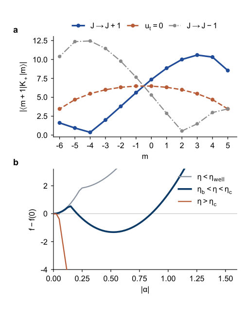
<figcaption class="paper-figure-caption"><b>Fig 1.</b> FIG. 1. Circular-pump mechanism for J = 6, V0 = 0.2, and NU0 = 5. (a) Raman matrix elements for the working J →J + 1 channel, the ut = 0 control, and the reversed J →J −1 channel. (b) Free-energy cuts at δc = 10. The thick curve lies between the first-order transition ηb and the empty-cavity instability ηc: its finite-field minimum is globally favored while the origin remains locally stable.</figcaption>
</figure>
<figure class="paper-figure-card">
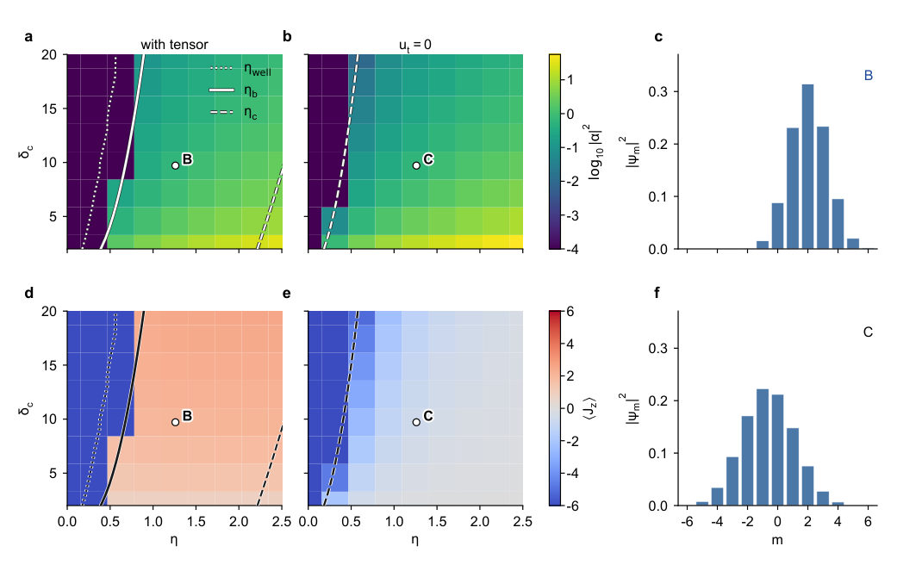
<figcaption class="paper-figure-caption"><b>Fig 2.</b> FIG. 2. Circular-pump steady-state phase diagram and Zeeman populations at J = 6, V0 = 0.2, NU0 = 5, and κ = 0. The upper row shows log10 |α|2 and the lower row D ˆJz E ; the left (right) heatmap column includes the tensor term (sets ut = 0). Dotted, solid, and dashed curves denote the appearance of a finite-field local minimum, the first-order transition ηb, and the loss of local stability of the empty-cavity branch ηc, respectively. For ut = 0 they coincide at a continuous transition. The right column shows the distributions at the marked points: (c) point B; (f) point C at the same (η, δc) as B with ut = 0.</figcaption>
</figure>
<figure class="paper-figure-card">
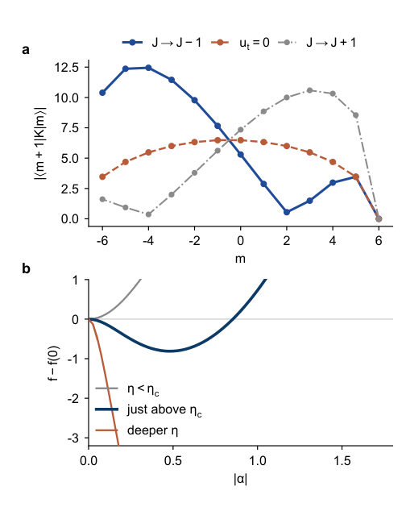
<figcaption class="paper-figure-caption"><b>Fig 3.</b> FIG. 3. Linear-pump mechanism for J = 6, V0 = 0.2, and NU0 = 5. (a) Raman weight ⟨m + 1| ˆK(l) |m⟩ for the working J →J −1 channel and two controls. The working channel enhances the polar regions and has nodes near m = ±2. (b) Free-energy cuts at δc = 20 below, just above, and deeper beyond ηc. The finite-field minimum appears continuously when the origin loses stability.</figcaption>
</figure>
<figure class="paper-figure-card">
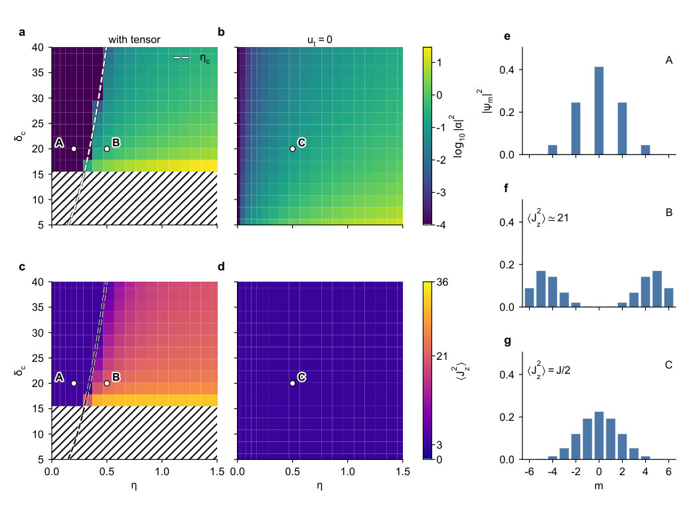
<figcaption class="paper-figure-caption"><b>Fig 4.</b> FIG. 4. Linear-pump steady-state phase diagram and Zeeman populations at J = 6, V0 = 0.2, NU0 = 5, and κ = 0. The upper row shows log10 |α|2 and the lower row D ˆJ2 z E ; the left (right) heatmap column includes the tensor term (sets ut = 0). The dashed curve is the continuous transition. Hatching marks δc ≲16.4 in Eq. (13), where the product-state free energy is unbounded. The right column shows the Zeeman populations at the marked points: (e) empty-cavity point A, an even-m ±x</figcaption>
</figure>
<figure class="paper-figure-card">
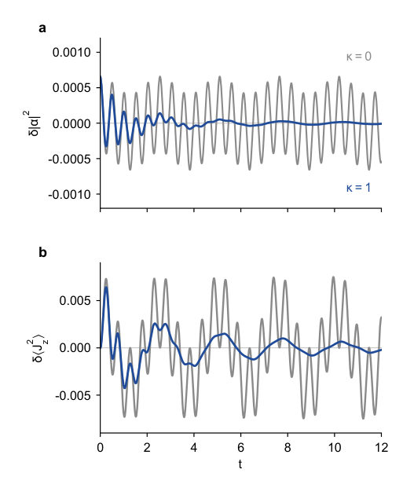
<figcaption class="paper-figure-caption"><b>Fig 5.</b> FIG. 6. Linear cat-like state at point B after a 10−3 radial kick of α. Deviations of (a) the photon number and (b) D ˆJ2 z E from</figcaption>
</figure>

**Summary.** This paper analyzes the extended Dicke model for open-shell atoms coupled to a cavity, incorporating tensor polarizability effects. By comparing circular and linear pumping geometries, the authors show that the tensor term dictates distinct quantum phase transition behaviors and selects specific ordered Zeeman sectors. The findings highlight the sensitivity of cavity quantum dynamics to the precise structure of the atomic coupling Hamiltonian.

**Why it may be interesting.** This work is highly relevant as it extends cavity QED models by incorporating higher-order tensor polarizability, revealing how these higher-order terms fundamentally alter the nature (order) of quantum phase transitions and the resulting stable quantum states.

Detailed structure

**Main problem.** The study investigates the extended Dicke model for open-shell atoms, specifically incorporating the effects of tensor polarizability, which extends beyond standard scalar and vector couplings.

**Main result.** The polarization design (circular vs. linear pump) dictates distinct quantum dynamics, leading to different types of phase transitions (first-order vs. continuous) and unique steady-state ordered phases.

**Method.** The analysis employs mean-field theory, free energy minimization, and linear stability analysis applied to the effective Hamiltonian derived from the full atomic-cavity interaction.

**Model / system.** The system models open-shell atoms (e.g., $^{168}	ext{Er}$) coupled to a shared cavity mode, described by an extended Dicke Hamiltonian incorporating scalar, vector, and tensor polarizability terms.

**Key observables.** Order parameters include $\langle \hat{J}_z 
angle$ (for circular pump) and $\langle \hat{J}_z^2 
angle$ (for linear pump); dynamics are monitored via photon number and Zeeman populations.

**Important parameters / regimes.** Key parameters include the coupling strengths ($\eta_0, V_0$), effective detuning ($\delta_{	ext{eff}}$), and the specific ratios fixed by the atomic angular momentum ($J=6$).

**Assumptions / limitations.** The analysis relies on the mean-field approximation, treating the atoms via a product-state spinor, and neglects finite-$N$ correlations and atomic dissipation.

**Figures summary.** Figures illustrate the dynamics of the system under linear pumping, showing photon number and $\langle J_z^2 
angle / E$ evolution, and show Zeeman populations over time for different coupling regimes.

**Paper structure.** The paper progresses by first defining the extended Hamiltonian, then analyzing steady-state phase transitions using free energy minimization for both circular and linear pumping geometries, followed by a detailed discussion of linear stability and dynamic outcomes.

Abstract

We study the extended Dicke model obtained from the scalar--vector--tensor polarizability of open-shell atoms coupled to a shared cavity mode. For a single electric-dipole channel, rotational symmetry fixes the tensor to vector ratio; we use $^{168}\mathrm{Er}$ with $J=6$ as a product-state example. A circular pump produces a chiral Raman vertex whose tensor-dependent matrix elements select the occupied Zeeman sector. The resulting first-order transition occurs before the empty-cavity branch loses local stability, and the ordered state is read out through $\langle\hat J_z\rangle$. A linear pump instead produces an empty-cavity $\pm x$ cat and a continuous transition into an even-$m$ cat-like state with order parameter $\langle\hat J_z^2\rangle$. With cavity loss alone, the circular trajectory emits a photon burst and approaches a Raman-dark Zeeman pole rather than a finite-field condensate. In the linear geometry, cavity-bright modes are damped toward the cat-like branch while a dark spin mode remains undamped. These are phenomena of that model; the vector-only controls show that they depend on the channel-fixed tensor coupling.

[↑ back to top](#top)

### [Measurement-induced criticality for non-Abelian anyons: The monitored golden chain](http://arxiv.org/abs/2610.18965v1)

**Authors:** Zhaohui Zhi, Bo Han, Romain Vasseur, Andreas W. W. Ludwig, Simon Trebst, Guo-Yi Zhu  
**Type:** theory · **Category:** statistical mechanics · **PDF:** <https://arxiv.org/pdf/2610.18965v1>  
**Analysis basis:** full PDF text, analyzed in chunks
**Topic relevance:** 🔥 `quantum measurements` **4/5** · `driven-dissipative phase transition` **3/5** · `methods for driven-dissipative` **3/5** · `non-equilibrium universality` **3/5** · `Full counting statistics` **1/5** · `Keldysh / 2PI / non-Gaussian methods` **1/5** · `analog quantum simulation` **1/5** · `correlated / nonlocal dissipation` **1/5**

↔ Scroll figures horizontally

<figure class="paper-figure-card">
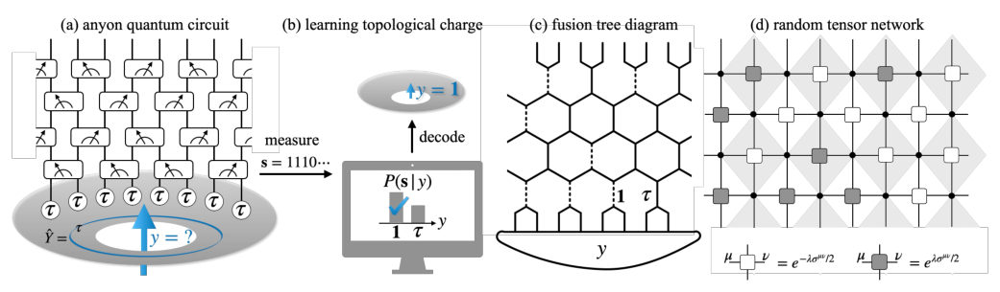
<figcaption class="paper-figure-caption"><b>Fig 1.</b> FIG. 1. Schematic of the model: quantum circuit and classical simulation. (a) A ring of Fibonacci anyons is created from a parent 2D topological quantum liquid on a torus (gray shading). The topological symmetry operator ˆY threads an auxiliary τ line encircling the hole. Its eigenvalue diagnoses the global topological charge y at the center of the ring, or equivalently, the anyonic flux through the hole of the torus. A brickwork circuit with periodic boundary conditions repeatedly measures the local total charge, or fusion channel, of neighboring anyons, with a tunable measurement strength γ ∈[0, 1] interpolating between weak and projective measurement. (b) One can input the measurement...</figcaption>
</figure>
<figure class="paper-figure-card">
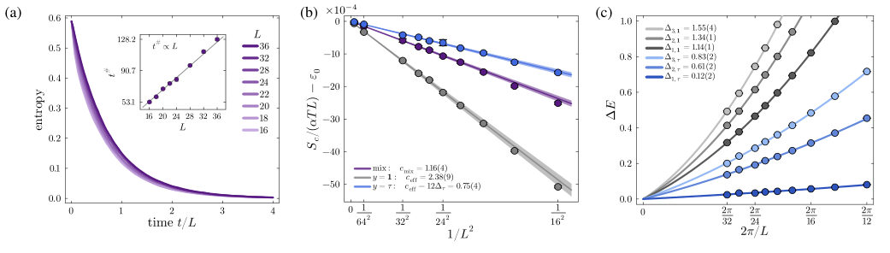
<figcaption class="paper-figure-caption"><b>Fig 2.</b> FIG. 2. (a) Purification dynamics from an initial incoherent mixture. The entropy is averaged over Born-rule trajectories at measurement strength γ = 0.95, and is found to decay exponentially with t/L. The inset extracts the sharpening time t# at which SR(t#) = 0.01SR(0), which grows nearly linearly with system size L: a power-law fit gives t# ∝Lz with z = 1.09(2), while the gray line in the inset shows z = 1 as a guide to the eyes. (b) Topological-charge-resolved Shannon entropy scaling. The purple data show the mix sector initiated from the fusion-tree basis state |ψ0⟩, while gray data shows the y = 1 sector obtained by setting the initial state to be antiferromagnetic Hamiltonian ground...</figcaption>
</figure>
<figure class="paper-figure-card">
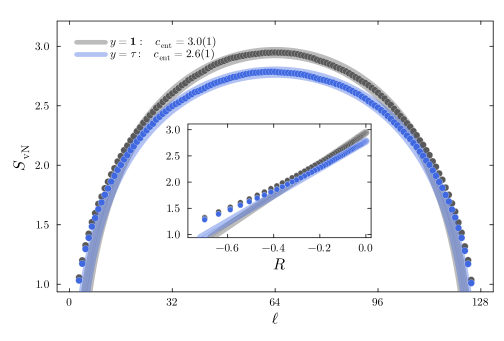
<figcaption class="paper-figure-caption"><b>Fig 3.</b> FIG. 3. Critical entanglement entropy scaling of the late-time steady state for the monitored golden chain at measurement strength γ = 0.95. Data are shown for a chain of fixed size L = 128 and varying bipartite subsystem size ℓin the y = 1 sector (gray) and the y = τ sector (blue). Each curve is fitted independently over the bulk window L/4 ≤ℓ≤3L/4 (32 ≤ℓ≤96), giving cent = 3.0(1) and 2.6(1) for the y = 1 and y = τ sectors, respectively. Inset: SvN ver- sus the rescaled logarithmic chord distance R = 1 3 ln[sin(πℓ/L)]. The MPS simulations use bond dimension χ = 400 and evolve up to 512 layers (T = 256) of fusion measurements; the y = 1 and y = τ data are averaged over 2000 Born-random...</figcaption>
</figure>
<figure class="paper-figure-card">
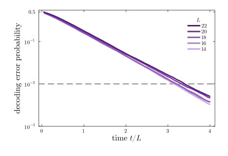
<figcaption class="paper-figure-caption"><b>Fig 4.</b> FIG. 6. Learning the global charge. At γ = 0.95, the maximum- likelihood error decays exponentially with t/L and falls below 1% by t = 4L. Each size for each sector tests 104 trajectories.</figcaption>
</figure>
<figure class="paper-figure-card">
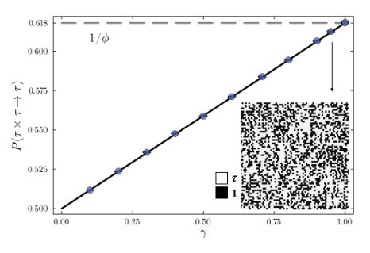
<figcaption class="paper-figure-caption"><b>Fig 5.</b> FIG. 4. Average probability of the τ × τ →τ outcome. Inset: a late-time Born trajectory at γ = 0.95, L = 128, and T = 256; black (white) squares denote 1 (τ).</figcaption>
</figure>

**Summary.** This work studies measurement-induced criticality in non-Abelian anyon chains using the monitored golden chain model. By analyzing the dynamics under local fusion measurements, the authors demonstrate that the system exhibits universal critical behavior. This establishes a new, measurable framework for understanding topological quantum criticality beyond standard Hamiltonian descriptions.

**Why it may be interesting.** It provides a concrete, measurable example of how non-unitary dynamics (measurement) can sustain and characterize quantum criticality in topological systems, linking measurement theory to critical phenomena.

Detailed structure

**Main problem.** The paper investigates measurement-induced criticality in non-Abelian anyon chains, specifically generalizing the concept from the toric code to higher-order theories.

**Main result.** The monitored golden chain ($k=3$) is established as the first non-Abelian generalization of the weakly self-dual quantum critical point, showing that the system remains critical under measurement monitoring.

**Method.** The dynamics are analyzed by mapping the measurement-only evolution to a random tensor network and performing numerical calculations on scaling properties.

**Model / system.** The system is the 'monitored golden chain,' a 1D model of interacting Fibonacci anyons. The dynamics are driven by local, non-commuting fusion charge measurements, replacing standard Hamiltonian interactions.

**Key observables.** Topological charge, Lyapunov gaps, entanglement entropy, effective central charge ($c_{	ext{eff}}$), and the time scale for charge inference ($O(L)$).

**Important parameters / regimes.** Measurement strength ($\gamma$), system size ($L$), and the topological order parameter $k$ (e.g., $k=3$ for the golden chain).

**Assumptions / limitations.** The analysis relies on mapping the monitored dynamics to a random tensor network and assuming the self-averaging of Lyapunov exponents.

**Figures summary.** Figures illustrate purification dynamics, entropy decay scaling with system size, and the scaling of the topological-charge-resolved Lyapunov spectrum.

**Paper structure.** The paper progresses by defining the measurement-driven dynamics, calculating various scaling diagnostics (entropy, Lyapunov gaps), and establishing the non-Abelian generalization by comparing results to known critical points.

Abstract

Non-Abelian anyon chains whose interactions favor a single fusion channel host quantum critical ground states described by minimal-model conformal field theories (CFTs) protected by a topological symmetry. We show that their measurement-only counterpart, where non-commuting fusion charge measurements act locally on the anyons of a chain of $L$ sites, provides a fundamental example of a non-unitary CFT controlling a non-Abelian learning problem. Mapping the monitored dynamics to a random tensor network, we numerically find $1/L$ scaling Lyapunov gaps, logarithmic entanglement scaling with the chord length, and an effective central charge in the Shannon entropy of the measurement record. The conserved topological charge sharpens with dynamical exponent $z= 1$ and is learnable by a decoder on an $O(L)$ time scale. As the topological symmetry is a non-invertible symmetry of the $SU(2)_k$ anyon theories, we establish the monitored golden chain $(k=3)$ as a non-Abelian generalization of the weakly (Kramers-Wannier) self-dual quantum critical point of the toric code $(k=2)$, and the first of a family for $k\geq 3$.

[↑ back to top](#top)

### [Preservation of photon statistics upon selective molecular modulation in hollow-core fibers](http://arxiv.org/abs/2610.19964v1)

**Authors:** Arturo Mena, Pau Arcos, María Sánchez-Hernández, Benoit Debord, Frédéric Gérôme, Fetah Benabid, Nicolas Y. Joly, Oskar Arrizabalaga, Joseba Zubia, David Novoa  
**Type:** both · **Category:** quantum information and computing · **PDF:** <https://arxiv.org/pdf/2610.19964v1>  
**Analysis basis:** full PDF text, analyzed in chunks
**Topic relevance:** 🔥 `quantum optics experiment` **4/5** · `Full counting statistics` **3/5** · `Keldysh / 2PI / non-Gaussian methods` **2/5** · `interference shaping light` **2/5** · `methods for driven-dissipative` **2/5** · `QC/QI experiment` **1/5** · `quantum measurements` **1/5**

↔ Scroll figures horizontally

<figure class="paper-figure-card">
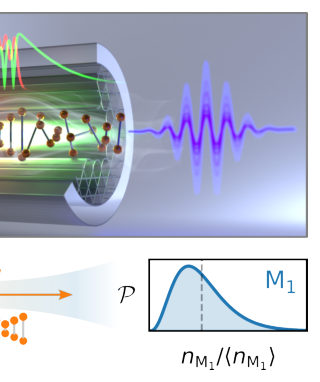
<figcaption class="paper-figure-caption"><b>Fig 1.</b> Fig. 1 Artistic depiction of frequency transduction by molecular modulation in a hydrogen-filled HCF. The pump pulse in green drives a vibrational transition of the hydrogen gas. Together with its frequency down-shifted Stokes component depicted in red, they drive a wave of synchronized molecular vibrations: the coherence wave, Cw. Then, a phase- matched mixing pulse M0 is inelastically scattered by this molecular coherence to the converted frequency pulse M1, which inherits the photon number statistics 𝒫 of the original pulse when the process is highly efficient.</figcaption>
</figure>
<figure class="paper-figure-card">
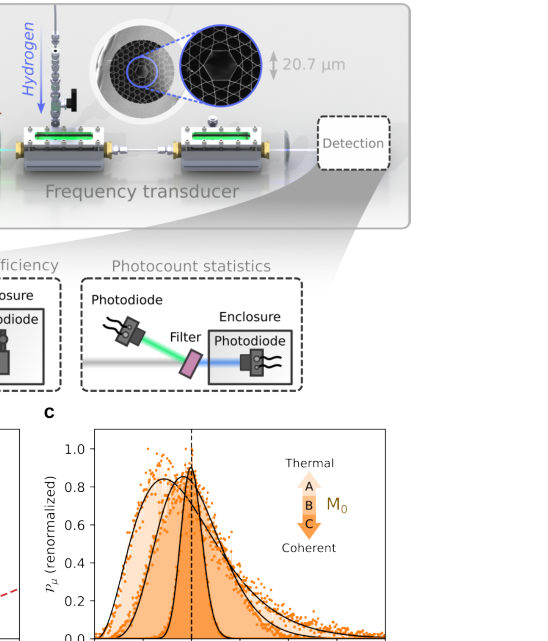
<figcaption class="paper-figure-caption"><b>Fig 2.</b> Fig. 2 Description of the experimental setup. a Schematic experimental layout consisting of a mixing state source, the frequency transducer and the detection system, which is readapted depending on the type of characterization. Here, DM is a dichroic mirror used for combining the mixing (M0) and pump (P) frequencies. Scanning electron microscopy images of the HCF cross-sections considered are also shown. b Average M0 power at the output of the mixing source without attenuation filters as a function of the average pump power. c Experimental photon number statistics of the M0 light at different regimes of operation, normalized with respect to the average photon number of each case and fitted...</figcaption>
</figure>
<figure class="paper-figure-card">
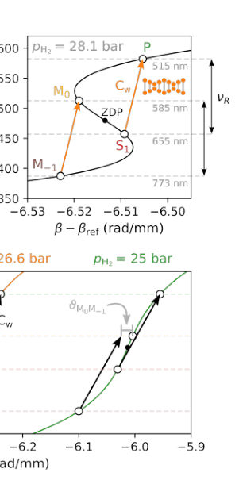
<figcaption class="paper-figure-caption"><b>Fig 3.</b> Fig. 3 Phase-matching dispersion diagrams for frequency up- and down-conversion. a Diagrams for the two phase- matching pressures of interest. Here, the coherence wave Cw driven by the P and S1 bands is able to connect the mixing and converted frequencies, enabling efficient photon population transfer. The mixing (M0) converted sidebands are denoted as M1 for up-conversion and M-1 for down-conversion. The corresponding wavelengths are also indicated below the dashed lines. b Down-conversion diagram as the hydrogen pressure 𝑝H2 is decreased and set out of the value of ideal phase-matching. 𝜗M0,M-1 denotes the dephasing. In both sub-figures, the black dots mark the zero-dispersion points...</figcaption>
</figure>
<figure class="paper-figure-card">
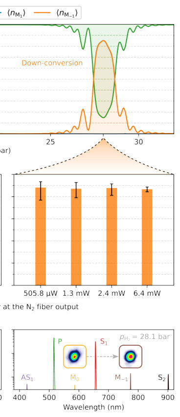
<figcaption class="paper-figure-caption"><b>Fig 4.</b> Fig. 4 Characterization of the frequency transduction system. a Maxwell-Bloch simulation of the photon numbers of the mixing sidebands at the output of the transducer fiber during a hydrogen pressure scan. Two clear peaks can be observed at the phase-matching pressures of ~16.7 bar and ~28.1 bar. b Experimental measurements of the internal quantum efficiency of the up- (left) and down-conversion (right) processes. c Spectral measurements of the wavelengths involved in the frequency transduction. Both the sidebands of the pump and mixing frequency are shown. The mixing sidebands are denoted by M(, with 𝑚= −1, 1, while the pump (P) sidebands are denoted as S1 for the Stokes bands and AS) for...</figcaption>
</figure>
<figure class="paper-figure-card">
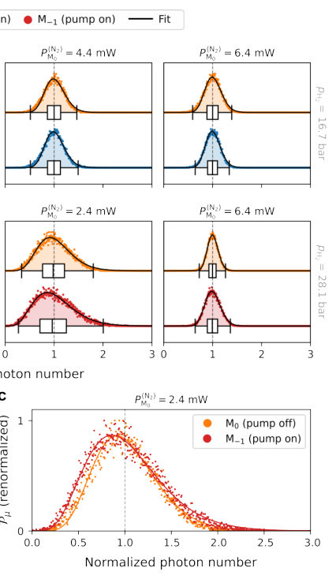
<figcaption class="paper-figure-caption"><b>Fig 5.</b> Fig. 5 Photon statistics for the conversion processes. a The top row of subplots displays the up-conversion results, while the bottom row corresponds to down-conversion measurements. Each subplot shows the measurement of the mixing statistics when the transduction is turned off and the converted frequency statistics. The histograms are fitted to gamma distributions, the photon number axis is normalized with respect to the mean of each histogram and the probabilities are renormalized to their maximum value. Box plots are shown below each histogram, indicating the quartiles and median of the distributions. b-c Zoom into two of the cases shown at a to facilitate the visualization and...</figcaption>
</figure>

**Summary.** This paper demonstrates that molecular modulation in hollow-core fibers can selectively convert light frequencies while successfully preserving the photon-number statistics of the light. By achieving high efficiency and broad tunability, this technique offers a versatile, low-energy route to connect disparate quantum systems, such as quantum emitters and atomic memories, within hybrid quantum networks.

**Why it may be interesting.** This work provides a concrete, fiber-based quantum optical platform for frequency conversion while rigorously proving the preservation of quantum state information (photon statistics), which is a key requirement for building quantum networks.

Detailed structure

**Main problem.** The core challenge is preserving the underlying statistical properties of light during frequency transduction, which is vital for connecting spectrally distinct quantum systems.

**Main result.** The authors demonstrated the conservation of photon-number statistics during selective frequency up- and down-conversion using molecular modulation in hollow-core fibers.

**Method.** The study combines theoretical modeling (Maxwell-Bloch formalism) with experimental measurements to characterize the photon statistics and efficiency of the transduction process.

**Model / system.** The platform utilizes molecular modulation in a hydrogen-filled hollow-core fiber (HCF) to achieve frequency conversion (e.g., 585 nm to 773 nm or 471 nm). The process is analyzed using the semiclassical Maxwell-Bloch formalism.

**Key observables.** Photon-number statistics (fitted to gamma distributions), zero-delay correlation functions ($g^{(2)}(0)$, $g^{(3)}(0)$, $g^{(4)}(0)$), and Fidelity ($\mathcal{F}$).

**Important parameters / regimes.** Low pump energies, low gas pressures, and specific optimal pressures for phase-matching (e.g., $\sim 16.7$ bar for up-shifting).

**Assumptions / limitations.** The analysis relies on the semiclassical Maxwell-Bloch formalism, and statistical analyses assume the applicability of gamma distribution fitting and certain statistical independence for error propagation.

**Figures summary.** Figures illustrate the experimental setup, phase-matching dispersion diagrams, and histograms showing the measured photon number statistics for both up- and down-conversion processes.

**Paper structure.** The paper progresses from establishing the need for statistical preservation in quantum interfacing, detailing the HCF molecular modulation mechanism, presenting experimental measurements of conversion efficiency and statistics, and finally developing rigorous mathematical frameworks to quantify the statistical fidelity and uncertainty.

Abstract

Preserving the underlying statistical properties of light during frequency transduction is essential for interfacing spectrally disparate quantum systems. To do this successfully, the process needs to be highly efficient, broadband and noiseless. Despite significant progress in this field, satisfying all these conditions remains challenging. Recently, molecular modulation-based transduction in hollow-core fibers has emerged as a promising approach, where biphoton correlations were proven to be preserved during frequency up-conversion. However, beyond this previous demonstration of correlation-maintaining conversion, whether molecular modulation can preserve more general statistical properties of light remains experimentally unexplored. Here, we demonstrate the conservation of photon-number statistics during selective frequency transduction by Raman molecular modulation in a hydrogen-filled hollow-core fiber. As a proof of concept, weak 585-nm signals are selectively converted to 773 nm in the near-infrared and to 471 nm in the blue spectral region with near-unity efficiencies. Phase matching between the generated coherence waves and the transitions of interest is achieved through the effective dispersion of the system, enabling independent selection of the frequency up- and down-conversion processes. The preservation of the photon-number statistics of the shifted signals, along with the large frequency shifts, broad tunability and compatibility with quantum-optical fields, provides a versatile fiber-based platform for quantum frequency transduction. In particular, the demonstrated interfacing between visible and near-infrared wavelengths using low pump energies and low gas pressures offers a route towards connecting spectrally distinct quantum systems, including quantum emitters, sensors and atomic quantum memories, within hybrid quantum networks.

[↑ back to top](#top)

### [Selective Control and Imaging of Higgs and Goldstone Modes with a Quantum Simulator](http://arxiv.org/abs/2610.19219v1)

**Authors:** Connie Miao, Pranjal Praneel, Thomas G. Kiely, Eliott Rosenberg, Nicole S. Ticea, Pedram Roushan, Erich Mueller, Andre G. Petukhov  
**Type:** both · **Category:** quantum gases · **PDF:** <https://arxiv.org/pdf/2610.19219v1>  
**Analysis basis:** full PDF text, analyzed in chunks
**Topic relevance:** 🔥 `analog quantum simulation` **4/5** · `QC/QI experiment` **3/5** · `methods for driven-dissipative` **3/5** · `quantum measurements` **2/5** · `Keldysh / 2PI / non-Gaussian methods` **1/5** · `driven-dissipative phase transition` **1/5** · `quantum optics experiment` **1/5**

↔ Scroll figures horizontally

<figure class="paper-figure-card">
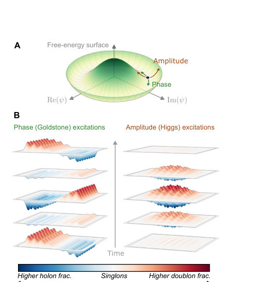
<figcaption class="paper-figure-caption"><b>Fig 1.</b> Fig. 1 Goldstone and Higgs oscillations. (A) Thermodynamic symmetry-broken representation of the free energy landscape in the superfluid phase. Sponta- neous symmetry breaking yields a non-zero order param- eter ψ along the ring of minima. The exact finite, number-conserving state measured here retains the global U(1) symmetry. (B) Goldstone modes manifest as den- sity waves, whereas Higgs modes drive density variance fluctuations that oscillate between local doublon–holon pairs and singlon states, corresponding to local sup- pression/enhancement of the condensate fraction without changing the local density. Instantaneous probability of |2⟩ (doublons), |0⟩(holons), and |1⟩(singlons) are...</figcaption>
</figure>
<figure class="paper-figure-card">
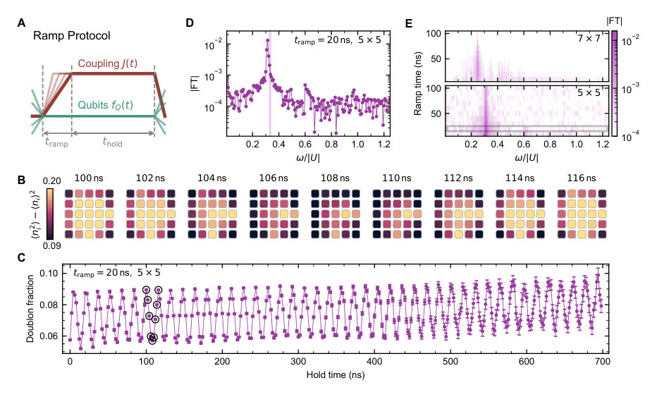
<figcaption class="paper-figure-caption"><b>Fig 2.</b> Fig. 2 Diabatic ramp spectroscopy of Higgs excitations. (A) Sketch of pulse protocol. (B) Snapshots of density fluctuation for one period of the doublon fraction oscillation corresponding to circled points in (C). (C) Measured oscillations of doublon fraction as a function of the hold time for J/U = 0.09 and ⟨U⟩/2π = −200.0 ± 0.3 MHz. Plotted error bars represent 95% confidence. (D) Absolute value of the discrete Fourier transform of (C), showing that the maximum frequency component, corresponding to the lowest Higgs mode, is at ω/|U| = 0.314. The theoretically calculated value is indicated by a vertical line. (E) Fourier transform for varying ramp times, shown for both 7 × 7 and 5 × 5...</figcaption>
</figure>
<figure class="paper-figure-card">
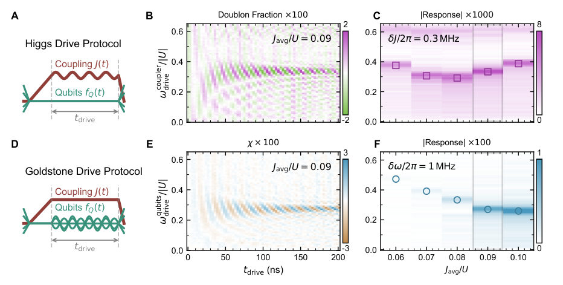
<figcaption class="paper-figure-caption"><b>Fig 3.</b> Fig. 3 Drive spectroscopy of Higgs and Goldstone excitations. We demonstrate coherent control to excite Higgs or Goldstone modes selectively on a 5×5 system. (A) Pulse protocol to excite the Higgs mode. (B) Measured relative doublon fraction as a function of time for different coupling drive frequencies; a best fit linear trend is subtracted from each row to highlight the oscillatory behavior. The corresponding Fourier transform is boxed in (C) in gray. (C) Response amplitude of the doublon fraction at each drive frequency as a function of the average coupling strength during the modulation. The Higgs response frequency, obtained via a fit to Lorentzian around the region of maximum...</figcaption>
</figure>
<figure class="paper-figure-card">
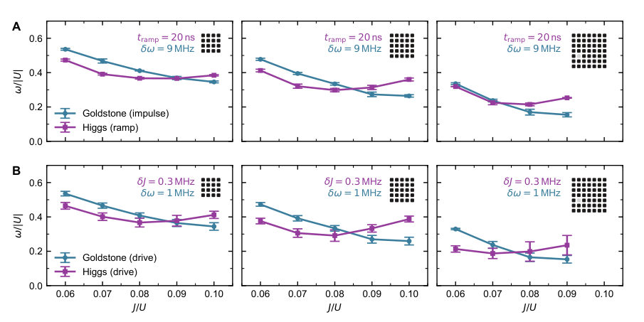
<figcaption class="paper-figure-caption"><b>Fig 4.</b> Fig. 4 System size dependency of Higgs and Goldstone modes. (A) Vacuum Rabi spectroscopy: diabatic J-ramps to probe the Higgs spectrum (purple), and qubit frequency impulses to probe the k = 1 Goldstone response (blue) for 4 × 4, 5 × 5, and 7 × 7 (with one dropout qubit) lattice sizes, shown as insets. (B) Drive-based spectroscopy: modulation of J to probe the Higgs response and qubit frequency modulation to probe the k = 1 Goldstone response. For all panels, we fit the peak response to a Lorentzian and plot the fitted frequency ± half the full width at half maximum.</figcaption>
</figure>
<figure class="paper-figure-card">
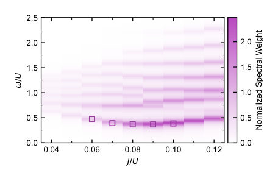
<figcaption class="paper-figure-caption"><b>Fig 5.</b> Fig. 5 Simulated kinetic spectral function. Unit normalized broadened spectral function (broadening η = 0.05) calculated using tensor network techniques for a 4×4 lattice. Experimentally extracted frequencies from vacuum Rabi spectroscopy are shown as square markers.</figcaption>
</figure>

**Summary.** This paper reports on the selective control and imaging of Higgs and Goldstone collective modes in a Bose-Hubbard model simulated using transmon qubits. By using complementary local observables, the authors distinguish between amplitude (Higgs) and phase (Goldstone) fluctuations. Crucially, they show that the finite size of the quantum simulator allows for the coherent detection of the Higgs mode, a feature obscured in the idealized thermodynamic limit.

**Why it may be interesting.** This work provides a concrete, experimentally realized platform (qubits) to study fundamental concepts of symmetry breaking and collective excitations (Higgs/Goldstone) in quantum many-body systems, bridging theory and cutting-edge quantum hardware.

Detailed structure

**Main problem.** The study aims to selectively control and image the dynamics of Higgs and Goldstone collective modes associated with amplitude and phase fluctuations in a lattice superfluid.

**Main result.** The research successfully demonstrates that finite quantum simulators can isolate and coherently probe the Higgs mode, overcoming spectral decay issues present in the thermodynamic limit.

**Method.** The study combines experimental techniques like vacuum Rabi spectroscopy and drive spectroscopy with theoretical tools like Matrix Product States (MPS) ansatzes for spectral function calculations.

**Model / system.** The system is modeled by the Bose-Hubbard Hamiltonian, realized experimentally on a two-dimensional array of transmon qubits, operating in the unit-filling regime.

**Key observables.** Doublon fraction oscillations, local density fluctuations, and the spectral function $S(\omega)$ are used to diagnose the modes.

**Important parameters / regimes.** The hopping strength ($J$), on-site interaction ($U$), and the ratio $J/U$ are key parameters, with finite system size effects being crucial.

**Assumptions / limitations.** The detection of the Higgs mode relies on the finite system size creating spectral gaps, and the analysis assumes the validity of the amplitude/phase mode picture.

**Figures summary.** Figures illustrate the free-energy landscape and the distinct signatures of Goldstone (density waves) and Higgs (doublon-holon pair oscillations) modes, alongside spectroscopy results mapping spectra across the phase transition.

**Paper structure.** The paper progresses by defining the physical model and Hamiltonian, detailing the separate excitation protocols for the Higgs and Goldstone modes, presenting measurements showing mode selectivity, and finally discussing finite-size scaling relative to the thermodynamic limit.

Abstract

We realize the mesoscopic Bose-Hubbard model at unit-filling on a two-dimensional array of transmon qubits and selectively excite collective modes associated with amplitude or phase fluctuations of the superfluid order parameter. We identify these modes respectively as the Higgs and Goldstone modes using complementary local observables, extracted from measuring the number of particles on each site. Modulation of the coupling between sites excites the Higgs mode, which we detect via the density of doubly occupied sites. In contrast, modulation of the local chemical potential with an appropriately chosen spatial profile excites the lowest-frequency Goldstone mode, which we detect via changes in the local density. The two modes have different symmetries and do not couple to one another. By varying the system geometry, we characterize the impact of finite system size on the evolution of both modes. In the thermodynamic limit, decay into a continuum of lower-energy excitations can obscure the Higgs response. In our mesoscopic system, however, the finite system size leads to spectral gaps and allows us to detect the Higgs mode as a coherent, long-lived excitation. Our work demonstrates how finite quantum simulators can isolate and probe physical phenomena that become difficult to resolve in the thermodynamic, large-scale limit.

[↑ back to top](#top)

### [Viscous hydrodynamics from correlated losses](http://arxiv.org/abs/2610.19083v1)

**Authors:** Aleksandr N. Mikheev, Orjan Ameye, Oded Zilberberg, Jeff Maki  
**Type:** theory · **Category:** quantum gases · **PDF:** <https://arxiv.org/pdf/2610.19083v1>  
**Analysis basis:** full PDF text, analyzed in chunks
**Topic relevance:** 🔥 `Keldysh / 2PI / non-Gaussian methods` **4/5** · `methods for driven-dissipative` **3/5** · `non-equilibrium universality` **3/5** · `analog quantum simulation` **2/5** · `correlated / nonlocal dissipation` **1/5** · `driven-dissipative phase transition` **1/5**

↔ Scroll figures horizontally

<figure class="paper-figure-card">
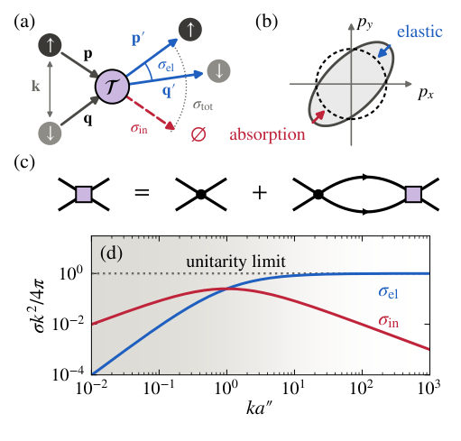
<figcaption class="paper-figure-caption"><b>Fig 1.</b> FIG. 1. Loss-induced collisions. (a) Two-body loss vertex T depicting incoming particles with momenta p and q and relative momentum k = |p −q|/2 scattering via an elastic channel (solid arrows) into momenta p′ and q′ or an absorp- tion channel (dashed arrow). (b) Relaxation of the distribu- tion function fσp (solid) toward local equilibrium (dashed) by elastic and absorption collisions. (c) Ladder equation for the two-body T-matrix of Eq. (3) describing repeated two- particle scattering due to loss [1]. (d) Elastic and absorp- tion cross sections of a purely lossy two-body interaction, a = −ia′′, in units of the unitary bound 4π/k2, versus ka′′</figcaption>
</figure>
<figure class="paper-figure-card">
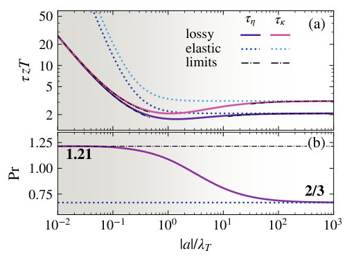
<figcaption class="paper-figure-caption"><b>Fig 2.</b> FIG. 2. Instantaneous relaxation times. (a) Shear and ther- mal relaxation times, in units of 1/(zT), versus |a|/λT for loss, a = −ia′′ (solid; shear purple, heat magenta), and for conventional elastic scattering, a = a′ (dotted; shear dark blue, heat light blue). Black dash-dotted lines: asymptotes of Eqs. (12) and (13). Shading: ratio of the absorption and elastic cross sections, σin/σel ∼λT /a′′, at the thermal mo- mentum, graded from white (≪1, hydrodynamic) to grey (≫1, loss-dominated). (b) Prandtl number, from the uni- versal value 2/3 (dotted) at |a| ≫λT to the steady-distortion value ≈1.21 (dash-dotted) at |a| ≪λT .</figcaption>
</figure>
<figure class="paper-figure-card">
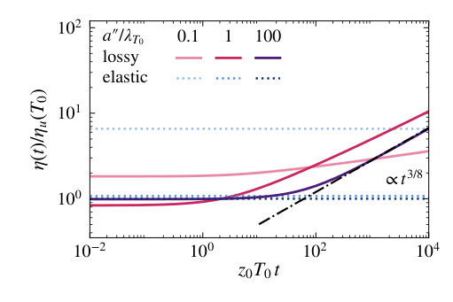
<figcaption class="paper-figure-caption"><b>Fig 3.</b> FIG. 3. Viscosity along the decay. Shear viscosity in units of the unitary value ηu(T0) = 2τuλ−3 T0 versus z0T0t, for ini- tial a′′/λT0 = 0.1, 1, 100 (solid) and for elastic scattering at equal |a|/λT0 and fixed T0 (dotted). Dash-dotted: long-time power law η ∝t3/8 under loss.</figcaption>
</figure>

**Summary.** This theoretical work demonstrates that two-body particle loss can effectively induce hydrodynamic behavior in a quantum gas, even in the absence of intrinsic elastic interactions. By analyzing the resulting kinetic equation, the authors show that transport coefficients like viscosity approach universal values characteristic of the unitary Fermi gas. This highlights that engineered dissipation can serve as a resource to drive complex many-body dynamics.

**Why it may be interesting.** It provides a mechanism—loss—to engineer necessary collisions for fluid behavior in quantum matter, which is crucial for understanding non-equilibrium dynamics in cold atom experiments.

Detailed structure

**Main problem.** To determine if two-body particle loss alone can induce hydrodynamic flow in a quantum gas, mimicking the role of elastic collisions.

**Main result.** Two-body loss can cause the gas to flow hydrodynamically, with transport coefficients approaching those of the unitary Fermi gas, and these coefficients grow universally with time as the gas heats up.

**Method.** The analysis uses a Boltzmann equation derived from the Keldysh action, employing the Chapman-Enskog expansion to calculate transport coefficients.

**Model / system.** The system is a non-degenerate Fermi gas governed by a Hamiltonian and subjected to two-body loss via Lindblad dissipators. The dynamics are analyzed through the evolution of the occupation number $f_{\sigma\mathbf{p}}$.

**Key observables.** Shear viscosity ($\eta$), thermal conductivity ($\kappa$), and the Prandtl number ($	ext{Pr}$).

**Important parameters / regimes.** The ratio of loss strength to thermal length scale ($a''/\lambda_T$), and the strong loss limit ($a'' \gg \lambda_T$).

**Assumptions / limitations.** The analysis assumes no intrinsic elastic scattering ($a' = 0$) and is restricted to the non-degenerate regime ($f_{\sigma\mathbf{p}} \ll 1$).

**Figures summary.** Figures illustrate loss-induced collisions, relaxation towards local equilibrium, and the time-dependence of transport coefficients ($\eta$) for different loss strengths.

**Paper structure.** The paper systematically analyzes the kinetic equation by splitting the collision integral into absorption and elastic parts, deriving transport coefficients using basis function expansions across different physical regimes (weak vs. strong loss).

Abstract

Interactions turn a gas into a fluid. We show that two-body loss can take their place. Correlated loss induces elastic scattering, as required by the optical theorem, which dominates at strong loss via the quantum Zeno effect. A nondegenerate gas with only two-body loss thus flows hydrodynamically, with viscosity and thermal conductivity close to those of the unitary Fermi gas. As loss heats the gas, both grow in time with a universal exponent 3/8. Unlike single-particle loss, two-body loss can engineer collisions, and hence transport, in quantum matter.

[↑ back to top](#top)

### [Deterministic and Programmable Fusion for Scalable Generation of Photonic Graph States](http://arxiv.org/abs/2610.19927v1)

**Authors:** Yan Li, Yunfan Yang, Zenghui Bao, Jize Yang, Luyan Sun, Yipu Song, Yukai Wu, Hongyi Zhang, Luming Duan  
**Type:** experiment · **Category:** quantum information and computing · **PDF:** <https://arxiv.org/pdf/2610.19927v1>  
**Analysis basis:** full PDF text, analyzed in chunks
**Topic relevance:** 🔥 `QC/QI experiment` **4/5** · `quantum measurements` **3/5** · `quantum optics experiment` **3/5** · `analog quantum simulation` **2/5**

↔ Scroll figures horizontally

<figure class="paper-figure-card">
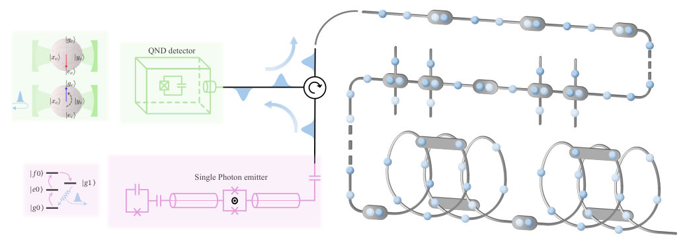
<figcaption class="paper-figure-caption"><b>Fig 1.</b> FIG. 1. Scalable and reconfigurable generation of microwave photonic graph states via deterministic fusion. A single-photon emitter (pink) generates sequential photonic flying qubits to form small cluster states, routed to a quantum non-demolition (QND) parity detector (green) for deterministic fusion (grey bars). In situ frequency tuning of the photonic qubits via a tunable resonator enables programmable fusion between arbitrary qubit pairs, allowing the synthesis of complex graph topologies. The matter qubit in the emitter can be reset between the generation of individual small cluster states, thereby localizing errors within subgraph units (blue vertices, fading gradient). Likewise, the...</figcaption>
</figure>
<figure class="paper-figure-card">
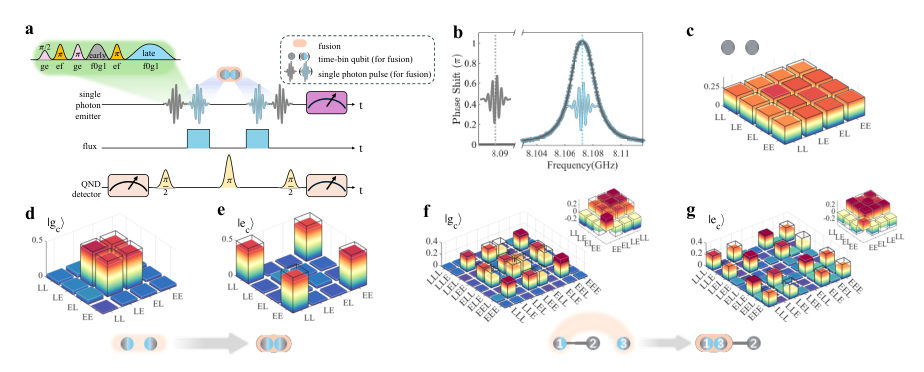
<figcaption class="paper-figure-caption"><b>Fig 2.</b> FIG. 2. Deterministic fusion operation. a, Pulse sequence demonstrating the deterministic fusion of two time-bin encoded photonic qubits. A single-photon emitter sequentially generates two time-bin encoded photonic qubits. The fusion operation is performed via a controlled-phase flip between the QND detector and one of the modes of each photonic qubit. Details of the photonic qubit generation and fusion process are provided in the Methods section. The frequency of the single-photon pulses is tunable in situ by controlling the magnetic flux across the SQUID. The photonic states are analyzed using a homodyne setup for quantum state tomography. b, Conditional phase flip as a function of the...</figcaption>
</figure>
<figure class="paper-figure-card">
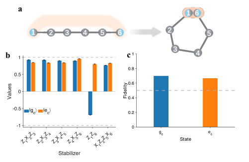
<figcaption class="paper-figure-caption"><b>Fig 3.</b> FIG. 3. Programmable graph state generation through selective fusion operations. a, By utilizing programmable photon generation and fusion operations, a ring graph state with five vertices can be generated. This is achieved by first creating a linear cluster state with 6 qubits, followed by fus- ing qubit 1 and qubit 6 to form a new vertex. b shows the measured stabilizers. The error bars represent one standard deviation. The dashed gray lines indicate the ideal stabilizer values. c, Fidelity of the experimentally prepared ring graph with respect to the ideal state, computed from the recon- structed process maps. The dashed gray line marks the fi- delity threshold of 0.5 for genuine...</figcaption>
</figure>
<figure class="paper-figure-card">
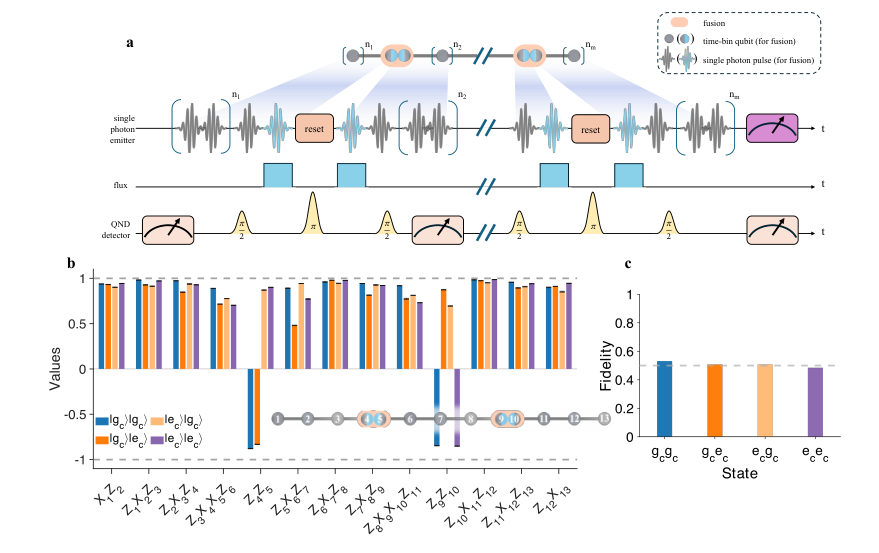
<figcaption class="paper-figure-caption"><b>Fig 4.</b> FIG. 4. Scalable graph state generation through repetitive fusion. a, Pulse sequence for the sequential generation of multiple linear cluster states and the repetitive fusion operation. The shadowed pulse segments represent the preparation of linear cluster states for time-bin qubits, as described in the Methods section. To localize potential errors, the transmon qubits in both the single-photon emitter and the QND detector are reset between the preparation of adjacent cluster states and between consecutive fusion operations, respectively. b, Measured stabilizers for a linear graph state containing 11 vertices, redundantly encoded with 13 photonic qubits, as shown in the inset. This state...</figcaption>
</figure>

**Summary.** This paper presents a novel, deterministic, and programmable method for creating large-scale photonic graph states. By using superconducting circuits to perform controlled fusion operations on time-bin encoded qubits, the authors overcome the probabilistic limitations of previous methods. This work provides a crucial, scalable building block for fault-tolerant measurement-based quantum computation and quantum networking.

**Why it may be interesting.** For AMO/Quantum Optics, this work showcases a highly integrated quantum platform (emitter + superconducting circuits) to perform fundamental quantum operations (deterministic entanglement generation) necessary for building quantum networks.

Detailed structure

**Main problem.** The primary challenge addressed is the scalable and programmable generation of large-scale photonic graph states, overcoming the limitations imposed by probabilistic fusion protocols.

**Main result.** The authors demonstrate a deterministic fusion operation using superconducting circuits that successfully generates genuine multipartite entanglement across 13 photonic qubits, establishing a scalable framework for graph state synthesis.

**Method.** They utilize a deterministic fusion protocol based on nondestructively projecting pairs of flying microwave photonic qubits into Bell states via QND parity measurements on a transmon qubit.

**Model / system.** The system employs time-bin encoded photonic qubits generated from a single-photon emitter and measured using superconducting circuits containing a transmon qubit acting as a QND detector. The process is made scalable by incorporating active reset and reuse of matter qubits.

**Key observables.** Fusion fidelity (e.g., $\approx 89.94\%$), stabilizer expectation values, and the entanglement witness ($W_{G_n} < 0$) to certify genuine multipartite entanglement.

**Important parameters / regimes.** The ability to reset matter qubits is crucial for circumventing coherence constraints and enabling repetitive, scalable fusion operations.

**Assumptions / limitations.** The analysis assumes the redundantly encoded graph state is local-Clifford equivalent to a standard graph state, allowing the use of stabilizer measurements as a diagnostic tool.

**Figures summary.** Figures illustrate the schematic of the scalable generation process, the pulse sequence for deterministic fusion, and the resulting graph structures (e.g., 2D ring graphs) with associated fidelity and entanglement witness measurements.

**Paper structure.** The paper details the physical setup, first demonstrating the deterministic fusion of two qubits into a Bell state. It then extends this to programmable fusion to build complex structures like ring graphs, culminating in a scalable protocol for generating large linear graph states.

Abstract

Entanglement in multiphoton graph states is an important resource with various applications, such as measurement-based quantum computing and memory-less quantum repeaters. While some primitive instances have been successfully prepared, scalable generation of large-scale graph states with programmable connections remains an outstanding challenge. Fusion provides a promising "divide-and-conquer" approach by linking smaller resource states into larger, more complex graphs. However, its practical scalability has been limited by the probabilistic nature of conventional fusion protocols, which necessitates extensive hardware overhead and feed-forward resources to achieve deterministic outcomes. Here, we introduce and experimentally demonstrate a deterministic fusion operation with built-in error mitigation, capable of connecting small time-bin-encoded cluster states--originally generated on-demand from a quantum emitter--into larger, reconfigurable photonic graph states of increased sizes. The fusion operation is realized by nondestructively projecting pairs of flying microwave photonic qubits into Bell states using superconducting circuits with in-situ programmability. Crucially, the protocol features active reset and reuse of matter qubits during graph state generation, thereby circumventing the coherence constraints of the quantum emitter and enabling the generation of genuine multipartite entanglement across 13 photonic qubits. Our results establish a scalable framework for photonic graph-state synthesis, paving the way for fault-tolerant measurement-based quantum computation and distributed quantum networks.

[↑ back to top](#top)

### [A hybrid quantum interferometer bridging Hong-Ou-Mandel and N00N-state interference](http://arxiv.org/abs/2610.20202v1)

**Authors:** Zi-Qi Zeng, Samuel Corona-Aquino, Tao Xie, Bin Yin, Yan Guo, Yukun Song, Yun Meng, Kai Zou, Song Li, Xiaolong Hu, Alfred B. U'Ren, Roberto de J. León-Montiel, Chenglong You, Baihong Li, Dongzhou Wang, Rui-Bo Jin  
**Type:** both · **Category:** other · **PDF:** <https://arxiv.org/pdf/2610.20202v1>  
**Analysis basis:** full PDF text, analyzed in chunks
**Topic relevance:** 🔥 `interference shaping light` **4/5** · 🔥 `quantum optics experiment` **4/5** · `QC/QI experiment` **1/5** · `analog quantum simulation` **1/5** · `quantum measurements` **1/5**

↔ Scroll figures horizontally

<figure class="paper-figure-card">
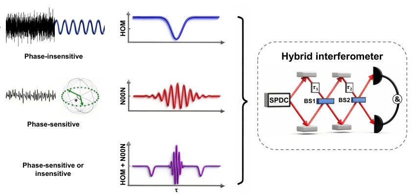
<figcaption class="paper-figure-caption"><b>Fig 1.</b> FIG. 1. Conceptual illustration depicting quantum sensing requirements under different noise conditions (left), their correspond- ing interferometric approaches (middle), and the hybrid interferometer (right), can simultaneously meet the full demands.</figcaption>
</figure>
<figure class="paper-figure-card">
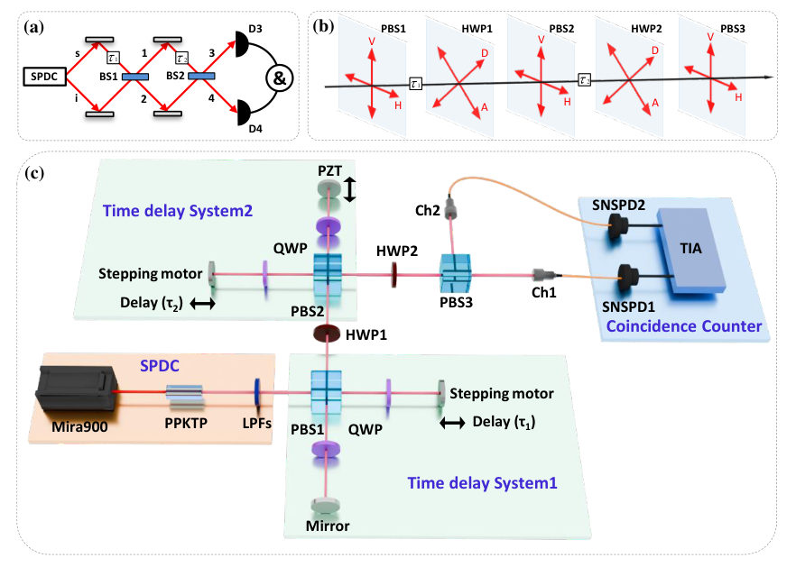
<figcaption class="paper-figure-caption"><b>Fig 2.</b> FIG. 2. (a) The spatial model of the hybrid interferometer. (b) The polarization model for the control of the hybrid interferom- eter. (c) Experimental setup. LPFs: long-pass filters and dichroic mirror; PBS: polarization beam splitter; QWP: quarter-wave plate; HWP: half-wave plate; PZT: piezo-electric linear actuator; SNSPD: superconducting nanowire single-photon detector; TIA: time interval analyzer.</figcaption>
</figure>
<figure class="paper-figure-card">
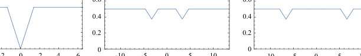
<figcaption class="paper-figure-caption"><b>Fig 3.</b> FIG. 3. Normalized theoretical simulation results. (a) Theoretical joint spectral intensity distribution for the type-II PPKTP crystal. (b) Simulated coincidence probability versus τ2 with τ1 = 0 ps. (c) Simulated coincidence probability versus τ2 with τ1 = 2 ps. (d) Magnified view around τ2 = 0 ps in figure (b), where T denotes the oscillation period. (e-h) Simulated coincidence probability as a function of τ1 for fixed τ2: τ2 = 0 ps (e), τ2 = 1.3 fs (f), and τ2 = 3.3 ps (g), and 6.6 ps (h). Here, panels (b), (f), and (c) correspond to pure N00N-state, HOM, and hybrid interference patterns, respectively.</figcaption>
</figure>
<figure class="paper-figure-card">
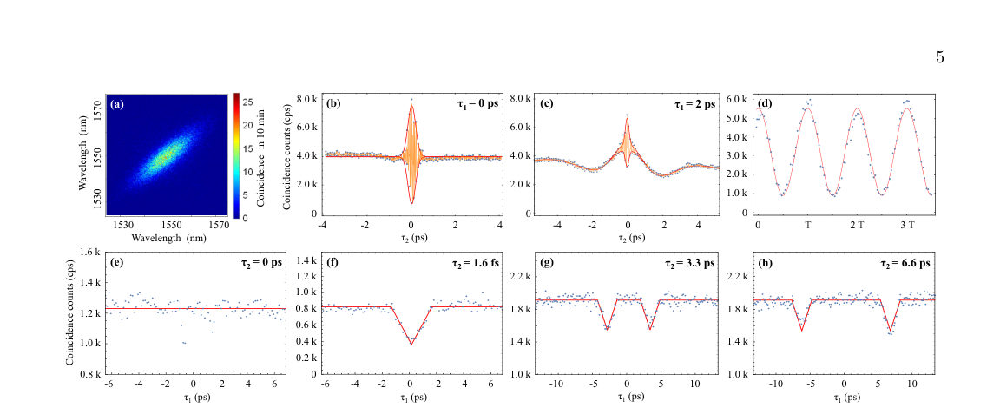
<figcaption class="paper-figure-caption"><b>Fig 4.</b> FIG. 4. Experimental results. (a) Measured joint spectral intensity of the type-II PPKTP crystal. (b–h) Coincidence counts as a function of optical delay. Blue dots represent experimental data; red solid curves denote theoretical fits. (b) Coincidence counts versus τ2 with τ1 = 0 ps. (c) Coincidence counts versus τ2 with τ1 = 2 ps. (d) Magnified view of (b) around τ2 = 0 ps, where T denotes the oscillation period. (e-h) Coincidence counts versus τ1 for fixed τ2: τ2 = 0 fs (e), 1.6 fs (f), 3.3 ps (g), and 6.6 ps (h).</figcaption>
</figure>
<figure class="paper-figure-card">
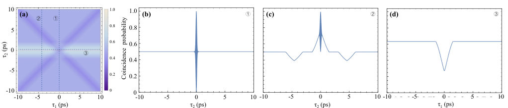
<figcaption class="paper-figure-caption"><b>Fig 5.</b> FIG. 5. (a) Density map of coincidence probability as a function of time delays, τ1 and τ2. (b-d) One-dimensional interference patterns corresponding to cross-sections 1, 2 and 3 in (a), respectively.</figcaption>
</figure>

**Summary.** The paper introduces a novel hybrid quantum interferometer capable of simultaneously exhibiting and switching between Hong-Ou-Mandel and N00N-state interference. By controlling two time delays, the setup provides a versatile platform for quantum sensing. This tunability allows researchers to optimize measurements for different noise conditions, advancing integrated quantum technologies.

**Why it may be interesting.** This work is highly relevant to quantum optics and open quantum systems, demonstrating a practical, integrated platform for quantum metrology that adapts its sensitivity based on the expected noise environment.

Detailed structure

**Main problem.** The authors addressed the need for a single, versatile quantum interferometer capable of dynamically switching between Hong-Ou-Mandel (HOM) interference (robust in high noise) and N00N-state interference (sensitive in low noise).

**Main result.** They successfully demonstrated a hybrid interferometer that can tune its operation between phase-insensitive, phase-sensitive, and mixed interference regimes by adjusting two time delays, $\tau_1$ and $\tau_2$.

**Method.** The study combines theoretical derivation of the coincidence probability $P(\tau_1, \tau_2)$ with experimental measurements using a type-II PPKTP crystal for entangled photon generation.

**Model / system.** The physical platform is a hybrid quantum interferometer utilizing Spontaneous Parametric Down-Conversion (SPDC) to generate entangled biphotons. The tunability is achieved by controlling two independent time delays, $\tau_1$ and $\tau_2$.

**Key observables.** Coincidence probability $P(\tau_1, \tau_2)$, exhibiting characteristic interference patterns corresponding to N00N-state fringes and HOM dips.

**Important parameters / regimes.** The controllable time delays $\tau_1$ and $\tau_2$, which dictate the operational regime (HOM vs. N00N).

**Assumptions / limitations.** Key theoretical assumptions include the factorization of the Joint Spectral Amplitude (JSA) and the use of a transform-limited pump pulse.

**Figures summary.** Figures illustrate the conceptual need for adaptability, the experimental setup, and theoretical/experimental maps showing the coincidence probability dependence on the two time delays, revealing both N00N fringes and HOM dips.

**Paper structure.** The paper progresses from establishing the need for tunable interferometry, deriving the theoretical coincidence probability formula, and then presenting both numerical simulations and experimental measurements confirming the dynamic control over the interference regimes.

Abstract

Hong-Ou-Mandel (HOM) interference offers robustness in high-noise environments due to its phase-insensitive nature, while N00N-state interference provides enhanced phase sensitivity for precision measurements in low-noise settings. However, their realizations have typically required separate experimental platforms. Here, we report a single hybrid quantum interferometer that can dynamically transition between HOM and N00N-state interference by adjusting two time delays, $τ_1$ and $τ_2$. This tunability enables operation in phase-insensitive, phase-sensitive, or hybrid modes within a unified setup, as confirmed by theoretical analysis and experimental demonstration. Our system offers a versatile platform with potential for quantum sensing applications, paving the way for integrated quantum technologies capable of adapting to diverse noise conditions.

[↑ back to top](#top)

### [Hyperentanglement in intermediate phase-space planes: benchmarking a photon-pair source for quantum key distribution](http://arxiv.org/abs/2610.20005v1)

**Authors:** Murilo H. Magiotto, Millena B. Novaes, Wesley B. Cardoso, Ardiley T. Avelar, 1 Paulo H. Souto Ribeiro, Stephen P. Walborn, Guilherme L. Zanin, Rafael M. Gomes  
**Type:** both · **Category:** quantum information and computing · **PDF:** <https://arxiv.org/pdf/2610.20005v1>  
**Analysis basis:** full PDF text, analyzed in chunks
**Topic relevance:** 🔥 `quantum optics experiment` **4/5** · `QC/QI experiment` **3/5** · `interference shaping light` **2/5** · `quantum measurements` **2/5**

↔ Scroll figures horizontally

<figure class="paper-figure-card">
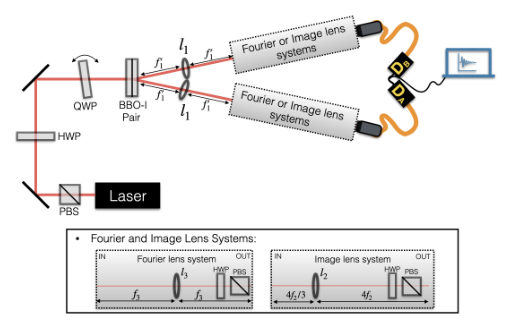
<figcaption class="paper-figure-caption"><b>Fig 1.</b> FIG. 1. Experimental Setup. See details in the main text.</figcaption>
</figure>
<figure class="paper-figure-card">
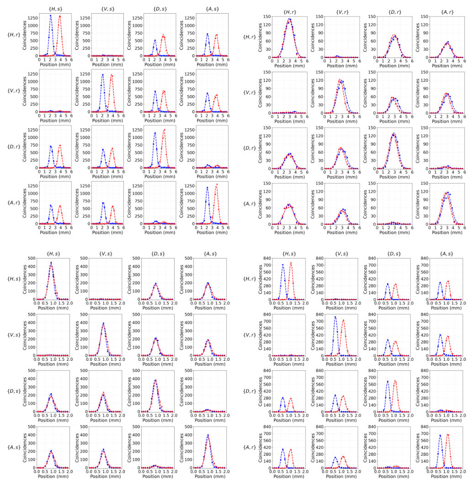
<figcaption class="paper-figure-caption"><b>Fig 2.</b> FIG. 2. Experimental coincidence measurements for the hyperentangled state. Each of the four panels contains a set of coincidence distributions obtained for different combinations of polarization and continuous variable measurement bases. The vertical axis of each subpanel represents the coincidence counts accumulated over 10 seconds [Coincidences], while the horizontal axis shows the transverse position of the signal photon as detector A is scanned [Position (mm)]. The idler detector remains fixed at two transverse positions, denoted by B1 (blue curves) and B2 (red curves). The labels along the rows and columns identify the polarization bases selected by Alice and Bob.</figcaption>
</figure>

**Summary.** This paper characterizes a novel photon-pair source hyperentangled in both polarization and spatial degrees of freedom. By performing measurements in intermediate phase-space planes, the source maintains entanglement that would otherwise be destroyed by standard measurements. The results demonstrate that the source supports two independent, high-rate quantum channels suitable for secure quantum key distribution.

**Why it may be interesting.** This work directly addresses the practical realization and quantification of quantum resources (hyperentanglement) for quantum communication protocols, which is a core topic in quantum information theory.

Detailed structure

**Main problem.** The paper characterizes a hyperentangled photon-pair source and benchmarks its performance for use in quantum key distribution (QKD).

**Main result.** The source successfully delivers two simultaneously usable, independently certified quantum channels—one in polarization and one in transverse spatial degrees of freedom—achieving a high total secret key rate.

**Method.** The authors analyze the source by performing measurements in intermediate planes of the fractional Fourier transform, which partially erases 'which-crystal' information and preserves entanglement.

**Model / system.** The physical system is a photon-pair source generated via two crossed type-I crystals in a non-collinear geometry. The entanglement is hyperentangled across polarization and transverse spatial modes.

**Key observables.** Quantum bit error rates (QBER), asymptotic secret key rates ($R$), Bell parameters, and concurrence.

**Important parameters / regimes.** Intermediate planes of the fractional Fourier transform (FRFT), which combine position and momentum bases; the relative strengths of correlations ($\sigma_+, \sigma_-$).

**Assumptions / limitations.** The analysis relies on the Gaussian approximation for the two-photon amplitude and assumes the joint error statistics factorize between the two degrees of freedom for key rate calculation.

**Figures summary.** The notes reference tables summarizing error rates in different basis combinations and equations defining the QBER and key rate bounds.

**Paper structure.** The paper first introduces the physical setup and the limitations of standard measurements. It then develops the theoretical framework using FRFT planes to maintain entanglement. Finally, it quantifies the resource by calculating QBER and asymptotic secret key rates for both degrees of freedom.

Abstract

We characterize a source of photon pairs simultaneously entangled in polarization and in the transverse spatial degree of freedom, with the spatial measurements performed in intermediate planes of the fractional Fourier transform. The source consists of two crossed type-I crystals in a non-collinear geometry, such that the transverse variables carry information about the crystal of origin. Detection in the crystal plane reveals this information completely and destroys the polarization entanglement, so that a scheme using the near and far fields as conjugate spatial bases cannot support a parallel polarization channel. In intermediate planes both spatial bases combine position and momentum, such that the which-crystal information is partially erased, and the polarization entanglement survives in all four combinations of spatial bases. Applying Bell and Einstein-Podolsky-Rosen criteria to the same photon pairs certifies both degrees of freedom simultaneously. We evaluate quantum bit error rates and asymptotic secret key rates in each degree of freedom, and find that the source delivers two simultaneously usable channels per photon pair.

[↑ back to top](#top)

### [Observation of correlations beyond the single-particle picture in fermionic counting statistics](http://arxiv.org/abs/2610.19950v1)

**Authors:** Johann Zöllner, Hendrik Mannel, Daniel Oppers, Martin Geller, Axel Lorke, Jürgen König  
**Type:** experiment · **Category:** strongly correlated electrons · **PDF:** <https://arxiv.org/pdf/2610.19950v1>  
**Analysis basis:** full PDF text, analyzed in chunks
**Topic relevance:** 🔥 `Full counting statistics` **4/5** · `quantum measurements` **2/5** · `Keldysh / 2PI / non-Gaussian methods` **1/5** · `analog quantum simulation` **1/5** · `correlated / nonlocal dissipation` **1/5** · `driven-dissipative phase transition` **1/5** · `methods for driven-dissipative` **1/5**

↔ Scroll figures horizontally

<figure class="paper-figure-card">
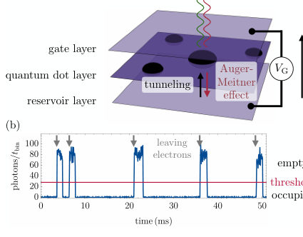
<figcaption class="paper-figure-caption"><b>Fig 1.</b> FIG. 1. (a) The sample consists of a gate layer, the quantum- dot layer containing the investigated quantum dot, and a reservoir layer. The states of the quantum dot can be ma- nipulated by gate voltage VG and magnetic field B. Electrons tunnel into the quantum dot (black arrow) and leave it via Auger processes caused by the trion laser (red). The occu- pation of the quantum dot is tracked using resonance fluo- rescence induced by the exciton laser (green). (b) Telegraph signal resulting from detected photons, which indicates the occupation of the quantum dot. The number of photons de- tected within the interval tbin = 60 µs is tracked over time.</figcaption>
</figure>
<figure class="paper-figure-card">
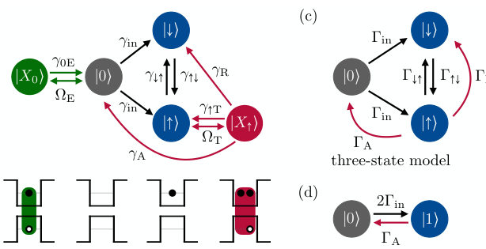
<figcaption class="paper-figure-caption"><b>Fig 2.</b> FIG. 2. (a) Relevant states and possible transitions between them. (b) Particles involved for each state with electrons represented by filled circles and holes represented by empty circles. The confining potential is sketched as a rectangular quantum well for the electron and as an inverted quantum well for the hole. (c) Simplified three-state model. Exciton state |X0⟩and unoccupied state |0⟩as well as trion state |X↑⟩and spin-up state |↑⟩have been combined. (d) Two-state model, applicable for very small or very large magnetic fields.</figcaption>
</figure>
<figure class="paper-figure-card">
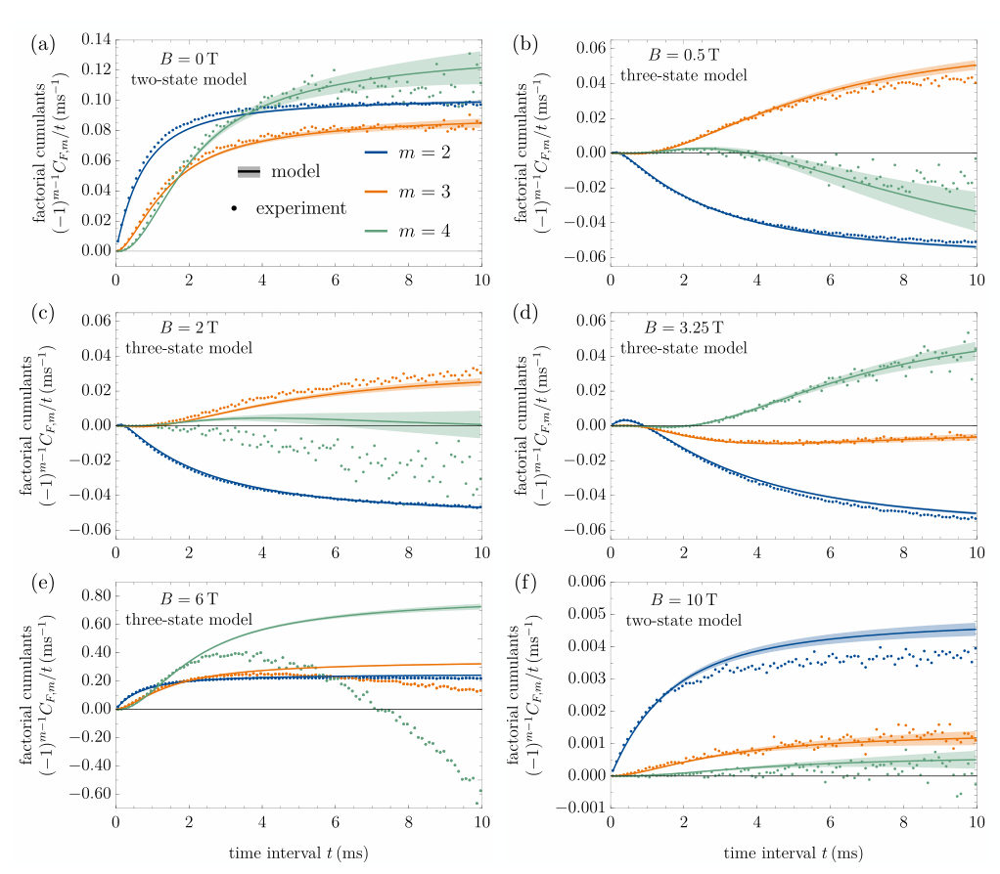
<figcaption class="paper-figure-caption"><b>Fig 3.</b> FIG. 3. Factorial cumulants as a function of the time interval for magnetic fields (a) B = 0 T, (b) B = 0.5 T, (c) B = 2 T, (d) B = 3.25 T, (e) B = 6 T, and (f) B = 10 T. The experimental data is shown as dots, the model calculations as straight lines and the expected standard deviation from the model as colored regions. In (b)-(d), some of the factorial cumulants change sign, while following the sign rule (6) in (a) and (f).</figcaption>
</figure>
<figure class="paper-figure-card">
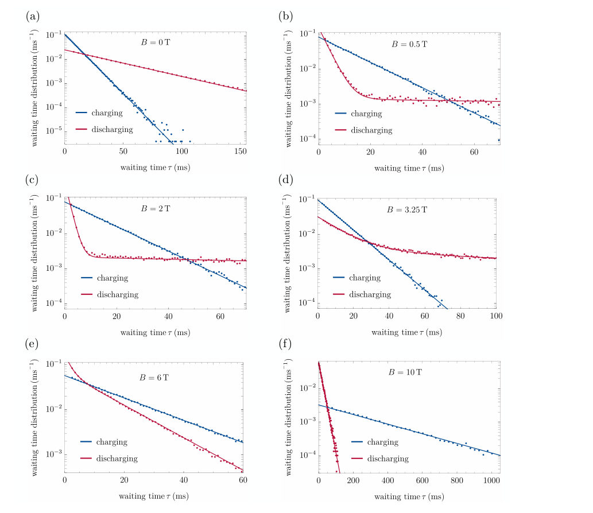
<figcaption class="paper-figure-caption"><b>Fig 4.</b> FIG. 4. Waiting-time distributions wemp(τ) (blue) and wocc(τ) (red) at magnetic fields (a) B = 0 T, (b) B = 0.5 T, (c) B = 2 T, (d) B = 3.25 T, (e) B = 6 T, and (f) B = 10 T. Fitting the experimental waiting-time distributions (dots) with the expressions from Eq. (A3) and Eq. (A4) (lines) yields the transition rates presented in Table I.</figcaption>
</figure>
<figure class="paper-figure-card">
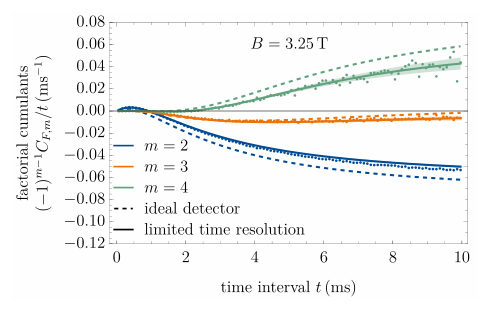
<figcaption class="paper-figure-caption"><b>Fig 5.</b> FIG. 5. Comparison between the model for an ideal detector (dashed lines) and the model including the limited time reso- lution (straight lines) of tbin = 60 µs.</figcaption>
</figure>

**Summary.** This paper experimentally demonstrates that charge fluctuations in a quantum dot violate a theoretical sign rule derived for non-interacting fermions. By analyzing the full counting statistics, the authors provide quantitative evidence that electron-electron interactions introduce correlations beyond the single-particle picture in mesoscopic transport.

**Why it may be interesting.** This work directly probes the breakdown of single-particle descriptions in interacting quantum systems, which is a central theme in strongly correlated electron physics and open quantum systems.

Detailed structure

**Main problem.** The study aims to determine if electron transport in mesoscopic devices, even when Coulomb interactions are present, can still be accurately described by a simple single-particle picture.

**Main result.** The authors report the first experimental observation of a violation of a specific sign rule in fermionic counting statistics within a single-level quantum dot, providing evidence for electron-electron correlations.

**Method.** The analysis relies on measuring and analyzing the factorial cumulants of the charge-transfer statistics, comparing them against theoretical constraints derived from single-particle models.

**Model / system.** The system is a single-level quantum dot tunnel-coupled to reservoirs, controlled by gate voltage and subjected to a tuneable magnetic field. The theoretical modeling uses a state-and-N-resolved master equation.

**Key observables.** Factorial cumulants of the full counting statistics (e.g., second-, third-, and fourth-order cumulants) extracted from photon counting measurements.

**Important parameters / regimes.** The magnetic field ($B$) is the key parameter controlling the appearance of the sign-rule violation; the system is analyzed in regimes where spin degeneracy is lifted.

**Assumptions / limitations.** The analysis assumes that the charge-transfer statistics can be fully characterized by the factorial cumulants, and that the charging energy is large enough to prevent double occupancy.

**Figures summary.** Figures illustrate the physical setup (quantum dot structure) and the measurement signal, which is a random telegraph signal derived from monitoring resonance fluorescence during electron ejection events.

**Paper structure.** The paper establishes the theoretical criterion (sign rule violation) for interaction effects, details the experimental realization in a quantum dot, and presents the quantitative measurement and theoretical modeling that confirms the violation.

Abstract

The analysis of charge fluctuations in a mesoscopic device can shed light on the fundamental question of whether or not a single-particle picture of electron transport is appropriate, even in the presence of Coulomb interaction. It has been shown on general grounds that mapping the interacting system onto a fermionic single-particle description is subject to strict constraints on the charge-transfer statistics. These constraints can be formulated in terms of a sign rule for the factorial cumulants of the full counting statistics. We report here on the experimental observation of a sign-rule violation in a most elementary model system, i.e. a single-level quantum dot, and provide theoretical modeling that can quantitatively reproduce the experimental data. This reveals the presence of correlations introduced by electron-electron interaction.

[↑ back to top](#top)

### [A Reconstruction of Michelson Interference from On--Off Detection Statistics](http://arxiv.org/abs/2610.19569v1)

**Authors:** Kim Myung-Whun  
**Type:** theory · **Category:** other · **PDF:** <https://arxiv.org/pdf/2610.19569v1>  
**Analysis basis:** full PDF text, analyzed in chunks
**Topic relevance:** 🔥 `Full counting statistics` **4/5** · `interference shaping light` **3/5** · `quantum measurements` **3/5**

↔ Scroll figures horizontally

<figure class="paper-figure-card">

<figcaption class="paper-figure-caption"><b>Fig 1.</b> Fig. 1. Michelson interferometer equipped with binary detectors. S is the source, C the optical circulator, BS the beam splitter, 𝑚1 the fixed mirror and 𝑚2 the movable mirror. 𝐷1 is the detector at the output orthogonal to the direction of incidence and 𝐷2 the detector at the output returning towards the source. The path difference 𝛿is twice the displacement of 𝑚2 and is read from a ruler.</figcaption>
</figure>
<figure class="paper-figure-card">
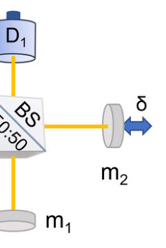
<figcaption class="paper-figure-caption"><b>Fig 2.</b> Figure 1 shows the layout of a conventional Michelson interference experiment. The signal leaving the source S passes through the optical circulator C, reaches the beam splitter BS, and divides into two branches. One branch is reflected at BS, reaches the fixed mirror 𝑚1, returns, and is transmitted through BS towards the detector 𝐷1; we call this arm 1. The other branch is transmitted through BS, reaches the movable mirror 𝑚2, returns, and is reflected at BS towards the same detector 𝐷1; we call this arm 2. Signals that have travelled two different paths thus meet at a single detector. Part of what meets at BS returns towards the source and enters the circulator, which admits the source...</figcaption>
</figure>

**Summary.** This paper develops a novel framework to explain Michelson interference using only the on-off detection statistics of single-photon counters. By analyzing the positive semi-definiteness of the resulting data matrix and applying Herglotz's theorem, the authors show that the characteristic cosine fringe pattern is a mathematical necessity derived from the discrete statistics, rather than an assumption of a continuous wave function.

**Why it may be interesting.** This work offers a fundamentally statistical and algebraic approach to a cornerstone of quantum optics, providing a rigorous framework that derives wave-like interference patterns purely from discrete counting statistics, which is highly relevant to modern quantum measurement theory.

Detailed structure

**Main problem.** The paper aims to reconstruct the phenomenon of Michelson interference using only the binary (on-off) detection statistics from a single-photon counter, bypassing the need for complex wave superposition assumptions.

**Main result.** It demonstrates that the harmonic form of the interference fringe is a necessary consequence of the algebraic constraints (positive semi-definiteness) satisfied by the discrete statistical data, rather than an axiom of a wave model.

**Method.** The methodology involves analyzing the positive semi-definiteness of a matrix constructed from the firing probabilities derived from the binary detection statistics and applying Herglotz's theorem.

**Model / system.** The physical system is a Michelson interferometer setup utilizing single-photon detection. The model focuses on the algebraic properties of the resulting binary (1 or 0) detection sequence recorded across varying path differences.

**Key observables.** Binary detection statistics (1/0), firing probability, and the resulting normalized response function $\hat{g}(\delta)$.

**Important parameters / regimes.** Path difference ($\delta$), low firing probability regime ($w \ll 0.01$), and the requirement that the matrix formed by the statistics must be positive semi-definite.

**Assumptions / limitations.** Assumes ideal conditions such as no photon bunching, negligible dark counts, and that the beam splitter does not split a photon into two outputs simultaneously.

**Figures summary.** Figure 1 illustrates the physical layout of the Michelson interferometer equipped with binary detectors.

**Paper structure.** The paper establishes the physical setup and the statistical measurement process, derives the necessary mathematical constraints from the positive semi-definiteness of the data matrix, applies Herglotz's theorem to constrain the functional form to a cosine series, and finally cross-validates the derived wavenumber distribution using an independent spectrometer measurement.

Abstract

This paper reconstructs the Michelson interference phenomenon based solely on the binary (on-off) statistics of a single-photon counter and macroscopic path-difference data, without the a priori assumptions of complex wave superposition or prior spectral information. In contrast to the conventional approach that assumes light as a continuous complex wave function and considers interference between them, this study focuses on the algebraic properties inherent in discrete detection statistics. We verify that the discrete response data collected across various path differences form a positive semi-definite matrix, and apply Herglotz's theorem to this result. Consequently, we show that the harmonic form of the interference fringe is not a consequence of adopting a wave model as an axiom, but rather it is uniquely decomposed into a cosine average of wavenumbers dictated by testable algebraic constraints satisfied by the statistical data. Through this approach, the logical basis of the interference phenomenon can be described by the characteristics of the binary data itself, perfectly aligning with the modern optical experimental environment that relies entirely on discrete event statistics.

[↑ back to top](#top)

### [Leakage benchmarking with decohering subgroups in the presence of preparation and measurement errors](http://arxiv.org/abs/2610.19304v1)

**Authors:** Shawn Geller, Tongyu Zhao, Alex Kwiatkowski, Scott Glancy, Raymond W. Simmonds, Emanuel Knill  
**Type:** both · **Category:** quantum information and computing · **PDF:** <https://arxiv.org/pdf/2610.19304v1>  
**Analysis basis:** full PDF text, analyzed in chunks
**Topic relevance:** 🔥 `QC/QI experiment` **4/5** · `quantum measurements` **3/5** · `methods for driven-dissipative` **2/5** · `correlated / nonlocal dissipation` **1/5**

↔ Scroll figures horizontally

<figure class="paper-figure-card">
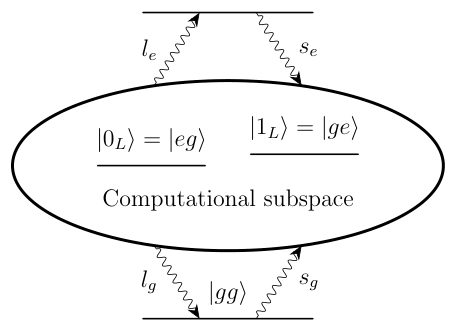
<figcaption class="paper-figure-caption"><b>Fig 1.</b> FIG. 1. Schematic of the four levels of two transmon qubits. The energy spacings are not to scale. The levels involving two or more excitations on a transmon are not shown. The dual-rail qubit is defined by the middle two levels, which span the computational subspace. The leakage subspace is spanned by the remaining two levels consisting of the ground state |gg⟩and the excited state |ee⟩. The arrows show the relevant leakage and seepage processes. After twirling and taking into account the near absence of direct transitions between the two leaked levels, leakage and seepage are parameterized by (1) the leakage probabilities lg and le, which are the probabilities per randomized benchmarking...</figcaption>
</figure>
<figure class="paper-figure-card">
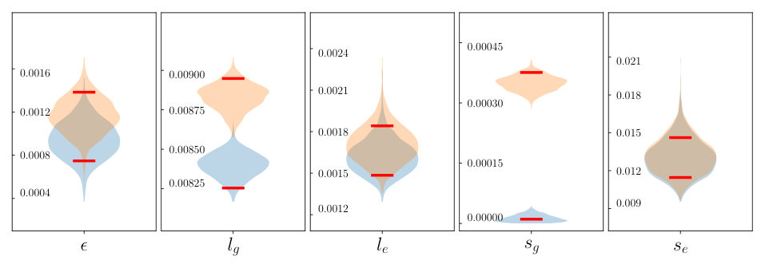
<figcaption class="paper-figure-caption"><b>Fig 2.</b> FIG. 2. Analysis results from 1000 nonparametric bootstraps. The subplots show the bias-corrected 68 % confidence intervals (red horizontal lines) and violin-plot bootstrap histograms for the boot- strap upper (orange histograms) and lower bounds (blue histograms) for each parameter of the transition matrix. The numerical confidence intervals are listed in the table.</figcaption>
</figure>
<figure class="paper-figure-card">
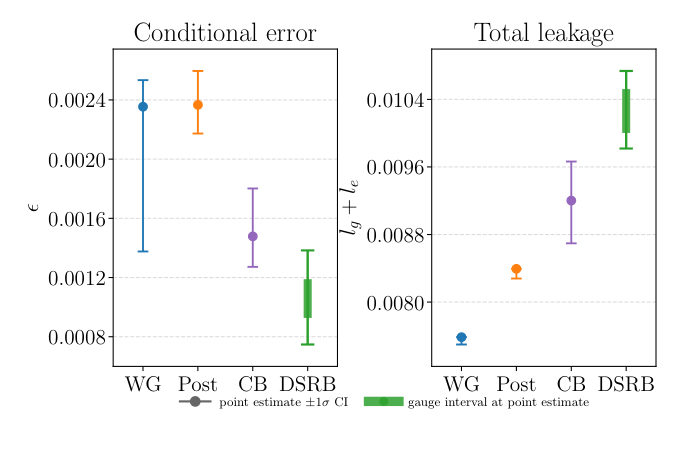
<figcaption class="paper-figure-caption"><b>Fig 3.</b> FIG. 3. Estimates of the conditional error ϵ and total leakage lg + le according to the three alternative methods compared to DSRB. The estimates for WG, Post and CB are based on the configurations with measurement M2 only.</figcaption>
</figure>
<figure class="paper-figure-card">
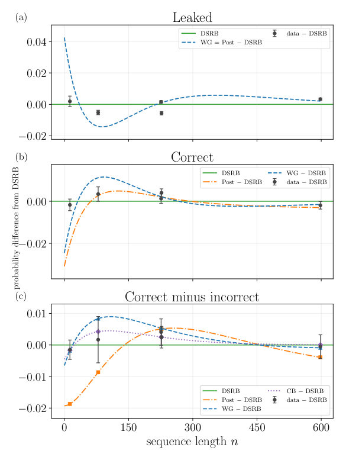
<figcaption class="paper-figure-caption"><b>Fig 4.</b> FIG. 4. Visualizations of the fits by DSRB and the comparison methods. Each subplot shows the frequencies according to the data with error bars of one standard deviation together with the probabilities according to the relevant fits. To highlight the differences to DSRB, the DSRB probabilities are subtracted. Subplot (a) shows the probabilities of “leaked”. In this case WG and Post use the same fitting procedure. CB does not have a complete model for these probabilities and is not shown. Subplot (b) shows the probabilities of “correct” for WG and Post. Again, CB does not have a complete model for these probabilities. Subplot (c) shows the difference probabilities “correct”−“incorrect”, and...</figcaption>
</figure>
<figure class="paper-figure-card">
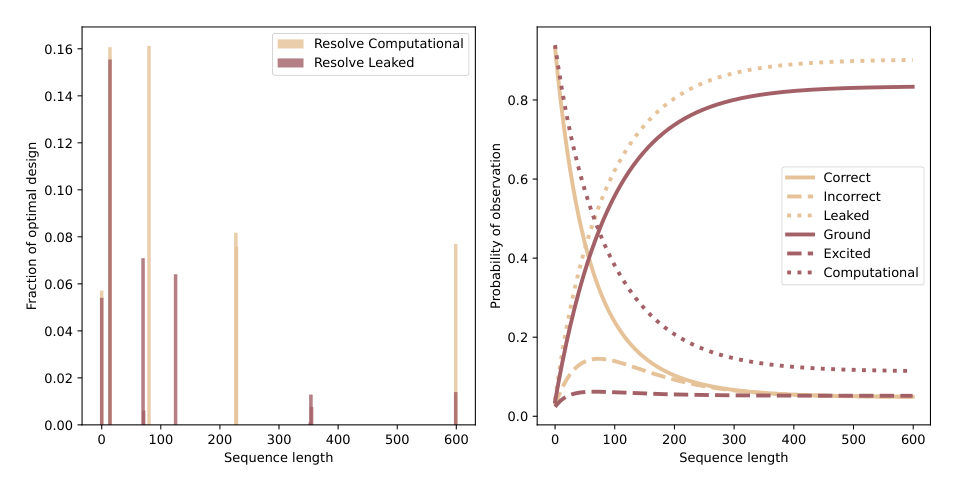
<figcaption class="paper-figure-caption"><b>Fig 5.</b> FIG. 5. Experimental design. The left subfigure shows the design fractions at each measurement setting and length. The right subfigure shows the probabilities of the outcomes at the reference point as a function of length. “Correct”, “Incorrect” and “Leaked” are the outcomes of measure- ment M2, which resolves the computational subspace. “Ground”, “Excited” and “Computational” are the outcomes of measurement M1, which resolves the leaked subspace.</figcaption>
</figure>

**Summary.** This paper presents an advanced benchmarking technique, Decohering Subgroup Randomized Benchmarking (DSRB), to characterize quantum gate performance in the presence of leakage and state preparation/measurement errors. By modeling the system as a Markov process and incorporating physical constraints, the authors develop a robust inference method. This method allows for the determination of reliable confidence intervals for critical performance metrics like fidelity and leakage rate, which is crucial for scaling quantum computation.

**Why it may be interesting.** This work provides a rigorous, theoretically grounded framework for benchmarking real quantum hardware, directly addressing the practical limitations imposed by noise sources like leakage and imperfect state preparation.

Detailed structure

**Main problem.** The paper addresses the challenge of accurately characterizing qubit gate fidelity and leakage probability when the physical system suffers from State Preparation and Measurement (SPAM) errors.

**Main result.** The authors developed a measurement and inference method that uses known conservative bounds on SPAM to constrain the underdetermined parameters, yielding experimentally validated confidence intervals for fidelity and leakage.

**Method.** They model the process using Decohering Subgroup Randomized Benchmarking (DSRB) and employ advanced inference techniques, including constrained optimization and checking parameter feasibility across multiple orthants.

**Model / system.** The study focuses on physical qubits, exemplified by a qubit defined on the one-excitation subspace of two transmon qubits, which exhibits both a computational subspace and leakage levels.

**Key observables.** Average gate fidelities, total leakage rate, and the parameters defining the Markov process (e.g., transition probabilities).

**Important parameters / regimes.** Leakage probability, seepage probability, and the parameters defining the Markov process's transition matrix.

**Assumptions / limitations.** The analysis assumes gate-independent noise and relies on applying conservative, known bounds on SPAM errors to resolve parameter degeneracies.

**Figures summary.** Figure 1 schematically illustrates the four levels of the two transmon qubits, defining the computational subspace and the leakage subspace, and detailing leakage and seepage probabilities per step.

**Paper structure.** The paper details the system model, develops the DSRB theory, outlines the maximum likelihood inference framework, applies the method to the dual-rail transmon qubit, and concludes with experimental results comparing DSRB against conventional benchmarking methods.

Abstract

A common problem with physical qubits is that the state can leak outside the computational subspace. To characterize the problem, it is desirable to measure both the leakage probability and the fidelity of gates inside the computational subspace. Randomized benchmarking is a readily accessible method for estimating average gate fidelities and can be modified to account for leakage. However, in the presence of state preparation and measurement errors (SPAM) there are parameter degeneracies, and fidelities and leakage become underdetermined. We study the example of qudits with any number of leakage levels under the assumption of gate-independent noise. We show that randomized benchmarking sequences with leakage level decoherence can be analyzed as a Markov process with noisy classical preparations and measurements. This result generalizes to randomized benchmarking with random gates from an arbitrary group that contains a phase-decohering subgroup. We characterize the parameter degeneracy in inferring the Markov process, preparations and measurements. Based on this characterization we develop a measurement and inference method taking advantage of known conservative bounds on SPAM to constrain fidelity, leakage and other parameters of the Markov process, state preparations and measurements. As part of our study, we experimentally implemented the measurement method for a qubit defined on the one-excitation subspace of two transmons, for which there are two leakage levels. We determined confidence intervals accounting for parameter degeneracy for a number of performance parameters of the system. For leakage and fidelity, we compare these intervals to those obtained for several conventional methods for leakage benchmarking.

[↑ back to top](#top)

### [Programmable Polaron Models and Tomography in Trapped-Ion Quantum Simulators](http://arxiv.org/abs/2610.18970v1)

**Authors:** Filip Marijanovic, Utso Bhattacharya, Abhishek Menon, Visal So, Guido Pagano, Eugene Demler  
**Type:** both · **Category:** other · **PDF:** <https://arxiv.org/pdf/2610.18970v1>  
**Analysis basis:** full PDF text, analyzed in chunks
**Topic relevance:** 🔥 `analog quantum simulation` **4/5** · `Keldysh / 2PI / non-Gaussian methods` **2/5** · `quantum measurements` **2/5** · `QC/QI experiment` **1/5** · `quantum optics experiment` **1/5**

↔ Scroll figures horizontally

<figure class="paper-figure-card">
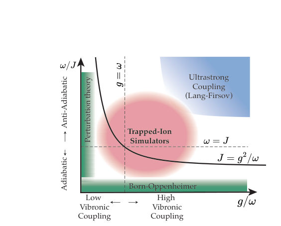
<figcaption class="paper-figure-caption"><b>Fig 1.</b> FIG. 1. Qualitative diagram of the parameter regimes rel- evant to spin–phonon models of biomolecules [1] and po- larons [6]. Trapped-ion simulators naturally access the non- perturbative intermediate regime.</figcaption>
</figure>
<figure class="paper-figure-card">
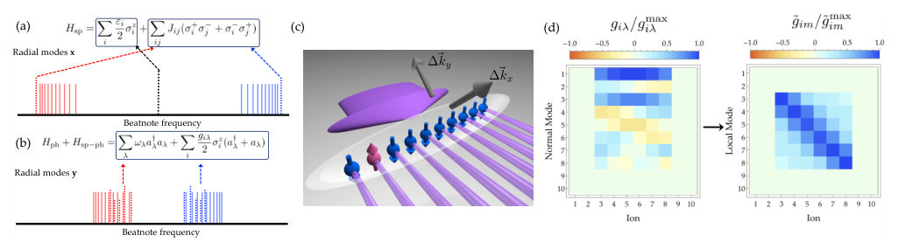
<figcaption class="paper-figure-caption"><b>Fig 2.</b> FIG. 2. Trapped-ion architecture for programmable polaron models. (a) A far-detuned bichromatic drive couples to one radial motional branch along the x direction to generate programmable spin–spin interactions and, in the presence of a strong transverse field, the effective spin-hopping Hamiltonian Hsp. (b) A near-resonant multi-frequency drive applied near the motional sidebands of the orthogonal radial branch along the y direction generates Hph + Hsp−ph with tunable effective phonon frequencies and spin–phonon coupling strengths giλ. (c) Optical geometry for independently coupling to the two radial directions. The laser wavevector ∆⃗k is decomposed along different radial principal axes of...</figcaption>
</figure>
<figure class="paper-figure-card">
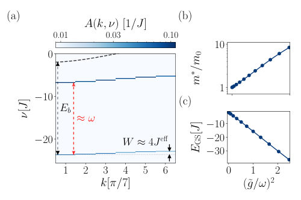
<figcaption class="paper-figure-caption"><b>Fig 3.</b> FIG. 3. (a) Spectral function A(k, ν) of the on-site Holstein polaron for ˜g/ω = 1.25 and ω/J = 15. We compute the spec- tral function using Eq. (12) and replacing the Dirac delta function with a Lorentzian with width γ/J = 0.05. k repre- sents the standing-wave quasi-momentum (see Appendix C). The color bar indicates the amplitude of the spectral func- tion on a log scale for different frequencies and momenta. The dashed black line indicates the free-spin dispersion. The dashed black arrow represents the polaron binding energy, Eb = EGS −EGS (˜g = 0), and the dashed red arrow indicates the separation of the single-phonon excitation, ω. The two solid black arrows on the right indicate the...</figcaption>
</figure>
<figure class="paper-figure-card">
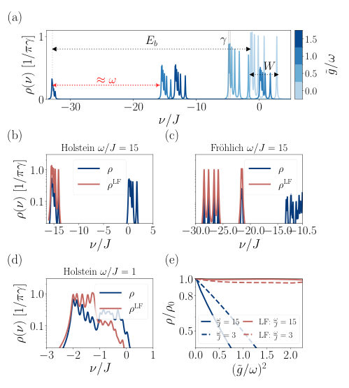
<figcaption class="paper-figure-caption"><b>Fig 4.</b> FIG. 4. Bare and displaced local density of states. (a) Local density of states of the on-site Holstein model with long-range hopping for different values of coupling strengths ˜g/ω, with αJ = 1.2 and ω/J = 15. The dashed black arrow represents the polaron binding energy, Eb = EGS −EGS (˜g = 0), and the dashed red arrow indicates the energy gap to the first phonon sideband, which is ≈ω. W indicates the bandwidth of the system. The vertical gray lines in- dicate the linewidth γ/J = 0.05. (b)–(d) Comparison of the bare LDOS (blue), Eq. (16), and displaced LDOS (red), Eq. (20), for long-range hopping with αJ = 1.2, ˜g/ω = 1, and linewidth γ/J = 0.05. (b) On-site Holstein model with ω/J = 15....</figcaption>
</figure>
<figure class="paper-figure-card">
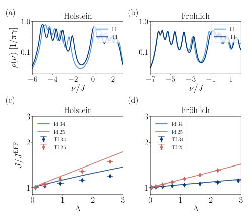
<figcaption class="paper-figure-caption"><b>Fig 5.</b> FIG. 6. Comparison of trapped-ion and ideal spin–phonon models. (a) Local density of states for long-range hopping Holstein model with ξ = 0.83, ω/J = 5, Λ = 3.7, and αJ = 1.2 for ideal (light blue) and trapped-ion coupling con- stants (dark blue). (b) Local density of states for long-range hopping Fr¨ohlich model with α = 1.6, ω/J = 5, Λ = 4.6, and αJ = 1.2 for ideal (light blue) and trapped-ion coupling con- stants (dark blue). In both (a) and (b), the bosonic cutoff is 4 per mode, and the linewidth of γ/J = 1/6 was used. (c) Ef- fective hopping renormalization of J43 (blue) and J52 (red) for the long-range hopping Holstein model with ξ = 0.83, ω/J = 5, and αJ = 1.2 as a function of...</figcaption>
</figure>

**Summary.** This paper proposes using trapped-ion quantum simulators to study polaron physics by engineering programmable spin-phonon Hamiltonians. The authors introduce advanced measurement techniques, such as displaced Green's functions, to overcome limitations in traditional spectroscopy. This allows for the direct mapping and tomography of the phonon dressing cloud surrounding the charge carrier, enabling controlled study of polaron formation in the non-perturbative regime.

**Why it may be interesting.** This work is highly relevant as it merges advanced concepts from quantum optics (trapped ions, coherent state measurements) with condensed matter physics (polarons), providing a blueprint for simulating complex many-body interactions.

Detailed structure

**Main problem.** The paper addresses the challenge of studying polaron formation and dynamics in the strongly coupled, non-perturbative regime where electronic motion and lattice vibrations are comparable.

**Main result.** They demonstrate that trapped-ion quantum simulators provide a unique platform to engineer tunable spin-phonon Hamiltonians and perform polaron tomography by measuring displaced Green's functions.

**Method.** The study combines theoretical modeling (Lang-Firsov approximation, displaced Green's functions) with proposals for experimental realization using trapped ions.

**Model / system.** The system models polaron formation, involving strong coupling between mobile charge carriers/excitons and lattice vibrations (phonons). The Hamiltonian is a spin-phonon model ($H = H_{sp} + H_{ph} + H_{sp-ph}$), realized in a trapped-ion quantum simulator.

**Key observables.** Polaron band spectrum, phonon dressing cloud structure, single-particle residue ($Z_j$), and the displaced local density of states ($	ext{dLDOS}$).

**Important parameters / regimes.** The coupling strength ($	ilde{g}/\omega$), the ratio of hopping to phonon energy ($J/\omega$), and the ability to tune the spatial range of coupling (Holstein vs. Fröhlich regimes).

**Assumptions / limitations.** The analysis relies on mapping the system to pseudospins and utilizing displaced Green's functions to overcome spectral weight suppression inherent in conventional spectroscopy.

**Figures summary.** Figures illustrate the trapped-ion architecture for generating programmable spin-phonon interactions and compare $	ext{LDOS}$ vs. $	ext{dLDOS}$ across various coupling strengths, showing spectral shifts and sidebands.

**Paper structure.** The paper first establishes the physical problem and the trapped-ion platform for realizing tunable spin-phonon Hamiltonians. It then details advanced measurement techniques like displaced Green's functions and polaron tomography to characterize the dressed quasiparticle spectrum and the phonon environment.

Abstract

Strong coupling between mobile charge carriers or excitons and lattice vibrations gives rise to polarons: quasiparticles formed by charge carriers dressed by a cloud of phonon excitations. Polaron formation determines transport properties of systems ranging from transition-metal oxides and organic semiconductors to light-harvesting complexes. In excitonic systems that admit a hard-core boson description, mapping the excitations to pseudospins provides a natural framework for studying polaron physics, including the nonperturbative regime in which hopping amplitudes, phonon energies, and coupling strengths are comparable. Here, we propose a trapped-ion blueprint for realizing spin-phonon Hamiltonians with programmable spatial coupling between excitation density and phonon displacements, encompassing local Holstein and long-range Fröhlich-type interactions. To access strongly dressed quasiparticles whose bare spectral weight is suppressed, we introduce displaced Green's functions implemented through spin-dependent phonon displacements. Their spectral response reveals the polaron band spectrum, including binding energies and phonon-excitation sidebands, while spatially resolved measurements probe the structure of the phonon dressing cloud, providing a route to polaron tomography. We further complement this spectroscopy with direct and ancilla-assisted measurements of spin-phonon correlations that track the coupled dynamics of the excitation and its environment. These approaches connect the emergent quasiparticle spectrum to the microscopic buildup of its dressing cloud, enabling controlled studies of how the spatial range of coupling shapes polaron formation and mobility.

[↑ back to top](#top)

### [Analog Cosmology in a Quenched Bose-Einstein Condensate Bubble](http://arxiv.org/abs/2610.20382v1)

**Authors:** Ruotong Zhai, Brendan Rhyno, Zain Mehdi, Naceur Gaaloul, Smitha Vishveshwara, Daniel E. Sheehy  
**Type:** theory · **Category:** quantum gases · **PDF:** <https://arxiv.org/pdf/2610.20382v1>  
**Analysis basis:** full PDF text, analyzed in chunks
**Topic relevance:** 🔥 `analog quantum simulation` **4/5** · `Keldysh / 2PI / non-Gaussian methods` **2/5** · `methods for driven-dissipative` **1/5** · `non-equilibrium universality` **1/5**

↔ Scroll figures horizontally

<figure class="paper-figure-card">

<figcaption class="paper-figure-caption"><b>Fig 1.</b> Figure 1. (Color online) Subfigure (a) shows how an increasing coupling (λ(t)) quench of a bubble BEC, shown in the upper-left plot, yields quantum particle production that is revealed in the time-dependent post-quench structure factor Sℓ(t) (lower-left plot), with ℓthe angular momentum quantum number, and in the post-quench boson density-density correlation function Cˆρˆρ(θ, φ, θ′, φ′; t), defined in Eq. (40), with θ and φ the usual polar and azimuthal angles and θ′ = 0 (i.e. at the “north pole”), with other details provided below Eq. (44). Subfigure (b) shows the same plots for a decreasing-coupling quench, revealing qualitatively similar behavior (but reduced in magnitude).</figcaption>
</figure>
<figure class="paper-figure-card">

<figcaption class="paper-figure-caption"><b>Fig 2.</b> Figure 2. (Color online) The left and right panels illustrate two different coupling quench protocols. Since the analog scale factor is inversely proportional to the coupling strength, the increasing coupling quench (left panel) corresponds to a decreasing scale factor (or big crunch), while the decreasing coupling quench (right panel) corresponds to an increasing scale factor (or big bang).</figcaption>
</figure>
<figure class="paper-figure-card">

<figcaption class="paper-figure-caption"><b>Fig 3.</b> Figure 3. (Color online) The top panel shows the particle production vs. angular momentum quantum number ℓfor a quench-up experiment (i.e., an analog big crunch) and the bottom panel shows the same for a quench-down experiment (i.e., an analog big bang). In both panels, the quench dura- tions are tf = 20 ms (blue circles), tf = 30 ms (red squares), and tf = 50 ms (green triangles). This can be viewed as a spectrum of particles or quanta created by the quench, and in each case the particle production monotonically decreases with increasing ℓ. For the parameters considered here, the quench-up protocol produces more such quanta than the cor- responding quench-down protocol. This is likely...</figcaption>
</figure>
<figure class="paper-figure-card">

<figcaption class="paper-figure-caption"><b>Fig 4.</b> Figure 4. (Color online) BEC power spectrum Sℓ(t), Eq. (46), for various quenches, showing how the dynamical particle production is reflected in this observable. The different colors of the plots denote different times after the quench stops: t = 0 s (black), t = 0.3 s (red), t = 0.9 s (green), and t = 1.2 s (blue). The panels show (a) Quench up, T = 0 K. (b) Quench up, T = 10 nK. (c) Quench down, T = 0 K. (d) Quench down, T = 10 nK, with the other system parameters consistent with those of the Jia et al experiments [85] who achieved a shell-shaped BEC using a dual-species mixture (see Appendix C). In each case, Sℓshows oscillatory time dependence after the quench, although the character of...</figcaption>
</figure>
<figure class="paper-figure-card">

<figcaption class="paper-figure-caption"><b>Fig 5.</b> Figure 5. The three plots show the structure factor versus effective wave number k ≡ p</figcaption>
</figure>

**Summary.** This paper demonstrates that Bose-Einstein Condensates confined to spherical shells can act as analog simulators for curved spacetime cosmology. By quenching the interaction strength, the system exhibits quantum particle production analogous to processes in the early universe, allowing entanglement to be quantified using measurable spectral features.

**Why it may be interesting.** This work provides a concrete, controllable laboratory platform (BECs) to simulate fundamental cosmological processes like inflation and particle creation, bridging quantum information theory and early-universe cosmology.

Detailed structure

**Main problem.** The study explores using thin spherical shell-shaped Bose-Einstein Condensates (BECs) as analog gravity simulators to model the dynamics of an expanding or contracting curved universe.

**Main result.** The system successfully models a positively curved universe with a time-varying scale factor, demonstrating spontaneous pair production characterized by oscillations analogous to Sakharov oscillations in the CMB.

**Method.** The theoretical approach involves dimensional reduction to an effective 2D Hamiltonian, followed by a Bogoliubov treatment to analyze quantum fluctuations.

**Model / system.** The physical system is an interacting BEC confined to a spherical shell. The dynamics are modeled by an effective 2D Hamiltonian, which is analyzed by linearizing the equations of motion for density and phase fluctuations.

**Key observables.** Spontaneous pair production, the structure factor S_l(t) (analogous to CMB power spectrum), and the logarithmic negativity (measure of entanglement).

**Important parameters / regimes.** Time-varying interaction strength (quench protocol), effective wavevector k, and the shell geometry parameters (radius R, thickness $\Delta R$).

**Assumptions / limitations.** The analysis relies on the thin-shell limit (dimensional reduction) and the Bogoliubov approximation for fluctuations.

**Figures summary.** Figures illustrate quantum particle production from both increasing and decreasing coupling quenches, showing the time-dependent structure factor and density-density correlation function.

**Paper structure.** The paper progresses from establishing the physical analogy using the 3D Hamiltonian to deriving the effective 2D Hamiltonian. It then solves the linearized equations of motion across multiple quench regimes, finally calculating observables like entanglement and particle production amplitudes.

Abstract

Recent interest and realization of ultracold bosons confined in shell-shaped, or bubble, traps have opened up several directions in the study of Bose-Einstein condensates (BECs) in intrinsically curved geometries. Here, we explore the prospect of using thin spherical shell-shaped BECs as analog gravity simulators of an expanding or contracting curved universe. We study an interacting BEC bubble subject to a temporal quench of the interaction strength. Our theoretical approach, which uses a Bogoliubov treatment following a dimensional reduction of a spherical BEC to the low-energy excitations of a shell-shaped structure, demonstrates how this system serves as a laboratory analog for a positively curved universe having a time-varying scale factor. We investigate spontaneous pair production triggered by quenches associated with exponentially decaying or growing interaction strengths, focusing on the emergence of oscillations in the structure factor---analogous to Sakharov oscillations in the Cosmic Microwave Background angular power spectrum. We quantify the entanglement of the produced pairs via logarithmic negativity, and show how this measure may be extracted from the power spectrum. These findings establish a bridge between quantum information science and early-universe cosmology in a laboratory setting.

[↑ back to top](#top)

### [Demonstration of a mobile ion-trap quantum device](http://arxiv.org/abs/2610.20487v1)

**Authors:** Sara Alfaro, Dipesh Bhanushali, Sankarshan Choudapurkar, Ashwin Bhartia, Thomas Lafenthaler, Tommaso Faorlin, Yannick Weiser, Lorenz Panzl, Thomas Monz, Rainer Blatt, Giovanni Cerchiari  
**Type:** experiment · **Category:** other · **PDF:** <https://arxiv.org/pdf/2610.20487v1>  
**Analysis basis:** full PDF text, analyzed in chunks
**Topic relevance:** 🔥 `QC/QI experiment` **4/5** · `analog quantum simulation` **2/5** · `quantum measurements` **2/5**

↔ Scroll figures horizontally

<figure class="paper-figure-card">

<figcaption class="paper-figure-caption"><b>Fig 1.</b> FIG. 1: (a) Schematic of the experimental setup. Ions are produced by laser ablation, confined in a linear Paul trap, and detected using a microchannel plate (MCP) detector imaged by a camera. (b) Computer-aided design of the Paul-trap electrodes. The central aperture of diameter ϕ = 3.4 mm in each planar endcap electrode serves as an exit port for extracting ions toward the MCP detector; the aperture is indicated by the red arrow. (c) Linear Paul-trap assembly mounted on a ConFlat-200 flange. An MCP detector is mounted along the trap axis for ion detection, while an Einzel lens is positioned on the opposite side to focus externally produced ions for injection into the trap. The Einzel lens...</figcaption>
</figure>
<figure class="paper-figure-card">

<figcaption class="paper-figure-caption"><b>Fig 2.</b> FIG. 2: Examples of experimental data and ion detection. (a) Integrated MCP signal (blue line, left axis) and corresponding endcap voltage (red points, right axis) as a function of time during ion extraction from the trap. A detectable ion signal appears only when the endcap voltage decreases below approximately 10 V. (b) Representative MCP image illustrating a worst-case condition for the image-analysis procedure, with strong background illumination. The image is divided into a central region (inside the green circle), where ion signals exhibit pileup, and an outer annular region (between the green and yellow circles), where individual ion events remain spatially resolved (small green...</figcaption>
</figure>
<figure class="paper-figure-card">

<figcaption class="paper-figure-caption"><b>Fig 3.</b> FIG. 3: Ion-transport measurements. Transport routes corresponding to storage times of (a) 15 min and (b) 45 min. North is oriented upward in both maps. (c) Number of ions detected after transport as a function of storage time. An exponential fit yields a storage lifetime of τ = 1.52(71) × 103 s.</figcaption>
</figure>
<figure class="paper-figure-card">

<figcaption class="paper-figure-caption"><b>Fig 4.</b> FIG. 4: (a) Detector signal as a function of the RF peak- to-peak amplitude at constant voltage applied to the endcaps. (b) Detector signal as a function of the voltage applied to the endcaps at constant RF drive. The scans shows the range accessible by the experiment.</figcaption>
</figure>

**Summary.** The researchers demonstrated the first successful transport of thousands of trapped ions confined in a linear Paul trap over several kilometers. This achievement establishes a foundation for mobile quantum devices, allowing quantum experiments to be performed while the apparatus is in motion. The work is significant for developing portable quantum technologies and quantum network nodes.

**Why it may be interesting.** This work directly addresses the engineering challenge of quantum hardware portability, which is crucial for realizing quantum networks and distributed quantum sensing applications.

Detailed structure

**Main problem.** The primary goal was to develop a mobile, transportable trapped-ion quantum device capable of operating while in motion, overcoming the limitations of current stationary setups.

**Main result.** The authors successfully demonstrated the transport of several thousand ions confined in a linear Paul trap over distances of several kilometers, maintaining storage times consistent with stationary lab measurements.

**Method.** The experiment involved trapping ions in a linear Paul trap, transporting the apparatus over long distances, and detecting the ions using a microchannel plate (MCP) detector after controlled extraction.

**Model / system.** The physical system is a trapped-ion quantum device utilizing a radio-frequency linear Paul trap geometry. The system is designed to handle various ion species ($	ext{Be}^+, 	ext{Ca}^+, 	ext{Sr}^+$) and is housed in a transportable rack.

**Key observables.** Ion count detected via MCP signal, ion storage lifetime ($	au$), and ion retention measured after transport periods (15 min, 45 min).

**Important parameters / regimes.** RF trapping frequency ($\Omega_{RF}$) of $2\pi 	imes 17$ MHz; transport distances of several kilometers; storage times up to 45 minutes.

**Assumptions / limitations.** The primary assumption is that the confinement mechanism in the Paul trap remains stable and functional while the entire apparatus is physically moved over long distances.

**Figures summary.** Figures illustrate the experimental setup (Fig. 1), the ion extraction sequence and data processing (Fig. 2), and the ion-transport measurements showing ion counts versus time during movement (Fig. 3).

**Paper structure.** The paper details the experimental setup, describes the ion generation and detection procedures, presents the results of ion transport over kilometers, and discusses the implications for mobile quantum applications.

Abstract

Trapped-ion devices are being investigated for transportable applications, including the transfer of exotic charged particles between laboratories and the development of portable quantum technologies. To date, ion transport has been demonstrated only in magnetic (Penning) traps, whereas radiofrequency (Paul) traps are the predominant platform in quantum science. Here, we report the first transport of a few thousand ions confined in a linear Paul trap over distances of several kilometers, with transport durations of 15 and 45 min. These results establish a foundation for mobile trapped-ion quantum devices capable of operating while in motion and may enable the transport of exotic ions in Paul traps between experimental facilities.

[↑ back to top](#top)

### [Kinetic Equations and Turbulence in Large $N$ Vector and SYK-like Models](http://arxiv.org/abs/2610.19130v1)

**Authors:** Vladimir Rosenhaus, Daniel Schubring  
**Type:** theory · **Category:** statistical mechanics · **PDF:** <https://arxiv.org/pdf/2610.19130v1>  
**Analysis basis:** full PDF text, analyzed in chunks
**Topic relevance:** 🔥 `Keldysh / 2PI / non-Gaussian methods` **4/5** · `non-equilibrium universality` **3/5** · `methods for driven-dissipative` **1/5**

↔ Scroll figures horizontally

<figure class="paper-figure-card">

<figcaption class="paper-figure-caption"><b>Fig 1.</b> Figure 1: The large-N four-point functions for (2.1, 2.2) are given by the sum of bubble diagrams, (a), (b), respectively. This can be viewed as the exchange of a Hubbard-Stratonovich ϕ particle, (c), (d), respectively.</figcaption>
</figure>

**Summary.** This work develops kinetic equations for strongly coupled quantum systems using large N expansions. It contrasts the standard Boltzmann equation derived for vector models with a novel, non-local equation for SYK-like random coupling models. The research reveals evidence for a new strong turbulence scaling exponent, advancing the understanding of non-equilibrium quantum dynamics.

**Why it may be interesting.** The derivation of non-standard kinetic equations and the identification of novel strong turbulence scaling exponents provide theoretical tools for understanding non-equilibrium dynamics in complex quantum systems.

Detailed structure

**Main problem.** The paper derives kinetic equations for strongly coupled, far-from-equilibrium field theories, specifically analyzing the transition between weak and strong turbulence regimes.

**Main result.** For large N random coupling (SYK-like) models, the resulting kinetic equation lacks a local-in-time collision integral, suggesting a novel strong turbulence scaling exponent.

**Method.** The authors employ the large N expansion technique combined with the Keldysh formalism to derive and analyze the kinetic equations governing the system's dynamics.

**Model / system.** The study examines large N vector models with O(N) symmetry and random coupling (SYK-like) models in d dimensions, applicable to systems like spin wave and Langmuir ion-acoustic turbulence.

**Key observables.** Occupation numbers ($n_k$), the retarded propagator ($D_R$), and the collision integral ($I_{	ext{coll}}$).

**Important parameters / regimes.** The analysis distinguishes between weak coupling (UV) and strong coupling (IR) regimes, characterized by different scaling exponents.

**Assumptions / limitations.** Key approximations include the large N expansion, the quasi-classical approximation for vector models, and the Markovian limit for deriving the collision integral.

**Figures summary.** Figure 1 illustrates the large-N expansion framework, while subsequent analysis focuses on deriving and comparing the structure of the kinetic equation in different coupling regimes.

**Paper structure.** The paper progresses by first establishing the general kinetic equation structure using the Keldysh formalism, then applying this framework to the vector model (yielding standard Boltzmann dynamics), and finally analyzing the unique, non-local collision integral for the random coupling (SYK-like) model.

Abstract

We apply large $N$ expansion techniques to derive kinetic equations for strongly coupled, far-from-equilibrium field theories with $O(N)$ symmetry. For large $N$ vector models, the quasi-classical approximation holds. Incorporating arbitrary momentum-dependent interactions, we show the dynamics obey the standard kinetic equation, with the scattering amplitude given by the retarded propagator of the auxiliary Hubbard-Stratonovich field. This has broad applications to systems like spin wave and Langmuir ion-acoustic turbulence. For large $N$ random coupling (SYK-like) models in $d$ dimensions, leading-order melon diagrams induce order-one propagator renormalization and finite spectral width. The corresponding kinetic equation, unlike those for standard weakly interacting systems, does not have a local-in-time collision integral. We find evidence for a stationary, scale-invariant infrared solution, revealing a potentially novel strong turbulence scaling exponent.

[↑ back to top](#top)

### [Quantum-enhanced phase interrogation of a fiber-optic strain sensor](http://arxiv.org/abs/2610.19752v1)

**Authors:** Romain Dalidet, Marialuisa Capezzuto, Hugo Degert, Davide D'Ambrosio, Saverio Avino, Anthony Martin, Sebastien Tanzilli, Laurent Labonte, Paolo De Natale, Gianluca Gagliardi  
**Type:** experiment · **Category:** other · **PDF:** <https://arxiv.org/pdf/2610.19752v1>  
**Analysis basis:** full PDF text, analyzed in chunks
**Topic relevance:** 🔥 `quantum optics experiment` **4/5** · `interference shaping light` **3/5** · `quantum measurements` **1/5**

↔ Scroll figures horizontally

<figure class="paper-figure-card">

<figcaption class="paper-figure-caption"><b>Fig 1.</b> Fig. 1. Experimental setup combining a PDH-locked fiber Fabry–Pérot resonator used as a strain sensor with an unbalanced fiber Mach– Zehnder interferometer (MZI) for phase readout. The interferometer can be operated with either classical light or non-classical light generated by a nonlinear generation unit (NLG): the NLG is formed by two cascaded nonlinear crystals for SPDC pumped with the 1560-nm laser. The MZI transmitted beams are detected with superconducting nanowire single-photon detectors (SNSPDs). Our main goal is to evaluate how the quantum-light assisted sensor readout compares with its classical counterpart, having the same photon flux at the photodetectors. For this purpose, we...</figcaption>
</figure>

**Summary.** The researchers implemented a quantum-enhanced sensing scheme for fiber-optic strain sensors using entangled photon pairs. By comparing measurements taken with classical light versus quantum light, they experimentally demonstrated that the measurement noise can be pushed below the standard quantum limit. This confirms the potential of quantum metrology to improve sensor sensitivity, especially when high optical power is impractical.

**Why it may be interesting.** This work directly applies quantum optics principles (entanglement, NOON states) to a practical, macroscopic sensing platform (fiber optics), providing experimental validation of quantum metrology beyond the SQL in a low-power regime.

Detailed structure

**Main problem.** The goal is to demonstrate a quantum-enhanced method for interrogating fiber-optic strain sensors to achieve measurement noise below the Standard Quantum Limit (SQL).

**Main result.** The experiment successfully showed that using entangled photon pairs (N=2 NOON state) reduces the phase noise below the shot-noise limit, demonstrating a quantum advantage for sensing under low-power constraints.

**Method.** The setup uses an in-fiber Mach-Zehnder interferometer (MZI) readout coupled to a Fabry-Perot resonator interrogated by either classical coherent light or entangled photon pairs generated via SPDC.

**Model / system.** The physical system is an all-fiber-optic sensor utilizing a Fabry-Perot resonator interrogated via an in-fiber MZI. The sensing mechanism relies on measuring strain-induced optical phase shifts ($\delta\phi$).

**Key observables.** Phase fluctuations ($\delta\phi$), Power Spectral Density (PSD) of phase noise, Allan deviation ($\sigma(	au)$), and coincidence counts of entangled photons.

**Important parameters / regimes.** Standard Quantum Limit (SQL), Heisenberg Limit (HL), strain magnitude, and low optical power regimes.

**Assumptions / limitations.** The noise floor in the single-photon regime is assumed to be dominated by shot noise, allowing for a clear comparison with the quantum enhancement.

**Figures summary.** Figure 2 compares single-photon readout (classical) against the SQL using time traces, Allan deviation, and PSD when strain is applied. Figure 3 compares phase readout using non-classical light, showing sub-shot noise performance in Allan deviation and PSD.

**Paper structure.** The paper establishes the classical sensing baseline by measuring noise approaching the SQL. It then introduces the quantum enhancement using entangled pairs, demonstrating a measurable reduction in noise below the SQL across various diagnostic plots (Allan deviation, PSD).

Abstract

Fiber-optic sensors enable high-sensitivity measurements of various physical parameters. Here, we demonstrate a quantum-enhanced interrogation of an all-fiber-optic Fabry-Perot resonator, employing entangled two-photon interference to probe directly strain-induced optical phase shifts. The resonator is interrogated by a narrow-linewidth laser that is frequency-locked to its resonance mode, thereby exploiting the cavity's inherent sensitivity to variations in the fiber length. To access the phase fluctuations transferred to the interrogation field due to external perturbations on the sensor, we implement an in-fiber Mach-Zehnder interferometer readout. This configuration allows the sensor to operate both with classical coherent light and with entangled photon pairs generated via spontaneous parametric down-conversion. Harnessing two-photon entangled states corresponding to an N = 2 NOON state, we experimentally demonstrate a reduction of the measurement noise below the standard quantum limit. These results provide clear evidence of the quantum advantage in enhancing fiber-optic sensors under practical constraints on optical power.

[↑ back to top](#top)

### [Majorana Edge Modes Reshape Kibble-Zurek Scaling in Kitaev Honeycomb Ribbons](http://arxiv.org/abs/2610.19923v1)

**Authors:** Hyesung Choi, Antonio Mandarino, Mahn-Soo Choi  
**Type:** theory · **Category:** other · **PDF:** <https://arxiv.org/pdf/2610.19923v1>  
**Analysis basis:** full PDF text, analyzed in chunks
**Topic relevance:** 🔥 `non-equilibrium universality` **4/5** · `analog quantum simulation` **3/5**

↔ Scroll figures horizontally

<figure class="paper-figure-card">

<figcaption class="paper-figure-caption"><b>Fig 1.</b> FIG. 1. (a) Honeycomb lattice with the primitive vectors α1 and α2. Open (filled) circles denote the a (b) sublattice; blue, green, and orange bonds denote the x-, y-, and z-links, respectively. (b) Ground-state phase diagram of the Kitaev model on the plane Jx + Jy + Jz = 1 (Jα ≥0). The three gapped phases Ax, Ay, and Az surround the gapless phase B defined by the triangle inequalities (8).</figcaption>
</figure>
<figure class="paper-figure-card">

<figcaption class="paper-figure-caption"><b>Fig 2.</b> FIG. 2. Ribbon geometries. (a) Zigzag ribbon: periodic along its longitudinal direction α∥= α1 with Nx unit cells and open across, comprising N2 zigzag chains labeled ℓ= 1, . . . , N2; the lower edge terminates on the a sublattice and the upper edge on the b sublattice. (b), (c) Armchair ribbons of width N2 = 5 and N2 = 6: periodic along α∥= 2α2 −α1 with Nx two-site cells per column and open across, comprising N2 vertical dimer lines labeled ℓ= 1, . . . , N2. The primitive lattice vectors α1 and α2 are indicated in panels (a) and (c); faded bonds indicate the periodic continuation.</figcaption>
</figure>
<figure class="paper-figure-card">

<figcaption class="paper-figure-caption"><b>Fig 3.</b> FIG. 3. Edge-mode phase diagrams. (a), (b) Schematic repre- sentation on the coupling triangle Jx+Jy+Jz = 1 (Jα ≥0) for the zigzag and armchair ribbons, respectively: dark shading marks the couplings at which edge modes exist for every mo- mentum k, light shading those at which they occupy a finite window of k. Zigzag edge modes exist for |Jz| &gt; |Jx −Jy|, i.e., throughout B and Az; armchair edge modes exist for |Jz| &lt; Jx + Jy, i.e., throughout Ax, Ay, and B, except on the line Jx = Jy (dashed), on which the window closes. (c), (d) The same conditions, Eqs. (16) and (17), resolved in the (k, |Jz|) plane at Jx = 1 and Jy = 2, the couplings used throughout this work; the boundaries are the gap...</figcaption>
</figure>
<figure class="paper-figure-card">

<figcaption class="paper-figure-caption"><b>Fig 4.</b> FIG. 5. Single-particle spectral flow across the ramp at the representative momentum k = 2π/3. (a) Zigzag ribbon (N2 = 10), resolved by inversion parity according to Eq. (22): levels with P = +1 (blue) and P = −1 (orange) cross freely, whereas levels of equal parity repel. The transverse chain closes its gap at |Jz| = |Jx +Jye−ik| = √</figcaption>
</figure>
<figure class="paper-figure-card">

<figcaption class="paper-figure-caption"><b>Fig 5.</b> FIG. 4. Trajectory of the quench on the phase diagram ex- tended by the sign of Jz: the upper and lower triangles are the phase diagrams for Jz &gt; 0 and Jz &lt; 0, respectively, on the plane |Jx|+|Jy|+|Jz| = 1. The arrowed line is the ramp (24) at the fixed ratio Jx : Jy = 1 : 2; the labeled points mark the endpoints deep in the gapped phases (1, 7), the crossings of the gapless-phase boundaries at Jz = ∓(Jx + Jy) (2, 6) and Jz = ∓|Jx −Jy| (3, 5), and the midpoint Jz = 0 (4). Shading follows Figs. 3(a) and 3(b): (a) zigzag and (b) armchair edge- mode regions, with dark shading where edge modes exist at every momentum, light shading where they occupy a finite momentum window, and the dashed line...</figcaption>
</figure>

**Summary.** This paper analyzes the non-equilibrium dynamics of the Kitaev honeycomb model driven across a topological quantum critical point. By comparing periodic tubes to finite-width ribbons (zigzag and armchair), the authors show that boundary Majorana modes dictate deviations from ideal Kibble-Zurek scaling. This work establishes crucial benchmarks for understanding how edge physics governs topological quantum quenches.

**Why it may be interesting.** The work provides concrete, geometry-resolved benchmarks for simulating non-equilibrium dynamics in topological systems, directly addressing how boundary physics modifies universal scaling laws relevant to quantum simulation.

Detailed structure

**Main problem.** The study investigates how the presence of Majorana edge modes on boundaries modifies the universal Kibble-Zurek (KZ) scaling laws observed during non-equilibrium quantum quenches in topological matter.

**Main result.** Boundary Majorana modes fundamentally alter the dynamics: zigzag ribbons show suppression of defects due to gap flooring, while armchair ribbons exhibit width-parity-dependent defect plateaus, distinguishing them from ideal KZ scaling.

**Method.** The authors analyze the time evolution of the Kitaev honeycomb model by linearly ramping a bond coupling ($J_z$) across a quantum critical point, solving the resulting noninteracting Majorana fermion problem in various geometries.

**Model / system.** The system is the Kitaev honeycomb model, analyzed in the flux-free sector, mapped onto noninteracting Majorana fermions. It is studied in cylindrical geometries, comparing fully periodic tubes against finite-width zigzag and armchair ribbons.

**Key observables.** Defect production density, quench-generated entanglement entropy, and fermionic logarithmic negativity.

**Important parameters / regimes.** Ramp time ($	au$), ribbon width ($N_2$), and the ratio $N_2/\sqrt{	au}$ which controls the crossover scale.

**Assumptions / limitations.** The analysis assumes the system can be treated within the noninteracting Majorana fermion framework and compares results against the expected critical-line Kibble-Zurek scaling.

**Figures summary.** Figures illustrate the lattice structure, phase diagram, and finite-size scaling of entanglement entropy and logarithmic negativity for different ribbon geometries (zigzag vs. armchair) compared to periodic tubes.

**Paper structure.** The paper establishes the theoretical framework by mapping the spin model to Majorana fermions, then systematically compares the defect scaling and entanglement diagnostics across three boundary conditions (tube, zigzag, armchair) to pinpoint the role of edge modes.

Abstract

Recent progress in programmable quantum simulators motivates exact benchmarks for nonequilibrium dynamics in topological quantum matter. We study the Kitaev honeycomb model driven through its critical regions by a linear ramp of the bond coupling $J_z$ over a ramp time $τ$, comparing zigzag and armchair ribbons with fully periodic tubes. The production of excitations exhibits a geometry-dependent finite-size crossover controlled by $N_2/\sqrtτ$, the ratio of the ribbon width to the Kibble--Zurek length. Periodic tubes obey the expected critical-line Kibble--Zurek scaling and serve as the boundary-free benchmark. Zigzag ribbons follow the same scaling until defect production is exponentially suppressed by a finite-width algebraic gap floor associated with the formation of Majorana edge modes, whose occupation is pinned by inversion parity. Armchair ribbons instead support transient Majorana edge modes with exponentially small gaps, producing width-parity-dependent defect plateaus: exactly one defect per unit length for odd widths and an approximate, transient plateau near one half for even widths. The quench-generated entanglement entropy and fermionic logarithmic negativity inherit the same geometry-dependent structure, and the negativity further distinguishes the coherence-borne entanglement of the Kibble--Zurek regime from the population-borne entanglement of the edge-mode plateaus. These results identify boundary Majorana modes as the mechanism controlling departures from ideal Kibble--Zurek dynamics and provide geometry-resolved benchmarks for programmable simulations of topological matter.

[↑ back to top](#top)

### [Logical gate set tomography](http://arxiv.org/abs/2610.19034v1)

**Authors:** Piper C. Wysocki, Juan Gonzalez De Mendoza, Karl Mayer, Natalie C. Brown, Ciaran Ryan-Anderson, Jalan A. Ziyad, Jordan H. Hines, Daniel G. Hothem, Corey I. Ostrove, Timothy J. Proctor, Kevin C. Young, Robin J. Blume-Kohout, Charles H. Baldwin, Kenneth M. Rudinger  
**Type:** both · **Category:** quantum information and computing · **PDF:** <https://arxiv.org/pdf/2610.19034v1>  
**Analysis basis:** full PDF text, analyzed in chunks
**Topic relevance:** 🔥 `QC/QI experiment` **4/5** · `correlated / nonlocal dissipation` **1/5** · `quantum measurements` **1/5**

↔ Scroll figures horizontally

<figure class="paper-figure-card">

<figcaption class="paper-figure-caption"><b>Fig 1.</b> FIGURE 1: Schematic overview of the logical gate set tomography (“logical GST”) protocol and experimental implementation on Quantinuum H1-1, a 20-qubit trapped-ion quantum processor. Panels (a)–(c) show a hierarchy of circuit representations, from the high-level GST circuit structure, to its decomposition into logical operations, to the physical implementation of those logical operations in the Steane code. (a) Logical GST circuit structure. Each circuit consists of an effective state preparation ρ′, a short gate sequence called a germ that is repeated p times to amplify gate errors, and an effective measurement M′. The full protocol uses a structured list of such circuits with different...</figcaption>
</figure>
<figure class="paper-figure-card">

<figcaption class="paper-figure-caption"><b>Fig 2.</b> FIGURE 2: Logical operations can be treated as acting only on logical qubits only in certain circumstances. (a) The n- data-qubit Hilbert space can be viewed as Hdata  HL ⊗HS , with k logical qubits and n −k syndrome qubits. For the [[7, 1, 3]] Steane code, this gives one logical qubit and six syn- drome qubits. In this picture, ideal syndrome extraction and recovery can be viewed as returning the syndrome subsystem to the trivial syndrome sector. (b) If the syndrome subsys- tem is correctly reset after each implemented logical gate, it can be traced out, leaving an effective operation on the log- ical subsystem alone. (c) If the syndrome subsystem retains information between gates, the...</figcaption>
</figure>
<figure class="paper-figure-card">

<figcaption class="paper-figure-caption"><b>Fig 3.</b> FIGURE 3: Pauli transfer matrices with 2σ half-widths for the logical Hadamard (HL), phase (S L), identity (IL), and Zπ/4 (TL) gates, estimated using logical GST on a Steane-[[7, 1, 3]]-encoded qubit implemented on H1-1. Pauli transfer matrix elements are colored using a symmetric logarithmic scale with a linear region near zero to make deviations from the target operation more visible.</figcaption>
</figure>
<figure class="paper-figure-card">

<figcaption class="paper-figure-caption"><b>Fig 4.</b> FIGURE 4: Quantifying coherent logical error in simulated data from Quantinuum’s detailed system emulator. (a) Summary of model agreement quantified by model violation Nσ [Eq. (1)] and evidence ratio γ(CPTP, S) [Eq. (2)] for the hardware data and four datasets simulated on H1-1E. The Akaike information criterion (AIC) is shown by a dashed line at γ = 2. Memory settings are encoded by color, while leakage settings are encoded by hatching and marker shape. (b) Unmodeled error estimated using a single-parameter wildcard model shown as a percentage of per-operation diamond distance for all datasets. For exact numerical values for quantities plotted in panels (a) and (b), see Table III in...</figcaption>
</figure>
<figure class="paper-figure-card">

<figcaption class="paper-figure-caption"><b>Fig 5.</b> FIGURE 5: Automated model selection (AMS) results for H1-1E simulated datasets under the four combinations of memory and leakage error settings. Shown are the 13 FOGI parameters in the resulting reduced models with the largest maximum per- circuit TVD influence, grouped by qualitative error type: (a) on-axis over-rotations, (b) dephasing errors, and (c) generalized bitflips. Within each labeled panel, the upper plot shows the reduced-model absolute error-rate estimate, with error bars showing 2σ confidence intervals, and the lower plot shows the corresponding maximum per-circuit TVD. Memory settings are encoded by color, while leakage settings are encoded by hatching and marker shape. By...</figcaption>
</figure>

**Summary.** This paper introduces Logical Gate Set Tomography (logical GST) to deeply characterize noise in quantum error correction codes. By applying this technique to trapped-ion hardware and simulators, the authors distinguish between simple stochastic errors and more complex coherent or non-Markovian errors. This work is crucial for advancing fault-tolerant quantum computing by providing actionable diagnostics for hardware improvement.

**Why it may be interesting.** The rigorous application of GST to the logical level provides a powerful diagnostic tool for fault-tolerant quantum computation, moving beyond simple fidelity metrics to diagnose the fundamental nature of noise (e.g., memory effects, coherence) in physical hardware.

Detailed structure

**Main problem.** The goal is to thoroughly characterize noise in quantum error correction (QEC) by understanding the *form* of the noise (e.g., Markovian vs. non-Markovian, Pauli-stochastic vs. coherent), rather than just measuring effective noise rates.

**Main result.** The study found that while initial hardware data suggested Pauli-stochastic errors, detailed simulation revealed strong evidence for coherent logical errors and non-Markovianity, allowing for error attribution to specific physical sources.

**Method.** The authors introduce and apply Logical Gate Set Tomography (logical GST), which extends standard GST to characterize effective operations acting only on the logical degrees of freedom.

**Model / system.** The work uses the seven-qubit Steane code ($\llbracket 7, 1, 3 
rbracket$) for logical encoding and is implemented on the Quantinuum System Model H1 (a 20-qubit trapped-ion processor), supplemented by a detailed system emulator (H1-1E).

**Key observables.** Gate fidelity, diamond distance, logical Pauli-stochastic error rates, logical non-Markovianity signatures, and coherent logical error parameters.

**Important parameters / regimes.** The analysis involves model selection using the Akaike Information Criterion (AIC) and fitting parameters related to coherent error generators (FOGI parameters).

**Assumptions / limitations.** The standard GST model often assumes the Markovian property (no context dependence), which the paper tests by analyzing syndrome correlations and comparing experimental vs. simulated results.

**Figures summary.** Figures schematically detail the logical GST protocol, show syndrome correlations across time steps, and illustrate the comparison between hardware measurements and emulator predictions regarding error types.

**Paper structure.** The paper introduces logical GST, details the protocol for characterizing the logical gate set, analyzes hardware data to identify error types (Pauli-stochastic), and contrasts these findings with detailed emulator simulations to pinpoint underlying physical error mechanisms like coherence and non-Markovianity.

Abstract

Quantum error correction (QEC) can strongly suppress noise, but predicting whether a computation succeeds requires understanding not only how much effective noise persists after QEC, but what form that noise takes. To thoroughly characterize this noise, we introduce logical gate set tomography (``logical GST''). Logical GST produces detailed representations of noisy logical operations that can be used to derive higher-level metrics, such as gate fidelity and diamond distance, and to test for non-Markovian and coherent logical errors. We use logical GST to obtain the first full, self-consistent characterization of a universal single-qubit logical gate set, implemented in the seven-qubit Steane code using Quantinuum System Model H1, a 20-qubit trapped-ion quantum processor. In the experimental data from H1, logical GST identified predominantly logical Pauli-stochastic errors, found no evidence of logical non-Markovianity, and detected weak potential signatures of coherent logical error. By contrast, higher-shot datasets generated with Quantinuum's detailed system emulator, identify mechanisms for weak but statistically significant logical non-Markovianity and strong evidence of coherent logical error. Finally, we use logical GST to perform error attribution with the system emulator, revealing how specific physical error sources shape logical error mechanisms.

[↑ back to top](#top)

### [Pinning of a High-Energy Wavepacket by a Single Impurity](http://arxiv.org/abs/2610.20152v1)

**Authors:** Fartash Chalangari, Anant Vijay Varma, Joonas Keski-Rahkonen, Esa Räsänen  
**Type:** theory · **Category:** other · **PDF:** <https://arxiv.org/pdf/2610.20152v1>  
**Analysis basis:** full PDF text, analyzed in chunks
**Topic relevance:** 🔥 `scars & prethermalization` **4/5** · `Frenkel-Kontorova` **1/5** · `quantum measurements` **1/5**

↔ Scroll figures horizontally

<figure class="paper-figure-card">

<figcaption class="paper-figure-caption"><b>Fig 1.</b> FIG. 1. Pinning by a single repulsive impurity. (a) Central- row potential profiles without (left) and with (right) an im- purity of strength A/V0 = 1. (b) Corresponding wavepacket probability densities at t = 808 on a shared logarithmic scale. Magenta circles outline the wells; red lines in the left panel delimit the launch-channel and the red dot in the right panel marks the impurity. (c) Launch-channel probability Pα0(t) for the central channel, without the impurity (blue) and with the impurity (red).</figcaption>
</figure>
<figure class="paper-figure-card">

<figcaption class="paper-figure-caption"><b>Fig 2.</b> FIG. 2. Classical and quantum phase-space signatures of channel confinement. (a) Poincar´e sections in (y, py) at E = 132.6 without (upper) and at E = 135.5 with (lower) an im- purity of strength A/V0 = 1. Color indicates the trajectory- averaged kinetic-energy fraction along x; dark-blue islands near py = 0 support stable horizontal channel motion. (b) Smoothed classical densities and (c) reduced quantum Husimi distributions at t = 808, without (left) and with (right) the impurity. At the top right, a phase-space area of ℏ= 1 is presented.</figcaption>
</figure>
<figure class="paper-figure-card">

<figcaption class="paper-figure-caption"><b>Fig 3.</b> FIG. 3. Nonmonotonic channel confinement and its spec- tral support. (a) Launch-channel probability Pα0(t) versus time and impurity strength A/V0, with impurity position and width fixed. (b1)–(b3) Diagonal channel weights w(α0) n for A/V0 = 0, 1, and 4, respectively, versus En −E0, where E0(A/V0) is the initial wavepacket’s mean energy for each im- purity strength. Color indicates the eigenstate launch-channel probability pα0n. Insets show the density of the eigenstate with the largest weight; red dots mark the impurity position.</figcaption>
</figure>
<figure class="paper-figure-card">

<figcaption class="paper-figure-caption"><b>Fig 4.</b> FIG. 4. Diagonal and coherent contributions to launch- channel confinement. Upper: finite-time mean P (T ) α0 over 0 ≤t ≤T = 1000 and diagonal contribution Pdiag α0 versus impurity strength. Lower: their difference, the mean coher- ence contribution C (T ) α0 .</figcaption>
</figure>

**Summary.** This work demonstrates that a single impurity can act as a quantum gate, dynamically confining a high-energy wavepacket along a preferred direction in a 2D lattice. This pinning effect is robust, persisting even when classical transport mechanisms fail. The findings connect this control to the underlying structure of the system's eigenstates, suggesting a mechanism of impurity-induced variational scarring.

**Why it may be interesting.** The ability of a single, local defect to control quantum transport over long distances by manipulating wavepacket overlap with specific eigenstates is a key concept in understanding quantum localization and wave dynamics in engineered disordered media.

Detailed structure

**Main problem.** The study investigates how a single, local repulsive impurity can dynamically confine a high-energy wavepacket in a 2D quantum lattice, suppressing transverse tunneling while maintaining directional propagation.

**Main result.** The impurity enhances directional confinement, a phenomenon linked to impurity-induced variational scarring, persisting even when the classical regular region shrinks.

**Method.** The analysis uses time evolution simulations (split-operator) and spectral analysis, comparing quantum probability distributions (Husimi function) against classical ensemble trajectories.

**Model / system.** The system is a single particle in a finite 2D lattice of quantum wells, governed by a Hamiltonian incorporating a lattice potential and a localized Gaussian impurity potential.

**Key observables.** Probability $P_\alpha(t)$ in specific channels, Husimi function density, and the mean channel probability $\langle P(T) 
angle_\alpha$.

**Important parameters / regimes.** High energies far above interwell barriers; impurity strength $A/V_0$; time $T=1000$.

**Assumptions / limitations.** The analysis relies on comparing quantum dynamics to classical dynamics and utilizing spectral decomposition methods.

**Figures summary.** Figures show the contrast between classical spreading and quantum confinement due to the impurity, and plots demonstrate nonmonotonic confinement dependence on impurity strength.

**Paper structure.** The paper progresses by defining the physical model and Hamiltonian, simulating wavepacket propagation, analyzing the confinement using spectral and time-averaging techniques, and finally linking the observed pinning to variational scarring.

Abstract

We demonstrate that a single repulsive impurity enhances directional confinement of a high-energy wavepacket in a finite two-dimensional lattice of quantum wells. At energies far above the interwell barriers, the impurity suppresses transverse dynamical tunneling while preserving propagation along a principal lattice axis, even as the corresponding classical regular region shrinks. Confinement is strongest at impurity amplitudes comparable to the barrier height and weakens for stronger perturbations. Spectral analysis links this nonmonotonic pinning to the wavepacket's overlap with eigenstates concentrated along the launch direction, consistent with impurity-induced variational scarring. These results show that a single local defect can control quantum propagation over distances far exceeding its own spatial extent.

[↑ back to top](#top)

### [Quantum Work Statistics from Entanglement-Assisted Invariance](http://arxiv.org/abs/2610.20528v1)

**Authors:** Akira Sone, Akram Touil, Emery Doucet, Sebastian Deffner  
**Type:** theory · **Category:** statistical mechanics · **PDF:** <https://arxiv.org/pdf/2610.20528v1>  
**Analysis basis:** full PDF text, analyzed in chunks
**Topic relevance:** 🔥 `quantum measurements` **4/5** · `Full counting statistics` **1/5** · `Keldysh / 2PI / non-Gaussian methods` **1/5**

↔ Scroll figures horizontally

<figure class="paper-figure-card">

<figcaption class="paper-figure-caption"><b>Fig 1.</b> Low-resolution page preview, page 2</figcaption>
</figure>
<figure class="paper-figure-card">

<figcaption class="paper-figure-caption"><b>Fig 2.</b> Low-resolution page preview, page 3</figcaption>
</figure>
<figure class="paper-figure-card">

<figcaption class="paper-figure-caption"><b>Fig 3.</b> Low-resolution page preview, page 4</figcaption>
</figure>
<figure class="paper-figure-card">

<figcaption class="paper-figure-caption"><b>Fig 4.</b> Low-resolution page preview, page 5</figcaption>
</figure>
<figure class="paper-figure-card">

<figcaption class="paper-figure-caption"><b>Fig 5.</b> Low-resolution page preview, page 6</figcaption>
</figure>

**Summary.** This paper compares two methods for calculating quantum work statistics—One-Time (OTM) and Two-Time (TTM)—by testing their consistency against the symmetry of entanglement. The authors prove that the OTM scheme is fundamentally more consistent, as its results naturally follow from entanglement symmetry for all processes. Conversely, the TTM scheme is shown to be mathematically flawed, only yielding correct results for an infinitesimally small set of driving unitaries.

**Why it may be interesting.** This work provides a deep theoretical understanding of measurement processes in quantum thermodynamics, showing how fundamental symmetries (like envariance) can resolve ambiguities in defining physical observables like work, which is crucial for understanding non-equilibrium quantum dynamics.

Detailed structure

**Main problem.** The paper compares the consistency of quantum work statistics derived from two measurement schemes: the standard Two-Time Measurement (TTM) and the One-Time Measurement (OTM), using entanglement-assisted invariance (envariance) as the guiding symmetry.

**Main result.** The OTM scheme yields work statistics naturally from envariance for all unitaries, whereas the TTM scheme only yields consistent results for a set of unitaries with zero Haar measure, indicating a fundamental flaw in the TTM approach.

**Method.** The authors use theoretical derivations involving unitary time evolution, defining work distributions via state overlaps, and employing advanced mathematical tools like Haar measure analysis and concentration inequalities to rigorously compare the two schemes.

**Model / system.** The system is a bipartite quantum system ($H = H_1 \otimes H_2$) undergoing unitary time evolution driven by time-dependent Hamiltonians. The analysis focuses on the work extracted during the process.

**Key observables.** Work distribution, overlap functions ($G_{w,w'}$), and the degree of orthogonality of the derived state components ($\langle\phi_w|\phi_{w'}
angle$).

**Important parameters / regimes.** The driving unitary $U_	au$, the initial and final energy spectra ($E_n, E'_m$), and the entanglement-assisted invariance principle.

**Assumptions / limitations.** The TTM approach neglects the energetic and informational costs of projective measurements. The mathematical proofs rely on properties of real analytic functions on compact manifolds and the use of Haar measure on $U(d)$.

**Figures summary.** Not specified.

**Paper structure.** The paper progresses by first defining the physical setup and the two measurement schemes (OTM vs. TTM). It then rigorously analyzes the mathematical consistency of the TTM scheme, proving its failure for generic unitaries. Finally, it establishes the OTM scheme's superior consistency by linking its results directly to the fundamental symmetry of entanglement.

Abstract

We demonstrate that the one-time measurement scheme is more consistent than the standard two-time measurement scheme with respect to the fundamental symmetry of entanglement, namely entanglement-assisted invariance (envariance). In particular, the work statistics obtained from the one-time measurement scheme arise naturally as a direct consequence of envariance for any driving unitary, without involving an explicit measurement postulate, whereas the analogous identification for the two-time measurement scheme is possible only for a Haar-measure-zero set of unitaries. This envariance-based formulation eliminates the ambiguity in work statistics related to the energetic cost of measurement.

[↑ back to top](#top)

### [Shot- and Noise-Aware Pauli Correlation Encoding for Max-Cut Experiments on IBM Heron Quantum Processor](http://arxiv.org/abs/2610.19544v1)

**Authors:** Achraf Boussahi  
**Type:** both · **Category:** quantum information and computing · **PDF:** <https://arxiv.org/pdf/2610.19544v1>  
**Analysis basis:** full PDF text, analyzed in chunks
**Topic relevance:** 🔥 `QC/QI experiment` **4/5** · `quantum measurements` **2/5**

↔ Scroll figures horizontally

<figure class="paper-figure-card">

<figcaption class="paper-figure-caption"><b>Fig 1.</b> FIG. 1: The Pauli correlation encoding pipeline. The quantum computer (QPU) prepares the parameterized state and measures it in three settings. The classical computer (CPU) estimates the m correlators from the recorded bit strings, evaluates the relaxed loss of Eq. (7), and updates the circuit parameters. After training, the spins are decoded from the signs of the measured correlators, and the cut of Eq. (1) is evaluated classically.</figcaption>
</figure>
<figure class="paper-figure-card">

<figcaption class="paper-figure-caption"><b>Fig 2.</b> FIG. 2: The two ans¨atze of this work on four qubits, drawn with the Qiskit circuit drawer [40]. Each box is a single-qubit rotation RX or RZ with its own parameter θ[p], and each pair of dots joined by a line and labeled ZZ is a two-qubit rotation RZZ(θ) = exp(−iθZ ⊗Z/2) with its own parameter; the parameters are numbered in the order of our implementation (Appendix G). (a) Two consecutive layers of the native brickwork ansatz of Eq. (9), whose two-qubit rotations only couple neighbouring qubits of a chain. The gray bars mark the beginning of each layer, and the pattern of pairs alternates between odd layers ℓand even layers ℓ+ 1. (b) One layer of the all-to-all ansatz, which couples every...</figcaption>
</figure>
<figure class="paper-figure-card">

<figcaption class="paper-figure-caption"><b>Fig 3.</b> FIG. 3: Part of the qubit layout (vertices) and connectivity (edges) of the IBM Fez quantum processor [42], a Heron r2 processor with 156 qubits on a heavy-hex lattice and CZ entangling gates. Only the three bottom rows and the first twelve columns are shown; the dots indicate where the lattice continues. The 13 qubits of our hardware experiments (highlighted, q0 to q12), selected by the transpiler from the calibration data at the time of execution, form a chain onto which the two-qubit rotations of the native ansatz map without any SWAP gate.</figcaption>
</figure>
<figure class="paper-figure-card">

<figcaption class="paper-figure-caption"><b>Fig 4.</b> FIG. 4: (a) The expected decoded spin E[sgn ˆci] = erf(ci p</figcaption>
</figure>
<figure class="paper-figure-card">

<figcaption class="paper-figure-caption"><b>Fig 5.</b> FIG. 5: Expected approximation ratio after decoding from S shots per measurement setting, for the five G-set graphs (mean and 95% confidence band over five paired initializations; native ansatz). The dots on the right are decoded from exact correlators. Dashed lines: published schedules; solid lines: the shot-aware rules for S = 103</figcaption>
</figure>

**Summary.** This work tackles the Max-Cut problem using Pauli Correlation Encoding on quantum processors. The authors introduce a crucial 'shot-aware' training schedule that correctly links the required optimization sharpness to the actual number of measurement shots available. This methodology significantly improves performance on real hardware by accurately accounting for measurement noise and finite sampling.

**Why it may be interesting.** It provides a concrete, hardware-aware methodology for improving variational quantum algorithms by correctly modeling the impact of finite measurement resources (shots) and device noise on optimization schedules.

Detailed structure

**Main problem.** The paper addresses the challenge of solving NP-hard combinatorial optimization problems, specifically Max-Cut, using quantum computation.

**Main result.** A novel shot-aware training schedule is proposed that accounts for finite measurement budgets and device noise, leading to superior performance compared to previous methods on both simulated and physical quantum hardware.

**Method.** It employs Pauli Correlation Encoding (PCE) to map binary variables to Pauli correlators, optimizing a relaxed loss function using a schedule whose sharpness is determined by the available shot budget ($S$).

**Model / system.** The problem is framed as finding the ground state of a classical Ising model (Max-Cut). The implementation is tested on the IBM Heron quantum processor, utilizing hardware-native ansatz circuits.

**Key observables.** Approximation ratio ($r(\mathbf{x})$), measured Pauli correlators, and the final decoded cut weight.

**Important parameters / regimes.** Shot budget ($S$), sharpness parameter ($\alpha$), and device noise damping factor ($s$).

**Assumptions / limitations.** The core assumption is that the required training sharpness ($\alpha$) scales predictably with the shot budget ($\alpha \propto \sqrt{S}$), correcting previous overestimations based on exact expectation values.

**Figures summary.** The notes reference tables comparing approximation ratios across various schedules and shot counts, and tables detailing the damping of measured correlators on the physical device.

**Paper structure.** The paper develops from the theoretical equivalence of Max-Cut to an Ising model, introduces the PCE and the relaxed loss function, derives the shot-aware scheduling principle, and concludes with extensive comparative results on both simulation and the IBM Heron hardware.

Abstract

Pauli correlation encoding (PCE) encodes $m$ binary variables in the signs of $k$-body Pauli correlators of $n=O(m^{1/k})$ qubits, and trains a parameterized circuit on a relaxed loss of sharpness $α$. The strongest published schedules sharpen this loss aggressively and are benchmarked with exact expectation values, whereas a quantum computer estimates correlators from a finite number of shots. We show that the sharpness is a hidden shot budget. Since the expected sign of a correlator estimated from $S$ shots, $\mathrm{erf}(c\sqrt{S/2})$, agrees with $\tanh(0.851\sqrt{S}\,c)$ to within $0.019$, the edge term of the relaxed loss at $α=0.851\sqrt{S}$ approximately equals, up to a constant, minus twice the cut expected from decoding $S$ shots. This explains why schedules tuned with exact expectation values lose their advantage at realistic budgets, and yields a shot-aware schedule whose final sharpness is set by the shot budget. On five G-set graphs with $800$ variables on $13$ qubits, this schedule outperforms every published schedule at its target budget in all $150$ paired comparisons of the decoded circuit output, owing to the sharpness at $1.6\times10^4$ shots and mostly to switching off the regularization at $10^3$; after a classical bit-swap search, it remains the best on average at $1.6\times10^4$ shots. Device noise damps the correlators by a factor $s$, which amounts to a smaller shot budget $s^2S$. On the IBM Heron processor ibm_fez, an all-to-all ansatz of the type used for the best published G-set results compiles to $835$ CZ gates and decodes to a random cut, while our $96$-CZ hardware-native circuit, trained in simulation and sharpened to $α\simeq0.65\,s\sqrt{S}$, retains up to $0.919$ of the best-known cut. For new circuits, a damping and an offset calibrated on other circuits of the same graph predicted the decoded cuts at $10^3$ shots to within $0.002$.

[↑ back to top](#top)

### [Unconventional quantum spin mixing of two spin-1 atoms beyond the single-mode approximation](http://arxiv.org/abs/2610.20096v1)

**Authors:** Yanhong Liu, Fulin Deng, Haoxue Qiao, Wenxian Zhang  
**Type:** theory · **Category:** quantum gases · **PDF:** <https://arxiv.org/pdf/2610.20096v1>  
**Analysis basis:** full PDF text, analyzed in chunks
**Topic relevance:** 🔥 `analog quantum simulation` **4/5** · `Keldysh / 2PI / non-Gaussian methods` **1/5**

↔ Scroll figures horizontally

<figure class="paper-figure-card">

<figcaption class="paper-figure-caption"><b>Fig 1.</b> FIG. 1. Convergence of the relative error of the ground-state energy, ∆E, for two atomic bosons in a one-dimensional hard- wall trap, computed as a function of the matrix dimension in the truncated basis. The red solid line shows the relative error obtained from ED, and the black dashed line represents the corresponding fit using the fitting function axk (a ≈0.009 and k ≈−0.48). The horizontal gray dashed line represents the target accuracy of 10−6. The green solid line shows the result of the GVV method, which achieves the target accuracy at a matrix dimension of 315. The inset illustrates the extrap- olation of the fitting curve. The cyan star marks where the relative error of ED reaches...</figcaption>
</figure>
<figure class="paper-figure-card">

<figcaption class="paper-figure-caption"><b>Fig 2.</b> FIG. 2. (a) Fidelity F between spin component mF = 0 and mF = 1 as a function of q, for three different spin-dependent interaction strengths c2, labeled as 7Li (red), 87Rb (blue), and 23Na (green). The three curves overlap strongly and are hardly distinguishable for q &gt; 0. The shaded regions indicate three regimes defined by the fidelity: the SMA-valid regime with F ≥0.99, the crossover regime with 0.9 ≤F &lt; 0.99, and the beyond-SMA regime with F &lt; 0.9. Two horizontal gray dashed lines mark F = 0.99 and F = 0.9. The vertical cyan dashed lines are guides at q = 0, ±4, ±13. Spatial density distribution nmF of spin component mF = 0 (circles) and mF = 1 (dashed lines) for 7Li (b), 87Rb (c), and...</figcaption>
</figure>
<figure class="paper-figure-card">

<figcaption class="paper-figure-caption"><b>Fig 3.</b> FIG. 3. Spin-mixing dynamics predicted by the GVV method and the SMA. Top row: oscillation amplitude of p0(t) as a function of ˜q for 7Li (a), 87Rb (b), and 23Na (c). Multiple peaks appear with the GVV method (solid lines) but are absent under the SMA (circles). Middle row: evolution of p0(t) at ˜q = 10 (cyan stars in (a–c)) for 7Li (a1), 87Rb (b1), and 23Na (c1). At this value of ˜q, the evolution predicted by the GVV method (solid lines) agrees well with that predicted by the SMA (dashed lines). Bottom row: p0(t) at ˜q = 14.5 for 7Li (a2), 1481.2 for 87Rb (b2), and 247.2 for 23Na (c2), corresponding to magenta stars in (a–c), respectively. At these values of ˜q, the GVV method (solid...</figcaption>
</figure>
<figure class="paper-figure-card">

<figcaption class="paper-figure-caption"><b>Fig 4.</b> FIG. 4. Similar to Fig. 2 in the main text, except that the data are calculated by the perturbation theory.</figcaption>
</figure>
<figure class="paper-figure-card">

<figcaption class="paper-figure-caption"><b>Fig 5.</b> FIG. 5. Time evolution of p0(t) at a resonant quadratic Zeeman energy ˜q = ˜qr = 14.5 for 7Li atoms. The main panel shows the short-time dynamics, and the inset displays a long- time window highlighting the slow oscillation with a large amplitude. The coexistence of these two frequencies directly manifests the effective three-level structure discussed in the text.</figcaption>
</figure>

**Summary.** This paper rigorously analyzes quantum spin mixing in two spin-1 atoms beyond the Single-Mode Approximation using advanced perturbation theory. The authors demonstrate that the quadratic Zeeman energy ($q$) controls the validity of simplified models, showing that large $|q|$ causes the SMA to fail. This failure is evidenced by discrepancies in both the ground-state spatial structure and the complex, multi-timescale dynamics observed during quantum quenches.

**Why it may be interesting.** This work provides a rigorous theoretical benchmark for interpreting experimental measurements in strongly interacting spinor Bose-Einstein condensates, showing precisely where mean-field or simplified approximations break down.

Detailed structure

**Main problem.** The study investigates unconventional quantum spin mixing in two spin-1 atoms, specifically analyzing the breakdown of the Single-Mode Approximation (SMA) when considering higher-order spatial correlations.

**Main result.** The SMA fails when the quadratic Zeeman energy ($q$) becomes large, as this energy competes with the kinetic energy, leading to observable differences in ground-state fidelity and dynamic resonances compared to SMA predictions.

**Method.** The authors employ Generalized Van Vleck (GVV) perturbation theory to accurately solve the many-body Hamiltonian, comparing these results against the simpler SMA and traditional Exact Diagonalization (ED).

**Model / system.** The system consists of two spin-1 bosonic atoms (e.g., $^{7}	ext{Li}, ^{87}	ext{Rb}, 	ext{ or } ^{23}	ext{Na}$) confined in a 1D hard-wall trap. The Hamiltonian includes spin-dependent interactions and Zeeman shifts ($p$ and $q$).

**Key observables.** Quantum fidelity ($F$), normalized single-particle spatial density distribution ($n_{m_F}(x)$), and time evolution of population fractions ($p_{m_F}(t)$).

**Important parameters / regimes.** The quadratic Zeeman energy ($q$) acts as the primary control knob, determining the validity regime of the SMA.

**Assumptions / limitations.** The primary approximation is the use of GVV perturbation theory, which is highly accurate but has a finite range of validity controlled by the perturbative parameter $\eta_g$.

**Figures summary.** Figures illustrate the convergence of the GVV method versus ED, show the decay of quantum fidelity $F$ as $|q|$ increases, and compare the predicted time evolution of population fractions, revealing distinct micromotion and macromotion regimes.

**Paper structure.** The paper first introduces the Hamiltonian and the GVV method for accurate ground-state calculations. It then systematically analyzes the ground-state properties by tracking the quantum fidelity $F$ as a function of $q$. Finally, it examines quench spin dynamics, comparing the full GVV results against the SMA predictions to pinpoint resonance structures.

Abstract

The single-mode approximation (SMA) has been widely employed in ultracold spinor gases, where all spin components share the same spatial mode. By adopting generalized Van Vleck (GVV) perturbation theory, we achieve a relative error of $10^{-6}$ in the ground-state energy with a reduced effective Hilbert space dimension of $\sim 10^3$ for two spin-1 bosons confined in a one-dimensional hard-wall trap. With the accurate GVV method, we explore the validity of the SMA across ground-state properties and quench spin dynamics for two $^{7}\text{Li}$, $^{87}\text{Rb}$, or $^{23}\text{Na}$ atoms. Numerical results show that the quadratic Zeeman energy $q$ provides a powerful control knob: by increasing $|q|$, the fidelity between the spin components in the ground state gradually decreases, leading eventually to the breakdown of the SMA (due to the competition between the kinetic energy and the quadratic Zeeman energy). Quench spin dynamics with abruptly increased $q$ further reveals multiple resonances, where the SMA-predicted micromotion and beyond-SMA macromotion appear simultaneously. These results point to a direction to investigate the quantum spin-mixing dynamics beyond the SMA, particularly in recent experiments of strongly interacting spin-1 atomic gases.

[↑ back to top](#top)

### [Cryogenic Multiplexing Control Chip for Superconducting Quantum Processor](http://arxiv.org/abs/2610.19599v1)

**Authors:** Rutian Huang, Xiao Geng, Xinyu Wu, Genting Dai, Liangliang Yang, Jianshe Liu, Wei Chen  
**Type:** both · **Category:** quantum information and computing · **PDF:** <https://arxiv.org/pdf/2610.19599v1>  
**Analysis basis:** full PDF text, analyzed in chunks
**Topic relevance:** 🔥 `QC/QI experiment` **4/5**

↔ Scroll figures horizontally

<figure class="paper-figure-card">

<figcaption class="paper-figure-caption"><b>Fig 1.</b> FIG. 1: Schematic of MCC circuits. (a) Setup of m MCCs in superconducting quantum computer. (b) Circuits diagram of one MCC. The inset is a schematic of a tunable isolator based on SQUIDs circuits.</figcaption>
</figure>
<figure class="paper-figure-card">

<figcaption class="paper-figure-caption"><b>Fig 2.</b> FIG. 3: Circuit diagram of IQ mixer in MCC in time domain simulation.</figcaption>
</figure>
<figure class="paper-figure-card">

<figcaption class="paper-figure-caption"><b>Fig 3.</b> FIG. 2: Circuit diagram of MCC for frequency-domain simulation.</figcaption>
</figure>
<figure class="paper-figure-card">

<figcaption class="paper-figure-caption"><b>Fig 4.</b> FIG. 4: Circuit diagram of MCC in time domain simulation.</figcaption>
</figure>
<figure class="paper-figure-card">

<figcaption class="paper-figure-caption"><b>Fig 5.</b> Fig. 4 shows the system-level circuit diagram of MCC in the time-domain simulation, where SSB microwave sig- nals are employed. In the left red box, a microwave source of single-tone is send to the local oscillator (LO) signal ports of four IQ Mixers via power splitters. By adjust- ing the Ii(t) and Qi(t) (i=1-4) input signals of IQ mixers, four SSB microwave signals are produced. The synthesiz- ing signals are combined into one microwave line through power splitters, thus completing the multiplexing (MUX) process. In the right box is the MCC device, which de- multiplexes (DEMUX) four signal-tones into four chan- nels for independent control of four qubits.</figcaption>
</figure>

**Summary.** This paper proposes and simulates a Cryogenic Multiplexing Control Chip (MCC) to solve the wiring bottleneck in large quantum processors. The MCC uses advanced microwave components like tunable isolators to allow a single cable to control many qubits without crosstalk. This significantly advances the feasibility of building large-scale superconducting quantum computers.

**Why it may be interesting.** This work is highly relevant as it tackles a critical engineering challenge—scalability—for superconducting quantum processors, which is a major focus area in quantum information science.

Detailed structure

**Main problem.** The paper addresses the interconnect bottleneck in scaling superconducting quantum processors due to the need for numerous, lossy microwave control lines.

**Main result.** The proposed Cryogenic Multiplexing Control Chip (MCC) successfully enables one microwave cable to control multiple superconducting qubits while mitigating crosstalks.

**Method.** The authors used both frequency-domain (S-parameter analysis) and time-domain simulations to model the MCC's signal processing capabilities.

**Model / system.** The system is a Cryogenic Multiplexing Control Chip (MCC) designed to operate at 20 mK, utilizing adjustable inductors, power splitters, and non-reciprocal isolators to multiplex and demultiplex microwave control signals (4-8 GHz).

**Key observables.** S-parameters ($S_{ij}$), signal waveforms (Gaussian pulses, CW), crosstalk levels, and frequency shifts.

**Important parameters / regimes.** Operating temperature (20 mK), frequency range (4-8 GHz), and the required isolation degree ($I_{iso}$).

**Assumptions / limitations.** The analysis assumes the MCC can be integrated on the same package as the qubits, and that specific BPF types (Chebyshev) provide optimal filtering.

**Figures summary.** Figures illustrate the MCC circuit diagram, time-domain signal generation (USB/LSB), and frequency-domain comparisons showing the effectiveness of different filters and isolators in minimizing crosstalk.

**Paper structure.** The paper progresses by first identifying the interconnect bottleneck, then detailing the MCC design, followed by rigorous frequency-domain modeling using S-parameters, and concluding with time-domain simulations demonstrating pulse generation and signal integrity.

Abstract

This paper proposes a scheme and design of cryogenic multiplexing control chip (MCC) which enables one microwave cable to control many superconducting qubits. Designed based on adjustable inductor, MCC is a non-reciprocal device which generates microwave signals between 4 and 8 GHz and constructs XY control circuit to operate qubits. The effects of filters, isolators, power splitters, qubits and load impedance on MCC are analyzed in the frequency-domain simulation. And in time-domain simulation, the response time, Gaussian pulses, single-sideband, amplitude and frequency compensation of MCC are examined. The MCC can be integrated with the superconducting qubits on the same package at 20 mK temperature stage, and output specific microwave pulses used to drive the superconducting qubits without crosstalks. The MCC can greatly reduce the number of microwave control lines and is beneficial to the development of large-scale superconducting quantum processor.

[↑ back to top](#top)

### [Void-Free Through-Glass Vias for Multilayer Surface-Electrode Ion Traps](http://arxiv.org/abs/2610.19736v1)

**Authors:** Eike Iseke, Jacob Stupp, Friederike Giebel, Nila Krishnakumar, Konstantin Thronberens, Nora D. Stahr, Md. Masum Billah, Marlon Kuhn, Christian Ospelkaus  
**Type:** experiment · **Category:** other · **PDF:** <https://arxiv.org/pdf/2610.19736v1>  
**Analysis basis:** full PDF text, analyzed in chunks
**Topic relevance:** 🔥 `QC/QI experiment` **4/5**

↔ Scroll figures horizontally

<figure class="paper-figure-card">

<figcaption class="paper-figure-caption"><b>Fig 1.</b> Fig. 1. 3-inch fused silica wafer after Selective Laser-Induced Etching (SLE). The wafer contains 88 chips, each comprising 220 via-holes with a diameter of 75 µm.</figcaption>
</figure>
<figure class="paper-figure-card">

<figcaption class="paper-figure-caption"><b>Fig 2.</b> Fig. 4. Cross-sectional SEM image of two adjacent test TGVs with a diameter of 1 mm after electroplating. Gold deposition occurs along the sidewalls, while enhanced growth at the via-hole rim (top part of the picture) leads to pronounced overgrowth caused by current crowding.</figcaption>
</figure>
<figure class="paper-figure-card">

<figcaption class="paper-figure-caption"><b>Fig 3.</b> Fig. 2. SEM image of neighboring TGVs after conformal electroplating. Most TGVs exhibit pronounced overgrowth at the TGV entrance, while several remain only partially filled.</figcaption>
</figure>
<figure class="paper-figure-card">

<figcaption class="paper-figure-caption"><b>Fig 4.</b> Fig. 3. Cross-sectional SEM image of a TGV after conformal electroplating. Premature closure at the via-hole entrance is observed while the lower region remains mostly unfilled, resulting in a large internal void.</figcaption>
</figure>
<figure class="paper-figure-card">

<figcaption class="paper-figure-caption"><b>Fig 5.</b> Fig. 5. Cross-sectional SEM image of three neighboring via-holes after seed layer deposition. Bright contrast in the chamfer region indicates the presence of the sputtered gold seed layer, while the upper via-hole region remains uncoated. Additional notches introduced by SLE enable controlled wafer cleaving for cross-section analysis.</figcaption>
</figure>

**Summary.** This paper reports a breakthrough in microfabrication for quantum hardware, demonstrating the creation of multilayer Surface-Electrode Ion Traps (SEITs) on fused silica. The key innovation is a void-free, high-yield method for filling Through-Glass Vias (TGVs) using a geometry-assisted electroplating technique. This enables the complex, scalable integration of ion traps with external control electronics via a dedicated interposer.

**Why it may be interesting.** This work directly addresses the hardware engineering bottleneck for scaling trapped-ion quantum processors by providing a robust, high-yield interconnectivity solution (TGVs) necessary for complex, multi-electrode trap arrays.

Detailed structure

**Main problem.** The primary challenge is developing a reliable, void-free interconnection technology to scale Surface-Electrode Ion Traps (SEITs) onto fused silica substrates.

**Main result.** The authors successfully demonstrated the first fully integrated multilayer SEIT on fused silica incorporating void-free Through-Glass Vias (TGVs) with a high yield (>98.8%).

**Method.** The process involves Selective Laser-Induced Etching (SLE) to create high-aspect-ratio vias, followed by a novel geometry-assisted bottom-up electroplating technique to ensure void-free metallization.

**Model / system.** The physical system is a multilayer Surface-Electrode Ion Trap (SEIT) fabricated on a fused silica substrate, which is integrated with a separate glass interposer chip using thermocompression bonding.

**Key observables.** TGV-level yield (>98.8%), mean TGV resistance ($\approx 6.6 	ext{ } \Omega$), and successful electrical connectivity across multiple wafers.

**Important parameters / regimes.** Via dimensions include a diameter of 75 µm and a pitch of 300 µm; the substrate material is fused silica.

**Assumptions / limitations.** The success relies on the geometry-assisted bottom-up plating approach to overcome current crowding and void formation inherent in high-aspect-ratio glass vias.

**Figures summary.** Figures show SEM cross-sections illustrating the initial failure modes (voids, overgrowth) and the successful, uniform, void-free bottom-up filling of the TGVs. Other figures detail the final chip-to-chip bonding assembly.

**Paper structure.** The paper progresses from identifying the need for scalable SEITs on fused silica, detailing the SLE and geometry-assisted electroplating process to achieve void-free TGVs, and concluding with the full integration of the trap chip and an interposer via thermocompression bonding.

Abstract

Through-substrate interconnects are a key technology for scaling surface-electrode ion traps (SEITs) toward large electrode counts and complex architectures. Dielectric substrates such as fused silica offer superior RF performance compared to silicon, but the reliable fabrication of void-free through-glass vias (TGVs) remains challenging. In this work, we demonstrate a SEIT fabricated on a fused silica substrate incorporating TGVs. The via-holes are formed using Selective Laser-Induced Etching and subsequently metallized with gold by electroplating. A patent-pending geometry-assisted bottom-up plating approach enables void-free filling using constant-current electroplating without electrolyte additives or pulsed deposition schemes. Electrical characterization across multiple wafers confirms a TGV-level yield above 98.8 %, demonstrating the robustness and reproducibility of the developed TGV technology. The TGVs are combined with multilayer SEIT fabrication, enabling vertical signal routing to all electrodes while maintaining an unaffected trapping surface without wire bonds. To interface the trap with external control electronics, a glass interposer providing signal fan-out to a larger pitch is designed and fabricated. The trap chip and the interposer are integrated using thermocompression bonding, forming a compact chip-to-chip assembly. The presented technology demonstrates the first fully integrated multilayer SEIT on fused silica incorporating void-free TGVs.

[↑ back to top](#top)

### [Cavity-assisted dynamic nuclear polarisation](http://arxiv.org/abs/2610.19180v1)

**Authors:** Tristan Lorriaux, Yutian Wen, Patrice Bertet, Benjamin Huard, Audrey Bienfait  
**Type:** experiment · **Category:** other · **PDF:** <https://arxiv.org/pdf/2610.19180v1>  
**Analysis basis:** full PDF text, analyzed in chunks
**Topic relevance:** `Tavis-Cummings & cavity-many-emitter` **3/5** · `analog quantum simulation` **3/5** · `quantum optics experiment` **3/5** · `QC/QI experiment` **2/5** · `correlated / nonlocal dissipation` **2/5** · `driven-dissipative phase transition` **2/5** · `quantum measurements` **2/5** · `methods for driven-dissipative` **1/5** · `non-equilibrium universality` **1/5**

↔ Scroll figures horizontally

<figure class="paper-figure-card">

<figcaption class="paper-figure-caption"><b>Fig 1.</b> FIG. 1. Purcell-DNP principle and experimental setup a) Energy level diagram of Bi:Si donors at low magnetic field (not to scale, see main text). The two transitions addressable by the resonator at 7.4 GHz are in purple. Hyperfine transi- tions (yellow) near 0.2 GHz connect neighbouring energy lev- els inside the ground and excited manifolds. b) Single cycle of the Purcell-DNP protocol. An electronic-like swap between |6⟩and |15⟩is followed by a hyperfine swap between |7⟩and |6⟩. The resonator creates a selective radiative decay channel from |15⟩to |6⟩completing the pumping cycle. c) Experimen- tal circuit: A frequency-tunable superconducting resonator (blue) is coupled with strength gens...</figcaption>
</figure>
<figure class="paper-figure-card">

<figcaption class="paper-figure-caption"><b>Fig 2.</b> FIG. 2. Spin ensemble characterization. a) Res- onator decay rate κ as a function of its frequency. When tuned through the |6⟩↔|15⟩and |5⟩↔|14⟩transitions, the spin ensemble induces additional losses. Lorentzian fits yields the transition frequencies, linewidths, and cooperativ- ities (see main text). (b) Inversion-recovery measurement of the |6⟩↔|15⟩lifetime, using an adiabatic WURST inver- sion pulse. With the resonator on resonance, Purcell relax- ation dominates and sets T1 = 32(2) s (blue). Sweeping the resonator frequency by ±150 kHz during the relaxation step broadens the Purcell reset bandwidth, at the price of extend- ing the effective lifetime to T eff 1 = 41(1) s (cyan). With the...</figcaption>
</figure>
<figure class="paper-figure-card">

<figcaption class="paper-figure-caption"><b>Fig 3.</b> FIG. 3. Population transfer characterization. a) CPMG spectroscopy of |6⟩↔|15⟩and |5⟩↔|14⟩(blue). Applying a WURST pulse resonant with |6⟩↔|15⟩inverts that transition while leaving |5⟩↔|14⟩unchanged (green), confirming transition selectivity. Applying a nuclear WURST pulse on |6⟩↔|7⟩afterwards equilibrates the |6⟩↔|15⟩pop- ulation to zero net polarisation (red), while |5⟩↔|14⟩re- mains unaffected. Solid lines are Lorentzian fits. b) Normal- ized echo amplitude at ωd = ω6-15 after N electronic WURST pulses, N a multiple of four (circles). A fit to the data (see Ap- pendix G) yields an inversion efficiency ηe = 0.9996 ± 0.0005. Inset: consecutive values of N. c) ENDOR spectroscopy: a nuclear...</figcaption>
</figure>
<figure class="paper-figure-card">

<figcaption class="paper-figure-caption"><b>Fig 4.</b> FIG. 4. Observation of radiative nuclear pump- ing. a) DNP pulse sequence for 1 cycle: one electronic and one nuclear WURST pulses followed by a Purcell recovery wait time τW realizes the scheme described in Fig. 1b. b) CPMG spectroscopy of the |6⟩↔|15⟩transition before (blue) and after (orange) one DNP cycle with τW = 300 s. Solid lines are Lorentzian fits. c) Normalized echo amplitude at ωd = ω6−15 as a function of τW . After an optimal recov- ery time τW = 280 s, the polarisation enhancement reaches 1.79(4) before decaying on a timescale set by hyperfine diffu- sion. Dashed line is a rate equation fit, see Appendix I 2.</figcaption>
</figure>
<figure class="paper-figure-card">

<figcaption class="paper-figure-caption"><b>Fig 5.</b> FIG. 5. Complete nuclear pumping and limitations. a) Pulse sequence for pumping the entire ground manifold population into state |6⟩: a train of WURST pulses brings iteratively the population of one ground state after another to |15⟩from which it relaxes to |6⟩after a wait time τW , see Appendix I 1. b) Efficiency after n DNP cycles, by CPMG spectroscopy (blue crosses), or by cw spectroscopy (red points, right axis is in absolute coordinates) after a wait time τ n W = 320 s. Circles and squares are from a numeri- cal model capturing the Purcell breakdown effect, see Ap- pendix J 2. c) Increasing the wait time τD after a 8-pumping scheme leads to the accumulated population in |6⟩after 8 DNP...</figcaption>
</figure>

**Summary.** This paper reports on a novel method to achieve Dynamic Nuclear Polarization (DNP) in silicon donor spins using a superconducting resonator. By leveraging the Purcell effect, the authors successfully pump nuclear spins, achieving significant polarization enhancement at extremely low temperatures. This demonstrates a powerful, controllable mechanism for enhancing quantum signals in solid-state quantum memories.

**Why it may be interesting.** This work is highly relevant as it combines cavity QED principles (Purcell effect) with solid-state spin physics (donor spins) to engineer non-equilibrium quantum states, which is a core topic in AMO physics and quantum memory research.

Detailed structure

**Main problem.** The paper addresses the need for Dynamic Nuclear Polarization (DNP) to enhance spin polarization in solid-state quantum systems, as thermal polarization is insufficient for sensitive measurements.

**Main result.** The authors successfully demonstrated a cavity-assisted DNP mechanism, achieving a cumulative polarization enhancement factor of 4.6 over multiple cycles at millikelvin temperatures.

**Method.** They implemented a multi-step protocol combining adiabatic microwave/RF pulses with Purcell-enhanced relaxation within a superconducting resonator coupled to donor spins.

**Model / system.** The system is an ensemble of bismuth donor spins (I=9/2, S=1/2) in isotopically purified silicon, coupled to a superconducting resonator. The physics is governed by Zeeman, hyperfine, and Purcell-enhanced relaxation interactions.

**Key observables.** Polarization enhancement factor (e.g., 1.79 per cycle, 4.6 cumulative), longitudinal relaxation time ($T_1$), and spin echo amplitude measured via CPMG sequences.

**Important parameters / regimes.** Millikelvin temperatures, low cooperativity regime ($C \ll 1$), and the Purcell enhancement rate ($\Gamma_P$).

**Assumptions / limitations.** The observed enhancement is limited by the competition between Purcell and intrinsic relaxation, and a collective slowing of radiative decay as nuclear polarization builds up.

**Figures summary.** Figures illustrate the Purcell-DNP principle, the energy level diagram of Bi:Si donors, the multi-step pulse sequence, and the measurement of $T_1$ demonstrating Purcell dominance.

**Paper structure.** The paper details the physical setup and Hamiltonian, describes the multi-step DNP protocol using adiabatic and RF pulses, presents measurements of polarization enhancement, and analyzes the limitations imposed by various relaxation channels.

Abstract

Dynamic nuclear polarisation transfers polarisation from electron to nuclear spins by relying on a dissipative channel. Here we introduce a cavity-based DNP mechanism which uses the radiative relaxation of the electronic spin through the Purcell effect to bring about the nuclear spin polarisation. We implement this protocol on an ensemble of bismuth donor spins (I=9/2, S=1/2) in isotopically purified silicon coupled to a superconducting resonator. A single cycle, combining adiabatic microwave and radio-frequency pulses with Purcell relaxation, increases a target ground state's population by a factor of $1.79\pm0.04$; a cumulative enhancement of $4.6\pm0.2$ is reached with additional cycles, to be compared with the theoretical limit of ninefold set by the degeneracy of the ground manifold. We explain this difference by the competition between Purcell and intrinsic relaxation on the one hand and a collective effect that slows down the electronic spin radiative decay as the nuclear spin population grows on the other hand. Our results place radiative DNP as an available mechanism at millikelvin temperatures where phonon-mediated relaxation is frozen.

[↑ back to top](#top)

### [Joint-measurement advantage and finite-time transitions in accelerated detector registers](http://arxiv.org/abs/2610.19941v1)

**Authors:** Zhiming Huang  
**Type:** theory · **Category:** quantum information and computing · **PDF:** <https://arxiv.org/pdf/2610.19941v1>  
**Analysis basis:** full PDF text, analyzed in chunks
**Topic relevance:** `correlated / nonlocal dissipation` **3/5** · `driven-dissipative phase transition` **3/5** · `quantum measurements` **3/5** · `methods for driven-dissipative` **2/5** · `non-equilibrium universality` **2/5** · `scars & prethermalization` **2/5** · `Keldysh / 2PI / non-Gaussian methods` **1/5**

↔ Scroll figures horizontally

<figure class="paper-figure-card">

<figcaption class="paper-figure-caption"><b>Fig 1.</b> Figure 1: Operational transition for relaxation-rate ratio r = 2. The left panel shows the concurrence gap G from Eq. (52). The boundary qc = (1+eθ)−1 follows directly from Eq. (71); the gap is exactly zero above it. The right panel uses Eqs. (31) and (38). The shaded region is where all separable measurements fall below the joint optimum. At θ× = ln 4, both resource curves meet uC = e−θ at 1/4 and coincide thereafter.</figcaption>
</figure>

**Summary.** This work analyzes the quantum resource extraction capabilities from a multi-qubit state undergoing thermalization due to interaction with an environment. It quantifies the 'joint-measurement advantage' compared to single-measurement protocols. The key finding is that this advantage is conditional on the ratio of relaxation rates and vanishes at a finite time, marking a transition point in the system's quantum utility.

**Why it may be interesting.** It provides concrete, quantitative conditions ($q < 1/r$) for when quantum resources are genuinely enhanced by joint measurements in open quantum systems, which is crucial for understanding quantum communication protocols near thermal equilibrium.

Detailed structure

**Main problem.** The paper investigates the distinction between entanglement remaining in a quantum register after thermalization (Unruh response) and the entanglement that can be recovered through joint, distributed measurements.

**Main result.** A joint measurement advantage exists only when the thermal excitation factor $q$ satisfies $q < 1/r$, and this advantage vanishes at a unique finite time $	heta_	imes$ at finite temperature.

**Method.** The authors derive exact formulas for joint-assisted concurrence and one-way measurement values using techniques like polar decomposition and spectral analysis.

**Model / system.** The model involves a four-qubit cluster state subjected to independent generalized amplitude damping (thermal relaxation) on two assisting nodes (C and D), while the target nodes (A and B) remain isolated.

**Key observables.** Joint-assisted concurrence ($C_{	ext{joint}}$), one-way value ($C_{	o}$), and bipartition negativity ($\mathcal{N}_{A|	ext{BCD}}$).

**Important parameters / regimes.** Relaxation-rate ratio ($r$), thermal excitation factor ($q$), and elapsed proper time ($	au$).

**Assumptions / limitations.** The analysis is performed within the independent weak-coupling thermalization model, and the environments are assumed to be inaccessible.

**Figures summary.** Figure 1 illustrates the operational transition for $r=2$, showing how the concurrence gap $G$ boundary and resource curves ($C_{	ext{joint}}$, $C_{	o}$, $u_C$) meet at the transition time $	heta_	imes$.

**Paper structure.** The paper first establishes the resource comparison ($C_{	ext{joint}} = \mathcal{N}_{A|	ext{BCD}}$) and then analyzes the time evolution of the joint advantage, deriving closed-form expressions for the resource quantities based on thermal parameters.

Abstract

The Unruh response thermalizes accelerated detectors, but the entanglement remaining in a register does not by itself specify what distributed measurements can recover. We study this distinction for a four-qubit cluster state whose two assisting nodes independently undergo generalized amplitude damping, while the target nodes remain isolated and the environments are inaccessible. We derive the exact joint-assisted concurrence and the exact one-way value for arbitrary local measurements. The joint optimum equals the bipartition negativity, and computational-basis measurements attain the one-way optimum. A polar-decomposition argument, together with compactness, establishes a necessary and sufficient condition for separable measurements to attain the joint optimum and proves a strict gap whenever this condition fails. For assisting detectors at equal Unruh temperature with relaxation-rate ratio $r>1$, joint advantage exists precisely when the thermal excitation factor satisfies $q<1/r$. At finite positive temperature it ends at a unique finite time, while the remaining entanglement is nonzero. For $r=2$, both the transition time and remaining resource have closed expressions. These results identify when joint assistance is necessary within the independent weak-coupling thermalization model.

[↑ back to top](#top)

### [Gaussian and Qubit Semigroup Dynamics beyond GKSL](http://arxiv.org/abs/2610.20258v1)

**Authors:** Nadine Diesel, Charlotte Bäcker, Walter T. Strunz  
**Type:** theory · **Category:** other · **PDF:** <https://arxiv.org/pdf/2610.20258v1>  
**Analysis basis:** full PDF text, analyzed in chunks
**Topic relevance:** `correlated / nonlocal dissipation` **3/5** · `driven-dissipative phase transition` **3/5** · `methods for driven-dissipative` **3/5** · `Keldysh / 2PI / non-Gaussian methods` **2/5** · `non-equilibrium universality` **2/5** · `analog quantum simulation` **1/5** · `quantum measurements` **1/5**

↔ Scroll figures horizontally

<figure class="paper-figure-card">

<figcaption class="paper-figure-caption"><b>Fig 1.</b> Fig. 1: Schematic depiction of the space of physically admissible quantum states and mappings between them for the asymptotic master equation in Eq. (24). Every valid quantum state with covariance matrix σ has to satisfy the uncertainty relation, requiring det σ ≥1/4. Under the evolution of a map E which features a single fixed point F, an initial condition can either remain positive for all times (example: I) or there is a time interval for which the map is not positive (example: I′). The point of the state space for the trajectory of the initial condition I′ to leave this space is indicated by Q′, it re-enters the state space at Q. Note that Q itself as an initial condition would lead to...</figcaption>
</figure>
<figure class="paper-figure-card">

<figcaption class="paper-figure-caption"><b>Fig 2.</b> Fig. 2: The figure shows the (β, α)-parameter plane. All dynamics with the parameters (β, α) from the orange circle are completely positive dynamics. The yellow region corresponds to parameters for which the dynamics are positive. Note that the parameter plane extends to all positive α and all parameter choices with α &gt; 2 correspond to positive dynamics. The color gradient from white to blue represents the volume of the positivity domain P relative to volume of the Bloch ball for restricted positive dynamics. The parameter values marked by an open circle (◦) and an asterisk (∗) correspond to the dynamics depicted in Fig. 3 and Fig. 5, respectively.</figcaption>
</figure>
<figure class="paper-figure-card">

<figcaption class="paper-figure-caption"><b>Fig 3.</b> Fig. 3: The figure illustrates the image of the time-evolved Bloch ball, ΛtB at various points in time, with parameter choices α = 4</figcaption>
</figure>
<figure class="paper-figure-card">

<figcaption class="paper-figure-caption"><b>Fig 4.</b> Fig. 4: Sketch of the situation of a non-positive qubit dynamics. The blue circle represents the Bloch ball and the yellow subset thereof the positivity domain P. The trajectory of I′ (and Q′) leave the Bloch ball for a while, then eventually approaches the fixed point F. All initial conditions from within the positivity domain give rise to positive dynamics.</figcaption>
</figure>
<figure class="paper-figure-card">

<figcaption class="paper-figure-caption"><b>Fig 5.</b> Fig. 5: Shown here is an example of a restricted positive dynamics according to the generator from Eq. (31) for the parameter values α = 1 10 and β = 9 10, marked by an asterisk (∗) in Fig. 2. The figure illustrates the image of the time-evolved Bloch ball, ΛtB, at three different times t. The y- and z-axes of the Bloch sphere contract at the same rate, while the x-axis contracts much more slowly. At the same time, the ellipsoid shifts toward the fixed point F = (0, 0, 9</figcaption>
</figure>

**Summary.** This paper explores quantum dynamics for open systems that cannot be described by the standard GKSL master equation. By analyzing Gaussian and qubit models, the authors determine that while non-GKSL generators can describe asymptotic behavior, the physical requirement of positive evolution mandates that the initial state must be restricted to a specific, admissible set. This refines our understanding of open system dynamics beyond the standard assumptions.

**Why it may be interesting.** This work is highly relevant to AMO physics and open quantum systems as it pushes beyond the standard GKSL framework, providing necessary conditions for physical evolution when system-environment coupling is strong or non-Markovian effects are considered.

Detailed structure

**Main problem.** The paper investigates quantum semigroup dynamics that deviate from the standard Gorini-Kossakowski-Sudarshan-Lindblad (GKSL) master equation, particularly for open quantum systems.

**Main result.** It demonstrates that while the asymptotic dynamics of certain systems (like QBM) can be described by non-GKSL generators, the physical validity (positivity) of these dynamics requires restricting the initial state to a specific admissible set.

**Method.** The authors analyze the complete positivity and positivity of the generator by examining the evolution of the covariance matrix for Gaussian states and by analyzing boundary conditions in parameter space.

**Model / system.** The study models open quantum systems, first using single-mode Gaussian Quantum Brownian motion, and later generalizing to qubit dynamics. The evolution is governed by master equations or their associated generators.

**Key observables.** Covariance matrix ($\sigma$), determinant of $\sigma$, and the boundary function $F(\alpha, eta)$ which determines positivity.

**Important parameters / regimes.** Damping rate ($\gamma$), diffusion constants ($D_{ij}$), and parameters ($\alpha, eta$) defining the state space boundaries.

**Assumptions / limitations.** The standard CPT framework assumes uncorrelated initial states, which the authors argue is too restrictive for strongly damped systems. The analysis often relies on restricting the initial state to ensure positive evolution.

**Figures summary.** Figures illustrate the space of admissible quantum states (e.g., $\det \sigma \geq 1/4$) and map out parameter regions in the $(eta, \alpha)$-plane that delineate where the dynamics are positive versus non-positive.

**Paper structure.** The paper proceeds by reviewing Gaussian QBM dynamics and the GKSL condition. It then analyzes the QBM model, showing the asymptotic generator is non-GKSL. Finally, it rigorously determines the boundaries for positive dynamics for both Gaussian and qubit systems using covariance matrix evolution and parameter space analysis.

Abstract

A well established approach to describe open quantum system dynamics is the celebrated Gorini-Kossakowski-Sudarshan-Lindblad (GKSL) master equation. In this article we aim to shed light on semigroup dynamics that are not of this form. Such dynamics may appear in real physical systems describing asymptotic long-time dynamics. Thus, they correspond to semigroup dynamics applicable to a restricted set of initial states only. As a way of motivating our studies, first we review known results about the single-mode Gaussian Quantum Brownian motion channel and corresponding master equations. Next we discuss a conceptually simpler family of qubit semigroup generators and identify parameter regions of completely positive, merely positive, and non-positive dynamics. We then focus on the latter case to which we will refer to as restricted-positive, as the semigroup generator may well be physically meaningful when applied to a restricted set of admissible initial states.

[↑ back to top](#top)

### [Quantum Reservoir Computing for Attention-like Selective Reproduction](http://arxiv.org/abs/2610.19272v1)

**Authors:** Hadi Zadeh-Haghighi, Christoph Simon  
**Type:** theory · **Category:** disordered systems and neural networks · **PDF:** <https://arxiv.org/pdf/2610.19272v1>  
**Analysis basis:** full PDF text, analyzed in chunks
**Topic relevance:** `analog quantum simulation` **3/5** · `driven-dissipative phase transition` **3/5** · `methods for driven-dissipative` **3/5** · `correlated / nonlocal dissipation` **2/5** · `non-equilibrium universality` **2/5** · `quantum measurements` **2/5**

↔ Scroll figures horizontally

<figure class="paper-figure-card">

<figcaption class="paper-figure-caption"><b>Fig 1.</b> FIG. 1. Using a quantum reservoir for context-dependent selective reproduction. The two streams and the cue in Eq. (1) are sequentially encoded through reset operations on qubit q0. Each reset is followed by the propagator ˆUτ = e−i ˆ Hτ</figcaption>
</figure>
<figure class="paper-figure-card">

<figcaption class="paper-figure-caption"><b>Fig 2.</b> FIG. 3. Reservoir size and number of measurements jointly determine accessible performance. Ensemble means are evaluated at J⋆(n, NM), the coupling that max- imizes mean score at γφ = 0. Each random eight-qubit cou- pling matrix is reused at smaller n by keeping only the first n qubits, so the sizes share the same couplings and the same input qubit. (a) Score versus n at γφ = 0, for NM = 103–106</figcaption>
</figure>
<figure class="paper-figure-card">

<figcaption class="paper-figure-caption"><b>Fig 3.</b> FIG. 2. Number of measurements controls selection performance (n = 8 qubits, no added noise). (a) Mean valid-cue score versus coupling Js/h and number of measure- ments NM. The top row uses exact expectation values. Cells whose mean score exceeds a linear readout of the raw in- puts (50.7) are labeled in the plot; the outline follows the edges of those cells on the measured grid. The open circle is Js/h = 0.32, NM = 104, used in (b) and (c). (b) Test traces at that point. Background: the cue selects u1 (blue) or u2 (red). (c) Score versus NM. Filled circles: at each NM, cou- pling is chosen to maximize validation score. Grey: coupling held at the circle in (a). Open circles: exact readout....</figcaption>
</figure>
<figure class="paper-figure-card">

<figcaption class="paper-figure-caption"><b>Fig 4.</b> FIG. 4. Score increases with entanglement and co- herence, then saturates. Each point is the equal-weight mean over the 25 combinations of reservoir size (n = 4–8) and number of measurements (NM = 103–106 and exact read- out). Coupling is J⋆(n, NM), chosen with no added dephas- ing; the same reservoirs are then followed as dephasing in- creases. (a) Score versus logarithmic negativity EN of the predeclared input block {0, 1, 2} versus the remaining qubits (qubit 0 is the injection site; all three inputs enter through it). A two-qubit singlet has EN = 1. For this cut, EN is at most min(3, n −3) ebits, the number of qubits on the smaller side. Other three-qubit cuts on the mixed-stream at-...</figcaption>
</figure>

**Summary.** This work adapts Quantum Reservoir Computing to model context-dependent selective reproduction, mimicking cognitive attention. By using disordered spin reservoirs, the authors show that the system can accurately select and reproduce a target signal based on a binary cue. Performance is quantified by comparing the reservoir's predictive score against classical baselines and demonstrating a strong correlation with quantum resources like entanglement.

**Why it may be interesting.** The study directly applies concepts from open quantum systems (dissipation, decoherence) to a machine learning paradigm (QRC), showing how quantum correlations (entanglement/coherence) are necessary resources for complex cognitive tasks.

Detailed structure

**Main problem.** The paper introduces a novel task for Quantum Reservoir Computing (QRC): attention-like selective reproduction, where the system must reproduce one of two simultaneous input streams based on a binary cue.

**Main result.** QRC successfully demonstrates the ability to select and reproduce the cued stream, with performance correlating positively with quantum measures like entanglement and coherence.

**Method.** The task is implemented by evolving a disordered spin reservoir under a Hamiltonian and training a linear readout on $\sigma_z$ observables to predict the cued output stream.

**Model / system.** The physical model is a disordered spin reservoir simulated using the transverse-field XX Ising model Hamiltonian on $n=4-8$ qubits. The dynamics involve unitary evolution followed by local dephasing channels.

**Key observables.** Performance 'score' (Pearson correlation), Entanglement (logarithmic negativity, $E_N$), and coherence ($\ell_1$ measure).

**Important parameters / regimes.** Reservoir size ($n$), number of measurements ($N_M$), coupling strengths ($J_{ij}, h$), and dephasing probability ($\gamma_\phi$).

**Assumptions / limitations.** The analysis relies on numerical simulation using synthetic i.i.d. noise streams and assumes that state quantities can be treated as independent of the measurement number $N_M$ for certain analyses.

**Figures summary.** Figures illustrate the score dependence on $N_M$ and coupling strength, showing a crossover point. Other figures map the correlation between the performance score and entanglement measures ($E_N$) across varying system sizes and dissipation levels.

**Paper structure.** The paper systematically introduces the attention-like task, details the Hamiltonian and readout structure, presents results showing performance scaling with $N_M$ and quantumness, and concludes with detailed analyses correlating performance with entanglement and coherence under varying dissipation.

Abstract

Choosing which information to use as the context changes is a basic cognitive operation. We introduce a new task of this kind for quantum reservoir computing (QRC): a binary cue indicates which of two simultaneous input streams the reservoir must reproduce. In simulated spin reservoirs with a trained linear readout, infinitely many measurements (exact expectation values) let the reservoir reproduce the cued stream accurately. At a finite number of measurements \(N_M\), the score exceeds that of a linear readout of the raw inputs only at large \(N_M\) because of sampling noise. Performance increases with both entanglement and coherence in the computational basis, and then saturates. These results show that QRC can select and reproduce a cued stream, and they are a starting point for harder cognitive tasks.

[↑ back to top](#top)

### [Quantum-enhanced Search for Galactic Dark Photons Using Cat-State Cavities](http://arxiv.org/abs/2610.19751v1)

**Authors:** Aoying Wang, Yanjie Zeng, Yanyan Cai, Jing Shu, Bin Xu, Yuan Xu, Pan Zheng  
**Type:** both · **Category:** other · **PDF:** <https://arxiv.org/pdf/2610.19751v1>  
**Analysis basis:** full PDF text, analyzed in chunks
**Topic relevance:** `quantum measurements` **3/5** · `quantum optics experiment` **3/5** · `QC/QI experiment` **2/5** · `Tavis-Cummings & cavity-many-emitter` **2/5** · `analog quantum simulation` **2/5** · `Full counting statistics` **1/5** · `driven-dissipative phase transition` **1/5** · `methods for driven-dissipative` **1/5**

↔ Scroll figures horizontally

<figure class="paper-figure-card">

<figcaption class="paper-figure-caption"><b>Fig 1.</b> FIG. 1. (a) Schematic of an anisotropic GDPB produced by dark-matter decay or annihilation in the Milky Way halo. Earth’s rotation changes the cavity axis ˆlcav relative to the Galactic frame and produces a diurnal modulation of the line-of-sight- integrated signal. (b) cQED detector comprising a transmon qubit dispersively coupled to a high-Q niobium cavity initialized in a four-component cat state |ψ0⟩. A GDPB mode propagating along ˆk forms an angle Ψ with the cavity axis. (c) Cavity overlap CP(Ψ) for longitudinal (L, blue) and transverse (T, purple) polarizations. The longitudinal and transverse responses are largest at Ψ = 0 and Ψ = π/2, respectively.</figcaption>
</figure>
<figure class="paper-figure-card">

<figcaption class="paper-figure-caption"><b>Fig 2.</b> FIG. 2. Detector calibration: measured positive-event fraction nmeas versus injected photon number ninj = |β|2 for the six cat-state sizes. Solid curves are the linear fits nmeas = ηα|α|2ninj + δα used to determine the efficiency and false-positive probability.</figcaption>
</figure>
<figure class="paper-figure-card">

<figcaption class="paper-figure-caption"><b>Fig 3.</b> FIG. 3. Bootstrap distribution of nmeas for a representative search configuration (|α|2 = 1, τ = 4.2 ms). The blue his- togram represents 1000 bootstrap resamples; the red curve is a Gaussian fit (µ ≃0.0148, σ ≃1.3 × 10−3). The Shapiro– Wilk normality test yields p ≃0.09, indicating no statistically significant deviation from a normal distribution at 95% con- fidence.</figcaption>
</figure>
<figure class="paper-figure-card">

<figcaption class="paper-figure-caption"><b>Fig 4.</b> FIG. 4. False-positive-corrected excitation-rate residuals Ri−¯R as a function of laboratory time. Data points become darker with increasing |α|2. Solid curves represent the longitudinal (blue) and transverse (purple) diurnal templates evaluated at the 90% credible upper limit, ϵ2 90%Rref. t &gt; 24 h denotes September 17.</figcaption>
</figure>
<figure class="paper-figure-card">

<figcaption class="paper-figure-caption"><b>Fig 5.</b> FIG. 5. 90% credible upper limits on the kinetic mixing ϵ versus dark photon mass mX. The upper and lower panels show four-body cascade decay and two-body parametric de- cay models, respectively. Solid and dashed curves correspond to local dark photon densities ρX = 103ργ and ρX = ργ. The dotted vertical line denotes mX = ωc/10, the bound for the rel- ativistic approximation. Gray shaded areas indicate existing Dark SRF limits [37].</figcaption>
</figure>

**Summary.** This paper details a quantum-enhanced experimental search for the Galactic Dark Photon Background (GDPB) using a superconducting circuit QED platform. By preparing the cavity in cat states and analyzing the expected diurnal modulation due to the anisotropic dark matter field, the authors constrain the dark photon mixing parameter $\epsilon$. The work demonstrates the utility of quantum state engineering for next-generation searches in fundamental physics.

**Why it may be interesting.** This work is highly relevant as it applies advanced quantum sensing techniques (cat states, cavity QED) to search for fundamental physics signals (dark photons), providing a concrete example of how quantum information principles enhance experimental sensitivity in AMO/Quantum Optics.

Detailed structure

**Main problem.** The paper aims to conduct a quantum-enhanced search for the Galactic Dark Photon Background (GDPB), a relativistic and anisotropic vector field potentially sourced by dark matter decay or annihilation in the Milky Way.

**Main result.** By analyzing the diurnal modulation of the excitation rate, the authors set 90% confidence-level upper bounds on the kinetic-mixing parameter $\epsilon$ for two benchmark dark photon production mechanisms.

**Method.** The analysis reinterprets existing quantum-enhanced data using superconducting circuit QED (cQED) measurements, employing a hidden Markov model to extract photon-transition probabilities.

**Model / system.** The system is a high-Q niobium cavity dispersively coupled to a transmon qubit, utilizing four-component cat states for quantum enhancement. The signal interaction is governed by the coupling to the anisotropic GDPB, which introduces a polarization- and angle-dependent cavity overlap function.

**Key observables.** Diurnal modulation of the excitation rate, measured positive-event fraction ($n_{	ext{meas}}$), and the normalized excitation rate ($R_i$).

**Important parameters / regimes.** Kinetic-mixing parameter $\epsilon$, relativistic mass range $m_X \ll \omega_c$, and the cavity overlap function $C_P(\hat{k})$ dependent on the incidence angle $\Psi(t)$.

**Assumptions / limitations.** The analysis assumes the use of the $\mathrm{TM}_{010}$ mode and relies on statistical approximations (Gaussian distribution) for background subtraction and limit setting.

**Figures summary.** Figure 1 illustrates the schematic of the anisotropic GDPB, the cQED setup, and the polarization-dependent cavity overlap. Figure 5 presents the final 90% credible upper limits on $\epsilon$ versus $m_X$.

**Paper structure.** The paper first introduces the physical model (GDPB signal, cQED detector) and the necessary quantum enhancement techniques using cat states. It details the methodology involving directional overlap functions and diurnal modulation analysis. Finally, it presents the statistical framework for setting upper bounds on the mixing parameter $\epsilon$ based on the absence of a signal.

Abstract

We present a quantum-enhanced search for the Galactic dark-photon background (GDPB), a relativistic and anisotropic vector field that can be produced by dark-matter decay or annihilation in the Milky Way halo. We reinterpret an existing quantum-enhanced dark-photon dataset obtained with a superconducting circuit QED platform originally developed for wave-like dark-photon dark-matter searches, consisting of a high-$Q$ niobium cavity in the $\mathrm{TM}_{010}$ mode dispersively coupled to a transmon qubit. By preparing four-component cat states and performing repeated quantum non-demolition parity measurements, analyzed with a hidden Markov model, we extract photon-transition probabilities for multiple cat amplitudes and integration times. The coupling to the GDPB is governed by a polarization- and angle-dependent cavity overlap function, which predicts a distinctive diurnal modulation of the excitation rate for both longitudinal and transverse polarizations. From the absence of such modulation, we set 90\% confidence-level bounds on the kinetic-mixing parameter $ε$ for two benchmark production mechanisms (parametric and cascade decay) over the relativistic mass range $m_X \ll ω_c$.

[↑ back to top](#top)

### [Full-Continuum Ultrafast Quantum Gas Microscopy](http://arxiv.org/abs/2610.18994v1)

**Authors:** Andrea Litvinov, Clemens Ulm, Eva Casotti, Gerard Solà Berga, Manfred J. Mark, Francesca Ferlaino  
**Type:** both · **Category:** quantum gases · **PDF:** <https://arxiv.org/pdf/2610.18994v1>  
**Analysis basis:** full PDF text, analyzed in chunks
**Topic relevance:** `Full counting statistics` **3/5** · `analog quantum simulation` **3/5** · `quantum measurements` **3/5** · `methods for driven-dissipative` **2/5** · `quantum optics experiment` **2/5** · `Keldysh / 2PI / non-Gaussian methods` **1/5**

↔ Scroll figures horizontally

<figure class="paper-figure-card">

<figcaption class="paper-figure-caption"><b>Fig 1.</b> FIG. 1. In-vacuum dipolar quantum gas microscope. a Trapping and imaging protocol. Atoms are loaded in a single plane of a vertical accordion lattice with 3 µm spac- ing, whose phase is controlled by rotating a phase plate. The vertical lattice provides a band gap exceeding h×3 kHz, corre- sponding to a harmonic-oscillator length aho &lt; 150 nm, while the in-plane trap frequencies remain between 5 and 50 Hz. The atoms are illuminated with resonant counter-propagating beams alternated in 250 ns pulses, and fluorescence is col- lected by the high-NA in-vacuum objective. b Single-layer loading and magnifier. b1 Representative absorption image after quantum-gas magnification by a factor of 28.5,...</figcaption>
</figure>
<figure class="paper-figure-card">

<figcaption class="paper-figure-caption"><b>Fig 2.</b> FIG. 2. Characterization of an ultrafast quantum gas microscope. a Single-atom detection and classifica- tion: a1 Fluorescence image (τ = 4 µs), after Gaussian fil- tering (σ = 245 nm) for peak finding. The mean interatomic distance is 3.9 µm. The projected pixel size is 122.7 nm. a2 Peak-amplitude distributions accounting for noise (pink) and atomic emitters (blue) compiled from over 27000 detected peaks. The dashed line marks the classification threshold. a3 Detection classification overlaid on the image in a1: noise (pink dots) and atoms (blue circles, 2 µm diameter). b Single- emitter PSF: b1 Measured PSF profile along the direction perpendicular to the imaging beams for τ = 2, 4, 6, 8...</figcaption>
</figure>
<figure class="paper-figure-card">

<figcaption class="paper-figure-caption"><b>Fig 3.</b> FIG. 3. Photon-counting statistics across inter-atomic distances. a Blurred fluorescence image, τ = 4 µs, with de- tected atom peaks connected by a nearest-neighbor graph (solid lines). The colormap encodes the nearest-neighbor dis- tance dNN. Here, the mean interparticle distance is 1.65 µm. b Histogram of dNN. The dashed line indicates the PSF FWHM as calibrated in Fig. 2b. c1 Photon-count histogram for noise (pink) and atoms (blue), in the isolated emitter regime where dNN &gt; 2 µm. Solid lines: fit of the histogram (see main text), accounting for multiple contributing atoms within one detected peak (blue: one atom, green: two atoms, red: three atoms, purple: four atoms). c2 Sample multi-...</figcaption>
</figure>
<figure class="paper-figure-card">

<figcaption class="paper-figure-caption"><b>Fig 4.</b> FIG. 4. Statistical deconvolution and reconstruction of the full atomic configuration. a Local radial inference. a1 The photon number Nm is measured in radially symmetric kernels K centered on a reference pixel, using either a single or multiple concentric K of different radii r. a2 Conditional probability P(C#|Nm) of the candidate radial configurations C#, obtained from a single kernel (left) and from multiple kernels (right). a3 Examples of radial configurations, specified by the atom distances d from the reference pixel. a4 Corresponding atom-number probabilities P(n|d) as a function of d. b Multilateration. b1 Radial atom-number probabilities inferred from different reference pixels are...</figcaption>
</figure>

**Summary.** This paper presents an advanced quantum gas microscopy technique that achieves atom-resolved imaging of ultracold atoms directly in continuous space, bypassing the need for confining lattices. By developing a statistical inference model, the authors can reconstruct the true atomic positions and density correlations from raw fluorescence photon counts, enabling measurements on the intrinsic length scales of quantum gases.

**Why it may be interesting.** This work pushes the boundaries of quantum gas imaging by providing a robust, lattice-free method to measure intrinsic many-body correlations, which is crucial for studying continuum physics in ultracold atomic systems.

Detailed structure

**Main problem.** To overcome the limitation of relying on predefined discrete spatial bases for quantum gas microscopy, the authors developed a method for ultrafast, atom-resolved imaging directly in continuous space.

**Main result.** The technique successfully images atoms at sub-micrometre separations in free space, and a statistical inference model achieves a high reconstruction fidelity of 98.7% on simulated data.

**Method.** The method combines ultrafast fluorescence microscopy with a statistical configuration-inference model that reconstructs atomic positions and multiplicities from raw photon count data.

**Model / system.** The system utilizes an ultracold dysprosium gas imaged via fluorescence microscopy. The reconstruction relies on modeling the measured photon count probability distribution as a convolution of noise and Poissonian single-emitter contributions.

**Key observables.** Single-atom classification fidelity (99.72%), effective Point-Spread Function (PSF) FWHM (254.8 nm), and total reconstruction fidelity (98.7%).

**Important parameters / regimes.** Imaging time scale ($	au$) of $4\ \mu	ext{s}$, and the ability to operate beyond predefined detection lattices.

**Assumptions / limitations.** The statistical inference assumes conditional independence of ring kernels when calculating the joint likelihood of the atomic configuration.

**Figures summary.** Figures illustrate the in-vacuum microscope setup, single-shot fluorescence images of BECs and thermal gases, and detailed characterizations of the PSF scaling ($	au^{3/2}$) and photon-count statistics.

**Paper structure.** The paper details the experimental setup for continuous-space imaging, characterizes the single-atom response and PSF, develops the statistical framework using probability distributions and characteristic functions, and finally applies this framework to reconstruct atomic configurations from measured photon counts.

Abstract

Quantum gas microscopy provides single-shot access to many-body configurations, but their microscopic reconstruction has so far largely relied on a predefined discrete spatial basis during fluorescence readout. Here we realize ultrafast atom-resolved fluorescence microscopy of an ultracold $^{162}$Dy gas directly in continuous space, with all external confinement removed during imaging. Exploiting the large mass and broad optical transition of dysprosium together with a high numerical aperture in-vacuum objective, we detect single atoms within $4\,μ\mathrm{s}$ while maintaining an effective point-spread function with a full width at half maximum of $254.8(3)\,\mathrm{nm}$, and an isolated single-atom classification fidelity of $99.72(3)\%$. We use the measured single-atom response to construct a statistical configuration-inference model that recovers atomic positions and multiplicities, coming from overlapping atoms, directly from single fluorescence snapshots. Benchmarking our model on Monte-Carlo generated images shows a total reconstruction fidelity of $98.7\%$. Our approach extends quantum gas microscopy beyond predefined detection lattices, enabling atom-resolved measurements of counting statistics and higher-order spatial correlations directly on the intrinsic length scales of continuum many-body systems.

[↑ back to top](#top)

### [Instability of Markov chains under infinitesimal coherent dissipation](http://arxiv.org/abs/2610.18983v1)

**Authors:** Amir-Reza Negari, Yijian Zou, Timothy H. Hsieh  
**Type:** theory · **Category:** statistical mechanics · **PDF:** <https://arxiv.org/pdf/2610.18983v1>  
**Analysis basis:** full PDF text, analyzed in chunks
**Topic relevance:** `driven-dissipative phase transition` **3/5** · `methods for driven-dissipative` **3/5** · `Keldysh / 2PI / non-Gaussian methods` **2/5** · `non-equilibrium universality` **2/5** · `analog quantum simulation` **1/5** · `correlated / nonlocal dissipation` **1/5** · `quantum measurements` **1/5** · `scars & prethermalization` **1/5**

↔ Scroll figures horizontally

<figure class="paper-figure-card">

<figcaption class="paper-figure-caption"><b>Fig 1.</b> FIG. 1. Infinite Markov length under local dissipa- tion. (a) We construct a local Lindbladian acting on a prod- uct state of spins which produces algebraically decaying CMI for all intermediate states at any finite t &gt; 0. (b) We construct a local Lindbladian which rapidly relaxes to a stationary state ρ∞with algebraically decaying CMI.</figcaption>
</figure>
<figure class="paper-figure-card">

<figcaption class="paper-figure-caption"><b>Fig 2.</b> FIG. 2. CMI with single-site end regions for the fermionic Gaussian evolution at various times. The dashed line is 3ζ(3)B−4. At large buffers, the data are consistent with the asymptotic form in Eq. (3).</figcaption>
</figure>

**Summary.** This theoretical paper examines how local dissipation affects the Markov length of quantum systems, using CMI as the primary diagnostic tool. The authors demonstrate that even when dynamics are rapidly relaxing, the system can maintain infinite Markov length. This suggests that the concept of finite Markov length is fragile and easily destroyed by weak local noise.

**Why it may be interesting.** This work directly addresses the stability of quantum correlations (Markov length) under realistic, dissipative environments, which is crucial for understanding quantum computation and thermalization in many-body systems.

Detailed structure

**Main problem.** The paper investigates the stability of finite Markov length in quantum systems undergoing weak, local dissipative perturbations.

**Main result.** The authors show that infinite Markov length can be generated by arbitrarily short, strictly local Lindbladians, implying that finite Markov length is not robust against weak local dissipation.

**Method.** The analysis heavily relies on calculating the Conditional Mutual Information (CMI) for both free-fermion and constructed spin systems.

**Model / system.** The models include free fermion chains evolving under local Lindbladian dissipation, which is mapped to a strictly local spin Lindbladian using auxiliary fermions.

**Key observables.** Conditional Mutual Information (CMI), Markov Length, and the decay rate of CMI.

**Important parameters / regimes.** Dissipation strength (Lindbladian parameters $p$), buffer width ($B$), and time ($t$).

**Assumptions / limitations.** The initial analysis uses the free-fermion structure for tractability; the spin construction requires introducing auxiliary fermions to maintain locality.

**Figures summary.** Figures illustrate the algebraic decay of CMI for intermediate states at finite time, and the surface code diagnostics show how logical distance and matching probability evolve with code distance and time.

**Paper structure.** The paper progresses from analyzing free-fermion CMI decay to constructing an equivalent spin Lindbladian. It then analyzes the steady-state CMI decay and concludes by discussing the instability of local reversibility under weak dissipation.

Abstract

Under local Lindbladian evolution, the growth of conditional mutual information and its associated Markov length scale is not limited by Lieb-Robinson bounds, yet it has been unclear how quickly the Markov length can increase. We show that an arbitrarily short, strictly local Lindbladian can generate infinite Markov length from a product state. We also construct strictly local Lindbladians that converge rapidly to steady states with algebraically decaying conditional mutual information. Despite their long-range conditional correlations, the states we construct are local reversibly connected to a product state by sublinear depth circuits. Thus infinite Markov length does not imply slow relaxation nor obstruct phase stability when suitably defined.

[↑ back to top](#top)

### [Metric-Changing Quasi-Hermitian Quenches: Normalized Loschmidt Amplitude and Complex-Time Zeros](http://arxiv.org/abs/2610.20016v1)

**Authors:** Xu-Yang Hou, Jia-Chen Tang, Hao Guo  
**Type:** theory · **Category:** statistical mechanics · **PDF:** <https://arxiv.org/pdf/2610.20016v1>  
**Analysis basis:** full PDF text, analyzed in chunks
**Topic relevance:** `non-equilibrium universality` **3/5** · `Keldysh / 2PI / non-Gaussian methods` **2/5** · `correlated / nonlocal dissipation` **2/5** · `driven-dissipative phase transition` **2/5** · `methods for driven-dissipative` **2/5** · `analog quantum simulation` **1/5** · `quantum measurements` **1/5**

↔ Scroll figures horizontally

<figure class="paper-figure-card">

<figcaption class="paper-figure-caption"><b>Fig 1.</b> FIG. 1. Complex-time Fisher zeros and normalization branch points for the finite-temperature quench gi = 0 →gf = g at βΩ= 1. (a) g = 0.6 and (b) g = 0.9. Blue solid circles denote Fisher zeros, and red open diamonds denote normalization branch points.</figcaption>
</figure>
<figure class="paper-figure-card">

<figcaption class="paper-figure-caption"><b>Fig 2.</b> FIG. 2. Exceptional-point scaling of the complex-time zeros at βΩ= 1 as functions of 1−g. (a) Fisher-zero branches Ω|zF 0 | and Ω|zF 1 |. (b) Normalization-zero branches Ω|zD 0 | and Ω|zD 1 |. Black dashed curves show π/ p</figcaption>
</figure>
<figure class="paper-figure-card">

<figcaption class="paper-figure-caption"><b>Fig 3.</b> Figure 2 compares the central and noncentral zero branches. In panel (a), Ω|zF 1 | ∝(1 −g)−1/2, whereas Ω|zF 0 | →1/χ. Panel (b) shows the analogous behavior for the normalization zeros: the m = 1 branch has the same inverse-square-root scaling, while Ω|zD 0 | →1/ √</figcaption>
</figure>
<figure class="paper-figure-card">

<figcaption class="paper-figure-caption"><b>Fig 4.</b> FIG. 3. Normalized mixed-state Loschmidt amplitude in the time–temperature plane for γ = 1. The solid black curve is the Fisher-zero line, while the dotted and dashed lines denote the infinite- and zero-temperature limits, respectively.</figcaption>
</figure>
<figure class="paper-figure-card">

<figcaption class="paper-figure-caption"><b>Fig 5.</b> FIG. 4. Temperature dependence of the first real-time critical time tF 0 for kB = 1. Different curves correspond to different values of the non-Hermiticity parameter γ. The low- and high-temperature limits are ΩtF 0 = π/2 + arctan γ and ΩtF 0 = π/2, respectively.</figcaption>
</figure>

**Summary.** This paper investigates quantum quenches where the initial and final physical metrics differ, leading to a fundamental 'metric mismatch.' The authors introduce a normalized Loschmidt amplitude that captures this mismatch, showing that the resulting dynamics exhibit genuine non-Hermitian features in complex time. This framework is crucial for accurately comparing quantum states across different physical measurement bases.

**Why it may be interesting.** This work provides a rigorous framework for quantifying non-Hermitian effects in open or non-unitary quantum dynamics, which is highly relevant for understanding realistic quench dynamics in AMO and open quantum systems.

Detailed structure

**Main problem.** The paper analyzes the dynamics of quantum systems undergoing quenches where the initial and final Hamiltonians possess different metrics, leading to non-quasi-unitary evolution.

**Main result.** The metric mismatch generates genuine non-Hermitian dynamics, characterized by a time-dependent normalization factor and complex-time branch singularities distinct from standard Fisher zeros.

**Method.** The authors derive a normalized mixed-state Loschmidt amplitude using metric-compatible purifications and analyze its zeros in complex time.

**Model / system.** The study focuses on quasi-Hermitian mixed-state quenches, initially modeled using a two-level system for explicit calculations.

**Key observables.** Normalized Loschmidt Amplitude, Normalization Factor, Fisher Zeros, and Normalization Zeros.

**Important parameters / regimes.** Temperature ($eta$), non-Hermiticity ($\gamma$), and the quench parameter ($\lambda_f$).

**Assumptions / limitations.** The analysis requires fixing a common reference physical space via a set of observables, and the derivation of closed forms relies on the two-level system approximation.

**Figures summary.** Figures illustrate the shift in Fisher-zero lines in the time-temperature plane, showing how the critical times depend on the non-Hermiticity parameter $\gamma$.

**Paper structure.** The paper establishes the problem of metric mismatch, derives the normalized Loschmidt amplitude, analyzes the distinct roles of Fisher zeros (from the overlap) and normalization zeros (from the metric mismatch), and concludes by showing that the mismatch effects cannot be removed by simple transformations.

Abstract

In quasi-Hermitian mixed-state quenches, the initial and final Hamiltonians generally possess different positive-definite metrics, so post-quench evolution is not quasi-unitary in the initial physical space. Choosing the preparation/measurement space as reference, we derive from first principles a normalized mixed-state Loschmidt amplitude using metric-compatible purifications. The resulting biorthogonal trace representation contains a normalization factor given by the norm of the evolved purification in the initial metric; this factor is essential for comparing states from different physical Hilbert spaces and directly encodes the metric mismatch. We prove that this normalization function is strictly positive on the real-time axis, so real-time criticality arises solely from destructive interference in the dynamical overlap. In complex time, zeros of the normalization factor generate branch singularities distinct from Fisher zeros. For a general two-level system, we derive analytic expressions for the Fisher and normalization zeros and analyze exceptional-point scaling together with the temperature- and quasi-Hermiticity-dependent DQPT critical times in two solvable quench protocols. In contrast to metric-stationary quenches, where non-Hermitian effects may be absorbed into an equivalent Hermitian description, the metric mismatch here produces genuine non-Hermitian dynamics: a time-dependent normalization factor and complex-time branch structure that cannot be removed by any global similarity transformation.

[↑ back to top](#top)

### [Advances in quantum optomechanical control based on cavity cold-atom systems](http://arxiv.org/abs/2610.20040v1)

**Authors:** Baijun Li, Tianxiang Lu, Jie Wang, Hui Jing  
**Type:** both · **Category:** other · **PDF:** <https://arxiv.org/pdf/2610.20040v1>  
**Analysis basis:** full PDF text, analyzed in chunks
**Topic relevance:** `Tavis-Cummings & cavity-many-emitter` **3/5** · `analog quantum simulation` **3/5** · `quantum optics experiment` **3/5** · `quantum measurements` **2/5** · `driven-dissipative phase transition` **1/5**

↔ Scroll figures horizontally

<figure class="paper-figure-card">

<figcaption class="paper-figure-caption"><b>Fig 1.</b> Fig. 1 A typical schematic diagram of cavity optomechanical system (Fabry-Pérot (FP)</figcaption>
</figure>
<figure class="paper-figure-card">

<figcaption class="paper-figure-caption"><b>Fig 2.</b> Fig. 2 Key experiments for realizing cavity optomechanical system (COMs) using cavity ultracold atom. (a) 87Rb ultracold atoms ensemble is confined in a FP cavity. The center-of-mass</figcaption>
</figure>
<figure class="paper-figure-card">

<figcaption class="paper-figure-caption"><b>Fig 3.</b> Fig. 3 Top-down optomechanical systems: dark modes, nonreciprocity, and ultralow-</figcaption>
</figure>
<figure class="paper-figure-card">

<figcaption class="paper-figure-caption"><b>Fig 4.</b> Fig. 4 Rotation quantum sensing and quantum memory based on cavity ring BEC optomechanical system. (a) An atomic BEC confined in a toroidal trap located at the center of</figcaption>
</figure>
<figure class="paper-figure-card">

<figcaption class="paper-figure-caption"><b>Fig 5.</b> Fig. 5 Schrödinger cat states and photon blockade in a cavity optomechanical system based on</figcaption>
</figure>

**Summary.** This review surveys the field of quantum optomechanics using cavity cold-atom systems. It highlights that these systems are superior platforms due to their low noise and tunable interactions, allowing for the study of strong nonlinear quantum effects. The paper details the theoretical framework and experimental progress across sensing, memory, and fundamental quantum physics.

**Why it may be interesting.** This work is highly relevant as it bridges quantum optics, cavity QED, and atomic physics, providing a roadmap for realizing complex quantum nonlinear dynamics in a controllable, low-noise environment.

Detailed structure

**Main problem.** The paper reviews the progress in controlling and manipulating quantum optomechanical interactions, specifically utilizing cavity cold-atom systems as the physical platform.

**Main result.** It demonstrates that cavity cold-atom systems offer an ideal, low-noise platform for exploring strong and nonlinear optomechanical coupling, enabling applications in quantum sensing and memory.

**Method.** The review synthesizes theoretical models, Hamiltonian formulations, and experimental results from various studies.

**Model / system.** The core system is cavity optomechanics, realized using cold atomic ensembles or Bose-Einstein Condensates (BECs) coupled to optical microcavities. The interaction is governed by radiation pressure, leading to tunable coupling strengths.

**Key observables.** Quantum ground state behavior, photon blockade, collective motion modes, and nonclassical states (squeezed/entangled).

**Important parameters / regimes.** Coupling strength (tunable from weak to ultra-strong), cavity detuning, and atomic scattering parameters.

**Assumptions / limitations.** The analysis often relies on linearization approximations to simplify the inherently nonlinear dynamics.

**Figures summary.** Figures illustrate schematic diagrams of optomechanical systems and show diagnostics like the second-order correlation function as a function of detuning.

**Paper structure.** The paper first outlines fundamental principles, then details the experimental realization of linear/nonlinear couplings in cold atoms, followed by dedicated sections on applications (sensing, memory), and concluding with future outlooks and challenges.

Abstract

Cavity optomechanics represents a frontier research direction in quantum science and technology, centered on the control and exploration of interactions between electromagnetic fields and mechanical motion. Rooted in quantum mechanics, this field realizes efficient coupling and precise manipulation of optical fields and mechanical vibrations through the structural design and precise regulation of optical microcavities and mechanical oscillators, thereby revealing and harnessing novel quantum phenomena. In recent years, cavity optomechanics has evolved into an interdisciplinary frontier integrating quantum optics, condensed matter physics, and quantum precision measurement, exhibiting profound application in both fundamental physics research and quantum information science. With advancements in technologies such as nanomanufacturing and laser cooling, optomechanical interactions have been successfully demonstrated in various experimental systems. Among these platforms, cavity cold-atom systems stand out as one of the ideal platforms for implementing quantum optomechanics. Featuring exceptional environmental isolation, long quantum coherence times, and strong light-matter interaction, these systems provide a crucial testbed for exploring strong and even ultrastrong optomechanical coupling effects as well as rich nonlinear quantum phenomena. This paper reviews the recent progress in optomechanical control and manipulation based on cavity cold-atom systems. We first outline the fundamental principles of standard cavity optomechanical systems. Then, we describe the experimental realization of linear and nonlinear optomechanical couplings in cold-atom systems. After that, we focus on the representative applications of this platform in high-precision quantum sensing, quantum memory, and the preparation of macroscopic nonclassical states. Finally, we give an outlook and challenges in this field.

[↑ back to top](#top)

### [Single and coupled quantum van der Pol oscillators: Wigner-function dynamics, exact qutrit solutions, and synchronization](http://arxiv.org/abs/2610.19904v1)

**Authors:** Rohitashwa Chattopadhyay, Vinayak Pendse, Shamik Gupta  
**Type:** theory · **Category:** statistical mechanics · **PDF:** <https://arxiv.org/pdf/2610.19904v1>  
**Analysis basis:** full PDF text, analyzed in chunks
**Topic relevance:** `driven-dissipative phase transition` **3/5** · `methods for driven-dissipative` **3/5** · `Keldysh / 2PI / non-Gaussian methods` **2/5** · `non-equilibrium universality` **2/5** · `correlated / nonlocal dissipation` **1/5** · `quantum measurements` **1/5**

↔ Scroll figures horizontally

<figure class="paper-figure-card">

<figcaption class="paper-figure-caption"><b>Fig 1.</b> FIG. 1: Corresponding to the dynamics (2), the figure shows the time development of the Wigner function Wxp(x, p) starting from a coherent state |α⟩, with α = 1.0, and plotted in terms of the real phase-space variables (x, p), defined via α = (x + ip)/ √</figcaption>
</figure>
<figure class="paper-figure-card">

<figcaption class="paper-figure-caption"><b>Fig 2.</b> FIG. 2: Comparison of the stationary-state Wigner function obtained numerically by solving the master equation (2) and from the stochastic description (23). All parameter values satisfy γ1 ≥2γ2, so that a valid stochastic description exists, see text.</figcaption>
</figure>
<figure class="paper-figure-card">

<figcaption class="paper-figure-caption"><b>Fig 3.</b> FIG. 3: Stationary-state radial distribution P(r), obtained numerically by solving the master equation (2) and from the stochastic model (23), with γ1 = 2.0, and γ2 = 1.0 (top), γ1 = 1.0, and γ2 = 0.5 (middle), and γ1 = 0.8, and γ2 = 0.4 (bottom). All parameter values satisfy γ1 ≥2γ2, so that a valid stochastic description exists, see text.</figcaption>
</figure>
<figure class="paper-figure-card">

<figcaption class="paper-figure-caption"><b>Fig 4.</b> FIG. 4: Stationary-state Wigner function Wxp(x, p) of the single oscillator (2) in the qutrit subspace, for γ1 = 4.0, γ2 = 1.0. The left figure is based on our analytical result, Eq. (56), while the middle one is based on numerical results obtained using QuTip. The figure on the right shows a comparison of the radial probability distribution obtained using the two methods, where R = p</figcaption>
</figure>
<figure class="paper-figure-card">

<figcaption class="paper-figure-caption"><b>Fig 5.</b> FIG. 5: Stationary-state synchronization order parameter S in the (∆−V )-plane, for the two coupled oscillator system, Eq. (57), based on numerical results obtained using QuTip. In each case, the two oscillator frequencies are taken to be ω1,2 = ω0 ± ∆/2. The parameter values are as follows. First row: γ1 = 1.0, γ2 = 20.0, with ω0 = 10.0 (left panel) and ω0 = 1.0 (right panel); Second row: γ1 = 1.0, ω0 = 1.0 and γ2 = 5.0 (left panel) and γ2 = 20.0 (right panel). For the second row, the x operator for the oscillators is taken to be frequency independent, that is, equal to (1/ √</figcaption>
</figure>

**Summary.** This paper analyzes the quantum dynamics of van der Pol oscillators, first by deriving semiclassical approximations for the Wigner function, and then by studying the synchronization of two coupled units. It employs advanced techniques like symmetry reduction and solving linear systems to characterize synchronization, revealing rich non-trivial behavior in the quantum regime.

**Why it may be interesting.** This work bridges quantum optics (dissipative dynamics) with non-equilibrium statistical mechanics (synchronization), providing powerful tools (Wigner function, symmetry reduction) to analyze complex open quantum systems.

Detailed structure

**Main problem.** The paper investigates the quantum dynamics and synchronization properties of coupled quantum van der Pol oscillators.

**Main result.** The analysis successfully derives semiclassical approximations for the Wigner function and characterizes synchronization using a reduced, parity-invariant linear system, revealing complex phase-reversal structures.

**Method.** The study employs the Lindblad master equation, deriving Wigner-function evolution equations, utilizing Fokker-Planck/Itô stochastic approximations, and solving reduced linear eigenvalue problems based on symmetry constraints.

**Model / system.** The model is the quantum van der Pol oscillator, described by a Lindblad master equation incorporating single-photon pumping and nonlinear two-photon dissipation. The analysis extends to two coupled, non-identical oscillators.

**Key observables.** Quantum limit cycle, stationary-state order parameter, Wigner function features (nonclassicality), and synchronization strength $|S|$.

**Important parameters / regimes.** Dissipation rates ($\gamma_1, \gamma_2$), frequency mismatch ($\Delta$), and coupling strength ($V$). Regimes include semiclassical limits and large/small dissipation limits.

**Assumptions / limitations.** The analysis relies on approximating the full quantum dynamics with stochastic/Fokker-Planck descriptions in the semiclassical limit, and reducing the Hilbert space to a qutrit subspace using parity symmetry for tractability.

**Figures summary.** Figures illustrate the time evolution of the Wigner function and plot the synchronization strength $|S|$ and phase $\arg(S)$ in parameter planes for different dissipation regimes.

**Paper structure.** The paper first analyzes the single oscillator dynamics (Wigner function, Fokker-Planck, qutrit solution) and then extends the methodology to study the synchronization of two coupled oscillators, culminating in the solution of a reduced linear system.

Abstract

We study quantum van der Pol oscillator in which single-photon pumping competes with a nonlinear two-photon dissipative channel to produce a quantum limit cycle, and the question of how two such oscillators with non-identical intrinsic frequencies synchronize in the sense of phase locking when coupled dissipatively to one another. For a single oscillator, starting from a Lindblad description of the dynamics, we derive the exact Wigner-function evolution equation, and show that its Fokker--Planck approximation admits in the appropriate regime an equivalent classical Itô stochastic description that reproduces remarkably well the full Lindblad dynamics. Notably, the stochastic approach provides an efficient means of capturing system dynamics in the semiclassical regime, where a large number of energy eigenstates contribute and direct numerical simulations become computationally demanding. Restricting to the three lowest Fock states and using a parity symmetry, we obtain in closed form the stationary-state density matrix and its Wigner-function representation that displays pronounced nonclassical features. For two non-identical oscillators, we study the full Lindblad dynamics numerically and characterize synchronization through the stationary-state order parameter as a function of frequency mismatch and dissipative coupling. We find that increasing the effective nonlinear dissipative strength suppresses the synchronized region. Restricting the two oscillators to the three-level qutrit subspace, a parity symmetry reduces the stationary-state problem to an exact $41$-dimensional linear system, allowing to compute the synchronization order parameter. In this reduced description, results in the limit of large dissipation agree closely with those from the full dynamics, while exhibiting in the limit of small dissipation a double-peak synchronization structure accompanied by a phase reversal.

[↑ back to top](#top)

### [A compact six-beam 3D magneto-optical trap based on multifunctional metasurface chips](http://arxiv.org/abs/2610.19504v1)

**Authors:** Chen Qing, Huijie Sun, Yize Liu, Yuxuan Liao, Yongzhuo Li, Dengke Zhang, Xue Feng, Yidong Huang  
**Type:** experiment · **Category:** other · **PDF:** <https://arxiv.org/pdf/2610.19504v1>  
**Analysis basis:** full PDF text, analyzed in chunks
**Topic relevance:** `QC/QI experiment` **3/5** · `quantum optics experiment` **3/5** · `analog quantum simulation` **2/5** · `interference shaping light` **2/5** · `quantum measurements` **1/5**

↔ Scroll figures horizontally

<figure class="paper-figure-card">

<figcaption class="paper-figure-caption"><b>Fig 1.</b> Figure 1 A Schematic of the cooling laser beams in a six-beam 3D-MOT. B Layout of the core assembly of compact six-beam 3D-MOT system. The system comprises two fiberized micro-lens arrays (FMLAs), two metasurface chips (MS chips), six compact mirrors, a regular hexagonal-prism vacuum cell, and anti-Helmholtz coils. Light from each FMLA illuminates its corresponding metasurface chip, which simultaneously performs polarization conversion, beam deflection, and beam expansion. The six resulting beams are reflected by the mirrors and converge at the cell center, forming three counter-propagating beam pairs in a rotationally symmetric configuration. The anti- Helmholtz coils, aligned along one...</figcaption>
</figure>
<figure class="paper-figure-card">

<figcaption class="paper-figure-caption"><b>Fig 2.</b> Figure 1 A Schematic of multifunctional optical manipulation by the metasurface chip. Upon normal incidence of linearly polarized light, the output beams are deflected by 60° relative to the surface plane and distributed at 120° intervals in the output plane. The three beams are converted from linear polarization to LCP, LCP, and RCP, respectively, and each is expanded to an MFD of 5 mm after 70 mm of propagation. B Characterization of the metasurface chip. From left to right: optical image of the chip, local SEM image, and schematic of the rectangular meta-atom. The chip is 10 mm × 10 mm , and each metasurface region is 200 μm × 200 μm . The meta-atom geometry is defined by its periods...</figcaption>
</figure>
<figure class="paper-figure-card">

<figcaption class="paper-figure-caption"><b>Fig 3.</b> Figure3 Performance of cold atoms trapped in a compact 3D-MOT. A Schematic of the complete</figcaption>
</figure>

**Summary.** The paper presents a breakthrough in miniaturizing the six-beam 3D Magneto-Optical Trap (MOT) by integrating all necessary beam manipulation optics onto multifunctional metasurface chips. This photonic-integrated module achieves high performance, trapping and cooling $	ext{}^{87}	ext{Rb}$ atoms to $183 \mu	ext{K}$ in a compact, fiber-coupled package. This development paves a practical route toward portable quantum sensing and computing platforms.

**Why it may be interesting.** This work is highly relevant as it pushes the boundaries of quantum optics by replacing bulky free-space optics with integrated photonic components, enabling portable and stable quantum measurement tools.

Detailed structure

**Main problem.** The primary challenge addressed is developing a compact and stable implementation of the six-beam 3D Magneto-Optical Trap (MOT) to overcome the bulkiness of conventional free-space optics.

**Main result.** The authors successfully demonstrated a compact, fiber-coupled 3D-MOT using metasurface chips, achieving trapping and cooling of $	ext{}^{87}	ext{Rb}$ atoms to a temperature of $\sim 183 \mu	ext{K}$.

**Method.** The system integrates beam manipulation functions—including polarization conversion, beam deflection, and beam expansion—onto multifunctional metasurface chips fabricated using $\alpha$-Si on $	ext{SiO}_2$.

**Model / system.** The physical platform is a Photonic-Integrated Cell Module (PICM) containing two metasurface chips within a hexagonal-prism vacuum cell. The MOT utilizes a quadrupole magnetic field generated by anti-Helmholtz coils.

**Key observables.** Trapped atom number ($>10^6$ atoms), temperature ($\sim 183 \mu	ext{K}$), polarization states (RCP/LCP), and beam deflection/expansion characteristics.

**Important parameters / regimes.** Metasurface geometry (e.g., $\alpha$-Si meta-atoms on $	ext{SiO}_2$), MOT volume ($73 	imes 73 	imes 10^7 	ext{ mm}^3$), and magnetic field gradient ($\sim 15 	ext{ G/cm}$).

**Assumptions / limitations.** The system relies on the high refractive-index contrast between $\alpha$-Si and $	ext{SiO}_2$ for efficient lightwave manipulation, and the approach is claimed to be compatible with high-volume production.

**Figures summary.** Figures illustrate the schematic of the six-beam 3D-MOT, the layout of the core assembly, and details of the metasurface chip unit, showing the integration of optical functions.

**Paper structure.** The paper details the necessity for miniaturization, presents the metasurface design (using inverse design and FDTD simulations), describes the fabrication process (EBL/ICP-RIE), and concludes with the experimental demonstration of the MOT performance.

Abstract

Magneto-optical traps (MOTs), indispensable to cold-atom-based quantum computing and quantum precision measurement, are increasingly desired in compact and stable form. Particularly, the six-beam 3D-MOT, distinguished by symmetric geometry and superior trapping performance, finds particularly broad applications. Conventional implementations, however, rely on complex and bulky free-space optics, hindering miniaturization, practical assembly, and long-term stability. Here, we demonstrate a compact six-beam 3D-MOT system that employs two multifunctional optical metasurface chips to implement the optical-field functionalities required for cooling and trapping atoms. By combining two metasurface chips and a vacuum cell, a photonic-integrated cell module (PICM) is implemented as the core assembly and the volume is only" 73*73*107 mm^3" . In success, 1.3 * 10^3 Rb atoms are trapped and cooled to the temperature of ~183 μK. It should be noticed that the laser beam is guided to the metasurface through optical fiber, thus such fully fiber-coupled architecture enables straightforward and stable operations. We believe that this work would pave a practical route toward compact and portable 3D-MOT.

[↑ back to top](#top)

### [Tomography for coherent noise](http://arxiv.org/abs/2610.19779v1)

**Authors:** Long Huang  
**Type:** theory · **Category:** quantum information and computing · **PDF:** <https://arxiv.org/pdf/2610.19779v1>  
**Analysis basis:** full PDF text, analyzed in chunks
**Topic relevance:** `QC/QI experiment` **3/5** · `methods for driven-dissipative` **2/5** · `quantum measurements` **2/5** · `correlated / nonlocal dissipation` **1/5**

↔ Scroll figures horizontally

<figure class="paper-figure-card">

<figcaption class="paper-figure-caption"><b>Fig 1.</b> FIG. 1. (a) Encoding circuits for the bit-flip error. (b) Encoding circuits for the phase-flip error. (c) Encoding circuits for the bit- phase-flip error with the code in Eq. (1). (d) Encoding circuits for the bit-phase-flip error with the code in Eq. (2).</figcaption>
</figure>

**Summary.** This paper addresses the challenge of coherent noise in quantum error correction, which is harder to correct than simple random errors. The authors propose a systematic, multi-stage protocol to accurately determine the parameters of this coherent noise. This method significantly reduces the experimental complexity while providing a powerful tool for improving the accuracy of syndrome-based decoding.

**Why it may be interesting.** This work provides a concrete, scalable methodology for characterizing complex noise sources in quantum hardware, which is crucial for advancing fault-tolerant quantum computation.

Detailed structure

**Main problem.** Coherent noise poses a greater challenge to quantum error correction than independent stochastic Pauli errors because unitary errors preserve interference and accumulate over multiple QEC rounds.

**Main result.** The authors introduce a protocol to accurately determine the model and parameters of coherent noise, significantly improving syndrome-based decoding by injecting correlated priors into the decoding graph.

**Method.** The protocol involves a multi-step, hierarchical process of comparing experimental process matrices ($\chi'$) obtained from applying various levels of QEC schemes against simulated datasets ($\chi$) based on a hypothesized noise model.

**Model / system.** The study focuses on characterizing coherent noise in multi-qubit devices, utilizing simple three-qubit codes (bit-flip and phase-flip codes) for encoding and testing the noise model.

**Key observables.** Experimental process matrices ($\chi'$) compared to simulated process matrices ($\chi$) derived from the noise model.

**Important parameters / regimes.** The complexity reduction from $16^n$ to $O(16)$ is a key parameter improvement; the accuracy depends on the technical conditions.

**Assumptions / limitations.** The protocol assumes that the noise can be modeled and characterized by comparing experimental measurements to simulations based on the noise model.

**Figures summary.** Figure 1 illustrates the encoding circuits for bit-flip, phase-flip, and bit-phase-flip errors using the two sample three-qubit codes.

**Paper structure.** The paper proposes a multi-step protocol: (i) Tomography on a single qubit; (ii) Applying one-level QEC schemes; (iii) Applying two-level QEC schemes; and (iv) Applying three-level QEC schemes, progressively refining the noise model ($\epsilon_0 	o \epsilon_3$).

Abstract

Coherent noise poses a fundamentally greater challenge to quantum error correction than independent s- tochastic Pauli errors, because unitary errors preserve interference between error paths, can accumulate over multiple quantum error correction rounds, and leave the encoded logical channel with a residual coherent com- ponent. If the parameters of such coherent noise can be accurately determined, this knowledge can be exploited to inject correlated priors into the decoding graph, and to perform maximum-likelihood decoding under poly- nomially tractable structures, significantly improving the accuracy of syndrome-based decoding. In this work, we introduce one protocol to determine the model and parameters of coherent noise, and reduce the complexity of the experiment from 16nto O(16), which is of great significance for correcting coherent noise in quantum error correction.

[↑ back to top](#top)

### [Modeling electrodeposition of thin films with compact, dendritic, and random morphologies](http://arxiv.org/abs/2610.20361v1)

**Authors:** Fábio D. A. Aarão Reis, Dung di Caprio, Sidiney G. Alves, Ismael S. S. Carrasco  
**Type:** theory · **Category:** statistical mechanics · **PDF:** <https://arxiv.org/pdf/2610.20361v1>  
**Analysis basis:** full PDF text, analyzed in chunks
**Topic relevance:** `non-equilibrium universality` **3/5** · `Frenkel-Kontorova` **1/5** · `Keldysh / 2PI / non-Gaussian methods` **1/5** · `driven-dissipative phase transition` **1/5** · `methods for driven-dissipative` **1/5**

↔ Scroll figures horizontally

<figure class="paper-figure-card">

<figcaption class="paper-figure-caption"><b>Fig 1.</b> Fig. 1 Deposition of an adatom on a given configuration of the previously formed deposit (dark gray) and of the electrode (light gray): (a) Random walk of a cation (dark red sphere) in the electrolyte. (b)-(d) First three hops of the mobile adatom formed by the cation reaction, with possible hop directions indicated by arrows [black arrows indicate the executed hops in (b) and (c)].</figcaption>
</figure>
<figure class="paper-figure-card">

<figcaption class="paper-figure-caption"><b>Fig 2.</b> Fig. 4(b) shows dendrite growth with the same model param- eters but with an electrode with (111) orientation51. The elec- trode crystallography does not affect the dendrite shape, except possibly at very short times, but this orientation is coupled with the cation flux in the [−1,−1,−1] direction in the simulation cell. The dendrites now grow with a leaf-like shape: the trunks prop- agate in [001], [010], and [100] directions; at some heights of the trunks, there appear only two secondary branches; a limita- tion in the number of tertiary branches is also observed. This</figcaption>
</figure>
<figure class="paper-figure-card">

<figcaption class="paper-figure-caption"><b>Fig 3.</b> Fig. 2 Deposits obtained in simulations on SC lattices with: (a) G = 20 and P = 0.05; (b) G = 5 × 104 and P = 0.25; (c), (d), (e): G = 2 × 103 and P = 0.05 with different viewpoints. Adapted with permission from Ref. 41. Copyright 2018 American Chemical Society.</figcaption>
</figure>
<figure class="paper-figure-card">

<figcaption class="paper-figure-caption"><b>Fig 4.</b> Fig. 3 Snapshots of the initial growth with G = 104, P = 0.1, and a small faceted nanoparticle in the origin, at the dimensionless simulation times (a) t = 800 and (b) t = 1790. Reproduced with permission from Ref. 42. Copyright 2022 American Chemical Society.</figcaption>
</figure>
<figure class="paper-figure-card">

<figcaption class="paper-figure-caption"><b>Fig 5.</b> Fig. 4 Deposits obtained in simulations on FCC lattices with G = 5 × 104 and P = 0.1 with different viewpoints: (a) (001) substrate (cation flux in [0,0,−1] direction). Adapted with permission from Ref. 42. Copyright 2022 American Chemical Society. (b) (111) substrate (cation flux in [−1,−1,−1] direction). Adapted with permission from Ref. 51 (CC-BY 4.0 licence).</figcaption>
</figure>

**Summary.** This paper presents a detailed computer simulation study of metal electrodeposition, modeling how the resulting thin film morphology changes from compact to dendritic. By incorporating adatom diffusion into a lattice model, the authors successfully predict the characteristic, ordered branching patterns of dendrites, providing a quantitative framework for understanding crystal growth instabilities.

**Why it may be interesting.** While focused on materials science, the underlying physics—the competition between diffusive flux, surface relaxation, and kinetic limitations—is a classic non-equilibrium statistical mechanics problem relevant to pattern formation and interface dynamics.

Detailed structure

**Main problem.** The paper models the complex electrodeposition process of thin metal films, which can exhibit distinct morphologies: compact, fractal, or highly ordered dendritic structures.

**Main result.** The simulations successfully reproduce the transition between these morphologies, showing that dendrites possess a unique hierarchical organization distinct from random fractal growth, and the resulting structures are highly dependent on the underlying crystal lattice.

**Method.** The study uses computer simulations based on a lattice model that incorporates diffusive cation flux, fast surface reactions, and finite-time adatom diffusion.

**Model / system.** The system is metal electrodeposition, modeled using a lattice approach that extends concepts from Diffusion-Limited Aggregation (DLA) by including adatom surface diffusion. The model is tested on various lattices (SC, FCC, HCP) and applied to specific metals like silver and iron.

**Key observables.** Morphological types (compact, dendritic, fractal), specific crystal shapes (e.g., maple leaf, pine tree), surface roughness evolution, and correlation length ($\xi$).

**Important parameters / regimes.** Diffusive cation flux, adatom diffusion parameters ($G$ and $P$), and the underlying crystal lattice structure.

**Assumptions / limitations.** The model assumes adatom diffusion approximates surface relaxation, and it simplifies the complex electrochemistry by using a lattice model that may not fully capture polycrystallinity or coupled field effects.

**Figures summary.** Figures illustrate morphology transitions (DLA-like to compact to dendritic) in SC lattices, show the initial formation of faceted particles, and track the evolution of film roughness and correlation length during deposition.

**Paper structure.** The paper details the model formulation, reviews the effects of key parameters on morphology, presents quantitative applications to specific metal depositions (Ag, Fe), and suggests future directions for modeling other materials.

Abstract

We summarize previously published computer simulation studies of a metal electrodeposition model that considers diffusive cation flux, a fast reaction in contact with the electrode or with the growing deposit, and adsorbed atom diffusion in finite time windows. Simulations with various parameters show compact, fractal, dendritic deposits, and dynamic transitions between different morphologies during the growth of individual samples. The dendritic shapes are characterized by hierarchical organizations in which branches of a given order reproduce the shape and crystalline orientation of the branches of the previous order, in contrast to the random branching of the fractal deposits formed by DLA and related models. The simulations show dendrites with maple leaf shape in SC lattices, pine tree shape in FCC lattices, and flower-like shape in HCP lattices, with surfaces predominantly oriented in the lowest-energy configurations of each lattice. Simulations with nucleation restricted to a nanoscale seed show the initial formation of faceted particles followed by dendrite formation, in agreement with silver electrodeposition on substrates patterned with gold nanoparticles. A quantitative application to faceted and dendritic silver obtained in the same experiment provides values of the model parameters which are consistent with the characteristic widths of these structures being of the same order of magnitude of the diffusion lengths of atoms on (111) and (001) surfaces. Using an extended model for iron electrodeposition on Si(100), the simulations qualitatively reproduce the initial formation of multilayer islands, small oscillations of the roughness of a polycrystalline compact film after island coalescence, and instability development. Possible directions for applying this modeling to the electrodeposition of other materials are suggested.

[↑ back to top](#top)

### [Near-field contributions to cavity-mediated radiative heat transfer](http://arxiv.org/abs/2610.20130v1)

**Authors:** Antonio Mastropasqua, Martin Eckstein, Daniele Fausti, Francesca Fassioli  
**Type:** theory · **Category:** other · **PDF:** <https://arxiv.org/pdf/2610.20130v1>  
**Analysis basis:** full PDF text, analyzed in chunks
**Topic relevance:** `correlated / nonlocal dissipation` **3/5** · `interference shaping light` **2/5** · `Keldysh / 2PI / non-Gaussian methods` **1/5** · `methods for driven-dissipative` **1/5**

↔ Scroll figures horizontally

<figure class="paper-figure-card">

<figcaption class="paper-figure-caption"><b>Fig 1.</b> FIG. 1: (a) A material at temperature Tm is embedded in a cavity made of two semi-infinite gold mirrors at temperature Tgold. (b) Spectral energy density h(2πν, Tl, Tm →0) as a function of the frequency ν for two blackbodies at tempera- tures Tl = T1 = 300 K and Tl = T2 = 50 K. The peak of the spectral energy density of a blackbody at temperature Tl occurs at a frequency νmax ≈2.82kBTl/(2πℏ). The vertical lines show five relevant log-equally spaced frequencies, with the central one ν3 = νmax(Tl = T1 = 300 K) ≈17.6 THz.</figcaption>
</figure>
<figure class="paper-figure-card">

<figcaption class="paper-figure-caption"><b>Fig 2.</b> FIG. 2: PLDOS vs frequency for different dipole orientations. (a), (d) Total, (b), (e) propagating and (c), (f) evanescent PLDOS for a parallel (upper row) and a perpendicular (lower row) dipole orientation, evaluated at the center of the cavity, as functions of frequency, where ρ∥/⊥= ρ(ˆex/z, z = L/2, 2πν). The five curves correspond to five different cavities with a cavity fundamental frequency νc matching the five frequencies νi, highlighted in Fig. 1b (same color code), i.e. νc = νi and L = c/(2νi). The diagonal line represents the free-space density of states.</figcaption>
</figure>
<figure class="paper-figure-card">

<figcaption class="paper-figure-caption"><b>Fig 3.</b> Fig. 4 presents the PLDOS for a given frequency, as a function of the cavity length, with the frequency fixed to the five representative values νi in Fig. 1b. It is evident that reducing the cavity length leads to a pronounced increase in the evanescent contribution to the PLDOS. For example, at the frequency corresponding to the peak of the blackbody energy density spectrum at room tem- perature (ν3 = 17.6 THz), the evanescent PLDOS ex- ceeds the free-space density for cavity lengths L ≲100 nm in the case of a parallel dipole orientation, and for</figcaption>
</figure>
<figure class="paper-figure-card">

<figcaption class="paper-figure-caption"><b>Fig 4.</b> FIG. 3: PLDOS vs ratio between frequency and cavity fundamental frequency for different dipole orientations. (a), (d) Total, (b), (e) Total (zoomed view) and (c), (f) evanescent (zoomed view) PLDOS normalized to the free-space for a parallel (upper row) and perpendicular (lower row) dipole orientation, evaluated at the center of the cavity, as functions of the ratio between frequency and cavity fundamental frequency, where ρ∥/⊥/ρfree = ρ(ˆex/z, z = L/2, 2πν)/ρfree(2πν). The five curves correspond to five different cavities with a cavity fundamental frequency νc matching the five frequencies νi, highlighted in Fig. 1b (same color code), i.e. νc = νi and L = c/(2νi).</figcaption>
</figure>
<figure class="paper-figure-card">

<figcaption class="paper-figure-caption"><b>Fig 5.</b> FIG. 4: PLDOS vs cavity length for different dipole orientations. (a), (d) Total, (b), (e) propagating and (c), (f) evanescent PLDOS normalized to free-space for a parallel (upper row) and a perpendicular (lower row) dipole orientation, evaluated at the center of the cavity, as functions of cavity length L, computed for the five different frequencies νi highlighted in Fig. 1b (same color code). Here ρ∥/⊥/ρfree = ρ(ˆex/z, z = L/2, 2πνi)/ρfree(2πνi).</figcaption>
</figure>

**Summary.** This theoretical study quantifies how near-field electrodynamics in realistic metallic cavities modifies radiative heat transfer. By analyzing the Partial Local Density of States (PLDOS) using the Green's function formalism, the authors show that evanescent modes in dissipative gold mirrors can dramatically enhance heat flow compared to idealized models. This has implications for controlling energy dissipation in nanoscale quantum optical devices.

**Why it may be interesting.** This work directly addresses controlling energy dissipation and heat transfer using engineered photonic environments, which is highly relevant to cavity QED and polariton chemistry experiments where thermal management is crucial.

Detailed structure

**Main problem.** The paper investigates how near-field effects in realistic, dissipative metallic cavities modify radiative heat transfer between an embedded material and its thermal environment.

**Main result.** Near-field effects, particularly those arising from evanescent modes supported by realistic gold mirrors, can lead to substantial enhancements (orders of magnitude) in radiative heat flow compared to ideal or free-space scenarios.

**Method.** The analysis uses the electric dyadic Green's function formalism to derive the Partial Local Density of States (PLDOS), separating contributions into propagating and evanescent sectors.

**Model / system.** The system is a planar Fabry-Pérot cavity formed by two semi-infinite gold mirrors, embedding a material absorber. The gold mirrors are modeled using the Drude dielectric response.

**Key observables.** Radiative heat transfer rate ($\dot{Q}$ or $\dot{q}(r)$), Partial Local Density of States ($
ho(\hat{e}_a, r, \omega)$), and the ratio $\dot{q}/\dot{q}_{	ext{free}}$.

**Important parameters / regimes.** Cavity length ($L$), frequency ($\omega$), and the comparison between near-field (evanescent) and far-field (propagating) regimes.

**Assumptions / limitations.** The analysis assumes local polarizability for the heat flow integral and models the mirrors using the Drude model for gold.

**Figures summary.** Figures illustrate the PLDOS vs. frequency for different dipole orientations, comparing total, propagating, and evanescent contributions. Another figure shows the heat flow enhancement ($\dot{q}/\dot{q}_{	ext{free}}$) dependence on cavity length $L$ for ideal versus gold-mirrored cavities.

**Paper structure.** The paper systematically derives the PLDOS by decomposing the Green's function into propagating and evanescent wavevector integrals. It then applies this to calculate the heat flow, emphasizing the unique enhancement provided by the evanescent modes in realistic metallic cavities.

Abstract

Embedding materials in optical cavities has emerged as a powerful strategy for controlling their physical properties. In this context, increasing attention has been devoted to the thermal Purcell effect, which describes how the radiative heat transfer between a material and its photonic environ- ment can be modified by the electromagnetic boundary conditions imposed by the cavity. Here, we investigate near-field effects in cavity-mediated radiative heat transfer in planar cavities composed of realistic, dissipative gold mirrors, extending previous work that considered ideal mirrors. We iden- tify the conditions under which near-field effects lead to a substantial enhancement of heat transfer between the material and a photonic thermal bath relative to free space, owing to the strong modi- fication of the photonic local density of states by evanescent modes within the cavity. In particular, we find that radiative heat flow can be enhanced by several orders of magnitude in cavities ranging from nanometer to micrometer scales, depending on the absorber frequency and dipole orientation. These findings suggest that near-field effects may be relevant to polariton chemistry experiments and other systems operating within this cavity length-scale regime. Our results add to the idea that cavities can modify material properties not only by engineering vacuum fluctuations in the strong light-matter coupling regime, but also by controlling radiative dissipation and heat transfer.

[↑ back to top](#top)

### [Spectral signatures of spin textures and the emergence of a pseudogap](http://arxiv.org/abs/2610.19269v1)

**Authors:** Matteo Quinzi, Andrea Pintus, Tommaso Chiarotti, Massimo Capone, Nicola Marzari  
**Type:** theory · **Category:** strongly correlated electrons · **PDF:** <https://arxiv.org/pdf/2610.19269v1>  
**Analysis basis:** full PDF text, analyzed in chunks
**Topic relevance:** `Keldysh / 2PI / non-Gaussian methods` **3/5** · `analog quantum simulation` **3/5** · `methods for driven-dissipative` **1/5**

↔ Scroll figures horizontally

<figure class="paper-figure-card">

<figcaption class="paper-figure-caption"><b>Fig 1.</b> Fig. 1 Spectral signatures of spin textures, in the hole-doped two-dimensional Hubbard model (p = 0.10 holes per primitive cell). (a) Each quasi-degenerate real-space spin texture represents a single Slater determinant and it is obtained as a stationary Hartree-Fock solution of the Hubbard model in a large supercell. (b) For each stationary state, tracing out the folded momenta generated by the supercell, the mean-field potential is mapped to a frequency- and momentum-dependent self- energy Σ(k, ω) in the primitive cell, and hence to an interacting Green’s function G(k, ω); despite their microscopic differences, these quasi-degenerate spin textures produce closely similar spectra. (c) An...</figcaption>
</figure>
<figure class="paper-figure-card">

<figcaption class="paper-figure-caption"><b>Fig 2.</b> Fig. 2 Evolution of spin textures with hole doping. Spin textures appear as Hartree-Fock self-consistent solutions in the two-dimensional Hubbard model. Here, calculations are performed in a 40×40 supercell with model parameters U = 3t and t′ = −0.3t. Initializing the profile of the charge density with the same guess, we track the evolution of a single solution at different values of hole doping p. (a-e) The real-space N´eel parameter ∆r evolves from the half-filled antiferromagnetic state into a separation of antiphase antiferromagnetic domains bounded by weakly magnetic interfaces, whose spatial extent increases with doping. (f-j) The real-space hole density hr shows that doped holes...</figcaption>
</figure>
<figure class="paper-figure-card">

<figcaption class="paper-figure-caption"><b>Fig 3.</b> Fig. 3 Emergence of the nodal-antinodal dichotomy. Evolution with hole-doping p of the momentum-resolved spectral functions of the translationally invariant Green’s functions (upper row) and self-energies (lower row) obtained from an ensemble average, with equal weights, of ten different spin textures, after they have been mapped to the primitive cell. The spectral functions are reported along a high-symmetry path in the primitive Brillouin Zone, including the antinodal region around the X point (0, π) and the nodal sector in the M(π, π) →Γ(0, 0) path. The Fermi level is at ω = 0 (white dashed line). (a-e) Green’s function spectra: the fully gapped spectrum of the half-filled...</figcaption>
</figure>
<figure class="paper-figure-card">

<figcaption class="paper-figure-caption"><b>Fig 4.</b> Fig. 4 Fermi and Luttinger surfaces. The Fermi and Luttinger surfaces are obtained by plotting in the primitive Brillouin Zone the imaginary part of the Green’s functions and self-energies obtained from the ensemble average, with equal weights, of ten different spin textures for different values of hole doping p. (a-e) Fermi surfaces obtained from the imaginary part of the Green’s functions at the Fermi level. The half-filled antiferromagnetic state is fully gapped and therefore has no Fermi surface. Upon hole doping, spectral weight first emerges along the Brillouin-zone diagonals, forming Fermi arcs that progressively extend towards the antinodal regions at larger doping. (f-j) Luttinger...</figcaption>
</figure>
<figure class="paper-figure-card">

<figcaption class="paper-figure-caption"><b>Fig 5.</b> Fig. 5 A low-energy landscape of competing orders. Relative energy per site of AFM solutions (red squares), the lowest-energy stripe at each doping (blue diamonds), and individual spin textures (ST, green circles). Model parameters are U = 3t and t′ = −0.3t. At each value of hole doping p, the lowest energy among the solutions considered defines ∆E = 0 and all calculations are performed in a 40 × 40 supercell. The annotations report the characteristic incommensurability δ, in units of 2π, for the spin textures and stripes, defined as the shift of the peaks of the Fourier transform of the magnetization from the AFM ordering vector at (π ± δ, π) and (π, π ± δ). The AFM solution has the lowest...</figcaption>
</figure>

**Summary.** This work investigates how strong correlations manifest in the 2D Hubbard model by analyzing spin textures (STs) in the mean-field limit. The authors demonstrate that the characteristic pseudogap spectral signature arises not from long-range order, but from the momentum-space averaging of the real-space interplay between antiferromagnetic domains and metallic interfaces. This provides a novel, conceptually simple description of complex many-body physics.

**Why it may be interesting.** The explicit derivation of complex many-body spectral features (like the pseudogap) from a relatively simple mean-field description of real-space magnetic textures offers a conceptually simple, yet powerful, theoretical framework for understanding high-Tc superconductivity.

Detailed structure

**Main problem.** Understanding exotic phenomena in strongly interacting periodic solids, such as high-temperature superconductivity, which defy conventional band theory.

**Main result.** The pseudogap phenomenology, including nodal-antinodal dichotomy and Fermi arcs, emerges naturally as the momentum-space spectral portrait resulting from the real-space interplay between antiferromagnetic domains and metallic interfaces.

**Method.** The study employs Green's function theories, analyzing mean-field solutions that break translational symmetry to derive frequency- and momentum-dependent self-energies.

**Model / system.** The primary model studied is the 2D Hubbard model, focusing on the physics of a hole-doped antiferromagnet.

**Key observables.** Self-energy $\Sigma(\mathbf{k}, \omega)$, spectral functions, nodal-antinodal dichotomy, Fermi arcs, Luttinger surface, Néel parameter ($\Delta_r$), and hole density ($h_r$).

**Important parameters / regimes.** Hole doping ($p$), interaction strength ($U$), and second-neighbor hopping ($t'$).

**Assumptions / limitations.** The analysis relies on mean-field approximations (e.g., Hartree-Fock) and uses an ensemble average over quasi-degenerate spin texture solutions to approximate the true many-body state.

**Figures summary.** Figures illustrate the real-space spin textures (antiphase domains), the resulting spectral functions showing the pseudogap, and the evolution of these features as parameters like doping or hopping are varied.

**Paper structure.** The paper develops the concept by first establishing that mean-field self-energies can capture strong correlation fingerprints. It then applies this to the 2D Hubbard model, showing how the real-space structure of spin textures dictates the momentum-space spectral signature of the pseudogap.

Abstract

Periodic solids with strongly interacting electrons display phenomena -- from Mott localization to high-temperature superconductivity -- that escape conventional band theory. Efforts to address this unconventional physics have been typically cast in the language of Green's function theories and the associated frequency- and momentum-dependent self-energies capturing strong correlations beyond the reach of mean-field theories. Here, we underscore that frequency- and momentum-dependent self-energies emerge also from mean-field solutions that break translational symmetry, and that these self-energies can display the characteristic fingerprints of strong correlations for certain, physically meaningful, spatial patterns. We showcase this perspective by studying the paradigmatic case of the 2D Hubbard model. We find that already at the mean-field level the doped antiferromagnet displays, in addition to stripes, many quasi-degenerate self-consistent solutions with antiferromagnetic textures organized into antiphase domains separated by hole-rich interfaces, reminiscent of the phase-separation scenario. Remarkably, these solutions map into spectral functions that display very distinctively the phenomenology of the pseudogap, including the nodal-antinodal dichotomy of the self-energy, Fermi arcs, and a complementary Luttinger surface. The result is a conceptually simple description of such an intricate many-body state: the pseudogap emerges as the momentum-space spectral portrait of the real-space interplay between antiferromagnetic domains and the metallic interfaces, which echoes the role of spin-fluctuations identified by nonperturbative methods.

[↑ back to top](#top)

### [Understanding the Mpemba Effect through a Rule of Thumb](http://arxiv.org/abs/2610.19870v1)

**Authors:** Ran Yaacoby  
**Type:** theory · **Category:** statistical mechanics · **PDF:** <https://arxiv.org/pdf/2610.19870v1>  
**Analysis basis:** full PDF text, analyzed in chunks
**Topic relevance:** `non-equilibrium universality` **3/5** · `Keldysh / 2PI / non-Gaussian methods` **1/5** · `driven-dissipative phase transition` **1/5** · `methods for driven-dissipative` **1/5** · `scars & prethermalization` **1/5**

↔ Scroll figures horizontally

<figure class="paper-figure-card">

<figcaption class="paper-figure-caption"><b>Fig 1.</b> FIG. 1. Illustration of the mechanism, for a quench from a preparation temperature 𝑇to a bath at temperature 𝑇b. (a) Top view of a schematic bath free-energy landscape (gray contours) with a slow coordinate 𝑥(1) and a fast coordinate 𝑥(2). The equilibrium curve, colored by 𝑇, is nonmonotonic in 𝑥(1), so the hot preparation 𝑇h starts at the bath value of the slow coordinate, 𝑥(1) 𝑏 (dotted), and the cold one 𝑇c does not. The relaxation paths are colored by time, with dots at equal times: the hot preparation starts farther away, but it relaxes along the fast coordinate and reaches the bath first. (b) Schematic bath free energy (black) and its quadratic approximation near the minimum...</figcaption>
</figure>
<figure class="paper-figure-card">

<figcaption class="paper-figure-caption"><b>Fig 2.</b> FIG. 2. Mpemba effect in the one-dimensional OU process, Eq. (6), at 𝑇b = 1. (a) Bath potential in the standardized coordinate 𝑦(black), with the first three nonstationary right eigenfunctions 𝑣𝑛(𝑦), Eq. (8), for 𝑛= 1, 2, 3 (blue, green, orange), scaled and offset for visibility. Inset: ⟨𝑥⟩𝑇(left axis, purple) and 𝑘(𝑇) (right axis, gray). (b) The two slowest coefficients, Eqs. (9) and (10), against the preparation temperature: 𝑎1 = ⟨𝑥⟩𝑇−⟨𝑥⟩𝑇b (solid blue; here 𝑘𝑇b = 𝑇b) and 𝑎2 (dashed green). Since ⟨𝑥⟩𝑇is nonmonotonic, 𝑎1 vanishes not only at the bath but also at 𝑇h ≈3.5, and is largest at 𝑇c = 2, the maximum of the mean. (c) KL divergence, Eq. (5), after quenches from 𝑇c and 𝑇h: the hot...</figcaption>
</figure>
<figure class="paper-figure-card">

<figcaption class="paper-figure-caption"><b>Fig 3.</b> FIG. 3. Rate crossing and the Mpemba effect in two dimensions: the solvable OU model, Eq. (12) (top), and the mean-field antiferromagnet at 𝐻= 0.5 (bottom). Teal (gold) marks a bath below (above) the rate crossing 𝑇× b (black dot); open circles mark the baths and crosses the strong points. (a) Equilibrium means along the preparations, colored by 𝑇; arrows mark the slow coordinate, and the black dot the maximum of 𝑥(2)</figcaption>
</figure>
<figure class="paper-figure-card">

<figcaption class="paper-figure-caption"><b>Fig 4.</b> FIG. 4. Mpemba phase diagram of the mean-field antiferromagnet for 𝑁→∞: (a) exact, Eq. (21), and (b) harmonic, Eq. (20), on the same grid of baths (𝑇b, 𝐻), each classified by how its slow coefficient depends on the preparation temperature (Sec. IV B). Dashed: the rate crossing 2𝜆(𝑠) = 𝜆(𝑚), identical in both panels; gray: the antiferromagnetic phase, not classified. Filled symbols, the same in both panels, mark four baths: circles at 𝐻= 0.2 (𝑇b = 2.8 and 3.5) and diamonds at 𝐻= 1.1 (𝑇b = 2 and 3.5), colored by the slow moment (𝑠2 teal, 𝑚gold). Insets: 𝑎1(𝑇,𝑇b) at the circle baths (𝐻= 0.2) and at the diamond baths (𝐻= 1.1), each comparing the exact (solid) and harmonic (dashed) coefficients,...</figcaption>
</figure>

**Summary.** This paper proposes a general rule of thumb to predict the Mpemba effect—the faster relaxation from a highly non-equilibrium state. It achieves this by showing that the effect is linked to the nonmonotonic temperature dependence of a single, slow-relaxing equilibrium moment. The methodology is general, applying to mean-field models by analyzing the slow symmetry-allowed moment.

**Why it may be interesting.** The connection drawn between non-equilibrium relaxation anomalies (Mpemba effect) and purely equilibrium properties (nonmonotonicity of moments) provides a powerful, predictive tool for understanding complex dynamics in statistical physics.

Detailed structure

**Main problem.** The paper aims to provide a general, equilibrium-based rule of thumb to predict the Mpemba effect—where a system prepared far from equilibrium relaxes faster than one prepared close to it.

**Main result.** The Mpemba effect is predicted when a single low-order equilibrium moment of the system's order parameters exhibits nonmonotonic behavior as a function of the preparation temperature.

**Method.** The analysis involves linearizing the master equation near the bath equilibrium and analyzing the slow relaxation modes (eigenfunctions and coefficients) derived from the Fokker-Planck operator.

**Model / system.** The study analyzes general overdamped systems, specifically deriving results for the 1D Ornstein-Uhlenbeck process and extending the framework to mean-field models like the Ising antiferromagnet.

**Key observables.** The slow mode coefficient ($a_1$), the Kullback-Leibler (KL) Divergence ($D_{KL}$), and the temperature dependence of equilibrium moments (e.g., $\langle x 
angle_T$).

**Important parameters / regimes.** Preparation temperature ($T$), bath temperature ($T_b$), and the nonmonotonicity of equilibrium moments.

**Assumptions / limitations.** The analysis often relies on approximating the dynamics near equilibrium using an Ornstein-Uhlenbeck process, and the mean-field model uses a leading-order approximation in $1/N$.

**Figures summary.** Figures illustrate the mechanism of the quench, showing how the slow mode coefficient ($a_1$) exhibits nonmonotonicity, and compare exact dynamics against harmonic approximations for mean-field systems.

**Paper structure.** The paper progresses from analyzing simple 1D systems (OU process) to 2D uncoupled coordinates, culminating in the application to the mean-field Ising antiferromagnet to establish a general, practical prescription.

Abstract

In the Mpemba effect, a system prepared farther from equilibrium relaxes faster than one prepared closer to it. Its persistence across diverse systems, and under different dynamics of the same system, suggests that it is largely rooted in equilibrium properties, with the dynamics deciding only which mode relaxes slowest. Here we propose a simple rule of thumb for anticipating the Mpemba effect: the effect is expected when a single low-order equilibrium moment is nonmonotonic in temperature. The bath singles out this moment as the slowest to relax, so that its displacement from its bath value sets the amplitude of the slowest relaxation mode. We establish this relation exactly for low-dimensional Ornstein--Uhlenbeck processes. We then extend the rule to mean-field models by approximating their relaxation near the final equilibrium state by an Ornstein--Uhlenbeck process. For the mean-field Ising antiferromagnet, which we solve exactly in the thermodynamic limit, this approximation reproduces the main structure of the Mpemba phase diagram, including strong effects far from any phase transition. Finally, we give a general prescription for mean-field systems: identify the slowest symmetry-allowed moment of the normal coordinates at the bath, and follow its equilibrium value as a function of preparation temperature. This offers a practical route from equilibrium observables to anomalous relaxation without diagonalizing the dynamics.

[↑ back to top](#top)

### [Absolute area under a scaled Brownian motion with resetting](http://arxiv.org/abs/2610.19985v1)

**Authors:** Vicenç Méndez, Javier Cristín  
**Type:** theory · **Category:** statistical mechanics · **PDF:** <https://arxiv.org/pdf/2610.19985v1>  
**Analysis basis:** full PDF text, analyzed in chunks
**Topic relevance:** `scars & prethermalization` **3/5** · `quantum measurements` **2/5** · `non-equilibrium universality` **1/5**

↔ Scroll figures horizontally

<figure class="paper-figure-card">

<figcaption class="paper-figure-caption"><b>Fig 1.</b> FIG. 1. Schematic illustration of a single stochastic trajectory under stochastic resetting. The</figcaption>
</figure>
<figure class="paper-figure-card">

<figcaption class="paper-figure-caption"><b>Fig 2.</b> FIG. 2. Time evolution of the first moment (a), second moment (b), and EB parameter (c) of</figcaption>
</figure>
<figure class="paper-figure-card">

<figcaption class="paper-figure-caption"><b>Fig 3.</b> FIG. 3. Time evolution of the first moment (a), second moment (b), and EB parameter (c) of the</figcaption>
</figure>
<figure class="paper-figure-card">

<figcaption class="paper-figure-caption"><b>Fig 4.</b> FIG. 4. First (a) and second (b) moments of Aback(t) under Poissonian resetting with r = 10−3.</figcaption>
</figure>
<figure class="paper-figure-card">

<figcaption class="paper-figure-caption"><b>Fig 5.</b> FIG. 5. First (a) and second (b) moments of Aback(t) for different values of α and β. Symbols</figcaption>
</figure>

**Summary.** This work analyzes how stochastic resetting affects the accumulated absolute area of a particle undergoing anomalous diffusion. Using renewal theory, the authors distinguish between Poissonian and heavy-tailed power-law resetting. They find that while Poissonian resetting always restores ergodicity, power-law resetting leads to complex non-ergodic behavior, predicting a specific ergodic transition only when the system is subdiffusive.

**Why it may be interesting.** The interplay between anomalous diffusion (governed by $\beta$) and non-Markovian memory effects (governed by $\alpha$) in determining the long-term statistical behavior (ergodicity) is a rich topic relevant to non-equilibrium statistical mechanics.

Detailed structure

**Main problem.** The study investigates the statistical properties and ergodic behavior of the absolute area accumulated under the trajectory of a particle undergoing stochastic resetting while moving via a scaled Brownian motion.

**Main result.** The paper reveals that Poissonian resetting always restores ergodicity, whereas power-law resetting exhibits complex regimes, including weak ergodicity breaking and a specific ergodic transition occurring only in the subdiffusive regime at $\alpha = 1+\beta$.

**Method.** The analysis employs the renewal formalism and Laplace transforms to derive the lower-order moments of the absolute area, decomposing the total area into contributions from waiting times and recurrence times.

**Model / system.** The model involves a particle subject to a scaled Brownian motion (SBM) characterized by exponent $\beta$, interrupted by stochastic resetting events governed by a waiting time distribution with power-law exponent $\alpha$.

**Key observables.** Absolute area under the trajectory ($Z_r(t)$), lower-order moments of the area, and the ergodicity breaking parameter (EB).

**Important parameters / regimes.** Anomalous diffusion exponent $\beta$ (for SBM) and power-law resetting exponent $\alpha$ (for waiting times).

**Assumptions / limitations.** The analysis relies on the renewal formalism and the ability to calculate moments via Laplace transforms, often focusing on the first two moments to diagnose ergodicity.

**Figures summary.** Figures schematically illustrate the absolute area decomposition and plot the time evolution of the first two moments and the EB parameter, showing theoretical predictions matching simulations.

**Paper structure.** The paper develops the theoretical framework using the renewal formalism, analyzes the contributions of different area components ($	ext{A}_{	ext{N}}$, $	ext{A}_{	ext{back}}$, $	ext{A}_{	ext{max}}$), and then derives specific results for Poissonian versus power-law resetting regimes, culminating in the identification of the ergodic transition point.

Abstract

We investigate the statistical properties and ergodic behavior of the absolute area below the trajectory of a particle subject to stochastic resetting and moving according to a scaled Brownian motion with exponent $β$. We compare the contributions to the absolute area from the waiting times between resets and the backward recurrence time. Using the renewal formalism we derive the lower-order moments of the absolute area under both Poissonian and heavy-tailed power-law resetting waiting time distributions with exponent $α$. For Poissonian resetting, stochastic interruption suppresses fluctuations, driving the area to be ergodic, regardless of the value of $β$. In contrast, power-law resetting yields a rich spectrum of ergodic regimes. For $0 < α< 1$, the system displays weak ergodicity breaking and the maximum contribution dominates the area accumulated during the waiting times. For $1+β< α< 2$, we unveil an ergodic transition exclusive to the subdiffusive regime at $α=1+β$, where ergodicity is restored. These results clarify the subtle interplay between anomalous diffusion and power-law waiting times between resettings. Our results are tested by numerical simulations exhibiting an excellent agreement.

[↑ back to top](#top)

### [Retrieving Metrological Information from Noisy Squeezed Spin States via Bayesian Optimization](http://arxiv.org/abs/2610.19471v1)

**Authors:** Enze Li, Yunjie Cai, Jingwei Zhang, Emi Yukawa  
**Type:** theory · **Category:** quantum information and computing · **PDF:** <https://arxiv.org/pdf/2610.19471v1>  
**Analysis basis:** full PDF text, analyzed in chunks
**Topic relevance:** `quantum measurements` **3/5** · `QC/QI experiment` **1/5** · `analog quantum simulation` **1/5** · `quantum optics experiment` **1/5**

↔ Scroll figures horizontally

<figure class="paper-figure-card">

<figcaption class="paper-figure-caption"><b>Fig 1.</b> FIG. 1. Arithmetic mean of the realization-wise Wineland squeezing parameter over 625 disorder samples for N = 8 at r = 0, 1, 5, 10, plotted against τ = Nχt/2. Dots mark the minima of the displayed curves. Finite-size and disorder effects shift these minima away from the ideal asymptotic ref- erence time in Eq. (2). Increasing disorder raises the minima and narrows the interval with ξ2 R &lt; 1; values above 5 lie out- side the displayed range.</figcaption>
</figure>
<figure class="paper-figure-card">

<figcaption class="paper-figure-caption"><b>Fig 2.</b> FIG. 2. Common-axis QFI and achieved CFI per spin for (a) r = 5 and (b) r = 10 at the preparation time in Eq. (2). The CFI markers show the best of 20 full-rotation BO runs for each readout family. The dashed line is the SQL, F/N = 1. Rank-2 readout reaches the SQL crossing at N = 7 for r = 5 and N = 16 for r = 10; the rank-1 reference crosses at N = 9 for r = 5 and remains below the SQL through N = 17 for r = 10. Markers denote the calculated data.</figcaption>
</figure>
<figure class="paper-figure-card">

<figcaption class="paper-figure-caption"><b>Fig 3.</b> FIG. 3. Ratio of the best mean CFI ¯F BO C found with the QFI-optimal encoding axis fixed to that found with the full three-parameter rotation. Both searches use Eq. (5) and the same disorder realizations. Ratios above one are possible for finite BO searches, although the exact constrained optimum cannot exceed the unrestricted one.</figcaption>
</figure>
<figure class="paper-figure-card">

<figcaption class="paper-figure-caption"><b>Fig 4.</b> FIG. 4. Squared normalized dipole and total quadrupole co- efficients of the best full-rotation BO solution for (a) r = 5 and (b) r = 10. The weights sum to one and describe the composition of the observable, not additive shares of its CFI; hatching marks the quadrupole weight. Near-degenerate BO solutions need not have the same composition.</figcaption>
</figure>

**Summary.** This theoretical study develops a method to recover quantum metrological advantage in spin ensembles suffering from static frequency disorder. Using Bayesian Optimization, the authors find that optimizing the readout to include quadrupole terms, beyond simple dipole measurements, significantly boosts the extractable Fisher information. This demonstrates a robust pathway for high-precision quantum sensing in noisy, disordered quantum systems.

**Why it may be interesting.** This work provides a concrete, computationally guided protocol for mitigating environmental noise (frequency disorder) in quantum sensing platforms, which is highly relevant for experimental implementations using trapped ions or superconducting qubits.

Detailed structure

**Main problem.** The paper addresses how to effectively extract metrological information from squeezed spin states when the system is corrupted by static local frequency disorder.

**Main result.** By employing Bayesian Optimization to select a collective readout observable combining dipole and quadrupole operators, the achievable classical Fisher information consistently surpasses the standard quantum limit and outperforms simpler dipole-only readouts.

**Method.** The core method involves using Bayesian Optimization to search for the optimal collective readout observable, maximizing the disorder-averaged classical Fisher information calculated from the full measurement-outcome distribution.

**Model / system.** The system modeled is an interacting ensemble of spin-1/2 particles ($N$ spins) governed by a Hamiltonian that includes a disorder term ($\delta	ilde{\omega}(i)$) representing static local frequency inhomogeneity.

**Key observables.** Classical Fisher Information ($\overline{F}C$), Quantum Fisher Information ($\overline{F}Q$), and the Wineland Squeezing Parameter ($\xi_R^2$).

**Important parameters / regimes.** Disorder strength ($r$), number of spins ($N$), and the comparison between rank-1 (dipole) and rank-2 (dipole+quadrupole) readouts.

**Assumptions / limitations.** The reported values are the 'best values found' via BO and do not constitute a proof of global maxima; the analysis is restricted to a specific family of collective observables.

**Figures summary.** Figures illustrate the comparison of achievable CFI vs. N for different disorder strengths, showing the recovery of metrological advantage (crossing the SQL) with optimized readouts, and comparing the performance of different readout types.

**Paper structure.** The paper establishes the problem of disorder-induced decoherence, introduces the BO framework for optimizing collective readouts, presents quantitative results comparing rank-1 vs. rank-2 observables, and concludes by identifying the optimal observable structure.

Abstract

Frequency inhomogeneity can obscure the metrological advantage of squeezed spin states, making the choice of readout crucial. We study interacting spin-1/2 ensembles with static local frequency disorder and optimize a common collective readout over independent disorder realizations. Using Bayesian optimization of the full measurement-outcome distribution, we identify observables combining dipole and quadrupole operators that yield greater classical Fisher information than the optimized dipole readout considered here. For ensembles of up to 17 spins, their disorder-averaged CFI surpasses the standard quantum limit at both disorder strengths studied, including a regime where the dipole readout remains below it. For the larger ensembles studied, fixing the encoding axis to the direction that maximizes the disorder-averaged quantum Fisher information retains nearly the same performance. These results identify a route to extracting metrological information from frequency-disordered spin ensembles through the choice of collective observable.

[↑ back to top](#top)

### [Invertible subalgebras for chiral semion topological order](http://arxiv.org/abs/2610.18953v1)

**Authors:** Yu-An Chen, Meng Sun, Nathanan Tantivasadakarn, Zongyuan Wang, Bowen Yang  
**Type:** theory · **Category:** other · **PDF:** <https://arxiv.org/pdf/2610.18953v1>  
**Analysis basis:** full PDF text, analyzed in chunks
**Topic relevance:** `analog quantum simulation` **3/5** · `methods for driven-dissipative` **1/5** · `quantum measurements` **1/5**

↔ Scroll figures horizontally

<figure class="paper-figure-card">

<figcaption class="paper-figure-caption"><b>Fig 1.</b> Figure 1: Construction of the semion ISA and its three-dimensional QCA. In the parent model, each edge e of the square lattice carries one Z4 qudit. The two parent hopping families Ae and Ae commute with one another, and the Hermitian constraints De condense the boson e2m2 of the Z4 toric code. Decomposing each qudit into a and b qubits, the finite-depth circuit W maps De to the ancillary Pauli Zb e. Fixing Zb e = +1 and removing the b qubits leaves one unrestricted physical a qubit per edge. The resulting Hermitian semion and anti-semion hopping operators ae and ae generate As and A¯s, respectively. Together they reconstruct the full physical local operator algebra M through the...</figcaption>
</figure>
<figure class="paper-figure-card">

<figcaption class="paper-figure-caption"><b>Fig 2.</b> Figure 3: The local CNOT patterns in V , with both encoded qubits shown on every displayed edge. Filled dots denote a qubits and open circles denote b qubits. Blue markers identify the controls and selected ⊕target. Gray qubits are untouched by these CNOTs. Horizontal-edge pairs place a above and b below the midpoint. Vertical-edge pairs place a left and b right. Both markers belong to that same physical edge. The black vertex is r. The horizontal and vertical targets have five and three controls, respectively, including their own-edge a qubit. Translating these patterns gives Eq. (39).</figcaption>
</figure>
<figure class="paper-figure-card">

<figcaption class="paper-figure-caption"><b>Fig 3.</b> Figure 4: Reconstructing gr from four neighboring hopping operators. Each edge label denotes the full local unitary aj, including its finite decorations. The face labels identify the loops appearing in the proof. Translating this neighborhood reconstructs every local loop.</figcaption>
</figure>
<figure class="paper-figure-card">

<figcaption class="paper-figure-caption"><b>Fig 4.</b> Figure 5: The local diagonal functionals in Eq. (67), expanded in Eqs. (68) and (69). Edges point right and up. The black vertex is r, and the emphasized edge is e. Each blue edge-midpoint dot denotes the full observable Oe′ on that edge label, and each dark connection supplies CZ(Oe, Oe′). Each phase marker displays its full spectral function S(Oe′) or its adjoint; the marker on the emphasized edge is displaced slightly to reveal its blue dot. These are spectral functions of the specified observables, with no assumption that the Oe′ are independent on-site Paulis.</figcaption>
</figure>
<figure class="paper-figure-card">

<figcaption class="paper-figure-caption"><b>Fig 5.</b> Figure 6: The three dual-lattice rays R, U, L in counterclockwise order, with ℓ= 2. Each crossed-edge label represents a complete order-four hopping operator, including its finite decorations. The two transport histories differ by the exchange phase in Eq. (77). Barred hopping operators give the opposite phase.</figcaption>
</figure>

**Summary.** This paper develops an algebraic framework using Invertible Subalgebras (ISAs) to model chiral semion topological order, circumventing limitations of standard local Hamiltonians. By starting from the Z4 toric code, the authors construct explicit generators for the semion and anti-semion algebras on a lattice. This work yields a concrete realization of a non-Clifford Quantum Cellular Automaton and generalizes the findings to higher dimensions.

**Why it may be interesting.** The explicit construction of non-Clifford QCA and the realization of exotic topological order using algebraic structures like ISAs provides concrete, implementable models for quantum computation beyond standard Pauli constraints.

Detailed structure

**Main problem.** Chiral topological order is incompatible with standard local Hamiltonians on finite-dimensional Hilbert spaces, necessitating an alternative algebraic framework.

**Main result.** The authors construct and characterize Invertible Subalgebras (ISAs) supporting chiral semions, demonstrating that these algebras, along with their commutants, generate all local operators on the lattice.

**Method.** The construction uses a condensation procedure starting from the Z4 toric code, followed by disentangling circuits to realize the chiral algebras on physical qubits.

**Model / system.** The model is a square lattice system where the construction is based on the Z4 toric code, leading to an ISA supporting chiral semions and its anti-semion commutant on one qubit per edge.

**Key observables.** The local operators generated by the semion and anti-semion algebras, and the resulting three-dimensional non-Clifford Quantum Cellular Automaton (QCA).

**Important parameters / regimes.** The spatial dimension $d=4k-2$, and the specific topological charge structure related to the semion ($s 	imes s = 1$ with topological spin $i$).

**Assumptions / limitations.** The construction assumes that the two chiral algebras are mutual commutants, and the results are stated for the infinite plane or sufficiently large periodic lattices.

**Figures summary.** Figure 1 illustrates the construction pathway: from the parent Z4 qudit model, through boson condensation, the disentangling circuit, to the final physical qubits carrying the two chiral algebras. Figure 2 details the lattice conventions.

**Paper structure.** The paper details the semion ISA construction (Section 2), the local generation proof (Section 3), the derivation of the QCA via pumping (Section 4), the equivalence to TQFT results (Section 5), and generalizations to higher dimensions and U(1) ISA (Sections 6, F, G).

Abstract

Chiral topological order is incompatible with strictly two-dimensional local commuting-projector Hamiltonians on finite-dimensional tensor-product Hilbert spaces. Invertible subalgebras (ISAs) provide an alternative framework. We construct an ISA supporting chiral semions, together with its anti-semion commutant, on a square lattice with one qubit per edge. We give explicit non-Pauli generators for both algebras and prove that together they generate all local operators on the Hilbert space. Starting from the $\mathbb{Z}_4$ toric code, we condense the boson $e^2m^2$ and identify the semion and anti-semion algebras. We then decompose each $\mathbb{Z}_4$ qudit into two qubits and use a finite-depth circuit to disentangle one qubit per edge fixed by the condensation constraints. Pumping the semion ISA along the $z$ direction defines an explicit three-dimensional non-Clifford quantum cellular automaton (QCA). We show that pumping eight times is equivalent to a translation followed by a finite-depth quantum circuit with ancillary qubits. We also give an explicit finite-depth circuit relating this construction to the semion QCA previously obtained from topological quantum field theory. A similar condensation construction yields a $U(1)_4$ ISA on a square lattice. Together with the semion and earlier odd-prime ISAs, finite stacking realizes every pointed Witt class of bosonic Abelian anyon theories. Finally, we extend both constructions to all spatial dimensions $d=4k{-}2$, with one qubit or $\mathbb{Z}_4$ qudit on each $(2k{-}1)$-cell for the semion or $U(1)_4$ ISA, respectively.

[↑ back to top](#top)

### [Maximum likelihood, neural networks and posterior mean for inferring fractional Brownian motion parameters](http://arxiv.org/abs/2610.19888v1)

**Authors:** Daniel S. Han, Vaishnavi Ananthanarayanan, Matthew J. Simpson  
**Type:** both · **Category:** statistical mechanics · **PDF:** <https://arxiv.org/pdf/2610.19888v1>  
**Analysis basis:** full PDF text, analyzed in chunks
**Topic relevance:** `quantum measurements` **3/5** · `methods for driven-dissipative` **2/5**

↔ Scroll figures horizontally

<figure class="paper-figure-card">

<figcaption class="paper-figure-caption"><b>Fig 1.</b> Figure 1: The parameter estimation process from observation (left) to final parameter estimates (right).</figcaption>
</figure>
<figure class="paper-figure-card">

<figcaption class="paper-figure-caption"><b>Fig 2.</b> Figure 2: Histograms showing the densities of subdiffusive fBM (H = 0.2), diffusion (H = 0.5) and superdiffusive fBM (H = 0.8) at time points t = 1, 10 and 100 with DH = 1.</figcaption>
</figure>
<figure class="paper-figure-card">

<figcaption class="paper-figure-caption"><b>Fig 3.</b> Figure 3: Plots at t = 10 of the mean observed count SN(x, t) + λ (blue line) with ±1.96 standard deviations of the Poisson noise model (9) (blue shaded), where N(x, t) is given by (12) with DH = 1 and H = 0.2, and one realisation of N o(x, t) (orange line), with S = 1 and λ = 1.</figcaption>
</figure>
<figure class="paper-figure-card">

<figcaption class="paper-figure-caption"><b>Fig 4.</b> Figure 4 shows the loglikelihood landscapes (11) when the observed density is taken for a single time point (t = 100). If we denote the true parameter values as D∗ H and H∗, then the parameters are non-identifiable as any pair of values (H, DH) that satisfies DHt2H = D∗ Ht2H∗= constant, (14)</figcaption>
</figure>
<figure class="paper-figure-card">

<figcaption class="paper-figure-caption"><b>Fig 5.</b> Figure 4: The loglikelihood landscapes for fBM PDFs with Poisson noise (11) against DH and H, given N o(x, t) at only a single time point t = 100 with ν = 500, S = 1 and λ = 0, in bins of width ∆x = 0.4 over |x| ≤20. The landscape shown is for a single realisation of the Poisson noise model (9), so ℓmax is specific to this realisation and may not lie at the true parameters. The colours show the loglikelihood relative to that maximum, ℓ−ℓmax. The coloured regions show 50, 90, 95 and 99% confidence regions for the parameters (H, DH), i.e. the sets {θ : ℓmax −ℓ(θ) ≤1</figcaption>
</figure>

**Summary.** This work develops advanced statistical methods to characterize anomalous diffusion using Fractional Brownian Motion parameters ($H$ and $D_H$). By comparing MLE against neural network approximations of the posterior mean, the authors demonstrate that intracellular cargoes do not move in a single diffusive regime but rather switch dynamically between sub- and superdiffusive states over time.

**Why it may be interesting.** While the core is statistical inference, the application to anomalous diffusion in biological systems connects statistical physics (non-equilibrium dynamics) with complex biological processes, which is relevant to understanding energy dissipation and transport in soft matter.

Detailed structure

**Main problem.** The paper aims to jointly estimate the parameters ($H$ and $D_H$) of Fractional Brownian Motion (fBM) from diverse experimental data, including density measurements and single-particle trajectories.

**Main result.** Intracellular cargoes exhibit dynamic switching between subdiffusive and superdiffusive regimes over time, rather than maintaining a fixed mode of motion. The combination of posterior mean for $H$ and profile likelihood for $D_H$ yields the best parameter estimates.

**Method.** The authors employ Maximum Likelihood Estimation (MLE) and compare it against using a Neural Network (NN) to approximate the posterior mean of the Hurst exponent ($H$).

**Model / system.** The underlying physical process is anomalous diffusion, modeled by fBM, characterized by the Hurst exponent $H$ and a diffusion coefficient $D_H$. The analysis is applied to intracellular cargo movement in living cells (MRC5 and HeLa).

**Key observables.** Mean-Squared Displacement (MSD), local density measurements (Poisson noise), and the posterior probability that trajectory windows are subdiffusive ($H < 1/2$) or superdiffusive ($H > 1/2$).

**Important parameters / regimes.** Hurst exponent ($H \in (0, 1)$) and generalized diffusion coefficient ($D_H > 0$).

**Assumptions / limitations.** Density likelihoods are assumed to be independent across time points, which is noted as a limitation. The analysis also assumes the fBM model accurately describes the underlying transport.

**Figures summary.** Figures illustrate the parameter estimation process from density observations, show PDFs for different fBM regimes, and display histograms confirming the high proportion of time-varying sub/superdiffusive windows in cell trajectories.

**Paper structure.** The paper first establishes the theoretical framework for parameter estimation from density data, highlighting parameter identifiability issues. It then details the comparison between MLE and NN-approximated posterior means. Finally, it applies these methods to analyze real intracellular cargo trajectories, concluding that motion is highly heterogeneous.

Abstract

Fractional Brownian motion (fBM) is a model of anomalous diffusion parameterised by a Hurst exponent $H \in (0,1)$ and a generalised diffusion coefficient $D_H > 0$. We jointly estimate $H$ and $D_H$ using maximum likelihood (MLE) from density measurements with Poisson counting noise and single-particle trajectory with Gaussian localisation error. We show that one density measurement in time cannot infer both $H$ and $D_H$ and that several time points are needed, which matters most for inference precision. For trajectories, we show that a neural network trained with a squared error loss approximates the posterior mean of $H$, which can be computed exactly at negligible cost. Paired with the profile-likelihood estimate of $D_H$, the posterior mean has the lowest root mean squared error in both $H$ and $D_H$, except near $H=0$ and $H=1$ where MLE estimates $H$ better. In vesicle trajectories from two cell types, $H$ and $D_H$ form a continuum rather than distinct modes of motion. The posterior probability that each window within a track is subdiffusive or superdiffusive shows that $26\%$ of MRC5 fibroblast and $21\%$ of HeLa vesicle trajectories contain both subdiffusive and superdiffusive windows, against $2\%$ and $7\%$ expected from estimation uncertainty alone. Intracellular cargoes therefore switch between subdiffusion and superdiffusion over time rather than forming populations with fixed $H$.

[↑ back to top](#top)

### [Optimal Disorder Strength for Approximate Unitary $k$-Designs in Spin Chains](http://arxiv.org/abs/2610.18954v1)

**Authors:** Tian-Gang Zhou, Yi-Neng Zhou, Thierry Giamarchi, Julian Sonner  
**Type:** theory · **Category:** disordered systems and neural networks · **PDF:** <https://arxiv.org/pdf/2610.18954v1>  
**Analysis basis:** full PDF text, analyzed in chunks
**Topic relevance:** `analog quantum simulation` **3/5** · `Keldysh / 2PI / non-Gaussian methods` **2/5**

↔ Scroll figures horizontally

<figure class="paper-figure-card">

<figcaption class="paper-figure-caption"><b>Fig 1.</b> FIG. 1. Disorder-averaged first-moment gap ∆(1)(t) of an open XXZ chain with L = 6 and Jxy = 1, restricted to the Sz = 0 sector. Solid lines with markers show Monte Carlo results and dashed lines show the perturbative predictions. (a,b) Weak disorder, σ = 0.1, 0.2, 0.3, 0.4, for Jz = 1.2 and 0.6, respectively, compared with Eq. (8). (c,d) Strong disor- der, σ = 10, 20, 30, 40, for the same two values of Jz, com- pared with Eq. (15). The leading strong-disorder decay is independent of Jz. At later times, the numerical gaps fluc- tuate around nonzero plateaus, whereas the strong-disorder Markovian prediction continues to decrease.</figcaption>
</figure>
<figure class="paper-figure-card">

<figcaption class="paper-figure-caption"><b>Fig 2.</b> FIG. 2. Disorder dependence and multi-quench suppression of the first-moment gap for the open XXZ chain with L = 6, Jxy = 1, Jz = 0.6, and Sz = 0, using 5000 disorder realiza- tions. Each gap is sampled at the last recorded time within the corresponding evolution segment. (a) ln(−ln ∆(1) q ) ver- sus ln σ for q = 0, . . . , 5. The dashed and dotted guides have slopes +2 and −1, respectively, corresponding to the weak- and strong-disorder scalings in Eqs. (9) and (16). (b) ln ∆(1) q versus q at the indicated disorder strengths. The approxi- mately linear decrease is consistent with exponential suppres- sion bounded by Eq. (18), with the fastest suppression near σc ≃1.76. Lines connect the...</figcaption>
</figure>
<figure class="paper-figure-card">

<figcaption class="paper-figure-caption"><b>Fig 3.</b> FIG. 3. Classical-shadow fidelity estimation using the multi- quench XXZ ensemble. The cluster state (blue) and GHZ state (orange) are encoded in Ll = 5 logical qubits using L = 10 physical spins in the Sz = 0 sector. Markers show ⟨ψ| ˆρ |ψ⟩. Error bars denote one standard error over 5000 disorder realizations per q, and the horizontal dotted line marks the true fidelity of unity. The upward bias at q = 0 is strongly reduced by additional quenches, with both esti- mates approaching unity by q ≃4. Parameters are Jxy = 1, Jz = 0.6, σ = 1.76 ≃σc, and total evolution time t = 30. The q switches occur at ta = 5a for a = 1, . . . , q.</figcaption>
</figure>
<figure class="paper-figure-card">

<figcaption class="paper-figure-caption"><b>Fig 4.</b> FIG. 4. First and second-moment gaps of the disordered XXZ chain with L = 4, open boundaries, Sz = 0 (d = 6), and Jxy = 1, using 104 disorder realizations per point and the same Pauli convention as the other numerical figures. Lines show ∆(1) and open markers show ∆(2). (a)–(c) Time dependence at σ = 2 (blue) and σ = 20 (red) for Jz = 0, 0.6, and 1.2. (d)–(f) Disorder dependence at tJxy = 5. At the free-fermion point Jz = 0, ∆(2) = 1 at all times and disorder strengths, whereas ∆(1) decays. For Jz ̸= 0, the two gaps coincide after a short transient.</figcaption>
</figure>
<figure class="paper-figure-card">

<figcaption class="paper-figure-caption"><b>Fig 5.</b> FIG. 5. Graphical representation of the replica operator identity in Eq. (C3) for k = 3 and the permutation ϖ−1(1) = 2, ϖ−1(2) = 3, ϖ−1(3) = 1. The connecting lines pair forward and backward replicas in |Vd(ϖ)⟩⟩. Acting with O on forward replica 2 is equivalent to acting with its transpose on backward replica 6, giving O(2)|Vd(ϖ)⟩⟩= O(6),T |Vd(ϖ)⟩⟩.</figcaption>
</figure>

**Summary.** This theoretical work analyzes how disorder affects the ability of a quantum spin chain to approximate a unitary k-design. By developing a perturbative theory for the moment gap, the authors find that the gap exhibits non-monotonic behavior, pinpointing an optimal disorder strength $\sigma_c$. This suggests that strong disorder can localize the system, hindering both thermalization and the formation of perfect quantum designs.

**Why it may be interesting.** The work connects the concept of unitary quantum design (a tool in quantum information) to the physics of localization in disordered quantum many-body systems, providing a quantitative measure ($\sigma_c$) for optimal quantum simulation parameters.

Detailed structure

**Main problem.** The paper seeks to determine the optimal intermediate disorder strength required for a disordered spin chain to approximate a unitary k-design, as strong disorder can localize the system and suppress dynamics.

**Main result.** The moment gap exhibits non-monotonic scaling, suggesting an optimal disorder strength $\sigma_c \sim J_{xy}$, and a multi-quench protocol can suppress the gap exponentially.

**Method.** The authors developed a perturbative theory using a replica-operator expansion and analyzed the moment gap $\Delta^{(k)}$ in both weak and strong disorder regimes.

**Model / system.** The system is a one-dimensional spin chain governed by a disordered XXZ Hamiltonian, $H = H_0 + H_Z$, analyzed in a fixed-magnetization sector.

**Key observables.** The moment gap $\Delta^{(k)}$, which quantifies the deviation of the k-th moment operator from the Haar ensemble.

**Important parameters / regimes.** Disorder strength ($\sigma$), interaction energy scale ($J_{xy}$), and the number of quenches ($q$).

**Assumptions / limitations.** The perturbative analysis is valid in specific regimes ($\sigma \ll J_{xy}$ or $\sigma \gg J_{xy}$), and the analysis relies on the moment gap as the primary diagnostic.

**Figures summary.** Figures illustrate the disorder-averaged first-moment gap $\Delta^{(1)}(t)$ across weak and strong disorder regimes, confirming the predicted scaling laws and the optimal disorder strength $\sigma_c$.

**Paper structure.** The paper develops the perturbative theory for the moment gap, derives the distinct scaling laws for weak ($\ln \Delta^{(k)} \sim -\sigma^2$) and strong ($\ln \Delta^{(k)} \sim -1/\sigma$) disorder, and then demonstrates the utility of a multi-quench protocol for suppressing this gap.

Abstract

Quantum simulators with disordered spin Hamiltonians offer a natural route to Haar-like unitary ensembles, but face a competition. Disorder enhances randomness, yet strong disorder suppresses dynamics and localizes the system in the computational basis. This suggests an optimal intermediate disorder strength for approximating a unitary $k$-design, which has so far been identified mainly empirically. Here, we develop a perturbative theory for the moment gap $Δ^{(k)}$, the deviation of the $k$-th moment operator from its Haar value, for the full spectrum of the interacting XXZ chain in a fixed-magnetization sector. We find the non-monotonic asymptotic scalings $\ln Δ^{(k)}\sim -σ^2$ at weak disorder and $\ln Δ^{(k)}\sim -1/σ$ at strong disorder, whose crossover sets an optimal disorder strength $σ_c\sim J_{xy}$, where $J_{xy}$ is the energy scale of the non-random interaction. We further show that a multi-quench protocol further suppresses the gap exponentially in the number of quenches. Numerical simulations confirm both scalings and this exponential suppression, and we demonstrate the usefulness of the protocol for classical shadow tomography. This work suggests that strong disorder may block both thermalization and the formation of unitary designs through a common localization mechanism.

[↑ back to top](#top)

### [Transport Information Beyond Strong Eigenstate Thermalization](http://arxiv.org/abs/2610.19675v1)

**Authors:** Avadhut V. Purohit, Harshit Sharma, Udaysinh T. Bhosale  
**Type:** theory · **Category:** statistical mechanics · **PDF:** <https://arxiv.org/pdf/2610.19675v1>  
**Analysis basis:** full PDF text, analyzed in chunks
**Topic relevance:** `scars & prethermalization` **3/5** · `analog quantum simulation` **1/5** · `non-equilibrium universality` **1/5**

↔ Scroll figures horizontally

<figure class="paper-figure-card">

<figcaption class="paper-figure-caption"><b>Fig 1.</b> FIG. 1. Correlation functions 𝐶(𝜏) for the DKT with initial condition (𝜃0 = 1.1, 𝜙0 = 0.3). (a) (𝑘𝑟= 1, 𝑘𝜃= 104): operationally mean- ergodic, nonmixing regime with persistent structured correlations. (b) (𝑘𝑟= 5, 𝑘𝜃= 0): regime consistent with weak mixing, charac- terized by algebraically decaying correlations and strongly reduced long-time correlation amplitudes.</figcaption>
</figure>
<figure class="paper-figure-card">

<figcaption class="paper-figure-caption"><b>Fig 2.</b> FIG. 2. (a) Long-time correlation amplitudes 𝐶∞averaged over the phase space as functions of 𝑘𝑟. (b) SRC obtained from finite-size scaling of the EE for system sizes in the range 𝑁∈[3000, 4000]. For each value of 𝑘𝑟, the slope 𝑚is extracted from a linear fit to 11 equispaced system sizes after resolving the parity sectors and computing the EE for a half bipartition of the system. Inset: The crossover point 𝑘∗ 𝑟, defined by 𝑚= 0, is extracted from different finite-size windows. It remains largely stable as the system size increases. Here, 𝑘𝜃= 0 for both panels.</figcaption>
</figure>
<figure class="paper-figure-card">

<figcaption class="paper-figure-caption"><b>Fig 3.</b> FIG. 3. Normalized EE 𝑠versus 𝜀. (a) For fixed 𝑘𝑟= 1, increasing 𝑘𝜃preserves positive SRC (𝑚&gt; 0). (b) For fixed 𝑘𝜃= 0, increasing 𝑘𝑟drives a sign reversal of the SRC near 𝑘𝑟≈1.20.</figcaption>
</figure>
<figure class="paper-figure-card">

<figcaption class="paper-figure-caption"><b>Fig 4.</b> FIG. 4. (a) HPR distributions for three representative cases. The HPR is concentrated at low values for (𝑘𝑟= 1, 𝑘𝜃= 0), spreads over a wide range for (𝑘𝑟= 1, 𝑘𝜃= 104), and is concentrated at high values for (𝑘𝑟= 5, 𝑘𝜃= 0). (b) Average HPR of the Floquet eigenstates as a function of 𝑘𝑟for spin 𝑗= 1000. Inset: Standard deviation of the HPR over all Floquet eigenstates.</figcaption>
</figure>

**Summary.** This paper uses the Double Kicked Top model to probe how quantum eigenstates encode information about classical transport regimes beyond standard thermalization predictions. By analyzing the finite-size correction to the entanglement entropy, the authors define a coefficient that robustly tracks the transition between nonmixing and weak mixing dynamics. This demonstrates that quantum structure can reveal subtle details about classical dynamics otherwise hidden in the bulk thermodynamic limit.

**Why it may be interesting.** This work provides a powerful, quantifiable diagnostic tool—the SRC—to distinguish between different types of dynamical organization (e.g., integrable vs. chaotic) in quantum systems, going beyond simple thermalization measures.

Detailed structure

**Main problem.** The study investigates whether quantum eigenstates retain information about underlying classical transport mechanisms (e.g., nonmixing vs. weak mixing) beyond the leading thermodynamic predictions of Strong Eigenstate Thermalization (ETH).

**Main result.** The finite-size structure, quantified by the Structure Refinement Coefficient (SRC), successfully tracks the transition between different classical transport regimes, revealing signatures invisible in the thermodynamic-limit entropy.

**Method.** The analysis uses finite-size scaling of the bipartite entanglement entropy (EE) to extract the SRC, which is then correlated with the long-time decay of classical correlation functions.

**Model / system.** The research employs the Double Kicked Top (DKT) model, a system whose dynamics can be tuned to exhibit regimes ranging from operationally mean-ergodic nonmixing transport to dynamics consistent with weak mixing transport.

**Key observables.** Normalized Entanglement Entropy (EE), Structure Refinement Coefficient (SRC, $m$), and long-time classical correlation amplitudes ($\langle C_{O,\infty} 
angle_{	ext{ens}}$).

**Important parameters / regimes.** Control parameters $k_r$ and $k_	heta$, which tune the system between nonmixing, weak mixing, and coexistence transport regimes.

**Assumptions / limitations.** The analysis assumes that the leading finite-size correction to the normalized EE follows a linear scaling form, $s(N) = c + m\epsilon(N) + O(\epsilon(N)^2)$.

**Figures summary.** Figures illustrate the persistence of classical correlations in different regimes (nonmixing vs. weak mixing) and show the SRC ($m$) exhibiting a stable sign reversal as the system parameters cross a critical point.

**Paper structure.** The paper first establishes the diagnostic tools by analyzing classical correlations in the DKT. It then applies these tools to the quantum entanglement entropy, showing that the SRC coefficient $m$ serves as a sensitive probe of the underlying classical dynamics, even when the thermodynamic entropy $c$ saturates.

Abstract

Strong eigenstate thermalization (ETH) in operationally mean-ergodic, non-chaotic systems provides an opportunity to investigate whether Floquet eigenstates retain information about classical transport beyond their leading thermodynamic behavior. We address this question using the double kicked top (DKT), which exhibits nonmixing transport and dynamics consistent with weak mixing transport under variation of its control parameters. We show that the coefficient $m$ of the leading finite-size correction to the normalized eigenstate entanglement entropy (EE) $s$ tracks the restructuring between these transport regimes even when the thermodynamic-limit entropy $c$ becomes nearly insensitive to them. This coefficient $m$ is positive for nonmixing transport and negative when dynamics consistent with weak mixing transport dominate. The coefficient's sign reversal in the coexistence regime remains stable as the semiclassical resolution increases. Our results demonstrate that finite-size eigenstate structure can encode signatures of classical transport that are invisible in the thermodynamic-limit entropy, providing an eigenstate-based diagnostic of dynamical organization beyond the leading thermodynamic behavior associated with strong ETH.

[↑ back to top](#top)

### [A low-cost compact muon detector for millikelvin operation](http://arxiv.org/abs/2610.20132v1)

**Authors:** Tengiz Ibrayev, Danish Khan, Alex Herscovics, Komal Kataruka, Matilda Lawton, Sandhya Sharma, Steven Waddy, Laura Manenti  
**Type:** experiment · **Category:** other · **PDF:** <https://arxiv.org/pdf/2610.20132v1>  
**Analysis basis:** full PDF text, analyzed in chunks
**Topic relevance:** `quantum measurements` **3/5** · `Full counting statistics` **1/5**

↔ Scroll figures horizontally

<figure class="paper-figure-card">

<figcaption class="paper-figure-caption"><b>Fig 1.</b> FIG. 1. Summary of previous studies of SiPMs, scintillator–SiPM detectors and KIDs at cryogenic temperatures, together with this work. The y-axis lists the studies, and the x-axis shows the temperatures at which the detectors were operated. Bars indicate extended temperature ranges, while diamonds mark measurements at discrete temperatures. Colors identify the detector type and, where applicable, the scintillator material. The hatching on the bars indicates the temperature ranges over which the upper-limit voltage, VUL, was measured (Section II). The circled µ ○identifies studies that used coincidence measurements for muon counting. This work covers temperatures from 300 K to 10 mK and...</figcaption>
</figure>
<figure class="paper-figure-card">

<figcaption class="paper-figure-caption"><b>Fig 2.</b> FIG. 2. Operating principle of a SPAD, the main element of a SiPM microcell. Left: a free charge carrier is generated in the depletion region by an absorbed photon. The electric field E in the depletion region separates the electron and the hole. Right: above the breakdown voltage, the accelerated carrier generates further electron–hole pairs through impact ionization, producing an avalanche of order 105 carriers from a single initial carrier.</figcaption>
</figure>
<figure class="paper-figure-card">

<figcaption class="paper-figure-caption"><b>Fig 3.</b> FIG. 3. Current drawn by a SiPM as a function of bias volt- age under dim blue LED illumination at 9 mK (the curve is a linear interpolation of the data points). In the gray region, below the breakdown voltage VBD (black dashed line), the current is small and the SiPM is not operating. The blue re- gion indicates the operating range, where the photocurrent is proportional to the incident light. Above VUL (orange dashed line), in the orange region, the current rises sharply until it reaches the compliance limit set on the SMU, resulting in ex- cessive heating and unstable refrigerator operation.</figcaption>
</figure>
<figure class="paper-figure-card">

<figcaption class="paper-figure-caption"><b>Fig 4.</b> FIG. 4. Photographs of the muon detector and its components. Left: Two plastic scintillators wrapped in ESR film and copper tape. Center: SiPMs mounted to PCBs screwed to a copper bracket. Right: The fully assembled detector, ready to be mounted to the mixing chamber of the dilution refrigerator.</figcaption>
</figure>
<figure class="paper-figure-card">

<figcaption class="paper-figure-caption"><b>Fig 5.</b> FIG. 5. Experimental setup for the muon rate measurements. The Keithley 2450 SMU biases the SiPMs through the readout box, which also decouples the output signals, and the signals are recorded on the oscilloscope. The detector is mounted on the mixing chamber of the dilution refrigerator, and two external muon detectors are placed below the cryostat. Their signals are recorded together with those of the internal detector to identify quadruple coincidences and confirm that the internal coincidences are caused by muons. The inset shows the cryogenic muon detector, with the plastic scintillators coupled to SiPMs mounted on PCBs, and the AND logic used to trigger on coincidences. In some runs,...</figcaption>
</figure>

**Summary.** This paper presents a low-cost muon detector designed to veto background noise in superconducting quantum devices. By operating the detector down to millikelvin temperatures, the researchers observed a novel double-pulse signature. This signature's behavior strongly correlates with the phase diagram of a Type-II superconductor, suggesting a superconducting mechanism within the detector's readout electronics.

**Why it may be interesting.** The study provides an experimental link between high-energy particle detection (muons) and fundamental condensed matter phenomena (superconductivity) in a highly sensitive quantum measurement platform (SiPMs).

Detailed structure

**Main problem.** Cosmic muons create background noise in superconducting cryogenic detectors, interfering with quantum measurements and requiring robust background tagging.

**Main result.** The detector exhibits an unexpected double-pulse signature below 8 K, whose behavior strongly suggests a superconducting transition within the SiPM material itself.

**Method.** The authors constructed and characterized a compact muon detector using plastic scintillators read out by SiPMs, measuring coincidence rates and analyzing pulse shapes across millikelvin temperatures.

**Model / system.** The system is a coincidence muon detector built around SiPMs, whose electrical response is analyzed by characterizing its breakdown voltage ($V_{BD}$) and upper-limit voltage ($V_{UL}$) as a function of temperature and magnetic field.

**Key observables.** Coincidence rate, double-pulse waveform characteristics (narrow/broad components), $V_{BD}(T)$, and $V_{UL}(T)$.

**Important parameters / regimes.** Temperature range (up to 10 mK), Magnetic field (up to 4.5 T), Transition temperature ($T_c \approx 8.08$ K).

**Assumptions / limitations.** The double pulse generation is attributed to the sensor response to light interacting with a superconducting material within the SiPM, rather than readout electronics.

**Figures summary.** Figures illustrate SiPM I-V curves, the experimental setup for muon rate measurements, and plots showing the temperature and magnetic field dependence of the double-pulse signature.

**Paper structure.** The paper first addresses the problem of muon background in quantum devices, then details the detector construction and SiPM characterization across cryogenic temperatures, culminating in the observation and analysis of the temperature-dependent double-pulse phenomenon.

Abstract

Ionizing radiation produces correlated errors in superconducting qubits, posing some challenges to quantum error correction. In addition, it causes background events in other superconducting cryogenic devices, such as kinetic inductance detectors and superconducting nanowire single-photon detectors. Cosmic muons are a component of this background that can only be partly shielded against at ground level, but can be tagged by an independent detector inside the cryostat, so that the affected data can be vetoed, or the muon tags incorporated into error correction.   We present a low-cost, compact muon detector consisting of two plastic scintillator modules, each read out by a silicon photomultiplier (SiPM), operated in coincidence. We characterize the SiPMs from room temperature down to 10 mK, including the breakdown and upper-limit voltages that define the operating bias range. Operated as a muon counter, the detector measures a coincidence rate that, as expected, is independent of temperature within uncertainties and agrees with analytical and Monte Carlo predictions.   Below approximately 8 K, each muon event produces two pulses, one narrow and one broad, an effect that, to our knowledge, has not been reported before. Coincidences with an independent muon detector outside the cryostat confirm that muons are still counted reliably in this regime. By studying the appearance of double pulses as a function of temperature and magnetic field up to 4.5 T, we find a behavior consistent with the phase diagram of a type-II superconductor. This links the double pulses to a superconducting material in the SiPM, likely an adhesion layer or diffusion barrier introduced during manufacturing. The mechanism by which the superconducting state produces the second pulse is not yet understood.

[↑ back to top](#top)

### [Dynamical Decoupling of Nonclassical States in a Biased-Noise Spin Qudit](http://arxiv.org/abs/2610.19676v1)

**Authors:** Arjen Vaartjes, Namit Anand, Rocky Y. Su, Akram Youssry, Ritik Sareen, Jeffrey Marshall, Mark R. van Blankenstein, Danielle Holmes, Benjamin Wilhelm, Bibek Pokharel, Xi Yu, Laura A. O'Neill, Martin Nurizzo, Alexander M. Jakob, Fay E. Hudson, Kohei M. Itoh, Andrew S. Dzurak, David N. Jamieson, Andrea Morello  
**Type:** both · **Category:** quantum information and computing · **PDF:** <https://arxiv.org/pdf/2610.19676v1>  
**Analysis basis:** full PDF text, analyzed in chunks
**Topic relevance:** `QC/QI experiment` **3/5** · `quantum measurements` **1/5**

↔ Scroll figures horizontally

<figure class="paper-figure-card">

<figcaption class="paper-figure-caption"><b>Fig 1.</b> FIG. 1. Noise in the 123Sb nuclear qudit. a) Device schematic. A single 123Sb implanted in a silicon chip binds a hyperfine-coupled electron, tunnel-coupled to a readout Sin- gle Electron Transistor (SET), formed by a source (S)-drain (D) channel, two barrier (B) gates and a plunger (P) gate. An on-chip antenna provides an oscillating magnetic field to drive both Electron Spin Resonance (ESR) and Nuclear Magnetic Resonance (NMR). An externally applied magnetic field Bz defines the spin quantization axis. b) Energy diagram of the spin states of the 123Sb nucleus. The magnetic field Bz cou- pled to the linear Iz operator splits the 8 eigenstates equally. An electric field gradient ∂2E/∂α∂β...</figcaption>
</figure>
<figure class="paper-figure-card">

<figcaption class="paper-figure-caption"><b>Fig 2.</b> FIG. 2. Cyclic-DD sequence and performance on qubit superpositions. a) Cyclic-DD pulse sequence, consisting of 8 X8 operations cyclically permuting over all eigenstates. Each operation is separated by a free evolution time τ with initial and final segments of τ/2 to form a symmetric se- quence. b) One d = 8 shift operation is constructed (X8) by sequentially applying seven π pulses from bottom to top. As a result, |7/2⟩population (purple) transfers all the way to |−7/2⟩whereas all other eigenstates move by ∆m = +1, i.e. |−3/2⟩→|−1/2⟩(orange). c) Measured transfer matrix of one X8 operation. d) Measured transfer matrix of 8 se- quential X8 operations. Applying 8 X8’s ideally reduces to the...</figcaption>
</figure>
<figure class="paper-figure-card">

<figcaption class="paper-figure-caption"><b>Fig 3.</b> FIG. 3. Performance of cyclic DD on nonclassical states. a) Overlapping population distributions of uniform superposi- tions in symmetric, even d-dimensional Hilbert spaces. Populations are filled up to 1/d. Cyan, grey, brown and red correspond to d = 8, 6, 4, 2 respectively. b) Fidelity decay as a function of the total experiment time T of uniform superposition states for all even dimensions for free decay (x markers) and cyclic DD (o markers). The cyclic DD datapoints start at a later T due to the longer total duration of the Xd operations. c) Target and d) reconstructed normalized Wigner function. The color scale is the same for all Wigner functions in this article. (F = 96.4%) of the d...</figcaption>
</figure>
<figure class="paper-figure-card">

<figcaption class="paper-figure-caption"><b>Fig 4.</b> FIG. 4. Cyclic DD sequence on Haar random states. a) Target and reconstructed Wigner functions of three examples of Haar random states. b) The average over all Haar random states should result in the maximally mixed state ρ = I/d. The average reconstructed density matrix is maximally mixed with F = 92.7%. c) Fidelities of 10 created Haar random states (blue, Favg = 89.2%), and fidelity of the averaged state (red). d) Fidelity decay of 10 Haar random states for free evolution and cyclic DD. e) Box plot of the median T2 in both cases.</figcaption>
</figure>
<figure class="paper-figure-card">

<figcaption class="paper-figure-caption"><b>Fig 5.</b> FIG. 5. Comparison of dynamical decoupling strategies on logical cat code states. a) Wigner functions of the logical code words of the spin-cat code, all displaying the Ix-axis as their primary symmetry axis. b) Schematic representation of the implemented dynamical decoupling protocols: Hahn echo (red), spin locking (purple), rotary echo (green), cyclic DD (orange). c) Measured coherence decay of the logical states |0⟩L and d) |+⟩L under each DD strategy. e-f) Comparison of all strategies. Pulsed sequences (Hahn echo, cyclic) both yield improvements for |0⟩L and |+⟩L. Continuous sequences (rotary, spin locking) provide significant protection, with spin locking achieving the longest...</figcaption>
</figure>

**Summary.** This paper addresses the challenge of maintaining coherence in high-dimensional qudits by showing that the inherent noise bias in the system allows for a dramatic reduction in the overhead of Dynamical Decoupling sequences. By applying tailored DD techniques, the researchers achieved significant, order-of-magnitude improvements in the coherence time of nonclassical quantum states encoded in a silicon-based spin qudit.

**Why it may be interesting.** This work is highly relevant as it tackles the scaling bottleneck in qudit quantum memory, providing concrete, hardware-specific methods (tailoring DD to noise bias) to improve coherence times in solid-state quantum platforms.

Detailed structure

**Main problem.** The primary challenge addressed is protecting the coherence of nonclassical qudit states, as standard Dynamical Decoupling (DD) overhead scales poorly (quadratically) with the qudit dimension ($d$).

**Main result.** The study demonstrates that leveraging the noise bias in the qudit system allows for a significant reduction in DD overhead, achieving linear scaling. This results in substantial coherence time enhancements, extending the logical superposition time by factors up to 10.

**Method.** The authors employ Dynamical Decoupling (DD) sequences, specifically tailored cyclic DD and spin locking, to suppress noise effects on highly nonclassical states.

**Model / system.** The system modeled is a $d=8$ qudit, realized using the nuclear spin of an antimony donor ($	ext{}^{123}	ext{Sb}$) in silicon. The noise is characterized by a bias, limiting dominant interactions to diagonal operators.

**Key observables.** Coherence time ($T_2$), logical coherence time for the spin-cat code, and process fidelity.

**Important parameters / regimes.** Qudit dimension $d=8$; coherence improvement factors (5 to 10); specific time scales like $225 	ext{ ms}$ for logical coherence.

**Assumptions / limitations.** The analysis assumes the noise is dominated by dephasing (diagonal operators), and the DD simulation assumes instantaneous control pulses.

**Figures summary.** Figures compare coherence times ($T_2^*$) for different subspaces and cat states under free decay versus various DD sequences (Hahn Echo, Cyclic DD, Spin Locking). One figure compares process fidelity for different DD strategies under static noise.

**Paper structure.** The paper progresses by first establishing the problem of high DD overhead in qudits, then introducing the noise bias advantage to simplify the DD sequence to linear scaling. It benchmarks this on specific nonclassical states and culminates in showing the superior performance of tailored sequences like spin locking for logical qubits.

Abstract

Encoding quantum information in $d$-dimensional systems (qudits) with $d>2$ offers appealing new directions for resource-efficient quantum computing. However, protecting the coherence of nonclassical qudit resource states remains an open challenge. Dynamical decoupling (DD) is a well-established technique for extending coherence, but its application to qudits is hindered by the quadratic scaling of the decoupling sequence overhead with the dimension $d$. As a result, demonstrations of qudit DD have so far been limited to low-dimensional qudits. Here, we show that noise-biased qudits enable a nontrivial reduction of this overhead, for example, from quadratic to linear. We perform qudit DD on a model $d=8$ qudit, the nuclear spin of an antimony donor in silicon. We benchmark DD performance on highly nonclassical states such as uniform superpositions, cat states, and Haar random states and measure coherence improvements up to a factor $5$ to $10$. For a spin-cat error correction code, continuous DD extends the coherence time of the logical superposition $|+\rangle_L$ to $225$~ms, compared to $19$~ms under free evolution and $85$~ms with a Hahn echo. This improvement shows that DD sequences tailored to a system's noise bias can significantly enhance the lifetime of encoded logical qubits.

[↑ back to top](#top)

### [Metallic electron crystals in rhombohedral graphene as a bridge to twisted WSe$_2$](http://arxiv.org/abs/2610.20553v1)

**Authors:** Wentai Deng, Chenyuan Li, Naoto Nakatsuji, Fang Xie, Lei Chen, Qimiao Si, Jennifer Cano  
**Type:** theory · **Category:** strongly correlated electrons · **PDF:** <https://arxiv.org/pdf/2610.20553v1>  
**Analysis basis:** full PDF text, analyzed in chunks
**Topic relevance:** `analog quantum simulation` **3/5** · `Keldysh / 2PI / non-Gaussian methods` **1/5**

↔ Scroll figures horizontally

<figure class="paper-figure-card">

<figcaption class="paper-figure-caption"><b>Fig 1.</b> FIG. 1. (a) Phase diagram for Wigner crystallization as a function of the electron density n and interlayer potential δD. |ρ(G)| is the order parameter quantifying the broken continuous translation symmetry. The red and black dashed lines respectively mark the onset of the crystalline phase (|ρ(G)| &gt; 0.02) and the metal-to-insulator transition. (b-c) The first conduction band of the noninteracting R5G band structure. The dispersion becomes “W”-shaped for sufficiently large displacement field potential δD, leading to multiple Fermi surfaces. (d-e) Line cuts of |ρ(G)| vs. n for two fixed interlayer potentials.</figcaption>
</figure>
<figure class="paper-figure-card">

<figcaption class="paper-figure-caption"><b>Fig 2.</b> FIG. 2. Insulating WC states. (a-b) The band structure and real space density distribution of the HF solution at δD = −25 meV and n = 0.3 × 1012 cm−2. (c-d) Same plots but at δD = −30 meV and n = 0.8×1012 cm−2. Red curves indicate the top valence band with Chern number C indicated.</figcaption>
</figure>
<figure class="paper-figure-card">

<figcaption class="paper-figure-caption"><b>Fig 3.</b> FIG. 3. Metallic WC state. (a) HF band structure at δD = −40 meV and n = 0.8×1012 cm−2. The two conduction bands near the Fermi level, denoted CB1 and CB2, are highlighted by red curves. (b) Real space density distribution. (c-d) Dispersion of the first and second conduction bands (CB1 and CB2). The black solid line shows the Brillouin zone of this crystalline state, and the dashed curves show the Fermi surfaces, consisting of a hole and an electron pocket around the γ and k′ points, respectively.</figcaption>
</figure>
<figure class="paper-figure-card">

<figcaption class="paper-figure-caption"><b>Fig 4.</b> FIG. 5. Effective t-V model. (a) Schematic of the hon- eycomb lattice with A orbitals at the 1b Wyckoff position (red dots) and B orbitals at the 1c Wyckoff position (blue squares). Marker sizes reflects the local real space density for each orbital. Dotted lines mark the unit cell of the underlying triangular Bravais lattice, while dashed lines denote density- density interaction bonds. (b) Non-interacting band structure of the effective model, parametrized to reproduce the princi- pal features of the two relevant HF bands at δD = −40 meV and n = 0.8 × 1012cm−2. Red and blue indicate the A- and B-orbital weights. (c, d) Momentum distribution n(k) for VA = VB = 3 meV and VA = VB = 30 meV,...</figcaption>
</figure>
<figure class="paper-figure-card">

<figcaption class="paper-figure-caption"><b>Fig 5.</b> FIG. 4. Metallic WC state with C3z-symmetry breaking. The model parameters are δD = −45 meV and n = 1.1×1012 cm−2. (a) HF band structure. (b) Real space density distribution. (c-d) Dispersion of the first and second conduction bands (CB1 and CB2). The dashed curves show the Fermi surfaces, consisting of a hole pocket around γ and an electron pocket that encloses a k-m-k′ segment.</figcaption>
</figure>

**Summary.** This work unifies the understanding of superconductivity in rhombohedral graphene and twisted WSe2 by proposing that both systems are governed by a metallic Wigner crystal phase. Through advanced HF calculations, the authors derive an effective t-V model that captures the low-energy electronic structure, suggesting a common underlying physics for superconductivity in these correlated 2D materials.

**Why it may be interesting.** The concept of emergent, correlated electronic phases (like metallic Wigner crystals) providing a universal low-energy description across different physical platforms (graphene vs. TMDs) is highly relevant to understanding unconventional superconductivity in strongly correlated systems.

Detailed structure

**Main problem.** To propose a unified physical picture connecting the superconductivity observed in rhombohedral multilayer graphene (RMG) and twisted bilayer WSe2.

**Main result.** The superconductivity in RMG is linked to a metallic Wigner crystal phase, which shares a surprisingly similar low-energy description (a t-V model) with that of tWSe2.

**Method.** The study employs self-consistent Hartree-Fock (HF) calculations on continuum and lattice models, followed by constructing and analyzing an effective t-V Hamiltonian.

**Model / system.** The primary system is rhombohedral multilayer graphene (RMG), modeled with an interlayer potential. The low-energy physics is captured by an effective t-V model on a triangular lattice, mirroring the physics of twisted bilayer transition metal dichalcogenides.

**Key observables.** Crystalline order parameter $|
ho(\mathbf{G})|$, Chern number ($C$), band structure, and the effective Hamiltonian parameters.

**Important parameters / regimes.** Electron concentration ($n$), interlayer potential ($\delta D$), and the moiré length scale inherent to the twisted bilayer systems.

**Assumptions / limitations.** The analysis relies on the Hartree-Fock approximation and assumes the existence of a metallic Wigner crystal phase that dictates the low-energy physics.

**Figures summary.** Figures illustrate the phase diagram showing transitions between insulating and metallic Wigner crystal states, the resulting band structures, and the symmetry breaking associated with the metallic phase.

**Paper structure.** The paper progresses by first establishing the correlated metallic state in RMG via HF calculations, identifying the symmetry breaking, and then deriving a minimal effective t-V model whose low-energy physics is compared directly to that of tWSe2.

Abstract

Superconducting phases have recently been discovered both in twisted bilayers of transition metal dichalcogenide WSe$_2$ (tWSe$_2$) and in rhombohedral multilayer graphene (RMG). While both have generated extensive interest, they appear to be driven by qualitatively different physics. Here, we propose a unified picture in which the superconductivity in RMG arises from a strongly correlated metallic state with a spatial length scale that is compatible with the moiré length scale of tWSe$_2$. Central to this mechanism is a Wigner crystal phase in RMG that is metallic, driven by a "W"-shaped dispersion in the flat part of the underlying graphene band structure. We demonstrate this effect through calculations of Wigner crystal states in pentalayer RMG, focusing on dilute electrons in the quarter-metal regime relevant to experiment. In a region of the phase diagram we find the Wigner crystal breaks three-fold rotation symmetry, which guides our construction of a $t$-$V$ model on a triangular lattice as an effective description of the low-energy electronic physics. This construction suggests a surprisingly similar low-energy description of RMG and tWSe$_2$. Broader implications for superconductivity in dilute carrier systems are also discussed.

[↑ back to top](#top)

### [Mutual Information of Measurement in Conformal Field Theories](http://arxiv.org/abs/2610.19286v1)

**Authors:** Israel Klich, Ravisankar Rajagopal, Diana Vaman  
**Type:** theory · **Category:** statistical mechanics · **PDF:** <https://arxiv.org/pdf/2610.19286v1>  
**Analysis basis:** full PDF text, analyzed in chunks
**Topic relevance:** `quantum measurements` **3/5** · `Keldysh / 2PI / non-Gaussian methods` **1/5**

↔ Scroll figures horizontally

<figure class="paper-figure-card">

<figcaption class="paper-figure-caption"><b>Fig 1.</b> Low-resolution page preview, page 2</figcaption>
</figure>
<figure class="paper-figure-card">

<figcaption class="paper-figure-caption"><b>Fig 2.</b> Low-resolution page preview, page 3</figcaption>
</figure>
<figure class="paper-figure-card">

<figcaption class="paper-figure-caption"><b>Fig 3.</b> Low-resolution page preview, page 4</figcaption>
</figure>
<figure class="paper-figure-card">

<figcaption class="paper-figure-caption"><b>Fig 4.</b> Low-resolution page preview, page 5</figcaption>
</figure>
<figure class="paper-figure-card">

<figcaption class="paper-figure-caption"><b>Fig 5.</b> Low-resolution page preview, page 6</figcaption>
</figure>

**Summary.** This theoretical paper calculates the mutual information associated with measuring a local operator in Conformal Field Theories. The authors derive explicit formulas showing the result depends only on the operator's scaling dimension and the geometry of the measurement regions. This work deepens the understanding of quantum correlations in critical systems and addresses subtleties regarding information processing inequalities.

**Why it may be interesting.** The connection between measurement-induced information measures and fundamental CFT properties ($\Delta$) provides a novel diagnostic tool for quantum critical systems, linking quantum information theory directly to critical phenomena in condensed matter physics.

Detailed structure

**Main problem.** The paper investigates the mutual information of measurement for a local operator within Conformal Field Theories (CFTs). It specifically compares this quantity to entanglement entropy and explores its dependence on the geometry of the measurement regions.

**Main result.** For adjacent measurement intervals, the mutual information exhibits a surprising quadratic dependence on the scaling dimension, $\propto (\Delta - 1/2)^2$. The authors also resolve an apparent violation of the information processing inequality.

**Method.** The calculations utilize the Rényi-Shannon entropy formalism, employing techniques like the Szegő theorem and analyzing correlation functions in the large N limit of CFTs.

**Model / system.** The theoretical framework is Conformal Field Theories (CFTs), applied to scalar primaries and descendants in the large N limit. Specific examples include free scalar fields and free fermions.

**Key observables.** Mutual Information of Measurement ($	ext{In}(O; A, B)$), Rényi-Shannon Entropy of Measurement ($	ext{Sh}_n(O; A)$), and Entanglement Entropy ($S_A$).

**Important parameters / regimes.** Scaling dimension ($\Delta$), the cross ratio ($\eta$), and the ratio of interval lengths ($\ell_1, \ell_2$).

**Assumptions / limitations.** The analysis relies on the large N limit, the use of specific mathematical theorems (Szegő), and the assumption that certain correlators are small enough to simplify the calculation.

**Figures summary.** Not specified, but the notes indicate calculations for adjacent and disjoint intervals, and comparisons between different measurement procedures.

**Paper structure.** The paper systematically defines the measurement entropy, calculates the mutual information for adjacent intervals using advanced CFT techniques, analyzes the dependence on $\Delta$, and discusses the implications for information processing inequalities, concluding with holographic interpretations.

Abstract

The mutual information of measurement of a local operator between two spatial regions characterizes the reduction in the uncertainty of measurement outcomes in one region given the outcome in the other. We study the Rényi-Shannon mutual information of measurement in conformal field theories (CFTs). Explicit calculations for scalar primaries and descendants in large $N$ CFTs are performed in the two extreme limits of the intervals being adjacent or largely separated. The results depend on only the cross ratio and the scaling dimension $Δ$ of the operator being measured, with striking similarities to the mutual information of entanglement. We find a surprising quadratic dependence as $(Δ-1/2)^2$ for adjacent intervals. This dependence superficially seems to violate the information processing inequality, which we discuss and resolve. We also offer a holographic interpretation of the mutual information of measurement.

[↑ back to top](#top)

### [Disorder-Induced Griffiths like Phase and Charge Localization in Sr2FeRuO6](http://arxiv.org/abs/2610.20128v1)

**Authors:** Koustav Pal, Shuvendu Ghosh, I. Das  
**Type:** both · **Category:** strongly correlated electrons · **PDF:** <https://arxiv.org/pdf/2610.20128v1>  
**Analysis basis:** full PDF text, analyzed in chunks
**Topic relevance:** `analog quantum simulation` **3/5**

↔ Scroll figures horizontally

<figure class="paper-figure-card">

<figcaption class="paper-figure-caption"><b>Fig 1.</b> FIG. 1. (a) Full-profile Rietveld refinement of the XRD pattern for the powdered polycrystalline SFRO compound recorded at 300 K; (b) Monoclinic crystal structure of the double perovskite SFRO, where FeO6 and RuO6 octahedra are illustrated with Fe (green) and Ru (blue) atoms at the centers surrounded by oxygen atoms (orange). The central atom in the structure is Sr (sky blue); (c) SEM image of SFRO; (d) HRTEM image of SFRO; (e) Inverse fast Fourier transform (IFFT) image obtained from the red boxed region in (d); (f) EDX spectrum of SFRO, with the inset showing the corresponding STEM-HAADF image of the analyzed particle (red box); (g) STEM-HAADF image of the particle on which elemental...</figcaption>
</figure>
<figure class="paper-figure-card">

<figcaption class="paper-figure-caption"><b>Fig 2.</b> FIG. 2. (a) Temperature-dependent inverse susceptibility (1/χ) curve for the SFRO compound measured under an applied magnetic field of 100 Oe. The solid red line represents the Curie–Weiss (CW) fit. (b) 1/χ under external magnetic fields of 100 Oe, 500 Oe, 1500 Oe, and 2000 Oe. The solid lines serve as guides to the eye, highlighting deviations from CW behavior. (c) Isothermal magnetization curves recorded between 30 K and 300 K for the SFRO compound. (d) Arrott plots (H/M vs M 2) above the transition temperature. Solid lines denote linear extrapolations from the high-field region. (e) Double-logarithmic plot of inverse susceptibility data against the reduced temperature, with solid red...</figcaption>
</figure>
<figure class="paper-figure-card">

<figcaption class="paper-figure-caption"><b>Fig 3.</b> Figure 2(e) presents the double-logarithmic plot of log10 χ−1 versus log10(T/TCR −1), from which the Grif- fiths exponent λGP was extracted. The fitted value λGP ≈0.90(1) indicates a very strong Griffiths-like devi- ation from ideal Curie–Weiss behavior 38,54,55. However, since λ values close to 1 lie near the upper bound of ap- plicability of the modified Curie–Weiss description, such values should be interpreted with caution. Therefore, the large λGP obtained here is taken as indicative of a strong Griffiths-like response within the fitting framework, but not as an isolated proof by itself.</figcaption>
</figure>
<figure class="paper-figure-card">

<figcaption class="paper-figure-caption"><b>Fig 4.</b> FIG. 3. Temperature dependence of electrical resistivity for the SFRO compound, along with the corresponding model fits in different temperature regimes. The green, orange, and red lines represent the best fits obtained using the SPH, VRH, and low-temperature polynomial (LT) models, respectively. The corresponding fitting equations are also indicated.</figcaption>
</figure>
<figure class="paper-figure-card">

<figcaption class="paper-figure-caption"><b>Fig 5.</b> FIG. 4. (a) Small-polaron hopping (SPH) model: variation of ln(ρ/T) with 1/T under zero magnetic field, where the red line represents the best fit to the SPH model; (b) Variable- range hopping (VRH) model: variation of ln ρ with T −1/4 for the SFRO compound in zero magnetic field, with the red line showing the best fit to the VRH model.</figcaption>
</figure>

**Summary.** This paper investigates $	ext{Sr}_2	ext{FeRuO}_6$, a complex oxide, to understand how structural disorder influences its magnetic and electronic properties. The authors report evidence for a Griffiths phase in its magnetism and demonstrate that charge transport undergoes a temperature-dependent crossover from polaron hopping to variable-range hopping. This highlights the role of disorder in stabilizing complex, inhomogeneous electronic states in transition metal oxides.

**Why it may be interesting.** The interplay between quenched disorder, magnetic frustration (Griffiths phase), and charge localization in $3d-4d$ oxides is a canonical problem in strongly correlated electron physics, relevant for designing functional spintronic materials.

Detailed structure

**Main problem.** The study aims to understand the complex interplay between structural disorder, frustrated magnetism, and localized charge transport in transition-metal oxide double perovskites.

**Main result.** The material exhibits a robust Griffiths phase due to disorder-driven spin inhomogeneity, coupled with charge transport that transitions through Small-Polaron Hopping and Variable-Range Hopping mechanisms.

**Method.** The research combines structural characterization (XRD, TEM) with magnetic measurements (SQUID for M(T)) and electrical transport measurements (four-probe resistivity vs. T).

**Model / system.** The physical system is the double perovskite $	ext{Sr}_2	ext{FeRuO}_6$, a $3d-4d$ hybrid material known for its structural disorder (B-site antisite disorder) and competing magnetic interactions.

**Key observables.** Magnetization $M(T)$, resistivity $
ho(T)$, and the exponents characterizing the Griffiths phase ($\lambda_{	ext{GP}}$) and hopping regimes ($E_P, T_0$).

**Important parameters / regimes.** The system is characterized by the monoclinic structure, the presence of disorder, and temperature regimes defining distinct transport mechanisms (SPH, VRH).

**Assumptions / limitations.** The analysis assumes that the observed transport behavior can be modeled sequentially by SPH at high T and VRH at intermediate T, and that the magnetic behavior is governed by cluster formation in a disordered matrix.

**Figures summary.** Figures show XRD patterns confirming the monoclinic structure, $M(T)$ curves demonstrating Griffiths phase behavior, and $\ln(
ho/T)$ vs $1/T$ and $\ln 
ho$ vs $T^{-1/4}$ plots confirming the crossover between SPH and VRH regimes.

**Paper structure.** The paper follows a standard materials science structure: structural characterization $
ightarrow$ magnetic property analysis (identifying the Griffiths phase) $
ightarrow$ detailed analysis of temperature-dependent charge transport mechanisms (SPH $
ightarrow$ VRH $
ightarrow$ low-T anomaly).

Abstract

A comprehensive understanding of complex transition-metal oxides is key to designing next-generation spintronic materials with tailored magnetic and transport functionalities. We investigate the interplay among structural disorder, frustrated magnetism, and localized charge transport in the 3d-4d hybrid double perovskite Sr2FeRuO6. The compound adopts a monoclinic structure with significant B-site antisite disorder that drives its unconventional behavior. Magnetic measurements uncover a robust Griffiths phase extending well above the ordering temperature, evidencing stable short-range ferromagnetic clusters within a disordered matrix. Electrical transport remains strongly localized, transitioning from small-polaron hopping at high temperatures to variable-range hopping at intermediate temperatures. These results position Sr2FeRuO6 as a representative 3d-4d hybrid system in which quenched disorder stabilizes spin inhomogeneity, while polaronic and hopping transport are also observed.

[↑ back to top](#top)

### [Federated Unlearning of Quantum Data via Classical Shadows](http://arxiv.org/abs/2610.19077v1)

**Authors:** Zihao Ding, Jun Huang, Cong-cong Xing  
**Type:** both · **Category:** quantum information and computing · **PDF:** <https://arxiv.org/pdf/2610.19077v1>  
**Analysis basis:** full PDF text, analyzed in chunks
**Topic relevance:** `quantum measurements` **3/5**

↔ Scroll figures horizontally

<figure class="paper-figure-card">

<figcaption class="paper-figure-caption"><b>Fig 1.</b> Fig. 1. System model of federated unlearning on quantum data.</figcaption>
</figure>
<figure class="paper-figure-card">

<figcaption class="paper-figure-caption"><b>Fig 2.</b> Fig. 2. Backward light cone of the measured observable in a layered QNN.</figcaption>
</figure>
<figure class="paper-figure-card">

<figcaption class="paper-figure-caption"><b>Fig 3.</b> Fig. 3. Parameter-shift records fix the parameters, shadows do not.</figcaption>
</figure>
<figure class="paper-figure-card">

<figcaption class="paper-figure-caption"><b>Fig 4.</b> Fig. 4. The architecture of SHADE at the nodes and the server.</figcaption>
</figure>
<figure class="paper-figure-card">

<figcaption class="paper-figure-caption"><b>Fig 5.</b> Fig. 5. Testbed of edge boards with device noise, and the spin-chain data.</figcaption>
</figure>

**Summary.** This paper introduces Shadow-based Data Erasure (SHADE), a novel technique for performing federated unlearning on quantum neural networks. Since quantum states cannot be replayed, SHADE records classical 'shadows' of the data during training. These shadows allow the network to estimate and correct for the influence of forgotten data using a federated Newton correction, achieving high accuracy efficiently.

**Why it may be interesting.** It addresses the critical intersection of quantum machine learning and data privacy, providing a concrete, resource-efficient method for model updating in distributed quantum settings.

Detailed structure

**Main problem.** Developing a method for federated unlearning of quantum data when the quantum states cannot be replayed due to measurement consumption.

**Main result.** The proposed SHADE method matches the forget accuracy of retraining within 0.5 points in simulation, achieving this without replaying states and in under 0.2 seconds.

**Method.** SHADE records classical 'shadows' (random single-qubit Pauli measurements) of training states and estimates the necessary gradient and curvature contributions using these shadows to perform a federated Newton correction.

**Model / system.** The system involves training a Quantum Neural Network (QNN) across multiple nodes holding quantum data, such as states from quantum sensors. The core mechanism relies on estimating expectation values of observables.

**Key observables.** Forget accuracy (FA), Utility (RA/TA), Parameter/Output distance to retrain, and computational time.

**Important parameters / regimes.** Shadow size, backward light cone size, number of nodes (e.g., 50), and required unlearning error ($\epsilon$).

**Assumptions / limitations.** The primary assumption is that the gradient and curvature can be estimated solely from classical shadows, avoiding the need to re-prepare or re-measure the original quantum states.

**Figures summary.** Figures illustrate the system model, the backward light cone scaling, and compare SHADE's performance against other unlearning techniques across various deletion scenarios and scalability tests.

**Paper structure.** The paper introduces the problem of quantum data unlearning, details the SHADE mechanism (Shadow Recording, Estimation, Newton Correction), provides theoretical guarantees on shadow size, and validates the approach through extensive simulations and comparisons with existing methods.

Abstract

Quantum federated learning trains a quantum neural network (QNN) across nodes that hold quantum data, such as the states of quantum sensors. To forget data, unlearning methods for quantum models replay them, and federated unlearning from stored updates removes whole nodes only. Quantum data cannot be replayed, since a state is consumed when measured and cannot be cloned. We propose Shadow-based Data Erasure (SHADE), in which each node records a classical shadow of every training state, a few randomized single-qubit measurements taken at training time. The gradient and curvature of a QNN on a state are expectations of observables, so SHADE estimates them for the forget data from the shadows at any later parameters and removes their effect by a federated Newton correction. Only classical estimates cross the network. We prove that the shadow size needed for a target unlearning error grows exponentially in the size of the backward light cone of the measured observable and not in the number of qubits. In simulation with 50 nodes and on edge boards, SHADE matches the forget accuracy of retraining within 0.5 points, without replay and in under 0.2 s.

[↑ back to top](#top)

### [Photon Demultiplexing Using Spatial Routing](http://arxiv.org/abs/2610.19933v1)

**Authors:** Hashir Kuniyil, Asad Ali, Saif Al-Kuwari  
**Type:** theory · **Category:** quantum information and computing · **PDF:** <https://arxiv.org/pdf/2610.19933v1>  
**Analysis basis:** full PDF text, analyzed in chunks
**Topic relevance:** `interference shaping light` **3/5**

↔ Scroll figures horizontally

<figure class="paper-figure-card">

<figcaption class="paper-figure-caption"><b>Fig 1.</b> FIG. 1: Schematic of the azimuthal routing kernel of a noncollinear SPDC source. Side view: a Gaussian pump beam (waist w0, wavelength λp) impinges on a noncritically phase-matched (NCPM) in a noncollinear SPDC configuration. A collection lens of focal length f maps the emission cone onto the far-field plane, which is observed as annular field. Front view: the far-field SPDC annulus of momentum central radius q0 and radial thickness δq; signal and idler photons of a pair occupy antipodal points on the ring. The signal azimuth is ϕs; momentum conservation alone would place the idler at the exact antipode (× marker), but the finite pump waist displaces it by δ ∼N (0,σ2 δ I2) with σδ = 1/w0...</figcaption>
</figure>
<figure class="paper-figure-card">

<figcaption class="paper-figure-caption"><b>Fig 2.</b> FIG. 2: Per-channel routing consistency and the channel-capacity law. (a) Routing consistency ηroute versus the number of antipodal wedge-pair channels N. Solid curves are the closed form [Eq. (11)] for three representative rings,(θ0,w0) = (1◦,200µm), (3◦,200µm), (3◦,600µm), i.e. w0q0 = 47, 142, 427; open circles are pair-level Monte Carlo sampling the full joint biphoton amplitude (λd = 810nm, L = 3mm; 1.5×106 pairs per point) with no azimuthal idealization. Closed form and simulation agree to ∼10−3 at every point; the dotted line marks η = 0.99. (b) Channel capacity Nmax as a function of the single design parameter w0q0 at routing targets η ≥0.99, 0.95, 0.90 [Eq. (12)]. The capacity is...</figcaption>
</figure>
<figure class="paper-figure-card">

<figcaption class="paper-figure-caption"><b>Fig 3.</b> FIG. 3: Wedge segmentation of the SPDC annulus into N = 4 antipodal channel pairs. The far-field ring is divided into M = 2N = 8 equal wedges of angular width ∆Φ = π/N; each antipodal pair (e.g. A/A′, B/B′) forms one self-contained two-user entanglement channel. Light-shaded strips of width g at every wedge boundary are the guard bands of Sec. IV A: photons landing in these dead zones are discarded at the coincidence level, suppressing routing errors exponentially [Eq. (16)] at a linear budget cost of ≈2g/∆Φ. The prescription uniform wedges + guards sized by Eq. (17) is the optimal segmentation of a degenerate SPDC ring (Sec. IV B).</figcaption>
</figure>
<figure class="paper-figure-card">

<figcaption class="paper-figure-caption"><b>Fig 4.</b> FIG. 4: (a) Residual routing error 1−η versus the guard width g inserted at each wedge boundary. The solid curve is the exact result, Eq. (15); the dashed curve is the leading form of Eq. (16), which overestimates the residual at large g because the two terms of the bracket in Eq. (15) nearly cancel. Circles are pair-level Monte Carlo with statistical error bars (logarithmic ordinate). (b) Residual error versus the retained photon budget A (g). The star marks a 5% guard, at which the Monte Carlo residual is (1.70±0.14)×10−6 (108 pairs) while 88% of the coincidences are retained.</figcaption>
</figure>

**Summary.** This work establishes a theoretical framework for achieving high-capacity quantum communication by spatially multiplexing entangled photon pairs from SPDC sources. By analyzing the azimuthal correlation, the authors derive a capacity law that dictates the maximum number of usable channels. This provides a crucial design blueprint for scaling quantum networks using spatial-division multiplexing.

**Why it may be interesting.** It provides a rigorous, quantitative design theorem for scaling quantum communication channels using spatial degrees of freedom, analogous to established standards in classical optical networking.

Detailed structure

**Main problem.** The paper addresses the fundamental limits for spatial-division multiplexing (SDM) of entangled photons generated via spontaneous parametric down-conversion (SPDC) for multi-user quantum communication.

**Main result.** They developed a design strategy showing that 12 user-pair channels can be realized with high fidelity, and the aggregate key rate scales favorably with the number of users due to the relative scaling of signal versus accidental coincidences.

**Method.** The authors derived a practical framework by decomposing the pair correlation into radial and azimuthal channels, leading to a capacity law governed by the azimuthal entanglement resource.

**Model / system.** The system is based on the far-field noncollinear field from bulk-crystal SPDC, where the entangled photon pair correlation is analyzed using polar coordinates and transverse-momentum conservation.

**Key observables.** Routing Fidelity ($\eta$), Photon Flux Reduction, Azimuthal Schmidt Number ($K_{az}$), and the aggregate secret key rate ($R_{key}^{agg}$).

**Important parameters / regimes.** The capacity is governed by the dimensionless parameter $w_0q_0$, which is independent of the crystal length.

**Assumptions / limitations.** The framework is specific to bulk-crystal SPDC and focuses on the position basis, distinct from OAM multiplexing.

**Figures summary.** Figure 4 illustrates the residual routing error versus guard width, demonstrating the error suppression mechanism, and shows the relationship between error and retained photon budget.

**Paper structure.** The paper progresses from establishing the physical basis (SPDC noncollinear field) to deriving the capacity law based on azimuthal correlation, and finally analyzing the practical implications for key rate scaling and error suppression.

Abstract

Spatial sectioning of the far-field noncollinear field from spontaneous parametric down-conversion (SPDC) is a promising approach for multiparty quantum communication. Although demonstrations with six pairs of users have been reported, the fundamental limits remain unknown. These include the maximum number of channels, the required degree of channel optimization, and the dependence on input parameters. In this paper, we provide a practical framework that answers these questions by connecting input parameters and invoking a design theorem. For a representative configuration, we realize 12 user-pair channels with routing consistency exceeding $0.9999$ at a $12\%$ reduction in photon flux. We further show that sectioning improves the accidental-coincidence budget linearly with the number of channels $N$, allowing the aggregate key rate to scale with the user count. These results provide a design strategy for spatial-division multiplexing of entangled photons analogous to the channel-spacing standards used in wavelength-division networks.

[↑ back to top](#top)

### [Quantized six-vertex realizations of frustration graphs](http://arxiv.org/abs/2610.20166v1)

**Authors:** Atsuo Kuniba, Souta Oikawa  
**Type:** theory · **Category:** statistical mechanics · **PDF:** <https://arxiv.org/pdf/2610.20166v1>  
**Analysis basis:** full PDF text, analyzed in chunks
**Topic relevance:** `analog quantum simulation` **3/5**

↔ Scroll figures horizontally

<figure class="paper-figure-card">

<figcaption class="paper-figure-caption"><b>Fig 1.</b> Figure 3. The path powers P 1 7 and P 2 7 , together with the induced subgraph P 2 7 [J] for J = {1, 3, 4, 5, 7}, with edges oriented from smaller to larger vertices. The vertices {1, 4, 7} form an independent set in both P 2 7 and P 2 7 [J]. All three graphs are indifference graphs.</figcaption>
</figure>
<figure class="paper-figure-card">

<figcaption class="paper-figure-caption"><b>Fig 2.</b> Figure 4. A triangle with a pendant vertex, in the ordering v1 &lt; v2 &lt; v3 &lt; v4.</figcaption>
</figure>
<figure class="paper-figure-card">

<figcaption class="paper-figure-caption"><b>Fig 3.</b> Figure 6. The induced embedding of the oriented graph G into P 8 14, with every edge directed from the smaller vertex to the larger one. Only the relevant vertices and the edges among them are shown.</figcaption>
</figure>
<figure class="paper-figure-card">

<figcaption class="paper-figure-caption"><b>Fig 4.</b> Figure 9. The nonzero local weights under the five-vertex specialization (25). Upper and lower rows apply to the rows a = 1, . . . , p and a = 0 of Gp,L in Figure 8, respectively. In the former, the vertices are rotated 90 degrees anti- clockwise, reflecting the orientation in Figure 8. In either row, the nonzero local configurations thus form a quantized five-vertex model.</figcaption>
</figure>

**Summary.** This paper establishes a deep connection between graph theory and quantum integrable models by showing that the quantized six-vertex (Q6V) model can realize Hamiltonians whose spectra are free-parafermionic. It achieves this by demonstrating that the Q6V transfer matrix naturally encodes the structure of any arbitrary indifference graph. This provides a powerful, concrete realization of a key criterion in the study of exactly solvable quantum systems.

**Why it may be interesting.** This work connects abstract graph theory (indifference graphs) directly to a concrete, integrable quantum statistical model (Q6V), providing a powerful tool for understanding exactly solvable quantum many-body systems.

Detailed structure

**Main problem.** To provide a concrete realization of a graph-theoretic criterion stating that a Hamiltonian exhibits a free-parafermion spectrum if its frustration graph is an indifference graph.

**Main result.** The paper shows that any finite indifference graph can be realized as the frustration graph of the quantized six-vertex (Q6V) model at odd roots of unity.

**Method.** The authors map the graph-theoretic structure (indifference graphs) onto the algebraic structure of the Q6V model's transfer matrix, demonstrating an equivalence between the independent-set operator and the transfer matrix.

**Model / system.** The primary model is the Quantized Six-Vertex (Q6V) model, analyzed at odd roots of unity. The physics is governed by a Hamiltonian whose spectrum is related to independent sets of a graph, which is formalized via the Q6V layer transfer matrix.

**Key observables.** Free-parafermion spectrum, the independent-set operator $T_G(y)$, and the layer transfer matrix $T_G(y)$ of the Q6V model.

**Important parameters / regimes.** Odd roots of unity ($\epsilon$), the graph structure (indifference graphs), and parameters defining the Q6V wiring diagram ($p, L$).

**Assumptions / limitations.** The equivalence between the indifference ordering and the umbrella property is assumed from prior work, and the Q6V approach is restricted to odd roots of unity.

**Figures summary.** Figures illustrate the flow from an arbitrary indifference graph to the Q6V realization, show examples of indifference orderings and path powers, and detail the admissible wiring diagram for the Q6V model.

**Paper structure.** The paper establishes the graph-theoretic criterion, then details the Q6V model setup, and finally proves the equivalence by showing that the Q6V transfer matrix naturally generates the independent-set operator for any indifference graph.

Abstract

A recent graph-theoretic criterion for a Hamiltonian to exhibit a free-parafermion spectrum is that its frustration graph be an indifference graph. We show that an arbitrary finite indifference graph can be realized as a frustration graph of the quantized six-vertex model at odd roots of unity, by a suitable choice of the defining wiring diagram and parameters. This provides a concrete realization of the criterion through the quantum Frobenius property of the quantized six-vertex model, recently established from its three-dimensional integrable structure.

[↑ back to top](#top)

### [Quantum Folding in Chebyshev-Based Quantum Subspace Diagonalization](http://arxiv.org/abs/2610.19922v1)

**Authors:** Seung Park, Dongni Chen, Stefano Chesi, Kyunghyun Baek, Mahn-Soo Choi  
**Type:** theory · **Category:** quantum information and computing · **PDF:** <https://arxiv.org/pdf/2610.19922v1>  
**Analysis basis:** full PDF text, analyzed in chunks
**Topic relevance:** `analog quantum simulation` **3/5**

↔ Scroll figures horizontally

<figure class="paper-figure-card">

<figcaption class="paper-figure-caption"><b>Fig 1.</b> FIG. 1. Ground-state overlap of the two reference states versus system size. The N´eel overlap decays exponentially, while the folded-state overlap stays O(1).</figcaption>
</figure>
<figure class="paper-figure-card">

<figcaption class="paper-figure-caption"><b>Fig 2.</b> Figure 2 shows the energy error | eE0 −E0| versus the Krylov dimension D without noise. Both states exhibit the exponential convergence (17), but with markedly dif- ferent prefactors and, for S = 1, different effective gaps:</figcaption>
</figure>
<figure class="paper-figure-card">

<figcaption class="paper-figure-caption"><b>Fig 3.</b> FIG. 2. Noiseless convergence of the ground-energy error with the Krylov dimension D for the folded and N´eel reference states. Left: S = 1/2, 2L = 24. Right: S = 1, 2L = 12.</figcaption>
</figure>
<figure class="paper-figure-card">

<figcaption class="paper-figure-caption"><b>Fig 4.</b> Figure 3 (top row) shows the noisy convergence at σ = 10−5. The N´eel error saturates by D ≈40 at a floor of ∼0.09 (S = 1 2) and ∼0.05 (S = 1)—i.e. it never gets below a few percent of J—whereas the folded error keeps decreasing through the largest Krylov dimension simulated, reaching ∼2 × 10−4 (S = 1 2) and ∼10−5</figcaption>
</figure>
<figure class="paper-figure-card">

<figcaption class="paper-figure-caption"><b>Fig 5.</b> FIG. 3. Noise robustness. Top row: energy error versus D at fixed moment noise σ = 10−5 (medians over 40 realizations; bands: interquartile range). Bottom row: converged error (median over D ∈[45, 60] and realizations) versus σ. Left: S = 1/2, 2L = 24. Right: S = 1, 2L = 12.</figcaption>
</figure>

**Summary.** This paper introduces 'quantum folding' to enhance Quantum Subspace Diagonalization (QSD), a method for finding ground-state energies. It overcomes the limitation where standard QSD fails due to exponentially small overlaps with the true ground state. By intelligently seeding the diagonalization with subsystem ground states, the authors achieve a scalable framework with provable error bounds, making it highly relevant for simulating complex quantum many-body systems.

**Why it may be interesting.** This work provides a concrete, theoretically bounded improvement to variational quantum eigensolvers, directly addressing the scalability bottleneck associated with exponentially small overlaps in simulating strongly correlated quantum materials.

Detailed structure

**Main problem.** The primary challenge addressed is the exponential decay of the overlap between the reference state and the true ground state when using standard Quantum Subspace Diagonalization (QSD) methods for finding ground-state energies.

**Main result.** The introduction of 'quantum folding' allows for a scalable QSD framework that maintains polynomial cost for ground-state preparation by seeding the process with a product of subsystem ground states.

**Method.** The authors propose quantum folding, which modifies the QSD initialization by using a product state of subsystem ground states, and they derive nonasymptotic error bounds by transplanting effective-Hamiltonian analysis to the Chebyshev-Krylov basis.

**Model / system.** The theory is tested on local Hamiltonians, specifically using antiferromagnetic Heisenberg chains (spin-1/2 and spin-1) to demonstrate the method's efficacy.

**Key observables.** Ground-state energy ($E_0$), error bounds (linear in measurement noise), and the fold fidelity ($F(L)$).

**Important parameters / regimes.** System size ($L$), Krylov dimension ($D$), and the spectral gap ($\Delta$).

**Assumptions / limitations.** The method assumes the Hamiltonian is local and that the interface terms govern the deviation from the true ground state, allowing for the use of subsystem ground states as a reference.

**Figures summary.** The notes mention specific results for the fold fidelity $F(L)$ for different chains: a slow power law for the gapless spin-1/2 chain, saturation at $\approx 0.22$ for the gapped spin-1 chain, and convergence to $1/4$ for the AKLT chain.

**Paper structure.** The paper develops the concept in four logical steps: establishing the error bound, introducing the folded reference state, detailing the state preparation procedure, and finally calculating the fold fidelity.

Abstract

Quantum subspace diagonalization (QSD) with a Krylov space spanned by Chebyshev polynomials of the Hamiltonian is a natural ground-state method for fault-tolerant quantum computers, but every guarantee it offers---convergence rate, noise floor, and the cost of turning its classical output back into a physical state---is controlled by the overlap of the reference state with the true ground state, which decays exponentially with system size for any product state and non-trivial Hamiltonian. We propose quantum folding: for a system governed by a local Hamiltonian, seed the QSD with the product of the ground states of its subsystems, which differs from the target only through the interface terms. We prove a nonasymptotic error bound for the Chebyshev QSD that is linear in the measurement noise, by transplanting Kirby's effective-Hamiltonian analysis to the Chebyshev--Krylov basis, and identify the block-encoding rescaling of the Hamiltonian as a parameter of the guarantee. Exact simulations of antiferromagnetic Heisenberg chains show that the folded reference state reduces the Krylov dimension for a given accuracy severalfold and lowers the error under noise by two to five orders of magnitude relative to the Néel state. We show how the Ritz vector is prepared as a physical state and that the ground-state generation probability obeys a tight ceiling set by the overlap, so that recursive folding prepares ground states at polynomial cost. Taken together, these results allow for a scalable QSD framework that avoids the exponentially small ground-state overlaps associated with conventional product-state initialization. Finally we compute the fold fidelity itself: a slow power law for the gapless spin-1/2 chain, a size-independent constant for the gapped spin-$1$ chain, and an exact closed form converging to 1/4 for the AKLT chain.

[↑ back to top](#top)

### [Acoustic scattering from quantum dynamics](http://arxiv.org/abs/2610.19873v1)

**Authors:** Farhang Loran, Ali Mostafazadeh  
**Type:** theory · **Category:** other · **PDF:** <https://arxiv.org/pdf/2610.19873v1>  
**Analysis basis:** full PDF text, analyzed in chunks
**Topic relevance:** `Keldysh / 2PI / non-Gaussian methods` **2/5** · `methods for driven-dissipative` **2/5** · `analog quantum simulation` **1/5** · `correlated / nonlocal dissipation` **1/5** · `driven-dissipative phase transition` **1/5** · `non-equilibrium universality` **1/5** · `quantum measurements` **1/5**

↔ Scroll figures horizontally

<figure class="paper-figure-card">

<figcaption class="paper-figure-caption"><b>Fig 1.</b> Figure 1: Schematic view of the scattering setup. n0 and n are respectively the unit vectors along the incident wave vector and the position vector for a generic detector. The yellow elliptic region represents a detector screen position at z “ `8. This corresponds to n having a positive z component. The left and right panels represent situations in which the z component of n0 takes positive and negative values, respectively.</figcaption>
</figure>
<figure class="paper-figure-card">

<figcaption class="paper-figure-caption"><b>Fig 2.</b> Figure 2: Schematic view of an acoustic slab of thickness ℓcontaining delta-function point scat- terers lying on the x-y plane (marked in green). The red dotes on this plane stand for the point scatterers. The blue region corresponding to ´a ď z ď ℓ´ a represents the slab.</figcaption>
</figure>
<figure class="paper-figure-card">

<figcaption class="paper-figure-caption"><b>Fig 3.</b> Figure 3: Schematic view of a homogeneous acoustic slab containing a pair of delta-function point scatterers (shown as red balls) on one of its faces.</figcaption>
</figure>
<figure class="paper-figure-card">

<figcaption class="paper-figure-caption"><b>Fig 4.</b> Figure 4: The unit sphere S2 and the circle identifying the unit vectors n with identical x com- ponents nx ‰ ˘1. The blue arrow represents a generic example of such a unit vector.</figcaption>
</figure>
<figure class="paper-figure-card">

<figcaption class="paper-figure-caption"><b>Fig 5.</b> Figure 5: Graphical representation of the unit vectors n along which the contributions of the point scatterers to the scattering amplitude cancel for z2 “ z1, |z1| ! 1, d “ 2λ, and n0 “ p0, 0, 1q “: ez. Because n ‰ ˘ez, we have fpez, nq « 0. The pink sphere is the unit sphere S2 that is centered at the origin. The circles plotted on S2 represent the unit vectors n fulfilling fpez, nq « 0. For d “ 2λ, the integer m appearing in (181) take four values, namely ´2, ´1, 0, and 1. These correspond to the purple (nx “ ´ 3</figcaption>
</figure>

**Summary.** This theoretical work connects the physics of acoustic wave scattering in fluids to the formalism of non-Hermitian quantum mechanics. By formulating the problem using a fundamental transfer matrix, the authors derive new proofs for the reciprocity theorem and provide detailed analytic results for low-frequency scattering. This methodology is valuable for understanding wave interactions in complex, inhomogeneous media.

**Why it may be interesting.** The mathematical framework—mapping classical wave scattering to non-Hermitian quantum dynamics—is highly relevant to open quantum systems and wave propagation in structured media.

Detailed structure

**Main problem.** The paper analyzes acoustic scattering in a compressible fluid by linking the scattering process to the dynamics governed by non-Hermitian Hamiltonian operators.

**Main result.** The authors provide a new proof of the reciprocity theorem in acoustic scattering and derive explicit analytic formulas for low-frequency scattering calculations.

**Method.** The analysis uses a dynamical formulation based on the fundamental transfer matrix ($\mathbf{X}_M$) derived from the governing wave equation (Bergmann's equation).

**Model / system.** The system is a compressible fluid undergoing acoustic scattering, modeled by Bergmann's equation. The scattering dynamics are mapped onto an effective non-unitary quantum system described by a Hamiltonian.

**Key observables.** Scattering amplitude ($f$), differential cross section ($|\mathbf{f}|^2$), and transfer matrix elements ($	ilde{U}_{\vec{p}, z, z_0}^q$).

**Important parameters / regimes.** Low-frequency regime ($k\ell \ll 1$), incident/scattered wave vectors ($\mathbf{k}_0, \mathbf{q}$), and the confinement length ($\ell$) of inhomogeneities.

**Assumptions / limitations.** The derivation relies on the fundamental transfer matrix approach and assumes validity of asymptotic conditions for the scattering amplitude calculation.

**Figures summary.** Figures show the schematic setup for scattering and plots of the differential cross section versus scattering angle ($\vartheta$), comparing cases with and without an embedded homogeneous slab.

**Paper structure.** The paper develops the theory by relating the wave equation to quantum dynamics, deriving the scattering amplitude from the transfer matrix, proving reciprocity, and applying the method to specific geometries like point scatterers and homogeneous slabs.

Abstract

Scattering of sound waves propagating in a compressible fluid is linked to the quantum dynamics generated by a class of non-Hermitian Hamiltonian operators. The scattering amplitude is expressed in terms of the corresponding evolution operator. This is used to provide a new proof of the reciprocity theorem in acoustic scattering, conduct analytic low-frequency acoustic scattering calculations, and study the scattering of sound waves by a finite planar array of delta-function point scatters embedded in an infinite acoustic slab. A detailed discussion of acoustic scattering properties of a homogeneous acoustic slab including a pair of delta-function point scatters on one of its faces is provided.

[↑ back to top](#top)

### [Seismology of Glasses](http://arxiv.org/abs/2610.19602v1)

**Authors:** Zhiyu Cao, Peter G. Wolynes  
**Type:** theory · **Category:** disordered systems and neural networks · **PDF:** <https://arxiv.org/pdf/2610.19602v1>  
**Analysis basis:** full PDF text, analyzed in chunks
**Topic relevance:** `correlated / nonlocal dissipation` **2/5** · `Frenkel-Kontorova` **1/5** · `Keldysh / 2PI / non-Gaussian methods` **1/5** · `analog quantum simulation` **1/5** · `driven-dissipative phase transition` **1/5** · `methods for driven-dissipative` **1/5** · `non-equilibrium universality` **1/5** · `scars & prethermalization` **1/5**

↔ Scroll figures horizontally

<figure class="paper-figure-card">

<figcaption class="paper-figure-caption"><b>Fig 1.</b> FIG. 1. Schematic of the viscoelastic response to an activated rearrangement of radius Rc. Arrows and alternating lobes indicate the Eshelby-type displacement field within the front at ℓ(t). The right-hand sequence illustrates front growth.</figcaption>
</figure>
<figure class="paper-figure-card">

<figcaption class="paper-figure-caption"><b>Fig 2.</b> FIG. 2. Scale-dependent relaxation and displacement statistics. (a) Calculated structural self-correlators Fs(q, t) for four representative wave vectors. The inset shows βapp(q), with reference values 1.68 and 0.88 and the experimental wave vector q0 indicated. (b) Evolution of the dimensionless self– Van Hove function d3 LGs(r, t) at fixed glassy conditions. The dashed curve is the local Gaussian determined from the cen- tral height and curvature at t/τα = 0.01 and held fixed at all later times. Vertical lines mark r = dL and r = 2π/q0 = 10dL.</figcaption>
</figure>

**Summary.** This theoretical work models the relaxation in structural glasses by treating local structural rearrangements as 'microseismic' sources generating far-field mechanical waves. By combining this far-field description with local event theories, the authors derive a unified picture predicting a crossover in relaxation behavior depending on the probing length scale. This work is significant for understanding how collective, long-range interactions modify local dynamics in disordered materials.

**Why it may be interesting.** The concept of long-range, collective mechanical responses mediating local dynamics is highly relevant to understanding energy dissipation and relaxation in complex, disordered quantum systems, providing a classical analogy for many-body relaxation processes.

Detailed structure

**Main problem.** To develop a unified theory describing the structural relaxation dynamics in glasses by accounting for both localized, discrete rearrangements and the cumulative, long-ranged mechanical fields generated by these events.

**Main result.** The theory predicts a crossover in the relaxation behavior of the dynamical structure factor: compressed exponential decay at small wave vectors (dominated by far-field effects) and stretched exponential decay at large wave vectors (dominated by local jumps).

**Method.** The authors combine Random First-Order Transition (RFOT) theory for local events with a viscoelastic description of the far-field displacements, deriving a renewal equation for the cumulative structural factor.

**Model / system.** The system is structural glasses undergoing aging and relaxation, modeled as a viscoelastic medium where local rearrangements act as internal 'microseismic' sources. The theory uses the self-intermediate scattering function, $F_s(q, t)$, as the primary diagnostic tool.

**Key observables.** Dynamical structure factor ($F_s(q, t)$), relaxation exponents (compressed vs. stretched exponential), and the inferred displacement growth exponent ($\eta_G$).

**Important parameters / regimes.** Wave vector ($q$), time ($t$), characteristic event radius ($R_c$), and the viscoelastic relaxation time ($\mu_{	ext{eff}}^{-1}$).

**Assumptions / limitations.** The theory assumes that local events are statistically independent and that the viscoelastic medium governs the far-field propagation of disturbances.

**Figures summary.** Figure 1 schematically illustrates the viscoelastic response to a single rearrangement, while Figure 2 shows scale-dependent relaxation in $F_s(q, t)$ and the evolution of the self-Van Hove function.

**Paper structure.** The paper builds the theory by first modeling the single-event response, then deriving a renewal equation to account for the cumulative effect of many events, and finally analyzing the resulting crossover in the relaxation functional form based on the probing length scale $q^{-1}$.

Abstract

Aging and relaxation of glasses proceed through localized rearrangements that also generate long-ranged mechanical responses in their surroundings. We develop a theory that treats these rearrangements as internal microseismic sources, and thereby separates the direct effects emerging from an event from the effects from the far-field displacements it generates. These far-field disturbances propagate and relax through the viscoelastic medium through which they move, producing a stochastic background of weak but numerous perturbations at any given location. Combining the description of local events from the Random First Order Transition theory with this propagating background, we derive a unified equation for the dynamical structure factor of a relaxing glass. The theory identifies a finite wave-vector and time window in which the growing viscoelastic far-field disturbances can produce compressed exponential relaxation, which has been observed using X-ray photon correlation spectroscopy. At higher wave vectors that resolve local jumps, heterogeneity of the local event dynamics instead produces stretched exponential relaxation. The crossover between these behaviors depends on the event statistics and the scattering phase accumulated across the region reached through viscoelastic propagation from the numerous distant sources.

[↑ back to top](#top)

### [Physical limits to stochastic classifiers](http://arxiv.org/abs/2610.20481v1)

**Authors:** Timur Aslyamov, Massimiliano Esposito  
**Type:** theory · **Category:** statistical mechanics · **PDF:** <https://arxiv.org/pdf/2610.20481v1>  
**Analysis basis:** full PDF text, analyzed in chunks
**Topic relevance:** `quantum measurements` **2/5** · `Keldysh / 2PI / non-Gaussian methods` **1/5** · `analog quantum simulation` **1/5** · `correlated / nonlocal dissipation` **1/5** · `driven-dissipative phase transition` **1/5** · `methods for driven-dissipative` **1/5** · `non-equilibrium universality` **1/5**

↔ Scroll figures horizontally

<figure class="paper-figure-card">

<figcaption class="paper-figure-caption"><b>Fig 1.</b> FIG. 1. Tasks on the same three inputs 𝑥1 &lt; 𝑥2 &lt; 𝑥3. Panels (a)–(c) illustrate schematic mean outputs at different control settings: (a) positive only at 𝑥3; (b) positive only at 𝑥2; (c) positive at both outer inputs 𝑥1 and 𝑥3 and negative at 𝑥2. The shaded band is |𝑞−𝜂| &lt; 𝛾; all marked means meet the margin. Panel (d) lists all eight labelings and highlights these examples. The attainable number 𝑁tasks ≤23</figcaption>
</figure>
<figure class="paper-figure-card">

<figcaption class="paper-figure-caption"><b>Fig 2.</b> FIG. 2. Geometric packing of attainable tasks in control space. Each small ball is centered at a setting realizing a different task. The cen- ters are at least 2𝛾/𝐾max apart, so the open balls of radius 𝛾/𝐾max are disjoint. Comparing their total volume with the enclosing ball gives the task-count bound.</figcaption>
</figure>
<figure class="paper-figure-card">

<figcaption class="paper-figure-caption"><b>Fig 3.</b> FIG. 3. Programming the two-state switch, with 𝑥= ±1, uniform preparation, 𝜂= 1/2,𝛾= 0.10, 𝑏= 0.5, 𝑓= 1.5, and 𝑘𝑇= 0.25 unless varied. (a) The control changes the two channel barriers oppositely. (b) Centered mean outputs divided by𝛾for 𝑥= −1 (blue) and +1 (or- ange); the endpoints realize inversion and copying. (c,d) Normalized maximum attainable margin𝛾exact max /𝛾(black) and its thermodynamic, transient, and Fisher upper bounds versus driving and observation time. The transient curve uses 𝑏¯Γtr. Shading marks task exclusion by the thermodynamic bound in (c) and the transient bound in (d); the horizontal line marks the required margin.</figcaption>
</figure>
<figure class="paper-figure-card">

<figcaption class="paper-figure-caption"><b>Fig 4.</b> FIG. 4. Minimum driving (a) and observation time (b) needed for copying and inversion at margin 𝛾, with 𝑏= 0.5, uniform prepara- tion, and 𝑥= ±1. We fix 𝑘𝑇= 0.25 in (a) and 𝑓= 1.5 in (b). Black gives the exact minimum; other curves give lower bounds. Shaded margins cannot be reached.</figcaption>
</figure>

**Summary.** This work establishes fundamental physical limits on the computational capacity of stochastic devices by analyzing how many distinct classification tasks can be performed. It achieves this by combining geometric constraints with fluctuation-response inequalities derived from non-equilibrium statistical mechanics. The results show that the achievable task count is severely restricted by the interplay between output noise, entropy production, and the available control range.

**Why it may be interesting.** It provides rigorous, thermodynamically grounded bounds on information processing capacity, linking concepts like entropy production and noise to computational limits, which is highly relevant for open quantum systems.

Detailed structure

**Main problem.** The paper quantifies the fundamental physical limits on the number of distinct classification tasks a stochastic device can perform by varying its control parameters.

**Main result.** The number of tasks is bounded by geometric packing arguments combined with fluctuation-response inequalities, showing that performance is limited by the product of output fluctuations and entropy production.

**Method.** The authors combine geometric packing arguments with fluctuation-response inequalities and thermodynamic bounds derived from non-equilibrium fluctuation-response relations.

**Model / system.** The system is modeled as a stochastic physical computer governed by a Markov jump process on a finite graph, whose dynamics are controlled by external parameters.

**Key observables.** Mean output ($\mathfrak{q}$), variance ($\langle\langle Q 
angle
angle$), entropy production ($\Sigma$), and control parameters ($oldsymbol{	heta}$).

**Important parameters / regimes.** Control range ($\Delta	heta$), output margin ($\gamma$), and the ratio of fluctuation/entropy production terms.

**Assumptions / limitations.** The analysis relies on establishing bounds using fluctuation-response theory and assuming the system operates under specific kinetic control regimes.

**Figures summary.** Figures illustrate the geometric packing of attainable tasks in control space and show how the required margin ($\gamma$) for tasks like copying or inversion depends on driving strength and observation time.

**Paper structure.** The paper develops bounds by first analyzing the general geometric constraints, then deriving specific bounds for kinetic control observables using fluctuation-response theory, and finally applying these bounds to specific physical examples like the two-state switch.

Abstract

Stochastic physical computers use random transitions between states to process inputs. We quantify their ability to solve distinct tasks as the control parameters of a device vary. For Markov jump devices, we bound the number of classification tasks attainable at a prescribed output margin, with each task defined as a binary labeling of fixed inputs. Combining geometric packing with fluctuation-response inequalities, we bound this number in terms of the control range and dimension, rate sensitivities, output fluctuations, and entropy production. For state and net-current observables, when controls change kinetics without changing thermodynamic forces and energies, the number of tasks is shaped by entropy production and output fluctuations. If the product of their maximum values over the allowed control settings and inputs is too small, the device can perform at most one task. An exactly solvable two-state switch illustrates how sufficient driving and observation time enable barrier tuning to select copying or inversion.

[↑ back to top](#top)

### [Loss-Tolerant Measurement-Device-Independent QKD over Untrusted Repeaters via High-Dimensional Time-Bin Multiplexing](http://arxiv.org/abs/2610.20148v1)

**Authors:** Yu-Chun Yin, Ching-Yi Lai, Alexei Ashikhmin  
**Type:** theory · **Category:** quantum information and computing · **PDF:** <https://arxiv.org/pdf/2610.20148v1>  
**Analysis basis:** full PDF text, analyzed in chunks
**Topic relevance:** `QC/QI experiment` **2/5** · `quantum optics experiment` **2/5** · `interference shaping light` **1/5** · `quantum measurements` **1/5**

↔ Scroll figures horizontally

<figure class="paper-figure-card">

<figcaption class="paper-figure-caption"><b>Fig 1.</b> Fig. 1: Three-stage operation of the n-MUX quantum repeater scheme. (a) Alice and Bob generate n-MUX photons and send them to the intermediate node, Charlie. (b) Successful optical measurements at Charlie herald the creation of entanglement across the elementary links (A–C and B–C). (c) Charlie subsequently performs entanglement swapping on his QMs, thereby distributing end-to-end entanglement between Alice and Bob for subsequent QKD operations.</figcaption>
</figure>
<figure class="paper-figure-card">

<figcaption class="paper-figure-caption"><b>Fig 2.</b> Fig. 3: Secret key rate ratio rn as a function of the multiplexing depth n at L = 300 km. The ratio falls below unity for n ≥28.</figcaption>
</figure>
<figure class="paper-figure-card">

<figcaption class="paper-figure-caption"><b>Fig 3.</b> Fig. 4: Secret key rates for the MA n-MUX QKD protocol compared with the conventional 0-MUX protocol, assuming a bandwidth of 2N/(n+1). Dotted lines show the performance of the conventional (0-MUX) protocol under the same band- width constraint as the n-MUX protocol.</figcaption>
</figure>
<figure class="paper-figure-card">

<figcaption class="paper-figure-caption"><b>Fig 4.</b> Figure 4 as functions of the transmission distance L for various multiplexing depths n. The results in Figure 4 show that using n-MUX photons yields an approximately linear increase in the secret key rate as n grows, while the 0-MUX protocol suffers from reduced performance due to the decreasing available bandwidth 2N/n. For the 0-MUX protocol, the curves corresponding to different n nearly coincide for transmission distances below 60 km. Furthermore, for a fixed multiplexing depth n, our protocol achieves substantially longer transmission distances at the same key rate. For instance, at a rate of 10−4 with n = 7, the n-MUX protocol supports 217.8 km, compared to less than 133 km for 0-MUX....</figcaption>
</figure>
<figure class="paper-figure-card">

<figcaption class="paper-figure-caption"><b>Fig 5.</b> Figure 5 compares the conventional 0-MUX and 27-MUX protocols. The red solid line represents the 27-MUX protocol, and the red dashed line represents the 0-MUX protocol, showing the higher key rate and longer transmission distance achievable with the n-MUX protocol.</figcaption>
</figure>

**Summary.** This work proposes a robust, loss-tolerant MDI-QKD protocol designed for quantum networks with untrusted repeaters. It achieves this by employing high-dimensional time-bin multiplexing to generate multiple entangled pairs per photon and incorporating a memory-insensitive architecture. The results demonstrate a significant enhancement in key rates and transmission distance compared to conventional single-photon methods.

**Why it may be interesting.** It provides a concrete, high-dimensional extension to quantum repeater protocols, directly impacting the feasibility and scalability of quantum internet infrastructure by improving key rates and distance limits.

Detailed structure

**Main problem.** The paper addresses the challenge of achieving long-distance, secure quantum key distribution (QKD) over quantum networks containing untrusted intermediate repeaters.

**Main result.** The proposed time-bin multiplexing protocol significantly enhances key rates and extends the effective transmission distance by nearly doubling it when quantum repeaters are employed, maintaining security against untrusted nodes.

**Method.** The authors combine high-dimensional time-bin multiplexing with an entanglement-based Measurement-Device-Independent QKD (MDI-QKD) framework, incorporating a memory-insensitive (MI) architecture for repeater operation.

**Model / system.** The system utilizes single photons entangled with local qubits stored in Nitrogen-Vacancy (NV) centers. The protocol models the generation of multiple entanglement pairs (EPR pairs) per transmitted photon using time-bin multiplexing ($d$ bins).

**Key observables.** Secret key rate and maximum secure key distribution distance.

**Important parameters / regimes.** The multiplexing factor $d$ (number of time bins), the number of repeaters $R$, and the target key rate.

**Assumptions / limitations.** The protocol assumes the ability to perform entanglement distillation and relies on the use of NV centers for quantum memory storage.

**Figures summary.** Figure 1 illustrates the three-stage operation of the quantum repeater scheme. Figure 6 compares the performance of the MI $n$-MUX MDI-QKD protocol, showing the distance extension with repeaters.

**Paper structure.** The paper develops the protocol by first detailing the multiplexing mechanism for entanglement sharing, then extending this to the full MDI-QKD framework, and finally analyzing its performance over a chain of untrusted quantum repeaters.

Abstract

We propose a loss-tolerant measurement-device-independent quantum key distribution (MDI-QKD) protocol using time-bin-multiplexed single photons entangled with local qubits stored in nitrogen-vacancy (NV) centers. In each round, Alice and Bob each send a single multiplexed photon to an untrusted intermediary, Charlie. Each photon first becomes entangled with Charlie's NV-center qubits; Charlie then performs entanglement swapping between his NV qubits to establish EPR pairs between Alice's and Bob's local qubits. With $d$ time bins per photon, $\log_2 d + 1$ EPR pairs can be generated per transmitted photon, substantially increasing the probability of EPR-pair creation under limited channel bandwidth. To further mitigate the effects of prolonged memory storage, the protocol employs a memory-insensitive (MI) architecture, where multiple banks of qubits and multiplexed photon routing reduce the effective memory lifetime requirements. This approach enhances loss tolerance, enabling higher secret key rates and secure key distribution over longer distances compared to conventional single-photon protocols. Using the Lo-Chau EPR-QKD framework and Shor-Preskill reduction, we prove that the protocol is secure without trusting intermediate nodes, making it suitable for quantum networks with untrusted repeaters.

[↑ back to top](#top)

### [Coherent-State Integrals Beyond the Domain of Operator Products](http://arxiv.org/abs/2610.19702v1)

**Authors:** Ghasem Asadi Cordshooli  
**Type:** theory · **Category:** other · **PDF:** <https://arxiv.org/pdf/2610.19702v1>  
**Analysis basis:** full PDF text, analyzed in chunks
**Topic relevance:** `Keldysh / 2PI / non-Gaussian methods` **2/5** · `Tavis-Cummings & cavity-many-emitter` **1/5** · `analog quantum simulation` **1/5** · `methods for driven-dissipative` **1/5**

↔ Scroll figures horizontally

<figure class="paper-figure-card">

<figcaption class="paper-figure-caption"><b>Fig 1.</b> Figure 1: Two slices of the regions of Sec. 4. In both panels the square is RW, the blue curve bounds RI and the hyperbolae |4λµ| = 1 bound RF; circles mark points discussed in the text and in Sec. 5. (a) λ, µ real: RI is the band |λ + µ| &lt; 1, and inside the square RB (black) and RP \ RB (dark grey) are separated by the line |λ + µ| = 1/2 and the curve |λ| = 1</figcaption>
</figure>

**Summary.** This theoretical paper develops a rigorous method to evaluate matrix elements of complex operator products in quantum systems by comparing the results from three distinct mathematical frameworks: the direct operator product, the coherent-state integral, and the Fock-space series. The core finding is that the coherent-state integral acts as an analytic continuation, providing meaningful results even when the direct product or the series expansion fails to converge. This is crucial for extending quantum calculations into previously inaccessible parameter regimes.

**Why it may be interesting.** It provides advanced mathematical tools for handling non-standard operator products in quantum field theory and quantum optics, extending physical calculations beyond naive convergence criteria.

Detailed structure

**Main problem.** The paper addresses how to calculate matrix elements of products of unbounded quantum operators, specifically involving two-photon exponentials, when the product is not mathematically defined in the standard sense.

**Main result.** The coherent-state integral provides an analytic continuation of the matrix element, allowing calculations in parameter regimes where the operator product or the standard Fock-space series diverge.

**Method.** The analysis compares three mathematical formulations—the operator product, the coherent-state integral, and the Fock-space series—using a resolution of the identity and establishing a hierarchy of convergence regions.

**Model / system.** The system involves single-mode bosonic operators ($a, a^\dagger$) and their associated two-photon exponentials, relevant to quantum optics and squeezing phenomena.

**Key observables.** The convergence and existence of the product in different mathematical senses (vector, sesquilinear form, integral, series).

**Important parameters / regimes.** The complex parameters $\lambda$ and $\mu$ defining the two-photon exponentials, which determine the five distinct parameter regions of validity.

**Assumptions / limitations.** The analysis relies on a weak composition lemma and assumes the validity of the resolution of the identity for the chosen operators.

**Figures summary.** Figure 1 illustrates the five parameter regions in the complex $\lambda-\mu$ plane, showing the nested and overlapping domains of validity for the different mathematical formulations.

**Paper structure.** The paper systematically compares the strong identity, the product as a vector, the product as a form, the integral, and the series, demonstrating that the integral carries the analytic continuation across the failure domains of the others.

Abstract

Inserting a resolution of the identity between two operators turns a matrix element of their product into a phase-space integral. For unbounded operators the product need not exist on the vector at hand, while the integral may still converge. We follow this gap through the chain $e^{μa^2}e^{λa^{\dagger2}}$ of two-photon exponentials, where it can be traced completely. Five regions of parameter space appear: where the Bochner conditions of the strong formulation hold, where the product exists as a vector, where it exists as a sesquilinear form, where the coherent-state integral converges, and where the Fock-space series converges. The first three are strictly nested inside the intersection of the last two, and these two overlap without either containing the other. A single Hermite-type function agrees with the matrix element where it exists and with the integral and the series wherever they converge, so the integral carries the analytic continuation of the matrix element beyond the domain of the product and beyond the convergence of its Fock series. On the real slice of parameter space, an iterated form of the integral also reaches every point where the series converges. The analysis rests on a weak composition lemma whose hypotheses concern only the bra, the ket and the resolving family. For bounded chains the same identity is unconditional, and worked examples of that kind are given in a companion paper.

[↑ back to top](#top)

### [How Long Is the Coast of a Neuron? Resolution-Dependent Interaction Order and Computational Capacity](http://arxiv.org/abs/2610.19487v1)

**Authors:** Nima Dehghani  
**Type:** theory · **Category:** disordered systems and neural networks · **PDF:** <https://arxiv.org/pdf/2610.19487v1>  
**Analysis basis:** full PDF text, analyzed in chunks
**Topic relevance:** `quantum measurements` **2/5** · `Keldysh / 2PI / non-Gaussian methods` **1/5** · `analog quantum simulation` **1/5** · `methods for driven-dissipative` **1/5**

↔ Scroll figures horizontally

<figure class="paper-figure-card">

<figcaption class="paper-figure-caption"><b>Fig 1.</b> FIG. 1. A higher-order dependency becomes pairwise after projection. (a) Exact enumeration at K = 1.8 gives 0.823 bits of connected third-order information at the fine scale and 0.261 bits of pairwise mutual information after the disjoint coincidence projection x = b1, z = b2 ∧b3. The projected variables are independent at K = 0. (b) The information that survives as pairwise depends on the map: an XNOR/parity projection retains all of I(3), whereas the coincidence map retains only part.</figcaption>
</figure>
<figure class="paper-figure-card">

<figcaption class="paper-figure-caption"><b>Fig 2.</b> FIG. 2. Direct dependencies become more complete along an exact cascade. (a) Blue bars show F for the coordinate- invariant categorical-additive family; pink shows the residual share. Purple diamonds show the more restrictive linear-moment family, which yields 55.0%, 81.3% and 98.9%. (b) Coarse-graining reduces the available information Iavail, the captured direct information Idir and, more sharply, the conditional-KL residual Ihigher. Values are exact sums over all 64 input states.</figcaption>
</figure>
<figure class="paper-figure-card">

<figcaption class="paper-figure-caption"><b>Fig 3.</b> FIG. 3. Organized multi-contact features improve held-out approximation. (a) Mean held-out MSE for a linear point neuron, a three-subunit model with shuffled contacts and a three-subunit model with contacts aligned to the target’s pair structure. Error bars are 95% normal intervals across 100 independent train–test trials (6,000 samples in each split). (b) Mean held-out MSE of a generic fixed sigmoid random-feature network. The first tested width whose mean reaches the aligned model is 40. Shading shows 95% normal intervals across 40 trials.</figcaption>
</figure>
<figure class="paper-figure-card">

<figcaption class="paper-figure-caption"><b>Fig 4.</b> FIG. 4. Approximation and effective dimension grow in a nested hierarchy. (a) Mean held-out MSE as progressively more nonlinear sigma–pi subunits are exposed from the same architecture; the dashed line is the direct-input point baseline. Error bars and baseline shading are 95% normal intervals across 60 independent architectures and train–test sets (5,000 samples per split). (b) Normalized inverse error and normalized effective rank with log-space power-law fits. Exponent intervals are 95% percentile-bootstrap intervals over trials (2,000 resamples).</figcaption>
</figure>

**Summary.** This theoretical paper analyzes neural computation by treating measurement resolution as a critical variable, analogous to the coastline paradox. It develops an information-theoretic framework to decompose total predictive information into direct (pairwise) and higher-order components. The core finding is that the apparent complexity of neural processing is not fixed but critically depends on the specific scale or projection used for observation.

**Why it may be interesting.** While focused on neuroscience, the mathematical framework—using information theory to analyze how complexity is revealed or suppressed by measurement resolution—is highly relevant to understanding effective theories in complex many-body systems, such as those studied in disordered or correlated electron systems.

Detailed structure

**Main problem.** The paper investigates how the apparent structure of neural computation changes depending on the observational resolution, drawing an analogy to the Mandelbrot coastline paradox.

**Main result.** The apparent interaction order and information content are highly dependent on the chosen measurement scale or projection map, meaning no single, scale-independent description of neural computation is uniquely determined.

**Method.** It employs a scale-indexed information-theoretic decomposition, calculating measures like available information ($I_{avail}$) and direct information ($I_{dir}$) to quantify how much predictive power is captured by simple, pairwise models versus complex, higher-order interactions.

**Model / system.** The analysis uses abstract statistical models applied to neuronal computation, considering dendritic cascades and synaptic inputs, often modeled with binary inputs and higher-order interaction laws.

**Key observables.** Available Information ($I_{avail}$), Direct Information ($I_{dir}$), Higher-Order Interaction Residual ($I_{higher}$), and the normalized direct fraction ($F$).

**Important parameters / regimes.** Observational resolution ($\epsilon$), projection map parameters ($\alpha, \Delta$), and the order of interaction (e.g., third-order coupling in the neuron model).

**Assumptions / limitations.** The analysis is deliberately epistemic, treating the observed relationship as a projection rather than the true underlying physical law, and it notes that the point-neuron model is an abstraction, not the definitive reality.

**Figures summary.** Figures illustrate how higher-order dependencies can appear pairwise after specific projections, and how the direct fraction ($F$) and available information ($I_{avail}$) change depending on the projection map used.

**Paper structure.** The paper builds from the general concept of resolution dependence (coastline paradox) to a formal information-theoretic decomposition ($I_{avail} = I_{dir} + I_{higher}$), demonstrating this formalism using abstract spin systems and then applying it to detailed neuron models involving specific projections (symmetric vs. asymmetric maps).

Abstract

Mandlebrot's coastline paradox reframes measurement as a joint property of an object and its ruler. Here we ask how observational resolution shapes the apparent structure of neural computation. We introduce a scale-indexed decomposition that separates the predictive information captured by direct dependencies from the residual outside that model family. Exact constructions show that projection can convert higher-order dependence into pairwise structure. Projection can increase the direct fraction of surviving information even as total predictive information decreases. A schematic branch-to-soma cascade grounds these effects in local coincidence detection, saturating integration and somatic mixing. Resolving organized nonlinear subunits improves approximation and raises effective representational rank. In a nested hierarchy, these gains occur without increasing information about the target. This distinction separates information availability from access by a restricted readout. A point-neuron or direct population model therefore establishes an effective description at a specified scale. It does not uniquely identify the finer computation that generated the observed relation. Which resolution is adequate depends on the observable and perturbation of interest.

[↑ back to top](#top)

### [Resolving Structural Uncertainty in Stochastic Dynamical Systems via Ensemble-Based Bayesian Inference](http://arxiv.org/abs/2610.19744v1)

**Authors:** Francesco Zambelli, Valeria D'Andrea, Manlio De Domenico  
**Type:** theory · **Category:** disordered systems and neural networks · **PDF:** <https://arxiv.org/pdf/2610.19744v1>  
**Analysis basis:** full PDF text, analyzed in chunks
**Topic relevance:** `Keldysh / 2PI / non-Gaussian methods` **2/5** · `methods for driven-dissipative` **2/5** · `quantum measurements` **1/5**

↔ Scroll figures horizontally

<figure class="paper-figure-card">

<figcaption class="paper-figure-caption"><b>Fig 1.</b> FIG. 1 Schematic overview of the proposed Bayesian inference framework. In the left panel, we show the network topology and the model used to generate the synthetic data. In the central panel, we show an example of trajectory generated from the model, and the corresponding dataset of pairs (xk, dxk) of states and infinitesimal increments dxk = ∆xk</figcaption>
</figure>
<figure class="paper-figure-card">

<figcaption class="paper-figure-caption"><b>Fig 2.</b> FIG. 2 Inference performance analysis: In panel a and b we present the grid search results to evaluate the inference performance as a function of the number of sampled pairs Mpairs and the sampling interval ∆t. a reports the AUPRC, which quantifies the topological accuracy of the probabilistic inferred network, while b reports the Spearman correlation coeffient, which quantifies the accuracy of the inferred regulatory weights. The results are for network of size N = 10 and for the transient regime. In panel c and d we report respectively the slices of the grid search results both trough the variation of sampling interval ∆t (c) and the number of sampled pairs Mpairs (d). In particular, in...</figcaption>
</figure>
<figure class="paper-figure-card">

<figcaption class="paper-figure-caption"><b>Fig 3.</b> FIG. 3 Benchmarking against canonical inference paradigms. In panels a, b, and c, we report the robustness of the inference engine across experimental regimes: (a) parameter regularization, comparing node-specific (local) vs. shared (global) kinetic parameters θ = {γ, V, D}; (b) non-equilibrium dynamics, comparing transient vs. stationary trajectories; and (c) discretization sensitivity, comparing exact transition moments against the Euler-Maruyama (E-M) approximation. In panel d, we benchmark the proposed Bayesian SDE approach against an extensive suite of nine canonical inference paradigms spanning tree-based, sparse regression, information-theoretic, deep learning (Neural ODEs), and...</figcaption>
</figure>
<figure class="paper-figure-card">

<figcaption class="paper-figure-caption"><b>Fig 4.</b> FIG. 4 Results of Wilson-Cowan Rate Model. In panel a is presented the schematic of the Wilson-Cowan model, which is a non-linear dynamical system that describes the interactions between excitatory and inhibitory populations of neurons, regulated by a set of non-linear differential equations different from the SDE model used for inference. Because our grid search established that the algorithm excels at quantitatively resolving small, homogenously connected architectures, we modeled this local micro-scale neural population using an Erd˝os- R´enyi topology (N = 10, p = 0.15), with a mixture of excitatory and inhibitory connections. This explicitly tests the framework’s ability to operate on...</figcaption>
</figure>

**Summary.** This paper introduces a fully Bayesian, ensemble-based inference framework to solve the challenging problem of reconstructing network structure from noisy time-series data of stochastic dynamical systems. By combining an SDE likelihood with an MDL prior, it rigorously quantifies structural uncertainty. The method proves that accounting for the entire ensemble of plausible structures leads to superior predictions for system responses compared to using single best-guess estimates.

**Why it may be interesting.** The rigorous probabilistic treatment of structural uncertainty, moving beyond point estimates, is highly valuable for modeling complex, non-equilibrium systems where underlying connectivity is unknown, bridging statistical inference with dynamical systems theory.

Detailed structure

**Main problem.** The core problem is the ill-posed inverse task of reconstructing the interaction structure (network topology) of complex stochastic dynamical systems from limited, noisy time-series observations.

**Main result.** The proposed ensemble-based Bayesian framework provides significantly more robust and reliable predictions for downstream perturbations compared to traditional single-point (MAP) estimates, especially when non-stationary transient data is available.

**Method.** It employs a fully Bayesian inference framework combining a continuous-time SDE likelihood (Onsager-Machlup quasi-potential) with a non-parametric Minimum Description Length (MDL) structural prior.

**Model / system.** The system is modeled by continuous-time Stochastic Differential Equations (SDEs) describing complex dynamics, such as those found in neural networks or gene regulatory circuits. The dynamics are governed by coupling weights (W) and intrinsic noise.

**Key observables.** The primary observables are the time-series data $X$ from the stochastic system, and the key diagnostic is the full posterior distribution over network configurations, $	ext{P}(W, 	heta|X)$.

**Important parameters / regimes.** Key parameters include the interaction weights $W_{ij}$, the noise strength $D$, and the system relaxation rates $\gamma$. The analysis highlights the importance of non-stationary transient data.

**Assumptions / limitations.** Key assumptions include the use of an SDE likelihood formulation and the necessity of non-stationary data to resolve causality. Limitations include the instability of the Euler-Maruyama method for large time steps.

**Figures summary.** The notes do not provide a summary of figures, but they detail the mathematical structure of the Hessian matrix and the derivation of exact analytical transition moments for the SDE.

**Paper structure.** The paper is structured around establishing the ill-posed nature of the inverse problem, proposing the Bayesian framework incorporating MDL regularization, detailing the optimization scheme (MCMC + Nelder-Mead), and validating the ensemble approach against point estimates using benchmark models.

Abstract

Recovering the interaction structure of complex stochastic dynamical systems from sparse time-series observations is an inherently ill-posed inverse problem. The posterior over network configurations is high-dimensional, highly degenerate, and shaped by the non-equilibrium nature of the available data. To address this, we propose a fully Bayesian, ensemble-based inference framework. Our approach grounds a continuous-time Stochastic Differential Equation (SDE) likelihood formulation---acting mathematically as an Onsager-Machlup quasi-potential for non-equilibrium paths---within a non-parametric Minimum Description Length (MDL) structural prior. This framework rigorously penalizes model complexity and avoids kinetic overfitting by forcing continuous parameters into a finite vocabulary of discrete categories. The joint posterior is optimized using a block-coordinate scheme combining sub-quadratic Markov Chain Monte Carlo (MCMC) topological sampling with deterministic Nelder-Mead parameter optimization. Using highly non-linear macroscopic population dynamics as a benchmark, we demonstrate that inference requires non-stationary transient data to resolve causal information. Furthermore, we prove that propagating structural uncertainty via ensemble-based posterior analysis produces significantly more robust and reliable predictions for downstream perturbation outcomes than traditional single-point (MAP) estimates. The framework is highly generalizable, capturing fundamental topological constraints even under severe generative model mismatches, offering a robust tool for uncertainty-aware inference in complex stochastic systems.

[↑ back to top](#top)

### [Gravity from generalized entropy](http://arxiv.org/abs/2610.19106v1)

**Authors:** Hussain Gohar  
**Type:** theory · **Category:** other · **PDF:** <https://arxiv.org/pdf/2610.19106v1>  
**Analysis basis:** full PDF text, analyzed in chunks
**Topic relevance:** `Keldysh / 2PI / non-Gaussian methods` **2/5** · `quantum measurements` **2/5**

↔ Scroll figures horizontally

<figure class="paper-figure-card">

<figcaption class="paper-figure-caption"><b>Fig 1.</b> FIG. 1. Sharma–Mittal GfE spectrum in the (q, r) plane. In blue, the scalar is healthy and the potential is non-negative, but a tachyonic spin-2 ghost is present. Below the red line 27r + 28q = 0, the scalar is tachyonic. At q = 0 the massive spin-2 mode is absent. The dashed diagonal is Tsallis, the dotted horizontal line is R´enyi, and the dot is GfE. The re- gion q &lt; 0 is a formal continuation beyond the non-negative- divergence domain; for q &gt; 0, r &lt; 0, potential non-negativity is not guaranteed.</figcaption>
</figure>

**Summary.** This paper proposes Gravity from Generalized Entropy (GfGE), deriving the gravitational Lagrangian from generalized quantum relative entropies. It analyzes the resulting theory's spectrum, finding conditions that eliminate unphysical ghost modes. The work successfully connects entropy choices to higher-curvature terms and provides insights into black hole thermodynamics and the cosmological constant.

**Why it may be interesting.** While focused on gravity, the core mathematical machinery involves generalizing entropy measures (Tsallis, Rényi) and applying them to field theory dynamics, which shares conceptual links with non-extensive statistical mechanics used in complex quantum systems.

Detailed structure

**Main problem.** The paper develops a framework to derive gravitational physics from entropy principles, extending the concept from Gravity from Entropy (GfE) to Gravity from Generalized Entropy (GfGE). It seeks to understand how the choice of entropy functional dictates the resulting gravitational dynamics.

**Main result.** The GfGE framework predicts a ghost-free spectrum under specific conditions on the entropy generator, and the theory yields a common Einstein-Hilbert term across generalized entropy families. The auxiliary field is shown to be proportional to the tensor in Wald's entropy formula on-shell.

**Method.** The analysis uses quantum relative entropy (GQRE) applied to the spacetime metric treated as a quantum operator. It involves extending this to Tsallis, Rényi, and Sharma-Mittal entropies and analyzing the resulting effective field theory in the weak-field limit.

**Model / system.** The system is general relativity coupled to matter, where the gravitational action is derived from the quantum relative entropy between the spacetime metric and a matter-induced metric. The analysis treats the metric itself as a quantum operator.

**Key observables.** Linearized spectrum (graviton, scalar, massive spin-2 mode), horizon entropy corrections (area law + constant/inverse-area terms), and the effective cosmological constant.

**Important parameters / regimes.** Entropy parameters (e.g., $q$ for Tsallis), coupling constants ($\alpha, eta$), and curvature scales.

**Assumptions / limitations.** The metric is treated as a quantum operator, and the analysis relies on specific conditions (e.g., curvature entering through its scalar trace) to eliminate unphysical ghost degrees of freedom.

**Paper structure.** The paper progresses by first establishing the GfE framework using GQRE, then generalizing it to GfGE using specific entropy families. It proceeds to analyze the weak-field spectrum, determine conditions for ghost elimination, and finally derive results for horizon entropy and the cosmological constant.

Abstract

Gravity from entropy (GfE) identifies its Lagrangian with the geometric quantum relative entropy (GQRE) between the spacetime metric and a metric induced by matter and curvature, treating the metric itself as a quantum operator. We extend this construction to the Tsallis, Rényi, and Sharma-Mittal families, which we call gravity from generalized entropy (GfGE), and determine their common Einstein limit, weak-field spectra, auxiliary-field formulation, and horizon entropy. The entropy choice controls the leading higher-curvature terms and additional modes. We confirm that the linearized GfE spectrum contains a healthy scalar and a Planck-scale tachyonic spin-2 ghost. We identify the conditions that remove this ghost: curvature must enter through its scalar trace, or the entropy generator must be flat to quadratic order at the identity. The latter gives exact general relativity for Tsallis at $q=0$ and ghost-free $f(R,L_m)$ theories for Rényi and Sharma-Mittal. On shell, the auxiliary G-field is proportional to the tensor in Wald's entropy formula. For analytic entropy functions, horizons with a single curvature scale have an area term followed by constant and inverse-area corrections. We also extend the volume-constraint cosmological constant to the full family; its leading entropy dependence is set by the scalar mass. A finite set of entropy-function derivatives controls the leading weak-curvature departures from general relativity.

[↑ back to top](#top)

### [Non-Abelian quantum Hall states at strong Landau level mixing: finding anyons with first-principles AI](http://arxiv.org/abs/2610.18967v1)

**Authors:** Pierre-Antoine Graham, Ahmed Abouelkomsan, Liang Fu  
**Type:** theory · **Category:** strongly correlated electrons · **PDF:** <https://arxiv.org/pdf/2610.18967v1>  
**Analysis basis:** full PDF text, analyzed in chunks
**Topic relevance:** `analog quantum simulation` **2/5** · `methods for driven-dissipative` **2/5**

↔ Scroll figures horizontally

<figure class="paper-figure-card">

<figcaption class="paper-figure-caption"><b>Fig 1.</b> FIG. 1. Schematic illustration of the momentum-resolved MagNet ansatz. Electron coordinates are mapped to high- dimensional features {hi} that are periodic on the torus and then passed through L layers combining self-attention and multilayer perceptrons. The network outputs the periodic amplitudes F n j and the winding maps η(α,n) j , which parametrize the zeros (crosses) of the quasiperiodic factor χn j , shown on the supercell with its phase encoded in color. Together, F n j and χn j form the many-body orbitals of the variational wave function Ψθ in Eq. (2). The momentum eigenstate Φk is then obtained by summing the translated copies of Ψθ over the Nϕ center-of-mass magnetic translations...</figcaption>
</figure>
<figure class="paper-figure-card">

<figcaption class="paper-figure-caption"><b>Fig 2.</b> FIG. 2. (a) Lowest energy in each momentum sector k = (k1, k2), labeled by k1 + N1k2, for N = 21 electrons and κ = 1.0, obtained from NN-VMC and from ED restricted to the LLL and 1LL. We use a hexagonal supercell spanned by L1 = N1a1 and L2 = N2a2 with N1 = 7 and N2 = 2, so that ki = 0, . . . , Ni −1. The NN-VMC energies lie well below the ED energies in all sectors, and both show a twofold degenerate ground state at k = (0, 0) and (0, 1). (b) Pair correlation function g(r) of the two NN-VMC ground states.</figcaption>
</figure>
<figure class="paper-figure-card">

<figcaption class="paper-figure-caption"><b>Fig 3.</b> FIG. 3. (a) Lowest energies in each momentum sector k = (k1, k2), labeled by k1 + N1k2, for N = 18 electrons and κ = 1.0, obtained from NN-VMC and from ED restricted to the LLL and 1LL. We use a hexagonal supercell spanned by L1 = N1a1 and L2 = N2a2 with N1 = 4 and N2 = 3. Numbers indicate twofold degenerate ED levels within a sec- tor. The blue labeled states are orthogonal ground states obtained with NN-VMC. (b) Differences ∆Sn between the second R´enyi entropies of the six MESs and the smallest one, for three inequivalent noncontractible cuts of the torus (bot- tom). For each cut, four MESs have ∆Sn ≈0, consistent with Abelian sectors, while the remaining two lie close to log 2 (dashed...</figcaption>
</figure>
<figure class="paper-figure-card">

<figcaption class="paper-figure-caption"><b>Fig 4.</b> FIG. 5. Overlap O between the NN-VMC ground-state manifold and the Moore–Read Pfaffian, the anti-Pfaffian, the PH-Pfaffian, and the exact Coulomb ground state of the 1LL- projected Hamiltonian, as a function of Landau level mixing κ, for N = 18 electrons. Open symbols with dashed lines show overlaps with the bare trial states, defined within the LLL and 1LL, and filled symbols with solid lines show overlaps with dressed trial states, which include a cloud of virtual inter- Landau-level excitations [56]. In both cases, the overlap with the anti-Pfaffian exceeds that with the other trial states at all κ.</figcaption>
</figure>
<figure class="paper-figure-card">

<figcaption class="paper-figure-caption"><b>Fig 5.</b> FIG. 4. (a) Occupation νn of Landau level n, on a logarithmic scale, for N = 18 and N = 21 electrons at κ = 1, 2 and 5. Inset: deviation ∆νn from the unmixed occupations ν0 = 1, ν1 = 1/2, and νn≥2 = 0. Both the LLL and the 1LL are depleted, with the weight transferred to higher levels. (b) Pair correlation function computed at κ = 5 and 20 (see [56] for more details).</figcaption>
</figure>

**Summary.** This paper pioneers the use of neural-network variational wave functions to solve the complex problem of non-Abelian quantum Hall states under strong Landau level mixing. By optimizing the wave function directly from the microscopic Hamiltonian, the authors successfully identified the underlying topological order, confirming the presence of Ising-type anyons and predicting the anti-Pfaffian state. It showcases the power of AI in tackling intractable, strongly correlated many-body physics.

**Why it may be interesting.** This work is highly relevant as it pushes the boundary of theoretical condensed matter physics by applying modern AI techniques (NNs) to solve notoriously difficult, strongly correlated quantum systems, providing concrete predictions for experimental quantum Hall devices.

Detailed structure

**Main problem.** The primary challenge is accurately identifying the topological order realized in fractional quantum Hall (FQH) states, especially when strong Landau level mixing is present, to find non-Abelian anyons.

**Main result.** The authors found a degenerate ground-state manifold exhibiting anyons with quantum dimension $\sqrt{2}$, confirming Ising-type non-Abelian order, and showed that Landau level mixing favors the anti-Pfaffian state.

**Method.** They developed and employed a momentum-resolved neural-network variational wave function (MagNet ansatz) optimized via Neural Network Variational Monte Carlo (NN-VMC) to solve the many-body Hamiltonian.

**Model / system.** The system models spin-polarized electrons in a 2D plane subjected to a strong perpendicular magnetic field, studied specifically at the filling factor $
u = 3/2$. The Hamiltonian includes the kinetic energy and the Coulomb interaction.

**Key observables.** Topological ground-state degeneracy, entanglement properties (Rényi entanglement entropy), pair correlation function $g(r)$, and the overlap of the ground state with known theoretical candidates (e.g., anti-Pfaffian).

**Important parameters / regimes.** Filling factor $
u = 3/2$, and the Landau level mixing parameter $\kappa = U/\hbar\omega_c$, with studies focusing on the strong mixing regime.

**Assumptions / limitations.** The use of a momentum-resolved neural-network variational ansatz is central, which allows for a non-perturbative treatment that incorporates all Landau levels.

**Figures summary.** Figures illustrate the architecture of the MagNet ansatz, the energy spectra comparing NN-VMC to ED, the pair correlation function $g(r)$ showing transitions from liquid to crystalline order, and entanglement diagnostics confirming the $\sqrt{2}$ quantum dimension.

**Paper structure.** The paper progresses by first establishing the necessity of the NN approach to handle strong Landau level mixing. It then uses entanglement diagnostics to confirm the non-Abelian nature ($\sqrt{2}$ dimension) and uses overlap calculations to pinpoint the anti-Pfaffian state. Subsequent analysis details the transition to Wigner crystal formation at high mixing.

Abstract

Non-Abelian anyons, strange particles forming the basis of fault-tolerant topological quantum computing, are predicted to emerge in fractional quantum Hall states at even-denominator filling factors. Identifying which topological order is realized has proven to be a challenging problem that requires an accurate, non-perturbative treatment of realistic Landau level mixing, which has so far been missing from theoretical studies. Here we present the first complete solution of non-Abelian quantum Hall problem that includes all electrons and all Landau levels, for spin-polarized electrons at filling factor $ν= 3/2$. We develop a momentum-resolved neural-network variational wave function, optimized solely on the microscopic Hamiltonian, which gives direct access to the topologically degenerate ground states. Without any physics input about the expected outcome, it discovers a degenerate ground-state manifold whose entanglement reveals anyons with quantum dimension $\sqrt{2}$, the hallmark of Ising-type non-Abelian order. By directly computing the overlap with trial wave functions, we further show that Landau level mixing favors the anti-Pfaffian over other candidate states. Our results demonstrate the power of neural-network wave functions in finding and characterizing non-Abelian anyons from first principles, in regimes of strong Landau level mixing, relevant to many recent experiments.

[↑ back to top](#top)

### [Deep Learning of Phase Transitions for Bilinear-Biquadratic Spin-1 Chains from Correlation Aspects](http://arxiv.org/abs/2610.19995v1)

**Authors:** Ming-Chiang Chung, Yu-Ting Kuo, Ian McCulloch, Yuan-Hong Tsai  
**Type:** theory · **Category:** disordered systems and neural networks · **PDF:** <https://arxiv.org/pdf/2610.19995v1>  
**Analysis basis:** full PDF text, analyzed in chunks
**Topic relevance:** `methods for driven-dissipative` **2/5** · `analog quantum simulation` **1/5**

↔ Scroll figures horizontally

<figure class="paper-figure-card">

<figcaption class="paper-figure-caption"><b>Fig 1.</b> FIG. 1: Phase diagram of the BLBQ model.</figcaption>
</figure>
<figure class="paper-figure-card">

<figcaption class="paper-figure-caption"><b>Fig 2.</b> FIG. 2: Spin-spin correlations CSS(r) (upper row) and dimer-dimer correlations CDM(r) (lower row) at represen- tative points in the Haldane (θ = 0), critical trimerized (θ = 0.375π), ferromagnetic (θ = 0.875π), and dimerized (θ = 1.5π) phases.</figcaption>
</figure>
<figure class="paper-figure-card">

<figcaption class="paper-figure-caption"><b>Fig 3.</b> FIG. 3: Trimer-trimer correlations CTM(r) (upper row) and SU(3) correlations CSU(3)(r) (lower row) at the same repre- sentative points as in Fig. 2.</figcaption>
</figure>
<figure class="paper-figure-card">

<figcaption class="paper-figure-caption"><b>Fig 4.</b> FIG. 4: Schematic illustration of the machine-learning pro- tocol. (a) Overall pipeline for extracting phase information from correlation matrices using autoencoder feature extrac- tion, PCA, K-means clustering, silhouette analysis, and su- pervised refinement. (b) Autoencoder architecture used to compress the input correlation matrices into latent represen- tations.</figcaption>
</figure>
<figure class="paper-figure-card">

<figcaption class="paper-figure-caption"><b>Fig 5.</b> FIG. 5: AE results using all four correlation functions, CSS(r), CDM(r), CTM(r), and CSU(3)(r), as input data for the BLBQ model. (a) Discrete distribution of the necessary number of latent neurons dz for a given number of neurons nmid in the middlemost layer, with nmid = 2, . . . , 10 along the verti- cal axis. The statistics are obtained from 100 independently trained AEs. The length of each color bar is proportional to the number of times that a given dz occurs among the 100 models, and different colors denote different values of dz. (b) Box plot of the silhouette scores as a function of the number of clusters n obtained from K-means clustering. (c) Latent representations in the basis of...</figcaption>
</figure>

**Summary.** This work applies advanced machine learning techniques to map the quantum phase diagram of the spin-1 BLBQ chain. It reveals that different correlation functions encode distinct physical information, as some correlations are necessary in combination to fully delineate the known quantum phases. This demonstrates a powerful synergy between ML diagnostics and fundamental condensed matter physics.

**Why it may be interesting.** The integration of deep learning techniques (autoencoders, clustering) to diagnose fundamental physical properties like quantum phase transitions in strongly correlated quantum magnets is highly relevant for developing new computational tools in AMO and condensed matter theory.

Detailed structure

**Main problem.** The study investigates how different correlation functions encode distinct physical information necessary for accurately reconstructing the complex phase diagram of the spin-1 bilinear-biquadratic chain.

**Main result.** The analysis shows that while the SU(3)-symmetric correlation alone can identify the four natural phases, combining spin-spin and dimer-dimer correlations is necessary for a complete picture, demonstrating the physical role of each correlation type.

**Method.** The authors employed a label-free machine learning pipeline, using an autoencoder to compress iDMRG correlation matrices into latent features, followed by K-means clustering and silhouette analysis.

**Model / system.** The system is the spin-1 bilinear-biquadratic (BLBQ) chain, governed by a Hamiltonian dependent on an angle $\theta$ that controls the relative strengths of bilinear and biquadratic couplings.

**Key observables.** Phase diagram regions (Haldane, dimerized, critical trimerized, ferromagnetic), correlation functions ($	ext{CSS}(r)$, $	ext{CDM}(r)$, $	ext{CSU}(3)(r)$, $	ext{CTM}(r)$), and machine learning diagnostics like silhouette values.

**Important parameters / regimes.** The coupling angle $\theta$, which parametrizes the phase diagram, and the specific correlation channels used as input features.

**Assumptions / limitations.** The core assumption is that the phase structure can be robustly mapped by analyzing the geometric clustering of latent features derived from various correlation functions.

**Figures summary.** Figures illustrate the phase diagram mapping out regions for different phases based on $\theta$, and show how different correlation inputs yield distinct or complementary clustering results.

**Paper structure.** The paper introduces the BLBQ model and its complex phase diagram, details the ML pipeline using multiple correlation inputs, presents results showing the unique contribution of each correlation function to phase identification, and concludes by relating these findings to underlying RG structures.

Abstract

We investigate the role of different correlation functions in reconstructing the phase diagram of the spin-1 bilinear-biquadratic chain, parametrized by the angle $θ$ between the bilinear and biquadratic couplings, using our previously developed label-free machine-learning pipeline \cite{Ming21, Ming23}, in which an autoencoder compresses iDMRG correlation matrices into latent features and K-means clustering with silhouette analysis groups them into phases. Without any prior labels, the scheme reveals four natural phases, the Haldane, dimerized, critical trimerized, and ferromagnetic phases, and accurately locates the Takhtajan-Babujian ($θ=-π/4$), $SU(3)$-symmetric Uimin-Lai-Sutherland ($θ=π/4$), and Ferro-Dimer ($θ=5π/4$) transition points; a shallow supervised refinement further sharpens the phase boundaries. We find that different correlation functions play fundamentally different roles in phase identification. The $SU(3)$-symmetric correlation alone selects a four-cluster partition that can be associated with the four phases, whereas the spin-spin and dimer-dimer correlations must be combined to recover the complete phase diagram. In contrast, the trimer-trimer correlation behaves as a marginal correlation: it is insufficient for phase identification by itself but improves the precision of the predicted phase boundaries when combined with the other correlations. Furthermore, the latent representations and silhouette values reveal signatures that we relate to the $θ$ dependence of the correlations within each phase and, tentatively, to the underlying renormalization-group structure. These results demonstrate that machine learning can not only identify quantum phases but also uncover the physical information encoded in different correlation functions.

[↑ back to top](#top)

### [Emergent medium-range order in amorphous silicon](http://arxiv.org/abs/2610.19620v1)

**Authors:** Zhen Zhang, Stephen R. Elliott, Yujie Wang, Walter Kob  
**Type:** theory · **Category:** disordered systems and neural networks · **PDF:** <https://arxiv.org/pdf/2610.19620v1>  
**Analysis basis:** full PDF text, analyzed in chunks
**Topic relevance:** `methods for driven-dissipative` **2/5** · `analog quantum simulation` **1/5**

↔ Scroll figures horizontally

<figure class="paper-figure-card">

<figcaption class="paper-figure-caption"><b>Fig 1.</b> FIG. 1. (a) Effect of temperature on the equation of state for a-Si. The red circle and square</figcaption>
</figure>
<figure class="paper-figure-card">

<figcaption class="paper-figure-caption"><b>Fig 2.</b> FIG. 2. (a)–(b) Two-dimensional density maps characterizing the distortions of the local environ-</figcaption>
</figure>
<figure class="paper-figure-card">

<figcaption class="paper-figure-caption"><b>Fig 3.</b> FIG. 3. MRO as revealed from two-point correlation functions. (a) The correlation function</figcaption>
</figure>
<figure class="paper-figure-card">

<figcaption class="paper-figure-caption"><b>Fig 4.</b> FIG. 4. MRO as revealed from the topological ring structure. (a) Probability density distribution</figcaption>
</figure>
<figure class="paper-figure-card">

<figcaption class="paper-figure-caption"><b>Fig 5.</b> FIG. 5. Evolution of three-dimensional orientational order with distance. (a)–(b) Snapshots cor-</figcaption>
</figure>

**Summary.** This work uses large-scale simulations on amorphous silicon to map out the structural nature of Medium-Range Order (MRO). It demonstrates that MRO is not a single feature but an emergent property arising from the interplay between local bonding rules and extended, quasi-periodic atomic arrangements. The key finding unifies the structural evidence by showing that the FSDP in diffraction experiments directly corresponds to the characteristic spacing of topological rings in real space.

**Why it may be interesting.** While focused on condensed matter structure, the use of advanced machine learning potentials (GAP) and multi-body correlation functions to characterize emergent order in disordered systems is highly relevant to understanding complex many-body dynamics in open quantum systems.

Detailed structure

**Main problem.** The study aims to characterize the nature of Medium-Range Order (MRO) in amorphous materials, specifically amorphous silicon, and establish a unified understanding of its structural manifestations.

**Main result.** The paper reveals that MRO is characterized by a crossover in atomic symmetry with distance, linking the reciprocal-space signature (FSDP) to the real-space organization of topological rings and emergent symmetries.

**Method.** The research employs large-scale machine-learning-driven atomistic simulations and analyzes structural properties using four-point correlation functions and topological ring analysis.

**Model / system.** The primary system is amorphous silicon (a-Si), an archetypal network glass, studied under varying density conditions (LDA to VHDA) using atomistic simulations.

**Key observables.** Medium-Range Order (MRO), First Sharp Diffraction Peak (FSDP), topological ring spacing, emergent cubic/octahedral symmetries, and structural correlation length ($\xi$).

**Important parameters / regimes.** Density (low vs. high), Temperature, and characteristic length scales (e.g., FSDP length scale).

**Assumptions / limitations.** The analysis assumes that MRO can be understood by examining the interplay between local bonding constraints and extended, quasi-periodic atomic arrangements.

**Figures summary.** Figures illustrate the equation of state, structural motifs (LDA vs. VHDA), and the evolution of symmetry and correlation functions with distance.

**Paper structure.** The paper progresses by first characterizing local structure (SRO) and then using higher-order correlation functions to probe MRO, culminating in the direct quantitative link between the FSDP and the real-space ring structure.

Abstract

Medium-range order (MRO) is an important feature of amorphous materials, but its nature in terms of atomic arrangement has remained elusive. Here, using large-scale machine-learning-driven atomistic simulations of amorphous silicon, we probe the MRO of this archetypal network glass. By characterizing the structure in three dimensions, we reveal that the symmetry of the atomic arrangement around a central atom shows a crossover as a function of distance. At short distances, the structure is determined by local bonding constraints, which evolve from predominantly tetrahedral environments in low-density amorphous silicon to highly coordinated and strongly disordered local environments in very-high-density amorphous silicon. At larger distances, however, distinct cubic- and octahedral-symmetry patterns emerge in the three-dimensional atomic-density distribution, despite the absence of these symmetries at shorter length scales. We find that this crossover is accompanied by a quasi-periodic spatial organization of the topological rings in the structure. The characteristic spacing between ring centers matches the length scale of the first sharp diffraction peak (FSDP) in the structure factor, establishing a direct connection between this reciprocal-space signature of MRO and its real-space organization. These results demonstrate that the FSDP, the spatial correlation of the rings, and emergent orientational symmetries are not independent manifestations of MRO, but reflect different aspects of a common structural organization. Our findings provide a unified real-space picture of MRO in amorphous silicon and suggest that intermediate-range structural order in network glasses emerges from the interplay between local bonding constraints and extended atomic arrangements driven by efficient packing.

[↑ back to top](#top)

### [Interplay of electric field and electronic correlations in pairing competition in bilayer nickelates](http://arxiv.org/abs/2610.19809v1)

**Authors:** Yanmei Cai, Yicheng Xiong, Ying Liang, Tianxing Ma  
**Type:** theory · **Category:** strongly correlated electrons · **PDF:** <https://arxiv.org/pdf/2610.19809v1>  
**Analysis basis:** full PDF text, analyzed in chunks
**Topic relevance:** `analog quantum simulation` **2/5** · `Keldysh / 2PI / non-Gaussian methods` **1/5**

↔ Scroll figures horizontally

<figure class="paper-figure-card">

<figcaption class="paper-figure-caption"><b>Fig 1.</b> FIG. 1. (a) Phase diagram of the dominant pairing tendency in the (JH/U, ε) parameter plane at U/t = 3, ∆E/t = 0.8, and L = 8 and (b) schematic illustration of the bilayer two- orbital model. The dominant hopping processes include the intralayer dx2−y2 and d3z2−r2 hoppings, the sign-changing in-plane interorbital hybridization thyb, and the interlayer d3z2−r2 hopping tz ⊥. The layer potential difference ε mim- ics a perpendicular electric field.</figcaption>
</figure>
<figure class="paper-figure-card">

<figcaption class="paper-figure-caption"><b>Fig 2.</b> FIG. 3. Pairing competition as a function of Hubbard in- teraction and crystal-field splitting at ε/t = 0.4, JH = 0, L = 8, and ⟨n⟩= 0.75. (a) and (b) Pairing vertex contribu- tions Vd and Vs± versus ∆E/t for U/t = 2 and 3, respectively. (c) ∆V = Vd −Vs± for different U. The horizontal dashed line marks ∆V = 0. (d) Dominant pairing tendencies in the (U, ∆E) plane. Increasing U favors the d-wave channel rela- tive to the s± channel, whereas increasing ∆E makes the s±</figcaption>
</figure>
<figure class="paper-figure-card">

<figcaption class="paper-figure-caption"><b>Fig 3.</b> FIG. 2. Evolution of the pairing vertex contributions with the electric-field potential difference ε at U/t = 3, JH = 0, L = 8, and ⟨n⟩= 0.75. (a)–(c) Vd and Vs± for representative crystal-field splittings. (d) ∆V = Vd −Vs± for ∆E/t = 0.7– 1.1. Increasing ε systematically favors the d-wave channel rel- ative to s±, whereas increasing ∆E shifts the leading-pairing crossover to larger ε.</figcaption>
</figure>
<figure class="paper-figure-card">

<figcaption class="paper-figure-caption"><b>Fig 4.</b> FIG. 4. Dependence of pairing competition on JH at U/t = 3, ∆E/t = 0.8, L = 8, and ⟨n⟩= 0.75. (a) Pairing vertex contributions Vd and Vs± versus ε/t for JH/U = 0.05, 0.10, 0.15, and 0.20. (b) ∆V = Vd −Vs± for several JH/U. The horizontal dashed line marks ∆V = 0. Increasing JH makes the s± channel relatively more competitive at weak ε, while increasing the relative strength of the d-wave channel at large ε.</figcaption>
</figure>
<figure class="paper-figure-card">

<figcaption class="paper-figure-caption"><b>Fig 5.</b> FIG. 5. Orbital occupations versus ε for different JH at U/t = 3, ∆E/t = 0.8, L = 8, and ⟨n⟩= 0.75. Panels (a)–(d) show n1x, n1z, n2x, and n2z, respectively, while panels (e) and (f) show n1x + n2x and n1z + n2z. Here, nℓα denotes the site- averaged, spin-summed occupation of orbital α = x, z in layer ℓ= 1, 2. Increasing ε redistributes charge from layer 1 to layer 2, while the total occupation of each orbital remains nearly unchanged. Increasing JH shifts charge from the z sector toward the x sector, reducing orbital polarization.</figcaption>
</figure>

**Summary.** This theoretical study uses Quantum Monte Carlo simulations on a bilayer Hubbard model to map the competition between $d$-wave and $s^{\pm}$ superconductivity in nickelates. The research demonstrates that external tuning parameters, such as layer polarization ($\epsilon$) and Hund's coupling ($J_H$), can drive crossovers in the dominant pairing symmetry. The findings establish a crucial link between charge redistribution, magnetic correlations, and the superconducting pairing tendency.

**Why it may be interesting.** The explicit modeling of how external fields (electric field) and internal interactions ($J_H$) can tune the superconducting pairing symmetry in a strongly correlated material like nickelates is highly relevant to understanding unconventional superconductivity mechanisms.

Detailed structure

**Main problem.** The paper investigates the competition between interlayer $s^{\pm}$ and intralayer $d$-wave pairing symmetries in bilayer nickelates, focusing on how this competition is tuned by an effective perpendicular electric field (layer polarization).

**Main result.** Increasing layer polarization ($\epsilon$) generally shifts the pairing preference toward the $d$-wave channel, while Hund's coupling ($J_H$) influences the relative strength of $s^{\pm}$ and $d$-wave pairing depending on the bias.

**Method.** The study employs ground-state Constrained-Path Quantum Monte Carlo (CPMC) simulations to treat electronic correlations beyond mean-field approximations.

**Model / system.** The system is modeled using a two-orbital Hubbard model applied to bilayer nickelates, incorporating terms for hopping, onsite repulsion ($U$), Hund's coupling ($J_H$), crystal-field splitting ($\Delta E$), and a layer potential difference ($\epsilon$).

**Key observables.** Pairing vertex contributions ($V_d$ and $V_{s\pm}$), orbital occupations ($n_{\ell\alpha}$), and the antiferromagnetic spin structure factor ($S_{zz}(M)$).

**Important parameters / regimes.** Layer potential difference ($\epsilon$), onsite repulsion ($U$), Hund's coupling ($J_H$), and crystal-field splitting ($\Delta E$).

**Assumptions / limitations.** The CPMC method is used, and the analysis notes that the pairing vertex contribution ($V_{\Gamma}$) is not strictly identified with the thermodynamic superconducting order parameter due to finite size effects.

**Figures summary.** Figures illustrate the phase diagram of dominant pairing tendency in the $(J_H/U, \epsilon)$ plane, and show how various observables like $S_{zz}(M)$, $V_d$, and $V_{s\pm}$ respond to changes in $\epsilon$, $U$, and $J_H$.

**Paper structure.** The paper systematically analyzes the effects of tuning parameters ($\epsilon, U, J_H, \Delta E$) on the pairing competition, linking changes in charge redistribution (orbital occupations) and magnetic correlations ($S_{zz}$) to the relative stability of $d$-wave versus $s^{\pm}$ pairing.

Abstract

Layer polarization provides a means of tuning the competition between interlayer and intralayer pairing in bilayer nickelates. Using ground-state constrained-path quantum Monte Carlo, we study interlayer $s^{\pm}$ and intralayer $d$ pairing in a bilayer two-orbital Hubbard model with a layer potential-energy difference $\varepsilon$ representing an effective perpendicular electric field. Within the parameter range studied, increasing $\varepsilon$ generally enhances the finite-size pairing vertex contribution $V_d$ and reduces $V_{s^{\pm}}$, shifting the relative pairing preference toward the $d$-wave channel. Increasing the onsite repulsion enhances both vertex contributions, more strongly in the $d$-wave channel, whereas increasing the crystal-field splitting reduces both and makes $s^{\pm}$ pairing relatively more competitive. Hund's coupling increases the relative competitiveness of $s^{\pm}$ pairing at weak bias, while enhancing the relative strength of $d$-wave pairing at large bias. The bias primarily redistributes charge between layers within each orbital sector, accompanied by an increase in the antiferromagnetic spin structure factor. Hund's coupling also enhances local interorbital parallel-spin correlations. These observations suggest possible connections between charge redistribution, magnetic correlations, and pairing competition, offering insight into how layer polarization and multiorbital interactions influence the relative pairing tendencies in the bilayer nickelate model.

[↑ back to top](#top)

### [Testing Replica Symmetry Breaking in the three-dimensional Edwards-Anderson model by using vanishing fields](http://arxiv.org/abs/2610.20491v1)

**Authors:** Miguel Aguilar-Janita, Silvio Franz, Victor Martin-Mayor, Javier Moreno-Gordo, Giorgio Parisi, Federico Ricci-Tersenghi, Juan J. Ruiz-Lorenzo  
**Type:** both · **Category:** disordered systems and neural networks · **PDF:** <https://arxiv.org/pdf/2610.20491v1>  
**Analysis basis:** full PDF text, analyzed in chunks
**Topic relevance:** `Keldysh / 2PI / non-Gaussian methods` **2/5** · `analog quantum simulation` **1/5**

↔ Scroll figures horizontally

<figure class="paper-figure-card">

<figcaption class="paper-figure-caption"><b>Fig 1.</b> FIG. 1. Shift of the probability P(|q|) for different sizes of the system L in three-dimensional EA model at T = 0.73Tc and h = 0.</figcaption>
</figure>
<figure class="paper-figure-card">

<figcaption class="paper-figure-caption"><b>Fig 2.</b> FIG. 2. Scheme of the modeling of P(q) computed in numer- ical simulations at zero magnetic field at T = 0.73Tc.</figcaption>
</figure>
<figure class="paper-figure-card">

<figcaption class="paper-figure-caption"><b>Fig 3.</b> FIG. 3. The functions P L(q) and P L(q; h) as a function of q at T = 0.73Tc for h = 3 for the largest lattice size simulated, L = 16. The agreement between the numerical P L(q; h) and its theoretical prediction obtained from the ultrametric tree (denoted by T.) is very good. The largest deviation occurs in the negative peak, which is a finite-size effect. The theoret- ical curve has been obtained as the product of RL(q; h) and the numerical zero-field probability distribution of overlaps, P L(q) [see Eq. (3)].</figcaption>
</figure>
<figure class="paper-figure-card">

<figcaption class="paper-figure-caption"><b>Fig 4.</b> FIG. 5. The ratio RL C(q; h) as a function of q2/q2 EA(L) at T = 0.73Tc for h = 3. Lines correspond to the theoretical prediction from the ultrametric tree, while points with errors correspond to the results from numerical simulations.</figcaption>
</figure>
<figure class="paper-figure-card">

<figcaption class="paper-figure-caption"><b>Fig 5.</b> FIG. 6. The ratio RL(q; h) as a function of q/qEA(L) at T = 0.73Tc for h = 3. Lines show the theoretical prediction from the ultrametric tree, while points with errors show results from numerical simulations.</figcaption>
</figure>

**Summary.** This work rigorously tests Replica Symmetry Breaking theory for the 3D Edwards-Anderson spin glass model by examining how the overlap distribution changes under a vanishing magnetic field. The authors combine numerical simulations with advanced analytical tools derived from the Bolthausen-Sznitman process. The strong quantitative agreement between theory and simulation provides significant evidence supporting the applicability of RSB theory to this physical system.

**Why it may be interesting.** While focused on spin glasses, the rigorous application of advanced statistical mechanics techniques (like RSB and coalescent processes) to characterize complex energy landscapes is highly relevant to understanding the dynamics of disordered quantum systems.

Detailed structure

**Main problem.** The paper tests the predictions of Replica Symmetry Breaking (RSB) theory for spin glasses in the three-dimensional Edwards-Anderson model.

**Main result.** The mixed numerical-analytical approach shows very good quantitative agreement with direct numerical simulations, providing strong support for RSB theory describing the 3D spin glass at low temperatures.

**Method.** A mixed approach combining numerical calculation of the zero-field overlap distribution $P(q)$ with analytical computation using the Bolthausen-Sznitman coalescent process to predict behavior in a vanishing magnetic field.

**Model / system.** The system is the three-dimensional Edwards-Anderson spin glass model, governed by an Ising Hamiltonian with random couplings $J_{ij}$. The analysis focuses on the overlap distribution $P(q)$ under the influence of a vanishing magnetic field $h \propto 1/\sqrt{N}$.

**Key observables.** The probability density function of the overlap, $P(q)$, and the statistics of states in the presence of a vanishing field, $P_L(q; h)$ and $P_L^C(q; h)$.

**Important parameters / regimes.** System size $L$ (e.g., 8, 12, 16), temperature relative to $T_c$, and the vanishing field strength $h$.

**Assumptions / limitations.** The core assumption is the validity of RSB theory, which predicts that the chaotic behavior depends only on the zero-field overlap distribution $P(q)$.

**Figures summary.** Figures compare the theoretical predictions (derived from ultrametric trees and ratios $R_L, R_L^C$) against numerical simulations for various field strengths and system sizes, showing agreement in the weak-field regime.

**Paper structure.** The paper details the model and simulation methods, presents the mixed numerical-analytical predictions based on RSB theory, and finally compares these predictions quantitatively against direct Monte Carlo simulations.

Abstract

Replica Symmetry Breaking (RSB) theory for spin glasses, which is exact in infinite dimensions, provides detailed predictions for the behavior of these systems. One of these predictions is that vanishing magnetic fields induce chaotic behavior. Here, vanishing has a precise meaning: we refer to an externally applied magnetic field with intensity scaling as $1/\sqrt{N}$, where $N$ is the number of spins in the system. RSB predicts that this chaotic behavior depends only on the probability density function of the overlap, $P(q)$, as computed at zero field.   We proceed to test the RSB prediction in the 3D Edwards-Anderson model, by first computing the $P(q)$ numerically in the absence of a magnetic field. We then use this function as input to analytically compute the statistics of the states in the regime of a vanishing magnetic field, using a representation based on the Bolthausen-Sznitman coalescent process (which is exact for the mean-field Sherrington-Kirkpatrick model). This mixed numerical-analytical approach allows us to determine the prediction of RSB for the overlap distribution function measured in the presence of a small vanishing field, as well as the increase in chaoticity as the field strength grows.   The above RSB predictions are quantitatively compared with the outcome of numerical simulations of the three-dimensional Edwards-Anderson in the presence of a small vanishing field, finding very good agreement. This agreement provides strong support for the idea that three-dimensional spin glass at zero magnetic field and low temperature is well described by RSB theory.

[↑ back to top](#top)

### [A modular quantum computer based on Cornucopia codes](http://arxiv.org/abs/2610.19073v1)

**Authors:** Zhide Lu, Weikang Li, Yinghao Ma, Hanyu Yan, Bingrun Wang, Yixuan Ma, Zheng-Zhi Sun, Dong-Ling Deng  
**Type:** theory · **Category:** quantum information and computing · **PDF:** <https://arxiv.org/pdf/2610.19073v1>  
**Analysis basis:** full PDF text, analyzed in chunks
**Topic relevance:** `QC/QI experiment` **2/5**

↔ Scroll figures horizontally

<figure class="paper-figure-card">

<figcaption class="paper-figure-caption"><b>Fig 1.</b> Fig. 1. A modular quantum computer based on Cornucopia codes. a, One [[2844, 1426, 18]] Cornucopia block [37]: twelve data tiles Lj, Rj and six check tiles, each a 3 × 79 array; every check acts on one qubit in each data tile, located by a row permutation and a column translation. The column translation T of the data tiles is a code automorphism; in our canonical logical basis it cyclically shifts each of the 18 registers of 79 logical qubits and fixes the four invariant modes, which together make up the 1,426 logical qubits. b, Three instruction sets: IB is generated by 54 reusable seed gadgets, their translates and matching bridges; IH executes compatible IB gadgets in parallel as direct...</figcaption>
</figure>
<figure class="paper-figure-card">

<figcaption class="paper-figure-caption"><b>Fig 2.</b> Fig. 2. Surgery toolkit. a, Schematic of a seed gadget SXi measuring X: one vertex check (square) is attached to each data qubit in the support of the target (red), old checks (diamonds) that anticommute locally with the target are deformed onto skeleton edges (orange; every edge is an ancilla data qubit), and the product of all vertex checks equals X. Expansion edges raise the spectral gap of the gadget graph to λ2 &gt; 2, which keeps the code distance, and cycle checks on a complete cycle basis ensure that the gadget encodes no additional logical qubits. b, Translation covariance: T t maps the seed gadget for X(i,0) to one for X(i,t), so that one seed per register serves its 79 logical...</figcaption>
</figure>
<figure class="paper-figure-card">

<figcaption class="paper-figure-caption"><b>Fig 3.</b> Fig. 3. High-throughput instructions. a, Largest verified parallel batch for each instruction type, that is, the number of instructions executed in a single merged code, including mixed single-qubit X and Z measurements on distinct logical qubits and simultaneous magic- state injections (|T⟩). b, Distribution of the number of instructions per layer when random workloads of 3,000 instructions are scheduled into compatible parallel layers, for single-qubit X and Z measurements, single-qubit measurements including Y , bridged products XX and ZZ, and all five basic types mixed (all); for each type, the histogram combines three independent workloads, and the legend gives their mean number of...</figcaption>
</figure>
<figure class="paper-figure-card">

<figcaption class="paper-figure-caption"><b>Fig 4.</b> Fig. 4. Fixed extractor. a, Local rule around one old check Ss, shown on six of its twelve qubits. Its hub is joined to the data vertices of its support by star edges, each carrying an ancilla qubit (orange dots), and every data vertex carries the vertex check Gv = PvX(∂v). For a target P, the vertices in Ks(P) (dark blue), at which the local factor Pq anticommutes with Ss, are joined by the shortcut hyperedge hs; the old check becomes SsZhs, and Rs = ZhsZ(Js) is the cycle formed by the shortcut and the star edges Js from the hub to these vertices. b, Smallest eigenvalue of each Fourier block Lk of the extractor Laplacian, excluding the zero eigenvalue of L0. Blocks k and 79 −k are complex...</figcaption>
</figure>
<figure class="paper-figure-card">

<figcaption class="paper-figure-caption"><b>Fig 5.</b> Fig. 5. Connecting modules and magic-state sources. a, The extractors of two Cornucopia modules are joined by a matching bridge of 18 ancilla qubits (light blue) between fixed ports, and 17 square checks complete the cycle basis. For any pair of targets the merged code measures P A ⊗P B, satisfies wmax ≤16 and ∆max ≤14, and preserves the distance. b, A distance-18 surface-code patch holding a |T⟩state carries an 18-vertex gadget on its Z string, which is joined by the bridge to a seed gadget SZj or to the extractor, so that the merged code measures</figcaption>
</figure>

**Summary.** This paper proposes the Cornucopia architecture, a modular design for fault-tolerant quantum computing that merges the high storage density of ultra-high-rate quantum error correcting codes with the capability for universal logical operations. By introducing specialized, reusable gadgets and connection bridges, the authors demonstrate a pathway to achieving low-overhead, scalable quantum computation. This work is significant for advancing the practical realization of large-scale quantum processors.

**Why it may be interesting.** While focused on quantum computation, the rigorous resource accounting and comparison of overheads (e.g., physical qubits per logical qubit) provide quantitative benchmarks relevant to scaling any complex quantum hardware platform.

Detailed structure

**Main problem.** The challenge is designing a fault-tolerant quantum computer architecture that maintains the high resource efficiency of ultra-high-rate quantum error correction codes while supporting universal, low-overhead logical operations.

**Main result.** The proposed Cornucopia architecture successfully integrates high-rate memory with universal logical computation by implementing three instruction sets (basic, high-throughput, fixed-extractor) with manageable overhead.

**Method.** The authors utilize a modular design based on the Cornucopia code, employing 'code surgery' and symmetry-adapted gadgets to perform logical operations while preserving the code distance.

**Model / system.** The system is a modular quantum computer built from interconnected code blocks based on the [[2844,1426,18]] Cornucopia code. Each block acts as a universal logical processor, connected by specialized bridges.

**Key observables.** Logical error rate ($2.6 	imes 10^{-16}$ per logical qubit per cycle), physical qubits per logical qubit (4.1 for basic set vs. 3.0 for memory alone), and code distance ($d=18$).

**Important parameters / regimes.** Encoding rate (ultra-high, > 1/2), number of logical qubits per block (1,426), and the size of the connecting bridges (18 qubits).

**Assumptions / limitations.** The construction relies on the ability to build gadgets that provably preserve the code distance and the assumption that the overhead of the basic instruction set is acceptable compared to the memory advantage.

**Figures summary.** Figures illustrate the modular structure, the three instruction sets (basic, high-throughput, fixed-extractor), and the detailed mechanisms for performing logical operations like CNOT gates across module bridges.

**Paper structure.** The paper progresses by first introducing the Cornucopia architecture to solve the overhead problem, detailing the three instruction sets and the use of reusable gadgets, then focusing on inter-module operations (bridges, CNOT), and finally comparing the resource scaling against alternative architectures like the bicycle code.

Abstract

Ultra-high-rate quantum error correction codes can store many logical qubits in a single code block with few physical qubits. A fault-tolerant quantum computer, however, also requires a universal set of logical operations on individually addressable logical qubits, and the ancilla overhead of these operations may erode the advantage of the high encoding rate. Here, we propose the Cornucopia architecture, in which a universal set of logical operations is implemented at low overhead for the Cornucopia codes. In particular, we focus on the [[2844,1426,18]] Cornucopia code as an example and introduce a modular quantum computer built from such code blocks connected by bridges. Each block stores 1,426 logical qubits and serves as a universal logical processor. Exploiting the code's translation symmetry, we construct a family of reusable gadgets that individually address 1,422 logical qubits within each block. These gadgets support three universal logical instruction sets: basic, high-throughput and fixed-extractor. Excluding magic-state factories, a module with sufficient workspace to execute any instruction in the basic set requires an average of 4.1 physical qubits per logical qubit, compared with 3.0 for memory alone. The architecture thus preserves the resource advantage of ultra-high-rate quantum memory while enabling universal logical computation, providing a route towards low-overhead fault-tolerant quantum computers.

[↑ back to top](#top)

### [Anomalies, higher symmetries, and homotopy theory I: crossed precosheaves and a nonabelian Cech construction](http://arxiv.org/abs/2610.19004v1)

**Authors:** Anton Kapustin, Shixiong Xu  
**Type:** theory · **Category:** strongly correlated electrons · **PDF:** <https://arxiv.org/pdf/2610.19004v1>  
**Analysis basis:** full PDF text, analyzed in chunks
**Topic relevance:** `analog quantum simulation` **2/5**

↔ Scroll figures horizontally

<figure class="paper-figure-card">

<figcaption class="paper-figure-caption"><b>Fig 1.</b> Figure 1: The four kinds of orthant steps in bidegree (4, 4); the horizontal coordinate is direction 1, the vertical one direction 2. A filled dot marks a vertex carrying the element of M∅indicated below, a thick edge an arrow carrying an element of M1 or M2, and the shaded cell the one square carrying the element of M12; open dots, thin edges, and unshaded cells carry 0. All filled vertices in one panel carry the same element: x in (a), µ1a in (b), µ2b in (c), µ1µ2c in (d); likewise all thick horizontal edges in (d) carry µ2c and all thick vertical edges carry µ1c. The nonzero elements are supported on the orthant {u ≥k1, v ≥k2} together with the edges and the cell crossing into it.</figcaption>
</figure>
<figure class="paper-figure-card">

<figcaption class="paper-figure-caption"><b>Fig 2.</b> Figure 2: The commutator of two orthant steps, drawn with the conventions of Figure 1. The commutator (c) is the orthant step u(2,3)  h(a, b)  with corner (2, 3) = (2, 0) ∨(1, 3): its filled vertices are exactly the vertices filled in both (a) and (b), and its cell is the one crossing both thresholds.</figcaption>
</figure>
<figure class="paper-figure-card">

<figcaption class="paper-figure-caption"><b>Fig 3.</b> Figure 3: The crossed 3-cube ˇCF(ξ+) split in the v-direction. The shaded face is ˇCF(ξ|V ), the front face is ˇCF(ξ), and the whole cube is ˇCF(ξ+).</figcaption>
</figure>

**Summary.** This paper introduces a sophisticated homotopy-theoretic framework to define 't Hooft anomalies and higher symmetries in quantum systems. It uses crossed precosheaves to build a $\check{	ext{C}}$ech-Loday classifying space that captures the full structure of localized symmetries. This provides a powerful, general tool for classifying topological invariants in condensed matter and quantum field theory.

**Why it may be interesting.** The framework provides powerful topological tools to classify robust, non-local symmetries in quantum many-body systems, which is crucial for understanding topological phases of matter relevant to correlated electron physics.

Detailed structure

**Main problem.** To develop a rigorous, homotopy-theoretic definition of 't Hooft anomalies and higher symmetries in quantum field theories and lattice models, moving beyond group-theoretic descriptions.

**Main result.** The authors construct the $\check{	ext{C}}$ech-Loday classifying space, $\check{BF}(\xi)$, whose structure encodes higher symmetry groups and whose non-triviality detects anomalies that obstruct gauging.

**Method.** The method involves using crossed precosheaves of groups attached to spatial regions and constructing the associated $\check{	ext{C}}$ech-Loday classifying complex, which is a pro-object in the homotopy category.

**Model / system.** The theory is applied to general quantum field theories and quantum lattice models, with specific examples given for quantum spin systems in one and two dimensions, and quantum cellular automata.

**Key observables.** The anomaly is detected by the homotopy class of the map $\kappa_F(\xi) \circ B
ho: BG 	o \check{BF}(\xi)$; higher symmetries are encoded in the homotopy groups of $\check{BF}(\xi)$.

**Important parameters / regimes.** The structure depends on the crossed precosheaf $\xi$, which captures localized symmetries and their non-abelian commutation relations.

**Assumptions / limitations.** The construction relies on the structure of crossed precosheaves, which are necessary because physical symmetries often violate the simple multiplicative partition of unity assumption.

**Paper structure.** The paper develops the framework by defining the crossed precosheaf, constructing the $\check{	ext{C}}$ech-Loday classifying space, and then applying this machinery to derive known invariants (like the Else-Nayak index) for specific physical models.

Abstract

Symmetries of a quantum field theory or a quantum lattice model are expected to be described not by a group but by a homotopy type, whose homotopy groups are the higher symmetry groups and whose Postnikov invariants encode 't Hooft anomalies. We propose a homotopy-theoretic definition of 't Hooft anomalies based on the structure of localized symmetries in the operator-algebraic approach. The input is a crossed precosheaf: a collection of groups attached to regions of space, equipped with pairings recording that the commutator of two transformations localized in two regions is localized in their intersection. To a crossed precosheaf and a finite family of regions we attach a pointed connected homotopy type, the Cech-Loday classifying space. As the family of regions ranges over finite covers of space, the classifying spaces form a pro-object in the homotopy category. There is a canonical map from the ordinary classifying space of the symmetry group to this pro-type. Composing this map with a group action gives an anomaly whose nontriviality obstructs gauging. In favorable cases, the Cech-Loday space is essentially independent of the cover. In such cases, the homotopy fiber of the canonical map is a candidate for the classifying space of the higher group of symmetries. We give examples of crossed precosheaves arising from gauge transformations in continuum field theory and from quantum cellular automata and finite-depth circuits. For quantum spin systems in one and two dimensions, our construction recovers the Else-Nayak index and its generalizations to two dimensions.

[↑ back to top](#top)

### [Anyons at impurities: Fractional charge measurement and "wrong sign" binding](http://arxiv.org/abs/2610.20522v1)

**Authors:** Haydn S. Adlong, Arthur Christianen, Atac Imamoglu, Glenn Wagner  
**Type:** theory · **Category:** strongly correlated electrons · **PDF:** <https://arxiv.org/pdf/2610.20522v1>  
**Analysis basis:** full PDF text, analyzed in chunks
**Topic relevance:** `quantum measurements` **2/5**

↔ Scroll figures horizontally

<figure class="paper-figure-card">

<figcaption class="paper-figure-caption"><b>Fig 1.</b> FIG. 1. Density profiles for quasiholes and quasiparti- cles. Relative density deviation δρl(r) = [ρs,l(r) −ρb]/ρb at ν = 1/3 and 2/5, computed by Monte Carlo sampling of Jain wavefunctions, with bulk density ρb = ν/(2πℓ2 B), where ℓB is the magnetic length. The quasiparticle and quasihole panels contain Ne = 75 and 73 electrons at ν = 1/3, and Ne = 91 and 89 at ν = 2/5, respectively. Each wedge shows the profile for an orbital label l of the composite-fermion orbital added to create a quasiparticle or removed to create a quasihole.</figcaption>
</figure>
<figure class="paper-figure-card">

<figcaption class="paper-figure-caption"><b>Fig 2.</b> FIG. 2. Contact-impurity quasihole binding. Binding energy for (a) ν = 1/3 and (b) ν = 2/5 quasiholes as a func- tion of the projected contact-impurity strength Uc. Open circles show ED for Ne = 9; solid and dashed lines show Jain Monte Carlo estimates for Ne = 9 and Ne = 91, respectively. For Ne = 9, the Jain contact slopes subtract the north-pole orbital occupation of the corresponding incompressible ED parent; for Ne = 91, they use the shift-corrected reference density ρref = ν(Nϕ + S)/A on the quasihole sphere. The dashed line for ν = 1/3 and Uc &gt; 0 uses the exact Laughlin quasihole contact node. In-panel labels indicate the preferred Jain orbital l.</figcaption>
</figure>
<figure class="paper-figure-card">

<figcaption class="paper-figure-caption"><b>Fig 3.</b> FIG. 3. Impurity overlap of Jain anyons. (a,b) Gaussian-impurity binding energies E(J) b;sl/U for quasiholes at ν = 1/3 and 2/5. (c) Ratio of the 1/3 and 2/5 binding-energy magnitudes for quasiholes (blue) and quasiparticles (orange). Dark curves use the usual impurity sign (U &gt; 0 for quasiholes and U &lt; 0 for quasiparticles); dashed curves use the opposite sign. The wrong-sign quasiparticle ratio is truncated when the extremal 2/5 channel reaches the edge of the sampled orbital ladder, beyond which its envelope is unresolved.</figcaption>
</figure>
<figure class="paper-figure-card">

<figcaption class="paper-figure-caption"><b>Fig 4.</b> FIG. 4. Quasiparticle binding to a contact impurity. Binding energy at (a) ν = 1/3 and (b) ν = 2/5, with each axis scaled by that filling’s many-body gap ∆ν. Open circles are ED results for Ne = 9; solid lines are matched-size Jain estimates; dashed lines use Ne = 91 Jain states.</figcaption>
</figure>
<figure class="paper-figure-card">

<figcaption class="paper-figure-caption"><b>Fig 5.</b> FIG. 5. Quasiparticle binding across impurity ranges. Gaussian impurity binding energies E(J) b;sl/U for quasiparticles at (a) ν = 1/3 and (b) ν = 2/5, using the same reference density as in Fig. 3. The curves show the energy of individual orbitals; heavy segments follow the extremal channel, and open circles mark changes in the preferred orbital channel.</figcaption>
</figure>

**Summary.** This theoretical work investigates how impurities bind to anyons in fractional quantum Hall states, using the LLL model and Jain wavefunctions. The authors find that while initial measurements might suggest charge quantization, the binding energy is sensitive to the anyon's internal density structure. They also predict a novel 'wrong-sign' binding mechanism, offering a tool to probe the internal density profile of these exotic quasiparticles.

**Why it may be interesting.** The study provides a detailed theoretical framework for interpreting spectroscopic measurements in strongly correlated electron systems, linking measurable quantities (binding energy) to fundamental properties (charge vs. density structure).

Detailed structure

**Main problem.** To determine whether impurity binding energy measurements of anyons in fractional quantum Hall systems probe the anyon's fractional charge or its internal density structure.

**Main result.** The binding energy measurement generally probes the anyon's spatial structure, not just its total charge, and the study reveals the existence of 'wrong-sign' binding mechanisms.

**Method.** The authors use the Lowest-Landau-Level model, employing Exact Diagonalization and Jain wavefunctions to calculate impurity-induced binding energies.

**Model / system.** The system is fractional quantum Hall matter, specifically modeled using Jain states on a Haldane sphere, investigating the interaction between anyons (quasiholes/quasiparticles) and a localized impurity potential.

**Key observables.** Anyon-impurity binding energy ratio ($
u=-2/3$ vs $-3/5$), density profiles ($\delta
ho_{s,l}(r)$), and contact depletion ($D_{s,l=1}^{n,p}$).

**Important parameters / regimes.** Filling fractions ($
u=-2/3, -3/5$), impurity coupling strength ($U$), and potential range (contact limit vs. intermediate range).

**Assumptions / limitations.** The model neglects Chern-band geometry and Landau-level mixing; calculations often rely on the Jain–Kamilla projection approximation.

**Figures summary.** Figures illustrate density profiles of QHs and QPs at the impurity location and show binding energies versus impurity strength for different filling fractions.

**Paper structure.** The paper progresses from analyzing initial experimental observations to developing a theoretical model using LLL and Jain states, calculating binding energies via ED and algebraic methods, and finally identifying the physical implications of the measured energy ratios and density responses.

Abstract

Recent photoluminescence experiments in twisted MoTe$_2$ have reported signatures of anyons binding to trapped trions. The measured binding energies near the fractional Chern insulators at fillings of $ν=-2/3$ and $-3/5$ have a ratio close to the fractional-charge ratio $5/3$, even though such scaling is not generally guaranteed for the expected short-range trion-anyon interaction. We model the trapped trion as a fixed impurity, and investigate anyon-impurity binding using a lowest-Landau-level model with exact diagonalization and Jain wavefunctions. Surprisingly, we find that the anyon-impurity binding energy ratio between $ν=-2/3$ and $-3/5$ is close to $5/3$ for either short- or long-ranged impurity-electron interactions. However, the ratio departs strongly from the charge ratio at intermediate ranges or different Jain states. Remarkably, we also uncover "wrong-sign" binding, whereby both quasiholes and quasiparticles can bind to either sign of a short-range impurity potential by selecting orbital channels with favorable local density oscillations. Our findings show that localized excitons or trions can be used to probe the internal density profile of anyons.

[↑ back to top](#top)

### [Geometric-resource bounds and permutation-averaged success probabilities for the WZP algorithm](http://arxiv.org/abs/2610.20198v1)

**Authors:** Linlin Ye, Linmao Wang, Zhaoqi Wu, Shao-Ming Fei  
**Type:** theory · **Category:** quantum information and computing · **PDF:** <https://arxiv.org/pdf/2610.20198v1>  
**Analysis basis:** full PDF text, analyzed in chunks
**Topic relevance:** `quantum measurements` **2/5**

↔ Scroll figures horizontally

<figure class="paper-figure-card">

<figcaption class="paper-figure-caption"><b>Fig 1.</b> Figure 1: Permutation-averaged success probability versus coherence fraction fc for the three matrices in Example 1. The red, gray-blue and green solid curves correspond to P (+) perm, P (0) perm and P (−) perm, respectively, and the open circles denote the corresponding numerical values.</figcaption>
</figure>
<figure class="paper-figure-card">

<figcaption class="paper-figure-caption"><b>Fig 2.</b> Figure 2: Permutation-averaged success probability versus eigenvector-alignment angle θ. The blue, cyan and red solid curves denote the analytical values for fc = 0, 1/2 and 1, respectively, and the open circles denote the corresponding numerical values.</figcaption>
</figure>
<figure class="paper-figure-card">

<figcaption class="paper-figure-caption"><b>Fig 3.</b> Figure 3: Quantum circuit for the preprocessed WZP algorithm.</figcaption>
</figure>

**Summary.** This paper rigorously analyzes the success probability of the WZP algorithm when applied to complex Hermitian linear systems. By using a resource-theoretic framework, the authors derive bounds connecting the maximal success probability to geometric measures like entanglement and coherence. This provides a unified, geometric perspective on the limitations and performance of quantum algorithms.

**Why it may be interesting.** It provides a deep theoretical link between the performance of quantum algorithms (like solving linear systems) and fundamental geometric resource quantities (coherence, entanglement) in quantum information theory.

Detailed structure

**Main problem.** The paper extends the analysis of the WZP algorithm success probability from real to complex Hermitian linear systems and derives resource-theoretic bounds on this probability.

**Main result.** It establishes connections between the maximal success probability and geometric entanglement, coherence, and imaginarity, and shows that the averaged success probability is an affine function of the coherence fraction.

**Method.** The analysis uses resource-theoretic methods, expressing success probability as an expectation value of a positive operator, and employs geometric measures to derive upper and lower bounds.

**Model / system.** The core model is solving complex Hermitian linear systems of equations, $A|\mathbf{x}
angle = |\mathbf{b}
angle$, where the success probability is analyzed using an idealized spectral success operator $M$.

**Key observables.** Success probability ($P_0$), Geometric coherence ($C_g$), Geometric entanglement ($E_g$), and Geometric imaginarity ($I_g$).

**Important parameters / regimes.** Coherence fraction, spectral eigenvalues ($\omega_1, \omega_2$), and the structure of the input state $|\mathbf{b}
angle$ (e.g., separable, incoherent, or real pure states).

**Assumptions / limitations.** The analysis relies on expressing the success probability as an expectation value of a positive operator, and some results assume non-degenerate leading eigenvalues.

**Paper structure.** The paper reviews the WZP algorithm and geometric measures, modifies the algorithm for complex Hermitian systems, derives resource-theoretic bounds, studies permutation averaging, and investigates constrained preprocessing.

Abstract

Solving linear systems of equations is a fundamental task in machine learning and optimization. In this work, we extend the original WZP algorithm from real symmetric linear systems to complex Hermitian linear systems. We then study the success probability of the modified WZP algorithm from a resource-theoretic perspective. By expressing the postselection success probability as the expectation value of a positive operator, we derive upper and lower bounds of the maximal success probability over separable, incoherent, and real pure states. These bounds further establish connections between the maximal success probability and geometric entanglement, coherence, and imaginarity. We further show that, under permutation averaging, the averaged success probability is an affine function of the coherence fraction, with its dependence determined by the alignment between the success operator and the equal-superposition state. We also investigate the preprocessed WZP algorithm under subgroup-constrained preprocessing. For the two-level family, the optimal success probability is determined by the maximal projection weight onto the orbit of the target projector. Our results provide a unified perspective on the WZP success probability under different operational constraints.

[↑ back to top](#top)

### [Large-Tiny Spin-Stripe SDW Order in La$_3$Ni$_2$O$_7$ via $^{139}$La-NQR Spectroscopy: Reconsideration Based on the $Am2m$ Structure](http://arxiv.org/abs/2610.20446v1)

**Authors:** Mitsuharu Yashima, Hongnam Lee, Takumi Ino, Nina Seto, Masataka Kakoi, Hiroya Sakurai, Yoshihiko Takano, Hidekazu Mukuda  
**Type:** both · **Category:** strongly correlated electrons · **PDF:** <https://arxiv.org/pdf/2610.20446v1>  
**Analysis basis:** full PDF text, analyzed in chunks
**Topic relevance:** `quantum measurements` **2/5**

↔ Scroll figures horizontally

<figure class="paper-figure-card">

<figcaption class="paper-figure-caption"><b>Fig 1.</b> FIG. 1. (a) 139La(2)-NQR spectrum at 160 K (&gt; TSDW) in La3Ni2O7.0. Despite the high quality of the sample, two peaks corresponding to La(2)a and La(2)b are observed with nearly equal intensities, consistent with lower-symmetric Am2m rather than Amam. The peaks around 16.9–17.3 MHz are in reasonable agree- ment with the simulated peak position for Amam, indicating that the sample might contain a small fraction of an Amam phase or a closely related structural variation. (b) Calculated 3νQ peak po- sitions at the La(2) site for Am2m, Amam, and F mmm using the NQR parameters in Table I. La(2)Am2m a and La(2)Am2m b are obtained by calculation based on Am2m, which are in good agree- ment with the...</figcaption>
</figure>
<figure class="paper-figure-card">

<figcaption class="paper-figure-caption"><b>Fig 2.</b> FIG. 2. (Color online) (a) 139La(2)-NQR spectra of the 3νQ tran- sition measured across TSDW in La3Ni2O7. The solid lines at T = 120 K represent spectral simulations. The inset shows the distri- butions of Hint used for the simulations at T = 120 K, indicating their peak positions Hpeak int and full widths at one-fifth maximum for La(2)a (red) and La(2)b (blue). (b) Simulation of resonance peak frequencies at 3νQ as a function of Hint with θ = 87◦for La(2)a (red) and La(2)b (blue). The experimental spectra are rea- sonably reproduced by the simulations, assuming Hpeak int ≈0.13 T for La(2)a (red curve) and Hpeak int ≈0.42 T for La(2)b (blue curve).</figcaption>
</figure>
<figure class="paper-figure-card">

<figcaption class="paper-figure-caption"><b>Fig 3.</b> FIG. 3. (Color online) Schematic spin configuration in the NiO2 plane, showing the large-tiny spin-stripe SDW order. The Ni spins (represented by arrows) are oriented approximately along the a axis and form an alternating stripe pattern with QSDW = (0, 1/2) in the orthorhombic basis. The La(2)a and La(2)b sites are projected onto this plane and aligned above the Nia and Nib channels that carry tiny and large MNi, respectively. The gray shading represents the NiO6 octahedra.</figcaption>
</figure>

**Summary.** This paper re-evaluates the structure and magnetic ordering of La3Ni2O7 using advanced 139La NQR spectroscopy. By adopting the lower-symmetry Am2m structure, the authors successfully explain the observation of two distinct La(2) sites. They conclude that the material exhibits a large-tiny spin-stripe SDW order, suggesting an itinerant magnetic mechanism crucial for understanding high-temperature superconductivity.

**Why it may be interesting.** The work provides a detailed spectroscopic probe into the magnetic ordering mechanism in a strongly correlated nickelate, linking structural symmetry changes to the nature of the SDW state, which is relevant to understanding high-Tc superconductivity.

Detailed structure

**Main problem.** The study reconsiders the intrinsic ambient-pressure structure and the spin-density-wave (SDW) order in La3Ni2O7, resolving inconsistencies from previous structural assumptions.

**Main result.** The system adopts the lower-symmetry Am2m structure, leading to a large-tiny spin-stripe SDW order that is itinerant in nature.

**Method.** The research combines experimental measurements using 139La Nuclear Quadrupole Resonance (NQR) spectroscopy with theoretical calculations using DFT+U.

**Model / system.** The physical system is La3Ni2O7, which is studied in its ambient-pressure state. The analysis compares the results obtained assuming the Amam structure versus the proposed Am2m structure.

**Key observables.** NQR frequency (νQ), asymmetry parameter (η), observation of two distinct La(2) sites (La(2)a and La(2)b), and the temperature dependence of the nuclear spin-lattice relaxation rate (1/T1).

**Important parameters / regimes.** SDW transition temperature (T_SDW = 150 K), magnetic moments (M_bNi vs M_aNi), and the ratio of integrated intensities between the two La(2) sites (observed to be ~1:1).

**Assumptions / limitations.** The primary assumption is that the intrinsic ambient-pressure phase is the Am2m structure, which is supported by the NQR data.

**Figures summary.** Not specified, but the analysis relies on comparing calculated NQR parameters (Table I) with experimental spectra.

**Paper structure.** The paper first establishes the structural discrepancy by showing that the Am2m structure naturally accounts for the two observed La(2) sites via NQR. It then uses this framework to reanalyze the SDW spin configuration, identifying the large-tiny spin-stripe order, and finally concludes the itinerant nature of the magnetism.

Abstract

The lower-symmetry $Am2m$ structure was recently proposed as the intrinsic ambient-pressure phase of La$_3$Ni$_2$O$_7$ based on synchrotron x-ray diffraction, whereas earlier studies investigated its properties assuming the commonly accepted $Amam$ structure. Here, we reexamine the crystal structure in La$_3$Ni$_2$O$_7$ and the spin configuration of spin-density-wave (SDW) state via $^{139}$La nuclear quadrupole resonance (NQR). The observation of two distinct La(2) sites in the NQR spectra is naturally accounted for by the $Am2m$ structure without any special assumptions, whereas it cannot be reconciled within the $Amam$ framework. Within the $Am2m$ framework, we reanalyze the spin configuration of the SDW phase and identify it as a large-tiny spin-stripe structure, arising naturally from two inequivalent Ni sites with large and tiny magnetic moments. These results establish the itinerant nature of the SDW order at ambient pressure in La$_3$Ni$_2$O$_7$, providing a basis for understanding its relationship to the emergence of high-$T_c$ superconductivity under high pressure.

[↑ back to top](#top)

### [Quantum Spectral Estimation with Multiple Initial States: Improved Error and Cost Scaling](http://arxiv.org/abs/2610.20482v1)

**Authors:** Lingwei Zhang, Zhiyan Ding  
**Type:** theory · **Category:** quantum information and computing · **PDF:** <https://arxiv.org/pdf/2610.20482v1>  
**Analysis basis:** full PDF text, analyzed in chunks
**Topic relevance:** `quantum measurements` **2/5**

↔ Scroll figures horizontally

<figure class="paper-figure-card">

<figcaption class="paper-figure-caption"><b>Fig 1.</b> Figure 1: 90th-percentile eigenvalue matching error over 100 trials. In the right panel, L varies along each curve. Dotted lines show prescribed L−1 and T −1/2 total slopes, respectively.</figcaption>
</figure>
<figure class="paper-figure-card">

<figcaption class="paper-figure-caption"><b>Fig 2.</b> Figure 2: Mean normalized singular values over 50 trials, with T = 150, σ = 6, and N = 30. Left panels: estimated peaks near 0, with target multiplicity two. Right panels: estimated peaks near 0.02, with target multiplicity one. Independent-panel dotted lines show prescribed L−1/2 slopes, positioned using the independent-sampling s4/L data for L ≥24.</figcaption>
</figure>
<figure class="paper-figure-card">

<figcaption class="paper-figure-caption"><b>Fig 3.</b> Figure 3: 90th-percentile observable matching error over 100 trials in the eigenspace at zero. In the right panel, L varies along each curve, with cost defined by Eq. (99). Dotted lines show prescribed L−1</figcaption>
</figure>

**Summary.** This work presents an improved quantum algorithm for estimating the spectrum and eigenstates of a Hamiltonian using multiple initial states. By independently sampling evolution times for each state pair, the required quantum simulation cost scales favorably, becoming independent of the number of initial states. This significantly enhances the scalability of quantum spectral analysis techniques.

**Why it may be interesting.** The improved scaling with respect to the number of initial states ($L$ and $R$) is crucial for applying quantum spectral estimation techniques to large, complex quantum systems where many basis states are required.

Detailed structure

**Main problem.** The paper addresses the challenge of accurately estimating the spectrum and eigenstate properties of a Hamiltonian using multiple initial states, particularly improving the scaling with the number of states.

**Main result.** A novel data-generation strategy that samples evolution times independently for each initial-state pair achieves a total Hamiltonian simulation cost for fixed-accuracy estimation that is independent of the number of initial states (up to logarithmic factors).

**Method.** The method builds upon the QFAMES framework by implementing independent time sampling for different initial-state pairs, which improves the scaling of the required quantum simulation resources.

**Model / system.** The system is a general quantum system governed by a Hamiltonian H, whose spectrum and eigenstate properties are to be characterized. The estimation relies on controlled time evolution $e^{-iHt}$ and measurements using two families of initial states $\{|\phi_l
angle\}$ and $\{|\psi_r
angle\}$.

**Key observables.** Density-of-states (DOS), eigenvalues ($\lambda_m$), multiplicities ($|D_i|$), and observable eigenvalues ($\lambda_O$).

**Important parameters / regimes.** Number of initial states ($L, R$), target accuracy ($\epsilon$), and total Hamiltonian simulation cost.

**Assumptions / limitations.** The analysis assumes well-separated target eigenvalue clusters and that the statistical error determines the sampling cost in the idealized regime.

**Figures summary.** Not specified.

**Paper structure.** The paper reviews the existing QFAMES framework, introduces the new independent time sampling strategy, derives the improved scaling theorems for observable and eigenvalue estimation, and supports these claims with numerical experiments.

Abstract

We study quantum spectrum and eigenstate property estimation using multiple initial states and generalized Hadamard tests. Building on the QFAMES (quantum filtering and analysis of multiplicities in eigenvalue spectra) framework, we introduce a new method that samples evolution times independently for each initial-state pair. Under the stated assumptions, when statistical error determines the sampling cost, the total Hamiltonian simulation cost required for fixed-accuracy eigenvalue and observable estimation is independent of the number of initial states, up to logarithmic factors. This improves scalability when many initial states are needed to explore the target eigenspaces. The method also reduces the cost of multiplicity recovery and retains Heisenberg-limited scaling for eigenvalue estimation. Numerical experiments support the predicted statistical error scalings.

[↑ back to top](#top)

### [Quantum-Aware Key Rank for Side-Channel Attacks evaluation](http://arxiv.org/abs/2610.20537v1)

**Authors:** Yevgen Kotukh  
**Type:** theory · **Category:** quantum information and computing · **PDF:** <https://arxiv.org/pdf/2610.20537v1>  
**Analysis basis:** full PDF text, analyzed in chunks
**Topic relevance:** `quantum measurements` **2/5**

↔ Scroll figures horizontally

<figure class="paper-figure-card">

<figcaption class="paper-figure-caption"><b>Fig 1.</b> Figure 2. Trace discount versus gate budget, CPA at 𝑆𝑁𝑅= 0.125, JNRV20 Maximov oracle, 𝑐𝑐𝑙= 215. The takeaway is the plateau for 𝐷= 240 from 𝛽≈50 onward at 21–22 traces against a predicted 23.5: beyond 𝐵∗ a larger budget buys the depth-limited quantum attacker no further traces, while the 𝐷= 264 attacker keeps gaining until its own knee near 𝛽= 72.</figcaption>
</figure>

**Summary.** This paper develops a rigorous framework to evaluate the security of block ciphers against quantum side-channel attacks. It introduces the 'quantum-aware key rank' metric, which accounts for the limited depth of quantum circuits. The key finding is that the expected quantum speedup is limited by the circuit depth budget, providing a more accurate assessment of cryptographic resilience than previous models.

**Why it may be interesting.** While focused on cryptography, the core methodology involves quantifying the limits of quantum computation (depth constraints) against classical information leakage, which has parallels in resource estimation for complex quantum simulations.

Detailed structure

**Main problem.** The paper addresses the security evaluation of block ciphers against side-channel attacks when the adversary can utilize a quantum computer for the final key search, given classical trace collection.

**Main result.** It derives the 'quantum-aware key rank,' showing that the quantum advantage is quadratic ($\Omega(\sqrt{r})$) only up to a specific rank threshold determined by the circuit depth budget, after which the advantage collapses.

**Method.** The authors develop a cost model comparing classical key rank enumeration with quantum search algorithms (like block search and amplitude amplification) under constraints imposed by quantum circuit depth (MAXDEPTH).

**Model / system.** The model is based on block-cipher implementations whose security is assessed by analyzing the residual key space ordered by subkey posteriors derived from side-channel leakage traces.

**Key observables.** Key Rank ($r$), Quantum Cost (number of cipher evaluations), Quantum-aware Key Rank, and the required number of traces for a given quantum advantage.

**Important parameters / regimes.** Depth Budget ($D$), Signal-to-Noise Ratio (SNR), and the relationship between the quadratic advantage and the depth-limited rank window ($r \le (4D/(\pi d))^2$).

**Assumptions / limitations.** The analysis assumes the subkey leakages are statistically independent (product form) and that the adversary has classical access to the posteriors before running the quantum search.

**Figures summary.** Not specified, but the analysis relies on comparing complexity regimes (Regime A vs. Regime B) and calculating critical parameters like $r_{lo}$ and $r_{hi}$ for various ciphers.

**Paper structure.** The paper progresses by establishing the quantum adversary model, comparing search strategies (block search vs. amplitude amplification), deriving the quantum-aware key rank metric, and finally applying this metric to determine the effective security threshold given hardware constraints.

Abstract

Side-channel attacks on block ciphers rarely recover the key outright: they leave a residual key space ordered by subkey posteriors, and evaluation laboratories report the key rank of the true key against thresholds near 2^48 and 2^60. No evaluation framework models an adversary who collects traces classically and finishes the search on a quantum computer, although quantum search with advice provides exactly that. We give such an adversary a cost model and a metric. For a device whose key has rank r, any quantum algorithm with classical access to the posteriors needs Omega(sqrt(r)) cipher evaluations, and block search achieves O(sqrt(r)); the per-instance advantage is exactly quadratic, and the super-quadratic exponents reported for search with advice are averages over the prior that apply to no single device. Under the NIST MAXDEPTH budget D and a Grover iteration of g gates and depth d, the quadratic advantage holds only for ranks up to (4D/(pi d))^2 and collapses to a constant factor beyond; with the best published AES-128 oracle and D = 2^40 the window closes near rank 2^58.6. We define the quantum-aware key rank, the classical rank of equal cost, computable from the rank estimators laboratories already run, and derive the classical rank a device must retain to keep a given threshold against each depth budget. Block search and amplitude amplification from the product-form posterior state are within a factor of two to four of each other on Hamming-weight posteriors, so the cost of coherent indexing decides between them. Experiments on simulated leakage and a toy cipher confirm the predicted window: at SNR 0.125 a depth-limited quantum adversary is worth about 22 traces to a classical one, however large its gate budget.

[↑ back to top](#top)

### [The cost of classically simulating quantum communication is as high as it could be](http://arxiv.org/abs/2610.19060v1)

**Authors:** Riccardo Castellano, Pavel Sekatski, Nicolas Brunner  
**Type:** theory · **Category:** quantum information and computing · **PDF:** <https://arxiv.org/pdf/2610.19060v1>  
**Analysis basis:** full PDF text, analyzed in chunks
**Topic relevance:** `quantum measurements` **2/5**

↔ Scroll figures horizontally

<figure class="paper-figure-card">

<figcaption class="paper-figure-caption"><b>Fig 1.</b> FIG. 1. Quantum communication (a) and classical simula- tion (b). Double arrows denote classical systems while single arrows denote quantum ones. In the quantum case, Alice pre- pares and sends a quantum system in a state |ψ⟩∈Cd, on which Bob performs a measurement (represented by a POVM E) to produce the output b. In the classical simulation, Al- ice encodes ψ in a classical message m = Mλ(ψ) ∈[lλ] = {1, . . . , lλ}, and Bob samples b from the decoder q(· | E, λ, m). Encoding and decoding also use the shared random variable λ, which in our model determines the alphabet size lλ of the classical message. Our main result is to construct a classical simulation with finite expected number of...</figcaption>
</figure>

**Summary.** This paper rigorously analyzes the classical communication cost needed to simulate quantum correlations from measurements on qudits. It establishes a strong lower bound, showing that for dimensions $d \ge 4$, the required classical communication scales unboundedly. Overall, the results demonstrate that the classical simulation cost of quantum communication is fundamentally high, confirming the quantum advantage in this setting.

**Why it may be interesting.** This work sets fundamental limits on what quantum correlations can be efficiently simulated classically, which is crucial for understanding the computational advantage of quantum communication protocols.

Detailed structure

**Main problem.** The paper aims to characterize the fundamental classical communication cost required to simulate the correlations generated by measurements on finite-dimensional quantum systems.

**Main result.** It proves that for qudits of dimension $d \ge 4$, the classical simulation cost is prohibitively high (infinite expected message dimension), while simultaneously showing that for many physical systems, the cost remains finite.

**Method.** The authors employ information-theoretic techniques, constructing classical simulation models and utilizing advanced concepts like the mass-deficit Minkowski dimension to establish lower bounds on communication complexity.

**Model / system.** The primary model is the prepare-and-measure quantum communication scenario involving qudits (finite-dimensional quantum systems). The analysis is generalized to continuous variable (Gaussian) systems.

**Key observables.** Classical communication cost metrics include worst-case alphabet size ($\max[l_\lambda]$), expected alphabet size ($E[l_\lambda]$), and expected number of bits ($E[\log l_\lambda]$).

**Important parameters / regimes.** The dimension of the quantum system ($d$), the average energy bound ($E$) for Gaussian states, and the mass deficit ($\kappa_F(R)$) are key parameters.

**Assumptions / limitations.** The general simulation theorem relies on the pair $(X, F)$ having a finite mass-deficit Minkowski dimension, and the Gaussian analysis assumes bounded average energy.

**Figures summary.** Figure 1 illustrates the comparison between the quantum communication process (Alice $	o$ Bob) and its classical simulation counterpart.

**Paper structure.** The paper first establishes the general simulation framework, proving a no-go result for $d \ge 4$ using expected alphabet size. It then constructs a positive simulation protocol for finite dimensions and extends the theory to continuous variable Gaussian states by bounding the mass deficit.

Abstract

A long-standing open question is to characterize the classical communication cost of simulating the correlations arising from measurements on finite-dimensional quantum systems. We consider this question in the prepare-and-measure scenario. First we construct a classical simulation model involving a finite average number of bits of one-way communication that simulates exactly the correlations arising from arbitrary $d$-dimensional quantum states and arbitrary measurements. Second, we show that no classical simulation protocol involving a finite average message dimension can exist for $d\geq 4$, hence strengthening a recent result of de Gois, Santos and Vieira. Our first result relies on a more general simulation theorem which can be applied to certain continuous variable (i.e. infinite-dimensional) quantum systems, and even beyond quantum theory, e.g. to generalized probabilistic theories. In particular, we show that multimode Gaussian states of bounded average energy and general Gaussian measurements admit an exact classical simulation with a finite expected number of bits. Overall, our results show that the classical simulation cost of quantum communication is essentially as high as it could be.

[↑ back to top](#top)

### [Trading energy for coherence in mode discrimination](http://arxiv.org/abs/2610.19897v1)

**Authors:** Shuyang Meng, Valerio Scarani  
**Type:** theory · **Category:** quantum information and computing · **PDF:** <https://arxiv.org/pdf/2610.19897v1>  
**Analysis basis:** full PDF text, analyzed in chunks
**Topic relevance:** `quantum measurements` **2/5**

↔ Scroll figures horizontally

<figure class="paper-figure-card">

<figcaption class="paper-figure-caption"><b>Fig 1.</b> FIG. 1: Discrimination of modes with a reference beam.</figcaption>
</figure>
<figure class="paper-figure-card">

<figcaption class="paper-figure-caption"><b>Fig 2.</b> FIG. 2: Probability of discriminating two modes using Fock states |nj⟩(solid lines) and coherent states √nj E</figcaption>
</figure>
<figure class="paper-figure-card">

<figcaption class="paper-figure-caption"><b>Fig 3.</b> FIG. 3: The three Regions defined in Eq. (7) for N = 2, depending on the values of r and θ (in these plots, r is the same while θ increases). The shaded areas cover all possible values of | ⟨ψ0|ψ1⟩|, which leads to that the dashed red lines represent the value of √</figcaption>
</figure>
<figure class="paper-figure-card">

<figcaption class="paper-figure-caption"><b>Fig 4.</b> FIG. 4: The colormaps of P opt 2 when the hard energy constraint is set to be: N = 1, N = 2 and N = 3. The dash lines represent the division of Regions I, II and III defined in Eq. 7. Only when k = reiθ lies in Region I the optimal probe states are simply Fock states that saturate the energy constraint; otherwise, coherence trumps energy. When k lies in Region III, perfect discrimination is achievable with appropriately chosen probe states (for N = 1, this region is just a a segment). Region II is an intermediate regime: coherent probe states outperform maximal-energy Fock states, yet the discrimination probability remains below 1.</figcaption>
</figure>
<figure class="paper-figure-card">

<figcaption class="paper-figure-caption"><b>Fig 5.</b> FIG. 5: Difference in P2 between the maximal-energy Fock state and the optimal state for a fixed energy constraint N = 2 (cf. Fig. 4b). In Region I, the two surfaces coincide. In Regions II and III, P2 for the optimal state (upper surfaces) is strictly larger than for the maximal-energy Fock state (lower surfaces). One can see from these figures that coherence provides the greatest advantage over energy when k lies on the unit circle in the range k = eiθ with π</figcaption>
</figure>

**Summary.** This paper analyzes the trade-off between energy and coherence resources in the task of optimally discriminating between quantum modes. By casting the problem as an SDP, the authors determine that the optimal strategy shifts depending on the mode overlap and energy limit. They show that coherence is crucial, enabling better discrimination than energy-limited Fock states, sometimes achieving perfect distinguishability.

**Why it may be interesting.** This work provides a rigorous theoretical framework for quantifying the advantage of quantum resources (coherence) over classical resources (energy) in fundamental quantum tasks like quantum state discrimination, which has direct implications for quantum metrology and communication.

Detailed structure

**Main problem.** The paper investigates the optimal strategy for discriminating between a finite set of quantum modes, focusing on the trade-off between using energy (a classical resource) and coherence (a quantum resource).

**Main result.** The optimal discrimination strategy depends on the mode overlap and the energy constraint, showing that coherence can significantly outperform energy-limited Fock states, potentially allowing for perfect discrimination.

**Method.** The problem is formulated as an optimization problem solvable via a Semi-Definite Program (SDP), analyzing the achievable discrimination probability $P_{	ext{opt}}$ based on the state structure.

**Model / system.** The model involves bosonic modes $\{a_i\}_{i=1}^m$ and the task of mode discrimination, constrained by a maximum excitation number $N$. The analysis focuses on the overlap between modes, $|\langle \psi_1 | \psi_2 
angle|$.

**Key observables.** Optimal single-shot discrimination probability ($P_{	ext{opt}}$) and the mode overlap $|\langle \psi_1 | \psi_2 
angle|$.

**Important parameters / regimes.** The maximum energy constraint $N$, the mode overlap $r$, and the parameter $	heta$ defining the state configuration.

**Assumptions / limitations.** The analysis is restricted to a hard energy constraint $n_{\max} = N$, and the derivation relies on SDP techniques.

**Figures summary.** Figures illustrate the setup (Fig. 1), plot $P_{	ext{opt}, 2}$ vs. overlap for Fock vs. coherent states (Fig. 2), and map the parameter space into three distinct regions (I, II, III) based on the optimal state structure (Fig. 3, Fig. 4).

**Paper structure.** The paper establishes the problem as an SDP, solves the two-mode case by analyzing how the optimal state structure changes across three distinct parameter regions (I, II, III) defined by the interplay between energy and coherence.

Abstract

Energy is arguably the main resource in classical physics; coherence is the prototypical quantum resource. In this paper, we study the interplay between these two resources in the task of optimal mode discrimination. This task, motivated by cryptography and metrology, consists of finding in which mode a signal has been encoded, for a given finite set of possible modes. After recalling that the task can be cast as a semi-definite program, we solve completely the case of two-mode discrimination under a hard energy constraint $n\leq N$. Specifically, we identify the region of modes overlap, for which the maximal energy state (the Fock state with N excitations) is the best choice for discrimination. For other overlaps, having access to coherence leads to better discrimination.

[↑ back to top](#top)

### [Asymptotic behaviour for escaping an interval by Lévy flights under stochastic resetting](http://arxiv.org/abs/2610.20410v1)

**Authors:** Bartosz Zbik, Zbigniew Palmowski  
**Type:** theory · **Category:** statistical mechanics · **PDF:** <https://arxiv.org/pdf/2610.20410v1>  
**Analysis basis:** full PDF text, analyzed in chunks
**Topic relevance:** `Keldysh / 2PI / non-Gaussian methods` **1/5** · `analog quantum simulation` **1/5** · `correlated / nonlocal dissipation` **1/5** · `driven-dissipative phase transition` **1/5** · `methods for driven-dissipative` **1/5** · `non-equilibrium universality` **1/5** · `quantum measurements` **1/5**

↔ Scroll figures horizontally

<figure class="paper-figure-card">

<figcaption class="paper-figure-caption"><b>Fig 1.</b> FIG. 1. MFPT as a function of the interval half-length L plotted in a log-log scale. For α &lt; 2 the dashed lines are power-laws given by (6), and for α = 2 the known analytical expression for MFPT. The solid line visualises the inclination of a hypothetical L2 power law. Parameters used for the simulation: r = 0.05, Λ = 0.0 and σ = 1.0.</figcaption>
</figure>
<figure class="paper-figure-card">

<figcaption class="paper-figure-caption"><b>Fig 2.</b> FIG. 2. MFPT as a function of the interval half-length L plotted in a log-log scale. For α &lt; 2 the dashed lines are power-laws given by (7), and for α = 2 the analytical ex- pression for MFPT. The parameters used were Λ = 0.3, and σ = 1.3.</figcaption>
</figure>
<figure class="paper-figure-card">

<figcaption class="paper-figure-caption"><b>Fig 3.</b> FIG. 3. Relative error between the large L asymptotic of MFPT, formulas (6)-(7), and Monte Carlo simulations. The relative error was calculated as the absolute value of the dif- ference of MFPT coming from numerical simulations and the asymptotic formula, all divided by the value of MFPT from the simulations. The parameters used were Λ = 0.0, σ = 1.0, and r = 0.05.</figcaption>
</figure>
<figure class="paper-figure-card">

<figcaption class="paper-figure-caption"><b>Fig 4.</b> FIG. 4. MFPT for LF escaping an interval without resetting (solid, blue) or with the reset rate r →∞(dashed, orange). In the top panel the initial condition is symmetric Λ = 0.0, while the bottom panel corresponds to Λ = 0.85. In both cases L = 1 and σ = 1.</figcaption>
</figure>

**Summary.** This paper investigates how the mean first passage time for a particle escaping a boundary changes when the process is subjected to stochastic resetting. It finds that for Lévy flights ($\alpha < 2$), the escape time scales as a power law ($L^\alpha$) independent of the reset rate, a key difference from standard Brownian motion. The work provides rigorous asymptotic formulas verified by numerical simulations for these anomalous diffusion processes.

**Why it may be interesting.** While focused on classical stochastic processes, the analysis of anomalous diffusion ($\alpha < 2$) and the comparison to Gaussian processes ($\alpha=2$) provides theoretical tools for understanding non-Markovian dynamics and escape rates, which are relevant in open quantum systems modeling.

Detailed structure

**Main problem.** The paper determines the asymptotic behavior of the mean first passage time (MFPT) for a particle escaping a defined interval under the influence of stochastic resetting.

**Main result.** For Lévy flights with $\alpha < 2$, the MFPT exhibits a power-law scaling ($\propto L^\alpha$) that is independent of the reset rate, contrasting sharply with the exponential scaling found for Brownian Motion ($\alpha=2$).

**Method.** The analysis employs Laplace transforms and Tauberian theorems to derive asymptotic formulas for the MFPT, comparing these results with numerical simulations.

**Model / system.** The system models particle movement using Lévy flights (LF) or spectrally negative Lévy processes (SNLP) in one dimension, subjected to Poissonian stochastic resetting.

**Key observables.** Mean first passage time ($\langle T_L 
angle$) as a function of the interval half-length $L$.

**Important parameters / regimes.** Lévy index $\alpha \in (0, 2]$, reset rate $r$, and initial condition asymmetry $\Lambda$. The analysis focuses on the limit $L 	o +\infty$.

**Assumptions / limitations.** The asymptotic formulas are derived for $L 	o \infty$, and the analysis compares the results across different diffusion regimes ($\alpha < 2$ vs. $\alpha = 2$).

**Figures summary.** Figures compare MFPT vs. L for different $\alpha$ and $r$ on a log-log scale, and show the relative error between numerical approximations and derived asymptotic formulas.

**Paper structure.** The paper introduces the problem of MFPT under resetting for LF/SNLP, derives general formulas using Laplace transforms, presents the asymptotic results for $\alpha < 2$ and $\alpha = 2$, and verifies these findings with numerical simulations.

Abstract

The resetting of stochastic processes has become a key mechanism appearing in many research fields, such as searching for a target, the transmission control protocol, biology, chemistry, finance, insurance, etc., with the main interest concerning the first passage time (FPT) by the process under resetting. In this paper, we focus on the exit time $\mathcal{T}_L$ from the interval $(-L, L)$ of Lévy flights (LF) under resetting, but we also consider spectrally negative Lévy processes (SNLP). As the main result, we find the asymptotics of the mean first passage time (MFPT) as $L$ tends to $+ \infty$. For LF with $α\in (0, 2)$, the scaling behaves as $L^α$ regardless of the reset rate and the asymmetry of the initial condition, a behaviour completely different from that for the known case of Brownian Motion ($α=2$). For the symmetric $α$-stable case with $α\in (0, 2)$, we also found that taking $r \to \infty$ with fixed $L$ yields a finite MFPT, which therefore may be used as a valid approximation. For completely asymmetric stable processes, we show that the scaling is very different from that for LF, and point out a method to obtain the exact distribution of FPT under resetting. The analytical calculations are verified by numerical simulations of the processes under resetting.

[↑ back to top](#top)

### [Beyond the lemon: Spectra of random Lindblad operators with a Hamiltonian component](http://arxiv.org/abs/2610.19261v1)

**Authors:** Mykhailo Hontarenko, Wojciech Tarnowski, Sergey Denisov, Karol Życzkowski  
**Type:** theory · **Category:** statistical mechanics · **PDF:** <https://arxiv.org/pdf/2610.19261v1>  
**Analysis basis:** full PDF text, analyzed in chunks
**Topic relevance:** `Keldysh / 2PI / non-Gaussian methods` **1/5** · `correlated / nonlocal dissipation` **1/5** · `driven-dissipative phase transition` **1/5** · `methods for driven-dissipative` **1/5** · `non-equilibrium universality` **1/5**

↔ Scroll figures horizontally

<figure class="paper-figure-card">

<figcaption class="paper-figure-caption"><b>Fig 1.</b> FIG. 1. Rescaled spectral support N · spec(L + 1) of random Lindbladian Lα, Eq. (5), as a set-valued function of the weight α of the Hamiltonian component of the generator. In the limit α = 0 it has a distinctive lemon-like shape [26]. For α = 1/2 (we also called it the &quot;balance point&quot;) the spectrum forms a disc of the radius p</figcaption>
</figure>
<figure class="paper-figure-card">

<figcaption class="paper-figure-caption"><b>Fig 2.</b> FIG. 2. Spectral density of the rescaled purely dissipative random Lindbladian N(LD + 1l) (left) and the corresponding RMT model, Eq. (8) (right), for N = 100. The white line shows the analytical lemon-shaped boundary given by Eq. (9). Each distribution was sampled with 103 realizations.</figcaption>
</figure>
<figure class="paper-figure-card">

<figcaption class="paper-figure-caption"><b>Fig 3.</b> FIG. 3. The rescaled spectral density ℓ′ = q</figcaption>
</figure>
<figure class="paper-figure-card">

<figcaption class="paper-figure-caption"><b>Fig 4.</b> FIG. 4. Spectra of the RMT model (18) and random channel-generated Lindbladians for different values of α. From left to right: the RMT model and the Lindbladian ensemble B at α = 0.25, and the Lindbladian ensemble at α = 2 and α = 5. The dimension is N = 100. White contours are solutions of Eq. (19).</figcaption>
</figure>
<figure class="paper-figure-card">

<figcaption class="paper-figure-caption"><b>Fig 5.</b> FIG. 5. Spectra of the RMT model (18). The white line is the solution of (19) for random channel-generated Lindbladians with α = 1/2. Different ranks R and relative ranks r = R/(N 2 −1). The dimension is N = 100. All panels use the rescaled variable ℓ′. The R = 1 case corresponds to the model with one unitary channel (21), for which the the lemon shape equation also works.</figcaption>
</figure>

**Summary.** This paper investigates the spectrum of random Lindblad operators that include both Hamiltonian and dissipative parts. Using advanced tools like free probability, the authors derive general equations describing how the spectral support evolves as the Hamiltonian strength changes. This is vital for understanding the dynamics of open quantum systems beyond simple dissipation.

**Why it may be interesting.** This work provides rigorous mathematical tools to analyze the spectral properties of open quantum systems, which is crucial for understanding relaxation dynamics and quantum thermalization in complex physical settings.

Detailed structure

**Main problem.** The paper characterizes the spectral support of random Lindblad operators, extending the analysis from purely dissipative cases to those incorporating a Hamiltonian component.

**Main result.** It derives a general equation for the spectral boundary, characterizing how the spectral support changes due to Hamiltonian-induced spectral squeezing as a function of the relative Hamiltonian strength.

**Method.** The analysis employs advanced techniques including operator-valued free probability, sequential noise averaging, and large-N limits from Random Matrix Theory.

**Model / system.** The system is an open quantum system undergoing continuous-time Markovian evolution, governed by a Lindblad operator $L = L_H + L_D$. $L_H$ is the Hamiltonian component, and $L_D$ is the dissipative component.

**Key observables.** The spectral support (contour) of the Lindbladian operator $L$, and the spectral density.

**Important parameters / regimes.** The relative weight $\alpha$ of the Hamiltonian component, and the rank of the dissipative component.

**Assumptions / limitations.** The generic case requires a novel framework combining operator-valued free probability with sequential noise averaging; specific normalizations are used for $K$ and $H$.

**Figures summary.** Figure 1 illustrates the rescaled spectral support as a function of the Hamiltonian weight $\alpha$, showing lemon-like, disc, and imaginary axis supports for different $\alpha$ values.

**Paper structure.** The paper analyzes three ensembles of random Lindbladians of increasing complexity, moving from purely dissipative cases ($\alpha=0$) to the general case ($\alpha 
eq 0$), deriving spectral boundary equations along the way.

Abstract

Generators of continuous-time quantum Markovian evolution, known as Lindblad operators, play a key role in the theory of open quantum systems. The question of how to define and characterize random Lindblad operators has attracted considerable attention in recent years. Purely dissipative random Lindbladians have been extensively studied using toolboxes of free probability and non-Hermitian random matrix theories, which helped, among other results, to uncover a characteristic lemon-like spectral support. In this work, we focus on random Lindbladians with a Hamiltonian component. We analyze three ensembles of increasing complexity, designed to illustrate the joint effects of dissipative and Hamiltonian dynamics. While the first two ensembles allow for an exact analytic treatment with standard probabilistic and free-probability methods, the generic case of independently random Hamiltonian and dissipative components requires a novel framework that combines operator-valued free probability with sequential noise averaging. For this ensemble, our approach preserves the underlying tensor-product structure of the Lindblad operator and derives a general equation for the spectral boundary. We characterize the effect of Hamiltonian-induced spectral squeezing and explain how the spectral support changes with the relative Hamiltonian strength and the rank of the dissipative component.

[↑ back to top](#top)

### [Directional effects of the Unruh effect on steering harvesting](http://arxiv.org/abs/2610.20151v1)

**Authors:** Shu-Min Wu, Rui-Yang Xu, Zhihong Liu  
**Type:** theory · **Category:** other · **PDF:** <https://arxiv.org/pdf/2610.20151v1>  
**Analysis basis:** full PDF text, analyzed in chunks
**Topic relevance:** `Keldysh / 2PI / non-Gaussian methods` **1/5** · `correlated / nonlocal dissipation` **1/5** · `quantum measurements` **1/5**

↔ Scroll figures horizontally

<figure class="paper-figure-card">

<figcaption class="paper-figure-caption"><b>Fig 1.</b> FIG. 1: Quantum steering measures SA→B, SB→A, and the steering asymmetry S∆ AB of two uniformly</figcaption>
</figure>
<figure class="paper-figure-card">

<figcaption class="paper-figure-caption"><b>Fig 2.</b> FIG. 2: Quantum steering measures SA→B and SB→A of two uniformly accelerated non-identical</figcaption>
</figure>
<figure class="paper-figure-card">

<figcaption class="paper-figure-caption"><b>Fig 3.</b> FIG. 3: Quantum steering measures SA→B, SB→A, and the steering asymmetry S∆AB of two uniformly</figcaption>
</figure>

**Summary.** This theoretical study examines how the Unruh effect dictates the directionality of quantum steering harvested from the vacuum by two accelerated detectors. The key finding is that relativistic acceleration and mismatches in detector energy levels can actively control this directionality, enhancing steering in one direction while suppressing it in the opposite. This establishes acceleration and detector design as tools for manipulating vacuum quantum correlations.

**Why it may be interesting.** This work provides a concrete, controllable mechanism (acceleration/non-identicality) to manipulate quantum correlations derived from vacuum fluctuations, which is highly relevant to understanding quantum resource extraction in curved or accelerating spacetimes.

Detailed structure

**Main problem.** The paper investigates how the Unruh effect influences the directionality of quantum steering harvested from the vacuum by two non-identical detectors.

**Main result.** The Unruh effect can reshape steering directionality, allowing acceleration and detector non-identicality to control the strength and direction of vacuum-harvested quantum correlations.

**Method.** The authors calculate the reduced density matrix perturbatively up to second order in the coupling strength, analyzing directional steering measures derived from auxiliary states.

**Model / system.** The system consists of two non-identical Unruh-DeWitt detectors coupled to a massless scalar field in the Minkowski vacuum, undergoing uniform acceleration.

**Key observables.** Directional quantum steering measures ($S_{B	o A}$ and $S_{A	o B}$), and the steering asymmetry ($S_{\Delta}^{AB}$).

**Important parameters / regimes.** Acceleration ($a$), detector separation ($L$), and the energy-gap difference ($\Delta\Omega = \Omega_B - \Omega_A$).

**Assumptions / limitations.** Calculations are performed perturbatively up to second order in the coupling strength ($\lambda$), and the field is assumed to be in the Minkowski vacuum.

**Figures summary.** Figures illustrate the dependence of steering measures on detector separation, acceleration, and energy-gap mismatch, showing non-monotonic behavior and regime transitions.

**Paper structure.** The paper progresses by defining the system and observables, analyzing the dependence on separation, then acceleration, and finally detailing the control mechanisms offered by detector non-identicality.

Abstract

We investigate directional quantum steering harvesting by two uniformly accelerated non-identical Unruh-DeWitt detectors coupled to a massless scalar field in the Minkowski vacuum. We show that the Unruh effect does not simply degrade harvested steering, but can reshape its directionality in a strongly parameter-dependent manner. At low detector energy scales, acceleration predominantly suppresses steering, whereas at higher energy scales, moderate acceleration can enhance steering and even activate an initially absent steering direction. Most strikingly, within a finite acceleration window, the Unruh effect enhances steering in one direction while simultaneously suppressing it in the opposite direction, revealing an intrinsically directional influence of relativistic acceleration. Detector non-identicality provides an additional control mechanism: a moderate energy-gap mismatch can enhance or activate one steering direction while suppressing the reverse one, whereas sufficiently large energy-gap mismatch suppresses the harvested steering. Moreover, the maximal steering asymmetry approximately marks the transition from two-way to one-way steering. Our results establish relativistic acceleration and detector non-identicality as means of controlling the strength and directionality of vacuum-harvested quantum correlations.

[↑ back to top](#top)

### [Odd-to-Even-Layer Switch of Spontaneous Excitonic State in $\rm{TiSe_{2}}$ Thin Films](http://arxiv.org/abs/2610.19370v1)

**Authors:** Kaili Wang, Zhuowei Liu, Yuyang Mu, Zhujuan Li, Zhenjie Fan, Yu Gui, Xiaodong Qiu, Baigeng Wang, Rui Wang, Yi Zhang, Qi-Kun Xue  
**Type:** both · **Category:** strongly correlated electrons · **PDF:** <https://arxiv.org/pdf/2610.19370v1>  
**Analysis basis:** full PDF text, analyzed in chunks
**Topic relevance:** `Keldysh / 2PI / non-Gaussian methods` **1/5** · `analog quantum simulation` **1/5** · `driven-dissipative phase transition` **1/5**

↔ Scroll figures horizontally

<figure class="paper-figure-card">

<figcaption class="paper-figure-caption"><b>Fig 1.</b> Fig. 1. (a) Lattice structure and unit-cell of TiSe2 on SrTiO3(111) substrate. (b)-(e) RHEED patterns of (b) SrTiO3(111) substrate, (c) 1L, (d) 2L, (e) 4L TiSe2 films, respectively. The white curves are the IDCs along horizontal direction. The white arrows indicate the 1 × 1 diffraction stripes of the substrate and films. (f)-(i) RT-STM images of (f) SrTiO3(111) substrate, (g) 0.95L, (h) ~2L, (i) ~4L TiSe2 films, respectively. The insetted green curves are the height profiles along the green lines. Scanning parameter: Vbias = 1.0 V, It = 100 pA.</figcaption>
</figure>
<figure class="paper-figure-card">

<figcaption class="paper-figure-caption"><b>Fig 2.</b> Fig. 2. (a) Fermi surface mapping of 1L TiSe2 film. The red hexagon indicates the BZ of TiSe2. (b)- (e) ARPES cut spectra of (b) 1L, (c) 2L, (d) 3L and (e) 4L TiSe2 films along the Γ-M direction, respectively. (f)-(i) Zoom-in ARPES spectra (left panels) and the corresponding second-derivates (right panels) focused on the VB at the Γ point for (f) 1L, (g) 2L, (h) 3L and (i) 4L TiSe2 films, respectively. The magenta arrows indicate the notch opening at the top of VB for 2L and 4L samples. (j)-(m) Zoom-in ARPES spectra focused on the CB at the M point for (j) 1L, (k) 2L, (l) 3L and (m) 4L TiSe2 films, respectively. The right panels are the corresponding EDCs along the red lines in left panels....</figcaption>
</figure>
<figure class="paper-figure-card">

<figcaption class="paper-figure-caption"><b>Fig 3.</b> Fig. 3 (a) VT-ARPES spectra (upper panels) and the corresponding second-derivates (lower panels) focused on the VB at the Г point of a 2L TiSe2 film. (b) EDCs extracted from the VT-ARPES spectra along the Г point of 2L TiSe2. The green curves are the Lorentzian fittings to the raw data. Inset is the zoom-in EDCs. (c)&amp;(d) VT-ARPES spectra focused on the CB at the M point of (c) 2L and (d) 3L TiSe2 films, respectively. (e)&amp;(f) EDCs extracted from the VT-ARPES spectra along the (M– 0.25 Å−1) momentum position of 2L (e), and along the (M– 0.20 Å−1) momentum position of 3L (f) TiSe2 films, respectively. The triangles indicate the energy positions of 90% and 10% of intensity maximum (𝐸𝐸90% and...</figcaption>
</figure>
<figure class="paper-figure-card">

<figcaption class="paper-figure-caption"><b>Fig 4.</b> Fig. 4 (a) Tight-binding results on the band structure of 1L TiSe2 at the single-particle level without considering correlations. (b) The zoom-in low-energy conduction and valence bands taken from (a). (c) The intralayer interaction drives a CDW instability in 1L TiSe2, opening a small gap between the lowest conduction and valence band (left panel), and agreeing well the ARPES spectra (right panel). (d) The schematic plot of the correlation effects essential in the low-energy window for 2L TiSe2. Two interaction channels, 𝑉𝑉inter v−c and 𝑉𝑉inter c−c , are obtained after projection of the interlayer interaction into the lowest two bands. 𝑉𝑉inter v−c drives pairing between virtual electron...</figcaption>
</figure>
<figure class="paper-figure-card">

<figcaption class="paper-figure-caption"><b>Fig 5.</b> Fig. 4(e) in the main text is obtained using Eq.(S30) and plot along the 𝑘𝑘𝑥𝑥= 0 momentum cut.</figcaption>
</figure>

**Summary.** This work investigates spontaneous exciton formation in $
m{TiSe_{2}}$ thin films using VT-ARPES, revealing a distinct electronic switch between odd- and even-layer thicknesses. The evidence for excitons comes from spectral notches and broadening in even layers, which is theoretically explained by interlayer coupling within a correlated electron-hole model.

**Why it may be interesting.** The study directly addresses excitonic condensation, a topic central to strongly correlated physics, and links it to measurable spectroscopic signatures (notch/broadening) that can be compared to theoretical predictions of excitonic instabilities.

Detailed structure

**Main problem.** The primary challenge is the direct observation and manipulation of the spontaneous exciton formation state in $
m{TiSe_{2}}$, a material candidate for high-temperature excitonic condensates.

**Main result.** The study provides direct evidence of spontaneous exciton formation in even-layer $
m{TiSe_{2}}$ films, characterized by a VB notch and CB broadening, which is linked to an odd-to-even-layer switch driven by interlayer coupling.

**Method.** The research combines experimental measurements using Variable Temperature ARPES (VT-ARPES) with theoretical modeling based on a correlated electron-hole model.

**Model / system.** The system is $
m{TiSe_{2}}$ thin films grown on $
m{SrTiO_{3}}(111)$. The theoretical framework involves modeling the excitonic instability using interlayer interband coupling within a tight-binding description.

**Key observables.** ARPES spectral features, specifically the VB notch opening in even layers and the CB broadening above the Fermi level, alongside temperature dependence of these features.

**Important parameters / regimes.** Layer thickness (odd vs. even), temperature (especially near 250 K), and the strength of interlayer inter-band coupling.

**Assumptions / limitations.** The interpretation of spectral weight changes (notch/broadening) as direct evidence of spontaneous exciton formation, and the use of a correlated two-band model for theoretical reproduction.

**Figures summary.** Figures show ARPES spectra mapping the band structure for varying layer numbers (1L to 4L), highlighting the spectral changes in the VB and CB that differentiate odd and even layers.

**Paper structure.** The paper progresses from experimental observation (ARPES showing layer-dependent spectral changes) to theoretical modeling (using a correlated electron-hole model) to explain the observed odd-to-even-layer switch in excitonic behavior.

Abstract

$\rm{TiSe_{2}}$ is a candidate of high temperature excitonic condensates with spontaneous exciton formation in addition to its charge density wave (CDW). However, direct observation and manipulation of this electron-hole paring state formation is still lacking. Here, using varying-temperature angle-resolved photoemission spectroscopy (VT-ARPES), we observe a distinct odd-to-even-layer switch of spontaneous exciton state formation with the evident correlated band structure in $\rm{TiSe_{2}}$ thin films. While the odd-layer $\rm{TiSe_{2}}$ films show a sharp band structure in single-particle picture superimposed by CDW renormalization, in the even-layer $\rm{TiSe_{2}}$ films, the full-filling valence band (VB) opens a distinct notch at the top, and the conductive band (CB) shows a significant extra signal extending above Fermi level with spectra broadening. These features indicate that the extra holes (notched VB) and electrons (broadening CB above Fermi level) form spontaneous excitons in even-layer $\rm{TiSe_{2}}$. Based on a correlated electron-hole model extracted from the tight-binding description, we reproduce the characterized band structures with spontaneous exciton formation, where the interlayer inter-band coupling in $\rm{TiSe_{2}}$ plays a key role, which leads to an odd-to-even-layer switch of the excitonic state formation. Our results provide direct evidences of the spontaneous exciton formation, promising an excitonic condensate as versatile platform for realizing Bose-Einstein condensate (BEC) and investigating novel correlated phenomena.

[↑ back to top](#top)

### [A note on the A.C. spectrum of limit-periodic Jacobi matrices](http://arxiv.org/abs/2610.19416v1)

**Authors:** Moises Gomez Solis  
**Type:** theory · **Category:** other · **PDF:** <https://arxiv.org/pdf/2610.19416v1>  
**Analysis basis:** full PDF text, analyzed in chunks
**Topic relevance:** `Frenkel-Kontorova` **1/5** · `analog quantum simulation` **1/5**

↔ Scroll figures horizontally

<figure class="paper-figure-card">

<figcaption class="paper-figure-caption"><b>Fig 1.</b> Low-resolution page preview, page 2</figcaption>
</figure>
<figure class="paper-figure-card">

<figcaption class="paper-figure-caption"><b>Fig 2.</b> Low-resolution page preview, page 3</figcaption>
</figure>
<figure class="paper-figure-card">

<figcaption class="paper-figure-caption"><b>Fig 3.</b> Low-resolution page preview, page 4</figcaption>
</figure>
<figure class="paper-figure-card">

<figcaption class="paper-figure-caption"><b>Fig 4.</b> Low-resolution page preview, page 5</figcaption>
</figure>
<figure class="paper-figure-card">

<figcaption class="paper-figure-caption"><b>Fig 5.</b> Low-resolution page preview, page 6</figcaption>
</figure>

**Summary.** This paper rigorously analyzes the spectral properties of limit-periodic Jacobi matrices, which model quantum systems with quasi-periodic potentials. By imposing conditions related to the weak exponential decay of the approximation error, the authors prove that the spectrum must be purely absolutely continuous. This result is significant for understanding the nature of energy spectra in complex, non-periodic quantum systems.

**Why it may be interesting.** This work provides rigorous spectral characterization for quasi-periodic Hamiltonians, which are central models in condensed matter physics for studying localization and spectral gaps in disordered or quasi-periodic potentials.

Detailed structure

**Main problem.** The paper aims to determine the spectral type, specifically proving it is purely absolutely continuous, for limit-periodic Jacobi matrices.

**Main result.** If the matrix belongs to the weak exponential class $EC(\eta)$ with a sufficiently large $\eta$, the Jacobi matrix is proven to have a purely absolutely continuous spectrum.

**Method.** The proof combines establishing spectral homogeneity from the weak exponential approximation rate, transferring reflectionlessness from periodic approximants, and applying theorems to rule out singular spectral components.

**Model / system.** The system analyzed is the limit-periodic Jacobi matrix, $J$, acting on $\ell^2(\mathbb{Z})$, defined by coefficients $\{a_n\}$ and $\{b_n\}$. These matrices are motivated by connections to quantum dynamics.

**Key observables.** Spectral type (purely absolutely continuous), spectral bands, and band lengths.

**Important parameters / regimes.** The R-boundedness constant $R$ and the exponential decay rate $\eta$ are critical parameters determining the validity of the result.

**Assumptions / limitations.** The analysis requires the R-boundedness assumption ($J \in J(R)$) and the condition that the approximation error decays according to the weak exponential class $EC(\eta)$ with $\eta$ large enough.

**Paper structure.** The structure follows establishing spectral homogeneity from the weak exponential class, followed by using a closure theorem to transfer reflectionlessness, and finally applying a theorem (Poltoratski and Remling) to rule out singular spectrum.

Abstract

We show that limit-periodic Jacobi matrices in the weak exponential class $EC(η)$ have purely absolutely continuous spectral type when $η$ is sufficiently large, depending only on the $R$-boundedness constant. The proof first establishes homogeneity of the spectrum from the weak exponential approximation rate. A closure theorem for reflectionless Jacobi matrices then transfers reflectionlessness from the periodic approximants to the limit, and a theorem of Poltoratski and Remling rules out singular spectrum on a homogeneous set.

[↑ back to top](#top)

### [Beyond Kitaev exchange: $Γ'$-driven magnetism in Ag$_3$LiRh$_2$O$_6$](http://arxiv.org/abs/2610.19770v1)

**Authors:** Efrain Insuasti Pazmino, Shi Feng, Ramesh Dhakal, Ioannis Rousochatzakis, Stephen M. Winter, Johannes Knolle, Alexander A. Tsirlin  
**Type:** theory · **Category:** strongly correlated electrons · **PDF:** <https://arxiv.org/pdf/2610.19770v1>  
**Analysis basis:** full PDF text, analyzed in chunks
**Topic relevance:** `analog quantum simulation` **1/5**

↔ Scroll figures horizontally

<figure class="paper-figure-card">

<figcaption class="paper-figure-caption"><b>Fig 1.</b> FIG. 1. (a) Left: honeycomb plane with bond-anisotropic exchange couplings and the relevant bond angles δ1 and δ2. Right: Proposed A-type AFM order along with the inter- layer coupling J⊥. (b) Pressure dependence of the Rh–O–Rh bond angles for the long X, Y bonds (δ1) and the short Z bonds (δ2). (c) Pressure dependence of the trigonal crystal- field splitting shown in the inset. All solid lines are guides to the eye.</figcaption>
</figure>
<figure class="paper-figure-card">

<figcaption class="paper-figure-caption"><b>Fig 2.</b> FIG. 2. Pressure evolution of the exchange couplings ob- tained from cluster exact diagonalization (CED) and mean- field estimate of the Ne´el temperature: (a) Leading couplings ¯K1, ¯Γ′ 1 and ¯Γ1. (b) ¯J3 and J⊥constitute the subleading terms, while ¯J1 is rather small and gets even weaker under pressure. (c) Mean-field calculation of TN. At lower pressures, the A- type AFM order reproduces the experimental values, whereas at higher pressures a better agreement is obtained for the zigzag order.</figcaption>
</figure>
<figure class="paper-figure-card">

<figcaption class="paper-figure-caption"><b>Fig 3.</b> FIG. 3. Phase diagram of the monolayer K1 −Γ1 −Γ′ 1 −J3 model as a function of the normalized interactions −Γ1/|K1| and −Γ′ 1/|K1|, with J3/|K1| = 0.2. Solid and dashed curves mark the DMRG and classical phase boundaries; red and blue dots on the boundaries denote the phase transitions derived from susceptibilities with respect to Γ′ 1 and Γ1; Blue hexago- nal markers in the FM phase show the CED parameters un- der compression. Real-space spin ordering along with static structure factors on the right column are shown for the ferro- magnetic (FM), zigzag, and the double-Q phases respectively.</figcaption>
</figure>
<figure class="paper-figure-card">

<figcaption class="paper-figure-caption"><b>Fig 4.</b> FIG. 4. Zero-field magnon spectrum for S = 1 2 at (K1, Γ1, Γ′ 1, J3) = (−1, −0.3, −0.4, 0.2) within the FM phase. (a) Bulk magnon bands. Inset: zoom-in of the avoided cross- ing at kx = π. (b) Lower-band Berry curvature Ωin log scale. (c) Band structure on a cylinder with two zigzag-edge modes’ zero-energy crossing (in red) at kx = 0, π; the inset shows the zoomed-in edge mode at kx = π.</figcaption>
</figure>

**Summary.** This theoretical study investigates the magnetism in $	ext{Ag}_3	ext{LiRh}_2	ext{O}_6$, showing that the off-diagonal $\Gamma'_1$ exchange term is crucial for understanding its high magnetic ordering temperature. By combining DFT, DMRG, and LSWT, the authors map out the phase diagram and predict the magnon band structure, opening new avenues for understanding extended Kitaev physics.

**Why it may be interesting.** This work is highly relevant as it uses advanced many-body techniques (DMRG, LSWT) to analyze a real material exhibiting complex magnetic behavior, providing a detailed theoretical understanding of how specific lattice distortions enhance previously underestimated exchange terms.

Detailed structure

**Main problem.** To explore magnetism beyond the standard Kitaev exchange model by investigating the role of the $\Gamma'$-driven exchange interaction in the honeycomb rhodate $	ext{Ag}_3	ext{LiRh}_2	ext{O}_6$.

**Main result.** The combination of the Kitaev exchange ($K_1$) and the off-diagonal $\Gamma'_1$ term successfully explains the material's unusually high magnetic ordering temperature (94 K) and its sensitivity to hydrostatic pressure.

**Method.** The study employs a combination of Density-Functional Theory (DFT), Cluster Many-Body calculations, Density-Matrix Renormalization Group (DMRG), and Linear Spin-Wave Theory (LSWT) to analyze the spin Hamiltonian.

**Model / system.** The system is the honeycomb rhodate $	ext{Ag}_3	ext{LiRh}_2	ext{O}_6$, modeled by an extended Kitaev Hamiltonian incorporating $K_1$ and $\Gamma'_1$. The analysis compares the ground states of Ferromagnetic (FM) and Zigzag (ZZ) orderings.

**Key observables.** Magnetic ordering temperature ($T_N$), magnon band topology, and magnetic Bragg peak positions.

**Important parameters / regimes.** Exchange couplings ($ar{K}_1 \simeq -8.4 	ext{ meV}$, $ar{\Gamma}'_1 \simeq -4.7 	ext{ meV}$), hydrostatic pressure, and trigonal distortion magnitude.

**Assumptions / limitations.** The analysis relies on approximations such as mean-field theory, the harmonic approximation in LSWT, and the assumption that the $\Gamma'_1$ term is significant.

**Figures summary.** Figures illustrate the honeycomb plane with exchange couplings, the pressure dependence of $T_N$ shifting the phase between FM and ZZ order, and simulated neutron diffraction patterns for the A-type AFM state.

**Paper structure.** The paper systematically develops the theoretical framework by first identifying the relevant extended Kitaev model, then using DFT/DMRG to map the phase diagram (FM vs. ZZ) based on exchange parameters, and finally using LSWT to predict the magnon spectrum and magnetic structure factors.

Abstract

In Kitaev magnets, frustration arises from bond-dependent spin anisotropic interactions, which can potentially realize sought-after quantum spin liquid phases. However, material realizations with dominating Kitaev exchange are scarce and the broad parameter space of extended Kitaev models remains largely unexplored experimentally. Here, we use density-functional theory, cluster many-body, spin-wave, and density-matrix renormalization calculations to show that the recently discovered honeycomb rhodate Ag$_3$LiRh$_2$O$_6$ hosts an off-diagonal exchange $Γ_1'$ that is second in magnitude only to the ferromagnetic Kitaev exchange $K_1$. This combination of $K_1$ and $Γ_1'$ explains key experimental observations, an unusually high magnetic ordering temperature of 94 K at ambient pressure and its rapid decrease under hydrostatic pressure as Ag$_3$LiRh$_2$O$_6$ evolves from ferromagnetic toward zigzag order within the honeycomb planes. Our spin-wave calculations further predict an unusual topology of the magnon bands arising from the $Γ_1'$ term in the spin Hamiltonian of the honeycomb layer. We show that the large trigonal splitting of $t_{2g}$ states enhances $Γ_1'$, the hitherto underappreciated term in Kitaev magnets, and opens the way to new interesting regimes of the extended Kitaev model.

[↑ back to top](#top)

### [Gap-Priced $|T\rangle$-States: Dynamic $|T\rangle$ Post-Selection and Budget-Aware Factory Provisioning](http://arxiv.org/abs/2610.19299v1)

**Authors:** Maxwell Poster, Sayam Sethi, Yuhao Liu, Jonathan Baker, Costin Iancu  
**Type:** theory · **Category:** quantum information and computing · **PDF:** <https://arxiv.org/pdf/2610.19299v1>  
**Analysis basis:** full PDF text, analyzed in chunks
**Topic relevance:** `quantum measurements` **1/5**

↔ Scroll figures horizontally

<figure class="paper-figure-card">

<figcaption class="paper-figure-caption"><b>Fig 1.</b> Figure 1. Magic-state injection requirements versus target total error (|𝑇⟩-state infidelity times |𝑇⟩-state count). (a) Fea- sibility of cultivation alone for several benchmarks. (b) Num- ber of distinct injection methods in the space-optimal config- uration for a given fidelity target and |𝑇⟩-state count, from a constrained space-minimizing optimization over nine proto- cols: cultivation, 15-to-1, 20-to-4, 8-to-CCZ, and cultivation- fed hybrids.</figcaption>
</figure>
<figure class="paper-figure-card">

<figcaption class="paper-figure-caption"><b>Fig 2.</b> Figure 2. GP|𝑇⟩-S overview. Left: The gap cutoff is typically statically determined or baked into the cultivation process at compile time. Given a 𝑇-error budget, we propose a dynamic lattice surgery scheduler which adjusts the gap cutoff for cultivators dynamically as the budget is expended. If budget surplus exists, lower gap |𝑇⟩-state that could otherwise not be consumed under a static gap cutoff may be consumed to execute a PPR at the cost of additional 𝑇-error budget, improving execution time. Right: Given the 𝑇-error budget 𝜀, the input circuit, a factory catalog, and optionally physical qubit count, GP|𝑇⟩-S will co-optimize gap cutoff 𝐺and the allocated factory configuration in...</figcaption>
</figure>
<figure class="paper-figure-card">

<figcaption class="paper-figure-caption"><b>Fig 3.</b> Figure 3. Where this work sits relative to existing FTQC methods. Current lattice surgery schedulers are budget- agnostic, meaning that while they boast short execution times, they do not perform any resource estimation that would otherwise bottleneck practical, on-hardware execu- tion. At the other end, static allocation of a stringent gap cutoff, or of an unwieldy and large distillation factory, can both execute under budget, but at significant time cost.</figcaption>
</figure>
<figure class="paper-figure-card">

<figcaption class="paper-figure-caption"><b>Fig 4.</b> Figure 4. Left: 15-to-1 distillation factory topology. Five logical surface code qubits occupy the middle row of the 3×5 grid of tiles. The tiles in the first column have distance 𝑑𝑥× 𝑑𝑥, while the remaining tiles have distance 𝑑𝑧× 𝑑𝑥. Faulty 𝑇rotations occur in the routing channels (top row and bottom row) according to the Pauli-product circuit seen on the right. Once this circuit completes, an output magic state |𝑚⟩is produced on the left most column, ready for consumption in a Pauli-product rotation. Right: 15-to-1 distillation Pauli-product circuit [18]. Each product requires a single |𝑇⟩-state to execute, which are typically done via faulty-𝑇rotations, but can also be provided from...</figcaption>
</figure>
<figure class="paper-figure-card">

<figcaption class="paper-figure-caption"><b>Fig 5.</b> Figure 5. (a) Left: a single distance-5 surface code patch with 𝑋(red) and 𝑍(blue) stabilizers, each measured through one ancilla qubit; right: an alternative patch shape that exposes joint ports for simultaneous logical measurements.</figcaption>
</figure>

**Summary.** This paper introduces a novel scheduler, GP|T>S, designed to optimize the preparation of crucial |T> magic states for fault-tolerant quantum computing. It dynamically balances cultivation and distillation by treating the total error budget as a shared resource. By co-optimizing these processes, the method significantly outperforms static baselines in terms of speed and resource efficiency.

**Why it may be interesting.** While focused on quantum computation, the resource management aspect—co-optimizing multiple competing resource requirements (time vs. space vs. error)—is highly relevant to any field dealing with complex, constrained physical simulations or experimental setups.

Detailed structure

**Main problem.** Magic |T> state preparation is the most resource-intensive step in fault-tolerant quantum computation using surface codes, and existing methods fail to optimally balance fidelity, resource usage, and a total error budget.

**Main result.** The proposed Gap-Priced |T> States (GP|T>S) scheduler achieves significant speedups (up to 5.5x) and volume reductions (up to 3.4x) across various benchmarks while strictly adhering to a user-defined total T-error budget.

**Method.** The authors developed a co-optimization framework using dynamic programming to jointly schedule dynamic cultivation post-selection (based on the complementary gap) and allocate distillation factories across a catalog, all constrained by the total error budget.

**Model / system.** The work is situated in the context of Fault-Tolerant Quantum Computation (FTQC) using the surface code, focusing specifically on the preparation of magic |T> states via lattice surgery.

**Key observables.** Logical cycle count, space-time volume, and the total T-error budget ($\epsilon$).

**Important parameters / regimes.** Total T-error budget ($\epsilon$), cultivation gap cutoff, and factory size/rate.

**Assumptions / limitations.** Existing schedulers are budget-agnostic, and static allocation methods cannot optimally balance the trade-off between fidelity and speed.

**Figures summary.** Figures illustrate the dynamic adjustment of the gap cutoff and the co-optimization process, comparing the proposed method against cultivation-only and single-factory baselines across multiple benchmarks.

**Paper structure.** The paper introduces the core problem, details the GP|T>S methodology (dynamic post-selection and factory allocation), presents the optimization framework using dynamic programming, and validates the approach across sixteen benchmarks under varying error budgets.

Abstract

Magic $|T\rangle$-state preparation dominates the cost of fault-tolerant quantum computation on surface codes, yet cultivation and distillation are typically provisioned statically, leaving much of the program's error budget unused. We present Gap-Priced $|T\rangle$ States (GP$|T\rangle$-S), a lattice surgery scheduler and factory allocator that co-optimizes both methods under a total $T$-error budget. GP$|T\rangle$-S uses the complementary gap of each cultivated state as a fidelity estimate and dynamically adjusts the cultivation gap cutoff, converting budget slack into speed by giving the scheduler control over the cultivation post-selection. GP$|T\rangle$-S also characterizes distillation factories by size, $|T\rangle$-state production rate, and budget slack, and introduces cultivating factories that embed cultivation within routing channels, achieving fidelities otherwise requiring two-level distillation at a single-level footprint. GP$|T\rangle$-S organizes these characterizations into a factory catalog, and performs distillation factory allocation over this catalog in tandem with the gap cutoff using dynamic-programming to achieve one of i) minimum spacetime volume, ii) minimum execution time, or iii) minimum space overhead, all within a user-provided $T$-error budget. Across sixteen benchmarks under high and low $T$-error budgets of $10^{-3}$ and $10^{-5}$ respectively, GP$|T\rangle$-S consistently outperforms cultivation-only and single-factory baselines without exceeding the budget, achieving a 5.5$\times$ geometric mean speedup in logical cycle count and a 3.4$\times$ geometric mean reduction in space-time volume.

[↑ back to top](#top)

### [Improved Quantum Algorithms for Rényi Entropies Estimation](http://arxiv.org/abs/2610.19936v1)

**Authors:** Zongxing Xiong, Chengshen Gao, Lvzhou Li  
**Type:** theory · **Category:** quantum information and computing · **PDF:** <https://arxiv.org/pdf/2610.19936v1>  
**Analysis basis:** full PDF text, analyzed in chunks
**Topic relevance:** `quantum measurements` **1/5**

↔ Scroll figures horizontally

<figure class="paper-figure-card">

<figcaption class="paper-figure-caption"><b>Fig 1.</b> Low-resolution page preview, page 2</figcaption>
</figure>
<figure class="paper-figure-card">

<figcaption class="paper-figure-caption"><b>Fig 2.</b> Low-resolution page preview, page 3</figcaption>
</figure>
<figure class="paper-figure-card">

<figcaption class="paper-figure-caption"><b>Fig 3.</b> Low-resolution page preview, page 4</figcaption>
</figure>
<figure class="paper-figure-card">

<figcaption class="paper-figure-caption"><b>Fig 4.</b> Low-resolution page preview, page 5</figcaption>
</figure>
<figure class="paper-figure-card">

<figcaption class="paper-figure-caption"><b>Fig 5.</b> Low-resolution page preview, page 6</figcaption>
</figure>

**Summary.** This paper presents improved quantum algorithms for estimating Rényi entropies using quantum query access. By adapting a multi-level estimation framework, the authors achieve better query complexity bounds for both $\alpha > 1$ and $0 < \alpha < 1$. The work establishes optimal precision dependencies by matching the derived upper bounds with strong lower bounds.

**Why it may be interesting.** The development of quantum algorithms for estimating fundamental statistical properties like entropy is crucial for quantum characterization of quantum states and quantum resources.

Detailed structure

**Main problem.** The paper addresses the fundamental problem of estimating the Rényi entropy $H_\alpha(p)$ for a discrete probability distribution $p$ using quantum query access.

**Main result.** They derive improved upper bounds and establish optimal lower bounds for the quantum query complexity required for this estimation, particularly for non-integer $\alpha$.

**Method.** The approach adapts a multi-level estimation framework, utilizing quantum tools like Quantum Amplitude Estimation (QAE) and polynomial approximations, to estimate the required power sums.

**Model / system.** The problem is modeled using purified quantum query-access to the distribution $p$, involving unitaries $U_p$ and projected unitary encodings.

**Key observables.** Rényi entropy $H_\alpha(p)$ and the associated power sum $P_\alpha(p) = \sum p_i^\alpha$.

**Important parameters / regimes.** The accuracy $\epsilon$ and the entropy parameter $\alpha$ (covering regimes $\alpha > 1$ and $0 < \alpha < 1$).

**Assumptions / limitations.** The analysis relies on adapting the multi-level framework to handle relative approximation requirements for the power sums.

**Paper structure.** The paper builds from general quantum tools (QSVT, QAE) to the specific multi-level framework, first addressing the $\alpha > 1$ case, and then outlining the approach for $0 < \alpha < 1$, culminating in complexity analysis and lower bound proofs.

Abstract

Entropy estimation of discrete probability distributions is a fundamental problem in statistical inference and quantum property estimation. In this paper, we study the problem of estimating Rényi entropy $H_α(\mathbf{p})$ for any distribution $\mathbf{p} = (p_i)_{i=1}^n$ given its purified quantum query-access. For non-integer $α> 1$, our algorithm estimates $H_α(\mathbf{p})$ to within additive error $ε$ using only $\widetilde{\mathcal{O}}\big(n^{\max\{1/2,1-1/α\}}/ε\big)$ queries, which improves the best known upper bound for dependence on both $n$ and $1/ε$. For $0<α<1$, our algorithm has query complexity $\widetilde{\mathcal{O}}\big(n^{1/(2α)}/ε^{\max\{1,1/(2α)\}}\big)$, which improves the dependence on $1/ε$ of the current best upper bound without incresing its $n$ dependence. Our approach adapts the multi-level estimation framework to relative approximation of the power sums and leverage binary search to remove the requirement of prior knowledge of them. We also strengthen the precision-dependent lower bound to $Ω\big(1/ε^{\max\{1,1/(2α)\}}\big)$ for $0<α<1$, which identifies the optimal precision dependence of our algorithm.

[↑ back to top](#top)

### [Multi-Instantons and Exact-WKB Stokes Jumps in Multi-Well Quantum Mechanics](http://arxiv.org/abs/2610.20006v1)

**Authors:** Alireza Behtash, Syo Kamata  
**Type:** theory · **Category:** other · **PDF:** <https://arxiv.org/pdf/2610.20006v1>  
**Analysis basis:** full PDF text, analyzed in chunks
**Topic relevance:** `Keldysh / 2PI / non-Gaussian methods` **1/5**

↔ Scroll figures horizontally

<figure class="paper-figure-card">

<figcaption class="paper-figure-caption"><b>Fig 1.</b> Figure 1: Logical structure of the paper. Solid arrows indicate that the results of one section are used as input in another, and dashed arrows indicate where the double- and triple-well cases of Sec. 8 check the general construction of Secs. 6 and 7.</figcaption>
</figure>
<figure class="paper-figure-card">

<figcaption class="paper-figure-caption"><b>Fig 2.</b> Figure 3: The scales of the period T at fixed grade. The Airy–Weber crossover TAW,Γ of Eq. (56) and the dilute-gas scale TQZI of Sec. 2.3 are both logarithmic in 1/ℏ, in either order, while the resummation scale T∗∼∆−1 np of Eq. (60) is exponentially larger, as indicated by the break in the axis. The shaded region denotes the sufficient fixed-grade window (61). The upper scale drawn is the one-instanton estimate for degenerate neighboring levels, whereas nondegenerate cases can have a later breakdown time.</figcaption>
</figure>
<figure class="paper-figure-card">

<figcaption class="paper-figure-caption"><b>Fig 3.</b> Figure 4: Trajectory x(t) of the minimal event sequence (64) of a two-barrier interval I = [a, b], labeled as in Fig. 2, on the circle of circumference T, with the endpoints t = 0 and t = T identified. Each event is an instanton I or an anti-instanton ¯I, and each separation τr spans one visit to a well. At the outer wells the trajectory turns back and the separation is an attractive I ¯I pair, while at the internal well it passes through twice, once as an II pair and once as a ¯I ¯I pair, both repulsive.</figcaption>
</figure>
<figure class="paper-figure-card">

<figcaption class="paper-figure-caption"><b>Fig 4.</b> Figure 5: Integration contours of the single-separation integral (97) in the plane of the variable z of Eq. (96). The origin is the infinite-separation end τr →∞, and the open circle marks the coalescence point z = Λr, which recedes to infinity as ℏ→0. (a) Repulsive separation. The contour Cz is the positive real axis, first cut off at M inside the dilute region (shaded) and completed only after the semiclassical limit, which gives Eq. (100). (b) Attractive separation. The positive real axis is not admissible, and the BZJ continuation rotates the contour onto the rays c+ and c−on the two sides of the cut of zµv−1 along the negative real axis, which gives Eqs. (101) and (102). Together the...</figcaption>
</figure>
<figure class="paper-figure-card">

<figcaption class="paper-figure-caption"><b>Fig 5.</b> Figure 6: Illustration of Eq. (132) in the plane of the variable z of Eq. (96), with the cut of zµ−1</figcaption>
</figure>

**Summary.** This theoretical paper connects the semiclassical WKB approximation to the path integral formalism by studying multi-instanton contributions in multi-well potentials. It shows that the Stokes phenomenon, a key feature of WKB theory, is mathematically reproduced by analyzing the quasi-zero mode integral derived from the instanton action. This provides a deep, rigorous link between different mathematical descriptions of quantum tunneling.

**Why it may be interesting.** The connection between nonperturbative instanton calculus (path integrals) and semiclassical quantization conditions (WKB/Stokes phenomena) is fundamental to understanding tunneling and spectral properties in complex quantum systems.

Detailed structure

**Main problem.** The paper investigates the deep mathematical relationship between the exact-WKB Stokes jumps and the multi-instanton expansion in quantum mechanics.

**Main result.** It establishes that the Stokes jump is reproduced by a linear Picard-Lefschetz relation derived from the quasi-zero mode integral, which reduces to Gamma and Hankel periods.

**Method.** The authors employ advanced techniques combining the exact-WKB method, path integrals over instanton events, and Picard-Lefschetz theory.

**Model / system.** The study focuses on one-dimensional quantum systems described by a potential with $N$ equal-depth minima (multi-well quantum mechanics).

**Key observables.** Stokes jumps, two lateral connected exact-WKB coefficients, and the spectral splitting of the ground-state doublet.

**Important parameters / regimes.** The analysis is performed in the dilute large-$T$ regime at fixed nonperturbative grade, involving parameters like $\hbar$ and the number of wells $N$.

**Assumptions / limitations.** The results are derived within the regular dilute, one-loop, local Weber approximation.

**Figures summary.** A numerical solution for a symmetric triple well confirms the theoretically derived two-barrier level splitting.

**Paper structure.** The paper builds from the foundational case of a single barrier (relating to Bogomolny-Zinn-Justin cancellation) to the general multi-well case, deriving the quasi-zero mode integral and analyzing the structure of event sequences at higher fixed grades.

Abstract

We study the relation between the exact-WKB Delabaere--Dillinger--Pham Stokes jumps and the multi-instanton expansion of a one-dimensional potential with $N$ equal-depth minima. For a single barrier this relation is the Bogomolny--Zinn-Justin cancellation between the instanton--anti-instanton ambiguity and the Borel ambiguity of perturbation theory, and we extend it to every consecutive barrier interval and to the integration contours themselves. In the dilute large-$T$ regime at fixed nonperturbative grade, we derive the quasi-zero mode integral over the instanton separations from the Euclidean path integral and reduce it to Gamma and Hankel periods. With the local Weber level function of each well and one normalization per well fixed by the local Weber connection matrix, these periods reproduce the two lateral connected exact-WKB coefficients. The two lateral contours of each instanton--anti-instanton separation differ by exactly one Hankel cycle, and this linear Picard--Lefschetz relation reproduces the Stokes jump of the connected coefficient. A numerical solution of the Schrödinger equation for a symmetric triple well confirms the resulting two-barrier level splitting. At higher fixed grade, the map from ordered event sequences to normalized scalar coefficient products is not one-to-one. At leading dilute order the scalar weight of a closed event sequence depends only on the numbers of barrier crossings, $\mathcal I\bar{\mathcal I}$ pairs, and $\mathcal I\mathcal I$/$\bar{\mathcal I}\bar{\mathcal I}$ pairs. We construct two inequivalent grade-six triple-well event sequences with the same product of local Weber amplitudes, which embed in every potential with $N\ge3$ wells. Our results hold within the regular dilute, one-loop, local Weber approximation.

[↑ back to top](#top)

### [Petz Recovery through a Single Polar Transformation for Approximate Quantum Error Correction](http://arxiv.org/abs/2610.20515v1)

**Authors:** Hanzhang Zhao, Shenglong Xu  
**Type:** theory · **Category:** quantum information and computing · **PDF:** <https://arxiv.org/pdf/2610.20515v1>  
**Analysis basis:** full PDF text, analyzed in chunks
**Topic relevance:** `quantum measurements` **1/5**

↔ Scroll figures horizontally

<figure class="paper-figure-card">

<figcaption class="paper-figure-caption"><b>Fig 1.</b> FIG. 1. Real odd polynomial approximations r(x) to the sign function for k = 4 (blue) and k = 6 (orange) QSVT itera- tions. These polynomials are realized as r(x) = Re[e−iϕp(x)] after a common phase choice. (a) Optimization on [0.2, 1]. (b) Optimization on [0.2, 0.6]. The shaded regions mark the optimization intervals. The black dashed lines mark the tar- get value 1, and the colored dashed lines mark the minimum polynomial values on the respective intervals. Increasing k or restricting the optimization interval improves the approxima- tion.</figcaption>
</figure>
<figure class="paper-figure-card">

<figcaption class="paper-figure-caption"><b>Fig 2.</b> FIG. 2. Logarithm of the approximation error δ[a,1] as a func- tion of the iteration number k for different values of a. The dashed lines represent the asymptotic expressions in Eq. (52).</figcaption>
</figure>
<figure class="paper-figure-card">

<figcaption class="paper-figure-caption"><b>Fig 3.</b> FIG. 3. Petz recovery for Haar-random unitary encoding of one logical qubit (nA = 1). Results use a single Haar-random realization for each system size. (a) Ideal Petz entanglement fidelity versus nD −n/2 where n is the number of qubits acted on by U. The black dashed lines mark fidelities 1/4 and 1. (b) Entanglement fidelity of the approximate recovery versus iteration count k for n = 8, nD = 6, using the generic type I block encoding in Eq. (55). The vertical dashed line marks the Grover estimate k∗in Eq. (66).</figcaption>
</figure>
<figure class="paper-figure-card">

<figcaption class="paper-figure-caption"><b>Fig 4.</b> FIG. 4. Petz recovery in the Hayden–Preskill protocol with one logical qubit (nA = 1) and a Haar-random encoding uni- tary. Results use a single Haar-random realization for each system size. (a) Ideal Petz entanglement fidelity versus the number of output qubits nD. Here n counts the qubits acted on by U, excluding the entangled register B′, which is also available to the decoder. Near-unit fidelity is obtained with only a few qubits in D. (b) Entanglement fidelity versus iter- ation count k for n = 8, nD = 2, using the reduced (II′)-HP block encoding in Eq. (72). One Grover iteration gives a large initial improvement, while the optimized sequences continue toward the Petz benchmark.</figcaption>
</figure>

**Summary.** This paper develops a method to implement the near-optimal Petz recovery map for Approximate Quantum Error Correction using a single Quantum Singular Value Transformation (QSVT). By exploiting the polar structure of the map, the authors achieve a circuit-friendly, postselection-free decoder. This work provides a quantifiable measure of performance via the diamond distance, advancing the practical realization of robust quantum error correction.

**Why it may be interesting.** It provides a concrete, circuit-implementable method (QSVT) to realize a theoretically optimal decoder (Petz map) for QEC, which is highly relevant for building practical quantum hardware.

Detailed structure

**Main problem.** The paper addresses the challenge of implementing the Petz recovery map, a near-optimal decoder for Approximate Quantum Error Correction (AQEC), due to its complex inverse-square-root normalization.

**Main result.** The authors show that the Petz recovery can be implemented efficiently using a single Quantum Singular Value Transformation (QSVT) based on the map's polar structure, yielding an error bound that decays exponentially with the number of iterations.

**Method.** The core method involves reformulating the Petz isometry using its polar structure, which allows the complex recovery map to be realized deterministically via a QSVT sequence.

**Model / system.** The study is set within the framework of Quantum Error Correction (QEC), analyzing the relationship between the encoding channel $E$, the Petz recovery map $\mathcal{R}_{	ext{Petz}}$, and the resulting approximate recovery channel $\mathcal{R}_{\vec{	heta}}$.

**Key observables.** Diamond distance between approximate and ideal channels, Entanglement Fidelity ($F_{	ext{en}}$), and the spectral width derived from singular values.

**Important parameters / regimes.** The error bound depends on the smallest nonzero scaled singular value ($\lambda_{\min}$) and the number of QSVT iterations ($k$).

**Assumptions / limitations.** The analysis often assumes the encoding environment $\sigma$ is full rank for certain simplifications, and the error bound derivation relies on bounding the diamond distance between isometries.

**Figures summary.** Not specified, but the notes detail mathematical derivations involving equations for the Petz map, QSVT transformations, and error bounds.

**Paper structure.** The paper builds from defining the Petz map and its limitations, proposes the polar structure approach, derives the QSVT implementation, and finally analyzes the performance using diamond distance bounds and applying the method to specific protocols like Haar-random encoding.

Abstract

The Petz recovery map provides a near optimal decoder for approximate quantum error correction, but its inverse square-root normalization complicates circuit implementation. We use the polar structure of the Petz recovery isometry to implement recovery through a single quantum singular value transformation (QSVT). We give explicit block-encoding circuits and an extended recovery isometry that yields approximate Petz recovery without postselection. We bound the diamond distance between the approximate and ideal Petz encoding-recovery channels in terms of a spectrum-weighted loss, which provides a channel specific objective for optimizing the QSVT angles. Uniform polynomial approximation yields an asymptotic error bound that decays exponentially with the number of QSVT iterations, at a rate controlled by the smallest nonzero scaled singular value. Applications to Haar-random encoding and the Hayden-Preskill protocol illustrate the tradeoff between circuit depth and recovery accuracy and place existing scrambling decoders within a common Petz recovery framework.

[↑ back to top](#top)

### [Post-Optimization Subspace Corrections to Quantum Ansätze](http://arxiv.org/abs/2610.19109v1)

**Authors:** Prince Frederick Kwao, Bharath Sambasivam, Jason Saroni, Srivathsan Poyyapakkam Sundar, Edwin Barnes, Ayush Asthana  
**Type:** theory · **Category:** quantum information and computing · **PDF:** <https://arxiv.org/pdf/2610.19109v1>  
**Analysis basis:** full PDF text, analyzed in chunks
**Topic relevance:** `quantum measurements` **1/5**

↔ Scroll figures horizontally

<figure class="paper-figure-card">

<figcaption class="paper-figure-caption"><b>Fig 1.</b> FIG. 1. Adaptive outer iterations required to reach 1.6 mEh accuracy for CEO+TETRIS ADAPT-VQE and its first-order (K1) and second-order (K2) Krylov subspace corrections as a function of R´enyi entropy h0.25. (a) Results for 27 molecular electronic- structure cases. Solid lines are least-squares fits of ln Niter to h0.25, where Niter is the iteration count, with R2 log = 0.970, 0.865, and 0.613 for CEO+TETRIS ADAPT-VQE, K1, and K2, respectively. (b) Conditional extrapolations at h0.25 = 13. Darker bands and thick translucent bars denote 95% confidence intervals for the fitted trend; lighter bands and capped error bars denote 95% prediction intervals. Observations span 1.764 ≤h0.25 ≤7.818;...</figcaption>
</figure>
<figure class="paper-figure-card">

<figcaption class="paper-figure-caption"><b>Fig 2.</b> FIG. 2. Modeled normalized resource-cost ratio r = CK1/CADAPT for first-order Krylov subspace diagonalization (K1) relative to full CEO+TETRIS ADAPT-VQE as a func- tion of R´enyi entropy h0.25. The analysis includes 26 cases, and the horizontal dashed line marks r = 1. K1 is charged once at the retrospectively identified earliest iteration satisfy- ing the 1.6 mEh threshold; unsuccessful intermediate checks are not charged.</figcaption>
</figure>
<figure class="paper-figure-card">

<figcaption class="paper-figure-caption"><b>Fig 3.</b> FIG. 3. NH3 ground-state potential energy and absolute error relative to active-space FCI in the STO-6G basis with a (4e, 4o) active space, corresponding to eight qubits. The displayed bond-stretching coordinate spans 0.6–4.0 ˚A. The ADAPT-VQE reference is truncated after three outer iterations, after which q-sc-EOM is applied without reoptimizing the circuit. (a) Energies from truncated ADAPT-VQE, q-sc-EOM, and FCI. (b) Absolute errors |E −EFCI|; the shaded region marks the 1.6 mEh accuracy threshold. The largest truncated ADAPT-VQE error is approximately 40 mEh, whereas the q-sc-EOM error remains below 1.0 mEh over the displayed grid. The axis unit Ha denotes the hartree.</figcaption>
</figure>
<figure class="paper-figure-card">

<figcaption class="paper-figure-caption"><b>Fig 4.</b> FIG. 4. Effect of finite-shot ADAPT gradient estimation on operator selection for singlet m-benzyne mapped to 12 qubits. (a) Median FCI energy error for ADAPT-VQE (solid) and identity-augmented q-sc-EOM (dashed). (b) Median maximum exact gradient magnitude over the fermionic singles-and-doubles pool. Bands in (a,b) show the 10th–90th percentiles over 100 trajectories, and color denotes shots per gradient observable, Ng. (c) Fraction of trajectories attaining |E −EFCI| ≤1.6 mEh at any evaluated ADAPT iteration.</figcaption>
</figure>
<figure class="paper-figure-card">

<figcaption class="paper-figure-caption"><b>Fig 5.</b> FIG. 5. Finite-shot ground-state energy errors for planar NH3 in STO-6G with a (4e, 4o) active space. QSE and q- sc-EOM use 500, 103, or 104 shots per measured matrix ele- ment. The signed error is ∆E = Esampled −EFCI, where EFCI is the active-space FCI ground-state energy. Symbols show the mean over five independent sampling realizations at each shot count; error bars show ± one standard deviation. The black horizontal line marks ∆E = 0. Only finite-shot sam- pling is included; gate and readout noise are excluded. The axis unit Ha denotes the hartree.</figcaption>
</figure>

**Summary.** This paper introduces post-optimization techniques—Krylov subspace corrections and identity-augmented q-sc-EOM—to enhance variational quantum algorithms for chemistry. These methods significantly reduce the required circuit depth and measurement count needed to achieve chemical accuracy on near-term quantum hardware. The results demonstrate a substantial improvement in resource efficiency for simulating molecular electronic structure.

**Why it may be interesting.** This work directly addresses the resource scaling bottleneck in quantum chemistry simulations, providing concrete, theoretically grounded methods to enhance the performance of variational quantum algorithms for molecular physics.

Detailed structure

**Main problem.** The primary challenge is reducing the resource requirements, specifically circuit depth and measurement count, for applying variational quantum algorithms (VQAs) to chemical simulations on near-term quantum hardware.

**Main result.** The proposed post-optimization techniques, Krylov subspace diagonalization and identity-augmented q-sc-EOM, can reduce required adaptive iterations by up to sixfold and measurement costs by up to fortyfold.

**Method.** The authors augment optimized ADAPT-VQE states by applying post-optimization subspace corrections, namely Hamiltonian-moment Krylov subspace diagonalization and identity-augmented quantum self-consistent equation of motion (q-sc-EOM).

**Model / system.** The work focuses on molecular electronic-structure problems, using active-space Hamiltonians mapped to qubits via the Jordan-Wigner transformation. The methods are tested on molecular systems up to 20 qubits.

**Key observables.** Energy accuracy (target threshold: 1.6 mEh), required adaptive iterations, measurement cost, and molecular potential-energy curves.

**Important parameters / regimes.** Determinant Rényi entropy ($h_{0.25}$), number of qubits (up to 20), and the target energy threshold (1.6 mEh).

**Assumptions / limitations.** The techniques are applied to states already optimized by ADAPT-VQE, and the analysis considers finite-shot estimation limitations.

**Figures summary.** Figures compare the reduction in required adaptive iterations (Krylov correction) and model the resource-cost ratio improvement achieved by the proposed corrections.

**Paper structure.** The paper introduces the resource limitations of VQAs, details the two post-optimization techniques (Krylov and q-sc-EOM), presents quantitative results showing significant resource reductions across molecular systems, and concludes by outlining the path toward improved accuracy and reduced circuit growth.

Abstract

Circuit depth and measurement count are the main limitations for chemical applications of the leading variational quantum algorithms on quantum computers. We show that both resource requirements can be reduced by augmenting adaptive variational quantum algorithms with post-optimization corrective techniques. We focus on two such techniques---Hamiltonian-moment Krylov subspace diagonalization and the identity-augmented quantum self-consistent equation of motion (q-sc-EOM)---applied to optimized ADAPT-VQE states without further ansatz growth or nonlinear optimization. Across molecular systems studied with up to 20 qubits, first-order Krylov correction reduces the optimized iterations (and the corresponding number of adaptive layers) needed to reach the $1.6~\mathrm{m}E_h$ threshold by up to approximately sixfold, with a general trend toward larger reductions at higher determinant Rényi entropy. We also find measurement-cost reductions of up to approximately fortyfold using a suitable resource-cost model. Identity-augmented q-sc-EOM improves molecular potential-energy curves obtained from truncated ADAPT-VQE ansätze with limited expressivity and recovers accuracy from states produced by sampled operator ranking without additional gradient-based operator selection, providing an advantage when small pool gradients make selection measurement intensive. Together, these post-optimization corrections offer routes to improve energy accuracy and reduce adaptive circuit growth in quantum algorithms as quantum hardware advances.

[↑ back to top](#top)

### [Quantum-classical algorithm interpolation for spatial search](http://arxiv.org/abs/2610.19255v1)

**Authors:** Diogo Ramos, Duarte Magano  
**Type:** theory · **Category:** quantum information and computing · **PDF:** <https://arxiv.org/pdf/2610.19255v1>  
**Analysis basis:** full PDF text, analyzed in chunks
**Topic relevance:** `quantum measurements` **1/5**

↔ Scroll figures horizontally

<figure class="paper-figure-card">

<figcaption class="paper-figure-caption"><b>Fig 1.</b> Figure 1: The framework of quantum-classical interpolation. The parameter γ ∈[0, 1] smoothly trades coherent circuit depth D(γ) for classical repetitions R(γ), continuously connecting deep unitary evolution (γ = 1) to classical sampling (γ = 0).</figcaption>
</figure>
<figure class="paper-figure-card">

<figcaption class="paper-figure-caption"><b>Fig 2.</b> Figure 2: Interpolated amplitude amplification in its original formulation, with sin θ = √p. (a) Each Grover iteration rotates the state by 2θ towards |good⟩. Stopping after kγ &lt; k∗iterations reduces the depth, and the resulting reduction in success probability is compensated for by repeating the procedure. (b) Success amplitude sin φ after k iterations, where φ = (2k + 1)θ. For φ ≤π/2, concavity ensures the amplitude grows at least linearly with k and the number of runs decreases quadratically with the depth.</figcaption>
</figure>
<figure class="paper-figure-card">

<figcaption class="paper-figure-caption"><b>Fig 3.</b> Figure 3: Illustration of the degree–accuracy trade-off for odd polynomials Pℜapproximating sign(x) at fixed resolution δ = 0.2. The displayed errors on [δ, 1] range from ϵ ≈0.78 at d = 3 to ϵ ≈0.01 at d = 51. The horizontal dashed lines indicate the corresponding amplitude levels 1 −ϵ. A lower bound of 1 −ϵ throughout [δ, 1] gives success probability at least (1 −ϵ)2 per attempt, relating the polynomial approximation directly to the required repetitions.</figcaption>
</figure>
<figure class="paper-figure-card">

<figcaption class="paper-figure-caption"><b>Fig 4.</b> Figure 5: Geometric illustration of the quantum-classical interpolation of the semi-absorbing parameter sγ. The principal eigenvector |vn(s)⟩= cos θ(s) |U⟩+ sin θ(s) |M⟩moves along the arc as s decreases and the angle θ controls both the marked amplitude and the interpolated hitting time HT(s) = sin4θ HT+. Moving toward |U⟩therefore reduces the coherent depth (linearly in sin θ) at the cost of quadratically increasing the number of repetitions.</figcaption>
</figure>

**Summary.** This paper introduces a novel framework to design quantum-classical hybrid algorithms for spatial search, interpolating between purely classical and fully quantum regimes using a parameter $\gamma$. By explicitly trading off circuit depth against total query complexity, it provides a resource-aware approach for implementing quantum speedups on near-term quantum hardware.

**Why it may be interesting.** This work provides a crucial resource for quantum algorithm design by quantifying the resource trade-offs, offering practical guidelines for optimizing quantum circuits for current noisy intermediate-scale quantum (NISQ) hardware.

Detailed structure

**Main problem.** The paper addresses the challenge of realizing quantum speedups for spatial search algorithms on near-term quantum devices by developing a continuous interpolation between classical and fully coherent quantum regimes.

**Main result.** It derives a parameterised family of hybrid quantum-classical algorithms that achieves a controlled trade-off between circuit depth and total query complexity for spatial search.

**Method.** The core method involves parameterizing the search algorithm with $\gamma \in [0, 1]$, allowing the cost to be expressed as a combination of classical repetitions and quantum circuit depth, thereby interpolating between known limits.

**Model / system.** The model is spatial search on a connected undirected graph $G=(X, E)$ using quantum walks governed by an ergodic, reversible Markov chain $P$. The analysis is applied to both general amplitude amplification and specific quantum walk search scenarios.

**Key observables.** Total query complexity, quantum-walk circuit depth, and the success probability of finding a marked vertex.

**Important parameters / regimes.** The interpolation parameter $\gamma \in [0, 1]$, the classical hitting time $\mathrm{HT}$, and the setup, update, and checking costs ($\mathsf{S}, \mathsf{U}, \mathsf{C}$).

**Assumptions / limitations.** The analysis assumes the graph structure allows for this continuous interpolation and relies on bounding the failure probability in iterative search strategies.

**Figures summary.** Figure 1 illustrates the trade-off between coherent circuit depth and classical repetitions across the interpolation parameter $\gamma$. Figure 2 shows the interpolation for amplitude amplification, relating depth to the number of required runs.

**Paper structure.** The paper builds from general interpolation frameworks (Amplitude Amplification) to specific applications (Quantum Walk Search), developing theorems for different scenarios (e.g., known vs. unknown hitting time, known vs. unknown success probability) using an interpolation parameter $\gamma$.

Abstract

Quantum-walk algorithms can quadratically reduce the dependence of spatial search on the classical hitting time $\mathrm{HT}$. Realising this speedup using standard quantum-walk algorithms, however, requires deep coherent circuits, limiting their applicability on near-term and early fault-tolerant quantum devices. We derive a parameterised family of hybrid quantum-classical spatial search algorithms that continuously interpolates between the classical and fully coherent quantum regimes, trading off circuit depth for total query complexity. For any $γ\in[0,1]$, our algorithms use circuits of depth $\widetilde{O}(\mathrm{HT}^{γ/2})$ and find a marked vertex with constant success probability at total cost $\widetilde{O}(\mathrm{HT}^{1-γ}\mathsf{S} + \mathrm{HT}^{1-γ/2}(\mathsf{U} + \mathsf{C}))$, where $\mathsf{S}$, $\mathsf{U}$, and $\mathsf{C}$ denote the setup, update, and checking costs, respectively. We also derive an optimal continuous depth-query trade-off for fixed-point amplitude amplification, providing a potential building block for other hybrid designs.

[↑ back to top](#top)

### [Room-Temperature Metallic 2D Ferromagnetism Stabilized by Quantum Metric](http://arxiv.org/abs/2610.19713v1)

**Authors:** Teng-Fei Ying, Jianqi Zhong, Songyuan Geng, Fangjie Chen, Haoxiang Li, Benjamin T. Zhou  
**Type:** theory · **Category:** strongly correlated electrons · **PDF:** <https://arxiv.org/pdf/2610.19713v1>  
**Analysis basis:** full PDF text, analyzed in chunks
**Topic relevance:** `Keldysh / 2PI / non-Gaussian methods` **1/5**

↔ Scroll figures horizontally

<figure class="paper-figure-card">

<figcaption class="paper-figure-caption"><b>Fig 1.</b> FIG. 1. (a) Ab initio-based non-interacting band structure of YCl electride. The dashed line refers to the chemical poten- tial at natural band filling. (b) Fermi surface of the realistic YCl model, obtained from the Fermi surface spectral func- tion WF (k) = P</figcaption>
</figure>
<figure class="paper-figure-card">

<figcaption class="paper-figure-caption"><b>Fig 2.</b> FIG. 2. (a) Schematic of the layer-orbital-valley locking (LOVC) in YCl electride. Bloch states connected by the nesting vector Q are nearly orthogonal, thus suppressing the wave function overlap between Bloch states from opposite valleys aw well as the exchange coupling leading to density waves. (b) The Berry curvature distribution in the lowest two bands of YCl. (c) Trace of the quantum metric tensor P</figcaption>
</figure>
<figure class="paper-figure-card">

<figcaption class="paper-figure-caption"><b>Fig 3.</b> FIG. 3. (a) Schematic of the d±2 = dx2−y2 ± idxy or- bitals carrying an out-of-plane orbital angular momentum Lz = ±2ℏ, which gives rise to the dominant atomic spin- orbit coupling in YCl [30]. θ measures the angular deviation of spin-polarization from the z-axis. (b) Magnetic anisotropy energy per unit cell ∆F(θ) at T = 300 K. Due to the Ising- like spin-orbit coupling in YCl, the free energy is minimized for out-of-plane magnetization with θ = 0 and π, and max- imized for in-plane magnetization with θ = π/2. (c) The critical Hubbard interaction Uc obtained under random phase approximation, where the horizontal line Udz2 = 0.9 eV [30] intersects Uc(T) at a critical temperature as T RPA c...</figcaption>
</figure>

**Summary.** This work proposes that the unique quantum geometry inherent in the dice-lattice of YCl stabilizes a room-temperature 2D metallic ferromagnetism. By incorporating quantum-metric corrections into the spin susceptibility calculation, the authors successfully shift the theoretical prediction away from conventional density-wave instability towards a robust, high-temperature FM state. This establishes a new paradigm where quantum geometry dictates fundamental magnetic properties in correlated solids.

**Why it may be interesting.** The explicit incorporation of quantum geometry (quantum metric) to stabilize a high-temperature magnetic phase in a correlated electron system provides a novel theoretical tool for understanding magnetism beyond simple nesting arguments.

Detailed structure

**Main problem.** The study aims to determine the nature of magnetic ordering (SDW vs. FM) in 2D metallic systems and to establish the role of quantum geometry in stabilizing room-temperature magnetism.

**Main result.** The inclusion of quantum-metric corrections fundamentally shifts the prediction from a spin-density-wave (SDW) order to a uniform ferromagnetism (FM) with a predicted Curie temperature well above room temperature.

**Method.** The analysis employs Random Phase Approximation (RPA) and Hartree-Fock (HF) theory, calculating the spin susceptibility using both conventional and quantum-metric-corrected forms.

**Model / system.** The research focuses on the YCl electride material, which possesses a dice-lattice structure and exhibits flat bands. The underlying physics is modeled using multi-orbital tight-binding Hamiltonians incorporating strong spin-orbit coupling (SOC) and local Coulomb interactions.

**Key observables.** Spin susceptibility $\chi_0(\mathbf{q})$, the quantum-metric tensor $g_{\mu
u}^n(\mathbf{k})$, and the resulting magnetic ordering vector $\mathbf{Q}$ (where $\mathbf{Q}=0$ implies FM).

**Important parameters / regimes.** Room temperature (300 K), high Curie temperatures ($T_c \sim 1000$ K), and the quantum metric contribution derived from layer-orbital-valley coupling (LOVC).

**Assumptions / limitations.** The analysis relies on the RPA and HF approximations, and crucially assumes that the quantum metric contribution is the decisive factor resolving the conflict between theory and experiment.

**Figures summary.** Figures illustrate the band structure and Fermi surface, contrasting the conventional susceptibility (predicting SDW) with the quantum-metric corrected susceptibility (predicting FM). Other figures detail the LOVC effect and the resulting magnetic anisotropy favoring out-of-plane magnetization.

**Paper structure.** The paper progresses by first identifying the theoretical conflict (SDW vs. FM), then introducing the quantum-metric formalism to correct the susceptibility calculation, demonstrating how this correction stabilizes the FM state, and finally confirming the high $T_c$ using advanced HF/RPA calculations.

Abstract

The recent discovery of long-sought dice-lattice bands in layered electride YCl opens up unprecedented opportunities for studying correlated electrons in real dice lattice systems. While the weakly dispersive band at the Fermi level is partially filled and density-wave states are expected due to Fermi surface nesting based on conventional theories, the ARPES measurement nevertheless revealed a uniform flat band splitting of 0.5 eV, suggesting unusual ferromagnetism (FM) borne out of the metallic 2D dice lattice. In this Letter, we propose that the uniform metallic FM order is stabilized by the prominent quantum metric near topological band crossing points at K and K', which reconstructs the magnetic instability in the dice metal and tips the density-wave instability toward a uniform FM order. Importantly, our analysis based on random phase approximation (RPA) and Hartree-Fock theory predicts a remarkably high Curie temperature above room temperature for the 2D FM order. These findings establish the first example of a room-temperature 2D metallic magnet stabilized by quantum metric, which not only exemplifies the fundamental significance of quantum geometry in solids but also bears far-reaching applications in energy-efficient high-density magnetic memories.

[↑ back to top](#top)

### [Signatures of symmetry-stabilized Dirac fermions in correlated oxide CaNbO3 thin films](http://arxiv.org/abs/2610.19276v1)

**Authors:** Yunkyu Park, Seoung-Hun Kang, Jeongkeun Song, Minsik Kong, Seohee Kim, Shan Lin, Eun Sang Choi, Km Rubi, Hua Zhou, Sangmoon Yoon, Hu Miao, Satoshi Okamoto, Jong Mok Ok, Ho Nyung Lee  
**Type:** both · **Category:** strongly correlated electrons · **PDF:** <https://arxiv.org/pdf/2610.19276v1>  
**Analysis basis:** full PDF text, analyzed in chunks
**Topic relevance:** `analog quantum simulation` **1/5**

↔ Scroll figures horizontally

<figure class="paper-figure-card">

<figcaption class="paper-figure-caption"><b>Fig 1.</b> Fig. 1. Design principle for strain-controlled nonsymmorphic symmetry in CaNbO3 films. (a) Schematic comparison of symmorphic and nonsymmorphic crystal symmetry. In symmorphic symmetry, all generating symmetry operations leave at least one common point invariant, whereas nonsymmorphic symmetry combines a point-group operation with a fractional lattice translation. (b) Conceptual illustration of nonsymmorphic symmetry in perovskite oxides mediated by oxygen octahedral rotations (OOR). The highlighted octahedra undergo mirror reflection (red dashed arrow) combined with half-unit-cell translation (blue dashed arrow), forming a glide-symmetry operation characteristic of nonsymmorphic...</figcaption>
</figure>
<figure class="paper-figure-card">

<figcaption class="paper-figure-caption"><b>Fig 2.</b> Fig. 2. Structural and transport properties of oxygen-octahedral-symmetry-controlled CaNbO₃ films. (a) Reflection high-energy electron diffraction (RHEED) pattern (top left), schematic illustration of the epitaxial strain control in CaNbO3/SrTiO3 heterostructure (top right), and cross- sectional high-angle annular dark-field scanning transmission electron microscopy (HAADF- STEM) image (bottom) of the epitaxial CaNbO3 film on SrTiO3. The STEM image reveals atomically sharp interfaces and coherent epitaxial growth. (b) X-ray diffraction scans of strained (4 nm) and relaxed (40 nm) CaNbO3 films. Film diffraction peaks are marked by arrows, while the asterisk denotes the substrate peak. (c)...</figcaption>
</figure>
<figure class="paper-figure-card">

<figcaption class="paper-figure-caption"><b>Fig 3.</b> Fig. 3. Shubnikov–de Haas (SdH) oscillations and Fermi surface analysis. Magnetic-field- dependent longitudinal resistivity (xx) measured at 400 mK for (a) strained tetragonal (ST) and (b) relaxed orthorhombic (RO) CaNbO3 films at various field rotation angles with the magnetic field applied perpendicular to the current (B⟂I). Oscillatory component of the magnetoresistivity, Δρxx, and second derivative of the magnetoresistivity, −d2ρxx/dB2 as a function of inverse magnetic field (1/B) for (c) ST and (d) RO films. Red lines represent fits using the Lifshitz–Kosevich formalism. Landau level indices (N) are assigned to the extrema of −d2ρxx/dB2.</figcaption>
</figure>
<figure class="paper-figure-card">

<figcaption class="paper-figure-caption"><b>Fig 4.</b> Fig. 4. Symmetry-protected electronic states and Fermi surfaces. (a) and (b) Electronic band structures and corresponding Brillouin zones of the strained tetragonal (ST-CaNbO3) a⁰a⁰c⁻ and relaxed orthorhombic (RO-CaNbO3) a⁺b⁻b⁻ phases, respectively. The strained phase hosts Dirac band crossings near the Fermi level protected by nonsymmorphic symmetry associated with the a⁰a⁰c⁻ OOR pattern. In contrast, the relaxed orthorhombic phase exhibits nodal-line-derived degeneracies stabilized by combined nonsymmorphic and mirror symmetries as highlighted by the red dashed lines. (c) and (d) Three-dimensional Fermi surfaces and representative kₓ–kᵧ cross- sectional contours at kz = 0 for B||z in the...</figcaption>
</figure>

**Summary.** This work demonstrates that oxygen octahedral rotations in $	ext{CaNbO}_3$ thin films act as a structural mechanism to control electronic topology. By comparing strained (tetragonal) and relaxed (orthorhombic) films, the authors link specific crystal symmetries to distinct electronic states, such as Dirac fermions or nodal lines. This establishes a powerful design principle for engineering topological materials in correlated oxides.

**Why it may be interesting.** While focused on solid-state physics, the concept of using structural degrees of freedom (OORs) to engineer topological electronic states is highly relevant to designing quantum materials for quantum computing applications.

Detailed structure

**Main problem.** The study addresses the challenge of stabilizing and characterizing symmetry-protected Dirac-related electronic states in complex, correlated oxide thin films.

**Main result.** Oxygen octahedral rotations act as a structural design knob, allowing the engineering of distinct topological electronic states—Dirac crossings in the tetragonal phase and nodal lines in the orthorhombic phase—in $	ext{CaNbO}_3$.

**Method.** The research combines epitaxial thin-film growth (PLD) with comprehensive transport measurements (magnetotransport, Hall effect) and first-principles DFT calculations.

**Model / system.** The physical system is epitaxial $	ext{CaNbO}_3$ thin films grown on $	ext{SrTiO}_3$ substrates, where the electronic structure is controlled by strain-induced changes in oxygen octahedral rotations (OORs) between tetragonal and orthorhombic phases.

**Key observables.** Ultrahigh electron mobility ($\mu \approx 138,000 	ext{ cm}^2	ext{V}^{-1}	ext{s}^{-1}$), Shubnikov-de Haas (SdH) oscillations, and the evolution of band crossings from nodal lines to Dirac points.

**Important parameters / regimes.** Compressive strain, oxygen octahedral rotation patterns ($a^0a^0c^-$ vs $a^+b^-b^-$), and temperature/magnetic field regimes for quantum transport measurements.

**Assumptions / limitations.** The electronic properties are primarily governed by the symmetry constraints imposed by the octahedral rotations, which dictate the topological nature of the band structure.

**Figures summary.** Figures summarize the strain-driven evolution of OOR symmetry and associated electronic topology, showing structural characterization (RHEED, XRD), transport measurements ($
ho(T)$, mobility), and quantum oscillation data (SdH oscillations) for both strained and relaxed films.

**Paper structure.** The paper follows a structure comparing two distinct structural phases (strained tetragonal vs. relaxed orthorhombic), using structural characterization to define the symmetry, followed by transport measurements to confirm the resulting electronic signatures (Dirac vs. nodal lines), all underpinned by DFT calculations.

Abstract

Symmetry-protected electronic states in correlated oxides offer a route to combining topology, lattice tunability, and many-body interactions, but creating such topological electronic states in complex oxides remains challenging. Here, we show that oxygen octahedral rotations provide a symmetry-control parameter for stabilizing Dirac-related electronic states in epitaxial CaNbO3 films. By comparing compressively strained tetragonal films and relaxed orthorhombic films, we demonstrate that distinct octahedral rotation patterns preserve nonsymmorphic symmetry and lead to distinct transport signatures consistent with Dirac-like electronic states. The films exhibit metallic transport with high mobility of 138,000 cm2 V-1 s-1, multichannel conduction, and Shubnikov-de Haas oscillations from small high-mobility Fermi pockets. Landau-fan diagram analysis indicates finite Berry-phase contributions, while first-principles calculations reveal a strain-driven evolution from nodal-line band crossings in the orthorhombic phase to Dirac-electron band features in the tetragonal phase. These results establish oxygen octahedral symmetry as a design knob for engineering topological electronic states in correlated perovskite oxides.

[↑ back to top](#top)

### [Universal enhancement of the pairing gap in a dilute Fermi superfluid](http://arxiv.org/abs/2610.20434v1)

**Authors:** Silas R. Beane, Roland C. Farrell, Cameron P. Shotwell  
**Type:** theory · **Category:** quantum gases · **PDF:** <https://arxiv.org/pdf/2610.20434v1>  
**Analysis basis:** full PDF text, analyzed in chunks
**Topic relevance:** `Keldysh / 2PI / non-Gaussian methods` **1/5**

↔ Scroll figures horizontally

<figure class="paper-figure-card">

<figcaption class="paper-figure-caption"><b>Fig 1.</b> FIG. 1. The BSE for the pairing vertex ˆΓ. The shaded circle is the pairing-irreducible potential ˆK and the black circles are insertions of the contact interaction g0.</figcaption>
</figure>
<figure class="paper-figure-card">

<figcaption class="paper-figure-caption"><b>Fig 2.</b> FIG. 2. The integration region that generates the linear-in-∆ term in the irreducible pairing potential is the intersection of two spherical shells, each with radius kF and thickness proportional to ∆/kF . a) For zero thickness and sphere sep- aration 0 &lt; |q| &lt; 2kF , the intersection is a ring with O(kF ) radius. b) Adding in the thickness, the intersection volume has a toroidal shape with cross-sectional area O(∆2/k2 F ) and volume O(∆2/kF ).</figcaption>
</figure>
<figure class="paper-figure-card">

<figcaption class="paper-figure-caption"><b>Fig 3.</b> FIG. 3. The solid blue line is the superfluid gap predicted from the weak coupling expansion including the c1,0 and c2,1 corrections to GMB. It is compared to GMB (dashed gray line), QMC with an effective range |re/a| ≈0.15 [31] (orange) and ultracold atom experiment [32] (green). The shaded blue region is a 68% uncertainty band on the trans-series predic- tion.</figcaption>
</figure>
<figure class="paper-figure-card">

<figcaption class="paper-figure-caption"><b>Fig 4.</b> FIG. 4. Upper: Diagrammatic expansion for the entries of the pairing vertex function ˆΓ. The shaded circle is the irreducible potential ˆK and the white triangle denotes an anomalous propagator. Lower: Diagrams contributing to the entries of ˆK.</figcaption>
</figure>
<figure class="paper-figure-card">

<figcaption class="paper-figure-caption"><b>Fig 5.</b> FIG. 5. Hugenholtz diagrams that contribute to the functional iW up to O(g2). Cutting these diagrams via functional differentiation is used to obtain the self-energy ˜Σ (one cut) and the pairing-irreducible potential ˜K (two cuts). The symmetry factors are S = {1/2, 1/8} for {W [1], W [2]}.</figcaption>
</figure>

**Summary.** This theoretical paper calculates the pairing gap in a dilute Fermi superfluid using a systematic trans-series expansion method. By including higher-order quantum corrections, the authors predict a substantial enhancement of the gap, which is crucial for accurate quantitative predictions in ultracold atomic systems. The methodology involves advanced diagrammatic techniques applied to the gap equation.

**Why it may be interesting.** This work provides a highly quantitative, systematic theoretical framework for calculating superfluid properties in ultracold atomic gases, directly addressing the need for high-precision predictions beyond mean-field theory.

Detailed structure

**Main problem.** The paper aims to determine the pairing gap in a dilute Fermi superfluid by systematically calculating higher-order corrections to the gap equation.

**Main result.** The pairing gap is found to be a trans-series expansion, with a specific correction term showing a leading coefficient nearly 25 times larger than previously known coefficients.

**Method.** The authors employ a systematic, diagrammatic weak-coupling expansion of the gap equation derived from the Goldstone pole condition, calculating coefficients order-by-order.

**Model / system.** The system is a spin-1/2 Fermi gas interacting via a short-range attractive contact interaction. The analysis uses the gap equation derived from the pairing correlator, treating the gap as a trans-series in the interaction strength and the asymptotic gap.

**Key observables.** Pairing gap ($\Delta$), dimensionless quantities ($\lambda$, $x$), and the trans-series coefficients ($c_{n,m}$).

**Important parameters / regimes.** Interaction strength ($g_0$), Fermi momentum ($k_F$), and the density regime (intermediate densities).

**Assumptions / limitations.** The calculation relies on diagrammatic perturbation theory and involves approximations when evaluating complex integrals in different momentum regimes.

**Figures summary.** Figures compare the calculated trans-series prediction for the gap against results from the GMB theory, Quantum Monte Carlo (QMC) simulations, and experimental data from ultracold atoms.

**Paper structure.** The paper progresses from establishing the gap equation via the pole condition, deriving the trans-series expansion coefficients through successive orders of approximation ($R[1], R[2], R[3]$), and finally evaluating complex integrals to obtain closed-form expressions for the gap enhancement.

Abstract

At zero temperature, a dilute Fermi gas with an attractive contact interaction forms a superfluid with gapped fermionic excitations. We show that the gap at weak coupling can be organized as a trans-series expansion in the interaction strength and the asymptotic Gor'kov-Melik-Barkhudarov gap. Low-energy virtual quasiparticles generate corrections that are linear in the gap with a leading coefficient nearly 25$\times$ larger than the other known coefficients. This substantially increases the gap at intermediate densities, highlighting that systematic corrections are crucial for quantitative predictions.

[↑ back to top](#top)

## Other papers (19)

*Papers from primary archives without highlighted authors or any topic match. Click to expand.*

Show other papers

### [Atomic ironing for conformal interfaces in freestanding oxide nanomembranes](http://arxiv.org/abs/2610.19275v1)

**Authors:** Jeongkeun Song, Keaghan Knight, Keun-Yeol Park, Young-Hoon Kim, Tyler J. Sachs, Hu Miao, Jiaqiang Yan, Celesta S. Chang, Ambrose Seo, Ho Nyung Lee  
**Type:** experiment · **Category:** strongly correlated electrons · **PDF:** <https://arxiv.org/pdf/2610.19275v1>  
**Analysis basis:** full PDF text, analyzed in chunks

↔ Scroll figures horizontally

<figure class="paper-figure-card">

<figcaption class="paper-figure-caption"><b>Fig 1.</b> Figure 1. Fabrication and transfer-induced structural evolution of freestanding STO membranes. (a-c) Schematic illustration of the sacrifical-layer lift-off process. (a) An epitaxial STO membrane (m-STO) grown on a water-soluble Sr4Al2O7 (SAO) sacrificial layer is released by dissolving SAO in water. (b) The membrane is then transferred onto a target substrate. (c) Thermal “ironing” us used to flatten the trasferred membrane. (d) Optical image of an m-STO transferred onto SiO2/Si. (e) X-ray diffraction patterns of the as-grown STO/SAO/STO heterostructure (gray) and m-STOs transferred onto SiO2/Si (blue) and Al2O3 (red). (f) X-ray rocking curves () of the as-transferred (AT) m-STO (blue)...</figcaption>
</figure>
<figure class="paper-figure-card">

<figcaption class="paper-figure-caption"><b>Fig 2.</b> Figure 2. Structural evolution upon thermal annealing. (a) XRD 2– scans of m-STO samples on SiO2/Si after thermal annealing from 300 to 700 °C. The asterisk denotes reflections from the SiO2/Si substrate. (b) Low-angle X-ray reflectivity (XRR) profiles of annealed m- STO, along with corresponding fitting results. (c) XRD rocking curves () of the as-transferred and annealed m-STO, showing progressive narrowing of the peak width with increasing annealing temperature. (d) Extracted membrane thickness (deff), surface/interface roughness (r), and full width at half maximum (FWHM) of the rocking curve as a function of annealing temperature. The reduction in roughness and FWHM indicates...</figcaption>
</figure>
<figure class="paper-figure-card">

<figcaption class="paper-figure-caption"><b>Fig 3.</b> Figure 3. Optical responses of m-STO following thermal ironing. (a) Schematic illustration of the optical transmission measurement geometry for an m-STO transferred onto a double- side polished sapphire substrate. Incident light (Ti) passes through the m-STO and sapphire substrate, while transmitted light (To) is collected from the opposite side. (b) Optical transmission spectra of as-transferred and annealed m-STO measured from 200 to 800 nm. The transmission becomes closer to that of single-crystalline STO with increasing the annealing temperature. (c) Extracted absorption coefficient () spectra of m-STO. (d) Tauc plots of (hv)0.5 versus photon energy for the as-transferred and 600 °C...</figcaption>
</figure>
<figure class="paper-figure-card">

<figcaption class="paper-figure-caption"><b>Fig 4.</b> Figure 4. Cross-sectional STEM analysis of annealing-induced structual enahancements in m-STO on SiO2/Si and at twisted m-STO/STO interfaces. (a) Low-magnification (top) and high-magnification (bottom) cross-sectional HAADF-STEM images of as-transferred m- STO on SiO2/Si viewed along the STO [110] zone axis, showing region-to-region contrast variations that suggest local membrane bending. (b) Low- magnification (top) and high- magnification (bottom) cross-sectional HAADF-STEM images of annealed m-STO on SiO2/Si. After annealing, the membrane exhibits a flatter morphology with uniform lattice contrast, indicating reduced local bending. (c) HAADF-STEM images and corresponding EDS elemental...</figcaption>
</figure>

**Summary.** This work demonstrates that structural defects introduced during the transfer of oxide nanomembranes, such as $	ext{SrTiO}_3$, can be systematically repaired using post-transfer thermal annealing, a process termed "atomic ironing." By monitoring structural metrics like mosaicity and roughness via XRD and XRR, the authors prove that annealing restores bulk-like crystalline quality, enabling the creation of atomically perfect interfaces necessary for advanced quantum oxide architectures.

**Why it may be interesting.** The ability to engineer interfaces at the atomic scale via thermal treatment is crucial for realizing functional quantum devices, as structural perfection dictates the quality of electronic coupling in heterostructures.

Detailed structure

**Main problem.** Transfer-induced structural disorders and imperfections in freestanding oxide nanomembranes degrade their intrinsic functionality, which is critical for advanced quantum device integration.

**Main result.** Post-transfer thermal annealing, termed "atomic ironing," successfully restores structural uniformity, reduces lattice mosaicity, and creates atomically conformal interfaces in the oxide membranes.

**Method.** The study uses a sacrificial-layer-based lift-off process to create freestanding $	ext{SrTiO}_3$ membranes, followed by systematic thermal annealing and characterization using XRD, XRR, and STEM.

**Model / system.** The physical system is freestanding $	ext{SrTiO}_3$ ($	ext{m-STO}$) oxide nanomembranes, which are fabricated and tested on various substrates, including those used for twisted heterostructures.

**Key observables.** XRD rocking curve FWHM, XRR interface roughness, lattice mosaicity, optical bandgap, and atomic-scale interface continuity (confirmed by STEM/EDS).

**Important parameters / regimes.** Annealing temperature (ranging from $300^\circ	ext{C}$ to $700^\circ	ext{C}$), substrate type ($	ext{SiO}_2/	ext{Si}$, $	ext{Al}_2	ext{O}_3$), and twist angle ($\phi_{	ext{twist}}$).

**Assumptions / limitations.** The structural recovery achieved through annealing directly correlates with the restoration of the intrinsic, bulk-like optical functionality of the oxide material.

**Figures summary.** Figures demonstrate the systematic narrowing of XRD rocking curves and reduction of XRR roughness with increasing annealing temperature, alongside STEM images showing membrane flattening and atomically flat interfaces in twisted structures.

**Paper structure.** The paper follows a structure of problem identification (transfer damage) $
ightarrow$ methodology (lift-off, annealing, characterization) $
ightarrow$ systematic demonstration of structural recovery (XRD/XRR) $
ightarrow$ confirmation of functional recovery (optical/STEM) $
ightarrow$ establishing a general synthetic strategy.

Abstract

Atomically well-defined interfaces are essential for realizing functional interlayer coupling in stacked and twisted oxide heterostructures, yet transferred freestanding oxides can develop structural inhomogeneities, including local curvatures, interfacial voids, and incomplete contacts with substrates. Here, we demonstrate that these transfer-induced structural disorders and imperfections evolve substantially and can be suppressed by post-transfer thermal treatments, yielding bulk-like crystalline freestanding oxide nanomembranes. Using freestanding SrTiO3 membranes as a model system, we report a systematic understanding of the role of "atomic ironing" and the associated evolution of lattice mosaicity, interfacial roughness, and optical bandgap. We further demonstrate atomically bonded conformal interfaces in twisted SrTiO3 heterostructures, highlighting the importance of post-transfer thermal processes. These results establish a synthetic strategy to restore the structural integrity and intrinsic bulk-like functionality of freestanding oxide nanomembranes, enabling stacked, twisted, and heterogeneously integrated oxide architectures with atomically well-defined interfaces for emerging quantum functionalities.

[↑ back to top](#top)

### [Bulk superconductivity in quintuple-layer square-planar nickelate La6Ni5O12](http://arxiv.org/abs/2610.20249v1)

**Authors:** Mengzhu Shi, Mei Du, Hongyu Li, Zhiwei Wang, Zhengjie Wang, Ziji Xiang, Tao Wu, Xianhui Chen  
**Type:** experiment · **Category:** strongly correlated electrons · **PDF:** <https://arxiv.org/pdf/2610.20249v1>  
**Analysis basis:** full PDF text, analyzed in chunks

↔ Scroll figures horizontally

<figure class="paper-figure-card">

<figcaption class="paper-figure-caption"><b>Fig 1.</b> Fig. 1 | Quintuple-layer nickelates with Ruddlesden-Popper and Square-Planar structure.</figcaption>
</figure>
<figure class="paper-figure-card">

<figcaption class="paper-figure-caption"><b>Fig 2.</b> Fig. 2 | Superconductivity in La6Ni5O12 realized within a limited hydrogen annealing</figcaption>
</figure>
<figure class="paper-figure-card">

<figcaption class="paper-figure-caption"><b>Fig 3.</b> Fig. 3 | Bulk magnetic signatures of superconductivity in the La6Ni5O12 crystals annealed</figcaption>
</figure>
<figure class="paper-figure-card">

<figcaption class="paper-figure-caption"><b>Fig 4.</b> Fig. 4 | Specific heat analysis and superconducting electronic contribution. a, Cp/T of</figcaption>
</figure>

**Summary.** This paper reports the successful synthesis and characterization of bulk superconducting nickelate $	ext{La}_6	ext{Ni}_5	ext{O}_{12}$ at ambient pressure. Using multiple advanced measurements, the authors confirm a superconducting transition at $\sim 18$ K, establishing a crucial new platform for fundamental research into the mechanism of high-temperature superconductivity in this class of correlated materials.

**Why it may be interesting.** This work is highly relevant as it tackles the fundamental problem of high-Tc superconductivity in a correlated electron system, providing a new, accessible platform for studying mechanisms analogous to those in cuprates.

Detailed structure

**Main problem.** The primary challenge was realizing and understanding bulk superconductivity in nickelate superconductors, which are promising analogs to cuprates but have historically been limited to thin films or high-pressure conditions.

**Main result.** The authors successfully reported the first realization of bulk superconductivity at ambient pressure in the quintuple-layer square-planar nickelate La6Ni5O12, exhibiting an onset transition temperature of approximately 18 K.

**Method.** The study employed a combination of synthesis techniques (topotactic reaction from a precursor) and multiple characterization methods, including transport (resistivity), magnetic (magnetization, torque), and thermodynamic (specific heat) measurements.

**Model / system.** The physical system is the quintuple-layer square-planar nickelate La6Ni5O12. The research focuses on the electronic and superconducting properties of this material, which is structurally related to high-Tc cuprates.

**Key observables.** Superconducting onset transition temperature (Tc $\approx 18$ K), superconducting volume fraction ($\approx 25\%$), upper critical magnetic field ($\mu_0H_{c2}$), and the superconducting energy gap ($\Delta = 3.6$ meV).

**Important parameters / regimes.** Ambient pressure, annealing temperatures ($310^\circ	ext{C}$ to $320^\circ	ext{C}$), and oxygen stoichiometry.

**Assumptions / limitations.** The superconducting state is highly sensitive to oxygen stoichiometry and annealing conditions, suggesting that precise control over the crystal structure is crucial for high-$T_c$ superconductivity.

**Figures summary.** Figures likely show structural evidence (XRD, STEM) confirming the phase transition, and plots detailing the temperature and field dependence of resistivity, magnetization, and specific heat anomalies.

**Paper structure.** The paper follows a structure of establishing the scientific gap (lack of bulk ambient-pressure samples), detailing the synthesis and structural characterization of the material, and then presenting multiple, consistent experimental measurements (transport, magnetic, specific heat) to confirm the superconducting state and characterize its parameters.

Abstract

Nickelate superconductors, sharing a similar electronic environment with cuprate superconductors, offer a promising platform for unraveling the mechanism of high-temperature superconductivity. However, the realization of superconductivity in these systems has so far been restricted to thin films or bulk samples under high-pressure. This limits the applicability of various experimental probes to study the mechanism of superconductivity, and hinders the potential application of the nickelate superconductors. Exploring bulk superconductivity at ambient pressure is therefore essential to understand its origin and enable broader experimental research. Here, we report the realization of bulk superconductivity at ambient-pressure in quintuple-layer square-planar (SP) nickelate La6Ni5O12. The SP phase is obtained by performing topotactic reaction on the quintuple-layer Ruddlesden-Popper (RP) compound La6Ni5O16. Optimized reduction condition endows La6Ni5O12 with a superconducting state that exhibits onset transition temperature of ~ 18 K, as verified by both zero resistance and diamagnetic shielding effect. Pronounced hysteresis loops revealed by magnetization and torque magnetometry demonstrate the occurrence of vortex pinning. Specific heat measurements on a polycrystalline pellet of La6Ni5O12 reveal a clear superconducting transition at ~18 K and a superconducting volume fraction of ~ 25%, which strongly supports the presence of bulk superconductivity. Our results establish an unprecedented bulk sample platform for investigating superconductivity in nickelates at ambient pressure, which paves the way for further experimental studies into the superconducting mechanism.

[↑ back to top](#top)

### [Degeneracy graph determinants and higher-dimensional Young diagrams](http://arxiv.org/abs/2610.20368v1)

**Authors:** Sanjaye Ramgoolam, Michał Studziński  
**Type:** theory · **Category:** other · **PDF:** <https://arxiv.org/pdf/2610.20368v1>  
**Analysis basis:** full PDF text, analyzed in chunks

↔ Scroll figures horizontally

<figure class="paper-figure-card">

<figcaption class="paper-figure-caption"><b>Fig 1.</b> Figure 2: The graph with D = (2, 4), p1 = [2, 2]. Layers are drawn as columns from left to right, with labels increasing upwards.</figcaption>
</figure>
<figure class="paper-figure-card">

<figcaption class="paper-figure-caption"><b>Fig 2.</b> Figure 4: The graph Γ of Remark 2.9 and its final-layer-excised graphs. The dashed box encloses the only set of siblings in V3 with more than one element; the Newton expansion acts there. Γ[1] is the graph of Figure 3, so the L = 3 example reduces to the L = 2 example, which reduces in turn to the one-variable Newton–Vandermonde case.</figcaption>
</figure>
<figure class="paper-figure-card">

<figcaption class="paper-figure-caption"><b>Fig 3.</b> Figure 5: Left: the graph with D = (2, 4, 7), p1 = [2, 2], c2 = [2, 1, 2, 2]. Right: the Young diagrams of the two nodes of V1, with cubes corresponding to the points (d2, d3). Node 1 has children with 2 and 1 children, so λ(1) = (2, 1); node 2 has children with 2 and 2 children, so λ(2) = (2, 2). The intersection has 3 cubes, the exponent of x(1) 2 −x(1) 1 .</figcaption>
</figure>
<figure class="paper-figure-card">

<figcaption class="paper-figure-caption"><b>Fig 4.</b> Figure 6: The three-dimensional Young diagrams of the two nodes of V1 for D = (2, 4, 7, 12), p1 = [2, 2], c2 = [2, 1, 2, 2], c3 = [2, 3, 1, 2, 2, 1, 1], built by stacking the two- dimensional Young diagrams of their children (3.9). The floor coordinates are d3 and d4, the height is d2. The bottom layer (blue) consists of the floor points covered by at least one child, the second layer (orange) of those covered by two.</figcaption>
</figure>
<figure class="paper-figure-card">

<figcaption class="paper-figure-caption"><b>Fig 5.</b> Figure 7: The overlap of the two three-dimensional Young diagrams of Figure 6. Below each diagram is its array of heights (rows d3 = 1, 2, columns d4 = 1, 2, 3). The heights of the intersection are the entrywise minima, and its volume 5 is the exponent of x(1) 2 −x(1) 1 .</figcaption>
</figure>

**Summary.** This theoretical paper proves a general factorized formula for the determinant associated with a basis of monomials in a commutative semisimple algebra defined by a degeneracy graph. The proof is highly technical, relying on graph analogues of Newton polynomials and establishing a block triangular structure for the evaluation matrix. The result connects algebraic properties to combinatorial invariants, specifically overlap volumes of higher-dimensional Young diagrams.

**Why it may be interesting.** While highly abstract, the connection between algebraic structures (CASS), graph theory, and combinatorial objects (Young diagrams) provides powerful mathematical tools applicable to quantum field theory and representation theory, which underpins many advanced quantum physics models.

Detailed structure

**Main problem.** The paper aims to prove a factorized formula for the determinant of an evaluation matrix associated with a basis of monomials in a commutative semisimple algebra (CASS). This relates the algebraic structure defined by a degeneracy graph to a concrete determinant formula.

**Main result.** The conjectured factorized formula for the determinant is proven for any number of generators, and the structure of the determinant is shown to be governed by the overlap volumes of higher-dimensional Young diagrams attached to the graph nodes.

**Method.** The proof utilizes graph analogues of Newton polynomials and establishes that the evaluation matrix is block triangular through strategic reordering of rows and columns. The final result is obtained via induction on the number of layers.

**Model / system.** The context is a general CASS algebra generated by operators $C_1, \dots, C_L$, which arises in physical settings like the study of $\mathcal{N}=4$ super Yang-Mills theory (AdS/CFT) or Walled Brauer algebras. The structure is encoded by a 'degeneracy graph.'

**Key observables.** The determinant of the evaluation matrix, which is conjectured and then proven to follow a product formula related to Young diagram overlap volumes.

**Important parameters / regimes.** The number of generators ($L$), the structure of the degeneracy graph, and the eigenvalues associated with the graph nodes.

**Assumptions / limitations.** The proof relies on the ability to transform the evaluation matrix into a block triangular form via specific row/column permutations, and the initial conjecture regarding the determinant's factorized form.

**Figures summary.** Figures illustrate the graph structure ($\Gamma$), showing nodes, parents, and children, and the mathematical constructions of the graph Newton polynomials and the resulting block-triangular matrix structure.

**Paper structure.** The paper builds from establishing the basis property of the graph monomials, introduces graph analogues of Newton polynomials, proves the determinant formula using induction on the graph layers, and finally derives the explicit recursive inversion of the evaluation matrix.

Abstract

Kemp and Ramgoolam proposed a basis of monomials for a commutative semisimple algebra with generators \(C_1,\ldots, C_L\), constructed from a degeneracy graph which records how the eigenspaces of \( C_1\) are successively split by \( C_2,\ldots, C_L\). They showed that the basis property is equivalent to the non-vanishing of the determinant of the matrix of values of these monomials on the projector basis, and conjectured a factorised formula for this determinant, as a product of powers of eigenvalue differences. We prove this formula for any number of generators. The proof uses graph analogues of Newton polynomials. Their evaluation matrix is not triangular in general, but expanding the rows of the children of each node of the penultimate layer in a Newton basis of their eigenvalues makes it block triangular, with diagonal blocks given by smaller degeneracy graphs in which the final layer is removed. The formula then follows by induction on the number of layers. We show that the exponents in the determinant are overlap volumes of higher-dimensional Young diagrams attached to the nodes of the graph: intervals, ordinary Young diagrams, plane partitions and their higher analogues. Finally, the block triangular structure gives an explicit recursive inversion of the evaluation matrix, expressing the projectors in the monomial basis.

[↑ back to top](#top)

### [Droplets obstruct Onsager-type solutions of the Ising model in a magnetic field](http://arxiv.org/abs/2610.20569v1)

**Authors:** Ran Luo, Jiahua Tian  
**Type:** theory · **Category:** statistical mechanics · **PDF:** <https://arxiv.org/pdf/2610.20569v1>  
**Analysis basis:** full PDF text, analyzed in chunks

↔ Scroll figures horizontally

<figure class="paper-figure-card">

<figcaption class="paper-figure-caption"><b>Fig 1.</b> Low-resolution page preview, page 2</figcaption>
</figure>
<figure class="paper-figure-card">

<figcaption class="paper-figure-caption"><b>Fig 2.</b> Low-resolution page preview, page 3</figcaption>
</figure>
<figure class="paper-figure-card">

<figcaption class="paper-figure-caption"><b>Fig 3.</b> Low-resolution page preview, page 4</figcaption>
</figure>
<figure class="paper-figure-card">

<figcaption class="paper-figure-caption"><b>Fig 4.</b> Low-resolution page preview, page 5</figcaption>
</figure>
<figure class="paper-figure-card">

<figcaption class="paper-figure-caption"><b>Fig 5.</b> Low-resolution page preview, page 6</figcaption>
</figure>

**Summary.** This theoretical work proves that the exact free energy of the 2D Ising model in a magnetic field cannot be expressed by simple closed forms or functions satisfying algebraic differential equations. The proof hinges on analyzing the structure of the low-temperature expansion coefficients, showing they grow too rapidly to conform to known algebraic constraints.

**Why it may be interesting.** While focused on classical statistical mechanics, the techniques used—analyzing the transcendence of partition functions—are highly relevant to understanding the complexity of quantum many-body systems where exact solutions are rare.

Detailed structure

**Main problem.** To determine if the free energy of the 2D Ising model in a magnetic field can be described by 'Onsager-type solutions' or any function obeying an algebraic differential equation in the coupling constant.

**Main result.** The free energy is proven to be differentially transcendental in the coupling constant at almost every fixed magnetic field, excluding Onsager-type solutions.

**Method.** The analysis uses low-temperature expansions organized by 'droplets' and compares the growth rate of coefficients derived from the partition function against the known bounds for differentially algebraic functions.

**Model / system.** The study concerns the 2D Ising model on the square lattice ($\mathbb{Z}^2$) with a Hamiltonian including an exchange coupling ($J$) and a magnetic field ($h$). The analysis focuses on the free energy per site, $f$, and the pressure, $p$.

**Key observables.** The free energy per site ($f$) and the pressure ($p$) are the key observables, analyzed via their low-temperature expansion coefficients ($L_m$).

**Important parameters / regimes.** The dimensionless couplings $K = J/(k_BT)$ and $H = h/(k_BT)$ are the primary parameters. The result holds for $d \ge 2$ and for fields $H$ outside a countable set.

**Assumptions / limitations.** The argument relies on comparing the derived growth rate of coefficients (related to droplet geometry) against the established bounds for differential algebraicity, assuming the model is analytic in the coupling.

**Figures summary.** Figure 1 illustrates the relationship between droplet boundary size and volume. Figure 2 shows the coefficients $[z^n]L_m$ for $m=8$, highlighting the 'integer band' contribution from single droplets.

**Paper structure.** The paper develops the low-temperature expansion for the pressure, analyzes the structure of the coefficients $L_m$ using mixed difference operators, and then applies techniques from differential algebra (comparing growth rates) to show that the resulting function cannot satisfy an algebraic differential equation.

Abstract

Onsager solved the two-dimensional Ising model in zero field, but no solution is known in a magnetic field. We prove that in any dimension $d\ge2$, at every fixed dimensionless field outside a countable set, the free energy obeys no algebraic differential equation in the coupling, even locally. The obstruction arises from droplet geometry: the maximal droplet volume grows as the $d/(d-1)$ power of its boundary size, while an integer band in the pressure coefficients protects the extremal contributions against cancellation. Our result excludes Onsager-type solutions and closed forms in elliptic, hypergeometric, or Painlevé functions of the coupling at these fields.

[↑ back to top](#top)

### [Engineering Correlated Transparent Conductors via Metal-Insulator Transition Proximity](http://arxiv.org/abs/2610.19112v1)

**Authors:** Amit Cohen, Nofar Tuval, Maria Baskin, Tien-Lin Lee, Tom Tiwald, Scott A. Chambers, Sophie D. Beck, Lior Kornblum  
**Type:** both · **Category:** strongly correlated electrons · **PDF:** <https://arxiv.org/pdf/2610.19112v1>  
**Analysis basis:** full PDF text, analyzed in chunks

↔ Scroll figures horizontally

<figure class="paper-figure-card">

<figcaption class="paper-figure-caption"><b>Fig 1.</b> Figure 1. Structural characterization of STVO thin films. (a) High-resolution XRD patterns showing the sharp LSAT (002) substrate reflection at ∼47∘ and the composition-dependent STVO (002) film reflections, with thickness fringes observed for all compositions. (b) Unit cell volume as a function of Ti content. (c) Representative AFM topography of the 20% Ti film.</figcaption>
</figure>
<figure class="paper-figure-card">

<figcaption class="paper-figure-caption"><b>Fig 2.</b> Figure 2. Optical properties of STVO thin films as a function of Ti content. (a) Free-standing film transmittance derived for a 25 nm film from ellipsometry-derived optical constants using an incoherent multiple-reflection model. The vertical dashed lines represent the Si solar cell operating window. (b,c) Experimentally derived optical conductivity by recasting the ellipsometry-fitted dielectric functions. The low-energy Drude response in (b) is extrapolated from the measured spectral range shown in (c). (d) Evolution of the O 2p → 3d transition energy (denoted as an effective Eg for convenience, circles), extracted by Tauc analysis, and screened plasma edge (ωp</figcaption>
</figure>
<figure class="paper-figure-card">

<figcaption class="paper-figure-caption"><b>Fig 3.</b> Figure 3. Electrical transport properties of STVO thin films. (a) Temperature-dependent resistivity for all compositions, (triangles at 300 K indicate the resistivity value as calculated from the Drude extrapolation of the optical conductivity). Zoomed-in views of the (b) 20% Ti sample showing metallicity across all temperatures and (c) 30% Ti sample where a thermal MIT is observed at ~150 K. To quantify the combined impact of the opposing optical and transport trends, and to assess the applicability of the STVO series as a TCO, we apply the Haacke figure of merit (FOM),[40] ϕ = T10/RS, where T is the transmittance and RS is the sheet resistance. Because each Ti composition modifies the...</figcaption>
</figure>
<figure class="paper-figure-card">

<figcaption class="paper-figure-caption"><b>Fig 4.</b> Figure 4. Composition and thickness dependence of the FOM for metallic STVO thin films. (a) Weighted average transmittance (Tavg), and sheet resistance (RS), evaluated at a representative nominal film thickness of 25 nm. Tavg is averaged over the silicon photovoltaic spectral window (350–1200 nm) using the AM1.5g solar spectrum as the weighting function. (b) Corresponding FOM, ϕ = Tavg</figcaption>
</figure>
<figure class="paper-figure-card">

<figcaption class="paper-figure-caption"><b>Fig 5.</b> Figure 5. HAXPES evolution of the electronic structure across the STVO MIT. (a) Valence band spectra, dashed line denotes EF. (b) Ti 2p core-level spectra. Dashed curve: SrNb0.01Ti0.99O3 (Nb:STO) reference.[47] (c), (d) Expanded views of the Ti 2p low- and high BE features, respectively. (e) V 2p core- level spectra. (f,g) Expanded views of the V 2p low- and high BE features, respectively. The arrow in (f) marks the shoulder at ~514.5 eV, attributed to charge-transfer processes involving the QP and Hubbard- band states.</figcaption>
</figure>

**Summary.** This work demonstrates that the transparency-conductivity trade-off in correlated oxides can be managed by engineering the material composition near a Metal-Insulator Transition. Using STVO films, the authors show that tuning the electronic filling allows for systematic optimization, establishing MIT proximity as a powerful design strategy for next-generation transparent conductors.

**Why it may be interesting.** The concept of using proximity to a quantum critical point (like an MIT) as a design principle is highly relevant to understanding and engineering correlated quantum materials, bridging fundamental physics with device engineering.

Detailed structure

**Main problem.** The paper addresses the fundamental trade-off between achieving high electrical conductivity and maintaining high optical transparency in transparent conductors.

**Main result.** Proximity to a Metal-Insulator Transition (MIT) serves as a general, tunable design principle to systematically engineer the balance between transparency and conductivity in correlated-oxide materials.

**Method.** The study combines epitaxial thin-film growth (MBE) with advanced characterization techniques, including optical spectroscopy (ellipsometry) and electrical transport measurements.

**Model / system.** The model system is epitaxial Ti-substituted SrVO3 (STVO) thin films. The electronic behavior is analyzed by tuning the Ti concentration, which drives the material across a composition-dependent MIT.

**Key observables.** Optical transparency (spectral window), electrical conductivity ($\sigma_1(\omega)$), plasma frequency ($\omega_p^*$), and the Haacke Figure of Merit ($\phi$).

**Important parameters / regimes.** The composition ($x$ in $	ext{SrTi}_x	ext{V}_{1-x}	ext{O}_3$), the proximity to the MIT, and film thickness are critical tuning parameters.

**Assumptions / limitations.** The analysis relies on the Haacke Figure of Merit as an optimization metric and uses models like the Mayadas-Shatzkes formalism for thickness effects.

**Figures summary.** Figures illustrate structural characterization (XRD), optical properties (transmittance vs. Ti content, $\sigma_1(\omega)$), and electrical transport (resistivity vs. T, FOM vs. Ti content), pinpointing the optimal composition.

**Paper structure.** The paper systematically investigates the structural quality, then the optical tuning (band gap/plasma edge shifts), followed by the electrical transport analysis near the MIT, culminating in the identification of the optimal material composition via the FOM.

Abstract

Transparent conductors are key functional materials in modern optoelectronic devices. Their performance is governed by an inherent trade-off between optical transparency and electrical conductivity. Correlated metallic oxides offer an attractive workaround to this compromise, where narrow partially-filled bands provide high conductivity, while the absence of visible-range transitions enables optical transparency. Despite this promise, transparency and conductivity remain coupled through carrier density and electronic coherence. Here, we use proximity to a metal-insulator transition (MIT) as a design principle for engineering this balance in correlated-oxide transparent conductors. Epitaxial Ti-substituted $SrVO_3$ films serve as a model platform where the optical window and metallicity are tuned simultaneously. We demonstrate and explain a systematic broadening of the optical window to regimes relevant for silicon photovoltaics. This gain is counterbalanced by carrier depletion and disorder, which drive the loss of coherent transport near the composition-driven MIT. A Haacke figure-of-merit analysis identifies the optimal composition range near the MIT, where the loss of metallic transport is accompanied by persistent near-Fermi-level spectral weight, indicating disorder-assisted localization together with correlation-driven spectral-weight redistribution. These findings establish proximity to an MIT as a general materials-design strategy, using electronic filling as a tuning knob for the transparency-conductivity balance in correlated-oxide transparent conductors.

[↑ back to top](#top)

### [Evidence for hidden order and its potential correlation with electron-hole asymmetry in iridate superlattices](http://arxiv.org/abs/2610.19334v1)

**Authors:** Zhihan Qiao, Han Zhang, Hangtian Wang, Deyang Li, Haiyang Zhang, Enyang Men, Junlei Jiang, Jingxin Chen, Yizhou Liu, Sang-Youn Park, Xiangnan Xie, MingLiang Tian, Haifeng Du, Ning Hao, Lin Hao  
**Type:** experiment · **Category:** strongly correlated electrons · **PDF:** <https://arxiv.org/pdf/2610.19334v1>  
**Analysis basis:** full PDF text, analyzed in chunks

↔ Scroll figures horizontally

<figure class="paper-figure-card">

<figcaption class="paper-figure-caption"><b>Fig 1.</b> Fig. 1. Electron-hole asymmetry in iridates. (a) Temperature-dependent normalized</figcaption>
</figure>
<figure class="paper-figure-card">

<figcaption class="paper-figure-caption"><b>Fig 2.</b> Fig. 2. Characterization of the octahedral rotation pattern. (a) SXRD around the (0.5</figcaption>
</figure>
<figure class="paper-figure-card">

<figcaption class="paper-figure-caption"><b>Fig 3.</b> Fig. 3. Hidden order in hole-doped iridates. (a) Energy scan at the (0.5 0.5 1) magnetic</figcaption>
</figure>
<figure class="paper-figure-card">

<figcaption class="paper-figure-caption"><b>Fig 4.</b> Fig. 4. Unconventional modulation of magnetic coherence upon carrier doping.</figcaption>
</figure>

**Summary.** This experimental study explores hidden order in doped iridate superlattices, finding a pronounced electron-hole asymmetry in the coupling between insulating and antiferromagnetic states. By combining structural, magnetic, and transport measurements, the authors pinpoint a unique hidden order signature that appears only in the hole-doped regime, suggesting these materials are excellent platforms for studying unconventional quantum ordering.

**Why it may be interesting.** The investigation into hidden order and its coupling to doping asymmetry in a strongly correlated platform like iridates provides a rich playground for understanding emergent quantum phases beyond simple magnetic or charge ordering.

Detailed structure

**Main problem.** The paper investigates the nature of 'hidden order' in doped iridate superlattices and its correlation with observed electron-hole asymmetry.

**Main result.** The study reveals evidence of a hidden order that emerges exclusively in the hole-doped regime, which is distinct from the conventional antiferromagnetic state and is not solely attributable to structural distortions.

**Method.** The research combines multiple experimental techniques, including Synchrotron X-ray Diffraction (SXRD) for structural analysis, magnetic characterization (REXS, SQUID), and transport measurements across varying doping levels.

**Model / system.** The physical system is doped iridate superlattices, which are quasi-2D materials exhibiting strong spin-orbit coupling and Mott physics, allowing for the study of correlated electron phenomena.

**Key observables.** Insulating strength (charge gap $\Delta$), Néel temperature ($T_N$), magnetic scattering intensity ($\sqrt{I_M}$), and magnetic coherence lengths ($\xi_{||p}$, $\xi_{oop}$).

**Important parameters / regimes.** Electron-doping vs. hole-doping regimes, temperature, and the degree of lattice distortion (octahedral rotation/tilting).

**Assumptions / limitations.** The analysis assumes that structural distortions and magnetic order parameters can be systematically correlated to diagnose the underlying electronic ground state.

**Figures summary.** Figures illustrate the electron-hole asymmetry in transport properties, structural changes via SXRD, the emergence of hidden order signals in hole-doped samples, and the doping dependence of magnetic coherence lengths.

**Paper structure.** The paper systematically analyzes the doping dependence of electronic transport ($\Delta$ vs. $T_N$), structural distortions (ruling out structural origin for asymmetry), and finally uses magnetic measurements to pinpoint the hidden order signature unique to the hole-doped regime.

Abstract

Hidden order refers to an order that shapes the properties of quantum materials yet remains difficult to identify. Here we report signatures of a hidden order in doped iridate superlattices through an unexpected electron-hole asymmetry in the coupling between the insulating state and the antiferromagnetic (AFM) state. While carrier doping suppresses both states, they remain coupled in the electron-doped regime but decouple in the hole-doped regime. Structural analysis rules out octahedral rotation and tilting as the dominant origin of this asymmetry. Instead, magnetic characterization reveals evidences of a hidden order that only appears in the hole-doped regime. This hidden order emerges above TN and is closely associated with the AFM state, coinciding with an exceptionally strong magnetic scattering intensity and an anomalously robust magnetic coherence. Our results highlight that hole-doped iridates can be a promising platform for exploring hidden and unconventional ordering phenomena in spin-orbit-entangled quantum materials.

[↑ back to top](#top)

### [Exact analytical spectra of an effective field-modified radial Schrödinger equation by the Nikiforov--Uvarov method](http://arxiv.org/abs/2610.20159v1)

**Authors:** Tunde Joseph Osunmusanmi, Berihu Teklu  
**Type:** theory · **Category:** other · **PDF:** <https://arxiv.org/pdf/2610.20159v1>  
**Analysis basis:** full PDF text, analyzed in chunks

↔ Scroll figures horizontally

<figure class="paper-figure-card">

<figcaption class="paper-figure-caption"><b>Fig 1.</b> Figure 1: Effective field-modified central potentials V (r), Eq. (3), for θ = 0◦, 20◦, 40◦, 60◦, 80◦, with the θ-independent levels ´ξ (dashed). (a) Kratzer-type, Eq. (11), with qE = 0.2, A = 1, G = 1/2; levels for l = 0, k = 0–3. (b) Pseudoharmonic-type, Eq. (27), with qE = 1, ω = 1, G = 1/2, c0 = 0; levels for l = 0, k = 0–4. (c) Hulth´en-type with repulsive core, Eq. (42), with qE = 0.2, V0 = 1/2, V1 = 1/20, δ = 1/4; the three s-wave levels. Atomic units.</figcaption>
</figure>
<figure class="paper-figure-card">

<figcaption class="paper-figure-caption"><b>Fig 2.</b> Figure 2: Expectation value ⟨V ⟩k of the Kratzer-type field-modified central potential, Eq. (25), versus θ for l = 0 and k = 0–3, with qE = 0.2, A = 1, G = 1/2.</figcaption>
</figure>
<figure class="paper-figure-card">

<figcaption class="paper-figure-caption"><b>Fig 3.</b> Figure 3: Normalized eigenfunctions for l = 0. (a) Kratzer-type, Eq. (18), with A = 1, G = 1/2, k = 0–3. (b) Hulth´en-type with repulsive core, Eq. (51), with V0 = 1/2, V1 = 1/20, δ = 1/4, for the three bound states n = 0, 1, 2. (c) Pseudoharmonic-type, Eq. (34), with ω = 1, G = 1/2, k = 0–3. The horizontal line marks ψ = 0; the state with label k (or n) has k (or n) nodes. The eigenfunctions are independent of θ.</figcaption>
</figure>

**Summary.** This paper derives exact analytical solutions for the energy spectrum of a charged particle in combined electric and magnetic fields by solving the effective radial Schrödinger equation. It successfully employs the Nikiforov–Uvarov method for three different potential forms, showing that while the potential itself depends on the field orientation, the resulting energy eigenvalues are independent of the field strength and angle.

**Why it may be interesting.** The ability to solve complex, field-modified radial equations analytically using established methods like NU provides exact benchmarks for numerical simulations in atomic and molecular physics.

Detailed structure

**Main problem.** To find the exact analytical spectra of an effective field-modified radial Schrödinger equation for a charged spinless particle in combined static electric and magnetic fields.

**Main result.** The equation can be solved exactly using the Nikiforov–Uvarov method for three distinct potential types, yielding closed-form spectra and eigenfunctions.

**Method.** The Nikiforov–Uvarov (NU) method is employed to solve the radial Schrödinger equation, which is compared against the Tridiagonal Representation Approach (TRA).

**Model / system.** The model describes a charged spinless particle moving in collinear static electric (E) and magnetic (B) fields. The effective potential $V(r)$ incorporates these fields alongside a prescribed central potential $	ilde{V}(r)$.

**Key observables.** Energy spectrum ($	ilde{\xi}$), normalized eigenfunctions (in terms of Laguerre or Jacobi polynomials), potential minimum location ($r_{\min}$), and radial expectation values ($\langle V 
angle_k$).

**Important parameters / regimes.** The electric field strength ($E$), magnetic field strength ($B$), and the angular orientation ($	heta$).

**Assumptions / limitations.** The analysis assumes a weak-magnetic-field condition and utilizes an angular projection ($\cos	heta 	o C$).

**Figures summary.** Figures illustrate the effective field-modified potentials $V(r)$ for various angles $	heta$, the expectation value $\langle V 
angle_k$ dependence on $	heta$, and the normalized eigenfunctions $\psi_k(r)$, which are shown to be independent of $	heta$.

**Paper structure.** The paper first establishes the effective radial Schrödinger equation and the potential modification. It then details the NU method before applying it sequentially to three specific potential components: Kratzer-type, pseudoharmonic-type, and Hulthén-type.

Abstract

We revisit the effective radial Schrödinger equation for a charged spinless particle in collinear static electric and magnetic fields that was formulated in our earlier work within the tridiagonal representation approach (TRA). In that model the angular factor of the electric coupling is replaced by the orientation parameter $C=\cosθ$, the linear Zeeman term is diagonal in the azimuthal quantum number, and the effective field-modified central potential takes the form $V(r)=\Vt(r)+qECr$. Here we show that the same equation can be solved exactly without the TRA, by the Nikiforov--Uvarov (NU) method, once the potential component $\Vt(r)$ is prescribed. Three examples are worked out in closed form: a Kratzer-type component, which yields a linear-plus-Coulomb-plus-inverse-square central potential; a pseudoharmonic-type component, which yields a linear-plus-harmonic-plus-inverse-square potential; and a Hulthén-type component with a repulsive core (Manning--Rosen form), which yields a screened confining potential with a finite number of $s$-wave bound states. For each case we obtain the energy spectrum, the normalized eigenfunctions in terms of Laguerre or Jacobi polynomials, the location of the potential minimum, and closed-form radial moments. The spectra are independent of the orientation $θ$ and of the electric field, in agreement with the structure found by the TRA, while the field enters through the shape of $V(r)$, the radial moments, and the expectation value $\langle V\rangle_k$. All analytical results are confirmed by an independent finite-difference diagonalization.

[↑ back to top](#top)

### [Influence of the Néel vector on the bulk electronic structure of MnTe measured from the $(1 \bar1 00)$ surface](http://arxiv.org/abs/2610.20383v1)

**Authors:** D. A. Usanov, A. B. Hellenes, S. Hahn, M. Leandersson, J. Osiecki, K. Uhlířová, D. Evtushinsky, L. Šmejkal, T. Jungwirth, J. H. Dil  
**Type:** experiment · **Category:** strongly correlated electrons · **PDF:** <https://arxiv.org/pdf/2610.20383v1>  
**Analysis basis:** full PDF text, analyzed in chunks

↔ Scroll figures horizontally

<figure class="paper-figure-card">

<figcaption class="paper-figure-caption"><b>Fig 1.</b> FIG. 1. (a) - crystal structure of α-MnTe with N´eel vector along the surface normal and single-</figcaption>
</figure>
<figure class="paper-figure-card">

<figcaption class="paper-figure-caption"><b>Fig 2.</b> FIG. 2. ARPES data obtained with Γ−K direction parallel to the HSA slit. (a) - constant-energy</figcaption>
</figure>
<figure class="paper-figure-card">

<figcaption class="paper-figure-caption"><b>Fig 3.</b> FIG. 3. ARPES data obtained with the HSA slit parallel to Γ−A direction. (a) - constant-energy</figcaption>
</figure>
<figure class="paper-figure-card">

<figcaption class="paper-figure-caption"><b>Fig 4.</b> FIG. 4. (a) - SEM image of the miscut sample; (b) - spatial ARPES image indicating band</figcaption>
</figure>
<figure class="paper-figure-card">

<figcaption class="paper-figure-caption"><b>Fig 5.</b> FIG. 5. ARPES data obtained with the HSA slit parallel to Γ−A direction. (a) - constant-energy</figcaption>
</figure>

**Summary.** This paper uses ARPES on cleaved (1$ar{1}$00) MnTe surfaces to study how the Néel vector dictates the bulk electronic structure. The researchers observed a characteristic spin splitting in the electronic bands, confirming altermagnetism. This work establishes a powerful surface-sensitive technique to map out the magnetic influence on electronic properties in correlated materials.

**Why it may be interesting.** The work provides direct spectroscopic evidence of magnetic ordering effects (altermagnetism) on electronic bands, which is highly relevant to understanding correlated materials where magnetic structure dictates electronic properties.

Detailed structure

**Main problem.** The study investigates how the Néel vector influences the bulk electronic structure of MnTe, focusing on the phenomenon of altermagnetism.

**Main result.** The ARPES measurements confirm the altermagnetic nature of MnTe, showing a characteristic band splitting whose magnitude varies systematically depending on the orientation of the Néel vector at the surface.

**Method.** Angle-resolved photoemission spectroscopy (ARPES) was used on cleaved (1$ar{1}$00) surfaces, complemented by Density Functional Theory (DFT) calculations.

**Model / system.** The physical system is $\alpha$-MnTe single crystals. The measurements probe the electronic band structure, specifically looking for momentum-dependent spin splitting driven by altermagnetic order and spin-orbit coupling.

**Key observables.** Momentum-dependent spin splitting (d-wave splitting), band dispersion along $\Gamma-\text{K}$ and $\text{A}-	ext{L}$, and the variation of this splitting with the magnetic domain orientation.

**Important parameters / regimes.** Temperature (18 K), crystal surface orientation ($(1\bar{1}00)$), and the direction of the Néel vector ($\vec{N}$).

**Assumptions / limitations.** The $(1\bar{1}00)$ surface is assumed to minimize surface effects and $k_z$ broadening, allowing for a surface-sensitive view of the bulk altermagnetic structure.

**Figures summary.** Figures illustrate the crystal structure and Brillouin zones, showing ARPES data along $\Gamma-\text{K}$ and $\Gamma-\text{A}$ directions, comparing measured band maps to DFT predictions and highlighting domain-dependent splitting.

**Paper structure.** The paper details the experimental setup using ARPES on the specific crystal surface, presents the spectroscopic evidence for altermagnetic splitting, correlates the observed splitting magnitude with different magnetic domain orientations (Néel vector pinning), and concludes by establishing a surface-sensitive route to map the bulk electronic structure.

Abstract

Altermagnetism gives rise to momentum-dependent spin splitting without net magnetization. Here, we use angle-resolved photoemission spectroscopy (ARPES) to investigate bulk $α$-MnTe single crystals cleaved along the $(1\bar{1}00)$ plane - an orientation that preserves the compensated magnetic symmetry at the surface and substantially reduces surface effects and $k_z$ broadening. We resolve the three-dimensional bulk band structure with markedly enhanced spectral clarity. The $d$-wave band splitting, driven by the altermagnetic order and spin-orbit coupling in the $\mathbfΓ-\mathbf{K}-\mathbf{M}$ nodal plane, shows a perfect match to theoretical predictions. We further establish that the valence-band maximum occurs near the $\mathbf{A}$ point, identifying the corresponding hole pockets as the states governing the transport properties. Spatially resolved measurements reveal systematic variations of the band dispersion along $\mathbfΓ-\mathbf{K}$ and $\mathbf{A}-\mathbf{L}$, associated with different pinning of the Néel vector at the surface. Our results establish a surface-sensitive route to resolving the bulk altermagnetic electronic structure of MnTe and provide direct spectroscopic evidence for Néel-vector-dependent band splitting.

[↑ back to top](#top)

### [Intermediate memory costs of quantum channel synthesis with a protected subsystem](http://arxiv.org/abs/2610.20536v1)

**Authors:** Kai Liu, Deguang Han  
**Type:** theory · **Category:** quantum information and computing · **PDF:** <https://arxiv.org/pdf/2610.20536v1>  
**Analysis basis:** full PDF text, analyzed in chunks

↔ Scroll figures horizontally

<figure class="paper-figure-card">

<figcaption class="paper-figure-caption"><b>Fig 1.</b> FIG. 2. Quantum and classical retained registers for the three-branch Pauli channel, with η = 0. (a) The known trine encoding and measurement [16] provide branch probabilities 2/3, 1/6, 1/6. The program of dimension two accompanies the protected qubit across the cut. (b) Exact process synthesis requires total dimension 4 for quantum programs and 6 for classical programs. The graph alone requires only 2. Open endpoints indicate the value before the next dimension step, and filled points give attained errors. No device is admissible for k &lt; 2. Common output depolarization scales the plotted errors by 1 −η. The comparison excludes free shared randomness.</figcaption>
</figure>

**Summary.** This paper rigorously analyzes the resource cost, specifically the intermediate memory dimension, required to synthesize arbitrary quantum channels. It demonstrates that the computational cost can exceed the structural cost, providing sharp bounds on quantum process simulation. This has implications for designing efficient quantum hardware components.

**Why it may be interesting.** The work provides fundamental resource bounds for implementing complex quantum operations, which is crucial for designing scalable quantum hardware architectures and understanding the limits of quantum computation.

Detailed structure

**Main problem.** The paper investigates the minimum total intermediate dimension required for synthesizing complex quantum channels, especially when the synthesis process involves protecting a subsystem and managing information flow through a control register.

**Main result.** The required dimension for synthesis can be significantly larger (e.g., $ab$) than the dimension needed just to realize the graph structure ($b$), establishing a clear separation between graph cost and process cost.

**Method.** The analysis uses graph theory applied to quantum channels, characterizing attainability via noncommutative graphs, and employing the diamond norm to quantify operational distance between target and achievable channels.

**Model / system.** The model centers on quantum channels ($\Phi: M_n 	o M_k$) realized through sequential quantum devices involving an initial stage that protects a $b$-dimensional subsystem and interacts with an $a$-dimensional control register.

**Key observables.** Intermediate carrier dimension ($\gamma_{int}$), minimum process cost ($m_A(N)$), and approximation error ($\varepsilon_A^k(N)$) measured in the diamond norm.

**Important parameters / regimes.** Depolarization strength ($\eta$), subsystem dimensions ($a, b$), and the structure of the noncommutative graph ($S\Phi$).

**Assumptions / limitations.** The analysis often assumes exact protection and graph constraints, and relies on the diamond norm for quantifying operational distance.

**Figures summary.** Figure 1 illustrates the supported normal form of a sequential quantum device, showing the intermediate cut carrying the protected subsystem $F$ and the retained register $G$.

**Paper structure.** The paper develops results by first establishing necessary and sufficient conditions for exact synthesis based on graph containment, then quantifying the resource cost (dimension) required for simulation, and finally analyzing the gap between quantum and classical performance under noise.

Abstract

A quantum memory can preserve a subsystem perfectly while discarding information needed by a later operation. We study the total intermediate dimension required for channel synthesis when the first stage protects a $b$-dimensional subsystem and has a prescribed noncommutative graph imposing full confusability on an $a$-dimensional control register. For a finite family of classically controlled branches, exact synthesis is possible if and only if the target graph contains the prescribed graph of the first stage. For every feasible family, we construct a single processor that implements all branches exactly. The processor uses pairwise nonorthogonal pure program states in a register of dimension at most $a$. A target graph may be realizable with a carrier of dimension $b$, while synthesizing a channel with that graph can require dimension $ab$. We also characterize the closure of the attainable channels, distinguishing exact synthesis from arbitrarily accurate approximation. Finally, for a family built from the trine communication task, a four-dimensional carrier permits exact synthesis with quantum programs under output depolarization. At the same total carrier dimension and without free shared randomness, classical programs have optimal normalized diamond error $(1-η)/4$, where $0\leqη\leq1$ is the depolarization strength. For $η<1$, the gap persists under sufficiently small perturbations of the target branches.

[↑ back to top](#top)

### [Logical CCZ state cultivation](http://arxiv.org/abs/2610.20591v1)

**Authors:** Yuta Hirasaki, Jong Yeon Lee  
**Type:** theory · **Category:** quantum information and computing · **PDF:** <https://arxiv.org/pdf/2610.20591v1>  
**Analysis basis:** full PDF text, analyzed in chunks

↔ Scroll figures horizontally

<figure class="paper-figure-card">

<figcaption class="paper-figure-caption"><b>Fig 1.</b> FIG. 1. Protocol overview. (a) Three BT blocks are selectively initialized in 0 + + , +0+ , and + + 0 using homomorphic measurements with index-2 lifted BB codes. (b) A depth-two cup-product circuit acting on the properly initialized BT states directly generates two disjoint logical CCZ states. (c) Homomorphic CNOTs subsequently teleport these states into three higher-distance BB blocks constructed through index-3 lifts.</figcaption>
</figure>
<figure class="paper-figure-card">

<figcaption class="paper-figure-caption"><b>Fig 2.</b> FIG. 2. Lifting-based mechanisms. The coupling among the BT code QABC • , the BB code QAB • , and the lifted BB code eQAB • is illustrated. (a) Physical coupling of the three codes. We use the shorthand notation eQij = e Ai ⊗eBj, Qij = Ai ⊗Bj, and Qijk = Ai ⊗Bj ⊗Ck. The projection p maps the ν sheets of the lifted BB code eQAB • onto the base BB code QAB • . The inclusion ι embeds its two qubit sectors into the Q100 and Q010 sectors of the BT code QABC • . Their composition f = ι ◦p specifies the homomorphic CNOT. (b) Induced logical couplings. The circles denote logical qubits, with the BT logical qubits labelled by α, β, and γ. The chosen index-2 AB lift has logical image ⟨α⟩, enabling...</figcaption>
</figure>
<figure class="paper-figure-card">

<figcaption class="paper-figure-caption"><b>Fig 3.</b> FIG. 3. Escape code memory error rate. We perform memory experiments under our noise model in both the X- basis and the Z-basis. The logical error rate per cycle is shown for the three BB codes used for escape. For J162, 2, 18K (X), no logical failure is observed at p = 2×10−3 among 108 shots, and the unfilled marker shows one-sided 95% upper limits.</figcaption>
</figure>
<figure class="paper-figure-card">

<figcaption class="paper-figure-caption"><b>Fig 4.</b> FIG. 4. CCZ factory pipeline. (1) The BT and BB codes are initialized in the logical + and 0 states, respectively. (2) A homomorphic CNOT is applied with physical depth two. (3) The BB code is measured transversally in the Z basis; the outcomes are decoded, and adaptive feedback is applied. (4) The cup-product CCZ gate is applied to the three separately prepared BT code blocks. (5) The escape BB code is prepared in the logical 0 state. (6) A homomorphic CNOT is applied with physical depth three. (7) The BT code block is measured transversally in the X basis; the outcomes are decoded, and feedback is applied. (8) O(d) rounds of syndrome extraction are performed; the outcomes are decoded, and...</figcaption>
</figure>
<figure class="paper-figure-card">

<figcaption class="paper-figure-caption"><b>Fig 5.</b> FIG. 5. Joint decoding. Homomorphic CNOTs mix the stabilizer values of the three code blocks, so decoding should be performed jointly. The dotted lines show which measure- ment outcomes are jointly decoded. The outcomes supplied to decoder (B) are re-decoded using the output of decoder (C), as indicated by the green arrow.</figcaption>
</figure>

**Summary.** This paper presents a novel, end-to-end protocol for generating logical CCZ states required for fault-tolerant quantum arithmetic. It utilizes a combination of bivariate tricycle and bicycle quantum error correcting codes to achieve this preparation efficiently. The simulation results show low error rates and a reduced resource cost compared to alternative state preparation routes.

**Why it may be interesting.** The direct, resource-efficient cultivation of non-Clifford logical gates like CCZ is a major bottleneck in scaling quantum computation, making this protocol highly relevant for theorists designing fault-tolerant architectures.

Detailed structure

**Main problem.** The paper addresses the need for an efficient, end-to-end protocol to directly prepare logical CCZ states, which are essential resources for implementing Toffoli gates in fault-tolerant quantum computation.

**Main result.** They developed a factory using BT/BB codes that achieves low joint infidelities in simulations and demonstrates a lower estimated spacetime cost per CCZ state compared to established T-state conversion methods.

**Method.** The protocol involves selective initialization using index-2 lifted BB codes, generating CCZ states via native cup-product gates, and then transferring these states to higher-distance BB memories using index-3 lifts, all enhanced by decoder-based postselection.

**Model / system.** The work is based on quantum error correcting codes, specifically utilizing bivariate tricycle (BT) and bicycle (BB) codes, and engineering the logical coupling between them via projection-preserving lifts.

**Key observables.** Joint infidelities (e.g., $1.84 	imes 10^{-5}$), acceptance rates (e.g., 21.94%), and the estimated spacetime cost per CCZ state.

**Important parameters / regimes.** Error rates for single-qubit, CZ, and CCZ gates (0.01%, 0.1%, 0.5%); code distances ($d_f=3, 4, 5$).

**Assumptions / limitations.** The protocol relies on the feasibility of projection-preserving lifts and uses decoder-based postselection to manage errors.

**Figures summary.** Figure 1 illustrates the three-step process: selective initialization of BT blocks, direct CCZ state generation via cup-product, and subsequent teleportation/escape into higher-distance BB blocks.

**Paper structure.** The paper details the protocol by first outlining the necessity of CCZ states, then describing the use of BT/BB codes for initialization and generation, followed by state transfer to higher-distance memories, and concluding with simulation results comparing its efficiency to T-state conversion.

Abstract

Logical CCZ states enable Toffoli gates, a central building block of fault-tolerant quantum arithmetic. We introduce an end-to-end protocol for direct CCZ-state preparation on bivariate tricycle and bicycle (BT/BB) codes. Our factory combines the cup-product CCZ gates native to BT codes with two novel ingredients, both enabled by engineering the logical coupling between BT and BB codes through projection-preserving lifts. Index-2 lifted BB ancillas enable selective $Z$-basis initialization, allowing the native cup-product gates to directly prepare two disjoint logical CCZ states. The prepared CCZ states are faithfully transferred to index-3 lifted BB memories with high code distance. We use decoder-based postselection to obtain high-fidelity output states with low overhead. We perform exact simulations of our factory under a circuit-level noise model motivated by neutral-atom hardware, obtaining joint infidelities of $1.84\times10^{-5}$ at $21.94\%$ acceptance and $4.10\times10^{-7}$ at $8.89\%$ acceptance for single-qubit, CZ, and CCZ error rates of $0.01\%$, $0.1\%$, and $0.5\%$, respectively. At the output-infidelity target of our smallest factory, its estimated spacetime cost per CCZ state is lower than that of $T$-state cultivation followed by CCZ conversion, providing an efficient route to logical CCZ states for fault-tolerant quantum computation.

[↑ back to top](#top)

### [Multiple Superconducting Phases under Pressure for Different Field Directions in UTe2](http://arxiv.org/abs/2610.19406v1)

**Authors:** Dai Aoki, Atsushi Miyake, Ai Nakamura, Yoshiya Homma, Dexin Li, Shota Mizuno, Georg Knebel, Daniel Braithwaite, Jean-Pascal Brison, Jacques Flouquet  
**Type:** experiment · **Category:** strongly correlated electrons · **PDF:** <https://arxiv.org/pdf/2610.19406v1>  
**Analysis basis:** full PDF text, analyzed in chunks

↔ Scroll figures horizontally

<figure class="paper-figure-card">

<figcaption class="paper-figure-caption"><b>Fig 1.</b> Fig. 1. (a) T–P phase diagram at zero field in UTe2 determined by the AC calorimetry measurements using a high-quality sample (Tc = 2.08 K defined by zero resistivity, the residual resistivity ratio, RRR ∼500, the scaled residual Sommerfeld coefficient, γ0/γN = 0.03). Above the critical pressure (Pc ∼1.45 GPa) [11], the antiferromagnetic state (AF) is stabilized [7,8]. (b) Semi-schematic T–P–H phase diagram for H ∥b-axis.</figcaption>
</figure>
<figure class="paper-figure-card">

<figcaption class="paper-figure-caption"><b>Fig 2.</b> Fig. 2. H–T phase diagrams for H ∥a-axis at different pressures in UTe2. The data points are taken from our previous AC calorimetry measurements. [15]</figcaption>
</figure>
<figure class="paper-figure-card">

<figcaption class="paper-figure-caption"><b>Fig 3.</b> Fig. 3. H–T phase diagrams for H ∥b-axis at different pressures in UTe2. The dotted lines indicate the metamagnetic transition field Hm, estimated from Refs. 16–18. The lines are guides to the eye.</figcaption>
</figure>
<figure class="paper-figure-card">

<figcaption class="paper-figure-caption"><b>Fig 4.</b> Figure 4 shows the H–T phase diagrams at different pressures for H ∥c-axis. After Tc splits, the low-temperature transition lines associated with SC1 progressively contract with increasing pressure, as do those for H ∥b-axis. The Hc2 curves for the SC2 phase display a larger magnitude of the initial slope with increasing pressure, as also observed for H ∥b-axis. Unlike the case for H ∥b-axis, no metamagnetic transition is observed for H ∥c-axis. The SC2 phase appears to extend beyond 15 T.</figcaption>
</figure>
<figure class="paper-figure-card">

<figcaption class="paper-figure-caption"><b>Fig 5.</b> Fig. 5. Angular dependence of the superconducting critical fields in (a) URhGe and (b) UTe2. SC, HR and Hm denote superconductivity, the spin-reorientation field and the metamagnetic transition field, respectively. In URhGe, the easy-magnetization axis is the c-axis, and the hard axes correspond to the b and a-axes. In UTe2, the magnetization easy axis is the a-axis, and the hard axes correspond to the b and c axes. The high-field data in URhGe are taken from Ref. 21. The data of UTe2 are taken from Refs. 19,22,23.</figcaption>
</figure>

**Summary.** This work maps out the complex, anisotropic superconducting phase diagrams of UTe2 under applied pressure and magnetic fields. By measuring transitions along the three crystallographic axes, the authors reveal multiple superconducting phases and field-reentrant behavior. This highlights the intricate interplay between crystal structure, magnetism, and unconventional superconductivity in this material.

**Why it may be interesting.** The strong coupling between magnetic anisotropy, pressure, and unconventional superconductivity in UTe2 provides a rich platform for studying emergent quantum phases in strongly correlated electron systems.

Detailed structure

**Main problem.** The study investigates the existence and pressure/field dependence of multiple superconducting phases in UTe2, focusing on the anisotropy of these superconducting states.

**Main result.** UTe2 exhibits highly anisotropic superconducting behavior, showing field-reentrant superconductivity favored along the hard-magnetization axes, which is linked to complex fluctuations.

**Method.** The research primarily uses AC calorimetry measurements to map out field-temperature (H-T) phase diagrams under varying applied pressures.

**Model / system.** The physical system is UTe2, a material known for its spin-triplet superconducting state, whose properties are modulated by external pressure and magnetic fields.

**Key observables.** Superconducting transition temperatures (Tc), phase boundaries (SC1, SC2), upper critical fields (Hc2), and the anisotropy of these features with respect to crystallographic axes (a, b, c).

**Important parameters / regimes.** Applied pressure (P), magnetic field strength (H), and the direction of the applied field relative to the crystal axes.

**Assumptions / limitations.** The mechanism for superconductivity is noted to be more complex than in simple ferromagnetic superconductors like URhGe.

**Figures summary.** The figures present H-T phase diagrams for fields applied along the a, b, and c axes at various pressures, illustrating the reentrant and anisotropic superconducting regimes.

**Paper structure.** The paper systematically presents the H-T phase diagrams for the three principal field directions (a, b, c) under pressure, comparing the observed superconducting evolution to known ferromagnetic superconductors.

Abstract

The existence of multiple superconducting phases is a striking feature of UTe2, arising from the spin and orbital degrees of freedom and supporting a spin-triplet superconducting state. We present field-temperature phase diagrams under pressure for fields applied along the three principal crystallographic axes, as determined by AC calorimetry measurements. The pressure evolution of the multiple superconducting phases is highly anisotropic with respect to magnetic field direction, revealing rich superconducting phenomena arising from complex fluctuations.

[↑ back to top](#top)

### [On the structure of low-rank PPT entangled states violating Peres conjecture](http://arxiv.org/abs/2610.19905v1)

**Authors:** Gurvir Singh, Manik Banik  
**Type:** theory · **Category:** quantum information and computing · **PDF:** <https://arxiv.org/pdf/2610.19905v1>  
**Analysis basis:** full PDF text, analyzed in chunks

↔ Scroll figures horizontally

<figure class="paper-figure-card">

<figcaption class="paper-figure-caption"><b>Fig 1.</b> Low-resolution page preview, page 2</figcaption>
</figure>
<figure class="paper-figure-card">

<figcaption class="paper-figure-caption"><b>Fig 2.</b> Low-resolution page preview, page 3</figcaption>
</figure>
<figure class="paper-figure-card">

<figcaption class="paper-figure-caption"><b>Fig 3.</b> Low-resolution page preview, page 4</figcaption>
</figure>
<figure class="paper-figure-card">

<figcaption class="paper-figure-caption"><b>Fig 4.</b> Low-resolution page preview, page 5</figcaption>
</figure>
<figure class="paper-figure-card">

<figcaption class="paper-figure-caption"><b>Fig 5.</b> Low-resolution page preview, page 6</figcaption>
</figure>

**Summary.** This theoretical work explores the structural properties of low-rank entangled states that violate the Peres conjecture. By comparing known counterexamples to the complement of Unextendible Product Bases (UPBs), the authors show that while UPBs characterize certain states in $3\otimes3$, they do not provide a universal structural origin for all nonlocal bound entanglement in general.

**Why it may be interesting.** It provides deep structural insights into the boundary between separable, bound entangled, and genuinely non-local quantum states, which is fundamental to understanding quantum correlations beyond simple entanglement measures.

Detailed structure

**Main problem.** The paper investigates the structural origin of low-rank Positive Partial Transpose (PPT) entangled states that violate the Peres conjecture and exhibit quantum steering or Bell nonlocality.

**Main result.** The structural origin depends on the local dimension: for $3\otimes3$, UPBs provide a unifying structure for rank-four states, but nonlocal bound entanglement is not generally a UPB phenomenon.

**Method.** The authors use explicit constructions, numerical searches, and comparison of the product-vector geometry of state kernels under invertible local filtering to test structural equivalence.

**Model / system.** The study focuses on multipartite quantum states, specifically in the low-rank regime, involving systems of qubits and qutrits ($d=3$). Key concepts include PPT states, Unextendible Product Bases (UPBs), and various forms of entanglement/nonlocality.

**Key observables.** PPT property, quantum steering, Bell nonlocality, state rank, and structural equivalence under local filtering.

**Important parameters / regimes.** Local dimension (e.g., $3\otimes3$), state rank (e.g., rank-four, rank-eight).

**Assumptions / limitations.** The analysis relies on comparing states via invertible local filtering and characterizing entanglement using the UPB structure.

**Paper structure.** The paper proceeds by analyzing the structural constraints imposed by the PPT condition on low-rank entangled states, contrasting results for $3\otimes3$ (where UPBs are relevant) versus three qubits (where UPB structure fails to capture all known non-local states).

Abstract

Bound-entangled states with positive partial transpose (PPT) can exhibit quantum steering and Bell nonlocality, disproving the long-standing Peres conjecture and its stronger steering counterpart. These counterexamples, obtained through explicit constructions or numerical searches, raise the question of whether they share a common structural origin. We address this question in the low-rank regime by asking whether known counterexamples can be obtained, up to invertible local filtering, from the complement of an unextendible product basis (UPB). We find that the answer depends crucially on the local dimension. In $3\otimes3$, the rank-four structure of PPT entangled states implies that both the steerable PPT state of Moroder \textit{et al.} and the Bell-nonlocal PPT state of Vértesi and Brunner can be obtained from UPB-complement states under invertible local filtering. For three qubits, in contrast, rank-four states that are PPT across every bipartition are separable across each cut. Moreover, comparison of the product-vector structure of the relevant kernels shows that the known three-qubit Bell-nonlocal PPT states cannot be obtained by invertible local filtering from the complement of any three-qubit UPB. Going beyond rank four, we further show that a known rank-eight three-qutrit state, supported on the complement of a UPB and PPT across every bipartition, is genuinely multipartite entangled. These results show that UPBs provide a unifying structural origin for important low-rank PPT entangled states in $3\otimes3$, but that nonlocal bound entanglement is not, in general, a UPB phenomenon.

[↑ back to top](#top)

### [Online training of Echo State Networks to predict chaotic dynamical systems](http://arxiv.org/abs/2610.20147v1)

**Authors:** Astero Provata, Markos Syroukis, Johanne Hizanidis  
**Type:** theory · **Category:** disordered systems and neural networks · **PDF:** <https://arxiv.org/pdf/2610.20147v1>  
**Analysis basis:** full PDF text, analyzed in chunks

↔ Scroll figures horizontally

<figure class="paper-figure-card">

<figcaption class="paper-figure-caption"><b>Fig 1.</b> FIG. 1. (Color online) Phase space plots of: a) the 3D chaotic Lorenz attractor, b) the 3D chaotic</figcaption>
</figure>
<figure class="paper-figure-card">

<figcaption class="paper-figure-caption"><b>Fig 2.</b> FIG. 2. Lorenz chaotic dynamics: Color-coded map of the reservoir performance (NRMSE) as</figcaption>
</figure>
<figure class="paper-figure-card">

<figcaption class="paper-figure-caption"><b>Fig 3.</b> FIG. 3. R¨ossler chaotic dynamics: (a) Color-coded map of the reservoir performance, NRMSE, as</figcaption>
</figure>
<figure class="paper-figure-card">

<figcaption class="paper-figure-caption"><b>Fig 4.</b> FIG. 4. FitzHugh-Nagumo limit cycle dynamics: Color-coded maps of the reservoir performance</figcaption>
</figure>
<figure class="paper-figure-card">

<figcaption class="paper-figure-caption"><b>Fig 5.</b> FIG. 5. (Color online) Lorenz chaotic dynamics: Color-coded map of the reservoir performance</figcaption>
</figure>

**Summary.** This paper analyzes how the underlying connectivity structure of an Echo State Network (ESN) affects its ability to predict chaotic time series. By testing random and small-world networks on models like the Lorenz attractor, the authors find that performance peaks when the network connectivity is near the bond percolation threshold. This suggests that achieving sufficient, but not excessive, structural connectivity is key for effective real-time forecasting in complex systems.

**Why it may be interesting.** The application of complex network theory (percolation, small-world) to the architecture of a neural network used for modeling non-equilibrium dynamics bridges concepts relevant to disordered systems and complex dynamics.

Detailed structure

**Main problem.** The study investigates how the topological structure of the reservoir network influences the learning performance of Echo State Networks (ESNs) when predicting complex, chaotic dynamical systems.

**Main result.** Optimal prediction performance is achieved when the reservoir connectivity density is near or slightly above the critical point of mean-field bond percolation for random networks.

**Method.** The authors employed Echo State Networks trained using online learning rules (LMS algorithm) to forecast time series data generated by classical chaotic attractors.

**Model / system.** The models tested include the Lorenz and Rössler chaotic attractors, and the FitzHugh-Nagumo model operating in a limit cycle regime. The ESN structure uses reservoir connectivity derived from Erdős-Rényi and Watts & Strogatz networks.

**Key observables.** Normalized Root Mean Square Error (NRMSE) quantifying the prediction accuracy of the ESN.

**Important parameters / regimes.** Link-density, rewiring probability ($p_{WS}$), and the proximity to the mean-field bond percolation threshold.

**Assumptions / limitations.** The analysis focuses on the structural influence of the reservoir topology rather than finding absolute optimal hyperparameters, and it utilizes online training for weight updates.

**Figures summary.** Figures compare NRMSE vs. training set size and vs. network parameters (like coupling range $R$ and rewiring probability $p_{WS}$) for different reservoir types predicting the Lorenz dynamics.

**Paper structure.** The paper details the ESN setup, the online training procedure using the LMS rule, and then systematically tests the prediction accuracy across various chaotic models and reservoir topologies, culminating in structural conclusions regarding percolation thresholds.

Abstract

Echo State Networks (ESNs) are fundamentally important from the conceptual perspective of AI, because they provide simple and tractable frameworks for understanding temporal information processing, memory, and learning in dynamical systems. They are composed by an interconnected reservoir whose connectivity matrix remains constant over time and only the output weights are updated during the training period. In particular, ESNs employing online training allow the incremental adaptation of the output weights as data is received, making them particularly suitable for applications in which new input data becomes available over time (non-stationary environments). A key objective in the study of such learning structures is to determine which statistical properties of the reservoir enhance computational efficiency and maximize prediction performance. To this end, we investigate the effects of reservoir topology on learning performance, considering weight matrices generated from Erdos-Renyi random networks and Watts & Strogatz small-world networks. As test data we use the Lorenz and Rossler models in the chaotic regime and the FitzHugh-Nagumo model in the limit cycle regime. In the case of random Erdos-Renyi reservoirs, our simulations show that best performances are obtained for sparse reservoirs and especially when the link-density is near and immediately above the critical point of mean-field bond percolation. Watts & Strogatz reservoirs are shown to demonstrate best performance also for small values of link-density, compatible with the mean-field bond percolation when taking into account the specific nonlocal ring structure of the Watts & Strogatz reservoirs. These studies on the influence of the reservoir architecture and hyperparameters on enhancing the accuracy of ESN predictions provide an efficient framework for real-time forecasting in dynamically evolving systems.

[↑ back to top](#top)

### [Quantum LDPC Codes from Polynomial Minors](http://arxiv.org/abs/2610.19459v1)

**Authors:** Vahid Nourozi, Roxana Smarandache, David G. M. Mitchell  
**Type:** theory · **Category:** quantum information and computing · **PDF:** <https://arxiv.org/pdf/2610.19459v1>  
**Analysis basis:** full PDF text, analyzed in chunks

↔ Scroll figures horizontally

<figure class="paper-figure-card">

<figcaption class="paper-figure-caption"><b>Fig 1.</b> Low-resolution page preview, page 2</figcaption>
</figure>
<figure class="paper-figure-card">

<figcaption class="paper-figure-caption"><b>Fig 2.</b> Low-resolution page preview, page 3</figcaption>
</figure>
<figure class="paper-figure-card">

<figcaption class="paper-figure-caption"><b>Fig 3.</b> Low-resolution page preview, page 4</figcaption>
</figure>
<figure class="paper-figure-card">

<figcaption class="paper-figure-caption"><b>Fig 4.</b> Low-resolution page preview, page 5</figcaption>
</figure>
<figure class="paper-figure-card">

<figcaption class="paper-figure-caption"><b>Fig 5.</b> Low-resolution page preview, page 6</figcaption>
</figure>

**Summary.** This paper develops a method to construct Quantum LDPC codes by leveraging the minors of a polynomial matrix within the CSS framework. The authors derive formulas to precisely control the code dimension and provide explicit constructions, yielding codes like $[[255, 80, 12]]$. This work offers a powerful algebraic tool for designing robust quantum error correction codes.

**Why it may be interesting.** The rigorous algebraic construction of quantum codes using polynomial minors provides a powerful, systematic tool for generating new, high-performance quantum error-correcting codes.

Detailed structure

**Main problem.** The paper focuses on constructing quantum error-correcting codes, specifically Quantum LDPC codes, using algebraic structures derived from polynomial minors.

**Main result.** The authors successfully construct explicit quantum codes, including a verified example with parameters $[[255, 80, 12]]$, by controlling the code dimension through polynomial selection.

**Method.** The construction utilizes the CSS framework, generating stabilizer generators from the minors of a specialized two-row, three-column polynomial matrix $H(x)$ over $\mathbb{F}_2$.

**Model / system.** The model is the quantum error-correcting code itself, defined by its stabilizer generators derived from polynomial algebra over finite fields, leading to codes of length $3N$.

**Key observables.** Code parameters $[[n, k, d]]$, code dimension $k$, and minimum distance $d$.

**Important parameters / regimes.** The length $n$ is $3N$, and the dimension $k$ is derived from GCDs of polynomial minors.

**Assumptions / limitations.** The construction relies on the CSS orthogonality condition and specific theorems regarding the rank of matrices formed by polynomial minors.

**Figures summary.** The notes mention tables listing parameters and polynomials for constructed codes, detailing row weights and minimum distances for various examples.

**Paper structure.** The paper introduces the problem, details the construction using polynomial minors and the CSS condition, derives dimension formulas based on GCDs, and concludes with explicit examples and discussions on controlling parameters.

Abstract

We construct quantum codes from codewords of a cyclic code and the minors of a polynomial matrix. The construction uses a two-row, three-column matrix whose minors yield a second matrix satisfying the CSS orthogonality condition. We derive the code dimension from the greatest common divisors of the entries and minors, with a simplified formula for odd lifting factors. A residue characterization identifies additional common factors of the minors and leads to a method for controlling the dimension through polynomial selection. We also give a condition for changing the minor generator without changing the code. Explicit polynomial constructions yield 13 quantum codes with verified minimum distances, including a $[[255,80,12]]$ code of rate $80/255$.

[↑ back to top](#top)

### [Role of Gd 5d-Au 5d hybridization for the magnetic properties of Au-Al-Gd quasicrystal approximants](http://arxiv.org/abs/2610.19727v1)

**Authors:** Goro Nozue, Hidenori Fujiwara, Satoru Hamamoto, Yuto Torii, Mai Sakaguchi, Sho Nakajima, Takuya D. Nakamura, Nonoka U. Sakamoto, Takayuki Kiss, Masaki Oura, Akira Yasui, Kotaro Higashi, Naomi Kawamura, Kojiro Mimura, Arata Tanaka, Asuka Ishikawa, Farid Labib, Shintaro Suzuki, Takafumi D. Yamamoto, Ryuji Tamura, Akira Sekiyama  
**Type:** experiment · **Category:** strongly correlated electrons · **PDF:** <https://arxiv.org/pdf/2610.19727v1>  
**Analysis basis:** full PDF text, analyzed in chunks

↔ Scroll figures horizontally

<figure class="paper-figure-card">

<figcaption class="paper-figure-caption"><b>Fig 1.</b> FIG. 1. (a) e/a-ratio dependence of the Curie-Weiss tem- perature Θp of the Au-Al-Gd ACs [7, 9–11]. The arrows show the e/a-ratio values of each Au-Al-Gd AC employed in this study. (b), (c), (d) Temperature dependence of the field cooling (FC) and zero-field cooling (ZFC) magnetic suscep- tibility of Au73Al13Gd14 (AFM), Au65Al21Gd14 (FM), and Au50Al36Gd14 (SG), respectively. The solid lines indicate the magnetic transition temperatures.</figcaption>
</figure>
<figure class="paper-figure-card">

<figcaption class="paper-figure-caption"><b>Fig 2.</b> FIG. 2. (a) Gd 3d core-level HAXPES and (b) Gd M4,5- edge XAS spectra of Au73Al13Gd14 (AFM), Au65Al21Gd14 (FM), and Au50Al36Gd14 (SG), compared with the simulated spectra for the Gd3+ ion and the corresponding final-state multiplet structures, 3d94f 7 for (a) and 3d94f 8 for (b).</figcaption>
</figure>
<figure class="paper-figure-card">

<figcaption class="paper-figure-caption"><b>Fig 3.</b> FIG. 3. (a) Gd M5-edge XAS spectra of Au73Al13Gd14 (AFM), Au65Al21Gd14 (FM), and Au50Al36Gd14 (SG). The vertical bars indicate the selected photon energy for the Gd 3d-edge RPES of the Au-Al-Gd ACs. (b), (c), (d) Gd 3d-edge RPES spectra of Au73Al13Gd14 (AFM), Au65Al21Gd14 (FM), and Au50Al36Gd14 (SG), respectively. The triangles indicate the 4f 6</figcaption>
</figure>
<figure class="paper-figure-card">

<figcaption class="paper-figure-caption"><b>Fig 4.</b> FIG. 4. (a) Intensity map for the Gd 3d-edge RPES spectra of Au65Al21Gd14 (FM). The triangle shows the peak binding en- ergy of the 4f 6 final-state multiplet structures. (b) Enlarged view of the intensity map for the Gd 3d-edge RPES spectra of Au65Al21Gd14 (FM) around EF . The downward arrow in- dicates the binding energy of the resonant peak structure in the vicinity of EF . In (a) and (b), the spectral intensity has been linearly interpolated with respect to the photon energy. (c) CIS spectra at 8.66 and 0.25 eV in the Gd 3d-edge RPES spectra of Au65Al21Gd14 (FM) in comparison with the Gd M5-edge XAS spectrum.</figcaption>
</figure>
<figure class="paper-figure-card">

<figcaption class="paper-figure-caption"><b>Fig 5.</b> FIG. 5. (a) Enlarged view of the on-res. and off-res. spec- tra of Au73Al13Gd14 (AFM), Au65Al21Gd14 (FM), and Au50Al36Gd14 (SG) around EF . (b) Difference spectra (on- res. spectrum −off-res. spectrum) of Au73Al13Gd14 (AFM), Au65Al21Gd14 (FM), and Au50Al36Gd14 (SG).</figcaption>
</figure>

**Summary.** This work uses advanced x-ray spectroscopy to investigate the electronic structure of Au-Al-Gd quasicrystal approximants exhibiting different magnetic states. The key finding is that the magnetic behavior is dictated by the hybridization between Gd 5d and Au 5d orbitals near the Fermi level. This provides a detailed, orbital-resolved picture of the magnetic exchange interaction in these rare-earth-based quasicrystals.

**Why it may be interesting.** The detailed orbital-resolved spectroscopy provides a direct, microscopic link between hybridization mechanisms (Gd 5d-Au 5d) and macroscopic magnetic ordering in complex, quasiperiodic materials.

Detailed structure

**Main problem.** To understand the relationship between the valence electronic states and the magnetic properties of Au-Al-Gd quasicrystal approximants, specifically elucidating the mechanism of intersite exchange interaction between localized Gd 4f electrons.

**Main result.** The magnetic properties are governed by hybridization between the Gd 5d and Au 5d states near the Fermi level, and the strength of this hybridization varies significantly depending on the magnetic ground state (AFM, FM, or SG).

**Method.** The study employed orbital-selective soft and hard x-ray electron spectroscopies (HAXPES, XAS, RPES) performed in the paramagnetic phase to probe the electronic structure.

**Model / system.** The physical system is the Au-Al-Gd quasicrystal approximants (ACs), which exhibit distinct magnetic ground states (AFM, FM, SG) correlated with the electron-per-atom ratio.

**Key observables.** Valence electronic states, hybridization strength between Gd 5d and Au 5d states, and the magnetic ground state (AFM, FM, SG).

**Important parameters / regimes.** The electron-per-atom ratio (e/a) and the specific chemical composition of the approximants.

**Assumptions / limitations.** The analysis assumes that the observed hybridization provides a microscopic pathway for the intersite exchange interaction, moving beyond models relying solely on the Fermi wavenumber.

**Figures summary.** Figures illustrate the dependence of magnetic properties on the e/a ratio, and show core-level XAS and photoemission spectra for the three magnetic phases, confirming localized Gd 4f states.

**Paper structure.** The paper systematically analyzes the electronic structure using multiple spectroscopic techniques to correlate the observed valence state variations (especially Gd 5d-Au 5d hybridization) with the established magnetic ground states across different compositions.

Abstract

We have studied the electronic states of magnetic Au-Al-Gd quasicrystal approximants, which exhibit different magnetic ground states at low temperatures, by orbital-selective soft and hard x-ray electron spectroscopies in the paramagnetic phase. Our results reveal that the valence electronic states vary among the Au-Al-Gd approximants with different magnetic ground states, whereas the Gd 4f electrons are localized in all of them. In particular, we find that the Gd 5d states are hybridized with the Au 5d states around the Fermi level, providing information about a local pathway for the intersite exchange interaction between the localized Gd 4f electrons. This hybridization strength varies among these samples. Our findings bring an orbital-resolved microscopic picture to the magnetism of rare-earth-based quasicrystals and approximants.

[↑ back to top](#top)

### [Stabilizer Rényi Entropy Without a Phase Reference](http://arxiv.org/abs/2610.18955v1)

**Authors:** Jinwei Chu, Savan Kharel  
**Type:** theory · **Category:** quantum information and computing · **PDF:** <https://arxiv.org/pdf/2610.18955v1>  
**Analysis basis:** full PDF text, analyzed in chunks

↔ Scroll figures horizontally

<figure class="paper-figure-card">

<figcaption class="paper-figure-caption"><b>Fig 1.</b> FIG. 1. The invariant at work in gluon scattering. Left: 2 →2. The bare SRE M2 in a fixed phase convention (dashed) vanishes at θ = π/2, where the final state is a Bell state [6]; the invariant f M2 (solid) lifts it to ln 8</figcaption>
</figure>
<figure class="paper-figure-card">

<figcaption class="paper-figure-caption"><b>Fig 2.</b> FIG. 2. The soft floor and collinear ceiling of three-qubit gluon magic from 2 →3 scattering: the invariant over the Dalitz plane of outgoing energy fractions, from Eqs. (4) and (8). At the vertices one gluon is soft: the state degenerates to a single equatorial qubit carried by that gluon, and the invariant approaches its floor ln 8</figcaption>
</figure>

**Summary.** This work introduces a phase-invariant Stabilizer Rényi Entropy to quantify 'magic' in quantum states, particularly relevant when the underlying Pauli reference frame is ambiguous. By averaging over unresolved phases, the authors derive a robust measure that is applied to gluon scattering amplitudes. This invariant successfully predicts and saturates theoretical bounds in these complex physical systems.

**Why it may be interesting.** It provides a powerful, physically motivated diagnostic tool for quantifying quantum resources (magic) in high-energy physics processes where phase information is ambiguous, connecting quantum information theory to QCD calculations.

Detailed structure

**Main problem.** The paper defines and calculates a phase-invariant measure of 'magic'—a resource quantifying the deviation from stabilizer states—when the Pauli frame is only partially specified due to unresolved relative phases.

**Main result.** The phase-averaged Stabilizer Rényi Entropy ($f_{M_2}$) is shown to be invariant under local rephasings and saturates theoretical ceilings in applications like tree-level gluon scattering, independent of external color choices.

**Method.** A novel phase-invariant entropy is constructed by averaging Pauli moments over unresolved phases *before* taking the logarithm, allowing for a closed-form calculation based only on basis-state probabilities.

**Model / system.** The primary application is to tree-level gluon scattering processes (e.g., $2 	o 2$ and $3 	o 2$), where the helicity states define the qubits and the basis phases are unspecified.

**Key observables.** The phase-averaged Stabilizer Rényi Entropy ($f_{M_2}$), which vanishes if and only if the state is a stabilizer state in every phase convention.

**Important parameters / regimes.** The number of channels ($n$), which dictates theoretical ceilings, such as $\ln[n^{3}/(6n-5)]$ for $n\geq3$.

**Assumptions / limitations.** The analysis relies on the assumption that the state can be characterized by its basis-state probabilities for a broad class of sparse supports.

**Figures summary.** Figures illustrate the invariant SRE over the Dalitz plane for $2 	o 3$ scattering, showing the soft floor ($\ln 8/7$) and the collinear ceiling ($\ln 184/125$), and comparing the invariant to the bare SRE for $2 	o 2$ scattering.

**Paper structure.** The paper introduces the concept of phase-invariant entropy, derives its properties (invariance, closed form), and then applies it systematically to calculate and compare results for specific scattering processes ($2 	o 2$ and $3 	o 2$).

Abstract

Stabilizer Rényi entropy quantifies magic relative to a complete Pauli frame. In settings such as helicity states of massless particles, unsynchronized qubit registers, energy eigenbases, and systems under superselection rules, the computational basis may be fixed while the transverse Pauli axes remain unspecified. The stabilizer Rényi entropy then depends on the choice of those axes. We define a phase-averaged stabilizer Rényi entropy by averaging the Pauli moments before taking the logarithm. It is exactly invariant under independent local rephasings. For pure states, it vanishes precisely when the state is a stabilizer state in every phase convention. For a broad class of sparse supports, it reduces to a closed-form function of the basis-state probabilities alone. Within this class, the ceiling for $n$ channels is $\ln[n^{3}/(6n-5)]$ for $n\geq3$ and $\ln\frac{7}{5}$ for two channels. We apply the invariant to tree-level gluon scattering at four and five points, where the helicity-basis phases are unspecified. It saturates the two- and three-channel ceilings: $\ln\frac{7}{5}$ at four points and $\ln\frac{27}{13}$ in $3\to2$ scattering. In same-helicity $2\to3$ scattering, it lies between a floor of $\ln\frac{8}{7}$ and a ceiling of $\ln\frac{184}{125}$, reached in the resolved soft limit and particular collinear limits, respectively. In every configuration studied, the invariant is independent of the fixed external colors.

[↑ back to top](#top)

### [Strong subadditivity of topological entropy on the torus: Rényi order and non-Abelian structure](http://arxiv.org/abs/2610.20078v1)

**Authors:** Yi Liang  
**Type:** theory · **Category:** other · **PDF:** <https://arxiv.org/pdf/2610.20078v1>  
**Analysis basis:** full PDF text, analyzed in chunks

↔ Scroll figures horizontally

<figure class="paper-figure-card">

<figcaption class="paper-figure-caption"><b>Fig 1.</b> Figure 1. Parallel-annulus configurations on the torus. Each strip represents the product of a closed transverse interval in R/12Z with the longitudinal circle S1. Rows show the input regions A, B, their union U, and their intersection I, with the respective annulus counts mR indicated on the right. The boundary circles of A and B are pairwise disjoint, although the regions overlap. Configuration (a) has counts (2, 2; 1, 3) and isolates minus the second difference of Fα, as in equation (31). Configuration (b) has counts (1, 3; 2, 2) and isolates plus the same second difference, as in equation (33). The boundary terms cancel in both cases. When occupied sectors have different quantum...</figcaption>
</figure>

**Summary.** This theoretical paper investigates the strong subadditivity property for a topological entanglement entropy functional defined on a torus within TQFT. It establishes that this property holds universally only at the von Neumann order ($\alpha=1$). For other orders, the validity of the inequality is strictly constrained by algebraic properties of the underlying quantum system, such as whether the anyon types have unit quantum dimension.

**Why it may be interesting.** The rigorous mathematical classification of entanglement inequalities based on the underlying algebraic structure (modular tensor category) provides deep insights into the nature of quantum correlations beyond standard thermal or geometric considerations.

Detailed structure

**Main problem.** The paper classifies the conditions under which the canonical topological Rényi functional exhibits strong subadditivity on an unpunctured torus, and how this depends on the Rényi order ($\alpha$).

**Main result.** Strong subadditivity holds universally at the von Neumann order ($\alpha=1$), but for $0 < \alpha < 1$, it is equivalent to the underlying modular tensor category being pointed.

**Method.** The analysis uses replica constructions, Mayer-Vietoris surface constraints, and comparisons to established entropy inequalities to derive necessary and sufficient conditions for the subadditivity to hold.

**Model / system.** The theory is set within the framework of Topological Quantum Field Theory (TQFT) associated with a finite unitary modular tensor category ($\mathcal{C}$), applied to entanglement on an unpunctured torus ($T^2$).

**Key observables.** Topological Rényi functional ($	ext{Stop}_\alpha$), quantum dimensions ($d_a$) of simple anyons, and the strong subadditivity inequality itself.

**Important parameters / regimes.** The Rényi order $\alpha$, which dictates the mathematical constraints; the structure of the modular tensor category $\mathcal{C}$.

**Assumptions / limitations.** The analysis initially focuses on pure ground states, though it extends the result to arbitrary logical density matrices using the boundary-charge cutting prescription.

**Figures summary.** Not specified in the notes, but the structure suggests derivations involving topological constraints on subsurfaces (e.g., annuli on the torus).

**Paper structure.** The paper develops by defining the functional, proving the $\alpha=1$ case, classifying the general $\alpha$-dependence (linking it to pointedness for $0 < \alpha < 1$), and finally extending the results to mixed states.

Abstract

We classify strong subadditivity for the canonical topological Rényi functional at finite positive orders on an unpunctured torus in the topological quantum field theory of any finite unitary modular tensor category. Universal validity means validity for all pure ground states and all regular region pairs with transverse or disjoint boundaries and compatible corner rounding. At von Neumann order one, the inequality holds universally. For each fixed order strictly between zero and one, universal validity is equivalent to pointedness, meaning that every simple anyon type has quantum dimension one. For every nonpointed category and each finite positive order other than one, we construct a violating pure state and an allowed pair. For a fixed pointed category and fixed order above one, universal validity is equivalent to a same-order modular Fourier entropy bound for every pure state. Global homological constraints on actual unions and intersections and established weighted modular uncertainty prove the order-one theorem. For parallel annuli at fixed flux distribution, the order-one functional is affine in their positive count. At other orders, unequal quantum dimensions on the occupied support induce strict curvature that suitable overlapping regions convert into negative deficits. Under the boundary-charge cutting prescription, the von Neumann theorem extends to arbitrary logical density matrices in the same ground space.

[↑ back to top](#top)

### [Testing graph isomorphism using simple quantum circuits](http://arxiv.org/abs/2610.19962v1)

**Authors:** Samuel Beasley, Ashley Montanaro  
**Type:** theory · **Category:** quantum information and computing · **PDF:** <https://arxiv.org/pdf/2610.19962v1>  
**Analysis basis:** full PDF text, analyzed in chunks

↔ Scroll figures horizontally

<figure class="paper-figure-card">

<figcaption class="paper-figure-caption"><b>Fig 1.</b> Figure 1: Simple example of equivalence between graphs and IQP circuits</figcaption>
</figure>
<figure class="paper-figure-card">

<figcaption class="paper-figure-caption"><b>Fig 2.</b> Figure 2: Two Miyazaki-inspired graphs.</figcaption>
</figure>
<figure class="paper-figure-card">

<figcaption class="paper-figure-caption"><b>Fig 3.</b> Figure 3: Comparison of Hamming weight TVD and energy gap for both Miyazaki-inspired graphs.</figcaption>
</figure>
<figure class="paper-figure-card">

<figcaption class="paper-figure-caption"><b>Fig 4.</b> Figure 4: Circular and M¨obius ladder graphs with 16 and 20 vertices.</figcaption>
</figure>
<figure class="paper-figure-card">

<figcaption class="paper-figure-caption"><b>Fig 5.</b> Figure 5: Comparison of Hamming weight TVD and energy gap for CL(8) and ML(8).</figcaption>
</figure>

**Summary.** This paper investigates using quantum circuits (IQP and QAOA) to solve the graph isomorphism problem by encoding graph structure into the circuit's output probability distributions. The authors derive several graph invariants, such as probability multiplicities, which successfully distinguish non-isomorphic graphs in numerical tests. While showing that the information is encoded, they leave open whether this distinction can be achieved efficiently for general graphs.

**Why it may be interesting.** This work explores using quantum computational primitives to solve a fundamental, classically hard problem, providing theoretical insights into how structural information can be imprinted onto quantum state statistics.

Detailed structure

**Main problem.** The paper addresses the graph isomorphism problem, which is computationally hard, by investigating whether quantum circuits can distinguish non-isomorphic graphs.

**Main result.** The authors demonstrate that both IQP and QAOA circuits encode substantial structural information, with derived invariants (like probability multiplicities) successfully distinguishing numerous non-isomorphic graph pairs tested numerically.

**Method.** They encode graph structure into the unitary evolution of quantum circuits (IQP and QAOA) and then analyze various output statistics, including Hamming weight distributions and correlation spectra, to find graph invariants.

**Model / system.** The model uses two types of quantum circuits: Instantaneous Quantum Polynomial-time (IQP) circuits and Quantum Approximate Optimization Algorithm (QAOA) circuits. These circuits are constructed to depend on the adjacency structure of a graph $G=(V, E)$.

**Key observables.** Hamming weight distributions, matrix of ZZ correlators, probability multiplicities within Hamming weight sectors, and the expectation value of the QAOA cost Hamiltonian.

**Important parameters / regimes.** QAOA depth $p=2$, IQP angles $	heta=\pi/2$ and $	heta=\pi/4$, and the circuit parameters $(eta, \gamma)$ for QAOA.

**Assumptions / limitations.** The analysis relies on the assumption that the quantum circuits faithfully encode graph structure, and that specific invariants derived from the output distributions are sufficient to distinguish non-isomorphic graphs.

**Figures summary.** Figure 1 illustrates a simple example demonstrating the equivalence between graphs and IQP circuits.

**Paper structure.** The paper establishes the computational problem (graph isomorphism), details the quantum encoding using IQP and QAOA, develops various graph invariants from the output distributions (Hamming weights, correlators, multiplicities), and concludes by showing that these invariants can distinguish non-isomorphic pairs, while noting the open question of efficient extraction.

Abstract

The graph isomorphism problem asks whether two graphs are equivalent up to a permutation of their vertices. Its precise computational complexity remains unresolved, and it is still unknown whether a polynomial-time algorithm exists. We investigate whether simple graph-dependent Instantaneous Quantum Polynomial-time (IQP) and Quantum Approximate Optimisation Algorithm (QAOA) circuits can distinguish non-isomorphic graphs. We first show that suitable IQP and QAOA constructions allow the underlying graph to be reconstructed using a polynomial number of samples. Building on previous work using the QAOA energy, we show that Hamming weight distributions can distinguish graph pairs at circuit depths for which the numerically computed energy gap is zero. We then apply graph invariants to the matrix of ZZ correlators on the output distribution. For the specific case of the graph spectrum, at QAOA depth $p=2$, this invariant numerically distinguishes all $10{,}486$ cospectral regular graph pairs tested on up to 18 vertices. For IQP circuits, we introduce a finer invariant based on probability multiplicities within Hamming weight sectors, which distinguishes every non-isomorphic graph pair tested numerically. Finally, we derive exact graph-theoretic characterisations of the IQP output distribution at $θ=π/2$ and $θ=π/4$. These results show that simple graph-dependent quantum circuits encode substantial structural information, while leaving open whether this information can be extracted efficiently for general graph isomorphism.

[↑ back to top](#top)

### [The Generalized BEADS Representation: An Informationally Complete Visualization of Mixed Quantum States](http://arxiv.org/abs/2610.19054v1)

**Authors:** Celina Bräutigam, Steffen J. Glaser, Dennis Huber  
**Type:** theory · **Category:** quantum information and computing · **PDF:** <https://arxiv.org/pdf/2610.19054v1>  
**Analysis basis:** full PDF text, analyzed in chunks

↔ Scroll figures horizontally

<figure class="paper-figure-card">

<figcaption class="paper-figure-caption"><b>Fig 1.</b> Figure 1: Standard color schemes used in the generalized BEADS representation for representing spherical function values, which can be interpreted in terms of expectation values [23].</figcaption>
</figure>
<figure class="paper-figure-card">

<figcaption class="paper-figure-caption"><b>Fig 2.</b> Figure 3: Overview of the entirety of bead types for ρproduct (see Eq. (29)). In the generalized BEADS picture, it is directly clear that the state is not genuinely correlated as there are no M-Beads. The T- and C-Beads are identical, but only encode redundant information, that is the products of the single-qubit reduced density operators Q1 and Q2.</figcaption>
</figure>
<figure class="paper-figure-card">

<figcaption class="paper-figure-caption"><b>Fig 3.</b> Figure 4: E-Beads representation of an optimized pure state decomposition of ρproduct. Indeed, the pure states do not show any E-Beads for which they are uncorrelated product states. As a direct consequence, the corresponding mixed state does also not show any E-Beads as these result as convex sums of the pure state E-Beads, which here are zero in all spatial directions. The weights and two-tangles of each pure state are plotted in the top left corner of every state’s subfigure.</figcaption>
</figure>
<figure class="paper-figure-card">

<figcaption class="paper-figure-caption"><b>Fig 4.</b> Figure 5: Complete generalized BEADS representation of the classical-classical state ρclass-class (Eq. (31)). Although the state has no total correlation function (T-Beads), it is still genuinely correlated (M-Bead). Since there are no E-Beads, all genuine correlations arise from the separable structure of the state, which is reflected in identical M- and Σ-Beads. Coinciding M (1) Cl -, Σ(1) Cl -, Σ- and M-Beads allow to unambiguously identify the state as being classically correlated with respect to an optimized local measurement of qubit 1. For better visibility, the spherical function values are scaled by the scaling factors shown on the left margin. Note that different scaling factors...</figcaption>
</figure>
<figure class="paper-figure-card">

<figcaption class="paper-figure-caption"><b>Fig 5.</b> Figure 6 provides the full generalized BEADS representation of the discussed state. Again, as the state is separable, all E-Beads vanish and T- and the C-Beads result in being identical. In this case the Q-Beads are all-black, which implies that the reduced single-qubit density operators are maximally mixed and do not encode any information. Thus, the entire information encoded on the correlation function beads corresponds to genuine correlations of the state and T-, C-, M-, and Σ-Beads all coincide consequently.</figcaption>
</figure>

**Summary.** This paper introduces the generalized BEADS representation, an advanced visualization technique, to overcome the abstract mathematical difficulties in analyzing mixed quantum states. It allows researchers to visually separate and quantify different types of quantum correlations, such as genuine entanglement and classical correlations. This tool proves superior to existing diagnostic methods like sector length analysis by directly mapping the underlying correlation structure.

**Why it may be interesting.** It provides a powerful, intuitive visualization tool for complex quantum correlations in mixed states, which is crucial for understanding noise, entanglement distillation, and open quantum system dynamics.

Detailed structure

**Main problem.** The primary challenge is the lack of intuitive visualization tools for understanding the complex correlation structures within mixed quantum states.

**Main result.** The generalized BEADS representation successfully provides a visual framework to decompose and characterize total correlation, genuine n-partite entanglement, and classical correlations in mixed states.

**Method.** The authors extend the BEADS visualization tool by using spherical functions ('beads') and a recursive optimization scheme to decompose the density operator into contributions corresponding to different correlation types.

**Model / system.** The study focuses on N-qubit mixed quantum states ($
ho$), comparing the visualization power of the generalized BEADS representation against traditional methods like sector length analysis.

**Key observables.** Total correlation, genuine n-partite entanglement, classical correlations, quantum discord, and sector lengths ($A_k$).

**Important parameters / regimes.** The number of qubits (N), the mixing parameters ($p$), and the linearity parameter ($g$) used in the bead visualization.

**Assumptions / limitations.** The method assumes that correlation structures can be decomposed into distinct, visually identifiable components (e.g., separable vs. entangled contributions).

**Figures summary.** Figures compare the generalized BEADS visualization (using color coding for separable/entangled structure) against the results from sector length analysis for various mixed states, demonstrating where BEADS provides superior diagnostic power.

**Paper structure.** The paper first introduces the generalized BEADS representation for mixed states, details the mathematical decomposition of correlation functions, and then contrasts its diagnostic power against sector length analysis using multiple examples of three-qubit states.

Abstract

A deep understanding of quantum information theory is essential for quantum science and technology. However, quantum mechanics and particularly quantum information theory suffer from a lack of intuitive images. Visualization tools offer novel perspectives on many problems in quantum physics by revealing important properties of quantum states and processes that are otherwise obscured by abstract mathematical formalisms. Here, we extend the previously established BEADS representation of pure states to the so-called generalized BEADS representation of mixed quantum states. We introduce spherical functions, so-called beads to visualize correlation structures of mixed quantum states. A recursive optimization scheme is used to obtain minimum-entanglement pure state decompositions of all subsystems of a given N-qubit state. We show how correlation function components can be decomposed into individual contributions that directly correspond to different types of correlations of mixed states. This allows us to visually characterize the total correlation, genuine n-partite entanglement, nonclassical quantum-discord-type correlations as well as classical correlations. After outlining the mathematical details relevant for constructing the representation, we examine the generalized BEADS representations for various classes of mixed states including product, classically correlated, separable but nonclassically correlated, as well as entangled states. As exemplary applications of the generalized BEADS representation, we showcase entanglement distillation and the effects of noise channels.

[↑ back to top](#top)

## Secondary cond-mat archives

*Papers from cond-mat.mtrl-sci, mes-hall, other, soft, supr-con. These archives are de-prioritized — they appear at the end regardless of relevance score.*

### Relevant in secondary archives (20)

### [Making Weak Interlayer Excitons Absorb: Manipulating the Effective Oscillator Strength via Purcell Engineering of Critical Coupling](http://arxiv.org/abs/2610.20307v1)

**Authors:** Saroj Poudyal, Anabel Atash Kahlon, Michael Klein, Matan Meshulam, Yonatan Gershuni, Thomas Poirier, James H. Edgar, Mukesh Kumar, Seth Ariel Tongay, Itai Epstein  
**Type:** both · **Category:** other · **PDF:** <https://arxiv.org/pdf/2610.20307v1>  
**Analysis basis:** full PDF text, analyzed in chunks
**Topic relevance:** `Tavis-Cummings & cavity-many-emitter` **3/5** · `interference shaping light` **3/5** · `quantum optics experiment` **3/5** · `correlated / nonlocal dissipation` **2/5** · `driven-dissipative phase transition` **2/5** · `methods for driven-dissipative` **2/5** · `Keldysh / 2PI / non-Gaussian methods` **1/5** · `analog quantum simulation` **1/5** · `quantum measurements` **1/5**

↔ Scroll figures horizontally

<figure class="paper-figure-card">

<figcaption class="paper-figure-caption"><b>Fig 1.</b> FIG. 1. Characterization of IX in bilayer MoS2. (a) Schematic band structure of bilayer MoS2 near the K point illustrating the formation of IXs. Blue and red colors denote spin-up and spin-down states respectively, while L1 and L2 correspond to the two layers of the bilayer. (b) Schematic diagram of de- vice geometry for characterization of the IX in which bilayer MoS2 is encapsulated by hBN on a SiO2/Si substrate. (c) RC spectrum (black dotted line) of hBN-encapsulated bilayer MoS2 measured at T =5 K on a SiO2/Si reference substrate, together with the TLM fit (red line). The four resonances corresponding to the A exciton, the IX, the Rydberg state of the A exciton, and the B exciton are...</figcaption>
</figure>
<figure class="paper-figure-card">

<figcaption class="paper-figure-caption"><b>Fig 2.</b> FIG. 2. Transmission-line model of the general planar van der Waals heterostructure. (a) Phys- ical stack, air / superstrate (n1, d1) / hBN (dt) / bilayer MoS2 / hBN (db) / substrate (nS). The superstrate is dashed as it may be absent, a thin metal film, or a Bragg stack. (b) Equivalent circuit, each bulk layer a line section of admittance Yj = njε0c and propagation constant kz,j, and the bilayer a shunt admittance σ(ω) bridging the line at its own plane. Arrows give the direction of view. Yabove and Ybelow are the admittances seen looking up and down from the bilayer plane, and together with eYabove they fix the optical response of any geometry treated here (Table SIII).</figcaption>
</figure>
<figure class="paper-figure-card">

<figcaption class="paper-figure-caption"><b>Fig 3.</b> FIG. 3. Experimental realization of open cav- ity. (a) Device schematic: air / hBN(dt) / bilayer MoS2 / hBN(db) / Au / SiO2 / Si. Varying db at fixed dt tunes the bilayer from a field antinode (db ≈30 nm, device I) to near a node (db ≈90 nm, device III). (b) Two-dimensional map of the TLM Purcell factor ζ versus dt and db at the IX energy. The three fabricated geometries are marked. (c) Absorption spectra A = 1 −R/R0 at T =5 K for device I (15/30 nm), device II (15/66 nm), and device III (15/90 nm), with the A-exciton and IX peaks labeled. (d) TLM Purcell factor ζ evaluated at EIX (solid) and EA (dotted) versus bottom hBN thickness db at fixed dt = 15 nm (left axis, black). IX-to-A...</figcaption>
</figure>
<figure class="paper-figure-card">

<figcaption class="paper-figure-caption"><b>Fig 4.</b> FIG. 4. Coupling dependent enhancement and transfer of the optimized cavity. (a) Universal absorption curve Amax = 4W/(1 + W)2 against W = ζγr,0/γnr. The abscissa is the TLM value and the ordinate the measured peak absorption. All six operating points lie on the undercoupled branch, with the IX where the curve is steep and the A exciton where it has already flattened. (b) Schematic of the encapsulated trilayer MoS2 devices. (c) Trilayer absorption at T = 5 K for the antinode geometry with ζ = 1.76 and the node geometry with ζ = 0.06. The interlayer excitons are marked.</figcaption>
</figure>
<figure class="paper-figure-card">

<figcaption class="paper-figure-caption"><b>Fig 5.</b> FIG. 5. Experimental realization of the closed cavity. (a) Device schematic of air / Au(dg=25 nm) / hBN / bilayer MoS2 / hBN / Au. (b) Absorption of bilayer MoS2 in closed cavity. The A exciton and the IX are marked. (c) Purcell fac- tor ζ(E) for closed cavity (solid) and for the antinode open cavity device I (dashed), with the four resonance energies marked. The open cavity is nearly flat across the excitonic window and therefore presents a similar photonic environment to every resonance, whereas the closed cavity varies by nearly a factor of three and gives the IX a Purcell factor ≈2.3 times that of the A exciton.</figcaption>
</figure>

**Summary.** The research addresses the challenge of weakly interacting interlayer excitons in TMD bilayers by utilizing Purcell engineering within optical cavities. By modeling the system with a transmission-line approach, the authors show that tuning the cavity geometry can selectively enhance the IX absorption, allowing for strong optical probing comparable to the dominant intralayer transitions. This establishes critical coupling engineering as a general tool for controlling weak excitonic dynamics.

**Why it may be interesting.** This work is highly relevant to AMO physics and quantum optics as it demonstrates precise, active control over weak quantum optical transitions (excitons) by engineering the photonic environment (Purcell effect) to reach critical coupling. It provides a general blueprint for enhancing weak quantum emitters.

Detailed structure

**Main problem.** Interlayer excitons (IXs) in TMD bilayers have weak intrinsic oscillator strengths due to large electron-hole separation, limiting their direct optical probing.

**Main result.** Purcell engineering of critical coupling can selectively enhance the weak IX transition, achieving absorption modulation up to an order of magnitude in open cavities and reaching 83% excitonic absorption in closed cavities.

**Method.** The study combines theoretical modeling using a closed-form transmission-line model (TLM) with experimental measurements of reflection-contrast spectra in engineered optical cavity architectures.

**Model / system.** The system involves IXs in TMD bilayers (e.g., MoS2) placed within van der Waals heterostructures that form optical cavities. The optical response is modeled using Lorentzian susceptibility and analyzed via the TLM, which accounts for cavity-modified radiative decay rates ($\gamma_r$).

**Key observables.** IX and A exciton absorption spectra, Purcell factor ($\zeta$), and the effective oscillator strength ($W$).

**Important parameters / regimes.** Critical coupling regime ($\gamma_r = \gamma_{nr}$), cavity thicknesses (hBN layers, top/bottom mirrors), and temperature (5 K to 290 K).

**Assumptions / limitations.** The optical response can be accurately described by a transmission-line model separating excitonic and photonic contributions; the system is analyzed under the assumption of cavity-mediated coupling.

**Figures summary.** Figures show schematic band structures, device geometries, and measured reflection-contrast spectra demonstrating the weak IX resonance. Additional figures detail temperature dependence and the optimization of cavity parameters (e.g., top gold thickness) to maximize enhancement.

**Paper structure.** The paper first establishes the problem of weak IX absorption. It then develops the theoretical framework using the TLM to predict Purcell enhancement by tuning cavity parameters. Experimentally, it demonstrates this enhancement in open cavities, followed by a detailed analysis of closed-cavity structures to achieve near-intralayer exciton absorption levels.

Abstract

Interlayer excitons (IXs) in transition metal dichalcogenide bilayers possess unique dipolar properties, providing a path for exploring correlated many-body phases, electrically tunable dipole-dipole interactions, and long-range exciton transport. However, the large electron-hole separation underlying their dipolar character also results in a significantly reduced oscillator strength, limiting their direct optical interaction with light, and thus the direct probing of their dynamics and many-body interactions. Here, we show that by using Purcell engineering of critical coupling, a weak interlayer transition can absorb as strongly as the dominant intralayer transition, despite its much smaller intrinsic oscillator strength. Using this approach, in an open cavity architecture we demonstrate an order of magnitude IX absorption modulation in bilayer and trilayer MoS2, with doubling of the IX to A-exciton interaction strength weight from ~23% to ~53%. Furthermore, we demonstrate that in a tailored closed cavity architecture, the IX enhancement can reach beyond an order of magnitude, from ~5% to ~83% excitonic absorption, enabling IX absorption similar to intralayer excitons. An analytical description of the interaction is obtained via a closed-form transmission-line model which separates the excitonic and photonic contributions to the optical response, revealing how cavity architecture can be designed towards critical coupling. Our findings establish Purcell engineering of critical coupling as a general route to controlling and enhancing weak excitonic transitions.

[↑ back to top](#top)

### [Cooperative Boundary Switching of Mesoscopic Real Spectra in a Non-Hermitian Chain Family](http://arxiv.org/abs/2610.19061v1)

**Authors:** Chengxi Li, Hao Zhu, Tie-Fu Zhang, Wanzi Sun, Wuming Li  
**Type:** theory · **Category:** other · **PDF:** <https://arxiv.org/pdf/2610.19061v1>  
**Analysis basis:** full PDF text, analyzed in chunks
**Topic relevance:** `driven-dissipative phase transition` **3/5** · `Keldysh / 2PI / non-Gaussian methods` **2/5** · `methods for driven-dissipative` **2/5** · `non-equilibrium universality` **2/5** · `analog quantum simulation` **1/5** · `correlated / nonlocal dissipation` **1/5** · `quantum measurements` **1/5**

↔ Scroll figures horizontally

<figure class="paper-figure-card">

<figcaption class="paper-figure-caption"><b>Fig 1.</b> FIG. 1. Directed finite-range chain with N sites. Arrows carry the real hopping tn from site j + n to j; arcs show representative bulk hoppings, repeated along the chain. Red endpoints carry the on-site controls vL, vR. Bulk hoppings are t−1 = 3/2, t1 = −9/44 −δ, t2 = 21/11, and t3 = −1, where δ is the bulk detuning. The omitted central segment is marked by dots.</figcaption>
</figure>
<figure class="paper-figure-card">

<figcaption class="paper-figure-caption"><b>Fig 2.</b> FIG. 2. Cooperative closure at fixed bulk coefficients. (a) Lo- cal spectra at N = 256, δ = 0, and Ec = 71/44. With r = 3/2, black circles denote bare (vL, vR) = (0, 0), blue squares either end (r, 0) or (0, r), and red crosses both ends (r, r). Their displayed-window real-level counts are NR = 12, 8, 0, respec- tively. Solid curves are asymptotic complex branches derived in the Supplemental Material; alternating black and blue dashes distinguish overlapping real-axis allowed segments. (b) log Qc versus vL, vR, where Qc is the critical conjugate-pair amplitude relative to the real term. The black Qc = 1 con- tour bounds the asymptotic closing region Qc &lt; 1.</figcaption>
</figure>
<figure class="paper-figure-card">

<figcaption class="paper-figure-caption"><b>Fig 3.</b> FIG. 3. A growing population with vanishing spectral frac- tion. NR counts local real eigenvalues and N is chain length. Symbols give real-root counts from the exact finite determi- nant; curves use analytic coefficients. Size-dependent numer- ical windows enclose the predicted population (Supplemental Material). (a) Bare, optimal left-, right-, and two-end bound- aries at δ = 0, compared with Eq. (4). Nested blue squares and diamonds distinguish coincident single-end counts. (b) Bare-boundary crossover versus x = Nδ. Black crosses, blue squares, and red triangles denote N = 1024, 4096, 16384, re- spectively. Nested markers distinguish points that overlap in the scaled coordinates (x, NR/ √</figcaption>
</figure>
<figure class="paper-figure-card">

<figcaption class="paper-figure-caption"><b>Fig 4.</b> FIG. 4. Fixed-port passive reflection of the cooperative switch. (a) Passive Hermitian double chain with port A1 and endpoint interchain controls. (b) Scaled amplitude defect NqN versus s = √</figcaption>
</figure>

**Summary.** This theoretical work analyzes the spectral properties of non-Hermitian mesoscopic chains, focusing on the existence of a growing population of real eigenvalues. It proves that while single boundary controls cannot eliminate this spectrum, the cooperative control of two boundaries can achieve this, fixing a minimum control requirement independent of bulk spectral measurements. The methodology involves advanced spectral analysis techniques applied to open quantum systems.

**Why it may be interesting.** This work provides rigorous mathematical tools for controlling spectral properties in open, non-Hermitian quantum systems, which is highly relevant for quantum optics and open quantum systems research.

Detailed structure

**Main problem.** The paper investigates the cooperative boundary switching required to control and eliminate a growing, subextensive population of real eigenvalues in a non-Hermitian mesoscopic chain.

**Main result.** The population of real modes scales as $\sqrt{N}$ and is preserved by single-end potentials, but its removal requires the multiplicative control provided by two separated end potentials.

**Method.** The analysis uses determinant calculations, input-output theory, and asymptotic analysis (like Rouché's theorem) to count and characterize the real eigenvalues of the non-Hermitian Hamiltonian.

**Model / system.** The system is a non-interacting, open, non-Hermitian chain of $N$ sites, modeled by a specific Hamiltonian involving long-range hoppings and tunable boundary potentials ($v_L, v_R$).

**Key observables.** The count of real eigenvalues ($N_R$), reflection amplitude ($\varrho_N$), and the amplitude defect ($q_N$).

**Important parameters / regimes.** Chain length ($N$), boundary potentials ($v_L, v_R$), and the detuning/energy scan parameter ($E$).

**Assumptions / limitations.** The analysis relies on asymptotic limits ($N \to \infty$) and specific error budgets for finite-size effects and calibration.

**Figures summary.** Figures compare the growing population of real modes under different boundary conditions (single vs. two ends) and show the scaling of reflection amplitudes and resonance counts versus energy scan parameters.

**Paper structure.** The paper progresses from establishing the existence of the $\sqrt{N}$ real spectrum preserved by single boundaries, to demonstrating that two boundaries are necessary for closure, and finally analyzing the spectral robustness and finite-size error bounds.

Abstract

At fixed bulk criticality, every fixed nonsingular real single-end potential preserves a growing local population of real eigenvalues in an open analytic family of non-Hermitian chains. An open region of two-end real potentials removes this population. A boundary-amplitude criterion fixes the minimum number of controlled ends. The population grows as $\sqrt N$, where $N$ is chain length, although its normalized spectral weight vanishes and the local limiting bands remain unchanged. For a representative chain's four zero-detuning settings, an independent passive Hermitian double chain converts this distinction into separated resonances at one fixed local port under a common coupling scan at fixed probe carrier. Its absolute reflection contrast and stability margin both scale as $N^{-1}$, with explicit sufficient resource budgets. Boundary amplitudes thus fix a minimum control requirement that limiting bands and thermodynamic spectral density do not specify.

[↑ back to top](#top)

### [Orientation-Dependent Universality of Spin-Transport Fluctuations in Two-Dimensional Altermagnets](http://arxiv.org/abs/2610.19793v1)

**Authors:** Yihan Zhang, Zheng Qin, Donghui Xu, Junjie Zeng, Zhen Ning, Rui Wang  
**Type:** theory · **Category:** disordered systems and neural networks · **PDF:** <https://arxiv.org/pdf/2610.19793v1>  
**Analysis basis:** full PDF text, analyzed in chunks
**Topic relevance:** `Keldysh / 2PI / non-Gaussian methods` **3/5** · `methods for driven-dissipative` **3/5** · `non-equilibrium universality` **3/5** · `analog quantum simulation` **1/5**

↔ Scroll figures horizontally

<figure class="paper-figure-card">

<figcaption class="paper-figure-caption"><b>Fig 1.</b> FIG. 1. Schematic illustration of the tight-binding model described by Eq. (1) and its spin-split electronic structure. (a) The upper panel illustrates the orientation of the altermagnetic anisotropy and the as- sociated angle θ in reciprocal space. The lower panel shows the cor- responding real-space hopping pattern. (b) Spin-resolved band struc- ture along the high-symmetry path Γ-X-M-Y-Γ. The horizontal line marks the Fermi energy EF = 0. The orange solid and blue dashed curves represent the spin-up and spin-down channels, respectively. (c) Spin-resolved momentum-space spectral weight at EF = 0, shown in the equivalent Brillouin-zone representation 0 ≤kx, ky ≤2π. The color hue represents...</figcaption>
</figure>
<figure class="paper-figure-card">

<figcaption class="paper-figure-caption"><b>Fig 2.</b> FIG. 2. Two- and four-terminal transport geometries and their corre- sponding disorder-averaged responses. (a,b) Two- and four-terminal geometries, respectively. The orange and blue regions denote alter- magnetic (AM) and normal-metal (NM) leads, while the gray square represents the disordered scattering region of size L × L. The num- bers label the lead indices. (c,e) Disorder-averaged spin conductance ⟨σs⟩for the two-terminal geometry shown in panel (a), as functions of the Fermi energy E and the altermagnetic orientation angle θ, re- spectively. (d,f) Corresponding spin Hall conductance ⟨σsH⟩for the four-terminal geometry shown in panel (b). For the energy scans, θ = 0 in panel (c) and θ...</figcaption>
</figure>
<figure class="paper-figure-card">

<figcaption class="paper-figure-caption"><b>Fig 3.</b> FIG. 3. Mesoscopic conductance fluctuations in the two- and four-terminal geometries at L = 400. The device schematics on the left identify the geometry associated with each row. (a–c) Spin-conductance fluctuation rms(σs) in the two-terminal geometry. (d–f) Spin-Hall conductance fluctuation rms(σsH) in the four-terminal geometry. Panels (a,d), (b,e), and (c,f) show the dependence on the Fermi energy E, the altermagnetic orientation angle θ, and the disorder strength W, respectively. For the energy and angular scans in panels (a,b,d,e), tAM = 0.9t and W = t, 3t, and 5t. The energy scans are calculated at θ = π/4, while the angular scans are calculated at E = t. For the disorder scans in...</figcaption>
</figure>
<figure class="paper-figure-card">

<figcaption class="paper-figure-caption"><b>Fig 4.</b> FIG. 4. Disorder dependence of the correlation between the two conserved spin channels. (a) Correlation coefficient ρ↑↓between the spin-up and spin-down longitudinal conductances in the two- terminal geometry. (b) Corresponding correlation coefficient be- tween the spin-resolved Hall conductances in the four-terminal ge- ometry. The correlation coefficient is defined in Eq. (17). The in- sets show the corresponding covariance, cov(σ↑, σ↓) in panel (a) and cov(σH,↑, σH,↓) in panel (b), as defined in Eq. (16). The covariance is expressed in units of (e/4π)2 in both panels. The curves correspond to tAM = 0.6t, 0.7t, 0.8t, and 0.9t. The gray dashed lines indicate zero correlation or covariance,...</figcaption>
</figure>
<figure class="paper-figure-card">

<figcaption class="paper-figure-caption"><b>Fig 5.</b> Figure 4 resolves the correlations that accompany the dis- order crossover. In the two-terminal geometry [Fig. 4(a)], the correlation coefficient between the spin-up and spin-down contributions to the longitudinal spin conductance is positive at weak disorder, falls rapidly toward zero, and subsequently fluctuates around zero. The inset confirms that the corre- sponding covariance becomes small once the initial weak- disorder regime has been left. According to Eq. (18), the lon- gitudinal spin-conductance variance then approaches the sum of the two channel variances. Thus, the conductance fluctu- ations of the two conserved spin sectors are approximately uncorrelated over most of the tested...</figcaption>
</figure>

**Summary.** This work explores orientation-dependent universal spin-transport fluctuations in disordered 2D altermagnets. By analyzing the Hamiltonian's dependence on the crystal angle $\theta$, the authors show that this orientation controls the magnitude of spin-conductance fluctuations. This establishes crystalline anisotropy as a key tuning knob for spin transport properties within a fixed symmetry framework.

**Why it may be interesting.** The concept of using crystalline orientation as a tunable control parameter within a fixed symmetry class is highly relevant for designing quantum materials where transport properties can be engineered via structural control.

Detailed structure

**Main problem.** The paper investigates how crystalline anisotropy influences universal spin-transport fluctuations in disordered two-dimensional altermagnets.

**Main result.** The orientation of the crystal lattice acts as a control parameter, modulating both the amplitude of spin-transport fluctuations and the stability of disorder-insensitive plateaus.

**Method.** The study employs a disordered lattice model analyzed using non-equilibrium Green’s functions and the Landauer-Büttiker formalism to calculate spin-conductance fluctuations.

**Model / system.** The system is a disordered two-dimensional $d$-wave altermagnet without spin-orbit coupling, modeled by a spinful tight-binding Hamiltonian incorporating anisotropic hopping terms dependent on the crystal orientation angle $\theta$.

**Key observables.** Longitudinal spin-conductance fluctuations ($	ext{rms}(\sigma_s)$) and transverse spin-Hall conductance fluctuations ($	ext{rms}(\sigma_{sH})$).

**Important parameters / regimes.** Crystalline orientation angle $\theta$, disorder strength $W$, and the altermagnetic coupling strength $t_{	ext{AM}}$.

**Assumptions / limitations.** The analysis assumes the absence of spin-orbit coupling, and the effective symmetry within each spin block is classified as Class AI.

**Figures summary.** Figures illustrate the tight-binding model, spin-resolved band structures, and plots showing the angular dependence of fluctuation amplitudes ($	ext{rms}(\sigma_s)$ and $	ext{rms}(\sigma_{sH})$) relative to the anisotropy tensor.

**Paper structure.** The paper establishes the theoretical framework by introducing the anisotropic Hamiltonian, calculates the spin-transport observables using Green's functions, and then systematically analyzes how the orientation angle $\theta$ controls the magnitude and behavior of these universal fluctuations.

Abstract

Universal conductance fluctuations are conventionally organized by symmetry class, but crystalline anisotropy introduces additional structure in spin transport. Here we demonstrate orientation-dependent universal spin-transport fluctuations in disordered two-dimensional $d$-wave altermagnets without spin-orbit coupling. Rotating the altermagnetic orientation changes both longitudinal spin-conductance and transverse spin-Hall conductance fluctuations, while each conserved-spin sector remains in class AI. Altermagnetic orientation controls both the fluctuation amplitudes and the development of disorder-insensitive plateaus. These plateaus become flatter and less sensitive to the altermagnetic strength over the studied parameter ranges as the orientation approaches $45^\circ$, with representative fluctuation amplitudes of approximately $0.60e/(4π)$ for the longitudinal spin conductance and $0.40\,e/(4π)$ for the spin-Hall conductance. The longitudinal fluctuation amplitude correlates strongly with anisotropy of the clean-band Fermi-velocity tensor. Spin-sector covariances explain how the conserved channels combine into total fluctuations. Our results extend anisotropy-sensitive universal-fluctuation physics to conserved-spin altermagnetic transport and establish crystalline orientation as a control parameter within a fixed symmetry class.

[↑ back to top](#top)

### [Nonadiabatic dynamics under slow parametric modulation in nonlinear graphene resonators](http://arxiv.org/abs/2610.19816v1)

**Authors:** Chris F. D. Wattjes, Haemin Lim, Pierpaolo Belardinelli, John E. Sader, Peter G. Steeneken, Farbod Alijani  
**Type:** both · **Category:** other · **PDF:** <https://arxiv.org/pdf/2610.19816v1>  
**Analysis basis:** full PDF text, analyzed in chunks
**Topic relevance:** `driven-dissipative phase transition` **3/5** · `non-equilibrium universality` **2/5** · `Frenkel-Kontorova` **1/5** · `analog quantum simulation` **1/5** · `methods for driven-dissipative` **1/5**

↔ Scroll figures horizontally

<figure class="paper-figure-card">

<figcaption class="paper-figure-caption"><b>Fig 1.</b> Fig. 1 Slow parametric–fast direct driving of graphene membranes. a, Fabry–P´erot inter- ferometry setup (PD: photodiode, PBS: polarizing beam splitter, QWP: quarter-wave plate, DM: dichroic mirror), with a red readout laser and blue drive laser. b, Dual-drive concept illustrated by a child-on-a-swing analogy: slow parametric modulation changes the stiffness, while fast direct forcing provides the resonant drive. c, Nonlinear frequency response (green) and Duffing fit (solid lines) without slow modulation, yielding f0 = 10.765 ± 0.019 MHz, Γ = 4.90 ± 0.81 × 104 s−1, γ = 2.15±0.61×1017 V−2s−2, and FF = 1.65±0.38×1011 Vs−2 at VF = 1.5 V. The slow modulation periodically shifts the resonance...</figcaption>
</figure>
<figure class="paper-figure-card">

<figcaption class="paper-figure-caption"><b>Fig 2.</b> Fig. 2 Adiabatic tracking under slow tension modulation. a–d, Dynamics at VS = 1.0 V, where the resonator follows the instantaneous high-amplitude stable state of the evolving state space. e–h, Dynamics at VS = 1.5 V, where modulation strength is sufficiently large to reach both saddle- node bifurcations, so the resonator jumps between stable branches periodically. Both measurements are performed at slow modulation frequency fS = 1 kHz. a,h, Measured response amplitude (green) on the instantaneous nonlinear frequency-response curves. The yellow-to-blue curves indicate successive modulation phases; solid and dashed lines denote stable and unstable solutions. Coloured circles indicate where...</figcaption>
</figure>
<figure class="paper-figure-card">

<figcaption class="paper-figure-caption"><b>Fig 3.</b> Fig. 3 Nonadiabatic motion under slow tension modulation. a–d, Dynamics at fS = 50 kHz and VS = 1.0 V (AS = 30 kHz), where finite mechanical relaxation produces a pronounced lag. e– h, Period-doubled dynamics at fS = 20 kHz and VS = 0.28 V (AS = 27.16 kHz). a,h, Measured response amplitude (green) on the instantaneous nonlinear frequency-response curves. The yellow-to- blue curves indicate successive modulation phases; solid and dashed lines denote stable and unstable solutions. Coloured circles indicate where the phase of the measured response coincides with that of the same-coloured curves. The horizontal axis is the effective instantaneous detuning, δf(t) = f −2f0 + ˆf0(t), with f the...</figcaption>
</figure>
<figure class="paper-figure-card">

<figcaption class="paper-figure-caption"><b>Fig 4.</b> Fig. 4 Chaotic dynamics as a result of slow tension modulation. a, Measured response amplitude (green) resulting from slow modulation with frequency fS = 20 kHz and amplitude VS = 0.32 V on the instantaneous nonlinear frequency-response curves. The yellow-to-blue curves indicate successive modulation phases; solid and dashed lines denote stable and unstable solutions. Coloured circles indicate where the phase of the measured response coincides with that of the same-coloured curves. The horizontal axis is the effective instantaneous detuning, δf(t) = f −2f0 + ˆf0(t), with f the actual response frequency, f0 the unmodulated resonance frequency and ˆf0(t) its modulation-induced resonance...</figcaption>
</figure>
<figure class="paper-figure-card">

<figcaption class="paper-figure-caption"><b>Fig 5.</b> Fig. 5 Evolution of phase-space structure as a function of frequency and amplitude of slow tension modulation. a, Phase space of the Hamiltonian system showing the saddle point (S), stable fixed points (N±), and the corresponding homoclinic orbits (χ±) forming the separatrix. Under perturbation, the stable and unstable manifolds of the saddle, denoted by W s and W u, respectively, no longer coincide. b, Melnikov prediction of the two instability thresholds T± as a function of modulation amplitude and frequency. The shaded region serves only as a visual guide to the side of the curve where chaos is expected, without implying an additional threshold or boundary. c-d, Experimental and...</figcaption>
</figure>

**Summary.** This work demonstrates how parametric modulation of a nonlinear graphene resonator can drive its phase space in real time, moving beyond simple external forcing. By analyzing the competition between modulation and relaxation timescales, the authors predict and observe transitions into parametric instability and chaos. This offers a general method for controlling nonadiabatic dynamics in various physical systems.

**Why it may be interesting.** The concept of parametrically driving the rotating frame itself provides a general, controllable mechanism for inducing nonadiabatic dynamics, which is highly relevant for controlling quantum systems where the Hamiltonian parameters are time-dependent.

Detailed structure

**Main problem.** The paper investigates nonadiabatic dynamics in nonlinear systems when the underlying phase-space structure itself evolves in time due to slow parametric modulation.

**Main result.** The system transitions from adiabatic tracking of fixed points to parametric instabilities and chaos when the modulation rate becomes comparable to the system's intrinsic relaxation rate.

**Method.** The study combines experimental measurements on graphene resonators with theoretical tools like slow-variable theory, Melnikov analysis, and Lyapunov exponent calculations.

**Model / system.** The physical platform is a nonlinear graphene resonator (drum) driven by a fast MHz resonant drive and a slow kHz parametric modulation of its tension. The dynamics are modeled by a Duffing-Mathieu type equation.

**Key observables.** Bistability, period-doubling, chaotic motion, Lyapunov exponents ($\lambda_{max}$), and the Poincaré section structure.

**Important parameters / regimes.** The ratio between the modulation rate ($\omega_S$) and the mechanical relaxation rate ($\Gamma$) is critical for determining the dynamic regime.

**Assumptions / limitations.** The analysis assumes the strong tension sensitivity of the graphene resonance frequency, and approximations are made by transforming to a rotating frame and using averaging methods.

**Figures summary.** Figures illustrate the setup, the transition from adiabatic following to instability, and the quantitative detection of chaos using Lyapunov exponents and bifurcation diagrams across multiple experimental setups.

**Paper structure.** The paper progresses from establishing the physical problem and the experimental setup (graphene resonator) to developing the mathematical model (Duffing-Mathieu equation in a rotating frame). It then analyzes the three dynamic regimes (adiabatic, delayed, chaotic) using advanced tools like Melnikov analysis and Lyapunov exponents, concluding with validation on multiple physical realizations.

Abstract

Resonantly driven nonlinear systems, from superconducting circuits to nanomechanical resonators, are often described in a rotating frame, where amplitude and phase evolve slowly within a fixed landscape of stable and unstable states. How such systems behave when this landscape moves on their intrinsic timescale remains to be understood. Here, we exploit the strong tension sensitivity of a graphene drum's resonance frequency to reshape the rotating-frame phase space of a bistable mechanical mode in real time, combining an MHz-frequency resonant drive with kHz-frequency tension modulation. When the modulation rate becomes comparable to the mechanical relaxation rate, adiabatic tracking of the fixed points breaks down. Instead, parametric instabilities emerge in the slow dynamics at frequencies set by libration around these points rather than by the mechanical resonance; stronger modulation drives period doubling and chaos. A slow-variable theory predicts where the instabilities occur, and Melnikov analysis captures the onset of chaos. These results show that the rotating frame itself can be parametrically driven, offering a general route to controlling nonadiabatic dynamics in systems ranging from Josephson bifurcation amplifiers to cold atoms.

[↑ back to top](#top)

### [Transmission representation of the Josephson free energy beyond the short-junction limit](http://arxiv.org/abs/2610.18980v1)

**Authors:** Anton R. Akhmerov  
**Type:** theory · **Category:** statistical mechanics · **PDF:** <https://arxiv.org/pdf/2610.18980v1>  
**Analysis basis:** full PDF text, analyzed in chunks
**Topic relevance:** `Keldysh / 2PI / non-Gaussian methods` **3/5** · `methods for driven-dissipative` **2/5** · `driven-dissipative phase transition` **1/5** · `non-equilibrium universality` **1/5**

↔ Scroll figures horizontally

<figure class="paper-figure-card">

<figcaption class="paper-figure-caption"><b>Fig 1.</b> Figure 1: The coefficient C changes sign as the onsite energy ϵ of the central site varies. The inset shows the central site and the two semi-infinite one-dimensional leads; their decreasing opacity indicates that they continue beyond the displayed sites. The labels give the onsite energy and hopping in each lead.</figcaption>
</figure>
<figure class="paper-figure-card">

<figcaption class="paper-figure-caption"><b>Fig 2.</b> Figure 2: The four-site junction with positive quartic nonlinearity. Panel (a) shows the square geometry. Panel (b) shows its positive-energy BdG branches; the inset plots R(φ) = [U(φ) −U(0)]/(c2φ2) −1. Panel (c) shows the lower and upper t3 boundaries of the region with αr &gt; 0 at each (t1, t2). Color indicates the maximum αr along that t3 interval.</figcaption>
</figure>
<figure class="paper-figure-card">

<figcaption class="paper-figure-caption"><b>Fig 3.</b> Figure 3: Numerical validation of the short-junction expansion to next-to-leading order for three random three-orbital realizations. The plotted residual is the difference between the finite-gap energy and the asymptotic energy in Eq. (94), divided by ∆2. Its decay checks the stated o(∆2) remainder. The inset sketches the three-orbital central site and semi-infinite leads.</figcaption>
</figure>
<figure class="paper-figure-card">

<figcaption class="paper-figure-caption"><b>Fig 4.</b> Figure 4: Timeline of the project and of my prompts to the coding agents. The top row marks the steps described in this appendix on the day when each result or tool entered the repository or the recorded sessions; dashed lines repeat these days below. The bar height is the number of prompts per day. Each bar is divided among the six labels in proportion to how many of that day’s prompts carry each label; since a prompt can carry several labels, this division is only indicative. The legend gives the share of all prompts that carry each label. The prompt labels are approximate: GPT-6-luna assigned them automatically to the 2 863 prompts recorded from 5 February to 3 October, without...</figcaption>
</figure>

**Summary.** This work extends the theoretical description of the Josephson free energy from the simple short-junction limit to arbitrary junction lengths. By using a generalized transmission representation derived from superconducting scattering theory, the authors derive strict mathematical bounds on the free energy's phase expansion coefficients. Crucially, they disprove a previous conjecture by constructing a physical counterexample, advancing the theoretical understanding of superconducting quantum junctions.

**Why it may be interesting.** The rigorous mathematical framework and the derivation of constraints on the free energy expansion coefficients are highly relevant to understanding non-equilibrium quantum dynamics and phase transitions in superconducting mesoscopic systems.

Detailed structure

**Main problem.** The paper generalizes the transmission representation of the Josephson free energy beyond the standard short-junction limit.

**Main result.** It establishes new bounds on the ratio of quartic to quadratic coefficients ($\alpha_r$) and constructs a specific junction that disproves previous conjectures regarding the sign of this ratio.

**Method.** The analysis uses Matsubara summation techniques applied to the determinant ratio derived from the Bogoliubov-de Gennes Hamiltonian, relating the free energy to channel-dependent transmissions.

**Model / system.** The system is a time-reversal-symmetric s-wave Josephson junction (SNS junction). The analysis is performed using the BdG Hamiltonian and involves scattering theory techniques to derive the free energy difference.

**Key observables.** The phase-dependent free energy, $F_eta(\varphi) - F_eta(0)$, and the normalized ratio of its quartic and quadratic coefficients, $\alpha_r$.

**Important parameters / regimes.** Temperature ($eta$), junction length (moving beyond the short-junction limit), and the superconducting gap ($\Delta$).

**Assumptions / limitations.** The derivation assumes time-reversal symmetry and s-wave pairing. The results are rigorously verified using the Lean proof assistant.

**Figures summary.** Not specified, but the notes mention Figure 4 detailing the project's development timeline and prompt volume.

**Paper structure.** The paper progresses from the known short-junction limit (Beenakker's formula) to a generalized, finite-temperature, and finite-length transmission representation for the free energy. It then analyzes the resulting coefficients to derive rigorous bounds and provides a counterexample to existing conjectures.

Abstract

Beenakker's formula, $U(\varphi)-U(0)=Δ\sum_n\bigl(1-\sqrt{1-τ_n\sin^2(\varphi/2)}\bigr)$, expresses the zero-temperature energy-phase relation of a short Josephson junction through its normal-state transmission eigenvalues. We generalize this transmission representation beyond the short-junction limit and express the phase-dependent free energy of a time-reversal-symmetric $s$-wave junction as a Matsubara sum over channels with frequency-dependent transmissions. The representation constrains the small-phase expansion of the free energy. In particular, we prove that the normalized ratio of its quartic and quadratic coefficients satisfies $-1\leα_r\le7/80$ at finite temperature. We also construct a four-site junction with $α_r>0$, which disproves the conjectured upper bound $α_r\le0$. So that these results can be trusted without repeating the derivations, every numbered equation is formally verified in the Lean proof assistant.

[↑ back to top](#top)

### [Orbitronics in Zero-dimensional Graphene Nanoflakes via Electrode Coupling](http://arxiv.org/abs/2610.20454v1)

**Authors:** Washington F. dos Santos, Eudes Gomes da Silva, Denis R. Candido, Alexandre Reily Rocha  
**Type:** theory · **Category:** other · **PDF:** <https://arxiv.org/pdf/2610.20454v1>  
**Analysis basis:** full PDF text, analyzed in chunks
**Topic relevance:** `Keldysh / 2PI / non-Gaussian methods` **3/5** · `methods for driven-dissipative` **3/5**

↔ Scroll figures horizontally

<figure class="paper-figure-card">

<figcaption class="paper-figure-caption"><b>Fig 1.</b> Figure 1. (a) Hexagonal GNF connected to two electrodes in the asymmetric meta configuration. The leads consist of two semi-infinite chains of atoms connected to each other. (b) Schematic representation of the graphene lattice with Bravais lattice vectors (a1 and a2), and the oriented area Aij associ- ated with site positions Ri and Rj defined from the origin. (c) Schematics of the generation of orbital current, associated magnetic field B(r), and a nitrogen-vacancy (NV) center for its experimental realization. The arrows indicate the direc- tion of particle flow.</figcaption>
</figure>
<figure class="paper-figure-card">

<figcaption class="paper-figure-caption"><b>Fig 2.</b> Fig. 1(c). Interestingly, our chiral currents are not re- stricted to the low-energy physics of graphene zigzag</figcaption>
</figure>
<figure class="paper-figure-card">

<figcaption class="paper-figure-caption"><b>Fig 3.</b> Figure 2. (a) Density of states of the graphene nanoflake (GNF) with (black solid line) and without (colored dashed lines) coupling to the leads. (b) OAM expectation values of the isolated-GNF eigenstates, ordered by energy. (c) Local current densities at representative energies for which a cir- culating current is present (µ = E = −0.69 eV) and absent (µ = E = −0.44 eV), respectively, with Vb = 0.02 eV, and the arrows indicate the direction of particle (electron) flow by convention. Red and purple indicate representative doubly- and non-degenerate states, respectively. (d) Degree of circu- lar current [Eq. 8] as a function of µ for E = µ.</figcaption>
</figure>
<figure class="paper-figure-card">

<figcaption class="paper-figure-caption"><b>Fig 4.</b> Figure 3. (a) Total density of states of the GNF (solid black line), and corresponding projections G proj 11 (solid red line) and G proj 22 (solid blue line) onto ψ1 ⟨ˆLz⟩and ψ2 ⟨ˆLz⟩with energy εE = −0.69 eV . (b) Total circular current (black solid line) and its components considering only selected matrix elements of the projected Green’s function as non-zero. Solid lines correspond to diagonal components, and dashed lines to off-diagonal ones. (c) Local current density considering each matrix element G proj 11 , G proj 12 , G proj 21 , and G proj 22 of the projected retarded Green’s function expressed in the ˆLz eigenbasis. (d) Real and (e) negative imaginary parts of each diagonal...</figcaption>
</figure>
<figure class="paper-figure-card">

<figcaption class="paper-figure-caption"><b>Fig 5.</b> Figure 4. (a) Magnetic fringe field B(r, µ) due to the circu- lating orbital current of Fig. 2(c), i.e., µ = −0.69 eV. The color scale represents the magnetic-field magnitude, while the arrows indicate its local direction. The red arrows indicate the intensity and direction of particle (electron) flow by con- vention. (b) Magnetic field Bz as a function of x at y = 0 nm and z = 10 nm. Shaded region represents the region occupied by the GNF. (c) Magnetic field Bz as a function of z at the center of our flake (x = y = 0 nm).</figcaption>
</figure>

**Summary.** This paper demonstrates that graphene nanoflakes can exhibit 'orbitronics'—circulating orbital currents—even though the carbon atoms lack intrinsic orbital angular momentum. By coupling the flake to electrodes, the system develops a net chiral current carrying orbital angular momentum. This current generates a magnetic field that can be experimentally measured using advanced nanoscale magnetometers.

**Why it may be interesting.** The concept of generating macroscopic orbital currents purely through geometric coupling in a zero-dimensional system, detectable via magnetic probes, provides a novel platform for studying orbital degrees of freedom beyond standard charge transport.

Detailed structure

**Main problem.** The paper investigates a novel form of 'orbitronics' in zero-dimensional graphene nanoflakes (GNFs), demonstrating orbital currents that arise without intrinsic angular momentum in the constituent atoms.

**Main result.** By coupling the GNF to external electrodes, the system develops a net chiral circulating current carrying a measurable orbital angular momentum, which generates detectable magnetic fringe fields.

**Method.** The study employs the non-equilibrium Keldysh formalism to calculate current densities and magnetic fields, analyzing the system's response to electrode coupling.

**Model / system.** The physical system is a hexagonal graphene nanoflake modeled using a tight-binding approximation based on $p_z$ orbitals, coupled to two semi-infinite leads (electrodes) at the vertices.

**Key observables.** Orbital Angular Momentum ($\langle \hat{L}_z 
angle$), chiral current density, and the resulting magnetic fringe field ($B_z$).

**Important parameters / regimes.** The coupling strength to the leads, which is necessary to break symmetry and induce the net OAM current.

**Assumptions / limitations.** The GNF is modeled solely using $p_z$ orbitals, ensuring zero initial atomic OAM, and the analysis uses the non-equilibrium Keldysh formalism.

**Figures summary.** Figures illustrate the setup, the dependence of the Density of States (DOS) on coupling, the emergence of chiral current, and the calculated magnetic fringe field $B_z$ detectable by NV centers or SQUID magnetometers.

**Paper structure.** The work progresses from establishing the theoretical framework for OAM in GNF, calculating the current using Keldysh formalism, demonstrating the necessary symmetry breaking via electrode coupling, and finally predicting the measurable magnetic signature.

Abstract

We show that graphene nanoflakes realize a previously unexplored form of orbitronics in which orbital currents emerge in the absence of intrinsic angular momentum of the constituent atoms. Starting with a hexagonal graphene nanoflake, we demonstrate the presence of energy-degenerate eigenstates with opposite non-zero expectation values of the angular momentum. Placing electrodes in an appropriate configuration on the flake couples the reservoirs more strongly to one of the two opposite-angular-momentum states, yielding a chiral current that carries a net orbital angular momentum. The resulting circulating orbital currents generate magnetic fringe fields that are experimentally accessible with spin centers or superconducting quantum interference magnetometers, providing avenues for their experimental realization. Finally, our work establishes a new platform for exploring and studying orbitronics in zero-dimensional systems.

[↑ back to top](#top)

### [Pressure engineering of the excitonic moiré-potential landscape and exciton-charge interplay in semiconductor moiré superlattices](http://arxiv.org/abs/2610.19542v1)

**Authors:** Wenbing Li, Tianhao Yue, Wenjian Su, Zhexu Shan, Chen Xu, Jichen Zhou, Kenji Watanabe, Takashi Taniguchi, Liguo Ma, Yuanfeng Xu, Shiyao Zhu, Yang Gao, Yanhao Tang  
**Type:** both · **Category:** strongly correlated electrons · **PDF:** <https://arxiv.org/pdf/2610.19542v1>  
**Analysis basis:** full PDF text, analyzed in chunks
**Topic relevance:** `analog quantum simulation` **3/5** · `Keldysh / 2PI / non-Gaussian methods` **1/5**

↔ Scroll figures horizontally

<figure class="paper-figure-card">

<figcaption class="paper-figure-caption"><b>Fig 1.</b> FIG. 1. Pressure setup and optical characterization of twisted WSe2/WS2 bilayers. (a) Schematics of the DAC setup. (b) The horizontal view of the device. (c) The type-II band alignment of twisted WSe2/WS2 bilayers. (d),(e) Doping-dependent RC (d) and photoluminescence (e) spectra of the 60°-twisted bilayer at 0.5 GPa. XI, XII, XIII and XIV denote moiré intralayer excitons of WSe2; Xh denote the spatially hybridized exciton. The dashed lines denote integer fillings (𝜈𝜈).</figcaption>
</figure>
<figure class="paper-figure-card">

<figcaption class="paper-figure-caption"><b>Fig 2.</b> FIG. 2. Pressure-tuned moiré intralayer excitons and continuum model simulations. (a),(b) Background-subtracted RC spectra of the 20°- (a) and 60°-twisted (b) bilayers at charge neutrality as a function of pressure. Asterisks indicate data acquired during decompression. (c) Simulated real-part optical conductivity spectra. Spectra are vertically offset for clarity. (d) Comparison of spectral features between the experiment and simulation. Ei and Ai denote the energy and spectral weight of the moiré intralayer excitons Xi (i=I–IV), respectively. (e) Parameter regimes of the moiré potential at selected pressures, overlaid with the regions with Chern numbers |C|=1 and C=0. Stars mark the...</figcaption>
</figure>
<figure class="paper-figure-card">

<figcaption class="paper-figure-caption"><b>Fig 3.</b> FIG. 3. Pressure-modulated interplay between electrons and moiré intralayer excitons. (a)- (c) Doping-dependent RC spectra of moiré intralayer excitons at 0.5 GPa (a), 1.8 GPa (b), and 3.0 GPa (c). Dashed curves trace the energy shifts of XI and XIII. (d),(e) Energy shifts of XI (d) and XIII (e) as a function of filling, relative to the peak energy at charge neutrality (𝐸𝐸𝜈𝜈=0).ΔE denotes the energy shift between the fillings of zero and two. Curves are vertically displaced for clarity. (f) Pressure evolution of ΔE for XI and XIII, extracted from (d) and (e), respectively. (g) Schematic illustrating the suppression of the excitonic charge-transfer character with increasing pressure. We...</figcaption>
</figure>
<figure class="paper-figure-card">

<figcaption class="paper-figure-caption"><b>Fig 4.</b> FIG. 4. Pressure-modulated interplay between doped electrons and interlayer excitons. (a)-(c) Doping-dependent PL spectra at 0.5 GPa (a) , 1.8 GPa (b) and 3.0 GPa(c). Dashed curves trace the IX peak energy. Red arrows denote the energy shifts at filling of one, denoted as Ue-IX. (d) Pressure evolution of Ue-IX. (e) Schematic of the physics mechanism governing Ue-IX. Discussion and conclusion—In summary, we have demonstrated hydrostatic pressure as a powerful and in-situ tuning knob to engineer moiré excitons and their many-body interplay with charges in TMD superlattices; through a continuum model, we quantitatively estimate how the excitonic moiré-potential landscape evolves with the...</figcaption>
</figure>

**Summary.** This paper reports on using hydrostatic pressure in moiré semiconductor superlattices to actively engineer the excitonic potential landscape. By combining high-pressure spectroscopy with continuum modeling, the authors show that pressure controls exciton binding character and dictates the system's topological state. This establishes pressure as a versatile tool for controlling correlated bosonic quasiparticles.

**Why it may be interesting.** The ability to use external stimuli like pressure to tune fundamental many-body parameters (like topological invariants and interaction strengths) in solid-state systems is highly relevant to understanding strongly correlated phases in quantum materials.

Detailed structure

**Main problem.** The study investigates how hydrostatic pressure can be used to engineer the excitonic moiré-potential landscape and tune the complex interplay between excitons and free charges in semiconductor moiré superlattices.

**Main result.** The research demonstrates that pressure acts as a powerful tuning knob, enabling the engineering of the exciton band topology and modifying the nature of exciton-charge interactions, such as suppressing charge-transfer character.

**Method.** The work combines cryogenic optical spectroscopy (PL/RC) performed inside a diamond anvil cell with continuum theoretical modeling to analyze the spectral evolution.

**Model / system.** The physical system is semiconductor moiré superlattices, specifically twisted TMD bilayers ($	ext{WSe}_2/	ext{WS}_2$). The theoretical framework uses a continuum model based on the moiré potential to predict changes in exciton band topology and interaction strengths.

**Key observables.** Moiré intralayer exciton resonances, exciton-charge interaction strengths ($	ext{U}_{e-	ext{X}_{	ext{I}}}$), moiré potential parameters ($V, \Delta$), and the topological invariant (Chern number).

**Important parameters / regimes.** Hydrostatic pressure (up to 3.6 GPa), doping concentration ($
u$), and the twist angle of the bilayer.

**Assumptions / limitations.** The continuum model is used to capture potential evolution, and the image-charge model is employed to calculate screening effects, though limitations exist regarding non-uniform doping.

**Figures summary.** Figures show pressure dependence of exciton resonances (RC/PL), theoretical fits to the moiré potential parameters, and phase diagrams mapping the topological transitions (Chern number) as a function of pressure-induced potential changes.

**Paper structure.** The paper systematically presents experimental measurements across varying pressures, correlating the observed spectral shifts and changes in exciton character with predictions from the continuum model, culminating in the demonstration of topological tunability.

Abstract

Semiconductor moiré superlattices, owing to strongly bound excitons and pronounced electronic correlation, have emerged as an intriguing solid platform for exploring correlated bosonic phenomena, where the moiré potential landscape plays a central role. Hydrostatic pressure allows continuous, in-situ tuning of this landscape, but remains underexplored because of experimental challenges. Here we integrate a diamond anvil pressure cell with high quality dual gated WSe2/WS2 twisted bilayers and perform cryogenic optical spectroscopy. We observe distinct pressure evolutions of moiré intralayer excitons, which reveal drastic modulation of the excitonic moiré-potential landscape captured by a continuum model and suggest the capability of engineering the exciton-band topology. Moreover, we demonstrate efficient pressure control over the interplay between charges and both intralayer and interlayer excitons: the intralayer charge-transfer exciton becomes less sensitive to doping, likely due to reduced charge-transfer character; in contrast, the interlayer exciton exhibits enhanced exciton-charge repulsion. Our results establish hydrostatic pressure as a powerful tuning knob for engineering bosonic quasiparticles and Bose-Fermi interactions in moiré materials.

[↑ back to top](#top)

### [Transport regimes in tunnel ferromagnetic Josephson junctions](http://arxiv.org/abs/2610.20268v1)

**Authors:** R. Satariano, A. A. Golubov, E. Raja, R. Ferraiuolo, F. Calloni, H. G. Ahmad, A. Vettoliere, N. Poccia, L. Parlato, G. Ausanio, C. Granata, G. P. Pepe, M. Yu. Kupriyanov, F. Tafuri, D. Montemurro, D. Massarotti  
**Type:** both · **Category:** other · **PDF:** <https://arxiv.org/pdf/2610.20268v1>  
**Analysis basis:** full PDF text, analyzed in chunks
**Topic relevance:** `Keldysh / 2PI / non-Gaussian methods` **2/5** · `methods for driven-dissipative` **1/5**

↔ Scroll figures horizontally

<figure class="paper-figure-card">

<figcaption class="paper-figure-caption"><b>Fig 1.</b> FIG. 1. Temperature evolution of the transport properties of circular Al-based superconductor–insulator–thin superconductor– ferromagnet–superconductor (SIsFS) Josephson junctions with a radius of 2 µm and a Py ferromagnetic layer [Al (200 nm)/AlOx (2 nm)/Al (30 nm)/Py (3 nm)/Al (350 nm)], compared with reference SIsS junctions of the same geometry. (a) Current–voltage characteristics of the Al-based SIsFS junction measured at selected temperatures, as depicted in the legend. (b) Critical current–normal state resistance product IcRN as a function of temperature for the SIsFS and SIsS junctions. (c) Gap voltage 2∆/e (filled symbols) and switching voltage Vswitch (open symbols) as a function...</figcaption>
</figure>
<figure class="paper-figure-card">

<figcaption class="paper-figure-caption"><b>Fig 2.</b> FIG. 2. Temperature evolution of the transport properties of a square Nb-based SIsFS Josephson junction Nb (200 nm)/AlOx (2 nm)/Nb (30 nm)/Py (3 nm)/Nb (350 nm) with a lateral size of 10 µm, compared with reference SIsS junctions. (a) Current–voltage characteristics of the SIsFS junction measured at selected temperatures, as depicted in the panel. (b) Char- acteristic voltage IcRN as a function of temperature for SIsFS and SIsS junctions. The magenta line is the self-consistent result for Sample B; model parameters and spatial profiles are given in the Supplemental Material. (c) Gap voltage 2∆/e (filled symbols) and switching voltage Vswitch (open symbols) as a function of temperature for...</figcaption>
</figure>
<figure class="paper-figure-card">

<figcaption class="paper-figure-caption"><b>Fig 3.</b> FIG. 3. Temperature evolution of the transport properties of a circular Nb-based SIsFS Josephson junction with ds = 10 nm, a Py ferromagnetic barrier, and a diameter of 2 µm. (a) Current–voltage characteristics measured at selected temperatures, as depicted in the legend. (b) Characteristic voltage IcRN as a function of temperature. Blue circles are experimental data and the solid blue curve is the self-consistent result for the nominal 10-nm interlayer, evaluated from 0.1 to 5 K. The calculation captures the strongly suppressed-s proximity regime; model parameters and spatial profiles are given in the Supplemental Material. (c) Gap voltage Vgap = 2∆0/e (magenta circles) and switching...</figcaption>
</figure>
<figure class="paper-figure-card">

<figcaption class="paper-figure-caption"><b>Fig 4.</b> FIG. 4. Temperature dependence of the retrapping-to-critical- current ratio Ir/Ic for the Nb-based SIsS reference and the SIsFS junctions with a 30-nm Nb interlayer (Sample B) and a 10-nm Nb interlayer (Sample C). Symbols are experimental data; thin connecting lines are guides to the eye. The dashed line at Ir/Ic = 1 marks the non-hysteretic limit. The much earlier rise for Sample C shows that the 10-nm device loses re- solvable hysteresis well below the corresponding temperatures for Sample B and the SIsS reference.</figcaption>
</figure>

**Summary.** This paper systematically studies transport in SIsFS Josephson junctions using both experiment and advanced theory. It identifies three distinct operational regimes—tunnel, crossover, and weak-link—governed by the intermediate superconducting layer. The findings establish practical guidelines for using these junctions in cryogenic memory and quantum circuits.

**Why it may be interesting.** The detailed modeling of proximity effects and the identification of crossover scales ($T^*$) provide rich insights into how superconducting correlations are modified by magnetic and structural interfaces, relevant to superconducting quantum devices.

Detailed structure

**Main problem.** The study systematically investigates the temperature-dependent transport properties in complex superconductor-insulator-thin superconductor-ferromagnet-superconductor (SIsFS) Josephson junctions.

**Main result.** The research identifies three distinct transport regimes—tunnel-dominated, crossover, and weak-link—and provides design guidelines showing Nb junctions are suitable for memory while Al junctions are better for quantum circuits.

**Method.** The work combines experimental measurements (I-V curves, $I_c R_N(T)$) with a unified, self-consistent Usadel-based theoretical description.

**Model / system.** The physical system is the SIsFS Josephson junction, analyzed using a dirty-limit Usadel framework that models the self-consistent pair potential across the intermediate superconducting layer.

**Key observables.** Current-voltage (I-V) characteristics, critical current-normal state resistance product ($I_c R_N$) vs. temperature, and the anomalous amplitude/pair potential profiles.

**Important parameters / regimes.** Intermediate layer thickness ($d_s$), superconducting material (Nb vs. Al), and the intrinsic interlayer pairing scale ($T^*$).

**Assumptions / limitations.** The analysis relies on a self-consistent calculation of the pair potential and uses approximations like treating the tunnel barrier coupling perturbatively.

**Figures summary.** Figures illustrate the temperature evolution of transport properties ($I_c R_N(T)$) across different junction types, and supplementary figures show the self-consistent profiles of the anomalous amplitude and pair potential across the s/F/SR structure.

**Paper structure.** The paper progresses from defining the physical system and experimental measurements to applying a unified Usadel theory, detailing how the theory reproduces the three distinct transport regimes observed in both Al and Nb junctions.

Abstract

We present a systematic study of the temperature-dependent transport properties of Nb- and Al-based superconductor--insulator--thin superconductor--ferromagnet--superconductor (SIsFS) Josephson junctions. By varying the superconducting material and the thickness of the intermediate superconducting layer, we identify three distinct transport regimes: a tunnel-dominated SIS-like regime, a temperature-driven crossover, and a complex weak-link regime. A unified Usadel-based description connects these regimes through the self-consistent pair potential of the intermediate s-layer. While for Al-based devices an SIS-like transport regime is observed, a self-consistent calculation of the s/F/S proximity electrode, combined with perturbative tunnel coupling to the outer electrode, accounts for Nb devices with different thickness of the superconducting interlayer. The calculation places the 10-nm-interlayer sample in a proximity-supported, strongly suppressed s state, close to the SInFS limit in which the interlayer is effectively driven normal (\textit{n}). A reduced nonlinear long-junction description captures the same limiting physics. The evolution of I_cR_N(T) thereby provides a direct experimental signature of the three transport regimes. Beyond the fundamental interest, the results establish practical design guidelines: Nb junctions with sufficiently thick s interlayers are well suited for high-speed cryogenic memory elements and tunable superconducting parametric amplifiers, while Al junctions are natural candidates for coherent superconducting quantum circuits

[↑ back to top](#top)

### [Designing Hamiltonians with Exactly Flat Higher-Vortexable Bands](http://arxiv.org/abs/2610.20380v1)

**Authors:** Daniel Spasic-Mlacak, Nigel R. Cooper  
**Type:** theory · **Category:** other · **PDF:** <https://arxiv.org/pdf/2610.20380v1>  
**Analysis basis:** full PDF text, analyzed in chunks
**Topic relevance:** `analog quantum simulation` **2/5**

↔ Scroll figures horizontally

<figure class="paper-figure-card">

<figcaption class="paper-figure-caption"><b>Fig 1.</b> FIG. 1. Band structures for the magnetic field B(r) = B0[1+ ϵ 2(cos(Gx)+cos(Gy))] with ϵ = 0.7 and one flux quantum per magnetic unit cell (G = 2π/L, L2 = 2πℓ2 B0); the field profile is shown inset. (left) For the conventional Aharonov–Casher Hamiltonian HAC = ℏωca†a with ωc = B0/M, only the lowest band is exactly flat, while the excited bands are generically dispersive. (right) For the Hamiltonian H⋆ AC = ℏωca† B0 B(r)a, the first excited band is also exactly flat, producing a two- band first-vortexable complex. Solid lines denote the pro- tected flat bands, and dashed curves the remaining dispersive bands.</figcaption>
</figure>

**Summary.** This theoretical work investigates the conditions required for local Hamiltonians to support exactly flat, higher-vortexable bands, extending the concept from the lowest Landau level. By analyzing models like Bernal graphene, the authors establish a systematic method to construct these higher-order flat bands, showing that the mean magnetic flux is crucial for maintaining the topological integrity of the zero-mode complex.

**Why it may be interesting.** The concept of 'vortexability' provides a powerful topological invariant for characterizing flat bands, which is highly relevant for designing topological quantum materials and understanding edge/surface states in condensed matter systems.

Detailed structure

**Main problem.** The paper aims to determine the necessary conditions for local Hamiltonians to host exactly flat, higher-vortexable Chern bands, analogous to the lowest Landau level.

**Main result.** Higher vortexability can be systematically constructed in multiorbital models, and the existence of these bands depends critically on the mean magnetic flux ($\langle B 
angle$) being non-zero to ensure the indecomposability of the vortexability chain.

**Method.** The analysis involves deriving mathematical constraints on Hamiltonian coefficients by analyzing the closure conditions for higher-order zero modes and utilizing commutator identities.

**Model / system.** The study examines scalar and Dirac Hamiltonians, and specifically applies the framework to Bernal-stacked bilayer graphene and general multiorbital systems characterized by a local magnetic field $B(r)$.

**Key observables.** Vortexability level ($n$), energy eigenvalues (especially zero modes), and the structure of the zero-mode complex.

**Important parameters / regimes.** Nonuniform magnetic field $B(r)$, mean magnetic flux $\langle B 
angle$, and the interlayer hopping parameter $\gamma$.

**Assumptions / limitations.** The analysis often assumes the Hamiltonian can be written in a local single-particle form, and certain comparisons rely on specific ordering conventions (e.g., BenDaniel–Duke vs. von Roos).

**Figures summary.** Figures compare band structures, showing the difference between conventional AC Hamiltonians (only lowest band flat) and modified Hamiltonians that support multiple flat bands, and illustrate the structure of higher-vortexable multiorbital zero-mode complexes forming a Jordan chain.

**Paper structure.** The paper progresses by first analyzing the simplest scalar and Dirac cases, then generalizing to the Bernal bilayer graphene model, and finally constructing a systematic, arbitrary-order hierarchy of vortexable bands using multiorbital operators and commutator algebra.

Abstract

The zero modes of the Aharonov-Casher Hamiltonian form an exactly flat, vortexable Chern band in any nonuniform magnetic field, analogous to the lowest Landau level. We ask which local Hamiltonians host exactly flat higher-vortexable bands. For a scalar Hamiltonian, an exactly flat first-vortexable band requires a mass proportional to the local field; the Dirac analogue has the same structure. For periodic Bernal bilayer graphene with nonzero mean flux, the exact zero-mode pair is genuinely first-vortexable if and only if the interlayer hopping has nonzero mean; zero-mean hopping instead gives a decomposable pair. Multiorbital models yield exact higher-vortexable chains to arbitrary order, while remaining first order in momentum.

[↑ back to top](#top)

### [Landau quantization of $C_3$ high-fold fermions in honeycomb lattices](http://arxiv.org/abs/2610.20595v1)

**Authors:** Luisa Madail, Joaquín Fernández-Rossier  
**Type:** theory · **Category:** other · **PDF:** <https://arxiv.org/pdf/2610.20595v1>  
**Analysis basis:** full PDF text, analyzed in chunks
**Topic relevance:** `analog quantum simulation` **2/5**

↔ Scroll figures horizontally

<figure class="paper-figure-card">

<figcaption class="paper-figure-caption"><b>Fig 1.</b> FIG. 1. Schematics of a triangulene ribbon under the influ- ence of an out-of-plane magnetic field. (a) Example of a dimer composed of two orbitals per site accomplished by coupling two [3]triangulenes tip-to-tip. (b) Ribbon configuration with translation invariance in the x-direction, zigzag open bound- aries in the y-direction and out-of-plane magnetic field.</figcaption>
</figure>
<figure class="paper-figure-card">

<figcaption class="paper-figure-caption"><b>Fig 2.</b> FIG. 2. Landau level structure of [2, 2]triangulenes. (a) En- ergy bands of the crystal obtained using the reduced TB model, with t3 = 0.1t1. (b) Energy bands of the zigzag rib- bon configuration with Ntd = 100 dimers in the unit cell and magnetic field set to B = 6 T. We notice the presence of a set of Landau levels around each of the two Dirac points. (c) Scaling of the first Landau levels show a √n + 1 behavior both in the numerics (blue) and using the effective mass ap- proximation (red).</figcaption>
</figure>
<figure class="paper-figure-card">

<figcaption class="paper-figure-caption"><b>Fig 3.</b> FIG. 3. Landau level structure of [2, 3]triangulenes. (a) Energy bands of the crystal obtained using the reduced TB model, with t3 = 0.1t1. (b) Energy bands of the zigzag ribbon configuration with Ntd = 100 dimers in the unit cell and magnetic field set to B = 11.4 T. The results feature two sets of Landau levels in the vicinity of the Γ-point. (c) Scaling of the first Landau levels show the √2n + 1 behavior both in the numerics (blue) and using k · p theory (red), analogous to the scaling found in the Lieb model (purple). (d) Behavior of the first Landau levels with external field (B) show no LL spreading of the E = 0 manifold with Ntd subbands. (e) Orbital components for the lowest...</figcaption>
</figure>
<figure class="paper-figure-card">

<figcaption class="paper-figure-caption"><b>Fig 4.</b> FIG. 4. Landau level structure of [3, 3]triangulenes. (a) Energy bands of the crystal obtained using the reduced TB model, with t3 = 0.1t1. (b) Energy bands of the zigzag ribbon configuration with Ntd = 100 dimers in the unit cell and magnetic field set to B = 4 T. The results show Landau level structure centered around each Dirac valley and in the vicinity of the quadratic band-crossing points around the Γ-point. (c) Scaling of the first Dirac-Landau levels show the √n + 1 behavior both in the numerics (blue) and using k · p theory on the full Hamiltonian (red) and on the reduced block (purple). (d) Orbital components of the n = 2 eigenstate of the full Landau Hamiltonian at the K (top)...</figcaption>
</figure>
<figure class="paper-figure-card">

<figcaption class="paper-figure-caption"><b>Fig 5.</b> FIG. 5. Landau quantization of the [3, 3]triangulene at the positive-energy quadratic band crossing point. (a) Close-up on the LL of the dispersive band and (b) zoom on the LL of the flat band for B = 8 T. The dashed curve belongs to an edge state present at zero field. (c) Linear scaling of the dispersive band and (d) inverse-law scaling of the flat band, for B = 8 T (red) and B = 4 T (blue).</figcaption>
</figure>

**Summary.** This theoretical work analyzes how magnetic fields quantize energy levels (Landau levels) in advanced honeycomb lattice models, generalizing graphene to structures with $C_3$ symmetry. The key finding is that the resulting LL spectrum is a hybrid, combining standard Dirac quantization with anomalous quantization dictated by the lattice's singular flat bands. This provides deep insight into the electronic structure of complex 2D crystalline materials.

**Why it may be interesting.** The interplay between topological features (flat bands) and magnetic quantization (Landau levels) in lattice models is crucial for understanding novel electronic states in 2D materials, which has implications for quantum materials research.

Detailed structure

**Main problem.** The paper investigates the Landau quantization of $C_3$ high-fold fermions within honeycomb lattices, generalizing graphene models to systems with multiple orbitals per site.

**Main result.** The Landau level spectrum exhibits a combination of Dirac-type quantization (from linear band crossings) and anomalous quantization stemming from the quantum geometry of singular flat bands.

**Method.** The study employs a combination of full tight-binding (TB) theory, reduced TB models based on zero modes, and $k\cdot p$ theory, incorporating the magnetic field via Peierls substitution.

**Model / system.** The system models are generalizations of graphene to honeycomb lattices with $C_3$ symmetry, relevant for triangulene crystals. Specific models analyzed include $(1, 2)$, $(2, 2)$, and $(3, 3)$ structures.

**Key observables.** Landau levels (LLs) energy eigenvalues, Dirac cone crossings, and the scaling behavior of anomalous LLs (e.g., $B/n$ scaling).

**Important parameters / regimes.** Magnetic field strength ($B$), magnetic length ($\ell_B$), and the number of orbitals defining the model $(n_a, n_b)$.

**Assumptions / limitations.** Assumptions include the validity of the $k\cdot p$ expansion, the use of a specific gauge choice for the magnetic field, and the separation of bulk and edge states in high fields.

**Figures summary.** The notes detail explicit equations (e.g., G5, G6, G18) providing the energy eigenvalues for the $[3, 3]$ and $[4, 4]$ triangulene models, showing their asymptotic behavior.

**Paper structure.** The paper progresses from general theory (full TB model) to specific, reduced models (zero modes) and utilizes $k\cdot p$ theory to derive effective Hamiltonians for various lattice types (Lieb, $[3, 3]$, $[4, 4]$), culminating in the calculation of quantized LL spectra.

Abstract

We present the theory of the Landau levels of $C_3$ high-fold fermions in honeycomb lattices. These fermions arise as a generalization of the tight-binding model in a honeycomb lattice with one orbital per site, known to describe graphene, to a family of models with several orbitals per site transforming according to representations of $C_3$, relevant for triangulene two-dimensional crystals. The models are defined by the number of orbitals $n_a$ and $n_b$ at the $a$ and $b$ sites of the unit cell. They feature energy bands that combine flat bands and Dirac cones, that are isomorphic to those of graphene, the Lieb, $p_{xy}$ honeycomb, and the Kagome tight-binding models. Combining tight-binding and $k\cdot p$ methods, here we compute the Landau levels of the $(1,1)$, $(1,2)$, $(2,2)$ and $(3,3)$ models, we compare them to those of the reference models, and we explore the similarities and differences with the Landau levels in graphene. Our findings reveal that the nature of $C_3$ high-fold fermions combine Dirac-type Landau quantization, originating from the linear crossings and associated relativistic band dispersion, with anomalous Landau quantization rooted in the quantum geometry of the singular flat bands.

[↑ back to top](#top)

### [Nodal nematic superconductivity in moiré graphene](http://arxiv.org/abs/2610.20605v1)

**Authors:** Shuwen Sun, Grgur Palle, Kenji Watanabe, Takashi Taniguchi, Rafael M. Fernandes, Pablo Jarillo-Herrero, Jeong Min Park  
**Type:** experiment · **Category:** strongly correlated electrons · **PDF:** <https://arxiv.org/pdf/2610.20605v1>  
**Analysis basis:** full PDF text, analyzed in chunks
**Topic relevance:** `quantum measurements` **2/5**

↔ Scroll figures horizontally

<figure class="paper-figure-card">

<figcaption class="paper-figure-caption"><b>Fig 1.</b> Figure 1: Characterization of the simultaneous transport and tunneling device. (a) Schematic illustration of the device structure. The magic-angle twisted trilayer graphene (MATTG) is coupled to the graphite finger probe through a trilayer hBN tunnel barrier. The tunneling is restricted to a circular region inside the Hall bar device, defined by an additional hBN spacing layer with a hole. (b) The sequence of each layer in the device. (c) The tunneling conductance dI/dV as a function of interlayer bias voltage Vint and bottom gate voltage VBG at T = 105 mK. (d) Transport resistance Rxx of the MATTG measured as a function of VBG. The zero-resistance region, colored in red, in the transport...</figcaption>
</figure>
<figure class="paper-figure-card">

<figcaption class="paper-figure-caption"><b>Fig 2.</b> Figure 2: Tunneling spectroscopy anisotropy. (a) Tunneling conductance dI/dV as a function of Vint and the in-plane magnetic field rotation angle θB at the overdoped side of the superconducting dome VBG = −3.8 V and for the in-plane magnetic field magnitude B∥= 0.7 T. The dashed light purple line tracks Vint = 0 V, around which the tunneling conductance exhibits a clear two-fold anisotropy as a function of θB. (b) Polar plot of the angular-dependent zero-bias tunneling conductance dI/dV (V = 0) as denoted by the dashed line in (a). The radial axis range is chosen to visually emphasize the anisotropy of dI/dV (V = 0), with concentric circles serving as reference markers. (c) Polar map of the...</figcaption>
</figure>
<figure class="paper-figure-card">

<figcaption class="paper-figure-caption"><b>Fig 3.</b> Figure 3: Temperature and perpendicular magnetic field dependence of the tunneling conductance anisotropy. (a) Polar plot of the normalized angular-dependent dI/dV (V = 0) under various tempera- tures at VBG = −3.8 V and B∥= 0.7 T. (b) Temperature dependence of the anisotropy ratio η (light blue, left axis), extracted from (a), reveals that the anisotropy decreases continuously with increasing tempera- ture, while Rxx measured at B∥= 0.7 T is shown for comparison (dark purple, right axis). η becomes nearly zero around the onset superconducting temperature Tonset = 0.84 K, which marks the full suppression of superconductivity and recovery of the normal-state resistance. (c) Polar plot of the...</figcaption>
</figure>
<figure class="paper-figure-card">

<figcaption class="paper-figure-caption"><b>Fig 4.</b> Figure 4: Gate-tunable tunneling conductance anisotropy across the superconducting dome. (a) Rxx as a function of VBG and T in the hole-doped superconducting regime. (b-q) Polar plots of the normalized dI/dV (V = 0) as a function of θB across the hole-doped superconducting dome, measured at T = 300 mK and B∥= 0.7 T. The gray dashed lines represent fits using an ellipse function (see Methods). The radial axis range in each polar plot is individually chosen to reflect the varying magnitudes of anisotropy at different doping levels, with the concentric circles serving as reference markers for the radial axis. Note that the peanut appearance of the curve is related to the selected radial axis...</figcaption>
</figure>
<figure class="paper-figure-card">

<figcaption class="paper-figure-caption"><b>Fig 5.</b> Figure 4a presents the 2D map of Rxx as a function of VBG and T, centered around the hole-doped</figcaption>
</figure>

**Summary.** This work reports the experimental discovery of a nodal nematic superconducting state in magic-angle twisted trilayer graphene. By measuring the angular dependence of the superconducting gap via tunneling spectroscopy, the authors observe a characteristic two-fold anisotropy. This finding establishes moiré graphene as a tunable platform for studying unconventional, symmetry-breaking superconductivity.

**Why it may be interesting.** The direct experimental measurement of symmetry breaking in the superconducting gap structure provides a concrete platform for testing theoretical models of unconventional pairing symmetries in 2D correlated electron systems.

Detailed structure

**Main problem.** The paper reports the experimental realization and identification of an intrinsic multi-component nodal nematic superconducting state in magic-angle twisted trilayer graphene (MATTG).

**Main result.** The observation of a pronounced, field-tunable two-fold anisotropy in the zero-bias tunneling conductance, which rotates across the superconducting dome, confirms the existence of a nodal nematic superconducting state.

**Method.** The study integrates tunneling spectroscopy and quantum transport measurements to directly probe the symmetry of low-energy superconducting quasiparticles.

**Model / system.** The physical system is Magic-angle twisted trilayer graphene (MATTG), a moiré superlattice known for hosting unconventional superconductivity. The analysis focuses on probing the symmetry breaking in the superconducting state.

**Key observables.** Zero-bias tunneling conductance (dI/dV) under an in-plane magnetic field, anisotropy ratio ($\eta$), and temperature/field dependence of these measurements.

**Important parameters / regimes.** Low-energy superconducting gap ($\sim 0.1$ meV), in-plane magnetic field ($B_{\|}$), temperature ($T$), and doping/gate voltage ($V_{	ext{BG}}$).

**Assumptions / limitations.** The analysis relies on the assumption that the observed anisotropy is intrinsically linked to the superconducting pairing symmetry, and that the dominant symmetry breaking is related to the in-plane d-vector.

**Figures summary.** Figures show device characterization (transport/tunneling), the angular dependence of the zero-bias conductance revealing two-fold anisotropy, and the suppression of this anisotropy with increasing temperature or perpendicular magnetic field.

**Paper structure.** The paper proceeds by characterizing the superconducting state using transport and tunneling measurements, identifying the two-fold anisotropy as a key signature, and then theoretically linking this signature to a nodal nematic pairing symmetry.

Abstract

Unconventional superconductivity can emerge in various forms in strongly correlated systems. Historically, the most extensively studied examples include nodal and triplet pairing, which were experimentally detected in cuprates and superfluid helium-3, respectively. Beyond these canonical cases, there are also nematic superconductors, in which the rotational symmetry of the lattice is broken in the superconducting state. While there are several examples of nematic superconductors whose pairing emerges inside a preexisting nematic normal state, experimental evidence for superconducting states that intrinsically break rotational symmetry on their own has been exceedingly scarce. Here, we report the experimental realization and identification of an intrinsic multi-component nodal nematic superconducting state in magic-angle twisted trilayer graphene (MATTG). By integrating tunneling spectroscopy with quantum transport measurements, we directly probe the symmetry of low-energy superconducting quasiparticles. Deep inside the superconducting state, we observe a pronounced two-fold anisotropy in the zero-bias tunneling conductance under an in-plane magnetic field, which is strongly suppressed together with superconductivity as the temperature or perpendicular magnetic field is increased. Remarkably, the major axis of anisotropy rotates by up to $90^{\circ}$ across the superconducting dome, indicating an intrinsic, field- and density-tunable symmetry of the low-energy excitations. These behaviors imply a nodal superconducting state in MATTG that spontaneously breaks the six-fold rotational symmetry of the moiré superlattice. Our results establish moiré graphene as a versatile platform for realizing and interrogating nodal nematic superconductivity, opening a new avenue for exploring unconventional symmetry-breaking superconducting states in two-dimensional materials.

[↑ back to top](#top)

### [Topological superconductivity in layered d-wave altermagnetic metals](http://arxiv.org/abs/2610.19017v1)

**Authors:** Yijie Mo, Zhongbo Yan  
**Type:** theory · **Category:** other · **PDF:** <https://arxiv.org/pdf/2610.19017v1>  
**Analysis basis:** full PDF text, analyzed in chunks
**Topic relevance:** `analog quantum simulation` **2/5**

↔ Scroll figures horizontally

<figure class="paper-figure-card">

<figcaption class="paper-figure-caption"><b>Fig 1.</b> FIG. 1. (a) Schematic of the bilayer superconducting d-wave alter- magnetic metal (left) and the corresponding Brillouin zone (right), with the four time-reversal-invariant momenta highlighted. Normal- state energy spectra (b) in the whole Brillouin zone and (c) along high symmetry lines. The red and blue solid lines in (c) correspond to the σx = 1 and σx = −1 sectors, respectively, while the black dashed line indicates the Fermi level. The parameters are t = 1, η = 0.8, λso = 0, and tAM = 0.2.</figcaption>
</figure>
<figure class="paper-figure-card">

<figcaption class="paper-figure-caption"><b>Fig 2.</b> FIG. 2. Upper panels: Fermi-surface configurations of the normal states. The red and blue colors denote the spin polarizations ⟨sz⟩= 1 and −1 on the Fermi-surface segments, respectively. Lower panels: Energy spectra of the corresponding superconducting phases under open (periodic) boundary conditions in the x (y) direction, with pairing amplitude ∆p = 0.3. The red, blue, cyan and green solid lines represent nondegenerate, doubly degenerate, triple degenerate and quadruple degenerate edge states, respectively. (a) µ = −4, (b) µ = −2, (c) µ = −1, (d) µ = 1, (e) µ = 2, and (f) µ = 4. Common parameters are t = 1, η = 0.8, λso = 0, and tAM = 0.2.</figcaption>
</figure>
<figure class="paper-figure-card">

<figcaption class="paper-figure-caption"><b>Fig 3.</b> FIG. 3. Topological phase diagram as a function of µ. Parameters are chosen as t = 1, η = 0.8, λso = 0, ∆p = 0.3 and tAM = 0.2.</figcaption>
</figure>
<figure class="paper-figure-card">

<figcaption class="paper-figure-caption"><b>Fig 4.</b> FIG. 4. Left panels: Energy spectra for the bilayer system under open (periodic) boundary conditions in the x (y) direction. Right panels: Probability density profiles of Majorana corner modes for the system under open boundary conditions in both the x and y direc- tions. The red and blue solid lines in (e) represent the midgap states on the left and right edges, respectively. In (a) and (b) µ = −4, in (c) and (d) µ = −2, in (e) and (f) µ = −1. Common parameters are t = 1, η = 0.8, λso = 0.2, ∆p = 0.3, and tAM = 0.2.</figcaption>
</figure>
<figure class="paper-figure-card">

<figcaption class="paper-figure-caption"><b>Fig 5.</b> FIG. 5. Energy spectra under open (periodic) boundary conditions in the x (y) direction. Left panels: LB = 1 sector. Right panels: LB = −1 sector. Insets show the probability density profiles of the Majorana corner modes in the LB sectors when both x and y directions take open boundary conditions. The red and blue solid lines in (f) represent the midgap states on the left and right edges, respectively. In (a) and (b) µ = −4, in (c) and (d) µ = −2, in (e) and (f) µ = −1. Common parameters are t = 1, η = 0.8, λso = 0.2, ∆p = 0.3, and tAM = 0.2.</figcaption>
</figure>

**Summary.** This work theoretically explores how topological superconductivity can be engineered in layered altermagnetic metals by controlling the interplay between layer structure, odd-parity pairing, and spin-orbit coupling. The authors demonstrate that these systems host tunable higher-order topological phases, characterized by specific Majorana edge and corner modes. This provides a robust theoretical framework for designing novel superconducting quantum materials.

**Why it may be interesting.** The explicit connection between magnetic order (altermagnetism), pairing symmetry (odd-parity), and topological superconductivity provides a concrete, material-based platform for realizing exotic superconducting states relevant to quantum materials research.

Detailed structure

**Main problem.** The paper investigates the emergence and control of topological superconductivity in layered d-wave altermagnetic metals.

**Main result.** The combination of layer degrees of freedom, odd-parity pairing, and Fermi-surface geometry allows for the engineering of tunable topological phases, including second-order and hybrid-order superconducting states.

**Method.** The analysis uses symmetry protection (mirror and chiral symmetry) applied to the Bogoliubov-de Gennes (BdG) Hamiltonian to characterize topological invariants.

**Model / system.** The model is a multilayer d-wave altermagnetic metal with odd-parity helical p-wave pairing, analyzed via the BdG Hamiltonian for a minimal bilayer system, which is later generalized to N layers.

**Key observables.** Mirror Chern number, winding numbers, gapless Majorana edge modes, and Majorana corner modes.

**Important parameters / regimes.** Interlayer tunneling ($\eta$), Rashba spin-orbit coupling ($\lambda_{so}$), and the chemical potential ($\mu$).

**Assumptions / limitations.** The analysis focuses on the spin-triplet pairing component and neglects even-parity spin-singlet components.

**Figures summary.** The figures illustrate the evolution of Fermi-surface configurations under varying chemical potentials, linking specific topological invariants ($C_M$) to the predicted number and type of Majorana edge states.

**Paper structure.** The paper progresses from analyzing the minimal bilayer model and its first-order topological phases, to detailing the emergence of second- and hybrid-order phases, and finally generalizing the findings to an arbitrary N-layer system based on a layer symmetry.

Abstract

We investigate multilayer d-wave altermagnetic metals with odd-parity helical p-wave pairing. In the minimal bilayer system, interlayer tunneling reconstructs the spin-split Fermi surfaces and generates two layer-hybridized sectors with distinct effective chemical potentials. Without Rashba spin-orbit coupling (RSOC), the emergent mirror symmetry and subsystem chiral symmetry stabilize phases with different numbers of helical Majorana edge-mode pairs and additional counterpropagating pairs, jointly characterized by the mirror Chern number and the winding numbers defined along high-symmetry lines. The combination of RSOC and the altermagnetic exchange field gaps out the helical Majorana pairs while, in a certain parameter regime, leaving another pair of counterpropagating Majorana edge modes gapless, giving rise to second-order topological phases with isolated or twofold Majorana corner modes, as well as a hybrid-order phase in which gapless Majorana edge modes coexist with Majorana corner modes. We identify a layer symmetry that elucidates the physical origin of these phases. For an arbitrary N-layer system, such a symmetry naturally arises from the interlayer-coupling matrix, allowing N-fold Majorana corner modes to emerge when all layer-hybridized sectors enter the nontrivial second-order regime. Our results establish the interplay among the layer degree of freedom, odd-parity pairing, and Fermi-surface configurations as a controllable route to engineering topological superconductivity in layered altermagnetic systems.

[↑ back to top](#top)

### [Chern insulator optics](http://arxiv.org/abs/2610.19284v1)

**Authors:** Jason G. Kattan, J. E. Sipe  
**Type:** theory · **Category:** other · **PDF:** <https://arxiv.org/pdf/2610.19284v1>  
**Analysis basis:** full PDF text, analyzed in chunks
**Topic relevance:** `Keldysh / 2PI / non-Gaussian methods` **1/5** · `analog quantum simulation` **1/5** · `interference shaping light` **1/5** · `methods for driven-dissipative` **1/5**

↔ Scroll figures horizontally

<figure class="paper-figure-card">

<figcaption class="paper-figure-caption"><b>Fig 1.</b> FIG. 1. The refractive indices in natural optical activity do not depend on the direction of propagation, but only on the polarization.</figcaption>
</figure>
<figure class="paper-figure-card">

<figcaption class="paper-figure-caption"><b>Fig 2.</b> FIG. 2. The refractive indices in “unnatural” optical activity depend on both the direction of propagation and the polar- ization. The diagrams are drawn for ν &gt; 0, and in drawing them we have assumed that both n+(ω) and n−(ω) are real.</figcaption>
</figure>
<figure class="paper-figure-card">

<figcaption class="paper-figure-caption"><b>Fig 3.</b> FIG. 3. Here we consider a three-dimensional Chern insulator of finite thickness D &gt; 0 with Chern vector (18), where the regions z &gt; 0 and z &lt; 0 are isotropic media with indices of refraction n1(ω) and n3(ω), respectively. The transmitted field is E3−(z, ω) and the reflected field is E1+(z, ω) with circular polarization components for which the propagation thereof is described by the bulk refractive indices n± 2 (ω) for the Chern insulator.</figcaption>
</figure>

**Summary.** This theoretical work demonstrates that Chern insulators exhibit unique optical activity directly linked to their topological invariants, unlike conventional chiral media. By analyzing transmission and reflection at interfaces, the authors predict that the sign difference in Chern numbers can lead to perfect reflection, offering a robust optical signature for topological materials.

**Why it may be interesting.** The direct link established between a topological invariant (Chern number) and a measurable optical property (Faraday/Kerr rotation) provides a powerful, non-invasive diagnostic tool for characterizing topological phases of matter, which is highly relevant to quantum optics and condensed matter theory.

Detailed structure

**Main problem.** The paper investigates the unique, long-wavelength optical activity of Chern insulators, which arises fundamentally differently from natural optical activity.

**Main result.** The study predicts that the optical rotation in Chern insulators is a direct, measurable signature of their non-trivial topology, and that interfaces between Chern insulators can act as perfect mirrors when their Chern invariants have opposite signs.

**Method.** The authors use linear response theory, deriving conductivity and dielectric tensors from a microscopic Hamiltonian, and then apply transfer matrix methods to analyze transmission and reflection at interfaces.

**Model / system.** The system is the Chern insulator, a topological band insulator characterized by a Chern number. The analysis models both bulk structures and more realistic two-dimensional current sheets, such as those found in $\text{MnBi}_2\text{Te}_4$.

**Key observables.** Faraday and Kerr angles (optical rotations), normal-incidence transmission ($T_{12}$) and reflection ($R_{12}$) coefficients, and time-averaged Poynting power fluxes ($\mathbf{S}_{L1-\omega}, \mathbf{S}_{R1-\omega}$).

**Important parameters / regimes.** The analysis is performed in the long-wavelength limit ($\omega \to 0$) and the transparency regime (frequencies below the bandgap). The Chern invariants ($C_V$) are crucial parameters.

**Assumptions / limitations.** The calculations rely on the independent-particle approximation (Hartree level) and assume the long-wavelength limit for the optical response.

**Figures summary.** The figures likely illustrate the derived Fresnel coefficients and the final power transmission and reflection coefficients ($T_{12}, R_{12}$) for the four combinations of signs for the Chern projections ($C_{z1}, C_{z2}$), demonstrating the perfect reflection case.

**Paper structure.** The paper progresses from establishing the theoretical framework using field theory and conductivity tensors (incorporating topological terms) to applying this theory to calculate boundary conditions and power fluxes at interfaces between Chern insulators.

Abstract

Chern insulators have optical properties that are strikingly different than ordinary chiral media. Unlike the natural optical activity of the latter, which is a finite-wavelength effect arising from spatial dispersion, the optical activity of a Chern insulator is already present in the long-wavelength limit, and exhibits a striking directional asymmetry in the propagation of circularly polarized light. We study this unnatural optical activity using a recently developed field theory for Chern insulators. For bulk Chern insulators, we derive the normal-incidence transmission and reflection coefficients of multilayer structures, identify the associated Faraday and Kerr angles, and show that these optical rotations provide a direct optical signature of topology at low frequencies. We also show that an interface between bulk Chern insulators can act as a kind of mirror, completely reflecting light at normal incidence when the Chern invariants have opposite signs. Moving to a more realistic model of a two-dimensional current sheet, we study the Faraday and Kerr effects in a thin film of $\mathrm{Mn}\mathrm{Bi}_2\mathrm{Te}_4$ in its Chern insulator phase. The predicted rotations are many orders of magnitude larger than those of optically active media of comparable thickness that are topologically trivial.

[↑ back to top](#top)

### [Magnetic proximity beyond the interface: Layer-sequence-dependent exchange in WSe$_2$/CrI$_3$ heterostructures](http://arxiv.org/abs/2610.19582v1)

**Authors:** Natalie Kuhn, Marc Schütte, Joachim Emming, Felix Hellenkamp, Leo Dreyer, Frank Volmer, Kenji Watanabe, Takashi Taniguchi, Lutz Waldecker, Christoph Stampfer, Bernd Beschoten  
**Type:** experiment · **Category:** other · **PDF:** <https://arxiv.org/pdf/2610.19582v1>  
**Analysis basis:** full PDF text, analyzed in chunks
**Topic relevance:** `QC/QI experiment` **1/5** · `analog quantum simulation` **1/5** · `quantum measurements` **1/5** · `quantum optics experiment` **1/5**

↔ Scroll figures horizontally

<figure class="paper-figure-card">

<figcaption class="paper-figure-caption"><b>Fig 1.</b> FIG. 1. Device structure and spatially-resolved magnetic proximity effects. a Schematic cross-section of a gate-tunable WSe2/trilayer CrI3 heterostructure, fully encapsulated in hBN. A few-layer graphite backgate and a graphene contact to WSe2 enable electrostatic doping. b Helicity resolved reflection contrast at representative back gate voltages measured in region I, see panel (e). The positively charged trion (X+) is especially prominent at negative gate voltages and vanishes at Vg =5 V. The energy difference between the two light helicities of the neutral exciton (X0) defines the proximity-induced valley splitting ∆E of the WSe2. c Schematic band alignment of the WSe2/CrI3...</figcaption>
</figure>
<figure class="paper-figure-card">

<figcaption class="paper-figure-caption"><b>Fig 2.</b> FIG. 2. Reconstruction of layer-resolved magnetic configurations. a,b Magnetic field hysteresis of the proximity-induced neutral-exciton valley splitting ∆E in WSe2 for the AFM domain (region I) and the mixed AFM/FM domain (region II), respectively. Orange and green traces correspond to the two magnetic-field sweep directions, as indicated by the arrows. Region I shows a single reversal, whereas region II shows three sign reversals. c,d Reconstructed layer-resolved magnetic configurations of the heterostructure for the two regions. Plus and minus signs denote the sign of the WSe2 valley splitting, while red upward and blue downward arrows indicate the out-of-plane magnetization direction of...</figcaption>
</figure>
<figure class="paper-figure-card">

<figcaption class="paper-figure-caption"><b>Fig 3.</b> FIG. 3. Different trion response in the two distinct magnetic domains. a Helicity-resolved RC spectra of WSe2 at selected magnetic fields during the magnetic field down-sweep of the AFM domain and the mixed AFM/FM domain, measured at a gate voltage of Vg =−5 V. In the AFM domain, the positive trion X+ is only dominant in one of the two light helicities, whereas it is almost absent in the other. The helicity, in which the feature can be observed, switches when the interfacial CrI3 layer reverses. Instead, in the mixed domain, the trion becomes visible in both helicities in the intermediate magnetic field regime (see e.g. curve at −0.4 T). b Integrated trion amplitudes for σ+ and...</figcaption>
</figure>

**Summary.** This research investigates magnetic proximity effects in WSe2/CrI3 heterostructures, finding that the electronic response is not solely dictated by the interface magnetization. By comparing neutral exciton and trion spectroscopy across different magnetic domains, the authors demonstrate that the trion signal is sensitive to the full, layer-resolved magnetic sequence within the CrI3 stack, revealing magnetic coupling beyond the immediate interface.

**Why it may be interesting.** This work provides experimental evidence for magnetic coupling mechanisms in 2D heterostructures that depend on the stacking order of magnetic layers, which is crucial for designing next-generation spintronic and quantum computing components.

Detailed structure

**Main problem.** To determine if the magnetic proximity effect in WSe2/CrI3 heterostructures depends only on the magnetization of the interface or on the full, layer-resolved magnetic sequence of the adjacent magnetic layer.

**Main result.** The response of charged excitons (trions) is sensitive to the full layer-resolved magnetic sequence of the CrI3 trilayer, revealing magnetic proximity effects that extend beyond the immediate interface, unlike the neutral exciton splitting.

**Method.** The study combines spatially and helicity-resolved spectroscopy (for neutral excitons and trions) with magnetic circular dichroism (MCD) to probe the magnetic domains and electronic response.

**Model / system.** The system is a gate-tunable van der Waals heterostructure consisting of monolayer WSe2 coupled with a trilayer of CrI3. The magnetic state of the CrI3 is characterized by distinct domains exhibiting purely AFM or mixed AFM/FM interlayer coupling.

**Key observables.** Neutral-exciton valley splitting (Delta E), helicity-resolved positive-trion resonance ($	ext{X}^+$), and the magnetic hysteresis loops derived from MCD measurements.

**Important parameters / regimes.** Gate voltage ($V_g$) for hole doping, magnetic field ($B$), and the specific magnetic coupling sequence (AFM vs. mixed AFM/FM) within the CrI3 stack.

**Assumptions / limitations.** The analysis assumes that the observed electronic response (especially the trion) can be mapped to the underlying magnetic configuration of the multilayer stack.

**Figures summary.** Figures show spatial maps of exciton splitting, hysteresis loops for both neutral exciton splitting and MCD signals, and reconstructed layer-resolved magnetic configurations for the two identified magnetic domains.

**Paper structure.** The paper first establishes the physical system and the limitations of simple interfacial models. It then uses spectroscopy to map out two distinct magnetic domains in the CrI3, characterizing their magnetic coupling. Finally, it contrasts the response of neutral excitons versus trions to demonstrate the layer-dependent magnetic proximity effect.

Abstract

Magnetic proximity effects in transition metal dichalcogenide (TMD)/2D-magnet heterostructures are often described in terms of the magnetization of the interfacial magnetic layer. Here, we show that this picture is sufficient to describe the neutral-exciton valley splitting of the TMD, but incomplete for its hole-doped electronic structure. We study a gate-tunable van der Waals heterostructure composed of monolayer WSe$_2$ in direct contact with trilayer CrI$_3$. By combining spatially and helicity-resolved reflection-contrast spectroscopy with magnetic circular dichroism, we identify two distinct magnetic domains in the trilayer CrI$_3$: one with purely antiferromagnetic interlayer coupling and one with a mixed antiferromagnetic (AFM)/ferromagnetic~(FM) coupling. In both domains, the sign of the neutral-exciton valley splitting of WSe$_2$ switches with the magnetization reversal of the adjacent CrI$_3$ layer. In contrast, helicity-resolved positive-trion spectroscopy of WSe$_2$ reveals a qualitatively different response. While the AFM domain shows a strongly helicity-selective trion resonance, the mixed AFM/FM domain exhibits trion resonances in both helicities. This behavior disappears when all CrI$_3$ layers are aligned in a parallel magnetization direction. Our results demonstrate that charged excitons are sensitive to the full layer-resolved magnetic sequence of the adjacent 2D-magnet, revealing magnetic proximity beyond the interface.

[↑ back to top](#top)

### [Magnetic Susceptibility of Superconducting Films in the Meissner-London Regime](http://arxiv.org/abs/2610.20455v1)

**Authors:** Ruslan Prozorov  
**Type:** theory · **Category:** other · **PDF:** <https://arxiv.org/pdf/2610.20455v1>  
**Analysis basis:** full PDF text, analyzed in chunks
**Topic relevance:** `Keldysh / 2PI / non-Gaussian methods` **1/5** · `methods for driven-dissipative` **1/5**

↔ Scroll figures horizontally

<figure class="paper-figure-card">

<figcaption class="paper-figure-caption"><b>Fig 1.</b> FIG. 2. Thickness-integrated sheet current density, js(x), normalized by the central slope of the ideal profile, (djs/dx)x→0 = 4H/π, as a function of x = r/a near the rim of a d = 10 nm, a = 3 mm disc; the curves end at x = 0.9999. For λ →0 (λ = 0.005 µm, dashed curve), the numerical solution coincides with the exact 2D ideal-screening profile x/ √</figcaption>
</figure>
<figure class="paper-figure-card">

<figcaption class="paper-figure-caption"><b>Fig 2.</b> FIG. 1. Cross-sectional distribution of the z-component of the magnetic induction, Bz (in G, for an applied field µ0H = 1 G), near the rim of a d = 10 nm, a = 3 mm superconducting disc for four values of the London penetration depth λ indicated in the panels. To visually resolve the distribution across the thickness, the vertical z-axis is stretched by a factor of 105</figcaption>
</figure>
<figure class="paper-figure-card">

<figcaption class="paper-figure-caption"><b>Fig 3.</b> Figure 1 shows the cross-sectional distribution of axial magnetic induction Bz(r, z) in a thin film (d = 10 nm, a = 3 mm) for four values of the London penetration</figcaption>
</figure>
<figure class="paper-figure-card">

<figcaption class="paper-figure-caption"><b>Fig 4.</b> FIG. 3. Normalized susceptibility χ/χ(λ = 0) of a disc with a = 3 mm as a function of λ: pure 2D sheet-current model with Λ = 2λ2/d (black curves) vs. full 3D finite-element solution (COMSOL, orange curves) for d = 10 nm, 100 nm, 1 µm, and 2 µm (δ = d/(2a) = 1.7 × 10−6 to 3.3 × 10−4).</figcaption>
</figure>

**Summary.** This paper addresses the challenge of extracting the intrinsic London penetration depth from measured magnetic susceptibility in superconducting thin films. The authors provide a highly accurate, closed-form semi-empirical formula for the susceptibility by modeling the system using a 2D sheet-current approximation. This work is crucial for superconducting electronics as it offers a reliable method to analyze real-world sample geometries, including rectangles.

**Why it may be interesting.** While focused on superconductivity, the rigorous development of an effective 2D model from a complex 3D electrodynamic problem, coupled with the creation of a robust calibration protocol, showcases advanced techniques in modeling boundary-value problems relevant to quantum interfaces.

Detailed structure

**Main problem.** The primary goal is to develop an accurate, closed-form analytical representation for the magnetic susceptibility, $\chi(T)$, of superconducting thin films in the Meissner-London regime.

**Main result.** The authors provide a closed-form expression for $\chi(\lambda)$ for disc geometries, valid for small aspect ratios ($\delta \le 0.05$), and also derive an empirical mapping to calculate the response for rectangular samples.

**Method.** The methodology involves deriving the susceptibility from the London free energy functional, solving the resulting integral equation using a 2D sheet-current model, and validating the resulting semi-empirical fit against independent full 3D numerical solutions (FEM and integral equation solvers).

**Model / system.** The system is a superconducting platelet (thin film) subjected to a perpendicular magnetic field, analyzed in the vortex-free Meissner-London state. The model transitions from full 3D electrodynamics to a 2D sheet-current approximation for simplification.

**Key observables.** Magnetic susceptibility $\chi(T)$, London penetration depth $\lambda(T)$, and the superfluid phase stiffness.

**Important parameters / regimes.** Aspect ratio $\delta = d/(2a)$, Pearl screening length $\Lambda = 2\lambda^2/d$, and the dimensionless parameter $\epsilon = \Lambda/a$.

**Assumptions / limitations.** The analysis relies on the validity of the 2D sheet-current model, which is most accurate for very thin films ($\delta \lesssim 10^{-4}$) and large penetration depths ($\lambda \gtrsim 4d$).

**Figures summary.** Figure 1 illustrates the cross-sectional distribution of the axial magnetic induction $B_z(r, z)$ near the rim of a thin disc. Figure 2 compares the numerically computed thickness-integrated sheet current density $j_s(x, \lambda)$ against the analytic 2D ideal-screening profile.

**Paper structure.** The paper establishes the physical problem, derives the governing equations (London equations), develops the 2D sheet-current model, presents the closed-form analytical fit validated by 3D numerical methods, and concludes with practical protocols for analyzing various geometries (discs vs. rectangles).

Abstract

Extracting the London penetration depth, $λ(T)$, from the measured magnetic susceptibility, $χ(T)$, of a superconducting platelet in a perpendicular magnetic field requires knowing the function $χ(λ)$ computed for the actual sample geometry. Thin films are increasingly important in quantum computing and superconducting electronics, most of which operate at ultra-low excitation fields in the vortex-free regime. Understanding their electromagnetic response in the Meissner--London (finite-$λ$, no vortices) state is therefore essential for extracting intrinsic properties such as the London penetration depth and superfluid phase stiffness. While numerous prior works have addressed different aspects of this problem, here we focus on providing an analytical semi-empirical representation of $χ(λ)$ based on the 2D sheet-current model and establishing the limits of its applicability using two independent full 3D numerical solutions: finite-element modeling and a volume-current integral equation. As a result, we provide $χ(λ)$ for a disc of radius $a$ and thickness $d$ in closed form, valid for all $λ$ and for aspect ratios $δ\equiv d/(2a)\le0.05$, and accurate to $0.1\%$. The two-dimensional sheet description with Pearl length $Λ=2λ^2/d$ is adequate for $δ\lesssim10^{-4}$ and $λ\gtrsim 4d$. Thicker films require the full closed form, which includes the three-dimensional corrections. Using the same numerical analysis, we provide an empirical formula that maps rectangular samples---the geometry most commonly used in experiments---onto a disc with an ``effective radius'' for subsequent calculation of $χ(λ)$, and formulate a complete calibration protocol for whole-sample susceptibility measurements.

[↑ back to top](#top)

### [Nanoscale Mapping of Strain-engineered Excitons in Monolayer WSe$_2$](http://arxiv.org/abs/2610.19006v1)

**Authors:** Anna S. Roche, Nicholas V. Proscia, Paul D. Cunningham, Kathleen M. McCreary, Dante J. O'Hara, Hsun Jen Chuang, Cory Cress, Collin Sanborn, Samuel W. LaGasse, Jose J. Fonseca, Jeremy T. Robinson, Takashi Taniguchi, Kenji Watanabe, John R. Schaibley, Brian J. LeRoy  
**Type:** experiment · **Category:** other · **PDF:** <https://arxiv.org/pdf/2610.19006v1>  
**Analysis basis:** full PDF text, analyzed in chunks
**Topic relevance:** `quantum measurements` **1/5** · `quantum optics experiment` **1/5**

↔ Scroll figures horizontally

<figure class="paper-figure-card">

<figcaption class="paper-figure-caption"><b>Fig 1.</b> Figure 1. Near-field measurements of AFM indented WSe₂. A Schematic of the s-SNOM experimental set-up. A tunable visible laser is focused on a metallic AFM tip, operating in tapping mode at frequency Ω, to produce a nanoscale enhanced spot at the tip apex. The near-field spot interacts with the sample below the tip and backscatters to the focusing optic to be sent to a far field detector. The microscope is installed on a cold head and held in an optical cryostat at 9 K. B An optical microscope image of Sample 1 depicting the grid of AFM indentation points across a region of monolayer (blue outline) WSe₂. The white line marks the s-SNOM line-scan path measured in Figure 2. The blue circled...</figcaption>
</figure>
<figure class="paper-figure-card">

<figcaption class="paper-figure-caption"><b>Fig 2.</b> Figure 2. Exciton spectra measured across AFM indented WSe₂. A,B Variation of the near-field amplitude s5 and phase ϕ5 signal across the line scan shown in Figure 1B as a function of excitation energy (left axis). Scale bars are 5 microns. C Sample height profile (black, left axis) along the scanned line in A,B with finite dipole model (FDM) extracted center energy of the A resonance extracted from a vertical line cut at each pixel (blue, right axis). D Representative exciton energy behavior moving from a strained region between two indents (green line, 13 microns) to an unstrained region between Indents 3 and 4 (red line, ~15 microns). Region of interest marked with red box in C.</figcaption>
</figure>
<figure class="paper-figure-card">

<figcaption class="paper-figure-caption"><b>Fig 3.</b> Figure 3. Mapping strain of nano-indentation region A Investigated region from Sample 2 (Figure S8) showing the amplitude (B) and phase (C) of the measured region at 1.748 eV, near the A exciton resonance. The same scan was repeated as the excitation energy was stepped through the A exciton resonance to map the A exciton center energy as a function of position around the indent region. D Resonance energy, ω0, value across the sample region extracted from the complex dielectric function at each pixel. Spatial disorder in the A resonance energy is observed across the WSe₂ flake, following the rim feature in A.</figcaption>
</figure>
<figure class="paper-figure-card">

<figcaption class="paper-figure-caption"><b>Fig 4.</b> Figure 4. Scheme of nano-indentation and draping processes. A WSe2 is transferred onto a PMMA substrate and an AFM tip creates the indentation, inducing tensile strain and initiating plastic flow of the deformable PMMA (B). The volume conservation during plastic flow creates a rim, which experiences lateral surface displacement causing compression of the adhered WSe2 (C). The resulting strain profile in D is dominated by extreme tensile values, beyond breaking strain, in the crater and compression in the rim. E WSe2 is transferred to a nanostructured substrate and draped over an individual dielectric pillar, leading to stretching and tensile strain (F). Because the flake must deform...</figcaption>
</figure>
<figure class="paper-figure-card">

<figcaption class="paper-figure-caption"><b>Fig 5.</b> Figure 5. Exciton spectra of WSe₂ draped across SiO₂ pillars A Optical image of pillar strained sample showing deposited hBN capped WSe₂ on a grid of 60 nm tall cylindrical pillars with 5- micron spacing. B AFM topography image of the pillar circled in red which is representative of the sample deformation around each pillar. C Variation of near-field amplitude (s5) across Row 5 shown in A as a function of excitation energy (left axis). D corresponding phase signal (ϕ5). Scale bars are 5 microns. E Sample height profile (gray, left axis) along the scanned line in C,D with finite dipole model (FDM) extracted center energy of the A exciton resonance extracted from a vertical line cut at each...</figcaption>
</figure>

**Summary.** This paper uses advanced near-field microscopy (s-SNOM) to measure how mechanical strain affects excitons in monolayer WSe2. By comparing results from nano-indentation and pillar patterning, the authors demonstrate that prior estimates of strain were overestimated because the material tears before reaching theoretical limits. This establishes s-SNOM as a key tool for understanding strain-mediated quantum emission in 2D materials.

**Why it may be interesting.** The work provides a powerful, direct experimental technique (s-SNOM) to map quantum material properties (excitons) under controlled, localized strain, which is crucial for understanding quantum emitters in 2D materials relevant to quantum optics and solid-state quantum information.

Detailed structure

**Main problem.** The study aims to directly probe and quantify the strain-induced modifications of excitonic spectra in monolayer WSe2, resolving the ambiguity in how localized emitters (SPEs) are formed.

**Main result.** Direct near-field measurements reveal that the strain experienced by the monolayer is significantly smaller than previously estimated from topography, suggesting that SPEs arise from complex, strain-mediated interactions rather than simple confinement potentials.

**Method.** The researchers employed cryogenic scattering-type scanning near-field optical microscopy (s-SNOM) to simultaneously map near-field optical response and topography while applying controlled mechanical strain via nano-indentation and patterned substrates.

**Model / system.** The physical system is monolayer WSe2, a transition metal dichalcogenide (TMD). The analysis involves comparing measured exciton energy shifts against theoretical strain models derived from the substrate deformation (e.g., using force equilibrium equations).

**Key observables.** Exciton resonance energy shifts ($\Delta E$), near-field amplitude ($s$), phase ($\phi$), and topographical height profiles.

**Important parameters / regimes.** Temperature (9 K), sub-diffraction resolution ($\sim 40$ nm), strain magnitude (comparing observed $\sim 15$ meV shifts vs. predicted $\gg 400$ meV shifts).

**Assumptions / limitations.** Initial models assumed perfect, continuous strain transfer based on topography, an assumption the paper ultimately refutes by showing material tearing limits the actual strain.

**Figures summary.** Figures illustrate s-SNOM setups, near-field amplitude/phase maps across indentations, and line scans correlating exciton energy shifts with physical deformation profiles.

**Paper structure.** The paper establishes the need for direct measurement, details the s-SNOM methodology for comparing two strain techniques (indentation vs. pillar draping), presents the quantitative results showing discrepancies between expected and measured strain, and concludes by refining the understanding of SPE origins.

Abstract

Excitons in monolayer transition metal dichalcogenides (TMDs) are highly sensitive to external stimuli, allowing control of resonance energies and lifetimes through electric and magnetic fields, heterostructures, moire potentials and mechanical strain. Observations of single-photon emission (SPE) near sample edges, wrinkles, and strained nanobubbles have motivated strain-engineering aimed at realizing localized emitters in 2D materials. The origin of these emitters remains unclear and prior studies have relied on far-field spectroscopy with strain profiles inferred separately through topography, limiting direct correlation between local strain and excitonic response. We directly probe strain-modified excitonic spectra in monolayer WSe$_2$ using cryogenic scattering-type scanning near-field optical microscopy (s-SNOM). We compare two strain-engineering techniques, nano-indentation and patterned substrates, used to produce SPEs. At 9 K, we spatially resolve exciton resonance shifts with sub-diffraction limit resolution, simultaneously measuring near-field optical response and topography. We observe that strain transferred from nano-indentation into a deformable polymer substrate differs from that produced by draping TMDs over patterned dielectric pillars. Adhesion and tearing during plastic deformation drive a compressive exciton blueshift, while draping produces dominant tensile strain. Comparing the strain model results to the experimentally observed energy shifts shows that the nano-indentation strain is over an order of magnitude smaller than previously inferred, due to puncturing of the fragile monolayer, whereas pillar-strained devices remain intact under more modest strain. These differences suggest SPE arises from complex, strain-mediated interactions rather than simple confinement potentials, establishing s-SNOM as a powerful probe of quantum emission in strained 2D materials.

[↑ back to top](#top)

### [Pseudo-relativistic fermions and topological states in zinc-blende semiconductors and their heterostructures (Habilitation thesis)](http://arxiv.org/abs/2610.19140v1)

**Authors:** Sergey S. Krishtopenko  
**Type:** both · **Category:** other · **PDF:** <https://arxiv.org/pdf/2610.19140v1>  
**Analysis basis:** full PDF text, analyzed in chunks
**Topic relevance:** `Keldysh / 2PI / non-Gaussian methods` **1/5** · `analog quantum simulation` **1/5**

↔ Scroll figures horizontally

<figure class="paper-figure-card">

<figcaption class="paper-figure-caption"><b>Fig 1.</b> Figure 2.1: Schematic band structure of Kane fermions in 3D Hg1−xCdxTe as a function of the rest-mass ˜m. For clarity, the “flat heavy-hole” band is shown with the curvature characteristic of the real crystals beyond ˆH6×6(k, θ) in Eq. (2.1).</figcaption>
</figure>
<figure class="paper-figure-card">

<figcaption class="paper-figure-caption"><b>Fig 2.</b> Figure 2.2: False colour maps present inter-Landau-level transitions as a function of magnetic field in the sample A. White lines represent the fits using Eq. (2.7), allowing for determination of ˜m and ˜c. Solid lines correspond to inter-band transitions, whereas dashed lines account for intra-band transitions. The band-gap values at different temperatures, determined by the inter-band transition energies at zero magnetic field, are depicted with arrows. Shaded areas represent the Reststrahlen bands (between 15–20 meV for Hg1−xCdxTe and 32–37 meV for GaAs substrate band). (a) At 2 K, only inter-band transitions are seen and a √</figcaption>
</figure>
<figure class="paper-figure-card">

<figcaption class="paper-figure-caption"><b>Fig 3.</b> Figure 2.3: Colour maps of the inter-Landau-level transitions as a function of magnetic field in the sample B at temperatures from 2 to 120 K in a square-root scale. White lines represent the fits using using Eq. (2.7). Solid lines represent inter-band optical transitions, whereas dashed lines correspond to intra-band transitions. Green dotted lines are guides for the eyes accounting for half the band-gap energy at each temperature (with arrows indicating half the band-gap values). (a,b) At 2 and 37 K, some discrepancies to the √</figcaption>
</figure>
<figure class="paper-figure-card">

<figcaption class="paper-figure-caption"><b>Fig 4.</b> Figure 2.4: Parameters ˜m and ˜c determined by fitting magneto-optical data with Eq. (2.7). (a) The values of Kane fermion rest-mass for both samples. The rest-mass in the sample A is close to zero at low temperatures and increases with temperature up to 120 K. In the sample B, the rest-mass is negative at low temperatures, it vanishes at 77 K and then becomes positive above Tc. The curves represent the values, calculated on the basis of phenomenological dependence Eg(x, T) [21]. (b) The Fermi velocity ˜c is nearly constant in both samples between 2 and 120 K. The blue dashed line corresponds to the theoretical value.</figcaption>
</figure>
<figure class="paper-figure-card">

<figcaption class="paper-figure-caption"><b>Fig 5.</b> Figure 2.4 summarises parameters of Kane fermions extracted from experimental data for</figcaption>
</figure>

**Summary.** This comprehensive Habilitation thesis reviews the physics of pseudo-relativistic fermions and topological states in semiconductor heterostructures. It details how material parameters like temperature and strain can drive topological phase transitions, predicting novel quantum states like QSHIs and Dirac semimetals. The work bridges advanced theory with experimental observations in III-V semiconductor platforms.

**Why it may be interesting.** The strong focus on topological phases, Dirac fermions, and band inversion in solid-state systems provides rich material for understanding emergent quantum phenomena relevant to quantum materials research.

Detailed structure

**Main problem.** The research investigates the physics of pseudo-relativistic fermions and topological electronic states within zinc-blende semiconductor heterostructures.

**Main result.** The work predicts and discusses the existence of topological phases, such as Quantum Spin Hall Insulators and 2D Higher-Order Topological Insulators, in these low-dimensional semiconductor systems.

**Method.** The approach combines theoretical modeling of band structures and many-body effects with the analysis of experimental measurements like magnetotransport and photoconductivity.

**Model / system.** The primary systems are zinc-blende semiconductors and their heterostructures (e.g., HgCdTe, InAs/GaSb), studied in quantum wells and superlattices. The physics is governed by pseudo-relativistic fermion behavior.

**Key observables.** Quantized helical edge transport, Landau level collapse, Quantum Spin Hall Insulator signatures, and Dirac fermion behavior.

**Important parameters / regimes.** Temperature, applied pressure, electric fields, and magnetic fields are key tuning parameters for observing phase transitions.

**Assumptions / limitations.** The work often relies on analyzing the interplay between single-particle band structure effects and electron-electron interaction effects.

**Figures summary.** Not specified, as the notes summarize the scope rather than describing specific figures.

**Paper structure.** The HDR memoir is structured thematically, progressing from bulk HgCdTe studies to phase transitions in HgTe QWs, and finally detailing the potential of III-V QW heterostructures for topological physics.

Abstract

Tracing my scientific path from many-body physics in semiconductor nanostructures to topological quantum matter, this Habilitation à diriger des recherches (HDR) memoir presents only part of my research since defending two PhD theses in Toulouse and Nizhny Novgorod in 2011. Focusing on pseudo-relativistic fermions and topological states in zinc-blende semiconductors and their heterostructures, it highlights my independent research program: identifying physical problems, developing predictive theories, and initiating new directions with experimentalists.   The first part addresses Kane fermions in bulk HgCdTe: temperature-driven band inversion, domain-wall states, the collapse of Landau levels in crossed electric and magnetic fields, and disorder-induced topological transitions. The second examines pressure-, temperature-, and disorder-driven phase transitions in single and double HgTe quantum wells (QWs), including bilayer-graphene-like semimetals and a two-dimensional higher-order topological insulator (2D HOTI) phase beyond the minimal BHZ model. The third develops three-layer InAs/Ga(In)Sb QWs as a III-V platform for massless Dirac fermions, large-gap quantum spin Hall insulators, 2D HOTI phases, and semimetals with quadratic band touching, and discusses InAs$_{x}$Sb$_{1-x}$/InAs$_{y}$Sb$_{1-y}$ heterostructures as a promising alternative. Several of these predictions are supported by experimental observations, including quantized helical edge transport up to 60 K and the unconventional quantum Hall effect.   Defended on March 25, 2026, at the University of Montpellier. Jury: Michel GOIRAN (chair and rapporteur, LNCMI-CNRS, Toulouse); Alexey KAVOKIN (rapporteur, Westlake University, Hangzhou); Robson FERREIRA (rapporteur, LPENS-CNRS, Paris); Alexei BARANOV (member, IES-CNRS, Montpellier); Benoit JOUAULT and Frédéric TEPPE (members, L2C-CNRS, Montpellier).

[↑ back to top](#top)

### [Two-Way Coupled Dynamics of Quantized Vortex Bundle Formation in Spatially Periodic Normal-Fluid Turbulence](http://arxiv.org/abs/2610.19577v1)

**Authors:** Hiromichi Kobayashi, Makoto Tsubota, Rio Yokota  
**Type:** theory · **Category:** other · **PDF:** <https://arxiv.org/pdf/2610.19577v1>  
**Analysis basis:** full PDF text, analyzed in chunks
**Topic relevance:** `Frenkel-Kontorova` **1/5** · `non-equilibrium universality` **1/5**

↔ Scroll figures horizontally

<figure class="paper-figure-card">

<figcaption class="paper-figure-caption"><b>Fig 1.</b> FIG. 1. Instantaneous distributions of quantized vortices (black lines) and normal-fluid vortex tubes (green isosur- faces for the second invariant of the velocity gradient tensor Q = 1000 s−2) at t = 5.81 s in (a) top view and (b) side view. Panels (c) and (d) show the corresponding top views of the z-component of normal-fluid vorticity ωn,z and superfluid vor- ticity ωs,z, respectively, with white solid lines indicating the extraction line for spatial profiles. (e) One-dimensional spa- tial profiles of normal-fluid velocity magnitude |vn| (black), superfluid velocity magnitude |vs| (green), normal-fluid vor- ticity ωn,z (red), and scaled superfluid vorticity ωs,z/10 (blue) along the white...</figcaption>
</figure>
<figure class="paper-figure-card">

<figcaption class="paper-figure-caption"><b>Fig 2.</b> FIG. 3. (a) Time evolutions of the spatial-averaged normal- fluid vorticity ⟨ωn⟩(red), superfluid vorticity ⟨ωs⟩(blue), number of quantized vortices (light blue) evaluated for Q &gt; 1000 s−2, and coupling timescale tc (green), and (b) time evo- lution of the total vortex line density L. Vertical lines indicate t = 5.81 s and 7.85 s.</figcaption>
</figure>
<figure class="paper-figure-card">

<figcaption class="paper-figure-caption"><b>Fig 3.</b> FIG. 2. (a) Time-averaged (5 ≤t ≤20 s) energy spectra of the uncoupled normal fluid calculated from the Navier–Stokes equation, Eq. (2), alone (black) and the two-way coupled sys- tem for the superfluid Es(k) (red) and normal fluid En(k) (green). The dashed lines indicate a k−5/3 power-law slope. (b)–(g) Instantaneous distributions of vortex tubes filtered by wavenumber ranges at t = 5.81 s: (b) top view and (c) side view of high-wavenumber (k &gt; 15) normal-fluid vortex tubes (red: Q = 50 s−2); (d) top view and (e) side view of low-wavenumber (k ≤15) superfluid vortex tubes (light blue: Q = 500 s−2); and (f) top view and (g) side view of high-wavenumber (k &gt; 15) superfluid vortex tubes...</figcaption>
</figure>
<figure class="paper-figure-card">

<figcaption class="paper-figure-caption"><b>Fig 4.</b> FIG. 5. Time evolutions of the ratio of the local coupling time scale tcl = 1/(ακLQ&gt;1000) to the Kolmogorov dissipation time scale τη at (a) T = 1.7 K, (b) 1.8 K, (c) 1.9 K, and (d) 2.0 K [black dashed line: 20; red line: TL/τη, where TL is the eddy turnover time].</figcaption>
</figure>
<figure class="paper-figure-card">

<figcaption class="paper-figure-caption"><b>Fig 5.</b> FIG. 4. (a) Time evolutions of kinetic energy ⟨K⟩(nor- mal fluid: black, superfluid: green) and energy dissipation rate ⟨ε⟩(normal fluid: red, superfluid: blue). Vertical solid and dashed lines indicate corresponding times for the normal fluid (t = 6.32, 7.37, and 7.63 s) and superfluid (t = 6.77, 7.66, and 7.86 s), respectively. (b) Phase-space trajectories of ⟨K(t)⟩versus ⟨ε(t)⟩for the normal fluid without (red) and with (black) quantized vortices. (c) Phase-space trajectory of ⟨K(t)⟩versus ⟨ε(t)⟩for the superfluid.</figcaption>
</figure>

**Summary.** This work simulates the coupled dynamics of superfluid and normal fluid in helium to understand quantized vortex bundling. The key finding is that mutual friction drives this bundling, creating a nested structure within normal-fluid tubes. This establishes a quantitative criterion for the stability of these quantum vortex bundles.

**Why it may be interesting.** The detailed study of energy cascade and multiscale organization in a quantum fluid system provides insights into non-equilibrium dynamics and energy transfer mechanisms relevant to quantum turbulence.

Detailed structure

**Main problem.** The study investigates the mechanism by which quantized vortices in superfluid helium form coherent bundles within the surrounding normal-fluid vortex tubes.

**Main result.** Mutual friction with the normal fluid actively drives vortex bundling, leading to a nested superfluid structure and establishing a condition (t_cl/tau_eta < 20) for enhanced thermal stability.

**Method.** The research employs fully coupled two-way simulations combining the Vortex Filament Model (VFM) for the superfluid and the Navier-Stokes equations for the normal fluid.

**Model / system.** The system is superfluid Helium ($	ext{He}$) modeled as a two-fluid mixture, where dynamics are governed by the coupling force of mutual friction between the superfluid and normal fluid components.

**Key observables.** Energy spectra ($	ext{En}(k)$, $	ext{Es}(k)$), vortex line density, superfluid and normal fluid vorticities, and the ratio of local coupling time scale ($	ext{t}_{	ext{cl}}$) to Kolmogorov dissipation time scale ($	au_{\eta}$).

**Important parameters / regimes.** The ratio $	ext{t}_{	ext{cl}}/	au_{\eta}$ is crucial for determining bundle lifetime and thermal stability; the coupling strength is influenced by temperature.

**Assumptions / limitations.** The analysis assumes spatially periodic normal-fluid turbulence and utilizes the two-fluid model framework.

**Figures summary.** Figures illustrate instantaneous vortex distributions, time-averaged energy spectra showing $k^{-5/3}$ scaling, and time evolution plots tracking energy, vorticity, and the coupling time scale ratio.

**Paper structure.** The paper develops the coupled equations, simulates the dynamics, analyzes the energy spectra and vortex structures, and concludes by deriving the condition governing the stability and formation of vortex bundles.

Abstract

Using fully coupled two-way simulations combining the vortex filament model with the Navier--Stokes equations, we discover that quantized vortices in superfluid $^4$He are systematically rolled up into coherent bundles within normal-fluid vortex tubes. Although co-rotating quantized vortices do not aggregate spontaneously, mutual friction with the normal fluid actively drives their bundling, directly inheriting the spatial hierarchy of classical turbulence. Mutual friction excites high-wavenumber normal-fluid vortex tubes adjacent to quantized vortices, while the superfluid forms a nested structure of thick low-wavenumber outer tubes and fine high-wavenumber inner tubes around the vortex lines. A distinct time lag between superfluid kinetic energy and dissipation fuels the energy cascade, giving rise to Kolmogorov's $k^{-5/3}$ spectrum. Crucially, bundle lifetimes are governed by the ratio of the local coupling time scale $t_\mathrm{cl}$ to the Kolmogorov dissipation time scale $τ_η$ ($t_\mathrm{cl}/τ_η< 20$), leading to enhanced thermal stability at higher temperatures. These findings establish a unified mechanism for two-fluid multiscale vortex organization.

[↑ back to top](#top)

### [Magnetic field induced modulation of heat transport in CrPS$_4$ probed by TaIrTe$_4$ transverse Seebeck thermometry](http://arxiv.org/abs/2610.19833v1)

**Authors:** Krishnaraajan Sundararajan, Sergio Alvarruiz, Cédric A. Cordero-Silis, Majid Ahmadi, Marcos H. D. Guimarães, Jagoda S\lawińska, Joseph Barker, Bart J. van Wees  
**Type:** experiment · **Category:** statistical mechanics · **PDF:** <https://arxiv.org/pdf/2610.19833v1>  
**Analysis basis:** full PDF text, analyzed in chunks
**Topic relevance:** `quantum measurements` **1/5**

↔ Scroll figures horizontally

<figure class="paper-figure-card">

<figcaption class="paper-figure-caption"><b>Fig 1.</b> FIG. 1. a) Crystal structure of TaIrTe4, highlighting the mirror symmetry (denoted by σ(bc)), b) false-colored scanning electron micrograph of the device fabricated to verify the goniopolar nature of TaIrTe4 (scale bar: 5 µm), c) schematic illustration of the device geometry for probing the transverse Seebeck response: in blue is the TaIrTe4 flake and in red, the platinum heaters employed, where Pa(Pb) refer to the power dissipated in the platinum heaters, generating a temperature gradient along the crystallographic-a (b) axes. d) Room temperature longitudinal thermoelectric response (Seebeck) detected across TaIrTe4 for a temperature gradient along the crystallographic-a and -b axes (in...</figcaption>
</figure>
<figure class="paper-figure-card">

<figcaption class="paper-figure-caption"><b>Fig 2.</b> FIG. 2. a) (Top panel) Crystal structure of CrPS4 in the ab and in the bc planes. (Bottom panel) Illustration of the magnetic transitions in CrPS4 under an external magnetic field with the corresponding directions of the Néel (⃗L = ⃗ m1 - ⃗ m2) and the magnetization ( ⃗ M = ⃗ m1 + ⃗ m2) vectors, where ⃗ m1 and ⃗ m2 denote the sub-lattice magnetization. Illustration of the nonlocal geometry along with the various temperature gradients viewed along (b) the xy plane and (c) the yz plane.</figcaption>
</figure>
<figure class="paper-figure-card">

<figcaption class="paper-figure-caption"><b>Fig 3.</b> FIG. 3. a) (Top) Scanning electron micrograph (false colored: red indicating the heater electrode, blue and green indicating the detectors on the left and the right side, scale bar: 4 µm) of device D1 and (bottom) Raman intensities of the mode corresponding to 147 cm−1 a function of the sample rotation angle. The solid dots correspond to the experimental data and the dotted lines to the fitting curve; Field dependence of the symmetrized second-harmonic voltage response measured by the left and the right detectors b) across the spin-flip transition of CrPS4 for an applied in-plane magnetic field and c) across the spin-flop transition for an applied out-of-plane magnetic field (at 7.5K and...</figcaption>
</figure>
<figure class="paper-figure-card">

<figcaption class="paper-figure-caption"><b>Fig 4.</b> Fig. 3b shows the symmetrized second-harmonic voltage response of the TaIrTe4 detectors as a func- tion of applied magnetic field. We normalize the second-harmonic voltage response to its zero-field value and define ∆V/V = [V (B) −V (0)]/V (0). Since the thermoelectric voltage response is proportional to the local temperature gradient, ∆V/V directly reflects</figcaption>
</figure>
<figure class="paper-figure-card">

<figcaption class="paper-figure-caption"><b>Fig 5.</b> FIG. 4. a) False colored scanning electron micrograph of device D2; Field dependence of the symmetrized and normalized second-harmonic voltage response of the right detector b) for an out-of-plane magnetic field across the spin-flip transition and c) an out-of-plane magnetic field across the spin-flop transition of CrPS4 as a function of temperature (Iheater = 30 µA). (Scale Bar: 5 µm)</figcaption>
</figure>

**Summary.** This research uses transverse Seebeck thermometry with $	ext{TaIrTe}_4$ to sensitively measure heat transport in the van der Waals magnet $	ext{CrPS}_4$. By applying an external magnetic field, the authors resolve clear modulations in thermal conductivity corresponding to magnetic phase transitions. This demonstrates a powerful, non-invasive platform for studying magnetic control over thermal energy flow.

**Why it may be interesting.** This work provides an experimental demonstration of using thermoelectric effects to probe subtle, magnetically induced changes in thermal transport, which is a key area bridging condensed matter physics and thermal energy management.

Detailed structure

**Main problem.** The study aims to understand and control heat flow in low-dimensional magnetic materials by investigating the magnetic field-induced modulation of thermal conductivity.

**Main result.** The researchers successfully detected distinct, field-dependent changes in the thermal conductivity of $	ext{CrPS}_4$ associated with its spin-flip and spin-flop magnetic transitions, attributing this to variations in magnon–phonon coupling.

**Method.** Transverse Seebeck thermometry is employed using exfoliated $	ext{TaIrTe}_4$ as a highly sensitive, non-invasive thermal probe on the van der Waals magnet $	ext{CrPS}_4$.

**Model / system.** The system involves a layered van der Waals antiferromagnet ($	ext{CrPS}_4$) whose thermal transport properties are modulated by an external magnetic field, measured using a two-dimensional semi-metal ($	ext{TaIrTe}_4$) as the sensing element.

**Key observables.** Transverse thermopower (exceeding $200 \mu	ext{V K}^{-1}$), field-dependent modulation of thermal conductivity ($\kappa$), and the thermoelectric voltage response ($\Delta V/V$).

**Important parameters / regimes.** Low temperature (e.g., 5 K), magnetic field strength (near spin-flop/spin-flip transitions), and temperature gradient orientation relative to crystal axes.

**Assumptions / limitations.** The transverse Seebeck effect provides a non-invasive, nonlocal probe for magnetic heat transport, and the observed modulation is primarily due to changes in magnon–phonon coupling.

**Figures summary.** Figures illustrate the crystal structure and device geometry of $	ext{TaIrTe}_4$, showing how the transverse voltage response is measured when the temperature gradient is oriented at $45^\circ$ to the principal axes.

**Paper structure.** The paper establishes the need for sensitive thermal probes in magnetic materials, details the use of $	ext{TaIrTe}_4$ for transverse Seebeck thermometry, and presents measurements demonstrating the magnetic field's ability to modulate $	ext{CrPS}_4$'s thermal conductivity across magnetic transitions.

Abstract

Understanding and controlling heat flow in low-dimensional magnetic materials is central to thermoelectrics and spin caloritronics. One of the challenges is the absence of sensitive probes of small, field-dependent modulations in thermal transport. Here we demonstrate transverse Seebeck thermometry using exfoliated TaIrTe$_4$ as a probe of thermal conductivity modulated by an external magnetic field on a van der Waals magnet, CrPS$_4$. With a temperature gradient oriented at $45^\circ$ to its principal crystallographic axes, TaIrTe$_4$ exhibits a transverse thermopower exceeding $200~\mathrm{μV\,K^{-1}}$ for 900 nm wide and 30 $μ$m long electrodes, enabling precise detection of variations in the local temperature gradients. Exploiting this with CrPS$_4$ in a nonlocal geometry, we resolve distinct field dependent thermal conductivity changes associated with both the spin-flip and spin-flop magnetic transitions which we attribute to variations in the magnon$-$phonon coupling in CrPS$_4$. At 5 K, the transverse Seebeck response is modulated by more than 8$\%$ by an external magnetic field, demonstrating strong magnetic control of heat transport in CrPS$_4$. This all van der Waals platform offers high sensitivity to modulations of thermal conductivity and a broad adaptability to a wide range of exfoliated magnetic systems.

[↑ back to top](#top)

### [Phase Stability and Anisotropic Superconductivity in Ternary M2B4C2 (M=Ca, Mg) Monolayer](http://arxiv.org/abs/2610.19383v1)

**Authors:** Jakkapat Seeyangnok, Udomsilp Pinsook, Graeme J Ackland  
**Type:** theory · **Category:** other · **PDF:** <https://arxiv.org/pdf/2610.19383v1>  
**Analysis basis:** full PDF text, analyzed in chunks
**Topic relevance:** `Keldysh / 2PI / non-Gaussian methods` **1/5**

↔ Scroll figures horizontally

<figure class="paper-figure-card">

<figcaption class="paper-figure-caption"><b>Fig 1.</b> FIG. 1. (a) Side view and (b) top view of the crystal structure of MB4C2 (M =Ca, Mg) in space group P3m1 (No. 156). Light blue, green, and brown spheres represent M, B, and C atoms, respectively.</figcaption>
</figure>
<figure class="paper-figure-card">

<figcaption class="paper-figure-caption"><b>Fig 2.</b> FIG. 2. Ab initio molecular dynamics (AIMD) simulations of the MB4C2 monolayers at 300 K for 10 ps. The results are shown for (a) CaB4C2, and (b) MgB4C2. In each panel, the left side displays the final structural snapshot of the 2×2 supercell at the end of the sim- ulation. The right side shows the time evolution of the temperature T(t) (orange line, right axis) and the total energy variation per atom E(t)−E0 (blue line, left axis).</figcaption>
</figure>
<figure class="paper-figure-card">

<figcaption class="paper-figure-caption"><b>Fig 3.</b> FIG. 3. Electronic band structures, projected density of states (PDOS), and Fermi surfaces for monolayer (a) AlB4C2, (b) CaB4C2, and (c) MgB4C2. In the band structure plots, orbital contributions are highlighted by open circles, where the marker size corresponds to the spectral weight of the specified state. The horizontal solid line at zero energy indicates the Fermi level (EF). The dashed black hexagons represent the first Brillouin zone for the Fermi surfaces.</figcaption>
</figure>
<figure class="paper-figure-card">

<figcaption class="paper-figure-caption"><b>Fig 4.</b> FIG. 4. Three-dimensional spatial distributions of (a) the electron lo- calization function (ELF) and (b) the local electron density evaluated at the Fermi level (EF) for the MB4C2 systems. The ELF highlights the strong covalent bonds within the honeycomb network, while the local density at EF visualizes the p-orbital character of the conduc- tion electrons.</figcaption>
</figure>
<figure class="paper-figure-card">

<figcaption class="paper-figure-caption"><b>Fig 5.</b> FIG. 5. Schematic representation of the atomic displacement pat- terns for the optical phonon modes at the Brillouin zone center (Γ point) of the MB4C2 monolayers. Each panel is labeled with the cor- responding mode index (based specifically on the CaB4C2 system), symmetry, irreducible representation, and optical activity (R for Ra- man, I for Infrared). Red arrows indicate the direction and relative amplitude of the atomic vibrations.</figcaption>
</figure>

**Summary.** This theoretical study analyzes the stability and superconductivity of 2D borocarbides $	ext{M}_2	ext{B}_4	ext{C}_2$. Using advanced first-principles methods, the authors confirm the structural robustness and predict that both $	ext{Ca}$ and $	ext{Mg}$ compounds are high-$T_c$, two-gap superconductors. The work establishes these materials as promising candidates for nanoscale superconducting devices.

**Why it may be interesting.** While the focus is on solid-state superconductivity, the use of advanced many-body theory (Eliashberg equations) and the analysis of anisotropic pairing mechanisms provide rich theoretical material relevant to strongly correlated systems.

Detailed structure

**Main problem.** The study investigates the phase stability, electronic structure, and superconducting properties of two-dimensional ternary borocarbides, $	ext{M}_2	ext{B}_4	ext{C}_2$ ($	ext{M} = 	ext{Ca}, 	ext{Mg}$).

**Main result.** Both $	ext{CaB}_4	ext{C}_2$ and $	ext{MgB}_4	ext{C}_2$ monolayers are predicted to be stable, nodeless, two-gap superconductors with high critical temperatures ($T_c \approx 33 	ext{ K}$).

**Method.** The research employs first-principles calculations (DFT) combined with fully anisotropic Migdal-Eliashberg theory to model electron-phonon coupling and superconductivity.

**Model / system.** The physical system is the $	ext{M}_2	ext{B}_4	ext{C}_2$ monolayer, which is analyzed for its structural, electronic, and superconducting characteristics.

**Key observables.** Critical temperature ($T_c$), electron-phonon coupling constant ($\lambda$), superconducting energy gaps ($\Delta_1, \Delta_2$), and mechanical/thermal stability metrics.

**Important parameters / regimes.** Coulomb pseudopotential ($\mu^*=0.10$ or $0.13$), temperature ($300 	ext{ K}$), and material identity ($	ext{Ca}$ vs. $	ext{Mg}$).

**Assumptions / limitations.** The calculations rely on DFT approximations and the validity of the Migdal-Eliashberg theory for describing superconductivity.

**Figures summary.** Figures illustrate the crystal structure, AIMD simulations showing thermal stability, and potentially the momentum-resolved electron-phonon coupling and superconducting gap structure.

**Paper structure.** The paper follows a logical progression: first establishing structural and thermal stability via AIMD and elastic constants; second, characterizing the electronic structure and bonding; and finally, applying anisotropic Eliashberg theory to predict the superconducting state and $T_c$.

Abstract

In this work, we investigate the phase stability, electronic structure, and superconducting properties of the two-dimensional ternary borocarbides MB$_4$C$_2$ (M = Ca, Mg) using first-principles calculations and fully anisotropic Migdal-Eliashberg theory. Ab initio molecular dynamics, phonon dispersion, and elastic constant calculations confirm that both monolayers are dynamically, thermally, and mechanically stable. Electronic structure analysis reveals an intrinsic metallic nature with a multiband Fermi surface, where states near the $Γ$ point are dominated by in-plane B-$p_x$, $p_y$ orbitals, while zone-boundary states are primarily derived from out-of-plane B-$p_z$ orbitals. The electron-phonon coupling is determined to be $λ= 0.64$ for both materials, driven by the rigid covalent B-B and B-C honeycomb networks. By solving the anisotropic Eliashberg equations, we predict that CaB$_4$C$_2$ and MgB$_4$C$_2$ are nodeless two-gap superconductors with critical temperatures ($T_c$) of 33.4 K and 33.8 K, respectively, at a Coulomb pseudopotential of $μ= 0.10$. Furthermore, the superconducting state remains robust under increased Coulomb repulsion ($μ= 0.13$), retaining elevated $T_c$ values of 31.2 K and 30.9 K, respectively. These findings establish MB$_4$C$_2$ monolayers as promising candidates for nanoscale superconducting applications and enrich the family of two-dimensional multigap superconductors.

[↑ back to top](#top)

### Other secondary papers (3)

Show other secondary papers

### [A Conservative Darcy-Brinkman-Stokes Formulation for PHREEQC-Coupled Reactive Transport with Cell-Based Surface Complexation](http://arxiv.org/abs/2610.19057v1)

**Authors:** Hannah P. Menke, Florian Doster, Julien Maes  
**Type:** theory · **Category:** numerical methods · **PDF:** <https://arxiv.org/pdf/2610.19057v1>  
**Analysis basis:** full PDF text, analyzed in chunks

↔ Scroll figures horizontally

<figure class="paper-figure-card">

<figcaption class="paper-figure-caption"><b>Fig 1.</b> Fig. 1 Source-traced solution procedure for reactiveTransportDBSFoam with phreeqcMixture. The constructor establishes the active-cell mapping and initial PhreeqcRM state. Each timestep advances all aqueous species in conservative DBS form, after which speciesMixture.correct() transfers the aqueous and surface state to PhreeqcRM, executes runCells(), and returns the updated species fields. At output times, it writes the fields and, when enabled, a matching complete PhreeqcRM checkpoint.</figcaption>
</figure>
<figure class="paper-figure-card">

<figcaption class="paper-figure-caption"><b>Fig 2.</b> Fig. 2 1D retardation benchmark: spatial profiles at t = 10 s. Left: normalised aqueous Ca2+ profiles for the aqueous-only and surface-enabled runs, compared with the corresponding cell-averaged semi- infinite Ogata–Banks solutions. Inset errors are measured relative to these semi-infinite profiles. Right: normalised adsorbed amount compared with the linear-equilibrium reference constructed from the batch-calibrated Ks and the retarded Ogata–Banks profile.</figcaption>
</figure>
<figure class="paper-figure-card">

<figcaption class="paper-figure-caption"><b>Fig 3.</b> Fig. 3 1D outlet breakthrough curves. Symbols show the outlet-patch area-averaged Ca2+ nor- malised by the inlet concentration Cin for the aqueous-only and surface-enabled runs. Dashed lines are high-resolution finite-domain references with the same inlet and outlet conditions as the numerical cases. Dash-dot lines show the semi-infinite Ogata–Banks solutions; their difference from the dashed curves illustrates the effect of the finite-domain outlet condition. Vertical dotted lines mark the advec- tive breakthrough times tBT = Lθ/UD (aqueous-only) and tBT = LθR/UD (surface-enabled).</figcaption>
</figure>
<figure class="paper-figure-card">

<figcaption class="paper-figure-caption"><b>Fig 4.</b> Fig. 4 Controlled surface-area tests for the quasi-2D and 3D smooth-interface reconstructions. Left: voxelised circular-post slices, with the analytic circular interface shown in red, and three-dimensional renderings of the voxelised spheres at R/∆x = 8 and 16, overlaid by the semi-transparent red analytic spheres. Blue and amber identify voxel faces outside and inside the analytic sphere; these geometry colours are distinct from the method colours used in the error plots. Right: relative integrated surface- area error at R/∆x = 8, 16, 32, and 64 for the 2D circular post (Aref = 2πRh) and 3D sphere (Aref = 4πR2). The analytic areas define error; snappyHexMesh is a body-fitted comparator....</figcaption>
</figure>
<figure class="paper-figure-card">

<figcaption class="paper-figure-caption"><b>Fig 5.</b> Fig. 5 Micromodel image-based comparison at t = 200 s. The comparison is reported between the resolved-wall snappyHexMesh comparator and DBS smoothSurface. Rows show dissolved Sr2+ fields normalised by Cin, a magnified region of cell-wise reactive surface area asurfV , and the corresponding sorbed inventory fields over the same region; the dashed boxes in the top row mark the region shown at higher magnification. The lower rows show the chemistry-cell inventories for both cases; in the snappyHexMesh case, each wall face contributes its area to its adjacent cell. The area row reports both the integrated area and its spatial distribution, which controls the surface-complexation inventory. The...</figcaption>
</figure>

**Summary.** This work presents a mass-conservative numerical framework to model reactive transport in porous media, coupling fluid flow (DBS) with complex surface chemistry (PHREEQC). Its key innovation is treating the reactive surface area independently of the resolved pore structure, allowing accurate simulation of contaminant retention in both visible and hidden pore regions. This is highly relevant for environmental modeling of groundwater contamination.

**Why it may be interesting.** While the subject is geochemistry, the core contribution is a sophisticated, multi-scale numerical framework (DBS, operator splitting, cell-based inventory tracking) for simulating coupled physical and chemical processes, which shares methodological rigor with complex systems modeling.

Detailed structure

**Main problem.** Developing a mass-conservative framework for reactive transport in porous media that accurately handles surface complexation, especially when the reactive surface area is not fully resolved by the image scale.

**Main result.** The formulation successfully yields spatially resolved aqueous and adsorbed inventories even when the reactive surface area is only partly resolved at the image scale, supporting conservative surface-complexation modeling in both resolved and unresolved pore structures.

**Method.** The authors use a mass-conservative Darcy-Brinkman-Stokes (DBS) formulation coupled with PHREEQC for reactive chemistry, implemented in an OpenFOAM-based toolbox.

**Model / system.** The model simulates reactive transport in porous media (like fractured aquifers or limestone) where dissolved species move in the mobile-water fraction and interact with solid surfaces via surface complexation.

**Key observables.** Aqueous and adsorbed mass balance, spatially resolved aqueous and adsorbed inventories.

**Important parameters / regimes.** Peclet number (Pe), mobile-water fraction ($	heta$), total reactive surface area ($\mathbf{a}_{	ext{surf}}$), and porosity ($\epsilon$).

**Assumptions / limitations.** The reactive surface area is prescribed independently as a cell field, allowing the representation of internal area unresolved by segmentation while retaining DBS flow/transport in the resolved pore space.

**Figures summary.** Not specified (The notes detail the testing of algorithms on idealized 2D/3D geometries and the results of specific case studies like $	ext{Pb}^{2+}$ retardation).

**Paper structure.** The paper details the formulation (DBS flow/transport coupled to PHREEQC), the novel treatment of surface area (interface + intrinsic terms), verification against 1D analytical benchmarks, and application to complex 2D/3D geological systems.

Abstract

We present a mass-conservative Darcy-Brinkman-Stokes (DBS) formulation for reactive transport with cell-based surface complexation in image-based porous media, coupled to PHREEQC and implemented in GeoChemFoam, an OpenFOAM-based toolbox. Dissolved species are transported in the physical mobile-water fraction, adsorbed species are stored as conservative cell-scale surface inventories, and each reactive cell is coupled to PHREEQC. Reactive surface area is prescribed independently as a cell field, so that internal area left unresolved by segmentation of microporous phases can be represented while DBS flow and transport are retained in the resolved pore space. The implementation is verified with a test suite that isolates the coupling of transport and chemistry from the construction of reactive surface area. Aqueous and adsorbed mass balance is evaluated against a one-dimensional analytical retardation benchmark and closed-system batch calculations. The smooth-interface surface-area algorithms are tested on idealised two- and three-dimensional geometries. In a two-scale lithium micromodel, DBS reproduces fully resolved aqueous and sorbed inventories within 0.6% across Pe=0.1-10. The applications comprise Pb2+ retardation by hydrous ferric oxide coatings in a two-dimensional fracture network, competitive Mn2+/Mg2+ exchange in a three-dimensional Kelvin-cell sorbent, and Sr2+/Ca2+ exchange in Estaillades limestone. In the fracture-network and limestone cases, the formulation yields spatially resolved aqueous and adsorbed inventories even where reactive surface area is only partly resolved at the image scale. The framework therefore supports conservative surface-complexation modelling in both resolved and unresolved pore structures, with relevance to contaminant retention, selective ion capture, and radionuclide transport.

[↑ back to top](#top)

### [Andreev-reflection spectroscopy of SrPt3P single crystals](http://arxiv.org/abs/2610.19851v1)

**Authors:** Valeriy A. Stepanov, Nikolai D. Zhigadlo, Erik Piatti, Dario Daghero  
**Type:** experiment · **Category:** other · **PDF:** <https://arxiv.org/pdf/2610.19851v1>  
**Analysis basis:** full PDF text, analyzed in chunks

↔ Scroll figures horizontally

<figure class="paper-figure-card">

<figcaption class="paper-figure-caption"><b>Fig 1.</b> FIG. 1. (a) Magnetization as a function of temperature for one of the crystals used in this work, measured in field-cooling (FC) and zero-field cooling (ZFC) conditions in a magnetic field of 2 Oe. The inset shows a picture of a typical crystal with the approximate direction of the crystal axes. (b) Current-voltage characteristic (I −V, left scale) of a point contact with resistance RN = 16.4Ω measured at 4.37 K, and corresponding differential conductance curve (dI/dV, right scale). (c) The positive branch of the I −V curve at the lowest temperature, i.e. 4.37 K (green) and of the I −V curve in the normal state, i.e. at 8.61 K (red). The dashed line represents the latter, vertically...</figcaption>
</figure>
<figure class="paper-figure-card">

<figcaption class="paper-figure-caption"><b>Fig 2.</b> FIG. 2. Differential conductances of four “soft” SrPt3P/Ag point contacts (PC1 to PC4) with normal-state resistances RN = 43.5,16.4,13.8 and 2.0Ωat different temperatures. On decreasing the contact resistance, the conductance minima shift towards lower energies, as expected for dips due to the attainment of the critical current in the contact region, partially eroding the signatures of the superconducting gap.</figcaption>
</figure>
<figure class="paper-figure-card">

<figcaption class="paper-figure-caption"><b>Fig 3.</b> FIG. 3. Differential conductance of PC2, recorded at T = 4.37 K (symbols), normalized to the curve at 8.6 K, together with the relevant best-fitting curves (lines) obtained by an automatic least- square fitting procedure restricted to different energy ranges: ±2.0 meV (red), ±2.5 meV (green) and ±3.0 meV (blue). The inset shows a magnification of the region of the maximum and highlights the extremely good agreement between experiment and calculations up to 2.5 meV, as well as the practical indistinguisha- bility of the three fitting curves in this energy scale.</figcaption>
</figure>
<figure class="paper-figure-card">

<figcaption class="paper-figure-caption"><b>Fig 4.</b> FIG. 4. (a) Normalized conductance σn(V, T) of PC2 with RN = 16.4Ωin the temperature range T = (4.3 −8.6) K (sym- bols). The lines show the normalized conductances σ(V, T) calcu- lated using the two-dimensional version of the BTK theory with s-symmetry of the energy gap [18, 19], fitted to the measured val- ues using the criterion of the minimum sum of squared deviations in a temperature-dependent range, from |Vfit| = 2.0 mV at 4.37 K, to |Vfit| = 1 mV close to T A c . The inset shows the conductances σn(V, T) in the range |V| ≤3 mV. The straight dashed line approxi- mately indicates the limit voltage up to which the fit was restricted. (b) The same for PC1 with RN = 43.5Ω.</figcaption>
</figure>
<figure class="paper-figure-card">

<figcaption class="paper-figure-caption"><b>Fig 5.</b> FIG. 5. (a) Temperature dependence of the parameter ∆from PC2 (green symbols). Error bars represent the spread of ∆values obtained with different models (1D or 2D BTK) and different algo- rithms for least-square optimization. The solid line is the ∆BCS(T) line that best approximates the data, with ∆0 = 1.88 meV and T A c = 8.4 K. The inset reports the other fitting parameters Γ and Z. (b) ∆(T) from PC1 (red symbols). The light blue region is bounded by two BCS-like curves with ∆0 = 1.96 meV, T A c = 8.4 K and ∆0 = 1.80 meV, T A c = 8.3 K. The inset show the other fit- ting parameters (referred to PC1). Violet symbols in the main panel represent the parameter ∆extracted from PC3, which is...</figcaption>
</figure>

**Summary.** This work uses point-contact Andreev-reflection spectroscopy on $	ext{SrPt}_3	ext{P}$ to investigate its superconducting gap structure. The measurements reveal a fully gapped, isotropic $s$-wave pairing symmetry, yielding a gap value consistent with BCS theory. This result helps resolve ambiguities regarding the pairing mechanism in this material.

**Why it may be interesting.** The detailed spectroscopic measurements provide quantitative parameters ($\Delta(0)$, gap ratio) for a specific superconducting material, which is crucial data for comparing against theoretical models of unconventional superconductivity.

Detailed structure

**Main problem.** The study aims to determine the superconducting pairing strength, gap symmetry, and magnitude of $	ext{SrPt}_3	ext{P}$, particularly in the context of inversion symmetry breaking in superconductors.

**Main result.** The Andreev reflection spectroscopy strongly suggests that $	ext{SrPt}_3	ext{P}$ possesses an isotropic, nodeless $s$-wave superconducting gap, with a BCS-like temperature dependence.

**Method.** Point-contact Andreev-reflection spectroscopy ($	ext{d}I/	ext{d}V$) was performed on high-quality single crystals to probe the superconducting energy gap.

**Model / system.** The physical system is the ternary platinum phosphide $	ext{SrPt}_3	ext{P}$, a centrosymmetric superconductor. The analysis utilizes the Blonder, Tinkham, and Klapwijk (BTK) model to fit the conductance spectra.

**Key observables.** Symmetric conductance maxima, zero-bias minimum, temperature dependence of the gap amplitude $\Delta(T)$, and the gap ratio $2\Delta/k_B T_c$.

**Important parameters / regimes.** Zero-temperature mean gap value $\Delta(0) = 1.88 \pm 0.08 	ext{ meV}$ and a mean gap ratio $2\Delta/k_B T_c = 5.2 \pm 0.2$.

**Assumptions / limitations.** The analysis assumes the applicability of the BTK model and that the observed gap structure is dominated by the intrinsic superconducting properties rather than contact artifacts (like the observed conductance dips).

**Figures summary.** Figures show magnetization curves confirming $T_c = 8.6 	ext{ K}$, example I-V curves exhibiting excess current, and comparisons of superconducting vs. normal state transport.

**Paper structure.** The paper establishes the context of pairing symmetry puzzles, details the Andreev spectroscopy measurements on $	ext{SrPt}_3	ext{P}$, analyzes the data using the BTK model, and concludes by comparing the fit results against theoretical predictions for nodal vs. isotropic gap symmetries.

Abstract

The interplay between inversion symmetry breaking and superconducting pairing mechanisms is a long-standing puzzle of solid-state physics. Ternary platinum phosphide SrPt$_3$P is an excellent case study in this regard, since it shares the distorted anti-perovskite crystal structure of non-centrosymmetric superconductor CePt$_3$Si but preserves the inversion symmetry center, enabling a direct comparison between the two compounds. Despite intense scrutiny, the superconducting pairing strength, gap symmetry, and magnitude of SrPt$_3$P remain an open question. Here, we study the gap structure of high-quality SrPt$_3$P single crystals with $T_c = 8.6$ K by using point-contact Andreev-reflection spectroscopy. The spectra systematically showed symmetric conductance maxima and a zero-bias minimum, as is typical of fully gapped superconductors, and dips at finite voltage $V_\mathrm{dip}$ due to the local transition of the contact region to the resistive state. In contacts with high resistance, where the dips fall sufficiently far from the gap features, the conductance curves can be well fitted with a single isotropic $s$-wave gap. The temperature dependence $Δ(T)$ of the gap amplitude extracted from the fit is in good agreement with the one predicted by the BCS theory, with a zero-temperature mean value $Δ(0)=1.88\pm0.08$ meV, and a mean gap ratio $2Δ/k_\mathrm{B}T_c = 5.2\pm0.2$.

[↑ back to top](#top)

### [On optimal Wannier decay in dimension three](http://arxiv.org/abs/2610.19195v1)

**Authors:** Simon Becker, Zhongkai Tao, Mengxuan Yang  
**Type:** theory · **Category:** other · **PDF:** <https://arxiv.org/pdf/2610.19195v1>  
**Analysis basis:** full PDF text, analyzed in chunks

↔ Scroll figures horizontally

<figure class="paper-figure-card">

<figcaption class="paper-figure-caption"><b>Fig 1.</b> Figure 1. One component of the zero set in a fundamental domain of T3. Pullback from T2 gives a vertical circle; an s-dependent translation in the transverse variables bends it into γ(s) = (p + a(cos s, sin s), s). The endpoints at s = 0 and s = 2π are identified.</figcaption>
</figure>
<figure class="paper-figure-card">

<figcaption class="paper-figure-caption"><b>Fig 2.</b> Figure 2. The factor cos2(s −β) vanishes quadratically at both zeros of ψ′′(s). At these points, ψ′(s) = 0 precisely when x3 = ±aρ, giving a degenerate stationary point.</figcaption>
</figure>

**Summary.** This theoretical paper calculates the optimal pointwise decay rate for Wannier functions derived from a Chern nontrivial Bloch bundle over the 3-torus. By employing advanced analysis techniques on oscillatory integrals, the authors prove the decay rate is $\mathcal{O}(|x|^{-5/2})$. This result resolves an open question regarding the localization properties of these quantum states.

**Why it may be interesting.** The rigorous determination of decay rates in topological band theory is crucial for understanding the localization properties of Bloch states, which has implications for topological insulators and the behavior of wave functions in periodic media.

Detailed structure

**Main problem.** The paper aims to determine the optimal pointwise decay rate for Wannier functions associated with a Chern nontrivial Bloch bundle over the three torus.

**Main result.** The authors establish a sharp pointwise decay rate of $\mathcal{O}(|x|^{-5/2})$ for one generator, showing that no basis can have all generators decay faster than this rate.

**Method.** The proof involves analyzing the inverse Bloch transform, splitting the problem into different spatial regimes, and utilizing techniques like the van der Corput lemma on oscillatory integrals.

**Model / system.** The system involves a Bloch bundle $E 	o \mathbb{R}^3/\Gamma^*$ associated with periodic Hamiltonians having smooth coefficients, characterized by a non-zero first Chern class ($c_1(E) 
eq 0$).

**Key observables.** The pointwise decay rate of the Wannier functions, $|w_r(x)|$, and the structure of the Bloch bundle.

**Important parameters / regimes.** The dimension (three), the Chern class $c_1(E)$, and the decay exponent $5/2$.

**Assumptions / limitations.** The analysis assumes the existence of a real analytic family of orthogonal projections $P(k)$ and relies on the quadratic vanishing of a specific phase factor at certain points.

**Figures summary.** Figure 1 illustrates the structure of helices in a fundamental domain, while Figure 2 shows the crucial quadratic vanishing of the factor $\cos^2(s-eta)$ at the zeros of $\psi''(s)$.

**Paper structure.** The paper establishes the problem, develops the proof by analyzing the line bundle structure, applies integral estimates (like van der Corput's lemma) in different spatial regimes, and culminates in the derivation of the optimal decay bound.

Abstract

For a Chern nontrivial Bloch bundle over the three torus, we construct an orthonormal Wannier basis with the optimal pointwise decay $\mathcal{O}(|x|^{-5/2})$. All but one of the generators decay exponentially. This resolves the question left open in arXiv:2505.01999.

[↑ back to top](#top)

