
# arxiv digest (quant-ph + cond-mat) — 2026-10-17

*144 papers · 22 relevant · 4 highlighted*

## 🔥 Most relevant (22)

*Every paper with at least one nonzero topic score, sorted by best-matching score. 🔥 marks scores ≥4/5. Click the title to jump to the full entry below; click [arXiv] to open the paper page. `(secondary)` marks papers from de-prioritized cond-mat archives.*

Show 22 relevant papers

- [Periodic conditional measurements on a photonic chip](#paper-2610.21465) [[arXiv]](http://arxiv.org/abs/2610.21465v1) — 🔥 `quantum measurements` **5/5** · 🔥 `Full counting statistics` **4/5** · 🔥 `QC/QI experiment` **4/5** · `analog quantum simulation` **3/5** · `driven-dissipative phase transition` **3/5** · `methods for driven-dissipative` **3/5** · `quantum optics experiment` **3/5** · `correlated / nonlocal dissipation` **2/5** · `non-equilibrium universality` **2/5** · `Keldysh / 2PI / non-Gaussian methods` **1/5** · `interference shaping light` **1/5**
- [A Rydberg atom array coupled to a high-cooperativity optical cavity](#paper-2610.20889) [[arXiv]](http://arxiv.org/abs/2610.20889v1) — 🔥 `Rydberg arrays` **5/5** · 🔥 `Tavis-Cummings & cavity-many-emitter` **4/5** · 🔥 `analog quantum simulation` **4/5** · `QC/QI experiment` **3/5** · `correlated / nonlocal dissipation` **3/5** · `quantum measurements` **3/5** · `quantum optics experiment` **3/5** · `Dicke superradiance` **2/5** · `driven-dissipative phase transition` **1/5** · `methods for driven-dissipative` **1/5** · `superradiant laser` **1/5**
- ⭐ [Constrained dissipation and the lifetime of quantum many-body scars](#paper-2610.22223) [[arXiv]](http://arxiv.org/abs/2610.22223v1) — 🔥 `scars & prethermalization` **5/5** · 🔥 `Rydberg arrays` **4/5** · 🔥 `analog quantum simulation` **4/5** · `correlated / nonlocal dissipation` **3/5** · `methods for driven-dissipative` **3/5** · `driven-dissipative phase transition` **2/5** · `non-equilibrium universality` **1/5** · `quantum measurements` **1/5**
- [Surviving readout errors and incomplete postselection in monitored quantum circuits](#paper-2610.20712) [[arXiv]](http://arxiv.org/abs/2610.20712v1) — 🔥 `quantum measurements` **4/5** · `Full counting statistics` **3/5** · `driven-dissipative phase transition` **3/5** · `methods for driven-dissipative` **3/5** · `correlated / nonlocal dissipation` **2/5** · `non-equilibrium universality` **2/5** · `Keldysh / 2PI / non-Gaussian methods` **1/5** · `analog quantum simulation` **1/5**
- [Looking Beyond Visibility: Resolving the Temporal Structure of Continuous-Wave Four-Photon Hong-Ou-Mandel Interference](#paper-2610.21909) [[arXiv]](http://arxiv.org/abs/2610.21909v1) — 🔥 `quantum optics experiment` **4/5** · `QC/QI experiment` **3/5** · `interference shaping light` **3/5** · `Full counting statistics` **2/5** · `quantum measurements` **2/5** · `methods for driven-dissipative` **1/5**
- [Quantum instanton approach to metastable collective spin systems: Numerical implementation and applications](#paper-2610.21684) [[arXiv]](http://arxiv.org/abs/2610.21684v1) — 🔥 `driven-dissipative phase transition` **4/5** · 🔥 `methods for driven-dissipative` **4/5** · `non-equilibrium universality` **3/5** · `Keldysh / 2PI / non-Gaussian methods` **2/5** · `correlated / nonlocal dissipation` **1/5** · `scars & prethermalization` **1/5**
- [Boundary-induced geometrical frustration in a square Rydberg-atom lattice](#paper-2610.20723) [[arXiv]](http://arxiv.org/abs/2610.20723v1) — 🔥 `Rydberg arrays` **4/5** · 🔥 `analog quantum simulation` **4/5** · `methods for driven-dissipative` **3/5** · `QC/QI experiment` **2/5**
- [Loss-independent time-delay estimation via Hong-Ou-Mandel photon bunching detection](#paper-2610.22023) [[arXiv]](http://arxiv.org/abs/2610.22023v1) — 🔥 `quantum optics experiment` **4/5** · `interference shaping light` **3/5** · `quantum measurements` **3/5** · `Full counting statistics` **2/5**
- [Remote Gottesman-Kitaev-Preskill Entanglement Generation between Trapped Ions](#paper-2610.21754) [[arXiv]](http://arxiv.org/abs/2610.21754v1) — 🔥 `QC/QI experiment` **4/5** · `interference shaping light` **3/5** · `quantum optics experiment` **3/5** · `quantum measurements` **1/5**
- [Superconducting circuits host two-level systems with lifetimes exceeding one second](#paper-2610.21853) [[arXiv]](http://arxiv.org/abs/2610.21853v1) — 🔥 `QC/QI experiment` **4/5** · `quantum measurements` **3/5** · `methods for driven-dissipative` **2/5** · `correlated / nonlocal dissipation` **1/5** · `driven-dissipative phase transition` **1/5**
- [Syndrome-Resolved Decoding of Qubit Readout Errors](#paper-2610.20810) [[arXiv]](http://arxiv.org/abs/2610.20810v1) — 🔥 `QC/QI experiment` **4/5** · `quantum measurements` **3/5** · `Full counting statistics` **1/5** · `correlated / nonlocal dissipation` **1/5** · `methods for driven-dissipative` **1/5**
- [Magic in quantum trajectory unravelings of noisy random quantum circuits](#paper-2610.22318) [[arXiv]](http://arxiv.org/abs/2610.22318v1) — 🔥 `quantum measurements` **4/5** · `methods for driven-dissipative` **3/5** · `correlated / nonlocal dissipation` **1/5** · `driven-dissipative phase transition` **1/5**
- [Three-axis Active Magnetic Compensation with Spatial Feedforward Matrix Decoupling and Hysteresis PI Regulation for Suppressing Zeeman Decoherence of Cold Atom Quantum Memories](#paper-2610.21801) [[arXiv]](http://arxiv.org/abs/2610.21801v1) — 🔥 `quantum measurements` **4/5** · `QC/QI experiment` **3/5** · `analog quantum simulation` **2/5**
- [Collective Organization of String Fragmentation](#paper-2610.20793) [[arXiv]](http://arxiv.org/abs/2610.20793v1) — 🔥 `methods for driven-dissipative` **4/5** · `Keldysh / 2PI / non-Gaussian methods` **1/5** · `analog quantum simulation` **1/5** · `non-equilibrium universality` **1/5** · `quantum measurements` **1/5**
- [Agent-assisted experimental strategy transfer across quantum processors](#paper-2610.21047) [[arXiv]](http://arxiv.org/abs/2610.21047v1) — 🔥 `QC/QI experiment` **4/5** · `quantum measurements` **3/5**
- [Schrödinger's unpublished hidden-variable model in the 1944-45 debate over the "Collapse of Determinism"](#paper-2610.20752) [[arXiv]](http://arxiv.org/abs/2610.20752v1) — 🔥 `quantum measurements` **4/5** · `analog quantum simulation` **2/5** · `interference shaping light` **1/5**
- [Realization Divergence in Multi-Provider Quantum Computing: A Pre-Registered Study of What Survives Measurement](#paper-2610.21714) [[arXiv]](http://arxiv.org/abs/2610.21714v1) — 🔥 `QC/QI experiment` **4/5** · `quantum measurements` **2/5**
- [Stitched surface codes: planar concatenation through GHZ corridors](#paper-2610.21357) [[arXiv]](http://arxiv.org/abs/2610.21357v1) — 🔥 `QC/QI experiment` **4/5** · `quantum measurements` **2/5**
- [Accurate gap control of 3D-integrated superconducting quantum circuits using asymmetric indium architecture and multi-angle flip-chip bonding](#paper-2610.21435) [[arXiv]](http://arxiv.org/abs/2610.21435v1) — 🔥 `QC/QI experiment` **4/5**
- [Crossovers between Time-Bin and Energy-Time Entanglement in Homodyned Resonance Fluorescence](#paper-2610.21428) [[arXiv]](http://arxiv.org/abs/2610.21428v1) — 🔥 `interference shaping light` **4/5**
- [Efficient quantum simulation of unitary gates based on atomic ensembles](#paper-2610.22207) [[arXiv]](http://arxiv.org/abs/2610.22207v1) — 🔥 `analog quantum simulation` **4/5**
- [Perfect and peak state transfer on IBM quantum hardware](#paper-2610.20855) [[arXiv]](http://arxiv.org/abs/2610.20855v1) — 🔥 `QC/QI experiment` **4/5**

## ⭐ Highlighted (4)

*Papers by authors on your watch list. Click the title to jump to the full entry below; click [arXiv] to open the paper page.*

Show 4 highlighted papers

- ⭐ [Discovering state-of-the-art quantum circuits with large language models](#paper-2610.22367) [[arXiv]](http://arxiv.org/abs/2610.22367v1) — Susanne F. Yelin, Mikhail D. Lukin
- ⭐ [Long-lived local coherences at high temperature from frozen domain walls](#paper-2610.20724) [[arXiv]](http://arxiv.org/abs/2610.20724v1) — Sarang Gopalakrishnan
- ⭐ [Finite-Frequency Boson-Number Bounds Across the Quantum Rabi Transition](#paper-2610.21556) [[arXiv]](http://arxiv.org/abs/2610.21556v1) — Michael Fleischhauer
- ⭐ [Constrained dissipation and the lifetime of quantum many-body scars](#paper-2610.22223) [[arXiv]](http://arxiv.org/abs/2610.22223v1) — Rosario Fazio

## All papers (104, sorted by relevance)

*Papers from quant-ph and your primary cond-mat archives (quant-gas, stat-mech, str-el, dis-nn). Highlighted papers (⭐) come first, then everything else sorted by topic-relevance score, highest first.*

### ⭐ [Constrained dissipation and the lifetime of quantum many-body scars](http://arxiv.org/abs/2610.22223v1)

**Highlighted author(s):** Rosario Fazio  
**Authors:** Weyner Ccuiro, Rosario Fazio, Alessandro Silva  
**Type:** theory · **Category:** other · **PDF:** <https://arxiv.org/pdf/2610.22223v1>  
**Analysis basis:** full PDF text, analyzed in chunks
**Topic relevance:** 🔥 `scars & prethermalization` **5/5** · 🔥 `Rydberg arrays` **4/5** · 🔥 `analog quantum simulation` **4/5** · `correlated / nonlocal dissipation` **3/5** · `methods for driven-dissipative` **3/5** · `driven-dissipative phase transition` **2/5** · `non-equilibrium universality` **1/5** · `quantum measurements` **1/5**

↔ Scroll figures horizontally

<figure class="paper-figure-card">
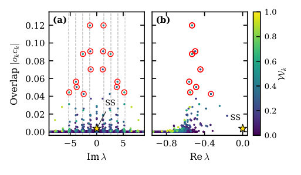
<figcaption class="paper-figure-caption"><b>Fig 1.</b> FIG. 1. Overlap spectrum |okck| of the Liouvillian eigenmodes with the N´eel state [Eq. (S5) of the Supplemental Material] for N = 14, γ+ = 0.2, γ−= 0.001, versus (a) Im λ and (b) Re λ. Each point is coloured by its scar-dyad weight Wk, Eq. (4), the overlap of the eigenmode with the γ± = 0 scar subspace. Red circles mark the N + 1 modes with the largest overlaps and the star the steady state (SS). Dashed lines in (a): bare scar- dyad frequencies Em −Em′ of the closed chain, for the dyads carrying closed-system N´eel weight |⟨Sm|Z2⟩|2|⟨Sm′|Z2⟩|2 ≥ 10−2. The modes forming the frequency tower are scar-like, carry most of the N´eel weight and decay more slowly than the bulk of the spectrum, so...</figcaption>
</figure>
<figure class="paper-figure-card">
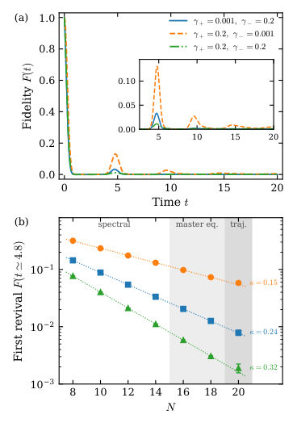
<figcaption class="paper-figure-caption"><b>Fig 2.</b> FIG. 2. (a) Fidelity F(t) with the N´eel state for N = 14 and three choices of the rates, from the Liouvillian spectrum. Inset: zoom on the revivals. Asymmetric rates (γ+ ̸= γ−) lead to an enhancement of the revivals, with the most pronounced effect observed when γ+ &gt; γ−. (b) Height of the first revival (t ≃4.8) versus system size, on a logarithmic scale, with the same colour code as in (a). Values for N ≤14 are obtained from the Liouvillian spectrum, for N = 16, 18 from the exact integration of the master equation (light shading) and for N = 20 from 2048 quantum trajectories (dark shading; error bars are one standard deviation). Dotted lines: fits F1 ∝e−κN</figcaption>
</figure>
<figure class="paper-figure-card">
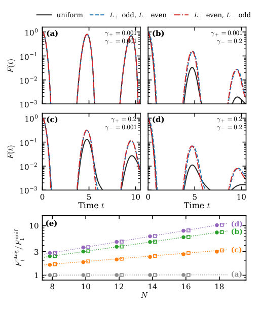
<figcaption class="paper-figure-caption"><b>Fig 3.</b> FIG. 3. Staggered versus uniform dissipation. (a)–(d) Fi- delity F(t) with the N´eel state |Z2⟩= |1010 · · · 10⟩for N = 14, for uniform dissipation (solid) and for staggered dissipation with L+ on the odd sites, which are excited in |Z2⟩, and L− on the even ones (dashed), or vice versa (dash-dotted). Stag- gering has no visible effect for weak dissipation (a), while for larger rates (b)–(d) it markedly enhances the revivals. (e) Ratio F stag 1 /F unif 1 of the first revival heights (t ≃4.8) versus N for the rates of panels (a)–(d) (filled circles: L+ on odd sites; open squares: L+ on even sites; slightly displaced hori- zontally), with exponential fits to the open squares (dotted). The...</figcaption>
</figure>
<figure class="paper-figure-card">
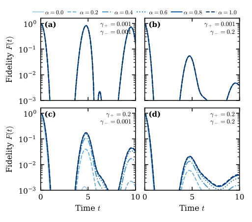
<figcaption class="paper-figure-caption"><b>Fig 4.</b> FIG. 4. Fidelity F(t) = ⟨Z2|ρ(t)|Z2⟩(logarithmic scale) for N = 12 with periodic boundary conditions, when the partial projector Pα replaces the projectors in the jump operators L±,j, while the PXP Hamiltonian retains the exact blockade. The rates are (a) γ+ = γ−= 0.001, (b) γ+ = 0.001, γ−= 0.2, (c) γ+ = 0.2, γ−= 0.001, (d) γ+ = γ−= 0.2. For small γ+ [(a), (b)] the curves for different α are indistinguishable, while for γ+ = 0.2 [(c), (d)] lowering α suppresses the revivals by up to two orders of magnitude: in (c) the first revival drops from F ≃0.18 at α = 1 to F ≃10−3 at α = 0.</figcaption>
</figure>
<figure class="paper-figure-card">
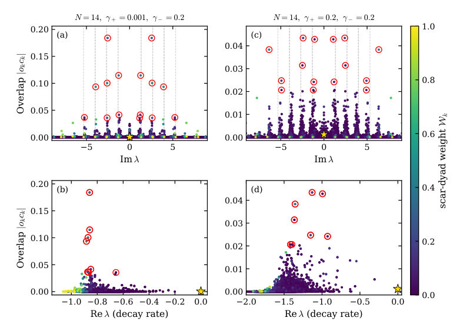
<figcaption class="paper-figure-caption"><b>Fig 5.</b> Fig. 1 of the main text shows the overlap spectrum for γ+ = 0.2, γ−= 0.001. The spectra for the other two choices of the rates considered in the main text are shown in Fig. S1, and Table S3 summarizes the three cases at N = 14. Notice that the symmetric case has twice the total rate of the other two.</figcaption>
</figure>

**Summary.** This paper analyzes the stability of quantum many-body scars in the PXP model under environmental dissipation. It shows that the preservation of scars requires the dissipation mechanism to respect the system's symmetries. Furthermore, the decay rate of quantum revivals is critically dependent on the asymmetry between gain and loss rates, demonstrating a clear mechanism for enhancing coherence through engineered dissipation.

**Why it may be interesting.** This work directly addresses open quantum systems dynamics in highly interacting platforms like Rydberg arrays, providing quantitative rules for how dissipation affects fragile quantum coherence features like scars.

Detailed structure

**Main problem.** The study investigates how quantum many-body scars (QMBS) survive and decay when the system is subjected to Markovian dissipation, particularly focusing on the role of symmetry in the dissipation process.

**Main result.** The persistence of scars requires local jump operators to respect the Hamiltonian symmetries; furthermore, asymmetric dissipation rates ($\gamma_+ > \gamma_-$) enhance the revival fidelity and stabilize the scar dynamics.

**Method.** The analysis relies on diagonalizing the full Liouvillian spectrum and calculating the Uhlmann fidelity $F(t)$ using the biorthonormal basis expansion.

**Model / system.** The system is modeled using the PXP Hamiltonian, which simulates the nearest-neighbor blockade regime of Rydberg atom arrays. Dynamics are governed by a Lindblad master equation incorporating local jump operators.

**Key observables.** Fidelity $F(t)$, Liouvillian eigenvalues ($\lambda$), scar-dyad weights ($W_k$), and the evolution of local observables like staggered magnetization $\langle Z 
angle$.

**Important parameters / regimes.** Dissipation rates ($\gamma_+, \gamma_-$), the blockade parameter ($\alpha$), and system size ($N$).

**Assumptions / limitations.** The analysis assumes the validity of the first-order rate approximation for decay rates and critically depends on the strict kinetic constraint imposed by the Rydberg blockade.

**Figures summary.** Figures illustrate the overlap spectrum of eigenmodes with the Néel state, the decay of fidelity $F(t)$ under different dissipation schemes (staggered vs. uniform), and the evolution of local spin coherence.

**Paper structure.** The paper systematically analyzes the Liouvillian spectrum, first establishing the scar tower in the closed system, then introducing dissipation, and finally comparing the decay rates and revival dynamics under symmetric, asymmetric, and symmetry-breaking dissipation conditions.

Abstract

We investigate the fate of quantum many-body scars in the PXP model subject to Markovian dissipation. We show that when local jump operators respect the same symmetries of the Hamiltonian the full Liouvillian spectrum displays a tower of states with properties analogous to standard quantum scars: large overlaps with Néel states and equally spaced gaps in the imaginary part of the eigenvalues, set by a single frequency. Whether the long-time dynamics is dominated by scars is determined by the real parts of the eigenvalues, which are set by the ratio between the two relaxation rates $γ_{\pm}$ describing spin flips down-to-up or up-to-down respectively. For asymmetric dissipation ($γ_+ > γ_-$) the scarred eigenvalues have the smallest real parts: the resulting enhanced fidelity oscillations are further stabilized by staggered jump operators. In contrast, replacing the full projection operator in the dissipators with a partial one breaks the symmetries of the problem and is seen to destroy dissipative scars altogether.

[↑ back to top](#top)

### ⭐ [Finite-Frequency Boson-Number Bounds Across the Quantum Rabi Transition](http://arxiv.org/abs/2610.21556v1)

**Highlighted author(s):** Michael Fleischhauer  
**Authors:** Razmik G. Unanyan, Michael Fleischhauer, Nikolay V. Vitanov  
**Type:** theory · **Category:** other · **PDF:** <https://arxiv.org/pdf/2610.21556v1>  
**Analysis basis:** full PDF text, analyzed in chunks
**Topic relevance:** `Tavis-Cummings & cavity-many-emitter` **3/5** · `analog quantum simulation` **3/5** · `Keldysh / 2PI / non-Gaussian methods` **2/5** · `driven-dissipative phase transition` **1/5** · `methods for driven-dissipative` **1/5** · `non-equilibrium universality` **1/5**

↔ Scroll figures horizontally

<figure class="paper-figure-card">
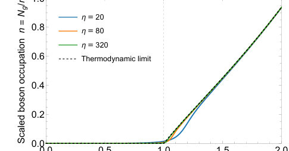
<figcaption class="paper-figure-caption"><b>Fig 1.</b> FIG. 2. Scaled occupation n = (ω0/Ω)Ng from exact diag- onalization for η = 20, 80, and 320. The dashed curve is the rigorous limiting result Eq. (74). The vertical line marks γ = 1.</figcaption>
</figure>
<figure class="paper-figure-card">
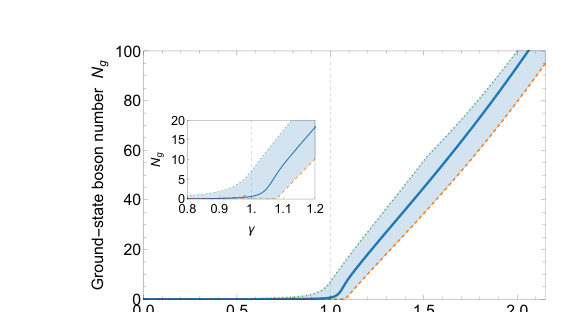
<figcaption class="paper-figure-caption"><b>Fig 2.</b> FIG. 1. Ground-state boson number Ng versus γ for η = Ω/ω0 = 100. The shaded region uses the energy-derived lower edge N (E) L and the final upper bound NU. The full rigorous lower bound is NL = max{N (E) L , N (R) L }; the resolvent contri- bution N (R) L from Eq. (31) is positive but too small to resolve on this scale. The solid line is exact diagonalization. The dash-dotted line shows the normal-phase squeezed-oscillator asymptotics, Eq. (23), away from the immediate critical re- gion. The inset magnifies the crossover near γ = 1.</figcaption>
</figure>
<figure class="paper-figure-card">
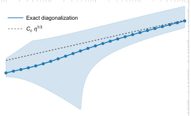
<figcaption class="paper-figure-caption"><b>Fig 3.</b> FIG. 3. Critical-point occupation Ng(γ = 1) versus η on logarithmic axes. Points connected by the solid line are exact diagonalization. The dashed line is the known asymptotic result Ccη1/3 from Ref. [20]. The shaded region is the refined rigorous interval obtained from Eqs. (62) and (66); its two endpoints have the same η1/3 scaling.</figcaption>
</figure>

**Summary.** This paper rigorously derives finite-frequency bounds for the boson occupation number and ground-state energy in the quantum Rabi model across its quantum phase transition. By establishing distinct scaling laws for the occupation number in the normal, critical, and superradiant regimes, it provides highly accurate, experimentally testable predictions for quantum simulation platforms like trapped ions.

**Why it may be interesting.** This work provides precise, analytically derived bounds for a canonical model in quantum optics (QRM), directly yielding testable predictions for trapped-ion quantum simulators studying quantum phase transitions.

Detailed structure

**Main problem.** The paper derives rigorous upper and lower bounds for the ground-state energy and the boson occupation number across the quantum Rabi transition for finite frequency ratios.

**Main result.** It establishes distinct scaling behaviors for the boson occupation number ($N_g$) in the subcritical ($O(1)$), critical ($O(\eta^{1/3})$), and supercritical ($\propto \eta^{-2}$) regimes, providing experimentally testable inequalities.

**Method.** The analysis employs variational principles, coherent-state bounds, and resolvent techniques applied to the quantum Rabi model Hamiltonian.

**Model / system.** The system is the quantum Rabi model (QRM), describing a two-level system coupled to a bosonic mode, including counter-rotating terms. The Hamiltonian involves parameters $\Omega$ (splitting) and $\omega_0$ (boson frequency).

**Key observables.** Ground-state energy ($E_g$) and boson occupation number ($N_g$).

**Important parameters / regimes.** The dimensionless frequency ratio $\eta = \Omega/\omega_0$ and the coupling parameter $\gamma = 2g/\sqrt{\omega_0\Omega}$.

**Assumptions / limitations.** The analysis is performed for the ideal QRM, and the derived bounds are shown to be applicable beyond the asymptotic (thermodynamic) limit.

**Paper structure.** The paper develops from general energy bounds to specific, explicit finite-$\eta$ bounds for $N_g$, characterizing the behavior across the normal, critical, and superradiant regimes.

Abstract

We consider the quantum Rabi model, a fundamental model of quantum optics describing a two-level system coupled to a bosonic mode, including counter-rotating terms. In the limit of large separation between the two-level transition frequency and the bosonic mode frequency, the model exhibits a quantum phase transition at a critical coupling strength. Although the model is exactly solvable, simple analytic expressions for important physical quantities are generally unavailable. We derive rigorous upper and lower bounds for the ground-state energy and boson occupation number across the quantum phase transition at finite frequency ratios. Our results characterize the subcritical, critical, and supercritical regimes and establish the scaling behavior of the boson occupation near the critical point. Exact numerical diagonalization demonstrates the tightness of the derived bounds, while the resulting finite-frequency inequalities provide experimentally testable predictions for trapped-ion quantum simulators.

[↑ back to top](#top)

### ⭐ [Long-lived local coherences at high temperature from frozen domain walls](http://arxiv.org/abs/2610.20724v1)

**Highlighted author(s):** Sarang Gopalakrishnan  
**Authors:** Sarang Gopalakrishnan, Romain Vasseur  
**Type:** theory · **Category:** statistical mechanics · **PDF:** <https://arxiv.org/pdf/2610.20724v1>  
**Analysis basis:** full PDF text, analyzed in chunks
**Topic relevance:** `scars & prethermalization` **3/5** · `analog quantum simulation` **2/5**

↔ Scroll figures horizontally

<figure class="paper-figure-card">
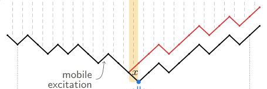
<figcaption class="paper-figure-caption"><b>Fig 1.</b> FIG. 1. Mechanism in the height representation h(i) = P</figcaption>
</figure>
<figure class="paper-figure-card">
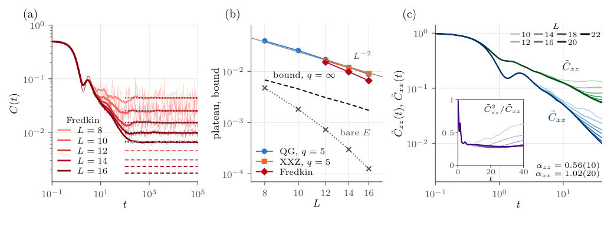
<figcaption class="paper-figure-caption"><b>Fig 2.</b> FIG. 2. Mazur bound and chaotic chains. (a) Transverse autocorrelator at the center of open Fredkin chains of L = 8–16 sites from full diagonalization (thin lines) and its time average 1</figcaption>
</figure>
<figure class="paper-figure-card">
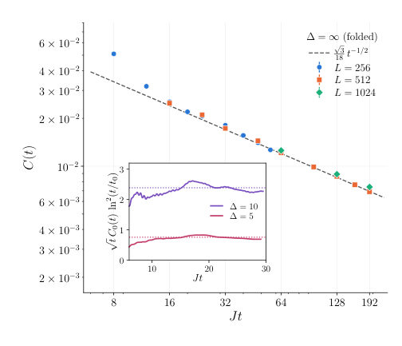
<figcaption class="paper-figure-caption"><b>Fig 3.</b> FIG. 3. Transverse correlator in the XXZ chain. The folded (∆= ∞) chain correlator, computed by unbiased Monte Carlo sampling of free-fermion Slater determinants using the results of Refs. [11, 37, 38] for open chains with L = 256, 512 and 1024 (up to 106 samples), compared with √</figcaption>
</figure>
<figure class="paper-figure-card">
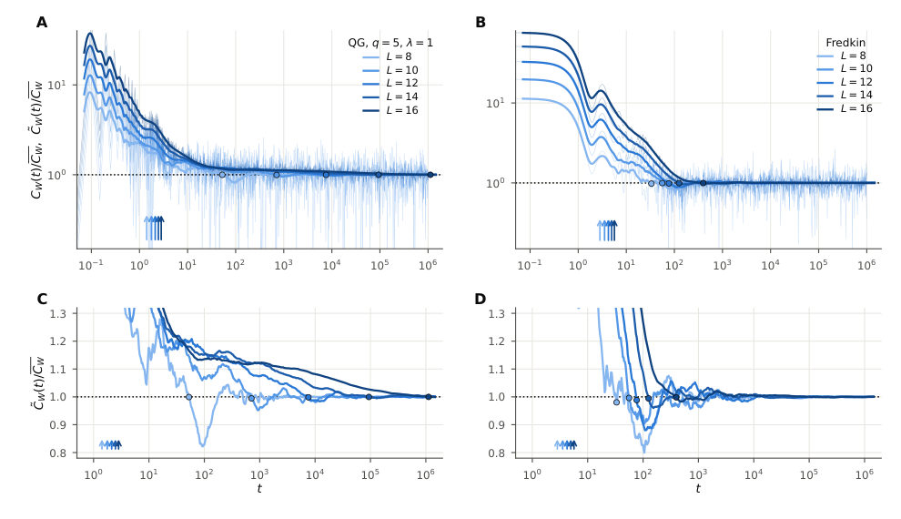
<figcaption class="paper-figure-caption"><b>Fig 4.</b> FIG. 1. Check of the non-undershoot assumption. (A) Quantum-group chain at q = 5, λ = 1: CW (t) (thin), ˜CW (t) (thick) and CW (dotted), normalized by CW . The interval average is plotted at √</figcaption>
</figure>

**Summary.** This paper analyzes the decay of local quantum coherences in spin chains, finding that quantum group symmetries enforce an anomalous, slow algebraic decay rate for the autocorrelation function. By deriving a Mazur bound and performing explicit calculations on models like the XXZ chain, the authors establish a fundamental constraint on how fast quantum memory can be lost in these systems.

**Why it may be interesting.** The work provides a deep theoretical understanding of how underlying symmetries (quantum groups) can stabilize quantum correlations against thermal decoherence, which is crucial for understanding quantum dynamics in condensed matter systems.

Detailed structure

**Main problem.** The paper investigates the anomalous persistence of local quantum coherences in chaotic many-body spin systems at high temperatures, where generic theory predicts rapid decay.

**Main result.** The quantum group symmetry imposes a strict upper bound on the decay rate of the transverse spin autocorrelation function, showing it decays at most algebraically ($C(t) \gtrsim 1/t^2$).

**Method.** The authors employ a Mazur bound derived from quantum-group symmetry, combined with locality and a 'non-undershoot' assumption, alongside explicit computations for specific spin chains.

**Model / system.** The study focuses on local spin-1/2 chains, including the XXZ and Fredkin chains, whose dynamics are governed by Hamiltonians exhibiting quantum group $U_q(\mathfrak{sl}_2)$ symmetry.

**Key observables.** Transverse spin autocorrelation function $C(t) \equiv \langle \sigma_{-}^x(t) \sigma_{+}^x(0)
angle$, and the moving-averaged correlators $	ilde{C}_{xx}(t)$ and $	ilde{C}_{zz}(t)$.

**Important parameters / regimes.** Temperature (high T limit), anisotropy ($\Delta$), and the quantum group parameter $q$.

**Assumptions / limitations.** The derivation of the Mazur bound relies on a physically motivated 'non-undershoot' assumption, and the analysis uses the 'height representation' formalism.

**Figures summary.** Figures illustrate the mechanism in the height representation, compare autocorrelators for open Fredkin chains against the Mazur bound, and show the decay of correlators for the XXZ chain in different anisotropy limits.

**Paper structure.** The paper progresses from establishing the general problem of coherence decay to deriving the Mazur bound using symmetry, followed by explicit calculations for the XXZ and Fredkin chains in various limits (e.g., large anisotropy, finite magnetization).

Abstract

Local coherences between distinct charge sectors--measured by the single-particle Green's function or the transverse spin autocorrelation function--do not overlap with hydrodynamic modes. At finite temperature, therefore, they decay faster than any power law in generic chaotic systems. We present a mechanism by which these coherences can persist anomalously long, for integrable and chaotic spin chains (including the XXZ and Fredkin spin chains) that obey a quantum group symmetry. We show--using a Mazur bound derived from the quantum-group symmetry, together with locality and a "non-undershoot" assumption--that the transverse spin autocorrelation function $C(t) \equiv \langle σ^-_x(t) σ^+_x(0)\rangle$ can decay at most algebraically: $C(t) \gtrsim 1/t^2$. This bound is not tight: in the large-anisotropy limit of the XXZ spin chain, at infinite temperature, we explicitly compute $C(t) \sim \sqrt{3}/(18 \sqrt{t})$. We also compute this decay rate in the XXZ spin chain for general easy-axis anisotropy, and estimate it to scale as $C(t) \sim t^{-2/z}$ (for transport exponent $z$) in the chaotic models.

[↑ back to top](#top)

### ⭐ [Discovering state-of-the-art quantum circuits with large language models](http://arxiv.org/abs/2610.22367v1)

**Highlighted author(s):** Susanne F. Yelin, Mikhail D. Lukin  
**Authors:** Andi Gu, Alek H. Kemeny, Susanne F. Yelin, Mikhail D. Lukin  
**Type:** theory · **Category:** quantum information and computing · **PDF:** <https://arxiv.org/pdf/2610.22367v1>  
**Analysis basis:** full PDF text, analyzed in chunks

↔ Scroll figures horizontally

<figure class="paper-figure-card">
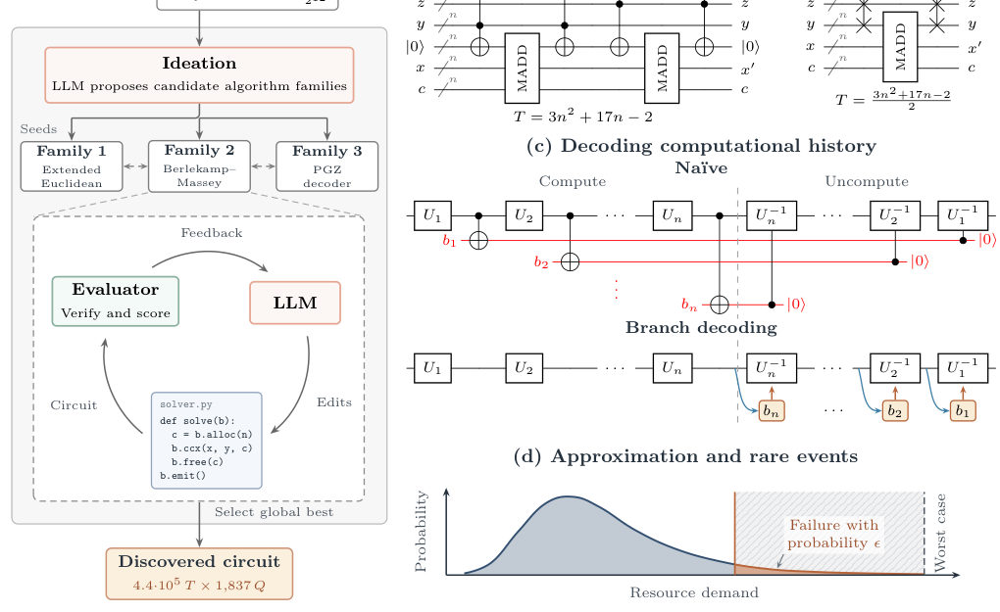
<figcaption class="paper-figure-caption"><b>Fig 1.</b> FIG. 1 Overview of the circuit-discovery framework. (a) A hand-written task specification defines the circuit design task (for example, Reed–Solomon decoding) and is given to an LLM. The LLM proposes architecturally different approaches (algorithm families; here extended Euclidean, Berlekamp–Massey, and Peterson–Gorenstein–Zierler (PGZ) decoders), which are then developed and optimized in parallel. Strong candidates are periodically shared between families to allow for cross-pollination of useful ideas. (b) Conditional routing reduces the cost of coherent control flow: for instance, two controlled multiply-adds (MADDs) become inexpensive controlled swaps and one shared arithmetic block. (c)...</figcaption>
</figure>
<figure class="paper-figure-card">
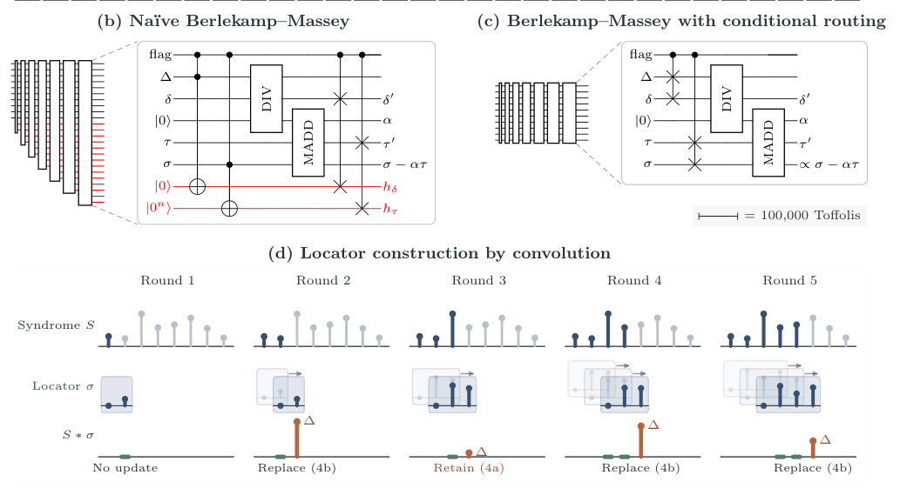
<figcaption class="paper-figure-caption"><b>Fig 2.</b> FIG. 2 Reversible Reed–Solomon decoding. (a) The synchronized extended-Euclidean construction of Khattar et al. [13] requires approximately 1.9 million Toffolis for the locator solve. (b) Berlekamp–Massey reduces this cost to approximately 140,000 Toffolis but naïvely accumulates intermediate information (red). DIV forms α = ∆/δ, MADD applies the multiply-add, and the flag marks the replace case. (c) Conditional routing preserves this arithmetic advantage while avoiding most history storage. Block widths are proportional to Toffoli count. (d) Locator construction as convolution with the syndrome sequence. The discrepancy ∆is the convolution at the next syndrome; a nonzero value requires...</figcaption>
</figure>
<figure class="paper-figure-card">
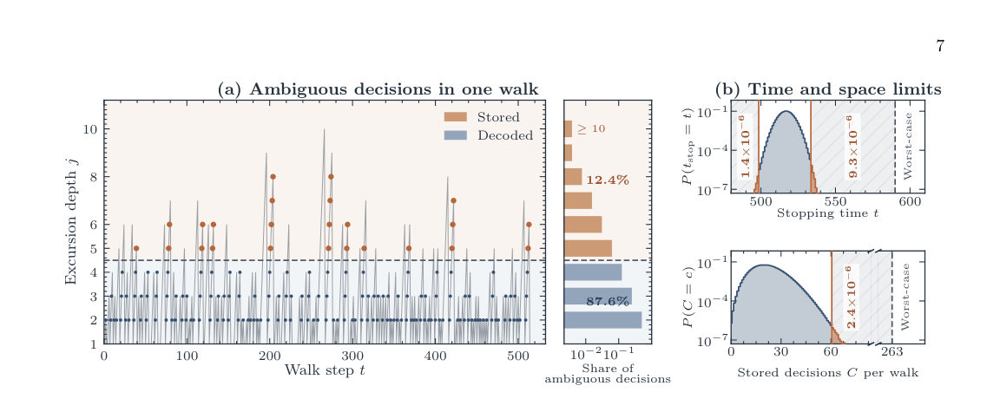
<figcaption class="paper-figure-caption"><b>Fig 3.</b> FIG. 3 Making divsteps reversible with minimal overhead. (a) Excursion depth j in one representative walk. Dots mark ambiguous decisions. We use a cutoff jstore = 5, so all ambiguous decisions with j ≥5 are stored rather than decoded. The histogram shows the distribution of excursion depths over uniformly sampled walks: only 12.4% of ambiguous decisions reach j ≥5. (b) Empirical stopping-time and history-size distributions. The discovered circuit assumes that every walk terminates between steps 499 and 533; this assumption fails with probability ∼10−5. It also allocates enough qubits to store at most 60 branch decisions, which is sufficient for all but a 2.4 × 10−6 fraction of walks.</figcaption>
</figure>

**Summary.** This paper presents a novel, AI-driven framework where Large Language Models co-design quantum circuits for complex problems. By integrating LLM proposal generation with an independent quantum circuit evaluator, the authors significantly optimized resource usage for tasks ranging from number theory to quantum simulation. This work opens a new avenue for algorithm discovery in quantum computation.

**Why it may be interesting.** The methodology of using generative AI (LLMs) to guide the discovery of novel, resource-efficient quantum algorithms is a major development for quantum computing theory.

Detailed structure

**Main problem.** Developing efficient, reversible quantum algorithms for complex tasks like arithmetic, decoding, and simulation, while overcoming the constraints of quantum computation.

**Main result.** The authors introduced an LLM-guided evolutionary framework that successfully discovered quantum circuits significantly reducing resource costs (Toffoli gates and qubits) across diverse computational tasks.

**Method.** They employed an evolutionary framework where Large Language Models propose circuit designs, which are then verified and scored by an independent evaluator, allowing for high-level structural revisions.

**Model / system.** The focus is on quantum circuits designed to perform reversible computations, specifically addressing the constraints of reversibility and coherent control flow in quantum information processing.

**Key observables.** Toffoli count (T), peak qubit count (Q), and the combined TQ-cost, used to benchmark circuit efficiency against state-of-the-art methods.

**Important parameters / regimes.** The complexity of the task (e.g., modular inversion, Reed-Solomon decoding) and the resource budget (T and Q).

**Assumptions / limitations.** The framework assumes that LLMs can propose novel, structurally sound circuit candidates that go beyond simple equivalence-preserving rewrites.

**Figures summary.** Figures illustrate the discovery pipeline, showing how LLMs propose and the evaluator refines circuits for tasks like conditional routing and decoding computational history.

**Paper structure.** The paper details the general LLM-guided optimization framework, followed by specific applications demonstrating improvements in Reed-Solomon decoding, modular inversion, and lattice gauge theory calculations.

Abstract

Significant efforts are currently being directed toward the implementation of large-scale quantum information processors, but realizing useful quantum advantage also requires the development of efficient quantum algorithms. While for many practical problems the dominant resource costs are associated with a small set of computational primitives, optimizing them in the quantum setting presents unique challenges, including a reversibility constraint absent from ordinary classical computation. Here we introduce an evolutionary framework in which large language models (LLMs) propose circuit designs and an independent evaluator verifies and scores them. We apply this framework to tasks spanning numerical computation, chemistry, optimization, quantum simulation, and number theory. In seven of the eight tasks, the discovered circuits significantly reduce both Toffoli and qubit counts relative to the state of the art. In the eighth, the search discovers a new reversible architecture for prime-field modular inversion. By handling reversibility differently, the architecture makes divsteps -- a classical algorithm previously impractical for reversible integer arithmetic -- viable and substantially improves the Toffoli-qubit trade-off for modular inversion. These results open the door for evaluator-guided LLM co-design of new algorithmic structures for quantum computation.

[↑ back to top](#top)

### [Periodic conditional measurements on a photonic chip](http://arxiv.org/abs/2610.21465v1)

**Authors:** Xuan Chen, Ruo-Yu Yin, Xiao-Wen Shang, Xi-Jun Yuan, Ze-Feng Lan, Hong-Jing Du, Yi-Jun Chang, Bao-Jing Liu, Wen-Hao Zhou, Xi Tan, Eli Barkai, Hao Tang, Xian-Min Jin  
**Type:** experiment · **Category:** quantum information and computing · **PDF:** <https://arxiv.org/pdf/2610.21465v1>  
**Analysis basis:** full PDF text, analyzed in chunks
**Topic relevance:** 🔥 `quantum measurements` **5/5** · 🔥 `Full counting statistics` **4/5** · 🔥 `QC/QI experiment` **4/5** · `analog quantum simulation` **3/5** · `driven-dissipative phase transition` **3/5** · `methods for driven-dissipative` **3/5** · `quantum optics experiment` **3/5** · `correlated / nonlocal dissipation` **2/5** · `non-equilibrium universality` **2/5** · `Keldysh / 2PI / non-Gaussian methods` **1/5** · `interference shaping light` **1/5**

↔ Scroll figures horizontally

<figure class="paper-figure-card">
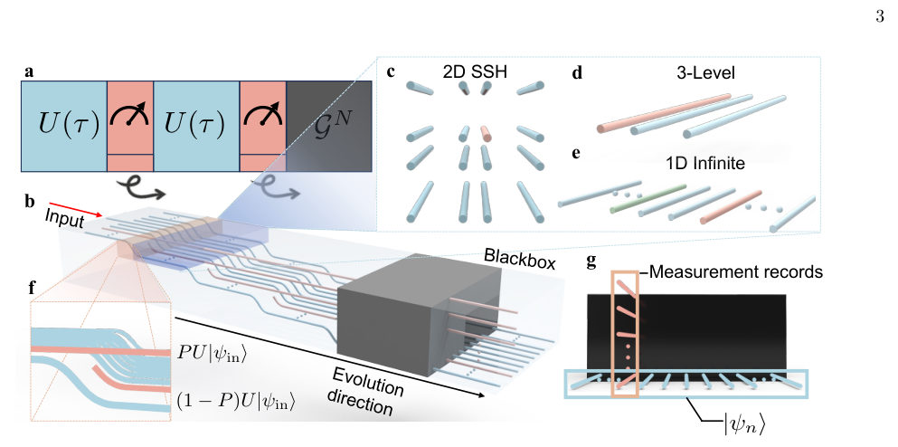
<figcaption class="paper-figure-caption"><b>Fig 1.</b> FIG. 1. a, Illustration of periodic conditional measurements. The coherent unitary evolution U(τ) is periodically interrupted by projective measurements, with the amplitude on the measured state removed from the system, thereby realizing conditional measurements. The n times repetition of this procedure is denoted by Gn. b, Snapshot of the photonic chip. The red waveguides represent the measured state and the blue waveguides represent the rest of the system. Each layer consists of an evolution phase (blue shaded area) followed by a conditional measurement (red shaded area) within a single period. The distance between two conditional measurements corresponds to the effective evolution...</figcaption>
</figure>
<figure class="paper-figure-card">
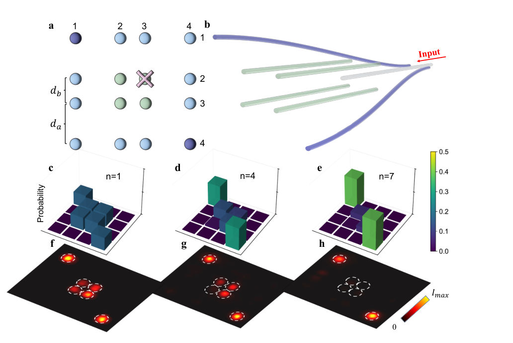
<figcaption class="paper-figure-caption"><b>Fig 2.</b> FIG. 2. a, Illustration of the 2D SSH lattice used in our experiment. The system contains 16 sequentially indexed sites. The intracell and intercell coupling strengths are determined by the waveguide separations da and db, respectively. The injection sites associated with the selected corner and bulk states are colored blue and green, respectively [see also Eq. (5)]. Periodic conditional measurements are performed on the state ∣2, 3⟩, which has a nonzero overlap with the input bulk state. b, Waveguide structure for input-state preparation. Light injected into the central waveguide sequentially passes through a 1 × 3 and a 1 × 4 coupler to generate the selected corner and bulk components,...</figcaption>
</figure>
<figure class="paper-figure-card">
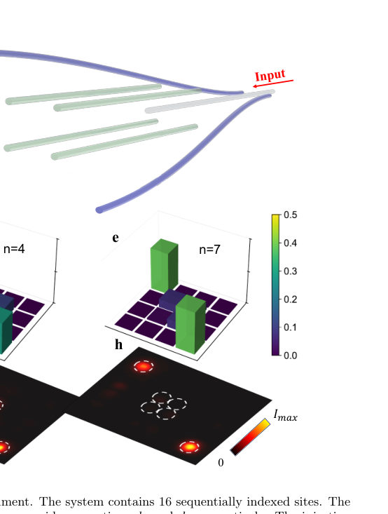
<figcaption class="paper-figure-caption"><b>Fig 3.</b> Fig. 3b shows the final energy of the system as a func- tion of Em/k and τ. The parameter space separates into two regions in which the final energy approaches either 4k, corresponding to ∣e⟩, or 0, corresponding to</figcaption>
</figure>
<figure class="paper-figure-card">
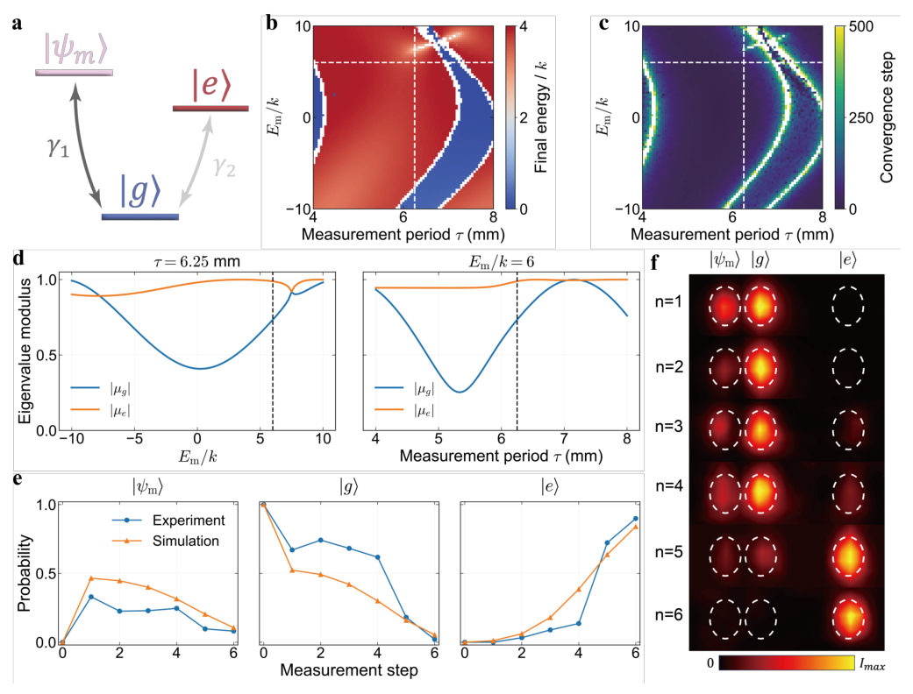
<figcaption class="paper-figure-caption"><b>Fig 4.</b> FIG. 3. a, Illustration of the three-level system. The ground state ∣g⟩is coupled to the measured state ∣ψm⟩with strength γ1 and to the excited state ∣e⟩with strength γ2. b,c, Final energy and convergence step as functions of the measured-state energy and measurement period. The final energy converges to either the ground- or excited-state energy. The boundary corresponds to nearly degenerate moduli of the two dominant eigenvalues, where the convergence step diverges. d, Moduli of the ∣g⟩- and ∣e⟩-dominated eigenvalues, ∣µg∣and ∣µe∣when: (i) fixing the measurement period at τ = 6.25 mm and scanning the measured-state energy, and (ii) fixing the measured-state energy at Em/k = 6 and scanning...</figcaption>
</figure>
<figure class="paper-figure-card">
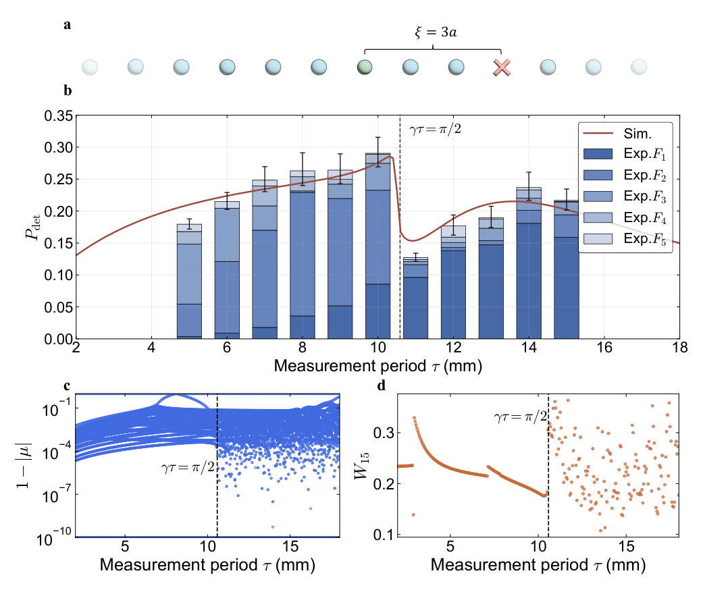
<figcaption class="paper-figure-caption"><b>Fig 5.</b> FIG. 4. a, Schematic of the monitored quantum walk on a one-dimensional chain. The walker is initialized at the central site colored green, while periodic conditional measurements are performed at a target site located three lattice constants away ξ = 3a with measurement period τ. b, Experimental total detection probability Pdet as a function of the measurement period. The stacked bars represent the contributions of the first five terms of the first-detection distribution first-detection probabilities from F1 to F5, and the red curve is the theoretical prediction. A sharp transition is observed around the critical measurement period γτ = π/2 (vertical dashed line), where the total detection...</figcaption>
</figure>

**Summary.** The research explores periodic conditional measurements on a photonic chip, showing how repeated measurements can be used to engineer quantum states. By analyzing the spectral properties of the measurement operator, the authors demonstrate selective state preservation (dark modes) or steering toward the longest-lived component (bright modes). This establishes a general framework for controlling quantum dynamics through measurement backaction.

**Why it may be interesting.** This work provides a concrete, platform-specific realization of controlling quantum dynamics via measurement backaction, which is central to understanding open quantum systems and quantum control.

Detailed structure

**Main problem.** The paper investigates how periodic conditional measurements reshape quantum evolution by repeatedly interrupting coherent evolution with local measurements.

**Main result.** They established that periodic conditional measurements provide a unified spectral description for both the post-selected final state and the statistics of detection events, enabling programmable state engineering.

**Method.** The analysis uses the biorthogonal eigenbasis of the conditional evolution operator G to distinguish between decaying 'bright modes' and persistent 'dark modes'.

**Model / system.** The experiment is performed on a scalable, layer-structured three-dimensional photonic chip using photonic waveguide arrays. The dynamics are modeled by the conditional evolution operator G = (1 - P)U(tau).

**Key observables.** Conditional final state (via dark/bright modes), first-detection probability distribution {F_n}, and total detection probability P_det.

**Important parameters / regimes.** The measurement period $\tau$ is a key tunable parameter, which controls the spectral properties and the transition between different dynamical regimes.

**Assumptions / limitations.** The analysis relies on the spectral decomposition of the conditional evolution operator G and compares results to the Quantum Zeno limit.

**Figures summary.** Figures illustrate the schematic of the measurement process, the physical chip setup, and plots showing the dependence of detection probability and spectral weights on the measurement period $\tau$.

**Paper structure.** The paper first introduces the theoretical framework of periodic conditional measurements, then demonstrates state engineering using photonic chips (e.g., protecting topological states), and finally analyzes the transition of the total detection probability as a function of the measurement period $\tau$.

Abstract

Quantum measurements not only extract information but also reshape quantum evolution through measurement backaction. Here, we investigate periodic conditional measurements, in which coherent evolution is repeatedly interrupted by local measurements. We show that the bright and dark modes of the conditional evolution operator provide a unified spectral description of both the post-selected final state along no-detection trajectories and the statistics of detection events. Using a three-dimensional photonic chip, we demonstrate on-demand state engineering through dark-mode preservation and bright-mode selection, enabling the protection of topological corner states and excited-state shelving. We further observe the predicted transition of the total detection probability on an effectively infinite one-dimensional lattice and identify its microscopic origin in Floquet near-dark modes. These results establish periodic conditional measurements as a general framework for engineering conditional quantum states and manipulating event-detection statistics in monitored quantum dynamics.

[↑ back to top](#top)

### [A Rydberg atom array coupled to a high-cooperativity optical cavity](http://arxiv.org/abs/2610.20889v1)

**Authors:** Tai Xiang, Yue-Hui Lu, Tsai-Chen Lee, Jacquelyn Ho, Michael Lan, Zhenjie Yan, Harry Levine, Nathaniel B. Vilas, Dan M. Stamper-Kurn  
**Type:** experiment · **Category:** other · **PDF:** <https://arxiv.org/pdf/2610.20889v1>  
**Analysis basis:** full PDF text, analyzed in chunks
**Topic relevance:** 🔥 `Rydberg arrays` **5/5** · 🔥 `Tavis-Cummings & cavity-many-emitter` **4/5** · 🔥 `analog quantum simulation` **4/5** · `QC/QI experiment` **3/5** · `correlated / nonlocal dissipation` **3/5** · `quantum measurements` **3/5** · `quantum optics experiment` **3/5** · `Dicke superradiance` **2/5** · `driven-dissipative phase transition` **1/5** · `methods for driven-dissipative` **1/5** · `superradiant laser` **1/5**

↔ Scroll figures horizontally

<figure class="paper-figure-card">
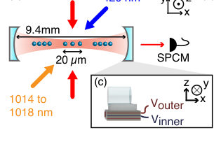
<figcaption class="paper-figure-caption"><b>Fig 1.</b> FIG. 1. Experimental platform. (a) A one-dimensional ar- ray of 87Rb atoms is positioned at the center and along the axis of a 1-cm-long near-concentric Fabry–Pérot cavity. The atoms are addressed by Rydberg-excitation and probe beams oriented at 45◦to one another and with wavelengths as shown. Cavity emission is detected with a single-photon counting module (SPCM). Up to three atoms at the cav- ity center are uniformly excited to Rydberg states, while an additional supply of atoms outside the excitation region is used to replenish depleted sites. (b) Atoms are driven on a two-photon transition from the |5S1/2, F = 2, mF = 2⟩ atomic ground state to |nS1/2, mJ = 1/2⟩Rydberg states (n between...</figcaption>
</figure>
<figure class="paper-figure-card">
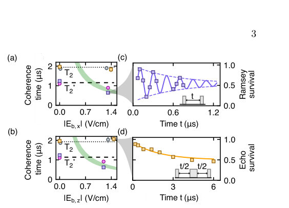
<figcaption class="paper-figure-caption"><b>Fig 2.</b> FIG. 3. Electric field noise and Rydberg coherence. (a,b) Ramsey (T ∗ 2 ) and spin-echo (T2) coherence times versus static electric field bias along the x (a) and z (b) axes, measured with (squares) and without (circles) the cavity actively stabi- lized. Green bands indicate the simulated Ramsey coherence time limited by only the measured electric-field noise σE un- der active cavity stabilization (see text). The shaded region reflects the uncertainty propagated from σE. Dashed and dot- ted lines are guides to the eye. Ramsey data taken without ac- tive stabilization are fitted using a maximum-likelihood model accounting for slow electric field drifts (see Supplemental Ma- terial [42]). (c)...</figcaption>
</figure>
<figure class="paper-figure-card">
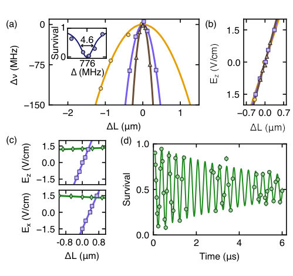
<figcaption class="paper-figure-caption"><b>Fig 3.</b> FIG. 2. Electric-field compensation and characterization. (a) Rydberg transition frequency shift, ∆ν, versus cavity-length displacement for n = 41 (circles), 53 (squares), and 60 (trian- gles), with parabolic fits (solid curves). Inset: representative Rydberg excitation spectrum with a Lorentzian fit. (b) Cor- responding electric fields inferred from ∆ν and the Rydberg state polarizabilities, with linear fits (solid lines). Symbols are the same as those in panel (a). The inferred electric field agrees across all three Rydberg states. (c) Electric fields along the x and z axes versus cavity-length displacement without (purple squares) and with (green diamonds) compensation. Solid lines are...</figcaption>
</figure>
<figure class="paper-figure-card">
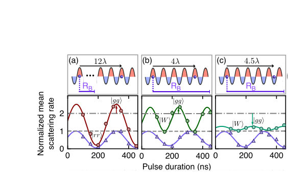
<figcaption class="paper-figure-caption"><b>Fig 4.</b> FIG. 5. Superradiant and subradiant cavity emission with Ry- dberg blockade. Single-atom Rydberg Rabi oscillations (pur- ple triangles) are compared with two-atom Rabi oscillations for three configurations. The mean scattering rate is nor- malized to the single-ground-state-atom rate of 0.42(2) µs−1; gray dash-dotted and dashed lines denote 1× and 2× the single-atom emission levels, respectively. (a) Unblockaded, superradiant configuration with R = 12 λ = 9.4 µm &gt; RB, where RB is the blockade radius, and g1 = g2. (b) Blockaded, superradiant configuration with R = 4 λ = 3.1 µm &lt; RB and g1 = g2. (c) Blockaded, subradiant configuration with R = 4.5 λ = 3.5 µm &lt; RB and g1 = −g2. Solid lines are...</figcaption>
</figure>

**Summary.** This paper reports on the coupling of a Rydberg atom array to a high-cooperativity optical cavity, overcoming significant challenges posed by stray electric fields from cavity actuators. The researchers demonstrated fast, nondestructive state readout and controlled collective light-atom scattering, paving the way for networked quantum processors and advanced quantum simulation.

**Why it may be interesting.** This work represents a significant engineering and physics achievement in quantum simulation, showing how to build complex quantum devices by tackling real-world noise sources (actuator fields) while enabling advanced protocols like mid-circuit measurement and collective coupling.

Detailed structure

**Main problem.** The primary challenge is integrating Rydberg-state control (local atom-atom interactions) with cavity control (photon-mediated long-range coupling) while mitigating decoherence caused by stray electric fields from cavity actuators.

**Main result.** The authors successfully suppressed stray electric fields and demonstrated two key capabilities: fast, nondestructive ground-Rydberg state readout and controlled collective light-atom scattering via Rydberg-Rydberg interactions.

**Method.** The work involves characterizing stray electric fields using frequency shifts, applying differential voltages for field compensation, and implementing advanced quantum control protocols like Purcell-enhanced fluorescence and driving blockaded Rabi oscillations.

**Model / system.** The system is a Rydberg tweezer array of Rb atoms coupled to a high-cooperativity optical cavity. The physics involves coupling local Rydberg interactions with global cavity modes, operating in the single-atom strong-coupling regime.

**Key observables.** Ground-Rydberg coherence times ($T_2^*$), Rabi oscillation frequencies ($\Omega$), fluorescence detection infidelity, and collective scattering rates (superradiant/subradiant).

**Important parameters / regimes.** Cooperativity $C=3.0$; residual field variation limited to $\sim 3 	ext{ mV/cm rms}$; readout time $\le 7.5 \mu	ext{s}$.

**Assumptions / limitations.** The coherence decay is modeled as arising from independent shot-to-shot Gaussian frequency fluctuations due to residual electric-field noise.

**Figures summary.** Figures detail the experimental setup (Rydberg array coupled to a cavity), field characterization showing compensation voltages, and pulse sequences for state detection and interaction control.

**Paper structure.** The paper systematically addresses field noise mitigation (characterization and compensation), followed by demonstrating advanced quantum operations: fast state readout, and finally, controlling collective light-atom scattering using Rydberg interactions.

Abstract

Integrating Rydberg-state control of atom-atom interactions with cavity control of atom-light interactions enables the combination of local entangling operations with photon-mediated long-range coupling, measurement, and communication. Such integration is challenging because electric fields generated by charges on cavity optics and by cavity-stabilizing actuators may disturb Rydberg-state coherence. Here, we couple a Rydberg tweezer array to a high-cooperativity optical cavity, suppressing the electric fields produced by cavity length actuation so that the residual field variation of about $3~\mathrm{mV/cm}$ rms does not limit Rydberg coherence. We demonstrate two capabilities that neither system provides alone. First, we use Purcell-enhanced fluorescence to read out atoms directly in the ground-Rydberg basis within $7.5~μ\mathrm{s}$, well within the Rydberg-state lifetime, with ground- and Rydberg-state detection infidelities of $3\%$ and $5\%$, respectively, and with low atom loss. Second, we use Rydberg-Rydberg interactions to control collective light-atom scattering into the cavity mode. Specifically, we drive blockaded Rabi oscillations between a state with two ground-state atoms, which scatter collectively with a superradiant or subradiant rate controlled by the atomic positions, and an entangled state with a single Rydberg excitation, which scatters like a single atom. These capabilities open routes toward networked Rydberg processors, mid-circuit measurements in analog quantum simulators, and many-body quantum optics with entangled emitters coupled collectively to light.

[↑ back to top](#top)

### [Surviving readout errors and incomplete postselection in monitored quantum circuits](http://arxiv.org/abs/2610.20712v1)

**Authors:** Murtaza Ali Mir, Teemu Ojanen, Ali G. Moghaddam  
**Type:** theory · **Category:** statistical mechanics · **PDF:** <https://arxiv.org/pdf/2610.20712v1>  
**Analysis basis:** full PDF text, analyzed in chunks
**Topic relevance:** 🔥 `quantum measurements` **4/5** · `Full counting statistics` **3/5** · `driven-dissipative phase transition` **3/5** · `methods for driven-dissipative` **3/5** · `correlated / nonlocal dissipation` **2/5** · `non-equilibrium universality` **2/5** · `Keldysh / 2PI / non-Gaussian methods` **1/5** · `analog quantum simulation` **1/5**

↔ Scroll figures horizontally

<figure class="paper-figure-card">
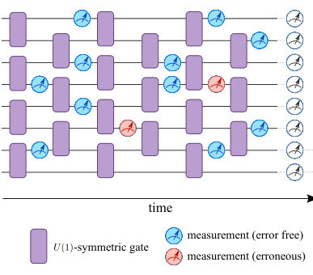
<figcaption class="paper-figure-caption"><b>Fig 1.</b> FIG. 1. Schematic of a U(1)-symmetric monitored circuit. Two-qubit gates (purple blocks) are drawn from the Haar measure restricted to U(1) charge-conserving unitaries. After each layer of gates, every qubit is measured independently with probability pm. Correctly recorded measurement out- comes are shown in blue, and outcomes affected by assign- ment (readout) errors are shown in red.</figcaption>
</figure>
<figure class="paper-figure-card">
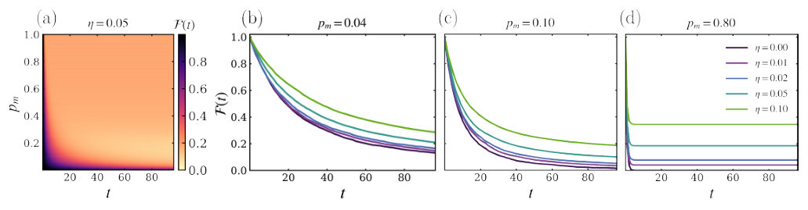
<figcaption class="paper-figure-caption"><b>Fig 2.</b> FIG. 2. Charge-fluctuation dynamics in the presence of readout error. (a) Heat map of the normalized charge fluctuation F(t) = δ2Q(t)/(L/4) as a function of time t and measurement rate pm, at fixed assignment error rate η = 5%. (b),(c),(d) Time evolution of F(t) for pm = 0.04, 0.1, 0.8, respectively. Ideal measurements suppress charge fluctuations efficiently, while finite assignment error leaves a residual long-time fluctuation. Nonetheless, the qualitative distinction between the two monitoring regimes persists in the presence of noise: F(t) decays slowly at low pm (b) and around the charge sharpening transition pm ∼0.1 (c), while it saturates rapidly to a finite plateau at high pm (d)....</figcaption>
</figure>
<figure class="paper-figure-card">
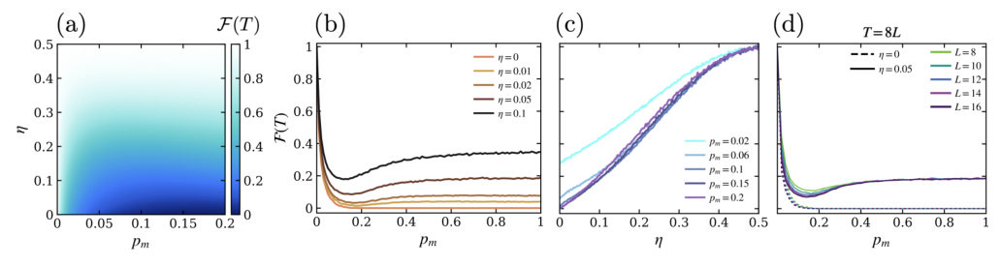
<figcaption class="paper-figure-caption"><b>Fig 3.</b> FIG. 3. Steady-state charge fluctuations in the presence of readout error. (a) Heat map of the normalized charge fluctuation F(T) at long time T = 8L, as a function of measurement rate pm (near the sharpening transition, pm ∼0.1) and error rate η. (b) Measurement-rate dependence of the fluctuations for various error strengths. (c) Growth of the fluctuations with error strength for various values of pm. Panels (a)–(c) are all for L = 12; panel (d) shows that other system sizes exhibit the same pattern, with only a slight decrease in the depth of the minimum with increasing size.</figcaption>
</figure>
<figure class="paper-figure-card">
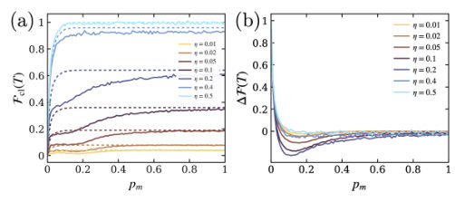
<figcaption class="paper-figure-caption"><b>Fig 4.</b> FIG. 4. Noise-induced mixing and its associated extra fluctuations. (a) The noise-induced (classical) contribution Fcl as a function of measurement rate pm, for different er- ror rates (solid lines); the reason for calling this term clas- sical is explained in the main text. Dashed lines show the corresponding prediction assuming uncorrelated errors, gov- erned by the Bernoulli noise-variance form (denoted Fapprox cl in the main text). (b) The residual fluctuation after sub- tracting the uncorrelated classical estimate from the total, ∆F = F −F approx cl . All the results are obtained for length L = 12.</figcaption>
</figure>

**Summary.** This paper analyzes how readout errors degrade the signature of measurement-induced phase transitions in monitored quantum circuits. By decomposing charge fluctuations, the authors show that the transition survives noise, leaving a measurable plateau and a characteristic minimum in the fluctuation spectrum. This provides a vital diagnostic tool for interpreting noisy experimental data from quantum measurement processes.

**Why it may be interesting.** This work provides a quantitative and experimentally accessible method to detect fundamental quantum phase transitions in noisy, realistic quantum hardware settings, which is crucial for experimental quantum information science.

Detailed structure

**Main problem.** The paper investigates how readout errors and incomplete postselection corrupt the dynamics and observable signatures of measurement-induced phase transitions (MIPTs) in monitored quantum circuits.

**Main result.** The charge-sharpening transition survives finite readout error rates, manifesting as a finite steady-state plateau rather than vanishing fluctuations, and a shallow minimum in fluctuations signals the competition between purification and noise.

**Method.** The analysis uses a quantum-trajectory framework, decomposing the charge fluctuations into quantum and classical contributions to isolate the effects of noise and memory.

**Model / system.** The study focuses on U(1)-symmetric monitored quantum circuits, modeling the dynamics under the influence of imperfect measurement records (readout errors).

**Key observables.** Charge fluctuations ($\delta^2Q$), normalized charge fluctuation $F(t)$, and the hybrid probe $\Delta F = F - F_{	ext{approx}}^{cl}$.

**Important parameters / regimes.** Readout error rate ($\eta$), measurement rate ($p_m$), and the ideal transition point ($p_\#$).

**Assumptions / limitations.** The primary assumption is that postselection is based on imperfectly recorded outcomes, leading to incomplete postselection.

**Figures summary.** Figures illustrate the suppression of fluctuations in the ideal case versus the residual plateau at finite error rates, and show the three-regime structure of fluctuations versus measurement rate.

**Paper structure.** The paper develops the theoretical framework by calculating the noisy ensemble density matrix $
ho_{	ilde{m}}$, separating the variance into quantum and classical parts, and then analyzing how the resulting fluctuations behave across different measurement rate regimes.

Abstract

We study how readout errors affect dynamics in monitored quantum circuits. Such errors make postselection effectively incomplete, conditioning trajectories on imperfect rather than true records. Focusing on U(1)-symmetric circuits, we find that the charge-sharpening transition survives at a finite error rate, with the sharp phase's vanishing fluctuations replaced by a finite steady-state plateau. The charge fluctuations show a shallow minimum near the ideal transition point as a function of measurement rate, signaling the competition between measurement-induced purification and noise-induced mixing. By decomposing the fluctuations into quantum and classical contributions, we show the minimum marks where incomplete postselection still retains enough trajectory memory to attenuate noise-induced mixing, leaving a detectable signature of the transition even in a noisy setting. Mid-circuit measurements are far harder to mitigate against readout errors than standard end-of-circuit ones, because the errors corrupt the postselection itself; the decomposition therefore offers a minimal mitigation framework and a route to locate the transition directly from experimental data. Our results show that charge sharpening survives readout errors in a quantitative and experimentally accessible way.

[↑ back to top](#top)

### [Looking Beyond Visibility: Resolving the Temporal Structure of Continuous-Wave Four-Photon Hong-Ou-Mandel Interference](http://arxiv.org/abs/2610.21909v1)

**Authors:** Sabine Häussler, Meritxell Cabrejo-Ponce, Ana Maria Torres, Baghdasar Baghdasaryan, Karen Lozano-Mendéz, Fabian Steinlechner  
**Type:** experiment · **Category:** quantum information and computing · **PDF:** <https://arxiv.org/pdf/2610.21909v1>  
**Analysis basis:** full PDF text, analyzed in chunks
**Topic relevance:** 🔥 `quantum optics experiment` **4/5** · `QC/QI experiment` **3/5** · `interference shaping light` **3/5** · `Full counting statistics` **2/5** · `quantum measurements` **2/5** · `methods for driven-dissipative` **1/5**

↔ Scroll figures horizontally

<figure class="paper-figure-card">
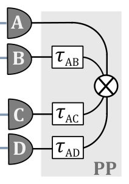
<figcaption class="paper-figure-caption"><b>Fig 1.</b> Fig. 1. Concept of asynchronous four-fold HOM interference with two long-coherence photon-pair sources: idler photons from sources S1 (magenta) and S2 (green) interfere at a beam splitter (BS), where they can be transmitted (T) or reflected (R). The temporal delays 𝜏AB, 𝜏AC and 𝜏AD of the optical channels can be analyzed after detection, in post-processing (PP), instead of physically delaying the photons before the BS.</figcaption>
</figure>
<figure class="paper-figure-card">
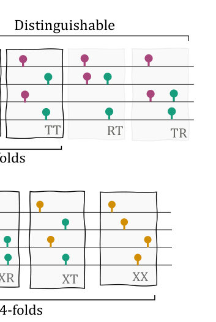
<figcaption class="paper-figure-caption"><b>Fig 2.</b> Fig. 2. Distribution of possible photon detections in a four-fold HOM experiment: photon pairs generated by two independent sources (magenta and green) arrive at the detection channels with temporal correlations. We distinguish between cases in which the four-fold events originate exclusively from one photon pair from each source (a), and cases in which they arise from uncorrelated photons (b). In (a), we label these events as reflected-transmitted (RT), transmitted-reflected (TR), reflected-reflected (RR) and transmitted-transmitted (TT) photon events. With temporal indistinguishabilty, the TR and RT cases cannot be resolved as two-photon-pair events when using click detectors. In...</figcaption>
</figure>
<figure class="paper-figure-card">
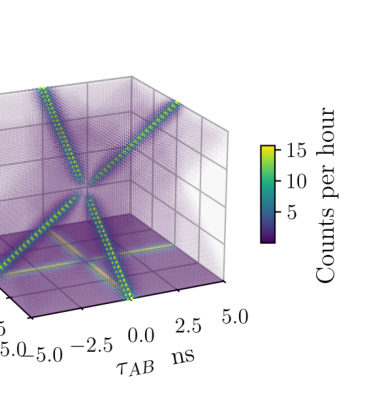
<figcaption class="paper-figure-caption"><b>Fig 3.</b> Fig. 3. Temporal 3D mapping of the modeled four-fold coincidence distribution. (a) Visualization of the relative temporal delays 𝜏AB = 𝑡B −𝑡A, 𝜏AC = 𝑡C −𝑡A, 𝜏AD = 𝑡D −𝑡A as defined across the four time tagging channels. (b) Simulated 3D histogram. Here, the four-fold events are distributed along two diagonal branches, corresponding to the correlation behaviour of the RR and TT events.</figcaption>
</figure>
<figure class="paper-figure-card">
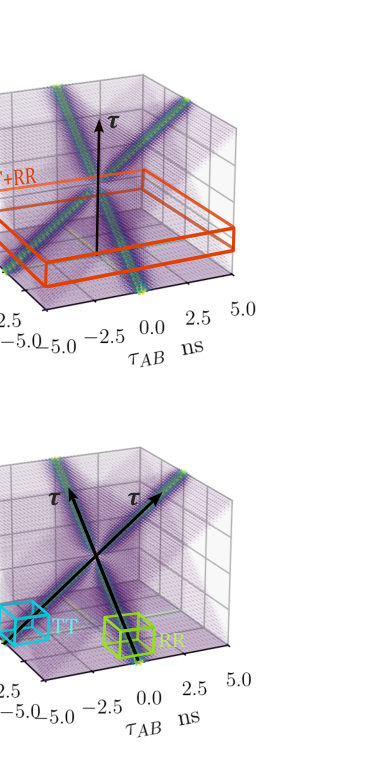
<figcaption class="paper-figure-caption"><b>Fig 4.</b> Fig. 4. Two different methods to scan HOM interference. Method 1 and Method 2 are depicted in the upper (a, b) and lower (c, d) rows, respectively. The first column (a, c) shows the distributions of detection times together with the trigger detection. The second column (b, d) illustrates the scan of the coincidence window and its corresponding dimensions for each method. In Method 1, the coincidence window (red box) is scanned along a delay 𝜏(black arrow). In Method 2 (lower row), the coincidence window is shifted in two channels, resulting in a small coincidence window being translated diagonally across the three-dimensional histogram.</figcaption>
</figure>
<figure class="paper-figure-card">
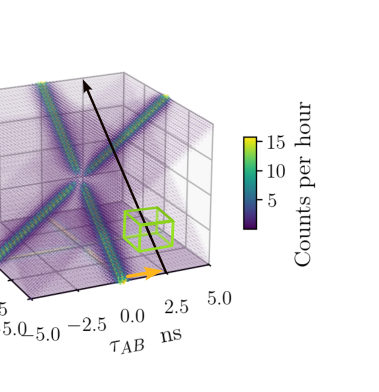
<figcaption class="paper-figure-caption"><b>Fig 5.</b> Fig. 5. Scheme of the accidental-scanning method, shown here as an example for XR events. One channel (here B) has an offset, while the delay of two other channels (here C and D) are scanned. Consequently, the coincidence window integrates XR-accidentals only. Similar procedures follow for the other accidental contributions. (a) for the delay across the four detection channels, (b) for scanning coincidences in the 3D histogram.</figcaption>
</figure>

**Summary.** This paper presents a novel method to characterize four-photon Hong-Ou-Mandel interference in continuous-wave sources by analyzing the full temporal structure in a three-dimensional coincidence histogram. Instead of relying on a single visibility average, the authors map relative arrival times to separate true quantum interference signals from background noise. This technique offers a general benchmark for optimizing quantum network protocols by explicitly managing the trade-off between measurement visibility and achievable count rate.

**Why it may be interesting.** This work provides a crucial, advanced diagnostic tool for quantum network protocols, moving beyond simple visibility measurements to characterize the full temporal coherence structure of multi-photon sources.

Detailed structure

**Main problem.** The paper addresses the limitation of characterizing Hong-Ou-Mandel (HOM) interference using only a single visibility parameter derived from averaging over fixed coincidence windows, especially for continuous-wave (CW) sources.

**Main result.** By recording and analyzing all four photon arrival times in a 3D coincidence histogram, the authors resolve the underlying temporal structure, allowing for post-processed optimization of coincidence windows to trade off visibility against count rate.

**Method.** The core method involves mapping four-fold coincidence events onto a 3D delay space using ultrafast time-resolved detection and post-processing techniques.

**Model / system.** The experiment uses four-photon HOM interference generated via spontaneous four-wave mixing in microring resonators, involving two independent sources (S1 and S2) producing correlated photon pairs.

**Key observables.** HOM Visibility ($V_{HOM}$), the full 3D coincidence histogram, and the count rate as a function of relative arrival-time delays ($\Delta	au_{AB}, \Delta	au_{AC}, \Delta	au_{AD}$).

**Important parameters / regimes.** Coherence time ($	au_{coh}$), coincidence window sizes ($\Delta	au$), and the trade-off between visibility and count rate.

**Assumptions / limitations.** The analysis assumes detection timing jitter is shorter than the coherence time, and the model separates true four-fold events from accidental background contributions.

**Figures summary.** Figures illustrate the concept of 3D temporal mapping of four-fold interference, showing the two diagonal branches corresponding to true events (TT and RR) separated from the crossing planes representing accidental background events.

**Paper structure.** The paper moves from identifying the inadequacy of single-parameter characterization to developing a full 3D temporal model, detailing the separation of true quantum interference signals from classical accidental coincidences, and finally demonstrating the optimization of measurement windows.

Abstract

Hong-Ou-Mandel interference underpins many photonic quantum information protocols and is commonly characterized by a single visibility parameter. This quantity is typically obtained by averaging over a fixed coincidence window, thereby discarding details of the underlying temporal structure that are critical in continuous-wave processes. Four-photon interference with continuous-wave sources furthermore requires photon pairs with long coherence times, which we generate in microring resonators and measure with ultrafast time-resolved detection. Here, we model and resolve their interference and temporal structure by recording all four photon arrival times and mapping their relative delays onto a three-dimensional coincidence histogram relative to a trigger detection. The resulting structure preserves relative arrival-time correlations that are usually discarded and enables post-processed optimization of coincidence windows to trade off visibility against count rate. This method provides a general benchmark for continuous-wave sources in interference-based quantum network protocols.

[↑ back to top](#top)

### [Quantum instanton approach to metastable collective spin systems: Numerical implementation and applications](http://arxiv.org/abs/2610.21684v1)

**Authors:** Maciej Chudak, Massimiliano Esposito, Krzysztof Ptaszynski  
**Type:** theory · **Category:** statistical mechanics · **PDF:** <https://arxiv.org/pdf/2610.21684v1>  
**Analysis basis:** full PDF text, analyzed in chunks
**Topic relevance:** 🔥 `driven-dissipative phase transition` **4/5** · 🔥 `methods for driven-dissipative` **4/5** · `non-equilibrium universality` **3/5** · `Keldysh / 2PI / non-Gaussian methods` **2/5** · `correlated / nonlocal dissipation` **1/5** · `scars & prethermalization` **1/5**

↔ Scroll figures horizontally

<figure class="paper-figure-card">

<figcaption class="paper-figure-caption"><b>Fig 1.</b> FIG. 1. Phase diagram of the LMG model. Solid lines sepa- rate regions with different sets of stable fixed points, indi- cated by the symbols in curly braces. In the coexistence region of ℓand u±, the dotted line denotes the first-order phase-transition line determined by the crossing of the acti- vation barriers, Aℓ→u± = Au±→ℓobtained using H representa- tion. The dashed line marks the parameter-space path used in Fig. 3. The color scale shows the steady-state magnetiza- tion mz,ss obtained from the master equation for J = 200.</figcaption>
</figure>
<figure class="paper-figure-card">
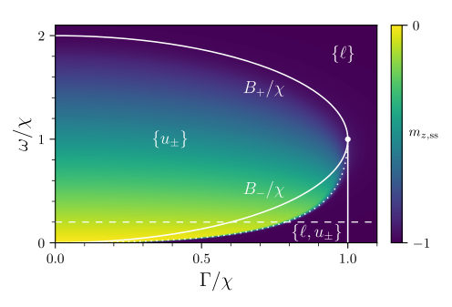
<figcaption class="paper-figure-caption"><b>Fig 2.</b> Figure 1 presents the phase diagram, illustrating the pa- rameter regions in which the above points are stable. As shown, the lower FP ℓloses stability in the region Γ/χ &lt; 1 and B−&lt; ω &lt; B+. The upper FPs u± are stable in the region Γ/χ &lt; 1 and ω &lt; B+. Our analysis will focus on the region Γ/χ &lt; 1 and ω &lt; B−, where both types of FPs are stable.</figcaption>
</figure>
<figure class="paper-figure-card">
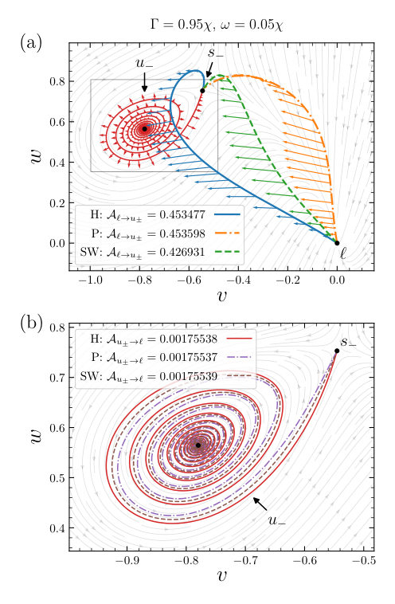
<figcaption class="paper-figure-caption"><b>Fig 3.</b> FIG. 2. Projections of the π ≠0 segments of instanton trajec- tories onto the (v, w) state plane for Γ = 0.95χ and ω = 0.05χ. (a) Three instanton trajectories connecting the fixed point ℓ to the saddle s−, obtained for different quasiprobability rep- resentations, together with a single trajectory connecting the fixed point u−to s−for the H representation. The arrows at- tached to the trajectories indicate the corresponding momen- tum vectors π. (b) Instanton trajectories connecting u−to s− for different representations, shown for the region indicated by the gray rectangle in panel (a). Momentum arrows are omit- ted in (b) for clarity. In both panels, the gray background lines with arrows...</figcaption>
</figure>
<figure class="paper-figure-card">
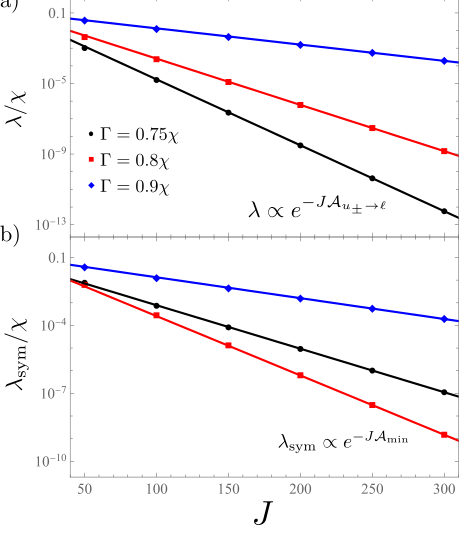
<figcaption class="paper-figure-caption"><b>Fig 4.</b> FIG. 4. (a) Dots: Liouvillian gap λ calculated using master equation for selected values of Γ, plotted in the logarithmic scale. Lines: the predicted scaling λ ∝exp(−JAu±→ℓ) set to cross the point for J = 300. (b) An analogous plot for the symmetric Liouvillian gap λsym, with lines representing the scaling λsym ∝exp(−JAmin).</figcaption>
</figure>
<figure class="paper-figure-card">
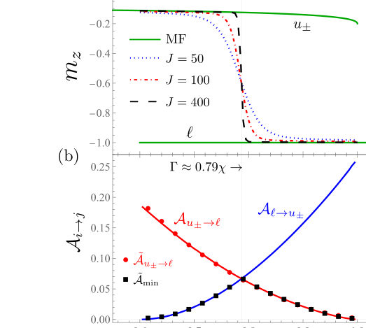
<figcaption class="paper-figure-caption"><b>Fig 5.</b> FIG. 3. (a) Mean-field (MF) fixed-point magnetization m∗ z (green solid lines) versus finite-size steady-state magnetiza- tion mz,ss obtained using master equation (other lines). (b) Activation barriers Ai→j calculated using H representation; they agree with the results obtained using P representation whenever the latter method converges. Grey vertical solid line at Γ ≈0.79χ denotes the crossing point of Aℓ→u± and Au±→ℓ curves. Symbols denote the estimators ˜ Au±→ℓand ˜ Amin de- fined by Eq. (18). Parameter ω = 0.2χ.</figcaption>
</figure>

**Summary.** This paper develops and numerically implements the quantum instanton approach to study slow relaxation and first-order phase transitions in collective spin systems. By calculating the activation barriers for switching between metastable states in models like LMG and CRF, the authors predict key physical observables, validating the method against established quantum master equation results.

**Why it may be interesting.** This work provides a powerful, systematic tool (quantum instantons) to calculate non-perturbative rates and phase transition boundaries in complex, open quantum systems, bridging quantum dynamics with classical rate theories.

Detailed structure

**Main problem.** The paper addresses the slow relaxation and first-order dissipative phase transitions occurring in driven-dissipative collective spin systems due to rare switching between metastable states.

**Main result.** The quantum instanton framework successfully predicts the stationary magnetization, the critical point for first-order transitions, and the exponential scaling of slow relaxation rates for tested models.

**Method.** It employs the quantum instanton approach, numerically implemented using collocation and shooting methods, to calculate the activation barriers governing the switching rates between metastable attractors.

**Model / system.** The study applies the framework to two microscopically motivated systems: the Lipkin-Meshkov-Glick (LMG) model and the Cooperative Resonance Fluorescence (CRF) model, both involving collective spin dynamics under dissipation.

**Key observables.** Switching rates ($\kappa_{i	o j}$), activation barriers ($A_{i	o j}$), stationary magnetization, and the first-order dissipative phase-transition point.

**Important parameters / regimes.** Dissipation rates ($\Gamma$), coupling strengths ($\chi$), and system parameters defining the specific models (LMG, CRF).

**Assumptions / limitations.** The analysis relies on the large-system limit ($V 	o \infty$) and assumes the instanton trajectory can be found by solving Hamilton's equations, though limitations regarding non-convex Hamiltonians and the accuracy of the Wigner approach are noted.

**Figures summary.** Figures illustrate projections of instanton trajectories onto phase planes for different quasiprobability representations, showing the paths connecting stable fixed points via saddle points.

**Paper structure.** The paper develops the quantum instanton framework, details its numerical implementation using collocation/shooting methods, and then applies this machinery to calculate key physical quantities (rates, barriers) for the LMG and CRF models, comparing results against master equation calculations.

Abstract

Driven-dissipative collective spin systems can host several long-lived metastable states; rare switching between them governs slow relaxation and first-order dissipative phase transitions associated with changes in the dominant stationary state. In the companion Letter [arXiv:2604.15091], we introduced a quantum instanton framework based on exact quasiprobability dynamics to describe this switching and illustrated it with a minimal model possessing a simplifying symmetry. Here we develop its numerical implementation, combining collocation and shooting methods, and apply it to two microscopically motivated systems: the Lipkin-Meshkov-Glick model with purely collective dissipation and the cooperative resonance fluorescence with collective and local dissipation. By determining the leading exponential scaling of switching rates between metastable attractors, we predict the stationary magnetization, the first-order dissipative phase-transition point, and the exponential scaling of slow relaxation rates. These predictions agree with quantum master-equation calculations and an exact analytical result for the second model without dephasing. We also examine how the choice of quasiprobability representation affects numerical convergence and find that the alternative semiclassical Wigner approach, based on Gaussian truncation, has varying accuracy across models and parameter regimes. These results substantiate the framework's applicability to experimentally relevant collective spin systems with both collective and local dissipation.

[↑ back to top](#top)

### [Boundary-induced geometrical frustration in a square Rydberg-atom lattice](http://arxiv.org/abs/2610.20723v1)

**Authors:** Marco Rigobello, Luka Pavešić, Daniel Jaschke, Pietro Silvi, Marco Di Liberto, Simone Montangero, Simone Notarnicola  
**Type:** both · **Category:** other · **PDF:** <https://arxiv.org/pdf/2610.20723v1>  
**Analysis basis:** full PDF text, analyzed in chunks
**Topic relevance:** 🔥 `Rydberg arrays` **4/5** · 🔥 `analog quantum simulation` **4/5** · `methods for driven-dissipative` **3/5** · `QC/QI experiment` **2/5**

↔ Scroll figures horizontally

<figure class="paper-figure-card">
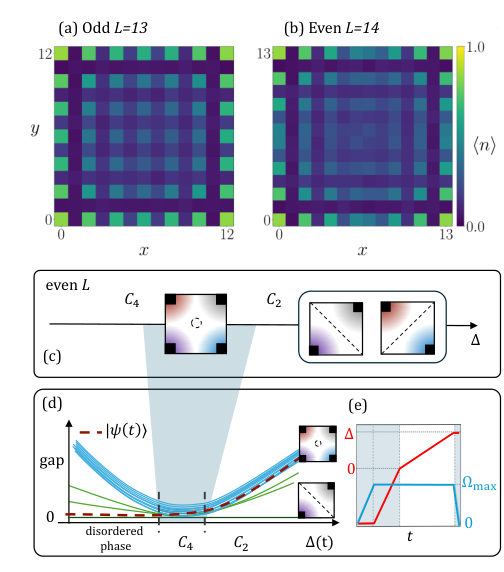
<figcaption class="paper-figure-caption"><b>Fig 1.</b> FIG. 1: (a)–(b) Experimental Rydberg excitation density ⟨n⟩measured after the ramp at final detuning ∆= 2.0. For the odd-sized array (L = 13), the boundary condi- tions are compatible with a single striated domain. For the even-sized array (L = 14), the four corners seed incompatible striated patterns, generating a geometri- cal defect in the bulk. (c) Boundary-induced frustrated regimes for even L. As the detuning ∆is increased, the system enters a globally C4-symmetric frustrated regime, with four striated domains related by π/2 rotations. At larger ∆, the ground state becomes the superposition of two C2-invariant configurations with a one-dimensional diagonal defect. (d) Schematic...</figcaption>
</figure>
<figure class="paper-figure-card">
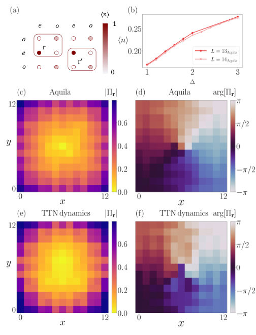
<figcaption class="paper-figure-caption"><b>Fig 2.</b> FIG. 2: (a) Computation of Πr on a plaquette, where r is the bottom-left site. The parameter Πr depends on the four local densities in the plaquette, taken according to the parity of their coordinates. (b) Experimentally measured Rydberg excitation density ⟨n⟩as a function of the final detuning ∆. The agreement between the results for L = 13 and L = 14 shows that the total density does not depend strongly on the parity of L. (c)–(f) Modulus and phase of Πr for L = 14 at ∆= 2.0, obtained from the experimental data (c,d) and with TTN dynamics (e,f). The agreement between the two shows that the ramp dynamics captures the formation of the four boundary domains and the suppression of local...</figcaption>
</figure>
<figure class="paper-figure-card">
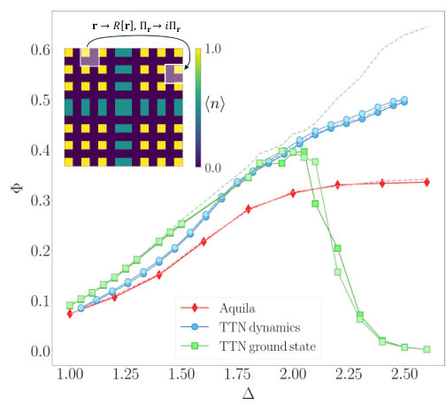
<figcaption class="paper-figure-caption"><b>Fig 3.</b> FIG. 3: Rotational correlator Φ computed for L = 14 as a function of the final detuning ∆. We compare the experimental results obtained with Aquila (red di- amonds), real-time TTN dynamics (blue circles), and TTN ground-state calculations (green squares). The dashed lines show Π2 for each case in the same color. For the experimental data, we estimated statistical errors via bootstrap sampling, obtaining errors ∼10−3. For nu- merical simulations, darker shades correspond to larger bond dimensions. For the dynamical simulations, differ- ent shades correspond to bond dimensions m = 100, 150, while for the ground-state calculations they correspond to m = 200, 250. For the ground-state...</figcaption>
</figure>
<figure class="paper-figure-card">
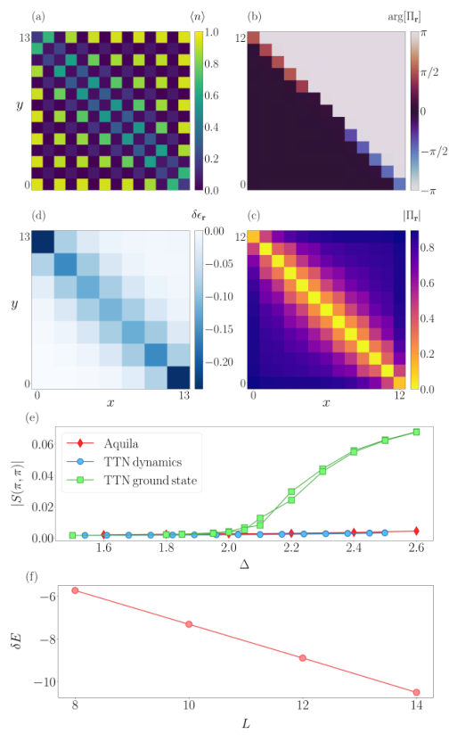
<figcaption class="paper-figure-caption"><b>Fig 4.</b> FIG. 4: Ground state C2 structure at ∆= 2.5. (a) Local Rydberg density ⟨nr⟩, showing two striated domains nu- cleated by two opposite corners separated by a diagonal interface. (b) Phase of the complex plaquette order pa- rameter Πr. (c) Modulus |Πr|, whose suppression along the diagonal marks the localized geometrical defect. (d) Plaquette-averaged local energy density ⟨δϵr⟩, showing that the energy gain is concentrated along the diagonal interface. (e) The structure factor S(π, π) computed as a function of ∆. In the ground state (green squares), it increases from zero at ∆≃2.0, signaling the diagonal- defect regime. In the evolved state computed with TDVP simulations (blue circles) and in...</figcaption>
</figure>
<figure class="paper-figure-card">
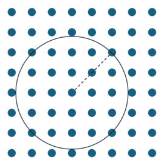
<figcaption class="paper-figure-caption"><b>Fig 5.</b> FIG. 5: Sketch of the interaction range we retain in nu- merical simulations.</figcaption>
</figure>

**Summary.** This paper explores how the geometry and size of a Rydberg-atom lattice dictate its global quantum order, revealing frustration effects based on lattice parity. By comparing experimental measurements with tensor-network simulations, the authors map out transitions between $C_4$-symmetric and $C_2$-symmetric ordered states. It highlights the crucial role of boundaries in stabilizing specific defect patterns in programmable quantum matter.

**Why it may be interesting.** This work provides a detailed, experimentally relevant platform (Rydberg arrays) to study fundamental concepts of geometric frustration, symmetry breaking, and boundary effects in quantum many-body systems.

Detailed structure

**Main problem.** The study investigates how lattice size parity and boundary conditions induce geometrical frustration and determine the global ordering in programmable quantum matter.

**Main result.** The system exhibits distinct ordered phases depending on lattice size and detuning, transitioning from a $C_4$-symmetric state to a $C_2$-symmetric state characterized by a diagonal defect.

**Method.** The research combines experimental protocols on the Aquila quantum processor with advanced numerical simulations like DMRG and TDVP using tensor networks.

**Model / system.** The system is a square lattice of Rydberg atoms, modeled by an effective spin-1/2 Hamiltonian involving Rydberg excitation number operators and long-range dipole-dipole interactions.

**Key observables.** Plaquette order parameter ($\Pi_r$), boundary rotational correlator ($\Phi$), and the staggered magnetization proxy ($S(\pi, \pi)$).

**Important parameters / regimes.** Lattice size parity (odd vs. even), detuning ($\Delta$), and interaction strength ($V_{rr'}$).

**Assumptions / limitations.** The experimental ramp protocol may not reach the highest detuning regimes simulated, and larger simulations might artificially break true $C_4$ symmetry.

**Figures summary.** Figures illustrate the density profile ($\langle n 
angle$) for odd/even lattices, the plaquette order parameter ($\Pi_r$) showing defect formation, and the structure factor $S(\pi, \pi)$ confirming symmetry changes with detuning.

**Paper structure.** The paper systematically analyzes the ground state and dynamics across different detuning regimes, contrasting the effects of lattice size parity (odd vs. even) on the resulting global order and defect structure.

Abstract

We study geometric defects in square-lattice Rydberg-atom arrays induced by lattice-size parity in the striated density-wave phase. While odd-sized lattices select a single striated domain, even-sized lattices seed incompatible domains at the four corners, resulting in a π/2-rotation invariant state with a geometrical defect emanating from the lattice center. At larger detunings, we instead identify a π-rotation-invariant state with two domains nucleated by opposite corners and separated by a one-dimensional diagonal defect. We probe the state-preparation protocol on the Aquila atomic quantum processor and benchmark it with equilibrium and real-time dynamics tensor-network simulations. Our results assess the role of boundaries and lattice size in determining the global ordering in programmable quantum matter.

[↑ back to top](#top)

### [Loss-independent time-delay estimation via Hong-Ou-Mandel photon bunching detection](http://arxiv.org/abs/2610.22023v1)

**Authors:** Julián Defant, Agustina G. Magnoni, Miguel A. Larotonda, Laura T. Knoll  
**Type:** both · **Category:** other · **PDF:** <https://arxiv.org/pdf/2610.22023v1>  
**Analysis basis:** full PDF text, analyzed in chunks
**Topic relevance:** 🔥 `quantum optics experiment` **4/5** · `interference shaping light` **3/5** · `quantum measurements` **3/5** · `Full counting statistics` **2/5**

↔ Scroll figures horizontally

<figure class="paper-figure-card">
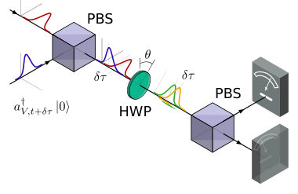
<figcaption class="paper-figure-caption"><b>Fig 1.</b> Figure 1. Schematic configuration of a standard polarization- based Hong-Ou-Mandel interferometer for time-delay estima- tion.</figcaption>
</figure>
<figure class="paper-figure-card">
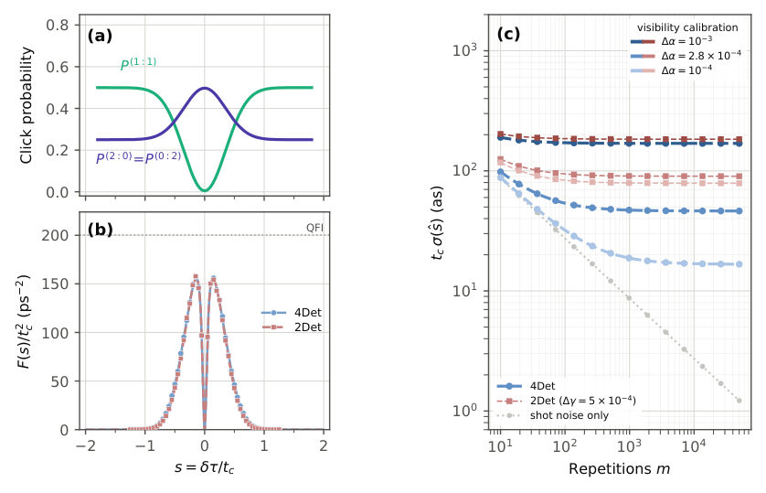
<figcaption class="paper-figure-caption"><b>Fig 2.</b> Figure 2. (a) Theoretical probability distributions for coincidence (P (1:1)) and bunching (P (2:0), P (0:2)) events as functions of s = δτ</figcaption>
</figure>
<figure class="paper-figure-card">
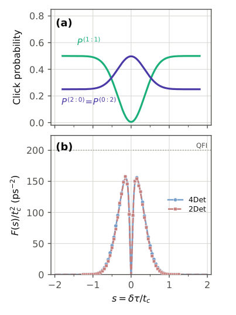
<figcaption class="paper-figure-caption"><b>Fig 3.</b> Figure 2(b) shows the simulated Fisher information for both schemes, together with the theoretical predictions calculated using Eq. (4) and the corresponding proba- bility distributions. The parameters were fixed from the experimental conditions: the interference visibility was obtained from the coincidence dip (α = 0.99, correspond- ing to δλ ≈0.7 nm), the coherence time from the width of the HOM dip (tc = 0.2 ps), and the photon loss rate of the system is γ = 0.88. In both cases the variance of the estimator saturates the Cramér–Rao bound, so each scheme attains the maximum precision allowed by its own statistics. Note that the Fisher information vanishes at the indistinguishability...</figcaption>
</figure>
<figure class="paper-figure-card">
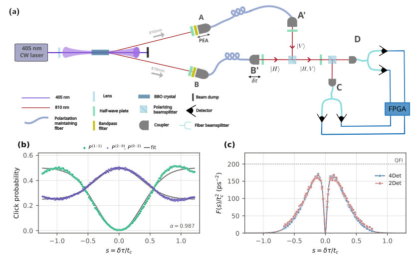
<figcaption class="paper-figure-caption"><b>Fig 4.</b> Figure 3. (a) Schematic setup of the Hong-Ou-Mandel polarization interferometer. Photon pairs at 810 nm are generated via SPDC using a CW 405 nm pump. After spectral filtering, photons are coupled into PMFs and redirected to the interferometer with orthogonal polarizations, where a PBS overlaps their paths. To scan the interference pattern, one of the fiber couplers is mounted on a motorized micrometer stage, enabling control over the relative delay between the photon pair. Interference is produced by an arrangement of a HWP followed by a second PBS, which separates the polarization components into different paths leading to the detection scheme. Each path is coupled to a FBS that divides...</figcaption>
</figure>
<figure class="paper-figure-card">
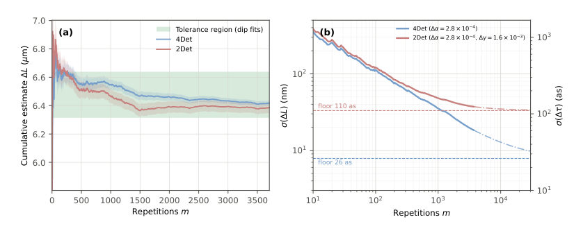
<figcaption class="paper-figure-caption"><b>Fig 5.</b> Figure 4. (a) Cumulative mean of the estimation of the path difference introduced by the piezoelectric actuator over repetitions for the two-detector scheme (red) and four-detector scheme (blue). (b) Cumulative dispersion of the path difference estimation over repetitions for the two-detector scheme (red) and four-detector scheme (blue). Horizontal dashed lines represent the dispersion floor set by the considered calibration uncertainty of the systematic parameters for each configuration.</figcaption>
</figure>

**Summary.** This paper demonstrates a method for highly precise time-delay estimation using entangled photon pairs in a Hong-Ou-Mandel interferometer. By implementing a four-detector measurement scheme that analyzes photon bunching, the authors achieve a measurement precision limited only by fundamental quantum noise, circumventing the need to accurately characterize system losses inherent in simpler two-detector setups.

**Why it may be interesting.** This work is highly relevant to quantum optics and open quantum systems, as it provides a concrete, experimentally relevant protocol for quantum metrology that explicitly tackles the practical limitations imposed by photon loss and imperfect calibration.

Detailed structure

**Main problem.** The paper addresses the challenge of achieving high-precision time-delay estimation using two-photon quantum states while remaining robust against system losses and calibration uncertainties.

**Main result.** A four-detector measurement scheme, which utilizes both coincidence and photon-bunching terms, achieves the ultimate quantum precision limit without requiring explicit characterization of system losses, significantly outperforming two-detector methods.

**Method.** The authors employ quantum estimation theory, comparing the achievable Fisher Information from two different detector setups (two vs. four detectors) in a Hong-Ou-Mandel interferometer.

**Model / system.** The physical system is a polarization-based Hong-Ou-Mandel (HOM) interferometer used to generate and measure two-photon correlated N00N states. The analysis compares measurement statistics derived from two-detector and four-detector coincidence/bunching measurements.

**Key observables.** Coincidence rates, photon-bunching terms, Fisher Information (FI) and Quantum Fisher Information (QFI), and the estimated time delay ($\Delta L$ or $\delta	au$).

**Important parameters / regimes.** System loss probability ($\gamma$), interferometric visibility ($\alpha$), and the number of measurement repetitions ($m$).

**Assumptions / limitations.** The primary comparison is between ideal theoretical limits (QFI) and practical measurements, noting that systematic correlations between repetitions limit the achievable precision in both schemes.

**Figures summary.** Figures illustrate the schematic of the HOM interferometer, theoretical probability distributions for the two and four-detector schemes, and plots comparing the estimated path difference ($\Delta L$) and its dispersion over multiple repetitions for both schemes.

**Paper structure.** The paper progresses from establishing the theoretical framework using QFI, detailing the mathematical differences between two-detector and four-detector measurements, and concluding with experimental/numerical results comparing the performance and robustness of the two schemes.

Abstract

In this work we study the application of two-photon correlated quantum states for high-precision time estimation. To achieve this, photon pairs were fed into a Hong-Ou-Mandel polarization interferometer to generate N00N entangled states with $N = 2$. Two- and four-detector schemes were considered, and the achievable time estimation precision of each was studied, with particular emphasis on the system's Fisher information in each case. Our results reveal that using a four-detector scheme, enabling the measurement of both coincidence and photon-bunching terms, achieves the maximum precision given by the quantum Fisher information, without the need of characterizing system losses. We also show that correlations between repetitions arise due to systematic errors, limiting the precision enhancement that can be obtained by increasing the number of repetitions. Taking these correlations into account, we show that the four-detector scheme outperforms the two-detector scheme in the precision of time-delay estimation. With the experimentally determined calibration uncertainties, the four-detector scheme improves the dispersion by a factor of 2 for the repetitions performed, reaching up to a factor of 4 as both schemes approach their systematic floors.

[↑ back to top](#top)

### [Remote Gottesman-Kitaev-Preskill Entanglement Generation between Trapped Ions](http://arxiv.org/abs/2610.21754v1)

**Authors:** Haruki Aoki, Kazufumi Tanji, Shohei Kiryu, Masahiro Takeoka, Junko Ishi-Hayase  
**Type:** both · **Category:** quantum information and computing · **PDF:** <https://arxiv.org/pdf/2610.21754v1>  
**Analysis basis:** full PDF text, analyzed in chunks
**Topic relevance:** 🔥 `QC/QI experiment` **4/5** · `interference shaping light` **3/5** · `quantum optics experiment` **3/5** · `quantum measurements` **1/5**

↔ Scroll figures horizontally

<figure class="paper-figure-card">
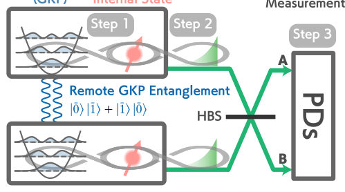
<figcaption class="paper-figure-caption"><b>Fig 1.</b> FIG. 1. Overview of the heralded protocol for generat- ing remote entanglement between motional GKP qubits in trapped ions. Each node contains a motional GKP qubit, an internal-state ancilla, and an optical interface to a flying photonic qubit. HBS denotes the half beam splitter to in- terfere the photons in Step 3. In Step 1, the motional GKP qubit is locally entangled with the internal state. In Step 2, state-selective excitation and photon emission generate a local motion–ion–photon GHZ state. In Step 3, the photons from the two nodes interfere at a central station and are measured by photo-detectors (PDs) to perform a Bell-state measure- ment. Conditioning on a successful photonic...</figcaption>
</figure>
<figure class="paper-figure-card">
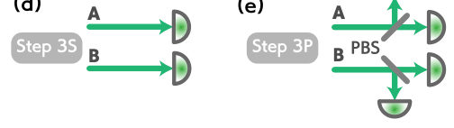
<figcaption class="paper-figure-caption"><b>Fig 2.</b> FIG. 2. Detailed operations in Steps 1–3. (a) Con- ceptual representation of local motion–ion entangled state preparation from the motional vacuum and the internal ground state. Sq. and SDD + Meas. denote squeez- ing and state-dependent displacements and measurement im- plemented through motion–ion interactions. (b),(c) State- selective excitation for (b) the single-rail encoding and (c) the polarization encoding. (d),(e) Photonic Bell-state mea- surements for (d) the single-rail encoding and (e) the polar- ization encoding. The photodetectors are assumed to have insufficient temporal resolution to resolve the photon-arrival times.</figcaption>
</figure>
<figure class="paper-figure-card">
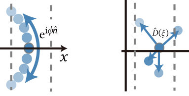
<figcaption class="paper-figure-caption"><b>Fig 3.</b> FIG. 3. Noise channels included in the remote-entanglement model. (a) Photon loss is represented by a beam splitter with transmission efficiency ηph; it acts as amplitude damping for the single-rail encoding but reduces the heralding proba- bility for the polarization encoding under two-photon post- selection. (b) Photon recoil during Step 2 consists of the absorption displacement ˆD(iη) followed by the emission dis- placement ˆD[−iηeiωmt]. Because the photon-emission time is unresolved, the recoil operator ˆR(t) = ˆD[−iηeiωmt] ˆD(iη) is averaged over the emission-time distribution f(t). (c) Mo- tional heating during tfly produces isotropic Gaussian random displacements ˆD(α). (d) Motional...</figcaption>
</figure>
<figure class="paper-figure-card">

<figcaption class="paper-figure-caption"><b>Fig 4.</b> FIG. 4. Baseline logical performance of the remote- entanglement protocol in the absence of physical noise. Panel (a) shows the logical Bell-state infidelity 1 −FL as a func- tion of the GKP squeezing level ∆dB. Panels (b) and (c) show the real parts of the decoded logical density matrices at 6 dB and 15 dB, respectively. The logical basis is ordered as {|¯0¯0⟩, |¯0¯1⟩, |¯1¯0⟩, |¯1¯1⟩}. Photon recoil, photon loss, motional heating, and motional dephasing are disabled in all panels.</figcaption>
</figure>
<figure class="paper-figure-card">

<figcaption class="paper-figure-caption"><b>Fig 5.</b> FIG. 5. Effect of photon loss on the logical state generated with the single-rail encoding. The logical Bell-state infidelity 1 −FL is shown as a function of the photon loss probabil- ity ploss = 1 −ηph for GKP squeezing levels of 6, 9, 12, and 15 dB. The infidelity is contributed by finite squeezing and the false-herald event produced when one photon is lost from the two-photon input. The polarization-encoding result is not shown because, under ideal two-photon postselection, photon loss does not change the resultant state. Photon recoil, mo- tional heating, and motional dephasing are disabled. The model assumes identical independent photon losses, photon- number-resolving detection, and...</figcaption>
</figure>

**Summary.** This paper presents a heralded protocol to generate remote entanglement between GKP logical qubits encoded in trapped-ion motional modes. It details a three-step process utilizing internal electronic states to mediate entanglement transfer via emitted photons. The analysis rigorously quantifies the achievable logical fidelity, demonstrating performance above 95% even when incorporating realistic noise sources like heating and photon loss.

**Why it may be interesting.** This work directly addresses the physical implementation challenges of quantum networking by providing a concrete, high-fidelity protocol for distributing entanglement using established trapped-ion platforms.

Detailed structure

**Main problem.** The core problem is developing a scalable method to distribute entanglement directly between error-corrected logical qubits, which is crucial for building quantum networks.

**Main result.** The authors propose a heralded protocol achieving a logical Bell-state fidelity exceeding 95% in realistic trapped-ion settings, even when accounting for various noise sources.

**Method.** The protocol uses a three-step process involving local entanglement generation, conversion to a motion-ion-photon GHZ state, and final remote entanglement projection via photon interference.

**Model / system.** The system is trapped ions, where Gottesman-Kitaev-Preskill (GKP) qubits are encoded in the motional modes. The process interfaces these motional qubits with emitted photons using the internal electronic states.

**Key observables.** Logical Bell-state fidelity ($F_L$), which is evaluated using Stabilizer Subsystem Decomposition (SSSD).

**Important parameters / regimes.** Noise parameters include photon recoil, motional heating rate ($\dot{ar{n}}$), and motional dephasing rate ($\kappa_{\phi}$).

**Assumptions / limitations.** The protocol assumes the combination of motional-control and photonic-networking operations are already demonstrated in trapped-ion experiments, and the BSM detectors lack temporal resolution.

**Figures summary.** Figure 1 provides an overview of the heralded protocol (Motional GKP $\leftrightarrow$ Internal State $\leftrightarrow$ Photonic State $
ightarrow$ Bell State Measurement), while Figure 2 details the three steps, and subsequent figures analyze fidelity dependence on noise.

**Paper structure.** The paper details the three-step protocol (local entanglement, GHZ generation, remote projection), derives the necessary Hamiltonians and noise channels (recoil, heating, dephasing), and concludes with a numerical analysis of the logical fidelity under realistic noise conditions.

Abstract

Distributing entanglement directly between error-corrected logical qubits is an important capability for scalable quantum networks. We propose a heralded protocol for generating remote entanglement between Gottesman--Kitaev--Preskill qubits encoded in the motional modes of spatially separated trapped ions, using the internal electronic states to interface the motional qubits with emitted photons. We derive the protocol for single-rail and polarization photonic encodings and evaluate the effects of finite GKP squeezing, photon loss, photon recoil, motional heating, and motional dephasing on the decoded logical state. Moreover, we numerically analysed the fidelity of distributed logical Bell-pair fidelity. We find that one can achieve more than 95% of fidelity in the realistic situation. The protocol combines motional-control and photonic-networking operations that have already been demonstrated in trapped-ion experiments.

[↑ back to top](#top)

### [Superconducting circuits host two-level systems with lifetimes exceeding one second](http://arxiv.org/abs/2610.21853v1)

**Authors:** Mathieu Féchant, Phillip Lenhard, Nicolas Gosling, Ritika Dhundhwal, Denis Bénâtre, Wolfgang Wernsdorfer, Thomas Reisinger, Ioan M. Pop  
**Type:** experiment · **Category:** quantum information and computing · **PDF:** <https://arxiv.org/pdf/2610.21853v1>  
**Analysis basis:** full PDF text, analyzed in chunks
**Topic relevance:** 🔥 `QC/QI experiment` **4/5** · `quantum measurements` **3/5** · `methods for driven-dissipative` **2/5** · `correlated / nonlocal dissipation` **1/5** · `driven-dissipative phase transition` **1/5**

↔ Scroll figures horizontally

<figure class="paper-figure-card">

<figcaption class="paper-figure-caption"><b>Fig 1.</b> Figure 1. Schematic of the interaction between a qubit and a long-lived TLS, in the case where they are each other’s dominant loss mechanism. For low coupling g com- pared to the qubit and TLS decoherence rates,Γ2 and (Γ2)TLS respectively , vacuum Rabi oscillations are overdamped and the energy exchange between qubit and TLS is described by a Purcell rate Γqt.</figcaption>
</figure>
<figure class="paper-figure-card">

<figcaption class="paper-figure-caption"><b>Fig 2.</b> Figure 2. Quantum jump correlation spectroscopy performed over flux and Stark shift detuning. Each point corresponds to a stroboscopic quantum jumps experiment with 1 µs measurement pulse at zero detuning and a 40 µs wait at a Stark shift detuned frequency. (a) Qubit population conditioned on measuring |1⟩in the previous step, as shown in the bottom left schematic. The range of qubit population from 0.6 to 0.7 corresponds to a range of T1 from 70 to 110 µs. The red line depicts the frequency of the undriven flux tunable Transmon. (b) Qubit population conditioned on measuring a jump down, as shown in the bottom left schematic. This correlation spectroscopy shows photon back flow after a...</figcaption>
</figure>
<figure class="paper-figure-card">

<figcaption class="paper-figure-caption"><b>Fig 3.</b> Figure 3. TLS pump and probe. (a) Schematic of the pump (orange highlight) and probe (green highlight) sequence. To pump the TLS, we actively reset the qubit after which we bring to a detuning δpump from the TLS for a time tpump. To fully polarize the TLS, we repeat the pumping sequence N times. After pumping, we idle at a detuning δdelay. To probe the TLS, we first measure the qubit (M1), after which we idle for tprobe at a detuning δprobe with the TLS, and finally we measure the population returned back to the qubit (M2). (b) Probe population after pumping sequences ranging from 0 to 100 µs and N = 1 to N = 60 repetitions. Dashed lines indicate the fit with Solomon equations with Γqt =...</figcaption>
</figure>
<figure class="paper-figure-card">

<figcaption class="paper-figure-caption"><b>Fig 4.</b> Figure 4. TLS Relaxation with qubit-TLS detuning. (a) Return photon amplitude for increasing delay time showing the decay of the TLS photon. The dashed lines show the Lorentzian fit with width around .1 MHz, close to the qubit decoherence rate of (15 µs)−1. (b) Decay curves of the return population for varying qubit TLS detuning δdelay. Dashed lines show the fitted exponential decay. The diamonds on the .21 MHz detuning curve indicate the points shown in (a) (c) Measured TLS lifetimes for three different TLSs as a function of qubit-TLS detuning . The TLS at 3.948 GHz is TLS 1 in figure 2. The solid lines show the fitted Purcell decay in which the width Γ of the Purcell formula is taken to...</figcaption>
</figure>
<figure class="paper-figure-card">

<figcaption class="paper-figure-caption"><b>Fig 5.</b> Figure 5. (a) Optical Image of the Transmon circuit of sample 1 next to scaled pattern of the readout LC structure. (b)Structure of sample 2 . It has the same exact structure without the two lines of the readout circuit extending into the transmon. (b) Variation of the two measured transmons Josephson energies(red for sample 1 and green points for sample 2) over time. The sample 2 had already aged for a year before starting measurements.</figcaption>
</figure>

**Summary.** This paper investigates the microscopic environment of superconducting qubits by measuring parasitic Two-Level Systems (TLSs). Using advanced quantum-jump and pump-probe techniques, the researchers identified TLSs with remarkably long lifetimes, exceeding one second. This work not only characterizes these limiting defects but also establishes superconducting qubits as a powerful tool for probing fundamental, long-lived quantum noise sources.

**Why it may be interesting.** This work directly addresses the environmental coupling mechanisms crucial for building fault-tolerant quantum computers, providing quantitative measurements of decoherence sources.

Detailed structure

**Main problem.** The central challenge in superconducting qubits is understanding the parasitic Two-Level Systems (TLSs) that limit performance through decoherence and frequency drifts.

**Main result.** The authors identified microscopic TLSs with intrinsic lifetimes exceeding one second, establishing superconducting qubits as a sensitive probe for these long-lived environmental degrees of freedom.

**Method.** The study employed wide-band quantum-jump correlation spectroscopy and pump-probe measurements at varying detunings to characterize the TLS dynamics.

**Model / system.** The platform is flux-tunable transmon qubits fabricated on superconducting circuits. The environment is modeled by coupling the qubit to TLSs, whose interaction is analyzed using quantum jump theory and Solomon equations.

**Key observables.** Intrinsic TLS relaxation time (T_TLS) measured in the seconds range, qubit population dynamics after quantum jumps, and TLS spectral features.

**Important parameters / regimes.** TLS coupling strength (in the kHz range), detuning ($\delta$), and the qubit's coherence time ($T_1$).

**Assumptions / limitations.** The weak coupling to the TLSs is consistent with positional defects described by the standard tunneling model, though other origins are not excluded.

**Figures summary.** Figures illustrate quantum jump spectroscopy results, pump-probe sequences showing population evolution, and plots detailing the measured intrinsic TLS lifetimes as a function of detuning.

**Paper structure.** The paper progresses by first identifying the problem of TLS-induced decoherence, then detailing the quantum-jump and pump-probe measurement techniques, culminating in the measurement and characterization of ultra-long-lived TLSs.

Abstract

Understanding the microscopic environment of superconducting qubits is a central challenge for quantum technologies. Parasitic two-level systems (TLSs) of various microscopic origins are ubiquitous and limit qubit performance through decoherence, frequency drifts, and leakage. Recently, long-lived TLSs with lifetimes exceeding those of state-of-the-art qubits have been shown to induce correlated qubit dynamics, with direct implications for quantum error correction. Here, we perform wide-band quantum-jump correlation spectroscopy on flux-tunable transmon qubits and identify microscopic degrees of freedom that outlive the qubit by orders of magnitude. Pump-probe measurements at varying detunings from these objects reveal intrinsic lifetimes exceeding one second. Their weak coupling to the qubit, in the kilohertz range, is consistent with positional defects described by the standard tunneling model, without excluding other microscopic origins such as magnetic spin impurities or trapped quasiparticles. More broadly, these results establish superconducting qubits as a sensitive probe of exceptionally long-lived microscopic degrees of freedom and open a route toward their controlled access and functionalization.

[↑ back to top](#top)

### [Syndrome-Resolved Decoding of Qubit Readout Errors](http://arxiv.org/abs/2610.20810v1)

**Authors:** Han Zheng, Vladimir Pešić, Nikolay Gusarov, Andrea Lizzit, Taketo Imaizumi, Chulwoo Ahn, Marco Nicolas Mueller, Raymond Mencia, Edoardo Charbon, Vladimir E. Manucharyan  
**Type:** experiment · **Category:** quantum information and computing · **PDF:** <https://arxiv.org/pdf/2610.20810v1>  
**Analysis basis:** full PDF text, analyzed in chunks
**Topic relevance:** 🔥 `QC/QI experiment` **4/5** · `quantum measurements` **3/5** · `Full counting statistics` **1/5** · `correlated / nonlocal dissipation` **1/5** · `methods for driven-dissipative` **1/5**

↔ Scroll figures horizontally

<figure class="paper-figure-card">

<figcaption class="paper-figure-caption"><b>Fig 1.</b> FIG. 1. Overview of the RED protocol. (a) Binary readout: each single-shot IQ point is thresholded into a bit mi ∈{0, 1}. (b) The two ways the qubit state can change during the readout: a flip inside the computational subspace, |g⟩↔|e⟩, and leakage to the non-computational state |l⟩. (c) The RED sequence and its analysis. Readouts are interleaved with a fixed gate G ∈{I, X, X-τ-X}, which gives the gate record G, the measured record m, and the correlation record c. Broken correlations are grouped by how many occur in a row into the syndromes S1, S2, and S3+, and the decoder turns these counts into channel estimators for assignment, bit-flip, and leakage, resolved by the |g⟩and |e⟩branch. The...</figcaption>
</figure>
<figure class="paper-figure-card">

<figcaption class="paper-figure-caption"><b>Fig 2.</b> FIG. 3. Assignment and bit-flip errors versus read- out duration. (a) Fluxonium and (b) transmon. The assignment-error rate decreases with increasing tRO as the readout SNR improves, while the bit-flip rates from |g⟩and |e⟩increase approximately linearly over the fitted range. Solid black curves show Gaussian-overlap fits to the assignment er- rors, while dashed lines show linear fits to the bit-flip rates, yielding the excitation and relaxation rates Γ↑and Γ↓. The fitting models are detailed in Appendix D.</figcaption>
</figure>
<figure class="paper-figure-card">

<figcaption class="paper-figure-caption"><b>Fig 3.</b> FIG. 2. Controlled error-injection validation of RED. (a) Bit flips are injected by a π01 pulse applied with proba- bility Pb on I sequences prepared in |g⟩and |e⟩: the extracted bit-flip channel tracks Pb with near-unit slope on both prepa- rations, while the assignment channel remains nearly flat. (b) Leakage is injected by a π12 pulse applied with probability Pf starting from |e⟩. The extracted leakage error from the X-τ- X sequence increases linearly with Pf with a fitted slope of 0.887, while the raw S1 rate of the I reference remains nearly constant. Data are taken on fluxonium qubits.</figcaption>
</figure>
<figure class="paper-figure-card">

<figcaption class="paper-figure-caption"><b>Fig 4.</b> FIG. 4. RED leakage detection across long- and short-lived regimes. (a) Leaked population during repeated readouts. A long-lived leakage persists over many readout cycles and breaks a run of correlations; a short-lived leakage returns within one cycle and breaks only one correlation at most. (b) Long-lived-leakage probe: repeated readouts with an inter-readout X gate. (c) Transmon data, S3+ versus readout duration. The rate from |e⟩rises with tRO; the rate from |g⟩stays at the noise floor. The gray band marks a reference threshold equal to 10% of the largest decoded error channel. The same band is shown in (e). (d) Short-lived-leakage probe: an X −τ −X sequence between successive readouts....</figcaption>
</figure>

**Summary.** This work introduces the Readout Error Decoder (RED), a novel technique to diagnose and quantify individual readout error channels—such as bit-flips, assignment errors, and leakage—in superconducting qubits. By analyzing temporal correlations across multiple measurements, RED bypasses the need for perfect state discrimination. This provides a vital, targeted diagnostic tool for optimizing qubit readout fidelity across various superconducting platforms.

**Why it may be interesting.** It provides a powerful, general diagnostic tool for characterizing measurement-induced decoherence in solid-state qubits, which is crucial for scaling up quantum processors.

Detailed structure

**Main problem.** Readout errors in superconducting qubits (assignment, bit-flips, leakage) are difficult to quantify because conventional metrics cannot resolve their individual contributions.

**Main result.** The Readout Error Decoder (RED) successfully separates and quantifies these distinct error channels using temporal correlations from repeated measurements, even without dedicated state discrimination.

**Method.** RED converts repeated, thresholded binary readout records into a channel-resolved error budget by analyzing syndrome patterns derived from correlations between successive measurements.

**Model / system.** The study uses superconducting qubits, specifically fluxonium and transmon architectures, as the physical platform for testing the error decoding protocol.

**Key observables.** Error rates for assignment error, bit-flip error, and leakage; coherence times ($T_q$); and syndrome patterns ($S1, S2, S3+$).

**Important parameters / regimes.** Readout duration ($t_{RO}$); leakage lifetimes ($	au_{leak}$); and gate sequences ($I, X, X-	au-X$).

**Assumptions / limitations.** The method assumes that the error patterns leave distinct, measurable signatures in the temporal correlation records, allowing for channel separation.

**Figures summary.** Figures illustrate the RED protocol overview, validation via controlled error injection, and the dependence of error rates (assignment/bit-flip) on readout duration for different qubit types.

**Paper structure.** The paper introduces the RED protocol, validates it using controlled error injections on multiple superconducting qubit types, quantifies the separated error rates across different leakage regimes, and compares derived coherence times to independent measurements.

Abstract

Readout errors in superconducting qubits include incorrect state assignment, bit flips within the computational subspace, and leakage to non-computational states. These errors require different mitigation strategies, yet conventional measurement fidelity and repeatability metrics do not resolve their individual contributions. Previous repeated-readout studies have shown that temporal correlations reveal additional information about readout errors. Here we introduce the Readout Error Decoder (RED), which converts repeated thresholded binary records into a channel-resolved error budget. Controlled error injections validate the channel-specific response of the decoder. We demonstrate RED on both fluxonium and transmon qubits and across distinct leakage-lifetime regimes. RED identifies the error channels limiting readout performance without requiring dedicated discrimination of non-computational states, providing a basis for targeted readout optimization across different qubit modalities.

[↑ back to top](#top)

### [Magic in quantum trajectory unravelings of noisy random quantum circuits](http://arxiv.org/abs/2610.22318v1)

**Authors:** Sara Santos, Alessio Paviglianiti, Vincenzo Savona  
**Type:** theory · **Category:** quantum information and computing · **PDF:** <https://arxiv.org/pdf/2610.22318v1>  
**Analysis basis:** full PDF text, analyzed in chunks
**Topic relevance:** 🔥 `quantum measurements` **4/5** · `methods for driven-dissipative` **3/5** · `correlated / nonlocal dissipation` **1/5** · `driven-dissipative phase transition` **1/5**

↔ Scroll figures horizontally

<figure class="paper-figure-card">

<figcaption class="paper-figure-caption"><b>Fig 1.</b> FIG. 1. Random quantum-circuit ensembles. All qubits are initialized in |0⟩. The vertical dashed lines delimit com- plete brickwork layers, each formed by two sublayers acting on complementary sets of nearest-neighbor bonds. (a) Haar- random circuit, in which each green block is an independently sampled two-qubit Haar unitary. (b) T-doped Clifford circuit, in which each blue block is an independently sampled two- qubit Clifford and a T gate is applied independently to each participating qubit with probability q. Red circles denote the local single-qubit noise channel applied after each ideal gate block.</figcaption>
</figure>
<figure class="paper-figure-card">

<figcaption class="paper-figure-caption"><b>Fig 2.</b> FIG. 2. Magic dynamics in noisy Haar-random brick- work circuits. M 2/M H 2 after each circuit layer, for dephas- ing probabilities (a) p = 0.01 and (b) p = 0.1. Each panel compares the canonical unraveling (θ = 0) with the quantum- jump unraveling (θ = θ∗), with ϕ = 0 in both cases. Circuits contain n = 8 qubits and 16 layers. Each curve averages over 80 random circuit realizations, with 1000 trajectories per re- alization.</figcaption>
</figure>
<figure class="paper-figure-card">

<figcaption class="paper-figure-caption"><b>Fig 3.</b> FIG. 3. Magic dynamics in noisy T-doped random Clif- ford brickwork circuits. M 2/M H 2 after each circuit layer, for (a) p = 0.01, q = 0.05; (b) p = 0.01, q = 0.2; (c) p = 0.1, q = 0.05; and (d) p = 0.1, q = 0.2. Each panel compares the canonical unraveling (θ = 0) with the quantum-jump unravel- ing (θ = θ∗), with ϕ = 0 in both cases. Circuits contain n = 8 qubits and 32 layers. Each curve averages over 80 random cir- cuit realizations, with 1000 trajectories per realization.</figcaption>
</figure>
<figure class="paper-figure-card">

<figcaption class="paper-figure-caption"><b>Fig 4.</b> FIG. 4. Magic in noisy Haar-random brickwork circuits as a function of the unraveling parameters. (a)–(c) M 2/M H 2 at the end of circuits with n = 8 qubits and NL = 16 layers, for dephasing probabilities p = 0.01 in (a),(d), p = 0.05 in (b),(e), and p = 0.1 in (c),(f). Panels (a)–(c) sample 50 values of each unraveling angle, θ and ϕ; panels (d)–(f) show the corresponding ϕ = 0 cuts (symbols connected by solid lines). Vertical red dashed lines mark the quantum-jump unraveling, θ = θ∗. Horizontal dashed lines show the values obtained with the projective unraveling of Eq. (11). All averages use 8 random circuit realizations, with 1000 trajectories per realization.</figcaption>
</figure>
<figure class="paper-figure-card">

<figcaption class="paper-figure-caption"><b>Fig 5.</b> FIG. 5. Unraveling dependence of magic in noisy Haar-random brickwork circuits. (a) M 2/M H 2 as a func- tion of the unraveling angle θ and the dephasing probability p, with ϕ = 0, at the end of circuits with n = 8 qubits and NL = 16 layers, sampling 50 values each of θ and p. The red dashed line marks the quantum-jump unraveling; the black solid line marks θmin(p), the angle minimizing M 2 among the sampled θ values at each p. (b) M 2/M H 2 at θ = θ∗(red squares, dashed line) and θ = θmin (black circles, solid line) as a function of p. Values at θ∗are obtained by linear inter- polation along the sampled θ grid. All averages use 8 random circuit realizations, with 1000 trajectories per...</figcaption>
</figure>

**Summary.** This paper investigates the non-uniqueness of quantum trajectories used to model noisy quantum circuits. By quantifying 'magic' using stabilizer entropy, the authors show that while the average magic can be reduced by choosing an optimal unraveling, the simulation cost is dictated by the few trajectories that retain high, near-maximal magic. This limits the effectiveness of stabilizer-based classical simulation methods.

**Why it may be interesting.** It provides a deep theoretical understanding of how noise modeling choices (unravelings) impact the quantifiable resources (magic) used in quantum simulation, which is crucial for understanding the limits of classical simulation.

Detailed structure

**Main problem.** The quantum-trajectory description of noisy quantum circuits is non-unique, leading to different estimates of quantum resources like non-stabilizerness (magic).

**Main result.** The optimal unraveling, which is not the standard projective measurement, can substantially reduce the average magic, but the simulation cost is controlled by the high-magic trajectories, not the average.

**Method.** The authors analyze the non-uniqueness of quantum unravelings by quantifying non-stabilizerness using the stabilizer Rényi entropy ($M_2$) for various noise models.

**Model / system.** The study uses noisy random quantum circuits (Haar-random or T-doped Clifford) on $n$ qubits subjected to local dephasing noise ($p$).

**Key observables.** Non-stabilizerness (Magic), quantified by the stabilizer Rényi entropy ($M_2$), and the trajectory-averaged magic.

**Important parameters / regimes.** Noise strength ($p$), system size ($n$), and the choice of unraveling parameters ($	heta, \phi$).

**Assumptions / limitations.** The simulation cost of stabilizer-based classical methods grows exponentially with the magic of the state.

**Figures summary.** Figures compare the evolution of magic ($M_2$) for different unravelings (canonical vs. optimal) under noise, showing how the average magic changes while high-magic trajectories persist.

**Paper structure.** The paper systematically compares the magic calculated using different Kraus representations (unravelings) for various noise types (dephasing, depolarizing, amplitude damping), establishing which unraveling yields the minimum average magic.

Abstract

The quantum-trajectory description of a noisy quantum circuit is not unique: every Kraus representation of the noise channel defines a different unraveling, i.e., a different ensemble of pure states that averages to the same density matrix. While all unravelings share the same expectation values of observables, they generally differ in the amount of quantum resources carried by the individual trajectories. Here we study non-stabilizerness, or magic, quantified by the stabilizer Rényi entropy, in quantum-trajectory unravelings of Haar-random and $T$-doped random Clifford brickwork circuits subject to local dephasing noise of strength $p$. The canonical unraveling in terms of Pauli jumps is Clifford and leaves magic untouched, so that trajectories retain the Haar-random value of non-stabilizerness. Exploring the full two-parameter family of minimal unravelings, we find that the trajectory-averaged magic can be substantially reduced by a state-independent choice of Kraus operators, and that the optimal choice is not in general the projective-measurement unraveling, but a two-outcome generalized measurement in which the Kraus operators correspond to a weak measurement of the noisy qubit. The optimal unraveling reduces the extensive magic density of the trajectories by a $p$-dependent factor without altering its linear scaling with system size. At the same time, it produces a very broad distribution of magic over trajectories, with a sizable fraction of trajectories retaining Haar-random magic. Since the cost of stabilizer-based classical simulation grows exponentially with the magic of the state, these high-magic trajectories, rather than the average, control the simulation cost. Our results delineate the potential and the limitations of unraveling optimization as a route to the classical simulation of noisy quantum dynamics with stabilizer methods.

[↑ back to top](#top)

### [Three-axis Active Magnetic Compensation with Spatial Feedforward Matrix Decoupling and Hysteresis PI Regulation for Suppressing Zeeman Decoherence of Cold Atom Quantum Memories](http://arxiv.org/abs/2610.21801v1)

**Authors:** Ya Li, Xiao-Long Zou, Xiang-Yao Liang, Chang-Qing Niu, Xin Guo, Wei-Zhe Qiao, You-Xing Chen  
**Type:** experiment · **Category:** other · **PDF:** <https://arxiv.org/pdf/2610.21801v1>  
**Analysis basis:** full PDF text, analyzed in chunks
**Topic relevance:** 🔥 `quantum measurements` **4/5** · `QC/QI experiment` **3/5** · `analog quantum simulation` **2/5**

↔ Scroll figures horizontally

<figure class="paper-figure-card">

<figcaption class="paper-figure-caption"><b>Fig 1.</b> Fig. 1. Schematic energy-level structure of the write and read processes</figcaption>
</figure>
<figure class="paper-figure-card">

<figcaption class="paper-figure-caption"><b>Fig 2.</b> Fig. 2. Illustrative theoretical curves. (a) represents the variation process of the readout efficiency</figcaption>
</figure>
<figure class="paper-figure-card">

<figcaption class="paper-figure-caption"><b>Fig 3.</b> Fig. 3. Schematic diagram of the triaxial active magnetic compensation closed-loop measurement</figcaption>
</figure>
<figure class="paper-figure-card">

<figcaption class="paper-figure-caption"><b>Fig 4.</b> Fig.4. Flowchart of matrix-decoupled incremental PI control with dual persistent hysteresis thresholds.</figcaption>
</figure>
<figure class="paper-figure-card">

<figcaption class="paper-figure-caption"><b>Fig 5.</b> Fig. 5. Dynamic convergence and anti-interference responses of the three-axis active magnetic compensation system. (a) Stage I: Rapid compensation of initial geomagnetic field; (b) Stage II: Intermittent fine regulation with alternating ACTIVE/HOLD states; (c) Stage III: Continuous steady-state HOLD period.</figcaption>
</figure>

**Summary.** This paper presents an advanced, integrated hardware and software solution to actively compensate for magnetic field inhomogeneities that cause decoherence in cold atom quantum memories. By combining a specialized coil geometry, feedforward decoupling, and a hysteresis-controlled PI loop, the system achieves unprecedented temporal and spatial stability in the near-zero magnetic field regime. This work is crucial for realizing robust, long-lived quantum memory platforms.

**Why it may be interesting.** This work provides a highly detailed engineering blueprint for achieving the necessary ultra-stable magnetic environments required for next-generation quantum memory research, directly impacting the feasibility of quantum information processing using cold atoms.

Detailed structure

**Main problem.** The primary challenge is suppressing Zeeman decoherence in cold atom quantum memories, which necessitates maintaining an extremely uniform and near-zero residual magnetic field.

**Main result.** The proposed integrated system achieved exceptional stability, reaching mean residual fields of $0.112 \mu	ext{T}$ over long hold times and demonstrating high spatial uniformity, with $93.7\%$ of the target volume meeting the sub-$5 \mu	ext{T}$ criterion.

**Method.** The authors developed a spatiotemporally cooperative feedback control architecture combining mechanical coil design, algorithmic feedforward decoupling, and a dual-threshold hysteresis PI controller.

**Model / system.** The system uses a triaxial active magnetic compensation platform with an orthogonal coil frame to stabilize the magnetic environment for cold atoms. The control loop compensates for crosstalk and drift using inverse matrix techniques and hysteresis filtering.

**Key observables.** Mean and maximum residual magnetic fields ($\mu	ext{T}$), Allan deviations ($	ext{nT}$), and spatial variation metrics (RMS variation, volume coverage percentage).

**Important parameters / regimes.** Target residual field $< 1 \mu	ext{T}$; long-duration stability tests (up to $714.4 	ext{ s}$); spatial dimensions ($5 	ext{ mm}$ radius, $10 	imes 5 	imes 5 	ext{ mm}$ ellipsoid).

**Assumptions / limitations.** The spatial field distribution is reconstructed using a center-constrained quadratic vector model with soft Maxwell regularization, which is an estimation technique.

**Figures summary.** Figures illustrate the closed-loop measurement and control system schematic, the comparison of readout efficiency decay with and without compensation, and spatial slice maps showing reconstructed field anisotropy.

**Paper structure.** The paper progresses by first defining the physical necessity (zero field for quantum memories), then detailing the limitations of existing methods, proposing the integrated hardware/software solution (mechanical, algorithmic, control), and finally presenting extensive experimental validation across temporal stability and spatial mapping.

Abstract

Cold-atom quantum memories require a near-zero magnetic environment (residual field <1 microtesla) to mitigate Zeeman decoherence. Conventional three-axis active compensation suffers from inter-coil crosstalk and geomagnetic drift, which degrade the uniformity and long-term stability of the zero-field region. To address this, we propose a spatiotemporally cooperative feedback-controlled suppression architecture for magnetic interference. An integrally printed three-dimensional orthogonal coil frame mechanically suppresses inter-axis flux leakage. A spatial feedforward inverse matrix is introduced to algorithmically eliminate first-order cross-coupling. A dual-threshold hysteresis incremental-PI controller filters magnetometer quantization fluctuations and avoids frequent small jitter adjustments of coil driving currents. Hardware ablation experiments, long-duration stability tests and spatial magnetic-field mapping were conducted. Experimental results show that during a 714.4 s continuous steady-hold stage, the mean and maximum residual fields at the central point reach 0.112 microtesla and 0.224 microtesla, respectively. The overlapping Allan deviations of all three components remain below 5 nT for averaging times of 1.9-178.2 s. Based on differential-ferrofluid lattice-scan measurements combined with centre-constrained quadratic vector reconstruction and soft Maxwell regularization, a weak-field spatial distribution with an RMS variation of 5.65 microtesla is fitted within a spherical region of interest of radius 5 mm, where 67.5% of the model volume meets the sub-5 microtesla coverage criterion. For a prolate ellipsoidal region matching the atomic-cloud distribution with full axis lengths of 10, 5, and 5 mm, the upper field bound within 93.7% of the volume is 2.68 microtesla.

[↑ back to top](#top)

### [Collective Organization of String Fragmentation](http://arxiv.org/abs/2610.20793v1)

**Authors:** Romuald A. Janik, Maciej A. Nowak, Marek M. Rams, Ismail Zahed  
**Type:** theory · **Category:** numerical methods · **PDF:** <https://arxiv.org/pdf/2610.20793v1>  
**Analysis basis:** full PDF text, analyzed in chunks
**Topic relevance:** 🔥 `methods for driven-dissipative` **4/5** · `Keldysh / 2PI / non-Gaussian methods` **1/5** · `analog quantum simulation` **1/5** · `non-equilibrium universality` **1/5** · `quantum measurements` **1/5**

↔ Scroll figures horizontally

<figure class="paper-figure-card">

<figcaption class="paper-figure-caption"><b>Fig 1.</b> FIG. 1. Space-time picture of string fragmentation in the massive Schwinger model. At gt ≪1, receding external charges on x = ±t are joined by a coherent electric string; at gt ≫1, the string has fragmented into an approximately boost-invariant, weakly interacting mesonic dust.</figcaption>
</figure>
<figure class="paper-figure-card">

<figcaption class="paper-figure-caption"><b>Fig 2.</b> FIG. 2. In (a), we show normalized coherent-string survival factor, S(t), from the midpoint electric field. Tensor-network data are compared with the Gaussian Lund-area-law fit, Eq. (2). In (b), mass dependence of the string breaking coefficient is compared to Schwinger effect estimate with and without screening. In (c), we show dominant principal-component amplitude, Eq. (9), of (multidimensional-) midpoint electric field probability distributions. The independent Gaussian fit reproduces the string survival probability.</figcaption>
</figure>
<figure class="paper-figure-card">

<figcaption class="paper-figure-caption"><b>Fig 3.</b> FIG. 3. In (a), we show the fraction of temporal variance of electric field probabilities explained by the leading PCA component. In (b), we show full tensor-network probability distribution (solid) and leading-principal-component reconstruction (dashed) for m/g = 0.5. Their near agreement shows that one collective mode captures the observable probability redistribution. In (c), analogous plot for m/g = 0 clearly requires higher dimensional evolution.</figcaption>
</figure>
<figure class="paper-figure-card">

<figcaption class="paper-figure-caption"><b>Fig 4.</b> FIG. 4. Midpoint electric-field probability distributions at m/g = 0.5 for, in (a), the coherent parent-string state [62] and, in (b), the fragmented mesonic (“dust”) state. Fragmentation transfers probability from the string sector to screened configurations along a single dominant direction in probability space. In (c), we show effective equation of state in the coarse-grained fragmentation model. The survival probability controls the transfer of energy from the confining string, p ≃−ϵ, to an expanding mesonic medium with a small positive longitudinal pressure.</figcaption>
</figure>
<figure class="paper-figure-card">

<figcaption class="paper-figure-caption"><b>Fig 5.</b> FIG. 5. In (a), entanglement entropy (averaged over two neighboring sites at x = 0) of the individual electric field components of the wave function with the mesonic dust probability for comparison (m/g = 0.5). In (b), bipartite entropy SEE(t) at in the middle of the chain (solid), and the causal prediction of Eq. (16) (dashed), fitting only S∞. In (c), we show linear dependence between S∞and (m/g)2.</figcaption>
</figure>

**Summary.** This work uses real-time tensor-network simulations on the massive Schwinger model to study string fragmentation, a key process in high-energy physics. The research identifies that the entire complex process is governed by a single collective mode in the electric-field probability distribution. This finding provides microscopic support for the characteristic Gaussian decay law associated with Lund hadronization, linking quantum dynamics to established phenomenological models.

**Why it may be interesting.** The use of tensor networks to model non-equilibrium dynamics in a confining gauge theory provides a concrete, computational framework for understanding complex many-body processes like hadronization, linking quantum information measures (entanglement) to physical observables.

Detailed structure

**Main problem.** The paper addresses the fundamental open problem of understanding the dynamical mechanism by which coherent confining strings reorganize into hadronic matter (hadronization).

**Main result.** The string fragmentation process is shown to be governed by a single collective mode in the electric-field probability distribution, which yields a Gaussian survival law matching the functional form of the Lund area law.

**Method.** The study employs real-time tensor-network simulations (Matrix-Product-State formulation) applied to the massive Schwinger model to track the evolution of the electric-field probability distribution.

**Model / system.** The physical system is the massive Schwinger model (QED in 1+1 dimensions), which is used to model confinement, Schwinger pair production, and subsequent meson formation. The dynamics are simulated using a lattice Hamiltonian and analyzed via tensor networks.

**Key observables.** String survival probability $S(t)$, electric-field probability distribution $p_E(t)$, bipartite entanglement entropy $	ext{SEE}(t)$, and the effective equation of state for the produced mesonic 'dust'.

**Important parameters / regimes.** Fermion mass $m$, coupling constant $g$, and the ratio $m/g$. The analysis is valid in the intermediate mass regime.

**Assumptions / limitations.** The analysis assumes the dynamics can be effectively described by a single collective mode, and the results provide functional support for the Lund law without deriving the full mechanism.

**Figures summary.** Figures illustrate the space-time picture of fragmentation, the decay of the string survival factor $S(t)$ against a Gaussian fit, and the decomposition of the probability distribution dynamics into a single dominant principal component.

**Paper structure.** The paper establishes the problem using the massive Schwinger model, applies real-time tensor-network simulations to analyze the electric-field probability distribution, identifies the single collective mode governing the decay, and uses this mode to explain the universal equation of state and entanglement growth.

Abstract

How coherent confining strings reorganize into hadronic matter is a central open problem in nonequilibrium gauge dynamics. Using real-time tensor-network simulations of the massive Schwinger model, we identify a collective organization underlying string fragmentation. For intermediate masses, the dynamics simplifies and more than $99\%$ of the temporal evolution of the electric-field probability distribution is governed by a single collective mode whose decay tracks the survival probability of the parent string. The extracted survival law exhibits the same Gaussian dependence implied by the Lund world-sheet area law, providing microscopic support for its characteristic area law dependence without assuming the Lund fragmentation mechanism. The same mode controls the transition from the coherent string to the produced mesons, explains the universal non-thermal effective fluid equation of state, and essentially controls the growth of bipartite entanglement through the causal propagation of massive pairs. These results identify collective fragmentation as an organizing principle of coherent string breaking and provide a microscopic perspective on the dynamical origin of a central ingredient of Lund hadronization.

[↑ back to top](#top)

### [Agent-assisted experimental strategy transfer across quantum processors](http://arxiv.org/abs/2610.21047v1)

**Authors:** Shi-Yao Hou, Zipeng Wu, Chao Zhang, Guanru Feng, Keren Li, Jingen Xiang  
**Type:** experiment · **Category:** quantum information and computing · **PDF:** <https://arxiv.org/pdf/2610.21047v1>  
**Analysis basis:** full PDF text, analyzed in chunks
**Topic relevance:** 🔥 `QC/QI experiment` **4/5** · `quantum measurements` **3/5**

↔ Scroll figures horizontally

<figure class="paper-figure-card">

<figcaption class="paper-figure-caption"><b>Fig 1.</b> FIG. 1. Agent coordination and strategy transfer. a, Fixed-rule feedback. A controller updates predefined control variables. b, Agent-guided realization. The framework connects a scientific target to an experimental result through target-to-task (T2T; context only) and task-to-experiment (T2E; evaluated here). In T2E, a single agent invokes deterministic tools for characterization, control synthesis and acquisition, assesses their outputs and selects subsequent actions, with operators providing instrument preparation and physical intervention. c, Strategy transfer and local realization. Q0 supports guided development; Q1, Q2, Q4 and Q3 undergo sequential local adaptation and validation. Pi...</figcaption>
</figure>
<figure class="paper-figure-card">

<figcaption class="paper-figure-caption"><b>Fig 2.</b> FIG. 2. Development of the experimental strategy on Q0. a, Four q0 peaks and the two inner q2 peaks, with measured relative heights; dashed lines mark Hamiltonian-predicted frequencies. Frequencies are relative to fitted resonance offsets ∆νi; qi labels qubits within Q0. b, Empirical response matrix combining preparation, measurement and reconstruction effects. c, Normalized x/y radiofrequency (RF) control components of the 11-ms pulse and final-run populations (F1/F2). d, Early (E1/E2) and final (F1/F2) deviations, 100(p001 −121/128), in percentage points, calculated from unrounded populations. Horizontal segments connect each run to zero deviation (dashed line). All four runs used the...</figcaption>
</figure>
<figure class="paper-figure-card">

<figcaption class="paper-figure-caption"><b>Fig 3.</b> FIG. 3. Grover outcomes after cross-processor transfer. a,b, Marked-state populations and total- variation (TV) distances from ideal population distributions. The dashed line in a marks the ideal population, 121/128 ≃0.945. c, Simulated marked-state populations over the pulse-optimization ensemble, comprising five detunings from −40 to 40 Hz in 20-Hz steps and three radiofrequency-amplitude scales (0.95, 1.00 and 1.05). Vertical bars span the minimum to maximum, horizontal ticks mark the mean, and circles indicate zero detuning at unit amplitude scale.</figcaption>
</figure>
<figure class="paper-figure-card">

<figcaption class="paper-figure-caption"><b>Fig 4.</b> FIG. 4. Agent-guided repetition and output stability. a, Session acquisition order; days are relative to the first session. Q1 shows the earlier single-block validation; Q4-R1 stopped after reference failure. b, All 15 complete seven-setting repeats, ordered left to right within each session. For sessions with three repeats, filled and open circles in both panels indicate satisfactory and unsatisfactory repeatability, respectively, assessed qualitatively from their variation. Horizontal lines and vertical bars show each session’s mean and range.</figcaption>
</figure>
<figure class="paper-figure-card">

<figcaption class="paper-figure-caption"><b>Fig 5.</b> FIG. 5. Three-qubit Grover task. Two oracle–diffusion iterations amplify marked state m from a uniform superposition. The bracketed circuit defines the target of the locally optimized gradient ascent pulse engineering (GRAPE) state-preparation pulse.</figcaption>
</figure>

**Summary.** This paper introduces an agent-assisted methodology to enable the transfer and refinement of quantum experimental protocols across multiple, disparate quantum processors. By using an agent to guide adaptive measurements, the authors successfully executed a three-qubit Grover state preparation task on four different NMR systems. This demonstrates a scalable approach to quantum experimentation that mitigates the challenges posed by device heterogeneity.

**Why it may be interesting.** This work provides a concrete, operational framework for scaling quantum experiments beyond single devices by automating the adaptation process, which is crucial for advancing hardware-agnostic quantum algorithms.

Detailed structure

**Main problem.** The primary challenge addressed is the difficulty of transferring complex quantum experimental workflows between different quantum processors due to inherent device variations and time-dependent drift.

**Main result.** The authors successfully demonstrated an agent-assisted strategy that could be reused and refined across multiple distinct quantum processors to execute a common multiqubit task with high fidelity.

**Method.** They employed an agent-assisted framework that separates a transferable experimental strategy from device-specific physical realization, guiding sequential measurements and adaptations.

**Model / system.** The experiments were conducted on three-qubit Nuclear Magnetic Resonance (NMR) processors, using three inequivalent fluorine nuclei. The task was three-qubit Grover state preparation, requiring local calibration and pulse optimization for each deployment.

**Key observables.** Marked-state populations of reconstructed dominant eigenstates, Total-Variation (TV) distances from ideal distributions, and reference quality metrics.

**Important parameters / regimes.** The ideal marked-state population for the Grover task was $121/128 \simeq 0.945$. Relative deviations across processors were kept below 3.8%.

**Assumptions / limitations.** The T2T (Target-to-Task) component of the strategy was not evaluated, and the agent's context isolation required procedural restrictions.

**Figures summary.** Figures illustrate the agent coordination, the T2T/T2E framework, and the sequential transfer of the strategy across four processors, showing final marked-state populations and TV distances.

**Paper structure.** The paper details the development of the agent-assisted strategy, its application to the three-qubit Grover task across multiple processors (Q0 to Q3), and the rigorous diagnostics used to assess performance and repeatability.

Abstract

Progress in quantum hardware requires a growing volume of experiments across diverse devices, straining the capacity of human experts. Automation remains challenging because device differences and drift can render workflows developed on one processor unsuitable for another. Here we present an agent-assisted experimental strategy for conducting experiments across three-qubit nuclear magnetic resonance processors. Developed on one processor and applied sequentially to four others, the strategy uses an agent to assess experimental evidence, select subsequent measurements and adapt procedures, with operators providing instrument preparation and physical intervention. Using three-qubit Grover state preparation as a common task, each deployment combined device-specific calibration, control-pulse optimization and measurement. The experimental strategy was refined through sequential deployment, and all four processors ultimately produced outputs dominated by their respective marked states. The marked-state populations of the reconstructed dominant eigenstates ranged from \(0.910\) to \(0.959\), with relative deviations below \(3.8\%\) from the ideal value of 0.945. These results demonstrate that an agent-assisted experimental strategy can be reused and refined across processors to realize a common quantum task, providing a basis for scaling experimental practice beyond individual devices.

[↑ back to top](#top)

### [Schrödinger's unpublished hidden-variable model in the 1944-45 debate over the "Collapse of Determinism"](http://arxiv.org/abs/2610.20752v1)

**Authors:** Flavio Del Santo  
**Type:** theory · **Category:** other · **PDF:** <https://arxiv.org/pdf/2610.20752v1>  
**Analysis basis:** full PDF text, analyzed in chunks
**Topic relevance:** 🔥 `quantum measurements` **4/5** · `analog quantum simulation` **2/5** · `interference shaping light` **1/5**

↔ Scroll figures horizontally

<figure class="paper-figure-card">

<figcaption class="paper-figure-caption"><b>Fig 1.</b> Low-resolution page preview, page 2</figcaption>
</figure>
<figure class="paper-figure-card">

<figcaption class="paper-figure-caption"><b>Fig 2.</b> Low-resolution page preview, page 3</figcaption>
</figure>
<figure class="paper-figure-card">

<figcaption class="paper-figure-caption"><b>Fig 3.</b> Low-resolution page preview, page 4</figcaption>
</figure>
<figure class="paper-figure-card">

<figcaption class="paper-figure-caption"><b>Fig 4.</b> Low-resolution page preview, page 5</figcaption>
</figure>
<figure class="paper-figure-card">

<figcaption class="paper-figure-caption"><b>Fig 5.</b> Low-resolution page preview, page 6</figcaption>
</figure>

**Summary.** This paper reconstructs and analyzes an unpublished hidden-variable model proposed by Schrödinger in the 1940s to address the debate over quantum indeterminism. By modeling photon transmission through polarizers, Schrödinger's model successfully reproduces the quantum mechanical predictions for Malus' law. Ultimately, the work serves as a historical analysis, demonstrating the mathematical possibility of deterministic completions while cautioning against overinterpreting the results.

**Why it may be interesting.** This paper is highly relevant to open quantum systems and quantum optics as it directly tackles the foundational philosophical and mathematical challenges of determinism versus inherent quantum randomness in measurement processes.

Detailed structure

**Main problem.** The paper revisits the historical debate concerning whether quantum mechanics could be supplemented by deterministic hidden variables, specifically addressing the challenge posed by Malus' law.

**Main result.** Schrödinger provided an explicit hidden-variable model that successfully reproduced the quantum mechanical prediction for Malus' law, though the author cautions this should be viewed as a proof of principle, not a commitment to determinism.

**Method.** The analysis involves reconstructing Schrödinger's unpublished manuscript, which uses mathematical deduction based on continuous hidden variables to model photon transmission through polarizers.

**Model / system.** The model concerns the transmission of photons through polarizers (Nicol prisms). The core element is a continuous hidden variable, $\lambda \in [0, 1]$, which dictates transmission based on the polarizer angle $\varphi$.

**Key observables.** The number of transmitted photons ($N_T$) and the resulting transmission probability, which must match the $\cos^2\varphi$ dependence of Malus' law.

**Important parameters / regimes.** The polarizer angle ($\varphi$) and the continuous hidden variable ($\lambda$).

**Assumptions / limitations.** The primary assumption is the existence of a deterministic hidden variable $\lambda$ and the specific transformation rules ($\lambda'$) governing how this variable updates after passing through an optical element.

**Paper structure.** The paper establishes the historical context of the 1940s debate, presents Schrödinger's reconstructed model for Malus' law, and concludes by framing the model as a philosophical 'proof of principle' rather than a physical law.

Abstract

In the mid-1940s, the question of whether quantum mechanics could be supplemented by deterministic hidden variables resurfaced in a debate in ^textit{Nature}. I show that Erwin Schrödinger drafted a hitherto unpublished response to this controversy. In it, Schrödinger provided an explicit hidden-variable model, thereby showing that such models could not be ruled out. I reconstruct the historical context of this forgotten manuscript and publish here the first transcription and analysis. Importantly, Schrödinger's proposal should be understood as a proof of principle rather than as evidence of his commitment to determinism.

[↑ back to top](#top)

### [Realization Divergence in Multi-Provider Quantum Computing: A Pre-Registered Study of What Survives Measurement](http://arxiv.org/abs/2610.21714v1)

**Authors:** Jouni Peltonen, Vlad Stirbu, Tommi Mikkonen  
**Type:** experiment · **Category:** quantum information and computing · **PDF:** <https://arxiv.org/pdf/2610.21714v1>  
**Analysis basis:** full PDF text, analyzed in chunks
**Topic relevance:** 🔥 `QC/QI experiment` **4/5** · `quantum measurements` **2/5**

↔ Scroll figures horizontally

<figure class="paper-figure-card">

<figcaption class="paper-figure-caption"><b>Fig 1.</b> Fig. 1: Two-qubit Bell preparation and its native-gate realizations on two devices. Active wires are relabelled locally as q0 and q1 for display; these are not device- qubit identifiers. At the supported gate set every evaluated device returns the source unchanged. IonQ Forte-1 is omitted because native compilation requires a vendor-specific plugin. Panels are generated from stored device profiles by scripts/build circuit figures.py in the research artifact (Peltonen, Stirbu, &amp; Mikkonen, 2026)</figcaption>
</figure>
<figure class="paper-figure-card">

<figcaption class="paper-figure-caption"><b>Fig 2.</b> Fig. 2: From a common source to target-specific realizations. Compilation includes gate decomposition, qubit mapping and optimization; these steps may be interleaved. The lower arrows include provider processing and hardware execution, not all of which is observable. Dashed horizontal arrows identify structural and distributional compar- isons. The available compiled artifacts depend on the submission mode and provider interface</figcaption>
</figure>
<figure class="paper-figure-card">

<figcaption class="paper-figure-caption"><b>Fig 3.</b> Fig. 3: Realised star radius against two-qubit gate overhead over 239 Qiskit embed- dings of five BV sizes on four device profiles, including archived Ankaa-3. Each point is one circuit–device–seed–placement configuration; coincident points overlap. Panels share axis scales. Random A and B are two draws from the same randomized-path procedure, not different algorithms. ¯r and ¯o denote mean radius and overhead, ρ is the within-panel Spearman correlation, and N counts configurations. These are compila- tion results. Across all embeddings, the radius–overhead correlation is +0.805 against +0.492 for circuit size versus overhead. Placement assignment changes multiple embed- ding properties; it...</figcaption>
</figure>

**Summary.** This paper investigates 'realization divergence'—the discrepancy between a written quantum circuit and its actual execution across different quantum hardware vendors. Through extensive hardware testing, the authors demonstrate that observed differences are often dependent on placement strategies and the specific software toolchain used. The work establishes necessary software-quality practices for making reliable, cross-platform comparisons in quantum computing.

**Why it may be interesting.** It provides crucial empirical data on the practical reliability and portability of quantum algorithms when implemented across diverse, real-world hardware backends, which is vital for any physicist designing quantum experiments.

Detailed structure

**Main problem.** The paper addresses 'realization divergence,' which is the observable difference in how an identical source quantum circuit behaves when realized across different quantum software stacks and hardware vendors.

**Main result.** The study supports a placement-dependent explanation for observed divergence orderings, while also providing a framework to classify necessary boundary checks for valid cross-provider comparisons.

**Method.** It employs a hardware study combining pre-registered predictions with exploratory analyses across multiple vendors and devices, analyzing artifacts at various layers of the quantum toolchain.

**Model / system.** The system involves multi-provider quantum computing platforms, tested across three vendors and four devices, utilizing a layered observation model from source language to execution.

**Key observables.** Realization divergence, embedding radius correlation with two-qubit overhead, and execution divergence comparisons for specific circuits (e.g., Bernstein-Vazirani).

**Important parameters / regimes.** Placement policies, device generation, and the specific quantum circuit structure being compiled.

**Assumptions / limitations.** The study does not isolate individual hardware noise mechanisms, and its conclusions are limited to observable artifacts exposed through heterogeneous provider interfaces.

**Figures summary.** Figure 1 illustrates structural differences in native-gate realizations of a Bell preparation circuit on different hardware; Figure 2 shows the flow from source circuit to target-specific realizations across multiple providers.

**Paper structure.** The paper develops a framework to systematically analyze realization divergence by modeling the quantum compilation stack in layers, presenting empirical results from hardware tests, and concluding with best practices for cross-provider comparison.

Abstract

Quantum programs pass through compilers, transpilers and vendor services before execution. However, the distance between what was written and what runs is rarely measured. We call this distance realization divergence: the observable difference in how an identical source circuit is realized and behaves across quantum software stacks. We report a hardware study across three vendors and four devices, combining pre-registered predictions with explicitly identified exploratory analyses and amendments. In a compilation experiment with assigned placement policies, embedding radius correlates with two-qubit overhead at Spearman 0.805, against 0.492 for circuit size. Under a fixed lowest-index policy, an eight-qubit Bernstein-Vazirani circuit exhibits greater execution divergence than a twelve-qubit circuit on IQM Emerald. The opposite ordering occurs on IQM Garnet. Both comparisons replicate across two repetitions with disjoint confidence intervals. These results support a placement-dependent explanation, without isolating individual hardware noise mechanisms. The same ordering inversion is absent on the all-to-all IonQ control. On Rigetti Cepheus, a follow-up using topology-aware native placement found no consistent advantage in correct-answer probability for either submission track, but did not establish equivalence between the tracks. Structural comparisons depend on metric weighting, placement and device generation. Provider interfaces also limit observability: Rigetti's supported-operation list remained unchanged across a device generation that replaced the native entangler. We classify silent interface failures in composed toolchains and identify checks at toolchain boundaries, connecting valid cross-provider comparisons with concrete software-quality practices.

[↑ back to top](#top)

### [Stitched surface codes: planar concatenation through GHZ corridors](http://arxiv.org/abs/2610.21357v1)

**Authors:** Mohamed A. Shalby, Alexandre Bourassa, Amir Karamlou, Leigh Martin, Alexis Morvan, Nicholas Noll, Craig Gidney, Leonid P. Pryadko  
**Type:** both · **Category:** quantum information and computing · **PDF:** <https://arxiv.org/pdf/2610.21357v1>  
**Analysis basis:** full PDF text, analyzed in chunks
**Topic relevance:** 🔥 `QC/QI experiment` **4/5** · `quantum measurements` **2/5**

↔ Scroll figures horizontally

<figure class="paper-figure-card">

<figcaption class="paper-figure-caption"><b>Fig 1.</b> FIG. 1. Stabilizer structure for the t = 3 stitched code, with four rotated surface-code patches connected by the vertical and horizontal GHZ corridors for the outer-code generators. Filled and open circles, respectively, represent data and an- cillary qubits.</figcaption>
</figure>
<figure class="paper-figure-card">

<figcaption class="paper-figure-caption"><b>Fig 2.</b> FIG. 2. A single GHZ preparation round for patch distance t = 3, in six time steps (a)–(f). Neighboring corridor qubits are clustered into small GHZ states, intermediate qubits are measured, and the outcomes are absorbed virtually into the detector frame to align the GHZ branches.</figcaption>
</figure>
<figure class="paper-figure-card">

<figcaption class="paper-figure-caption"><b>Fig 3.</b> FIG. 3. A single GHZ verification round for patch distance t = 3, in six time steps (a)–(f). Pairwise ZZ parities along the corridor are measured by short-depth CNOT circuits using the ancillae on the corridor’s center line, detecting X errors on the GHZ resource state before the transversal CNOT gates couple it to the surface-code patches.</figcaption>
</figure>
<figure class="paper-figure-card">

<figcaption class="paper-figure-caption"><b>Fig 4.</b> FIG. 4. Logical error rate µtot per surface-code cycle (Sec. V A) versus physical error rate p for patch distance t = 7 under SI1000 noise, with rv = 2–6 GHZ verification rounds (Sec. III B). Solid curves: errors present on all oper- ations (pbulk = pGHZ). Dashed curves: errors present on the GHZ corridor only (pbulk = 0). Dotted lines are guides to the eye ∝p3, p5, p7. Bands are 95% Wilson intervals.</figcaption>
</figure>
<figure class="paper-figure-card">

<figcaption class="paper-figure-caption"><b>Fig 5.</b> Figure 5 compares the logical error rate of the stitched code against two independent rotated surface- code patches of varying distance under SI1000; Fig. 11 in Appendix C repeats the comparison under the uniform depolarizing model. In both models the stitched code’s logical error rate scales as pt (slope t on log-log axes), consistent with code distance d = 2t.</figcaption>
</figure>

**Summary.** This work introduces a novel, fault-tolerant quantum memory architecture by stitching together multiple surface-code patches using an outer [[4,2,2]] code. The method uses GHZ ancillae in narrow corridors for syndrome measurement, allowing for efficient decoding via a single matching pass. Experimentally, the construction demonstrates robust error suppression on superconducting hardware, advancing the field toward scalable quantum computation.

**Why it may be interesting.** It provides a concrete, near-term hardware testbed for advanced concatenated quantum error correction beyond the standard surface code, which is highly relevant for experimental quantum information scientists.

Detailed structure

**Main problem.** The paper presents a fault-tolerant quantum-memory architecture by concatenating multiple surface-code patches using an outer [[4,2,2]] code.

**Main result.** The constructed architecture successfully encodes two logical qubits with distance $d=2t$ while maintaining nearest-neighbor connectivity, showing error rate scaling consistent with theory.

**Method.** The outer-code stabilizers are measured in situ using verified Greenberger-Horne-Zeilinger (GHZ) ancillae distributed through narrow corridors between patches, and decoding is achieved via a single minimum-weight-perfect-matching pass.

**Model / system.** The system is a stitched surface code composed of four distance-$t$ rotated surface-code patches connected by GHZ corridors, implemented experimentally on a 105-qubit Willow superconducting processor.

**Key observables.** Logical error rates ($\sim p^t$), block logical error rate reduction factor (1.52 when increasing $d$ from 4 to 6), and detector fire probabilities.

**Important parameters / regimes.** Code distance $d=2t$, physical qubit count $N < 2(2t+1)^2$, and the physical error rate $p$.

**Assumptions / limitations.** The outer-code gadgets decompose into graphlike components allowing for single MWPM decoding, and the GHZ corridor preparation is constant depth.

**Figures summary.** Figures illustrate the stabilizer structure for $t=3$ showing patches connected by GHZ corridors; other figures compare hardware vs. simulation results for detector probabilities and stability.

**Paper structure.** The paper details the architecture design, the constant-depth GHZ corridor measurement protocol, the single MWPM decoding scheme, and concludes with experimental validation on superconducting hardware.

Abstract

We present a fault-tolerant quantum-memory architecture that concatenates four distance-t rotated surface-code patches with the [[4,2,2]] outer code, encoding two logical qubits at code distance d = 2t in a physical footprint of N < 2(2t+1)^2 qubits on a square lattice with nearest-neighbor connectivity. The outer-code stabilizer generators XXXX and ZZZZ, each of physical weight 4t, are measured in situ via verified Greenberger-Horne-Zeilinger (GHZ) ancillae distributed through narrow corridors between adjacent patches, without lattice surgery or long-range gates. The outer-code gadgets introduce hyperedge fault mechanisms, but by design each decomposes into graphlike components, so the complete syndrome is decoded by a single minimum-weight-perfect-matching pass. Circuit-level simulations show logical error rates that scale as p^t, consistent with distance-2t protection. Finally, we implement the construction experimentally on a 105-qubit Willow superconducting processor in both the ZZ and XX memory bases. With the correlated-matching decoder, increasing the code distance from d = 4 to d = 6 reduces the block logical error rate by a factor of 1.52. The construction thus provides a near-term testbed for concatenated architectures beyond the standard surface code.

[↑ back to top](#top)

### [Accurate gap control of 3D-integrated superconducting quantum circuits using asymmetric indium architecture and multi-angle flip-chip bonding](http://arxiv.org/abs/2610.21435v1)

**Authors:** L. Richard, N. Bruckmoser, J. Feigl, D. Bunch, A. Bhattacharjee, L. Koch, I. Tsitsilin, V. P. Bader, H. Hu, L. Södergren, S. Filipp  
**Type:** experiment · **Category:** quantum information and computing · **PDF:** <https://arxiv.org/pdf/2610.21435v1>  
**Analysis basis:** full PDF text, analyzed in chunks
**Topic relevance:** 🔥 `QC/QI experiment` **4/5**

↔ Scroll figures horizontally

<figure class="paper-figure-card">

<figcaption class="paper-figure-caption"><b>Fig 1.</b> FIG. 1. Flip-chip module. (a) Schematic of a flip-chip struc- ture in which a control chip and a qubit chip are connected through indium bumps and separated by polymer spacers. The control chip contains the feedlines, drivelines, and flux- lines, while the qubit chip hosts the readout resonators, qubits, and couplers. (b) SEM image of a 20 µm thick indium bump. (c) False-colored SEM image of a typical control-chip ground plane, with indium bumps (colored green) and spacers (colored purple). (d) SEM image of a 200 nm thick indium pad. (e) SEM image of an indium interconnect.</figcaption>
</figure>
<figure class="paper-figure-card">

<figcaption class="paper-figure-caption"><b>Fig 2.</b> FIG. 2. Comparison of different bonding approaches. Group (a) Single-bonding process: control and qubit chips are bonded in a single step. Group (b) Single-bonding process including spacers: chips are bonded in a single step; spacers act as hard stops to define a minimum spacing. Group (c) Multi-angle bonding approach including spacers: after the first bond (see (b)), the sample is rotated and compressed again to compensate system-induced tilt. (d) Measurements of the inter-chip spacing for each bonding method shown as violin plots with corresponding quartiles. The gray horizontal line indicates the average spacer height, h = 10.28 ± 0.07 µm, and the 10 µm spacing target is represented in...</figcaption>
</figure>
<figure class="paper-figure-card">

<figcaption class="paper-figure-caption"><b>Fig 3.</b> FIG. 3. Internal quality factors as a function of photon num- ber for resonators in different flip-chip geometries. Error bars are included but remain below the marker size. (a) Resonators located on the control chip. (b) Resonators located on the qubit chip. (c) Resonators with their center conductor dis- tributed between the control and qubit chips and connected with indium transitions. Here, nc denotes the number of in- dium transitions within the center conductor. (d) Internal loss δint of resonators from sub-figure (c) at low photon num- ber versus number of indium transitions nc. The dashed gray line is the model of Eq. (1), with the shaded area showing its 95% confidence interval....</figcaption>
</figure>
<figure class="paper-figure-card">

<figcaption class="paper-figure-caption"><b>Fig 4.</b> FIG. 4. T1 and T2,echo measurements of isolated transmon qubits. The measurements, presented in violin plots, are per- formed continuously over a 24-hour period.</figcaption>
</figure>

**Summary.** This paper presents a breakthrough method for 3D integrating superconducting quantum circuits using an asymmetric indium bonding architecture combined with multi-angle compression. This technique solves the critical issues of maintaining precise inter-chip spacing and minimizing systematic tilt, leading to high-coherence transmon qubits comparable to planar devices.

**Why it may be interesting.** This work directly addresses hardware limitations in scaling quantum processors, which is crucial for realizing fault-tolerant quantum computation architectures.

Detailed structure

**Main problem.** The primary challenge is achieving accurate and uniform control of inter-chip spacing in 3D-integrated superconducting quantum circuits while maintaining high qubit coherence.

**Main result.** The combination of an asymmetric indium architecture and a multi-angle flip-chip bonding procedure successfully established a robust method, yielding transmon qubits with coherence times comparable to planar devices.

**Method.** The authors employed a novel bonding technique involving asymmetric indium pads and a multi-angle compression procedure to minimize systematic tilt during 3D integration.

**Model / system.** The research focuses on superconducting quantum processors utilizing transmon qubits integrated via flip-chip 3D bonding. The system involves a control chip and a qubit chip connected by indium interconnects.

**Key observables.** Relaxation time ($T_1$), echo coherence time ($T_{2,echo}$), average post-bonding tilt angle, and inter-chip spacing standard deviation.

**Important parameters / regimes.** Indium bump thickness (20 $\mu$m vs 200 nm), target spacing ($\approx 10 \mu$m), and residual tilt ($\approx 20 \mu$rad).

**Assumptions / limitations.** Conventional bonding methods are limited by residual contamination or systematic tilt, necessitating the proposed asymmetric and multi-angle approach.

**Figures summary.** Figures compare three bonding approaches (single-bond, spacers only, multi-angle) showing improvements in spacing uniformity and reduction of systematic tilt angles.

**Paper structure.** The paper progresses by first identifying the limitations of current 3D bonding techniques, then detailing the asymmetric architecture and multi-angle bonding process, followed by comprehensive electrical and microwave characterization of the resulting quantum circuits.

Abstract

Flip-chip 3D integration is a key enabling technology for overcoming the routing and layout constraints of planar superconducting quantum processors, but it requires accurate and uniform control of the inter-chip spacing while preserving qubit coherence. In conventional processes, thick indium bumps are deposited symmetrically on both chips, while dedicated spacers are introduced to limit the residual tilt. Here, we present a flip-chip bonding process based on an asymmetric indium architecture, combining $20\,μ\mathrm{m}$ thick indium bumps on the control chip with $200\,\mathrm{nm}$ thin indium pads on the qubit chip. Using electrical and microwave measurements, we demonstrate low resistance and low loss indium interconnects, and show that transmon qubits integrated with this process reach relaxation and coherence times of $T_1=(159\pm14)\,μ\mathrm{s}$ and $T_{\mathrm{2,echo}}=(294\pm42)\,μ\mathrm{s}$, respectively, comparable to planar devices. Combined with a multi angle compression procedure that suppresses systematic tilt, this approach reduces the average post bonding tilt to $(20\pm12)\,μ\mathrm{rad}$. These results establish an asymmetric indium architecture combined with multi angle compression as a robust, coherence preserving route toward 3D integrated superconducting quantum processors.

[↑ back to top](#top)

### [Crossovers between Time-Bin and Energy-Time Entanglement in Homodyned Resonance Fluorescence](http://arxiv.org/abs/2610.21428v1)

**Authors:** Zi-Qi Zeng, Jian Wang, Bang Wu, Zhiliang Yuan  
**Type:** theory · **Category:** quantum information and computing · **PDF:** <https://arxiv.org/pdf/2610.21428v1>  
**Analysis basis:** full PDF text, analyzed in chunks
**Topic relevance:** 🔥 `interference shaping light` **4/5**

↔ Scroll figures horizontally

<figure class="paper-figure-card">

<figcaption class="paper-figure-caption"><b>Fig 1.</b> FIG. 1. Two interference schemes for synthesizing entangled states from RF. (a) Scheme A: self-interference of RF from a coherently driven two-level emitter in an AMZI. The input at port a′ is split into a short arm a with phase θ and a long arm b with delay τ, then recombined at the second BS, with output ports c and d and output state |φ⟩cd. The delay τ is chosen to be much longer than the emitter relaxation time, so that the two temporal modes can each be described by the steady-state emitter–field state of Eq. (1). (b) Scheme B: interference of RF with a coherent laser field |µ⟩at a BS. The coherent amplitude and the relative phase θ allow continuous control over the output state |Ψ⟩cd....</figcaption>
</figure>
<figure class="paper-figure-card">

<figcaption class="paper-figure-caption"><b>Fig 2.</b> FIG. 2. Photon-number correlations and first-order coherence in RF–laser interference. (a) Schematic of the second-order correlation measurement. The RF and coherent laser fields interfere at the first BS with relative phase θ and amplitude F. The interference output is directed to an HBT setup to measure g(2)(0). (b) Color map of the zero-delay second-order correlation function g(2)(0) as a function of F and θ for p1 = 0.01. The color scale is logarithmic. The purple curves mark the contour g(2)(0) = 1, separating bunched and antibunched regions. The black dashed line indicates the θ = π cross section, where the homodyne interference is strongest. Along this line, g(2)(0) reaches a...</figcaption>
</figure>
<figure class="paper-figure-card">

<figcaption class="paper-figure-caption"><b>Fig 3.</b> FIG. 3. Analysis of the CHSH Bell parameter for RF–laser interference. (a) Franson-interferometer configuration. The RF– laser interference field is directed into two analysis AMZIs with relative phases φA and φB. All four output ports are monitored by single-photon detectors, allowing simultaneous measurement of the four coincidence combinations used to construct the CHSH parameter S. (b) S as a function of the relative field amplitude F for θ = π and p1 = 0.01, where the black dashed line indicates the classical limit S = 2. The shaded regions I and III correspond to time-bin entanglement, while region II corresponds to energy–time entanglement.</figcaption>
</figure>
<figure class="paper-figure-card">

<figcaption class="paper-figure-caption"><b>Fig 4.</b> Figure 3(a) shows the Franson-interferometer configuration used to probe the entanglement of the RF–laser inter- ference field. The field is divided between two analysis AMZIs, each introducing a temporal delay τ ≫T1 and a controllable phase φA or φB, where T1 is the radiative lifetime of the two-level emitter. The two output ports of each AMZI are monitored by single-photon detectors, allowing the four coincidence combinations required for the CHSH analysis to be recorded. The zero-delay coincidence rate for a given pair of interferometer phases is (see Appendix C)</figcaption>
</figure>
<figure class="paper-figure-card">

<figcaption class="paper-figure-caption"><b>Fig 5.</b> FIG. 4. Reference simulation for θ = π, with p1 = 10−6. (a) |g(1)(τ)| as a function of F. Inset: a magnified view around F = 1. (b) CHSH Bell parameter S as a function of F. (c) Representative Franson coincidence histogram for the time-bin entanglement regimes at F = 0 and F = 2, where the zero-delay rate depends on ∆φ = φA −φB. The two curves correspond to (φA, φB) = (1.3π, 1.3π) and (1.3π, 0.3π), i.e., ∆φ = 0 and π. First-order coherence causes phase-dependent interference, so the baseline C0 varies with the phase setting. (d) Representative Franson coincidence histogram for the energy–time entanglement regime at F = 1, where the zero-delay coincidence rate depends on Σφ = φA + φB. The...</figcaption>
</figure>

**Summary.** This paper theoretically explores how entanglement between photonic modes can be controlled by tuning the driving field amplitude in a resonance fluorescence setup. By analyzing the resulting photon statistics and measuring the CHSH Bell parameter, the authors demonstrate a continuous crossover between time-bin and energy-time entanglement. This establishes a tunable linear-optics route for generating and controlling quantum entanglement.

**Why it may be interesting.** This work provides a concrete, controllable quantum optical platform—homodyne RF—to generate and tune different forms of photonic entanglement (time-bin vs. energy-time), which is highly relevant for quantum communication protocols.

Detailed structure

**Main problem.** The paper theoretically investigates the controllable crossover between time-bin and energy-time entanglement generated via homodyning resonance fluorescence.

**Main result.** Varying the relative laser-field amplitude causes a continuous crossover between time-bin and energy-time entanglement, which is controlled by destructive interference effects.

**Method.** The analysis involves deriving output quantum states for interference schemes and characterizing entanglement using violations of the CHSH Bell inequality.

**Model / system.** The system is resonance fluorescence (RF) from a two-level emitter driven by a phase-locked coherent laser field, analyzed through two interference schemes (self-homodyne and interference with a coherent laser).

**Key observables.** CHSH Bell parameter (S), photon statistics ($g^{(2)}(0)$), and first-order coherence ($|g^{(1)}(	au)|$).

**Important parameters / regimes.** Relative field amplitude ($F$), relative phase ($	heta$), and excitation probabilities ($p_0, p_1$).

**Assumptions / limitations.** The analysis assumes steady-state conditions, no pure dephasing, and exact resonance.

**Figures summary.** Figure 1 illustrates the two interference schemes (AMZI and coherent laser). Figure 2 shows $g^{(2)}(0)$ and $|g^{(1)}(	au)|$ maps. Figure 3 shows the CHSH parameter $S$ dependence on the field amplitude $F$, demonstrating the entanglement crossover.

**Paper structure.** The paper develops the theoretical framework by deriving output states for two interference schemes, analyzes key observables like $g^{(2)}(0)$ and $|g^{(1)}(	au)|$, and culminates in an analytical derivation of the maximal CHSH parameter $S_{max}$ to map the entanglement crossover.

Abstract

We theoretically investigate photonic entanglement generated by homodyning resonance fluorescence from a two-level emitter with a phase-locked laser field. Under weak excitation, increasing the relative laser-field amplitude produces crossovers from time-bin to energy--time and back to time-bin entanglement. The intermediate energy--time regime occurs near amplitude matching, where destructive interference suppresses the single-photon component, allowing the two-photon contributions to dominate the coincidence signal. We evaluate the resulting photon statistics and first-order coherence and characterize the entanglement through violations of the CHSH Bell inequality in a Franson interferometer. This scheme provides a route to controlling photonic entanglement through linear optics and coherent interference.

[↑ back to top](#top)

### [Efficient quantum simulation of unitary gates based on atomic ensembles](http://arxiv.org/abs/2610.22207v1)

**Authors:** Manish Chaudhary, Tim Byrnes  
**Type:** theory · **Category:** other · **PDF:** <https://arxiv.org/pdf/2610.22207v1>  
**Analysis basis:** full PDF text, analyzed in chunks
**Topic relevance:** 🔥 `analog quantum simulation` **4/5**

↔ Scroll figures horizontally

<figure class="paper-figure-card">

<figcaption class="paper-figure-caption"><b>Fig 1.</b> FIG. 1. Permutation symmetric system of l interacting atomic ensembles: Each particle in an ensemble interacts with other particles in an identical way denoted by dashed lines. Neighboring ensembles are coupled through identical interac- tions (25) denoted by arrows.</figcaption>
</figure>
<figure class="paper-figure-card">

<figcaption class="paper-figure-caption"><b>Fig 2.</b> FIG. 2. Schematic of Cartan decomposition method: The dynamical Lie algebra g is divided into subspaces l and m, i.e. g = l ⊕m based on the involution (11). The subspace l forms a Lie sub algebra and m forms an orthogonal subspace satisfying Lie bracket relations (13). The maximal Abelian subalgebra h is contained within m.</figcaption>
</figure>
<figure class="paper-figure-card">

<figcaption class="paper-figure-caption"><b>Fig 3.</b> FIG. 3. Ensemble based optimized circuit implementation of the interaction Hamiltonian (25): (a) Ensemble as a symmetric Qutid: An ensemble of N identical spins restricted to the fully symmetric Dicke manifold is represented as an effective (N +1)- dimensional collective qudit register. The Dicke basis states encode the collective excitation sectors of the ensemble; (b) Various ensemble gates in the collective-qudit encoding: the Dicke-state mapping (44) enables a circuit realization for various collective gates. We consider collective Phase gate, ΦD(θ), Entangling gate ΦE, ˜ E(t) and controlled Entangling gate ΦFe,o;j(θ). Action of these gates on Dicke basis is defined in Eqs. (46), (48),...</figcaption>
</figure>
<figure class="paper-figure-card">

<figcaption class="paper-figure-caption"><b>Fig 4.</b> Fig. 4(a) calculates the time evolution of the collective spin expectation values (51) obtained from the exact dynamics (41) generated by the Hamiltonian and com- pares with the Cartan decomposition evolution (40) and Suzuki Trotter evolution (42). It is observed that the exact dynamics (solid lines) exhibit the coherent trans- fer of spin polarization between the two ensembles. For a given spin polarized initial state (6), Sx l spin expecta- tion value undergoes large-amplitude oscillations, while</figcaption>
</figure>
<figure class="paper-figure-card">

<figcaption class="paper-figure-caption"><b>Fig 5.</b> FIG. 4. Time evolution of system dynamics using exact and Cartan unitary: (a),(c) the collective spin expectation val- ues (51); (b),(d) the variances (55) in the combination of the spin components as a function of the interaction time t for dif- ferent initial states (6) for N = 3 per ensemble. Solid curves denote the exact quantum evolution, while the dashed curves correspond to the Suzuki Trotter based dynamics. The ini- tial spin polarized state is chosen as | π</figcaption>
</figure>

**Summary.** This paper presents a novel, highly efficient quantum simulation technique for evolving spin Hamiltonians in atomic ensembles using the Cartan decomposition method. By leveraging the Lie algebraic structure, it constructs a quantum circuit that achieves near-zero error, which significantly outperforms the error scaling of traditional Suzuki-Trotter product formulas, especially for large numbers of atoms.

**Why it may be interesting.** This work provides a powerful, theoretically grounded tool for quantum simulation in AMO platforms, offering a superior scaling advantage over standard Trotterization for large, interacting ensembles by exploiting underlying symmetries.

Detailed structure

**Main problem.** Developing an efficient method for simulating the unitary time evolution of a general spin Hamiltonian in systems with collective spin symmetries.

**Main result.** The Cartan decomposition protocol achieves zero error in reproducing operator dynamics compared to the Suzuki-Trotter formula, whose error increases with system size.

**Method.** The authors employ the Cartan decomposition method on the associated Hamiltonian Lie algebra to construct symmetry-adapted generators, allowing for an optimized, shallow quantum circuit representation of the time evolution.

**Model / system.** The study focuses on permutation symmetric atomic ensembles (e.g., neutral atoms or BECs) whose dynamics are governed by collective spin operators. The Hamiltonian is a sum of these spin operators.

**Key observables.** Operator dynamics, spin expectation values, fluctuation observables, and the error ($\epsilon$) relative to exact time evolution.

**Important parameters / regimes.** Ensemble size ($N$), simulation time ($t$), and the comparison between Cartan error ($\epsilon_{	ext{Cartan}}$) and Trotter error ($\epsilon_{	ext{Trotter}}$).

**Assumptions / limitations.** The primary assumption for the zero error is that the generator set is complete and the optimization yields exact parameters; otherwise, the error is bounded by the difference between the full and decomposed Hamiltonian ($\Delta H$).

**Figures summary.** Figures schematically illustrate interacting ensemble systems and the Cartan decomposition method, showing the decomposition of the Lie algebra into $\mathfrak{l} \oplus \mathfrak{m}$. Figure 5 compares the error scaling of Cartan vs. Suzuki-Trotter methods with respect to time and size.

**Paper structure.** The paper first introduces the problem of unitary evolution simulation, then details the Lie-algebraic framework and the Cartan decomposition. It proceeds to apply this method to specific physical models (like two-ensemble squeezing) and concludes with a rigorous comparison of error bounds against standard Trotterization.

Abstract

We develop a technique to perform efficient unitary time evolution of a general spin Hamiltonian based on the system with identical qubits, as naturally realized by permutation symmetric atomic ensembles. We employ Cartan decomposition method to the associated Hamiltonian Lie algebra and construct the symmetry adapted generators to implement unitary operator of the ensemble Hamiltonian. This enables the compact circuit representations of the system dynamics in terms of experimentally accessible collective spin operations and exploits the Dicke basis structure of the ensembles as an effective qudit representation. We benchmark Cartan based evolution against both exact time evolution and the Suzuki Trotter product formula. Our results show that the Cartan protocol accurately reproduces the operator dynamics, spin expectation values, and fluctuation observables with zero error that are substantially smaller than those obtained through Trotterization while maintaining an optimized circuit structure. In addition, scaling analysis with the ensemble size demonstrates that the Cartan error remains independent of the atom number while the corresponding Trotter error increases with the system size, highlighting the improved efficiency of the Cartan approach for a larger system size.

[↑ back to top](#top)

### [Perfect and peak state transfer on IBM quantum hardware](http://arxiv.org/abs/2610.20855v1)

**Authors:** Priscilla Awuah, Krystal Guo  
**Type:** both · **Category:** quantum information and computing · **PDF:** <https://arxiv.org/pdf/2610.20855v1>  
**Analysis basis:** full PDF text, analyzed in chunks
**Topic relevance:** 🔥 `QC/QI experiment` **4/5**

↔ Scroll figures horizontally

<figure class="paper-figure-card">

<figcaption class="paper-figure-caption"><b>Fig 1.</b> Figure 1: Three of the graphs we run, with the transfer pair highlighted in orange. (a) The 4-cycle C4 = Q2, which admits PST between antipodal vertices u, v at t = π/2 (all edge weights 1). (b) The Hamming- weighted path HP7 on 8 vertices (the equitable-partition quotient of the hypercube Q7), with edge weights p</figcaption>
</figure>
<figure class="paper-figure-card">

<figcaption class="paper-figure-caption"><b>Fig 2.</b> Figure 2: The implementation pipeline, from a graph G to measurement on IBM Quantum hardware.</figcaption>
</figure>
<figure class="paper-figure-card">

<figcaption class="paper-figure-caption"><b>Fig 3.</b> Figure 4: Logical circuit for Vexp(π/2) = e−iπH/2 · X00 on four qubits. The barrier separates the evolution from the measurements on the four qubits.</figcaption>
</figure>
<figure class="paper-figure-card">

<figcaption class="paper-figure-caption"><b>Fig 4.</b> Figure 5: The full transpiled C4 PST circuits at t = π/2 on ibm kingston, in the default cz basis. (Top) UnitaryGate. (Bottom) PauliEvolutionGate at r = 8.</figcaption>
</figure>
<figure class="paper-figure-card">

<figcaption class="paper-figure-caption"><b>Fig 5.</b> Figure 6: Logical circuit for Vexp(π/4) = e−iπH/4 · X00, the uniform-mixing circuit on C4. Identical to Fig. 4 except for the evolution time, which is π/4 rather than π/2.</figcaption>
</figure>

**Summary.** This paper experimentally tests the phenomenon of Perfect and Peak State Transfer using continuous-time quantum walks on a superconducting quantum processor. By implementing the dynamics derived from the XY Hamiltonian on graph structures like hypercubes, the authors demonstrate state transfer fidelity on current NISQ hardware. It serves as a crucial benchmark, comparing theoretical quantum walk predictions against real-world, noisy quantum computation results.

**Why it may be interesting.** This work is highly relevant as it bridges theoretical graph theory results (PST) with the practical limitations and capabilities of near-term quantum hardware, providing a concrete testbed for quantum simulation algorithms.

Detailed structure

**Main problem.** The paper investigates the feasibility of achieving Perfect State Transfer (PST) and Peak State Transfer (peak ST) using continuous-time quantum walks on current superconducting quantum hardware.

**Main result.** The authors successfully demonstrated the implementation of PST and peak ST on specific graph families, such as hypercubes and Hamming-weighted paths, using the noisy IBM quantum processor.

**Method.** The continuous-time quantum walk is simulated and executed on the IBM Quantum hardware by transpiling the required time evolution operator, $e^{-itH}$, into native quantum gates.

**Model / system.** The system models quantum walks on graphs $G$ (e.g., hypercubes $Q_n$), governed by an XY Hamiltonian, $H_{XY}$. The experiment is performed on the IBM Quantum 156-qubit Heron superconducting processor.

**Key observables.** The primary observables are the transition probabilities $|U(t)_{v,u}|^2$ between vertices, used to diagnose PST ($|U(t)|=1$) or peak ST (maximizing $|U(t)|$).

**Important parameters / regimes.** The key parameters include the graph structure ($Q_n, HP_n, X_n$), the time $t$ (or $	au$), and the Trotter repetition count $r$ used in the gate approximation.

**Assumptions / limitations.** The experiments are performed naively on noisy hardware without error correction or mitigation, and the time evolution is approximated using the Suzuki–Trotter formula.

**Figures summary.** Figures illustrate example graphs ($C_4, HP_7, X_4$) and show the implementation pipeline, detailing the steps from the graph structure to the final measurement circuit on the hardware.

**Paper structure.** The paper establishes the theoretical background of PST/peak ST, details the continuous-time quantum walk Hamiltonian and its mapping to quantum gates, and then presents experimental results across various graph families ($Q_n, HP_n, X_n$) on the IBM hardware, comparing results with noiseless simulations.

Abstract

We run continuous-time quantum walks with perfect and peak state transfer on a present-day superconducting quantum processor, IBM Quantum's $156$-qubit Heron device ibm_kingston, deliberately without error correction or error mitigation. Perfect state transfer and its relaxations have been studied extensively in algebraic graph theory, where one can prove exactly which graphs move a quantum state from one vertex to another with probability one (or with the largest probability the graph allows, in the case of peak state transfer), and at what time. Our experiments cover perfect state transfer on the hypercubes $Q_2 = C_4$ and $Q_3$, and on the Hamming-weighted paths $\mathrm{HP}_n$, the equitable-partition quotients of the hypercubes $Q_n$, for $n$ up to $20$; peak state transfer on the $X_n$ family for $n$ up to $11$; and, for comparison, moving the state along a path of qubits by a sequence of SWAP gates.

[↑ back to top](#top)

### [Non-equilibrium Muon Dynamics Imitating Fractional Spin Excitations in a Quantum Spin Chain](http://arxiv.org/abs/2610.21523v1)

**Authors:** A. Hromov, A. Zorko, M. Gomilšek, P. J. Baker, A. Prokofiev, M. Pregelj  
**Type:** both · **Category:** strongly correlated electrons · **PDF:** <https://arxiv.org/pdf/2610.21523v1>  
**Analysis basis:** full PDF text, analyzed in chunks
**Topic relevance:** `analog quantum simulation` **3/5** · `quantum measurements` **3/5** · `Keldysh / 2PI / non-Gaussian methods` **2/5** · `correlated / nonlocal dissipation` **2/5** · `driven-dissipative phase transition` **2/5** · `methods for driven-dissipative` **2/5** · `non-equilibrium universality` **2/5** · `scars & prethermalization` **2/5** · `Frenkel-Kontorova` **1/5**

↔ Scroll figures horizontally

<figure class="paper-figure-card">

<figcaption class="paper-figure-caption"><b>Fig 1.</b> FIG. 1. Temperature dependence of muon spin relaxation. (a) Crystal structure of AgCuVO4. (b) Muon polarization decay curves measured at various temperatures in zero applied field, along with the corresponding fits (see the main text for model details). (c) Temperature dependence of the low-temperature mean local magnetic field and of the fraction of the nuclear Kubo-Toyabe contribution. The solid line represents a fit to the Curie–Bloch expression [1 −(T/TN)α]β, while the dotted line marks the N´eel transition temperature TN.</figcaption>
</figure>
<figure class="paper-figure-card">

<figcaption class="paper-figure-caption"><b>Fig 2.</b> FIG. 2. Muon spin relaxation in longitudinal magnetic fields. Muon polarization curves measured at (a) 2.4 K and (b) 0.09 K. In panel (a), the solid lines represent fits using the KT model for a longitudinal field, combined with exponential relaxation. In panel (b), solid and dashed lines correspond to fits using the two-state and GBG models, respectively. (c) Relaxation rates, λ(B), extracted from the fits as a function of applied magnetic field at different temperatures. Solid lines are empirical fits to bigaussian peak shapes (see Methods), while vertical lines mark the positions of their corresponding mean values. Thick dotted line denotes the calculated QLCR effect on muon polarization...</figcaption>
</figure>
<figure class="paper-figure-card">

<figcaption class="paper-figure-caption"><b>Fig 3.</b> FIG. 3. Crystal and magnetic structure of AgCuVO4 viewed along two different directions. Panels (a) and (b) display the crystal structure, where atoms are represented as spheres: Cu (brown), V (green), Ag (light gray), and O (red). The muon stopping site is indicated by a dark gray sphere. Regions where the mean nuclear magnetic field equals 0.35 mT are highlighted in light yellow, while areas corresponding to a magnetic field of 2.8 mT (matching the experimentally deter- mined value at base temperature), associated with the mag- netic structure model with magnetic moments aligned along b, are shown in dark blue. Panels (c) and (d) display the cor- responding magnetic order.</figcaption>
</figure>

**Summary.** This research investigates the spin dynamics in the magnetic material AgCuVO4 using muon spin spectroscopy. While initial data suggested exotic fractional spin excitations, the authors propose that the observed muon relaxation is better explained by the muon undergoing quantum delocalization and hopping between two nearby lattice sites. This work highlights the importance of detailed microscopic modeling to correctly interpret complex magnetic signatures.

**Why it may be interesting.** The work provides a crucial example of how experimental signatures (like field-resilient decay) can be misinterpreted; the rigorous application of site-specific calculations (DFT/QLCR) to explain the dynamics is highly relevant to understanding complex open quantum systems.

Detailed structure

**Main problem.** To determine the physical origin of the muon spin relaxation observed in the frustrated magnetic material AgCuVO4, distinguishing between intrinsic spin fluctuations and alternative dynamic mechanisms.

**Main result.** The observed muon polarization decay is best explained by the muon randomly hopping between two nearby lattice sites, a mechanism that mimics the signature of sporadic spin dynamics but is rooted in non-equilibrium muon dynamics.

**Method.** The study combines muon spin spectroscopy (muSR) experiments with Density Functional Theory (DFT) calculations to model local magnetic fields and quantum mechanical transitions.

**Model / system.** The system is the spin-1/2 chain compound AgCuVO4, which exhibits complex magnetic ordering. The analysis utilizes a two-state model describing muon hopping between two sites, alongside theoretical frameworks like the Kubo-Toyabe and Gaussian-Broadened-Gaussian models.

**Key observables.** Muon polarization decay curves, Gaussian decay resilience to magnetic fields, and Quadrupolar Level-Crossing Resonance (QLCR) spectra.

**Important parameters / regimes.** Magnetic ordering temperature ($T_N \approx 2.0$ K), muon hopping rate, and local magnetic field parameters derived from DFT.

**Assumptions / limitations.** The initial assumption linking Gaussian decay to intrinsic spin fluctuations is challenged by the successful fitting using the muon hopping model; DFT calculations assume specific exchange interactions (Hubbard repulsion U).

**Figures summary.** Figures illustrate temperature dependence of relaxation, polarization decay curves under applied fields, and the fit of the relaxation rate $\lambda(B)$ using the QLCR mechanism.

**Paper structure.** The paper progresses from initial $\mu$SR observations suggesting sporadic spin dynamics, through detailed analysis using LF $\mu$SR and QLCR, to finally proposing and validating the two-site muon hopping model using DFT calculations.

Abstract

Fractional spin excitations in low-dimensional and frustrated magnets are commonly associated with sporadic spin fluctuations, as observed in quantum spin liquids, spin ices, and other complex magnetic states. In this study, we investigate the spin dynamics in the amplitude-modulated magnetic ground state of AgCuVO$_4$, a spin-1/2 chain compound with competing intrachain interactions, by muon spectroscopy. Our data reveal a Gaussian decay of muon polarization that remains remarkably resilient against applied magnetic fields---a behavior often interpreted as evidence of emergent sporadic spin dynamics. However, density functional theory calculations of muon stopping sites and their quadrupolar level-crossing resonance spectra suggest an alternative mechanism: a two-state model where the muon randomly hops between two nearby sites, eventually equilibrating across both on a microsecond timescale via quantum delocalization. These findings provide a microscopic explanation for the field-resilient muon polarization and indicate that such behavior may not always stem from intrinsic spin fluctuations, but can also arise from non-equilibrium muon dynamics.

[↑ back to top](#top)

### [Driving the cooling process of a quantum system via classical noise](http://arxiv.org/abs/2610.21608v1)

**Authors:** B. Militello, A. Napoli  
**Type:** theory · **Category:** statistical mechanics · **PDF:** <https://arxiv.org/pdf/2610.21608v1>  
**Analysis basis:** full PDF text, analyzed in chunks
**Topic relevance:** `driven-dissipative phase transition` **3/5** · `methods for driven-dissipative` **3/5** · `non-equilibrium universality` **3/5** · `Keldysh / 2PI / non-Gaussian methods` **2/5** · `scars & prethermalization` **2/5** · `analog quantum simulation` **1/5** · `correlated / nonlocal dissipation` **1/5** · `quantum measurements` **1/5**

↔ Scroll figures horizontally

<figure class="paper-figure-card">

<figcaption class="paper-figure-caption"><b>Fig 1.</b> FIG. 1: Scheme of a N-state system interacting with a source of classical noise, behaving as a heater, and a zero- temperature quantum reservoir, behaving as a freezer.</figcaption>
</figure>
<figure class="paper-figure-card">

<figcaption class="paper-figure-caption"><b>Fig 2.</b> FIG. 3: Distance between the steady (zero-temperature) state ρ(∞) and the evolved state ρ(t), with the ρ(0) a Gibbs state at inverse temperature β. In all plots η01 = η02 = 0 and three different values of η12 are considered: η12/ω1 = 0 (blue solid curve), η12/ω1 = 0.1 (red dotted curve), η12/ω1 = 5 (green dashed curve). In (a) ω2/ω1 = 1.5, γ10/ω1 = 0.05, γ20/ω1 = 0.5, γ21/ω1 = 0 and βω1 = 0.01. In (b) ω2/ω1 = 1.5, γ10/ω1 = 0.05, γ20/ω1 = 0.5, γ21/ω1 = 0 and βω1 = 10. In (c) ω2/ω1 = 3, γ20 = 0, γ10/ω1 = 0.3, γ21/ω1 = 0.05 and βω1 = 0.01. In (d) ω2/ω1 = 3, γ20 = 0, γ10/ω1 = 0.05, γ21/ω1 = 0.3 and βω1 = 0.01.</figcaption>
</figure>

**Summary.** This paper theoretically analyzes how classical noise influences the cooling dynamics of a quantum system approaching absolute zero. It shows that this noise can counterintuitively accelerate the cooling process by selectively exciting the system's higher energy states. The findings are significant for understanding non-equilibrium thermalization processes in open quantum systems.

**Why it may be interesting.** This work directly addresses non-equilibrium dynamics and thermalization pathways, which are central topics in open quantum systems and statistical mechanics, particularly concerning how external driving fields affect relaxation rates.

Detailed structure

**Main problem.** The paper investigates whether the introduction of classical noise can accelerate the cooling process of a quantum system towards its zero-temperature thermal state, suggesting a counterintuitive effect.

**Main result.** Classical noise can accelerate cooling by acting as a selective 'heater' on the excited subspace, even though it drives the system toward a state that mimics an infinite-temperature reservoir.

**Method.** The analysis employs a perturbation approach, treating the system evolution governed by a Lindblad master equation containing both quantum and classical noise terms.

**Model / system.** The model is an N-state quantum system whose evolution is described by a Lindblad-type master equation incorporating a system Hamiltonian ($H_S$), quantum noise ($L_Q$), and classical noise ($L_C$).

**Key observables.** Ground state population decay rate ($\epsilon$) and the distance $D(
ho(t), 
ho(\infty))$ over time.

**Important parameters / regimes.** The ratio of classical noise strength to quantum noise strength ($\xi \gg 1$) is a key parameter for the perturbation analysis.

**Assumptions / limitations.** The analysis relies on the assumption that the classical noise is much stronger than the quantum noise ($\xi \gg 1$) to simplify the master equation into a solvable form.

**Figures summary.** Figure 1 illustrates the system interacting with both classical noise (Heater) and quantum noise (Freezer). Figure 3 shows simulations comparing cooling dynamics under different noise strengths, demonstrating acceleration or deceleration.

**Paper structure.** The paper introduces the physical model and the master equation, develops the perturbation theory in the strong classical noise limit, derives the decay rate $\epsilon$, and concludes with numerical simulations demonstrating the acceleration/deceleration effect.

Abstract

It is known that under particular hypotheses anomalous thermalization processes can occur, such as the Mpemba effect, consisting in a faster cooling down when the system is prepared in a hotter initial condition, thus making convenient to warm up the system before the freezing process in order to make it freeze in a shorter time. It is shown here that the action of a Markovian classical noise during the freezing process can accelerate the approach to the zero-temperature thermal state. This prediction is counterintuitive, especially after observing that a classical noise can be considered equivalent to the action of an infinite-temperature reservoir, since both drive the system toward the same state. These facts lead to the statement that warming up the system during the contact with a low-temperature reservoir can accelerate the cooling process.

[↑ back to top](#top)

### [Standard and Bipolar Rectification in Tilted Periodically-Driven Quantum Systems](http://arxiv.org/abs/2610.20765v1)

**Authors:** Joaquín Peñuela-Parra, Juan José Mendoza-Arenas  
**Type:** theory · **Category:** statistical mechanics · **PDF:** <https://arxiv.org/pdf/2610.20765v1>  
**Analysis basis:** full PDF text, analyzed in chunks
**Topic relevance:** `analog quantum simulation` **3/5** · `driven-dissipative phase transition` **3/5** · `methods for driven-dissipative` **3/5** · `non-equilibrium universality` **3/5** · `Keldysh / 2PI / non-Gaussian methods` **2/5** · `Frenkel-Kontorova` **1/5** · `correlated / nonlocal dissipation` **1/5**

↔ Scroll figures horizontally

<figure class="paper-figure-card">

<figcaption class="paper-figure-caption"><b>Fig 1.</b> FIG. 1. Qualitative illustration of the rectification mechanism and its two regimes for particle transport. (a) The two current contributions isolated separately. Top: without external driving, the chain couples to baths L and R at different temperatures and/or chemical potentials, so only the bias-induced current Jbias flows (from right to left in the reverse configuration). Bottom: the driven chain S couples to baths at a common temperature T and chemical potential µ, so only the drive-induced current Jdrive flows. When driving and bias act simultaneously, the total current is J ≈Jdrive + Jbias. (b) Jdrive as a function of the frequency ω of the drive. Its peaks coincide with avoided...</figcaption>
</figure>
<figure class="paper-figure-card">

<figcaption class="paper-figure-caption"><b>Fig 2.</b> FIG. 2. Schematic of the setup. The system S (gold circles) is a chain coupled at its boundaries to two baths, L (maroon) and R (blue), each modeled using the mesoscopic-leads ap- proach: a finite collection of modes εk, each damped towards a thermal occupation fL(R)(εk) at a rate γk, indicated by the filling of each circle. A laser (represented by the emitting tip) illuminates the central sites of S.</figcaption>
</figure>
<figure class="paper-figure-card">

<figcaption class="paper-figure-caption"><b>Fig 3.</b> FIG. 3. Frequency dependence of transport. (a) Particle and energy currents ¯ J P,E L→S as a function of ω without bias con- sidering different values of E. Here µL,R = 1, TL,R = 10, N = 140, and D = 4. For E = 2, the peaks are located at ω ≈ {1.15, 4.35}. (b) Quasienergy spectrum of the stroboscopic time-independent effective Hamiltonian Heff = i ln(UF)/T for E = 2. The arrows signal the avoided crossings that occur at the resonance frequencies where the current is maximized.</figcaption>
</figure>
<figure class="paper-figure-card">

<figcaption class="paper-figure-caption"><b>Fig 4.</b> FIG. 4. Microscopic origin of transport enhancement for E = 2 and D = 4. (a) Cycle-averaged transition probability between states localized at physical sites 1 and 2, ¯P1→2, as a function of ω. (b) Particle current ¯ J P L→S as a function of ω for several values of the system–bath coupling Γ, with µL,R = 1, TL,R = 10, and N = 140. Vertical lines mark the resonances present in ¯P1→2, at ω ≈{1.15, 1.95, 2.55, 3.35, 4.2, 6.65}; each of these becomes a resolved peak in the current as Γ decreases. All are avoided crossings except ω ≈6.65, which instead arises from a single-photon transition between eigenstates of H0.</figcaption>
</figure>
<figure class="paper-figure-card">

<figcaption class="paper-figure-caption"><b>Fig 5.</b> FIG. 5. Energy-resolved particle current and Floquet-driven redistribution of occupations. Vertical gray solid lines corre- spond to the eigenvalues of H0. For both figures, µL,R = 1, TL,R = 10, E = 2, D = 4, and N = 140. (a) Particle current J P resolved by energy modes. Dashed vertical lines {εF j }ω n in- dicate the four single-particle quasienergies that correspond to band n of the Floquet spectrum with driving frequency ω. (b) Cycle-averaged occupation deviation ∆nα(εk) for ω = 4.35 with respect to the undriven case.</figcaption>
</figure>

**Summary.** This paper details a mechanism to control quantum transport in driven fermionic systems by inducing particle and energy currents even without external bias. It quantifies this control using a rectification coefficient, identifying a unique 'bipolar rectification' regime. The findings demonstrate that interactions can significantly enhance this effect, offering a pathway for realizing quantum diodes in solid-state or cold atom platforms.

**Why it may be interesting.** This work directly addresses non-equilibrium transport and rectification in periodically driven systems, which is a major focus area in modern AMO physics and quantum thermodynamics. The identification of bipolar rectification is a novel, controllable transport feature.

Detailed structure

**Main problem.** The work aims to develop mechanisms to control particle and energy transport in correlated quantum systems, which is crucial for advancing quantum circuit technologies.

**Main result.** The authors establish a mechanism for both particle and energy rectification, identifying a novel regime called bipolar rectification where current flows only in one direction regardless of the bias polarity.

**Method.** The analysis quantifies transport using the rectification coefficient ($\mathcal{R}$) by comparing drive-induced and bias-induced currents, analyzing the system's response in non-equilibrium steady states.

**Model / system.** The model is a fermionic system coupled to external baths, subjected to a tilted potential modulated locally by a time-periodic drive. The Hamiltonian includes terms for the system, the baths, and the coupling.

**Key observables.** Rectification coefficient ($\mathcal{R}$), particle current ($J_P$), energy current ($J_E$), and the contrast coefficient ($C$).

**Important parameters / regimes.** The driving frequency ($\omega$), the strength of interactions ($U$), and the presence/absence of chemical or thermal bias.

**Assumptions / limitations.** The analysis is performed using a mesoscopic leads approach and is shown to operate even in the non-interacting regime, though interactions enhance the effect.

**Figures summary.** Figure 1 illustrates the mechanism, showing how drive-induced currents peak at avoided crossings in the Floquet spectrum, and how the contrast coefficient ($C$) transitions between standard and bipolar rectification regimes.

**Paper structure.** The paper first establishes the general mechanism for drive-induced currents in the presence of a tilt. It then analyzes the competition between drive-induced and bias-induced currents to define the rectification coefficient and identify the bipolar regime. Finally, it extends the analysis to include particle interactions, showing enhancement of the effect.

Abstract

Developing mechanisms to control transport in correlated quantum systems is essential for advancing quantum circuit technologies. In this work, we establish a rectification mechanism for both particle and energy flow in a fermionic system coupled to external baths, in the presence of a tilted potential modulated locally by a time-periodic drive. The drive generates particle and energy currents even in the absence of chemical or thermal bias between the baths. These drive-induced currents are enhanced at resonant frequencies at which avoided crossings occur in the Floquet quasienergy spectrum, reflecting the role of the Floquet states as intermediate channels for transport. Once a bias between the baths is introduced, the drive-induced current contribution can reinforce, compete with, or even cancel the bias-induced contribution. These effects enable rectification in the non-interacting regime, which we quantify via the rectification coefficient $\mathcal{R}$. This coefficient measures the asymmetry between transport up the tilt (forward bias) and down the tilt (reverse bias). In addition to standard rectification, where transport is reduced under reverse bias, we identify a regime of bipolar rectification, in which the current flows only up the tilt regardless of the bias polarity. At the boundary between standard and bipolar regimes, the system achieves perfect rectification, corresponding to complete suppression of the reverse-bias current. In the presence of interactions between particles, the parameter region that supports bipolar rectification is enlarged and $\mathcal{R}$ can be enhanced by many orders of magnitude. Our results establish a rectification mechanism for particle and energy transport that can be experimentally realized in condensed matter and cold atom systems.

[↑ back to top](#top)

### [From Action Principle to Stochastic Thermodynamics of Elastic and Viscous Active Matter](http://arxiv.org/abs/2610.21835v1)

**Authors:** Valentina Barletta, Michele Lupini, Ian D. Estabrook, Laeschkir Würthner, Isabella R. Graf, Caren Norden, Lamberto Rondoni, Anna Erzberger, Roman Belousov  
**Type:** theory · **Category:** statistical mechanics · **PDF:** <https://arxiv.org/pdf/2610.21835v1>  
**Analysis basis:** full PDF text, analyzed in chunks
**Topic relevance:** `Keldysh / 2PI / non-Gaussian methods` **3/5** · `analog quantum simulation` **2/5** · `correlated / nonlocal dissipation` **2/5** · `driven-dissipative phase transition` **2/5** · `methods for driven-dissipative` **2/5** · `non-equilibrium universality` **2/5** · `Frenkel-Kontorova` **1/5** · `quantum measurements` **1/5**

↔ Scroll figures horizontally

<figure class="paper-figure-card">

<figcaption class="paper-figure-caption"><b>Fig 1.</b> FIG. 1. Displacement vector of a body B with respect to a reference configuration ¯ B, which are isomorphic to a unit ball (ξ, θ, ϕ) (Appendix 3). For illustration, when the bound- ary surface ∂¯ B can be described in spherical coordinates (r, θ, ϕ) as ∂Br = ¯R(θ, ϕ) associated to the geometric cen- ter of the body, this isomorphism may be represented in a particularly simple form (Br, Bθ, Bϕ) =  ¯R(θ, ϕ)ξ, θ, ϕ  . Once the points of B and ¯ B are charted using (ξ, θ, ϕ), they can be transformed to any convenient reference frame, e.g. Cartesian. Then the displacement u(ξ, θ, ϕ) maps each point of the reference configuration ¯ B to the deformed body, B, B = ¯ B(ξ, θ, ϕ) + u(ξ, θ, ϕ). Each...</figcaption>
</figure>
<figure class="paper-figure-card">

<figcaption class="paper-figure-caption"><b>Fig 2.</b> FIG. 2. Numerical simulations of nuclei subject to external point-source forces and spontaneous fluctuations. (a) Simulations, starting from the initial configuration of a perfect ball (Video 1), describe the evolution of nuclear shape for a pushing (purple) and pulling (green) force of magnitude zext applied respectively at the south or north pole. Snapshots at representative frames 66 s, 126 s, 180 s (left panel), and average shapes at 180 s over 100 realizations and the azimuthal angle show a dent at the bottom under the pushing protocol and a bulge at the top when pulled. (b) Nuclear volume dynamics across 100 realizations indicate their tendency to compress or extend relative to the...</figcaption>
</figure>

**Summary.** This paper develops a comprehensive theoretical framework to describe the dynamics of active and viscoelastic soft matter by extending the classical action principle to include stochastic and active forces. It unifies models ranging from lipid membranes to cell nuclei, allowing researchers to analyze complex biological mechanics using tools from statistical mechanics. This work is significant for understanding non-equilibrium processes in living matter.

**Why it may be interesting.** Although focused on classical soft matter, the rigorous application of variational principles and the incorporation of non-equilibrium fluctuations (stochastic thermodynamics) provide powerful theoretical tools relevant to open quantum systems and quantum dissipation models.

Detailed structure

**Main problem.** To derive a unifying framework for the stochastic thermo- and elastodynamics of active materials by connecting the classical principle of least action to fluctuating field variables.

**Main result.** The framework successfully unifies descriptions for various soft matter systems, providing a systematic way to incorporate active forces and thermal fluctuations while maintaining thermodynamic consistency.

**Method.** The derivation starts from the classical principle of least action and the Rayleighian formalism, coupling the local barycentric collective coordinate and streaming velocity as canonical conjugate pairs.

**Model / system.** The model applies to elastic and viscous active matter, exemplified by the simulation of a boundary-driven deformation of an elastic cell nucleus. The dynamics are governed by extensions of the Euler-Lagrange equations incorporating active stresses and noise terms.

**Key observables.** Displacement vector u, streaming velocity v, Hamiltonian H, and entropy production rate.

**Important parameters / regimes.** Active stress parameters ($ar{\lambda}_t, ar{\mu}_t$), friction coefficients ($ar{\gamma}$), and the white-noise limit assumption.

**Assumptions / limitations.** The approach assumes the applicability of the action principle to fluctuating field variables and utilizes the white-noise limit for the friction term in the stochastic equation.

**Figures summary.** Figure 1 illustrates the displacement vector of a body relative to a reference configuration, parameterized by material coordinates.

**Paper structure.** The paper builds from the classical action principle to derive stochastic elastodynamics, showing how the Lagrangian mechanics allows the application of statistical mechanics theorems to complex soft matter models.

Abstract

Motivated by the complex material properties of living matter, we derive a framework of stochastic thermo- and elastodynamics for active materials from the classical principle of least action and the Rayleighian formalism for external forces. Our approach couples the local barycentric collective coordinate and the streaming velocity as the canonical conjugate pair, which unifies various descriptions of elastic and viscous soft matter, including Helfrich theory for lipid membranes, linear and nonlinear elasticity of thin shells and deformable droplets, as well as hydrodynamics of active and passive fluids. The Lagrangian mechanics of collective field variables permits direct applications of the results and theorems from statistical mechanics to existing models of complex soft and living matter. To illustrate the potential applications of stochastic elastodynamics in biology, we derive and simulate a boundary-driven deformation model of an elastic cell nucleus in the presence of fluctuations.

[↑ back to top](#top)

### [Localized states of the non-Hermitian Schr{ö}dinger equation with a complex $1/r^{2}$ potential: from Efimov states to bipolarons](http://arxiv.org/abs/2610.21155v1)

**Authors:** Kyoka Tsunoda, Kazuki Yamamoto, Shimpei Endo  
**Type:** theory · **Category:** quantum gases · **PDF:** <https://arxiv.org/pdf/2610.21155v1>  
**Analysis basis:** full PDF text, analyzed in chunks
**Topic relevance:** `correlated / nonlocal dissipation` **3/5** · `driven-dissipative phase transition` **3/5** · `Keldysh / 2PI / non-Gaussian methods` **2/5** · `analog quantum simulation` **2/5** · `methods for driven-dissipative` **2/5** · `non-equilibrium universality` **2/5** · `quantum measurements` **1/5**

↔ Scroll figures horizontally

<figure class="paper-figure-card">

<figcaption class="paper-figure-caption"><b>Fig 1.</b> FIG. 1. (a) Energies of the ground (n = 1, red), first excited (n = 2, green), second excited (n = 3, yellow), and third excited (n = 4, purple) localized states for the complex potential with |s| ≈3.163 fixed. arg s is varied from π/2, corresponding to the Efimov state, to π −1</figcaption>
</figure>
<figure class="paper-figure-card">

<figcaption class="paper-figure-caption"><b>Fig 2.</b> FIG. 2. Eigenfunctions obtained numerically from Eq. (8), corresponding to the filled circles in Fig. 1 at |s| ≈3.163 and arg s ≈0.669π (i.e., s2 −1/4 ≈−5.107 −8.745i). The red and green curves are the localized ground and first ex- cited states, and the blue curve is the continuum state at E ≈39.499 −0.467i. Main panel: real (solid) and imaginary (dashed) parts. Grey area: region r &lt; rmin excluded by the boundary condition. Inset: absolute value |ψ(r)|.</figcaption>
</figure>
<figure class="paper-figure-card">

<figcaption class="paper-figure-caption"><b>Fig 3.</b> FIG. 3. (a) Energies of the localized states near the end point of Fig. 1(a), where the potential becomes purely imaginary, s2 −1/4 = −10.0i, obtained with the same parameters and symbols. The blue dotted curve is the continuum state for the purely imaginary potential. (b) Eigenfunctions of the lo- calized ground (red) and first excited (green) states for the purely imaginary potential, corresponding to the terminating filled circles in (a), respectively. Main panel: real part. Inset: absolute value |ψ(r)|.</figcaption>
</figure>
<figure class="paper-figure-card">

<figcaption class="paper-figure-caption"><b>Fig 4.</b> FIG. 4. Trajectories of the complex energy eigenvalues of the two localized states for a purely imaginary potential s2−1/4 = −iβ. β is increased (a) from 7.0 to 16.0 in steps of 0.5 (from 14.5 to 15.5 near the exceptional point, in steps of 0.1), and (b) from 14.8 to 14.9 in steps of 0.01 (rmin = 0.1, rmax = 100, N = 1500). Arrows indicate the direction of increasing β.</figcaption>
</figure>
<figure class="paper-figure-card">

<figcaption class="paper-figure-caption"><b>Fig 5.</b> FIG. 5. Eigenfunctions of the localized states for various strengths β of purely imaginary potential (rmin = 0.1, rmax = 100, N = 1500). For β &lt; β(ep), β = 13.0 (blue) and 14.0 (red), the two localized states (solid and dashed) have the same absolute values, whereas for β &gt; β(ep), β = 15.0 (green) and 16.0 (yellow), they turn into strongly (solid) and weakly (dashed) localized states.</figcaption>
</figure>

**Summary.** This paper analyzes localized states in a non-Hermitian Schrödinger equation featuring a complex $1/r^2$ potential, modeling interactions between heavy polarons. It demonstrates a smooth transition from known Efimov bound states to a novel bipolaron state as the potential becomes purely imaginary. The study highlights the role of non-Hermiticity in generating unique quantum phenomena like exceptional points.

**Why it may be interesting.** This work directly connects the physics of few-body resonances (Efimov states, relevant in quantum gases) with non-Hermitian physics (dissipation, exceptional points), providing a unified theoretical framework for open quantum systems.

Detailed structure

**Main problem.** The study investigates localized states governed by the non-Hermitian Schrödinger equation featuring a complex $1/r^2$ potential.

**Main result.** The analysis shows that Efimov bound states smoothly connect to a bipolaron state as the potential becomes purely imaginary, and the system exhibits exceptional points when discretized.

**Method.** The authors employ analytical solutions, comparison with WKB approximations, and numerical methods like the finite-difference technique to solve the non-Hermitian equation.

**Model / system.** The model is the non-Hermitian Schrödinger equation with a complex $1/r^2$ potential, relevant for describing two heavy polarons in a dissipative medium.

**Key observables.** Complex energy eigenvalues ($E$), the argument of the complex energies, and the existence/disappearance of localized states.

**Important parameters / regimes.** The complex potential parameter $s^2$, the imaginary part of the potential ($	ext{Im}[s^2]$), and the boundary condition parameter $r_{	ext{min}}$.

**Assumptions / limitations.** The analysis assumes the imaginary potential tail dominates the long-range dynamics, and the finite-difference method reveals a symmetry leading to exceptional points.

**Figures summary.** Figure 1 illustrates the evolution of localized state energies and their arguments as the potential parameter $\arg(s)$ changes from the Efimov regime to the purely imaginary potential limit. Figure 2 shows eigenfunction plots.

**Paper structure.** The paper progresses by first establishing the physical context bridging Efimov states and bipolarons, deriving analytical and numerical solutions for the complex potential, and then detailing the evolution of the energy spectrum as the potential parameter is varied.

Abstract

We study the non-Hermitian Schrödinger equation with a complex $1/r^{2}$ potential, which bridges Hermitian few-body and non-Hermitian many-body physics: a real attractive potential describes Efimov bound states, whereas a purely imaginary one describes the medium-induced interaction between two heavy polarons at large separations. We solve this equation analytically, obtaining both the localized and continuum states, and compare the solutions with numerical and WKB results. As the imaginary part of the potential is increased, the energies of the Efimov bound states acquire imaginary parts and rotate counterclockwise in the complex plane. On approaching the purely imaginary potential, the excited states disappear sequentially, while the Efimov ground state is smoothly connected to a bipolaron state localized at short distance. Such a bipolaron is localized solely by the medium-induced imaginary interaction, without any attractive real potential. Solving the equation by finite differences, we find that each bipolaron state is necessarily accompanied by another localized state that oscillates on the scale of the mesh size and hence has no counterpart in the continuum limit. Each such pair coalesces at an exceptional point as the strength of the purely imaginary potential is varied, whereas the coalescence is lifted once a finite real part is introduced. We show that this behavior originates from a symmetry of the discretized Schrödinger equation that holds for any purely imaginary potential.

[↑ back to top](#top)

### [Sluggish random walks with resetting: nonequilibrium aspects](http://arxiv.org/abs/2610.21962v1)

**Authors:** Theophilus Dwamena Frimpong, Léa Bresque, Edgar Roldán  
**Type:** theory · **Category:** statistical mechanics · **PDF:** <https://arxiv.org/pdf/2610.21962v1>  
**Analysis basis:** full PDF text, analyzed in chunks
**Topic relevance:** `driven-dissipative phase transition` **3/5** · `non-equilibrium universality` **3/5** · `Keldysh / 2PI / non-Gaussian methods` **2/5** · `methods for driven-dissipative` **2/5** · `quantum measurements` **2/5** · `analog quantum simulation` **1/5** · `correlated / nonlocal dissipation` **1/5** · `scars & prethermalization` **1/5**

↔ Scroll figures horizontally

<figure class="paper-figure-card">

<figcaption class="paper-figure-caption"><b>Fig 1.</b> Figure 1: Schematic illustration of sluggish random walkers with resetting on a discrete one- dimensional lattice with homogeneous spacing. (A) Sluggish random walker with Poissonian resetting. At each position x, the walker resets to the origin with probability pr (red), or, with probability 1 −pr, hops left/right with probability 1/(|x|α + 2) or stays at x with probability |x|α/(|x|α + 2). The dashed curve shows the repulsive potential U(x) = 1/|x|α. (B) Sluggish random walker with threshold resetting. At each position x, the walker hops or stays with sluggish probabilities (green arrows). Upon reaching the thresholds ±xth (red walls), the walker is deterministically reset to the origin...</figcaption>
</figure>
<figure class="paper-figure-card">

<figcaption class="paper-figure-caption"><b>Fig 2.</b> Figure 2: Steady-state probability density of sluggish random walks at the final simulation time, for reset rates r = 0 (left panel) and r = 0.01 (right panel) and sluggishness parameters α = 0, 0.5, and 1.5 (see legend). Symbols are obtained from numerical simulations, and lines are given by the analytical results (21). Simulations start from x0 = 0 at t = 0 and N = 106 independent runs are executed. The observation time is T = 250 for r = 0 and T = 15/r = 1500 for r = 0.01, long enough for the walkers to be stationary (e−rT ≃3 × 10−7</figcaption>
</figure>
<figure class="paper-figure-card">

<figcaption class="paper-figure-caption"><b>Fig 3.</b> Figure 3: Scaled steady-state probability density of sluggish random walks with resetting. Symbols are obtained from numerical simulations, and lines are given by the corresponding analytical result. Simulations start from x0 = 0 and N = 106 independent realisations are used. Final positions are taken at T = 15/r in (A) and at T = 10⟨τ⟩in (B), with ⟨τ⟩given by Eq. (26), so that the density is stationary. (A) Poissonian resetting, Pst(z) (23), plotted as a function of the rescaled position z = x r1/(α+2), for sluggishness parameters α ∈{0, 0.5, 1.5} and reset rates r ∈{0.01, 0.05} (see legend). The collapse of simulations at different reset rates r onto a single curve for each α confirms the...</figcaption>
</figure>
<figure class="paper-figure-card">

<figcaption class="paper-figure-caption"><b>Fig 4.</b> Figure 4: (A) Example trajectories x(t) starting at x0 = 1 under Poissonian resetting with r = 0.01, for α = 0 (random walk with resetting) and α = 0.5 (sluggish walk with resetting), illustrating the first-passage event to the target xtar = 0 (dashed line). (B) First-passage time density Fr(x0, t) of sluggish random walks starting at x0 = 1 with an absorbing target at the origin, for reset rates r = 0 (left panel) and r = 0.01 (right panel) and sluggishness parameters α ∈{0, 0.5} (see legend). Symbols are obtained from N = 5 × 106 independent simulations evolved to T = 1000. For r = 0, the lines show the analytical power-law tail F0 ∼t−(1+µ) (33). Lines are the exact first-passage...</figcaption>
</figure>
<figure class="paper-figure-card">

<figcaption class="paper-figure-caption"><b>Fig 5.</b> Figure 5: First-passage time density Fth(x0, t) of sluggish random walks with threshold resetting, starting at x0 = 1 with an absorbing target at the origin, for fixed α = 0.5 with thresholds xth ∈{5, 10, 20} (left panel) and fixed xth = 10 with sluggishness parameters α ∈{0, 0.5, 1.5} (right panel). Symbols are obtained from N = 106 independent simulations evolved to T = 1000, with every fifth data point in the histograms shown here. Solid lines are the exact densities (numerical inversion of (55)) and dashed lines the exponential tail Athestht (54), with sth and Ath given analytically, confirming the finite MFPT guaranteed by Eq. (51). Smaller thresholds and smaller sluggishness...</figcaption>
</figure>

**Summary.** This paper provides rigorous analytical solutions for sluggish random walks subjected to stochastic resetting. It analyzes two types of resetting—Poissonian and threshold-based—deriving exact expressions for key observables like first-passage times and stationary distributions. The work is significant for understanding how non-Markovian or non-equilibrium processes modify fundamental transport phenomena in complex systems.

**Why it may be interesting.** The study of non-equilibrium dynamics, especially how external forcing (resetting) modifies transport properties like diffusion and relaxation times, is highly relevant to open quantum systems and quantum measurement theory.

Detailed structure

**Main problem.** The paper investigates the non-equilibrium dynamics of sluggish random walks subjected to two distinct stochastic resetting protocols: Poissonian and threshold-based.

**Main result.** Exact analytical expressions are derived for the first-passage time distribution and stationary states under both resetting types, revealing how sluggishness modifies critical exponents and cost behaviors.

**Method.** The authors employ analytical derivations, solving modified Fokker-Planck equations, utilizing Laplace transforms, and applying renewal theory to characterize the system's time evolution.

**Model / system.** The model is a sluggish random walk in one dimension, described by a position-dependent diffusion coefficient $D(x) \propto |x|^{-\alpha}$. The dynamics are perturbed by either Poissonian resetting at rate $r$ or resetting upon reaching a threshold $x_{th}$.

**Key observables.** Fixed-time probability distribution, Laplace transform of first-passage time, occupation-time statistics (Lamperti/Gaussian), and the cost rate associated with resetting.

**Important parameters / regimes.** Sluggishness parameter ($\alpha$), resetting rate ($r$), and threshold position ($x_{th}$).

**Assumptions / limitations.** The analysis relies on the continuum limit approximation for the underlying discrete Markov chain dynamics.

**Figures summary.** Figures illustrate the dynamics, showing the cusp at $x=0$ for $\alpha > 0$ and the bimodal nature of the stationary distribution for $\alpha > 0$.

**Paper structure.** The paper systematically derives the governing equations for the sluggish walk, then analyzes the stationary states and first-passage times for Poissonian resetting, followed by an analysis using renewal theory for threshold resetting, concluding with a detailed comparison of the cost rate behavior in both limits.

Abstract

We derive exact analytical expressions for the fixed-time probability distribution and the Laplace transform of the distribution of the first-passage time to reach a target for a sluggish random walk in one dimension subject to two different types of stochastic resetting: stochastic resetting at random Poisson-distributed times, and resetting implemented whenever a position threshold is reached. The optimal resetting rate that minimises the mean first-passage time is obtained as a function of the sluggishness parameter, while under threshold resetting the mean first-passage time to the origin is found to increase monotonically with the threshold. We also characterise the occupation-time statistics, retrieving a Lamperti-type distribution under free dynamics and under Poissonian resetting at rate for short observation times, a Gaussian distribution centred at half for long observation times, and a distinct deterministic limit under threshold resetting. To further characterise nonequilibrium aspects of resetting, we evaluate the distribution and mean of the cost incurred per reset under Poissonian resetting, and the cost rate under threshold resetting, for different (linear, power-law, exponential) cost functions, and find the same critical behaviour of the cost rate in the limits of a vanishing resetting rate and an infinite threshold, respectively. Numerical simulations validate with excellent accuracy our analytical formulae.

[↑ back to top](#top)

### [Diffusion-Induced Stabilization of Nonreciprocal Wealth Dynamics](http://arxiv.org/abs/2610.21861v1)

**Authors:** Pierre Bousseyroux, Gilles Zérah, Michael Benzaquen  
**Type:** theory · **Category:** statistical mechanics · **PDF:** <https://arxiv.org/pdf/2610.21861v1>  
**Analysis basis:** full PDF text, analyzed in chunks
**Topic relevance:** `driven-dissipative phase transition` **3/5** · `non-equilibrium universality` **3/5** · `Keldysh / 2PI / non-Gaussian methods` **2/5** · `correlated / nonlocal dissipation` **2/5** · `methods for driven-dissipative` **2/5** · `analog quantum simulation` **1/5** · `quantum measurements` **1/5**

↔ Scroll figures horizontally

<figure class="paper-figure-card">

<figcaption class="paper-figure-caption"><b>Fig 1.</b> FIG. 1. (a) Boundary of the limiting spectrum of χ∆+ b Xτ at τ = −0.5, for χ = 0, 0.1, 0.56, and 2, computed from Eqs. (9) and (10). The horizontal axis starts at −1.5. The dashed curve is the boundary of the elliptic law at χ = 0, Eq. (11). (b)–(e) Eigenvalues on 1⊥for the same realization of b Xτ, with L = 50 (N = 2500) and τ = −0.5, at the four diffusion strengths shown in (a), respectively. The value χ ≃0.56 minimizes the right spectral edge at τ = −0.5. The curve in each panel is the corresponding limiting boundary from (a).</figcaption>
</figure>
<figure class="paper-figure-card">

<figcaption class="paper-figure-caption"><b>Fig 2.</b> FIG. 2. Right edge Φ(χ, τ) of the limiting spectrum, Eq. (6), as a function of the relative diffusion strength χ, Eq. (5), for the values of τ indicated in the legend. Curves are com- puted from Eqs. (12) and (13). For τ ≥0, the edge decreases monotonically and remains positive. For τ &lt; 0, it reaches a global minimum at finite χ and approaches zero from below as χ →∞. At fixed χ, ∂τΦ = G(χ).</figcaption>
</figure>
<figure class="paper-figure-card">

<figcaption class="paper-figure-caption"><b>Fig 3.</b> FIG. 3. Linear stability of equal wealth shares in the (χ, τ) plane for β = −0.4, −0.1, 0, and 0.5 (top left, top right, bot- tom left, and bottom right, respectively), where β = γ/σ. The solid curve marks the stability threshold without redis- tribution (Φ = 0); the dashed curve marks the threshold at the indicated β (Φ = β). The curves coincide when β = 0. Colors compare stability at the indicated β with the reference case of no redistribution: white, stable in both cases; dark gray, unstable in both cases; light blue, unstable without re- distribution but stabilized by positive redistribution (β &gt; 0); light orange, stable without redistribution but destabilized by wealth concentration (β...</figcaption>
</figure>

**Summary.** This work analyzes the stability of equal wealth distribution in a spatially extended economic model incorporating nonreciprocal interactions. By analyzing the spectral properties of the linearized dynamics, the authors show that negative correlations can stabilize the system even without global redistribution. The stability margin is found to be nonmonotonic with respect to diffusion strength, highlighting a competition between spatial smoothing and correlation effects.

**Why it may be interesting.** The mathematical framework of analyzing spectral edges and stability boundaries in non-equilibrium, interacting many-body systems is highly relevant to open quantum systems and non-equilibrium statistical mechanics.

Detailed structure

**Main problem.** The paper studies the stability of equal wealth shares in a spatial model incorporating local sharing, global redistribution, and random nonreciprocal interactions.

**Main result.** Negative correlations in interactions allow for stability without external redistribution, and this stability exhibits a nonmonotonic dependence on diffusion strength.

**Method.** The analysis linearizes the wealth dynamics around the equal share state and determines stability by analyzing the right edge of the limiting spectrum, $\Lambda$.

**Model / system.** The model is a spatial wealth dynamics system on a 2D square lattice, governed by an equation involving local sharing ($x$), global redistribution ($\gamma$), and nonreciprocal interactions ($X_{ij}$).

**Key observables.** The limiting spectral support $\Lambda$ (or $\Phi(\chi, 	au)$), which determines stability ($\Lambda < 0$ for stability).

**Important parameters / regimes.** Diffusion strength ($\chi$), nonreciprocal correlation ($	au$), and the redistribution strength ($eta = \gamma/\sigma$).

**Assumptions / limitations.** The analysis is performed in the infinite-system limit, and specific results rely on the geometry of the lattice (e.g., square lattice).

**Figures summary.** Figures illustrate the boundary of the limiting spectrum $\chi\Delta + b_{X	au}$ for various diffusion strengths and compare this boundary to actual eigenvalues, showing the nonmonotonic behavior for negative correlations.

**Paper structure.** The paper develops the spectral boundary $\Phi(\chi, 	au)$ using elliptic integrals for the square lattice, analyzes its dependence on $\chi$ and $	au$, and derives conditions for stability based on the comparison between $\Phi$ and the redistribution parameter $eta$.

Abstract

We study the stability of equal wealth shares in a spatial model combining local sharing, global redistribution, and random nonreciprocal interactions. On a two-dimensional square lattice in the infinite-system limit, the effect of local sharing depends on whether the influence of one site on another tends to have the same or opposite sign as the reverse influence. When these influences are nonnegatively correlated, diffusion reduces the redistribution required for stability, but a positive rate remains necessary. Negative correlations instead allow stability without redistribution, with the largest stability margin at finite diffusion and a return toward marginal stability at strong diffusion. This nonmonotonicity reflects a competition between spatial smoothing and the weakening of the stabilizing contribution of reciprocal anticorrelations. Equal shares can even remain stable under wealth-concentrating transfers, but only within an intermediate range of diffusion strengths.

[↑ back to top](#top)

### [Partial Localization and Multifractality in Heterogeneous Population Growth with Resetting](http://arxiv.org/abs/2610.22038v1)

**Authors:** Maximilien Bernard, Giuseppe Del Vecchio Del Vecchio, Jean-Philippe Bouchaud, Pierre Le Doussal  
**Type:** theory · **Category:** statistical mechanics · **PDF:** <https://arxiv.org/pdf/2610.22038v1>  
**Analysis basis:** full PDF text, analyzed in chunks
**Topic relevance:** `driven-dissipative phase transition` **3/5** · `non-equilibrium universality` **3/5** · `Keldysh / 2PI / non-Gaussian methods` **2/5** · `methods for driven-dissipative` **2/5** · `analog quantum simulation` **1/5** · `correlated / nonlocal dissipation` **1/5** · `quantum measurements` **1/5** · `scars & prethermalization` **1/5**

↔ Scroll figures horizontally

<figure class="paper-figure-card">

<figcaption class="paper-figure-caption"><b>Fig 1.</b> FIG. 1. Example trajectories x1(t), . . . , x5(t) for Gaussian heterogeneous growth rates, φ = 0.2, and r = 0.2. Resetting interrupts growth episodes through sudden downward jumps.</figcaption>
</figure>
<figure class="paper-figure-card">

<figcaption class="paper-figure-caption"><b>Fig 2.</b> FIG. 2. Main: Phase diagram in the (r/Σ0, φ/Σ0) plane for Gaussian mi. The transition follows from Eq. (31), γpl = γdeloc. Inset: Numerical estimates γest(N, r) for φ = 0.3, Σ0 = 1, m0 = 0, compared with the N = ∞prediction (20),(29),(31) (black dashed). Finite-size effects are of order 1/ ln N but their direction is consistent. Square points include the fluctuation term σ2 S, estimated numerically.</figcaption>
</figure>
<figure class="paper-figure-card">

<figcaption class="paper-figure-caption"><b>Fig 3.</b> FIG. 3. Main: Distribution of the fractions pi for three sites in the partially localized phase, φ = 0.2, r = 0.1, Σ0 = 1, N = 215, illustrating µi &lt; 0, µi &gt; 1, and 0 &lt; µi &lt; 1. The self- averaging exponent µi = r/(mi −φ −γ) is plotted (dotted) when µi &gt; 0; γ is estimated from (3). Inset: Multifractal exponent θ(q) of Yq = P</figcaption>
</figure>
<figure class="paper-figure-card">

<figcaption class="paper-figure-caption"><b>Fig 4.</b> FIG. 4. Left: Rescaled stationary distribution of Ls ≡ln ¯x(t + s) −ln ¯x(t) for φ = 0.3, r = 0.125,m0 = 0, Σ0 = 1 (partially localized phase) and N = 211. We observe that it converges to a Gaussian at large s. Inset: Variance of Ls for several s with a linear fit, confirming the diffusive fluctuations in the partially localized phase (r = 0.05, 0.15), while the fluctuations vanish in the delocalized phase (r = 0.3). The slope yields the empirical value of σ2 S. Right: γ(N) for φ = 0.3, r = 0.125, Σ0 = 1 together with a fit of the form γ∞+ b/ ln N. The estimated γ∞≃0.183 is slightly larger than the predicted value γp.l. ≃0.164. (Note that the saddle-point estimate seems to suggest the...</figcaption>
</figure>
<figure class="paper-figure-card">

<figcaption class="paper-figure-caption"><b>Fig 5.</b> FIG. 5. Predicted phase diagram in the (r/m&gt;, φ/m&gt;) plane for mi distributed according to Eq.(S20). Left: ψ = 0.5, the system is always delocalized, although there are two phases, with and without growth. Right: ψ = 1.5, for small redistribution, there is an additional marginal partially localized phase</figcaption>
</figure>

**Summary.** This paper models population growth in a heterogeneous environment subject to random resets. It identifies distinct dynamical phases—delocalized, partially localized, and localized—each characterized by a specific growth rate. The work is significant for establishing a general framework to determine the system's true long-term growth rate by comparing estimates derived from different physical limits.

**Why it may be interesting.** The concepts of localization, multifractality, and non-equilibrium steady states are central to understanding complex many-body systems, providing theoretical tools applicable to open quantum systems where dissipation and noise drive the dynamics.

Detailed structure

**Main problem.** The study investigates the dynamics of heterogeneous multiplicative growth in a system subjected to mean-field redistribution and stochastic local resetting events.

**Main result.** The system exhibits a transition between a delocalized phase and a partially localized phase, with the overall growth rate determined by the maximum of rates calculated in different regimes.

**Method.** The analysis employs self-averaging approximations, saddle point analysis, and the derivation of stationary distributions to characterize the system's long-term behavior.

**Model / system.** The model describes $N$ sites with populations $x_i(t)$ and quenched growth rates $m_i$. Dynamics are governed by growth equations coupled with mean-field redistribution and Poissonian local resetting.

**Key observables.** System growth rate ($\gamma$), site population fractions ($p_i$), and the multifractal spectrum ($	heta(q)$).

**Important parameters / regimes.** Resetting rate ($r$), redistribution rate ($\varphi$), and the heterogeneity of growth rates ($m_i$).

**Assumptions / limitations.** The analysis heavily relies on the self-averaging approximation, which simplifies the dynamics by neglecting fluctuations in the total population.

**Figures summary.** Figures illustrate phase diagrams in parameter spaces (e.g., $(r/\Sigma_0, \phi/\Sigma_0)$) showing the transition lines between delocalized, partially localized, and localized regimes.

**Paper structure.** The paper systematically derives growth rates for different phases (delocalized, partially localized, localized) by solving the underlying stochastic differential equations under various approximations, culminating in a determination of the true physical growth rate as the maximum of these estimates.

Abstract

We study a model of heterogeneous multiplicative growth with mean-field redistribution and independent local stochastic resetting. The model describes populations or wealth distributed over sites with quenched growth-rate heterogeneity, while resets represent random local extinction or bankruptcy events. At large redistribution or resetting rate, we find a delocalized phase and we compute the growth rate as well as the stationary distribution of the population of a given site. We show that reset-free growth episodes generate power-law stationary tails with site-dependent exponents. For weak resetting and redistribution, favorable sites can undergo long reset-free episodes and localize. This produces a partially localized phase, in which a finite fraction of the total population is carried by a small set of sites whose identity changes on an $O(1)$ time scale within a subextensive pool of $N^{u^\star}$ favorable candidates, with $0<u^\star<1$. We derive the corresponding growth rate from a saddle point analysis, and show that the averaged stationary fractions display multifractal behavior.

[↑ back to top](#top)

### [Fast, parallel, three-dimensional rearrangement of atom arrays using superpositions of elementary holograms](http://arxiv.org/abs/2610.21609v1)

**Authors:** D. J. Hoare, P. Dunniece, J. Rodewald, K. K. Voges, M. R. Tarbutt  
**Type:** experiment · **Category:** other · **PDF:** <https://arxiv.org/pdf/2610.21609v1>  
**Analysis basis:** full PDF text, analyzed in chunks
**Topic relevance:** `QC/QI experiment` **3/5** · `analog quantum simulation` **3/5** · `interference shaping light` **2/5** · `methods for driven-dissipative` **2/5** · `Rydberg arrays` **1/5** · `quantum measurements` **1/5** · `quantum optics experiment` **1/5**

↔ Scroll figures horizontally

<figure class="paper-figure-card">

<figcaption class="paper-figure-caption"><b>Fig 1.</b> FIG. 1. Schematic of the I-SEH rearrangement protocol for a stochastically filled 20 × 20 array rearranged into a defect-free 14 × 14 array. (a) Stochastic loading. Filled circles mark occupied sites and open circles empty sites. (b) Occupied sites are assigned to the target sites (shaded region) using the Jonker-Volgenant(JV) linear assignment algorithm. Unassigned and unoccupied traps are extinguished by setting their weights to zero. (c) The assigned traps are transported in parallel along linear trajectories over K frames, with K set by the maximum step size per frame. (d) The final defect-free array. (e) Hologram computation. Weights wn and phases θn of the initial and final arrays are...</figcaption>
</figure>
<figure class="paper-figure-card">

<figcaption class="paper-figure-caption"><b>Fig 2.</b> Figure 1 shows the interpolated superposition of el- ementary holograms (I-SEH) rearrangement protocol, which proceeds as follows:</figcaption>
</figure>
<figure class="paper-figure-card">

<figcaption class="paper-figure-caption"><b>Fig 3.</b> FIG. 2. Experimental characterization of the rearrangement protocol with zero equalization iterations per step. (a) Single-shot fluorescence image of a stochastically loaded 16 × 16 array and (b) the corresponding distribution of photon counts, giving a mean filling fraction ηi = 55.26(16)%. (c) Single-shot fluorescence image of the 10 × 10 target array after rearrangement and (d) the corresponding count distribution, giving ηf = 96.33(9)%. The residual low-count peak in (d) corresponds to target sites left unfilled. (e) Rearrangement efficiency as a function of the maximum per-frame step size δ. Error bars are smaller than the points. The efficiency is roughly constant for δ ≲1.0 µm and...</figcaption>
</figure>
<figure class="paper-figure-card">

<figcaption class="paper-figure-caption"><b>Fig 4.</b> FIG. 3. Transport out of the focal plane. (a)–(c) Averaged fluorescence images of atoms in a 9×9 array with site spacing 5 µm, with one checkerboard sublattice displaced along the optical axis by ∆z = 0, 5 and 10 µm, respectively. The imaging system remains focused on the original focal plane, so atoms in the displaced sites appear defocused. (d) Transport survival probability η against axial step size using 20 axial steps of size δz out of and back into the focal plane. (e) Schematic of leapfrog transport. Alternate columns (red) are axially transported by d, carried over the neighboring column (blue), and back into the focal plane on its far side. (f), (g) Averaged fluorescence images of...</figcaption>
</figure>
<figure class="paper-figure-card">

<figcaption class="paper-figure-caption"><b>Fig 5.</b> FIG. 4. Numerical characterization of the I-SEH protocol, simulated for the rearrangement of a 50% stochastically filled 20×20 array into a defect-free 14 × 14 array, both of 5.0 µm site spacing, with a maximum step size of 0.25 µm and K = 85 frames. (a) Phase error εn, the deviation of each trap’s optical phase from its linearly interpolated target trajectory, shown for all 196 traps at every frame (left) and as the distribution of all measurements (right). The dashed line marks zero error. The standard deviation over the full sequence is σε = 0.0432 rad. (b) Minimum-to-maximum envelope of the normalized trap intensities In/⟨I⟩at each frame, for four weight schemes: fixed uniform weights,...</figcaption>
</figure>

**Summary.** This paper presents a novel, high-speed method using Superposition-of-Elementary-Holograms (SEH) to reconfigure arrays of neutral atoms trapped by optical tweezers. By calculating holograms faster than the hardware refresh rate, the authors achieved rapid, parallel rearrangement of atom arrays with high fidelity. This advancement is critical for scaling up quantum simulations and quantum computing experiments based on neutral atoms.

**Why it may be interesting.** This work directly addresses the engineering bottleneck in quantum simulation platforms by providing a method to rapidly reconfigure complex atomic arrays, which is crucial for scaling up quantum simulation and quantum information processing.

Detailed structure

**Main problem.** The core challenge is achieving fast, parallel, and high-fidelity three-dimensional rearrangement of defect-free arrays of neutral atom traps.

**Main result.** The authors successfully assembled a 100-atom array in under 20 ms with a high survival probability of 99.31% per atom, demonstrating speed limited by the hardware refresh rate.

**Method.** They employ a Superposition-of-Elementary-Holograms (SEH) method combined with Linear Phase Interpolation (LPI) to compute the required holographic phase masks rapidly.

**Model / system.** The system involves neutral atoms trapped by optical tweezers generated using high-speed Spatial Light Modulators (SLMs). The method treats trap positions and fields as continuous variables, allowing for precise, parallel manipulation.

**Key observables.** Rearrangement survival probability (99.31%), trap non-uniformity (reduced to 1.24%), and the time taken for assembly (< 20 ms).

**Important parameters / regimes.** SLM refresh rate (0.696 ms), GPU computation time (0.284 ms), and the trap depth (480 µK).

**Assumptions / limitations.** The method assumes the SLM only modulates the phase, and the speed is ultimately limited by the SLM's physical refresh rate.

**Figures summary.** Figures schematically illustrate the I-SEH rearrangement protocol steps, from stochastic loading to final defect-free array assembly, alongside fluorescence images of the initial and final states.

**Paper structure.** The paper details the I-SEH algorithm, comparing its computational scaling against FFT-based methods, presenting the full protocol implementation on Rb atoms, and demonstrating 3D transport capabilities.

Abstract

Assembling defect-free arrays of neutral atoms requires real-time rearrangement of stochastically loaded optical tweezers. Conventional rearrangement methods shuttle atoms sequentially, whereas high-speed spatial light modulators (SLMs) can move all atoms in parallel, which scales more favorably as the array size grows. For fast parallel rearrangement, the sequence of holograms displayed on the SLM should be computed more rapidly than the SLM refresh rate, and there should be phase continuity between successive holograms to minimize transient intensity fluctuations. We calculate holograms analytically by adding together the complex fields needed to produce each individual trap, and we ramp the phase of each trap linearly as it moves to its target location. Trap positions enter as continuous variables, rather than tied to points on a grid, so the method provides high positioning accuracy. Using a single GPU, we compute each intermediate hologram in 0.284 ms, considerably faster than the SLM refresh time of 0.696 ms, so the rearrangement speed is hardware-limited. In each step, we use the free processing time to iteratively optimize the holograms for equal intensity across the traps, decreasing trap non-uniformity to 1.24% during rearrangement at no cost in total time. Starting from an array of 256 sites loaded stochastically with $^{87}$Rb atoms, we assemble a 100-atom array in under 20 ms with a rearrangement survival probability of 99.31(12)% per atom. This rearrangement increases the temperature of the atoms by 9(3) $μ$K, which is small compared to the trap depth of 480 $μ$K. Our method can also move individual atoms axially, enabling transport in different planes. We demonstrate this capability with a rearrangement protocol where one set of atoms leapfrogs over another.

[↑ back to top](#top)

### [Diffusion Language Models as Open Quantum Systems](http://arxiv.org/abs/2610.21672v1)

**Authors:** Akinori Tanaka, Yukinao Akamatsu, Takuki Tomita, Yuji Hirono  
**Type:** both · **Category:** other · **PDF:** <https://arxiv.org/pdf/2610.21672v1>  
**Analysis basis:** full PDF text, analyzed in chunks
**Topic relevance:** `driven-dissipative phase transition` **3/5** · `methods for driven-dissipative` **3/5** · `Keldysh / 2PI / non-Gaussian methods` **2/5** · `correlated / nonlocal dissipation` **1/5** · `non-equilibrium universality` **1/5** · `quantum measurements` **1/5**

↔ Scroll figures horizontally

<figure class="paper-figure-card">

<figcaption class="paper-figure-caption"><b>Fig 1.</b> Figure 1: A superposition of sentence states viewed as an open quantum system interact- ing with its environment.</figcaption>
</figure>
<figure class="paper-figure-card">

<figcaption class="paper-figure-caption"><b>Fig 2.</b> Figure 2: Sampling by stochastic unraveling followed by projective measurement. The ensemble of pure-state trajectories reproduces the corresponding density-operator dynamics, while the final measurement yields a discrete token sequence.</figcaption>
</figure>
<figure class="paper-figure-card">

<figcaption class="paper-figure-caption"><b>Fig 3.</b> Figure 3: Cosine similarity of SEDD-small outputs to forest-only (horizontal) and snow-only (vertical) reference texts, computed using MiniLM embeddings. Green and blue show single-condition baselines; gray shows SoP outputs with forest (left) or snow (right) selected at final measurement. Superposition increases average similarity to the unselected condition.</figcaption>
</figure>
<figure class="paper-figure-card">

<figcaption class="paper-figure-caption"><b>Fig 4.</b> Figure 4: Component weight p(i = 1) for masked and uniform SEDD at two coefficient- update exponents. Rows show forest/city(key__forest_city in Table 3) and past/fu- ture(package__past_future in Table 3); each panel contains 120 trajectories. Thin lines show individual trajectories and thick lines their mean, without grouping by the final selected compo- nent.</figcaption>
</figure>
<figure class="paper-figure-card">

<figcaption class="paper-figure-caption"><b>Fig 5.</b> Figure 5: Mean trajectory-level Shannon entropy for the same SEDD experiments with forest/c- ity(key__forest_city in Table 3) and past/future(package__past_future in Table 3). Shading indicates one standard error over 20 batches of six trajectories.</figcaption>
</figure>

**Summary.** This paper maps the process of text generation via diffusion models onto the physics of open quantum systems described by the Lindblad equation. It introduces methods like Superposition of Prompts (SoP) and Quantum-Inspired Remasking (QIR) by leveraging this quantum formalism. The results show that this quantum perspective allows for richer, more controlled generation processes than standard diffusion models.

**Why it may be interesting.** This work provides a concrete, mathematically rigorous framework connecting modern generative AI (diffusion models) to the established formalism of open quantum systems, which is highly relevant for theoretical physicists studying non-unitary evolution.

Detailed structure

**Main problem.** The paper embeds the dynamics of diffusion language models into the framework of open quantum systems to extend generation capabilities.

**Main result.** Superposition-based generation (SoP/SoT) can retain information from unselected conditioning components, and Quantum-Inspired Remasking (QIR) improves text quality.

**Method.** The authors use the Lindblad equation to model the open quantum system dynamics and construct a $\tau$-leaping unraveling scheme for stochastic simulation.

**Model / system.** The system is a diffusion language model whose dynamics are mapped onto an open quantum system governed by the Lindblad equation. Superpositions of sentence states are treated as basis states in the Hilbert space.

**Key observables.** Generative perplexity (GenPPL), token-frequency entropy, CoLA acceptability score, and Qwen preference scores.

**Important parameters / regimes.** The remasking parameter $\gamma$ ($0 \le \gamma \le 1$) and the masking/update factor $\beta$ are key parameters analyzed.

**Assumptions / limitations.** The stochastic unraveling requires a final projective measurement, and the authors do not claim a quantum speedup or provide a quantum circuit implementation.

**Figures summary.** Figure 6 shows text-quality metrics (GenPPL, Entropy, CoLA, Qwen preference) across different generation checkpoints, while Figure 7 quantifies excess long-token-sequence repetition.

**Paper structure.** The paper establishes the embedding of discrete diffusion models into the Lindblad framework, details the $\tau$-leaping unraveling for superpositions (SoP/SoT), and then empirically evaluates the resulting generation techniques, including QIR, using various text quality metrics.

Abstract

Diffusion language models generate text by reversing a classical diffusion process over token sequences. We show that their continuous-time forward and reverse dynamics can be embedded in the framework of open quantum systems, which describes quantum systems interacting with their environment. This connection provides a basis for extending diffusion sampling to superpositions of sentence states and for modifying the underlying generation dynamics. We construct a $τ$-leaping unraveling scheme that simulates stochastic trajectories of these states while updating multiple token positions at each step. This enables generation conditioned on superposed prompts or thoughts, which we call Superposition of Prompts (SoP) and Superposition of Thoughts (SoT). The same formulation yields Quantum-Inspired Remasking (QIR): perturbing the masked-diffusion dynamics produces a confidence-based rule for revising previously generated tokens. Experiments with pretrained diffusion language models show that superposition-based generation can retain information from conditioning components not selected at the final measurement, while QIR improves LLM-assessed text quality when applied at an appropriate stage of generation.

[↑ back to top](#top)

### [Distribution Functions and Moments of Harmonically Trapped Inertial Run-and-Tumble Particles in a Shear-Thickening Medium](http://arxiv.org/abs/2610.21650v1)

**Authors:** Subhanker Howlader, Prasenjit Das  
**Type:** theory · **Category:** statistical mechanics · **PDF:** <https://arxiv.org/pdf/2610.21650v1>  
**Analysis basis:** full PDF text, analyzed in chunks
**Topic relevance:** `methods for driven-dissipative` **3/5** · `Keldysh / 2PI / non-Gaussian methods` **2/5** · `driven-dissipative phase transition` **2/5** · `non-equilibrium universality` **2/5** · `Frenkel-Kontorova` **1/5**

↔ Scroll figures horizontally

<figure class="paper-figure-card">

<figcaption class="paper-figure-caption"><b>Fig 1.</b> Figure 1: Phase-space trajectories of an IRTP in a harmonic potential with parameters k = 10 and λ = 0, i.e., under a fixed active force. The particle starts from the origin (x(0), v(0)) = (0, 0) of the x-v plane. Solid lines correspond to the active force Σ = +10, while dashed lines correspond to Σ = −10. Red curves show trajectories for the Newtonian medium and blue curves for the shear thickening medium. Arrows indicate the direction of increasing time.</figcaption>
</figure>
<figure class="paper-figure-card">

<figcaption class="paper-figure-caption"><b>Fig 2.</b> Figure 1 shows the phase-space trajectories of the IRTP for constant active forces η(t) = +Σ and η(t) = −Σ in the presence of viscous forces −v and −tan(v), representing Newtonian and shear-thickening media, respectively. A constant η(t) corresponds to λ = 0. We set k = 10 and</figcaption>
</figure>
<figure class="paper-figure-card">

<figcaption class="paper-figure-caption"><b>Fig 3.</b> Figure 2: Density plots of the normalized steady-state probability distribution fs(x, v) in the x-v space for Σ = 10, k = 10, and different values of λ: (a, e) λ = 0.2, (b, f) λ = 0.9, (c, g) λ = 1.7, and (d, h) λ = 7. The top row [(a)–(d)] shows results obtained from the numerical solution of the FP equations, while the bottom row [(e)–(h)] shows results from particle-based simulations. The color bar in each subfigure indicates the corresponding values of fs(x, v) at each point.</figcaption>
</figure>
<figure class="paper-figure-card">

<figcaption class="paper-figure-caption"><b>Fig 4.</b> Figure 3: Plot of Ps(x) for Σ = 10, k = 10, and various values of λ: (a) λ = 0.2, (b) λ = 0.9, (c) λ = 1.7, and (d) λ = 7, as indicated. Data obtained from the numerical method are shown by points, while the solid red lines represent the semi-analytical results.</figcaption>
</figure>
<figure class="paper-figure-card">

<figcaption class="paper-figure-caption"><b>Fig 5.</b> Figure 4: Plot of Ws(v) for different values of λ: (a) λ = 0.2, (b) λ = 0.9, (c) λ = 1.7, (d) λ = 7, (e) λ = 15, (f) λ = 25, (g) λ = 75, and (h) λ = 150, as indicated. All other details are the same as those mentioned in the caption of Fig. 3.</figcaption>
</figure>

**Summary.** This work analyzes the statistical mechanics of an inertial active particle moving in a shear-thickening medium under harmonic confinement. By solving the associated Fokker-Planck equations and comparing results with direct simulations, the authors characterize how the particle's steady-state distributions change with the noise flipping rate. The findings reveal a transition from localized behavior at low noise to Gaussian fluctuations at high noise, providing insights into active matter transport in complex fluids.

**Why it may be interesting.** The combination of active matter physics (run-and-tumble) with non-Newtonian fluid dynamics (shear-thickening) provides a rich platform for studying non-equilibrium statistical mechanics. The transition from deterministic fixed-point behavior to diffusive Gaussian behavior as noise increases is a key physical insight.

Detailed structure

**Main problem.** The study investigates the dynamics and steady-state statistical properties of an inertial run-and-tumble particle confined in a harmonic potential while moving through a shear-thickening medium.

**Main result.** The steady-state position and velocity distributions exhibit intriguing transitions as the noise flipping rate ($\lambda$) is varied, approaching Gaussian profiles for large $\lambda$. Furthermore, the relaxation time to steady state is found to decrease as $\lambda$ increases.

**Method.** The dynamics are analyzed using the Fokker-Planck equation approach, solved numerically via a finite-volume upwind scheme, and validated by comparing results with particle-based simulations of the equations of motion.

**Model / system.** The system models an athermal inertial active particle subject to harmonic confinement and a velocity-dependent viscous drag force characteristic of a shear-thickening medium. Activity is introduced via symmetric dichotomous noise mimicking run-and-tumble motion.

**Key observables.** Time-dependent joint probability density function $f(x,v,t)$, steady-state position $P_s(x)$ and velocity $W_s(v)$ distributions, and the time-dependent position-velocity correlation $\langle xv 
angle(t)$.

**Important parameters / regimes.** Flipping rate ($\lambda$), noise strength ($\Sigma$), and harmonic confinement constant ($k$). Key regimes include low $\lambda$ (near fixed points) and high $\lambda$ (fluctuating around $x=0$).

**Assumptions / limitations.** The active force is modeled as symmetric dichotomous noise, and the analysis is restricted to one dimension ($d=1$). The numerical methods rely on finite-volume upwind schemes for the FP equation.

**Figures summary.** Figures illustrate the evolution of the joint PDF $f_s(x, v)$ across different $\lambda$ values, showing concentration near fixed points at low $\lambda$ and spreading towards Gaussian forms at high $\lambda$. They also show the time evolution of moments like $\langle x^2 
angle$ and $\langle xv 
angle(t)$.

**Paper structure.** The paper establishes the governing equations (EOMs and FP equations) for the particle dynamics. It then details the numerical methods (finite-volume upwind scheme) used to solve the FP equations. Finally, it presents and analyzes the results concerning the steady-state distributions and time correlations as a function of the noise parameters.

Abstract

We study the dynamics of an athermal inertial active particle confined in a harmonic potential and moving through shear-thickening media in one dimension. The activity is modeled using a symmetric dichotomous noise of strength $Σ$ and flipping rate $λ$, which mimics a run-and-tumble particle. The shear-thickening response of the medium is incorporated through a velocity-dependent viscous force of the form $g(v) \sim \tan(v)$. Starting from the Fokker-Planck equations corresponding to the particle's dynamics, we numerically compute the time-dependent joint probability density function $f(x,v,t)$ using a finite-volume upwind scheme. Next, we numerically solve the particle's equations of motion to obtain the steady-state position $P_s(x)$ and velocity $W_s(v)$ distributions and compare them with the marginal distributions obtained from $f(x,v,t)$ at sufficiently large $t$. The two approaches show excellent agreement. Both $P_s(x)$ and $W_s(v)$ exhibit several intriguing transitions as $λ$ is varied, and they eventually approach Gaussian-like profiles at sufficiently large $λ$. Our study of the time-dependent position-velocity correlation, $\langle xv \rangle(t)$, shows that larger values of $λ$ lead to faster relaxation to the steady state when all other parameters are held constant.

[↑ back to top](#top)

### [Probing Deconfined Quantum Criticality Point on a Digital Quantum Computer](http://arxiv.org/abs/2610.21761v1)

**Authors:** Mrinal Kanti Giri, Pinaki Sengupta  
**Type:** both · **Category:** strongly correlated electrons · **PDF:** <https://arxiv.org/pdf/2610.21761v1>  
**Analysis basis:** full PDF text, analyzed in chunks
**Topic relevance:** `QC/QI experiment` **3/5** · `analog quantum simulation` **3/5** · `methods for driven-dissipative` **2/5** · `quantum measurements` **1/5**

↔ Scroll figures horizontally

<figure class="paper-figure-card">

<figcaption class="paper-figure-caption"><b>Fig 1.</b> FIG. 1: Schematic of the zFM–VBS transition. With increas- ing frustration K, the z-polarized ferromagnet (zFM, left), which breaks the spin-flip symmetry, gives way to a valence- bond solid (VBS, right) with dimerized bonds on alternating links, which breaks translation symmetry.</figcaption>
</figure>
<figure class="paper-figure-card">

<figcaption class="paper-figure-caption"><b>Fig 2.</b> FIG. 2: Workflow of the variational post-selected QITE scheme. (a) Exact QITE target: the non-unitary propagator M(β) = c e−βH is embedded, with scaling factor s, in an enlarged unitary UQITE(β) acting on L system qubits and one ancilla. Projecting the output onto the ancilla-|0a⟩branch gives the target state |ψP(β)⟩and its projection probability pexact 0 . (b) Tensor-network- assisted PQC: the brickwork ansatz of U3 rotations and nearest-neighbour CZ gates on even and odd bonds, repeated d times and followed by a final U3 layer, is represented as a network of gate tensors and contracted exactly into a single tensor Ψθ with L + 1 open legs, i.e., the output state |Ψθ⟩. Selecting the...</figcaption>
</figure>
<figure class="paper-figure-card">

<figcaption class="paper-figure-caption"><b>Fig 3.</b> FIG. 3: Order parameters M FM z and ΨVBS as functions of K for L = 12 and 14.</figcaption>
</figure>
<figure class="paper-figure-card">

<figcaption class="paper-figure-caption"><b>Fig 4.</b> FIG. 5: (a) Spin correlation Cz(r) and (b) dimer correlation CD(r) for L = 12.</figcaption>
</figure>
<figure class="paper-figure-card">

<figcaption class="paper-figure-caption"><b>Fig 5.</b> FIG. 4: Order-parameter crossing Kc(L) as a function of 1/L. Lines are weighted linear fits Kc(L) = Kc(∞) + a/L, and diamonds mark the extrapolated values. IBMQ error bars are propagated from the measurement errors by Monte Carlo sampling. The dotted line marks Kc = 0.5497 from Ref. [6].</figcaption>
</figure>

**Summary.** This paper uses a superconducting quantum computer to simulate a quantum phase transition—the Deconfined Quantum Critical Point—in a 1D spin chain. By employing advanced techniques like ancilla-projected QITE and developing a detailed noise model, the authors successfully resolve the transition point despite hardware noise and finite-size effects. This demonstrates a significant capability for quantum computation in simulating complex strongly correlated quantum matter.

**Why it may be interesting.** This work directly bridges the gap between highly complex, strongly correlated theoretical models (like DQCPs) and the practical limitations of near-term quantum hardware, providing a roadmap for quantum simulation in condensed matter physics.

Detailed structure

**Main problem.** The paper aims to determine if a superconducting quantum processor can successfully resolve the signatures of a Deconfined Quantum Critical Point (DQCP) transition, which occurs between unrelated ordered phases.

**Main result.** The study successfully demonstrates that a Landau-forbidden transition between a zFM and VBS order can be resolved on current quantum processors, with results agreeing with large-scale numerics.

**Method.** The methodology combines quantum simulation using Ancilla-projected Quantum Imaginary-Time Evolution (QITE) mapped onto shallow quantum circuits, alongside rigorous noise modeling and finite-size extrapolation.

**Model / system.** The system is a one-dimensional spin-1/2 chain governed by a Hamiltonian involving nearest-neighbor and next-nearest-neighbor interactions, exhibiting competition between a zFM phase and a Valence Bond Solid (VBS) phase.

**Key observables.** Order parameters ($M_{FM}^z$, $\Psi_{VBS}$), spin and dimer correlations, structure factors, and correlation ratios.

**Important parameters / regimes.** Frustration strength ($K$), system size ($L$), and applied magnetic/dimerization fields ($h_z, h_d$).

**Assumptions / limitations.** The analysis relies on a noise model calibrated against device measurements, and the ability to compress the QITE process into shallow quantum circuits.

**Figures summary.** Figures illustrate the zFM $	o$ VBS transition crossing, the workflow mapping QITE to PQC ansatz, and the determination of the noise scale ($\lambda$) by fitting measured observables to theoretical models.

**Paper structure.** The paper first establishes the physical model and the goal of probing the DQCP. It details the quantum circuit implementation (QITE $	o$ PQC) and measurement techniques. Subsequently, it focuses heavily on characterizing and mitigating device noise using density matrix formalism and fitting procedures. Finally, it presents the results showing the successful resolution of the transition point.

Abstract

A deconfined quantum critical point (DQCP) is a continuous transition between ordered phases with unrelated broken symmetries, beyond the Landau-Ginzburg-Wilson paradigm. In one dimension, such a transition between a $z$-polarized ferromagnet (zFM) and a valence-bond solid (VBS) is well established numerically in a frustrated spin-$1/2$ chain. Here we ask whether a superconducting quantum processor can resolve this transition and its signatures despite finite-size effects and device noise. The ground states are prepared by ancilla-projected quantum imaginary-time evolution (QITE), whose exact target states are compressed by tensor-network optimization into shallow depth quantum circuits. The hardware data distinguish the phases through their order parameters, spin and dimer correlations, structure factors, correlation ratios, and snapshot distributions. The crossing of the order parameters locates the transition, and its finite-size extrapolation lies close to the thermodynamic-limit value obtained from large-scale numerics. A noise model based on the device calibration accounts quantitatively for the reduced amplitudes measured on hardware. Our findings demonstrate that a Landau-forbidden transition between competing orders can be resolved on current quantum processors.

[↑ back to top](#top)

### [Programmable all-to-all entangling gates for cavity-coupled atoms](http://arxiv.org/abs/2610.22220v1)

**Authors:** Angus Crookes, Ben Yuen, Angela Demetriadou  
**Type:** theory · **Category:** other · **PDF:** <https://arxiv.org/pdf/2610.22220v1>  
**Analysis basis:** full PDF text, analyzed in chunks
**Topic relevance:** `Tavis-Cummings & cavity-many-emitter` **3/5** · `analog quantum simulation` **3/5** · `QC/QI experiment` **1/5** · `Rydberg arrays` **1/5** · `quantum optics experiment` **1/5**

↔ Scroll figures horizontally

<figure class="paper-figure-card">

<figcaption class="paper-figure-caption"><b>Fig 1.</b> FIG. 1. Photonic cavity and atomic energy level di- agrams. a Schematic showing N atoms coupled to a single mode of a photonic cavity; a subset n of the atoms are also driven by a bi-chromatic laser (white dashed line). The atoms are not required to be local to one another, but must be simul- taneously illuminated. b Energy level diagram of the atoms. Each atom is identical and has three levels in a Λ configura- tion, with energy separation ωrg between the upper excited state |r⟩and the lower ground state |g⟩and ωeg between the lower excited and ground states |e⟩and |g⟩respectively. The transitions between |r⟩↔|g⟩from the cavity and pump occur with coupling rates g0 and Ω0 respectively, and...</figcaption>
</figure>
<figure class="paper-figure-card">

<figcaption class="paper-figure-caption"><b>Fig 2.</b> FIG. 2. Mølmer Sørensen-like entangling gate. a Populations of the |gg⟩and |ee⟩states for a system containing two atoms (N = 2) both driven by an external laser (n = 2). The populations are calculated using the full Hamiltonian H (solid lines) and with the approximate Hamiltonian HMS (dashed lines). The parameters used are ωc = 1, ωrg = 1.6, ωeg = 0.01, g0 = g1 = 0.005, and Ω0 = Ω1 = 0.005. T is the time at which the entangling gate is complete using the Mølmer Sørensen Hamiltonian T = 2π/δ′. b Entangled state fidelities F = |⟨ψ0|ψ(t)⟩|2 for different initial photon states |nc⟩|gg⟩. The fidelity is robust to changes in the photon number.</figcaption>
</figure>
<figure class="paper-figure-card">

<figcaption class="paper-figure-caption"><b>Fig 3.</b> FIG. 3. Mølmer Sørensen-like entangling gate on a subset of atoms. a Entangled state fidelities F = |⟨ψ0|ψ(t)⟩|2 for a system containing five atoms (N = 5) where only a subset n of the atoms are driven by an external laser. The parameters used are ωc = 1, ωrg = 1.6, ωeg = 0.01, g0 = g1 = 0.005, and Ω0 = Ω1 = 0.005, and T = 2π/δ′ is entangling gate time. In all cases, the subset of atoms excited by the laser are driven into an entangled state with a fidelity F ≥0.99 b Infidelity (1 −F) as a function of the total number of atom with the number of pumped atoms equal to n = N (blue) and n = 2 (red). The fidelity is calculated at the maximum (solid lines) and at the expected gate time (dashed...</figcaption>
</figure>
<figure class="paper-figure-card">

<figcaption class="paper-figure-caption"><b>Fig 4.</b> FIG. 4. Entanglement generation under unequal coupling to the photonic mode. a Fidelity F for a system containing two identical atoms (N = 2) which both have coupling strengths defined by g1 = αg0 where α = 1.5. The simulation parameters used are ωc = 1, ωrg = 1.6, ωeg = 0.01, and g0 = 0.005, and Ω0 = Ω1 = Ω, and T(α) = 2π/δ′(α) is entangling gate time. The fidelity is calculated for a number of pump amplitudes including: Ω= g0 (dashed line) Ω= (g0 + g1)/2 (dash-dot line) and the optimal amplitude Ωopt (solid line) for different initial photon states |ni⟩|gg⟩. b Significance of each term in the Hamiltonian defined by the ratio Rij = Hi/Hj for different pump amplitudes Ω. R32 does not depend...</figcaption>
</figure>
<figure class="paper-figure-card">

<figcaption class="paper-figure-caption"><b>Fig 5.</b> FIG. 5. Entangled state fidelity dependence on cavity finesse a Entangled state fidelity for two atoms with cavity loss κ = 1/2Q where Q is the cavity quality factor. The parameters used are ωc = 1, ωrg = 1.6, ωeg = 0.01, g0 = g1 = 0.005, and Ω0 = Ω1 = 0.005, and T = 2π/δ′ is entangling gate time.</figcaption>
</figure>

**Summary.** This paper presents a method to achieve high-fidelity, all-to-all entangling gates for neutral atoms using a shared photonic cavity. By leveraging the cavity mode, the gate eliminates the need for physically moving atoms, thereby suppressing motional errors. The resulting gate is robust to photon number fluctuations and demonstrates fidelities exceeding the threshold for fault-tolerant quantum computation.

**Why it may be interesting.** This work directly addresses a major bottleneck in quantum computing hardware by providing a mechanism for long-range, high-fidelity entanglement generation that bypasses motional errors inherent in physical atom shuttling.

Detailed structure

**Main problem.** The primary goal is to develop a method for creating high-fidelity, programmable all-to-all entangling gates between neutral atoms without requiring physical movement (shuttling) of the atoms.

**Main result.** The authors successfully designed a Mølmer-Sørensen-like gate using a shared photonic cavity that achieves fidelities exceeding 0.99, enabling connectivity between any subset of atoms.

**Method.** The gate is derived by analyzing the system Hamiltonian, adiabatically eliminating an upper atomic level, and applying the Rotating Wave Approximation to yield an effective Mølmer-Sørensen Hamiltonian.

**Model / system.** The system consists of neutral atoms configured in a three-level Lambda ($\Lambda$) scheme coupled to a photonic cavity mode. The dynamics are modeled using the full Hamiltonian, which is then simplified to an effective Hamiltonian governing the gate operation.

**Key observables.** Gate Fidelity ($F$), entangled state fidelity ($\left|\psi(T)
ight
angle$), and the ability to selectively entangle subsets of atoms.

**Important parameters / regimes.** Gate time ($T$), cavity quality factor ($Q$), coupling strengths ($g_0, g_1$), and pump amplitudes ($\Omega$).

**Assumptions / limitations.** Key approximations include the adiabatic elimination of the upper atomic level and the application of the Rotating Wave Approximation (RWA).

**Figures summary.** Figures illustrate the energy level diagram, compare gate fidelities using full vs. approximate Hamiltonians, and show how fidelity depends on initial photon number, coupling ratios, and pump amplitudes.

**Paper structure.** The paper progresses from defining the physical system and the problem (local vs. all-to-all gates) to deriving the effective Mølmer-Sørensen Hamiltonian, demonstrating its robustness, and finally analyzing the dependence of fidelity on various experimental parameters.

Abstract

Fault tolerant quantum computers greatly benefit from having both high fidelity entangling gates and a non-local qubit connectivity. However, most entangling gates for neutral atoms are local, requiring separated atoms to be moved using optical tweezers to yield entanglement between them. Here, we design a high fidelity Mølmer Sørensen-like entangling gate between neutral atoms coupled to a photonic cavity, enabling a programmable all-to-all connectivity through the shared cavity coupling. The gate is both robust to changes in cavity photon number, and enables selective entanglement between any subset of separated atoms through local laser addressing. This eliminates the need to physically move atoms to perform the gate, and therefore motional errors and erasure are suppressed. Using experimentally realistic parameters we demonstrate gate fidelities exceeding $F > 0.99$, with higher fidelities achievable through optimal control of the pump amplitudes.

[↑ back to top](#top)

### [Dynamical phase transition for a logarithm observable in chaotic systems](http://arxiv.org/abs/2610.21288v1)

**Authors:** Lucianno Defaveri, Naftali R. Smith  
**Type:** theory · **Category:** statistical mechanics · **PDF:** <https://arxiv.org/pdf/2610.21288v1>  
**Analysis basis:** full PDF text, analyzed in chunks
**Topic relevance:** `driven-dissipative phase transition` **3/5** · `non-equilibrium universality` **3/5** · `Keldysh / 2PI / non-Gaussian methods` **1/5** · `analog quantum simulation` **1/5**

↔ Scroll figures horizontally

<figure class="paper-figure-card">

<figcaption class="paper-figure-caption"><b>Fig 1.</b> FIG. 1. The theoretical rate function I(a) for the doubling map (dashed line), plotted together with −(1/N) ln [PN(A)/P max N ] as a function of a = A/N, for N = 50, 100 and 400 (solid lines), obtained from simulations (see Appendix B). As N grows, the numerical curves converge toward the rate function I(a) of Eq. (9), computed from the SCGF which, in turn, is obtained numerically using a power method (see Appendix A). The dotted line shows the parabolic approximation I(a) ≃I2(a −a∗)2, with I2 ≃0.135, around the minimum a∗= 1 (marked with a square), which describes the Gaussian regime of typical fluctuations. Inset: zoom on the region around a∗. We highlight that even to the right of a∗,...</figcaption>
</figure>
<figure class="paper-figure-card">

<figcaption class="paper-figure-caption"><b>Fig 2.</b> FIG. 2. The SCGF λ(k) for the doubling, tent and logistic maps, obtained by solving the eigenvalue problem in Eq. (11) numerically using a power method (see Appendix A). For the logistic map, the exact values at negative integer k (black dots), obtained in Appendix A 4, are in excellent agreement with the numerical curve. The dashed black lines show the asymptotic behavior at k →−∞, λ(k) ≃k g(x∗)−ln |f ′(x∗)|, which is dominated by trajectories that remain near the fixed point x∗of the map at which g(x) = −ln x is smallest, namely x∗= 1, 2/3 and 3/4 for the doubling, tent and logistic maps, respectively, with |f ′(x∗)| = 2 in all three cases. The inset shows λ(k)−λ1k at small |k|, compared...</figcaption>
</figure>
<figure class="paper-figure-card">

<figcaption class="paper-figure-caption"><b>Fig 3.</b> FIG. 3. Cumulants ⟨An⟩c of the observable A = −PN i=1 ln xi for the doubling map. The dashed black lines represent the theory in Eq. (14), with the values of λn obtained through the tilted operator (see Appendix A 2). Top left panel: ⟨An⟩c/(λnN) as a function of N for orders n = 1, . . . , 8, showing in a linear scale convergence to the linear-growth pre- diction of Eq. (14), ⟨An⟩c ≃λnN. The specific values of λn can be found in the Appendix, in Table II. The legend on the top right panel is common for both plots. The data for this fig- ure was obtained numerically, as described in Appendix A 5.</figcaption>
</figure>
<figure class="paper-figure-card">

<figcaption class="paper-figure-caption"><b>Fig 4.</b> FIG. 5. Trajectories x1, . . . , xN of the doubling map for N = 200 and three values of A ≈200, 400, and 801 (left column, top to bottom). As A grows, the trajectories spend increasingly longer stretches in the region x ≪1. The right column focuses on the A ≈801 trajectory: the top-right panel shows −ln xn over the full range 0 ≤n ≤200, where the shaded band (also shown in the bottom-left panel) marks a concentrated burst of large contributions to A, the hallmark of condensation. The bottom-right panel zooms in on this band, 135 ≲n ≲165, showing xn on a logarithmic scale. The straight line on the log scale is the geometric growth xn+m = 2mϵ of Eq. (18): after dropping to xn ≈10−9, the...</figcaption>
</figure>
<figure class="paper-figure-card">

<figcaption class="paper-figure-caption"><b>Fig 5.</b> FIG. 4. Distribution PN(A) for the doubling map with N = 1600. The solid thick line (light blue) shows results from importance-sampling simulations (see Appendix B). The small dashed line (blue), plotted up to the critical point Ac (highlighted in the figure), shows the homogeneous contribu- tion Ph given by Eq. (16), truncated beyond the fourth power and with a normalization factor included. See Eq. (C8) for the subleading prefactor. The double dotted dashed line (dark brown) shows P1 of Eq. (23), including the pre-exponential factor of Eq. (D14), which the distribution approaches deep in the condensed phase. The dotted line shows the leading- order prediction of Eq. (28), illustrating the...</figcaption>
</figure>

**Summary.** This paper analyzes the statistical fluctuations of a logarithm observable in chaotic dynamical systems like the logistic map. It demonstrates that while typical fluctuations are Gaussian, the rare events (right tail) exhibit anomalous scaling. This anomaly signals a dynamical phase transition, separating a homogeneous regime from one dominated by a few 'big jumps' in the sequence.

**Why it may be interesting.** The study of anomalous scaling and dynamical phase transitions in chaotic systems provides theoretical tools applicable to non-equilibrium statistical mechanics, which underpins many open quantum system dynamics.

Detailed structure

**Main problem.** The paper investigates the large deviations and anomalous scaling of a dynamical observable, $A = -\sum \ln x_i$, generated by iterating a chaotic map.

**Main result.** It finds that while the left tail follows standard Large Deviation Principle scaling, the right tail exhibits anomalous scaling characterized by a corner singularity, indicating a dynamical phase transition.

**Method.** The analysis employs Large Deviation Theory (LDP), calculating the rate function $I(a)$ via the Scaled Cumulant Generating Function (SCGF) and analyzing the transition using saddle-point approximations.

**Model / system.** The system is defined by discrete-time, one-dimensional chaotic dynamics using well-known maps: the doubling, tent, or logistic map. The observable is the logarithm of the product of the sequence elements.

**Key observables.** The observable $A$, its mean $\langle A 
angle$, its variance $	ext{Var}(A)$, the rate function $I(a)$, and the anomalous scaling function $F(y)$.

**Important parameters / regimes.** The system size $N$ (in the limit $N \gg 1$), and the deviation parameter $y$ relative to the critical value $y_c$.

**Assumptions / limitations.** The analysis assumes the initial condition is drawn from the steady-state distribution and relies on approximations like the parabolic form of the rate function near the transition.

**Figures summary.** Figure 1 compares the theoretical rate function $I(a)$ with numerical results for the probability distribution $P_N(A)$ at increasing system sizes $N$.

**Paper structure.** The paper first establishes the typical Gaussian fluctuations and the standard LDP for the left tail. It then focuses on the anomalous right tail, deriving the scaling function $F(y)$ and identifying the critical point $y_c$ that marks the dynamical phase transition.

Abstract

We consider the full distribution $P_N(A)$ of the dynamical observable $A = - \sum_{i=1}^N \ln x_i$ where $x_1, \dots, x_N$ is a sequence generated by a chaotic map $f(x)$ via $x_{n+1} = f(x_n)$. We study the particular cases where $f(x)$ is the doubling, tent or logistic map, and focus on the limit $N \gg 1$. Typical fluctuations of $A$ are Gaussian with mean $\left\langle A\right\rangle$ and variance which are both of order $\sim N$. We find that the left tail of the distribution ($A < \left\langle A\right\rangle$) scales as $P_{N}(A) \sim e^{-NI(A/N)}$, and calculate the rate function $I(a)$ which depends on the map $f(x)$. Interestingly, we find that the right tail of the distribution ($A > \left\langle A\right\rangle$) follows an anomalous scaling: $P_{N}(A) \sim e^{-N^{1/3} F((A-\left\langle A\right\rangle) / N^{2/3})}$. The large-deviation function $F(y)$ has a universal form for the three maps, differing only in the scaling constants. At a critical value $y=y_c$, it exhibits a corner singularity which has the character of a condensation transition. The transition separates between a subcritical phase $0< y<y_c$ in which the fluctuations are Gaussian and arise homogeneously from all of the $x_i$'s, and a supercritical phase $y>y_c$ in which a small fraction of the $x_i$'s give a macroscopic contribution to the fluctuation. Despite this anomalous behavior of the right tail, we find that the cumulants of the distribution $P_N(A)$ grow linearly with $N$ at large $N$, and calculate the associated coefficients.

[↑ back to top](#top)

### [Ergodic topology sampling toward the continuum with Stochastic Normalizing Flows](http://arxiv.org/abs/2610.20747v1)

**Authors:** Claudio Bonanno, Andrea Bulgarelli, Elia Cellini, Alessandro Nada, Dario Panfalone, Davide Vadacchino, Lorenzo Verzichelli  
**Type:** theory · **Category:** statistical mechanics · **PDF:** <https://arxiv.org/pdf/2610.20747v1>  
**Analysis basis:** full PDF text, analyzed in chunks
**Topic relevance:** `methods for driven-dissipative` **3/5** · `analog quantum simulation` **2/5** · `quantum measurements` **2/5** · `Keldysh / 2PI / non-Gaussian methods` **1/5**

↔ Scroll figures horizontally

<figure class="paper-figure-card">

<figcaption class="paper-figure-caption"><b>Fig 1.</b> FIG. 1: Cartoon of the structure of an SNF simulation: each evolution towards the target distribution alternates non- equilibrium Monte Carlo updates (blue diamonds) with learned stout smearing transformations (orange circles) nstep times. A new evolution starts every nbetween standard MCMC up- dates (pink squares) of a thermalized Monte Carlo chain, the prior.</figcaption>
</figure>
<figure class="paper-figure-card">

<figcaption class="paper-figure-caption"><b>Fig 2.</b> FIG. 2: Integrated autocorrelation time of Q2 for the flows described in Tab. II for varying lattice spacings.</figcaption>
</figure>
<figure class="paper-figure-card">

<figcaption class="paper-figure-caption"><b>Fig 3.</b> FIG. 3: Example of histogram of the topological charge at the end of the out-of-equilibrium evolutions with SNF.</figcaption>
</figure>
<figure class="paper-figure-card">

<figcaption class="paper-figure-caption"><b>Fig 4.</b> FIG. 4: Average dissipated work (upper panel) and ESS (lower panel) for the flows described in Tab. II for varying lattice spacings.</figcaption>
</figure>
<figure class="paper-figure-card">

<figcaption class="paper-figure-caption"><b>Fig 5.</b> FIG. 5: Benchmark comparison between the flows described in Tab. II and standard MCMC simulations, cf. Tab. III. We use 2τint(Q2)/ ˆ ESS (nstep + nbetween) as the cost function for SNFs and 2τint(Q2)nbetween for the standard MCMC.</figcaption>
</figure>

**Summary.** This work introduces a novel computational strategy combining Stochastic Normalizing Flows (SNFs) with open-to-periodic boundary condition evolution to overcome topological freezing in SU(3) Yang-Mills theory. By controlling the autocorrelation time and susceptibility uncertainty, the authors show this flow-based approach enables more efficient and ergodic sampling crucial for approaching the continuum limit in lattice gauge theory.

**Why it may be interesting.** The use of flow-based methods to ensure ergodic sampling in complex, high-dimensional physical systems like lattice gauge theories provides a powerful computational tool applicable to many non-equilibrium quantum many-body problems.

Detailed structure

**Main problem.** The paper addresses the challenge of 'topological freezing' in lattice gauge theory simulations, where standard Markov Chain Monte Carlo methods struggle to explore the full topological space, especially near the continuum limit.

**Main result.** The authors demonstrate that combining open boundary conditions with Stochastic Normalizing Flows (SNFs) successfully mitigates topological freezing, keeping key diagnostic metrics under control.

**Method.** They employ an out-of-equilibrium trajectory, evolving the system by varying a gauge coupling factor $\lambda_n$ from open to periodic boundary conditions, and using SNFs to facilitate this transition.

**Model / system.** The study focuses on pure SU(3) Yang–Mills theory, discretized on a hypercubic lattice. The simulation involves evolving the system's action $S_{\lambda_n}(U^{(n)})$ across the boundary condition change.

**Key observables.** Topological charge ($Q$), integrated autocorrelation time ($	au_{	ext{int}}$) of $Q^2$, and the statistical uncertainty on the topological susceptibility ($\chi$).

**Important parameters / regimes.** Lattice spacings as fine as 0.03 fm, and the parameter $\lambda_n$ varying from 0 (OBC) to 1 (PBC).

**Assumptions / limitations.** The approach assumes that SNFs can provide an efficient and ergodic path for sampling the topological sector, combining Non-Equilibrium Monte Carlo (NEMC) concepts with flow-based architectures.

**Figures summary.** The appendix contains tables comparing topological susceptibility ($\chi$) results from 'Standard' versus 'SNF' algorithms across different cooling steps ($n_{cool}$), and a figure showing histograms of topological charge samples from SNF runs.

**Paper structure.** The paper develops the methodology using SNFs for out-of-equilibrium sampling, supported by numerical evidence presented in the appendix via tables and figures comparing results against standard methods.

Abstract

In this work we provide numerical evidence that topological freezing in $\mathrm{SU}(3)$ Yang-Mills theory can be mitigated with a flow-based approach, as tested at lattice spacings as fine as 0.03~fm. We do so by analyzing the scaling of the costs of a computational strategy based on the combination of open boundary conditions and Stochastic Normalizing Flows. We show that the integrated autocorrelation time of the squared topological charge and the statistical uncertainty on the topological susceptibility remain under control throughout the explored parameter range with currently available computational resources. This marks an important step toward the use of even more efficient flow-based architectures for ergodic sampling of topology in state-of-the-art lattice gauge theory calculations.

[↑ back to top](#top)

### [Reducing the Cost of Qudit State Preparation by Learning a Sparse Structure for SNAP Gates](http://arxiv.org/abs/2610.21557v1)

**Authors:** Marco Pennazio, Leonardo Ignazio Pagliochini, Riccardo Pellini, Maurizio Ferrari Dacrema, Paolo Cremonesi  
**Type:** theory · **Category:** quantum information and computing · **PDF:** <https://arxiv.org/pdf/2610.21557v1>  
**Analysis basis:** full PDF text, analyzed in chunks
**Topic relevance:** `QC/QI experiment` **3/5** · `methods for driven-dissipative` **2/5** · `Tavis-Cummings & cavity-many-emitter` **1/5** · `analog quantum simulation` **1/5** · `quantum measurements` **1/5**

↔ Scroll figures horizontally

<figure class="paper-figure-card">

<figcaption class="paper-figure-caption"><b>Fig 1.</b> Figure 1: Overview of the optimization pipeline for the Learnable ansatz. In the experiments reported in this work, the number of blocks is fixed to 𝐵= 𝑑, so the block search shown in the first stage is omitted. The remaining stages include width selection, learned-mask optimization, greedy refinement, and structural compression.</figcaption>
</figure>
<figure class="paper-figure-card">

<figcaption class="paper-figure-caption"><b>Fig 2.</b> Figure 2: Pareto frontiers comparing the trade-off between infidelity and the number of SNAP phases for the Fourier-5 target state.</figcaption>
</figure>
<figure class="paper-figure-card">

<figcaption class="paper-figure-caption"><b>Fig 3.</b> Figure 3: Pareto frontiers comparing the trade-off between infidelity and the number of SNAP phases for the Haar random target state.</figcaption>
</figure>

**Summary.** This paper tackles the resource cost of preparing quantum states in bosonic qudits by developing a novel machine learning technique. It introduces a differentiable mask that learns which phase parameters are essential for achieving a target state. The results demonstrate that this adaptive approach can significantly improve the trade-off between state fidelity and the number of required control resources compared to fixed, heuristic methods.

**Why it may be interesting.** This work directly addresses resource optimization in quantum state preparation protocols relevant to superconducting circuit quantum computing, providing a machine learning framework to adaptively select necessary control parameters.

Detailed structure

**Main problem.** The core problem is minimizing the computational cost, specifically the number of required phase parameters, when preparing complex quantum states in bosonic qudits using SNAP-Displacement sequences.

**Main result.** The proposed method of learning the required phases via a differentiable mask achieves competitive or improved fidelity-resource trade-offs compared to fixed sparse ansatzes, especially for certain target states and infidelity thresholds.

**Method.** The authors introduce a learnable, differentiable mask that jointly optimizes the gate parameters (displacement angles and phases) with the mask coefficients, using sparsity penalties and temperature annealing to guide the mask towards binary decisions.

**Model / system.** The system involves bosonic qudits, simulated using superconducting radio-frequency cavities, which are controlled via a SNAP-Displacement protocol. The state preparation is optimized in an extended Hilbert space.

**Key observables.** Fidelity ($F$), Infidelity ($I$), and the minimum number of active SNAP phases. Trade-offs are quantified using Pareto frontiers and hypervolume.

**Important parameters / regimes.** The qudit dimension ($d$), the target state (e.g., Fourier-5, Haar-random), and the regularization weights ($\lambda$).

**Assumptions / limitations.** The initial structural mask ($M_{	ext{struct}}$) is fixed based on heuristics, and the process involves converting a continuous soft mask to a discrete hard mask, which is mitigated by a final fine-tuning step.

**Figures summary.** Figures show Pareto frontiers comparing the trade-off between infidelity and phase count for different ansatzes (Learnable vs. Diagonal adaptive) for Fourier-5 and Haar random states. Tables report the mean hypervolume for these comparisons.

**Paper structure.** The paper first establishes the problem of phase explosion in qudit state preparation. It then details the proposed learnable mask approach, jointly optimizing parameters and mask structure. Finally, it rigorously compares this method against existing sparse ansatzes using metrics like hypervolume for various target states.

Abstract

Preparing quantum states in bosonic qudits with SNAP--Displacement sequences requires both optimizing the gate parameters and deciding which Fock levels should be controlled by each SNAP gate. A fully parameterized ansatz assigns an independent phase to every Fock level in every gate, leading to a number of phases that grows steeply. This constitutes a problem for short to medium term systems as controlling many phases requires complex control pulses which are subject to increased control errors. Previous work reduced this cost by restricting the trainable phases to predefined sparse patterns, such as a diagonal or a grid, which however may not be optimal for a specific target state. In this work, we address this limitation by introducing a method that learns which phases are needed together with their values, using a differentiable mask. A sparsity penalty encourages the removal of unnecessary phases, while temperature annealing gradually turns the masks into binary decisions. We compare the proposed method with fully parameterized and predefined sparse ansatzes on Fourier and Haar-random target states. The evaluation considers both the minimum number of phases required to reach different infidelity thresholds and the overall trade-off between fidelity and phases required, measured through Pareto frontiers and hypervolume. The results show that learning the location of the phases together with their values provides competitive or improved fidelity--resource trade-offs, although the advantage depends on the target state and qudit dimension.

[↑ back to top](#top)

### [Practical Fidelity Estimation for Noisy Quantum Devices Using Direct and Survival-Probability-Based Protocols](http://arxiv.org/abs/2610.21606v1)

**Authors:** Ahmed Aman, Kaustav Chatterjee, Younes Javanmard, Tanmoy Pandit  
**Type:** theory · **Category:** quantum information and computing · **PDF:** <https://arxiv.org/pdf/2610.21606v1>  
**Analysis basis:** full PDF text, analyzed in chunks
**Topic relevance:** `quantum measurements` **3/5** · `QC/QI experiment` **2/5** · `methods for driven-dissipative` **2/5**

↔ Scroll figures horizontally

<figure class="paper-figure-card">

<figcaption class="paper-figure-caption"><b>Fig 1.</b> FIG. 1. Representative DFE results: Distribution of the fidelity estimates obtained from direct simulations and from the Monte Carlo extension. This distribution is based on a four-qubit Haar-random state that underwent a 10% depolarizing noise. The true calculated fidelity came out to be 0.90626, and the average from the plot was 0.907213. The plot on the left is a simulation of 1000 raw samples, whereas the plot on the right is with the Monte Carlo sampling from 1000 raw initial samples that was extended to 9000 samples. The absolute mean difference between the original estimation distribution and the distribution with the Monte Carlo sampling is 0.00102 for this particular case.</figcaption>
</figure>
<figure class="paper-figure-card">

<figcaption class="paper-figure-caption"><b>Fig 2.</b> FIG. 2. True fidelity and mean estimated fidelity as functions of noise strength for a four-qubit Haar-random state under global depolarizing noise. The true-fidelity reference follows equation (3) with d = 16, and the simulated DFE means provide a numerical check of this result.</figcaption>
</figure>
<figure class="paper-figure-card">

<figcaption class="paper-figure-caption"><b>Fig 3.</b> FIG. 3. Survival-probability reconstruction of the adjoint- cycle fidelity proxy. The dotted curve corresponds to the reconstruction with L2-optimized coefficients, which improves the high-noise behaviour relative to a standard Taylor-based approximation. This particular plot is based on a simulation using a 2-qubit Haar random state undergoing depolarizing channel.</figcaption>
</figure>

**Summary.** This paper introduces two advanced, scalable protocols for estimating quantum fidelity in noisy quantum devices, bypassing the need for full quantum state tomography. The methods, Direct Fidelity Estimation (DFE) and a survival-probability approach, leverage different structural properties of the noise channel. They offer practical tools for validating and improving noisy quantum hardware performance.

**Why it may be interesting.** It provides concrete, mathematically rigorous protocols for characterizing quantum hardware performance, which is crucial for advancing quantum computation beyond idealized models.

Detailed structure

**Main problem.** Developing experimentally feasible and scalable methods to estimate quantum state and process fidelity in the presence of noise, circumventing the limitations of full quantum state tomography.

**Main result.** The paper presents two protocols—Direct Fidelity Estimation (DFE) and a survival-probability-based method—showing that the latter is intrinsically robust against State-Preparation-and-Measurement (SPAM) errors.

**Method.** The protocols utilize Pauli measurements (DFE) or reconstruct fidelity from experimentally accessible moments of a noisy evolution cycle (survival probability method).

**Model / system.** The work models noisy quantum devices undergoing evolution described by a superoperator K. Characterization focuses on estimating the fidelity between a target state and an experimentally prepared state, or characterizing the noise channel itself.

**Key observables.** Fidelity ($F(
ho, \sigma)$), characteristic functions $X_
ho(k)$, and return probabilities $R_m = \langle\langle 
ho_0|C^m|
ho_0
angle
angle$.

**Important parameters / regimes.** Noise types include depolarizing, dephasing, and amplitude-damping channels. Performance is analyzed in the high-noise regime.

**Assumptions / limitations.** DFE assumes Pauli observables are measurable; the survival-probability method requires the adjoint-cycle proxy $Q=K^\dagger K$ and assumes the cycle spectrum lies within the approximation interval $[g, 1]$.

**Figures summary.** Figures demonstrate DFE results comparing direct simulations to Monte Carlo extensions under depolarizing noise, and show the reconstruction of the adjoint-cycle fidelity proxy using L2-optimized coefficients versus naive Taylor truncation.

**Paper structure.** The paper introduces the core problem, details the theoretical basis and implementation of DFE, presents the survival-probability method, compares the two approaches, analyzes noise sensitivity, and concludes with numerical evidence and future outlook.

Abstract

Reliable characterization of quantum states and quantum processes is central to the development of scalable quantum computing. Standard characterization techniques such as full quantum state tomography become rapidly impractical as system size increases. In this work we present two software-oriented fidelity estimation protocols that avoid full tomographic reconstruction while remaining experimentally relevant for noisy intermediate-scale quantum devices. The first protocol is direct fidelity estimation (DFE), where the fidelity between a target state and an experimentally prepared state is estimated from importance-sampled Pauli measurements. The second protocol is a survival-probability-based method that reconstructs fidelity from experimentally accessible moments of a noisy evolution and its approximate inverse, and is intrinsically robust against state-preparation-and-measurement (SPAM) errors. We discuss the theoretical basis of both approaches, analyze their noise sensitivity, and present numerical evidence on representative multiqubit states under depolarizing, dephasing, and amplitude-damping channels. For DFE we show that attenuation-aware correction improves robustness against measurement noise. For the survival-probability approach we show that an $L_2$-optimized expansion substantially outperforms naive Taylor truncation in high-noise regimes.

[↑ back to top](#top)

### [Thermal activation of photon catalysis in difference-intensity Mach-Zehnder interferometry with squeezed thermal light](http://arxiv.org/abs/2610.22004v1)

**Authors:** Kirtpreet Singh, Arvind  
**Type:** theory · **Category:** other · **PDF:** <https://arxiv.org/pdf/2610.22004v1>  
**Analysis basis:** full PDF text, analyzed in chunks
**Topic relevance:** `interference shaping light` **3/5** · `quantum measurements` **3/5** · `Keldysh / 2PI / non-Gaussian methods` **1/5**

↔ Scroll figures horizontally

<figure class="paper-figure-card">

<figcaption class="paper-figure-caption"><b>Fig 1.</b> FIG. 1. Schematic diagram of the balanced Mach-Zehnder interferometer (MZI) for phase estimation via difference- intensity detection. Input mode 1 enters in a coherent state |α⟩and mode 2 is injected with the heralded non-Gaussian squeezed thermal state described by the normalized Wigner distribution f W(ξ2)/P. BS1 and BS2 denote 50:50 beam split- ters, M1 and M2 are highly reflective mirrors, and ±ϕ/2 are phase shifters imparting a relative phase shift ϕ corresponding to the Schwinger rotation e−iϕ ˆ J2. The output modes ˆa1,out and ˆa2,out are monitored by photodetectors measuring photon numbers ˆn1,out and ˆn2,out, whose difference yields the observ- able ˆO = ˆa† 1,outˆa1,out −ˆa†...</figcaption>
</figure>
<figure class="paper-figure-card">

<figcaption class="paper-figure-caption"><b>Fig 2.</b> FIG. 3. Difference-intensity detection at r = 0.15, q0 = 10, ϕ = π/2, optimized over the transmissivity. (a) Raw advan- tage D of Eq. (16). Two-photon subtraction gives the largest raw advantage over the whole thermal range, and single- photon catalysis goes from a useless operation at nth = 0 to a strongly useful one. (b) Resource-weighted advantage R . Single-photon catalysis is the best operation for every nth ≳0.2, since it works well for heralding probability near one-half while subtraction loses out as it has low probability of success.</figcaption>
</figure>
<figure class="paper-figure-card">

<figcaption class="paper-figure-caption"><b>Fig 3.</b> FIG. 4. Optimized difference-intensity phase uncertainty ∆ϕ against the squeezing r at nth = 0.5, q0 = 10, ϕ = π/2. The bare squeezed thermal resource is the solid black curve. Single-photon catalysis improves the sensitivity over the whole displayed squeezing window.</figcaption>
</figure>
<figure class="paper-figure-card">

<figcaption class="paper-figure-caption"><b>Fig 4.</b> FIG. 5. Phase quantum Fisher information Fϕ of the heralded single-mode resource as a function of thermal occupation nth at r = 0.3, evaluated using Eq. (20). While two-photon catal- ysis and the bare squeezed thermal resource carry more phase information but decrease with thermal noise, single-photon catalysis is ineffective on vacuum and actively switches on with thermal occupation.</figcaption>
</figure>
<figure class="paper-figure-card">

<figcaption class="paper-figure-caption"><b>Fig 5.</b> FIG. 6. Phase quantum Fisher information Fϕ of the heralded resource under a pure-loss channel of transmissivity η. The thermal activation of single-photon catalysis survives moder- ate optical loss, demonstrating the robustness of the effect.</figcaption>
</figure>

**Summary.** This work analyzes phase estimation in an MZI using squeezed thermal light, focusing on the role of photon catalysis. It finds that unlike vacuum resources, thermal noise activates single-photon catalysis as the best measurement strategy for moderate thermal occupations. The results confirm that difference-intensity detection remains highly robust and close to the ultimate precision limit.

**Why it may be interesting.** It provides a detailed theoretical analysis of how realistic noise sources (thermal photons) interact with advanced quantum resources (squeezing) to optimize quantum metrology protocols, showing a non-trivial crossover in optimal measurement strategies.

Detailed structure

**Main problem.** The paper investigates how non-Gaussian operations, specifically photon catalysis, can enhance phase estimation in a Mach-Zehnder Interferometer (MZI) when using realistic single-mode squeezed thermal light as the quantum resource.

**Main result.** Single-photon catalysis emerges as the optimal success-weighted operation for thermal occupations above a threshold ($n_{th} \gtrsim 0.2$), demonstrating that thermal noise enhances the encoded phase information and maintains robustness against losses.

**Method.** The analysis employs the phase space Wigner picture to calculate the Quantum Fisher Information (QFI) and phase sensitivity ($\Delta\phi$) for the difference-intensity observable.

**Model / system.** The system models an MZI where the resource state is a single-mode squeezed thermal state. Non-Gaussian states are generated by mixing this resource with an ancillary Fock state and heralding on the output.

**Key observables.** Phase sensitivity ($\Delta\phi$), Quantum Fisher Information (QFI), and the difference-intensity observable ($\hat{O}$).

**Important parameters / regimes.** Squeezing parameter ($r$), thermal occupation ($n_{th}$), and beam splitter transmissivity ($	au$).

**Assumptions / limitations.** The analysis assumes the realistic preparation of the non-Gaussian state via mixing with a Fock state and subsequent heralding.

**Figures summary.** Figures illustrate the MZI setup for difference-intensity detection and the schematic for preparing the realistic non-Gaussian state using the resource and an ancilla.

**Paper structure.** The paper builds from the general problem of phase estimation using non-Gaussian operations, details the specific model involving squeezed thermal light, derives the heralded Wigner function, and finally computes the phase sensitivity using QFI.

Abstract

Realistic non-Gaussian operations, which can be implemented by mixing a nonclassical Gaussian state with a Fock state at a beam splitter and then heralding on a photon-number-resolving detector, are known to improve phase estimation in a Mach-Zehnder interferometer. The existing studies have considered the single-mode squeezed vacuum for difference-intensity and parity detection, and the two-mode squeezed thermal state for parity detection alone as the initial Gaussian resources. However, a real squeezer in the lab actually produces single-mode squeezed thermal light, which has not been studied in a coherent-plus-resource interferometer. We take up this case and using the phase space Wigner picture, we obtain the heralded state produced by photon subtraction, addition and catalysis on a single-mode squeezed thermal resource, and evaluate the corresponding phase sensitivities. Single-photon catalysis, which is useless on squeezed vacuum, becomes a useful operation for any thermal occupation above $\nth\simeq0.2$, and since it heralds with a probability near one-half, it turns out to be the best success-weighted operation over the whole thermal range. In the vacuum limit our results reproduce the known hierarchy, where two-photon catalysis is the best operation. The quantum Fisher information computations confirms that thermal noise enhances the phase information encoded in the catalyzed state, demonstrating that difference-intensity detection closely approaches the ultimate precision bound across most operational regimes, and, together with a loss analysis, verifies the robustness of the effect.

[↑ back to top](#top)

### [A rigid commensurate host and a defect that switches: vacancies in the frustrated alternating spin-(1, 1/2) Heisenberg chain](http://arxiv.org/abs/2610.22140v1)

**Authors:** R. L. Silva, R. C. Silva, A. R. Pereira  
**Type:** theory · **Category:** other · **PDF:** <https://arxiv.org/pdf/2610.22140v1>  
**Analysis basis:** full PDF text, analyzed in chunks
**Topic relevance:** `analog quantum simulation` **3/5** · `methods for driven-dissipative` **2/5** · `Frenkel-Kontorova` **1/5**

↔ Scroll figures horizontally

<figure class="paper-figure-card">

<figcaption class="paper-figure-caption"><b>Fig 1.</b> FIG. 1. Pitch of the clean chain in the singlet phase. (a) q(L)/π against 1/L for each J2 (labels at the right), with the linear extrapolation; the dashed line is 3/4. The slope shrinks with J2; measured on the L = 80, 120 pair it changes sign at J2 = 0.3076(43), Eq. (3), but on the L = 120, 160 pair it stays positive across the whole window — the crossing is a property of the pair of sizes, not of the limit; on L = 160, 200 the pitch has stopped moving. (b) Extrapolated pitch, q(∞)/π −3/4, against J2; filled circles use three or four sizes (L = 80 to 160 or 200) with the rms fit residual as error bar; open squares use two sizes (L = 80, 120) and are biased upward by ≃10−4, as the vertical...</figcaption>
</figure>
<figure class="paper-figure-card">

<figcaption class="paper-figure-caption"><b>Fig 2.</b> FIG. 2. Sector splitting of the doped chain at L = 80. (a) vacS1: E0(S=1) −E0(S=0) against J2; the triangle marks the sign change, J∗ 2 = 0.3102, and the dotted line carries it to the top of the panel. Negative means the doped chain has a triplet ground state. Inset: the crossing against inverse size, located at each L by the same pair (0.30, 0.32) for L = 80, 120, 160 and 200; the dashed line is the linear fit in 1/L through the four, J∗ 2 (∞) = 0.3068(3), Eq. (5); the point at L = 160 carries the largest residual. (b) vacS12, the control: the analogous splitting crosses zero near J2 = 0.262 instead.</figcaption>
</figure>
<figure class="paper-figure-card">

<figcaption class="paper-figure-caption"><b>Fig 3.</b> FIG. 3. Transmission through the S = 1 vacancy against system size. (a) Log-log, with the L−1 guide of the cut-chain fixed point; open symbols mark the coupling measured at two sizes only; couplings on the moment side (J2 = 0.28, 0.30) are drawn in blue, the singlet side (0.32) in orange. No filled curve tracks the guide. (b) The same data against 1/L, with the weighted fit TIC = A + B/L; the stars are the intercepts, 0.102(15), 0.036(9) and 0.019(9) at J2 = 0.28, 0.30 and 0.32 (window systematic included); the first two are away from the origin that a cut chain requires, the third is not resolved from a power-law decay. The correction B changes sign with the sector. (c) The pairwise slope...</figcaption>
</figure>
<figure class="paper-figure-card">

<figcaption class="paper-figure-caption"><b>Fig 4.</b> FIG. 4. Lever-rule test at J2/J1 = 0.24, L = 160 (U(1) code). (a) Sector energy E0(Sz) −E0(0) against Sz; the linear regime (shaded) defines the coexistence field h∗. (b) Cell magnetization mcell(j) = ⟨Sz A,j⟩+ ⟨Sz B,j⟩for selected Sz (curves offset vertically). The ferrimagnetic domain grows at the expense of the incommensurate one as Sz increases; the single domain wall moves linearly with Sz.</figcaption>
</figure>

**Summary.** This paper uses advanced DMRG techniques to study a frustrated alternating spin-Heisenberg chain, focusing on how a single vacancy defect modifies the ground state. The authors find that the defect induces a distinct quantum phase transition at a critical coupling $J_2^*$, which is independent of the bulk material's intrinsic phase transitions. This work is significant for understanding boundary effects and defect physics in quantum spin systems.

**Why it may be interesting.** This work provides detailed insights into how local defects fundamentally alter the macroscopic quantum phase transitions in low-dimensional quantum magnets, which is crucial for understanding boundary effects in quantum materials.

Detailed structure

**Main problem.** The study investigates the ground state properties and the effect of a single vacancy defect in a frustrated alternating spin-(1, 1/2) Heisenberg chain.

**Main result.** The system undergoes a discontinuous transition from a high-spin state to a critical singlet phase, and the defect transition point ($J_2^*$) is shown to be independent of the host's thermodynamic transition.

**Method.** The research employs the SU(2)-symmetric Density-Matrix Renormalization Group (DMRG) method, analyzing the system on open chains of varying lengths.

**Model / system.** The model is an alternating spin-(1, 1/2) Heisenberg chain governed by a Hamiltonian including nearest-neighbor ($J_1$) and frustrating next-nearest-neighbor ($J_2$) couplings. The analysis focuses on the ground state when a central site (specifically an $S=1$ site) is removed.

**Key observables.** Total spin (Lieb–Mattis moment), singlet–triplet gap, entanglement entropy (with central charge $c \simeq 1.8$), modulation wavevector ($q$), and correlation transmission ($T(\infty)$) through the vacancy.

**Important parameters / regimes.** The critical coupling constant $J_2^* \approx 0.3068(3)$ marks the transition induced by the vacancy. The analysis is sensitive to the ratio $J_2/J_1$.

**Assumptions / limitations.** The analysis relies on the DMRG framework, treating total spin $S$ as a quantum number label. The study distinguishes between the defect-induced transition and the host's intrinsic phase transition.

**Figures summary.** Figures illustrate the transmission of correlations through the vacancy as a function of system size, fitting data to $T = A + B/L$ to locate the critical point $J_2^*$. Other figures examine sector energies and domain wall movement.

**Paper structure.** The paper systematically analyzes the clean chain's transition (loss of Lieb-Mattis moment), characterizes the critical singlet phase (gap closing, $q$ value), and then focuses on the defect physics, determining the critical coupling $J_2^*$ where the ground state switches from triplet to singlet, while confirming the cut-chain law is violated.

Abstract

The alternating spin-$(1,\tfrac12)$ Heisenberg chain with a frustrating next-nearest-neighbor coupling $J_2$ loses its Lieb--Mattis moment through a discontinuous transition to a singlet whose nature was left open. Using an SU(2)-symmetric density-matrix renormalization group, in which the total spin is a quantum-number label, we identify that phase and follow a single vacancy through it. The total spin collapses directly from $S=L/4$ to $S=0$, with no partially polarized window. The singlet phase is critical: its singlet--triplet gap closes as $1/L$, its entanglement entropy grows logarithmically with a central charge $c\simeq1.8$, and its modulation wavevector, extrapolated from $L=80$ to $200$, is commensurate at $3π/4$ and independent of $J_2$ to $5\times10^{-5}$. Removing the central $S=1$ site switches the ground state of the doped chain from a triplet to a singlet at $J_2^{\ast}=0.3068(3)$, where the host shows no feature; the triplet is not bound to the vacancy but spread over one of the two segments it leaves. The transmission of correlations through the vacancy saturates at a finite value below $J_2^{\ast}$, $T(\infty)=0.102(15)$ and $0.036(9)$ at $J_2=0.28$ and $0.30$, and the cut-chain law $T\propto L^{-1}$ is excluded on both sides. We also show that the longitudinal correlator is not an observable in a triplet sector.

[↑ back to top](#top)

### [Alternating Squeezing and Photon Subtraction for Optical Cat-State Generation](http://arxiv.org/abs/2610.20728v1)

**Authors:** Johanna Conrad, Fabian Steinlechner, René Sondenheimer  
**Type:** theory · **Category:** quantum information and computing · **PDF:** <https://arxiv.org/pdf/2610.20728v1>  
**Analysis basis:** full PDF text, analyzed in chunks
**Topic relevance:** `quantum measurements` **3/5** · `analog quantum simulation` **1/5** · `interference shaping light` **1/5** · `methods for driven-dissipative` **1/5**

↔ Scroll figures horizontally

<figure class="paper-figure-card">

<figcaption class="paper-figure-caption"><b>Fig 1.</b> Figure 1. Setup of plain photon subtraction. A squeezed- vacuum input with squeezing parameter ξ1 is mixed with vac- uum on a beam splitter of transmittance T1 and N1 photons are detected in the reflected arm.</figcaption>
</figure>
<figure class="paper-figure-card">

<figcaption class="paper-figure-caption"><b>Fig 2.</b> Figure 2. Fidelity of an even cat state over cat state size |α| and input squeezing |˜τ1| for subtracting N1 = 2 photons. The red line shows the resource-driven and the blue line the target-driven optimum.</figcaption>
</figure>
<figure class="paper-figure-card">

<figcaption class="paper-figure-caption"><b>Fig 3.</b> Figure 3. Fidelity optima between cat states and photon- subtracted squeezed vacuum states for the target-driven view for a variation of subtracted photon numbers N1. Grey lines describe fidelities below 0.95.</figcaption>
</figure>
<figure class="paper-figure-card">

<figcaption class="paper-figure-caption"><b>Fig 4.</b> Figure 4. Heralding probability as a function of the effective squeezing parameter |˜τ1|. Colors encode different photon sub- traction numbers N1 between 1 and 10.</figcaption>
</figure>
<figure class="paper-figure-card">

<figcaption class="paper-figure-caption"><b>Fig 5.</b> Figure 5. Fidelity over heralding probability for plain photon subtraction of squeezed vacuum with a maximum beam split- ter transmission of 0.99 for |α| = 3 cat states. We compare different maximum squeezing levels |ξmax| (markers) and dif- ferent photon subtraction numbers N1 (color encoded).</figcaption>
</figure>

**Summary.** This paper proposes an advanced method using alternating squeezing and photon subtraction to generate high-fidelity Schrödinger cat states in optical systems. By treating the generation as a multibranch optimization rather than optimizing for a single outcome, the authors demonstrate improved resource efficiency. The results provide a systematic guide for choosing the best architecture based on realistic experimental constraints.

**Why it may be interesting.** This work directly addresses resource optimization and state preparation fidelity in continuous-variable quantum optics, which is crucial for quantum sensing and quantum communication protocols.

Detailed structure

**Main problem.** The primary goal is to generate high-fidelity, large-amplitude Schrödinger cat states in the optical domain, overcoming limitations associated with single-outcome photon subtraction.

**Main result.** The proposed alternating squeezing and photon-number-subtraction scheme improves fidelity and success probability over plain subtraction, with genuinely alternating branches only being advantageous under limited photon-number resolution.

**Method.** The authors formulate the generation process as a fidelity-constrained multibranch optimization, jointly optimizing the total probability across all viable photon-number outcomes.

**Model / system.** The system involves optical quantum states, specifically utilizing squeezed vacuum states and implementing photon subtraction via beam-splitter-based conditional preparation.

**Key observables.** Cat-state fidelity (F), heralding probability, and the conditional output state $|\psi_{N_1}
angle$.

**Important parameters / regimes.** Squeezing parameters ($\xi_1, \xi_2$), cat amplitude ($|\alpha|$), and the constraints imposed by photon-number resolution.

**Assumptions / limitations.** The analysis assumes experimentally relevant constraints on available squeezing resources and photon-number resolution, and that photon subtraction is realized via a beam-splitter process.

**Figures summary.** The notes reference Figure 1, which illustrates the setup for plain photon subtraction from a squeezed vacuum state.

**Paper structure.** The paper reviews plain photon subtraction (baseline), extends the protocol by adding a second squeezing stage, and finally generalizes the method by introducing a second photon-subtraction stage, culminating in multibranch optimization.

Abstract

Schrödinger cat states are important non-Gaussian resources for quantum information processing and quantum-enhanced metrology. Although photon subtraction from squeezed vacuum states has proven useful for generating such states in the optical domain, scaling to large amplitudes while maintaining high fidelity and heralding probability remains challenging. To address these obstacles, we analyze alternating squeezing and photon-number-subtraction operations. Rather than optimizing for a single heralding outcome, we formulate cat-state generation as a fidelity-constrained multibranch problem, jointly optimizing the total probability of all photon-number outcomes satisfying a prescribed fidelity threshold at one common experimental setting. Already for plain photon subtraction, this provides a more operational measure of the usable generation probability and can favor parameter configurations that differ from single-branch optima. Considering experimental constraints on available squeezing and photon-number-resolving capability, we demonstrate improvements in fidelity and success probability compared with plain photon subtraction, without necessarily increasing the required squeezing resources. Without restrictions on photon-number resolution, we find that the optimal architecture of the alternating scheme reduces to one of two single-subtraction endpoint configurations, depending on the available squeezing resources. When photon-number resolution is additionally limited, genuinely alternating branches can become advantageous. We derive analytical expressions for the conditional states, cat-state fidelities, and heralding probabilities, enabling efficient multibranch optimization and a systematic analysis of resource trade-offs, sensitivity to experimental parameter deviations, and heralding loss. Together, these results identify the architecture best suited to a given resource budget.

[↑ back to top](#top)

### [Displacement-noise-free gravitational-wave detector using quantum tomography of photon orbital angular momentum states](http://arxiv.org/abs/2610.21112v1)

**Authors:** Haorong Wu, Xilong Fan, Lixiang Chen  
**Type:** theory · **Category:** other · **PDF:** <https://arxiv.org/pdf/2610.21112v1>  
**Analysis basis:** full PDF text, analyzed in chunks
**Topic relevance:** `interference shaping light` **3/5** · `quantum measurements` **3/5**

↔ Scroll figures horizontally

<figure class="paper-figure-card">

<figcaption class="paper-figure-caption"><b>Fig 1.</b> FIG. 1. Schematic of the proposed GW detector. Ab- breviations: phase modulator (PM), power recycling mir- ror (PRM), beamsplitter (BS), Mach-Zehnder interferometer (MZI), mode projector (MP), photodetector (PD). Solid black squares indicate breaks in the macroscopic arms. The states selected by the MPs and measured by the corresponding PDs are listed at the lower left.</figcaption>
</figure>
<figure class="paper-figure-card">

<figcaption class="paper-figure-caption"><b>Fig 2.</b> FIG. 2. Balanced signal powers RP and IP at t = 0 as func- tions of GW frequency. Their magnitudes reach the nanowatt level at low frequencies. The incident power is PBS = 10 kW; the remaining parameters are specified in the main text.</figcaption>
</figure>
<figure class="paper-figure-card">

<figcaption class="paper-figure-caption"><b>Fig 3.</b> FIG. 3. Shot-noise-limited strain sensitivities of the pro- posed detector for four configurations. Blue solid: L = 4 m, N = 160, PBS = 10 kW, and γ = 0.1. Orange dashed: L = 40 m, N = 160, PBS = 10 kW, and γ = 0.01. Green dash- dotted: L = 4 m, N = 16000, PBS = 100 W, and γ = 0.1. Purple dotted: L = 4 m, N = 16000, PBS = 1 kW, and γ = 0.1. Increasing the effective interaction time improves the low-frequency sensitivity at the expense of bandwidth, while increasing the incident power further reduces the shot-noise floor. The purple curve represents an idealized high-power benchmark. Other parameters are specified in the main text.</figcaption>
</figure>
<figure class="paper-figure-card">

<figcaption class="paper-figure-caption"><b>Fig 4.</b> FIG. 4. Antenna patterns for the ×-polarized GW. (a) |F A ×,1,Re| exhibits spatial nulls at θ = 0 as well as ϕ = 0 and π. The azimuthal nulls (ϕ) are covered by the complementary geometry of (b) |F A ×,1,Im|, while the polar nulls (θ) are covered by (c) |F B ×,1,Re|. The pattern for (d) |F B ×,1,Im| provides additional complex angular dependence. Together, these patterns ensure comprehensive angular sensitivity.</figcaption>
</figure>

**Summary.** This paper proposes a novel, displacement-noise-free gravitational-wave detector that reads out GW signals by measuring quantum transitions in the Orbital Angular Momentum (OAM) states of photons. By employing quantum state tomography and a V-shaped interferometer, the scheme can resolve multiple GW parameters and is theoretically capable of bridging the critical $0.1-10 	ext{ Hz}$ frequency gap for detection.

**Why it may be interesting.** This work is highly relevant to quantum optics and open quantum systems because it proposes using structured light (OAM states) and quantum measurement techniques (tomography) to sense extremely weak, non-linear physical perturbations (GWs), moving beyond standard linear interferometry.

Detailed structure

**Main problem.** To develop a gravitational-wave (GW) detector that is immune to displacement noise by extracting GW information from the quantum transitions occurring in the Orbital Angular Momentum (OAM) states of photons.

**Main result.** The proposed V-shaped detector framework can resolve all seven GW wave parameters and provides a broadband probe capable of bridging the $0.1-10 	ext{ Hz}$ mid-frequency gap.

**Method.** The method employs parametrized quantum state tomography on the OAM sidebands induced by GWs, enhancing the signal using a strong reference state to overcome direct detection limits.

**Model / system.** The system uses photons whose OAM states undergo quantum transitions ($\alpha_{\pm}$) when passing through a region perturbed by a passing gravitational wave. The detection relies on measuring these transitions using a V-shaped interferometer geometry.

**Key observables.** The measured quantities are the projected state powers ($M_{P1}$ to $M_{P4}$), which are used to reconstruct the complex OAM transition amplitudes ($\alpha_P^\pm$) and ultimately the GW parameters ($	heta, \phi, 	ilde{A}_	imes, 	ilde{A}_+$).

**Important parameters / regimes.** Key parameters include the incident power ($P_{\mathrm{BS}}=10 	ext{ kW}$), arm length ($L=4 	ext{ m}$), number of round trips ($N=160$), and the reference state strength ($r=0.01$).

**Assumptions / limitations.** The analysis assumes the signal duration is much longer than the optical storage time ($t_d \gg 2NL$) and utilizes the paraxial approximation ($\gamma \ll 1$).

**Figures summary.** Figure 1 schematically illustrates the detector components (PM, PRM, BS, MZI, MP, PDs) for the two arms. Figure 2 shows the balanced signal powers ($	ext{R}_P$ and $	ext{I}_P$) versus GW frequency. Figure 3 compares the shot-noise-limited strain sensitivities for various configurations.

**Paper structure.** The paper first introduces the physical mechanism of GW interaction with OAM states. It then details the quantum tomography measurement scheme, including signal enhancement and noise cancellation techniques. Finally, it derives the sensitivity floor and demonstrates the broadband capability of the detector.

Abstract

Gravitational waves (GWs) induce quantum transitions between photon orbital-angular-momentum (OAM) states with amplitudes $α_{\pm}$. Exploiting this effect, we present a displacement-noise-free detection framework that extracts GW information from the OAM Hilbert space. Parametrized quantum state tomography of the GW-induced OAM sidebands enables a single V-shaped detector to resolve all seven wave parameters: the frequency, propagation direction, two polarization amplitudes, and initial phase of each polarization. Direct detection of the sidebands yields a weak signal of approximately $10^{-15}\,\mathrm{W}$. We therefore introduce a stronger reference state $r |0>_{\mathrm{P}}$, with $r=0.01$, to enhance the detected signal. For an arm length of $L=4\,\mathrm{m}$, $N=160$ round trips, a paraxial parameter of $γ=0.1$, an incident light power of $P_{\mathrm{BS}}=10\,\mathrm{kW}$, a wavelength of $λ_{\mathrm{opt}}=1064\,\mathrm{nm}$, and GW amplitudes of $A=10^{-18}$, we estimate sideband transition amplitudes of $|α_{\pm}|\sim10^{-10}$ and signal powers of order $1\,\mathrm{nW}$, scaling as $P_{\mathrm{BS}}α_{\pm}\propto P_{\mathrm{BS}}ANLγ/λ_{\mathrm{opt}}$. The shot-noise-limited sensitivity floor is $S^{1/2}_n=1.6\times10^{-20}\,\mathrm{Hz}^{-1/2}$. Because the scheme measures OAM transition amplitudes rather than differential arm lengths, it is intrinsically free from displacement noise and provides a broadband probe of GWs, specifically bridging the $0.1$--$10\,\mathrm{Hz}$ mid-frequency gap.

[↑ back to top](#top)

### [Bubble-Sort Exchange Networks: Symmetry Selection Rules and Language-Model Distillation on Exchange-Only Spin Chains](http://arxiv.org/abs/2610.22093v1)

**Authors:** Yuichiro Minato  
**Type:** theory · **Category:** quantum information and computing · **PDF:** <https://arxiv.org/pdf/2610.22093v1>  
**Analysis basis:** full PDF text, analyzed in chunks
**Topic relevance:** `methods for driven-dissipative` **3/5** · `analog quantum simulation` **2/5**

↔ Scroll figures horizontally

<figure class="paper-figure-card">

<figcaption class="paper-figure-caption"><b>Fig 1.</b> FIG. 1. Where this paper starts. (a) The parallel bubble sort (odd–even transposition): in each round a two-qubit block acts on every other neighbouring pair, the pairs alternate from round to round, and after n rounds every pair of qubits has been adjacent exactly once while the register order is reversed. (b) On superconducting hardware [6] the block is ZZ(φ)·SWAP: the interaction (two CNOTs around an Rz) and the routing SWAP are separate operations, four gate layers per round in the count of Ref. [6], before native compilation. (c) On an exchange-coupled spin chain the block is a single exchange pulse U(θ) = e−iθ Si·Si+1 whose only parameter is the pulse area θ = R J dt: θ = π is a SWAP,...</figcaption>
</figure>
<figure class="paper-figure-card">

<figcaption class="paper-figure-caption"><b>Fig 2.</b> FIG. 2. Left: the bubble-sort (odd–even transposition) sched- ule for N = 6 dots, R = N rounds. Each bar is one exchange pulse U(θ) with its own pulse area; θ = π on every bar reverses the chain. Right: the distillation pipeline used in Sec. IV: a restricted-vocabulary GPT-2 continuation distribution is fit- ted independently by MPS Born machines (a classical control for the bond dimension the circuit must emulate) and by the exchange network, trained directly on the KL divergence to the teacher, read out by Pauli spin blockade on the first pair of every block.</figcaption>
</figure>
<figure class="paper-figure-card">

<figcaption class="paper-figure-caption"><b>Fig 3.</b> FIG. 3. The network as a circuit. (a) The only gate: one exchange pulse of area θ on a neighbouring pair, Eq. (1); θ = 0, π/2 and π give the identity, √</figcaption>
</figure>
<figure class="paper-figure-card">

<figcaption class="paper-figure-caption"><b>Fig 4.</b> FIG. 4. Infidelity of the three-spin network versus number of rounds. State preparation: mean over Haar-random logical targets for n = 2 (N = 6) and n = 3 (N = 9); values below 10−7 are shown at the floor. Unitary compilation: worst of the four targets of Appendix A (three random polar factors and the GPT-2 block) for n = 2 and n = 3. At n = 2 a state needs R ≈N + 2 and a leakage-free logical unitary R = 4N; at n = 3 states need R ≈3N and unitaries are not reached up to R = 6N.</figcaption>
</figure>
<figure class="paper-figure-card">

<figcaption class="paper-figure-caption"><b>Fig 5.</b> FIG. 5. The selection rule for the two-spin encoding with n = 3 blocks (N = 6). A dot marks the total-spin sectors S ∈Λ(k) of the initial state that can contribute to a PSB outcome with k triplet pairs; a cross marks a forbidden com- bination (one spin-1 cannot couple to S = 0, so k = 1 is fed by S = 1 only, and k spin-1’s cannot exceed S = k). Ex- change dynamics cannot move weight between rows, so the probability of a column is bounded by the weights c2 S of its dotted rows, Eq. (5). Right: c2 S for three initial states. |S⟩⊗3</figcaption>
</figure>

**Summary.** This work investigates using a bubble-sort exchange network on spin chains to perform quantum computation by distilling probability distributions from large language models. The authors derive strict symmetry rules governing the achievable quantum states and demonstrate high-fidelity performance in these distillation tasks. This shows a viable pathway for implementing complex quantum algorithms using only local, nearest-neighbor exchange interactions.

**Why it may be interesting.** It provides a concrete, hardware-constrained model (exchange-only chains) for implementing complex quantum algorithms derived from machine learning, bridging quantum simulation with quantum computation.

Detailed structure

**Main problem.** To characterize the capability of a bubble-sort exchange network on exchange-only spin chains to perform quantum information tasks, specifically distilling probability distributions from classical language models.

**Main result.** The network successfully distills complex probability distributions (like those from GPT-2) with high fidelity, achieving performance comparable to or exceeding established benchmarks like 2D arrays or non-local couplings.

**Method.** The study combines theoretical analysis of spin-spin exchange constraints (deriving necessary and sufficient selection rules) with advanced simulation techniques like Matrix-Product States (MPS) for quantum knowledge distillation.

**Model / system.** The system is a linear array of exchange-coupled quantum dots (spin qubits) governed by Heisenberg exchange pulses. The computation is structured using a 'bubble-sort exchange network' circuit.

**Key observables.** KL divergence (nats) for distillation fidelity, state preparation fidelity (F), and the selection rule bounding reachable readout distributions.

**Important parameters / regimes.** Depth of the network (N), number of logical qubits (up to 14), and the pulse area ($\pi$ for SWAP).

**Assumptions / limitations.** The primary assumption is that the single exchange pulse $U(	heta)$ is the native, efficient operation, and leakage is treated as a resource rather than an error.

**Figures summary.** Figure 1 compares the bubble sort network implementation across different superconducting qubit platforms; Figure 2 illustrates the bubble-sort schedule and the distillation pipeline comparing the exchange network to MPS Born machines.

**Paper structure.** The paper first establishes the physical constraints (selection rules) imposed by total spin conservation on the readout. It then demonstrates the network's ability to perform quantum knowledge distillation by mapping classical LLM outputs onto the quantum Born machine readout, concluding with scalability tests.

Abstract

On a chain of exchange-coupled quantum dots a Heisenberg exchange pulse of area pi is a SWAP, so the parallel bubble-sort SWAP network of superconducting chains is native to exchange-only (EO) spin qubits, and any other pulse area fuses routing with an entangling interaction. We build a variational "bubble-sort exchange network" (odd-even transposition, one parameter per pulse) and study it as a Born machine read out by Pauli spin blockade. Exchange conserves total spin, so the reachable readout distributions are fixed by the total-spin content of the initial product state. For the two-spin singlet-triplet encoding we derive a selection rule -- outcomes with k triplet pairs are bounded by the initial weight in sectors S <= k (S = 0 excluded for k = 1) -- and prove by a transportation argument that it is also sufficient: the reachable distributions form the polytope cut out by the rule, and its total-variation floor is attained. Products of singlets and T0's forbid whole outcome classes; the Neel state forbids none; the three-spin EO code has no floor. We then distil, in noise-free simulation, next-token distributions of GPT-2 over restricted vocabularies into the network, with matrix-product-state (MPS) Born machines as classical control. At six logical qubits the three-spin chain reaches KL = 0.011 nat at depth N and 0.004 at 2N, below the bond-dimension-4 MPS; the two-spin chain from the Neel state reaches 0.014 at 2N and 0.004 at 3N, against 0.28-1.5 from singlet/triplet products for the first teacher. Final states lie largely outside the code space: leakage is a resource, not an error. No arrangement of disjoint pulses meets every pair in fewer than N-1 rounds, and at depth 2N the chain distils as well as a 2D array or non-local couplings. Sector-restricted simulation extends this to 10-14 logical qubits (up to 30 dots).

[↑ back to top](#top)

### [Jianmu-Q: Bridging Quantum Field Theory and Quantum Hardware with AI Agents](http://arxiv.org/abs/2610.21942v1)

**Authors:** Xiaolin Wang, Xingyu Guo, Jinyang Li, Tianyin Li, Enke Wang, Lingxiao Wang, Hongxi Xing  
**Type:** theory · **Category:** quantum information and computing · **PDF:** <https://arxiv.org/pdf/2610.21942v1>  
**Analysis basis:** full PDF text, analyzed in chunks
**Topic relevance:** `Keldysh / 2PI / non-Gaussian methods` **3/5** · `analog quantum simulation` **1/5** · `methods for driven-dissipative` **1/5**

↔ Scroll figures horizontally

<figure class="paper-figure-card">

<figcaption class="paper-figure-caption"><b>Fig 1.</b> FIG. 1. Jianmu-Q as a staircase from quantum field theory to quantum hardware. Specialized agents carry field-theory specifications: a Lagrangian or a lattice Hamiltonian, external states, and an observable M [Eq. (1)], through a regularized lattice formulation, a model-specific qubit encoding, and task-dependent circuits (state preparation, optional dynamics [dashed], measurement) to quantum hardware, the intended simulation platform, subject to present device feasibility. Beneath the steps, independent validation comprises physical-consistency checks, ED and TN references for the same regulated finite-lattice problem, and a comparison of noiseless circuit results with them, including...</figcaption>
</figure>
<figure class="paper-figure-card">

<figcaption class="paper-figure-caption"><b>Fig 2.</b> FIG. 2. Ten-qubit state-preparation ansatz VD(θ) = UD−1...U1U0 for the NJL model. The upper circuit represents the same D-layer ansatz applied to the two orthogonal refer- ence states. After optimization, the two reference states are mapped to the vacuum |Ω⟩and hadron state |h⟩. The vacuum reference state is given by |rΩ⟩= [(|01⟩−|10⟩)/ √</figcaption>
</figure>
<figure class="paper-figure-card">

<figcaption class="paper-figure-caption"><b>Fig 3.</b> FIG. 4. NJL light-cone correlator MNJL(z). (a) and (b) show the real and imaginary parts, respectively. Blue circles and or- ange squares denote ED and TN, providing the independent references. Green triangles and red diamonds are noiseless simulation (NS) results at (D, NT ) = (1, 1) and (6, 16), re- spectively. Purple squares are the IBM results obtained from (D, NT ) = (1, 1) circuits and should therefore be compared with the corresponding green NS curve. The purple error bars show statistical uncertainties, while the light-purple band ad- ditionally includes the uncertainty from the ZNE procedure.</figcaption>
</figure>
<figure class="paper-figure-card">

<figcaption class="paper-figure-caption"><b>Fig 4.</b> FIG. 3. Quantum circuit for measuring the NJL light-cone correlator. The external state |χ⟩, with χ = Ω, h, is pre- pared from the reference state |rχ⟩using the optimized ansatz VD(θ∗). The controlled operators Oβ and Oα(z), together with the Trotterized time evolution UNT (z), measure each Pauli-string contribution in Eq. (12). The real and imaginary parts are obtained by choosing R = H and R = HS†, re- spectively, before measuring the ancilla in the computational basis.</figcaption>
</figure>
<figure class="paper-figure-card">

<figcaption class="paper-figure-caption"><b>Fig 5.</b> FIG. 5. State preparation ansatz for the Schwinger model. Each horizontal line represents the ten-qubit register. The up- per circuit applies D layers of the ansatz VD(θ) = UD...U2U1 to each reference state |rχ⟩, with χ = Ω, h. Superscripts on the rotation gates specify the qubit indices on which they act, and each gate has an independent angle in each layer. The exchange gates Gj and the RZZ gates act on adjacent qubits in ascending order of j, followed by single-qubit RZ rotations. Each layer has 28 independent parameters and preserves the total electric charge Q.</figcaption>
</figure>

**Summary.** This paper presents Jianmu-Q, a novel multi-agent framework designed to automate the translation of natural-language Quantum Field Theory descriptions into executable quantum simulation workflows. It tackles the major hurdle of implementing QFT simulations on quantum hardware by handling theoretical formulation, lattice discretization, and circuit design sequentially. The framework demonstrates end-to-end validation by comparing results across multiple simulation methods and actual quantum hardware.

**Why it may be interesting.** The systematic, automated pipeline for translating complex, continuum QFT problems into concrete quantum circuit implementations is highly relevant for developing quantum algorithms for high-energy physics simulations.

Detailed structure

**Main problem.** The core challenge is bridging the gap between continuum Quantum Field Theory (QFT) descriptions and executable quantum circuits for non-perturbative simulations.

**Main result.** The authors introduce Jianmu-Q, a multi-agent framework that successfully automates the end-to-end process, benchmarking on models like NJL and Z2 gauge theory.

**Method.** A specialized multi-agent workflow translates natural language QFT descriptions into quantum simulation workflows, involving lattice discretization, qubit mapping, and circuit design.

**Model / system.** The framework is tested on various QFTs, including the (1+1)D Nambu-Jona-Lasinio and Schwinger models, and a (2+1)D Z2 gauge theory, which is mapped onto a dual lattice representation.

**Key observables.** Quark condensate, $N+2$-point correlation functions, hadron dispersion relation, and the hadronic tensor $W_{\mu
u}(q)$.

**Important parameters / regimes.** The complexity increases across the tested theories; convergence is monitored by comparing results across different ansatz depths ($D$) and Trotter steps ($N_T$).

**Assumptions / limitations.** The validation checks are performed for the finite lattice, not the continuum limit, and the process relies on the coordination of multiple specialized agents.

**Figures summary.** Figure 1 illustrates the overall Jianmu-Q workflow as a staircase from QFT theory to quantum hardware, detailing validation steps against ED and TN results. Figure 8 shows the dual lattice encoding for the Z2 gauge theory.

**Paper structure.** The paper details the multi-agent architecture, first by defining the problem (QFT to quantum circuit), then by applying it to specific models (NJL, Z2), and finally demonstrating the end-to-end validation process, including hardware execution.

Abstract

Quantum computing offers a promising approach to non-perturbative simulations of quantum field theories, particularly for real-time dynamics and systems affected by the sign problem. Yet translating continuum field theories into quantum computations remains a challenging interdisciplinary task. Here we introduce \texttt{Jianmu-Q}, a multi-agent framework that transforms natural-language descriptions of quantum field theories into quantum simulation workflows. Specialized agents handle theoretical formulation, lattice discretization, qubit mapping, and circuit design, while physical consistency checks and independent numerical calculations provide validation throughout the workflow. We benchmark the framework on three field theories of increasing complexity: the $(1+1)$-dimensional Nambu--Jona-Lasinio and Schwinger models, and a $(2+1)$-dimensional $\mathbb{Z}_2$ gauge theory. Across these systems, noiseless quantum-circuit simulations converge toward independent exact-diagonalization and tensor-network results, while selected circuits are executed on IBM quantum hardware, demonstrating an end-to-end, validation-guided approach to quantum simulation of field theories.

[↑ back to top](#top)

### [Localization induced by Sinai disorder in mass-exchange models](http://arxiv.org/abs/2610.21777v1)

**Authors:** Michele Giusfredi, Luca Avena, Paolo Politi  
**Type:** theory · **Category:** statistical mechanics · **PDF:** <https://arxiv.org/pdf/2610.21777v1>  
**Analysis basis:** full PDF text, analyzed in chunks
**Topic relevance:** `non-equilibrium universality` **3/5** · `Frenkel-Kontorova` **1/5** · `driven-dissipative phase transition` **1/5**

↔ Scroll figures horizontally

<figure class="paper-figure-card">

<figcaption class="paper-figure-caption"><b>Fig 1.</b> Fig. 1 Disorder-averaged stationary mass profile on the segment. The plotted mass is nor- malised so that its sum over sites equals N, and therefore represents N ⟨ai⟩. Red circles correspond to β = 0.095, N = 20481, and blue squares to β = 3.4, N = 161. The black dashed curve is the arcsine density farc(x) = [π p</figcaption>
</figure>
<figure class="paper-figure-card">

<figcaption class="paper-figure-caption"><b>Fig 2.</b> Fig. 2 Mean mass at the localization peak as a function of β for samples of different sizes N. The straight line corresponds to the slope ⟨ai⋆⟩= β2 (up to a multiplicative constant).</figcaption>
</figure>
<figure class="paper-figure-card">

<figcaption class="paper-figure-caption"><b>Fig 3.</b> Fig. 3 Plot of Q(k) and Q∗(k) for β = ln 5 and N=2561. We also draw a k−3/2 tail.</figcaption>
</figure>
<figure class="paper-figure-card">

<figcaption class="paper-figure-caption"><b>Fig 4.</b> Fig. 4 Y ∗ 2 (N, β)/β2 versus Nβ2.</figcaption>
</figure>
<figure class="paper-figure-card">

<figcaption class="paper-figure-caption"><b>Fig 5.</b> Fig. 5 Comparison of Y ∗ 2 (N, β) for closed boundary conditions (full symbols) and periodic boundary conditions (open symbols).</figcaption>
</figure>

**Summary.** This paper analyzes a mass-exchange model with quenched disorder, showing that its stationary state is governed by a Gibbs measure related to a random walk potential. The system exhibits distinct scaling regimes controlled by the disorder strength, leading to the derivation of universal limiting distributions, notably the arcsine law, for key physical observables like the localization center.

**Why it may be interesting.** The connection between disordered dynamics, random walks, and the emergence of universal scaling laws (like the arcsine law) is highly relevant to understanding energy landscapes in complex quantum systems, such as those modeled by spin glasses or disordered quantum Hamiltonians.

Detailed structure

**Main problem.** The paper investigates the localization of mass profiles in a continuous-mass-exchange model subjected to quenched disorder, drawing parallels to Sinai disorder.

**Main result.** The stationary mean mass profile is exactly solvable via a Gibbs representation, and the system exhibits three distinct regimes characterized by the scaling of disorder strength, leading to arcsine laws for localization features.

**Method.** The analysis employs techniques from statistical mechanics, including deriving zero-current relations, using functional central limit theorems (Donsker's theorem), and analyzing scaling limits related to Brownian motion functionals.

**Model / system.** The model is a conservative continuous-mass-exchange process on a 1D segment with quenched disorder in the splitting laws on the bonds. The dynamics are governed by a continuous-time Markov chain, and the stationary state is characterized by a potential landscape.

**Key observables.** Stationary mean mass profile $a_i$, macroscopic fluctuations of masses, and the inverse participation ratio for extremal masses.

**Important parameters / regimes.** The disorder strength $eta$ and the system size $N$, with the ratio $eta/\sqrt{N}$ controlling the transition between flat, Brownian, and localized regimes.

**Assumptions / limitations.** The analysis relies on the assumption of independent, symmetrically distributed random spins ($\omega_i = \pm 1$) defining the disorder realization.

**Paper structure.** The paper first establishes the exact solvability of the stationary mean mass profile via a Gibbs measure. It then analyzes the scaling limits in different regimes ($eta/\sqrt{N} 	o 0, 	ext{const}, \infty$), deriving macroscopic fluctuation laws and identifying multiple instances of the arcsine law.

Abstract

We introduce a conservative continuous-mass-exchange model with quenched disorder in the splitting laws on the bonds of a finite segment. Although the dynamics is generically irreversible, its stationary mean mass profile remarkably turns out to be exactly solvable through an associated birth-and-death chain and has a Gibbs representation in terms of a simple random-walk potential. If $N$ is the number of bonds and $β$ measures the strength of disorder, the parameter $β\sqrt N$ separates an asymptotically flat profile, a Brownian crossover, and a profile localized near the global minimum. We characterize the fluctuations of macroscopic masses and identify arcsine laws for the localization centre, the competition between left and right valleys, and the disorder-averaged mass measure. Furthermore, for the extremal masses, we discuss the emergent limiting random variable in terms of the literature linking finite RW paths seen from its minimum to infinite-horizon walks conditioned to stay positive. Finally, in proximity of the localization transition point $β=0$, we show that the inverse participation ratio for the extremal masses give rises to a scaling with decay of order $k^{-3/2}$ consistent with the scaling limit of the latter conditioned walk. In the same limit, the inverse participation ratio shows a scaling form.

[↑ back to top](#top)

### [Twist-controlled thermodynamic anomalies in bilayer q-state clock models](http://arxiv.org/abs/2610.21949v1)

**Authors:** Ze-Heng Yu, Liang He  
**Type:** theory · **Category:** statistical mechanics · **PDF:** <https://arxiv.org/pdf/2610.21949v1>  
**Analysis basis:** full PDF text, analyzed in chunks
**Topic relevance:** `analog quantum simulation` **3/5** · `Frenkel-Kontorova` **1/5** · `methods for driven-dissipative` **1/5**

↔ Scroll figures horizontally

<figure class="paper-figure-card">

<figcaption class="paper-figure-caption"><b>Fig 1.</b> FIG. 1. Schematic illustration of the twisted bilayer q- state clock model. Left: Two square lattices with a relative twist angle of Θ = 6◦. Red (blue) dots denote lattice sites in the ↑(↓) layer. Right: Enlarged view illustrating the spin ori- entations and couplings. Red (blue) arrows represent spins in the ↑(↓) layer, each restricted to one of q discrete in-plane ori- entations. Green bonds indicate nearest-neighbor intralayer couplings of strength Jintra. Purple bonds indicate interlayer couplings of strength Jinter between sites whose in-plane sep- aration is within one lattice constant a. See the main text for details.</figcaption>
</figure>
<figure class="paper-figure-card">

<figcaption class="paper-figure-caption"><b>Fig 2.</b> FIG. 2. Twist-controlled specific-heat anomalies in the bi- layer 3-state (left column) and 5-state (right column) clock models. (a1), (b1) Temperature dependence of the specific heat Cv for selected twist angles Θ at a fixed interlayer cou- pling Jinter/Jintra = 5. The insets show enlarged views of the peak region. For q = 3, increasing the twist angle from 0.1◦to 0.4◦changes the specific-heat curve from a single- peak to a double-peak structure. For q = 5, increasing the twist angle can instead merge the two peaks into a single broad peak. (a2), (b2) Temperature dependence of Cv for se- lected interlayer coupling strengths Jinter/Jintra at fixed twist angles Θ = 1.5◦and 2.5◦,...</figcaption>
</figure>
<figure class="paper-figure-card">

<figcaption class="paper-figure-caption"><b>Fig 3.</b> FIG. 3. Specific heat, representative spin configurations, and local winding-number distributions of the twisted bilayer 3-state clock model at different twist angles Θ, with Jinter/Jintra = 5. Left: Temperature dependence of the specific heat Cv for Θ = 0.1◦(blue), 0.4◦(green), and 5.0◦(red). The dashed line and circles mark the common temperature kBT/Jintra = 9.1 at which the configurations in the middle and right columns are sampled. Middle: Real-space spin configurations, with colors indicating the local spin orientation θiσ. Right: Corresponding local winding-number distributions, where wiσ = +1 and −1 identify vortices and antivortices, respectively, and the blue background denotes...</figcaption>
</figure>
<figure class="paper-figure-card">

<figcaption class="paper-figure-caption"><b>Fig 4.</b> FIG. 5. Finite-size effects in the twisted bilayer q-state clock model. Panels (a) and (b) show the specific-heat curves for q = 3 at Θ = 1.5◦and q = 5 at Θ = 2.5◦, respec- tively. Each panel contains curves for linear system sizes L = 64, 128, 256, and 384. As L increases, the specific-heat profiles evolve while retaining the anomalous peak features characteristic of each q.</figcaption>
</figure>
<figure class="paper-figure-card">

<figcaption class="paper-figure-caption"><b>Fig 5.</b> FIG. 4. Total vortex number Nv on the ↑and ↓layers ver- sus temperature T for the twisted bilayer q-state clock model. Panels (a) and (b) correspond to q = 3 and 5, respectively, with each panel showing four twist angles. In both panels, the curves for different Θ converge to a common value in the low- and high-temperature limits. For q = 3, differences among the curves appear mainly in the intermediate-temperature range.</figcaption>
</figure>

**Summary.** This work demonstrates that twisting the interlayer coupling in a bilayer q-state clock model acts as a powerful control parameter for the system's thermal response. By observing qualitative changes in the specific heat peak structure, the authors suggest that twist can fundamentally modify phase transitions, offering insights into moiré-induced quantum phenomena.

**Why it may be interesting.** The concept of using a geometric parameter (twist) to tune the phase transition structure of a quantum spin model is highly relevant for understanding engineered quantum materials and topological phases.

Detailed structure

**Main problem.** The study investigates whether the geometric parameter 'twist' can qualitatively reorganize the thermodynamic anomalies observed in discrete spin models, and how these changes relate to the underlying microscopic spin configurations.

**Main result.** Twisting acts as a control parameter, causing specific heat peaks to split or merge, which suggests a modification of phase transition behavior, such as the emergence or suppression of an intermediate BKT phase.

**Method.** The research employs Monte Carlo simulations to calculate thermodynamic quantities like specific heat ($C_v$) across varying twist angles and coupling strengths.

**Model / system.** The system is a ferromagnetic bilayer q-state clock model, described by a Hamiltonian involving intralayer and interlayer couplings, where the twist angle ($\Theta$) controls the relative rotation between the two layers.

**Key observables.** Specific heat ($C_v(T)$), spin textures, total vortex/antivortex counts, and layer-averaged magnetization magnitudes.

**Important parameters / regimes.** The key parameters are the number of spin orientations ($q$), the interlayer coupling ratio ($J_{	ext{inter}}/J_{	ext{intra}}$), and the twist angle ($\Theta$).

**Assumptions / limitations.** The analysis is robust across different boundary conditions (OBC, PBC, CBC) and system sizes, confirming that the observed anomalies are intrinsic to the model.

**Figures summary.** Figures illustrate the evolution of $C_v(T)$ for $q=3$ and $q=5$ as a function of $\Theta$, showing peak splitting/merging. Other figures confirm the robustness of these transitions across different $q$ values and boundary conditions.

**Paper structure.** The paper systematically analyzes the effect of twist on $C_v(T)$ for specific $q$ values ($q=3, 5$), demonstrating the anomaly. It then confirms the robustness of this effect by testing different boundary conditions and showing continuity across $q=4$ and $q=6$.

Abstract

Twist has emerged as a geometric means of controlling collective behavior across a wide range of physical systems. Whether it can qualitatively reorganize the thermodynamic anomalies of discrete spin models, and how such changes relate to microscopic spin configurations, remains less explored. Here we demonstrate twist-controlled thermodynamic anomalies in ferromagnetic bilayer q-state clock models using Monte Carlo simulations. With sufficiently strong interlayer coupling, twisting changes the number and structure of specific-heat peaks: a single peak can split into two, or two peaks can merge into one, depending on the number of allowed spin orientations. These changes are nonmonotonic in twist angle and occur over narrower parameter ranges, or are absent, for the larger q values examined. The accompanying spin textures and vortex distributions suggest a physical picture in which moire modulation of the interlayer coupling reorganizes local spin alignment and topological defects. In a representative case, peak splitting coincides with nearly uniform spin regions arranged on the moire scale and a reduced vortex population. These findings identify twist as a control parameter for the collective thermal response of discrete spin systems and raise the possibility of modified phase-transition behavior, including the emergence or suppression of an intermediate Berezinskii-Kosterlitz-Thouless phase.

[↑ back to top](#top)

### [Casimir Sign Reversal from Finite-Range Bogoliubov Fluctuations](http://arxiv.org/abs/2610.20897v1)

**Authors:** Fabrizio Canfora, Pablo Pais, Luigi Rosa  
**Type:** theory · **Category:** quantum gases · **PDF:** <https://arxiv.org/pdf/2610.20897v1>  
**Analysis basis:** full PDF text, analyzed in chunks
**Topic relevance:** `analog quantum simulation` **3/5** · `Keldysh / 2PI / non-Gaussian methods` **1/5**

↔ Scroll figures horizontally

<figure class="paper-figure-card">

<figcaption class="paper-figure-caption"><b>Fig 1.</b> Figure 1: Primary-resonance response a(σ) obtained from Eq. (29) for a parameter set chosen to enhance the visibility of the Casimir-induced nonlinear bending while keeping the displayed amplitude below unity. The curves show both hardening and softening behavior as Λ is varied, with all values remaining below the finite-momentum instability threshold Λc ≃1091.45; Λ = 1080 probes the stable near-roton regime. The parameters are m = 2.7 × 10−25 kg, Rc = 5 × 10−9 m, d = 20 × 10−9 m, meff = 4 × 10−14 kg, rplate = 9 × 10−6 m, S = π r2 plate, ωr = 2π × 103 rad</figcaption>
</figure>

**Summary.** This theoretical study examines the Casimir energy of a Bose fluid incorporating finite-range quantum corrections. By comparing simple asymptotic approximations with full Poisson-resummed calculations, the authors prove that sign reversals in the Casimir force are physically possible. These reversals are robustly linked to the system's roton physics and can potentially be detected by measuring the nonlinear response of a nanomechanical resonator.

**Why it may be interesting.** This work bridges quantum many-body theory (Bogoliubov spectrum) with macroscopic quantum phenomena (Casimir effect) and mechanical detection, providing a concrete, measurable signature of quantum fluid properties in nanostructures.

Detailed structure

**Main problem.** The study investigates the zero-temperature Casimir effect in a 3D Bose fluid, specifically analyzing how finite-range corrections to the Bogoliubov spectrum can cause the Casimir energy to reverse sign.

**Main result.** Sign reversals of the Casimir energy are confirmed to be possible via Poisson-resummation, occurring robustly in the stable regime near roton softening, rather than being predicted by simple balancing of the leading $L^{-3}$ and $L^{-5}$ asymptotic terms.

**Method.** The authors use analytical derivations, including the Euler-Maclaurin formula for asymptotic expansions, and employ the full Poisson summation identity to obtain regulator-independent results for the Casimir energy.

**Model / system.** The system is a Bose fluid modeled with a minimal isotropic finite-range repulsive soft-core potential, making it relevant for strongly dipolar atomic gases.

**Key observables.** Casimir Energy per unit area ($E(L)$), Casimir Force ($F = -\partial E / \partial L$), and the nonlinear frequency response of a driven nanomechanical resonator.

**Important parameters / regimes.** Plate separation ($L$), microscopic finite-range scale ($R_c$), particle density ($
ho$), and the roton instability threshold ($\Lambda_c$).

**Assumptions / limitations.** The asymptotic expansion is only valid for large separations ($L \gg R_c$), and the simple balancing of leading terms is insufficient for determining the true sign change point.

**Figures summary.** Figures illustrate the primary-resonance response $a(\sigma)$ showing nonlinear bending (hardening/softening) as the coupling constant $\Lambda$ is varied, confirming the Casimir-induced nonlinear bending.

**Paper structure.** The paper progresses from deriving the asymptotic energy expansion ($L^{-3}$ and $L^{-5}$ terms) to performing a full Poisson-resummed calculation. It then analyzes the implications of this full result, showing that the sign change is governed by finite-momentum physics (roton sector) and is probed by modeling the resulting nonlinear force law on a mechanical resonator.

Abstract

We study the zero-temperature Casimir effect of a three-dimensional Bose fluid with finite-range corrections to its Bogoliubov spectrum. Beyond the universal acoustic contribution scaling as $L^{-3}$, the long-distance expansion contains a nonuniversal $L^{-5}$ correction that can compete with the phononic term. We derive this crossover analytically within a minimal isotropic finite-range model and test the asymptotic result against the full dispersion. A regulator-independent Poisson-resummed calculation confirms that sign reversals of the Casimir energy are possible, while showing that the apparent low-coupling zero inferred by balancing only the $L^{-3}$ and $L^{-5}$ terms is not quantitatively controlled. Robust sign changes instead occur in the stable regime close to roton softening, where the Casimir energy acquires an oscillatory finite-momentum contribution. Strongly dipolar atomic gases provide a natural motivation for microscopic interaction lengths in the nanometric regime. We further discuss how the resulting nonlinear force law could be probed through the frequency response of a driven nanomechanical resonator.

[↑ back to top](#top)

### [Adding Temperature to the Adiabatic Connection: Hybrid Functionals for Static and Dynamic Correlation](http://arxiv.org/abs/2610.22284v1)

**Authors:** Florian Matz, Paul G. Graf, Markus Penz, Christian Schilling  
**Type:** theory · **Category:** strongly correlated electrons · **PDF:** <https://arxiv.org/pdf/2610.22284v1>  
**Analysis basis:** full PDF text, analyzed in chunks
**Topic relevance:** `Keldysh / 2PI / non-Gaussian methods` **3/5**

↔ Scroll figures horizontally

<figure class="paper-figure-card">

<figcaption class="paper-figure-caption"><b>Fig 1.</b> FIG. 2. The thermally enhanced hybrid is derived from the adiabatic connection linking a thermal KS system ( ) with the fully interacting system ( ). The usual hybrid starting at the KS system ( ) is displayed along the λ-axis. The in- tegrands for the two parts of the path are given in blue and red, with L = p</figcaption>
</figure>
<figure class="paper-figure-card">

<figcaption class="paper-figure-caption"><b>Fig 2.</b> FIG. 3. Electron density along the internuclear axis in the H2 molecule, at bond distances of 1.40 Bohr (left panel), 2.41 Bohr (middle panel), and 7.98 Bohr (right panel), computed with different methods.</figcaption>
</figure>
<figure class="paper-figure-card">

<figcaption class="paper-figure-caption"><b>Fig 3.</b> FIG. 4. Natural occupation numbers of the orbitals 5-28 along the dissociation of dinitrogen, computed with cc-pVDZ.</figcaption>
</figure>
<figure class="paper-figure-card">

<figcaption class="paper-figure-caption"><b>Fig 4.</b> FIG. 5. Symmetric dissociation curve for ethylene, computed with different methods and the STO-6G basis set, shifted to align the minimum energies.</figcaption>
</figure>
<figure class="paper-figure-card">

<figcaption class="paper-figure-caption"><b>Fig 5.</b> FIG. 6. Natural occupation numbers along the dissociation of the C–C bond in ethylene, computed with different methods and the STO-6G basis set.</figcaption>
</figure>

**Summary.** This paper introduces thermally enhanced hybrid functionals by extending the adiabatic connection principle of DFT to include a temperature dimension. This framework allows for the simultaneous, systematic treatment of both static and dynamic electron correlation effects. It establishes a powerful, general methodology for improving the accuracy and efficiency of electronic structure calculations for strongly correlated systems.

**Why it may be interesting.** This work provides a systematic, low-cost theoretical route to treat complex correlation effects (static and dynamic) that are crucial in understanding strongly correlated materials, bridging concepts from finite-temperature statistical mechanics into electronic structure theory.

Detailed structure

**Main problem.** The primary challenge is developing a computationally manageable method to simultaneously capture both static and dynamic electron correlation effects in electronic structure theory.

**Main result.** The authors propose 'thermally enhanced hybrid functionals' that systematically treat both correlation types by extending the adiabatic connection concept to include a temperature dimension.

**Method.** The method extends DFT by incorporating a temperature parameter ($	au$) into the adiabatic connection, leading to functionals derived from the grand potential ($\Omega_{\lambda,	au}$) in the Gibbs ensemble.

**Model / system.** The theory applies to the electronic structure of many-body systems (molecules), described by a Hamiltonian parameterized by interaction strength ($\lambda$) and temperature ($	au$).

**Key observables.** Free energy ($F_{\lambda,	au}$), one-particle density ($
ho$), kinetic energy ($T_{\lambda,	au}$), and interaction energy ($W_{\lambda,	au}$).

**Important parameters / regimes.** Interaction strength ($\lambda$), effective temperature ($	au$), and mixing parameters ($a$).

**Assumptions / limitations.** The method relies on the assumption of v-representability, and the authors discuss the theoretical difficulty regarding the uniqueness of the potential at zero temperature.

**Figures summary.** Figure 1 illustrates the general path connecting a thermal Kohn-Sham system to the fully interacting system, while Figure 2 details the two-step approximation used for deriving the hybrid functional.

**Paper structure.** The paper establishes the thermodynamic structure of DFT by extending the adiabatic connection to include temperature. It then derives the functional form for the exchange-correlation energy ($E_{	heta}^{xc}$) using a two-step approximation, unifying existing theories like i-DMFT and TAO-DFT.

Abstract

Capturing static and dynamic electron correlation simultaneously at manageable computational cost remains a key challenge in electronic structure theory. Motivated by the recurring role of effective temperature in self-consistent field methods we extend the adiabatic connection mechanism from density functional theory to include a temperature dimension. This gives rise to thermally enhanced hybrid functionals, in which static correlation is captured via fractional occupations generated by an effective "correlation temperature" within thermal Hartree-Fock, while dynamic correlation is described by established density functional approximations. The framework formally unifies information-density matrix functional theory (i-DMFT) and thermally-assisted-occupation (TAO-)DFT as special cases, clarifying their theoretical basis and the respective prescriptions for the temperature parameter. We assess the performance of several thermally enhanced hybrids for different cases where i-DMFT was previously shown to fail. Furthermore, we discuss and test different schemes for determining the correlation temperature and investigate the accuracy of different such choices for a benchmark set derived from biphenyl. The results help to clarify the achievable balance of accuracy, generality, and efficiency, establishing thermally enhanced hybrids as a systematic route toward low-cost treatment of both correlation types.

[↑ back to top](#top)

### [Extended strange metal and superconductivity in partially filled moiré Hubbard bands](http://arxiv.org/abs/2610.22307v1)

**Authors:** Yiyu Xia, Yichi Zhang, Zhongdong Han, Hongyuan Li, Brandon Bauer, Kenji Watanabe, Takashi Taniguchi, Wenjin Zhao, Jie Shan, Kin Fai Mak  
**Type:** experiment · **Category:** strongly correlated electrons · **PDF:** <https://arxiv.org/pdf/2610.22307v1>  
**Analysis basis:** full PDF text, analyzed in chunks
**Topic relevance:** `analog quantum simulation` **3/5**

↔ Scroll figures horizontally

<figure class="paper-figure-card">

<figcaption class="paper-figure-caption"><b>Fig 1.</b> Fig. 2e (valid for slow variations of 𝛼 with temperature). The result is also summarized in a contour plot of 𝛼(𝑇) versus 𝜈 and 𝑇 in Fig. 3f. The exponent is close to 𝛼= 1 for 𝑇) ≲𝑇≲3K over the doping density range 0.5 ≲𝜈≲1 at 𝐵= 0T. In contrast, Fermi liquid transport with 𝛼≈2 is observed for 𝜈≳1. The behavior remains similar at 𝐵= 50mT except that a Fermi liquid exponent 𝛼≈2 emerges near the vHS (0.7 ≲𝜈≲0.87) at low temperatures (Fig. 2e and Extended Data Fig. 5). In Extended Data Fig. 6, we also extract the doping density dependence of 𝜌. and the resistivity dynamic range ∆𝜌&#x27;&#x27; ≡𝜌&#x27;&#x27;(𝑇= 2K) −𝜌. . Both quantities show a peak near the vHS. The residual resistivity 𝜌. is small compared to...</figcaption>
</figure>
<figure class="paper-figure-card">

<figcaption class="paper-figure-caption"><b>Fig 2.</b> Figure 1 | Dual-gated tWSe2 devices with varying twist angles. a, Schematic cross section of a dual-gated tWSe2 device. CG, SG, TG and BG denote contact gate, split gate, top gate and bottom gate, respectively; Gr and Pd are few-layer graphite and palladium gate electrodes, respectively; Pt is the platinum contact electrode to tWSe2; hBN stands for hexagonal boron nitride. b, Continuum-model band-structure of the topmost moiré valence band at 𝐸= 0mV/nm and 𝜃= 3.5°. The arrow denotes the van Hove singularity (vHS); the dashed line marks the Fermi level at 𝜈= 0.55. Inset: Hole Fermi surface (red-filled) at ν = 0.55. c, Corresponding density of states (DOS) as a function of 𝜈 at 𝐸= 0mV/nm....</figcaption>
</figure>
<figure class="paper-figure-card">

<figcaption class="paper-figure-caption"><b>Fig 3.</b> Figure 2 | Extended strange metal and superconductivity in 𝟑. 𝟓° tWSe2. a, 𝜌&#x27;&#x27; as a function of 𝜈 and 𝑇 at 𝐵= 0T. The locations for SC1, SC2 and vHS are labelled. b,c, Differential resistance 𝑑𝑉/𝑑𝐼 at 𝜈≈0.55 as a function of DC bias current (𝐼) and 𝑇 at 𝐵= 0T (b) and as a function of 𝐼 and 𝐵 at 𝑇= 30mK (c). d,e, 𝜌&#x27;&#x27; (d) and power-law exponent 𝛼 (e) as a function of 𝑇 at selected fillings (marked by the triangles in a) under 𝐵= 0T (black solid line) and 𝐵= 50mT (yellow dashed line). 𝛼 was extracted by the logarithmic derivative 𝛼(𝑇) ≈</figcaption>
</figure>
<figure class="paper-figure-card">

<figcaption class="paper-figure-caption"><b>Fig 4.</b> Figure 3 | Twist angle evolution of the extended strange metal. a-d, 𝜌&#x27;&#x27; as a function of 𝜈 and T at 𝐸= 0mV/nm and 𝐵= 0T for 𝜃= 3.4°(a), 3.5°(b), 3.65°(c) and 3.9°(d). e-h, 𝛼 as a function of 𝜈 and 𝑇 extracted from the data in a-d. The symmetry-breaking transition temperatures (𝑇)) are plotted for SC1, SC2 and vHS (dashed lines).</figcaption>
</figure>
<figure class="paper-figure-card">

<figcaption class="paper-figure-caption"><b>Fig 5.</b> Figure 4 | Twist-angle-dependent phase diagram at 𝑬≈𝟎mV/nm. a, 𝜌&#x27;&#x27; as a function of 𝜈 and 𝜃 at 𝑇= 30 mK and 𝐵= 0 T obtained from six different devices. b, 𝜃−𝜈 phase diagram constructed from the data in a. Lavender blue and yellow regions mark the extended strange metal and Fermi liquid, respectively. The black dashed line marks the vHS location; symmetry-breaking states appear below the twist angle marked by the pink star. All other states follow the convention in Fig. 1e; their phase boundaries are marked by the symbols for each device. c,d, Hall (𝜌&#x27;(, c) and longitudinal (𝜌&#x27;&#x27;, d) resistivities as a function of 𝐵 at selected temperatures for the 3.4° device at 𝜈≈0.5. At each temperature,...</figcaption>
</figure>

**Summary.** This paper reports the discovery of an extended strange metal (ESM) and a novel superconducting dome ($	ext{SC}2$) in twisted bilayer $	ext{WSe}_2$ moiré semiconductors. By performing detailed transport measurements, the authors argue that the ESM is an intrinsic correlated state, distinct from quantum critical points, opening new avenues for studying partially filled Hubbard bands.

**Why it may be interesting.** The work provides experimental evidence for a distinct, intrinsic strange metal state in a clean limit, challenging interpretations based solely on quantum criticality or disorder, which is highly relevant to understanding strongly correlated electron physics.

Detailed structure

**Main problem.** The study investigates the emergence of an extended strange metal (ESM) and superconductivity in a partially filled Hubbard band, specifically far away from the Mott insulating state and the van Hove singularity.

**Main result.** The authors report observing both an ESM, characterized by T-linear resistivity, and a new superconducting dome ($	ext{SC}2$) in twisted bilayer $	ext{WSe}_2$ under conditions distinct from those near the Mott insulator.

**Method.** The research employs electrical transport measurements, analyzing longitudinal and Hall resistivities ($
ho'', 
ho'$) as functions of doping, temperature, and magnetic field, alongside extracting temperature-dependent exponents ($\alpha(T)$).

**Model / system.** The physical platform is twisted bilayer $	ext{WSe}_2$ moiré semiconductors, which realize the Hubbard model. The system's physics is controlled by tuning the doping density ($
u$) and the twist angle ($	heta$).

**Key observables.** Longitudinal resistivity ($
ho''$), Hall resistivity ($
ho'$), temperature-dependent resistivity exponent ($\alpha(T)$), and superconducting critical fields/currents.

**Important parameters / regimes.** Doping density ($
u$), twist angle ($	heta$), temperature ($T$), and electric field ($E$). Key regimes include the ESM ($\alpha \approx 1$) and the superconducting dome ($	ext{SC}2$).

**Assumptions / limitations.** The analysis relies on fitting resistivity data to power laws ($
ho'' \propto T^\alpha$) and interpreting transport scaling laws (e.g., quadrature scaling).

**Figures summary.** Figures map out the $	heta-
u$ phase diagram showing the ESM region and the $	ext{SC}2$ dome. Other figures detail the temperature and field dependence of resistivity in these correlated regimes.

**Paper structure.** The paper systematically maps out the electronic phase diagram of the moiré system, identifying multiple correlated phases (Mott, WMI, ESM, SC). It then focuses on characterizing the ESM state via transport measurements and demonstrating the existence and location of the $	ext{SC}2$ dome.

Abstract

Moiré semiconductors provide a physical realization of the Hubbard model. Bandwidth-tuned Mott transitions and complex phase diagrams mimicking those of high-temperature superconductors have been demonstrated near a weak Mott insulating state at half-band-filling. The platform also provides an opportunity to explore the physics of a partially filled Hubbard band at doping densities far away from the Mott insulator, a regime that has remained largely unexplored. Here we report the emergence of an extended strange metal (ESM), in both doping density and twist angle, in a partially filled Hubbard band of twisted bilayer WSe2. The ESM is in the clean limit, persists down to 100mK, and spans over multiple symmetry-breaking ground states; it also appears only at small twist angles, where electronic correlations are strong. These observations distinguish the state from the reported strange metals associated with quantum criticality and favor the viewpoint that it is an intrinsic state of matter. We also report the observation of a new superconducting dome being developed from the ESM but far away from both the Mott insulating state and the van Hove singularity of the material. Our work opens the door to exploring the new regime of partially filled Hubbard bands in the clean limit.

[↑ back to top](#top)

### [Interlocked Vortex Order in the Frustrated $A_3$V$_9$Te$_{13}$ Lattice ($A$=Cs,Rb)](http://arxiv.org/abs/2610.21854v1)

**Authors:** Zilong Li, H. -Q. Yuan, Xiaoqun Wang, Chao Cao  
**Type:** theory · **Category:** strongly correlated electrons · **PDF:** <https://arxiv.org/pdf/2610.21854v1>  
**Analysis basis:** full PDF text, analyzed in chunks
**Topic relevance:** `analog quantum simulation` **3/5**

↔ Scroll figures horizontally

<figure class="paper-figure-card">

<figcaption class="paper-figure-caption"><b>Fig 1.</b> FIG. 1: (a) Geometry of V-sublattice in Cs3V9Te13. The dominant nearest-neighbor exchange interactions and atom indices are labeled. (b) Schematic illustrations of the coplanar 120◦spin textures with opposite vector chiralities on an isolated triangle. When the triangle is traversed clockwise, the spin directions rotate clockwise by 120◦for the vortex configuration (left panel) and counterclockwise by 120◦for the anti-vortex configuration (right panel). (c-m) Magnetic configurations considered in this work. Noncollinear configurations include: (c) Uniform vortex, (d) uniform anti-vortex, (e)–(h) mixed vortex/anti-vortex configurations, (i) NCL-L, and (j) NCL-S. Collinear configurations...</figcaption>
</figure>
<figure class="paper-figure-card">

<figcaption class="paper-figure-caption"><b>Fig 2.</b> FIG. 2: (a) Pressure dependence of the lattice constants and the dominant magnetic exchange interactions in Cs3V9Te13. (b) Relative canting angle ∆θ obtained from DFT structural relaxation at different pressures, together with the classical Heisenberg-model prediction as a function of α = JLL|S2|/(JSL|S1|). Solid symbols denote the values obtained directly from DFT structural relaxation at different pressures, whereas open symbols represent the canting angles predicted from the exchange interactions extracted at the corresponding pressures. The solid curve includes only the nearest-neighbor exchange interactions, whereas the dashed curve includes both nearest- and next-nearest-neighbor...</figcaption>
</figure>
<figure class="paper-figure-card">

<figcaption class="paper-figure-caption"><b>Fig 3.</b> FIG. 3: (a) Electronic band structure of the nonmagnetic (NM) state of Cs3V9Te13. (b),(c) Orbital-projected band structure and density of states of the vortex phase without SOC. Red (blue) circles denote the weights of the V dyz + dxz (dx2−y2 + dxy + dz2) orbitals. In the DOS, green and gold dashed curves correspond to V atoms belonging to the large and small triangles, respectively. (d) Brillouin zone and Fermi surface of the vortex phase. (e) SOC band structures of the vortex states with different θ1 angles. (f) Electronic band structure of the anti-vortex configuration with SOC.</figcaption>
</figure>
<figure class="paper-figure-card">

<figcaption class="paper-figure-caption"><b>Fig 4.</b> FIG. 4: (a)-(b) Electronic band structures and densities of states of the vortex phase in Cs3V9Te13 at 4 and 8 GPa, respectively, calculated without SOC. (c) Electronic band structures of the vortex phase in Rb3V9Te13. Blue lines and red lines denote the band structures without and with SOC, respectively.</figcaption>
</figure>

**Summary.** This work characterizes the magnetic and electronic properties of the frustrated material $	ext{A}_3	ext{V}_9	ext{Te}_{13}$. Using DFT and Heisenberg models, the authors find that a vortex antiferromagnetic order is the ground state, leading to exotic electronic features like Dirac crossings and flat bands. This establishes the compound as a promising platform for studying frustration-driven chiral magnetism.

**Why it may be interesting.** The focus on topological electronic states (Weyl points, flat bands) arising from geometrically frustrated magnetism makes it highly relevant to understanding emergent quantum phenomena in correlated materials.

Detailed structure

**Main problem.** The study investigates the complex interplay between geometric frustration, magnetism, and correlated electronic states within the novel $	ext{A}_3	ext{V}_9	ext{Te}_{13}$ lattice.

**Main result.** The system naturally stabilizes a robust vortex or anti-vortex antiferromagnetic ground state, which hosts electronic structures exhibiting features like Dirac-like crossings and flat bands.

**Method.** The research combines first-principles DFT calculations with Heisenberg model analysis and Monte Carlo simulations to map out the magnetic and electronic ground states.

**Model / system.** The physical system is $	ext{A}_3	ext{V}_9	ext{Te}_{13}$ ($	ext{A} = 	ext{Cs}, 	ext{Rb}$), characterized by a frustrated V sublattice forming a Reuleaux-triangle-like structure. The magnetic behavior is modeled using nearest-neighbor Heisenberg interactions.

**Key observables.** Magnetic ground state (vortex/anti-vortex), electronic band structure (Weyl points, flat bands), Néel temperature dependence on external fields, and lattice constants under pressure.

**Important parameters / regimes.** The comparison between Cs-based (metallic, 6 Weyl points) and Rb-based (SOC opens $\approx 27	ext{-meV}$ gap) compounds is key. Pressure effects are also analyzed.

**Assumptions / limitations.** The analysis assumes that the magnetic interactions can be captured by a nearest-neighbor Heisenberg model, and the search was initially constrained to specific symmetries.

**Figures summary.** Figures illustrate the V-sublattice geometry, schematic $120^\circ$ spin textures, and the pressure dependence of lattice constants, while tables summarize energy comparisons for different magnetic orders.

**Paper structure.** The paper proceeds by establishing the frustrated lattice, calculating the lowest energy magnetic ground state (vortex phase), analyzing the resulting electronic structure (including SOC effects), and finally examining the material's response to external pressure.

Abstract

Recently synthesized $A_3$V$_9$Te$_{13}$ ($A$ = Cs, Rb) provides a unique platform for exploring the interplay between geometric frustration, magnetism, and correlated electronic states beyond conventional kagome systems. Based on first-principles calculations, we demonstrate that the frustrated V sublattice naturally stabilizes a robust vortex or anti-vortex antiferromagnetic ground state, whose total energy is substantially lower than all other configurations. In addition, the Heisenberg model analysis show strong constraints on the ground state magnetic configuration, such that fixing spin configuration of 1 triangle propagates and fixes all others. The vortex or anti-vortex phase hosts electronic structures reminiscent of kagome metals, including Dirac-like band crossings, van Hove singularities, and flat bands near the Fermi level. Owing to the noncollinear spin texture and quasi-two-dimensional magnetic character, the Néel temperature exhibits an extremely weak dependence on both the magnitude and direction of external magnetic fields, consistent with experimental observations. For Cs-based compound, the ground state band structure is metallic with 6 Weyl points in the BZ; while for the Rb-based compound, spin--orbit coupling opens an approximately 27-meV gap at ambient pressure due to the lifted C$_3$ symmetry. Our results establish $A_3$V$_9$Te$_{13}$ as a promising platform for studying frustration-driven chiral magnetism and its interplay with topological electronic states.

[↑ back to top](#top)

### [Local finite rate semi device independent randomness expansion from quantum contextuality](http://arxiv.org/abs/2610.21765v1)

**Authors:** Dhananjoy Ghosh, Nandana J, Jaskaran Singh  
**Type:** theory · **Category:** quantum information and computing · **PDF:** <https://arxiv.org/pdf/2610.21765v1>  
**Analysis basis:** full PDF text, analyzed in chunks
**Topic relevance:** `quantum measurements` **3/5**

↔ Scroll figures horizontally

<figure class="paper-figure-card">

<figcaption class="paper-figure-caption"><b>Fig 1.</b> FIG. 1. The protocol for RE using contextual correlations in odd N-cycle scenarios.</figcaption>
</figure>
<figure class="paper-figure-card">

<figcaption class="paper-figure-caption"><b>Fig 2.</b> FIG. 2. The protocol for RE using contextual correlations in even N-cycle scenarios.</figcaption>
</figure>
<figure class="paper-figure-card">

<figcaption class="paper-figure-caption"><b>Fig 3.</b> FIG. 3. Expected net randomness expansion rate r as a func- tion of the spot-checking probability q for N = 5. We choose n = 1012 and δ = 3 × 10−5 while the terms which appear in the order parameter in Eq. (13) are ǫEA = ǫs = 10−6 and γ = 1/√n.</figcaption>
</figure>
<figure class="paper-figure-card">

<figcaption class="paper-figure-caption"><b>Fig 4.</b> FIG. 4. Expected net randomness expansion rate r as a func- tion of the violation of the KCBS inequality with N = 5. We choose n = 1012, q = 10−2 and δ = 3 × 10−5 while the terms which appear in the order parameter in Eq. (13) are ǫEA = ǫs = 10−6 and γ = 1/√n.</figcaption>
</figure>
<figure class="paper-figure-card">

<figcaption class="paper-figure-caption"><b>Fig 5.</b> FIG. 5. Expected net randomness expansion rate r as a function of total number of rounds n for N = 5 cycle. We choose q = 10−2, βQ = 0.4460 and δ = 3 × 10−5 while the terms which appear in the order parameter in Eq. (13) are ǫEA = ǫs = 10−6 and γ = 1/√n.</figcaption>
</figure>

**Summary.** This paper introduces a template protocol for generating secure quantum randomness (RE) using only contextual correlations measured by a single, localized party. It achieves semi-device independence (SDI) by leveraging violations of N-cycle Non-Contextuality (NC) inequalities. The method is robust as it incorporates quantifiable imperfections in the measurement devices, making it highly relevant for near-term quantum experiments.

**Why it may be interesting.** It provides a concrete, experimentally relevant method to generate quantum randomness using only single-party measurements constrained by contextuality, which is a key area in quantum information security.

Detailed structure

**Main problem.** Developing a secure, finite-rate randomness expansion (RE) protocol that relies only on contextual correlations from a single localized party, rather than requiring multiple non-communicating parties.

**Main result.** The authors propose a template SDI-RE protocol applicable to arbitrary N-cycle non-contextuality (NC) inequalities, providing a finite-rate security analysis.

**Method.** The protocol involves characterizing measurement device imperfections (repeatability, orthogonality) and using the violation of NC inequalities within a specified confidence interval to extract randomness via a quantum-proof extractor.

**Model / system.** The model is based on quantum contextuality, certified by violating N-cycle Non-Contextuality (NC) inequalities, applicable to both odd and even cycle structures.

**Key observables.** The empirical frequency distribution $	ext{FC}(G)$ relative to the quantum bound $eta_{	ext{QT}}$ and the total deviation parameter $\delta = \delta_{	ext{stat}} + \delta_{	ext{char}}$.

**Important parameters / regimes.** The number of measurements $N$, the total number of rounds $n$, and the deviation parameters $\epsilon_{rep}, \epsilon_{orth}, \epsilon'_{orth}$.

**Assumptions / limitations.** The protocol assumes memoryless devices and accounts for non-ideal statistics, including deviations from perfect commutativity and repeatability.

**Figures summary.** Figures illustrate the specific protocols for RE using contextual correlations in odd and even N-cycle scenarios, detailing the measurement and extraction steps.

**Paper structure.** The paper first establishes the need for SDI-RE, then details the template protocol applicable to general N-cycle NC inequalities, providing specific protocols for odd and even N, and finally analyzing the security based on device characterization.

Abstract

Finite rate randomness expansion (RE) which is secure against quantum adversaries is a crucial information processing task which is well studied in the case of two non-communicating parties sharing Bell non-local correlations in a device independent manner. In this paper we show that contextual correlations with only a single localized party are sufficient for RE in a semi-device independent (SDI) manner. We propose a template SDI-RE protocol which is applicable for arbitrary $N$-cycle non-contextuality (NC) inequalities and derive its RE rate under finite statistics. As a special case, we also highlight the advantages of the situation when RE is constrained by Clauser-Horne-Shimony-Holt (CHSH) inequality but with characterized measurements implemented by only a single party. Our template protocol also incorporates non-ideal statistics which may not satisfy perfect commutativity and perfect repeatability, both of which are necessary in a loophole-free test of NC inequalities. As such, several recent experimental implementations of significantly loophole-free tests of NC inequalities can be modified for secure RE following our approach.

[↑ back to top](#top)

### [monoprop: Scaling Pauli and Majorana propagation via Anticommutation Indices](http://arxiv.org/abs/2610.21000v1)

**Authors:** Aaron Miller  
**Type:** theory · **Category:** strongly correlated electrons · **PDF:** <https://arxiv.org/pdf/2610.21000v1>  
**Analysis basis:** full PDF text, analyzed in chunks
**Topic relevance:** `analog quantum simulation` **3/5**

↔ Scroll figures horizontally

<figure class="paper-figure-card">

<figcaption class="paper-figure-caption"><b>Fig 1.</b> Figure 1: K/N scaling intuition. Twelve degree- 4 Majorana monomials (rows) on N = 6 and N = 12 modes, with dots marking occupied positions. In the top panels, the gate reads only the two blue highlighted anticommutation index lists, whose lengths are shown by bars. Doubling the number of modes stretches each of the degree-4 monomials among twice as many lists. Because the operator is evenly supported, these lists have similar lengths (Definition 2), so the gate now reads about half as many entries. By contrast, the dense ver- sion below reads everything, meaning we have double the work with double the modes.</figcaption>
</figure>
<figure class="paper-figure-card">

<figcaption class="paper-figure-caption"><b>Fig 2.</b> Figure 2: Scaling with system size. Single-core run time divided by P</figcaption>
</figure>
<figure class="paper-figure-card">

<figcaption class="paper-figure-caption"><b>Fig 3.</b> Figure 3: Anticommutation index showing K = 7 Majorana monomials on N = 6 modes, with black occupied positions. The generator γ = {4, 7} reads the lists of its two positions (shaded), whose symmetric difference is the anticommuting set (Eq. (5)). Monomials ν2,6,7 occupy neither position, so commute and are never examined, while ν3 occupies both, cancels, and commutes. Monomials ν1,4,5 occupy exactly one and anticommute. The Pauli index is the same structure and differs only in the lists a generator reads (Fig. 7).</figcaption>
</figure>
<figure class="paper-figure-card">

<figcaption class="paper-figure-caption"><b>Fig 4.</b> Figure 4: Strong and weak scaling of monoprop. Distributed propagation of the linear Hubbard model of Appendix H.1, from 128 cores on one node to 8192 cores on 64 nodes. The strong scaling column fixes the number of tracked monomials at 1.6 × 109, 6.1 × 109, or 2.44 × 1010. The weak scaling column holds the monomials per node fixed at 9.6 × 107, 3.85 × 108, or 1.48 × 109. The top row shows wall-clock time against the ideal scaling curves, and the bottom row reports the parallel efficiency. Larger problems maintain their efficiency to more cores.</figcaption>
</figure>
<figure class="paper-figure-card">

<figcaption class="paper-figure-caption"><b>Fig 5.</b> Figure 5: Building and evaluating the surrogate graph. Single-core time and memory cost of building the surrogate graph with a single gradient and energy evaluation, relative to propagation of the same circuit with no graph. The circuit is a 127-qubit heavy-hex kicked-Ising model (Appendix H.4), with Pauli-weight cutoff 6 and no coefficient truncation. Panel (a) shows the wall-clock time of one call and (b) the peak memory above the baseline.</figcaption>
</figure>

**Summary.** This paper presents 'monoprop,' a highly efficient, open-source framework for simulating quantum dynamics by tracking Pauli and Majorana operators. It achieves superior computational scaling, $O(K/N)$, by using an anticommutation index that exploits operator sparsity. This advancement allows for the accurate and scalable simulation of complex quantum models relevant to condensed matter physics.

**Why it may be interesting.** The focus on Hamiltonian simulation for strongly correlated models (Hubbard, Ising) using advanced operator algebra techniques is highly relevant for understanding quantum many-body physics.

Detailed structure

**Main problem.** Developing an efficient, massively parallel framework to calculate expectation values and gradients for quantum systems simulated using Pauli or Majorana operators.

**Main result.** The proposed framework, monoprop, achieves a computational cost scaling of O(K/N) per gate, which is significantly faster than existing O(KN) methods, especially for large systems.

**Method.** It introduces an 'anticommutation index' to rapidly identify only the terms that anticommute with a gate, avoiding exhaustive checks and exploiting the sparsity and locality of the operator structure.

**Model / system.** The methods are applied to simulate quantum dynamics for systems described by Pauli strings (qubits) or products of Majorana operators (fermions), benchmarking against models like the Hubbard model and kicked-Ising chain.

**Key observables.** Expectation values (e.g., $	ext{Tr}(
ho U^\dagger H U)$), energy gradients ($\partial 	heta_{p\ell} f_L(	heta)$), and the computational cost per gate.

**Important parameters / regimes.** System size ($N$), number of tracked terms ($K$), and the gate angle ($	heta$).

**Assumptions / limitations.** The $O(K/N)$ scaling relies on the assumption that the tracked operators are 'evenly supported' relative to the system size.

**Figures summary.** Figures illustrate the superior scaling of the index method (monoprop) compared to dense codes, and show the structure of anticommutation indices for Majorana operators.

**Paper structure.** The paper introduces the framework, details the anticommutation index technique, and then applies it to calculate expectation values and gradients for various benchmark Hamiltonians (Hubbard, Ising) using structured algorithms for gate generation and scoring.

Abstract

We introduce monoprop, an open-source, massively parallel operator-propagation framework for fermion and qubit bases. For $N$ qubits or modes, existing codes represent each of the $K$ tracked operator terms (Pauli strings or products of Majorana operators) as a $2N$-bit string, testing each for anticommutation with the gate at $O(KN)$ cost per gate. Here, we introduce the anticommutation index which rapidly looks up the terms anticommuting with a gate. A local gate changes only the terms that touch its sites, and when terms are truncated to act on few sites, only a fraction $\sim1/N$ touch any given qubit or mode, and we use this to prove the time per gate scales as $O(K/N)$. This counterintuitive result tells us that for a fixed number of terms, increasing the number of sites can make things faster. We demonstrate this numerically, and show monoprop scales almost ideally to 8192 cores, tracking $9.5\times10^{10}$ terms. Beyond propagation, we present memory-efficient surrogate graphs, which record one propagation and replay it at new angles, for fast energy re-estimation and parameter gradients, and an efficient method for finding energy-minimising gates and optimal angles for simulating adaptive quantum-chemistry circuits.

[↑ back to top](#top)

### [Selected Stabilizer Subspaces for Compact Many-Body Wave Functions](http://arxiv.org/abs/2610.21907v1)

**Authors:** Maria-Andreea Filip, George H. Booth  
**Type:** theory · **Category:** numerical methods · **PDF:** <https://arxiv.org/pdf/2610.21907v1>  
**Analysis basis:** full PDF text, analyzed in chunks
**Topic relevance:** `analog quantum simulation` **3/5**

↔ Scroll figures horizontally

<figure class="paper-figure-card">

<figcaption class="paper-figure-caption"><b>Fig 1.</b> FIG. 1: Schematic representation of the SSI algorithm. The stabilizer basis is initialized from a single ‘seed’ state σ0. Candidates are then generated as described in Section III B 1 and ranked according to a residual as described in Section III B 2. The top candidate is added to the stabilizer basis and a new trial wavefunction is obtained by diagonalization (see Section III B 3). The process is repeated until the energy change is below some convergence threshold.</figcaption>
</figure>
<figure class="paper-figure-card">

<figcaption class="paper-figure-caption"><b>Fig 2.</b> FIG. 2: Convergence of relative energy error in the SSI procedure for the 1D TFI chain with n = 8, for different transverse field strengths (left to right) and candidate pool sizes at each iteration (top to bottom, controlled by Natt). Solid lines correspond to average values across five independent simulations to show stochastic variability, and shaded areas span the minimum to maximum range, with the different colours denoting different stabilizer initializations as shown. The dashed line corresponds to an equivalent SCI simulation where all states selected in the expansion are single Z-basis configurations. As h increases, the optimal starting point shifts from a linear combination of...</figcaption>
</figure>
<figure class="paper-figure-card">

<figcaption class="paper-figure-caption"><b>Fig 3.</b> FIG. 3: Convergence of SSI relative energy error, overlap magnitude with the ground state and average superposition degree, m, as the expansion increases for the 1D TFI model with n = 8 and |h/J| = 1. Solid lines correspond to average values across five independent simulations and shaded areas span the minimum to maximum range.</figcaption>
</figure>
<figure class="paper-figure-card">

<figcaption class="paper-figure-caption"><b>Fig 4.</b> FIG. 4: Normalized stabilizer expansion length needed to obtain convergence of the energy and fidelity with SSI for the 1D TFI model, with convergence defined as E−EFCI</figcaption>
</figure>
<figure class="paper-figure-card">

<figcaption class="paper-figure-caption"><b>Fig 5.</b> FIG. 5: Evolution of the average stabilizer superposition degree during an SSI calculation for the 12-qubit XXZ and Hubbard models (see Sec. IV C), using symmetry-preserving candidate selection, while also including single Pauli-generated candidates in the Hubbard results. This average superposition degree is defined as ¯m = M −1 t P</figcaption>
</figure>

**Summary.** This paper introduces Selected Stabilizer Interaction (SSI), a novel, classical method to approximate quantum many-body wavefunctions by expanding them in a basis of stabilizer states. It successfully shifts the computational bottleneck from managing exponentially large configuration spaces to managing the sparsity of the stabilizer representation. The results prove the concept using spin models, suggesting a viable path for simulating complex quantum systems beyond the reach of standard configuration interaction methods.

**Why it may be interesting.** For theoretical physicists working on many-body dynamics, this offers a powerful, classically tractable alternative to standard exponential basis set expansions, providing a new route for simulating strongly correlated systems.

Detailed structure

**Main problem.** The primary challenge addressed is overcoming the exponential growth of the Hilbert space in quantum many-body simulations, which limits high-accuracy calculations.

**Main result.** The proposed Selected Stabilizer Interaction (SSI) method successfully shifts the required computational compression from the configurational basis to the stabilizer sparsity, showing strong compression advantages, especially in spin models.

**Method.** SSI is a classical, SCI-inspired technique that iteratively constructs a nonorthogonal subspace spanned by selected stabilizer states, allowing for efficient representation of complex wavefunctions.

**Model / system.** The method is benchmarked on several quantum many-body models, including the transverse-field Ising, XXZ Heisenberg, and Hubbard models, applicable to general n-qubit quantum states.

**Key observables.** Ground-state energies, fidelities, superposition degrees, and the required expansion length (comparing SSI vs. SCI vs. exact diagonalization).

**Important parameters / regimes.** System size (n), interaction strengths (e.g., U/t for Hubbard model), and the structure of the Pauli operators used for stabilization.

**Assumptions / limitations.** The method assumes that the wavefunction can be accurately represented by a compact, systematically generated set of stabilizer states, though challenges remain in symmetry handling and fermionic systems.

**Figures summary.** Figure B1 compares the required expansion length for SSI versus SCI for the 1D Hubbard chain, demonstrating the potential advantage of the stabilizer representation over the configurational one.

**Paper structure.** The paper introduces the SSI concept, details the mathematical framework using stabilizer states and Clifford operations, presents algorithms for overlap calculation (STABCIRC, CONJCIRC), and benchmarks the method against established models.

Abstract

Selected configuration interaction (SCI) obtains accurate many-body solutions by variationally diagonalising the Hamiltonian in a sparse, iteratively selected set of configurations, but can lose compactness when the target state has broad configurational support. We introduce selected stabilizer interaction (SSI), a fully classical, SCI-inspired method that instead iteratively constructs a nonorthogonal subspace spanned by a systematically enlargeable set of selected stabilizer states. A single stabilizer, generated by Clifford operations, can encode a structured superposition of (possibly exponentially) many configurations, shifting the relevant compression from configurational to stabilizer sparsity. We benchmark ground-state energies, fidelities, superposition degrees and required expansion lengths against exact diagonalization and equivalent SCI schemes for the transverse-field Ising, XXZ Heisenberg, and Hubbard models, finding particularly strong compression from the stabilizer representation in the spin models, and increasing advantage with system size for these systems. The results establish a proof of principle for heuristic selected stabilizer diagonalization, while also identifying particular challenges in symmetry handling and effective exploration of the stabilizer space.

[↑ back to top](#top)

### [Spin-1/2 Heisenberg diamond-like decorated honeycomb lattice in a magnetic field from the perspective of localized magnons and exact diagonalization](http://arxiv.org/abs/2610.21955v1)

**Authors:** Katarina Karlova, Malo Rouxel, Jozef Strecka, Andreas Honecker  
**Type:** theory · **Category:** statistical mechanics · **PDF:** <https://arxiv.org/pdf/2610.21955v1>  
**Analysis basis:** full PDF text, analyzed in chunks
**Topic relevance:** `analog quantum simulation` **3/5**

↔ Scroll figures horizontally

<figure class="paper-figure-card">

<figcaption class="paper-figure-caption"><b>Fig 1.</b> FIG. 1. (a) Schematic illustration of the spin-1/2 Heisenberg model on a diamond-decorated honeycomb lattice with the green rhombus indicating the unit cell. (b) Ground-state phase diagram in the J2/J1–h/J1 parameter plane, where small yellow (green) ellipses denote singlet (triplet) dimers and large yellow ellipses denote singlet tetramers.</figcaption>
</figure>
<figure class="paper-figure-card">

<figcaption class="paper-figure-caption"><b>Fig 2.</b> FIG. 2. Representative isothermal magnetization curves calculated for six selected values of the interaction ratio J2/J1 = 0.0, 1.4, 1.6, 2.1, 2.6, and 4.0. Zero-temperature results obtained by DMRG (L = 4) and EDL (L = 2) are compared with finite- temperature QMC (L = 6) and FTLM (L = 2) results at T/J1 = 0.1. For J2/J1 = 4.0, the FTLM results are additionally compared at several temperatures with analytical results derived from the effective lattice-gas model.</figcaption>
</figure>
<figure class="paper-figure-card">

<figcaption class="paper-figure-caption"><b>Fig 3.</b> FIG. 3. (a) Magnetic susceptibility χ per spin, (b) entropy per unit cell s, and (c) specific heat c per spin as a function of the magnetic field h/J1 for J2/J1 = 4.0 at three selected temperatures. Symbols show the FTLM results for L = 2, while solid lines denote the effective lattice-gas (LG) results in the thermodynamic limit. The legend in (a) applies to all panels.</figcaption>
</figure>
<figure class="paper-figure-card">

<figcaption class="paper-figure-caption"><b>Fig 4.</b> Figure 3 compares the FTLM results for 32 spins with the thermodynamic-limit lattice-gas description at J2/J1 = 4. The most intriguing features occur at the transition fields h/J1 = 0 and 5. The susceptibility exhibits a single peak at each transition progressively suppressed with increasing temperature, while the entropy behaves similarly with the maxima broadening and gradually increasing with temperature. The specific heat displays a characteristic two-peak structure around h/J1 = 5, whereas only a single peak is observed slightly above zero field. The lattice-gas model reproduces the susceptibility and entropy remarkably well up to T/J1 &lt;∼0.5, while the specific heat is more sensitive...</figcaption>
</figure>
<figure class="paper-figure-card">

<figcaption class="paper-figure-caption"><b>Fig 5.</b> FIG. 4. Specific heat c as a function of the magnetic field h/J1 and temperature T/J1 for J2/J1 = 1.6. (a) FTLM results for L = 2, (b) low-temperature zoom of panel (a), and (c) QMC results for L = 6. Panel (b) uses a different color scale for clarity, with the gray contour marking c = 0.02.</figcaption>
</figure>

**Summary.** This paper thoroughly maps the magnetic phase diagram of a spin-1/2 Heisenberg model on a diamond-decorated honeycomb lattice under a magnetic field. By combining advanced numerical methods like QMC and localized-magnon theory, the authors identify multiple magnetic phases and pinpoint critical behaviors, such as Ising criticality, at field-induced quantum phase transitions.

**Why it may be interesting.** The detailed study of phase transitions, critical exponents (Ising behavior), and the successful mapping to an effective classical model provides deep insights into frustrated quantum magnetism, which is relevant for understanding complex quantum materials.

Detailed structure

**Main problem.** The study investigates the ground-state phase diagram and finite-temperature magnetic properties of the spin-1/2 Heisenberg model on a complex diamond-decorated honeycomb lattice under an external magnetic field.

**Main result.** The system exhibits five distinct magnetic phases (LM, DT, MD, SC, SP) characterized by magnetization plateaus and field-induced transitions, with specific heat signatures revealing Ising critical behavior at certain crossovers.

**Method.** The research employs a combination of analytical techniques, including a localized-magnon approach mapping to an effective classical lattice-gas model, alongside advanced numerical methods like DMRG, Lanczos Exact Diagonalization (EDL), and Quantum Monte Carlo (QMC).

**Model / system.** The system is the spin-1/2 Heisenberg model defined on a diamond-decorated honeycomb lattice. The Hamiltonian includes antiferromagnetic couplings ($J_1, J_2$) and a Zeeman term ($h$), allowing for the mapping to an effective lattice-gas model in the highly frustrated regime.

**Key observables.** Magnetization plateaus, specific heat ($c$), susceptibility, and entropy.

**Important parameters / regimes.** Interaction ratio ($J_2/J_1$) and magnetic field ratio ($h/J_1$), as well as temperature ($T/J_1$).

**Assumptions / limitations.** The localized-magnon approach is used for the highly frustrated regime, and comparisons are made between finite-size exact diagonalization/mean-field results and the thermodynamic limit lattice-gas model.

**Figures summary.** Figures illustrate the schematic lattice, the full ground-state phase diagram, and specific heat ($c$) vs. magnetic field ($h/J_1$) at various temperatures and coupling ratios, highlighting transition features.

**Paper structure.** The paper systematically analyzes the phase diagram using multiple computational techniques, comparing results across different frustration regimes and temperatures to pinpoint critical behaviors and phase boundaries.

Abstract

The spin-$1/2$ quantum Heisenberg model on the diamond-decorated honeycomb lattice in a magnetic field is investigated using complementary analytical and numerical methods. The ground-state phase diagram comprises Lieb-Mattis ferrimagnetic, dimer-tetramer, monomer-dimer, spin-canted, and saturated paramagnetic phases, giving rise to characteristic magnetization plateaus, continuous and discontinuous field-induced transitions. In the highly frustrated regime, a localized-magnon approach based on an effective classical lattice-gas model provides an accurate description of the low-temperature magnetism and thermodynamics in agreement with numerical results. At intermediate frustration, finite-temperature calculations reveal characteristic specific-heat signatures of the field-induced transitions including the development of Ising critical behavior at the field-induced transition between the monomer-dimer and Lieb-Mattis ferrimagnetic phase.

[↑ back to top](#top)

### [Synchronization induced by stochastic subsystem resetting in complex networks](http://arxiv.org/abs/2610.21842v1)

**Authors:** Kevin Paramero-Arias, Alejandro P. Riascos  
**Type:** theory · **Category:** statistical mechanics · **PDF:** <https://arxiv.org/pdf/2610.21842v1>  
**Analysis basis:** full PDF text, analyzed in chunks
**Topic relevance:** `correlated / nonlocal dissipation` **2/5** · `driven-dissipative phase transition` **2/5** · `Keldysh / 2PI / non-Gaussian methods` **1/5** · `analog quantum simulation` **1/5** · `methods for driven-dissipative` **1/5** · `non-equilibrium universality` **1/5** · `quantum measurements` **1/5**

↔ Scroll figures horizontally

<figure class="paper-figure-card">

<figcaption class="paper-figure-caption"><b>Fig 1.</b> FIG. 1. Time evolution of the synchronization order parameters for a network-coupled Kuramoto system with stochastic subsystem resetting. Simulations are performed on a connected Erd˝os–R´enyi network with N = 50 oscillators, connection probability p = 0.5, coupling strength K = 5, and a fraction f = 0.4 of oscillators assigned to the reset subsystem. The natural frequencies are independently drawn from a normal distribution with mean ω0 = 0 and standard deviation σ = 2. The same realization of the natural frequencies is used in all simulations. Panels (a)–(d) correspond to resetting rates λ = 0, 1, 5, and 10, respectively. The curves show the global synchronization order parameter r(t),...</figcaption>
</figure>
<figure class="paper-figure-card">

<figcaption class="paper-figure-caption"><b>Fig 2.</b> Figure 1 shows a representative realization of the dy- namics on a connected Erd˝os–R´enyi network composed of N = 50 oscillators and connection probability p = 0.5. The inset in Fig. 1(a) illustrates the network topology together with its partition into the reset subsystem R and the non-reset subsystem M. A fraction f = 0.4 of the oscillators is randomly assigned to the reset subset, while the remaining nodes belong to the non-reset sub- set. The natural frequencies are independently drawn from the Gaussian distribution with average ω0 = 0 and standard deviation σ = 2. The coupling strength is fixed at K = 5, and the equations of motion are integrated using the Euler method with time step...</figcaption>
</figure>
<figure class="paper-figure-card">

<figcaption class="paper-figure-caption"><b>Fig 3.</b> FIG. 2. Ensemble average of the coupling strength ⟨Kν⟩required to achieve the prescribed stationary synchronization level r(st) NR = ν = 0.95 as a function of the reset fraction f for networks of size N = 100. Panels (a)–(c) correspond to natural frequencies independently drawn from a Gaussian distribution with mean ω0 = 0 and standard deviation σ = 1, whereas panels (d)–(f) correspond to ω0 = 0 and σ = 2. Panels (a) and (d) show Erd˝os–R´enyi networks with link occupation probability p ∈[0.2, 1.0], as indicated by the color bar. Panels (b) and (e) show Watts–Strogatz networks with initial degree k = 6 and rewiring probability p ∈[0, 1], with p indicated by the color bar. Panels (c) and (f)...</figcaption>
</figure>
<figure class="paper-figure-card">

<figcaption class="paper-figure-caption"><b>Fig 4.</b> FIG. 3. Ensemble-averaged stationary synchronization order parameter, ⟨r(st) NR ⟩, as a function of the coupling strength K for networks of size N = 100 with a reset fraction f = 0.4. Panels (a)–(c) correspond to natural frequencies independently drawn from a Gaussian distribution with mean ω0 = 0 and standard deviation σ = 1, whereas panels (d)–(f) correspond to ω0 = 0 and σ = 2. The left, middle, and right columns show results for Erd˝os–R´enyi (p = 0.8), Watts–Strogatz (k = 6, rewiring probability p = 0.1), and Barab´asi–Albert (m = 4) networks, respectively. Each curve is averaged over 100 independent realizations of the natural frequencies while keeping the reset subset R fixed, and...</figcaption>
</figure>
<figure class="paper-figure-card">

<figcaption class="paper-figure-caption"><b>Fig 5.</b> Figure 3 shows the ensemble-averaged stationary syn- chronization order parameter as a function of the cou- pling strength for three representative network topolo- gies. Figures 3(a)–(c) correspond to natural frequencies independently drawn from a Gaussian distribution with mean ω0 = 0 and standard deviation σ = 1, whereas Figs. 3(d)–(f) correspond to ω0 = 0 and σ = 2. The left, middle, and right columns show results for Erd˝os– R´enyi, Watts–Strogatz, and Barab´asi–Albert networks, respectively. The Erd˝os–R´enyi networks are generated with link occupation probability p = 0.8, the Watts– Strogatz networks have initial degree k = 6 and rewiring probability p = 0.1, and the Barab´asi–Albert...</figcaption>
</figure>

**Summary.** This paper analyzes how stochastic resetting of nodes in a complex network can induce and control collective synchronization in coupled oscillators. By analyzing the system in the infinite-rate limit, the authors derive analytical relations connecting coherence to network structure and reset parameters. The work establishes resetting as a powerful mechanism for controlling collective dynamics, potentially leading to phase-locked states.

**Why it may be interesting.** The concept of an external, non-local intervention (resetting) inducing global order is analogous to external driving fields or engineered coupling in quantum systems, providing a control mechanism for collective quantum states.

Detailed structure

**Main problem.** The study investigates how stochastic resetting of a subset of nodes affects the collective synchronization of coupled oscillators on a complex network.

**Main result.** Resetting can induce collective coherence in oscillators that are never directly reset, and this mechanism can drive the system from a rotating synchronized state to a phase-locked state.

**Method.** The analysis employs linearization near synchronization, mapping the dynamics to a grounded-Laplacian problem, and developing a mean-field description for the non-linear regime.

**Model / system.** The model uses network-coupled oscillators governed by a generalized Kuramoto model on a network defined by an adjacency matrix. The system is divided into a reset subsystem and a non-reset subsystem.

**Key observables.** Synchronization level/coherence, global order parameter, and collective angular velocity (to distinguish between phase-locked and rotating states).

**Important parameters / regimes.** Resetting fraction, network connectivity, frequency heterogeneity, and the infinite-resetting-rate limit ($\lambda 
ightarrow \infty$).

**Assumptions / limitations.** The analysis relies on the infinite-resetting-rate limit and assumes the network is undirected and connected.

**Figures summary.** Figures characterize the time evolution of the order parameter and phase, showing transitions between stationary (phase locked) and rotating synchronization regimes based on reset fraction and connectivity.

**Paper structure.** The paper progresses from defining the system and the role of resetting, to deriving analytical results in the infinite-rate limit using Laplacian formulations, and finally developing a mean-field theory to characterize the transition between different synchronization states.

Abstract

We study synchronization in network-coupled oscillators subject to stochastic resetting of a subset of nodes. We show that resetting can induce collective coherence in oscillators that are never directly reset, through the interplay of network structure, frequency heterogeneity, and the organization of the reset subsystem. In the infinite-resetting-rate limit, the reset nodes become effectively pinned to a reference phase, and linearization near synchronization maps the dynamics of the remaining subsystem onto a grounded-Laplacian problem. This formulation yields an analytical relation between the synchronization level and the reset parameters, providing an estimate of the coupling strength required to achieve a prescribed degree of coherence. Beyond the linear regime, we develop a mean-field description in which the reset subsystem acts as an effective ordering field for the remaining oscillators. Numerical simulations across different network topologies confirm these predictions and show that synchronization is enhanced by increasing both the reset fraction and network connectivity. In heterogeneous networks, the placement of reset nodes can strongly influence the synchronization response. For frequency distributions with nonzero mean, resetting competes with the intrinsic collective rotation and can drive the system from a rotating synchronized state to a phase-locked state. These results establish subsystem resetting as a mechanism for inducing and controlling collective synchronization in complex networks.

[↑ back to top](#top)

### [Synergistic charging of a quantum battery via Dzyaloshinskii-Moriya interaction and non-Markovian noise](http://arxiv.org/abs/2610.21928v1)

**Authors:** Si-Yu Zhang, Meng-Long Song, Hai-Tao Dong, Xue-Ke Song, Liu Ye, Dong Wang  
**Type:** theory · **Category:** other · **PDF:** <https://arxiv.org/pdf/2610.21928v1>  
**Analysis basis:** full PDF text, analyzed in chunks
**Topic relevance:** `methods for driven-dissipative` **2/5** · `Keldysh / 2PI / non-Gaussian methods` **1/5** · `analog quantum simulation` **1/5** · `correlated / nonlocal dissipation` **1/5** · `driven-dissipative phase transition` **1/5** · `non-equilibrium universality` **1/5** · `quantum measurements` **1/5** · `scars & prethermalization` **1/5**

↔ Scroll figures horizontally

<figure class="paper-figure-card">

<figcaption class="paper-figure-caption"><b>Fig 1.</b> FIG. 1. Schematic diagram of the two-qubit open quantum battery model under different charging schemes. The battery consists of two identical two-level systems, initialized in the fully discharged state | ↓↓⟩and driven toward the fully charged state | ↑↑⟩over time t. Both cells are independently driven by a local external charging field Hch with strength Ω, while coupled to localized random tele- graph noise (RTN) environments. Parallel charging scheme: the two cells evolve independently without inter-cell interactions. Collective charging scheme: the cells interact through the internal Hamiltonian Hint.</figcaption>
</figure>
<figure class="paper-figure-card">

<figcaption class="paper-figure-caption"><b>Fig 2.</b> FIG. 2. Exact single-qubit decoherence function Λ(t) versus scaled time Ωt for several dimensionless RTN switching rates γn/Ω, with b/Ω= 5.0. Small switching rates produce damped oscillations. For this pure-dephasing channel, information backflow is identified by intervals in which |Λ(t)| increases, not by the sign of Λ(t) itself.</figcaption>
</figure>
<figure class="paper-figure-card">

<figcaption class="paper-figure-caption"><b>Fig 3.</b> FIG. 3. Transient macroscopic charging dynamics and synergistic enhancement in the DM-extended Ising model (γ = 1, ∆= 0). (a) Normalized ergotropy E(t)/(ℏω0) and (b) normalized average power P(t)/(ℏω0Ω) versus scaled time Ωt. (c) Dimensionless relative syn- ergy factor ηrel(t) and (d) absolute synergy factor ηabs(t)/(ℏω0). Four scenarios are compared at J/Ω= 1.0 and Γeff/Ω= 0.8: the fast-switching RTN collective baseline without DM coupling (D/Ω= 0, γn/Ω= 5.0; dashed gray); the DM-assisted fast- switching RTN protocol (D/Ω= 4.5, γn/Ω= 5.0; red); the slow-switching RTN protocol without DM coupling (D/Ω= 0, γn/Ω= 0.05; blue); and the DM-assisted slow-switching RTN pro- tocol (D/Ω= 4.5, γn/Ω=...</figcaption>
</figure>
<figure class="paper-figure-card">

<figcaption class="paper-figure-caption"><b>Fig 4.</b> FIG. 4. Synergistic charging performance in the DM-extended Ising parameter space. Metrics are evaluated synchronously at topt, de- fined as the time at which the synergistic ergotropy is maximal over the prespecified primary charging interval 0 &lt; Ωt ≤π/2. (a) ηabs/(ℏω0) and (b) dimensionless ηrel versus D/Ωand the RTN memory (switching-rate) parameter −log10(γn/Ω), for which larger values denote slower switching and a longer RTN correlation time. The internal coupling is J/Ω= 1.0. (c,d) Normalized er- gotropy dynamics in the slow-switching, long-memory RTN regime (γn/Ω= 0.05) for (c) D/Ω= 3.2 and (d) D/Ω= 6.0.</figcaption>
</figure>
<figure class="paper-figure-card">

<figcaption class="paper-figure-caption"><b>Fig 5.</b> FIG. 5. Quantitative dressed-channel analysis for the DM-extended Ising model. (a) Positive transition frequencies ωij/Ωof the full driven Hamiltonian at the representative values D/Ω= 0, 0.5, and 4.5. The color scale denotes Cij = P2 n=1 |⟨Ei|σz n|Ej⟩|2; degen- erate transitions at the same frequency are grouped. (b) Normal- ized total dressed-channel spectral weight W (r) tot(D) for the fast- and slow-switching RTN protocols. The parameters are J/Ω= 1, Γeff/Ω= 0.8, γn,fast/Ω= 5.0, and γn,slow/Ω= 0.05. The plot- ted weights are channel diagnostics rather than exact non-Markovian decay rates.</figcaption>
</figure>

**Summary.** This theoretical study investigates how Dzyaloshinskii-Moriya interaction can synergistically enhance the charging efficiency of a quantum battery when subjected to non-Markovian noise. By employing the Burshtein-Kubo formalism, the authors demonstrate that specific slow-switching protocols yield superadditive gains in ergotropy. This highlights the potential of engineered interactions to overcome environmental decoherence in quantum energy storage.

**Why it may be interesting.** This work is highly relevant to open quantum systems and quantum thermodynamics, providing concrete mechanisms (DM interaction) to enhance energy harvesting in noisy quantum devices.

Detailed structure

**Main problem.** The paper addresses the challenge of protecting quantum batteries (QBs) from environmental noise and investigating how structured environmental memory modifies the charging dynamics.

**Main result.** DM-assisted slow-switching protocols yield a superadditive transient ergotropy gain during initial charging, outperforming non-DM controls, with optimal performance found at intermediate DM coupling strengths.

**Method.** The study uses the exact Burshtein-Kubo stochastic-Liouville formalism to model the open quantum system dynamics under independent local Random Telegraph Noise (RTN).

**Model / system.** The system is a two-spin quantum battery modeled by a Hamiltonian incorporating anisotropic Heisenberg interactions and a Dzyaloshinskii-Moriya (DM) coupling term. The dynamics are governed by coupling to independent RTN environments.

**Key observables.** Ergotropy, average charging power, and synergy factors ($\eta_{abs}, \eta_{rel}$).

**Important parameters / regimes.** DM coupling strength ($D$), noise amplitude, and charging protocol (fast vs. slow switching).

**Assumptions / limitations.** The noise is modeled as independent local Random Telegraph Noise (RTN), allowing for an exact Burshtein-Kubo treatment.

**Figures summary.** Figure 1 schematically illustrates the two-qubit open QB model under parallel and collective charging schemes coupled to independent RTN noise. Figure 3 (mentioned in notes) compares ergotropy gains for different charging protocols.

**Paper structure.** The paper details the model (Hamiltonian, noise coupling) using the Burshtein-Kubo formalism, analyzes performance metrics like ergotropy, and compares various charging protocols (DM-assisted vs. no-DM) in both Ising and anisotropic XY models.

Abstract

Protecting quantum batteries from environmental noise remains a challenge. Using exact Burshtein-Kubo equations, we study a two-spin quantum battery with Dzyaloshinskii-Moriya (DM) coupling under indepen dent local longitudinal random telegraph noise (RTN). At a fixed effective noise scale, the DM-assisted slow switching protocol yields a superadditive transient ergotropy gain and near-maximal ergotropy during the initial charging stage, while the no-DM slow-switching control reaches comparable ergotropy only in a later revival. A finite superadditive region persists at fixed RTN amplitude, with protocol-dependent location and gain. In the Ising model, the enhancement is nonmonotonic in DM strength, with intermediate coupling giving near-optimal performance. Dressed-channel analysis associates this enhancement with changes in transition frequencies and longitudinal-noise matrix elements that reduce slow-RTN spectral weight. Superadditivity also persists in the tested anisotropic XY model.

[↑ back to top](#top)

### [Theory of Dispersion and Exchange Interactions Subjected to Surface Roughness in Application to Signal Transmission through a Nanoswitch](http://arxiv.org/abs/2610.21652v1)

**Authors:** Galina L. Klimchitskaya, Alexander S. Korotkov, Vera V. Loboda, Vladimir M. Mostepanenko  
**Type:** theory · **Category:** other · **PDF:** <https://arxiv.org/pdf/2610.21652v1>  
**Analysis basis:** full PDF text, analyzed in chunks
**Topic relevance:** `Keldysh / 2PI / non-Gaussian methods` **2/5** · `methods for driven-dissipative` **2/5** · `analog quantum simulation` **1/5** · `correlated / nonlocal dissipation` **1/5** · `driven-dissipative phase transition` **1/5** · `non-equilibrium universality` **1/5** · `quantum measurements` **1/5**

↔ Scroll figures horizontally

<figure class="paper-figure-card">

<figcaption class="paper-figure-caption"><b>Fig 1.</b> Figure 1. The nanoswitch consisting of a cantilever beam and two ground plates is shown (a) in the change-over between two extreme positions and (b) in close proximity of the spherical cantilever tip to a plate.</figcaption>
</figure>
<figure class="paper-figure-card">

<figcaption class="paper-figure-caption"><b>Fig 2.</b> Figure 2. The acting forces between a cantilever tip and a ground plate in the nanoswitch (a) exchange repulsion (labeled 1), elastic (labeled 2), dispersion (labeled 3), electric (labeled 4) and (b) total are shown as the functions of the closest separation. The exchange, dispersion, electric, and total forces are computed with account of surface roughness.</figcaption>
</figure>
<figure class="paper-figure-card">

<figcaption class="paper-figure-caption"><b>Fig 3.</b> Figure 4. The tunnel current between a cantilever tip and a ground plate in the nanoswitch initiated by the constant voltage U0 = 15 V and harmonic applied voltages is shown as a function of phase by the four lines labeled 1, 2, 3, and 4 plotted for the amplitude of a harmonic voltage Us equal to 10, 7, 5, and 3 V, respectively. The current caused by the constant voltage U0 alone is shown by the dashed line.</figcaption>
</figure>
<figure class="paper-figure-card">

<figcaption class="paper-figure-caption"><b>Fig 4.</b> Figure 5. (a) The total voltage consisting of the constant, carrier with an amplitude Uc = 7 V and information with an amplitude Us = 3 V voltages, which is fed on a nanoswitch, and (b) the tunnel current flowing through a nanoswitch are shown by the solid lines as the functions of phase. The dashed lines indicate (a) the constant voltage U0 = 15 V and (b) the tunnel current initiated by the constant voltages U0 (bottom) and U0 + Uc = 22 V (top).</figcaption>
</figure>
<figure class="paper-figure-card">

<figcaption class="paper-figure-caption"><b>Fig 5.</b> Figure 6. The values of the information current determined by the maximum values of the total current are shown as dots and the best fit to them by a harmonic signal is plotted as a solid line (a) for a sufficiently high frequency of the information signal allowing for constant equilibrium closest separation and (b) for a lower-frequency information signal with taken into account variation in the equilibrium closest separation. Computations are made for the amplitudes of the carrier and information signals equal to 7 and 3 V, respectively.</figcaption>
</figure>

**Summary.** This work provides a comprehensive theoretical model for resistive nanoswitches, calculating the combined effects of dispersion, exchange, and electrostatic forces while accounting for surface roughness. The study confirms stable cyclic operation and demonstrates that signal integrity can be maintained by optimizing the signal amplitude ratios. It advances the understanding of nanoscale device physics by merging continuum theories with atomistic force calculations.

**Why it may be interesting.** While focused on solid-state nanoelectronics, the detailed theoretical treatment of Casimir/van der Waals forces, combined with quantum tunneling and signal analysis, provides a rich model for understanding force-mediated quantum switching mechanisms relevant to open quantum systems.

Detailed structure

**Main problem.** The paper theoretically describes the complex interplay of dispersion, exchange, and electrostatic forces acting on a resistive nanoswitch, particularly when surface roughness is considered.

**Main result.** The nanoswitch was shown to operate cyclically without pull-in instability, and signal distortions in transmitted information signals can be minimized by controlling the relative amplitudes of the carrier and information signals.

**Method.** The authors employed a combination of Lifshitz theory for dispersion forces at larger separations, additive summation of interatomic potentials for short ranges, and the proximity force approximation for exchange repulsion.

**Model / system.** The system modeled is a resistive nanoswitch, consisting of a spherical cantilever tip interacting with a ground plate, whose operation is governed by applied voltage and surface roughness.

**Key observables.** Equilibrium closest separation, tunnel current, amplitude distortions of low-frequency information signals, and the existence of stable cyclic operation.

**Important parameters / regimes.** Actuation voltage, surface roughness, separation distance (especially the transition between Lifshitz and additive summation regimes), and the relative amplitudes of carrier/information signals.

**Assumptions / limitations.** The theory smoothly joins Lifshitz theory ($\ge 3$ nm) with additive summation for shorter separations, and the exchange potential is treated phenomenologically.

**Figures summary.** Figure 1 illustrates the nanoswitch in both change-over and close proximity. Figure 8 compares the computed information current against a harmonic fit, demonstrating signal fidelity.

**Paper structure.** The paper proceeds by calculating the various forces (electric, elastic, dispersion, exchange) incorporating surface roughness. It then analyzes the resulting equilibrium separation and, finally, investigates the transmission of modulated signals through the device.

Abstract

We present the theoretical description of a resistive nanoswitch designated for a change-over between the two operation modes by calculating the electri elastic, dispersion (van der Waals and Casimir), and also exchange repulsive forces in its configuration with an account of surface roughness. The dispersion forces are described by means of the Lifshitz theory and, at the shortest separations between the interacting bodies, where this theory is inapplicable, by the method of additive summation of the interatomic potentials corrected for the role of the effects of nonadditivity. The exchange repulsion is also found by a summation of the interatomic potentials and using the proximity force approximation. It is shown that the nanoswitch possesses the equilibrium closest separation between a cantilever tip and a ground plate calculated as a function of the actuation voltage and operates in a cyclic manner with no pull-in when this voltage is switched on and off. We have found the tunnel current between a cantilever tip and a plate and investigated distortions appearing in the signal transmitted through a nanoswitch. According to our results, the amplitude distortions arising in the low-frequency information signal can be made sufficiently small by increasing a difference between the amplitudes of the carrier and information signals. Possible applications of the obtained results are discussed.

[↑ back to top](#top)

### [Data-Driven Optimization of Seminumerical Exchange for SIMD CPUs](http://arxiv.org/abs/2610.21075v1)

**Authors:** Jesse DiCenso, Henryk Laqua, Martin Head-Gordon  
**Type:** theory · **Category:** numerical methods · **PDF:** <https://arxiv.org/pdf/2610.21075v1>  
**Analysis basis:** full PDF text, analyzed in chunks
**Topic relevance:** `Keldysh / 2PI / non-Gaussian methods` **2/5** · `analog quantum simulation` **2/5** · `methods for driven-dissipative` **2/5**

↔ Scroll figures horizontally

<figure class="paper-figure-card">

<figcaption class="paper-figure-caption"><b>Fig 1.</b> FIG. 1. Primitive integrals per second for generic (GVRR) and codegen (CVRR, CHRR) kernels, including same-center optimiza- tions (SC); 1 primitive; single-threaded. Values with standard devi- ations are shown for FP32 kernels, while parenthetical values show FP64→FP32 speedup ratios.</figcaption>
</figure>
<figure class="paper-figure-card">

<figcaption class="paper-figure-caption"><b>Fig 2.</b> FIG. 2. Primitive integrals per second for generic (GVRR) and code- gen (CVRR, CHRR) kernels, including same-center optimizations (SC); 2 primitives; single-threaded. Values with standard devia- tions are shown for FP32 kernels, while parenthetical values show FP64→FP32 speedup ratios.</figcaption>
</figure>
<figure class="paper-figure-card">

<figcaption class="paper-figure-caption"><b>Fig 3.</b> FIG. 3. Primitive integral counts and percentages of the total for linear alkanes (A) and diamond clusters (D) with 64 or 128 Carbon atoms in cc-pVTZ (TZ) or cc-pVQZ (QZ).</figcaption>
</figure>
<figure class="paper-figure-card">

<figcaption class="paper-figure-caption"><b>Fig 4.</b> FIG. 4. Wall times for one J + K build using RI-J and SNK, occ- RI-K, or 4c2e K for linear alkanes and diamond clusters.</figcaption>
</figure>
<figure class="paper-figure-card">

<figcaption class="paper-figure-caption"><b>Fig 5.</b> FIG. 5. Wall times for one K build with SNK, including total times, integrals times (computation and digestion; steps 8, 9, and 10 in Al- gorithm 1), and BLAS-3 times (steps 5 and 11 in Algorithm 1).</figcaption>
</figure>

**Summary.** This paper introduces a novel, highly optimized seminumerical exchange algorithm (SNK) designed to accelerate the calculation of exchange integrals in DFT. By transforming computationally prohibitive 4c2e integrals into more manageable 3c1e integrals, the method achieves dramatic speedups for large molecular systems. This represents a significant computational advance for quantum chemistry simulations.

**Why it may be interesting.** While focused on quantum chemistry, the core development—creating a highly optimized, scalable numerical routine for calculating complex many-body interactions—is directly relevant to developing efficient simulation techniques for open quantum systems or strongly correlated materials.

Detailed structure

**Main problem.** The primary challenge addressed is the computational expense of calculating the exact exchange (K) term in electronic structure theory, which is often the rate-limiting step in quantum chemistry simulations.

**Main result.** The developed seminumerical exchange algorithm (SNK) achieves 1-2 orders of magnitude speedups over traditional methods for large systems and outperforms established methods beyond a break-even point of 50-100 atoms.

**Method.** The approach approximates complex 4-center-2-electron integrals by performing one integration numerically (via quadrature) and the other analytically, resulting in more manageable 3-center-1-electron integrals.

**Model / system.** The work is applied to electronic structure calculations within Density Functional Theory (DFT) using atomic orbitals and basis sets, focusing on the calculation of exchange interactions.

**Key observables.** The primary observable is the exchange energy matrix (K), and performance is measured by computational speedup and scaling complexity.

**Important parameters / regimes.** System size (100-500 atoms), basis set size (2000-10000 functions), and the break-even point (50-100 atoms) relative to other methods.

**Assumptions / limitations.** The efficiency relies on the ability to perform numerical integration over a real space grid and utilizes advanced optimizations like common-sub-expression elimination and mixed-precision arithmetic.

**Paper structure.** The paper details the mathematical derivation of the SNK method, including the use of recurrence relations (Obara-Saika, Head-Gordon Pople) for 3c1e integrals, followed by an implementation section focusing on data-driven optimization, integral screening, and leveraging SIMD CPU capabilities.

Abstract

We present a seminumerical exchange algorithm (SNK) based on the sn-LinK method [Laqua et al., J. Chem. Theory Comput. 16, 1456 (2020)], optimized for modern multi-core central processing units with single instruction multiple data vector instructions and report its implementation into the Q-Chem quantum chemistry program. Vectorization and memory management strategies for the Boys function and 3-center-1-electron (3c1e) integral kernels are given. Several new considerations are made in the computation of the 3c1e integrals: the Head-Gordon Pople horizontal recurrence relations, same-center optimizations, and multishell optimizations, all implemented symbolically employing the SymPy symbolic algebra library and exported as optimized C++ code leveraging common-sub-expression elimination (CSE) optimization techniques. A general scheme for choosing optimal integral kernels is developed through rigorous timing benchmarks. The resulting implementation is tested against traditional 4c2e exchange for several systems and basis sets, showing 1-2 orders of magnitude speedups for systems of practically relevant sizes (100-500 atoms, 2000-10000 basis functions). For smaller molecules, comparisons are also made against the more efficient occ-RI-K method showing a break-even point around 50-100 atoms beyond which SNK dramatically outperforms due to its superior sub-quadratic (between linear and quadratic) time complexity as well as its effectively negligible memory demand.

[↑ back to top](#top)

### [Quantum control of solid state qubits via Reinforcement Learning](http://arxiv.org/abs/2610.21987v1)

**Authors:** Dennis Herb, Mirko Rossini, Sabine Wölk, Joachim Ankerhold, Dominik Maile, Alessio Belenchia  
**Type:** theory · **Category:** quantum information and computing · **PDF:** <https://arxiv.org/pdf/2610.21987v1>  
**Analysis basis:** full PDF text, analyzed in chunks
**Topic relevance:** `QC/QI experiment` **2/5** · `methods for driven-dissipative` **2/5** · `correlated / nonlocal dissipation` **1/5** · `quantum measurements` **1/5**

↔ Scroll figures horizontally

<figure class="paper-figure-card">

<figcaption class="paper-figure-caption"><b>Fig 1.</b> Figure 1: Overview of our RL setup. A reinforcement learning agent indirectly controls one or more nuclear spins via mw pulses on the NV electronic spin while under the influence of a spin-bath. Upon measuring the electronic spin at the end of a train of pulses the agent obtains a reward. The latter aids the agent in learning how to perform pulse sequences aimed at the optimal implementation of quantum gates or state preparation while accounting for the open quantum system dynamics.</figcaption>
</figure>
<figure class="paper-figure-card">

<figcaption class="paper-figure-caption"><b>Fig 2.</b> Figure 2: Schematic representation of the register and the first gCCE orders. (Top) The register, composed of the electronic spin and selected nuclear spins, is sur- rounded by impurity spins forming the spin-bath. (Bot- tom) Illustration of gCCE0, gCCE1, and gCCE2. The encircled cluster contains the register together with the bath spins included at the respective gCCE order, while all remaining bath spins are treated as a mean field [34].</figcaption>
</figure>
<figure class="paper-figure-card">

<figcaption class="paper-figure-caption"><b>Fig 3.</b> Figure 3: Learning and evaluation for indirect nuclear- spin control. (a) Smoothed episode reward ˜R with a window of 103 episodes. (b) Evaluation of three-pulse sequences implementing a Hadamard gate on the nu- clear spin using control of the electronic spin only. The system parameters are Mzz = −0.152 MHz, Mzx = 0.110 MHz, Ω= 0.5 MHz, and Bz = 14.8 mT. The pulse parametrization is shown in the inset of (a); for each pulse, the agent selects two free-evolution times, the pulse duration, and phase within [0, 1] µs, [0, 2] µs, and [−π, π], respectively. The learned se- quences have total durations of about 5 µs, comparable to Refs. [29, 32, 33].</figcaption>
</figure>
<figure class="paper-figure-card">

<figcaption class="paper-figure-caption"><b>Fig 4.</b> Figure 4: RL agents learn pulse sequences robust to spin-bath effects for the Hada10 target. (a,b) Training curves for agents A1–3, trained without a bath (a), and B1–3, trained with a gCCE1 bath (b), using exact process fidelity as reward. Gray curves show training for independent runs; horizontal lines indicate mean fidelities evaluated without a bath and with the exact bath. (c,d) Fidelity distributions from stochastic policy evaluations. Bath-trained agents achieve higher exact-bath fidelities. (e,f) Representative dynamics from agents A and B, showing ⟨X⟩(dashed) and ⟨Z⟩(solid) without a bath, with gCCE1, and with the exact bath (dotted). Agent B remains robust to bath effects, with...</figcaption>
</figure>
<figure class="paper-figure-card">

<figcaption class="paper-figure-caption"><b>Fig 5.</b> Figure 5: Training with single-shot fidelity rewards for the Hada4 target. (a) Agents A1–3(ss), trained with- out a spin-bath. (b) Agents B1–3(ss), trained with the gCCE1 bath. Gray curves show independent training runs; horizontal lines indicate mean fidelities F evalu- ated without a bath and with the exact bath. Despite the noisy single-shot reward, bath-trained agents learn pulse sequences that are more robust to environmental effects.</figcaption>
</figure>

**Summary.** This paper investigates using Reinforcement Learning to design quantum control pulses for solid-state qubits like NV centers, which are subject to complex noise from a surrounding spin-bath. By modeling the bath using the generalized cluster correlation expansion, the authors show that RL agents can learn highly effective, tailored control strategies. This advances the field by demonstrating how ML can optimize quantum operations under realistic, noisy, and partially observable conditions.

**Why it may be interesting.** This work directly tackles the practical challenge of controlling solid-state quantum memories in realistic, noisy environments by integrating advanced machine learning optimization techniques with complex many-body physics models.

Detailed structure

**Main problem.** Designing optimal quantum control pulse sequences for solid-state qubits operating in the noisy NISQ era.

**Main result.** Reinforcement Learning agents can generate tailored pulse sequences with higher fidelities by explicitly accounting for the complex structure of the surrounding spin-bath compared to other black-box optimization methods.

**Method.** The study employs model-free Reinforcement Learning (RL) agents, comparing their performance against Bayesian Optimization and Evolution Strategies.

**Model / system.** The system involves Nitrogen-Vacancy (NV) centers acting as qubits, coupled to a nuclear spin register and a complex, unaddressed nuclear spin bath. The bath dynamics are modeled using the generalized cluster correlation expansion (gCCE).

**Key observables.** State fidelity and process fidelity are the primary metrics used to reward the RL agents.

**Important parameters / regimes.** The complexity of the spin-bath, the specific Hamiltonian parameters ($D_{gs}, P_{gs}$), and the RL hyperparameters (e.g., learning rate, discount factor) are critical.

**Assumptions / limitations.** The analysis relies on the gCCE approximation to manage the exponentially growing Hilbert space of the spin-bath, and the RL setup addresses minimally observable environments and noisy, sparse rewards.

**Figures summary.** Figures illustrate the RL setup controlling spins via microwave pulses under bath influence, and comparison figures show convergence curves and Bloch sphere trajectories comparing RL to CMA-ES and BO.

**Paper structure.** The paper details the Hamiltonian, introduces the RL framework, presents the main simulation results comparing RL performance, and discusses the mathematical framework for fidelity estimation.

Abstract

The use of reinforcement learning (RL) in the design of quantum control strategies for pulse level control of NISQ era quantum devices is attracting growing interest. Model-free RL, not requiring preexisting knowledge of the physical system, acts as a black-box optimization tool well suited for noisy devices. In this work, we provide a simulation-based analysis of the performance of model-free RL for state preparation and qubit gate design in a challenging setup: indirect control of NV nuclear spins in a spin-bath. In particular, the spin-bath is modeled via the generalized cluster correlation expansion accounting for magnetic impurities and intra-bath interactions. We analyze the performance of the RL agents by performing simulations with minimally observable environments and noisy, sparse rewards as introduced in (Phys. Rev. X 12, 011059), and compare them to other state-of-the-art black-box optimization tools.

[↑ back to top](#top)

### [Patchwork: automated lattice surgery and space-time partitioning for real-time decoding](http://arxiv.org/abs/2610.22112v1)

**Authors:** Christopher Chamberland, Muyuan Li, Scott Thornton, Justin Gage Lietz, Melody Ren, Antonio deMarti iOlius  
**Type:** theory · **Category:** quantum information and computing · **PDF:** <https://arxiv.org/pdf/2610.22112v1>  
**Analysis basis:** full PDF text, analyzed in chunks
**Topic relevance:** `methods for driven-dissipative` **2/5** · `quantum measurements` **2/5** · `analog quantum simulation` **1/5**

↔ Scroll figures horizontally

<figure class="paper-figure-card">

<figcaption class="paper-figure-caption"><b>Fig 1.</b> FIG. 1. (a) Distance-five surface-code patch with X-type (red) and Z-type (blue) stabilizers. Minimum-weight representatives of XL and ZL lie along the vertical and horizontal boundaries shown, respectively. Yellow vertices denote data qubits, and grey vertices denote measurement ancillas. (b) Stabilizer geometries and measurement arrangements used for lattice surgery, including standard weight-four checks with e and f gate schedules, elongated rectangles, domain walls, and a twist defect. Dashed yellow vertices denote inactive sites.</figcaption>
</figure>
<figure class="paper-figure-card">

<figcaption class="paper-figure-caption"><b>Fig 2.</b> FIG. 2. Layout for multi-qubit Pauli measurements via lattice surgery, illustrated with distance-five logical patches. Yellow vertices denote data qubits, and grey vertices denote ancillas. Dashed grey lines separate unit cells, each containing four logical patches. Green strips mark the allowed stabilizer-placement regions within the routing corridors, with exceptions for patch-boundary connections and Y extensions described in the text. The numbers in yellow indicate the separation between a logical patch and a green strip, measured in rows or columns of data-qubit sites. Dashed red and solid blue lines mark intra-cell and corridor checkpoint lines, respectively, which determine where...</figcaption>
</figure>
<figure class="paper-figure-card">

<figcaption class="paper-figure-caption"><b>Fig 3.</b> FIG. 3. Horizontal elongated stabilizers introduced where a routing path crosses a vertical intra-cell checkpoint line (VICL). Each elongated stabilizer retains the Pauli type of the corresponding standard weight-four stabilizer, with its middle inactive sites lying on the VICL. The elongated column spans the full connected transverse extent of the merged patch at the crossing.</figcaption>
</figure>
<figure class="paper-figure-card">

<figcaption class="paper-figure-caption"><b>Fig 4.</b> FIG. 4. Examples of the standard vertical corridor checkpoint line (VCCL) rule. (a) Left-to-right traversal of a VCCL on the right side of a vertical corridor. (b) Right-to-left traversal of a VCCL on the left side of a vertical corridor. In both cases, the bottom standard stabilizer adjoining the VCCL within the horizontal green strip is Z-type, triggering elongation of that stabilizer and the column of stabilizers above it within the strip. Each stabilizer retains its original Pauli type, and the middle inactive sites of the elongated stabilizers lie on the VCCL.</figcaption>
</figure>
<figure class="paper-figure-card">

<figcaption class="paper-figure-caption"><b>Fig 5.</b> FIG. 5. Example of an XL ⊗XL measurement. Routing-space data qubits are initialized in |0⟩. After dm rounds of syndrome extraction on the separate patches, new stabilizer measurements couple their vertical logical-X boundaries. White ancillas mark stabilizers with random initial outcomes; the product of the relevant outcomes encodes the joint logical parity. The merged patch is measured for dm rounds, then split by measuring the routing-space data qubits in the Z basis. A final dm rounds of syndrome extraction are performed on the separated patches before either readout or the next multi-qubit Pauli measurement.</figcaption>
</figure>

**Summary.** This paper presents 'Patchwork,' an automated compiler for lattice surgery on the surface code designed for fault-tolerant, real-time quantum decoding. It introduces systematic rules for stabilizer placement and a wavefront algorithm to partition the decoding process into commit, buffer, and cleanup stages. The framework successfully shows that this staged decoding approach maintains high fidelity comparable to monolithic decoding, paving the way for scalable quantum computation.

**Why it may be interesting.** While focused on quantum computation, the rigorous, systematic, and automated nature of the error correction framework, especially the space-time partitioning, provides advanced algorithmic tools relevant to simulating complex quantum dynamics or analyzing resource constraints in quantum hardware.

Detailed structure

**Main problem.** The paper addresses the need for an automated, fault-tolerant framework to perform lattice surgery and achieve scalable, real-time decoding for arbitrary multi-qubit Pauli measurements.

**Main result.** The proposed 'Patchwork' framework successfully demonstrates that staged decoding achieves total failure probabilities comparable to monolithic decoding for tested multi-qubit Pauli measurements.

**Method.** It introduces a lattice-surgery compiler that uses systematic geometric rules for stabilizer placement and develops a wavefront algorithm for space-time partitioning to enable parallel, staged decoding.

**Model / system.** The system is based on the surface code layout on a two-dimensional lattice, where logical Pauli measurements are implemented via lattice surgery, including handling complex structures like twist defects for logical Y measurements.

**Key observables.** Total failure probabilities during staged decoding, effective code distance preservation, and the agreement between predicted observables and sampled values.

**Important parameters / regimes.** Code distance ($d$), number of logical qubits (e.g., ten), and the fault tolerance level ($t_{	ext{corr}}$).

**Assumptions / limitations.** The framework relies on defining 'correction contracts' to ensure the staged decoding procedure is well-defined and reproducible, and the empirical scaling of construction cost is $O(d^3)$.

**Figures summary.** Figures illustrate stabilizer geometries (standard, elongated, domain walls, twist defects) on a surface code patch, and later figures detail the layout showing unit cells, routing corridors, and the partitioning into commit, buffer, and cleanup regions.

**Paper structure.** The paper details the compiler's systematic geometric rules for stabilizer construction, models the multi-commodity routing problem for measurements, and culminates in defining the space-time partitioning and the staged decoding procedure using correction contracts.

Abstract

We introduce patchwork, a lattice-surgery compiler for arbitrary multi-qubit Pauli measurements on a prescribed narrow-corridor two-dimensional surface-code layout. Systematic geometric rules simplify stabilizer placement and gate scheduling, including for logical $Y$ measurements implemented using twist defects. We introduce measurement circuits and schedules that, together with protruding lobes of $Y$-extension patches, preserve the full effective code distance for all numerically tested code distances. To support parallel decoding, we develop a wavefront algorithm that partitions merged lattice-surgery patches into space-time commit, buffer, and cleanup regions. Simulations of three sequential multi-qubit Pauli measurements acting on ten logical qubits show that staged decoding achieves total failure probabilities close to those of monolithic decoding over the parameters tested. These methods provide an automated framework for fault-tolerant lattice surgery and a route toward scalable, real-time decoding.

[↑ back to top](#top)

### [The Magic Barrier: A Universal Feature of Quantum Thermalization](http://arxiv.org/abs/2610.20768v1)

**Authors:** Jakob J. Minar, Andreas Schäfer, Leonhard Schmotzer, Clemens Seidl  
**Type:** theory · **Category:** statistical mechanics · **PDF:** <https://arxiv.org/pdf/2610.20768v1>  
**Analysis basis:** full PDF text, analyzed in chunks
**Topic relevance:** `non-equilibrium universality` **2/5** · `scars & prethermalization` **2/5**

↔ Scroll figures horizontally

<figure class="paper-figure-card">

<figcaption class="paper-figure-caption"><b>Fig 1.</b> FIG. 2. Comparison of the finite-size scaling for the numerical ensemble averaged entanglement entropy SA (blue), capacity CA (green), antiflatness FA (red), and NLTDM M NL dist (or- ange), for different system sizes (N = 2L), 1000 GOE sam- ples per L, σ = 1, initial state |0⟩⊗L, and subsystem A of LA = 3 qubits (m = 8) in the middle of the chain. Shown is the absolute deviation between the two averaging orders |⟨O(ρA)⟩−O(⟨ρA⟩)| (square markers) and the absolute devia- tion from their analytical large N results |⟨O(ρA)⟩−⟨O⟩analytic| (triangle markers, darker color) in Sec. II C for the four quan- tities O ∈{SA, CA, FA, M NL dist}. The absolute deviation was time averaged over 400...</figcaption>
</figure>
<figure class="paper-figure-card">

<figcaption class="paper-figure-caption"><b>Fig 2.</b> FIG. 1. Comparison of analytical results with the numer- ical ensemble average for the time evolution under a GOE Hamiltonian for L = 12 qubits (N = 2L), averaged over 1000 samples, with σ = 1, initial state |0⟩⊗L, and subsystem A of LA = 3 qubits in the middle of the chain (m = 2LA = 8). Top: numerical dynamics of the ensemble averaged entangle- ment entropy ⟨SA(ρA)⟩(blue), capacity ⟨CA(ρA)⟩(green), an- tiflatness ⟨FA(ρA)⟩(red), and NLTDM ⟨M NL dist(ρA)⟩(orange) compared to their corresponding analytical large N results (black dotted) obtained in Sec. II C. The vertical line tEE (blue dashed) marks the time at which the entanglement en- tropy grows most rapidly, i.e. the maximum of dSA/dt,...</figcaption>
</figure>

**Summary.** This work proves that a 'magic barrier'—a transient peak in nonstabilizerness—is a universal feature characterizing quantum thermalization in systems governed by random matrix statistics. By analyzing entanglement entropy and related measures, the authors show this barrier appears simultaneously with the maximum rate of entanglement growth. The findings suggest that understanding thermalization in chaotic quantum systems requires advanced theoretical tools, potentially necessitating quantum computation for full quantitative description.

**Why it may be interesting.** It provides a universal, quantifiable signature (the magic barrier) for how quantum systems approach thermal equilibrium, linking quantum information measures directly to the underlying spectral statistics of chaotic dynamics.

Detailed structure

**Main problem.** To establish that the 'magic barrier'—a transient maximum of nonstabilizerness during rapid entanglement growth—is a universal feature of quantum thermalization in ergodic quantum theories.

**Main result.** The transient maxima of antiflatness, capacity of entanglement, and nonlocal magic occur on the same characteristic timescale as the maximum rate of entanglement growth, establishing the magic barrier as a universal feature of RMT thermalization.

**Method.** Analytical determination of the time evolution of multiple quantum information measures using ensemble averaging techniques derived from random matrix theory.

**Model / system.** Quantum systems undergoing unitary dynamics generated by random matrix Hamiltonians drawn from Gaussian ensembles (GOE, GUE, GSE). The analysis is performed in the large N limit.

**Key observables.** Entanglement entropy, Antiflatness, Capacity of entanglement, and Nonlocal Trace Distance Magic (NLTDM).

**Important parameters / regimes.** Large N limit, characteristic timescale of entanglement growth, and the specific Gaussian ensembles (GOE, GUE, GSE).

**Assumptions / limitations.** The analysis relies on the large N limit and the assumption that the system obeys Random Matrix Theory (RMT) level statistics.

**Figures summary.** Figures compare numerical dynamics of the four measures against analytical large N results, showing the transient peak (magic barrier) and confirming predicted scaling laws for finite-size corrections.

**Paper structure.** The paper progresses from defining the problem and key observables to deriving time evolutions using four-point correlators, establishing the universal timescale coincidence, and finally confirming results via numerical simulations and bounding deviations.

Abstract

We show that the emergence of a ``magic barrier'', characterized by a transient maximum of nonstabilizerness during rapid entanglement growth, is a universal feature of thermalization within quantum ergodic theories, which is intimately connected to random matrix spectral properties. Starting from a pure product state, we analytically determine the time evolution of entanglement entropy, antiflatness, capacity of entanglement, and nonlocal trace distance magic under unitary dynamics generated by random matrix Hamiltonians drawn from all three Gaussian ensembles. We find that the transient maxima of antiflatness, capacity of entanglement, and nonlocal magic occur on the same characteristic timescale as the maximum rate of entanglement growth. These results establish that the magic barrier is a universal feature of RMT thermalization, suggesting universality across quantum chaotic systems. We conclude that quantitative simulations of thermalization in ergodic quantum theories inherently require quantum computation.

[↑ back to top](#top)

### [Exciton superfluidity in two-dimensional bilayers at zero and high magnetic fields](http://arxiv.org/abs/2610.22037v1)

**Authors:** Sankar Das Sarma, Yang-Zhi Chou  
**Type:** theory · **Category:** strongly correlated electrons · **PDF:** <https://arxiv.org/pdf/2610.22037v1>  
**Analysis basis:** full PDF text, analyzed in chunks
**Topic relevance:** `Keldysh / 2PI / non-Gaussian methods` **2/5** · `analog quantum simulation` **1/5**

↔ Scroll figures horizontally

<figure class="paper-figure-card">

<figcaption class="paper-figure-caption"><b>Fig 1.</b> FIG. 1. (a) Binding energy of the interlayer exciton, compared with Ed = e2/ϵd and with Eq. (5). (b) Regimes of the bilayer for g = 2. Shaded: EB &gt; EF , where pairs are bound on the scale of the Fermi energy. Dashed: kF d = 1. Dash-dotted: ℏΩ∗= EF . Dotted: λs = λpl, Eq. (29); the plasmon-induced coupling dominates above this line.</figcaption>
</figure>
<figure class="paper-figure-card">

<figcaption class="paper-figure-caption"><b>Fig 2.</b> Figure 3 shows the real and imaginary parts of W12(q, ω + i0). The structure follows from Eq. (8). Out- side the particle-hole continuum ε± are real. Above both plasmons they are positive and the interaction is attrac- tive, tending to −Uq. Between the plasmons ε+ &lt; 0 &lt; ε− and the interaction is repulsive. Between the acoustic plasmon and the continuum both are negative and it is attractive again. At ω = 0 it is attractive at every q. The repulsive band continues into the continuum, where the imaginary part is of the same size as the real part. The imaginary part has both signs: the charge mode con- tributes Im W12 &gt; 0 and the neutral mode Im W12 &lt; 0. The fraction of the (q, ω) plane in...</figcaption>
</figure>
<figure class="paper-figure-card">

<figcaption class="paper-figure-caption"><b>Fig 3.</b> FIG. 2. Plasmons of the bilayer in the RPA for rs = 2. Solid: undamped modes from the zeros of ε±. Dotted: long-wavelength forms, Eq. (9). Dashed: acoustic velocity, Eq. (10). Shaded: particle-hole continuum. The circle marks (q, ω) = (1/d, Ω∗).</figcaption>
</figure>
<figure class="paper-figure-card">

<figcaption class="paper-figure-caption"><b>Fig 4.</b> FIG. 3. Real (top) and imaginary (bottom) parts of the dynamically screened interlayer interaction N0W12(q, ω) in the RPA. Blue is attractive, the sign of the bare interaction, and red is repulsive; the color scale is logarithmic. Solid lines: undamped plasmons. Dashed lines: edges of the particle-hole continuum.</figcaption>
</figure>
<figure class="paper-figure-card">

<figcaption class="paper-figure-caption"><b>Fig 5.</b> FIG. 4. Interlayer interaction at Matsubara frequencies for rs = 2, d/aB = 2. (a) −N0W12(q, iν) versus q for several ℏν/EF ; dashed: bare interaction. (b) Ratio to the bare interaction versus ν for several q; dotted: two-pole plasmon-pole approximation; colored ticks: ω+(q).</figcaption>
</figure>

**Summary.** This paper theoretically examines exciton superfluidity in 2D electron-hole bilayers under varying magnetic fields and layer separations. Using advanced many-body techniques, it contrasts mean-field predictions with correlation effects, finding that while coherence is predicted broadly, the actual pairing scale shows strong separation dependence. The findings help delineate the stability and nature of interlayer quantum phases in these correlated systems.

**Why it may be interesting.** The work tackles the complex interplay between mean-field predictions and correlation effects in strongly interacting 2D electron systems, which is central to understanding exotic quantum phases in condensed matter.

Detailed structure

**Main problem.** The study investigates the evolution of interlayer exciton superfluidity in two-dimensional electron-hole bilayers, comparing behavior at zero magnetic field to the quantum Hall regime.

**Main result.** The theory predicts that while mean-field theory suggests coherence persists across all separations, detailed analysis shows the pairing scale decays exponentially at large separations, and the high-field case favors an excitonic supersolid instability.

**Method.** The authors employ advanced many-body techniques, including solving the linearized gap equation using the Random-Phase Approximation (RPA) and analyzing Hartree-Fock (HF) saddle points.

**Model / system.** The system is a two-dimensional electron-hole bilayer, analyzed in two limits: zero magnetic field (semiconductor-like) and high magnetic field at total filling $\nu_T=1$ (quantum Hall bilayer).

**Key observables.** Interlayer coherence/superfluidity, pairing energy scale, and the nature of collective instabilities (e.g., supersolid formation).

**Important parameters / regimes.** Layer separation ($d$), magnetic length ($\ell$), and filling factor ($\nu_T$).

**Assumptions / limitations.** The analysis relies heavily on Hartree-Fock theory and RPA, with comparisons made to more rigorous treatments that account for screening and correlations.

**Figures summary.** Not specified.

**Paper structure.** The paper systematically compares the theoretical predictions for interlayer coherence across different regimes: zero field, high field ($\nu_T=1$), and discusses the implications of screening and correlation corrections in each limit.

Abstract

We study interlayer exciton superfluidity versus layer separation in two-dimensional electron-hole bilayers at zero magnetic field and quantum Hall bilayers at total filling $ν_T=1$. Unscreened Hartree-Fock theory predicts coherence at every finite separation, with an energy scale decaying inversely with separation at large distances. We examine how screening, correlations, and spatial instabilities modify this prediction. At zero field, we solve the linearized gap equation with the full momentum and frequency dependence of the interaction screened within the random-phase approximation, without an imposed cutoff. The apparent plasmon enhancement of pairing in the ladder approximation is largely cancelled by the second-order crossed-rung correction. Static screening determines the leading pairing exponent in the controlled high-density limit at fixed separation. At large separation, the pairing scale falls exponentially with squared separation while the instability persists. Extending this result to fixed density assumes Fermi-liquid layers and higher-order dynamical corrections subleading to the static pairing interaction. At high field, we obtain an analytic uniform Hartree-Fock saddle point in the lowest Landau level, coherent at every finite separation. Within Hartree-Fock theory, its finite-wave-vector collective-mode instability favors an excitonic supersolid, distinguishing loss of spatial uniformity from loss of coherence. We conjecture that the quantum Hall bilayer evolves continuously toward weak pairing of composite fermions, with a scale far below the mean-field prediction at large separation. This suppression could produce an apparent critical separation at finite temperature without a ground-state quantum phase transition. The comparison separates the existence, energy scale, and spatial stability of interlayer coherence.

[↑ back to top](#top)

### [Microwave spectroscopic evidence of a moiré-commensurate electron crystal in monolayer graphene](http://arxiv.org/abs/2610.21875v1)

**Authors:** A. Solodovnyk, P. Colgan, K. Watanabe, T. Taniguchi, L. W. Engel, S. Dietrich  
**Type:** experiment · **Category:** strongly correlated electrons · **PDF:** <https://arxiv.org/pdf/2610.21875v1>  
**Analysis basis:** full PDF text, analyzed in chunks
**Topic relevance:** `analog quantum simulation` **2/5** · `Frenkel-Kontorova` **1/5**

↔ Scroll figures horizontally

<figure class="paper-figure-card">

<figcaption class="paper-figure-caption"><b>Fig 1.</b> FIG. 1. Device and moir´e Hofstadter structure. (a) Cutaway schematic. Monolayer graphene aligned to the encapsulating hBN (blue hBN, black carbon atoms) forms a moir´e superlattice in the slot of a Au CPW, separated from the graphite gate by 120 nm of hBN; S21(f) is measured through the CPW center conductor. (b) Second derivative −∂2P/∂ν2 of the fixed-frequency (3 GHz) transmission (P in dB) versus filling ν and field B, following the Diophantine relation, Eq. (1). Integer states (s = 0) run vertically (blue), sloped gaps (s ̸= 0) fan out (red), and black bars mark the moir´e band edges (s = ±4). The right axis gives the flux per cell ϕ/ϕ0, which pinches at 1/2 (11.1 T).</figcaption>
</figure>
<figure class="paper-figure-card">

<figcaption class="paper-figure-caption"><b>Fig 2.</b> FIG. 3. Commensurate crystal lines against the ob- served minima, on the signed ν–B plane, each labeled by its Diophantine indices (t, s) and colored by the crystallizing car- rier (red electron, blue hole). Thick lines are the dominant 1/3 crystals (0, ±1/3), with thickness scaling as the expected com- mensuration strength. The (1, −1/3) and (−1, 1/3) lines are their particle–hole partners, (0, ±2/3) the honeycomb crys- tals, and faint lines the weaker fractions s = 1/4, 2/5, 1/2, 3/5. Black points are the measured minima, with bars giving the filling uncertainty and gold halos marking the minima on the 1/3 family. Dotted verticals mark ν = ±1/2 and shaded bands the ν = 0 and ν = ±1 gaps.</figcaption>
</figure>
<figure class="paper-figure-card">

<figcaption class="paper-figure-caption"><b>Fig 3.</b> FIG. 2. Band-difference dome. Band difference D(ν) across the lowest Landau level at four fields (bottom to top, 15.40, 16.40, 17.25, 18.00 T, with traces offset by field), each a density-inhomogeneity–broadened dome on both sides of charge neutrality. Shaded regions trace the minima beneath the smooth dome and show how far each falls below it, gold for minima consistent with the 1/3 commensuration and light blue for the other minima; triangles mark the minima. The 0.1 dB bar sets the vertical scale.</figcaption>
</figure>

**Summary.** The researchers used microwave spectroscopy on moiré-aligned graphene to probe the electronic state under high magnetic fields. By observing that the dissipation minima track fixed per-cell densities rather than fixed Landau fillings, they provided strong evidence for a moiré-commensurate electron crystal at $s=1/3$. This work advances the understanding of correlated electron phases in engineered low-dimensional systems.

**Why it may be interesting.** This work provides a highly sensitive, non-local probe of electron correlations, using microwave spectroscopy to map out the phase diagram of strongly correlated electrons in a tunable moiré potential, which is a key area of modern condensed matter physics.

Detailed structure

**Main problem.** To determine the nature of electron states (liquid vs. crystal) in moiré-aligned graphene under high magnetic fields.

**Main result.** The spectroscopic evidence strongly indicates the formation of a moiré-commensurate electron crystal, specifically at the filling factor $s=1/3$. This state is distinguished from standard Quantum Hall or Hofstadter states by its dependence on fixed per-cell density rather than fixed Landau filling.

**Method.** Microwave spectroscopy measuring broadband transmission ($S_{21}(f)$) to isolate the longitudinal conductivity ($\sigma_{xx}$) via a band difference $D(
u)$.

**Model / system.** The system is monolayer graphene encapsulated in hBN, forming a moiré superlattice potential. The analysis compares observed minima patterns against theoretical predictions for electron liquids, integer Hofstadter states, and crystalline Wigner states.

**Key observables.** Minima in the band-difference spectrum $D(
u)$, which track along lines of fixed carrier density ($
u_P$) and drift as $1/B$.

**Important parameters / regimes.** Low temperature ($\sim 50$ mK), high magnetic fields (15.4–18 T), and the critical filling $s=1/3$ (one electron per three moiré cells).

**Assumptions / limitations.** The analysis assumes the longitudinal response can be isolated by measuring the difference between low and high frequency bands, and that the pattern of minima is diagnostic of the underlying physical state (crystal vs. glass).

**Figures summary.** Figures show the device schematic, the $D(
u)$ dome with extracted minima, and tracks illustrating how the $1/3$-family minima move along fixed-density lines in the $
u-B$ plane.

**Paper structure.** The paper systematically analyzes the microwave spectrum, first ruling out QHE/Hofstadter states based on field dependence, then using the fixed-density tracking of the $s=1/3$ minimum to identify the moiré-commensurate crystal state, and finally comparing this pattern against theoretical classifications.

Abstract

We probe the conductivity of the lowest Landau level of a moiré-aligned monolayer graphene device by broadband microwave transmission through a coplanar waveguide ($\sim$50 mK, 15.4--18 T), isolating the longitudinal channel through a low-minus-high frequency band difference $D(ν)$. We resolve a series of minima in $D(ν)$ that drift with field along lines of fixed carrier density rather than fixed Landau filling, the hallmark of moiré-commensurate electron crystals. The strongest minimum is present at every field and matches no fractional quantum Hall or integer Hofstadter state. It lies at band filling $s=1/3$, one electron for every three moiré cells---the generalized Wigner crystal that DaSilva, Jung, and MacDonald predict as the most favorable fixed-density ($t=0$) commensuration. The weaker minima fall near neighboring commensurate fillings.

[↑ back to top](#top)

### [Opinion bubbles in the quantum Buridan's ass problem](http://arxiv.org/abs/2610.21923v1)

**Authors:** Leonid Chaichenets, Jaroslav Novotný, Igor Jex, Stephen M. Barnett, Tamás Kiss  
**Type:** theory · **Category:** other · **PDF:** <https://arxiv.org/pdf/2610.21923v1>  
**Analysis basis:** full PDF text, analyzed in chunks
**Topic relevance:** `analog quantum simulation` **2/5** · `interference shaping light` **1/5**

↔ Scroll figures horizontally

<figure class="paper-figure-card">

<figcaption class="paper-figure-caption"><b>Fig 1.</b> FIG. 1: Three graphs considered in our previous work [10]. There, all coupling strengths were equal. In the current paper this situation is generalized to two regular subgraphs (red and blue nodes) having uniform coupling strength within themselves (red and blue edges) and uniformly coupled to one another (black edges). This allows us to cover a number of interesting situations beyond those considered originally.</figcaption>
</figure>
<figure class="paper-figure-card">

<figcaption class="paper-figure-caption"><b>Fig 2.</b> FIG. 2: An example graph comprised of two regular subgraphs. The red subgraph on the left consists of two connected vertices. The blue subgraph on the right is a cycle consisting of four nodes. The two subgraphs are fully interconnected with black edges.</figcaption>
</figure>
<figure class="paper-figure-card">

<figcaption class="paper-figure-caption"><b>Fig 3.</b> FIG. 3: Off-diagonal interaction blocks in Equation (2) result in the rotation of the original, orthogonal eigenvectors |ψA⟩, |ψB⟩by the angle φ.</figcaption>
</figure>
<figure class="paper-figure-card">

<figcaption class="paper-figure-caption"><b>Fig 4.</b> FIG. 4: Return Probabilities P1→1(t) in the case of A being a single-node graph (m = 1) and B a clique of size n = 10. The inter-subgraph coupling strength is kept constant at c = 1, while b, the coupling strength within B, is varied.</figcaption>
</figure>
<figure class="paper-figure-card">

<figcaption class="paper-figure-caption"><b>Fig 5.</b> FIG. 5: Return Probabilities P1→1(t) in the case of A being a single-node graph (m = 1) and B a clique. The inter-subgraph coupling strength c = 1 and the probability fraction η2 = 32 are kept constant, while the coupling strength b and the size of the clique n are varied.</figcaption>
</figure>

**Summary.** This theoretical paper models opinion change using a quantum network analogy, treating two coupled subgraphs as 'opinion bubbles.' It shows that quantum interference governs the transition dynamics, predicting that perfect oscillation (avoiding commitment) occurs under specific symmetry conditions, while asymmetry leads to trapping.

**Why it may be interesting.** It provides a rich quantum mechanical framework for modeling decision-making or opinion dynamics, showing how quantum interference fundamentally alters classical paradoxes.

Detailed structure

**Main problem.** The paper analyzes the quantum dynamics of excitation transfer between two coupled subgraphs, drawing an analogy to the classical Buridan's ass paradox regarding indecision.

**Main result.** Quantum interference plays a crucial role, leading to oscillatory dynamics, and full oscillations occur when the symmetry condition ($d_A a = d_B b$) is met, contrasting with classical expectations.

**Method.** The analysis uses the single-photon subspace of a quantum network Hamiltonian, calculating the time evolution of the transfer probability using the Schrödinger propagator.

**Model / system.** The system is a quantum network modeled by a Hamiltonian with a block-structured weighted adjacency matrix, representing two coupled regular subgraphs (opinion bubbles).

**Key observables.** Transfer probability $P_{A 	o B}(t)$, minimal return probability $P_{A	o A}(t)$, and the oscillation frequency $\omega$.

**Important parameters / regimes.** The geometric parameter $\eta$, which relates internal coupling strengths to inter-bubble coupling, dictates the dynamics.

**Assumptions / limitations.** The analysis is primarily restricted to the evolution of a single photon in the Schrödinger picture, although the Hamiltonian structure allows for multi-excitation study.

**Figures summary.** Figures illustrate graph structures (e.g., two subgraphs coupled by links) and depict the time evolution of the minimal return probability for various coupling regimes.

**Paper structure.** The paper extends previous work on single-node evolution to two coupled subgraphs, deriving the time-dependent transfer probability, establishing conditions for full oscillation versus trapping based on symmetry, and discussing asymptotic behavior.

Abstract

The quantum Buridan's ass problem concerns a network of interconnected nodes in which transitions between the nodes are governed by the laws of quantum mechanics. In such situations interference between probability amplitudes plays a key role in determining whether the probability of leaving the initial node is large or small and also the speed at which the associated transitions occur. In this paper we extend this idea to consider transitions between one given set of coupled nodes and the remainder of the network. We have in mind a quantum analogy to changing an opinion, in which the initially occupied set of nodes is one opinion bubble, with the remaining parts of the network corresponding to a different opinion. We find that quantum interference again plays a crucial role in the dynamics. A further key component is the role of symmetry between the nodes and their interconnections, as it is symmetry that lies at the heart of the Buridan's ass puzzle. In the classical Buridan's ass paradox it is symmetry between competing alternatives that freezes the ass into indecision. In the quantum case, however, interference results in a far richer dynamics.

[↑ back to top](#top)

### [Quantum prepare-and-measure scenarios: concepts and methods](http://arxiv.org/abs/2610.20725v1)

**Authors:** A. de Oliveira Junior, Santiago Zamora, Jonatan Bohr Brask, Rafael Chaves, Armin Tavakoli  
**Type:** theory · **Category:** quantum information and computing · **PDF:** <https://arxiv.org/pdf/2610.20725v1>  
**Analysis basis:** full PDF text, analyzed in chunks
**Topic relevance:** `quantum measurements` **2/5** · `analog quantum simulation` **1/5**

↔ Scroll figures horizontally

<figure class="paper-figure-card">

<figcaption class="paper-figure-caption"><b>Fig 1.</b> Figure 1. Schematic representation of a PM scenario. Alice receives an input x ∈{1, ..., |X|} and prepares a message for Bob, possibly assisted by a shared resource R. The communication is subject to a physical constraint, and may be either classical C or quantum Q. Bob then chooses an input y ∈{1, ..., |Y|}, performs his measurement, and produces an output b ∈{1, ..., |B|}.</figcaption>
</figure>
<figure class="paper-figure-card">

<figcaption class="paper-figure-caption"><b>Fig 2.</b> Figure 2. Classical polytope. Toy illustration of the set of classical correlations in dimension-restricted PM scenarios with shared ran- domness. The set is a polytope characterised by the convex hull of the probability distributions associated with all deterministic encod- ing/decoding strategies for Alice and Bob.</figcaption>
</figure>
<figure class="paper-figure-card">

<figcaption class="paper-figure-caption"><b>Fig 3.</b> Figure 3. Classical and quantum correlation sets. Schematic illus- tration of the classical set L and the quantum set Q in a PM scenario with shared randomness. The inclusion L ⊆Q follows because clas- sical messages can be represented by quantum states diagonal in a common basis. Whether the inclusion is strict, as illustrated above, ultimately depends on the specific input-output scenario.</figcaption>
</figure>
<figure class="paper-figure-card">

<figcaption class="paper-figure-caption"><b>Fig 4.</b> Figure 4. Prepare-and-measure networks with quantum messages. (a) Two preparation devices send quantum messages to a single mea- surement device, enabling the certification of whether the receiver performs an entangled measurement. (b) The quantum state prepared by the sender is transmitted through a broadcasting channel to two spatially separated measurement devices, enabling the activation of the nonclassicality of the prepared states.</figcaption>
</figure>
<figure class="paper-figure-card">

<figcaption class="paper-figure-caption"><b>Fig 5.</b> Figure 5. Lowest-level moment matrix. Illustration of the SDP ma- trix Γ for J = L = {1, {ρx}x, {Mb|y}b,y}. The entries encode normal- isation, purity, projectivity and the probabilities p(b|x, y) = Γρx,Mb|y. Shaded blocks highlight the different structural blocks of the matrix and coloured symbols indicate free parameters subject to these linear constraints.</figcaption>
</figure>

**Summary.** This tutorial provides a detailed mathematical and conceptual guide to prepare-and-measure quantum scenarios. It introduces how these simple models are used to quantify quantum advantages over classical limits by characterizing the polytope of achievable correlations. The work heavily relies on advanced tools from convex optimization and linear algebra to provide a rigorous foundation for the field.

**Why it may be interesting.** While focused on general quantum information theory, the rigorous mathematical tools—convex optimization, duality theory, and polytope characterization—are highly relevant for analyzing resource constraints in open quantum systems or quantum communication protocols.

Detailed structure

**Main problem.** The paper aims to provide a comprehensive, ground-up introduction to prepare-and-measure (PM) scenarios as a framework for studying quantum advantages over classical communication.

**Main result.** It establishes that the set of achievable classical correlations in PM scenarios forms a polytope, and it details the use of convex optimization and linear algebra to characterize the boundaries of this polytope.

**Method.** The authors employ convex optimization techniques, specifically formulating the problem as Linear Programs (LPs) and Semidefinite Programs (SDPs), and using combinatorial arguments to prove facet inequalities.

**Model / system.** The core model is the Prepare-and-Measure (PM) scenario, where a sender prepares a state and a receiver measures it, defined by input alphabets X and Y, and output B. The analysis focuses on bounding the achievable probability distributions p(b|x, y).

**Key observables.** The conditional probability distribution p(b|x, y) and the success probability in the communication protocol.

**Important parameters / regimes.** The alphabet sizes (|X|, |Y|, |B|) and the message dimension (d) are key parameters defining the scenario constraints.

**Assumptions / limitations.** The analysis often assumes the existence of a shared classical random variable ($\lambda$) to model classical correlations, and the optimization framework assumes finite-dimensional problems.

**Figures summary.** Figures illustrate the general structure of PM scenarios and the 'Classical polytope,' showing that classical correlations are the convex hull of deterministic strategies.

**Paper structure.** The tutorial progresses from motivation to dimension-restricted scenarios (classical models), then covers entanglement-assisted scenarios, alternative assumptions, and concludes with open problems.

Abstract

Prepare-and-measure scenarios are among the simplest and most widely used settings for quantum communication. A sender prepares a physical system in one of several possible states, which a receiver then measures. Despite this simple structure, these scenarios offer a rich framework for exploring the differences between classical and quantum communication, revealing quantum advantages, and developing protocols for quantum cryptography and device certification. In this tutorial, we give a ground-up introduction to prepare-and-measure scenarios and the methods used to study them. We introduce different frameworks for constraining and characterising communication, with an emphasis on semi-device-independent approaches to quantum information. We also cover modern convex-optimisation techniques for characterising the correlations achievable in these scenarios and illustrate how these tools can be applied in practice. Our aim is to give newcomers the conceptual and technical foundations needed to approach the current literature and apply prepare-and-measure methods in their own research. We conclude with a discussion of open problems and directions for future work.

[↑ back to top](#top)

### [Critical Ising Model on the Periodic Cubic Lattice $(\mathbb{Z}/L\mathbb{Z})^{3}$](http://arxiv.org/abs/2610.21326v1)

**Authors:** Shenglan Yuan  
**Type:** both · **Category:** statistical mechanics · **PDF:** <https://arxiv.org/pdf/2610.21326v1>  
**Analysis basis:** full PDF text, analyzed in chunks
**Topic relevance:** `analog quantum simulation` **2/5**

↔ Scroll figures horizontally

<figure class="paper-figure-card">

<figcaption class="paper-figure-caption"><b>Fig 1.</b> Figure 1: Magnetization |m| and energy per site e versus temperature for L = 8 (83 = 512 spins), using the Metropolis algorithm with T ∈[3, 5.2], step size ∆T = 0.2, nsweeps = 2000, and ntherm = 1000. Error bars are smaller than the markers.</figcaption>
</figure>
<figure class="paper-figure-card">

<figcaption class="paper-figure-caption"><b>Fig 2.</b> Figure 3 measures magnetization, energy, specific heat, and susceptibility after thermalization for L = 8, obtained with a parallel-tempering simulation that uses R = 16 replicas with temperatures in the interval T ∈ [2.5, 6] and replica exchange between adjacent temperatures. For each replica a Metropolis sweep is performed, after which replica exchange is attempted. Magnetization, energy, specific heat, and susceptibility are measured after thermalization. Figure 4 shows results from single-histogram reweighting at L = 8 for a range of temperatures. The per-site energy e and magnetization m are shown together with the derived specific heat CV and susceptibility χ. Figure 5 presents results...</figcaption>
</figure>
<figure class="paper-figure-card">

<figcaption class="paper-figure-caption"><b>Fig 3.</b> Figure 2: Acceptance rate of Metropolis moves during the measurements shown in Figure 1. Simulation parameters identical to Figure 1.</figcaption>
</figure>
<figure class="paper-figure-card">

<figcaption class="paper-figure-caption"><b>Fig 4.</b> Figure 3: Magnetization, energy, specific heat, and susceptibility measured after thermalization for L = 8, obtained by parallel tempering with 16 replicas over T ∈[2.5, 6].</figcaption>
</figure>
<figure class="paper-figure-card">

<figcaption class="paper-figure-caption"><b>Fig 5.</b> Figure 4: Per-site energy e and magnetization m for L = 8 (83 = 512 spins), together with the derived specific heat CV = Nβ2(⟨e2⟩−⟨e⟩2) and susceptibility χ = Nβ(⟨m2⟩−⟨m⟩2), using T ∈[4, 5], step size ∆T = 0.05, nsweeps = 5000, and ntherm = 500.</figcaption>
</figure>

**Summary.** This paper performs a high-precision numerical investigation into the critical behavior of the 3D Ising model on a periodic lattice. By simulating various thermodynamic observables and applying finite-size scaling, the authors estimate the critical exponents and confirm the system's adherence to the 3D Ising universality class. It serves as a detailed computational benchmark for understanding classical phase transitions.

**Why it may be interesting.** While focused on classical statistical mechanics, the rigorous study of critical exponents and universality classes provides foundational mathematical tools applicable to quantum phase transitions and critical phenomena in quantum many-body systems.

Detailed structure

**Main problem.** The paper investigates the critical behavior and estimates the critical exponents for the nearest-neighbor Ising model on the three-dimensional periodic cubic lattice.

**Main result.** The study compiles high-precision estimates of the 3D Ising critical exponents and verifies the fundamental scaling relations connecting them, confirming the system belongs to the 3D Ising universality class.

**Method.** The research combines theoretical analysis of known critical phenomena with extensive Monte Carlo simulations, employing advanced techniques like the Wolff algorithm and finite-size scaling (FSS).

**Model / system.** The system is the Ising model with spins $\sigma_x \in \{+1, -1\}$ defined on a 3D periodic cubic lattice $(\mathbb{Z}/L\mathbb{Z})^{3}$, governed by the Hamiltonian $H_{\Lambda,h}(\sigma) = -\sum_{\langle xy 
angle_{	ext{per}}} J \sigma_x\sigma_y - h \sum_{x \in \Lambda} \sigma_x$.

**Key observables.** Magnetization ($m$), specific heat ($C$), magnetic susceptibility ($\chi$), Binder cumulant ($U_4$), and the two-point correlation function ($G(r)$).

**Important parameters / regimes.** The critical coupling $K_c = J/(k_B T_c)$ and the lattice size $L$ are key parameters; the analysis focuses on the critical point $T=T_c$.

**Assumptions / limitations.** The analysis assumes the system belongs to the 3D Ising universality class and notes that exponential fitting of the correlation function is inappropriate at the critical point, where decay is algebraic.

**Figures summary.** Figures illustrate the temperature dependence of observables ($|m|, e, C_V, \chi$) for small lattices, and show data collapse plots for magnetization and specific heat using finite-size scaling.

**Paper structure.** The paper reviews known results for 2D and $d\ge 4$ lattices before focusing on $d=3$. It details the Monte Carlo simulations, presents measurements of various critical observables, and concludes by compiling the high-precision estimates and verifying scaling laws.

Abstract

We investigate the critical behaviour of the nearest-neighbour Ising model on the three-dimensional periodic cubic lattice $(\mathbb{Z}/L\mathbb{Z})^{3}$, and we present a companion set of Monte Carlo simulations. After recalling the rigorous results on the continuity of the spontaneous magnetization in $d=3$ and the triviality of the scaling limit in $d\ge 4$, we compile modern high-precision estimates of the 3D Ising critical exponents and verify the scaling relations that connect them. We then describe numerical measurements of the Binder cumulant, the magnetic susceptibility, the specific heat, the two-point correlation function, and the finite-size scaling of the magnetization. We discuss the systematic uncertainties that affect the extraction of the exponent ratios $γ/ν$ and $α/ν$, and we emphasize that an exponential fit of the correlation function is not appropriate at the critical point, where the decay is algebraic.

[↑ back to top](#top)

### [Limits of adaptive linear postprocessing in six-state quantum key distribution](http://arxiv.org/abs/2610.21469v1)

**Authors:** Toyohiro Tsurumaru  
**Type:** theory · **Category:** quantum information and computing · **PDF:** <https://arxiv.org/pdf/2610.21469v1>  
**Analysis basis:** full PDF text, analyzed in chunks
**Topic relevance:** `quantum measurements` **2/5**

↔ Scroll figures horizontally

<figure class="paper-figure-card">

<figcaption class="paper-figure-caption"><b>Fig 1.</b> Low-resolution page preview, page 2</figcaption>
</figure>
<figure class="paper-figure-card">

<figcaption class="paper-figure-caption"><b>Fig 2.</b> Low-resolution page preview, page 3</figcaption>
</figure>
<figure class="paper-figure-card">

<figcaption class="paper-figure-caption"><b>Fig 3.</b> Low-resolution page preview, page 4</figcaption>
</figure>
<figure class="paper-figure-card">

<figcaption class="paper-figure-caption"><b>Fig 4.</b> Low-resolution page preview, page 5</figcaption>
</figure>
<figure class="paper-figure-card">

<figcaption class="paper-figure-caption"><b>Fig 5.</b> Low-resolution page preview, page 6</figcaption>
</figure>

**Summary.** This paper analyzes the security limits of the six-state quantum key distribution protocol against adaptive linear postprocessing attacks. It proves that for error rates above a critical threshold ($p^*$), Eve can always gain at least as much information as Bob, thereby demonstrating that perfect secrecy is incompatible with reliable linear key agreement. The methodology combines quantum information theory with advanced linear algebra techniques to establish these fundamental bounds.

**Why it may be interesting.** This work provides a rigorous, information-theoretic bound on the security of a specific QKD protocol, which is crucial for understanding the practical limits of quantum communication security.

Detailed structure

**Main problem.** The paper investigates the fundamental limits of using adaptive linear postprocessing techniques in the context of quantum key distribution (QKD). Specifically, it determines when reliable agreement on a linear final key is incompatible with maintaining quantum secrecy.

**Main result.** For the six-state QKD protocol, the analysis proves that if the error rate $p$ is in the range $[p^*, 1/2]$ (where $p^* \approx 27.64\%$), a specific collective attack exists that guarantees Eve's information gain is at least as high as Bob's, thus precluding perfect secrecy.

**Method.** The proof relies on constructing a specific collective attack and employing advanced information-theoretic tools, including comparing Eve's optimal guessing probability to Bob's, and utilizing spectral identities and coset probability inequalities.

**Model / system.** The analysis is applied to the six-state quantum key distribution protocol, which involves Alice preparing states based on Pauli X, Y, and Z observables, and Bob performing measurements in randomly chosen bases.

**Key observables.** Eve's optimal guessing probability ($	ext{pguess}(K | E, T = t)$) and Bob's guessing probability ($	ext{pguess}(K | B, T = t)$); the conditional secrecy distance ($\Delta_{	ext{acc}}$).

**Important parameters / regimes.** The critical error rate $p^* = (5 - \sqrt{5})/10 \simeq 27.64\%$; the quantum bit error rate $p$.

**Assumptions / limitations.** The conclusion is restricted to the class of linear postprocessing (affine functions); the proof structure assumes that fixing the entire transcript constrains the raw keys to affine subspaces.

**Figures summary.** Not specified in the notes, but the analysis involves deriving and comparing various entropy bounds and weight sums related to subspaces.

**Paper structure.** The paper develops the problem by defining the attack and the required comparison of guessing probabilities. It then builds the proof using several lemmas (e.g., Lemma 2, 3, 4, 5) that establish spectral identities and bounds on conditional entropy, culminating in the final comparison that proves the security bound.

Abstract

Two-way classical communication improves the noise tolerance of quantum key distribution, but the limits of adaptive parity processing remain unclear. For the six-state protocol with equal three-basis error rate $p\in[p_*,1/2]$, where $p_*=(5-\sqrt5)/10\simeq27.64\%$, we construct a single compatible collective attack that defeats a broad class of linear postprocessing. Each public message may be an affine function of the sender's raw key, chosen adaptively from the public history. For every finite input length and every accepted transcript of positive probability, Eve's optimal probability of recovering any affine function of Alice's raw key is at least Bob's. Consequently, reliable agreement on a linear final key is incompatible with secrecy. The same conclusion holds for arbitrary publicly seeded privacy amplification after reliable recovery of a linear candidate. The proof conditions on the complete transcript, which restricts the two raw keys to affine subspaces. A local degradation of Eve's state, a known Rényi-entropy comparison, and a coset-probability inequality then give the recovery comparison. Both inequalities are proved in self-contained appendices. The result allows block splitting, regrouping, nonzero-syndrome selection, and adaptive linear reconciliation.

[↑ back to top](#top)

### [Sparse-QITE: Discovering Compact Generators for Quantum Imaginary-Time Evolution via Regularization Methods](http://arxiv.org/abs/2610.20791v1)

**Authors:** Rafael Gómez-Lurbe, Luca Ion, Alberto Acevedo, Andreu Anglés-Castillo  
**Type:** theory · **Category:** quantum information and computing · **PDF:** <https://arxiv.org/pdf/2610.20791v1>  
**Analysis basis:** full PDF text, analyzed in chunks
**Topic relevance:** `analog quantum simulation` **2/5**

↔ Scroll figures horizontally

<figure class="paper-figure-card">

<figcaption class="paper-figure-caption"><b>Fig 1.</b> Figure 1: Overview of the Sparse-QITE framework. Sparse regularization selects compact Pauli generators; Adaptive Sparse-QITE adjusts the regularization strength according to a local approximation tolerance; Active-Discovery Sparse-QITE reuses discovered support to reduce subsequent measurement requirements.</figcaption>
</figure>
<figure class="paper-figure-card">

<figcaption class="paper-figure-caption"><b>Fig 2.</b> Figure 2: Imaginary-time evolution for the TFIM (ordered and disordered phase) and the isotropic Heisenberg for a chain of N = 8 spins. (Left) Ground-state infidelity on a logarithmic scale for each model comparing regular QITE with Sparse-QITE. (Right) Fraction of active Pauli terms χn of Sparse-QITE with respect to QITE. The Heisenberg model results used D = 6 resulting in |C(QIT E) n | = 7936, the TFIM ordered-phase results use D = 6 with |C(QIT E) n | = 16128, whereas the disordered-phase results use D = 4 with |C(QIT E) n | = 960. In each case, the chosen λ is the largest tested value for which the final-state fidelity with standard QITE is at least 0.999 and is given in the legend for...</figcaption>
</figure>
<figure class="paper-figure-card">

<figcaption class="paper-figure-caption"><b>Fig 3.</b> Figure 3: Normalized active support by Pauli locality w of Sparse-QITE for the models explored in Fig. 2. Each horizontal entry gives the fraction of active Pauli strings at a given locality, normalized by the total number of available strings at that locality. The white hatched area denotes exactly zero active terms.</figcaption>
</figure>
<figure class="paper-figure-card">

<figcaption class="paper-figure-caption"><b>Fig 4.</b> Figure 4: Sparsity–accuracy trade-off for Sparse-QITE of the models studied in Fig. 2 sweeping the regularization parameter λ, where each point corresponds to a different value. The horizontal axis gives the total number of active Pauli rotations accumulated over the trajectory of 100 imaginary time steps, while the vertical axis shows the final ground-state infidelity. Solid lines represent the Pareto front containing the points that minimizes infidelity and active Pauli terms. Solid black markers denote standard QITE costs and final infidelities.</figcaption>
</figure>
<figure class="paper-figure-card">

<figcaption class="paper-figure-caption"><b>Fig 5.</b> Figure 5: Scaling of Sparse-QITE with the QITE domain size D for the N = 8 TFIM. (Left) Total number of active Pauli terms accumulated over the full imaginary-time trajectory. (Center) Final ground-state infidelity for ordered phase. (Right) Final ground-state infidelity for disordered phase. For each fidelity threshold with respect to standard QITE, the largest tested regularization strength λ satisfying the threshold is selected. Standard-QITE results are included in solid black lines for comparison. Both the active-term counts and ground-state infidelities are displayed on logarithmic scales.</figcaption>
</figure>

**Summary.** This paper introduces Sparse-QITE, a regularization technique that promotes sparsity in the generators used for Quantum Imaginary-Time Evolution (QITE). By adding an $\ell_1$ penalty, the method drastically reduces the number of necessary quantum operations compared to standard QITE. This results in highly resource-efficient quantum circuits for simulating ground states in models like the Ising and Heisenberg models.

**Why it may be interesting.** This work directly addresses the resource scaling bottleneck in quantum simulation algorithms, providing a concrete, mathematically grounded technique to make quantum algorithms more feasible on near-term hardware.

Detailed structure

**Main problem.** Quantum Imaginary-Time Evolution (QITE) for ground-state preparation is computationally expensive due to the rapid scaling of the local Pauli basis with locality domain size $D$.

**Main result.** Sparse-QITE, a regularized formulation, achieves substantial generator compression, requiring significantly fewer gates (potentially 1% of standard QITE) while maintaining high accuracy.

**Method.** The method introduces an $\ell_1$ regularization penalty (elastic-net formulation) to the standard QITE objective function, promoting the selection of a compact, sparse set of Pauli generators.

**Model / system.** The method is benchmarked on one-dimensional quantum models, specifically the transverse-field Ising and antiferromagnetic Heisenberg models, to approximate the imaginary-time evolution operator.

**Key observables.** Generator sparsity (number of active Pauli terms), circuit gate count (U3, CX), circuit depth, and ground-state fidelity ($F_{GS}$).

**Important parameters / regimes.** Sparsity regularization strength ($\lambda$), numerical stabilization parameter ($
ho$), and locality domain size ($D$).

**Assumptions / limitations.** The analysis relies on bounding norms and using approximations derived from the Duhamel representation; the stability heuristic is noted as practical rather than rigorously proven.

**Figures summary.** Figures compare resource scaling (gate count, depth) between standard QITE and Sparse-QITE across varying domain sizes ($D$) and fidelity thresholds, showing significant resource savings with sparsity.

**Paper structure.** The paper first establishes the computational bottleneck of standard QITE. It then introduces Sparse-QITE using $\ell_1$ regularization to derive compact generators. The core of the work involves benchmarking this method on TFIM and Heisenberg models, showing resource savings, and finally detailing extensions like adaptive and active-discovery variants.

Abstract

Quantum imaginary-time evolution (QITE) provides a systematic route to ground-state preparation, but its cost grows rapidly with the locality $D$ of the unitary approximation, for which the local Pauli basis scales as $4^D$. We introduce Sparse-QITE, a regularized formulation that promotes compact generators, reducing the number of quantum operations and yielding circuits with fewer gates and lower depth. We derive rigorous bounds on the sparsification error and benchmark the method in one-dimensional transverse-field Ising and antiferromagnetic Heisenberg models. Sparse-QITE exhibits a controllable sparsity--accuracy trade-off while retaining strong compression even in the high-accuracy regime. In scalability experiments with respect to $D$, the active support grows much more slowly than in standard QITE and, in several regimes, approximately saturates over the domain sizes studied. After circuit construction and transpilation, some of the largest-domain cases require only about $1\%$ of the standard-QITE gate count while maintaining high accuracy. We further introduce adaptive and active-discovery variants: the former selects the regularization strength dynamically during the evolution, while the latter reduces the number of Pauli expectation values that need to be evaluated and, consequently, the measurement requirements. These results establish sparsity-promoting regularization as a route toward more resource-efficient QITE. More broadly, these results suggest that sparsity-promoting regularization may also benefit variational quantum algorithms.

[↑ back to top](#top)

### [ZZ-Free bSWAP Gates under Strong Driving in Far-Detuned Fixed-Frequency Transmons](http://arxiv.org/abs/2610.21936v1)

**Authors:** Akinori Machino, Kazuhisa Ogawa, Yuto Ikegai, Takafumi Miyanaga, Koichiro Ban, Nilton F. G. Filho, Hidehisa Shiomi, Toshi Sumida, Shuhei Tamate, Yutaka Tabuchi, Yasunobu Nakamura, Makoto Negoro  
**Type:** theory · **Category:** quantum information and computing · **PDF:** <https://arxiv.org/pdf/2610.21936v1>  
**Analysis basis:** full PDF text, analyzed in chunks
**Topic relevance:** `QC/QI experiment` **2/5**

↔ Scroll figures horizontally

<figure class="paper-figure-card">

<figcaption class="paper-figure-caption"><b>Fig 1.</b> FIG. 1. Schematic of Stark bSWAP. (a) Two capacitively coupled transmons with coupling g. QA is driven with ampli- tude ΩA at frequency ωd, while QB is undriven. (b) Dressed transition frequency eωA of QA, shifted from the bare frequency ωA (dashed). At the two-photon resonance, eωA and ωB are equally spaced about ωd, as indicated by the matching interval marks.</figcaption>
</figure>
<figure class="paper-figure-card">

<figcaption class="paper-figure-caption"><b>Fig 2.</b> FIG. 2. Calculated bSWAP resonances in the two-level and multilevel transmon models. (a) Drive amplitude ΩA ver- sus drive frequency ωd along the resonance. (b) Exchange coefficient JXY along each resonance curve. Dashed green and solid blue lines show the values obtained from the two- level and multilevel models, respectively. Dotted vertical lines mark the midpoint between the bare qubit frequencies. The model parameters are ωA/2π = 4.4 GHz, ωB/2π = 5.0 GHz, αA/2π = −200 MHz, and g/2π = 6 MHz. The full-cosine cal- culation uses 12 levels in QA.</figcaption>
</figure>
<figure class="paper-figure-card">

<figcaption class="paper-figure-caption"><b>Fig 3.</b> Fig. 1(b). Because eωA depends on both ωd and ΩA, this condition defines the resonance curve in Fig. 2(a). The resonance condition including second-order energy shifts in g is given in Appendix A 2. As a concrete example, let QA be an ideal two-level system (see Appendix A 1 for the detailed derivation). Define the mixing angle θ by tan θ = ΩA</figcaption>
</figure>
<figure class="paper-figure-card">

<figcaption class="paper-figure-caption"><b>Fig 4.</b> FIG. 3. Two-tone bSWAP control. (a) Exchange drive on QA and siZZle tone on QB. (b) Pulse envelopes of the QA–QB bSWAP pulse. Solid and dashed curves show the in-phase (I) and quadrature (Q) components, respectively, with separate vertical scales for QA and QB. Shading and dotted boundaries mark the ramps that adiabatically connect the undriven and dressed states.</figcaption>
</figure>
<figure class="paper-figure-card">

<figcaption class="paper-figure-caption"><b>Fig 5.</b> FIG. 5. |00⟩↔|11⟩exchange. (a) Chevron pattern of the |11⟩ population after preparing |00⟩, as a function of the drive- frequency offset and pulse duration. (b) Populations of |00⟩ and |11⟩at zero drive-frequency offset, indicated by the dotted horizontal line in (a).</figcaption>
</figure>

**Summary.** This paper presents a method to realize high-fidelity, ZZ-free bSWAP gates in superconducting transmon qubits operating in the far-detuned regime. By using a combination of strong driving and a secondary microwave tone, the unwanted ZZ interaction is actively suppressed. This approach demonstrates superior gate performance compared to standard Cross-Resonance techniques, offering a pathway for scalable quantum computation.

**Why it may be interesting.** This work is highly relevant as it pushes the boundaries of superconducting quantum hardware by providing a robust, high-fidelity gate mechanism that circumvents known limitations (like ZZ crosstalk) inherent in fixed-frequency architectures.

Detailed structure

**Main problem.** The paper addresses the challenge of implementing high-fidelity, ZZ-free two-qubit gates (like bSWAP) in fixed-frequency superconducting transmon qubits while operating in the far-detuned regime.

**Main result.** The authors demonstrate that a single strong drive induces a large XX-YY interaction, and by tuning a weak second tone, the accompanying ZZ phase can be suppressed, yielding high-fidelity gates that outperform Cross-Resonance methods in certain metrics.

**Method.** The analysis uses a multilevel dressed-state theory to derive effective Hamiltonians for the two-qubit interaction, comparing results from the two-level approximation to the full transmon model.

**Model / system.** The physical system is superconducting transmon qubits ($Q_A$ and $Q_B$) coupled capacitively. The Hamiltonian is engineered to generate an effective $XX-YY$ interaction while actively suppressing the unwanted $ZZ$ phase using microwave dressing tones.

**Key observables.** Gate fidelities (IRB/XEB), gate operation times (bSWAP, SWAP, CNOT), and the residual ZZ phase ($\Phi_{ZZ}$).

**Important parameters / regimes.** Drive amplitudes ($\Omega_A, \Omega_B$), detunings ($\delta_A, \delta_B$), and the coupling strength ($g$).

**Assumptions / limitations.** The analysis relies on the rotating-wave approximation and utilizes a multilevel dressed-state theory to move beyond simple two-level models.

**Figures summary.** Figures illustrate the schematic setup (Stark bSWAP), resonance curves comparing two-level vs. multilevel models, and pulse sequences showing the required two-tone control for ZZ compensation.

**Paper structure.** The paper first introduces the physical setup and the goal of ZZ-free gate implementation. It then details the Hamiltonian engineering using strong driving and secondary tones to control the ZZ phase. Finally, it compares the performance of the resulting $\sqrt{	ext{bSWAP}}$ gate against established methods like Cross-Resonance, demonstrating speed and fidelity advantages.

Abstract

Far-detuned frequency allocations in fixed-frequency superconducting processors mitigate spectral crowding but constrain cross-resonance interactions at practical drive amplitudes. Here, we demonstrate that a single strong drive induces a large $XX-YY$ interaction in the far-detuned regime, while a weak second tone tunes the accompanying $ZZ$ phase. The interaction realizes a 150-ns $\sqrt{\mathrm{bSWAP}}$ gate, which can directly prepare a maximally entangled state from the ground state. For the implementations on the same qubit pair at matched drive strengths, cross resonance gives a shorter CNOT operation, while $\sqrt{\mathrm{bSWAP}}$ gives a 33% shorter SWAP operation with a higher IRB fidelity. The multilevel theory further predicts a regime where stronger driving can yield a speed advantage for CNOT as well, a possibility absent in the two-level model. As an application of the $XX-YY$ interaction, we also demonstrate two-spin squeezing beyond the standard quantum limit through two-axis countertwisting. The interaction realized here complements cross resonance and offers a route to efficient gate synthesis and quantum simulation of interacting spin systems.

[↑ back to top](#top)

### [Energetic channels in finite many-body quantum charging](http://arxiv.org/abs/2610.22034v1)

**Authors:** Dara Murphy, George Mihailescu, Anne Matthies, Irene D'Amico, Steve Campbell  
**Type:** theory · **Category:** statistical mechanics · **PDF:** <https://arxiv.org/pdf/2610.22034v1>  
**Analysis basis:** full PDF text, analyzed in chunks
**Topic relevance:** `Keldysh / 2PI / non-Gaussian methods` **1/5** · `analog quantum simulation` **1/5** · `correlated / nonlocal dissipation` **1/5** · `driven-dissipative phase transition` **1/5** · `methods for driven-dissipative` **1/5** · `non-equilibrium universality` **1/5** · `quantum measurements` **1/5** · `scars & prethermalization` **1/5**

↔ Scroll figures horizontally

<figure class="paper-figure-card">

<figcaption class="paper-figure-caption"><b>Fig 1.</b> FIG. 1. Schematic of a central qubit battery coupled to a many-body spin charger. (a) Non-interacting charger composed of N spin-1/2 constituents. (b) Interacting charger with collective all-to-all spin interactions.</figcaption>
</figure>
<figure class="paper-figure-card">

<figcaption class="paper-figure-caption"><b>Fig 2.</b> FIG. 2. Panel (a): Ergotropy of the battery, EB(t), as a function of rescaled time (gλnt) and rescaled detuning (∆/2gλn). The white lines are the boundary defined in Eq. (9). On resonance (green line) the battery gets fully charged, while off resonance, the battery ergotropy progressively decreases. Panels (b) and (c): Maximum battery ergotropy, Emax B , as a function of charger size N for n ∼N/2 in panel (b) and n = 1 for panel (c). We use detuning values |∆| = 0.2, 0.4, 0.6, 0.8, 2, 5, 10, 20 with colour scheme light to dark for weak to strong detuning. Off resonance a minimum charger size is needed to activate the battery, with mid-spectrum states reaching this threshold at smaller N...</figcaption>
</figure>
<figure class="paper-figure-card">

<figcaption class="paper-figure-caption"><b>Fig 3.</b> FIG. 3. Panel (a): Maximum battery ergotropy, Emax B , as func- tion of charger inverse temperature β and size N. Finite ergotropy reaches the battery once the thermal charger becomes sufficiently hot and large. Panel (b): Battery ergotropy as a function of time, EB(t), for four different inverse temperatures of the charger β = 0.2, 0, −0.2, −2. The vertical dashed line marks the common time of the first local maximum of EB(t) for the β=±0.2 pair. N =25. Panel (c): Ergotropic power, PE(t∗), where t∗is the time of first local max- imum of battery ergotropy for a given β, as a function of charger size N. We consider four different inverse temperatures of the charger β = 0.2, 0, −0.2, −2, with...</figcaption>
</figure>
<figure class="paper-figure-card">

<figcaption class="paper-figure-caption"><b>Fig 4.</b> FIG. 4. Panel (a): To show the restructuring of the charger’s state during charging we calculate the rescaled population (N + 1)Pk of the kth charger eigenstate at the initial time t = 0 and at the first maximum of the battery ergotropy, t = t∗, for an infinite-temperature charger, β = 0. Panel (a) highlights the redistribution of population from the upper part of the charger spectrum towards lower-energy states. Panel (b): Variance of the interaction, Var( ˆHI), as a function of the inverse temperature β. This highlights that while the average interaction energy is zero, the variance of the interaction Hamiltonian is non-trivial. N =50, g=0.1, and ∆=0 for both panels.</figcaption>
</figure>
<figure class="paper-figure-card">

<figcaption class="paper-figure-caption"><b>Fig 5.</b> FIG. 5. Panels (a) and (b): Battery ergotropy, EB(t), as a function of charger interaction strength J and rescaled time gλnt, for g=0.01 and g=0.1, respectively. The charger is initialised in the first excited state and N =25. The white lines indicate the perturbative finite-ergotropy window of Eq. (20). As the battery-charger coupling strengthens, the perturbed two-level description breaks down. Panel (c): Maximum battery ergotropy, Emax B , when the charger is initialised in the first excited state, as a function of charger size N for several values of J and g=0.1. As J increases a minimum charger size emerges in order to activate the battery. Panel (d): Changes in the bare battery...</figcaption>
</figure>

**Summary.** This paper analyzes how a complex, finite many-body system can act as a quantum charger for a simple qubit battery. Using the LMG model, the authors show that while energy transfer is possible, the presence of internal interactions creates an 'energetic impedance.' Therefore, simply measuring the extractable work (ergotropy) is insufficient; the full energy accounting is required to understand the charging mechanism.

**Why it may be interesting.** This work directly addresses the non-equilibrium energy dynamics in coupled quantum systems, which is central to understanding energy harvesting and quantum thermodynamics in AMO physics.

Detailed structure

**Main problem.** The paper investigates the fundamental conditions governing whether a finite many-body quantum system can effectively charge a single-qubit quantum battery.

**Main result.** The authors conclude that battery ergotropy alone is insufficient to characterize an effective charger; one must assess the useful work generated alongside its precise energetic provenance.

**Method.** The analysis uses theoretical tools, including examining energy flows via commutators and analyzing the system's ergotropy, within the weak coupling limit.

**Model / system.** The system consists of a single-qubit battery and a charger modeled by the Lipkin-Meshkov-Glick (LMG) model, coupled by an interaction Hamiltonian.

**Key observables.** Battery ergotropy (maximum extractable work), energy flow across the composite system, and the average energies of the battery, charger, and interaction terms.

**Important parameters / regimes.** Collective coupling strength ($g$), spectral mismatch ($\Delta = \omega_B - \omega_C$), and the size/temperature of the charger ($N$).

**Assumptions / limitations.** The analysis often considers the weak battery-charger interaction limit ($g \ll \omega_B, \omega_C$) and analyzes the system dynamics by switching on/off the interaction term.

**Figures summary.** Figure 1 schematically illustrates the coupling mechanism, comparing the non-interacting charger ($J=0$) versus the interacting charger ($J 
eq 0$).

**Paper structure.** The paper progresses by first analyzing the non-interacting case ($J=0$) to establish the role of spectral mismatch. It then introduces intra-charger interactions ($J 
eq 0$), showing how they restructure the spectrum and introduce energy impedance, leading to the final conclusion about necessary diagnostics.

Abstract

We examine how a finite many-body system can function as an effective charger for a single-qubit quantum battery, using the Lipkin-Meshkov-Glick model as a paradigmatic setting. As our figure of merit, we consider the battery ergotropy while explicitly resolving the energetic flows across the composite system. In the absence of intra-charger interactions, we show that the generation of non-zero ergotropy is controlled by the competition between collective coupling and spectral mismatch. We further demonstrate that even passive positive-temperature charger states can generate finite battery ergotropy, provided the charger is sufficiently large and sufficiently hot. Intra-charger interactions restructure the charger spectrum and qualitatively modify the available energetic pathways. While they can enhance the amount of energy accessible for charging, they can simultaneously divert energy into internal many-body and battery-charger interaction channels, producing an energetic impedance to direct charger-to-battery transfer. Consequently, battery ergotropy alone is insufficient to characterize an effective many-body charger: the useful work generated and its energetic provenance must be assessed together.

[↑ back to top](#top)

### [Fisher information analysis of a Langevin System with Thermal and Athermal Noise](http://arxiv.org/abs/2610.20963v1)

**Authors:** Eduardo S. Nascimento, Welles A. M. Morgado  
**Type:** theory · **Category:** statistical mechanics · **PDF:** <https://arxiv.org/pdf/2610.20963v1>  
**Analysis basis:** full PDF text, analyzed in chunks
**Topic relevance:** `Keldysh / 2PI / non-Gaussian methods` **1/5** · `analog quantum simulation` **1/5** · `correlated / nonlocal dissipation` **1/5** · `driven-dissipative phase transition` **1/5** · `methods for driven-dissipative` **1/5** · `non-equilibrium universality` **1/5** · `quantum measurements` **1/5**

↔ Scroll figures horizontally

<figure class="paper-figure-card">

<figcaption class="paper-figure-caption"><b>Fig 1.</b> FIG. 1. Contour plot of the potential energy U (x1, x2) on the x1 −x2 plane for b = 0.6.</figcaption>
</figure>
<figure class="paper-figure-card">

<figcaption class="paper-figure-caption"><b>Fig 2.</b> FIG. 2. Contour plot of the stationary probability distribution of position variables for b = 0.6 and D = 10.</figcaption>
</figure>
<figure class="paper-figure-card">

<figcaption class="paper-figure-caption"><b>Fig 3.</b> FIG. 3. Element of FI matrix I11 versus dimensionless t for external noise strength D = 0 and D = 40. Values of coupling parameter b: 0.1 (black), 0.3 (red), 0.5 (magenta) and 0.7 (blue).</figcaption>
</figure>
<figure class="paper-figure-card">

<figcaption class="paper-figure-caption"><b>Fig 4.</b> FIG. 4. Element of FI matrix I22 versus dimensionless t for D = 1 and D = 10. Values of b: 0.1 (black), 0.3 (red), 0.5 (green), 0.7 (blue), and 0.9 (magenta).</figcaption>
</figure>
<figure class="paper-figure-card">

<figcaption class="paper-figure-caption"><b>Fig 5.</b> FIG. 5. Contour plot of I11 on b −D plane for stationary states.</figcaption>
</figure>

**Summary.** This work applies Fisher Information analysis to a Langevin system modeling a particle with coupled dynamics and external noise. By calculating the FI matrix, the authors quantify how much information about the coupling strength ($b$) and noise level ($D$) is encoded in the system's steady-state statistics. The results provide specific diagnostic tools for parameter identification in complex, non-equilibrium physical models.

**Why it may be interesting.** The rigorous application of FI to non-equilibrium stochastic dynamics provides powerful tools for parameter estimation in complex physical models, which is relevant for characterizing open quantum systems or noisy quantum measurements.

Detailed structure

**Main problem.** The paper analyzes how to estimate unknown parameters ($b$ and $D$) governing a Langevin system using the Fisher Information (FI) matrix.

**Main result.** The FI matrix reveals distinct behaviors: diagonal components show nontrivial dependence, while off-diagonal components exhibit monotonic dependence, aiding in the accurate joint estimation of the coupling parameter and noise strength.

**Method.** The FI matrix is calculated analytically from the stationary probability distribution of the Langevin system, utilizing the properties of Gaussian processes.

**Model / system.** The system is a two-dimensional particle governed by coupled overdamped Langevin equations, analogous to the Brownian Gyrator, driven by both thermal and external (athermal) noise.

**Key observables.** The Fisher Information matrix elements ($I_{11}, I_{22}, I_{12}$), the determinant of the FI matrix ($\det I$), and the stationary probability distribution $P_{st}$.

**Important parameters / regimes.** The coupling parameter $b$ and the external noise strength $D$. Key regimes include the uncoupled case ($b=0$) and the stability boundary ($|b| 	o 1$).

**Assumptions / limitations.** The system dynamics are modeled by linear Langevin equations, and the noise sources are assumed to be Gaussian. The analysis focuses on the long-time, stationary limit.

**Figures summary.** Figures show contour plots of the potential energy and the stationary probability distribution for specific parameter values.

**Paper structure.** The paper first establishes the Langevin dynamics and derives the stationary probability distribution. It then calculates the FI matrix using the known distribution, analyzing its time evolution and its limiting forms in the stationary state to extract parameter sensitivities.

Abstract

Fisher Information (FI) has proven to be a useful tool for estimating the parameters of a system when only statistical data are available. We apply this method to a system of Langevin equations analogous to the Brownian Gyrator, in which the coupling parameter $b$ and the athermal noise strength $D$ are treated as unknown quantities. Using the FI, we discuss the estimation of the coupling parameter between the degrees of freedom and the quantity $D$ associated with the external noise effects. We find that the diagonal components of the FI exhibit nontrivial behavior, whereas the off-diagonal components display a monotonic dependence on the parameters of interest. This distinction may contribute to an accurate estimation of $b$ and $D$.

[↑ back to top](#top)

### [Local wave-packet spectroscopy of the Drude weight in Tomonaga-Luttinger liquids](http://arxiv.org/abs/2610.22257v1)

**Authors:** Takayuki Yokoyama, Yasuhiro Tada  
**Type:** theory · **Category:** strongly correlated electrons · **PDF:** <https://arxiv.org/pdf/2610.22257v1>  
**Analysis basis:** full PDF text, analyzed in chunks
**Topic relevance:** `Keldysh / 2PI / non-Gaussian methods` **1/5** · `analog quantum simulation` **1/5** · `methods for driven-dissipative` **1/5** · `non-equilibrium universality` **1/5** · `quantum measurements` **1/5**

↔ Scroll figures horizontally

<figure class="paper-figure-card">

<figcaption class="paper-figure-caption"><b>Fig 1.</b> FIG. 1. Schematic of the local pulse electric field protocol. (a) Spatial profile of the electric field E(x, t) at t = 0 and t ̸= 0, corresponding to the vector potential quench. (b) Illustration of the electric field E(x, t), applied to the interval I with width ℓin the one-dimensional chain.</figcaption>
</figure>
<figure class="paper-figure-card">

<figcaption class="paper-figure-caption"><b>Fig 2.</b> FIG. 2. Time evolution of (a)(e) spin density, (b)(f) current density, (c)(g) excess energy density, and (d)(h) excess bipartition entanglement entropy in the space-time plane. The twist width and system size are fixed at ℓ= 18 and L = 200, respectively. (a)–(d) ∆= 0.4 (antiferromagnetic). (e)–(h) ∆= −0.4 (ferromagnetic).</figcaption>
</figure>
<figure class="paper-figure-card">

<figcaption class="paper-figure-caption"><b>Fig 3.</b> FIG. 3. (a) Packet charge Qright (red circles) and Qleft (blue squares) as a function of the Luttinger parameter K, evaluated from the relaxed states. The dotted lines are linear fits, Qright = 1.00K and Qleft = −1.02K. (b) Packet width W and (c) packet height h of the right (red circles) and left (blue squares) packets. W is the full width at half maximum of the Sz j after Gaussian smoothing (σ = 2 sites), and h is the average of the unsmoothed Sz j within this width. Both are averaged over 25 ≤t ≤30. The dashed lines in (c) are linear fits. The gray dotted lines show W = ℓin (b) and h = ±K/ℓin (c). The twist width is ℓ= 18 and the system size is L = 100.</figcaption>
</figure>
<figure class="paper-figure-card">

<figcaption class="paper-figure-caption"><b>Fig 4.</b> FIG. 4. (a) Twist width ℓdependence of the excess energy density. The fitting line is ∆Eℓ∝1/ℓ1.99. (b) Twist width ℓ dependence of the excess entanglement entropy. The fitting is performed using ∆Sℓ∼a log ℓ/ℓ2 + b/ℓ2. The interaction is ∆= 0.4, and the system size is L = 100. These data are averaged over 30 ≤t ≤40, by which the wave packets have sufficiently relaxed and their profiles have reached a steady form.</figcaption>
</figure>
<figure class="paper-figure-card">

<figcaption class="paper-figure-caption"><b>Fig 5.</b> FIG. 5. (a) Polarization for ∆= 0.4 and ℓ= 18. (b) Drude weight for various ∆at ℓ= 18, where the solid blue curve is the Bethe-ansatz exact result and the red dots are the TDVP results. (c) Twist width ℓdependence of the difference ∆D for ∆= 0.4. The system size is L = 100</figcaption>
</figure>

**Summary.** This paper develops a method to measure the Drude weight in Tomonaga-Luttinger liquids by observing the ballistic separation of charge wave packets induced by a local electric pulse. Using TDVP simulations on the XXZ chain, the authors show that the linear growth of the induced charge polarization directly yields the Drude weight, confirming the theoretical predictions even in non-integrable models.

**Why it may be interesting.** This work provides a novel, real-space, time-domain probe (local-packet spectroscopy) to measure a bulk transport property (Drude weight) in strongly correlated quantum materials, complementing standard uniform-current response measurements.

Detailed structure

**Main problem.** The study investigates how a local perturbation generates and propagates wave packets in a Tomonaga-Luttinger liquid (TLL) and relates this dynamics to the intrinsic transport coefficient, the Drude weight.

**Main result.** The linear-in-time growth of the charge polarization, $P(t) \propto t$, allows for the extraction of the Drude weight, $D=vK$, which is shown to agree with exact theoretical results.

**Method.** The analysis combines bosonization theory with numerical simulations using the Time-Dependent Variational Principle (TDVP) applied to the spin-1/2 XXZ chain.

**Model / system.** The system is modeled by the spin-1/2 XXZ chain, which serves as a prototypical TLL. The Hamiltonian is analyzed in the gapless regime, and the study extends to the non-integrable $J_1-J_2$ XXZ model.

**Key observables.** Charge polarization $P(t)$, excess energy density ($\Delta E_\ell$), excess entanglement entropy ($\Delta S_\ell$), and the Drude weight ($D$).

**Important parameters / regimes.** TLL parameter ($K$), velocity ($v$), and the width ($\ell$) of the local pulse perturbation.

**Assumptions / limitations.** The analysis assumes the low-energy physics is accurately described by the TLL fixed point, and that the linear growth of polarization directly yields the Drude weight.

**Figures summary.** Figures illustrate the schematic of the local pulse protocol, the space-time profiles of density and current, the linear growth of polarization $P(t)$, and the decay of excess energy and entanglement entropy with the pulse width $\ell$.

**Paper structure.** The paper first establishes the theoretical framework using bosonization to predict packet dynamics. It then applies this to the integrable XXZ chain using TDVP simulations to confirm the Drude weight extraction. Finally, it extends the analysis to the non-integrable $J_1-J_2$ model, confirming the robustness of the wave-packet picture.

Abstract

We investigate wave packets generated by a local pulse electric field in a Tomonaga-Luttinger liquid (TLL) with a U(1) charge $q$. Bosonization shows that a local pulse field creates two counterpropagating packets with opposite accumulated charges $\pm qK$ and velocity $v$, where $K$ and $v$ are the TLL parameter and velocity. The packet motion produces a linearly growing charge polarization $P(t)=2 qDt$ in the conducting TLL at non-equilibrium, allowing the Drude weight $D=vK$ to be extracted from real-time local dynamics. We test this local-packet description by time-dependent variational principle simulations of the spin-1/2 XXZ chain. The simulations visualize the density, current, energy, and entanglement profiles in the space-time plane and confirm the predicted packet charge and propagation velocity. We also show that excess energy and entanglement remaining near the pulse region are suppressed in the weak-pulse limit. Finally, the Drude weight obtained from the packet-induced polarization agrees with the exact Bethe-ansatz result, demonstrating local-packet spectroscopy of intrinsic transport in a TLL.

[↑ back to top](#top)

### [$d$-wave superconductivity in quintuple-layer bulk superconductor La$_6$Ni$_5$O$_{12}$](http://arxiv.org/abs/2610.22212v1)

**Authors:** Zhan Wang, Yuxin Wang, Hui-Ke Jin, Kun Jiang, Jiangping Hu  
**Type:** theory · **Category:** strongly correlated electrons · **PDF:** <https://arxiv.org/pdf/2610.22212v1>  
**Analysis basis:** full PDF text, analyzed in chunks
**Topic relevance:** `Keldysh / 2PI / non-Gaussian methods` **1/5** · `analog quantum simulation` **1/5**

↔ Scroll figures horizontally

<figure class="paper-figure-card">

<figcaption class="paper-figure-caption"><b>Fig 1.</b> FIG. 1. Schematic NiO2-layer structures of the reduced RP nicke- late family including the LaNiO2, La6Ni5O12, and La4Ni3O8. From left to right, the number of consecutive NiO2 layers decreases from n = ∞to n = 5 and n = 3. The corresponding nominal Ni configu- rations are d9, d8.8, and d8.67, giving hole concentrations x = 0, 0.2, and 1/3 relative to d9, respectively. Superconductivity has been es- tablished in hole-doped infinite-layer thin films [1], with onset tem- peratures approaching 40 K in Sm-based compounds [6, 7], and in bulk 6512 [40], whereas signatures have also been reported in 438 single crystals [43].</figcaption>
</figure>
<figure class="paper-figure-card">

<figcaption class="paper-figure-caption"><b>Fig 2.</b> FIG. 2. (a) Crystal structure of La6Ni5O12 . The layer index ℓand the mirror-derived layer types (o, i, c) are labeled explicitly. The layer- resolved filling nℓobtained from DFT-derived TB parameters is writ- ten on the right side. (b) Band dispersion of the six-band TB model along the high-symmetry line in the Brillouin zone. The five bands with orbital content dominated by the Ni 3dx2−y2 orbital are plotted in blue while the rare-earth band is depicted in gray. (c) Fermi surface of the six-band TB model.</figcaption>
</figure>
<figure class="paper-figure-card">

<figcaption class="paper-figure-caption"><b>Fig 3.</b> FIG. 3. (a) Tunneling density of states of the superconducting state obtained from the renormalized effective Hamiltonian Heff. The individual-layer contributions are multiplied by two for visual clarity. (b) Temperature dependence of the normalized in-plane superfluid- density depletion [ρs(0) −ρs(T)]/ρs(0), where ρs = (ρs,x + ρs,y)/2. Symbols represent the calculated results, and the dashed line shows a linear fit over 0.5–5 K. (c) Knight shift Ks and (d) spin-lattice re- laxation rate 1/T1T. Symbols represent the calculated results, and dashed lines show fits to Ks ∝T and 1/T1T ∝T 2, respectively, over 1–5 K.</figcaption>
</figure>

**Summary.** This theoretical study investigates the superconducting pairing symmetry in bulk nickelate superconductors using advanced Variational Monte Carlo methods. The authors find strong evidence for a d_{x^2-y^2}-wave pairing state in La6Ni5O12, supported by consistent predictions for several measurable physical quantities. This establishes the material as a key platform for understanding high-temperature superconductivity in layered nickelates.

**Why it may be interesting.** The detailed calculation of multiple, distinct experimental signatures (like the T-dependence of the Knight shift or relaxation rate) provides a robust theoretical benchmark for identifying unconventional pairing symmetries in correlated materials.

Detailed structure

**Main problem.** To determine the superconducting pairing symmetry in the reduced Ruddlesden-Popper (RP) nickelate family, using bulk superconductors as a platform.

**Main result.** Variational Monte Carlo calculations strongly favor a spin-singlet d_{x^2-y^2}-wave superconducting state in La6Ni5O12, suggesting a common d-wave pairing tendency across the family.

**Method.** Variational Monte Carlo (VMC) calculations are employed using a Gutzwiller-projected wave function to minimize the energy of various superconducting ansatzes.

**Model / system.** The study models the system using an effective five-layer Hubbard model for the Ni d_{x^2-y^2} sector, comparing results across La6Ni5O12, La4Ni3O8, and LaNiO2.

**Key observables.** Tunneling density of states (V-shaped), superfluid density (linear low-T depletion), Knight shift (decreases below Tc), and spin-lattice relaxation rate (1/T1T proportional to T^2).

**Important parameters / regimes.** The calculations are performed at specific hole doping levels and utilize parameters derived from the Hubbard model Hamiltonian.

**Assumptions / limitations.** The analysis relies on the effective Hubbard model and the variational approximation inherent in VMC calculations.

**Figures summary.** Figures illustrate the crystal structures of the nickelates and show theoretical predictions for key superconducting signatures like the density of states and superfluid density.

**Paper structure.** The paper systematically applies VMC to compare d-wave and s-wave pairing symmetries, calculates multiple experimental signatures based on the optimized state, and extends the findings to related nickelate compounds.

Abstract

The recent realization of bulk superconductivity in the quintuple-layer nickelate La$_6$Ni$_5$O$_{12}$ opens new opportunities to probe the pairing symmetry of the reduced Ruddlesden--Popper (RP) nickelate family. Using an effective five-layer Hubbard model and variational Monte Carlo calculations, we find that a spin-singlet $d_{x^2-y^2}$-wave state is energetically favored, while extended-$s$-wave pairing is strongly suppressed. Based on the optimized superconducting state, we further calculate several experimentally accessible observables. The tunneling density of states exhibits a characteristic V-shaped low-energy spectrum, the superfluid density shows a linear low-temperature depletion, the Knight shift decreases below $T_c$, and the spin-lattice relaxation rate follows $1/T_1T\propto T^2$, together providing consistent signatures of a clean nodal superconductor. Extending the same framework to related reduced RP nickelates, we find a robust $d$-wave tendency in infinite-layer LaNiO$_{2}$, while trilayer La$_4$Ni$_3$O$_{8}$ at its nominal filling lies close to the boundary between $d$-wave superconductivity and a non-superconducting state. These results establish bulk La$_6$Ni$_5$O$_{12}$ as a promising platform for determining the pairing symmetry of nickelate superconductors and suggest a common $d_{x^2-y^2}$-wave pairing tendency across the reduced RP nickelate family.

[↑ back to top](#top)

### [Generalized $m$-body mean-field projections for classical simulation of $d$-dimensional Heisenberg-picture dynamics](http://arxiv.org/abs/2610.22069v1)

**Authors:** Federico Tomás B. Pérez, Gabriela Wójtowicz, Matthias Kost, Martin B. Plenio  
**Type:** theory · **Category:** numerical methods · **PDF:** <https://arxiv.org/pdf/2610.22069v1>  
**Analysis basis:** full PDF text, analyzed in chunks
**Topic relevance:** `analog quantum simulation` **1/5** · `methods for driven-dissipative` **1/5**

↔ Scroll figures horizontally

<figure class="paper-figure-card">

<figcaption class="paper-figure-caption"><b>Fig 1.</b> FIG. 1. Purity dependence of accuracy and compu- tational cost. Results for the N = 10 chain at θ = π/2, with ℓ= 5, p = 2, ε = 10−10, and TJ = 1. Colors denote m = 1, 2, 3. (a) Covariance advantage Bm [Eq. (74)], with Bm &gt; 0 favoring covariance over HS propagation. (b) Time- averaged absolute error [Eq. (73)] versus end-to-end wall time. Filled and open circles denote covariance and HS propagation, with lighter shades corresponding to smaller r. (c) Maximum assembled-observable sparsity NNZmax [Eq. (75)].</figcaption>
</figure>
<figure class="paper-figure-card">

<figcaption class="paper-figure-caption"><b>Fig 2.</b> FIG. 2. Orientation dependence of accuracy and expectation-bound violations. Results for the N = 18, 3 × 3 × 2 TFIM at r = 1, with ℓ= 5, p = 2, ε = 10−8, and TmaxJ = 1.5. Colors denote m = 1, 2, 3; solid/filled and dashed/open markers distinguish covariance and HS propa- gation. (a) Time-averaged absolute error relative to exact dynamics. (b) Maximum expectation-value magnitude Mm,8 [Eq. (76)], with the dotted line marking the Pauli bound Mm,8 = 1. (c) Maximum assembled-observable sparsity NNZmax. Black crosses identify trajectories with Mm,8 &gt; 1, certifying spectral inadmissibility.</figcaption>
</figure>
<figure class="paper-figure-card">

<figcaption class="paper-figure-caption"><b>Fig 3.</b> FIG. 3. Large-system comparison with an indepen- dent tensor-network hierarchy. Bulk polarization dy- namics for the N = 80, 5 × 4 × 4 TFIM at r = 1, θ = π/2, hX = 0.75, hZ = 0.15, and TmaxJ = 0.6. PP uses ℓ= 5, p = 2, and ε = 10−9. (a) Covariance PP (solid) and HS PP (dashed) for m = 1, 2, 3, compared with two-site TDVP– MPO trajectories (purple, with diamonds) for χ = 2, 8, 32, 64. Darker purple denotes larger χ; the dotted line marks the Pauli bound ⟨Z37⟩= 1 on a magnified vertical axis. (b) Successive-hierarchy discrepancies [Eq. (77)], measuring in- ternal agreement rather than exact error. (c) End-to-end wall time versus NNZmax, with filled/open circles denoting covari- ance/HS...</figcaption>
</figure>
<figure class="paper-figure-card">

<figcaption class="paper-figure-caption"><b>Fig 4.</b> Figure 3(b) quantifies these differences. For covari- ance PP, the discrepancy between m = 2 and m = 3 is typically smaller than the discrepancy between m = 1 and m = 2, with both remaining at or below the 10−3</figcaption>
</figure>
<figure class="paper-figure-card">

<figcaption class="paper-figure-caption"><b>Fig 5.</b> FIG. 4. Time-resolved signed errors for the N = 10 pu- rity sweep. Signed error ∆Z(m) 5 (t) = ⟨Z5(t)⟩m −⟨Z5(t)⟩exact for (a) r = 0.1, (b) r = 0.9, and (c) r = 1. Parameters are as in Fig. 1, with trajectories shown up to tJ = 1.5. Colors denote m = 1, 2, 3; solid and dashed curves distinguish covari- ance and HS propagation. The dotted line marks zero error.</figcaption>
</figure>

**Summary.** This paper introduces a novel state-adapted Pauli propagation technique to tackle the exponential complexity barrier in simulating quantum many-body dynamics. By projecting observables onto low-body representations using a covariance geometry, it offers a computationally efficient alternative to conventional truncation methods. The results demonstrate its effectiveness in achieving high accuracy for simulating higher-dimensional spin systems.

**Why it may be interesting.** This work provides a powerful, state-dependent alternative to standard tensor network or Pauli-weight truncation methods for simulating complex quantum dynamics, which is highly relevant for simulating interacting many-body systems.

Detailed structure

**Main problem.** The rapid growth of operator complexity challenges the classical simulation of quantum many-body dynamics, especially in higher dimensions.

**Main result.** The proposed state-adapted Pauli propagation method achieves strong body-order convergence and shows substantial state-dependent accuracy gains compared to conventional truncation schemes.

**Method.** The method uses generalized m-body mean-field projections within a covariance geometry to compress high-body observables into optimal low-body representations, combined with adaptive Krylov-like restricted Heisenberg dynamics.

**Model / system.** The dynamics are studied for interacting spin systems governed by a Hamiltonian in the Heisenberg picture, applicable to d-dimensional lattices.

**Key observables.** Operator complexity, Pauli weight, body order, and the expectation value of the observable $O_S$.

**Important parameters / regimes.** The body order $m$ (the truncation level) and the dimensionality $d$ of the system.

**Assumptions / limitations.** The method relies on projecting observables onto a low-body subspace defined by the covariance geometry induced by the initial state $\sigma_0$.

**Figures summary.** The notes mention comparisons of computational scaling (NNZ counts, wall times) between the covariance projection and standard Hilbert-Schmidt Pauli-weight truncation for various body orders.

**Paper structure.** The paper reviews the Heisenberg picture, introduces the state-adapted projection, details the restricted dynamics, derives error bounds, and concludes with numerical benchmarks.

Abstract

Classical simulation of quantum many-body dynamics is challenged by the rapid growth of operator complexity, particularly in higher dimensions where tensor-network methods become increasingly demanding. We develop state-adapted Pauli-weight propagation based on generalized $m$-body mean-field projections, which compress many-body observables into optimal low-body representations in a covariance geometry induced by the initial state. Combined with adaptive Krylov-like restricted Heisenberg dynamics, this provides an alternative to conventional Hilbert--Schmidt Pauli-weight truncation. We derive necessary and conditional sufficient bounds on low-body approximation accuracy using standard operator complexity measures and characterize possible dynamical failure mechanisms of the state-adapted method. Numerical benchmarks demonstrate substantial state-dependent accuracy gains, while identifying regimes of reduced accuracy or violations of Pauli spectral bounds. For a three-dimensional system of $80$ interacting spins, our method achieves strong body-order convergence, close agreement with independently converging tensor-network simulations, and substantially smaller sparse Pauli representations. These results establish state-adapted Pauli propagation as a promising approach to classical simulation of higher-dimensional coherent many-body dynamics.

[↑ back to top](#top)

### [Gyrators for superconducting circuit design](http://arxiv.org/abs/2610.22145v1)

**Authors:** Ciro Salcedo, Sasha Cocquyt, Andrew Osborne, Andrew A. Houck  
**Type:** theory · **Category:** other · **PDF:** <https://arxiv.org/pdf/2610.22145v1>  
**Analysis basis:** full PDF text, analyzed in chunks
**Topic relevance:** `Keldysh / 2PI / non-Gaussian methods` **1/5** · `analog quantum simulation` **1/5**

↔ Scroll figures horizontally

<figure class="paper-figure-card">

<figcaption class="paper-figure-caption"><b>Fig 1.</b> FIG. 2: The labeled squares denote two-port devices with some finite number of internal elements. Unlike later sections, we allow sub-circuits S1 and S2 here to contain reciprocal elements and gyrative edges. In both cases presented, the two gyrators, with gyration ratios G1 and G2, respectively, in each circuit may be represented as a single gyrator with gyration ratio G∗. In (a) G∗= ( 1</figcaption>
</figure>
<figure class="paper-figure-card">

<figcaption class="paper-figure-caption"><b>Fig 2.</b> FIG. 3: A singular circuit with gyrators. The constitutive equations in Equations 2.42 refer to the gyration ratio of the blue gyrator as G1 and that of the red gyrator as G2.</figcaption>
</figure>
<figure class="paper-figure-card">

<figcaption class="paper-figure-caption"><b>Fig 3.</b> FIG. 4: Two gyrators in cascade through a junction containing no reciprocal elements (left) are dynamically equivalent to a single ideal transformer with turns ratio G1/G2 (right).</figcaption>
</figure>
<figure class="paper-figure-card">

<figcaption class="paper-figure-caption"><b>Fig 4.</b> FIG. 5: Two isospectral circuits related by the application of a component-wise duality transformation.</figcaption>
</figure>
<figure class="paper-figure-card">

<figcaption class="paper-figure-caption"><b>Fig 5.</b> FIG. 6: The labeled squares denote two-port devices with some finite number of internal nodes and loops. We aim to demonstrate that, so long as S2 is reciprocal, there exists a reciprocal two-port lumped-element sub-circuit S∗ 2 such that the circuit in (a) has a Hamiltonian related to that of (b) by a canonical transformation</figcaption>
</figure>

**Summary.** This paper introduces a comprehensive, flux-charge symmetric Hamiltonian formalism for superconducting circuits incorporating non-linear and non-reciprocal gyrators. It develops concepts of circuit duality and uses graph theory to prove conditions under which complex, non-reciprocal circuits can be mathematically shown to be equivalent to simpler, reciprocal circuits. This advances the theoretical understanding of circuit quantization in superconducting quantum devices.

**Why it may be interesting.** This work provides a powerful mathematical framework for analyzing the dynamics of superconducting circuits, which are foundational platforms for quantum computing and quantum simulation, by rigorously handling non-reciprocal elements like gyrators.

Detailed structure

**Main problem.** To develop a systematic Hamiltonian formalism for superconducting circuits containing gyrators, inductors, and capacitors (LCG circuits) that correctly handles arbitrary non-linearity and non-reciprocity.

**Main result.** The formalism establishes circuit duality and provides conditions (e.g., NCG being bipartite or a forest) under which a non-reciprocal circuit can be shown to be dynamically equivalent to a simpler, reciprocal circuit.

**Method.** The authors employ a flux-charge symmetric Hamiltonian formalism, utilizing graph theory concepts (like the Non-reciprocal Coupling Graph, NCG) and defining specific point transformations to analyze circuit equivalence.

**Model / system.** The system is superconducting circuits modeled as planar embedded multigraphs containing capacitors, inductors, and gyrators. The analysis is based on deriving a symplectic Hamiltonian/Lagrangian description from first principles.

**Key observables.** Hamiltonian spectrum, circuit duality, and the equivalence between non-reciprocal and reciprocal circuit realizations.

**Important parameters / regimes.** The gyrator ratio ($G_g$), the reference conductance ($G_0$), and the structure of the NCG (bipartite, forest).

**Assumptions / limitations.** The formalism assumes the solubility of Kirchhoff's laws, conservation of energy, and the general form of constitutive relations for the circuit elements.

**Figures summary.** Figure 1 illustrates the gyrator symbol and its underlying graph structure; Table 1 summarizes the notation for various circuit components and vectors.

**Paper structure.** The paper progresses by introducing the flux-charge symmetric description, defining duality transformations, and culminating in theorems that provide necessary and sufficient conditions for a circuit to be transformed into an equivalent, simpler, reciprocal circuit.

Abstract

Assuming only the solubility of Kirchhoff's laws, the conservation of energy, and the form of the constitutive relations, we present a flux-charge symmetric Hamiltonian formalism that always admits a symplectic reduction for nonsingular, well-posed circuits involving gyrators, inductors, and capacitors (LCG circuits) with arbitrary non-linearity. The formalism introduces a notion of circuit duality on non-linear non-reciprocal circuits and a family of point transformations that inserts, removes, and moves reciprocal elements across gyrators while preserving the Hamiltonian spectrum. With these transformations, we extend Tellegen's classic result that gyrators make reciprocal elements behave as their dual to non-linear reciprocal elements such as the Josephson junction and quantum phase slip. Furthermore, we present conditions under which non-reciprocal circuits can be transformed to dynamically equivalent reciprocal circuits.

[↑ back to top](#top)

### [Operational Limits of Gravity-Mediated Entanglement](http://arxiv.org/abs/2610.22097v1)

**Authors:** Atta ur Rahman, Muhammad Noman, Ying-Jian Zhu, Jia-Xin Peng, Saeed Haddadi  
**Type:** theory · **Category:** quantum information and computing · **PDF:** <https://arxiv.org/pdf/2610.22097v1>  
**Analysis basis:** full PDF text, analyzed in chunks
**Topic relevance:** `correlated / nonlocal dissipation` **1/5** · `quantum measurements` **1/5**

↔ Scroll figures horizontally

<figure class="paper-figure-card">

<figcaption class="paper-figure-caption"><b>Fig 1.</b> FIG. 1. Schematic of the finite-width gravitational cat- state model. Two massive systems, A and B, are prepared in spatial superpositions of two branches labelled L and R. These symbols are branch labels and do not represent geo- metric lengths. The intra-interferometer separation between the two branches of each system is denoted by ∆x, while d denotes the center-to-center separation between the two inter- ferometers. The distance between branch a of system A and branch b of system B is Dab = |xAa−xBb|, with a, b ∈{L, R}; the labels DLL and DRR shown in the schematic identify two representative same-label branch separations. The solid blue and dashed orange curves are schematic...</figcaption>
</figure>
<figure class="paper-figure-card">

<figcaption class="paper-figure-caption"><b>Fig 2.</b> FIG. 2. Finite-width gravitational cat channel and its experimentally testable joint operational window. The dimensionless variables are τ = tE0/ℏand s = σG/d, where E0 is the gravitational energy scale, σG is the Gaussian wave-packet width, and d is the interferometer separation. The calculations use d = 1, ∆x/d = 0.80, ℏ= 1, and GmAmB/d = 1. In panels (a)–(c), Γ0 = 0.018 and ℓc/d = 1.25. (a) Normalized finite-width nonlocal phase |ΦG|/π. White contours mark |ΦG|/π = 0.5 and 1, while black dashed vertical lines mark the point-particle benchmark times. (b) Maximum Bell–CHSH value Bmax CHSH; the white contour marks Bmax CHSH = 2. (c) Optimal teleportation fidelity F opt tel ; the white...</figcaption>
</figure>
<figure class="paper-figure-card">

<figcaption class="paper-figure-caption"><b>Fig 3.</b> FIG. 3. Operational exclusion of the local and stochastic benchmark channels. The compared channels are the finite-width quantum gravitational channel GQ, the local mean-field projection GMF, and the Gaussian stochastic separable benchmark Copt st . The gravitational and mean-field channels use Qij, whereas the stochastic benchmark uses Qst ij(η). The calculations use d = 1, ∆x/d = 0.80, ℏ= 1, GmAmB/d = 1, and ℓc/d = 1.25. (a) Maximum Bell–CHSH value versus τ at the representative sampled values s∗= 0.0400 and Γ0 = 0.0182. The black line marks Bmax CHSH = 2. (b) Optimal teleportation fidelity for the same parameters. The black line marks F class tel = 2/3. In panels (a) and (b), the shaded...</figcaption>
</figure>
<figure class="paper-figure-card">

<figcaption class="paper-figure-caption"><b>Fig 4.</b> FIG. 4. Electrostatic-contamination tolerance of the finite-width gravitational cat channel. The total branch-rate vector is ωtot ab = ωG ab + ϵωE ab, with ωG ab = −dK(Dab, σG), ωE ab = +dK(Dab, σE), and K(D, σ) = erf[D/(2σ)]/D. The code uses d = 1. Positive and negative ϵ denote same-sign repulsive and opposite-sign effective contributions, respectively. (a) Normalized total nonlocal phase rate Ωtot/|ΩG| versus ϵ at s = 0.45, for κE = 0.20, 1.00, 3.00. The zero crossing gives ϵcanc = −ΩG/ΩE. (b) Maximum Bell–CHSH value versus s and ϵ for κE = 1.80. White contours mark Bmax CHSH = 2, and the black dashed curve marks ϵcanc(s). (c) Useful duration Tuse, evaluated by the discrete sum in Eq....</figcaption>
</figure>
<figure class="paper-figure-card">

<figcaption class="paper-figure-caption"><b>Fig 5.</b> FIG. 5. Communication-compatible gravitational-amplitude estimation in the finite-width gravcat channel. The total rate is ωtot ab = gωG ab + ϵωE ab, evaluated at g = 1 with E0, τ, Γ0, and ϵ held fixed under differentiation. The calculations use d = 1, ∆x/d = 0.80, Γ0 = 0.018, ℓc/d = 1.25, and κE = 1.80. (a) Quantum and Pauli Fisher informations versus τ at s∗= 0.1908 and ϵ∗= −0.0007. The shaded region satisfies both Bell and teleportation thresholds. (b) Readout flexibility CP = F (g) P,2/F (g) P,1,</figcaption>
</figure>

**Summary.** This paper investigates the practical limits of entanglement generated by gravity acting on massive objects in spatial superposition. By incorporating realistic effects like finite wave-packet size and environmental dephasing, the authors show that useful entanglement is fragile. The results establish critical tolerance boundaries for future, highly sensitive quantum gravity experiments.

**Why it may be interesting.** It provides a rigorous, resource-aware analysis of entanglement generation in a fundamental physical interaction (gravity), directly linking theoretical quantum dynamics to measurable quantum information tasks.

Detailed structure

**Main problem.** To determine the operational limits of entanglement generated by the mutual gravitational interaction between two massive objects placed in spatial superposition.

**Main result.** The useful entanglement window shrinks significantly as wave packets broaden or dephasing increases, and residual electrostatic interactions can coherently suppress the signal.

**Method.** The authors analyzed the time evolution of the quantum state using a master equation approach, evaluating multiple quantum information diagnostics.

**Model / system.** The model uses a two-branch gravitational cat-state system, where the interaction is governed by a Gaussian-smeared Newtonian kernel, and decoherence is included via a spatially correlated dephasing matrix.

**Key observables.** Bell-CHSH violation, optimal teleportation fidelity, coherent information, Fisher information, and state distinguishability.

**Important parameters / regimes.** Wave-packet width ($\sigma$), dephasing rate ($\gamma_0$), and the strength/phase of residual electrostatic interactions.

**Assumptions / limitations.** The analysis moves beyond idealized point-particle models by explicitly including finite wave-packet width, correlated dephasing, and residual electrostatic forces.

**Figures summary.** Figure 1 schematically illustrates the two-branch model; other figures (implied) show the dependence of various operational diagnostics on system parameters.

**Paper structure.** The paper establishes the physical model, details the mathematical framework incorporating finite width and dephasing, analyzes the time evolution using quantum information measures, and concludes by defining the practical operational boundaries for future experiments.

Abstract

Tests of gravity-mediated entanglement aim to determine whether two massive objects in spatial superposition can become entangled through their mutual gravitational interaction. In an ideal model, the two objects are often treated as pointlike branches, but real wave packets have a finite width and are also exposed to dephasing and residual non-gravitational forces. We study these effects in a two-branch gravitational cat-state model with Gaussian wave packets. The Newtonian interaction is averaged over the finite wave-packet width, and spatially correlated dephasing is included phenomenologically. We then ask a practical question: when does the generated state remain useful rather than merely entangled? To answer this, we examine Bell violation, teleportation fidelity, coherent information, Fisher information, and state distinguishability. We find finite parameter windows where the same state is Bell-nonlocal and teleportation-useful, but these windows shrink as the wave packets become broader or the dephasing becomes stronger. We also show that a residual electrostatic branch interaction can coherently cancel the gravitational nonlocal phase and strongly suppress the operational signal. The results identify finite-width and electrostatic tolerance boundaries that should be considered in future tests of gravity-mediated entanglement.

[↑ back to top](#top)

### [Operator-Space Entanglement Entropy in Random Fermionic Gaussian Dynamics](http://arxiv.org/abs/2610.21723v1)

**Authors:** Pablo Bayona-Pena, Elena Gramellini, Lorenzo Piroli  
**Type:** theory · **Category:** statistical mechanics · **PDF:** <https://arxiv.org/pdf/2610.21723v1>  
**Analysis basis:** full PDF text, analyzed in chunks
**Topic relevance:** `Keldysh / 2PI / non-Gaussian methods` **1/5** · `non-equilibrium universality` **1/5**

↔ Scroll figures horizontally

<figure class="paper-figure-card">

<figcaption class="paper-figure-caption"><b>Fig 1.</b> Figure 1. Stationary gaussian Page curves for NS = 500 Haar samples at L = 80, left panel, and L = 180 for the right panel. The numerical Haar–SO(L) data (dots) are compared with the Coulomb-gas prediction (bold curves) Eq. (42). Both panels also show the fully Haar-random non-gaussian reference used in the numerical study, emphasizing that gaussian scrambling produces a distinct, θ-dependent family of Page curves.</figcaption>
</figure>
<figure class="paper-figure-card">

<figcaption class="paper-figure-caption"><b>Fig 2.</b> Figure 2. Numerical comparison of the real (β = 1) operator Jacobi dynamics and the complex (β = 2) state Jacobi dynamics with the common thermodynamic limit, for the balanced bipartition q = θ = 1/2 (left), q = 0.6, θ = 0.3 (middle), q = 0.8, θ = 0.4 (right). Circles denote the state entanglement obtained from complex random-unitary evolution of a DW state, while squares denote the OSEE generated by the gaussian evolution of a Majorana string. Lower row: finite size deviations of the entropy-density dynamics; the black curve is the thermodynamic prediction Eqs. (62, 69) .</figcaption>
</figure>

**Summary.** This paper calculates the Operator-Space Entanglement Entropy (OSEE) for fermions evolving under random Gaussian dynamics modeled by a Brownian SYK2 Hamiltonian. By mapping the problem to a domain-wall melting problem and employing Random Matrix Theory, the authors derive an exact, analytic formula for the time-dependent OSEE. This work provides a rigorous tool to characterize entanglement dynamics in complex, non-equilibrium quantum systems.

**Why it may be interesting.** The connection between entanglement measures (OSEE) and integrable/chaotic dynamics, coupled with the use of advanced RMT techniques, provides powerful tools for analyzing non-equilibrium quantum many-body systems.

Detailed structure

**Main problem.** The study focuses on deriving and characterizing the time-dependent von Neumann operator-space entanglement entropy (OSEE) for initial product operators evolving under random Gaussian dynamics.

**Main result.** The authors derived an exact, analytic expression for the time-dependent bipartite OSEE in the thermodynamic limit and characterized the emerging Gaussian Page curve.

**Method.** The analysis employs advanced tools from Random Matrix Theory (RMT), including the Coulomb-gas approach and mapping the problem to a domain-wall melting problem, leading to solutions expressed via the resolvent function.

**Model / system.** The system is modeled by fermionic dynamics governed by a Brownian SYK2 model, involving Majorana strings and random Gaussian evolution.

**Key observables.** Operator-Space Entanglement Entropy (OSEE), $	ext{Sop}(\ell)$, and the corresponding Gaussian Page curve.

**Important parameters / regimes.** The thermodynamic limit ($L 	o \infty$), and the time evolution parameter $t$.

**Assumptions / limitations.** The initial state is assumed to be unentangled (a product of local Majorana operators).

**Figures summary.** Not specified (The notes mention equations and mathematical derivations rather than figure content).

**Paper structure.** The paper progresses by defining the OSEE, mapping the dynamics to a solvable problem (domain-wall melting), utilizing RMT techniques (moment evolution, resolvent formulation), and finally deriving the exact quadrature expression for the entropy.

Abstract

We study the von Neumann operator-space entanglement entropy (OSEE) of initial product operators evolved under random gaussian dynamics, as modeled by a Brownian SYK$_2$ model. By exploiting a mapping to a domain-wall melting problem, we derive an exact expression for the time-dependent bipartite OSEE in the thermodynamic limit, and obtain an analytic characterization of the corresponding gaussian Page curve emerging at late times. Our results build on recent work on the entanglement dynamics in the all-to-all quantum simple exclusion process, leveraging tools from RMT, including the Coulomb-gas approach and a mapping to the free Jacobi process. Finally, based on our results, we discuss the possibility of relating the OSEE with non-gaussianity measures in the Heisenberg picture.

[↑ back to top](#top)

### [Plasmon Collapse in a Directional Strange Metal](http://arxiv.org/abs/2610.21209v1)

**Authors:** Jiade Li, Peiyi He, Deng Hu, Jiakai Wang, Jifeng Shao, Wan-Shun Du, Xuetao Zhu, Jiandong Guo, Zhiwei Wang, Peng Gao  
**Type:** experiment · **Category:** strongly correlated electrons · **PDF:** <https://arxiv.org/pdf/2610.21209v1>  
**Analysis basis:** full PDF text, analyzed in chunks
**Topic relevance:** `Keldysh / 2PI / non-Gaussian methods` **1/5** · `correlated / nonlocal dissipation` **1/5**

↔ Scroll figures horizontally

<figure class="paper-figure-card">

<figcaption class="paper-figure-caption"><b>Fig 1.</b> Fig. 1 | Orthogonal electronic dichotomy in MoOCl2. a, Crystal structure of MoOCl2 viewed from different crystallographic directions, showing the van der Waals layered structure and the orthogonal in- plane axes. The crystal structure is visualized using VESTA (ref.46). b, X-ray diffraction pattern of a representative crystal. c, Temperature-dependent resistivity along the b-axis. Fits to 𝜌𝜌= 𝜌𝜌0 + 𝐴𝐴𝑇𝑇𝑛𝑛 reveal a crossover from a low-temperature nearly quadratic dependence (𝑛𝑛= 1.96 ) to an extended high- temperature nearly linear-in-T regime (𝑛𝑛= 0.98 ), characteristic of strange metal transport. The grey dashed line marks the calculated MIR resistivity limit. d, Temperature-dependent...</figcaption>
</figure>
<figure class="paper-figure-card">

<figcaption class="paper-figure-caption"><b>Fig 2.</b> Fig. 2 | Direction-selective propagation of plasmon polaritons. a, Schematic of the edge-scanning geometry. The electron beam is scanned perpendicular to the sample edge at a distance 𝑑𝑑. b, Real-space image of an 8-layer MoOCl2 flake showing the electron-probe scan region (marked by the light blue rectangle) near the flake edge. Inset: schematic Brillouin zone indicating the reciprocal a* and b* directions. c, Electron diffraction pattern used to determine the crystallographic orientation of the flake and identify the corresponding real-space a- and b-oriented edges. d, e, Energy-loss intensity maps measured as a function of distance 𝑑𝑑 from the edge (𝑑𝑑= 0, marked by the white dashed...</figcaption>
</figure>
<figure class="paper-figure-card">

<figcaption class="paper-figure-caption"><b>Fig 3.</b> Fig. 3 | Directional evolution and collapse of plasmons in the long-wavelength regime. a, Schematic of the defocus-engineered configuration used to measure long-wavelength charge excitations with high momentum resolution. b, c, Energy-momentum EELS maps measured from an 8-layer MoOCl2 flake along the X-Γ-X and Y-Γ-Y directions, corresponding to the Fermi liquid and strange metal directions, respectively. A well-defined plasmon branch with positive dispersion is clearly observed along the X-Γ- X direction, whereas the spectral peak rapidly broadens and loses its pole-like character along the Y-Γ-Y direction. d, e, Stacked EDCs extracted from b and c, respectively. The black dashed lines are...</figcaption>
</figure>
<figure class="paper-figure-card">

<figcaption class="paper-figure-caption"><b>Fig 4.</b> Fig. 4 | Intrinsic scales of incoherent charge dynamics revealed by thickness-dependent measurements. a, b, Energy-momentum EELS maps measured along the Y-Γ-X path for 2-layer and 16- layer MoOCl2 flakes. c, d, Stacked EDCs along the Γ-Y direction extracted from a and b, respectively. The blue dashed lines are guides to the eye, while the black arrows mark the critical momentum point where the dispersion bends back. e, Extracted plasmon dispersion and FWHM along the Γ-X direction for 2-layer, 8-layer and 16-layer MoOCl2. f, Thickness dependence of 𝑞𝑞𝑐𝑐 (blue spheres, left axis) and the peak energy of the charge excitations at 𝑞𝑞𝑐𝑐 (red spheres, right axis) along the Γ-Y direction. 𝑞𝑞𝑐𝑐...</figcaption>
</figure>

**Summary.** This paper investigates charge dynamics in the strange metal $	ext{MoOCl}_2$ by comparing two orthogonal in-plane directions. It reveals that while one direction supports a well-defined plasmon, the other shows the plasmon collapsing into a featureless continuum. This establishes intrinsic energy and momentum scales that govern the incoherent electronic fluid, providing a unique test case for theories beyond the quasiparticle paradigm.

**Why it may be interesting.** The work provides a direct experimental platform to distinguish between coherent (quasiparticle-like) and incoherent charge dynamics in a strongly correlated material, offering insights into how collective excitations behave when the system deviates significantly from simple Fermi liquid theory.

Detailed structure

**Main problem.** The paper addresses the fundamental unresolved question of charge dynamics in strange metals: whether well-defined collective modes survive in an incoherent electronic fluid or dissolve into overdamped continua.

**Main result.** The study demonstrates a striking dichotomy in $	ext{MoOCl}_2$, where one crystallographic direction supports a coherent plasmon (Fermi liquid behavior), while the orthogonal direction shows the plasmon collapsing into a featureless continuum bounded by an intrinsic energy scale ($E_c$).

**Method.** The research combines high-momentum-resolution inelastic electron scattering (STEM-EELS) with direction-resolved transport measurements on $	ext{MoOCl}_2$ thin flakes.

**Model / system.** The physical system is the van der Waals compound $	ext{MoOCl}_2$, which acts as a platform exhibiting coexisting, orthogonal electronic states—one behaving as a Fermi liquid and the other as a strange metal.

**Key observables.** Plasmon dispersion, resistivity ($
ho$) vs. Temperature ($T$), critical momentum ($q_c$), and high-energy cutoff ($E_c$).

**Important parameters / regimes.** The intrinsic scales $q_c \approx 0.008 \mathring{\mathrm{A}}^{-1}$ and $E_c \approx 1.75 	ext{ eV}$ are shown to be robust against changes in Coulomb screening (thickness).

**Assumptions / limitations.** The analysis relies on the ability to separate and compare charge dynamics along two orthogonal in-plane crystallographic axes, allowing for a direct comparison beyond the standard quasiparticle picture.

**Figures summary.** Figures illustrate the orthogonal electronic dichotomy via resistivity measurements and map the directional evolution of plasmon polaritons using STEM-EELS, showing clear propagation along one axis and collapse along the other.

**Paper structure.** The paper establishes the problem by noting the strange metal debate, presents the experimental setup using $	ext{MoOCl}_2$, details the orthogonal dichotomy observed in both transport and charge response, and concludes by identifying the intrinsic, robust scales governing the incoherent continuum.

Abstract

Strange metals are widespread in strongly correlated quantum matter and closely intertwined with high-temperature superconductivity and quantum criticality, yet their microscopic charge dynamics remain fundamentally unresolved. Whether well-defined collective modes survive in an incoherent electronic fluid or dissolve into overdamped continua remains intensely debated. Here, employing high-momentum-resolution inelastic electron scattering complemented by direction-resolved transport, we show that the van der Waals compound $\mathrm{MoOCl}_2$, a "bad" metal known to host unusually "good" plasmons, exhibits a striking dichotomy in electronic coherence and charge dynamics. Transport reveals coherent Fermi liquid behavior along one in-plane crystallographic axis and an incoherent strange metal response along the orthogonal axis. This dichotomy extends directly to the charge response. The Fermi liquid direction supports a well-defined, long-lived plasmon, whereas the strange metal direction exhibits an overdamped excitation that progressively loses its collective character with increasing momentum. Beyond a critical momentum ($q_c$ $\approx$ 0.008 $\mathring{\mathrm{A}}^{-1}$), the mode undergoes a reversal into negative dispersion and ultimately collapses into a broad, nearly featureless continuum with a robust high-energy boundary ($E_c$ $\approx$ 1.75 eV). Remarkably, thickness-dependent measurements show that both $q_c$ and $E_c$ remain nearly unchanged despite substantial modifications of Coulomb screening, revealing them as intrinsic scales of incoherent charge density fluctuations. These results establish a unique single-material platform in which coherent and incoherent electronic states are partitioned into in-plane orthogonal channels, and demonstrate that incoherent electronic fluids retain intrinsically structured charge dynamics beyond the quasiparticle paradigm.

[↑ back to top](#top)

### [Size-Dependent High-Order Harmonic Generation from Linear Carbon-Chain Molecules in Linearly Polarized Laser Fields](http://arxiv.org/abs/2610.21712v1)

**Authors:** Yifan Kang, Yang Yang, Yingtan Li, Shuwen Pang, Huiwen Yang, Yingdan Zhang, Shushan Zhou  
**Type:** theory · **Category:** other · **PDF:** <https://arxiv.org/pdf/2610.21712v1>  
**Analysis basis:** full PDF text, analyzed in chunks
**Topic relevance:** `Keldysh / 2PI / non-Gaussian methods` **1/5** · `interference shaping light` **1/5**

↔ Scroll figures horizontally

<figure class="paper-figure-card">

<figcaption class="paper-figure-caption"><b>Fig 1.</b> FIG. 2. HHG spectra of C2H2 and C10H2 driven by an 800 nm linearly polarized laser field. The molecular axis is parallel to the laser polarization direction, as shown in Fig. 1. The electric-field amplitude is 0.057 a.u. for C10H2 and 0.073 a.u. for C2H2, corresponding to the same Keldysh parameter γ = 0.724. The laser pulse has a trapezoidal envelope with a one-cycle ramp-on, a four-cycle plateau, and a one-cycle ramp-off.</figcaption>
</figure>
<figure class="paper-figure-card">

<figcaption class="paper-figure-caption"><b>Fig 2.</b> FIG. 1. Schematic illustration of the molecular orientation with respect to the linearly polarized laser field. The molec- ular axes of C2H2, C6H2, and C10H2 are aligned along the z axis, parallel to the laser polarization direction. The molecu- lar lengths are 3.15 a.u., 8.01 a.u., and 12.87 a.u., respectively.</figcaption>
</figure>
<figure class="paper-figure-card">

<figcaption class="paper-figure-caption"><b>Fig 3.</b> FIG. 3. Time-frequency analysis and charge-density evolution for C2H2 and C10H2. (a,b) HHG spectra and directional components. (c,d) Time-frequency distributions of the HHG spectra, where the dashed lines mark the main harmonic emission times. (e,f) Time-dependent charge variation around representative atomic centers. The stronger charge oscillations near the terminal carbon atoms of C10H2 indicate enhanced electron localization and multi-center recollision in the longer molecule.</figcaption>
</figure>
<figure class="paper-figure-card">

<figcaption class="paper-figure-caption"><b>Fig 4.</b> FIG. 4. HHG spectra of C2H2 and C10H2 under linearly polarized laser fields with different intensities. For each panel, the laser amplitudes are chosen to maintain the same Keldysh parameter for the two molecules. The results show that the harmonic yield of C10H2 becomes increasingly stronger than that of C2H2 as the field strength increases.</figcaption>
</figure>
<figure class="paper-figure-card">

<figcaption class="paper-figure-caption"><b>Fig 5.</b> FIG. 5. (a) Comparison of HHG spectra from C2H2, C6H2, and C10H2 under the same Keldysh parameter. (b) Time- frequency analysis of HHG from C6H2, where the dashed line marks the main harmonic emission time. (c) Time-dependent charge variation around representative atomic centers in C6H2 near the main emission time. The results show that the harmonic yield increases with molecular chain length and that terminal carbon atoms contribute strongly to the enhanced emission.</figcaption>
</figure>

**Summary.** This paper uses TDDFT simulations to study High-Order Harmonic Generation (HHG) in linear carbon chains of varying lengths. The key finding is that increasing the molecular size significantly boosts harmonic emission, extending the plateau region. This effect is explained by enhanced electron dynamics, such as increased recollision probability, offering a route for molecular-size engineering of attosecond light sources.

**Why it may be interesting.** This work directly addresses molecular physics and strong-field quantum optics by demonstrating a controllable, size-dependent mechanism for enhancing attosecond light sources in extended molecular systems.

Detailed structure

**Main problem.** The study investigates how the physical size (chain length) of linear carbon molecules affects the efficiency and spectral characteristics of High-Order Harmonic Generation (HHG).

**Main result.** Increasing the molecular chain length significantly enhances the harmonic yield and extends the cutoff region, which is attributed to increased electron acceleration distance and multi-center recollision.

**Method.** The research employs real-time Time-Dependent Density Functional Theory (TDDFT) simulations to model the strong-field electron dynamics.

**Model / system.** The system consists of linear carbon-chain molecules ($	ext{C}_2	ext{H}_2$, $	ext{C}_6	ext{H}_2$, $	ext{C}_{10}	ext{H}_2$) aligned parallel to a linearly polarized 800 nm laser field. The simulations are carefully controlled by adjusting laser intensities to maintain a constant Keldysh parameter across different molecules.

**Key observables.** High-Order Harmonic Generation (HHG) spectra (harmonic yield and cutoff region), time-frequency analysis, and charge-density evolution.

**Important parameters / regimes.** Laser wavelength (800 nm), Keldysh parameter ($\gamma$), and molecular chain length.

**Assumptions / limitations.** The comparison isolates the molecular-size effect by keeping the Keldysh parameter constant, thereby minimizing the influence of variations in ionization potentials.

**Figures summary.** Figures compare HHG spectra for different chain lengths ($	ext{C}_2	ext{H}_2$ vs $	ext{C}_{10}	ext{H}_2$), show the size-dependent enhancement, and analyze charge-density evolution revealing enhanced dynamics in longer chains.

**Paper structure.** The paper systematically investigates the size dependence of HHG, presenting results comparing multiple chain lengths under controlled laser parameters, and interpreting the physical origin of the enhancement via time-domain analysis.

Abstract

High-order harmonic generation from molecules is highly sensitive to molecular geometry and strong-field electron dynamics, providing a powerful route for probing and controlling ultrafast processes in extended systems. In this work, we systematically investigate the influence of molecular chain length on HHG from linear carbon-chain molecules C$_2$H$_2$, C$_6$H$_2$, and C$_{10}$H$_2$ driven by an 800 nm linearly polarized laser field. To isolate the molecular-size effect from the influence of different ionization potentials, the laser intensities are adjusted to maintain the same Keldysh parameter for different molecules. Real-time time-dependent density functional theory simulations are performed with the molecular axis aligned parallel to the laser polarization direction. The results show that increasing the molecular chain length significantly enhances the harmonic yield and tends to extend the cutoff region. In particular, C$_{10}$H$_2$ exhibits much stronger plateau harmonics than C$_2$H$_2$, while the intermediate molecule C$_6$H$_2$ shows harmonic intensities between those of C$_2$H$_2$ and C$_{10}$H$_2$. Time-frequency analysis and charge-density evolution reveal that the enhanced HHG emission in longer chains originates from the enlarged electron acceleration distance and increased probability of multi-center recollision, especially near the terminal carbon atoms. These findings demonstrate that molecular-size engineering offers an effective strategy for controlling harmonic emission and optimizing attosecond light sources in extended molecular systems.

[↑ back to top](#top)

### [A constructive solution to the $n$-representability problem](http://arxiv.org/abs/2610.20737v1)

**Authors:** Nicholas C. Rubin, A. Eugene DePrince  
**Type:** theory · **Category:** strongly correlated electrons · **PDF:** <https://arxiv.org/pdf/2610.20737v1>  
**Analysis basis:** full PDF text, analyzed in chunks
**Topic relevance:** `analog quantum simulation` **1/5**

↔ Scroll figures horizontally

<figure class="paper-figure-card">

<figcaption class="paper-figure-caption"><b>Fig 1.</b> FIG. 1. left) Comparison of the exact ground state energy for spinless Richardson Hamiltonian (Eq. (114)) in the 3-electron subspace as a function of interaction strength g and various v2RDM methods. 3-POS corresponds with Σ3 witnesses and is exact for 3-electron systems as we are optimizing over the full 3-electron density matrix. DQG corresponds to Σ2 while T1+T2′ corresponds to subcone of Σ3,≤2 conditions constructed by anticommutation relation cancellation alone. Here Σ2 and Σ3 identify the SOS positivity structure; the fixed-three-electron RDM calculations also include the particle-number and RDM consistency constraints. right) Comparison of the exact ground state energy for the...</figcaption>
</figure>

**Summary.** This paper provides a constructive, algebraic solution to the challenging $n$-representability problem in fermionic quantum systems. By systematically constructing a complete set of two-body witnesses using weighted sum-of-squares hierarchies, the authors offer a powerful tool to verify the physical validity of candidate reduced density matrices. This advances the theoretical understanding of many-body quantum simulations.

**Why it may be interesting.** The rigorous algebraic framework for verifying physical constraints on reduced density matrices is fundamental to accurately simulating strongly correlated electron systems where approximations often fail.

Detailed structure

**Main problem.** The paper addresses the $n$-representability problem, which is determining the physical constraints on two-particle reduced density matrices (2-RDM) derived from an $n$-fermion state.

**Main result.** The authors establish a unified, constructive algebraic framework using weighted sum-of-squares (SOS) hierarchies to systematically verify the physicality of candidate 2-RDMs.

**Method.** They construct a complete family of two-body witnesses by combining positive-semidefinite Gram matrices with explicit linear nullspace constraints derived from the canonical anticommutation relations.

**Model / system.** The theory applies to fermionic quantum systems, relevant for quantum chemistry and condensed matter simulations, and is tested using the Richardson Hamiltonian in the three-fermion sector.

**Key observables.** Two-particle reduced density matrices (2-RDM), ground-state energy, and the set of two-body witnesses.

**Important parameters / regimes.** The degree of the SOS hierarchy ($d$), the number of fermions ($n$), and the specific Hamiltonian structure (e.g., Richardson).

**Assumptions / limitations.** The initial SOS argument only required non-negativity on the fixed-$n$ subspace, and the constructed set $\Sigma_{d, \le 2}$ is noted to be incomplete for fixed-particle simulations.

**Figures summary.** TABLE I summarizes quadratic-generator Gram blocks resolved by changes in particle number and spin projection, detailing the structure of these blocks.

**Paper structure.** The paper develops from defining the $n$-representability problem, constructing the SOS hierarchy using Gram matrices and nullspace constraints, proving the equivalence between the SOS representation and the nullspace conditions, and finally applying this framework to derive energy bounds.

Abstract

We present a solution to the fermionic quantum marginal problem by constructing the complete family of two-body witnesses at each level of a weighted sum-of-squares hierarchy. Our construction combines positive-semidefinite Gram matrices with explicit linear nullspace constraints that exactly cancel all higher-body contributions, replacing the search for individual representability conditions with a systematic algebraic procedure. Beyond the completeness proof, we demonstrate the construction numerically by solving the associated semidefinite program and recovering the exact ground-state energy of a Richardson Hamiltonian in the three-fermion sector. We further prove that higher-degree particle-number multipliers are unnecessary when the full sum-of-squares generating algebra is used. These results establish a unified constructive framework for verifying the physicality of a candidate two-particle reduced density matrix through a complete characterization of all two-body witnesses.

[↑ back to top](#top)

### [All-temperature superfluidity in two dimensions](http://arxiv.org/abs/2610.20717v1)

**Authors:** Bilal Hawashin, Soumyadeep Chaudhuri, Igor F. Herbut, Michael M. Scherer  
**Type:** theory · **Category:** statistical mechanics · **PDF:** <https://arxiv.org/pdf/2610.20717v1>  
**Analysis basis:** full PDF text, analyzed in chunks
**Topic relevance:** `Keldysh / 2PI / non-Gaussian methods` **1/5**

↔ Scroll figures horizontally

<figure class="paper-figure-card">

<figcaption class="paper-figure-caption"><b>Fig 1.</b> FIG. 1. Kosterlitz–Thouless renormalization-group flow of 1/K, with K = βρs, and the vortex fugacity y of the effective action (26). Initial conditions below the separatrix (red) flow to the line of Gaussian fixed points (y = 0, 1/K &lt; π/2), where vortices are irrelevant; those above flow to large y, where vor- tices proliferate. The separatrix ends at the BKT transition, 1/K = π/2. Symbols (colored by N) show the matching value of K and the upper bound on y at a ∼1/T for the biconical fixed point at leading order in 1/N. For sufficiently large N, they lie deep in the region where the theory flows to a Gaus- sian theory with quasi-long-range order for |x| ≫1/T.</figcaption>
</figure>
<figure class="paper-figure-card">

<figcaption class="paper-figure-caption"><b>Fig 2.</b> FIG. 2. Numerical solutions of f(r) and σ(r) for the unit- vortex saddle in Eq. (35). For large r, it is evident that ¯ψ and σ approach their respective homogeneous saddle values in Eq. (19).</figcaption>
</figure>

**Summary.** This theoretical work proves that superfluidity can persist to arbitrarily high temperatures in a 2D quantum field theory, overcoming limitations predicted by standard theorems. The authors use a large-$N$ expansion and RG analysis to show that vortex excitations are exponentially suppressed. This confirms the existence of a BKT phase across all temperatures for the modeled system.

**Why it may be interesting.** The result provides a rigorous, non-perturbative demonstration of high-temperature superfluidity in 2D systems, which is a cornerstone problem in condensed matter theory relevant to superfluid Helium or 2D electron gases.

Detailed structure

**Main problem.** The paper investigates the persistence of superfluidity (quasi-long-range order) at arbitrarily high temperatures in two dimensions, challenging limitations imposed by theorems like the Mermin-Wagner theorem.

**Main result.** The authors show that by analyzing a specific quantum field theory at its biconical fixed point, the vortex fugacity is exponentially suppressed in the large-$N$ limit, confirming the existence of a Berezinskii-Kosterlitz-Thouless (BKT) phase at all temperatures.

**Method.** The analysis employs the large-$N$ expansion, renormalization group (RG) techniques, and saddle-point calculations to determine the effective action for the phase mode and the vortex excitations.

**Model / system.** The system is a $(2+1)$-dimensional quantum field theory with global $O(N) 	imes U(1)$ symmetry, studied via a large-$N$ expansion involving fields $\phi, \psi, \sigma$.

**Key observables.** Phase stiffness ($
ho_s$), vortex fugacity ($y$), and the effective potential minima.

**Important parameters / regimes.** Temperature ($T=1/eta$), large $N$, and the coupling constants at the biconical fixed point.

**Assumptions / limitations.** The validity of the large-$N$ expansion and the ability to define the vortex core action using a short-distance cutoff $a \sim 1/T$.

**Figures summary.** Figure 1 illustrates the Kosterlitz-Thouless transition context; Figure 2 shows numerical solutions for the vortex saddle-point profile $\sigma(r)$ and $f(r)$.

**Paper structure.** The paper proceeds by setting up the large-$N$ model, identifying the relevant fixed points via RG flow, and then calculating the effective action for the phase mode and the vortex excitations to determine the thermal phase.

Abstract

In local theories with short-range interactions, continuous symmetries cannot be spontaneously broken in two spatial dimensions at nonzero temperature. $\mathrm{U}(1)$-symmetric models instead admit a Berezinskii--Kosterlitz--Thouless (BKT) phase with quasi-long-range order and nonzero phase stiffness, which is normally destroyed at high temperatures by vortex proliferation. Here, we show that a BKT phase, and with it superfluidity, can persist to arbitrarily high temperatures. Using the large-$N$ expansion, we study a $(2+1)$-dimensional quantum field theory in which a complex scalar is coupled to the critical $\mathrm{O}(N)$ model. At the biconical fixed point, where the inter-sector coupling is negative, the thermal effective potential has a circle of minima with nonzero $\mathrm{U}(1)$ amplitude. Integrating out the gapped fluctuations yields an effective theory for the compact phase mode at distances large compared to $1/T$. Since temperature is the only scale at the fixed point, the phase stiffness grows linearly with temperature, with a proportionality factor that scales linearly with $N$ and is fixed entirely by the fixed point. This renders vortex operators irrelevant for sufficiently large $N$. We further show that the vortex fugacity is exponentially small in $N$.

[↑ back to top](#top)

### [Classification of bipartite observables III: simplicity, mixtures and quantum error correction](http://arxiv.org/abs/2610.22205v1)

**Authors:** Eduardo Dueñez, José Iovino  
**Type:** theory · **Category:** quantum information and computing · **PDF:** <https://arxiv.org/pdf/2610.22205v1>  
**Analysis basis:** full PDF text, analyzed in chunks
**Topic relevance:** `quantum measurements` **1/5**

↔ Scroll figures horizontally

<figure class="paper-figure-card">

<figcaption class="paper-figure-caption"><b>Fig 1.</b> Low-resolution page preview, page 2</figcaption>
</figure>
<figure class="paper-figure-card">

<figcaption class="paper-figure-caption"><b>Fig 2.</b> Low-resolution page preview, page 3</figcaption>
</figure>
<figure class="paper-figure-card">

<figcaption class="paper-figure-caption"><b>Fig 3.</b> Low-resolution page preview, page 4</figcaption>
</figure>
<figure class="paper-figure-card">

<figcaption class="paper-figure-caption"><b>Fig 4.</b> Low-resolution page preview, page 5</figcaption>
</figure>
<figure class="paper-figure-card">

<figcaption class="paper-figure-caption"><b>Fig 5.</b> Low-resolution page preview, page 6</figcaption>
</figure>

**Summary.** This paper draws a profound analogy between the mathematical theory of 'simplicity' and the structure of Quantum Error Correction (QEC). It demonstrates that the Pauli group, which governs stabilizer codes, mirrors the mathematical structure of the random graph. The work shows that while the underlying algebraic structures are similar, the behavior of observables when quantum states are mixed reveals subtle, yet crucial, differences between the two paradigms.

**Why it may be interesting.** It provides a deep, abstract mathematical framework (model theory) to classify and understand the fundamental structure of quantum error correction codes, linking abstract algebra to physical error detection.

Detailed structure

**Main problem.** The paper compares the mathematical theory of model-theoretic 'simplicity' with the structure underlying Quantum Error Correction (QEC). It investigates how this correspondence holds when considering mixed quantum states.

**Main result.** The Pauli group structure, central to QEC, is shown to be mathematically analogous to the random graph structure, implying that simplicity theory can be viewed as a theory of error correction.

**Method.** The analysis employs advanced concepts from model theory, such as Fraïssé limits, simplicity theory, and the tree property of the second kind, applied to bipartite observables.

**Model / system.** The primary models are the Pauli group on countably many qubits (related to stabilizer codes) and the random graph. The comparison is made via bipartite observables that measure interactions between preparations and probes.

**Key observables.** Pauli observable (measuring anticommutation $\omega(g, e)$) and Rado observable (measuring coupling between sites).

**Important parameters / regimes.** The analysis focuses heavily on the transition from pure preparations to mixed preparations, which dictates the observable's mathematical properties.

**Assumptions / limitations.** The core analysis assumes the existence of a correspondence between the algebraic structure of the Pauli group and the model-theoretic properties of the random graph.

**Paper structure.** The paper establishes the analogy between the Pauli group and the random graph as Fraïssé limits, then analyzes how model-theoretic concepts like simplicity and the tree property apply to the observables derived from these structures, noting where the mathematical descriptions diverge for mixed states.

Abstract

The paradigm of a simple unstable theory in the sense of Shelah is the theory of the random graph, the Fraïssé limit of the finite graphs. Quantum error correction has a paradigm of its own, and we show that it is the counterpart of the random graph: the Pauli group on countably many qubits, taken modulo phases and with commutation as its relation, is the Fraïssé limit of the finite alternating spaces over the two-element field, and its form computes the syndromes of stabilizer codes. Seen through this correspondence, simplicity theory turns out to be a theory of error correction. Clifford encoding circuits implement the homogeneity of the Pauli group, forking recognizes the logical errors, and the independence theorem of Kim and Pillay is the gluing of syndromes. The two paradigms look alike as first-order structures, and they part company only when observables enter. Each defines a bipartite observable, and we prove that, once preparations are mixed, both acquire the tree property of the second kind in real-valued logic. They reach it by different roads, however, and we show that the probes decide which. The probes of the Pauli observable are the Pauli channels; for them the indicator of each syndrome sector is the difference of the responses of two uniform mixtures, and actual mixtures already witness the tree. The probes of the Rado observable see only marginals; conditions given by actual mixtures remain compatible on disjoint blocks, and the tree must be sought among idealized preparations.

[↑ back to top](#top)

### [Connectivity Bounds for GHZ Graphs](http://arxiv.org/abs/2610.22190v1)

**Authors:** L. Sunil Chandran, Rishikesh Gajjala  
**Type:** theory · **Category:** quantum information and computing · **PDF:** <https://arxiv.org/pdf/2610.22190v1>  
**Analysis basis:** full PDF text, analyzed in chunks
**Topic relevance:** `analog quantum simulation` **1/5**

↔ Scroll figures horizontally

<figure class="paper-figure-card">

<figcaption class="paper-figure-caption"><b>Fig 1.</b> Figure 1: An edge-coloured edge-weighted graph. The edges (1, 6), (4, 5), (2, 3) are of colour green (mode number 1). Remaining edges are of colour red (mode number 0).</figcaption>
</figure>
<figure class="paper-figure-card">

<figcaption class="paper-figure-caption"><b>Fig 2.</b> Figure 2: Inherited vertex colourings of the perfect matchings of Figure 1. Red edges and vertex outlines are dashed; green edges and outlines are solid.</figcaption>
</figure>
<figure class="paper-figure-card">

<figcaption class="paper-figure-caption"><b>Fig 3.</b> Figure 3: GHZ graphs</figcaption>
</figure>
<figure class="paper-figure-card">

<figcaption class="paper-figure-caption"><b>Fig 4.</b> Figure 4: Case 1. Edge styles in Figures 4–7: red dashed, green solid, blue dotted, and brown dash-dotted.</figcaption>
</figure>
<figure class="paper-figure-card">

<figcaption class="paper-figure-caption"><b>Fig 5.</b> Figure 5: Case 2.1</figcaption>
</figure>

**Summary.** This paper establishes rigorous upper bounds on the dimension of GHZ states generated via quantum-optical experiments, modeling the process using edge-colored graphs. The authors prove that the dimension is bounded by a function of the graph's vertex connectivity, offering a theoretical constraint on high-dimensional entanglement generation. This advances the understanding of resource limitations in quantum information processing.

**Why it may be interesting.** This work directly addresses fundamental resource limitations in quantum optics by providing rigorous mathematical bounds on the dimension of entangled states achievable in photonic systems.

Detailed structure

**Main problem.** The paper aims to determine the connectivity bounds for Greenberger–Horne–Zeilinger (GHZ) graphs, which relates to the maximum achievable dimension of multipartite entangled states.

**Main result.** The authors prove that every simple connected GHZ graph $G$ with at least four vertices has a dimension bounded by $2\kappa(G) - 1 + \lfloor \kappa(G)/2 
floor$.

**Method.** The analysis uses graph theory, specifically examining the structure of edge-colored, edge-weighted graphs, and employs proof by contradiction by analyzing the weights of inherited vertex colorings.

**Model / system.** The model is based on GHZ states realized through quantum-optical experiments using probabilistic photon sources and linear optics. The system is mathematically encoded by an edge-coloured, edge-weighted graph $G_w^c$.

**Key observables.** The dimension $\mu(G, c, w)$, defined as the number of feasible monochromatic inherited vertex colourings.

**Important parameters / regimes.** Vertex connectivity $\kappa(G)$, edge connectivity $\lambda(G)$, and maximum degree $\Delta$.

**Assumptions / limitations.** The analysis relies on the assumption that non-monochromatic inherited vertex colourings must have zero weight (destructive interference).

**Figures summary.** Figures illustrate the structure of edge-colored graphs, the mechanism of inherited vertex colorings, and specific configurations for small graphs (e.g., 6-cycle and 8-cycle) used in the contradiction proofs.

**Paper structure.** The paper establishes the physical model using graph theory, reviews existing bounds (e.g., for $\kappa(G) \le 2$), and then presents the main theorems proving new upper bounds based on vertex connectivity, followed by detailed case-by-case proofs for small graphs.

Abstract

Greenberger-Horne-Zeilinger (GHZ) states are multipartite entangled quantum states that play a central role in quantum information theory, with applications in quantum communication, cryptography, and distributed quantum computing. A major experimental goal is to create high-dimensional GHZ states using multiple entangled parties. Krenn, Gu and Zeilinger discovered a surprising bridge between these quantum-optical experiments and graph theory: certain photonic experiments can be represented by edge-coloured, edge-weighted graphs, and the dimension of the produced GHZ state equals the number of feasible monochromatic inherited vertex colourings. This led Krenn and Gu to conjecture that every GHZ graph with more than four vertices has dimension at most $2$. A counterexample would give a new high-dimensional multipartite GHZ construction, while a proof would clarify fundamental resource limitations in quantum optics. It is known that the conjecture holds for graphs of vertex connectivity at most $2$ [MFCS 2024], and that simple GHZ graphs with $n>4$ vertices have dimension less than $n/\sqrt{2}$ [Quantum 2024]. However, no general upper bound depending only on vertex connectivity was known. We prove that every simple connected GHZ graph $G$ with at least four vertices has dimension at most $2^{κ(G)-1}+\binom{κ(G)}{2}$, where $κ(G)$ is the vertex connectivity of $G$. We also prove new bounds in terms of edge connectivity and maximum degree.

[↑ back to top](#top)

### [Controlled-Memory Identification with Shared Generators: Dimension--Horizon Tradeoffs and Quantum--Classical Separation](http://arxiv.org/abs/2610.21797v1)

**Authors:** Yixin Zhao  
**Type:** theory · **Category:** quantum information and computing · **PDF:** <https://arxiv.org/pdf/2610.21797v1>  
**Analysis basis:** full PDF text, analyzed in chunks
**Topic relevance:** `quantum measurements` **1/5**

↔ Scroll figures horizontally

<figure class="paper-figure-card">

<figcaption class="paper-figure-caption"><b>Fig 1.</b> Fig. 1. Schematic dimension–horizon phase diagram. In panel (a), Q denotes the quantum/CPTP model and S denotes the classical/stochastic model. For fixed positive false-acceptance tolerance, the solid red curve is the quantum model and the dashed blue curve is the classical model; their laws are respectively Θ(min{d2, T}) and Θ(min{d, T}). At zero false acceptance, all four dynamical classes obey Θ(min{ln d, T}). The curves depict the asymptotic scaling orders; finite-dimensional constants are suppressed.</figcaption>
</figure>
<figure class="paper-figure-card">

<figcaption class="paper-figure-caption"><b>Fig 2.</b> Figure 1 summarizes the resulting horizon regimes and the sharp change at zero false acceptance.</figcaption>
</figure>

**Summary.** This work establishes the fundamental limits on how much information can be reliably identified from a quantum or classical memory of dimension $d$ given a limited interaction budget $T$. It rigorously proves a quadratic quantum-classical separation in the required code size, showing that quantum systems can encode significantly more information than classical ones under these specific constraints.

**Why it may be interesting.** The explicit quantum-classical separation in the scaling of information capacity ($\Theta(d^2)$ vs. $\Theta(d)$) provides a fundamental, resource-theoretic bound on quantum advantage in memory identification tasks.

Detailed structure

**Main problem.** The paper determines the finite-horizon identification limits for encoding information about a $d$-dimensional memory using a restricted set of shared quantum or classical generators.

**Main result.** It establishes a quadratic quantum-classical separation in the logarithmic code size ($\Theta(d^2)$ vs. $\Theta(d)$) when considering fixed-error identification protocols.

**Method.** The analysis involves optimizing the root state, terminal measurement, and generator set jointly by analyzing the structure of the resulting Hankel matrix, comparing finite-horizon bounds to static limits.

**Model / system.** The model involves a two-phase identification protocol: a writer applies a prefix word to a root state, and a verifier applies a query word followed by a shared binary test. The system can be modeled by quantum channels (CPTP maps) or classical stochastic maps.

**Key observables.** The maximum achievable identification size, $N$, and its logarithmic scaling $\ln N$.

**Important parameters / regimes.** Dimension ($d$), Horizon ($T$), and error tolerances ($\lambda_1, \lambda_2$).

**Assumptions / limitations.** The control interface is restricted to a small, fixed number (four) of shared, time-homogeneous generators.

**Paper structure.** The paper first formalizes the identification problem using dynamical systems and Hankel matrices. It then derives the finite-horizon bounds for quantum (CPTP/Unitary) and classical (Stochastic/Permutation) systems, highlighting the separation in the fully dimension-limited regime. Finally, it analyzes the distinct boundary conditions set by zero vs. positive false-acceptance tolerances.

Abstract

We determine the finite-horizon identification limits of a \(d\)-dimensional memory when the control interface is restricted to four shared, time-homogeneous generators. A writer encodes a message by applying a prefix word to a common root state. The verifier then applies a candidate-dependent query word followed by a shared terminal binary test, with each word of length at most \(T\). For fixed error tolerances \(λ_2>0\) and \(λ_1+λ_2<1\), the optimal identification sizes satisfy \(\ln N_{\mathsf Q,4}=Θ_{λ_1,λ_2}(\min\{d^2,T\})\) for arbitrary CPTP generators and \(\ln N_{\mathsf S,4}=Θ_{λ_1,λ_2}(\min\{d,T\})\) for stochastic maps. Four unitary letters and four permutation letters attain these respective bounds, showing that a four-letter reversible alphabet reaches the static code-size orders in optimal quadratic and linear word length. In the fully dimension-limited regime, this yields \(\ln N_{\mathsf Q,4}=Θ(d^2)\) versus \(\ln N_{\mathsf S,4}=Θ(d)\), establishing a quadratic quantum--classical separation in logarithmic code size. Low-overlap Grassmann and agreement-code packings supply the orbit endpoints, while exact inverse query words match each encoded state to its designated test. At the sharp boundary \(λ_2=0\), \(0\leqλ_1<1\), all four model classes satisfy \(\ln N=Θ(\min\{\ln d,T\})\). Thus any fixed positive false-acceptance tolerance activates the metric-packing regime, whereas zero false acceptance imposes an exclusive-witness constraint and yields the logarithmic-dimension boundary.

[↑ back to top](#top)

### [Difference between pair creation and anomaly matching: Nontrivial aspects of invertible symmetries and defects in $SU(N)$ models](http://arxiv.org/abs/2610.21478v1)

**Authors:** Yoshiki Fukusumi, Shuma Nakashiba  
**Type:** theory · **Category:** other · **PDF:** <https://arxiv.org/pdf/2610.21478v1>  
**Analysis basis:** full PDF text, analyzed in chunks
**Topic relevance:** `analog quantum simulation` **1/5**

↔ Scroll figures horizontally

<figure class="paper-figure-card">

<figcaption class="paper-figure-caption"><b>Fig 1.</b> Low-resolution page preview, page 2</figcaption>
</figure>
<figure class="paper-figure-card">

<figcaption class="paper-figure-caption"><b>Fig 2.</b> Low-resolution page preview, page 3</figcaption>
</figure>
<figure class="paper-figure-card">

<figcaption class="paper-figure-caption"><b>Fig 3.</b> Low-resolution page preview, page 4</figcaption>
</figure>
<figure class="paper-figure-card">

<figcaption class="paper-figure-caption"><b>Fig 4.</b> Low-resolution page preview, page 5</figcaption>
</figure>
<figure class="paper-figure-card">

<figcaption class="paper-figure-caption"><b>Fig 5.</b> Low-resolution page preview, page 6</figcaption>
</figure>

**Summary.** This theoretical paper distinguishes between two mathematical constraints—the pairing condition and the anomaly matching condition—that govern how symmetries and defects behave when mapping between $SU(N)$ WZW models. The authors demonstrate that the pairing condition is a stronger, canonical requirement necessary for a consistent description, suggesting it might be a more fundamental guiding principle than anomaly matching alone.

**Why it may be interesting.** The deep connection between symmetry protection, topological defects, and anomaly matching in highly symmetric quantum field theories provides a powerful, abstract framework applicable to understanding critical points in condensed matter systems.

Detailed structure

**Main problem.** The paper investigates the fundamental difference between the 'pairing condition' derived from topological quantum field theories (TQFTs) and the 'anomaly matching condition' familiar from conformal field theories (CFTs) when mapping between $SU(N)$ WZW models.

**Main result.** The pairing condition provides a canonical relationship between symmetries and defects, which is shown to be intrinsically different and stronger than the condition derived solely from anomaly matching.

**Method.** The analysis involves comparing constraints derived from simple current structures in TQFTs against anomaly matching requirements in CFTs, utilizing concepts from algebraic structures like $\mathbb{Z}_N$ symmetries.

**Model / system.** The primary models are $SU(N)_K$ Wess-Zumino-Witten (WZW) models, focusing on the reduction or mapping between models with different levels ($K$ and $K'$).

**Key observables.** The relationship between the levels $K$ and $K'$ modulo $N$, specifically comparing the pairing condition ($K = \pm R^2 K'$) versus the anomaly matching condition ($K = \pm R U K'$).

**Important parameters / regimes.** The level $K$ and $K'$ of the $SU(N)$ WZW models, and the integer $N$ defining the $\mathbb{Z}_N$ symmetry.

**Assumptions / limitations.** The analysis relies on comparing constraints derived from the folding trick/relative Deligne product ($oxtimes_{\mathbb{Z}_N}$) and the standard anomaly matching procedure.

**Paper structure.** The paper proceeds by first establishing the constraints from the pairing condition and then comparing these results to those obtained from the anomaly matching condition, culminating in a discussion of the implications of this mismatch.

Abstract

We study the connection between the $SU(N)_{K}$ Wess-Zumino-Witten (WZW) model and $SU(N)_{K'}$ WZW models, enforcing the unbroken $\mathbb{Z}_{N}$ symmetries. The fundamental underlying structures are the (half-)integer spin simple currents in the topological quantum field theories and anomaly matching conditions in conformal field theories. For the (half-)integer spin simple current condition of the folded models $SU(N)_{K}\boxtimes_{\mathbb{Z}_{N}} \overline{SU(N)_{K'}}$ or $SU(N)_{K}\boxtimes_{\mathbb{Z}_{N}} SU(N)_{K'}$, we obtain the generalized pairing condition $K= \pm R^{2}K' (\text{mod}.N)$ with $\text{gcd}(R,N)=1$. On the other hand, the anomaly matching condition results in the weaker condition $K= \pm RUK' (\text{mod}.N)$ with $\text{gcd}(R,N)=\text{gcd}(U,N)=1$. Surprisingly, the anomaly matching without the pairing condition results in the intrinsic mismatch of the preservation law of the $\mathbb{Z}_{N}$ defects and symmetries. The pairing condition canonically relates symmetries and defects, as in category theory, whereas it is unclear whether it can be a guiding principle in prohibiting the massless renormalization group flows.

[↑ back to top](#top)

### [Entanglement of superpositions in zero-energy subspace: insights from stabilizer theory](http://arxiv.org/abs/2610.20846v1)

**Authors:** Konstantin Antipin, Richik Sengupta  
**Type:** theory · **Category:** other · **PDF:** <https://arxiv.org/pdf/2610.20846v1>  
**Analysis basis:** full PDF text, analyzed in chunks
**Topic relevance:** `analog quantum simulation` **1/5**

↔ Scroll figures horizontally

<figure class="paper-figure-card">

<figcaption class="paper-figure-caption"><b>Fig 1.</b> FIG. 1. Antipodal dimer construction of Theorem 1 on a periodic chain of 2L sites. Each colored diameter joins the two sites supporting one dimer (Ci ⊗I¯i) P2 s=1 |s⟩i ⊗|s⟩¯i. The operators Ci act on the unbarred sites.</figcaption>
</figure>
<figure class="paper-figure-card">

<figcaption class="paper-figure-caption"><b>Fig 2.</b> FIG. 2. The product zero-energy eigenstate of the XZ Hamil- tonian on four sites (L = 2). The states (103) (blue) and (104) (black) are shown alongside the four terms of the Hamiltonian and their respective sites. The terms canceling each other out are marked with brackets of the same color (red and green).</figcaption>
</figure>
<figure class="paper-figure-card">

<figcaption class="paper-figure-caption"><b>Fig 3.</b> FIG. 3. Ladder construction for the eigenstates of the XZ Hamiltonian on a 6-site spin chain. Mutually counterbalanc- ing Hamiltonian terms are marked with brackets of the same color.</figcaption>
</figure>
<figure class="paper-figure-card">

<figcaption class="paper-figure-caption"><b>Fig 4.</b> FIG. 4. Ladder construction for the eigenstates of the XY model on a 6-site spin chain, featuring dimer states |ϕ⟩X (blue) and |ϕ⟩Y (orange).</figcaption>
</figure>

**Summary.** This work analyzes the entanglement properties of superpositions of zero-energy eigenstates in spin chains using stabilizer theory. By optimizing the entanglement entropy over the spanned subspace, the authors determine scaling laws for the minimum entanglement. The results provide new insights into the structure of the zero-energy manifold and suggest methods for constructing additional exact eigenstates.

**Why it may be interesting.** The rigorous application of stabilizer theory to entanglement optimization in lattice models provides powerful tools for understanding ground state properties and entanglement structure in strongly correlated quantum systems.

Detailed structure

**Main problem.** The paper investigates the entanglement properties of superpositions formed from exact zero-energy eigenstates within a constrained subspace of spin Hamiltonians.

**Main result.** For certain Hamiltonians, the minimum entanglement entropy across a chain bipartition obeys a volume law, and the analysis reveals methods to construct other exact eigenstates, including those with zero entanglement.

**Method.** The study employs stabilizer theory and polynomial methods to characterize the spanned subspace and optimize the entanglement entropy over all possible superpositions.

**Model / system.** The focus is on geometrically local spin-1/2 chains with periodic boundary conditions, governed by Hamiltonians that are sums of local Pauli interactions.

**Key observables.** Minimum entanglement entropy (half-chain entanglement entropy), the structure of the least-entangled superpositions, and the scaling of entanglement with system size.

**Important parameters / regimes.** Fixed interaction range, system size L, and the specific form of the local Pauli interaction terms.

**Assumptions / limitations.** The analysis primarily focuses on the subspace spanned by antipodal states, which may not cover the entire zero-energy eigenspace.

**Figures summary.** Figure 1 illustrates the structure of the zero-energy eigenstate as a tensor product of entangled dimers on antipodal sites.

**Paper structure.** The paper systematically analyzes the entanglement optimization problem, using stabilizer theory to characterize the subspace, deriving the minimum entanglement entropy, and then using the structure of the least-entangled states to propose new exact eigenstate constructions.

Abstract

Exact zero-energy eigenstates built from entangled dimers have recently been found in a large class of spin Hamiltonians. While the individual states have a simple structure, their superpositions can have very different entanglement properties. In this work, we study these superpositions for geometrically local spin-1/2 chains with periodic boundary conditions. Using stabilizer theory and polynomial methods, we characterize the subspace they span and find the minimum entanglement entropy between two halves of the chain. For Hamiltonians generated by a single local Pauli interaction with noncommuting translates, this minimum obeys a volume law at fixed interaction range. The structure of the least-entangled superpositions also suggests further exact eigenstate constructions, including zero-energy states separable between the two halves of the chain and states at nonzero energies.

[↑ back to top](#top)

### [Finite-cutoff geometry from double-scaled SYK](http://arxiv.org/abs/2610.20703v1)

**Authors:** Sergio E. Aguilar-Gutierrez  
**Type:** theory · **Category:** other · **PDF:** <https://arxiv.org/pdf/2610.20703v1>  
**Analysis basis:** full PDF text, analyzed in chunks
**Topic relevance:** `Keldysh / 2PI / non-Gaussian methods` **1/5**

↔ Scroll figures horizontally

<figure class="paper-figure-card">

<figcaption class="paper-figure-caption"><b>Fig 1.</b> Figure 1: CMC slices (black curves) between Dirichlet boundaries (red curves) in an AdS2 black hole (light orange) dS2 space (light blue). η = +1 denotes the finite regions described by T 2 deformations in the boundary dual, and η = −1 for T 2 + Λ1. Further, ε = −1 corresponds to regions where 0 ≤Φ ≤Φb, with Φ = Φb being the dilaton at the boundary; while ε = +1 corresponds to those where Φ ≥Φb, associated to the different branches in the energy spectrum. Lk denotes the length of CMC slices when ε = −1, L ≡Lk=0; and ˜Lk for ε = +1, while ˜L = ˜Lk=0.</figcaption>
</figure>
<figure class="paper-figure-card">

<figcaption class="paper-figure-caption"><b>Fig 2.</b> Figure 2: Structure of this work. We highlight the connection between the different topics, ranging from SYK deformations to ETW branes in sine dilaton gravity, and their location in the main text.</figcaption>
</figure>
<figure class="paper-figure-card">

<figcaption class="paper-figure-caption"><b>Fig 3.</b> Figure 3: Asymptotic Dirichlet boundaries (solid red lines) in the AdS2 black hole (left) and in dS2 space (right) can be moved to different locations (red dashed lines), marked I-IV, in the Penrose diagram through a dual T 2 (η = +1) or T 2 + Λ1 (η = −1) deformation in the boundary theory. Each region represents a combination of the η and ε parameters in the energy spectrum (2.23), (2.24), where ε = −1 corresponds to the perturbative solutions and ε = +1 the non-perturbative ones. The regions are denoted: (I) η = +1, ε = −1; (II) η = −1, ε = −1, (III) η = −1, ε = +1; (IV) η = +1, ε = +1. CMC slices in cases I and II are space/timelike in AdS/dS2, while III and IV are time/spacelike.</figcaption>
</figure>
<figure class="paper-figure-card">

<figcaption class="paper-figure-caption"><b>Fig 4.</b> Figure 4: Left: AdS2 black hole Penrose diagrams describing the low-energy bulk dual of the deformed DSSYK for (a) η = +1, ε = −1; (d) η = −1, ε = +1; (g) η = −1 ε = −1, (j) η = +1, ε = +1. Black curves represent geodesic lines. Middle and right: Comparison between the geodesic length L (middle column) and the CMC slice length Lk when k = 100 (right column) as a function of the rescaled time u for different values of ν (displayed in the figure). The convexity of Lk(t) increases with increasing |k|.</figcaption>
</figure>
<figure class="paper-figure-card">

<figcaption class="paper-figure-caption"><b>Fig 5.</b> Figure 5: Left: dS2 Penrose diagrams for (a) η = +1, ε = −1; (c) η = −1, ε = +1; (f) η = −1 ε = −1, (h) η = +1, ε = +1. Black curves denote geodesic lines. Middle and right: corresponding plots of the CMC slice length Lk for fixed ν = 0.6 (when η = −1) and ν = 1.1 (η = +1); for ε = −1 the relation (4.11) is the same as in AdS2 and the growth is linear at late times for every k, while for ε = +1 the growth is hyperfast when |k| &lt; 1 and linear when |k| &gt; 1 (4.10). The convexity of Lk(t) increases as |k| increases.</figcaption>
</figure>

**Summary.** This work constructs a finite-cutoff holographic dual for the double-scaled SYK model, linking it to sine dilaton gravity describing wormholes. It provides a comprehensive dictionary connecting bulk gravitational features, such as AdS/dS geometries and wormholes, to boundary quantum field theory deformations. The research is significant for developing a consistent, finite-cutoff framework for studying quantum gravity effects in strongly coupled systems.

**Why it may be interesting.** While highly theoretical, the connection between complexity measures (like Krylov complexity) and geometric observables (like bulk lengths) is a central theme in modern quantum gravity, which informs the understanding of quantum information processing in curved spacetime.

Detailed structure

**Main problem.** The paper develops a finite-cutoff holographic description for the double-scaled SYK (DSSYK) model, connecting it to gravitational physics in AdS and dS backgrounds.

**Main result.** It establishes a microscopic framework for studying finite-cutoff boundaries, CMC slices, and branes within the DSSYK holographic dictionary, unifying descriptions of AdS and dS geometries.

**Method.** The analysis involves constructing microscopic deformations of SYK states, solving flow equations, and extending calculations for constant mean curvature (CMC) slices.

**Model / system.** The primary system is the DSSYK model, dual to finite-cutoff sine dilaton gravity. The theory describes wormhole states and transitions between AdS and dS geometries in the low and high-energy limits.

**Key observables.** Complexity (Krylov complexity), wormhole lengths, energy spectrum flow, and boundary theory deformations.

**Important parameters / regimes.** The cutoff scale, the deformation parameters ($\Lambda_1, \Lambda_2$), and the low-energy limit parameters ($\Phi_b, \hat{L}, \hat{P}$).

**Assumptions / limitations.** The perturbative branch is assumed to admit physical quantum states, and the analysis relies on the validity of the holographic dictionary at finite cutoffs.

**Figures summary.** Figure 1 illustrates CMC slices in AdS2 black hole and dS2 space. Table 1 summarizes the holographic dictionary relating the finite cutoff AdS black hole with an ETW brane to the deformed DSSYK model.

**Paper structure.** The paper progresses by first defining the finite-cutoff holographic description, analyzing the low-energy limits connecting JT/sine dilaton gravity, incorporating ETW branes, and finally interpreting the results via CMC-Krylov complexity.

Abstract

We develop a finite-cutoff holographic description of the double-scaled SYK (DSSYK) model. We construct microscopic deformations of Kourkoulou-Maldacena and thermofield-double SYK states whose double-scaling limits reproduce a lower-dimensional analogue of $\text{T}\overline{\text{T}}$ and $\text{T}\overline{\text{T}}+Λ_2$ deformations, which we denote $T^2$ and $T^2+Λ_1$, respectively. The ensemble-averaged theory describes wormhole states in finite-cutoff sine dilaton gravity, and finite-cutoff anti-de Sitter and de Sitter geometries in the low- and high-energy regimes, respectively. The analysis includes both perturbative and non-perturbative solutions to the energy spectrum flow equation, and the regions behind and beyond the respective horizons. Only the perturbative branch admits physical quantum states. We study how to incorporate end-of-the-world (ETW) branes in the finite cutoff holographic dictionary. The ETW brane leads to an additional boundary theory deformation, which leads to black hole or eternal traversable wormhole geometries depending on the existence of normalizable bound states. We extend the finite cutoff length evaluations for constant mean curvature (CMC) slices, and interpret them as complexity in the boundary theory. We discuss possible extensions with matter. Our results provide a microscopic framework for studying the finite-cutoff boundaries, CMC slices and branes in the holographic dictionary of DSSYK.

[↑ back to top](#top)

### [Finite-size geometric crossover toward fragmentation of the potential energy shell in the quantum random energy model](http://arxiv.org/abs/2610.21631v1)

**Authors:** Ishita Modak, Vatsana Tiwari, Soumya Bera  
**Type:** theory · **Category:** disordered systems and neural networks · **PDF:** <https://arxiv.org/pdf/2610.21631v1>  
**Analysis basis:** full PDF text, analyzed in chunks
**Topic relevance:** `scars & prethermalization` **1/5**

↔ Scroll figures horizontally

<figure class="paper-figure-card">

<figcaption class="paper-figure-caption"><b>Fig 1.</b> FIG. 1. Illustration of the fragmentation of the potential en- ergy shell S defined in Eq. (3) for a basis state (shown here as a star) at energy density ε = 0, and L = 5 for a typical disorder configuration. The vertices denote basis states, while the edges represent single-spin-flip connections as defined in Eq. (1). (a) For Γ = 0.6, the shell forms a single connected component. (b) For Γ = 0.2, the shell fragments into dis- connected clusters (here two), confining the initial state to a subset of the energy shell.</figcaption>
</figure>
<figure class="paper-figure-card">

<figcaption class="paper-figure-caption"><b>Fig 2.</b> FIG. 2. (a) Inset: Disorder dependence of the disorder-averaged connected fraction of the potential energy shell, Ncsh/Nsh, for several system sizes L at ε = 0. Overline denotes the disorder average. The main panel shows an approximate data collapse when the horizontal axis is rescaled by L −1, indicating the finite-size crossover scale Γc ∝1/(L −1). For clarity, data for</figcaption>
</figure>
<figure class="paper-figure-card">

<figcaption class="paper-figure-caption"><b>Fig 3.</b> FIG. 3. (a) Disorder dependence of the disorder-averaged connected fraction of the potential energy shell, Ncsh/Nsh, for various system sizes L at ε = √</figcaption>
</figure>
<figure class="paper-figure-card">

<figcaption class="paper-figure-caption"><b>Fig 4.</b> FIG. 4. Finite-size one-hop estimate of the shell-percolation threshold, Γc(L, ε), at the indicated energy densities ε, as de- scribed in Eq. (12). A single heuristic multiplicative factor of ≃1.72 is applied to the analytical curves to match the numer- ical estimates, shown by crosses. For ε ̸= 0, Γc reaches a min- imum at L∗(ε) (vertical dotted lines): increasing L initially favors hypercube connectivity, but beyond L∗(ε) disfavors it. The numerical estimates, shown by crosses, are obtained from the maxima of var(Ncsh/Nsh) (see Appendix A).</figcaption>
</figure>

**Summary.** This work analyzes the geometric structure of the potential energy shell in the Quantum Random Energy Model (QREM) to study localization transitions. By treating the shell connectivity as an independent site percolation problem, the authors map out a finite-size geometric crossover. The key finding is a nonmonotonic dependence of this crossover scale on system size at finite energy density, offering a novel diagnostic for quantum dynamics.

**Why it may be interesting.** The connection between geometric properties (shell connectivity) and quantum localization transitions provides a powerful, coarse-grained diagnostic tool for understanding complex many-body dynamics, linking concepts from percolation theory to quantum chaos.

Detailed structure

**Main problem.** The paper investigates the finite-size geometric crossover of the potential energy shell in the Quantum Random Energy Model (QREM) as the transverse field is varied.

**Main result.** The energy-selected subgraph undergoes a crossover between connected and fragmented regimes, showing a nonmonotonic dependence of the crossover scale on system size L at finite energy density.

**Method.** The connectivity of the energy shell is analyzed as an effective independent site percolation problem on the hypercube, utilizing one-hop approximations and $eta$-function flow analysis.

**Model / system.** The study uses the Quantum Random Energy Model (QREM) defined on an L-dimensional hypercube, where the Hamiltonian has independent Gaussian random variables for its diagonal energies.

**Key observables.** Potential Energy Shell connectivity ($N_{csh}/N_{sh}$), finite-size fractal dimension (from participation entropy), and the crossover scale $\Gamma_c$.

**Important parameters / regimes.** Transverse field ($\Gamma$), system size ($L$), and finite energy density ($\epsilon$).

**Assumptions / limitations.** The analysis of shell connectivity at finite $\epsilon$ relies on specific assumptions regarding the effective percolation problem, and the geometric fragmentation is distinct from kinetic constraints.

**Figures summary.** Figures illustrate the fragmentation of the potential energy shell for $\epsilon=0$ and show the disorder dependence of the connected fraction, correlating geometric and fractal dimensions.

**Paper structure.** The paper progresses by defining the QREM and the energy shell, analyzing its connectivity via percolation theory, and deriving scaling laws that reveal the nonmonotonic crossover behavior at finite energy density.

Abstract

The quantum random energy model (QREM) is a paradigmatic model for studying delocalization-localization transitions at finite energy density in Fock space. In the computational basis, its diagonal energies are independent Gaussian random variables, in contrast to the correlated energies of local interacting models such as the disordered XXZ chain. In this work, we construct a potential energy shell associated with a basis state, defined through its energy variance, and investigate its connectivity on the Fock-space hypercube. As the transverse field is varied, this energy-selected subgraph undergoes a finite-size geometric crossover between fully connected and fragmented regimes. Furthermore, we observe a correlation between the shell connectivity and the finite-size fractal dimension of the eigenstates, as extracted from the participation entropy. For the QREM, the statistical independence of the diagonal energies allows the shell connectivity to be analyzed as an effective independent site percolation problem on the hypercube, with its crossover scale estimated within a one-hop approximation. At finite energy density, this estimate gives a nonmonotonic dependence of the crossover scale on system size $L$: increasing $L$ initially favors connectivity, while beyond an energy-dependent scale $L^*(\varepsilon)$ the trend reverses towards fragmentation.

[↑ back to top](#top)

### [Flat-band ferrimagnetism in the edge-centered honeycomb antiferromagnet: From harmonic flat magnon to broad continuum](http://arxiv.org/abs/2610.21580v1)

**Authors:** Sicheng He, Zhixuan Zhao, Hanxiang Di, Shuaihua Zhang, Yanling Wu, Jun Li  
**Type:** theory · **Category:** strongly correlated electrons · **PDF:** <https://arxiv.org/pdf/2610.21580v1>  
**Analysis basis:** full PDF text, analyzed in chunks
**Topic relevance:** `analog quantum simulation` **1/5**

↔ Scroll figures horizontally

<figure class="paper-figure-card">

<figcaption class="paper-figure-caption"><b>Fig 1.</b> FIG. 1. (a) Primitive cell and periodic nearest-neighbor graph; hub and edge sublattices are distinguished. (b) Single-particle bands along Γ −M −K −Γ, including the central flat band. (c) LSWT magnon bands for S = 1/2; the flat branch at ω/J = 1 and the quadratic type-B Goldstone mode are emphasized.</figcaption>
</figure>
<figure class="paper-figure-card">

<figcaption class="paper-figure-caption"><b>Fig 2.</b> FIG. 2. (a) Staggered Binder cumulant for the 35 simulated parameter points; the vertical line denotes the exact critical temperature of Eq. (19). (b) Crossing temperatures of pairs of system sizes versus inverse geometric-mean size. Error bars indicate standard errors from 1/2/4/8-bin reblocking.</figcaption>
</figure>
<figure class="paper-figure-card">

<figcaption class="paper-figure-caption"><b>Fig 3.</b> FIG. 3. (a) Energy and squared ferrimagnetic moment versus βJ/L2 from the preliminary scan for L = 2, 4, 6, 8. (b) Energy per site with a fit to e0 + a4L−4 + a6L−6. (c) Squared staggered moment with a fit to m2 s,∞+ b2L−2 + b4L−4. (d) Squared ferrimagnetic moment compared with the finite-size Lieb–Mattis value 0.01 + 0.02/L2. (e) Squared hub and edge sublattice moments with direct fits. (f) Spin stiffness in cell-axis units with a fit to ρcell,∞+ c2L−2 + c4L−4. Data in (b)–(f) combine two independent Markov chains (128 bins per size); error bars are the largest of the unblocked and chain-resolved 2/4/8-bin standard errors. Intervals reported in the panels are 95% parametric-bootstrap...</figcaption>
</figure>
<figure class="paper-figure-card">

<figcaption class="paper-figure-caption"><b>Fig 4.</b> FIG. 4. Dynamical spectra for L = 12 and βJ = 288 obtained by stochastic analytic continuation of 64 bins: (a) total-spin, (b) edge-sublattice, and (c) CLS form-factor channel along Γ–M–K–Γ. White lines represent the five LSWT branches. Each panel has its own intensity scale. Gray regions at the path endpoints denote elastic or unresolved Γ-point channels.</figcaption>
</figure>

**Summary.** This work investigates the magnetic excitations of a spin-1/2 antiferromagnet on a honeycomb lattice with sublattice imbalance. While single-particle theory predicts a sharp flat magnon mode, advanced quantum simulations reveal that strong quantum fluctuations broaden this mode into a continuum. This suggests that the flat-band geometry organizes the overall spectral weight rather than guaranteeing a stable, protected quasiparticle excitation.

**Why it may be interesting.** The transition from a sharp, protected excitation (predicted by mean-field/LSWT) to a broad continuum due to quantum fluctuations is a fundamental concept in strongly correlated systems, relevant to understanding spectral weight renormalization in quantum magnets.

Detailed structure

**Main problem.** To determine if the flat magnon excitation, predicted by single-particle or linear spin-wave theory, survives as a protected sharp quasiparticle in a genuine many-body quantum magnet.

**Main result.** Quantum fluctuations transform the harmonic flat magnon mode into a broad continuum, suggesting that flat-band geometry organizes many-body spectral weight rather than yielding a protected quasiparticle.

**Method.** The study combines Linear Spin-Wave Theory (LSWT) with advanced quantum simulation techniques like Stochastic Series Expansion (SSE) Quantum Monte Carlo and Stochastic Analytic Continuation.

**Model / system.** The system is a spin-1/2 Heisenberg antiferromagnet on an edge-centered honeycomb lattice, which possesses a 2:3 sublattice imbalance that enforces a ferrimagnetic ground state.

**Key observables.** Flat magnon energy ($\omega/J=1$ in LSWT), the resulting continuum centroid ($\approx 1.55J$), and the ground-state magnetization ($S_0$).

**Important parameters / regimes.** Antiferromagnetic coupling strength ($J$), sublattice imbalance ratio (2:3), and temperature (for finite-T studies).

**Assumptions / limitations.** The analysis is performed for the isotropic nearest-neighbor antiferromagnet in zero external field, contrasting LSWT predictions with full quantum treatments.

**Figures summary.** Figures illustrate the lattice structure, the single-particle flat band, and the LSWT magnon bands, highlighting the initial flat branch and the subsequent continuum broadening.

**Paper structure.** The paper establishes the physical model (lattice, imbalance), analyzes the single-particle and LSWT predictions (flat band/magnon), and then uses advanced quantum simulations (QMC/SAC) to show how interactions modify this sharp mode into a broad continuum.

Abstract

One of the most striking aspects of a flat band is not merely its lack of dispersion, but that it reduces the single-particle kinetic energy to a very small scale, allowing interaction effects to become the dominant energy scale in the low-energy physics. This picture has underpinned concepts such as flat-band ferromagnetism, flat-band superconductivity, and localized magnons. A more fundamental question, however, remains. Flat bands belong to the language of single-particle or linear-spin-wave physics; whether they survive as protected sharp excitations in a genuine many-body quantum magnet, or merely provide a skeleton of spectral weight left by the noninteracting picture, remains unclear. We study the spin-1/2 Heisenberg antiferromagnet on the edge-centered honeycomb lattice to examine this question. In contrast to flat bands in geometrically frustrated magnets such as kagome, this lattice has a 2:3 sublattice imbalance that renders the intersublattice coupling matrix rectangular, whose null space gives rise to a flat band at the single-particle level. The same imbalance stabilizes a ferrimagnetic ground state through the Lieb--Mattis theorem and leads to an edge-site-localized flat magnon in linear spin-wave theory. Combining linear spin-wave theory, sign-problem-free stochastic series expansion quantum Monte Carlo, and stochastic analytic continuation, we find that quantum fluctuations transform this harmonic flat mode into a broad continuum whose centroid is about 1.55J and nearly dispersionless along the high-symmetry path. Sublattice imbalance thus offers an unfrustrated route that unifies flat bands and ferrimagnetism, and suggests that flat-band geometry organizes many-body spectral weight rather than giving rise to a protected quasiparticle.

[↑ back to top](#top)

### [Hybrid Quantum-Classical Optimization for Emergency-Priority Traffic Signal Control](http://arxiv.org/abs/2610.21883v1)

**Authors:** Silvie Illésová, Vojtěch Novák  
**Type:** theory · **Category:** quantum information and computing · **PDF:** <https://arxiv.org/pdf/2610.21883v1>  
**Analysis basis:** full PDF text, analyzed in chunks
**Topic relevance:** `quantum measurements` **1/5**

↔ Scroll figures horizontally

<figure class="paper-figure-card">

<figcaption class="paper-figure-caption"><b>Fig 1.</b> Fig. 1. Emergency-vehicle travel time for each controller under the three traffic-demand regimes. Error bars show 95% confidence intervals.</figcaption>
</figure>
<figure class="paper-figure-card">

<figcaption class="paper-figure-caption"><b>Fig 2.</b> Fig. 2. Emergency-vehicle completion rate for each controller under the three traffic- demand regimes.</figcaption>
</figure>
<figure class="paper-figure-card">

<figcaption class="paper-figure-caption"><b>Fig 3.</b> Fig. 3. Cumulative traffic-delay proxy for each controller under the three traffic- demand regimes. Error bars show 95% confidence intervals.</figcaption>
</figure>
<figure class="paper-figure-card">

<figcaption class="paper-figure-caption"><b>Fig 4.</b> Fig. 4. Emergency-vehicle travel time as a function of the emergency-priority weight λem under balanced demand. Error bars show 95% confidence intervals.</figcaption>
</figure>
<figure class="paper-figure-card">

<figcaption class="paper-figure-caption"><b>Fig 5.</b> Fig. 5. Cumulative traffic-delay proxy as a function of the emergency-priority weight λem under balanced demand. Error bars show 95% confidence intervals.</figcaption>
</figure>

**Summary.** This work tackles emergency-priority traffic control by formulating it as a QUBO optimization problem solved using hybrid quantum-classical methods. It compares the performance of QAOA and CVaR-QAOA against classical baselines across various traffic demands. The study highlights that while quantum solvers improve the mathematical solution fidelity, the practical impact on closed-loop traffic performance is limited by the surrogate nature of the objective function.

**Why it may be interesting.** The paper provides a concrete, complex optimization benchmark for quantum algorithms (QAOA/CVaR-QAOA) applied to a real-world control problem, allowing for direct comparison of quantum solver fidelity against classical optima.

Detailed structure

**Main problem.** The paper addresses the complex optimization problem of coordinating traffic signals to prioritize emergency vehicles while minimizing disruption to regular traffic flow.

**Main result.** CVaR-QAOA demonstrated superior accuracy in solving the underlying QUBO formulation compared to standard QAOA, although the resulting improvements in real-world traffic performance were minor.

**Method.** The study employs a hybrid quantum-classical approach, formulating the traffic control problem as a finite-horizon QUBO, and comparing solutions derived from Exact QUBO, QAOA, CVaR-QAOA, and QML policies.

**Model / system.** The system is a signalized corridor with $N$ intersections, modeled using queue lengths for main and side roads. The optimization is formulated as a QUBO, which is mapped to an Ising Hamiltonian suitable for quantum annealers or gate-based quantum algorithms.

**Key observables.** Emergency-vehicle delay, ordinary-traffic delay/congestion, Mean QUBO optimality gap, Exact-QUBO solution hit rate, and First-action agreement.

**Important parameters / regimes.** Three traffic-demand regimes (balanced, main-road-dominant, side-street-dominant), and the emergency-priority weight ($\lambda_{em}$).

**Assumptions / limitations.** The QUBO objective function is treated as a finite-horizon surrogate for the true cumulative traffic objective, and the controller only applies the first optimized action at each step.

**Figures summary.** Figures compare the mean QUBO optimality gap, exact-QUBO solution hit rate, and first-action agreement across different demand regimes for various quantum and classical controllers.

**Paper structure.** The paper introduces the traffic control problem, formulates it as a QUBO, details the comparison between classical (Max-pressure) and quantum (QAOA, CVaR-QAOA) solvers, and evaluates performance across multiple demand regimes.

Abstract

Emergency-priority traffic signal control requires reducing emergency-vehicle delay while limiting disruption to ordinary traffic. This work investigates a finite-horizon QUBO formulation and compares Exact QUBO optimization, QAOA, CVaR-QAOA, a quantum machine-learning policy, fixed-time control, and max-pressure control in a three-intersection corridor. The study evaluates three traffic-demand regimes, examines the effect of the emergency-priority weight, and compares quantum solutions with the exact QUBO optimum. The optimization-based controllers achieved reliable emergency progression across all tested demand regimes, while max-pressure produced lower ordinary-traffic delay. Increasing emergency priority reduced emergency travel time but increased congestion, with diminishing improvements at larger weights. CVaR-QAOA reproduced the exact QUBO solution more accurately than standard QAOA, although the resulting differences in closed-loop traffic performance were comparatively small.

[↑ back to top](#top)

### [Infinite magic and the emergence of the continuum](http://arxiv.org/abs/2610.20790v1)

**Authors:** Leo Shaposhnik, Lorenzo Leone, Lennart Bittel, Dimitris Saraidaris, Alexander Jahn, Jens Eisert  
**Type:** theory · **Category:** other · **PDF:** <https://arxiv.org/pdf/2610.20790v1>  
**Analysis basis:** full PDF text, analyzed in chunks
**Topic relevance:** `analog quantum simulation` **1/5**

↔ Scroll figures horizontally

<figure class="paper-figure-card">

<figcaption class="paper-figure-caption"><b>Fig 1.</b> Figure 1. Visualization of a stabilizer system. The support of indi- vidual stabilizers is indicated by blue ellipses.</figcaption>
</figure>
<figure class="paper-figure-card">

<figcaption class="paper-figure-caption"><b>Fig 2.</b> Figure 4. Visualization of a stabilizer system inducing long-range order.</figcaption>
</figure>
<figure class="paper-figure-card">

<figcaption class="paper-figure-caption"><b>Fig 3.</b> Figure 5. An example of two XX-type stabilizers s1, s2, both of which are not supported in Γ but whose product is localized in Γ and thus contributes to the local stabilizer group of the region Γ.</figcaption>
</figure>

**Summary.** This work connects the emergence of relativistic Quantum Field Theories from lattice models to the quantum information resource known as 'magic.' It proves that while simple stabilizer systems cannot support QFT, the appearance of the necessary type III factor requires an infinite amount of 'magic' in the underlying quantum state structure.

**Why it may be interesting.** It provides a rigorous, information-theoretic criterion for the emergence of continuous spacetime structures (QFT) from discrete quantum systems, linking fundamental concepts in quantum information to high-energy physics.

Detailed structure

**Main problem.** The paper seeks to establish the necessary quantum-information-theoretic conditions for a relativistic Quantum Field Theory (QFT) to emerge from a discrete lattice system.

**Main result.** The emergence of a type III factor, characteristic of QFT, requires the presence of 'infinite magic' (divergence of the min-relative entropy of magic) when starting from hyperfinite lattice algebras.

**Method.** The authors use advanced techniques from operator algebras (Von Neumann algebras), quantum information theory (nonstabilizerness/magic), and the study of infinite tensor products.

**Model / system.** The analysis focuses on local algebras derived from stabilizer systems on a lattice, which serve as a model for quantum states on a discrete spacetime structure.

**Key observables.** The type of the local von Neumann algebra (Type I, II, or III factor) and the quantum information resource called 'magic' (quantified by min-relative entropy).

**Important parameters / regimes.** The divergence of the locally optimized min-relative entropy of magic, which signals the transition to a type III factor.

**Assumptions / limitations.** The analysis relies on establishing quantitative equivalences between algebraic structure (Type III) and information-theoretic properties (infinite magic) in specific mathematical settings.

**Figures summary.** Not specified, but the notes reference mathematical equations defining structures like local algebras and entropy calculations.

**Paper structure.** The paper proceeds by first analyzing the constraints imposed by stabilizer systems (showing they preclude type III factors) and then tackling the general case using hyperfinite factors, establishing the necessary and sufficient condition linking type III structure to the divergence of magic.

Abstract

Which features of a quantum state are needed for a relativistic quantum field theory to emerge from a lattice system? We address this question by establishing a quantitative relationship between the type classification of hyperfinite von Neumann algebras and the quantum-information-theoretic resource of nonstabilizerness, also called magic. Our results establish two complementary parts of this relationship. First, we prove that any stabilizer system on a lattice defines a canonical GNS Hilbert space in which local von Neumann algebras do not contain type III factors in their central decomposition. As an explicit example, we prove that for stabilizer systems with short-range order, the local algebras are isomorphic to tensor products of hyperfinite factors of type I or type II. This demonstrates that the absence of magic is accompanied by the absence of type III factors in the local algebras, therefore prohibiting the appearance of a quantum field theory. Second, for the hyperfinite factors of Araki, Woods and Powers, we prove a quantitative equivalence: The limiting factor is of type III if and only if the locally optimized min-relative entropy of magic diverges. This divergence is necessary to generate the continuous spectrum associated to a type III factor. Thus, in this setting, the emergence of a type III factor requires not merely the presence of magic, but an infinite amount of it. These results provide a rigorous setting supporting the proposal that infinite magic is a necessary structural ingredient for the emergence of a relativistic continuum from lattice systems.

[↑ back to top](#top)

### [Magna: simulating magic state factories as cheaply as Clifford circuits](http://arxiv.org/abs/2610.22315v1)

**Authors:** Yifei Wang, Yingfei Gu  
**Type:** theory · **Category:** quantum information and computing · **PDF:** <https://arxiv.org/pdf/2610.22315v1>  
**Analysis basis:** full PDF text, analyzed in chunks
**Topic relevance:** `methods for driven-dissipative` **1/5**

↔ Scroll figures horizontally

<figure class="paper-figure-card">

<figcaption class="paper-figure-caption"><b>Fig 1.</b> FIG. 2. Nonlinear rules and causal history sampling. (a) A Clifford gate Cff controlled by a nonlinear function f of earlier outcomes m becomes a fixed controlled-Cff gate whose control is a virtual qubit, which is prepared in |0⟩, receives the Pauli insertion Xf(m), and is then traced (top). A nonlinear acceptance condition becomes the same insertion on a virtual qubit that the acceptance and fidelity networks project onto |1⟩(bottom). (b) The sampling network joins the rewritten protocol P to its conjugate P, traces the output, postselection, and irrelevant legs (colors as in Fig. 1), and fixes all sampling legs to the outcomes mj (triangles). Each half is drawn as a staircase whose...</figcaption>
</figure>
<figure class="paper-figure-card">

<figcaption class="paper-figure-caption"><b>Fig 2.</b> FIG. 3. High-throughput magic state distillation. (a) Joint infidelity of the k outputs for k = 2, 6, 10, with independent Z errors on the input magic states and otherwise ideal operations. Lines show the exact theoretical predictions, and markers show our Monte Carlo estimates with pointwise 1.96-standard-error intervals. Each marker is an independent batch of 65 536 importance-sampled draws from a proposal that raises the error probability of every input from p to 2/(3k+8). (b) Preparation time (circles) and sampling time per draw (triangles) at p = 10−3 up to k = 100, for the distillation circuit and for a matched Clifford circuit. Markers show medians over repeated runs, with bars...</figcaption>
</figure>
<figure class="paper-figure-card">

<figcaption class="paper-figure-caption"><b>Fig 3.</b> FIG. 4. Magic state cultivation on the color code (Color) and the RP2 surface code at d = 3, 5. (a) Acceptance rate and (b) output infidelity of accepted runs, under the uniform depolarizing noise model of strength p of Ref. [4]. Stars are published values: Ref. [4] for Color d = 3 and Ref. [28] for Color d = 5, joined by dotted lines. Bars are pointwise 1.96-standard-error intervals. At each rate, the acceptance rate is the mean over 224 draws from the physical fault distribution. The accepted-failure probability is estimated from an independent batch of 222 draws at d = 3 and 227 at d = 5, by importance sampling from a proposal that raises the probability of each of the N fault locations...</figcaption>
</figure>
<figure class="paper-figure-card">

<figcaption class="paper-figure-caption"><b>Fig 4.</b> FIG. 5. Logical-level 15-to-1 distillation on six distance-three surface-code patches, with fifteen stages of decoder-controlled feedforward and a final decoder-controlled postselection. (a) Acceptance rate and (b) infidelity of the accepted encoded output, as functions of the depolarizing probability p on the data qubits of each encoded input T state. Curves are the exact predictions of Eq. (11). Markers show the simulation of the full physical circuit with 16 384 importance-sampled draws with one-standard- error bars. For each patch, the proposal assigns probability 0.2 to a nonidentity residual logical class, split among X, Y , and Z in their physical proportions at p = 10−2, and draws...</figcaption>
</figure>

**Summary.** This paper presents 'magna,' a novel classical simulator designed to overcome the exponential complexity barrier in simulating magic state factories. By mapping protocol performance metrics to tensor networks and applying global algebraic reductions, it efficiently calculates acceptance rates and fidelities for complex quantum error correction protocols. This tool significantly accelerates the optimization and evaluation of large-scale quantum computation architectures.

**Why it may be interesting.** It provides a powerful, scalable tool for analyzing the resource requirements of fault-tolerant quantum computation, which is crucial for designing practical quantum hardware.

Detailed structure

**Main problem.** Classically simulating magic state factories, which involve complex non-Clifford operations like distillation and cultivation, is computationally challenging due to their non-Clifford content.

**Main result.** The authors introduce 'magna,' a simulator that efficiently evaluates these protocols by reducing the simulation cost to depend only on the non-Clifford content, achieving state-of-the-art speedups.

**Method.** The simulator models the figures of merit (acceptance rate and fidelity) as tensor networks, which are then globally reduced by exploiting structural correspondences with transversal gates on quantum codes.

**Model / system.** The work focuses on fault-tolerant quantum computation using quantum error-correcting codes (e.g., color code, RP2 surface code) to generate magic states via protocols like distillation and cultivation.

**Key observables.** Acceptance rate, output fidelity, and the simulation cost (measured by representation rank or sampling time).

**Important parameters / regimes.** Distance of the code (e.g., $d=5$), number of output magic states (up to 100), and the physical error rate ($p$).

**Assumptions / limitations.** The method assumes that only the acceptance rate and output fidelity are needed, allowing intermediate states to be bypassed during the simulation.

**Figures summary.** Figures illustrate the simulation workflow, showing how protocol circuits are mapped to tensors and how the network is contracted to estimate performance metrics for various codes and distillation rounds.

**Paper structure.** The paper introduces the simulator, details the mathematical reduction process using global network algebra, demonstrates its capability by simulating complex protocols (like 15-round distillation), and compares its performance against existing state-of-the-art simulators.

Abstract

Classical simulation of magic state factories, including distillation, cultivation, and code switching, is challenging because of their substantial non-Clifford content. We introduce $\texttt{magna}$ (magic-state-factory assessment via global network algebra), a classical simulator that simulates such protocols as cheaply as Clifford circuits. $\texttt{magna}$ expresses the figures of merit of a protocol, namely the acceptance rate and the fidelity of the accepted states, as tensor networks, which it reduces globally by exploiting a structural correspondence with transversal gates on quantum codes. $\texttt{magna}$ further supports feedforward conditioned on arbitrary functions of mid-circuit measurement outcomes, including decoder outputs. We simulate Bravyi--Haah distillation with up to 100 output magic states at a cost that does not grow exponentially in the number of outputs, and achieve state-of-the-art sampling times for distance-5 magic state cultivation on both color codes and RP$^2$ surface codes. Finally, we validate nonlinear feedforward on a logical-level distillation protocol with 15 rounds of decoder-dependent feedforward. $\texttt{magna}$ aims to contribute to the key infrastructure for the large-scale evaluation and optimization of magic state factories.

[↑ back to top](#top)

### [Modified anisotropy and distinct phase diagrams in the nearly isotropic $S=1$ triangular-lattice antiferromagnet $\mathrm{Rb_2Ni(SeO_3)_2}$](http://arxiv.org/abs/2610.21154v1)

**Authors:** Xuejuan Gui, Xu-Guang Zhou, Chen Zhang, Zhongcen Sun, Yuan Sun, Chenglin Shang, Akira Matsuo, Yasuhiro H. Matsuda, Koichi Kindo, Henrik M. Rønnow, Weiqiang Yu, Rong Yu, Peng Cheng, Juanjuan Liu, Jieming Sheng, Jinchen Wang  
**Type:** experiment · **Category:** strongly correlated electrons · **PDF:** <https://arxiv.org/pdf/2610.21154v1>  
**Analysis basis:** full PDF text, analyzed in chunks
**Topic relevance:** `analog quantum simulation` **1/5**

↔ Scroll figures horizontally

<figure class="paper-figure-card">

<figcaption class="paper-figure-caption"><b>Fig 1.</b> FIG. 1. (a) X-ray diffraction of the (00l) lattice planes. The inset shows a single crystal on millimeter-grid paper. (b–d) Crystal structure of Rb2Ni(SeO3)2 and its triangular network. The ions, bond angles of the NiO6 octahedra, and intra- and interlayer Ni–Ni bond distances are indicated.</figcaption>
</figure>
<figure class="paper-figure-card">

<figcaption class="paper-figure-caption"><b>Fig 2.</b> FIG. 3. Pulsed high magnetic field magnetization (left axis) and dM/dH (right axis) measurement at 4.2 K for field applied in the ab (red) and c (black) directions. Measure- ments on the up- and down-sweeps agree thus only the up- sweep curves are shown. The absolute magnetization val- ues were calibrated using 0–14 T PPMS results. Low-field dM/dH data are omitted because of substantial measurement noise. Dashed lines mark the critical fields. Schematic three- sublattice spin configurations corresponding to Y, UUD and V phases are shown.</figcaption>
</figure>
<figure class="paper-figure-card">

<figcaption class="paper-figure-caption"><b>Fig 3.</b> FIG. 2. (a) Temperature dependence of the magnetic suscep- tibility χ (left axis) and the inverse susceptibility 1/(χ −χ0) (right axis) for magnetic fields applied parallel to the ab plane and the c axis. Here, χ0 denotes the temperature-independent contribution. The red solid lines represent Curie–Weiss fits performed over the temperature range 100–300 K. Zero-field- cooled (ZFC) and field-cooled (FC) measurements yield iden- tical results; therefore, only the FC data are shown. (b) Zero- field specific heat of Rb2Ni(SeO3)2. Arrows mark the transi- tion temperature.</figcaption>
</figure>
<figure class="paper-figure-card">

<figcaption class="paper-figure-caption"><b>Fig 4.</b> FIG. 4. (a) Out-of-plane (H ∥c) and (b) in-plane (H ∥ab) field dependent magnetization of Rb2Ni(SeO3)2 at T = 2 (in red) and 8 K (in black). Insets show the dM/dH curves with the same color coding.</figcaption>
</figure>
<figure class="paper-figure-card">

<figcaption class="paper-figure-caption"><b>Fig 5.</b> FIG. 5. Temperature dependence of the magnetic susceptibility for K2Ni(SeO3)2 (left panels) and Rb2Ni(SeO3)2 (right panels), with magnetic fields parallel to c axis in panels (a-b) and parallel to the ab plane in panels (c-d). The same color coding for the magnetic fields is used across all panels. Field-cooled (FC) and zero-field-cooled (ZFC) data are denoted by solid and open symbols, respectively, with no significant differences between them. Arrows mark the transition temperatures determined from dχ/dT .</figcaption>
</figure>

**Summary.** This work experimentally characterizes the magnetic anisotropy and phase diagram of the S=1 triangular-lattice antiferromagnet Rb2Ni(SeO3)2. By comparing it to a related compound, the authors demonstrate that the magnetic response is strongly dictated by the type of anisotropy, revealing distinct high-field transitions and magnetization plateaus. These findings underscore the critical role of anisotropy in determining exotic quantum magnetic phases.

**Why it may be interesting.** The detailed study of field-induced phase transitions and the explicit role of competing anisotropies (single-ion vs. exchange) in a quasi-2D magnetic system is highly relevant to understanding quantum magnetism in correlated materials.

Detailed structure

**Main problem.** The study investigates the modified magnetic anisotropy and resulting distinct magnetic phase diagrams in the nearly isotropic S=1 triangular-lattice antiferromagnet Rb2Ni(SeO3)2.

**Main result.** The material exhibits easy-axis anisotropy (opposite to its analog K2Ni(SeO3)2), leading to a split Néel transition at high fields and distinct magnetization plateaus in both field directions.

**Method.** The research combines single-crystal X-ray diffraction, magnetic susceptibility measurements, and pulsed high-field magnetization measurements up to 60 T.

**Model / system.** The system is the S=1 triangular-lattice antiferromagnet Rb2Ni(SeO3)2, which is quasi-two-dimensional. The magnetic behavior is governed by the interplay between exchange anisotropy (Delta) and single-ion anisotropy (D).

**Key observables.** Magnetic susceptibility ($\chi(T)$), Néel temperature ($T_N$), magnetization plateaus (e.g., 21 T to 37 T), and the anisotropy ratio $\chi_c / \chi_{ab}$.

**Important parameters / regimes.** The anisotropy strength (easy-axis vs. easy-plane), the applied magnetic field strength (up to 60 T), and the temperature (e.g., 4.2 K).

**Assumptions / limitations.** The analysis assumes that the magnetic phase behavior is highly sensitive to the relative strengths of single-ion and exchange anisotropies.

**Figures summary.** Figures show X-ray diffraction data, temperature dependence of magnetic susceptibility ($\chi$) for different field orientations, and pulsed high-field magnetization ($M$ vs $H$) curves demonstrating plateaus and split transitions.

**Paper structure.** The paper systematically compares the magnetic properties of Rb2Ni(SeO3)2 to its analog K2Ni(SeO3)2, detailing anisotropy measurements, high-field magnetization studies, and constructing distinct magnetic phase diagrams based on these experimental findings.

Abstract

The triangular-lattice antiferromagnet serves as a benchmark platform for realizing exotic quantum phases, in which magnetic anisotropy plays an essential role. In this work, we report modified magnetic anisotropy and phase diagrams in the nearly isotropic $S=1$ triangular-lattice antiferromagnet $\mathrm{Rb_2Ni(SeO_3)_2}$, compared with those of its isostructural analog $\mathrm{K_2Ni(SeO_3)_2}$. The magnetic susceptibility of $\mathrm{Rb_2Ni(SeO_3)_2}$ exhibits an easy-axis anisotropy with $g_c > g_{ab}$, opposite to the easy-plane anisotropy observed in $\mathrm{K_2Ni(SeO_3)_2}$. The single Néel transition observed at zero field splits into two transitions at around 10~T, and a magnetization plateau is observed between 21~T and 37~T for both out-of-plane ($H\parallel c$) and in-plane ($H\parallel ab$) field directions in $\mathrm{Rb_2Ni(SeO_3)_2}$. We construct magnetic phase diagrams that are distinct between $\mathrm{Rb_2Ni(SeO_3)_2}$ and $\mathrm{K_2Ni(SeO_3)_2}$. These findings highlight the sensitivity of field-induced magnetic phase behavior to anisotropy in nearly isotropic triangular-lattice antiferromagnets.

[↑ back to top](#top)

### [Quantum Partial Information Decompositions, an Operational Order on Ensembles, and Direct Quantifications of Objective Information](http://arxiv.org/abs/2610.20694v1)

**Authors:** Alexander Nico-Katz  
**Type:** theory · **Category:** quantum information and computing · **PDF:** <https://arxiv.org/pdf/2610.20694v1>  
**Analysis basis:** full PDF text, analyzed in chunks
**Topic relevance:** `quantum measurements` **1/5**

↔ Scroll figures horizontally

<figure class="paper-figure-card">

<figcaption class="paper-figure-caption"><b>Fig 1.</b> FIG. 1. Schematics showing (a) the structure of three sets rel- evant to the set-theoretic construction of the PID framework, example elements of these sets are shown as nodes, and par- tial orderings under the relevant relation are shown as directed arrows (i.e. P ⊆Q as P →Q or β ≼α as β →α). (b) a pro- cedure by which one ensemble can be turned into another via quantum operations E and classical message aggregation G. (c) the ‘twisted parachute’ graph state, an anisotropic model displaying objective (fine-grained, redundant) information.</figcaption>
</figure>
<figure class="paper-figure-card">

<figcaption class="paper-figure-caption"><b>Fig 2.</b> FIG. 2. Processing-inferiority error ε for a variety of illustra- tive input (η) and output (µ) qubit ensembles, as a function of iterations (both G and E) of the see-saw SDP scheme. In- sets schematically show z-x Bloch planes corresponding to the ensembles studied in each panel, with the input, output, and optimal µopt ensembles superimposed. Forward results µ ≼p.i. η shown for three backend solvers (SCS, CLARABEL, and MOSEK), and additional inverse result η ≼p.i. µ shown for MOSEK. Exact details of the toy ensembles studied in each sub-panel (a)-(f) are given in Table II.</figcaption>
</figure>
<figure class="paper-figure-card">

<figcaption class="paper-figure-caption"><b>Fig 3.</b> FIG. 3. Processing-inferiority error ε (panels (a)-(c)) and Holevo quantity χ (panel (d)) landscapes for rA = rB = r and p = 1/2 planes of generic (2,2)-ensembles. Solving for the processing-inferior redundant capacity χ(2) ∩ involves simultaneous optimization over all landscapes. Superimposed markers identify the solution to this optimization problem for three indicative tolerances ε ≤10−10, 10−6, and 10−2.</figcaption>
</figure>
<figure class="paper-figure-card">

<figcaption class="paper-figure-caption"><b>Fig 4.</b> FIG. 4. Information atoms χ(1) ∂(α) resulting from the bipar- tite QPID using the minimum redundant capacity χ(1) ∩ as a function of environment fractions NA/N. Panels show all atoms for both weak ϕ = 0.05π and strong ϕ = 0.95π scram- bling; for (a) no twisting ∆= 0, and (b) twisting ∆= 0.1, respectively. Plateaux characteristic of quantum darwinism can be seen in the redundancy atom χ(1) ∂(α⊥).</figcaption>
</figure>
<figure class="paper-figure-card">

<figcaption class="paper-figure-caption"><b>Fig 5.</b> FIG. 5. Direct quantification of strong quantum darwinism using partial decomposition of the Holevo quantity via the processing-inferior redundant capacity χ(2) ∩(α⊥). Main panel shows χ(1) ∩(α⊥) and χ(2) ∩(α⊥) of the N = 12 twisted parachute state with finite encoding errors and twisting δθ = ∆= 0.1 for the lowest (maximally redundant) antichain α⊥as a func- tion of scrambling ϕ. Inset highlights low-scrambling region wherein the inequality Eq. (15) is strongest, illustrating how χ(1) ∩(α⊥) can over-estimate redundancy by conflating amount of information with information itself.</figcaption>
</figure>

**Summary.** This paper generalizes the Partial Information Decomposition (PID) framework to multipartite quantum systems, creating Quantum Partial Information Decompositions (QPIDs). By defining an operational partial order on quantum ensembles, the authors construct sophisticated QPIDs for quantities like the Holevo information. These tools allow for the systematic quantification of objective information in complex quantum states, establishing a new foundation for quantum information analysis.

**Why it may be interesting.** It provides a rigorous, information-theoretic tool (QPIDs) to quantify structural redundancies and objective information in complex quantum multipartite systems, which is highly relevant for understanding quantum correlations beyond simple entanglement measures.

Detailed structure

**Main problem.** The paper aims to extend the Partial Information Decomposition (PID) framework from classical to multipartite quantum systems (QPIDs) to systematically analyze the structure of quantum information.

**Main result.** The authors construct a sophisticated QPID for the Holevo quantity based on an operational partial order on quantum ensembles, demonstrating its immediate applicability to quantifying objective information in extended graph states.

**Method.** The core method involves developing a set-theoretic decomposition based on antichains of source subsets, coupled with defining an operational partial order on quantum ensembles via ensemble (inter-)convertibility.

**Model / system.** The analysis is performed on multipartite quantum systems, using extended graph states (like the 'twisted parachute' state) as a concrete example to quantify objective information.

**Key observables.** Quantum Partial Information Decompositions (QPIDs), the Holevo quantity, and the deviation $\Delta\chi^{(\alpha^{\perp})}$ quantifying the difference between naive and sophisticated redundancy estimates.

**Important parameters / regimes.** Scrambling parameter $\phi \in [0, \pi]$, and system size $N$ (e.g., $N=8, 10, 12, 14$).

**Assumptions / limitations.** The choice of the redundancy function $\chi_{\cap}(\alpha)$ is non-unique and problem-specific; the sophisticated QPID requires solving nested, non-convex optimization problems.

**Figures summary.** Figures illustrate schematics of the PID set-theoretic construction, the ensemble conversion procedure, and show how the deviation $\Delta\chi^{(\alpha^{\perp})}$ scales with system size $N$ and scrambling $\phi$.

**Paper structure.** The paper first introduces the general set-theoretic PID framework, then extends it to the quantum domain (QPIDs) using an operational partial order on ensembles. Finally, it applies these tools to quantify objective information in specific quantum states.

Abstract

The partial information decomposition (PID) framework is an extension of classical information theory that enables a systematic analysis of the structure of information in multipartite systems. We advance a simple extension of this framework enabling the construction of multipartite quantum PIDs (QPIDs); generalizing recent, exclusively bipartite, extensions. We construct two QPIDs of the Holevo quantity. First a naive QPID based on the classical minimum mutual information. Second a sophisticated QPID enabled by our development of an operational partial order on quantum ensembles in terms of ensemble (inter-)convertability. Finally, as a concrete example of how QPIDs can be applied, we investigate objectivity scenarios; using our Holevo QPIDs to directly quantify objective information in extended graph states. These findings ultimately establish a foundation upon which generic multipartite QPIDs can be systematically constructed, introduce an operational partial order on ensembles, advance QPIDs as interesting objects of study in their own right, and demonstrate their immediate applicability to problems in quantum information.

[↑ back to top](#top)

### [Stability of Quantum LDPC States under Local Pauli Noise](http://arxiv.org/abs/2610.22357v1)

**Authors:** Tai-Hsuan Yang, Andrew D. Kim, Akash Vijay, Jong Yeon Lee  
**Type:** theory · **Category:** quantum information and computing · **PDF:** <https://arxiv.org/pdf/2610.22357v1>  
**Analysis basis:** full PDF text, analyzed in chunks
**Topic relevance:** `correlated / nonlocal dissipation` **1/5**

↔ Scroll figures horizontally

<figure class="paper-figure-card">

<figcaption class="paper-figure-caption"><b>Fig 1.</b> FIG. 1. Representative CMI partitions where B sep- arates A and C. (a) The disk-annulus tripartition for the Markov length. (b) The CMI partition for space-uniformity. (c) The Levin–Wen partition for topological entropy. For higher dimensions, one replace disks in the figure by balls.</figcaption>
</figure>
<figure class="paper-figure-card">

<figcaption class="paper-figure-caption"><b>Fig 2.</b> FIG. 2. Rigorous exponential CMI decay of the toric code. Under X-dephasing with probability p, the error- cluster bound (orange) applies for p &lt; pEC, where pEC solves 6 p</figcaption>
</figure>
<figure class="paper-figure-card">

<figcaption class="paper-figure-caption"><b>Fig 3.</b> FIG. 4. Spatial deformation of the Levin–Wen partition. (a) In σ = NQ(ρ0), deform the annulus from G0 in the clean region Q to Gm outside Q. (b) Apply the remaining noise on Q, leaving the reduced state on Gm unchanged, then reverse the deformation in ρ. Pink shading indicates applied noise; the gradient is schematic.</figcaption>
</figure>
<figure class="paper-figure-card">

<figcaption class="paper-figure-caption"><b>Fig 4.</b> FIG. 5. Block construction and reverse-order implementation of the quasi-local Petz decoder. (a) At a fixed layer s, where Js indexes the blocks in that layer, the noise support is decomposed as a (disjoint) union of non-overlapping blocks: A(s) = F</figcaption>
</figure>

**Summary.** This work establishes a general criterion for the stability of quantum error-correcting codes by analyzing the decay of the Conditional Mutual Information (CMI) under local Pauli noise. The authors prove exponential decay of CMI across any separating region in both weak and strong noise limits. This result is significant because it provides a robust, quantifiable measure of information preservation in complex quantum many-body systems.

**Why it may be interesting.** The use of CMI decay as a general, quantifiable criterion for mixed-state phase stability provides a powerful tool applicable beyond standard ground-state gap arguments in quantum many-body physics.

Detailed structure

**Main problem.** The paper investigates the stability of the canonical mixed state of Quantum LDPC codes under local Pauli noise.

**Main result.** It proves that the Conditional Mutual Information (CMI) decays exponentially with the width of any separating buffer in both weak and strong noise regimes.

**Method.** The analysis uses the CMI as a diagnostic tool, deriving bounds through techniques analogous to error-cluster arguments and information-percolation inequalities.

**Model / system.** The system is based on Quantum Low-Density Parity-Check (qLDPC) codes defined on a lattice, whose canonical mixed state is the normalized projector onto the code space. Noise is modeled by local Pauli channels.

**Key observables.** Conditional Mutual Information (CMI), $I(A:C|B)$, and the exponential decay rate of this quantity.

**Important parameters / regimes.** Noise strength ($p$), system size ($n$), and the separation distance across the buffer ($B$).

**Assumptions / limitations.** The results are rigorously established for full-system tripartitions, and some parts require additional assumptions like space-uniformity or local-normalizer completeness.

**Figures summary.** Figures illustrate CMI partitions ($A \sqcup B \sqcup C$), show the rigorous exponential CMI decay for the Toric Code under X-dephasing, and depict the geometry of deformations and the Petz recovery map construction.

**Paper structure.** The paper establishes the CMI decay bound in two complementary regimes (weak and strong noise) using different mathematical tools, and concludes by applying these bounds to construct a quasi-local Petz recovery channel.

Abstract

Quantum low-density parity-check (qLDPC) codes have a canonical mixed state---the normalized projector onto the code space---that lies at the intersection of quantum error correction and quantum many-body physics, yet the stability of its information-theoretic structure under local noise remains poorly understood. Recent progress on mixed-state phases of matter has identified the spatial decay of conditional mutual information (CMI) $I(A:C|B)$ as a key diagnostic of such stability, analogous to the role of the spectral gap for quantum ground states. We prove that, for the normalized code-projector state of a $\mathbb{Z}_d$ qLDPC stabilizer code under local Pauli noise, the CMI across a buffer $B$ separating $A$ from $C$ decays exponentially with the width of $B$ in two complementary noise regimes independent of system size. At weak noise, this holds for full-system tripartitions, where correlations between the two sides require an error cluster to cross the buffer, an exponentially unlikely event. At strong noise, exponential decay holds whenever the buffer supports no logical operator, since correlations can persist only along rare chains of buffer qudits that remain informative. Under an additional space-uniformity assumption, we establish the robustness of Levin--Wen topological entropy. On finite-dimensional lattices of size $n$, the weak-noise bound further implies a constant-layer quasi-local Petz recovery channel of range $O(\poly(\log n)/\varepsilon)$ that recovers the noiseless state within trace-distance error $\varepsilon$. Both CMI bounds apply to general qLDPC interaction graphs, including geometries where such constant-depth quasi-local recovery need not exist. Thus, the exponential decay of the noise-induced CMI provides a general criterion for mixed-state phase stability.

[↑ back to top](#top)

### [SynDebug: A Framework to Debug Logic Bugs in Fault-Tolerant Quantum Computing Programs](http://arxiv.org/abs/2610.22275v1)

**Authors:** Nicholas S. DiBrita, Jack Lange, Tirthak Patel  
**Type:** theory · **Category:** quantum information and computing · **PDF:** <https://arxiv.org/pdf/2610.22275v1>  
**Analysis basis:** full PDF text, analyzed in chunks
**Topic relevance:** `quantum measurements` **1/5**

↔ Scroll figures horizontally

<figure class="paper-figure-card">

<figcaption class="paper-figure-caption"><b>Fig 1.</b> Figure 1. SynDebug is a systems-level framework for debug- ging fault-tolerant quantum computing programs.</figcaption>
</figure>
<figure class="paper-figure-card">

<figcaption class="paper-figure-caption"><b>Fig 2.</b> Figure 2. Layout of an example QEC patch. This figure shows the distance-3 [[9, 1, 3]] rotated surface code.</figcaption>
</figure>
<figure class="paper-figure-card">

<figcaption class="paper-figure-caption"><b>Fig 3.</b> Figure 4. A simple logical two-qubit quantum circuit can become complex with the physical FTQC implementation. In this example, a Bell-pair circuit is implemented with a distance-3 surface code: [[9, 1, 3]]. While the specific gates and qubits in the physical circuit are illegible, the visual demonstrates its size and complexity.</figcaption>
</figure>
<figure class="paper-figure-card">

<figcaption class="paper-figure-caption"><b>Fig 4.</b> Figure 5. SynDebug embeds lightweight debugging assertions directly into FTQC execution flows while integrating with existing FTQC compilation, QEC, and runtime infrastructures, remaining generalizable across multiple hardware technologies.</figcaption>
</figure>
<figure class="paper-figure-card">

<figcaption class="paper-figure-caption"><b>Fig 5.</b> Figure 6 provides an overview of the design components of SynDebug. Guided by practical and scalable requirements, SynDebug introduces three lightweight assertion primitives to debug fault-tolerant programs, (1) assert_classical, (2) assert_ superposition, and (3) assert_entanglement, for validating logical state preparation, superposition struc- ture, and entanglement relationships within FTQC execu- tions. The framework is designed at the stabilizer-code ab- straction level to remain compatible with diverse QEC method- ologies while avoiding additional qubit overhead and mini- mizing the execution cost of debugging.</figcaption>
</figure>

**Summary.** This paper presents SynDebug, a pioneering systems-level framework designed to debug complex Fault-Tolerant Quantum Computing (FTQC) programs. It addresses the challenge that existing debuggers cannot handle the overhead of Quantum Error Correction (QEC). By embedding lightweight assertions directly into the encoded execution flow, SynDebug proves that practical, low-overhead debugging for large-scale quantum computation is achievable.

**Why it may be interesting.** While focused on quantum computation, the rigorous development of systematic debugging tools is crucial for any physical platform (like trapped ions or superconducting qubits) aiming for fault tolerance, providing a software engineering blueprint for hardware realization.

Detailed structure

**Main problem.** Debugging Fault-Tolerant Quantum Computing (FTQC) programs is extremely difficult due to the complex, multi-layered nature of Quantum Error Correction (QEC) overhead.

**Main result.** The authors introduce SynDebug, a novel systems-level framework that enables practical debugging of FTQC programs with minimal overhead (average 1.8% circuit depth increase) and no measurable increase in logical error rate.

**Method.** SynDebug implements lightweight, assertion-based debugging primitives (e.g., checking classical states or entanglement) that operate directly within the encoded FTQC execution flow, avoiding the need to simulate the entire physical state.

**Model / system.** The system modeled is a general FTQC architecture utilizing QEC codes (like the surface code) to protect logical qubits. The process involves translating high-level logical circuits into complex physical circuits involving syndrome extraction and error correction.

**Key observables.** Logical state correctness, superposition structure, entanglement relationships, and the measured logical error rate.

**Important parameters / regimes.** Code distance ($d$), number of physical qubits ($n$), and the overhead percentage (e.g., 1.8% circuit depth).

**Assumptions / limitations.** The framework assumes that measuring certain observables (like those used in assertions) does not fundamentally alter the state in a way that invalidates the bug check, and that the overhead remains low across various QEC codes.

**Figures summary.** Figures illustrate SynDebug's workflow across the FTQC stack, show the physical layout and measurement checks (X-check/Z-check) for an example QEC patch, and compare logical vs. physical circuit expansions.

**Paper structure.** The paper first establishes the difficulty of debugging FTQC due to QEC complexity. It then introduces SynDebug, detailing its lightweight, assertion-based primitives. The methodology is validated by applying these assertions to complex algorithms like Shor's, culminating in performance measurements demonstrating feasibility.

Abstract

Fault-tolerant quantum computing (FTQC) introduces substantial systems-level complexity through quantum error correction (QEC), making debugging FTQC programs challenging. Existing quantum debugging approaches primarily target logical-level circuits and do not naturally support debugging within realistic FTQC execution flows. We present SynDebug, the first systems-level debugging framework for FTQC programs. SynDebug introduces lightweight assertion-based debugging primitives that operate directly within encoded FTQC infrastructures while avoiding additional logical surface area and minimizing temporal overhead. We evaluate SynDebug across multiple QEC code families, code distances, and encoded workloads, including state preparation, entanglement validation, and Shor-style programs. Our results demonstrate that SynDebug enables practical FTQC debugging with an average 1.8% additional circuit depth overhead (0% in most cases) and no measurable increase in the logical error rate, showing that systems-level debugging for large-scale FTQC applications is both feasible and practical.

[↑ back to top](#top)

### [The Blume-Capel Model as a $φ^6$ Field Theory: A Monte Carlo and Flow Model Study](http://arxiv.org/abs/2610.20982v1)

**Authors:** Ejaaz Merali, Ryan Larson, Ehsan Khatami, Richard T. Scalettar  
**Type:** theory · **Category:** statistical mechanics · **PDF:** <https://arxiv.org/pdf/2610.20982v1>  
**Analysis basis:** full PDF text, analyzed in chunks
**Topic relevance:** `methods for driven-dissipative` **1/5**

↔ Scroll figures horizontally

<figure class="paper-figure-card">

<figcaption class="paper-figure-caption"><b>Fig 1.</b> Figure 1. Critical temperatures are found using the crossings of the Binder parameter UL for different linear system sizes L. In this repre- sentative example for the continuous spin variant of the Ising model [Eq. 1] on the square lattice, we chose λ/J = 0.5, resulting in a criti- cal temperature at Tc/J = 3.641.</figcaption>
</figure>
<figure class="paper-figure-card">

<figcaption class="paper-figure-caption"><b>Fig 2.</b> Figure 2 shows Tc(λ) from a collection of such crossings. Although the un-normalized Tc can exceed the Ising value, the normalized critical temperature is steadily suppressed as λ decreases. This reflects the expected effect of the increased entropy associated with the continuous ϕ field over the dis- crete Ising case, once the trivial ‘length’ effect is removed. Panel (a) of Fig. 3 plots V(ϕ) for four values of λ, illustrating the softening of the potential with the lowering of λ.</figcaption>
</figure>
<figure class="paper-figure-card">

<figcaption class="paper-figure-caption"><b>Fig 3.</b> Figure 2. Critical temperatures of the continuous spin variant of the Ising model [Eq. 1] on the square lattice as a function of the param- eter λ, which tunes the amount the degrees of freedom deviate from their discrete values ±1. The limit of large λ recovers the Onsager value Tc/J = 2.269. The red circles are Tc/J while the black trian- gles are normalized by ⟨ϕ2⟩. The value of Tc at the smallest λ/J = 0.5 corresponds to the Binder crossing of Fig. 1. Where error bars aren’t visible they lie inside of the point markers.</figcaption>
</figure>
<figure class="paper-figure-card">

<figcaption class="paper-figure-caption"><b>Fig 4.</b> Figure 3. (a) The potential V(ϕ) for four values of λ in Eq. 1, the soft-spin variant of the Ising model. With increasing λ the wells at ϕ = ±1 become deeper. (b) shows the potential of Eq. 3, the soft-spin variant of the Blume–Capel model, for fixed vacancy potential δ = 1 and varying α, the parameter which tends to confine ϕ to ϕ = 0, ±1. (c) shows fixed α = 16 at several δ. Increasing δ favors vacancies (ϕ = 0). In both (b) and (c), the lower curvature of the ϕ = 0 well relative to the ϕ = ±1 wells is evident. This blurs the mapping to the Blume–Capel limit. See text.</figcaption>
</figure>
<figure class="paper-figure-card">

<figcaption class="paper-figure-caption"><b>Fig 5.</b> Figure 5. Convergence of the position of the soft-spin tricritical point Tt/J (panel (a)) and ∆t/J (panel (b)) to the discrete Blume–Capel (BC) limits. Error bars are smaller than the markers of the zoomed out plots and are only displayed in the inset. Literature value is from [38].</figcaption>
</figure>

**Summary.** This work analyzes the Blume-Capel model by reformulating it as a continuous $\phi^6$ field theory. The authors demonstrate that normalizing flows are powerful generative samplers capable of accurately mapping out the phase diagram across various transition types, including first-order coexistence regions. This provides a modern, data-driven approach to studying classical critical phenomena.

**Why it may be interesting.** The application of sophisticated machine learning tools like normalizing flows to map out complex, multi-phase statistical mechanical phase diagrams is highly relevant for understanding critical phenomena in condensed matter systems.

Detailed structure

**Main problem.** The study investigates phase transitions in the Blume-Capel model by mapping it to a continuous $\phi^6$ field theory to test advanced sampling techniques.

**Main result.** Normalizing flow samplers are shown to be effective across the entire phase diagram, including challenging first-order transition regions, achieving accuracy comparable to traditional Monte Carlo methods.

**Method.** The authors employ Monte Carlo simulations combined with normalizing flows, a generative model, to sample the complex probability distributions associated with the $\phi^6$ lattice field theory.

**Model / system.** The system is based on the Blume-Capel model, generalized to a continuous spin $\phi^6$ theory. The Hamiltonian involves nearest-neighbor interactions and higher-order potential terms ($\alpha \sum \phi_i^2 (\phi_i^2 - 1)^2 + \delta \sum \phi_i^2$).

**Key observables.** Phase diagrams in the crystal-field-temperature plane, critical temperature ($T_c$), and the tricritical point coordinates.

**Important parameters / regimes.** Exchange constant ($J$), crystal field ($\Delta$ or $\delta$), and potential coefficients ($\alpha, \lambda$).

**Assumptions / limitations.** The soft-spin $\phi^6$ model provides a controlled testbed for studying transitions, and the flow model is assumed to accurately represent the target distribution.

**Figures summary.** Figures illustrate phase diagrams (e.g., $\phi^6$ theory dependence on $\delta$ and $\alpha$) and show the convergence of the soft-spin tricritical point to the discrete Blume-Capel limit.

**Paper structure.** The paper progresses by defining the physical models ($\phi^4$ and $\phi^6$), detailing the advanced sampling methods (MC vs. Flow), and presenting results showing the flow model's capability to map out the phase boundaries, especially near tricritical and first-order points.

Abstract

We report Monte Carlo simulations of a continuous spin variant of the Blume-Capel model. We compute the phase diagrams in the crystal-field-temperature plane, as a function of the softness of the spins. We show that normalizing flows, a class of generative models capable of direct sampling without autocorrelation, are effective samplers across the phase diagram, including in the first-order transition region and in the vicinity of the tricritical point. Finite-size scaling analyses of flow samples locate the first- and second-order transitions as well as the tricritical point with accuracy comparable to canonical and extended-ensemble Monte Carlo.

[↑ back to top](#top)

### [Time-optimal robust quantum control for partially known errors](http://arxiv.org/abs/2610.21596v1)

**Authors:** Llorenç Balada Gaggioli  
**Type:** theory · **Category:** quantum information and computing · **PDF:** <https://arxiv.org/pdf/2610.21596v1>  
**Analysis basis:** full PDF text, analyzed in chunks
**Topic relevance:** `quantum measurements` **1/5**

↔ Scroll figures horizontally

<figure class="paper-figure-card">

<figcaption class="paper-figure-caption"><b>Fig 1.</b> FIG. 1. Constant controls for partially known errors. (a) Horizontal lines are the energy levels of the constant control Hamiltonian, spaced by 2π/T. Arrows are the matrix elements of the possible errors in that basis. Since every error has zero diagonal there, each component connects two different levels; in the frame moving with the control it oscillates at a nonzero multiple of 2π/T and integrates to zero over one period (the arrows are oscillating matrix elements, not transitions). Left: a qubit error confined to a plane, cancelled by a 2π rotation about the normal ˆn. Middle: unknown level shifts of a qutrit, cancelled by a Hamiltonian diagonal in the Fourier basis |fk⟩, a chiral drive...</figcaption>
</figure>
<figure class="paper-figure-card">

<figcaption class="paper-figure-caption"><b>Fig 2.</b> FIG. 2. Robust control as refocusing. (a,b) Ensembles of systems, each with its own random static error from the stated class (root-mean-square strength ϵ = 0.1 Ω). The curves show the ensemble-averaged fidelity | tr(U † 0Uϵ)/d|2 between the actual and ideal evolution; vertical lines mark the control periods. (a) Qutrits with unknown level shifts: without control (dashed) the ensemble dephases, while the constant chiral drive (15) refocuses it at every period T = 4π/Ω. Errors outside the class (dotted) are not refocused. (b) Two qubits with unknown local fields: the XX–ZZ coupling (16) refocuses at multiples of 2π √</figcaption>
</figure>

**Summary.** This theoretical paper investigates time-optimal robust quantum control when the noise error is only partially known. It shows that knowing the structure of the error class allows for the use of simple, constant control Hamiltonians that achieve the minimum possible control time. This finding is vital for designing practical quantum gates in noisy environments.

**Why it may be interesting.** This work provides concrete, quantitative results on how partial knowledge of noise structure can be exploited to design significantly faster and more efficient quantum control protocols, which is crucial for practical quantum computation.

Detailed structure

**Main problem.** The paper determines the minimum time required for a bounded quantum control drive to robustly cancel, to first order, errors belonging to a partially known class $S$.

**Main result.** Partial knowledge of the error class allows for a time-independent (constant) Hamiltonian to achieve the global minimum time, significantly reducing the required control duration compared to completely unknown errors.

**Method.** The analysis uses first-order error expansion (Magnus expansion) and derives lower bounds for the control time by analyzing the signal overlap matrix (Gram matrix) of the system's time evolution signals.

**Model / system.** The system is a $d$-level quantum system subjected to a control Hamiltonian $H(t)$ and a small static error $\epsilon X$, where $X$ belongs to a known class $S$. The control aims to make the first-order error integral vanish.

**Key observables.** Minimum time ($\Omega T$), Infidelity ($1-F$), and the scaling exponent ($p$) of the infidelity with the error strength $\epsilon$.

**Important parameters / regimes.** The dimension $d$ of the system, the error strength $\epsilon$, and the control power bound $\Omega$.

**Assumptions / limitations.** The analysis is restricted to first-order error cancellation, and the control drive is assumed to be bounded and measurable in time.

**Figures summary.** Figures illustrate constant controls for various partially known error classes (e.g., qubit plane, qutrit level shifts) and compare the minimum duration against the case of completely unknown errors.

**Paper structure.** The paper progresses from establishing the general robustness condition ($\int U^\dagger X U dt = 0$) to deriving lower bounds using signal analysis (Gram matrix) and finally demonstrating that constant controls are optimal for several natural, partially known error classes.

Abstract

Robust quantum control usually assumes one of two extremes: the error is of a known form and only its strength is unknown, or nothing at all is known about it. In practice one often sits in between. The size of a static error is unknown, but its class is known, for example, it only shifts energy levels, or it acts on each subsystem separately. We ask how fast a control can cancel, to first order, every error in such a class. A time-independent Hamiltonian can do this if and only if all errors in the class have zero diagonal in a common basis. In that case an equally spaced energy ladder in this basis does it after one period. A lower bound that holds for any time-dependent control with bounded drive power shows that this simple constant control is optimal for several natural classes, including unknown level shifts and unknown local errors on two subsystems. Completely unknown errors need a time-dependent control, and there, knowing the error class shortens the minimum time by a factor $\sqrt{d^2+1}$. So partial knowledge of the error changes not only how long an optimal robust control takes, but also its form.

[↑ back to top](#top)

### [Transdimensional Chern insulators in rhombohedral multilayer graphene superlattices](http://arxiv.org/abs/2610.21310v1)

**Authors:** Min Li, Xin Lu, Lei Wang, Jianpeng Liu  
**Type:** theory · **Category:** strongly correlated electrons · **PDF:** <https://arxiv.org/pdf/2610.21310v1>  
**Analysis basis:** full PDF text, analyzed in chunks
**Topic relevance:** `analog quantum simulation` **1/5**

↔ Scroll figures horizontally

<figure class="paper-figure-card">

<figcaption class="paper-figure-caption"><b>Fig 1.</b> Fig.1. From transdimensional orbital magnetism to a Chern insulating state. (a) Interaction-driven Fermi- lune states in pristine RMG. The blue and green crescents denote the K and K′ valleys. Within each valley, the three lune orientations are related by C3 rotations, giving six symmetry-related Fermi-lune domains when both valleys are included. Interactions spontaneously select one domain, represented by the filled crescent. (b) Noninteracting bands, self-consistent Hartree–Fock bands, and the isolated occupied TDCI band of twisted octalayer RMG/hBN at θ = 0.734◦</figcaption>
</figure>
<figure class="paper-figure-card">

<figcaption class="paper-figure-caption"><b>Fig 2.</b> Fig.2. Hartree–Fock phase diagrams of the TDCI in RMG/hBN moir´e superlattices. TDCI phases for NL = 6–9 as functions of displacement field D and twist angle θ. Orange cells denote TDCI states; blue cells denote other states, including band insulators, Chern insulators without transdimensional orbital magnetization, and metallic states. The TDCI regions cluster around a moir´e period of approxi- mately 14 nm and shift toward smaller D with increasing layer number.</figcaption>
</figure>
<figure class="paper-figure-card">

<figcaption class="paper-figure-caption"><b>Fig 3.</b> Fig.3. Collective charge excitations of the TDCI. (a) Stable heptalayer RMG/hBN at θ = 0.604◦and D = 0.70 V/nm, where the positive-norm charge branches remain positive. (b) An unstable TDCI at θ = 0.356◦and D = 0.75 V/nm, where the finite-momentum minimum of a positive-norm charge branch crosses zero and becomes negative, demonstrating an energetic instability toward charge density wave order. (c) Hardening of the lowest charge mode with increasing positive in-plane field By for octalayer RMG/hBN at θ = 0.186◦and D = 0.60 V/nm. Spin and valley collective modes are presented in Fig. S2 of the Supplemental Material [45].</figcaption>
</figure>
<figure class="paper-figure-card">

<figcaption class="paper-figure-caption"><b>Fig 4.</b> Fig.4. From TDCI to TDFCI in twisted RMG/hBN. (a) Hartree–Fock band structure of twisted octalayer RMG/hBN at θ = 0.621◦and D = 0.65 V/nm. The iso- lated occupied band has C = 1. (b) Many-body spectrum at electron filling νband = 1/3 for 6imes6 cluster, showing a threefold low-energy manifold. The inset shows spectral flow at the same filling on a 4 × 6 cluster.</figcaption>
</figure>

**Summary.** This theoretical work explores the emergence of a Transdimensional Chern Insulator (TDCI) in moiré superlattices of rhombohedral multilayer graphene. By analyzing the interplay between electron-electron interactions and moiré potentials, the authors predict a topological state characterized by quantized Chern numbers and unique orbital magnetizations. The findings suggest that these systems can host both integer and fractional topological phases, offering a tunable platform for quantum simulation.

**Why it may be interesting.** The coupling of topological invariants (Chern number) with orbital magnetism and density wave instabilities provides a rich playground for understanding emergent quantum phases in strongly correlated 2D electron systems.

Detailed structure

**Main problem.** The study investigates the transition of an interaction-driven 'Fermi-lune' metal into a quantized Chern insulator phase, realizing a 'transdimensional Chern insulator' (TDCI).

**Main result.** The system can evolve into a TDCI state characterized by a spin-valley-polarized Chern band with $|C|=1$, exhibiting both in-plane and out-of-plane orbital magnetizations.

**Method.** The analysis employs unrestricted Hartree-Fock calculations, supplemented by a minimal two-band model, to map out phase diagrams and analyze collective excitations.

**Model / system.** The physical platform is rhombohedral multilayer graphene (RMG) superlattices coupled to a hexagonal boron nitride (hBN) moiré potential. The Hamiltonian incorporates continuum and lattice descriptions, modeling electron-electron interactions.

**Key observables.** Chern number ($|C|=1$), in-plane and out-of-plane orbital magnetizations ($M_y, M_z$), charge and spin soft modes, and the existence of fractional Chern insulator states.

**Important parameters / regimes.** Displacement field ($D$), twist angle ($	heta$), and filling fraction ($
u_{	ext{band}}$).

**Assumptions / limitations.** The analysis relies on Hartree-Fock approximations for the many-body ground state and uses minimal two-band models for description.

**Figures summary.** Figures illustrate the evolution from Fermi-lune states to Chern bands, show phase diagrams mapping TDCI regions based on doping and twist angle, and compare charge spectra for TDCI versus ordinary CIs.

**Paper structure.** The paper progresses by first establishing the anomalous magnetic behavior of the parent Fermi-lune metal, then demonstrating how moiré coupling drives the system into the topologically non-trivial TDCI state, followed by analyzing the stability via collective excitations and fractionalization.

Abstract

Recent experiments on lightly electron-doped rhombohedral multilayer graphene (RMG) in the "transdimensional" regime revealed anomalous Hall hysteresis under both perpendicular and in-plane magnetic fields, pointing to the emergence of transdimensional orbital magnetism in an interaction-driven "Fermi-lune" metal. Here we demonstrate that, by coupling to the moiré potential, this transdimensional orbital ferromagnetic metal can evolve into quantized Chern insulator phases in twisted RMG/hBN moiré superlattices. Using unrestricted Hartree-Fock calculations, we find that interaction-driven reconstruction isolates a spin-valley-polarized $|C| = 1$ Chern band, leading to a "transdimensional Chern insulator" (TDCI) state exhibiting both in-plane and out-of-plane orbital magnetizations. A minimal two-band model is introduced to describe the unique properties of TDCI, which unveils the intimate connection between non-reciprocal velocity and in-plane orbital magnetization. We further analyze the collective excitations of TDCIs, and identify soft charge and spin modes that may lead to density wave instabilities in certain cases. An in-plane magnetic field can harden the soft density-wave mode and may drive a transition from density-wave state to TDCI. Finally, when the $|C| = 1$ band is fractionally filled, the many-body ground state may be a fractional Chern insulator with broken rotation and mirror symmetries.

[↑ back to top](#top)

### [Unique Charge-density-wave Order and Fluctuation-induced Phonon Softening in the Optimally-doped Trilayer Cuprate Bi$_2$Sr$_2$Ca$_2$Cu$_3$O$_{10+δ}$](http://arxiv.org/abs/2610.21305v1)

**Authors:** S. Nakata, K. Yamamoto, J. Okamoto, D. Shiga, R. Takahashi, H. Y. Huang, H. Kumigashira, H. Wadati, A. Fujimori, S. Ishida, H. Eisaki, D. J. Huang, J. Miyawaki, H. Suzuki  
**Type:** experiment · **Category:** strongly correlated electrons · **PDF:** <https://arxiv.org/pdf/2610.21305v1>  
**Analysis basis:** full PDF text, analyzed in chunks
**Topic relevance:** `Frenkel-Kontorova` **1/5**

↔ Scroll figures horizontally

<figure class="paper-figure-card">

<figcaption class="paper-figure-caption"><b>Fig 1.</b> FIG. 1. (a) Crystal structure of Bi2Sr2Ca2Cu3O10+δ (Bi2223) [22]. (b) Scattering geometry of the resonant inelastic x-ray scattering (RIXS) experiment. The scattering angle was fixed at 2θ = 150◦. The incident x-ray photons were σ-polarized, and the polarizations of the scattered photons were not ana- lyzed. (c) Cu L3-edge x-ray absorption spectrum (XAS) col- lected with σ-polarized photons. (d) O K-edge XAS collected with σ-polarized photons. The arrow indicates the absorption peak (527.9 eV) associated with the Zhang-Rice singlet (ZRS) states.</figcaption>
</figure>
<figure class="paper-figure-card">

<figcaption class="paper-figure-caption"><b>Fig 2.</b> FIG. 2. (a), (b) Cu L3-edge RIXS intensity maps along the q = (H, 0) direction at T = 30 K and 300 K, respectively. The blue and gray arrows indicate the phonon and two-phonon excitations, respectively. The triangle indicates the static CDW wavevector qCDW = (-0.25, 0). (c), (d) Expanded plots of the low-energy region highlighting the CDW order and fluctuations, and RIXS phonon branch. The circles indicate the fitted phonon peak energies. (e) Extracted phonon dispersions at 30 K and 300 K. (f) Momentum dependence of the quasi-elastic intensity at 30 K. The intensity profile is fitted to a Gaussian on top of a smooth background. The red horizontal bar indicates the inverse of the correlation...</figcaption>
</figure>
<figure class="paper-figure-card">

<figcaption class="paper-figure-caption"><b>Fig 3.</b> FIG. 3. (a) Low-energy RIXS intensity map taken with O K- edge photons (hν = 527.9 eV). The red dashed line indicates the static charge-density-wave vector qCDW = (0.25, 0). The white circles represent the peak positions of phonon excita- tions. The error bars represent the standard deviation of the phonon energy. White dashed lines indicate the integration windows for the phonon intensity (|ω −50 meV| &lt; 20 meV) and the elastic CDW intensity (|ω| &lt; 20 meV). (b) Momen- tum dependence of the phonon intensity (top) and the elastic peak intensity (bottom) around qCDW. The elastic intensity profile is fitted to a Gaussian on top of a smooth background. The red horizontal bar indicates the...</figcaption>
</figure>

**Summary.** This work uses RIXS spectroscopy on optimally-doped $	ext{Bi2223}$ to characterize the CDW order, finding it to be coherent across the trilayer structure. Crucially, the study links the observed phonon softening directly to the interaction between the lattice vibrations and the quantum fluctuations associated with the CDW order.

**Why it may be interesting.** The detailed spectroscopic mapping of coupled electronic and lattice excitations (CDW fluctuations coupling to phonons) provides insights into the underlying pairing mechanism and competing orders in strongly correlated materials, which is relevant to understanding emergent quantum phenomena.

Detailed structure

**Main problem.** The paper investigates the complex interplay and competition between Charge-Density-Wave (CDW) order and superconductivity in cuprate superconductors, specifically in the optimally-doped trilayer system.

**Main result.** They observe a coherent, short-range CDW order across the trilayers and demonstrate that the observed phonon softening is driven by the coupling between these CDW fluctuations and the lattice phonon branch.

**Method.** The primary technique used is Resonant Inelastic X-ray Scattering (RIXS) performed at both the Cu $L_3$-edge and O $K$-edge.

**Model / system.** The physical system is the optimally-doped trilayer cuprate $	ext{Bi}_2	ext{Sr}_2	ext{Ca}_2	ext{Cu}_3	ext{O}_{10+\delta}$ ($	ext{Bi2223}$), which is a high-$T_c$ superconductor. The analysis treats the electronic structure as quasi-two-dimensional.

**Key observables.** CDW wavevector ($\mathbf{q}_{	ext{CDW}} = (0.25, 0)$), CDW fluctuations, phonon softening (phonon energy minimum), and correlation length ($\xi_a$).

**Important parameters / regimes.** Optimal doping, $T_c = 110 	ext{ K}$, and the distinct probing capabilities of the Cu $L_3$ and O $K$ edges.

**Assumptions / limitations.** The RIXS phonon anomaly is attributed specifically to the coupling between CDW fluctuations and the phonon branch, distinguishing it from conventional self-energy effects.

**Figures summary.** Figures show RIXS intensity maps confirming the static CDW wavevector and resolving phonon/two-phonon excitations, alongside spectral fits detailing phonon dispersion and quasi-elastic intensity.

**Paper structure.** The paper establishes the context of CDW/superconductivity competition, details the RIXS measurements at different edges, presents evidence for coherent CDW order across the trilayers, and finally attributes the observed phonon softening to the electron-phonon coupling mediated by CDW fluctuations.

Abstract

Charge-density-wave (CDW) order is a ubiquitous feature of cuprate superconductors that competes with superconductivity. However, its behavior remains poorly understood in trilayer compounds, which contain the optimal number of CuO$_2$ layers for superconductivity. Here, we report Cu $L_3$- and O $K$-edge resonant inelastic x-ray scattering (RIXS) measurements of optimally-doped Bi$_{2}$Sr$_{2}$Ca$_{2}$Cu$_{3}$O$_{10+δ}$ (Bi2223), the trilayer cuprate with the highest superconducting transition temperature ($T_c$) among Bi-based cuprates. We observe CDW order with a single in-plane wavevector of ${\bm q}_{\text{CDW}} = (0.25, 0)$, demonstrating that a coherent CDW order is formed across the trilayers. We also resolve CDW fluctuations emanating from the static order, whose profiles differ between the Cu $L_3$ and O $K$ edges. The phonon softening occurs where these CDW fluctuations interact with the phonon branch, indicating that the RIXS phonon anomaly is driven by the coupling between CDW fluctuations and the phonon branch.

[↑ back to top](#top)

## Other papers (27)

*Papers from primary archives without highlighted authors or any topic match. Click to expand.*

Show other papers

### [A complete classification of perfect state transfer in Grover walks on abelian Cayley graphs](http://arxiv.org/abs/2610.21946v1)

**Authors:** Koushik Bhakta, Bikash Bhattacharjya  
**Type:** theory · **Category:** quantum information and computing · **PDF:** <https://arxiv.org/pdf/2610.21946v1>  
**Analysis basis:** full PDF text, analyzed in chunks

↔ Scroll figures horizontally

<figure class="paper-figure-card">

<figcaption class="paper-figure-caption"><b>Fig 1.</b> Low-resolution page preview, page 2</figcaption>
</figure>
<figure class="paper-figure-card">

<figcaption class="paper-figure-caption"><b>Fig 2.</b> Low-resolution page preview, page 3</figcaption>
</figure>
<figure class="paper-figure-card">

<figcaption class="paper-figure-caption"><b>Fig 3.</b> Low-resolution page preview, page 4</figcaption>
</figure>
<figure class="paper-figure-card">

<figcaption class="paper-figure-caption"><b>Fig 4.</b> Low-resolution page preview, page 5</figcaption>
</figure>
<figure class="paper-figure-card">

<figcaption class="paper-figure-caption"><b>Fig 5.</b> Low-resolution page preview, page 6</figcaption>
</figure>

**Summary.** This paper provides a complete mathematical classification of all connected Cayley graphs over finite abelian groups that exhibit perfect state transfer (PST) under Grover walks. By analyzing the spectral properties and structural constraints imposed by PST, the authors prove that the graph's valency must be 1, 2, or 4. The result is a definitive list of the pairs $(\Gamma, S)$ that support this quantum phenomenon.

**Why it may be interesting.** This work provides a deep mathematical characterization of quantum walk dynamics on highly structured graphs (Cayley graphs). The techniques used—linking quantum walk properties to algebraic graph theory—are relevant for understanding quantum transport in periodic or highly symmetric quantum systems.

Detailed structure

**Main problem.** To completely classify all connected Cayley graphs over finite abelian groups that exhibit perfect state transfer (PST) when subjected to Grover walks.

**Main result.** The classification yields five specific, inequivalent pairs of (Group, Connection Set) that admit PST, severely restricting the possible structure of such graphs.

**Method.** The authors use linear algebra, group theory, and spectral analysis of the transition matrix derived from the Grover walk Hamiltonian. They establish necessary conditions on the graph's valency and the structure of the connection set.

**Model / system.** The model is the Grover walk, a discrete-time quantum walk, implemented on a finite graph $G = 	ext{Cay}(\Gamma, S)$, where $\Gamma$ is a finite abelian group and $S$ is the connection set. The evolution is governed by a transition matrix $U$ derived from the adjacency matrix $A$.

**Key observables.** Perfect State Transfer (PST) from vertex $u$ to $v$ at time $	au$, defined by the condition $T_	au(P)e_u = \gamma e_v$. The valency $|S|$ is also a key diagnostic.

**Important parameters / regimes.** The valency $|S|$ must be 1, 2, or 4. The structure of the group $\Gamma$ and the specific generating set $S$ are the primary parameters.

**Assumptions / limitations.** The graphs considered are finite, simple, and connected. The analysis relies on the mathematical structure of the Cayley graph and the properties of the associated quantum walk operator $P$.

**Figures summary.** The notes summarize the final classification in a table (Table 1), listing five inequivalent pairs $(\Gamma, S)$ that admit PST, along with the corresponding displacement $h$ and minimum transfer time $	au_{\min}$.

**Paper structure.** The paper proceeds by establishing general bounds on the valency (showing $|S| \in \{1, 2, 4\}$), then analyzing the valency-4 case using structural constraints ($S+h=S$), and finally presenting the complete classification by examining all possible structures for $|S|=1, 2, 4$.

Abstract

We completely classify connected Cayley graphs over finite abelian groups that exhibit perfect state transfer in Grover walks. First, we show that a Cayley graph over any finite group exhibiting perfect state transfer has valency $1$, $2$, or $4$. For valency $4$, we prove that an abelian Cayley graph $\operatorname{Cay}(Γ,S)$ exhibits perfect state transfer if and only if $S=\{a,-a,a+h,-a+h\}$, where $h$ has order $2$, and $4\nmid |Γ|/2$. Combining this characterization with the valency-one and valency-two cases, we explicitly determine all pairs $(Γ,S)$ for which $\operatorname{Cay}(Γ,S)$ exhibits perfect state transfer. Our results extend the classification of circulant graphs of valency at most four obtained by Kubota and Yoshino [Circulant graphs with valency up to 4 that admit perfect state transfer in Grover walks, \emph{J. Comb. Theory Ser. A.}, 216 (2025) 106064] to Cayley graphs over arbitrary finite abelian groups and to all valencies.

[↑ back to top](#top)

### [A tutorial on quantum scattering theory and coupled-channel calculations of bimolecular collisions](http://arxiv.org/abs/2610.20882v1)

**Authors:** Karl P. Horn, Christiane P. Koch  
**Type:** theory · **Category:** other · **PDF:** <https://arxiv.org/pdf/2610.20882v1>  
**Analysis basis:** full PDF text, analyzed in chunks

↔ Scroll figures horizontally

<figure class="paper-figure-card">

<figcaption class="paper-figure-caption"><b>Fig 1.</b> Figure 1: Overview of the four regions of space (as a one-dimensional slice in the R degree of freedom) for which the coupled channels problem is solved. From left to right, the strongly repulsive region (I) - where the wavefunction is assumed to vanish, the interaction region (II) - where the potential energy surface V dominates the interaction, the centrifugal region (III) - where the potential energy surface is negligible but the centrifugal term still contributes to the interaction and the free particle region (IV) - where no interaction between the particles is felt, are shown.</figcaption>
</figure>
<figure class="paper-figure-card">

<figcaption class="paper-figure-caption"><b>Fig 2.</b> Figure 2: Two equivalent coordinate systems for the three-body system formed by A, B and C. Above, the configuration is defined by ∥⃗r∥, ∥⃗R∥and θ. Below, we express the configuration in terms of the relative distances RAB, RAC and RBC. For convenience, additional points defining the quantities x and s, forming various right triangles have been included to facilitate the conversion between both sets of coordinates.</figcaption>
</figure>

**Summary.** This tutorial provides a detailed guide on applying quantum scattering theory to calculate collision cross sections for bimolecular systems. It systematically develops a numerical framework by deriving the coupled-channel equations and employing advanced techniques like Numerov's method. The work is crucial for accurately modeling energy exchange in gas-phase molecular collisions.

**Why it may be interesting.** This is highly relevant as it provides the foundational computational techniques (coupled-channel methods, numerical solvers) necessary for modeling molecular interactions, which is central to AMO physics.

Detailed structure

**Main problem.** The paper aims to bridge the gap between the abstract quantum mechanical theory of scattering and the practical numerical methods needed to simulate real-world bimolecular collisions.

**Main result.** It develops a comprehensive framework to calculate collision cross sections by deriving and solving the coupled-channel representation of the scattering problem.

**Method.** The methodology involves formulating the problem in Dirac notation, deriving coupled-channel equations, and implementing numerical solvers like Numerov's method to find time-independent wavefunctions.

**Model / system.** The system studied is the collision of atoms and molecules in the gas phase. The Hamiltonian is treated by separating the total system into internal, kinetic, and interaction potential energy components.

**Key observables.** Cross sections, scattering amplitudes, and S-matrix elements.

**Important parameters / regimes.** Collision energy, reduced masses, and the potential energy surface derived from the interaction potential.

**Assumptions / limitations.** The Born-Oppenheimer approximation is used to separate electronic and nuclear motion, and the focus is on the relative motion Hamiltonian.

**Paper structure.** The structure moves from the formal derivation of the coupled-channel equations to solving the single-channel problem using Numerov's method, and finally extends this to multi-channel calculations for inelastic atom-diatom collisions.

Abstract

Collisions between atoms and molecules govern how energy is exchanged and redistributed in the gas phase, underpinning phenomena from spectral line broadening and interstellar molecular excitation to the cooling and trapping of molecules. A quantitative account of these collisions requires connecting the theoretical description of the interaction between the collision partners to measurable quantities such as cross sections. However, scattering theory as presented in quantum mechanics textbooks does not readily translate into numerical methods. Here, we formulate the scattering problem in Dirac notation, as customary in present-day quantum mechanics courses, and show how to build a practical numerical framework from it. We derive the "coupled channel" representation of the scattering problem with correct asymptotic behaviour and introduce Numerov's method to obtain time-independent wavefunctions, from which we calculate cross sections, the observables measured in scattering experiments. Starting from single channel scattering, we build up to the realistic collision of a ground-state atom with a diatomic molecule.

[↑ back to top](#top)

### [Attention over noisy examples: generalization and memorization in the exponential Hopfield network](http://arxiv.org/abs/2610.22191v1)

**Authors:** Francesco Alemanno  
**Type:** theory · **Category:** disordered systems and neural networks · **PDF:** <https://arxiv.org/pdf/2610.22191v1>  
**Analysis basis:** full PDF text, analyzed in chunks

↔ Scroll figures horizontally

<figure class="paper-figure-card">

<figcaption class="paper-figure-caption"><b>Fig 1.</b> Figure 1: The three regimes seen from one query. Attention weights (5) of the same query (a fresh example of archetype ξ1; N = 1000, K = 20, M = 16, ρ = 0.2) over the same training set at three inverse temperatures, β = βlo/3, √βloβhi and 3βhi, where βlo and βhi are the two edges of the generalization window derived in Sec. 3, Eq. (17). In each panel the left part shows the M weights wb of the keys of the correct class, the right part the total weight Vν = P</figcaption>
</figure>
<figure class="paper-figure-card">

<figcaption class="paper-figure-caption"><b>Fig 2.</b> Figure 2: The three regimes in the (β, ρ) plane, from the closed-form theory alone (N = 1000, K = 100, M = 16). (a) Crosstalk (crosstalk term of Corollary 1(i) above ρ), prototype and memorization (x &gt; √</figcaption>
</figure>
<figure class="paper-figure-card">

<figcaption class="paper-figure-caption"><b>Fig 3.</b> Figure 3: One attention step over the training set as a function of the inverse temperature β, for N = 1000, α = 0.1 and three datasets of increasing entropy (columns: (ρ, M) = (0.05, 32), (0.2, 16), (0.5, 8), i.e. r = 0.62, 0.49, 0.45). Top: magnetization of the unseen archetype, theory (14) (line) versus Monte Carlo (full circles), and overlap nmax with the closest training example (open squares); the dotted line is the quality r of a single example. Bottom: weight of the correct class W and pooled fraction Meff/M, theory (12), (13) (lines) versus Monte Carlo (symbols). The grey band is the analytic window (17). The three regimes of Corollary 1 are visible from left to right: crosstalk (W...</figcaption>
</figure>
<figure class="paper-figure-card">

<figcaption class="paper-figure-caption"><b>Fig 4.</b> Figure 4: The load disappears. Retrieval of an unseen archetype from a fresh test example (q = r), N = 4000, M = 16, β = 0.012; lines are theory, symbols Monte Carlo (3 samples × 6 queries, standard errors). (a) One-step magnetization against the load α at three dataset entropies: the pairwise network, Eq. (9) (dashed lines, open squares), degrades as α grows, the attention layer, Eqs. (14)–(15) (solid lines, full circles), does not. (b) Magnetization against ρ at α = 0.2: pairwise (open squares), attention after one step (full circles) and at the fixed point of the iterated map (triangles); the dotted line is the quality r of a single example. The iterated map retrieves the archetype only...</figcaption>
</figure>
<figure class="paper-figure-card">

<figcaption class="paper-figure-caption"><b>Fig 5.</b> Figure 5: Size dependence of the generalization window at ρ = 0.2, M = 16, α = 0.1 (lines: theory; symbols: Monte Carlo, 3 samples × 8 queries). (a) Against β the window widens with N. (b) Against βN the rising (crosstalk) edges collapse, up to the slow drift ln K = ln(αN) of Eq. (17). (c) Against β √</figcaption>
</figure>

**Summary.** This work analyzes an exponential Hopfield network using attention layers to study how associative memory systems generalize versus memorize. By analyzing the effective attention entropy, the authors derive a quantitative understanding of the transition between these two regimes as a function of temperature and system load. This provides deep theoretical insights into the operational limits of attention-based learning.

**Why it may be interesting.** The direct mapping of attention mechanisms to established statistical physics concepts like spin-glass phases and REM freezing provides a powerful theoretical framework for understanding modern deep learning architectures.

Detailed structure

**Main problem.** The paper investigates the trade-off between generalization and memorization when using attention mechanisms (softmax) over noisy examples in associative memory models.

**Main result.** The system exhibits three distinct regimes controlled by the inverse temperature $\beta$: small $\beta$ yields pairwise crosstalk, intermediate $\beta$ shows generalization, and large $\beta$ leads to memorization, analogous to the Random Energy Model freezing transition.

**Method.** The analysis employs signal-to-noise theory, deriving closed-form expressions for the overlap using an effective attention entropy $\rho_{\text{eff}}(\beta)$.

**Model / system.** The model is an exponential Hopfield network where the stored keys are noisy training examples. The dynamics are mapped onto a single head of self-attention, connecting it to established theories of associative memory.

**Key observables.** Generalization overlap $m(1)$, memorization measure $n_{\max}$, and the effective attention entropy $\rho_{\text{eff}}(\beta)$.

**Important parameters / regimes.** Load $\alpha=K/N$, dataset entropy $\rho$, and the inverse temperature $\beta$.

**Assumptions / limitations.** The analysis relies on Gaussian approximations (Central Limit Theorem) for the field acting on a neuron, which is assumed valid except in the highly condensed regime.

**Figures summary.** Figures illustrate the three operational regimes (crosstalk, prototype, memorization) across varying inverse temperatures $\beta$, and show diagnostic plots for MNIST/fashion-MNIST data.

**Paper structure.** The paper builds from comparing the exponential model to the pairwise model, deriving the one-step magnetization $m(1)$ using $\rho_{\text{eff}}$, and then analyzing the transition between generalization and memorization as $\beta$ is varied.

Abstract

In Hebbian learning from examples a Hopfield network of $N$ neurons is not supplied with the $K$ archetypes it has to retrieve but with $M$ blurred examples of each, of quality $r$, and whether it can infer them depends on the load $α=K/N$ (interference among them) and on the dataset entropy $ρ=(1-r^2)/(Mr^2)$ (how little the examples say about them). We transfer this protocol to the exponential Hopfield model, whose zero-temperature update is a step of softmax attention with the unlabelled examples as keys. A signal-to-noise analysis gives in closed form the overlap between the output and an unseen archetype, $m^{(1)}={\rm erf}(1/\sqrt{2ρ_{\rm eff}})$: the majority-rule law of the pairwise model at small load, with $ρ$ replaced by an attention entropy $ρ_{\rm eff}$ built from the weight the softmax gives to the correct class and the number of examples it spreads it over. Two consequences follow. First, in a window of inverse temperatures $β$ that widens as $\sqrt N$ the interference between archetypes is exponentially small in $Nβ$: the load drops out and the number of archetypes that can be learnt grows as $\exp(c\sqrt N)$. Second, learning fails differently: in the pairwise model through a spin-glass phase, in the exponential model through memorization: the softmax concentrates its weight on the training example closest to the input and returns it in place of the archetype. Seen from the input the softmax weights are those of the random energy model, and memorization is its freezing transition, at $β\sqrt{N(1-r^2)}\simeq\sqrt{2\ln M}$; it is measurable on a head whose keys are examples as the number of examples carrying weight. On MNIST the diagnostic follows the random-energy prediction; on fashion-MNIST it detects sub-clusters in the classes, and the best accuracy lies beyond the memorization threshold, where the softmax reads out a local sub-prototype.

[↑ back to top](#top)

### [Band-Resolved Superconducting Gaps via the Thermal Hall Effect in CeRu2](http://arxiv.org/abs/2610.22361v1)

**Authors:** Darian Hall, Luke Pritchard Cairns, Nico Rowland, Yuanqi Lyu, Kohtaro Yamakawa, Josue Rodriguez, Kirin Chanteloup, Didier Perrodin, Joel E. Moore, James G. Analytis  
**Type:** both · **Category:** strongly correlated electrons · **PDF:** <https://arxiv.org/pdf/2610.22361v1>  
**Analysis basis:** full PDF text, analyzed in chunks

↔ Scroll figures horizontally

<figure class="paper-figure-card">

<figcaption class="paper-figure-caption"><b>Fig 1.</b> FIG. 1. Compensated two-band transport and two-gap superconducting state in CeRu2. (a) Specific heat C/T in the normal state (squares, teal curve) and superconducting state (circles, red curve), showing fits to a single-gap (gray dashed curve) and two-gap (red curve) BCS model. The inset highlights the low-temperature deviation of the single-gap fit (∆/kB = (12.1±0.1) K). (b) Electron and hole mobilities (µe and µh) and their ratio extracted from a compensated two-band magnetotransport model, yielding µh/µe = 0.68 (dashed line). (c) Longitudinal (Lxx) and transverse (Lxy) Lorenz ratios at 9 T normalized by the Sommerfeld value L0. The dashed line marks the Wiedemann–Franz expectation (L/L0...</figcaption>
</figure>
<figure class="paper-figure-card">

<figcaption class="paper-figure-caption"><b>Fig 2.</b> FIG. 3. Two-band origin of the mixed-state thermal Hall sign reversal and H–T phase diagram of CeRu2. (a) Temperature dependence of κxy/(µ0HT) in the mixed state at fixed fields, tracking the low-field sign reversal below 1 T. Solid curves are two-band fits to Eq. (1). (b) Decomposed electron (blue) and hole (red) contributions to the thermal Hall conductivity at 0.5 T. (c) Thermal Hall conductivity normalized by the extrapolated normal-state behavior, κxy/κ(n) xy . Solid lines are linear fits to Eq. (2) in the intermediate-field regime. (d) Field dependence of the two-band fitting coefficients be and bh; dashed lines are guides to the eye. (e) H–T phase diagram of CeRu2 overlaid on an...</figcaption>
</figure>
<figure class="paper-figure-card">

<figcaption class="paper-figure-caption"><b>Fig 3.</b> Figure 3(e) summarizes our results in an H–T phase diagram of κxy/κ(n) xy , overlaid with Hc2(T) and the mag- netic irreversibility field H∗(T) from Fig. S2. Con- strained by two-gap specific heat and normal-state mag- netotransport, our thermal Hall measurements estab- lish that the larger superconducting gap in CeRu2 re- sides on the electron band, while BQP excitations across the smaller hole gap govern the low-field sign reversal at low temperatures. At intermediate fields, vortex- state transport gives way to a linear Caroli–Cyrot re- covery of κxy/κ(n) xy toward the normal state, where both longitudinal and transverse Lorenz ratios converge to L0 above Hc2. More broadly, whereas...</figcaption>
</figure>

**Summary.** This work uses the thermal Hall effect ($\kappa_{xy}$) in the heavy-fermion superconductor CeRu2 to overcome limitations of standard superconducting probes. By analyzing how $\kappa_{xy}$ changes with magnetic field, the authors definitively assign the larger superconducting gap to the electron-like Ce 4f bands and the smaller gap to the hole bands. This demonstrates a powerful, multi-faceted approach to characterizing multiband superconductivity.

**Why it may be interesting.** The use of thermal transport ($\kappa_{xy}$) to resolve ambiguities in pairing symmetry and gap structure in strongly correlated materials is a sophisticated diagnostic tool relevant to understanding exotic superconducting states.

Detailed structure

**Main problem.** Standard bulk probes cannot assign superconducting pairing gaps to specific electron or hole Fermi surfaces in multiband superconductors.

**Main result.** Thermal Hall transport ($\kappa_{xy}$), combined with specific heat and magnetotransport, uniquely determines the two superconducting gaps, placing the larger gap on the heavy Ce 4f electron sheets.

**Method.** The authors combine multiple transport measurements ($\kappa_{xy}, \kappa_{xx}, C/T$) and theoretical modeling (two-band BCS/BRT theory) to constrain the electronic degrees of freedom.

**Model / system.** The study focuses on the compensated heavy-fermion superconductor CeRu2, which exhibits two distinct electronic bands (electron and hole) contributing to superconductivity.

**Key observables.** Thermal Hall conductivity ($\kappa_{xy}$), specific heat ($C/T$), longitudinal thermal conductivity ($\kappa_{xx}$), and normal-state magnetotransport ($\mu_h/\mu_e$).

**Important parameters / regimes.** Superconducting gaps ($\Delta_e/k_B \approx 13 	ext{ K}$, $\Delta_h/k_B \approx 8 	ext{ K}$), mobility ratio ($\mu_h/\mu_e = 0.68$), and the low-field sign reversal in $\kappa_{xy}$.

**Assumptions / limitations.** The electronic channel can be modeled as the sum of two independent s-wave BRT contributions, and the analysis relies on the compensation of electron and hole contributions in the normal state.

**Figures summary.** Figures show specific heat fits to a two-gap model, the dependence of $\kappa_{xy}$ on temperature and field exhibiting a sign reversal, and the decomposition of $\kappa_{xx}$ into electronic and phononic parts.

**Paper structure.** The paper first establishes the ambiguity in gap assignment using bulk probes, then introduces $\kappa_{xy}$ as the diagnostic tool. It uses the combination of $\kappa_{xy}$ with zero-field thermodynamics and magnetotransport to uniquely assign the gaps, concluding with quantitative parameter extraction.

Abstract

Standard bulk probes of multiband superconductors cannot assign pairing gaps to specific electron or hole Fermi surfaces. Here we show that thermal Hall transport ($κ_{xy}$), constrained by specific heat and normal-state magnetotransport, resolves this ambiguity in the compensated heavy-fermion superconductor CeRu$_2$. Fixing the gap magnitudes ($Δ_e/k_B\approx 13$K, $Δ_h/k_B\approx 8$K) and band mobilities completely determines the electronic degrees of freedom in $κ_{xx}$ and $κ_{xy}$. A low-field sign reversal in $κ_{xy}$ places the larger gap on the heavy Ce $4f$ electron sheets and the smaller on the hole sheets.

[↑ back to top](#top)

### [Casimir forces on suspended thin dielectric membranes covered with graphene](http://arxiv.org/abs/2610.21437v1)

**Authors:** Tze Ue Ngai, Zuocheng Zhang, Q. Zhang, Youssef Jeyar, Jingwei Li, Zhengtang Luo, Mauro Antezza, H. B. Chan  
**Type:** both · **Category:** other · **PDF:** <https://arxiv.org/pdf/2610.21437v1>  
**Analysis basis:** full PDF text, analyzed in chunks

↔ Scroll figures horizontally

<figure class="paper-figure-card">

<figcaption class="paper-figure-caption"><b>Fig 1.</b> FIG. 1. Schematic representation of the structure considered in the theoretical calculations.</figcaption>
</figure>
<figure class="paper-figure-card">

<figcaption class="paper-figure-caption"><b>Fig 2.</b> FIG. 2. (a) Real (purple) and imaginary (brown) parts of the dielectric function of silicon oxide as a function of fre- quency [41]. (b) The dielectric permittivity for imaginary frequencies calculated using Kramers-Kronig relations. (c) Inset (not to scale): a solid gold planar object is located at separation z from a 285 nm-thick silicon oxide on a silicon substrate, covered with monolayer graphene with chemical potential of 165 meV. Main figure: The Casimir pressure as a function of z for temperature of 10 K (blue) and 294 K (red). (d) The lower object is changed to monolayer graphene on a suspended 15 nm-thick silicon oxide. Thermal effects are significantly enhanced.</figcaption>
</figure>
<figure class="paper-figure-card">

<figcaption class="paper-figure-caption"><b>Fig 3.</b> Figure 2(c) shows the Casimir pressure calculated be- tween a bulk gold slab and graphene (chemical potential µ = 165 meV) placed on a 285 nm-thick layer of silicon oxide on a silicon substrate, over a distance range z of 300 nm to 500 nm. At z = 479 nm, the Casimir pressure at T = 294 K exceeds that at T = 10 K by only 7%. Thermal effects are largely masked by the presence of the thick silicon oxide and silicon substrate. If the sub- strate is replaced by a 15 nm thick layer of silicon oxide that is suspended without the silicon wafer, the change in the Casimir pressure between the two temperatures is increased to ∼54% [Fig. 2(d)], which, in principle, is readily measurable in experiments....</figcaption>
</figure>
<figure class="paper-figure-card">

<figcaption class="paper-figure-caption"><b>Fig 4.</b> FIG. 3. (a) Real (purple) and imaginary (brown) parts of the dielectric function of silicon nitride as a function of fre- quency [43]. (b) The dashed curve shows the dielectric per- mittivity for imaginary frequencies calculated with Kramers- Kronig relations. The solid curve is obtained by shifting the results by 3.562 so that ϵ(iξ) at ξ = 0 agrees with ϵ′(ω = 0) in (a). Calculations of the Casimir pressure are performed in the green-shaded frequency region and are terminated before 1016 rad s−1. (c) Inset (not to scale): a solid gold planar ob- ject is located at separation z from solid silicon nitride covered with monolayer graphene with chemical potential of 165 meV. Main figure: The...</figcaption>
</figure>
<figure class="paper-figure-card">

<figcaption class="paper-figure-caption"><b>Fig 5.</b> FIG. 4. (a) Photograph of suspended SiNx covered with graphene (Gr) used in the force measurement. The suspended SiNx is ∼13 nm thick and 100 µm by 100 µm in area. The graphene coverage ends at the lower right corner, exposing the SiNx. (b) Raman spectrum of the graphene on SiNx. (c) Sideview sketch of the experimental setup. A gold-coated sphere is attached to a cantilever. Graphene on suspended SiNx is placed at the bottom. Vibrations of the cantilever are measured using a fiber interferometer to infer the force gradi- ent. A second fiber interferometer eliminates long term drifts in the separation z between the sphere and the graphene. (d) Photograph of a typical cantilever, sphere, and...</figcaption>
</figure>

**Summary.** This research theoretically and experimentally investigates the Casimir force on graphene-coated suspended dielectric membranes. The key finding is that using a thin dielectric membrane instead of a bulk substrate significantly enhances the measurable thermal dependence of the Casimir force. This work is crucial for developing stable, highly sensitive nanomechanical devices by controlling long-range quantum forces.

**Why it may be interesting.** This work bridges fundamental quantum electrodynamics (Casimir effect) with modern materials science (graphene, thin dielectrics) and nanomechanics, providing quantitative predictions for forces at the nanoscale that are relevant to quantum sensing and actuation.

Detailed structure

**Main problem.** The paper investigates the Casimir force acting on thin dielectric membranes covered with graphene, with a specific focus on quantifying and understanding the thermal dependence of this force.

**Main result.** Theoretically, replacing a solid substrate beneath graphene with a thin dielectric membrane partially restores the strong thermal dependence of the Casimir force. Experimentally, measurements confirmed force gradients consistent with theory, although resolving the full thermal dependence was limited by material property uncertainties.

**Method.** The study employs both theoretical calculations using the Lifshitz formalism and experimental force measurements using a resonant cantilever detector.

**Model / system.** The system involves a solid gold plate interacting with a suspended dielectric membrane ($	ext{SiO}_2$ or $	ext{Si}_3	ext{N}_4$) coated with graphene. Theoretical models incorporate the graphene conductivity and the dielectric response of the supporting materials.

**Key observables.** Casimir pressure and force gradient ($F'$), and the change in force gradient when temperature increases from 10 K to 294 K.

**Important parameters / regimes.** Separation distance ($z \sim 500 	ext{ nm}$), Temperature ($T$), and the dielectric properties ($\epsilon(\omega)$) of $	ext{SiO}_2$ and $	ext{Si}_3	ext{N}_4$.

**Assumptions / limitations.** The theoretical framework relies on the Lifshitz formalism and the Proximity Force Approximation (PFA). Experimental analysis assumes the membrane remains flat and relies on accurate optical characterization of the dielectric layers.

**Figures summary.** Figures illustrate the schematic setup, the measured force gradients comparing theory to experiment for both solid and suspended membranes, and the optical properties ($\epsilon'(\omega)$ and $\epsilon''(\omega)$) of the dielectric materials.

**Paper structure.** The paper progresses from theoretical modeling of the Casimir force using the Lifshitz formalism, detailing the role of graphene and the substrate. It then presents experimental measurements using a cantilever setup, comparing the measured force gradients on solid versus suspended membranes, and concludes by discussing the implications for nanomechanical stability.

Abstract

We investigate the Casimir force on thin suspended dielectric layers covered with graphene, both theoretically and experimentally. Thermal effects of the Casimir force on graphene occur at separations significantly smaller compared to ordinary metals and dielectrics. At such small separations, the Casimir force is sufficiently strong to be measured experimentally. However, the presence of substrates to support the graphene significantly reduces the enhancement. We show theoretically that replacing the solid substrate beneath graphene with a thin dielectric membrane partially restores this strong thermal dependence. One of the interacting objects is a solid gold plate. The other object is a suspended dielectric membrane made of either 15 nm of silicon oxide or 13 nm silicon nitride, covered with graphene. At a separation of $\sim$500 nm, theoretical predictions yield changes in the Casimir pressure of up to 54 % and 40 % for silicon oxide and silicon nitride, respectively, when the temperature is increased from 10 K to 294 K. Measurements were performed for graphene on a suspended silicon nitride membrane at room temperature, using a gold-coated sphere attached to a cantilever as the force sensor. The measured force gradient is consistent with the theoretical prediction, although the thermal dependence could not be resolved, in part because of uncertainties in the optical properties of silicon nitride. Replacing a bulk substrate with a thin dielectric membrane covered with graphene provides a substantial reduction of the Casimir force, which may facilitate the stable operation of neutral nanomechanical elements at small separations.

[↑ back to top](#top)

### [Classical Capacity of Single-Mode Bosonic Gaussian Channels](http://arxiv.org/abs/2610.22308v1)

**Authors:** Gerardo Adesso, Ludovico Lami, Vittorio Giovannetti  
**Type:** theory · **Category:** quantum information and computing · **PDF:** <https://arxiv.org/pdf/2610.22308v1>  
**Analysis basis:** full PDF text, analyzed in chunks

↔ Scroll figures horizontally

<figure class="paper-figure-card">

<figcaption class="paper-figure-caption"><b>Fig 1.</b> FIG. 1. (a) Classical capacity of an attenuator with transmissivity η = 0.7 and squeezed thermal environment [k = η, y = 3(1 −η), ξ = e−2], as a function of the mean photon number N (solid line). The dashed line is the upper bound max S (output) −S min. The light blue shaded region marks the above-threshold regime N ≥Nth ≃5.5, with Nth given by (11). In this regime, the optimal Gaussian ensemble attains the dashed upper bound, which therefore coincides with the exact capacity; below threshold, the bound is not tight. The dotted line is the best Holevo information achievable without input squeezing, using coherent state signals with Gaussian random displacements. (b) Classical capacity per...</figcaption>
</figure>
<figure class="paper-figure-card">

<figcaption class="paper-figure-caption"><b>Fig 2.</b> FIG. 2. Exact mean-energy rate–error trade-off and a complementary photon-number-cutoff converse exponent for the channel of Fig. 1(a). (a) For mean input energy N = 1, the solid blue curve is the exact nonzero-error capacity Cϵ(Φ, N) = C(Φ, N/(1 −ϵ)) of Theorem 6. The dashed red curve is the weaker upper bound min{C(Φ, N)/(1 −ϵ),G(2N/(1 −ϵ) + 1), U(Φ, N/(1 −ϵ))} from Fano’s inequality, photon counting, and the output-entropy estimate, while the dotted grey curve is the same bound without U. (b) Under the stronger requirement that every codeword be supported on the span of Fock states with total photon number at most ⌊6n⌋, the explicit exponent bound (I15) is shown as a function of the rate...</figcaption>
</figure>

**Summary.** This paper rigorously determines the classical capacity for single-mode bosonic Gaussian channels, proving that Gaussian states are optimal for information transmission. It establishes that the capacity is additive across multiple channel uses and derives precise formulas for the rate-error trade-off. These results set the ultimate theoretical limits for classical communication in fundamental quantum optical systems.

**Why it may be interesting.** This work provides fundamental, quantitative limits on classical communication in bosonic quantum channels, which is crucial for understanding the ultimate performance of quantum communication technologies like quantum key distribution or quantum networking.

Detailed structure

**Main problem.** The paper determines the classical capacity of single-mode bosonic Gaussian channels, specifically proving that Gaussian encodings are optimal and that the capacity is additive across channel uses.

**Main result.** The classical capacity is achieved by independently prepared Gaussian states with Gaussian-distributed random displacements, and the rate-error trade-off is determined by a simple energy-rescaling formula.

**Method.** The analysis involves optimizing the Holevo information under energy constraints, utilizing lower bounds on output entropy derived from second moments, and establishing converse bounds using techniques like the Petz-Rényi divergence.

**Model / system.** The system modeled is a single-mode bosonic Gaussian channel, which is used to represent standard loss and noise mechanisms found in optical or microwave communication links.

**Key observables.** Classical Capacity $C(\Phi, E)$, Energy-constrained Holevo information $\chi(\Phi, E)$, and the probability of correct decoding $p_{	ext{succ}}$.

**Important parameters / regimes.** Mean input energy $E$, mean photon number $N$, and the error rate $\epsilon$.

**Assumptions / limitations.** The analysis focuses on the nondegeneracy assumptions for the channel parameters, and the results are derived for unassisted classical communication without feedback.

**Figures summary.** Not specified (Notes describe mathematical results and bounds rather than figure content).

**Paper structure.** The paper proceeds by first establishing the single-use optimization ($\chi(\Phi, E)$), then deriving the capacity $C(\Phi, E)$ by proving additivity, and finally extending the results to characterize the rate-error trade-offs and strong converse bounds.

Abstract

The classical capacity of a noisy optical channel is the maximum rate at which information can be transmitted reliably, given a constraint on the mean input energy. For the ubiquitous bosonic Gaussian channels, which include standard models of loss and noise in fibre and free-space optical links, determining this rate requires addressing whether entanglement between channel uses or non-Gaussian signals can outperform Gaussian encodings. More precisely, the question is whether the energy-constrained Holevo information is additive across arbitrarily many channel uses and coincides with its Gaussian counterpart. We answer these fundamental questions in the affirmative for every single-mode bosonic Gaussian channel at every input energy. Namely, we prove that independently prepared Gaussian states with Gaussian-distributed random displacements achieve the capacity, including in the low-energy regime where squeezing the signals competes with encoding information in their displacement. Our proof connects an entanglement inequality to a sharp, additive lower bound on output entropy. We then characterise communication above capacity: under a strict total photon-number cutoff, the probability of correct decoding decreases exponentially with the number of channel uses, and we derive explicit bounds on the decay exponent. When only the mean photon number is constrained, a simple energy-rescaling formula determines exactly the entire asymptotic rate--error trade-off: the capacity at mean photon number $N$ and allowed average decoding error $ε$ equals the vanishing-error capacity at mean photon number $N/(1-ε)$. Together, these results identify the ultimate limits of classical communication for some of the most fundamental models of optical communication.

[↑ back to top](#top)

### [Classification of quantum states through conserved operators](http://arxiv.org/abs/2610.20988v1)

**Authors:** Federico Petrovich, R. Rossignoli, M. Cerezo  
**Type:** theory · **Category:** quantum information and computing · **PDF:** <https://arxiv.org/pdf/2610.20988v1>  
**Analysis basis:** full PDF text, analyzed in chunks

↔ Scroll figures horizontally

<figure class="paper-figure-card">

<figcaption class="paper-figure-caption"><b>Fig 1.</b> FIG. 1. Conserved-operator classification of quantum states. Given two states |ψ⟩and |ϕ⟩, we ask whether an allowed free transformation g ∈G can connect them. In this work we focus on two types of COs, dubbed algebraic and rank, but our framework is more general than simply those two. Algebraic COs provide a classification based on the symmetries of the states, while rank COs add information from forbidden directions in reduced density matrices. Combining the two refines the resulting classes. States with inequivalent CO data cannot belong to the same orbit, providing a hierarchy of constraints on state interconvertibility within a common framework.</figcaption>
</figure>
<figure class="paper-figure-card">

<figcaption class="paper-figure-caption"><b>Fig 2.</b> FIG. 2. Algebraic COs and the tangent planes of state orbits. The grey curved surface represents projective Hilbert space. The colored planes schematically represent the orbit tangents at the indicated states under the allowed transfor- mations. After removing the component along the state ray, the vectors ∆Oµ |ψ⟩span each tangent plane. Their Gram matrix is the covariance C, and a CO is a linear combination producing the zero tangent vector. A map between two states conjugates their CO algebras. The two illustrated algebras have different commutation relations, which rules out conver- sion even if their dimensions agree.</figcaption>
</figure>

**Summary.** This paper introduces a general classification framework for quantum states by utilizing conserved operators (COs) derived from the allowed transformation group. By combining algebraic and rank-based COs, the authors provide the most refined, exhaustive classification of state convertibility classes for multiqubit systems up to $n=6$. This advances the theoretical understanding of quantum resource theories by providing rigorous algebraic invariants.

**Why it may be interesting.** This work provides a powerful, unified algebraic tool to classify entanglement and state distinguishability in multipartite quantum systems, which is central to quantum information theory.

Detailed structure

**Main problem.** The paper develops a general framework to classify quantum states based on whether they can be interconverted by a given set of allowed quantum transformations.

**Main result.** The classification is achieved by analyzing conserved operators (COs), yielding increasingly refined counts of fixed and continuous state types for higher qubit numbers (e.g., 4926 fixed types for $n=6$ qubits).

**Method.** The core method involves identifying conserved operators (both algebraic and rank-based) whose structure and dimension constrain the accessible orbit of the state under the transformation group.

**Model / system.** The study focuses on pure quantum states $|\psi
angle$ in a finite-dimensional Hilbert space, where the allowed transformations are generated by a Lie group $G$. The analysis is systematically applied to multiqubit systems, particularly in the context of SLOCC (Stochastic Local Operations and Classical Communication).

**Key observables.** The dimension of the accessible orbit, determined by the dimension of the CO algebra ($D_p[\psi]$), and the specific set of conserved operators themselves.

**Important parameters / regimes.** The number of qubits ($n$), the structure of the underlying Lie algebra $\mathfrak{g}$, and the eigenvalues of the conserved operators.

**Assumptions / limitations.** The allowed transformations form a Lie group $G$ with a complex reductive Lie algebra $\mathfrak{g}$, and the framework relies on analyzing the kernel of the quantum covariance matrix.

**Figures summary.** The notes mention Figure 1 illustrating algebraic and rank COs, and Figure 2 showing the relationship between algebraic COs and state orbit tangent planes. The bulk of the results are presented in a highly detailed Table III, cataloging COs for up to 5 qubits.

**Paper structure.** The paper builds from defining the problem using COs, deriving mathematical tools like the covariance matrix criterion, establishing bounds on the number of COs, and then systematically applying this combined algebraic/rank CO approach to provide exhaustive classifications for increasing numbers of qubits.

Abstract

Determining whether quantum states can be interconverted by a prescribed set of transformations is a fundamental problem in quantum information. Here we develop a general classification framework based on conserved operators (COs), i.e., not necessarily hermitian matrices having the state of interest as an eigenstate. We first show that COs belonging to the algebra generating the allowed transformations can be obtained from the kernel of a quantum covariance matrix. Their number determines the dimension of the accessible orbit, while their algebraic structure and eigenvalues provide further constraints on state convertibility. We establish general bounds on the number of COs and prove that highest-weight states, like separable states in the case of $n$ qudits, attain the maximum. We also show how these operators generate parent Hamiltonians having the characterized state as an exact ground state. We then also consider positive zero-eigenvalue COs, which encode forbidden directions of reduced density matrices and incorporate rank-based constraints into the same framework. Applying this approach to multiqubit SLOCC, we obtain complementary classifications from algebraic and rank COs. While for $n\leq 3$ qubits both lead to the usual classes, for $n=4$ qubits they distinguish 17 and 20 types separately, and 29 when combined. The combined classification yields 287 fixed types and $4$ continuous families for $n=5$ qubits, and 4926 fixed types and 147 continuous families for $n=6$ qubits, providing, to our knowledge, the most refined exhaustive classification of SLOCC-convertibility classes based on such data.

[↑ back to top](#top)

### [Correlation between normal character and Raman intensities of isotopologues of carbon dioxide](http://arxiv.org/abs/2610.21707v1)

**Authors:** Eduardo Suárez, Christian Ostertag-Henning, Miguel Carvajal, Renato Lemus  
**Type:** theory · **Category:** other · **PDF:** <https://arxiv.org/pdf/2610.21707v1>  
**Analysis basis:** full PDF text, analyzed in chunks

↔ Scroll figures horizontally

<figure class="paper-figure-card">

<figcaption class="paper-figure-caption"><b>Fig 1.</b> Figure 1: Correlation between parameters c(ι,j) ± defined in Eq. (10) and the first order derivatives of the mean polarizability for the asymmetric isotopologues displayed in Table 3. Left and right panels correspond to the symmetric and asymmetric stretching modes, respectively.</figcaption>
</figure>
<figure class="paper-figure-card">

<figcaption class="paper-figure-caption"><b>Fig 2.</b> Figure 2: Correlation between the parameter δ−defined in Eq. (13) and the error in the predicted Raman shifts associated with ν+ and ν−dyads (notation defined in Tables 4 and 5). Two methods are compared: a variational approach from Cerezo et al. [58] and the algebraic su1(2) ⊕su(3) ⊕ su2(2) approach from Bermúdez-Montaña et al. [33, 52, 40]. Left and right panels correspond to the Σ+(Σ+ g ) and Π(Πu) dyads, respectively.</figcaption>
</figure>
<figure class="paper-figure-card">

<figcaption class="paper-figure-caption"><b>Fig 3.</b> Figure 3: Correlation between the parameter δ−defined in Eq. (13) and the ratio of Raman inten- sities for the first two Fermi dyads (notation defined in Tables 4 and 5). The experimental ratios were calculated using the peak amplitudes displayed in the Supplementary Material. Left and right panels correspond to the Σ+(Σ+ g ) and Π(Πu) dyads, respectively.</figcaption>
</figure>
<figure class="paper-figure-card">

<figcaption class="paper-figure-caption"><b>Fig 4.</b> Figure 4: Correlation between the parameter δ−defined in Eq. (13) and the difference between the vibrationally dependent rotational constants, ∆Bν = Bν f −Bνi, for the first two Fermi dyads (notation defined in Tables 4 and 5). The reported constants were taken from Refs. [63, 64, 65, 66, 67, 68, 69, 70, 71, 72]. Left and right panels correspond to the Σ+(Σ+ g ) and Π(Πu) dyads, respectively.</figcaption>
</figure>

**Summary.** This paper investigates the relationship between the vibrational structure, quantified by the degree of normality ($\delta^-$), and the measurable Raman intensities across different isotopologues of $	ext{CO}_2$. Using an advanced anharmonic model, the authors establish quantitative correlations between $\delta^-$ and spectroscopic parameters. This work advances the theoretical understanding of molecular spectroscopy by linking fundamental vibrational symmetries to observable physical properties.

**Why it may be interesting.** This work provides a deep theoretical link between the underlying quantum mechanical structure of molecular vibrations (quantified by $\delta^-$) and observable spectroscopic quantities like Raman intensities, which is highly relevant to molecular physics and quantum optics.

Detailed structure

**Main problem.** To establish quantitative correlations between the degree of normality of vibrational modes and measurable spectroscopic properties, specifically Raman intensities, across a series of $	ext{CO}_2$ isotopologues.

**Main result.** The study successfully establishes correlations linking the degree of normality ($\delta^-$) to Raman transition intensities and mean polarizability derivatives across the $	ext{CO}_2$ isotopologue series.

**Method.** The authors developed a general scheme to simulate Raman intensities by computing the mean polarizability surface up to cubic terms, utilizing an anharmonic model based on mapping between normal and local vibrational modes.

**Model / system.** The system studied is the isotopologue series of carbon dioxide ($	ext{CO}_2$). The theoretical framework involves mapping the vibrational Hamiltonian onto bosonic operators in both normal and local mode bases, incorporating symmetry considerations ($	ext{SU}(1) 	imes 	ext{SU}(3) 	imes 	ext{SU}(2)_2$).

**Key observables.** Raman intensities, mean polarizability derivatives, variational Raman shift errors, and the degree of normality ($\delta^-$).

**Important parameters / regimes.** The degree of normality ($\delta^-$), normal mode frequencies ($\Omega_\iota$), and Fermi interaction strength ($\alpha_F$).

**Assumptions / limitations.** The analysis extends the adiabatic internal modes formalism from IR intensities to Raman spectroscopy, and the calculations rely on mapping between normal and local bosonic operators.

**Figures summary.** Not specified, but the notes indicate the use of Tables 1 and 2 to present calculated coefficients and the degree of normality ($\delta^-$) for various isotopologues.

**Paper structure.** The paper progresses from identifying the core problem (correlating normality and spectroscopy) to developing the mathematical formalism (expanding coordinates and defining $\delta^-$), and finally presenting the results showing the established correlations across the isotopologue series.

Abstract

Previous studies on the vibrational structure of carbon dioxide isotopologues have revealed a correlation between the strength of Fermi interactions and a recently defined normal-mode parameter. In this contribution, we investigate how the Raman intensities of the most intense bands evolve across the complete series of carbon dioxide isotopologues at room temperature. To this end, we introduce a general scheme for simulating Raman intensities in linear triatomic molecules, based on the computation of the mean polarizability surface up to cubic terms for all twelve stable species. For the first time, we establish correlations between the degree of normality and the Raman transition intensities, mean polarizability derivatives, and variational Raman shift errors across the CO$_2$ isotopologue series. The observed trends are further analyzed by considering rotational contributions, which may partially account for the deviations observed in the correlations. Our study is supported by experimental Raman spectra of isotopically enriched samples and theoretical simulations. Although this study focuses on carbon dioxide, similar behavior is expected for other series of isotopologues.

[↑ back to top](#top)

### [Energetics of Fault-Tolerant Spin-Qubit Quantum Computation](http://arxiv.org/abs/2610.22199v1)

**Authors:** João Santos, Jayshankar Nath, Marco Pezzutto, Valentin Savin, Tristan Meunier, Yasser Omar  
**Type:** theory · **Category:** quantum information and computing · **PDF:** <https://arxiv.org/pdf/2610.22199v1>  
**Analysis basis:** full PDF text, analyzed in chunks

↔ Scroll figures horizontally

<figure class="paper-figure-card">

<figcaption class="paper-figure-caption"><b>Fig 1.</b> FIG. 1: QFT circuit</figcaption>
</figure>
<figure class="paper-figure-card">

<figcaption class="paper-figure-caption"><b>Fig 2.</b> FIG. 2: On the left, a diagram of a quantum dot and readout dot array. In a 1D architecture, each qubit has 1 plunger plus one half-barrier on each side; on the right Cross-sectional view of the Fully Depleted Silicon-on-Insulator (FDSOI) device structure.</figcaption>
</figure>
<figure class="paper-figure-card">

<figcaption class="paper-figure-caption"><b>Fig 3.</b> FIG. 3: QFT (1024 shots) vs FFT: a) Algorithm running time: The complexity of the QFT is given by q2 while the complexity of the FFT is q2q, by assuming that both the QFT and FFT work with the same input data with N = 2q entries; b) Computational energy: the cost of on-chip execution of all the gates of the algorithm. We can see that the Rx gate with ESR is the most expensive gate; c) System-level energy budget: The system-level energy includes the baseline energy necessary to establish the magnetic field; the cooling cost, for which the power consumption is constant; and the instrumentation cost, for which the power consumption is proportional to the number of qubits. The dominant...</figcaption>
</figure>
<figure class="paper-figure-card">

<figcaption class="paper-figure-caption"><b>Fig 4.</b> FIG. 4: Lines representing the function q −log2(q) −log2(Q/C). In the &quot;Energy equation&quot; line, in blue, Q = 1024 × 0.01 = 10 J/Gate and C = 1.37 × 10−11 J/FLOP. In the &quot;Time equation&quot; line, in red, Q = 1024 × 10−6 = 10−3 s/Gate and C = 5.74 × 10−19 s/FLOP. The value of q for which each line crosses 0 (45 for the blue line and 57 for the red line) represents the point for which the QFT is below the FFT benchmark, in terms of energy (blue line) and time (red line). The QFT is energetically below the reference line in energy before the same happens for running time, because the ratio in cost of 1 individual gate and 1 individual FLOP in terms of energy is much smaller than the same ratio in...</figcaption>
</figure>
<figure class="paper-figure-card">

<figcaption class="paper-figure-caption"><b>Fig 5.</b> FIG. 5: QFT with and without SWAP gates vs FFT: (a) running time: Native SWAP gates increase the running time by 10%, while non-native (decomposed) SWAP gates result in an increase by a factor of ≈5/2, compared to the case with 1D all-to-all connectivity. This is because the controlled phase gate involves 2 CNOT gates, while the SWAP gate involves 3 CNOT gates. 1 SWAP is added after each phase gate, increasing the number of CNOT gates per controlled phase gate from 2 to 5 (b) Computational energy: The cost with native SWAPS is approximately the same as without SWAP gates, while non-native (decomposed) SWAP gates result in an increase by a factor of ≈5/2; (c) total energy: The increase with...</figcaption>
</figure>

**Summary.** This paper provides a comprehensive energy analysis of fault-tolerant quantum computation using semiconductor spin qubits. It compares the energy scaling of quantum algorithms like QFT against classical counterparts and quantifies the energy overhead from necessary Quantum Error Correction (QEC) and cryogenic control electronics. The results suggest that quantum computing can achieve significant energy advantages at scale, provided the control electronics are optimized.

**Why it may be interesting.** The detailed energy budget analysis, especially the focus on cryoelectronics and the comparison to classical power limits, provides crucial engineering constraints for realizing large-scale quantum processors.

Detailed structure

**Main problem.** The paper evaluates the energy efficiency and scaling of fault-tolerant spin-qubit quantum computation compared to classical computation.

**Main result.** For large systems ($\sim 10^6$ qubits), the estimated power consumption is $\sim 100 	ext{ kW}$, which is an order of magnitude lower than current high-performance classical systems.

**Method.** The authors developed a detailed energy budget by analyzing the Quantum Fourier Transform (QFT) versus the classical FFT, and by quantifying the energy costs associated with surface-code Quantum Error Correction (QEC) cycles and cryogenic control electronics.

**Model / system.** The platform studied is semiconductor spin qubits, which are promising for scalable quantum computing due to their compatibility with semiconductor manufacturing. The analysis models the energy costs across initialization, computation, readout, and baseline infrastructure.

**Key observables.** Power consumption (kW), energy cost, energy crossover point (QFT vs. FFT), and total dissipated power in the cryoelectronics.

**Important parameters / regimes.** System scale of $10^6$ physical qubits; control-signal demultiplexing ratio; code distances (e.g., 13 and 25); and cryogenic cooling constraints.

**Assumptions / limitations.** The analysis assumes specific gate decompositions for QEC cycles and models the power dissipation based on CMOS technology for control electronics, while acknowledging that the comparison to classical tasks is not always directly equivalent.

**Figures summary.** Figures illustrate the QFT circuit, quantum dot array structures (1D and 2D), and detailed circuit diagrams for the multiplexing and demultiplexing components used in the cryoelectronics.

**Paper structure.** The paper proceeds by first benchmarking the QFT against FFT for energy crossover, then incorporating the energy costs of surface-code QEC cycles (analyzing gate counts and energy per cycle), and finally detailing the total power dissipation budget for the necessary cryogenic control and readout circuitry.

Abstract

Semiconductor spin qubits offer a promising route to compact and scalable quantum computers, combining long coherence times in isotopically purified silicon with compatibility with semiconductor manufacturing. Beyond computational speedup, their energy efficiency is an important consideration for future large-scale systems. We evaluate the power and energy requirements of a Loss-DiVincenzo spin-qubit quantum computer by analyzing the Quantum Fourier Transform (QFT) and benchmarking it against the classical Fast Fourier Transform (FFT). We develop a detailed energy budget, identifying cryogenic cooling as the dominant baseline contribution before quantum error correction (QEC). The comparison between the QFT and the classical FFT reveals that, for any quantum workload operating under a polynomially bounded sampling regime, the crossover in energy consumption occurs at smaller problem sizes than the crossover in execution time. Thus, quantum computing can become energetically competitive before achieving a speedup in execution time. We then incorporate surface-code QEC and analyze the energy costs of QEC cycles, gate synthesis, and decoding. At scale, instrumentation and decoding become dominant contributions, while cryogenic cooling imposes a constraint on scalability. We show that optimizing the control-signal demultiplexing ratio can reduce the overall energy cost by approximately two orders of magnitude. For a system with about one million physical qubits, we estimate a power consumption of approximately 100 kW, at least one order of magnitude below that of today's highest-performance classical computing systems.

[↑ back to top](#top)

### [Equality of the Jellium and the Uniform Electron Gas Energies](http://arxiv.org/abs/2610.20910v1)

**Authors:** Mihály A. Csirik  
**Type:** theory · **Category:** strongly correlated electrons · **PDF:** <https://arxiv.org/pdf/2610.20910v1>  
**Analysis basis:** full PDF text, analyzed in chunks

↔ Scroll figures horizontally

<figure class="paper-figure-card">

<figcaption class="paper-figure-caption"><b>Fig 1.</b> Figure 1. Sketch of eℏ UEG(ρ0) = eℏ Jel(ρ0) as a function of ρ0.</figcaption>
</figure>
<figure class="paper-figure-card">

<figcaption class="paper-figure-caption"><b>Fig 2.</b> Figure 3. Two-dimensional sketch of the proof of Lemma 4.11.</figcaption>
</figure>
<figure class="paper-figure-card">

<figcaption class="paper-figure-caption"><b>Fig 3.</b> Figure 5. Construction for the upper bound in Theorem 4.10, shown schematically. Top. For a fixed shift a (arrow), thin lines mark the cells a + Lz + CL. Selected balls (blue) carry Γz,m,a and have their closed enlarged balls inside Cℓ−2δ (dashed). Their shells of width 2δ (red) carry grm,δ, while dotted balls are discarded. Outside the selected enlarged balls, ˜ρℓ,a equals the smoothed back- ground, supported in Cℓ+Bδ (light gray) and equal to ρ0 on Cℓ−2δ (dark gray). After averaging over a ∈CL, the density equals ρ0 on Cℓ−2δ′ (dash-dotted). Bottom. Radial profile of ˜ρℓ,a near a selected ball, with δ/rm = 1/4. It vanishes in the ball and in a gap of width δ/4, then follows the shell...</figcaption>
</figure>
<figure class="paper-figure-card">

<figcaption class="paper-figure-caption"><b>Fig 4.</b> Figure 7. The geometrical setup of the proof of Lemma 4.8.</figcaption>
</figure>

**Summary.** This paper proves the mathematical equality between the ground-state energy of the Jellium model and the Uniform Electron Gas (UEG) model for interacting electrons. By establishing two opposing inequalities, the authors confirm that the energy calculated using a background potential matches the energy calculated using a pure density functional approach. This is a major theoretical result confirming consistency across different models of electron correlation.

**Why it may be interesting.** This work provides a rigorous mathematical confirmation of a fundamental physical identity in condensed matter theory, linking two seemingly distinct theoretical models of electron interactions.

Detailed structure

**Main problem.** The paper aims to rigorously prove the equality between the ground-state energy per unit volume calculated for the Jellium model and the Uniform Electron Gas (UEG) model in the quantum mechanical limit.

**Main result.** The core result is the mathematical proof that the ground-state energy per unit volume for Jellium, $e\hbar_{	ext{Jel}}(
ho_0)$, exactly equals the energy for the UEG, $e\hbar_{	ext{UEG}}(
ho_0)$.

**Method.** The proof strategy involves establishing two inequalities ($e_{	ext{Jel}} \le e_{	ext{UEG}}$ and $e_{	ext{UEG}} \le e_{	ext{Jel}}$) by comparing energy functionals derived from different physical definitions (canonical vs. grand-canonical).

**Model / system.** The study concerns interacting electrons modeled by two systems: Jellium (electrons in a uniform neutralizing background) and the UEG (electrons with constant density and no background). The Hamiltonian involves kinetic energy and electron-electron/electron-background interactions.

**Key observables.** Ground-state energy per unit volume ($e\hbar_{	ext{Jel}}(
ho_0)$ and $e\hbar_{	ext{UEG}}(
ho_0)$), and the energy functional $J$.

**Important parameters / regimes.** Electron density ($
ho_0$), and the quantum parameter $\hbar$.

**Assumptions / limitations.** The Jellium energy uses a thermodynamic limit with specific 'LN-admissible' boundary conditions, while the UEG energy uses a grand-canonical approach with density smoothing.

**Figures summary.** Figure 1 sketches the equality of the two energy functions versus density. Figure 2 illustrates the boundary layers used in the admissibility conditions for the Jellium model.

**Paper structure.** The paper builds the proof by first establishing the necessary mathematical frameworks for both energy definitions, then proving the two required inequalities ($e_{	ext{Jel}} \le e_{	ext{UEG}}$ and $e_{	ext{UEG}} \le e_{	ext{Jel}}$) through detailed energy bounding and construction arguments.

Abstract

Jellium, a system of electrons in a uniform neutralizing background, and the uniform electron gas (UEG), a system of electrons with constant density and no background, are two standard models of the electron gas. We prove that the ground-state energy per unit volume of Jellium, as defined by Lieb and Narnhofer, coincides with the UEG energy defined by Lewin, Lieb and Seiringer, i.e. \[ e^\hbar_{\rm Jel}(ρ_0)=e^\hbar_{\rm UEG}(ρ_0). \] This equality was previously established in the classical case by Lewin, Lieb and Seiringer and independently by Cotar and Petrache.

[↑ back to top](#top)

### [Multiplicative Semidefinite Programming Upper Bounds on Quantum No-Signalling-Assisted Zero-Error Capacity](http://arxiv.org/abs/2610.21071v1)

**Authors:** Xin Li, Yinan Li  
**Type:** theory · **Category:** quantum information and computing · **PDF:** <https://arxiv.org/pdf/2610.21071v1>  
**Analysis basis:** full PDF text, analyzed in chunks

↔ Scroll figures horizontally

<figure class="paper-figure-card">

<figcaption class="paper-figure-caption"><b>Fig 1.</b> Low-resolution page preview, page 2</figcaption>
</figure>
<figure class="paper-figure-card">

<figcaption class="paper-figure-caption"><b>Fig 2.</b> Low-resolution page preview, page 3</figcaption>
</figure>
<figure class="paper-figure-card">

<figcaption class="paper-figure-caption"><b>Fig 3.</b> Low-resolution page preview, page 4</figcaption>
</figure>
<figure class="paper-figure-card">

<figcaption class="paper-figure-caption"><b>Fig 4.</b> Low-resolution page preview, page 5</figcaption>
</figure>
<figure class="paper-figure-card">

<figcaption class="paper-figure-caption"><b>Fig 5.</b> Low-resolution page preview, page 6</figcaption>
</figure>

**Summary.** This paper develops a novel, tight semidefinite programming upper bound, $\Gamma(K)$, for the zero-error capacity of quantum channels using quantum no-signalling correlations. It rigorously proves the multiplicative nature of this bound and derives sharp quantitative estimates for the gap between the theoretical capacity and the achievable simulation rate, particularly for classical-quantum channels.

**Why it may be interesting.** This work provides rigorous, mathematically sharp bounds on fundamental resource quantities (capacity and simulation cost) in quantum information theory, which are crucial for understanding the limits of quantum communication protocols.

Detailed structure

**Main problem.** The paper studies the zero-error communication and exact simulation rates for quantum channels assisted by quantum no-signalling (QNS) correlations.

**Main result.** It derives a tight, exactly multiplicative semidefinite programming (SDP) upper bound, $\Gamma(K)$, for the QNS-assisted zero-error capacity, and establishes a sharp bound on the gap between the operational simulation cost and the theoretical capacity.

**Method.** The primary method involves formulating capacity measures using Semidefinite Programming (SDP) and proving the multiplicative properties of the resulting bounds through tensor product analysis.

**Model / system.** The analysis focuses on general quantum channels characterized by their Kraus operator space $K$, with specific detailed results derived for the case of classical-quantum channels.

**Key observables.** Asymptotic QNS-assisted zero-error capacity ($C_{0,NS}(K)$), the SDP upper bound ($\Gamma(K)$), and the operational simulation cost ($S_{0,NS}(K)$).

**Important parameters / regimes.** Effective output dimension ($r$) and the minimum rank of the output support projections ($k$).

**Assumptions / limitations.** The analysis relies on the existence of strong duality for the SDP formulations and assumes finite-dimensional complex Hilbert spaces.

**Figures summary.** Not specified.

**Paper structure.** The paper introduces the core problem, defines the SDP bound $\Gamma(K)$ and proves its multiplicative property. It then compares $\Gamma(K)$ to other known bounds ($\Theta_{NS}(K)$, $\Sigma_{-}(K)$) and finally derives sharp bounds for the classical-quantum case, quantifying the gap between simulation and capacity.

Abstract

We study zero-error communication and exact simulation of quantum channels assisted by quantum no-signalling correlations. For a channel with Kraus operator space $K$, we introduce a semidefinite programming parameter $Γ(K)$ that is exactly multiplicative under tensor products and upper-bounds $Θ_{\rm NS}(K)$, where $\log_2Θ_{\rm NS}(K)=C_{0,\rm NS}(K)$ and $C_{0,\rm NS}(K)$ denotes the asymptotic quantum no-signalling-assisted zero-error capacity. Among known upper bounds on $Θ_{\rm NS}$ given by semidefinite programs, $Γ$ is the tightest. We also prove that the previously introduced simulation lower bound $Σ^{-}(K)$ is exactly multiplicative and satisfies $Θ_{\rm NS}(K)\leqΓ(K)\leqΣ^{-}(K)\leqΓ(K)^2$. Using this multiplicativity, we show that neither $S_{0,\rm NS}(K)=\log_2Σ^{-}(K)$ nor its regularized extension $S_{0,\rm NS}(K)=\lim\nolimits_{n\to\infty}n^{-1}\log_2Σ^{-}(K^{\otimes n})$ holds in general. This answers an open question about the asymptotic simulation cost $S_{0,\rm NS}(K)$. For classical-quantum channels, we obtain sharp bounds. If $r$ is the effective output dimension, then $Θ_{\rm NS}\leqΓ\leq(1+r^{1/2})Θ_{\rm NS}/2$ and $Γ\leqΣ^{-}\leq(1+r^{1/2})Γ/2$. If $k$ is the minimum rank of the output support projections, then $Σ^{-}/Θ_{\rm NS}\leq[(1+r^{1/2})/(1+k^{1/2})]^2$, and this bound is sharp for every $1\leq k\leq r$. Thus, we obtain the sharp bound $S_{0,\rm NS}-C_{0,\rm NS}\leq2\log_2[(1+r^{1/2})/(1+k^{1/2})]$.

[↑ back to top](#top)

### [One generation of the Standard Model as a quantum error-correcting code](http://arxiv.org/abs/2610.21879v1)

**Authors:** Shiroman Prakash, K. L. Ramya  
**Type:** theory · **Category:** quantum information and computing · **PDF:** <https://arxiv.org/pdf/2610.21879v1>  
**Analysis basis:** full PDF text, analyzed in chunks

↔ Scroll figures horizontally

<figure class="paper-figure-card">

<figcaption class="paper-figure-caption"><b>Fig 1.</b> FIG. 1. The fifteen-qudit code as a doubled code. Verti- cal lines join the right-handed fields f c (top), one copy of a [[7, 1, 3]]P p code with µ = 2T3R, to their Dirac partners f (bottom). The seed is ν; its partner νc (dashed) is the log- ical qudit. Red and blue mark the minimum-weight logicals νc = ec + uc 1 −dc 1, within one copy, and νc = u2 + uc 2 −ν, through the seed.</figcaption>
</figure>

**Summary.** This work demonstrates that the fermion content of one Standard Model generation forms a quantum error-correcting code due to the mathematical constraint of anomaly cancellation. This code is identified as a specific triorthogonal $[[15, 1, 3]]_p$ code. The paper bridges particle physics (SO(10) GUTs) and quantum information theory by showing that fundamental symmetries dictate robust quantum encoding structures.

**Why it may be interesting.** The paper provides a concrete, physical realization of a highly structured quantum code using fundamental particle physics symmetries, linking high-energy theory directly to quantum information theory.

Detailed structure

**Main problem.** The paper establishes a deep connection between the anomaly cancellation conditions in the Standard Model and the mathematical structure required for a quantum error-correcting code.

**Main result.** The fermions of one Standard Model generation, when combined with a right-handed neutrino, form a triorthogonal quantum error-correcting code, specifically a $[[15, 1, 3]]_p$ code.

**Method.** The authors use lattice theory and the mathematical requirement of vanishing cubic anomalies (a defining property of triorthogonal codes) to prove the code structure.

**Model / system.** The system is the Standard Model fermions embedded within an SO(10) grand unification framework. The code is constructed using the charge structure of these fermions, treating them as qudits.

**Key observables.** Code parameters like length ($n=15$), distance ($d=3$), and the existence of logical operators derived from anomaly cancellation.

**Important parameters / regimes.** The prime modulus $p$ (especially $p=2$ and $p \ge 5$), and the structure of the SO(10) symmetry group.

**Assumptions / limitations.** The analysis relies on the $SO(10)$ embedding and the assumption that anomaly cancellation dictates the code structure. Special care is taken for $p=2$.

**Figures summary.** Figure 1 illustrates the fifteen-qudit code as a doubled structure, linking the right-handed fields and the logical qudit. Tables summarize code structure, stabilizers, and distillation performance.

**Paper structure.** The paper proceeds by first establishing the mathematical equivalence between anomaly cancellation and triorthogonal codes. It then constructs the code using the Standard Model charges, deriving the $[[15, 1, 3]]_p$ parameters. Finally, it analyzes the code's properties, including its relationship to other known codes and its performance in quantum state distillation.

Abstract

Together with a right-handed neutrino, the fermions of one generation of the Standard Model are labelled by five bits, a combinatorial structure tied to anomaly cancellation. We make this precise. Anomaly cancellation is the vanishing of a cubic form, the defining property of triorthogonal codes, the quantum error-correcting codes behind magic state distillation. Removing the right-handed neutrino gives a $[[15,1,3]]_p$ code for every prime $p$, including the Bravyi-Kitaev code for $p = 2$. For qutrits it is the unique shortest distance-three triorthogonal code.

[↑ back to top](#top)

### [Optimising multipartite entanglement manipulation in quantum networks](http://arxiv.org/abs/2610.21420v1)

**Authors:** Shashank Shekhar, David Elkouss, Siddhartha Santra  
**Type:** theory · **Category:** quantum information and computing · **PDF:** <https://arxiv.org/pdf/2610.21420v1>  
**Analysis basis:** full PDF text, analyzed in chunks

↔ Scroll figures horizontally

<figure class="paper-figure-card">

<figcaption class="paper-figure-caption"><b>Fig 1.</b> FIG. 1. Schematic representation of a multipartite quantum network modeled as a hypergraph. (a) The network is composed of elementary three-qubit entangled units, with each blue triangular unit representing a hyperedge and the orange nodes representing qubits. (b) Enlarged view of the highlighted region in (a), illustrating how elementary hyperedges are connected through shared nodes to form a larger multipartite network.</figcaption>
</figure>
<figure class="paper-figure-card">

<figcaption class="paper-figure-caption"><b>Fig 2.</b> FIG. 2. Multipartite entanglement class of the final DCT state as a function of PCM iterations (i) of the M-QR protocol for different initial parameters of tripartite DCT states. (a) PCM protocol. (b) PCM protocol with end-to-end purification. The regions correspond to different entanglement classes: red (S1) GHZ-class states identified by a nonzero three-tangle; blue (S2) genuinely multipartite entangled states that may belong to either the GHZ or W class; green (S3) biseparable states; light green (S4) fully separable states.</figcaption>
</figure>
<figure class="paper-figure-card">

<figcaption class="paper-figure-caption"><b>Fig 3.</b> FIG. 4. Success probability psucc of the two triangular M-QR protocols as a function of SQDN strength p. E2 M-QR retains psucc = 1 up to p ≈0.087 before dropping sharply to zero, whereas E1 M-QR declines gradually and remains nonzero up to p ≈0.125. The curves cross near p ≈0.087, above which E1 M-QR has both higher Cg and psucc.</figcaption>
</figure>
<figure class="paper-figure-card">

<figcaption class="paper-figure-caption"><b>Fig 4.</b> FIG. 3. Average (⟨Cg⟩, solid) and best postselected (Cgps, dashed) genuine multipartite concurrence versus SQDN strength p, comparing the all-BSM protocol E1 M−QR (blue) and the hybrid BSM+Hadamard protocol E2 M−QR (red). E1 M−QR dominates both metrics over the full range of p.</figcaption>
</figure>
<figure class="paper-figure-card">

<figcaption class="paper-figure-caption"><b>Fig 5.</b> FIG. 5. Difference in genuine multipartite concurrence of average state, ∆= Cg(¯ρ)E1 −Cg(¯ρ)E2, between the E2 M−QR and the E1 M−QR under ASAP scheduling with probabilistic link generation, as a function of the per-attempt link success probability pg and the memory depolarizing rate (denoted p). Blue regions (∆&lt; 0) indicate E2 M−QR performs better; red regions (∆&gt; 0) indicate E1 M−QR performs better.</figcaption>
</figure>

**Summary.** This work presents a general operational framework to systematically optimize the distribution of multipartite entanglement in quantum networks. By classifying networking operations into inflation, deflation, and purification primitives, the authors provide systematic bounds and protocols for quantum repeaters. This advances the field by offering a comprehensive tool for resource-efficient GME distribution.

**Why it may be interesting.** The systematic classification of entanglement manipulation primitives (inflation, deflation, purification) provides a powerful, general tool for analyzing resource constraints in quantum network design, which is highly relevant to quantum information theory.

Detailed structure

**Main problem.** The paper addresses the challenge of optimizing the distribution of long-range Genuine Multipartite Entanglement (GME) on demand within quantum networks.

**Main result.** A general operational framework based on three primitives (inflation, deflation, purification) allows for the systematic optimization of multipartite quantum repeater protocols, showing that postselection can enhance entanglement beyond initial resource bounds.

**Method.** The authors develop a theoretical framework by classifying networking operations into inflation, deflation, and purification primitives, and applying this to analyze specific quantum repeater protocols.

**Model / system.** The system is modeled as a quantum network represented by a hypergraph, utilizing multipartite entangled states, specifically Dür-Cirac-Tarrach (DCT) states, as resources.

**Key observables.** Genuine Multipartite Concurrence (GMC), Localizable Multipartite Entanglement (LE), and fidelity.

**Important parameters / regimes.** Network architecture, target-node set, and resource budget.

**Assumptions / limitations.** Local operations are restricted to Stochastic Local Operations and Classical Communication (SLOCC).

**Figures summary.** Figures schematically represent the hypergraph network structure and compare the average output GMC of two different quantum repeater protocols (E1-M-QR vs. E2-M-QR) under various conditions, including postselection.

**Paper structure.** The paper introduces the operational framework by defining the three primitives (inflation, deflation, purification), derives bounds for GMC under these operations, and then applies this framework to compare and optimize specific multipartite quantum repeater protocols using DCT states.

Abstract

Long-range, genuine multipartite entanglement (GME) between distant parties in a quantum network is a crucial resource for distributed quantum information processing. Through controlled manipulation of short-range GME states in the network via stochastic local operations aided by classical communication (SLOCC), long-range GME can be established between selected target nodes on demand. Optimizing such multipartite entanglement distribution protocols under constraints imposed by the network architecture, target-node set, and available resource budget is a key challenge in resource-efficient manipulation of GME. We present a general operational framework for manipulating GME in quantum networks by classifying the relevant networking operations into three broad primitives-inflation, deflation, and purification-reflecting their effect on the proliferation of GME through general bounds and illustrative examples. We show how these primitives can be combined to construct a broad class of multipartite quantum repeater protocols, enabling their systematic optimization, and demonstrate the framework with a simple example. Applying our approach to networks of Dür-Cirac-Tarrach states reveals a rich landscape of achievable end-to-end GME and accessible entanglement classes. More generally, our framework provides a systematic approach to the construction and optimization of multipartite quantum repeater protocols for scalable and resource-efficient GME distribution in quantum networks.

[↑ back to top](#top)

### [Parallel Repetition for Entangled Games via Conditional Relative Entropy](http://arxiv.org/abs/2610.21410v1)

**Authors:** Rahul Jain  
**Type:** theory · **Category:** quantum information and computing · **PDF:** <https://arxiv.org/pdf/2610.21410v1>  
**Analysis basis:** full PDF text, analyzed in chunks

↔ Scroll figures horizontally

<figure class="paper-figure-card">

<figcaption class="paper-figure-caption"><b>Fig 1.</b> Low-resolution page preview, page 2</figcaption>
</figure>
<figure class="paper-figure-card">

<figcaption class="paper-figure-caption"><b>Fig 2.</b> Low-resolution page preview, page 3</figcaption>
</figure>
<figure class="paper-figure-card">

<figcaption class="paper-figure-caption"><b>Fig 3.</b> Low-resolution page preview, page 4</figcaption>
</figure>
<figure class="paper-figure-card">

<figcaption class="paper-figure-caption"><b>Fig 4.</b> Low-resolution page preview, page 5</figcaption>
</figure>
<figure class="paper-figure-card">

<figcaption class="paper-figure-caption"><b>Fig 5.</b> Low-resolution page preview, page 6</figcaption>
</figure>

**Summary.** This paper develops a quantum information-theoretic tool, the quantum conditional relative entropy, to analyze entanglement in repeated quantum games. It successfully proves a cubic parallel-repetition bound and a threshold bound for these games. The work advances the understanding of quantum correlation detection by providing a powerful, generalizable charge that overcomes limitations of previous methods.

**Why it may be interesting.** While focused on quantum games, the development of novel information-theoretic charges (like the quantum conditional relative entropy) and the techniques for bounding resource consumption in repeated quantum processes are foundational tools applicable to analyzing quantum correlations in complex many-body systems or open quantum systems.

Detailed structure

**Main problem.** The paper aims to establish rigorous bounds for the parallel repetition of entangled quantum games, specifically deriving a cubic bound and a threshold bound.

**Main result.** It proves that the $n$-fold repeated value of an entangled game decays exponentially as $\exp[-\Omega(\varepsilon^3 n/L)]$, and establishes a threshold bound for winning a fraction of coordinates.

**Method.** The core method involves utilizing the quantum conditional relative entropy as a novel information-theoretic charge to quantify entanglement and bound the success probability over repeated trials.

**Model / system.** The model is a finite two-player entangled game defined by a question law $\mu$ and answer alphabets $\mathcal{A}, \mathcal{B}$. The analysis considers the repeated application of this game structure.

**Key observables.** The entangled value $\omega^*(G)$, the quantum conditional relative entropy (the charge), and the probability of winning a certain fraction of coordinates.

**Important parameters / regimes.** The gap parameter $\varepsilon = 1 - \omega^*(G)$, the size parameter $L = \max\{1, \log(|\mathcal{A}||\mathcal{B}|)\}$, and the error tolerance $\delta$.

**Assumptions / limitations.** The method relies on constructing and analyzing 'conditional comparison states' and converting their relative entropies into local pure-state descriptions.

**Paper structure.** The paper develops the quantum conditional relative entropy charge, applies it to bound the total charge over multiple coordinates, and finally uses this charge to derive the exponential decay bounds for both all-win and threshold parallel repetitions.

Abstract

We give a proof of the cubic parallel-repetition bound for finite two-player entangled games using quantum conditional relative entropy. For a game with entangled value $1-\varepsilon<1$ and answer alphabets $\mathcal A,\mathcal B$, its $n$-fold repeated value is at most \[   \exp[-Ω(\varepsilon^3n/L)],\qquad   L:=\max\{1,\log(|\mathcal A||\mathcal B|)\}, \] for every $n\ge1$. This recovers Song's cubic rate. We also prove a threshold bound: the probability of winning a fraction at least $1-\varepsilon+δ$ is at most $\exp[-Ω(δ^5n/(\varepsilon^2L))]$ for $0<δ\le\varepsilon$.   Our information charge is the decrease in relative entropy when a question reference is discarded. Our comparison states preserve the original conditional question law. A chain rule bounds the coordinate charges using the cost of conditioning on checked wins and retaining checked answers. Our main lemma converts small charges into nearby pure-state descriptions and local corrections, each depending only on one player's question. Together with Song's sampler, these enable approximate local preparation of the conditioned workspace.

[↑ back to top](#top)

### [Practical wavelength selection for quantum-augmented networks over shared optical fiber](http://arxiv.org/abs/2610.20987v1)

**Authors:** Nitin Jha, Prateek Paudel, Abhishek Parakh  
**Type:** theory · **Category:** quantum information and computing · **PDF:** <https://arxiv.org/pdf/2610.20987v1>  
**Analysis basis:** full PDF text, analyzed in chunks

↔ Scroll figures horizontally

<figure class="paper-figure-card">

<figcaption class="paper-figure-caption"><b>Fig 1.</b> Figure 1. Numerical modeling to perform optical channel verification. (a) Acceptance probability s and (b) conditional mixing r vs background occupancy ν per polarization. Lines show the analytical model and symbols the independent thermal dilation. (c) Choi-operator discrepancy versus discarded thermal probability.</figcaption>
</figure>
<figure class="paper-figure-card">

<figcaption class="paper-figure-caption"><b>Fig 2.</b> Figure 2. Logical fidelity after Steane code recovery. (a) Calculated infidelity and the bound 1−C7,1(q). (b) Gap between fidelity and the certificate for baseline and strong-XPM noise. (c) Fidelity spread over 16 random key sets and fixed-versus-identity key comparisons.</figcaption>
</figure>
<figure class="paper-figure-card">

<figcaption class="paper-figure-caption"><b>Fig 3.</b> Figure 3. Wavelength selection at 5 km per traversal and −10 dBm per classical channel. (a) Background contributions, (b) acceptance probability, (c) logical fidelity and certificate, and (d) fidelity yield and its bounds. Shading marks admissible windows. Vertical lines mark the minimum-q and maximum-Ylb choices. The latter coincides with the loss-only choice. FWM uses the narrow-line limit.</figcaption>
</figure>
<figure class="paper-figure-card">

<figcaption class="paper-figure-caption"><b>Fig 4.</b> Figure 4. Operating regions and sensitivity. (a) Optimized yield bound and (b) selected wavelength, with classical link-budget minima. Grey regions have no fidelity-certified candidate. (c) Effect of tuning clearance. (d) Maximum certificate over wavelength (bars) and certificate at the fixed nominal wavelength (diamonds) under parameter variations at 5 km and −10 dBm per channel.</figcaption>
</figure>

**Summary.** This paper presents a theoretical framework for operating quantum communication channels alongside classical data streams over shared optical fiber. It models complex noise sources like Raman scattering and XPM to derive a combined 'entanglement-fidelity yield' bound. The results are crucial for network design, as they show that the optimal operating wavelength depends critically on whether the system is limited by quantum fidelity or classical transmission yield.

**Why it may be interesting.** It provides quantitative, physics-based guidelines for integrating quantum communication into existing, noisy classical infrastructure, which is a major engineering challenge in quantum networking.

Detailed structure

**Main problem.** The paper develops a framework to manage quantum communication in networks that must share optical fiber with high-power classical data traffic.

**Main result.** The analysis distinguishes between constraints on logical fidelity and block acceptance, showing that the optimal operating wavelength shifts depending on whether fidelity or yield is the limiting factor.

**Method.** The authors derive a wavelength-selection framework by modeling various optical impairments (Raman scattering, FWM, XPM) and maximizing an 'entanglement-fidelity yield' bound.

**Model / system.** The system is a quantum-augmented network using a three-stage, error-corrected quantum communication protocol over shared optical fiber, analyzed under a thermal-background model.

**Key observables.** Logical entanglement fidelity, block acceptance probability, and the combined entanglement-fidelity yield.

**Important parameters / regimes.** Wavelengths (e.g., 1537 nm vs 1551 nm), classical link budget (e.g., 1.25 Gb/s), and traversal distance (e.g., 10 km).

**Assumptions / limitations.** Assumes an ideal one-photon receiver, ideal recovery, and models impairments using a thermal-background approach.

**Figures summary.** Figures illustrate the optimized yield bound and selected wavelength as a function of distance and launch power, highlighting the distinct operating regions defined by fidelity versus yield constraints.

**Paper structure.** The paper systematically models the physical impairments from classical channels (Raman, FWM, XPM) affecting the quantum channel, derives the resulting qubit channel, and then maximizes the entanglement-fidelity yield over candidate wavelengths subject to classical link budget constraints.

Abstract

In a quantum augmented network, sharing optical fiber with classical traffic requires quantum wavelength selection to balance logical fidelity, block acceptance, and classical data reception. Here we develop a wavelength-selection framework for an error-corrected three-stage quantum communication protocol. Under a thermal-background model with independent errors, an ideal one-photon receiver, and ideal recovery, we derive an accepted qubit channel and a key-independent lower bound on logical entanglement fidelity. Combining this bound with block acceptance gives an entanglement-fidelity yield bound, which we maximize over evaluated wavelengths subject to fidelity and classical link-budget requirements. For the Steane [[7,1,3]] code at 5 km per traversal and -10 dBm per classical channel, the largest fidelity certificate occurs near 1537 nm, whereas the largest yield bound occurs near 1551 nm. Along the 1.25 Gb/s classical link budget with 0.2% base error, the optimized yield bound falls below 10^-6 near 10 km per traversal, while fidelity remains certified at 0.99 or higher at longer spans. These results distinguish fidelity and yield constraints and identify certified operating regions for quantum-augmented networks sharing optical fiber.

[↑ back to top](#top)

### [Pt-induced semimetallic transport and enhanced thermoelectric response in the half-Heusler alloy YNi_{0.5}Pt_{0.5}Bi](http://arxiv.org/abs/2610.22253v1)

**Authors:** Vikas Chahar, Shivam Rathod, Lankun Wang, Sneh, Shubhadeep Bej, Divya Prakash Dubey, Dinesh Dixit, Abdelmoneim Elkhouly, Raúl Cardoso-Gil, Zihang Liu, Xiao Xu, Rie Y. Umetsu, Ratnamala Chatterjee, Kaustuv Manna  
**Type:** both · **Category:** other · **PDF:** <https://arxiv.org/pdf/2610.22253v1>  
**Analysis basis:** full PDF text, analyzed in chunks

↔ Scroll figures horizontally

<figure class="paper-figure-card">

<figcaption class="paper-figure-caption"><b>Fig 1.</b> FIG. 1. (a) Crystal structure of Y(Ni/Pt)Bi. (b) Powder XRD pattern of pellet formed by spark-plasma-sintering (SPS) with its Rietveld refinement. (c) A picture of the rectangular sample rod obtained from the pellet via wire cutting, on which all electrical, magneto-transport and thermal transport measurements are performed. (d) Results of EDS measurement, performed on the finely ground pellet surface. The inset table shows the obtained atomic percentage of elements.</figcaption>
</figure>
<figure class="paper-figure-card">

<figcaption class="paper-figure-caption"><b>Fig 2.</b> Figure 2 (b) shows the variation of MR% for YNi0.5Pt0.5Bi with applied magnetic fields at different temperatures. The magneto-resistance is measured upto 14 T, with magnetic field applied perpendicular to the current direction. At a high mag- netic field of 14 T, MR% of 27% is obtained at 1.8 K, which is slightly decreasing with increase in temperature and becomes 18% at 300 K, as shown in the inset of Fig. 2 (b). In compar- ison to the perfectly linear behavior of MR at a low tempera- ture of 3 K upto an applied magnetic field of 14 T in YPtBi39, the MR behavior in YNi0.5Pt0.5Bi deviates from linearity. The</figcaption>
</figure>
<figure class="paper-figure-card">

<figcaption class="paper-figure-caption"><b>Fig 3.</b> FIG. 2. (a) Resistivity dependence with temperature from 5 K to 300 K. (b) Magnetoresistance percentage (MR%) dependence with magnetic field applied perpendicular to the current, applied along the sample length, at different temperatures. (c) Kohler scaling of the MR% at different temperatures with ∆ρ/ρ0 versus (B/ρ0)1.5. (d) Hall resistivity dependence with applied magnetic field, at different temperatures. Current is applied along the sample rod length, magnetic field is applied perpendicular to the current direction, and Hall voltage is measured perpendicular to both current and applied magnetic field direction. (e) Hole carrier concentration and hole mobility dependence with...</figcaption>
</figure>
<figure class="paper-figure-card">

<figcaption class="paper-figure-caption"><b>Fig 4.</b> Figure 3 (a) shows the specific heat dependence with tem- perature. With increase in temperature the specific heat in- creases and attains the Dulong-Petit limit of 75 Jmol−1K−1</figcaption>
</figure>
<figure class="paper-figure-card">

<figcaption class="paper-figure-caption"><b>Fig 5.</b> FIG. 3. (a) Heat capacity dependence with temperature. The inset figure shows the low temperature fitting of heat capacity using the equation Cp/T = γ +βT 2. (b) The temperature dependence of electronic contribution to the total thermal conductivity, computed via Wiedemann-Franz law. The graph in inset shows the Lorentz number, L, dependence with temperature, computed using the single-parabolic-band assumption. (c) Total thermal conductivity, κ, and κ −κel dependence with temperature. (d) Seebeck coefficient, S, dependence with temperature. (e) Power factor, PF, dependence with temperature. (f) Figure of merit, zT, dependence with temperature.</figcaption>
</figure>

**Summary.** This paper demonstrates that partially substituting Ni with Pt in the half-Heusler alloy YNiBi creates a semimetallic material with superior thermoelectric performance. By simultaneously tuning electronic and thermal properties, the alloying approach offers an effective pathway for developing high-performance thermoelectric materials.

**Why it may be interesting.** While focused on solid-state thermoelectrics, the concept of tuning electronic band structure (closing the gap) via chemical substitution is relevant to engineering quantum materials for enhanced transport phenomena.

Detailed structure

**Main problem.** The study investigates how substituting Ni with Pt in the half-Heusler alloy YNiBi tunes its electronic, magnetotransport, and thermoelectric properties.

**Main result.** Pt alloying drives the material toward semimetallic transport, significantly enhancing the Seebeck coefficient and achieving a figure of merit ($zT$) of 0.13 at room temperature.

**Method.** The research combines experimental measurements (magnetotransport, thermoelectric characterization) with first-principles calculations (DFT) to analyze the electronic structure.

**Model / system.** The physical system is the half-Heusler alloy $	ext{YNi}_{0.5}	ext{Pt}_{0.5}	ext{Bi}$, which is synthesized via spark-plasma-sintering. Theoretical analysis uses DFT to model band structure changes.

**Key observables.** Seebeck coefficient, thermal conductivity ($\kappa$), power factor ($	ext{PF}$), figure of merit ($zT$), magnetoresistance ($	ext{MR}$), and electronic band gap.

**Important parameters / regimes.** Room temperature (300 K), applied magnetic field (14 T), and the alloying ratio ($	ext{Ni}/	ext{Pt}$).

**Assumptions / limitations.** The analysis relies on single-parabolic-band approximations and the use of established transport models like the Wiedemann-Franz law.

**Figures summary.** Not specified, but the paper analyzes multiple transport properties (Resistivity vs. T, MR vs. B, S vs. T) and compares results to theoretical predictions.

**Paper structure.** The paper follows a structure of synthesis/characterization, detailed measurement of transport properties (electrical, thermal, magnetic), and theoretical confirmation of the electronic structure changes.

Abstract

Half-Heusler alloys provide a versatile platform for tuning electronic and thermal transport through chemical substitution. Here, we investigate the thermoelectric and magnetotransport properties of spark-plasma-sintered YNi_{0.5}Pt_{0.5}Bi. Partial substitution of Ni by Pt drives YNiBi toward semimetallic transport, characterized by hole-dominated conduction, a low Hall carrier concentration of $\mathrm{1.9 \times 10^{19} cm^{-3}}$, and a sizeable nonsaturating magnetoresistance of 18$\%$ at 300 K under 14 T. Compared with YNiBi, Pt alloying increases the room-temperature Seebeck coefficient from approximately 90 to 130 $\mathrm{μV K^{-1}}$, while reducing the thermal conductivity to 3.15 $\mathrm{W m^{-1} K^{-1}}$. Single-parabolic-band analysis indicates an enhanced carrier effective mass, resulting in a room-temperature power factor of 13.7 $\mathrm{μW cm^{-1} K^{-2}}$ and a figure of merit ($zT$= 0.13). First-principles calculations further show a Pt-induced closing of the electronic band gap and a low density of states near the Fermi level, consistent with the experimentally observed semimetal-like transport. These results demonstrate that Ni/Pt alloying provides an effective route for simultaneously tuning the electronic, magnetotransport, and thermoelectric properties of YNiBi-based half-Heusler compounds.

[↑ back to top](#top)

### [Putting a Temperature on Electron Correlation](http://arxiv.org/abs/2610.22134v1)

**Authors:** Paul G. Graf, Florian Matz, Markus Penz, Christian Schilling  
**Type:** theory · **Category:** strongly correlated electrons · **PDF:** <https://arxiv.org/pdf/2610.22134v1>  
**Analysis basis:** full PDF text, analyzed in chunks

↔ Scroll figures horizontally

<figure class="paper-figure-card">

<figcaption class="paper-figure-caption"><b>Fig 1.</b> FIG. 1. Three concepts for modeling electron correlation con- nected by the framework developed in this work: a correla- tion measure ζ(γ) of the 1RDM, the coarse-grained correla- tion functional ˜ F c(ζ), and the correlation temperature κc (see text for details).</figcaption>
</figure>
<figure class="paper-figure-card">

<figcaption class="paper-figure-caption"><b>Fig 2.</b> FIG. 2. Single-orbital contributions f(n) of the correlation measures discussed in the text, each rescaled to a maximum value of 1 at n = 1/2.</figcaption>
</figure>
<figure class="paper-figure-card">

<figcaption class="paper-figure-caption"><b>Fig 3.</b> FIG. 3. Hubbard dimer. Relationship between cumulant en- ergy Ecum and ph entropy Sph during variation of the hop- ping strength t ∈R+ 0 for fixed values of V . The set of all tuples (Sph, Ecum) accessible through ground states of SR HD is indicated by the blue shade. For the symmetric scope Ssym HD , the full set of v-representable tuples corresponds to the one- dimensional path corresponding to V = 0. The interaction strength is fixed to U = 1.</figcaption>
</figure>
<figure class="paper-figure-card">

<figcaption class="paper-figure-caption"><b>Fig 4.</b> FIG. 4. Symmetric Hubbard dimer (V = 0). Results on (a) ground-state energy, (b) natural occupation numbers, and (c) matrix elements of the 1RDM in the localized ba- sis, over various orders of the inverse hopping strength t−1</figcaption>
</figure>
<figure class="paper-figure-card">

<figcaption class="paper-figure-caption"><b>Fig 5.</b> FIG. 5. Negative cumulant energy vs. particle-hole sym- metrized entropy along different deformations of H2+ 4 , com- puted with CASSCF(2,20)/cc-pV5Z.</figcaption>
</figure>

**Summary.** This paper introduces a systematic theoretical framework to tackle electron correlation by expressing the correlation energy as a function of a single, measurable quantity derived from the one-particle reduced density matrix (1RDM). This approach connects correlation measures, Reduced Density Matrix Functional Theory (RDMFT), and the concept of an effective 'correlation temperature'. It offers a path to solving complex correlation problems while maintaining computational efficiency at the mean-field level.

**Why it may be interesting.** The connection drawn between correlation measures, functional theory, and effective temperatures provides a powerful, unifying theoretical lens for understanding correlation effects in condensed matter systems, potentially simplifying complex many-body calculations.

Detailed structure

**Main problem.** The central challenge is developing a systematic, computationally tractable framework to quantify and treat electron correlation energy in many-electron systems.

**Main result.** The authors propose modeling the correlation energy as a functional of a single correlation measure derived from the one-particle reduced density matrix (1RDM), introducing the concept of a 'correlation temperature'.

**Method.** The framework utilizes Reduced Density Matrix Functional Theory (RDMFT), approximating the correlation functional by making it dependent only on a chosen correlation measure ($\zeta$) derived from the 1RDM.

**Model / system.** The theory is developed for general N-electron systems, using the Hartree-Fock method as a starting point. Specific illustrations include the Hubbard dimer and small molecular systems.

**Key observables.** One-particle reduced density matrix (1RDM), Non-Orthogonal Natural Occupation Numbers (NONs), Nonfreeness ($\zeta_{nf}$), and the 'correlation temperature' ($\kappa_c$).

**Important parameters / regimes.** The correlation measure $\zeta$ and the corresponding correlation temperature $\kappa_c$.

**Assumptions / limitations.** The core assumption is that the correlation energy can be effectively parameterized by a single, well-defined correlation measure derived from the 1RDM, allowing the cost to remain at the mean-field level.

**Figures summary.** Figure 1 illustrates the conceptual link between a correlation measure $\zeta(\gamma)$ of the 1RDM, the coarse-grained correlation functional $	ilde{F}_c(\zeta)$, and the correlation temperature $\kappa_c$.

**Paper structure.** The paper first establishes the necessity of quantifying correlation via the 1RDM. It then develops the systematic framework by defining the correlation energy functional in terms of a measure $\zeta$. Finally, it illustrates the concepts analytically for the Hubbard dimer and numerically for molecular systems.

Abstract

It is common wisdom that a better understanding of how to quantify electron correlation should lead to more efficient treatments of the correlation problem. Here, we not only substantiate this view but turn it into a concrete, systematic framework for ground states. Since prominent correlation measures such as the nonfreeness depend only on the one-particle reduced density matrix, modeling the correlation energy as a function of such a measure naturally places the framework within reduced density matrix functional theory, while keeping the cost at mean-field level. Strikingly, the variable conjugate to the measure emerges as a ``correlation temperature'', thereby connecting correlation measures, functional theory, and effective temperatures. The framework rationalizes methods such as i-DMFT, and we illustrate its key concepts analytically for the Hubbard dimer and numerically for small molecular systems. This brings a fundamental question within reach: how much of the correlation problem can be solved at mean-field cost?

[↑ back to top](#top)

### [Quantum oscillations in a solvable model of a Kondo insulator](http://arxiv.org/abs/2610.20734v1)

**Authors:** Abhisek Samanta, Mohit Randeria, Sumilan Banerjee  
**Type:** theory · **Category:** strongly correlated electrons · **PDF:** <https://arxiv.org/pdf/2610.20734v1>  
**Analysis basis:** full PDF text, analyzed in chunks

↔ Scroll figures horizontally

<figure class="paper-figure-card">

<figcaption class="paper-figure-caption"><b>Fig 1.</b> FIG. 1. Model for interacting hybridization-gap insulator with SYK-type interactions. (a) A square lattice of Sachdev-Ye-Kitaev (SYK) dots or sites are shown, where each dot contains N flavors (different colors) of c (outer circle) and f (inner circle) electron states. tc (tf) is the hopping amplitude between two c (f) fermion states of same flavor on the nearest neighbor sites. (b) The different flavors within each SYK dot interact among themselves with a four- body random interaction Uαλγδ with strength U. (c) The self-energy (Σf) diagram contributing at the leading order in 1/N, also known as the melon diagram. The three double lines with arrows correspond to fully renormalized Green’s...</figcaption>
</figure>
<figure class="paper-figure-card">

<figcaption class="paper-figure-caption"><b>Fig 2.</b> FIG. 2. Dispersion and Landau levels of non-interacting hybridization-gap insulator. (a) Hybridized bands ϵ± plotted ver- sus momentum k. The chemical potential µ0 is in the middle of the gap, exactly at the unhybridized band crossing at k = kF. The direct band gap ∆d = V at kF is shown in the inset. The indirect gap ∆ (between the conduction band minimum and the valence band maxi- mum) is used as the scale for all energies. For numerical calculations, we choose tf = ∆, tc = 10∆, and W = 20∆. (b) The LLs of the non-interacting model in the presence of a perpendicular magnetic field plotted as a function of tc/(ℏωc) ∼1/B. The hybridization gap remains constant with B, ensuring the...</figcaption>
</figure>
<figure class="paper-figure-card">

<figcaption class="paper-figure-caption"><b>Fig 3.</b> Fig. 2(a) shows the dispersions ϵ±(k). The wave vector kF, given by k2 F = W/[(tc+tf)a2], defines the crossing of the un- hybridized bands. The hybridization opens a direct bandgap ∆d at the momentum kF and an indirect bandgap ∆which is the energy gap between the minimum of the conduction band and the maximum of the valence band. These are given by</figcaption>
</figure>
<figure class="paper-figure-card">

<figcaption class="paper-figure-caption"><b>Fig 4.</b> FIG. 3. Density of states, self-energy, and single-particle spectral gap. (a) Single particle density of states A(ω) at a low temperature T/∆= 0.02, for different interaction strengths U. (b) Real part of the self-energy Σ(ω) ≃Σf(ω) at low energies for T/∆= 0.02 and different interaction strengths U. (c) Single-particle spectral gap ˜∆, defined as the peak-to-peak distance in A(ω), plotted as a function of U, which is seen to be T-independent at low temperatures. The small-U asymptotic behavior of ˜∆exhibits a U 2 reduction, as demonstrated by a quadratic fit (dashed line), consistent with the analytical result of Eq. (20b). Inset: ˜∆varies linearly the quasiparticle residue Z with a unit...</figcaption>
</figure>
<figure class="paper-figure-card">

<figcaption class="paper-figure-caption"><b>Fig 5.</b> FIG. 4. Insulating transport in interacting hybridization-gap in- sulator. (a) The dc conductivity follows an activated form, σ(T) = σ0 + σ1e−∆cond/T . Arrhenius plot of (σ −σ0) versus 1/T. The slopes of the straight line fits on this semi-log plot yield the transport gap ∆cond. (b) The resistivity ρ = 1/σ (in units of h/e2) is plotted as a function of T for different values of U. The inset shows ∆cond plotted as a function of U.</figcaption>
</figure>

**Summary.** This work analyzes quantum oscillations in a Kondo insulator using a solvable model incorporating strong SYK interactions. By deriving generalized Lifshitz-Kosevich formulae, the authors show that interactions strongly modify the SdH oscillation amplitude while leaving the dHvA frequency and amplitude largely unchanged. This highlights a fundamental difference in how electron correlations affect different measurable quantities in correlated insulators.

**Why it may be interesting.** The clear separation of interaction effects between two different types of quantum oscillations (SdH vs dHvA) provides deep insight into the nature of quasiparticle excitations in strongly correlated insulating states.

Detailed structure

**Main problem.** The study investigates how strong electron-electron interactions affect quantum oscillations (QOs) in a Kondo insulator.

**Main result.** The analysis reveals a dichotomy: interactions strongly enhance the amplitude of SdH (LE-DOS) oscillations but leave the dHvA oscillation frequency and amplitude essentially unaffected.

**Method.** The authors use the large-N limit to solve a generalized periodic Anderson model containing Sachdev-Ye-Kitaev (SYK) interactions, deriving generalized Lifshitz-Kosevich formulae.

**Model / system.** The system is a Kondo insulator modeled by a generalized periodic Anderson model on a 2D lattice, incorporating SYK random four-fermion interactions at each site. The analysis is performed in the large-N limit.

**Key observables.** Low-energy density of states (SdH) and magnetization (dHvA) quantum oscillation frequencies and amplitudes.

**Important parameters / regimes.** Interaction strength ($U$), hybridization gap ($\Delta$), temperature ($T$), and the large-$N$ limit.

**Assumptions / limitations.** The analysis relies on the large-$N$ limit and assumes the insulating state remains stable even for interaction strengths much larger than the non-interacting gap.

**Figures summary.** Figure 1 illustrates the model structure involving SYK dots and the periodic Anderson model. Other figures likely compare QO behavior under different interaction strengths.

**Paper structure.** The paper introduces the generalized model, solves it in the large-N limit using saddle-point equations, derives generalized LK formulae, and presents the distinct renormalization effects on SdH versus dHvA QOs.

Abstract

We study the effects of interactions on the low-energy density of states (SdH) and magnetization (dHvA) quantum oscillations (QOs) in a Kondo insulator. Toward this end we introduce a generalization of the periodic Anderson model with Sachdev-Ye-Kitaev (SYK) interactions at each site that is exactly solvable in the large-$N$ limit, where $N$ is the number of flavors of the heavy $f$ electrons. We show analytically and numerically that the insulating state remains stable in terms of spectrum, thermodynamics, and transport at low temperatures even for interaction strengths much larger than non-interacting band gap of the hybridization-gap insulator. We analytically derive generalizations of Lifshitz-Kosevich (LK) formulae, distinct for the SdH and dHvA QOs, for the interacting insulator. We find that the SdH oscillation frequencies, $F_0\pm δF$, corresponding to the conduction and valence band edges, can be weakly renormalized by interaction relative to their non-interacting values. In contrast, dHvA QO frequency $F_0$ is not renormalized by interactions, and remains the same as that for the non-interacting unhybridized bands. The QO amplitudes show a remarkable difference: the dHvA amplitude is essentially unaffected by interactions, while the SdH amplitude is strongly enhanced due to gap renormalization.

[↑ back to top](#top)

### [Quantum-compatible Riemannian conjugate gradient for ground-state preparation](http://arxiv.org/abs/2610.21782v1)

**Authors:** Andres Arcia-Lopez, Marek Gluza, Yudai Suzuki, Cyrus Mostajeran  
**Type:** theory · **Category:** quantum information and computing · **PDF:** <https://arxiv.org/pdf/2610.21782v1>  
**Analysis basis:** full PDF text, analyzed in chunks

↔ Scroll figures horizontally

<figure class="paper-figure-card">

<figcaption class="paper-figure-caption"><b>Fig 1.</b> FIG. 1. Schematic comparison of conjugate-gradient descent (CGD; black) and gradient descent (GD; blue) for minimising a function E(U) on the unitary manifold. Each curve segment represents a step along a geodesic. For GD with exact line search, the step size is cho- sen to minimise E(U) along the current geodesic; thus, the negative Riemannian gradient at the new iterate is orthog- onal to the parallel transport of the previous search direc- tion, producing the illustrated right-angle turns [89, 90]. At the final CGD iterate, the three arrows indicate, respectively, the parallel-transported previous CGD direction (tangent to the incoming path), the new negative Riemannian gradient...</figcaption>
</figure>
<figure class="paper-figure-card">

<figcaption class="paper-figure-caption"><b>Fig 2.</b> FIG. 2. Sketch of the DB-QITE and QCGD recursion rules. Each row, labelled k, represents the unitary update constructed at the kth iteration. The comparison shows how the QCGD circuit grows recursively as new operations are inserted. The light blue blocks denote the unitaries Uj that prepare approximations to the ground-state of a Hamiltonian H, while the dark blue and purple blocks denote Hamiltonian evolution eitH and generalised reflections eit|0⟩⟨0| about the |0⟩state, respectively. The operations are applied from left to right, and † indicates that the circuit should be inverted.</figcaption>
</figure>
<figure class="paper-figure-card">

<figcaption class="paper-figure-caption"><b>Fig 3.</b> FIG. 3. Schematic comparison between the ex- act gradient-descent geodesic (black) and its group- commutator approximation (red). The exact path is generated by e−µ[H,ψk]Uk, while the product-formula path is constructed from Hamiltonian evolutions eiαH and phase ro- tations eiβψk.</figcaption>
</figure>
<figure class="paper-figure-card">

<figcaption class="paper-figure-caption"><b>Fig 4.</b> FIG. 4. Comparison of Riemannian gradient descent (GD) and conjugate-gradient descent (CGD) for the Heisenberg Hamiltonian introduced in Eq. (32) with the singlet initialisation from Eq. (34). From left to right, the panels show the energy Ek = ⟨ψk|H|ψk⟩after optimization step k for L = 8, 10, and 12 qubits. The red dashed line marks the exact ground-state energy, λ0, for each system size. The two methods coincide at the first update because CGD has no previous search direction. From the second update onward, CGD uses information retained from the preceding step and consistently reaches a lower energy than GD. The improvement is modest for L = 8 but becomes increasingly visible for L = 10...</figcaption>
</figure>
<figure class="paper-figure-card">

<figcaption class="paper-figure-caption"><b>Fig 5.</b> FIG. 5. QCGD parameter landscapes for the L = 20 Heisenberg model with HVA initialisation. Panels (a)–(d), occupying the left half of the figure, show results for (µ, γ) ∈[0, 0.5]2; panels (e)–(h), in the right half, show results for the extended domain [0, 1.5]2. The upper and lower rows correspond to the second and third updates, respectively. Within each domain, the left panels show Ek(µ, γ), with silver markers denoting the minima on the sampled grids, while the right panels compare the DB-QITE limit γ = 0 with the slices at the selected γopt. Black markers indicate the optimal µ, and ∆Ek denotes the energy reduction relative to DB-QITE. In the restricted domain, both minima occur at...</figcaption>
</figure>

**Summary.** This work proposes Quantum Conjugate Gradient Descent (QCGD) to improve ground-state preparation algorithms by incorporating memory effects from classical optimization theory. QCGD shows faster convergence per step than existing methods like DB-QITE, though this improvement increases the circuit depth required for each update. The paper analyzes the critical trade-off between achieving faster convergence and managing the resulting exponential growth in circuit complexity.

**Why it may be interesting.** It provides a concrete, theoretically derived quantum algorithm improvement for a fundamental problem in quantum simulation, directly impacting the resource estimates for near-term quantum hardware.

Detailed structure

**Main problem.** The paper addresses the challenge of ground-state preparation (GSP) for Hamiltonians, which is a computationally hard problem.

**Main result.** The proposed Quantum Conjugate Gradient Descent (QCGD) achieves faster convergence per iteration than existing methods like DB-QITE, although this comes with a trade-off of increased circuit depth per step.

**Method.** It introduces QCGD, a quantum-compatible adaptation of Riemannian Conjugate Gradient Descent, which incorporates memory from previous search directions into the optimization process.

**Model / system.** The focus is on optimizing the energy expectation value $E(U)$ by minimizing it along geodesics on the unitary manifold $U(N)$ using unitary evolution.

**Key observables.** Energy expectation value $E_k$, convergence rate, and circuit cost quantified by gate counts and circuit depth.

**Important parameters / regimes.** The trade-off between convergence rate and implementation complexity (circuit depth), particularly in the early fault-tolerant regime.

**Assumptions / limitations.** The derivation relies on approximations such as the group commutator expansion and Trotter-Suzuki formulas to translate classical Riemannian CGD rules into quantum unitary operations.

**Figures summary.** Figures compare the energy convergence of QCGD versus DB-QITE, and also compare resource costs (gate counts, circuit depth) across increasing system sizes, showing QCGD's resource overhead.

**Paper structure.** The paper builds from the geometric formulation of GSP, introduces the existing DB-QITE method, derives the QCGD update rules by adapting Riemannian CGD, and concludes with complexity and resource analysis comparing the two approaches.

Abstract

Riemannian optimization provides a natural geometric framework for designing quantum algorithms for ground-state preparation, most notably through quantum imaginary-time evolution. However, existing geometry-aware approaches primarily employ steepest-descent updates, leaving more advanced methods from classical Riemannian optimization largely unexplored. In this work, we introduce quantum conjugate gradient descent (QCGD), a quantum-compatible implementation of Riemannian conjugate gradient that combines the steepest descent direction with information retained from previous search directions. In our numerical experiments, the proposed approach achieves faster convergence per iteration than the baseline double-bracket quantum imaginary-time evolution (DB-QITE) algorithm, and we quantify the associated circuit cost with gate counts produced by Qrisp. This improvement, however, comes at the cost of increased circuit depth for each update step, revealing a trade-off between convergence rate and implementation complexity. Nevertheless, since the circuit depth for those algorithms grows exponentially with the number of iterations, the proposed method may offer practical advantages, particularly in the early fault-tolerant regime.

[↑ back to top](#top)

### [Reducing QUBO Complexity in Drone Delivery Through Classical Feasibility Preprocessing](http://arxiv.org/abs/2610.21003v1)

**Authors:** Silvie Illésová, Vojtěch Novák, Martin Beseda  
**Type:** both · **Category:** other · **PDF:** <https://arxiv.org/pdf/2610.21003v1>  
**Analysis basis:** full PDF text, analyzed in chunks

↔ Scroll figures horizontally

<figure class="paper-figure-card">

<figcaption class="paper-figure-caption"><b>Fig 1.</b> Fig. 1. Illustrative drone-delivery instance corresponding to the implemented model. Customers are generated within a 10×10 km service region around a central depot and are associated with package weights. Candidate missions start and end at the depot and contain at most three customer stops. Colors and line styles distinguish the example missions, while payload and energy feasibility are evaluated before construction of the QUBO.</figcaption>
</figure>
<figure class="paper-figure-card">

<figcaption class="paper-figure-caption"><b>Fig 2.</b> Fig. 2. Feasibility rate of the compared solvers for RQ1.</figcaption>
</figure>
<figure class="paper-figure-card">

<figcaption class="paper-figure-caption"><b>Fig 3.</b> Fig. 3. Optimality-gap distribution for the QUBO-based solvers. Gaps for QAOA are reported for feasible decoded solutions.</figcaption>
</figure>
<figure class="paper-figure-card">

<figcaption class="paper-figure-caption"><b>Fig 4.</b> Fig. 4. Mean number of QUBO variables under the three preprocessing configurations.</figcaption>
</figure>
<figure class="paper-figure-card">

<figcaption class="paper-figure-caption"><b>Fig 5.</b> Fig. 5. Mean SA runtime for different preprocessing configurations.</figcaption>
</figure>

**Summary.** This paper tackles drone delivery planning, a complex optimization problem, by proposing a hybrid quantum-classical solution. It uses classical preprocessing to filter out physically impossible routes, drastically reducing the size of the resulting QUBO model. The results show that this classical filtering step provides the most significant practical advantage, improving the performance of quantum solvers like SA.

**Why it may be interesting.** While the core application is logistics, the methodology involves mapping a constrained combinatorial problem onto a QUBO framework and analyzing the computational benefit of classical filtering before applying quantum optimization techniques, which is relevant to quantum algorithm design.

Detailed structure

**Main problem.** The paper addresses the complex combinatorial optimization problem of drone delivery planning, which involves routing decisions subject to operational constraints like payload capacity and limited energy.

**Main result.** The primary benefit of the hybrid quantum-classical approach is found in classical feasibility preprocessing, which significantly reduces the size of the QUBO search space and improves the performance of subsequent quantum optimization methods like SA.

**Method.** A hybrid quantum-classical methodology is employed: classical preprocessing filters out infeasible mission candidates, reducing the problem to a smaller QUBO model solved by exact enumeration, Simulated Annealing (SA), or QAOA.

**Model / system.** The system models drone delivery missions involving a set of customers, formulated as a QUBO optimization problem. Constraints include payload capacity and total energy consumption, which are handled via preprocessing or penalty terms.

**Key observables.** Solution quality (feasibility, optimality gap), reduction in QUBO variables and quadratic interactions, and computational runtime.

**Important parameters / regimes.** Maximum payload capacity ($W_{	ext{max}}$), available energy capacity ($E_{	ext{max}}$), and the size of the problem instance ($n$).

**Assumptions / limitations.** The main assumption is that separating deterministic feasibility checks (classical) from the combinatorial selection (QUBO) yields practical benefits. Limitations include using synthetic instances and restricting QAOA to shallow statevector simulations.

**Paper structure.** The paper introduces the problem, details the hybrid methodology (classical preprocessing followed by QUBO solving), presents results comparing various solvers (MILP, SA, QAOA), and concludes by emphasizing the role of preprocessing in complexity reduction.

Abstract

Drone-delivery planning combines routing decisions with operational constraints such as payload capacity and limited onboard energy, resulting in combinatorial optimization problems that can become costly to encode directly in binary form. This work investigates a hybrid quantum--classical approach in which candidate drone missions are generated and evaluated classically before constructing a quadratic unconstrained binary optimization (QUBO) model for mission selection. Payload- and energy-infeasible missions are removed during preprocessing, while the reduced QUBO is solved using exact enumeration, simulated annealing (SA), and the Quantum Approximate Optimization Algorithm (QAOA), with mixed-integer linear programming (MILP) used as a classical reference. Experiments on controlled synthetic delivery instances evaluate solution quality, the effect of preprocessing, and computational scaling. Exact QUBO optimization reproduces the MILP optimum on the evaluated small instances, while SA achieves $100\%$ feasibility with a median optimality gap of $0\%$. Combined payload-and-energy preprocessing reduces the mean number of QUBO variables by $29.60\%$ and quadratic interactions by $49.20\%$, while reducing mean SA runtime by $31.26\%$. In contrast, the evaluated shallow statevector-based QAOA configuration achieves lower feasibility and is restricted to small QUBO instances. These results indicate that, in the considered setting, the main practical benefit of the hybrid architecture comes from classical feasibility preprocessing that reduces the binary search space before QUBO-based optimization.

[↑ back to top](#top)

### [Region bounds, error margins and certified positivity in the numerical conformal bootstrap; Or the first mathematically rigorous bounds on the 3d Ising CFT critical exponents](http://arxiv.org/abs/2610.20701v1)

**Authors:** Marten Reehorst  
**Type:** theory · **Category:** statistical mechanics · **PDF:** <https://arxiv.org/pdf/2610.20701v1>  
**Analysis basis:** full PDF text, analyzed in chunks

↔ Scroll figures horizontally

<figure class="paper-figure-card">

<figcaption class="paper-figure-caption"><b>Fig 1.</b> Figure 1: A hypothetical bootstrap bound illustrating failure modes of point-based bounds. Allowed/disallowed points are shown in blue/red. The true underlying allowed shape is shown in green. The figure shows how sampling at a finite number of points can miss isolated allowed islands as well as thin protrusions that stick out in between the sampled points. This could result in wildly inaccurate bounds if the true CFT is located inside the unsampled island or an unsampled protrusion! Finally, the tested points must be interpreted as a bound and there is no clear way to do this; it is unclear how far outside the found allowed points the boundary should be drawn (see the green region spilling...</figcaption>
</figure>
<figure class="paper-figure-card">

<figcaption class="paper-figure-caption"><b>Fig 2.</b> Figure 2: Numerical conformal bootstrap bounds obtained in [5] (light-blue) compared against a version re-computed in [6] using more compute and newer methods (darker blue). This illustrates an explicit example where the conventional point-based ‘charting’ approach led to bounds that were later found to be too strong. The figure on the right illustrates how region bounds can be used to prevent such mistakes in the future: A fully closing ring on all sides would certify bounds regardless of the shape of the island (or islands!).</figcaption>
</figure>
<figure class="paper-figure-card">

<figcaption class="paper-figure-caption"><b>Fig 3.</b> Figure 3: The certified exclusion region. Shaded: the union of the forty excluded tiles of Table 6 covers Rext\Rinner (the band (1</figcaption>
</figure>
<figure class="paper-figure-card">

<figcaption class="paper-figure-caption"><b>Fig 4.</b> Figure 4: End state of the region run (Protocol B) after the continuation, with the point run (Protocol A) overlaid; the right panel zooms on the tip of the island. Red boxes are excluded by one functional each. The thick black line is the final wall, at the bound ∆σ = 0.5333255, on the only part of the ∆ϵ window where it cannot advance: ∆ϵ ∈[1.4939, 1.4949], see the white notch at the wall in the right panel. Blue lines mark values of ∆σ at which the witness LP found an allowed spectrum. Crosses and plus signs are the excluded and allowed points of the point run. The orange bar is the final bracket of the point run at its best ∆ϵ. The diamond is the midpoint of that bracket. The star is a...</figcaption>
</figure>
<figure class="paper-figure-card">

<figcaption class="paper-figure-caption"><b>Fig 5.</b> Figure 5: The three-direction search, sliced through the tip: the left panels show the (∆σ, ∆ϵ) plane at the tip’s ∆ϵ′ = 3.508, the right panels the (∆σ, ∆ϵ′) plane at the tip’s ∆ϵ = 1.4944; the lower row zooms on the tip. The part of the ∆ϵ window above the tip is excluded one step of dmin further than the tip itself and the part below it two steps further; for ∆ϵ′ between 3.516 and 3.625 the wall stands one step further left. Red boxes are excluded by one functional each. The thick black line is the final wall, on the part of the window where it cannot advance. Blue lines are witnesses.</figcaption>
</figure>

**Summary.** This work provides the first mathematically rigorous bounds on the critical exponents of the 3D Ising CFT by upgrading the numerical conformal bootstrap. The authors overcome limitations in previous methods—such as relying on sampled points or floating-point arithmetic—by implementing exact arithmetic and region-based positivity certificates. This establishes a new standard for theoretical rigor in critical phenomena studies.

**Why it may be interesting.** While focused on CFT, the rigorous mathematical techniques developed for certifying positivity on continuous parameter regions and handling infinite sums are highly relevant to bounding parameters in quantum field theories and critical phenomena.

Detailed structure

**Main problem.** To elevate numerical conformal bootstrap bounds from mere sampled points to mathematically rigorous theorems.

**Main result.** The authors certify exclusion regions in the critical exponent parameter space $(\Delta_\sigma, \Delta_\epsilon)$, providing rigorous two-sided bounds on the 3D Ising CFT critical exponents $\eta$ and $
u$.

**Method.** The methodology involves developing a multi-stage certification pipeline using exact arithmetic (in $\mathbb{Q}(\sqrt{2})$), Bernstein-basis positivity certificates, and careful handling of infinite spin tails and truncation errors.

**Model / system.** The study focuses on the 3D Ising Conformal Field Theory (CFT), analyzing its four-point correlation function $\langle\sigma\sigma\sigma\sigma
angle$ via crossing-symmetry equations.

**Key observables.** Critical exponents ($\eta$ and $
u$), and the parameters $(\Delta_\sigma, \Delta_\epsilon)$ defining the conformal block spectrum.

**Important parameters / regimes.** The parameter space $(\Delta_\sigma, \Delta_\epsilon)$ and the specific values of the critical exponents.

**Assumptions / limitations.** The certification relies on a 'trusted computing base' of axioms and the assumption that the 3D Ising CFT is indeed conformal, though uniqueness is not proven.

**Figures summary.** Figures illustrate how point-based sampling can fail to capture true allowed regions, and how region bounds provide superior constraints compared to older point-based charting methods.

**Paper structure.** The paper systematically addresses four gaps in previous work (points vs. regions, finite vs. infinite spins, approximations vs. true blocks, floating point vs. exact arithmetic) before applying the full rigorous machinery to the 3D Ising model.

Abstract

Numerical conformal bootstrap bounds are commonly called rigorous, yet as published they are not theorems: they hold at sampled points rather than on regions of parameter space, for truncated rational approximations of the conformal blocks, for a finite list of spins, and up to floating-point rounding. We close all four gaps. We show how to search efficiently for functionals positive on regions, including external-dimension space; how positivity on the large-spin crossing vectors can be imposed as such a region constraint; how new analytic bounds on the conformal-block recursion relations give functionals positive on the true, untruncated crossing vectors; and how to certify the positivity of these functionals in exact arithmetic. The certification rests on Bernstein-basis positivity certificates in up to three variables, exact arithmetic in $\mathbb{Q}(\sqrt2)$, a compactified treatment of the infinite spin tail, and an explicit bound on the difference between the true blocks and their truncations, so that infinitely many positivity conditions reduce to finitely many machine-checked sign conditions. As a flagship application we certify an exclusion region in the $(Δ_σ,Δ_ε)$ plane: for $Δ_σ\in[0.505,0.5405]$ all of $Δ_ε\in(1/2,3]$ is excluded except a small rectangle containing the 3d Ising island, giving rigorous two-sided bounds on the critical exponents $η$ and $ν$ under explicitly stated spectrum assumptions. The analytic inputs for the mixed $σ$-$ε$ system, which would remove the spin-2 gap assumption, are also proved. The same methods prevent common practical failure modes and can make bootstrap searches faster: region bounds turn the mapping of an island into a handful of one-dimensional bisections. The essential code to reproduce the search and the certification, and all machine-checkable certificates, are released.

[↑ back to top](#top)

### [Same Spectrum, Harder First-Order Training: Phase-Locking in Single- versus Multi-Qubit Re-Uploading Circuits](http://arxiv.org/abs/2610.21778v1)

**Authors:** Michael Poppel, David Bucher, Maximilian Zorn, Markus Baumann, Sebastian Wölckert, Claudia Linnhoff-Popien, Philipp Altmann, Jonas Stein  
**Type:** theory · **Category:** quantum information and computing · **PDF:** <https://arxiv.org/pdf/2610.21778v1>  
**Analysis basis:** full PDF text, analyzed in chunks

↔ Scroll figures horizontally

<figure class="paper-figure-card">

<figcaption class="paper-figure-caption"><b>Fig 1.</b> Figure 1. (a) Chain length at E = 4: the number L + 1 of blocks, all of which enter every term of every Fourier coefficient (Lemma 4.1). (b) Phase-locking. At each input, every parameter of the serial circuit moves the state along the one vector |ψ⊥⟩ (Lemma 4.2); on two qubits, in the ancilla and the parallel circuit alike, it moves it along three orthogonal vectors (Remark 4.3). Symbols as in Lemma 4.2 and Remark 4.3.</figcaption>
</figure>
<figure class="paper-figure-card">

<figcaption class="paper-figure-caption"><b>Fig 2.</b> Figure 2. Share of converged runs (final loss ≤10−6) against the encoding budget E, for flat targets and the three optimisers. Bars: 95% Wilson intervals; 100 runs per point.</figcaption>
</figure>
<figure class="paper-figure-card">

<figcaption class="paper-figure-caption"><b>Fig 3.</b> Figure 3. Poisson-kernel targets, Adam at matched parameter counts. (a) Share of runs that reach the least-squares optimum; open diamonds: Levenberg–Marquardt on the same runs of the serial circuit (both two-qubit circuits reach the optimum in every run under it). Bars: 95% Wilson intervals; 100 runs per point. (b) Held-out error 1 −R2: median over runs, bars from the lower to the upper quartile; open diamonds: median of the serial circuit under Levenberg–Marquardt.</figcaption>
</figure>
<figure class="paper-figure-card">

<figcaption class="paper-figure-caption"><b>Fig 4.</b> Figure 4. Real-world series, Adam at matched parameter counts; panels as in Figure 3, 100 runs per point.</figcaption>
</figure>
<figure class="paper-figure-card">

<figcaption class="paper-figure-caption"><b>Fig 5.</b> Figure 5. (a) Median log10 κJ at initialisation against E, flat targets; the dotted line marks double precision. (b) Median log10 κJ (solid) and median log10 loss (dashed) along gradient descent, flat targets, E = 16.</figcaption>
</figure>

**Summary.** This paper rigorously compares single-qubit versus multi-qubit quantum circuits designed to represent the same function. It proves that while they are equally expressive, the single-qubit serial structure suffers from 'phase-locking,' which geometrically constrains its parameter movement. This constraint leads to significantly poorer convergence during first-order training compared to multi-qubit controls.

**Why it may be interesting.** The findings provide concrete evidence that the geometric structure of the quantum circuit (depth vs. width) imposes measurable, non-trivial constraints on the optimization landscape, which is crucial for designing efficient quantum machine learning models.

Detailed structure

**Main problem.** The paper compares the training difficulty of single-qubit versus multi-qubit variational quantum circuits (VQCs) that are structurally different but functionally equivalent (same spectrum). It investigates whether the structural trade-off between width and depth impacts optimization convergence.

**Main result.** The exchange of width for depth is not free in first-order training; the single-qubit serial circuit exhibits 'phase-locking' that severely limits its tangent directions compared to multi-qubit controls, leading to poorer optimization performance.

**Method.** The authors use theoretical analysis of the Jacobian structure (comparing tangent directions) alongside extensive numerical benchmarking using multiple optimization algorithms (Adam, LM, GD) on various target functions.

**Model / system.** The model involves Variational Quantum Circuits (VQCs) using angle encoding to implement truncated Fourier series. The comparison is between serial (single-qubit) and multi-qubit (ancilla/parallel) circuit architectures.

**Key observables.** Convergence rate (runs out of 100 reaching optimum), held-out error ratio, and the dimension of the tangent space ($	ext{dim T}$).

**Important parameters / regimes.** Encoding budget ($E$), number of qubits ($N$), and optimization algorithm (Adam, LM, GD).

**Assumptions / limitations.** The comparison focuses on optimization difficulty, not a loss of expressivity, and assumes the cost is due to optimization geometry rather than vanishing gradients.

**Figures summary.** Figures illustrate chain lengths for different circuit types and demonstrate the phase-locking mechanism (one complex direction for $N=1$). Tables summarize convergence rates and error ratios across various targets and optimizers.

**Paper structure.** The paper first establishes the functional equivalence of the circuits (same spectrum) and then dives into the theoretical analysis of the Jacobian structure, highlighting the constraint imposed by phase-locking in the serial case. This is followed by extensive numerical results comparing optimization performance across different real-world and synthetic targets.

Abstract

Angle-encoded variational quantum circuits implement truncated Fourier series. For one-dimensional inputs, a single-qubit re-uploading (serial) circuit represents every function that a multi-qubit circuit with the same encoding budget $E$ can; we find that this exchange of width for depth is not free in first-order training. Because its state lives on the Bloch sphere, all parameters of the serial circuit move the state, at each input, along one complex direction, which we call \emph{phase-locking}. We prove that this costs no Fourier direction but leaves no direction to spare: however many parameters it has, the serial circuit has at most $2E+2$ tangent directions, one more than its $2E+1$ Fourier coefficients need, while a two-qubit control with the same encoding budget and model class generically has at least $6E+6$. The cost in training is measured against this control, as the number of runs out of 100 that reach the optimum within a fixed step budget. On an exact loss with flat-spectrum targets the gap grows with $E$; at $E=32$ the serial circuit converges in 3, 53 and 83 runs under gradient descent, Adam and Levenberg--Marquardt, the control in 99, 100 and 100. On three real-world series, at matched parameter counts, the serial circuit reaches the least-squares optimum in at most 9 runs under Adam and in 32 to 93 under Levenberg--Marquardt, the control in at least 98 and in all 100; its held-out error is up to about $1.5$ times that of the control under Adam, but no larger in the typical run under Levenberg--Marquardt.

[↑ back to top](#top)

### [Singular wave functions and quantum collapse in inverse-power potentials](http://arxiv.org/abs/2610.21044v1)

**Authors:** Hidetsugu Sakaguchi, Boris Malomed  
**Type:** theory · **Category:** other · **PDF:** <https://arxiv.org/pdf/2610.21044v1>  
**Analysis basis:** full PDF text, analyzed in chunks

↔ Scroll figures horizontally

<figure class="paper-figure-card">

<figcaption class="paper-figure-caption"><b>Fig 1.</b> FIG. 1: (a) The plot of the stationary wave function, u(x ≡ln(1/r)), on the logarithmic scale, for</figcaption>
</figure>
<figure class="paper-figure-card">

<figcaption class="paper-figure-caption"><b>Fig 2.</b> FIG. 2: (a) A numerically found stationary wave function u(r), plotted on the log scale of r, for</figcaption>
</figure>
<figure class="paper-figure-card">

<figcaption class="paper-figure-caption"><b>Fig 3.</b> FIG. 3: (a) The same as in Fig. 2(a) (U0 = 1, n = 4), but in the 1D case (D = 1). The bound</figcaption>
</figure>
<figure class="paper-figure-card">

<figcaption class="paper-figure-caption"><b>Fig 4.</b> FIG. 4: (a) The numerically found wave function u(r) (the solid line) is plotted on the logarithmic</figcaption>
</figure>
<figure class="paper-figure-card">

<figcaption class="paper-figure-caption"><b>Fig 5.</b> Figure 4(b) shows |u(r)| (the solid line) on the double-logarithmic scale for D = 1, U0 = 1,</figcaption>
</figure>

**Summary.** This work analyzes quantum systems with inverse-power potentials, focusing on the issue of quantum collapse (QC) which causes the loss of the ground state. By mathematically regularizing the potential, the authors demonstrate that the continuous spectrum associated with the singularity is replaced by a discrete, physically meaningful spectrum.

**Why it may be interesting.** The study of singular potentials and their boundary condition dependence is fundamental to understanding the mathematical rigor required for quantum mechanics in extreme physical regimes, which is relevant for modeling interactions in quantum field theory or condensed matter systems near singularities.

Detailed structure

**Main problem.** The paper investigates the behavior of quantum systems governed by inverse-power potentials, specifically addressing the phenomenon of quantum collapse (QC) and the nature of the energy spectrum near the origin.

**Main result.** The singular potential leads to a continuous spectrum of bound states, but introducing a hard core or regularizing the potential restores a discrete spectrum and the ground state.

**Method.** The analysis employs analytical techniques, including coordinate transformations (e.g., $x = \ln(1/r)$), asymptotic analysis, and numerical simulations (e.g., Runge-Kutta) to solve the radial Schrödinger equation.

**Model / system.** The system is described by the time-independent Schrödinger equation with an inverse-power potential $U(r) = -U_0/(2r^n)$. Extensions include nonlinear terms (GPE) and hard-core modifications.

**Key observables.** Energy eigenvalues ($E$), wave functions $u(r)$, and the ground state energy ($E_{GS}$).

**Important parameters / regimes.** Potential strength ($U_0$), exponent ($n$), and the regularization distance ($r_0$).

**Assumptions / limitations.** The analysis relies on comparing the singular case (continuous spectrum) with regularized cases (discrete spectrum) and examining the implications of boundary conditions at $r=0$.

**Figures summary.** Figures illustrate the comparison between numerical and analytical solutions for wave functions $u(r)$ across different dimensions (1D, 2D, 3D) and show the dependence of $E_{GS}$ on the hard-core radius $r_0$.

**Paper structure.** The paper progresses from establishing the general singular problem and the concept of QC, through mathematical transformations and asymptotic solutions, to analyzing the physical consequences of regularization (hard cores) which restore discrete spectra.

Abstract

Quantum collapse (QC) occurs under the action of the inverse-power potential U(r)=-U_{0}/(2r^{n}) in the framework of the Schroedinger equation. The corresponding stationary wave functions feature an infinite number of spatial oscillations at $r\rightarrow 0$. The ground state (GS) is missing in the presence of the QC, but the available bound states at finite energies may be physically relevant, as they are normalizable. This work aims to produce singular stationary wave functions. The analytical findings represent an asymptotic form of the stationary wave functions at $r\rightarrow 0$, which fill a continuous spectrum, and some exact solutions for the wave functions, obtained under appropriate conditions. As a regularized version, we also consider the potential truncated at a finite difference from the center. The regularized wave functions feature a finite number of spatial oscillations, the missing GS reappears, and the spectrum of the bound states is discrete.

[↑ back to top](#top)

### [The Lovász number is not alone: a continuum of Rényi points in the entanglement-assisted spectrum of graphs](http://arxiv.org/abs/2610.20775v1)

**Authors:** Nidhal Mghirbi, Seth Douglas  
**Type:** theory · **Category:** quantum information and computing · **PDF:** <https://arxiv.org/pdf/2610.20775v1>  
**Analysis basis:** full PDF text, analyzed in chunks

↔ Scroll figures horizontally

<figure class="paper-figure-card">

<figcaption class="paper-figure-caption"><b>Fig 1.</b> Figure 1: Bounds on α 7→ϑα(C5). The horizontal scale changes at α = 1</figcaption>
</figure>
<figure class="paper-figure-card">

<figcaption class="paper-figure-caption"><b>Fig 2.</b> Figure 2: The Duan–Winter chain (1) after this paper. The three quantities in the first four columns that carry an order are the members α = 0, 1, 2 of one monotone family. The last column is Shannon’s fractional packing (LP) bound [Sha56]. Shaded boxes record the status of each link; teal marks what is new here. The bottom rows give values in bits (dots are values we do not need).</figcaption>
</figure>
<figure class="paper-figure-card">

<figcaption class="paper-figure-caption"><b>Fig 3.</b> Figure 3: The proof of Theorem 4.1. Left: a representation of G ⊠H that need not be a tensor product, organized by rows. Right: the tower identity lets each row be analysed with its own reduced center, so the weight of a cell factors into a G-part zx and an H-part.</figcaption>
</figure>
<figure class="paper-figure-card">

<figcaption class="paper-figure-caption"><b>Fig 4.</b> Figure 4: Two pentagon representations attaining the known values in the indicated regimes. Solid lines are edges and dashed chords are the non-edges, which must be orthogonal. (a) Vertex i gets the uniform state on {ei, ei+1} and the center is I/5. Non-adjacent supports are disjoint, and the radius is log 5</figcaption>
</figure>
<figure class="paper-figure-card">

<figcaption class="paper-figure-caption"><b>Fig 5.</b> Figure 5: The Mermin–Peres magic square. Each row and each column is a context: its three observables commute, and their product is the operator shown at its end. A vertex of the seed graph F is a context together with a joint eigenvalue pattern (three signs with the prescribed product). That gives four vertices per context and 24 in all.</figcaption>
</figure>

**Summary.** This paper significantly expands the understanding of the entanglement-assisted spectrum of graphs by identifying a continuous family of parameters, $\vartheta_\alpha$. These parameters interpolate between known quantum information measures like the Holevo capacity and simulation cost. The work rigorously proves these new parameters are fundamental elements of the spectrum, unifying several previously disparate results in quantum information theory.

**Why it may be interesting.** This work provides a deep, quantitative link between algebraic graph theory (Lovász number) and fundamental measures of quantum information (capacities, entanglement), suggesting a unified mathematical structure governing these physical limits.

Detailed structure

**Main problem.** To extend the known elements of the entanglement-assisted asymptotic spectrum of graphs, $X(G, \leq^*)$, which is defined by graph parameters additive under disjoint unions and multiplicative under strong products.

**Main result.** The authors prove that a continuous family of graph parameters, $\vartheta_\alpha(G)$ for $\alpha \in [0, 2]$, all belong to this spectrum, establishing a continuum beyond the previously known Lovász number.

**Method.** The analysis involves defining the family $\vartheta_\alpha$ using Petz-Rényi divergences of order $\alpha$ and proving its properties (like multiplicativity) by relating it to exact nesting identities for compressions.

**Model / system.** The study uses graph theory as a mathematical framework to model quantum information concepts, specifically analyzing entanglement-assisted channels and capacities associated with graph structures.

**Key observables.** Entanglement-assisted Shannon capacity ($\Theta^*$), the Lovász number ($\vartheta$), minimal Holevo capacity ($C_{\min}$), and the simulation cost ($\Sigma$).

**Important parameters / regimes.** The continuous parameter $\alpha \in [0, 2]$ that interpolates between different information radii (e.g., $\alpha=0, 1, 2$).

**Assumptions / limitations.** The analysis relies on the mathematical structure of Petz-Rényi divergences and the ability to prove multiplicativity under strong products for channels that do not necessarily factor.

**Figures summary.** Figure 1 illustrates the continuous curve connecting $\sqrt{5}$ and $5/2$ for the five-cycle ($C_5$), while Figure 2 summarizes the status of various bounds connecting the different order parameters.

**Paper structure.** The paper first introduces the spectrum and the continuous family $\vartheta_\alpha$. It then proves that all members of this family lie within the spectrum. Subsequent sections establish specific values (like for $C_5$) and compare $\Sigma(G)$ against other graph invariants like the projective rank $\xi_f(G)$.

Abstract

Li and Zuiddam's entanglement-assisted asymptotic spectrum of graphs consists of the normalized graph parameters that are additive under disjoint unions, multiplicative under strong products and monotone under entanglement-assisted cohomomorphisms; the entanglement-assisted Shannon capacity is their pointwise minimum. To our knowledge, the Lovász number $\vartheta$ was its only known element. We find a continuum of others.   Three quantities of Duan and Winter, $\log_2\vartheta$, the minimal Holevo capacity $C_{\min}$ and the logarithm of the no-signalling simulation cost $Σ$, are the smallest information radii of classical-quantum channels compatible with a graph, measured with Petz-Rényi divergences of orders $0$, $1$ and $2$. At order zero this is due to Schrijver (as credited by Dalai) and to Duan and Winter; at order one it is the min-max formula for the Holevo capacity. Interpolating in the order gives a family $\vartheta_α$, $0\leα\le2$, and we prove that every member lies in the spectrum. The main step, multiplicativity under strong products for channels that need not factor, follows from an exact nesting identity for compressions. Sandwiched Rényi radii of order $β\in[1/2,\infty]$ give the same family, at $α=2-1/β$.   On the five-cycle the family takes every value in $[\sqrt5,5/2]$. A Hilbert-Schmidt inequality for the pentagon gives $C_{\min}(C_5)=\log_2(5/2)$, proving a conjecture of Duan and Winter. We also settle the two open links of their inequality chain: the graph-level no-signalling simulation rate always equals its single-letter value $\log_2Σ(G)$, and a 32-vertex graph from the Mermin-Peres magic square has $C_{\min}<\log_2Σ$, certified in exact rational arithmetic. Finally, $Σ$ never exceeds the projective rank of the complement; a rank inequality for the same square makes this strict on a 1440-vertex graph.

[↑ back to top](#top)

### [Thermodynamic-limit bootstrap: Solving fractional quantum Hall ground states](http://arxiv.org/abs/2610.21317v1)

**Authors:** Qiang Gao, Taige Wang  
**Type:** theory · **Category:** strongly correlated electrons · **PDF:** <https://arxiv.org/pdf/2610.21317v1>  
**Analysis basis:** full PDF text, analyzed in chunks

↔ Scroll figures horizontally

<figure class="paper-figure-card">

<figcaption class="paper-figure-caption"><b>Fig 1.</b> FIG. 1. Thermodynamic-limit bootstrap as a ground- state solver. (a) Energy per particle E at ν = 12/5 ver- sus inverse particle number 1/N. Finite-size corrections can obscure the competition between the Jain and RR3 states, whereas the TDL bootstrap works directly at 1/Ne = 0 and identifies RR3. (b) A polar window W selects a finite region of the infinite fluid, while an inner cap A ⊂W defines the or- bital cut A|B. (c) Energy minimization yields both a rigorous lower bound E ≥E⋆and a window density matrix ρ⋆ W , whose orbital entanglement spectrum (OES) identifies the ground- state structure.</figcaption>
</figure>
<figure class="paper-figure-card">

<figcaption class="paper-figure-caption"><b>Fig 2.</b> FIG. 2. Certified thermodynamic Coulomb-energy bounds. Bootstrap lower bounds E⋆versus window size K for (a) LLL ν = 1/3, (b) LLL ν = 2/5, (c) LLL ν = 1/2, (d) LLL ν = 1/4, (e) LL1 ν = 1/2 (5/2) and (f) LL1 ν = 2/5 (12/5). LLL and LL1 denote the lowest and first excited Landau levels, respectively. Every finite-K point is a thermodynamic-limit bound certified using rational arith- metic. The hatched region is excluded by E0 ≥E⋆, and each panel quotes the strongest bound at the largest K shown. Shaded bands are our finite-sphere ED thermodynamic es- timates, obtained from density-rescaled energies for systems with Ne = 10–18 followed by linear extrapolation in 1/N. Their widths show the...</figcaption>
</figure>
<figure class="paper-figure-card">

<figcaption class="paper-figure-caption"><b>Fig 3.</b> FIG. 3. Orbital entanglement spectrum (OES) from bootstrap. Entanglement energies ξ = −ln λ for an inner cap of K′ orbitals, resolved by nA and LA. (a,b) The Laughlin parent and LLL ν = 1/3 exhibit the same Laughlin counting. (c,d) LLL ν = 1/2 and ν = 1/4 show composite-Fermi-liquid structure. (e) The three-body Moore–Read parent provides the Pfaffian benchmark. (f,g) LL1 ν = 1/2 (5/2) displays Pfaffian and anti-Pfaffian counting at opposite angular-momentum edges. (h) LL1 ν = 2/5 (12/5) exhibits the indicated RR3 counting. Pf and APf denote Pfaffian and anti-Pfaffian states; CFL denotes a composite Fermi liquid. Red bars mark the counted low-lying levels. Blue crosses in (a,e) show the...</figcaption>
</figure>
<figure class="paper-figure-card">

<figcaption class="paper-figure-caption"><b>Fig 4.</b> FIG. 4. Real-space pair correlations from bootstrap. Pair distribution function g(r) reconstructed from ρ⋆ W . (a,b) For the Laughlin V1 and three-body Moore–Read parent Hamiltonians, the bootstrap correlations agree almost point by point with Monte Carlo evaluations of the corresponding Ne = 200 and Ne = 100 model wavefunctions. The dashed curves show the Coulomb states at LLL ν = 1/3 and LL1 ν = 1/2, which preserve the correlation hole while devel- oping stronger oscillatory structure. (c) At LLL ν = 1/2, the Coulomb state exhibits a longer-range oscillation with 2π/∆r ≃2.1kF , close to the 2kF scale of the composite Fermi surface. Shading marks distances beyond the window radius RW ≃ √</figcaption>
</figure>

**Summary.** This work introduces a quantum many-body bootstrap method to solve for the ground states of strongly interacting Fractional Quantum Hall systems directly in the thermodynamic limit. By formulating the problem as a convex optimization, the authors derive rigorous lower bounds on the energy and accurately diagnose the topological order of the system. This provides a general solver applicable across various quantum Hall regimes.

**Why it may be interesting.** The rigorous, non-variational nature of the bootstrap provides a powerful, general tool for determining ground states in strongly correlated electron systems where traditional numerical methods struggle with the thermodynamic limit.

Detailed structure

**Main problem.** The paper addresses the challenge of determining the ground state energy and structure of strongly interacting Fractional Quantum Hall (FQH) systems directly in the thermodynamic limit (TDL).

**Main result.** The developed bootstrap method successfully resolves the ground states at previously uncharacterized fillings ($
u=1/4$ and $
u=12/5$), identifying a composite Fermi liquid and $\overline{\mathrm{RR}}_3$ topological order, respectively.

**Method.** A quantum many-body bootstrap formulated as a convex optimization problem (SDP) is used to derive rigorous lower bounds on the ground-state energy, circumventing the need for finite-size extrapolation.

**Model / system.** The focus is on FQH systems, modeled by projecting the Hamiltonian onto a single partially filled Landau level. The method is general and applies to both Abelian and non-Abelian states.

**Key observables.** Ground-state energy per particle ($E_0$), Orbital Entanglement Spectrum (OES), and pair-correlation functions ($g(r)$).

**Important parameters / regimes.** Filling fractions ($
u$), Landau level indices (LLL vs. LL1), and the thermodynamic limit (TDL).

**Assumptions / limitations.** The method assumes that the ground state can be characterized by local correlation constraints within a defined 'polar window' ($W$), allowing for a rigorous lower bound calculation.

**Figures summary.** Figures compare the bootstrap energy bounds against ED and DMRG extrapolations across various fillings ($
u$), and show OES and pair correlation function diagnostics for state identification.

**Paper structure.** The paper introduces the TDL bootstrap method via SDP optimization, validates it against known FQH models (Laughlin, Moore-Read), and then applies it to resolve the ground states at novel fillings, comparing results against established numerical benchmarks.

Abstract

Strongly interacting ground states are usually computed in finite systems and then extrapolated to the thermodynamic limit (TDL). Here we develop a quantum many-body bootstrap that solves fractional quantum Hall ground states directly in the TDL. The method gives rigorous and quantitatively tight lower bounds on the ground-state energy and identifies the ground-state structure and topological order. For Laughlin and Pfaffian parent Hamiltonians, it reproduces exact pair-correlation functions and low-lying orbital entanglement spectrum (OES) nearly level by level. For Coulomb interactions, the rigorous TDL energy bounds closely match thermodynamic estimates from exact diagonalization and density-matrix renormalization group (DMRG) extrapolations, and the local diagnostics recover established Laughlin and Moore--Read OES counting and Friedel oscillations of the composite Fermi liquid. Beyond these benchmarks, the bootstrap resolves the thermodynamic ground states at $ν=1/4$ and $ν=12/5$, identifying a composite Fermi liquid and $\overline{\mathrm{RR}}_3$ topological order, respectively. The same framework applies equally well to Abelian and non-Abelian, gapped and gapless quantum Hall states. The TDL bootstrap therefore provides a general ground-state solver that determines both the energy and the state directly in the TDL.

[↑ back to top](#top)

### [Transport in multilayer graphene: resistance from stacking faults](http://arxiv.org/abs/2610.20713v1)

**Authors:** C. M. Wilson, R. Ganesh, K. V. Samokhin  
**Type:** theory · **Category:** disordered systems and neural networks · **PDF:** <https://arxiv.org/pdf/2610.20713v1>  
**Analysis basis:** full PDF text, analyzed in chunks

↔ Scroll figures horizontally

<figure class="paper-figure-card">

<figcaption class="paper-figure-caption"><b>Fig 1.</b> FIG. 1. Local atomic environment in a two-layer stacking. Sublattices within the layer j are denoted by αj and βj. The minimal model includes two hopping processes, denoted by γ0 and γ1.</figcaption>
</figure>
<figure class="paper-figure-card">

<figcaption class="paper-figure-caption"><b>Fig 2.</b> Figure 2 shows schematically the type of transport ex- periment we have in mind throughout this paper. We take a stack of graphene layers, and partition it into three subsystems: the “left lead” (L), the “right lead” (R), and the “device” (D). The Hamiltonian of the stacking as a whole can be written as the block matrix</figcaption>
</figure>
<figure class="paper-figure-card">

<figcaption class="paper-figure-caption"><b>Fig 3.</b> FIG. 2. Typical transport setup. Two semi-infinite, Bernal stackings are fashioned into left and right “leads”. A “device” (which can have any stacking arrangement) is sandwiched be- tween the leads, and an infinitesimal bias voltage is applied across the system. Rightward-propagating electrons of en- ergy E are injected into the left lead and are received at the right lead with transmission probability T(E). This results in an electric current. The resistance R due to the lead/device stacking mismatch is determined from T(E) via Eq. (12).</figcaption>
</figure>
<figure class="paper-figure-card">

<figcaption class="paper-figure-caption"><b>Fig 4.</b> FIG. 3. Local atomic geometry with three layers in an ABA stacking arrangement. Sublattices within the layer j are de- noted by αj, βj. Numerical values of the SWM parameters are listed in Table I. As discussed below Eq. (45), parame- ter γ5 connects sites in next-nearest-neighbor layers (α1 and α3 in the figure) separated by an intermediate atom (β2).</figcaption>
</figure>
<figure class="paper-figure-card">

<figcaption class="paper-figure-caption"><b>Fig 5.</b> FIG. 5. In-plane projections of the Fermi surfaces in rhom- bohedral and Bernal graphite, using the SWM parameters of Ref. [33]. In order to clearly resolve the transmitting channels, we have zoomed in around the Dirac point K = (2π/3, 2π/3). A similar plot would be obtained in the vicinity of the other Dirac point K′ = (4π/3, 4π/3). We choose the Fermi level to be that of Bernal graphite, EF = 0 eV, corresponding to Bernal leads in a transport experiment.</figcaption>
</figure>

**Summary.** This paper develops a theoretical framework to calculate the electrical resistance across multilayer graphene stacks, paying special attention to the role of stacking faults. Using the Landauer formalism, the authors show that even metallic graphite structures can exhibit insulating behavior due to Fermi surface mismatch and that disorder leads to strong localization. The work demonstrates that transport measurements are powerful probes of localization-driven physics in graphitic materials.

**Why it may be interesting.** The strong localization effects observed in the transport measurements provide a concrete, solid-state realization of Anderson localization physics, which is a key topic in disordered systems.

Detailed structure

**Main problem.** To theoretically calculate the c-axis resistance of multilayer graphene stacks, focusing on how stacking faults and disorder affect transport.

**Main result.** The system exhibits insulating behavior due to Fermi surface mismatch, and the resistance in disordered samples is non-self-averaging, growing exponentially with stack size due to localization.

**Method.** The study employs the Landauer formalism combined with Green's function techniques to reduce the c-axis transport to an effectively one-dimensional problem.

**Model / system.** The system is multilayer graphene, modeled using a minimal tight-binding Hamiltonian that accounts for Bernal (ABAB) and rhombohedral (ABC) stacking arrangements.

**Key observables.** c-axis resistance, transmission probability T(E), and the exponential growth of median resistance with stack size.

**Important parameters / regimes.** Hopping parameters (gamma_0, gamma_1), Fermi energy (pinned at zero), and stack size (N).

**Assumptions / limitations.** Translational symmetry is assumed in the lateral (x, y) directions, allowing in-plane momentum k to be a good quantum number.

**Figures summary.** Figures illustrate the local atomic environment and the general transport setup (Lead-Device-Lead), while equations detail the calculation of self-energies and transmission.

**Paper structure.** The paper develops a theoretical framework using Green's functions to calculate resistance for various stacking faults, analyzes the resulting localization physics, and compares results for Bernal and rhombohedral structures.

Abstract

Multilayer graphene exhibits rich possibilities for stacking. While natural bulk graphite predominantly occurs in the Bernal structure, where layers are stacked in an $-ABAB-$ pattern, rhombohedral stacking has sprung to prominence recently. It is well known that Bernal graphite exhibits anisotropic transport, with high resistance to currents along the stacking axis. Careful experiments using pillar geometries have measured out-of-plane resistance, attributing it to stacking faults where planes slip out of the nominal $ABAB$ sequence. The observed resistance shows anomalously large, non-Gaussian, sample-to-sample variations. In this article, we build a theoretical framework to calculate $c$-axis resistance of graphene stacks with an arbitrary stacking arrangement. Our approach builds on the idea that, regardless of stacking sequence, we have in-plane translational symmetry. With in-plane momentum as a good quantum number, $c$-axis transport reduces to an effectively one-dimensional problem that can be addressed using the Landauer paradigm. We calculate the resistances of a variety of simple stacking faults in both Bernal and rhombohedral systems. We also calculate the resistance of a rhombohedral 'slab' embedded between Bernal leads. Remarkably, despite both Bernal and rhombohedral graphite being metallic, the system exhibits insulating behaviour. We attribute this to Fermi surface mismatch. We next calculate the resistance of a multilayer sample with stacking disorder. Resistance is non-self-averaging, akin to a one-dimensional wire where disorder has a strong localizing effect. The median resistance grows exponentially with stack size, indicating insulating character driven by localization. Our results demonstrate that transport measurements on mesoscopic graphitic pillars serve as signatures of stacking faults, and in particular, probe localization-driven physics.

[↑ back to top](#top)

### [When do quantum views help? Complementary classical-quantum representations in multi-view fusion](http://arxiv.org/abs/2610.21395v1)

**Authors:** Azadeh Alavi, Fatemeh Kouchmeshki, Hossein Akhoundi, Yongli Re, Abdolrahman Alavi, Muhammad Usman  
**Type:** both · **Category:** other · **PDF:** <https://arxiv.org/pdf/2610.21395v1>  
**Analysis basis:** full PDF text, analyzed in chunks

↔ Scroll figures horizontally

<figure class="paper-figure-card">

<figcaption class="paper-figure-caption"><b>Fig 1.</b> Figure 1: Representative hybrid information flows. Panels (a) and (c) summarize classical-to-quantum and classical– quantum–classical arrangements [18]; (b) shows quantum feature extraction followed by classical learning [19]. Panel (d) shows the retained-input fusion arrangement studied here, with retained-input bypass models as prior architectural precedent [22]. Arrows show forward processing, rather than the training optimizer. Each quantum stage transforms its input into numerical features; Section 2.1 explains the operations involved. The arrangements are schematic and may overlap in a complete model.</figcaption>
</figure>
<figure class="paper-figure-card">

<figcaption class="paper-figure-caption"><b>Fig 2.</b> Figure 2: Single-qubit geometry and readout. (a) The angles ϑ and ϕ locate a pure state on the Bloch sphere; the purple arrow is its Bloch vector. The blue guide marks its vertical coordinate rz. (b) This coordinate determines the probabilities of the two Z outcomes and their signed mean. Mixed local states lie inside the sphere. The experiments extend this readout principle to multi-qubit local and pairwise observables.</figcaption>
</figure>
<figure class="paper-figure-card">

<figcaption class="paper-figure-caption"><b>Fig 3.</b> Figure 1 summarizes three representative serial arrangements and retained-input fusion. Readout-side</figcaption>
</figure>
<figure class="paper-figure-card">

<figcaption class="paper-figure-caption"><b>Fig 4.</b> Figure 3: Matched attention-fusion model. (a) Standardization preserves all d classical input features; the circuit branch compresses the input to nine coordinates. Three trainable circuit layers produce 18 exact readouts. (b) The classical summary provides each attention query; all 19 tokens provide keys and values. Four head outputs update the summary through projection, residual addition, normalization and a feed-forward block. Only that summary is classified. Blue denotes the retained classical path, purple the circuit branch and teal fusion. Att-C replaces the circuit at its 18-feature interface; Q-mask blocks its tokens from the summary.</figcaption>
</figure>
<figure class="paper-figure-card">

<figcaption class="paper-figure-caption"><b>Fig 5.</b> Figure 4: Balanced visual summary of the retained benchmark results. (a) Matched calibrated macro-F1 means and descriptive fold SDs from Table 4; the bars are not confidence intervals. (b) Change from the classical mean for every fusion route in Table 7, multiplied by 100. Positive values favour fusion. The colour range is clipped at ±5, while annotations show the actual differences of the displayed means. Fashion and Steel denote the evaluated Fashion-MNIST subset and Steel Plates Faults. Fold SDs for this panel remain in Table 7. The panels use different protocols and support separate comparisons.</figcaption>
</figure>

**Summary.** This paper proposes a multi-view fusion framework to determine when quantum representations enhance classical machine learning predictions. By systematically comparing fusion results against single-view and classical baselines, the authors demonstrate that gains arise specifically when the classical and quantum views capture complementary predictive information. This provides a principled method for assessing the utility of quantum features in practical data analysis.

**Why it may be interesting.** While the application is ML, the methodology involves simulating quantum feature extraction and rigorously testing the necessity of quantum information for achieving state-of-the-art predictive power, which touches upon quantum information utility.

Detailed structure

**Main problem.** The paper investigates the conditions under which combining classical and quantum feature representations (multi-view fusion) improves predictive performance in machine learning tasks.

**Main result.** Fusion significantly improves prediction when the classical and quantum views capture complementary predictive relationships, which can be confirmed by controlled comparisons against single-view or classical-only baselines.

**Method.** A classical–quantum multi-view framework is employed, combining full classical inputs with features derived from simulated quantum circuits using concatenation or attention mechanisms.

**Model / system.** The model involves a hybrid system where classical data is augmented by features extracted from quantum circuits (using qubits, unitary gates, and expectation values as readouts).

**Key observables.** Mean predictive performance (e.g., Brier loss, F1 score) across various benchmark datasets (Wine, Fashion-MNIST).

**Important parameters / regimes.** The degree of complementarity between the classical and quantum feature sets, and the choice of fusion rule (concatenation vs. attention).

**Assumptions / limitations.** The improvement is attributed to the complementary predictive content of the views, and the analysis relies on controlled comparisons to isolate this gain.

**Figures summary.** Figure 1 illustrates various hybrid information flows, including the retained-input multi-view fusion setup. Figure 2 details the single-qubit Bloch sphere geometry and the readout process.

**Paper structure.** The paper introduces the multi-view framework, details the quantum feature generation process, presents controlled synthetic tasks to diagnose complementarity, validates the approach on multiple ML benchmarks, and concludes by establishing guidelines for when quantum views add value.

Abstract

Recent studies have reported promising results from quantum machine learning in drug discovery, healthcare, materials science and cybersecurity. Research includes comparisons with classical machine learning algorithms and the development of sequential hybrid pipelines. We propose that fusion can improve prediction when classical and quantum representations capture complementary predictive relationships. Our classical-quantum multi-view framework preserves the full classical input alongside simulated quantum features. Concatenation and attention combine the views; single-view comparisons, replacement and masking controls assess both views' contributions. Controlled angular-polynomial experiments distinguish targets adequately represented by a single view from those that depend on complementary angular and polynomial relationships. For these mixed targets, fusion improves prediction by combining the relevant feature sets, while matched classical representations recover the same benefit, linking the improvement to their complementary predictive content. Controlled classification tests further show that gains depend on alignment between the chosen representation and the target, and on a suitable fusion rule. Benchmark validation shows improved mean predictive performance over classical baselines on Wine, Wisconsin Diagnostic Breast Cancer, three-class Fashion-MNIST and Steel Plates Faults within the evaluated protocols. Classical replacement and masking controls remain competitive, classical baselines lead on Digits and Covertype, and outcomes with missing or corrupted views depend on the available inputs. These findings support evaluating quantum representations for their complementary predictive contribution and matching the representation and fusion strategy to the target relationships.

[↑ back to top](#top)

## Secondary cond-mat archives

*Papers from cond-mat.mtrl-sci, mes-hall, other, soft, supr-con. These archives are de-prioritized — they appear at the end regardless of relevance score.*

### Relevant in secondary archives (11)

### [Resonant enhancement of Raman scattering in a MoS$_2$ nanotube](http://arxiv.org/abs/2610.20755v1)

**Authors:** D. R. Kazanov, A. V. Poshakinskiy  
**Type:** theory · **Category:** other · **PDF:** <https://arxiv.org/pdf/2610.20755v1>  
**Analysis basis:** full PDF text, analyzed in chunks
**Topic relevance:** `Tavis-Cummings & cavity-many-emitter` **3/5** · `interference shaping light` **3/5** · `analog quantum simulation` **2/5** · `Keldysh / 2PI / non-Gaussian methods` **1/5** · `correlated / nonlocal dissipation` **1/5** · `driven-dissipative phase transition` **1/5** · `methods for driven-dissipative` **1/5**

↔ Scroll figures horizontally

<figure class="paper-figure-card">

<figcaption class="paper-figure-caption"><b>Fig 1.</b> FIG. 1. (a) Raman scattering mediated by the wall modes: a TM line source (a wire parallel to the axis, 100 nm from the wall) pumps a whispering-gallery mode through its evanescent field, a phonon Ωµ scatters it into the Stokes wave, and the emission is analyzed in TM or TE polarization. (b) |Ez|2 of the wall mode m = 19 at E = 1551 meV: a ring of 2m = 38 antinodes in the wall; the star marks the line source.</figcaption>
</figure>
<figure class="paper-figure-card">

<figcaption class="paper-figure-caption"><b>Fig 2.</b> FIG. 2. Compression and self-tuning of the mode ladder. (a) FSR of the pair m →m−1 at the pump energy Epump = Em of its upper mode; dashed lines mark the MoS2 phonons. Grey curve (right axis): Im ε∥; in the shaded region ¯κm &gt; ∆ and the modes merge. (b) The same FSR values (bars) with their tolerance bands δFWHM ≈1.3¯κm (shading): the bands overlap, so each optical phonon lands inside the band of some pair.</figcaption>
</figure>
<figure class="paper-figure-card">

<figcaption class="paper-figure-caption"><b>Fig 3.</b> FIG. 3. (a) Excitation profile near the pair m = 20→19 (δ = +1.45 meV) for ΓA = 45, 10, and 4 meV at fixed EA: narrowing ¯κ past |δ| splits the peak into the pump (E20) and scattered (E19 + Ω) components. (b) Top: exact excitation spectrum of the A1g line in TM→TM (ΓA = 45 meV); vertical lines mark the pump resonances Em (red dashed) and the scattered resonances Em−1 + Ω(orange dash-dotted), which coincide on 19 →18 and are 3.9 meV apart on 17 →16 (inset). Bottom: factorized profile with unit-height Lorentzians; the peak heights are the matching factors ρm of Eq. (6). Grey strips: unresolved modes.</figcaption>
</figure>
<figure class="paper-figure-card">

<figcaption class="paper-figure-caption"><b>Fig 4.</b> FIG. 4. Polarization-resolved Raman scattering maps I(Epump, Ω) of the four channels (log scale, each normalized to its maximum; A1g tensor for TM→TM and TE→TE, E1g tensor for the cross maps). (a) TM→TM: vertical pump-resonant and unit-slope scattered-resonant ridges intersect in the nodes of maximal enhancement; (b) TM→TE: vertical ridges only; (c) TE→TM: unit-slope ridges only; (d) TE→TE: no ridges. White lines mark the phonons allowed in each channel.</figcaption>
</figure>

**Summary.** This theoretical study demonstrates that the confined optical modes (WGMs) within a MoS2 nanotube can act as a highly efficient resonator for spontaneous Raman scattering. By exploiting the exciton-induced compression of the WGM spectrum, the system achieves a double resonance matching the phonon energy, leading to massive signal enhancement.

**Why it may be interesting.** The concept of using confined photonic modes (WGMs) to engineer strong, tunable resonances for inelastic light scattering is highly relevant to quantum optics and cavity QED, suggesting a pathway for enhancing weak quantum signals.

Detailed structure

**Main problem.** The paper investigates the resonant enhancement of spontaneous Raman scattering in a MoS2 nanotube, driven by the nanotube's own optical phonons.

**Main result.** The system exhibits a double resonance in the TM->TM scattering channel, achieving an enhancement exceeding the non-resonant level by four orders of magnitude without requiring geometric fine-tuning.

**Method.** The analysis uses electromagnetic calculations to model Whispering-Gallery Modes (WGMs) and calculates the Raman intensity using the incoherent sum formula, incorporating resonance matching factors.

**Model / system.** The physical system is a multiwall MoS2 nanotube, modeled as a hollow shell supporting TM-polarized WGMs. The core mechanism involves the Free Spectral Range (FSR) of these WGMs sweeping across the intralayer phonon energies near the A exciton.

**Key observables.** Raman scattering intensity, the matching factor $
ho(\delta)$, and the polarization-dependent scattering channels ($	ext{TM}	o	ext{TM}$, $	ext{TM}	o	ext{TE}$, etc.).

**Important parameters / regimes.** Phonon energies ($	ext{A}_{1	ext{g}}$, $	ext{E}_{1	ext{g}}$, $	ext{E}_{2	ext{g}}$), the exciton energy, and the detuning parameter $\delta$.

**Assumptions / limitations.** The analysis separates the problem into TM and TE polarizations, treating the nanotube as a hollow shell, and uses the assumption of double resonance when phonon energy matches the FSR.

**Figures summary.** Figures illustrate the setup showing the pumping and scattering process, and show the FSR of the WGM pair versus phonon energy, demonstrating the compression and self-tuning effect.

**Paper structure.** The paper establishes the physical model using WGMs, derives the resonance condition based on the FSR matching the phonon energy, analyzes the intensity using the matching factor $
ho(\delta)$, and finally compares the enhancement across different polarization channels.

Abstract

The whispering-gallery modes confined in the wall of a multiwall MoS$_2$ nanotube resonantly enhance the spontaneous Raman scattering by its own optical phonons. The enhancement is doubly resonant --- pump and Stokes waves hit two adjacent modes at one pump energy, and the signal scales as $(Q_{\rm pump}Q_{\rm sc})^2$ - whenever a phonon energy matches the free spectral range of the mode ladder. Near the A exciton the excitonic dispersion compresses the ladder and sweeps its spacing through all intralayer phonon energies of MoS$_2$, so the match, reached for $A_{1g}$ at $E_{\rm pump}=1551$~meV, requires no geometric tuning. A missed match splits the excitation peak into a pump- and a scattered-resonant doublet whose splitting measures the residual detuning. Selection rules confine the double resonance to the TM$\to$TM channel and exclude $E_{1g}$.

[↑ back to top](#top)

### [One-way electron mirrors from single-layer stacking shifts in rhombohedral graphite](http://arxiv.org/abs/2610.20905v1)

**Authors:** Konrád Kandrai, András Balogh, Dóra Varga, Márton Szendrő, András Pálinkás, József Cserti, János Koltai, Krisztián Márity, Péter Vancsó, Géza I. Márk, Alexandre Mayer, Zoltán Tajkov, Levente Tapasztó, Péter Nemes-Incze  
**Type:** both · **Category:** other · **PDF:** <https://arxiv.org/pdf/2610.20905v1>  
**Analysis basis:** full PDF text, analyzed in chunks
**Topic relevance:** `interference shaping light` **3/5** · `analog quantum simulation` **2/5** · `Keldysh / 2PI / non-Gaussian methods` **1/5** · `driven-dissipative phase transition` **1/5** · `methods for driven-dissipative` **1/5** · `non-equilibrium universality` **1/5** · `quantum measurements` **1/5**

↔ Scroll figures horizontally

<figure class="paper-figure-card">

<figcaption class="paper-figure-caption"><b>Fig 1.</b> Figure 1: Bias-dependent STM/STS mapping across a rhombohedral-stacking- fault domain wall. (a) Schematic illustration of the STM experiment performed on hex- alayer graphite containing a stacking domain wall. The stacking sequences are given in the Hägg sign notation defined in the text:  +5 denotes the six-layer rhombohedral (AB- CABC) stacking, while  +4−  denotes the stacking fault (ABCABA), in which the sign of the topmost interface is reversed by a lateral shift of the top layer toward hexagonal (Bernal) stacking. The schematic serves to illustrate the local stacking configuration probed by STM. (b, c) Spatially averaged experimental dI/dV spectra (colored continuous curves)...</figcaption>
</figure>
<figure class="paper-figure-card">

<figcaption class="paper-figure-caption"><b>Fig 2.</b> Figure 2: Energy-dependent quasiparticle interference and extraction of scatter- ing wave vectors. (a) Differential conductance (dI/dV) line spectra measured along the trajectory indicated by the black dashed line in Fig. 1e, crossing the stacking-fault region between the walls. (b) Numerical derivative of the dI/dV line spectra in panel a, taken along the sample bias axis. This representation enhances the visibility of interference patterns and quasiparticle scattering fringes. (c) Extraction of scattering wave vectors from dI/dV sig- nal oscillations. The measured interference wavelengths are converted to scattering vectors ∆k = 2π/λ. The experimentally obtained k0 ± ∆k/2 values are...</figcaption>
</figure>
<figure class="paper-figure-card">

<figcaption class="paper-figure-caption"><b>Fig 3.</b> Figure 3: Layer resolved LDOS at the domain wall. Comparison of the calculated LDOS of each graphene layer across the six layer region. Inset on the left, shows the numbering of the layers, with layer 1 being measured by the STM tip. Interference fringes in the  +4−  region are present most prominently in the top layer (layer 1), as also shown in Fig. 2, and they are strongly suppressed in the  +5 area, within the RG gap, −0.22 to 0.25 eV.</figcaption>
</figure>
<figure class="paper-figure-card">

<figcaption class="paper-figure-caption"><b>Fig 4.</b> Figure 4: Wave-packet dynamics simulations of layer polarization and directional scattering at rhombohedral-stacking-fault interfaces. (a) Layer-resolved weight of the electronic states in rhombohedral  +5 stacking. (b) Corresponding layer polarization in the stacking-fault configuration  +4−  . The localization of the electronic states onto one or multiple layers is displayed as a color scale. The band structures in a and b are obtained from density functional theory (DFT) calculations. Black circles on the bands illustrate, for visual purposes, the spectral weight of the states populated by the wave packet injected from the lead, with the radius of the circles proportional to the...</figcaption>
</figure>

**Summary.** This work demonstrates that stacking faults in rhombohedral graphite can function as one-way electron mirrors for electrons. By combining STM measurements with detailed electronic structure calculations, the authors attribute this directional asymmetry to mode selection at the domain wall. This establishes a novel, structure-defined building block for electron optics in condensed matter systems.

**Why it may be interesting.** The concept of engineered, symmetry-preserving directional transport in solid-state systems is highly relevant to quantum optics and open quantum systems, offering a solid-state analogue to photonic diodes.

Detailed structure

**Main problem.** The paper addresses the challenge of creating a condensed matter platform that functions as a one-way electron mirror without violating fundamental symmetries like linearity or time-reversal symmetry.

**Main result.** Single-layer stacking shifts in rhombohedral graphite successfully act as one-way electron mirrors, demonstrated by observing interference fringes only on the stacking fault side of the boundary.

**Method.** The study combines Scanning Tunneling Microscopy (STM) measurements (QPI) with advanced theoretical calculations, including layer-resolved tight-binding and wave-packet dynamics.

**Model / system.** The physical system is six-layer rhombohedral graphite containing stacking faults, which are modeled using electronic structure calculations and analyzed via STM measurements.

**Key observables.** Appearance and tracking of 10 nm scale interference fringes in the Local Density of States (LDOS), and the asymmetry in electron scattering across the domain wall.

**Important parameters / regimes.** The asymmetry is attributed to mode selection, which is controlled by the selective coupling provided by the STM tip.

**Assumptions / limitations.** The primary assumption is that the asymmetry arises from mode selection due to the mismatched layer polarization across the stacking fault, rather than a symmetry-breaking potential.

**Figures summary.** Figures show schematic atomic structures of the graphite domains, STM dI/dV maps revealing standing waves in the LDOS on the fault side, and plots analyzing the energy dependence of these interference fringes.

**Paper structure.** The paper establishes the need for a symmetric one-way mirror, presents STM evidence of asymmetric scattering in graphite stacking faults, and then uses tight-binding and wave-packet calculations to theoretically explain the asymmetry via mode selection.

Abstract

One-way mirrors or asymmetric scatterers are key components of photonic systems, protecting sources from back-reflections and routing light along a chosen path. Acoustic systems can also be engineered to show asymmetric reflection. However, a condensed matter platform acting as a one-way mirror without breaking linearity, time-reversal symmetry or energy conservation has been lacking. One route to achieving this is mode selection, where a probe coupled to only some modes sees a boundary as a mirror from one side and as transparent from the other. Here we show that single-layer stacking shifts in six-layer rhombohedral graphite provide this platform, acting as one-way mirrors for electrons. In scanning tunneling microscopy, 10 nm scale interference fringes appear only on the stacking fault side of a wall, tracking its Dirac band, the rhombohedral side remaining transparent. Layer-resolved tight-binding and wave-packet dynamics calculations reproduce this and trace the asymmetry to the mismatched layer polarization across the wall, with the tip supplying the selective coupling. Because stacking solitons glide under external fields, this mirror forms a movable element of electron optics defined by the crystal structure alone.

[↑ back to top](#top)

### [Discontinuous-Property Mechanical Metamaterials: A Framework for Discontinuous Lattice Dynamics](http://arxiv.org/abs/2610.21130v1)

**Authors:** Lihong Ao, Aymeric Ramiere  
**Type:** both · **Category:** other · **PDF:** <https://arxiv.org/pdf/2610.21130v1>  
**Analysis basis:** full PDF text, analyzed in chunks
**Topic relevance:** `analog quantum simulation` **2/5** · `Frenkel-Kontorova` **1/5** · `Keldysh / 2PI / non-Gaussian methods` **1/5** · `driven-dissipative phase transition` **1/5** · `methods for driven-dissipative` **1/5** · `non-equilibrium universality` **1/5** · `scars & prethermalization` **1/5**

↔ Scroll figures horizontally

<figure class="paper-figure-card">

<figcaption class="paper-figure-caption"><b>Fig 1.</b> Figure 1. (a) Schematic of contact stiffness discontinuity (for illustration only. In reality, contact</figcaption>
</figure>
<figure class="paper-figure-card">

<figcaption class="paper-figure-caption"><b>Fig 2.</b> Figure 2. (a) Simulated arrow-type DPMM. (b) stress-strain relation with two zoom-ins showing the</figcaption>
</figure>
<figure class="paper-figure-card">

<figcaption class="paper-figure-caption"><b>Fig 3.</b> Fig. 2(b) shows that the simulated 𝜎(𝜖) is a continuous function, but non-smooth at 𝜖= 0, where the</figcaption>
</figure>
<figure class="paper-figure-card">

<figcaption class="paper-figure-caption"><b>Fig 4.</b> Fig. 2(d) shows that the DS is also a discontinuous point for the Poisson’s ratio, since it is defined by</figcaption>
</figure>
<figure class="paper-figure-card">

<figcaption class="paper-figure-caption"><b>Fig 5.</b> Figure 3. (a) DPMM unit cell. Phonon band diagram for the non-contact case (b), the frictionless contact case (c), and the rough contact case (d). (e), (f) and (g) Examples of low-frequency modes. (h)</figcaption>
</figure>

**Summary.** This paper introduces Discontinuous-Property Mechanical Metamaterials (DPMMs) to create a rigorous geometric-mechanics framework for studying lattice systems with sharp, discontinuous mechanical properties. By extending band theory to account for contact-induced discontinuities, the authors demonstrate how these sharp transitions can be exploited for advanced nonlinear wave manipulation. The work provides both a theoretical framework and a proof-of-concept experiment validating the concept.

**Why it may be interesting.** While focused on classical mechanics, the mathematical techniques used—analyzing systems across non-smooth parameter boundaries ($\Sigma$) and deriving effective Hamiltonians for non-smooth potentials—share conceptual parallels with analyzing quantum systems undergoing quantum phase transitions or involving strong coupling limits.

Detailed structure

**Main problem.** The work establishes a geometric-mechanics framework for analyzing discontinuous lattice systems using Discontinuous-Property Mechanical Metamaterials (DPMMs). It aims to characterize and harness sharp transitions in mechanical metamaterials for nonlinear wave manipulation.

**Main result.** The framework successfully analyzes the system's response by extending band theory to include complementary constraints imposed by mechanical contacts, demonstrating phenomena like nonlinear wave mixing and mode conversion.

**Method.** The analysis involves extending band theory via geometric regularization, solving eigenvalue problems in both time and frequency domains, and analyzing the system's behavior across a parameter-space discontinuity set ($\Sigma$).

**Model / system.** The system is the DPMM, a periodic structure whose dynamics are governed by the solid-mechanics equation, incorporating unilateral Signorini contact conditions. The analysis treats the contact force as the source of discontinuity in the stiffness.

**Key observables.** Discontinuous stiffness and Poisson's ratio, nonlinear wave mixing, mode conversion, and the density of states (DOS) for wave propagation.

**Important parameters / regimes.** Material parameters like density ($
ho$), Young's modulus ($E$), and Poisson's ratio ($
u$); the system is analyzed near the discontinuity set ($\Sigma$).

**Assumptions / limitations.** Assumptions include the bulk material being an ordinary isotropic solid, and the analysis relies on geometric descriptions of the discontinuity set ($\Sigma$) and transversality conditions.

**Figures summary.** Figures illustrate the schematic of contact stiffness discontinuity and show the Phonon density of states (DOS) calculated for different contact states.

**Paper structure.** The paper develops the framework by first introducing the governing equations (Navier equation, contact mechanics) and then extending band theory to handle the non-smooth dynamics. It analyzes static, modal, and transient responses, culminating in a proof-of-concept experiment.

Abstract

Discontinuity, as the extreme limit of nonlinearity, is common in macroscopic continuum systems. This work introduces discontinuous-property mechanical metamaterials (DPMMs) as a prototype for establishing a geometric-mechanics framework for discontinuous lattice systems. We extend band theory to systems with complementary constraints through geometric regularization and analyze modal discontinuities. By analyzing its static, modal, and transient responses, we validated discontinuous stiffness and Poisson's ratio, alongside intense nonlinear wave mixing and mode conversion. A proof-of-concept experiment demonstrates the practical feasibility of implementing DPMMs. This work characterizes discontinuous lattice systems through the intuitive DPMM concept and provides a practical framework to harness sharp transitions in mechanical metamaterials for nonlinear wave manipulation.

[↑ back to top](#top)

### [Vortex clusters and vortex-filled bubbles in a modified Abelian-Higgs model](http://arxiv.org/abs/2610.21930v1)

**Authors:** D. Miguélez-Caballero, S. Navarro-Obregón, Muneto Nitta, Keisuke Ohashi  
**Type:** theory · **Category:** other · **PDF:** <https://arxiv.org/pdf/2610.21930v1>  
**Analysis basis:** full PDF text, analyzed in chunks
**Topic relevance:** `analog quantum simulation` **2/5** · `Keldysh / 2PI / non-Gaussian methods` **1/5**

↔ Scroll figures horizontally

<figure class="paper-figure-card">

<figcaption class="paper-figure-caption"><b>Fig 1.</b> Figure 1: Scalar potential (5) as a function of the scalar field modulus. For σ ̸= 1 the potential exhibits two degenerate continuous vacuum manifolds located at |ϕ| = 1.0 and |ϕ| = σ. For σ = 1 the two vacuum manifolds coincide.</figcaption>
</figure>
<figure class="paper-figure-card">

<figcaption class="paper-figure-caption"><b>Fig 2.</b> Figure 2: Scalar (left) and vector (right) field profiles of the inner 1-vortex for different values of the self-coupling constant λ. The upper and lower panels correspond to σ = 2 and σ = 5, respectively.</figcaption>
</figure>
<figure class="paper-figure-card">

<figcaption class="paper-figure-caption"><b>Fig 3.</b> Figure 3: Scalar (left) and vector (right) field profiles of the outer 1-vortex for different values of the self-coupling constant λ. The upper and lower panels correspond to σ = 2 and σ = 5, respectively.</figcaption>
</figure>
<figure class="paper-figure-card">

<figcaption class="paper-figure-caption"><b>Fig 4.</b> Figure 4: Energy density (left) and magnetic field (right) profiles of the inner 1-vortex for different values of the self-coupling constant λ. The upper panel shows the results for σ = 2, while the lower panel shows the results for σ = 5.</figcaption>
</figure>
<figure class="paper-figure-card">

<figcaption class="paper-figure-caption"><b>Fig 5.</b> Figure 5: Energy density (left) and magnetic field (right) profiles of the outer 1-vortex for different values of the self-coupling constant λ. The upper panel shows the results for σ = 2, while the lower panel shows the results for σ = 5.</figcaption>
</figure>

**Summary.** This theoretical paper studies vortex structures in a modified Abelian-Higgs model characterized by two disconnected vacuum states. The research finds that the model exhibits novel type-1.5-like interactions, causing inner-vacuum vortices to cluster and outer-vacuum vortices to form confined, bubble-like structures. This demonstrates how multiple broken vacua enrich soliton physics beyond standard models.

**Why it may be interesting.** The study of topological defects and their interactions in generalized field theories provides theoretical frameworks relevant to understanding phase transitions and defect dynamics in condensed matter systems, which shares mathematical structure with some AMO phenomena.

Detailed structure

**Main problem.** The paper investigates the complex behavior of topological defects, specifically vortices, within a modified Abelian-Higgs model.

**Main result.** The model exhibits type-1.5-like behavior, leading to the formation of stable vortex clusters (inner-vacuum) and composite vortex-filled bubbles confined by domain walls (outer-vacuum).

**Method.** The authors analytically construct the domain wall, derive asymptotic interaction energies, and analyze the fluctuation spectra of coincident multivortices to determine stability.

**Model / system.** The system is a single-component Abelian-Higgs model featuring an eighth-order scalar potential, resulting in a vacuum manifold with two disconnected circles ($|\phi|=1$ and $|\phi|=\sigma$).

**Key observables.** Nonmonotonic intervortex interactions, bound states, cluster formation, and the existence of vortex-filled bubbles.

**Important parameters / regimes.** The vacuum manifold parameter $\sigma$, and the interaction energy dependence on separation $d$.

**Assumptions / limitations.** The analysis relies on the static, axially-symmetric $n$-vortex ansatz and the effective source description for interaction energy.

**Figures summary.** Figures illustrate the potential $U_\sigma(|\phi|^2)$ showing two vacuum manifolds, and radial profiles of fields for inner-vortex clusters and outer-vortex filled bubbles.

**Paper structure.** The paper introduces the model, identifies the two vortex species, and then proceeds to analyze the interactions, deriving the domain wall structure and analyzing the stability spectra of coincident multivortices.

Abstract

We investigate a single-component Abelian-Higgs model with an eighth-order scalar potential whose vacuum manifold consists of two disconnected circles. The model supports two species of vortices and domain walls interpolating between the two vacuum components. We find type-1.5-like behavior characterized by nonmonotonic intervortex interactions and bound states of spatially separated vortices. Inner-vacuum vortices form clusters through short-range repulsion and long-range attraction, whereas outer-vacuum vortices form vortex-filled bubbles in which a closed domain wall confines multiple inner-vacuum-vortex cores. We construct the domain wall analytically, derive the asymptotic vortex-wall interactions, and analyze the fluctuation spectra of coincident multivortices to identify their splitting instabilities.

[↑ back to top](#top)

### [Imaging defects in two-dimensional crystals by convergent beam electron diffraction](http://arxiv.org/abs/2610.21542v1)

**Authors:** Tatiana Latychevskaia, Pengru Huang, Kostya S. Novoselov  
**Type:** both · **Category:** other · **PDF:** <https://arxiv.org/pdf/2610.21542v1>  
**Analysis basis:** full PDF text, analyzed in chunks
**Topic relevance:** `quantum measurements` **2/5**

↔ Scroll figures horizontally

<figure class="paper-figure-card">

<figcaption class="paper-figure-caption"><b>Fig 1.</b> Fig. 1. Convergent beam electron diffraction (CBED) imaging of atomic defects in</figcaption>
</figure>
<figure class="paper-figure-card">

<figcaption class="paper-figure-caption"><b>Fig 2.</b> Fig. 2. Various atomic defects in graphene: (a) double vacancy (5-8-5), (b) miniature</figcaption>
</figure>
<figure class="paper-figure-card">

<figcaption class="paper-figure-caption"><b>Fig 3.</b> Fig. 3. Atomic displacements in graphene with a single defect reconstructed by iterative</figcaption>
</figure>

**Summary.** This work demonstrates that Convergent Beam Electron Diffraction (CBED) can achieve atomic-precision imaging of defects in 2D crystals like graphene using a single-shot measurement. By simulating defect-specific 'fingerprint' patterns and employing iterative phase retrieval, the authors can uniquely identify defects and reconstruct the precise atomic arrangement within the material.

**Why it may be interesting.** While primarily focused on materials characterization, the core methodology—recovering complex phase information (atomic positions) from limited intensity measurements using iterative algorithms—shares conceptual overlap with phase retrieval techniques used in quantum optics and quantum state tomography.

Detailed structure

**Main problem.** To achieve atomic-precision imaging and characterize individual defects within two-dimensional (2D) crystalline materials.

**Main result.** Convergent Beam Electron Diffraction (CBED) patterns generate unique, localized 'fingerprint' patterns for specific defects, allowing for their unambiguous identification and reconstruction of atomic positions.

**Method.** The study combines Density Functional Theory (DFT) simulations for defect geometry with CBED pattern simulations and iterative phase retrieval algorithms to reconstruct real-space atomic positions from single-shot intensity measurements.

**Model / system.** The system under study is 2D materials, such as graphene, containing various atomic defects (e.g., vacancies, Stone-Wales defects). The analysis is performed using the principles of electron diffraction theory.

**Key observables.** Unique 'fingerprint' CBED patterns for specific defects, and reconstructed atomic positions with sub-Angstrom accuracy.

**Important parameters / regimes.** Simulation parameters include 80 keV electrons and a semi-convergence angle of 7 mrad; the reconstruction requires satisfying oversampling and specific sampling conditions.

**Assumptions / limitations.** The reconstruction process relies on iterative phase retrieval algorithms, which require specific constraints (e.g., positive phase, support mask) to converge correctly.

**Figures summary.** Figures illustrate the CBED scheme, showing simulated patterns for various defects, and detail the reconstruction process by visualizing atomic displacements and the comparison between reconstructed and unrelaxed lattice structures.

**Paper structure.** The paper details the theoretical framework for simulating CBED patterns using DFT inputs, presents the methodology for iterative phase retrieval from single-shot intensity data, and validates the technique by showing defect fingerprinting and atomic position reconstruction.

Abstract

Convergent beam electron diffraction (CBED), recently demonstrated on two-dimensional (2D) materials, offers a number of interesting applications such as imaging atomic in- and out-of plane shifts, interlayer distances, and individual adsorbates. In this study, we show how CBED allows for atomic-precision imaging of individual defects in 2D materials using one single-shot intensity measurement. In combination with structural calculations using density functional theory, we present simulated CBED patterns for various defects in graphene, each of which exhibits a unique fingerprint distribution. We also show how atomic positions, including the individual atomic defects in graphene, can be reconstructed by iterative phase retrieval from a single CBED pattern.

[↑ back to top](#top)

### [Cone Invariance and Homoclinic Standing Waves for Cooperative Finite-Range DNLS Equations](http://arxiv.org/abs/2610.22166v1)

**Authors:** Vassilios M. Rothos  
**Type:** theory · **Category:** other · **PDF:** <https://arxiv.org/pdf/2610.22166v1>  
**Analysis basis:** full PDF text, analyzed in chunks
**Topic relevance:** `Frenkel-Kontorova` **1/5** · `Keldysh / 2PI / non-Gaussian methods` **1/5** · `analog quantum simulation` **1/5**

↔ Scroll figures horizontally

<figure class="paper-figure-card">

<figcaption class="paper-figure-caption"><b>Fig 1.</b> Figure 1. Dispersion relations for cooperative interaction ranges M = 1, 2, 3 with normalized coefficients (8.1). All cases share the spectral edge Λ = 2, but the curvature at θ = 0, equal to A2, grows with M.</figcaption>
</figure>
<figure class="paper-figure-card">

<figcaption class="paper-figure-caption"><b>Fig 2.</b> Figure 2 shows the corresponding constrained maximizers at ρ = 1, N = 181. In all cases the computed profiles are positive, even and unimodal, consistently with the invariant-cone construction: the smallest monotonicity defect in the core of the profile is positive, of order 10−6 or larger, for every kernel satisfying (A2). At fixed power and total coupling, increasing M broadens the state and reduces its peak amplitude.</figcaption>
</figure>
<figure class="paper-figure-card">

<figcaption class="paper-figure-caption"><b>Fig 3.</b> Figure 2. Constrained maximizers for M = 1, 2, 3 at ρ = 1, N = 181, with coefficients normalized so that P m am = 1.</figcaption>
</figure>
<figure class="paper-figure-card">

<figcaption class="paper-figure-caption"><b>Fig 4.</b> Figure 3. Spectral gaps TN(ρ) −Λ (filled symbols) and σN −Λ (open symbols) as functions of the prescribed power, for M = 1, 2, 3. Dotted lines: the rigorous lower bound g∗(ρ) of (6.20), whose ρ →0 asymptotic value is 27 1600ρ2/A2. The lattice size is adapted to ρ so that the profile is resolved, and each point was recomputed on a longer lattice as a finite-size control.</figcaption>
</figure>
<figure class="paper-figure-card">

<figcaption class="paper-figure-caption"><b>Fig 5.</b> Figure 4. Profile tails for M = 1, 2, 3 at ρ = 1, N = 181 (symbols and solid lines) compared with the exponentials e−µ∗|n| predicted by the characteristic equation (6.27) (dotted). The fitted and predicted rates agree to within 1%; see Table 3.</figcaption>
</figure>

**Summary.** This work provides a rigorous mathematical framework to find localized, standing wave solutions (homoclinic waves) for discrete nonlinear Schrödinger equations with finite-range interactions. It establishes that the monotonic ordering of the coupling coefficients is the precise structural condition required to maintain the positivity and unimodality of the solution profile. The method successfully links variational energy maximization to the existence of exponentially localized states.

**Why it may be interesting.** The rigorous mathematical treatment of localization and stability in nonlinear lattice models, particularly the identification of structural conditions (like kernel ordering) governing the existence of localized states, is highly relevant to understanding energy transport and defect dynamics in quantum systems.

Detailed structure

**Main problem.** The paper develops a variational framework to prove the existence and characterize the properties of positive homoclinic standing waves in discrete nonlinear Schrödinger (DNLS) equations with cooperative finite-range interactions.

**Main result.** The structural condition $a_1 \ge a_2 \ge \cdots \ge a_M \ge 0$ is necessary and sufficient for the projected gradient flow to preserve the unimodal cone, leading to exponentially localized homoclinic solutions.

**Method.** The authors employ a constrained-power variational method, utilizing projected gradient flow dynamics and approximating the infinite lattice problem via periodic boundary conditions before taking the limit.

**Model / system.** The system is a one-dimensional DNLS lattice with a finite interaction range $M$, governed by a Hamiltonian derived from cooperative, finite-range coupling coefficients $a_m$.

**Key observables.** Homoclinic standing wave profiles, spectral gaps, exponential decay rates ($\mu$), and the invariance of the unimodal cone.

**Important parameters / regimes.** The interaction coefficients $a_m$, the power constraint $
ho$, and the ratio of the nonlinear term to the linear spectral edge ($T_\infty(
ho) > 2A$).

**Assumptions / limitations.** The analysis relies on the existence of the unimodal cone $C$ and the strict maximum condition ($T_\infty(
ho) > \Lambda$) to ensure compactness in the infinite-period limit.

**Figures summary.** Figures illustrate the spectral gap opening, the convergence of periodic maximizers to the homoclinic limit ($\ell_2$ deviation and frequency convergence), and the necessity of the ordering condition on the coupling coefficients.

**Paper structure.** The paper establishes the variational setting, proves cone invariance based on the kernel ordering, derives the localization criterion via the spectral gap, and finally confirms the existence of the homoclinic limit by passing from periodic to infinite-period constrained maximizers.

Abstract

We develop a constrained-power variational framework for positive homoclinic standing waves in one-dimensional discrete nonlinear Schrödinger equations with cooperative finite-range interactions. Starting from periodic lattices, we construct constrained energy maximizers and use the associated projected gradient flow to establish positive invariance of the cone of nonnegative, even, and unimodal profiles. A central result is that the monotone ordering of the interaction coefficients, \(a_1\ge a_2\ge\cdots\ge a_M\ge0\), with \(a_1>0\), provides the structural condition ensuring preservation of this cone under finite-range coupling. Under a strict maximum condition above the linear spectral edge, we obtain a uniform frequency gap and period-independent exponential localization. These estimates provide the compactness required for the infinite-period limit and yield positive, even, unimodal, and exponentially localized homoclinic standing waves as strong \(\ell^2(\mathbb Z)\)-limits of periodic constrained maximizers. Numerical computations for several interaction ranges and cooperative kernels illustrate the effects of extended coupling on dispersion and localization and support the periodic-to-homoclinic convergence predicted by the analysis.

[↑ back to top](#top)

### [Turing bifurcation, criticality, and multistability in a nonlocal advection-reaction-diffusion equation](http://arxiv.org/abs/2610.21398v1)

**Authors:** Yui Nagayama, Masaharu Nagayama, Hiroshi Ishii  
**Type:** theory · **Category:** statistical mechanics · **PDF:** <https://arxiv.org/pdf/2610.21398v1>  
**Analysis basis:** full PDF text, analyzed in chunks
**Topic relevance:** `Frenkel-Kontorova` **1/5** · `driven-dissipative phase transition` **1/5** · `non-equilibrium universality` **1/5**

↔ Scroll figures horizontally

<figure class="paper-figure-card">

<figcaption class="paper-figure-caption"><b>Fig 1.</b> Figure 1. The red intervals indicate the values of α = dξ2 N &gt; 0 for which F(α) &gt; 0.</figcaption>
</figure>
<figure class="paper-figure-card">

<figcaption class="paper-figure-caption"><b>Fig 2.</b> Figure 2. Bifurcation diagrams for the Gaussian kernel (3.1). We set d = c = 1.0 and L = 2.0. A: Bifurcation diagram for β = 0.15. B: Bifurcation diagram for β = 0.1. C: Bifurcation diagram for β = 0.075. The symbol (⋆) corresponds to k = k⋆≃1.125645.</figcaption>
</figure>
<figure class="paper-figure-card">

<figcaption class="paper-figure-caption"><b>Fig 3.</b> Figure 2 shows bifurcation diagrams for three values of β. Representative solutions and their time evolution are shown in Figure 3. We choose the parameters so that the first Fourier mode is the critical mode when the homogeneous stationary solution first loses stability. For β = 0.15 (Figure 2 A), the bifurcation is supercritical. In contrast, for smaller values of β, the bifurcation becomes subcritical, and two different bifurcation structures are observed (Figure 2 B–C).</figcaption>
</figure>
<figure class="paper-figure-card">

<figcaption class="paper-figure-caption"><b>Fig 4.</b> Figure 3. Numerical simulations for the Gaussian kernel (3.1). A: A stable stationary solution observed at k = 1.15 for β = 0.1. B: A periodic solution observed at k = 1.153 for β = 0.1. C: Solution dynamics observed at k = 1.1256 &lt; k⋆for β = 0.075.</figcaption>
</figure>
<figure class="paper-figure-card">

<figcaption class="paper-figure-caption"><b>Fig 5.</b> Figure 4. A: Bifurcation diagram for the Gaussian kernel (3.1) with β = 0.075, where the vertical axis is replaced by ˜ A(u). B: Relation between k and the period of the periodic solution for k &gt; k⋆. C: Solution behavior of a periodic solution observed at k = 1.12565. D: L2-distance between the unstable stationary solution at k = k⋆and the periodic solution at k = 1.12565.</figcaption>
</figure>

**Summary.** This paper analyzes pattern formation in a nonlocal advection-reaction-diffusion equation by studying Turing bifurcations. It uses advanced mathematical techniques, including center manifold reduction, to determine the criticality of the bifurcation based on the interaction kernel. The findings demonstrate that the system can exhibit complex multistability involving stable stationary and time-periodic patterns.

**Why it may be interesting.** While the model is classical PDE-based, the study of pattern formation, stability, and phase transitions (like Turing bifurcations) in reaction-diffusion systems is a core topic in non-equilibrium statistical mechanics.

Detailed structure

**Main problem.** The paper investigates the relationship between the properties of the interaction kernel and the criticality of Turing bifurcations in a nonlocal advection-reaction-diffusion equation.

**Main result.** The analysis establishes criteria based on the amplitude equation's cubic coefficient to determine if the bifurcation is supercritical or subcritical, confirming the possibility of multistability.

**Method.** The study employs linear stability analysis, center manifold reduction to derive an amplitude equation, and numerical bifurcation analysis.

**Model / system.** The model is a nonlocal advection–reaction–diffusion equation with logistic growth, posed on a finite interval with periodic boundary conditions.

**Key observables.** Turing bifurcation point, existence of nonhomogeneous stationary solutions, and the co-existence of stable homogeneous, nonhomogeneous stationary, or time-periodic solutions.

**Important parameters / regimes.** The diffusion coefficient ($d$), growth rate ($c$), and the properties of the interaction kernel ($K$).

**Assumptions / limitations.** The analysis relies on the assumption that the spectrum of the linearized operator crosses zero only at a single mode ($n=N$) at the bifurcation point.

**Paper structure.** The paper proceeds by analyzing the stationary problem using Fourier series and linear operators, applying the Crandall–Rabinowitz theorem to prove local existence of bifurcating solutions, deriving a reduced amplitude equation via center manifold reduction, and finally using numerical methods to confirm multistability.

Abstract

This paper considers a nonlocal advection--reaction--diffusion equation with logistic growth. We investigate how the interaction kernel affects the criticality of Turing bifurcations and the associated multistability. We first prove that nonhomogeneous stationary solutions bifurcate from the positive homogeneous stationary solution. Center manifold reduction yields an amplitude equation near the bifurcation point. This equation provides criteria for supercritical and subcritical bifurcations in terms of the Fourier transform of the interaction kernel. We also derive a sufficient condition for subcriticality. This condition can be satisfied by sufficiently localized attractive interactions. Based on these analytical results, we investigate multistability through numerical bifurcation analysis. The numerical results show that the stable homogeneous stationary solution can coexist with stable nonhomogeneous stationary solutions or stable time-periodic solutions.

[↑ back to top](#top)

### [Strain-enhanced superconductivity in RuO$_2$ thin films: Joint experimental and theoretical studies](http://arxiv.org/abs/2610.21163v1)

**Authors:** Moeen ud din, Tsun-Sung Kuo, Yun-Chen Liao, Akhilesh Kr. Singh, Uddipta Kar, Wei-Li Lee, Guang-Yu Guo  
**Type:** both · **Category:** other · **PDF:** <https://arxiv.org/pdf/2610.21163v1>  
**Analysis basis:** full PDF text, analyzed in chunks
**Topic relevance:** `Keldysh / 2PI / non-Gaussian methods` **1/5** · `analog quantum simulation` **1/5**

↔ Scroll figures horizontally

<figure class="paper-figure-card">

<figcaption class="paper-figure-caption"><b>Fig 1.</b> FIG. 1. XRD and transport data of RuO2 (t nm)/TiO2(110): (a) XRD scans of RuO2(t nm)/TiO2(110) with t = 3 nm, 8 nm, and 20 nm. The reflections from TiO2 (110) substrate are labeled with * symbols. Pronounced thickness fringes appear around the RuO2 Bragg peaks for all t values, justifying the high crystallinity and uniform thickness in the RuO2 films. (b) The normalized resistivity ρ/ρK versus temperature for T  3 K in RuO2 (t nm)/TiO2(110) with t ranging from 3 nm to 45 nm, highlighting a superconducting transition with a Tc ≈ 1.97 K for t = 20 nm and non-monotonic t-dependent Tc. The inset shows the t-dependence of ρK and Tc.</figcaption>
</figure>
<figure class="paper-figure-card">

<figcaption class="paper-figure-caption"><b>Fig 2.</b> FIG. 2. (a, b) Schematic diagram of strain applied on RuO2 (a) (110) thin-film and (b) (100) thin-film. (c, d, e) Crystal structure of RuO2 (c) bulk, (d) (110)-oriented thin-film and (e) (100)-oriented thin- film. (f-h) Brillouin zones of (110) thin-film for (f) 𝑏′ &lt; 𝑐′ (corresponds to 3-nm thin-film), (g) 𝑏′ = 𝑐′ (corresponds to bulk RuO2), and (h) 𝑏′ &gt; 𝑐′ (corresponds to 20-nm thin-film). (i) Brillouin zone of (100) thin-film.</figcaption>
</figure>
<figure class="paper-figure-card">

<figcaption class="paper-figure-caption"><b>Fig 3.</b> Figure 3, Figs. S1 and S2 show that in both bulk</figcaption>
</figure>
<figure class="paper-figure-card">

<figcaption class="paper-figure-caption"><b>Fig 4.</b> FIG. 3. (a, c) Electronic band structure and (b, d) density of states (DOS) for bulk RuO2, 20-nm RuO2 (110) (b), and 28-nm RuO2 (100) (d) thin films. The double arrowed lines denote the upwards shift elup of the flat Ru 𝑑𝑧2 bands near R due to the compressive strain 𝜖[001] in the RuO2 films.</figcaption>
</figure>
<figure class="paper-figure-card">

<figcaption class="paper-figure-caption"><b>Fig 5.</b> FIG. 4. (a) Phonon dispersion and (b) total and atom-projected phonon density of states (PhDOS) of bulk RuO2. Experimental PhDOS from inelastic neutron scattering [42] is also plotted in (b) for comparison.</figcaption>
</figure>

**Summary.** This work demonstrates that lattice mismatch strain is a powerful tool for tuning superconductivity in $	ext{RuO}_2$ thin films. By combining experiments and theory, the authors show that compressive strain enhances the electron-phonon coupling ($\lambda$) through phonon softening. This mechanism provides a clear, tunable pathway for engineering superconducting materials.

**Why it may be interesting.** While focused on superconductivity, the mechanism relies heavily on coupling between electronic states and lattice vibrations (phonons), which is a core concept in many-body physics relevant to open quantum systems and material characterization.

Detailed structure

**Main problem.** The study investigates how lattice mismatch strain can enhance phonon-mediated superconductivity in $	ext{RuO}_2$ thin films.

**Main result.** Compressive strain significantly enhances the electron-phonon coupling ($\lambda$) by softening low-energy phonon modes, leading to a calculated $T_c$ that agrees well with experimental observations.

**Method.** The research combines experimental transport measurements with advanced *ab initio* calculations using the McMillan-Allen-Dynes formalism.

**Model / system.** The physical system is $	ext{RuO}_2$ thin films grown epitaxially on $	ext{TiO}_2$ substrates, studied for both (110) and (100) orientations.

**Key observables.** Superconducting critical temperature ($T_c$), electron-phonon coupling strength ($\lambda$), and phonon dispersion relations.

**Important parameters / regimes.** Compressive strain ($\epsilon_{[001]}$), film thickness ($t$), and the Fermi level ($E_F$).

**Assumptions / limitations.** The theoretical analysis uses the strained-bulk approach for thicker films and relies on the McMillan formalism for superconductivity.

**Figures summary.** Figures show XRD scans confirming film growth, resistivity vs. temperature curves showing superconductivity, and theoretical plots detailing phonon dispersions, DOS, and the enhancement of $\lambda$ with strain.

**Paper structure.** The paper progresses from experimental observation of superconductivity in $	ext{RuO}_2$ films to theoretical modeling, demonstrating how strain modifies the electronic structure (DOS) and vibrational properties (phonon softening), ultimately predicting enhanced $T_c$.

Abstract

We investigate the superconducting properties of RuO$_2$ films grown on TiO$_2$ substrates by combining film fabrication and transport measurement with \textit{ab initio} calculation. Experimentally, we grow several RuO$_2$ (110) thin films on TiO$_2$ (110) substrates and observe superconductivity with critical temperature ($T_c$) of $\sim$2.0 K in 20-nm and 30-nm RuO$_2$ (110) thin films. Theoretically, we study the superconductivity in both RuO$_2$ (110) and RuO$_2$ (100) epitaxial films within McMillan formalism of isotropic Migdal-Eliashberg theory. Among the salient results, the calculated phonon dispersion relations of all the considered RuO$_2$ films show that the epitaxial films are dynamically stable. Importantly, our \textit{ab initio} calculations reveal that independent of the film orientation, the [001] compressive strain $ε_{[001]}$ pushes the flat Ru $d_{z^2}$-dominant bands towards the Fermi level ($E_F$), and significantly soften the out-of-plane acoustic phonon mode near the R point in the Brillouin zone, which substantially enhances the electron-phonon coupling (EPC) strength $λ$ and hence the calculated $T_c$ in the RuO$_2$ films. Remarkably, the amount of the phonon softening and the enhanced $T_c$ increase almost linearly with the increasing $ε_{[001]}$. The calculated $T_c$ for the films with thickness of $\geq$ 20 nm agree well with the experimental $T_c$. These findings demonstrate that among other things, lattice mismatch strain provides an effective route for tuning phonon-mediated superconductivity in RuO$_2$ and other thin films.

[↑ back to top](#top)

### [Low magnon damping of a EuSe film down to millikelvin temperatures](http://arxiv.org/abs/2610.21733v1)

**Authors:** Rostyslav O. Serha, Jan Hofer, Khrystyna O. Levchenko, Andreas Ney, Sergej O. Demokritov, Gunther Springholz, Andrii V. Chumak  
**Type:** experiment · **Category:** other · **PDF:** <https://arxiv.org/pdf/2610.21733v1>  
**Analysis basis:** full PDF text, analyzed in chunks
**Topic relevance:** `analog quantum simulation` **1/5**

↔ Scroll figures horizontally

<figure class="paper-figure-card">

<figcaption class="paper-figure-caption"><b>Fig 1.</b> FIG. 1. (a) Rocksalt structure of EuSe with the conventional cubic cell outlined (space group Fm¯3m, a = 6.19 ˚A). Arrows on the Eu2+ ions (S = 7/2) show the ↑↓order of the ferromagnetic (111) sheets (AFM II), the ground state at zero temperature and zero field.21–23 The spins lie within the (111) planes,24 and the arrows point along [1¯10], one of the directions in these planes. The ferromagnetic nearest-neighbor exchange J1 (Eu-Eu distance a/ √</figcaption>
</figure>
<figure class="paper-figure-card">

<figcaption class="paper-figure-caption"><b>Fig 2.</b> FIG. 2. (a) Magnetization of the 240 nm film versus in-plane field at 1.8 K to 10 K (VSM, up and down sweeps to 2.5 T). The lower part shows the same data below 400 mT with the antiferromagnetic (AFM), ferrimagnetic (FiM) and field-aligned ferromagnetic (FM) regions. Its inset shows the hysteretic transition between the AFM and FiM states at 1.8 K, with arrows for the up and down sweep. (b) Measured FMR transmission |S21| at 20 GHz, 42.5 GHz and 65 GHz, 30 mK in the upper row and 2 K in the lower row. Symbols are the measured traces, lines the complex Lorentzian fits. Every sub-panel spans 160 mT, and both rows share the field axis of each frequency. The different transmission levels of the...</figcaption>
</figure>
<figure class="paper-figure-card">

<figcaption class="paper-figure-caption"><b>Fig 3.</b> FIG. 3. (a) Intrinsic FMR linewidth versus frequency at 30 mK, 500 mK and 1.0 K (dilution refrigerator, diamonds) and at 1.8, 3.0, 4.0, 4.6, 5.2, 6, 8 and 10 K (PPMS, circles). Because the frequencies were chosen at transmission maxima of the microwave lines, they differ by up to 0.2 GHz between temperatures. Open squares are the linewidths of bulk EuSe spheres as reported, 5 to 7.5 mT at 21.48 GHz and 1.3 K44 and 2 mT at 24 GHz and 1.15 K,45 measured at internal fields of 0.3 to 0.4 T. Both were recorded as field derivatives of the absorption. If these widths are peak-to-peak values, the corresponding Lorentzian FWHM is larger by a factor of √</figcaption>
</figure>
<figure class="paper-figure-card">

<figcaption class="paper-figure-caption"><b>Fig 4.</b> Figure 3 (a) presents the central result of this work, the intrinsic FMR linewidth ∆B versus frequency from 30 mK to 10 K. For comparison, the dashed line shows the Gilbert linewidth of Permalloy at 10 K, which increases linearly with frequency.50 In contrast, the linewidth of EuSe below TN decreases with increasing frequency and approaches a constant value above about 45 GHz. At 30 mK, it falls from 24 mT at 20 GHz, where the reso- nance field lies close to the FiM to FM transition, to 5.45 mT at 67.7 GHz. At high frequencies, the linewidths below 750 mK coincide with the 30 mK data, and the 1.8 K data lie only slightly higher. Above TN, the linewidth increases by an order of magnitude at...</figcaption>
</figure>

**Summary.** This work characterizes the magnetic properties of EuSe thin films, focusing on magnon damping down to millikelvin temperatures. Using broadband FMR, the authors demonstrate that EuSe exhibits remarkably low magnon losses, suggesting its potential as a superior material for next-generation quantum magnonics and hybrid quantum devices.

**Why it may be interesting.** The extremely low, temperature-independent magnon damping observed at millikelvin temperatures provides a platform for studying coherent quantum dynamics in solid-state magnetic systems, relevant to quantum information storage and processing.

Detailed structure

**Main problem.** The central goal is to find magnetic materials with extremely low magnon damping at millikelvin temperatures for use in quantum magnonics.

**Main result.** EuSe films exhibit significantly low magnon damping ($\alpha_{eff} \le 1.1 	imes 10^{-3}$) at 30 mK, which is highly promising for hybrid quantum systems.

**Method.** The study uses broadband Ferromagnetic Resonance (FMR) measurements, complemented by magnetometry, across temperatures from 10 K down to 30 mK.

**Model / system.** The physical system is an epitaxial film of the metamagnet EuSe grown on a diamagnetic BaF2 substrate. The material is characterized by its magnetic phases (AFM, FiM, FM) and its intrinsic magnetic excitations (magnons).

**Key observables.** FMR linewidth ($\Delta B$), magnon lifetime ($	au$), saturation magnetization ($M_{sat}$), and the Gilbert damping parameter ($\alpha$).

**Important parameters / regimes.** Temperatures down to 30 mK, frequencies up to 68 GHz, and a low upper bound for the damping parameter ($1.1 	imes 10^{-3}$).

**Assumptions / limitations.** The intrinsic linewidth calculation requires correction factors, and the analysis assumes the system behaves like an in-plane magnetized film for Kittel fits.

**Figures summary.** Figures illustrate the H-T phase diagram, static magnetization sweeps showing metamagnetic transitions, and FMR transmission dips used to extract the intrinsic linewidth as a function of frequency and temperature.

**Paper structure.** The paper first establishes the need for low-loss magnetic materials. It then details the experimental characterization using FMR and magnetometry across a wide temperature range, presenting results showing the temperature-independent, low-damping behavior of EuSe at cryogenic temperatures.

Abstract

The rapid development of quantum magnonics over the past decade has created a demand for magnetic materials that keep their magnon losses low at millikelvin temperatures and add functionality beyond that of the established iron garnets and ferromagnetic metals. The europium chalcogenides are natural candidates $-$ they are magnetic semiconductors whose moment of $7\,μ_{\mathrm{B}}$ per Eu$^{2+}$ ion stems from a half-filled $4f$ shell with zero orbital momentum, so that spin-orbit coupling and intrinsic damping are expected to be weak. Here we characterize an epitaxial film of the metamagnet EuSe on diamagnetic BaF$_2$ by magnetometry and broadband ferromagnetic resonance from 10 K down to 30 mK. EuSe combines a saturation magnetization of 1100 kA/m with antiferromagnetic, ferrimagnetic and ferromagnetic phases that are reached with fields below 0.25 T. In contrast to a Gilbert-damped ferromagnet, the linewidth of the field-aligned film decreases with increasing frequency and field, and below 750 mK it no longer depends on temperature. At 30 mK, 68 GHz and 1.8 T, it reaches 5.5 mT, close to the values of bulk single crystals, which corresponds to a magnon lifetime of 2 ns and to an upper bound of $1.1\times10^{-3}$ for the Gilbert damping parameter. These properties make EuSe and the europium chalcogenides promising materials for hybrid quantum systems and quantum magnonics.

[↑ back to top](#top)

### [Pairing-channel reconstruction by Ising spin-orbit coupling in a multiorbital triangular-lattice model](http://arxiv.org/abs/2610.21369v1)

**Authors:** Lichuan Wang, Yuhang Xiao, Ran Wang, Xinliang Huang, Ning Hao  
**Type:** theory · **Category:** strongly correlated electrons · **PDF:** <https://arxiv.org/pdf/2610.21369v1>  
**Analysis basis:** full PDF text, analyzed in chunks
**Topic relevance:** `Keldysh / 2PI / non-Gaussian methods` **1/5**

↔ Scroll figures horizontally

<figure class="paper-figure-card">

<figcaption class="paper-figure-caption"><b>Fig 1.</b> FIG. 1. Normal-state electronic structure of the effec- tive triangular-lattice model with spin-orbit coupling. (a) Real-space lattice setup. (b) Band structure along the high- symmetry path K −M −Γ −K. The dashed horizontal line denotes the Fermi level. (c) Fermi surface in the hexagonal Brillouin zone at the same filling. The dashed lines indicate the high-symmetry path used in (b). The color on the Fermi surface represents the out-of-plane spin polarization ⟨σz⟩, with blue and red denoting positive and negative values, respec- tively. (d) Density of states as a function of energy. The dashed vertical line marks the Fermi level. In all the plottings, the parameters {λR, λI, λso} ={0.2,...</figcaption>
</figure>
<figure class="paper-figure-card">

<figcaption class="paper-figure-caption"><b>Fig 2.</b> FIG. 2. Relation between the leading spin-susceptibility response and the Fermi-surface scattering geometry. (a,c) Largest eigenvalue of the spin susceptibility matrix in momen- tum space for µ = 1.0972 and µ = 0.8972, respectively. (b,d) Corresponding Fermi surfaces colored by the inverse Fermi velocity 1/vF . The black arrows indicate susceptibility-peak scattering vectors, whereas the red dashed arrows identify enhanced weighted scattering channels. Momenta differing by a reciprocal lattice vector are equivalent, so q1 ≡q′ 1 + G and q2 ≡q′ 2 + G. For µ = 1.0972, the dominant response is associated with nesting between the Γ-centered Fermi surface and the small pockets around the M...</figcaption>
</figure>
<figure class="paper-figure-card">

<figcaption class="paper-figure-caption"><b>Fig 3.</b> FIG. 3. Pairing phase diagram and internal channel evolution obtained from the linearized Eliashberg equation. (a) U −µ phase diagram of the leading order. The purple, blue, and green regions denote the SDW phase, the A1-IR superconduct- ing phase, and the E-IR superconducting phase, respectively. The three paths l1, l2, and l3 indicate the representative cuts used in (d). (b) Leading Eliashberg eigenvalues in the A1-IR and E-IR channels as functions of the Ising SOC strength λI. (c) Component weights of the τ0σ0 and τxσ0 channels in the A1-IR solution with U = 0.6. (d) Evolution of the dominant components in the E-IR solution along the combined path l1-l2-l3. The dashed vertical lines...</figcaption>
</figure>
<figure class="paper-figure-card">

<figcaption class="paper-figure-caption"><b>Fig 4.</b> FIG. 4. Momentum-space pairing structures for representative superconducting instabilities. Panels (a)–(d) display the τ0σ0iσy and τ0σziσy components of two E-representation states: (a,b) a singlet-dominated state at {µ, U} = {0.4, 0.6} and (c,d) a dz-triplet-dominated state at {µ, U} = {1.05, 0.6}. Panels (e)–(h) characterize the A1 s± state at {µ, U} = {0.9, 0.6}. (e) Projected pairing-gap signs for the complete A1 gap. (f) Projected gap structure of the τ0σ0iσy component considered separately; its nodes preclude assigning a fully gapped two-dimensional Z2 invariant to this component alone. (g,h) Gap structure and projected pairing-gap signs obtained by retaining only the τxσ0iσy...</figcaption>
</figure>
<figure class="paper-figure-card">

<figcaption class="paper-figure-caption"><b>Fig 5.</b> FIG. 5. Topological characterization of the A1-IR s± su- perconducting state. (a) Topological criterion on the Fermi surface for a representative A1-IR solution. The color indicates the sign and magnitude of the projected pairing amplitude, revealing an s±-type sign reversal between different Fermi- surface sectors. (b) Wilson-loop spectrum [46] of the occupied BdG bands. Its nontrivial spectral flow is consistent with the Z2 = 1 invariant. (c) Quasiparticle spectrum in a ref- erence geometry, showing the bulk superconducting gap of the representative A1-IR state. (d) Boundary spectrum in a slab geometry. Gapless boundary modes appear inside the bulk superconducting gap, consistent with the...</figcaption>
</figure>

**Summary.** This theoretical work explores how Ising spin-orbit coupling fundamentally alters the pairing mechanism in correlated multi-orbital superconductors. By analyzing a triangular-lattice model, the authors show that SOC can reconstruct the pairing channels, leading to the coexistence of distinct superconducting phases, including a topologically non-trivial singlet state. This establishes a microscopic pathway for interaction-driven superconductivity in complex electronic systems.

**Why it may be interesting.** The mechanism of pairing reconstruction driven by SOC and orbital degrees of freedom is highly relevant to understanding unconventional superconductivity in correlated materials, bridging concepts from magnetism, topology, and strong correlations.

Detailed structure

**Main problem.** The study investigates how Ising spin-orbit coupling (SOC) can qualitatively reconstruct the hierarchy of spin-fluctuation-mediated pairing channels in correlated multi-orbital systems.

**Main result.** The system can host both an Ising-triplet dominated E-sector and a topologically non-trivial, fully gapped singlet-dominated A1 superconducting phase, demonstrating SOC's role in reconstructing pairing symmetry.

**Method.** The pairing problem is solved using a multi-orbital random-phase-approximation (RPA) framework applied to the linearized Eliashberg equation.

**Model / system.** The model is a noncentrosymmetric two-orbital triangular-lattice system incorporating Rashba, Ising, and onsite SOC terms into the normal-state Hamiltonian.

**Key observables.** Superconducting order parameter components (E vs. A1), topological invariants ($\mathbb{Z}_2$ index, Wilson-loop spectral flow), and the superconducting gap structure (DOS).

**Important parameters / regimes.** Ising SOC strength ($\lambda_I$), orbital hybridization strength, and the ratio of different SOC couplings.

**Assumptions / limitations.** The analysis uses an effective intra-orbital Hubbard repulsion to isolate the effect of SOC-induced band and coherence-factor reconstruction.

**Figures summary.** Figures illustrate the normal-state electronic structure, Fermi surface spin polarization, and the topological characterization of the A1 superconducting state, showing nontrivial spectral flow.

**Paper structure.** The paper progresses from establishing the normal-state electronic structure influenced by SOC, to solving the pairing instability via RPA, and finally characterizing the resulting superconducting symmetry and topological properties using Ginzburg-Landau theory and BdG analysis.

Abstract

Ising spin-orbit coupling (SOC) is widely known for locking electronic spins and protecting superconductivity against in-plane paramagnetic pair breaking. Here we show that, in a correlated multiorbital system, Ising SOC can play a qualitatively different role: it reconstructs the hierarchy of spin-fluctuation-mediated pairing channels by reshaping the low-energy Fermi surfaces, orbital-spin coherence factors, and momentum-resolved scattering phase space. We study a noncentrosymmetric two-orbital triangular-lattice model with Rashba SOC, Ising SOC, and onsite SOC. We solve the pairing problem within a multiorbital random-phase-approximation framework. In the single-orbital limit, an $E$-representation state with a dominant $S_z=0$ component emerges only at relatively strong Ising SOC. Orbital degrees of freedom facilitate the stabilization of this pairing state at a smaller nominal Ising SOC strength and generate a broad competition between $E$ and $A_1$ pairing channels. The $E$ state can maintain the same $S_z=0$ triplet character, whereas the $A_1$ state becomes a fully gapped sign-changing $\splusminus$ superconductor. The latter also realizes a topologically nontrivial phase in the time-reversal-invariant weak-pairing regime, with a nonzero $\mathbb{Z}_2$ index, Wilson-loop spectral flow, and boundary modes. Its topology is not carried by a single orbital pairing component, but emerges cooperatively from the dominant intra- and inter-orbital pairing components. These results establish a microscopic route by which Ising SOC and orbital hybridization can reconstruct interaction-driven superconductivity, producing both Ising-triplet and topological singlet-dominated phases in correlated non-centrosymmetric systems.

[↑ back to top](#top)

### [PANDA-D: Interface-free determination of two dynamic contact angles](http://arxiv.org/abs/2610.21996v1)

**Authors:** Georgii K. Vandyshev, Grigorii S. Gorkaev, Nikolay D. Kondratyuk, Kirill M. Gerke, Ilia V. Kopanichuk  
**Type:** theory · **Category:** statistical mechanics · **PDF:** <https://arxiv.org/pdf/2610.21996v1>  
**Analysis basis:** full PDF text, analyzed in chunks
**Topic relevance:** `quantum measurements` **1/5**

↔ Scroll figures horizontally

<figure class="paper-figure-card">

<figcaption class="paper-figure-caption"><b>Fig 1.</b> Figure 1: Molecular configurations of the slit-spanning liquid roll at ϵ∗ sf = 0.35: (a) an equilibrium configuration and (b) a force-driven configuration. The plotted coordinates x and z are normalized by the pore height H, with z = 0 at the pore center. Blue particles are fluid and gray particles are the fixed walls. In (b), the receding and advancing meniscus arcs and angle markers are red and orange, respectively. The imposed force points along +x. These schematic overlays are not the contour used by PANDA-D.</figcaption>
</figure>
<figure class="paper-figure-card">

<figcaption class="paper-figure-caption"><b>Fig 2.</b> Figure 2: Synthetic validation of PANDA-D at three equilibrium angles and three filling fractions. Prescribed receding and advancing angles are compared with those reconstructed from particle-derived density and center-of-mass profiles. The diagonal denotes exact recovery; the complete set contains 45 roll geometries and 90 individual angles.</figcaption>
</figure>
<figure class="paper-figure-card">

<figcaption class="paper-figure-caption"><b>Fig 3.</b> Figure 3: Equilibrium PANDA-α contact angle for the well-sampled ϵff = 1 series. Only the six long-run ϵ∗ sf = ϵsf/ϵff points are shown; the two inserted interaction strengths, 0.315 and 0.385, each have duplicate trajectories. Error bars are temporal-block standard deviations. The black straight line is an unweighted linear least-squares fit of the means, not a physical theory.</figcaption>
</figure>
<figure class="paper-figure-card">

<figcaption class="paper-figure-caption"><b>Fig 4.</b> Figure 4: Example MD profiles and fits: (a) normalized density and (b) normalized layerwise center-of-mass displace- ment. The plotted wall-normal coordinate z is normalized by H. Black curves are measured time averages, gray bands represent temporal scatter, green dashed curves use density alone, and red dash-dotted curves use both profiles. The density-only solution fits panel (a) but misses the asymmetry measured in panel (b). Dotted vertical lines mark the wall positions; plotted zero extensions outside populated bins do not imply measured q = 0 in empty bins.</figcaption>
</figure>
<figure class="paper-figure-card">

<figcaption class="paper-figure-caption"><b>Fig 5.</b> Figure 5: PANDA-family estimates versus independent circle-fit contact angles. (a) Historical density-only control with an older equilibrium reference; (b) refreshed density-plus-center-of-mass PANDA-D estimate with the corrected same-mode reference. The dashed line is equality. Different accepted sample sizes and reference conventions make the panels illustrative rather than a controlled ablation.</figcaption>
</figure>

**Summary.** This paper introduces PANDA-D, a novel computational method to determine dynamic contact angles in molecular simulations by jointly fitting density and layerwise center-of-mass displacement profiles. It overcomes the ambiguity of traditional interface detection by using two correlated observables. The method proves highly accurate and robust, providing a reproducible tool for analyzing wetting behavior under external forces.

**Why it may be interesting.** While focused on fluid dynamics, the rigorous application of joint profile fitting to resolve an ill-posed inverse problem (identifying advancing vs. receding menisci) shares methodological parallels with reconstructing complex quantum states or dynamics from limited, correlated measurements.

Detailed structure

**Main problem.** The paper addresses the challenge of accurately determining dynamic contact angles ($	heta_{adv}$ and $	heta_{rec}$) at solid-fluid interfaces in molecular simulations without relying on ambiguous 2D interface contour extraction.

**Main result.** The proposed PANDA-D method successfully determines both dynamic contact angles by jointly fitting density and layerwise center-of-mass displacement profiles, achieving agreement with independent measurements within $0.84^\circ$ RMSE.

**Method.** PANDA-D extends the PANDA method by performing a joint fit of two observables—the density profile and the layerwise center-of-mass displacement—to a geometric model based on circular menisci.

**Model / system.** The study models a liquid bridge (roll) spanning a slit between crystalline solid walls, simulated using Molecular Dynamics with a Lennard-Jones potential. The analysis focuses on non-equilibrium wetting phenomena driven by external forces.

**Key observables.** Dynamic contact angles ($	heta_{adv}, 	heta_{rec}$), density profile, layerwise center-of-mass displacement profile, and the dependence of angles on applied external force ($F_{ext}$).

**Important parameters / regimes.** Wall-fluid attraction strength ($\epsilon^*_{sf}$), applied external force ($F_{ext}$), and the pore height ($H$).

**Assumptions / limitations.** The method assumes that the menisci can be accurately mapped to circular arcs via a geometric forward model, and that the joint fit of density and displacement resolves the ambiguity inherent in density-only analysis.

**Figures summary.** Figures illustrate molecular configurations of liquid rolls (equilibrium and force-driven), compare synthetic angle recoveries, and plot the dependence of receding and advancing angles on applied force, comparing results to independent circle-fit estimates.

**Paper structure.** The paper introduces PANDA-D by first validating it on synthetic rolls, then applying it to force-driven Lennard-Jones rolls, demonstrating the superiority of the joint density/displacement fit over density-only fits, and finally analyzing the linear force dependence of the resulting angles.

Abstract

Contact angles are central descriptors of wetting and capillary behavior at solid--fluid interfaces. Dynamic contact angles in molecular simulations are commonly extracted from two-dimensional liquid--vapor contours and near-wall tangent fits. We introduce PANDA-D, an extension of Predicting Angle from Nanoscale Density Analysis (PANDA) that determines both contact angles of a driven liquid roll without extracting an interface. The density profile measures occupied layer width but does not identify which meniscus is advancing. The method resolves this ambiguity by jointly fitting density and the layerwise center-of-mass displacement relative to the roll. A circular-meniscus model maps these profiles to receding and advancing angles and an effective near-wall offset. On synthetic rolls with prescribed angles, the reconstruction error is $0.29^\circ$ root-mean-square. We then analyze force-driven Lennard--Jones rolls between crystalline walls. Joint fits reproduce both measured profiles, whereas density-only fits can match density while assigning incorrect asymmetry. The resulting angles agree with independently determined circle-fit angles to $0.84^\circ$ root-mean-square. Across four wall--fluid attractions, the receding angle decreases and the advancing angle increases with force, approximately linearly over the studied ranges. By eliminating contour thresholds and near-wall tangent extrapolation from the primary estimate, the two-profile approach enables reproducible, automated angle analysis across molecular trajectories.

[↑ back to top](#top)

### Other secondary papers (2)

Show other secondary papers

### [Edge state reconstruction in proximitized graphene and its probe using RKKY interaction](http://arxiv.org/abs/2610.21416v1)

**Authors:** Seerat Khan, SK Firoz Islam  
**Type:** theory · **Category:** other · **PDF:** <https://arxiv.org/pdf/2610.21416v1>  
**Analysis basis:** full PDF text, analyzed in chunks

↔ Scroll figures horizontally

<figure class="paper-figure-card">

<figcaption class="paper-figure-caption"><b>Fig 1.</b> FIG. 1. (Color online) Fig. (a) illustrates the lattice config- uration of zigzag nanoribbon. The pink rectangular box de- notes a unit cell and m, n represent the x and y coordinates of the lattice points. The ribbon dimensions are defined by L, representing the number of unit cells along its length and the width Ny, denoting the number of atoms per unit cell. The magnetic impurities are depicted by the vertical red ar- row signs. Fig. (b) and (c) show a schematic illustration of proximity-induced properties in graphene. The black labeled elements refer to bulk graphene properties common to both cases. Sublattice A is shown as yellow circles and sublattice B as blue circles. Fig. (b)...</figcaption>
</figure>
<figure class="paper-figure-card">

<figcaption class="paper-figure-caption"><b>Fig 2.</b> FIG. 2. (Color online) Energy spectrum of a zigzag ribbon of width Ny = 100. The spin expectation values are depicted as red for spin-up, and blue for spin-down. (a), (b) show the uniform case, λA I = λB I and (c),(d) show the staggered case, λA I = −λB I . The edge potential is fixed at V = 0 in (a) and (c) and V = t in (b) and (d).</figcaption>
</figure>
<figure class="paper-figure-card">

<figcaption class="paper-figure-caption"><b>Fig 3.</b> FIG. 3. (Color online) Low energy spectrum and charge conductance of incoming electrons for a zigzag ribbon of width Ny = 100. Red and blue denote spin-up and spin-down characters, respectively. (a),(b) show the uniform case, λA I = λB I and (c),(d) show the staggered case, λA I = −λB I . The edge potential is fixed at V = 0 in (a) and (c) and V = t in (b) and (d).</figcaption>
</figure>
<figure class="paper-figure-card">

<figcaption class="paper-figure-caption"><b>Fig 4.</b> FIG. 4. (Color online) The Heisenberg interaction terms scaled by J2 c for Ny = 60 and L = 80 between two magnetic impurities are plotted as a function of the distance between them (in units of the lattice parameter a). Left and right columns depict the uniform and staggered SOC cases, respectively. In all the top panels both the impurities occupy same sublattice sites (AA), and for the bottom panels they occupy different sublattice sites (AB). The edge potential is fixed at V=0 in panels (a)(c),(e), and (g) and V = t in panels (b),(d),(f),and (h).</figcaption>
</figure>
<figure class="paper-figure-card">

<figcaption class="paper-figure-caption"><b>Fig 5.</b> FIG. 5. (Color online) The DM interaction terms scaled by J2 c for Ny = 60 and L = 80 between two magnetic impurities are plotted as a function of the distance between them (in units of the lattice parameter a). Left and right columns depict the uniform and staggered SOC cases, respectively. In all the top panels both the impurities occupy same sublattice sites (AA), and for the bottom panels they occupy different sublattice sites (AB). The edge potential is fixed at V=0 in panels (a)(c),(e), and (g) and V = t in panels (b),(d),(f),and (h).</figcaption>
</figure>

**Summary.** This theoretical work analyzes edge state reconstruction in graphene nanoribbons subjected to proximity-induced spin-orbit coupling. The authors demonstrate that while standard charge conductance measurements fail to detect these changes, the Ruderman-Kittel-Kasuya-Yosida (RKKY) magnetic interaction provides a superior, highly sensitive probe. By analyzing the RKKY terms, they establish a clear signature of edge state reconstruction in the magnetic coupling strength.

**Why it may be interesting.** The use of the RKKY interaction as a highly sensitive, spin- and sublattice-resolved probe for subtle electronic structure changes (like edge state reconstruction) is valuable for understanding correlated phenomena in low-dimensional quantum materials.

Detailed structure

**Main problem.** The paper investigates edge state reconstruction in proximitized graphene nanoribbons and proposes using the RKKY interaction as a sensitive diagnostic tool to probe these changes.

**Main result.** The RKKY interaction exhibits distinct features, such as faster oscillations and changes in the DM term amplitudes, that are sensitive to the edge state reconstruction, unlike charge conductance measurements.

**Method.** The study uses theoretical calculations involving the tight-binding Hamiltonian, solving for the spin susceptibility, and deriving the RKKY magnetic exchange interaction terms.

**Model / system.** The system is a zigzag graphene nanoribbon placed on a substrate, inducing proximity-mediated spin-orbit coupling (SOC). The model incorporates nearest-neighbor hopping, intrinsic SOC, Rashba SOC, and an on-site edge potential.

**Key observables.** RKKY exchange tensor components ($J_{mm}, J_{lm}, J^k_{DM}$), edge state band dispersion, and the oscillation frequency of the RKKY interaction terms.

**Important parameters / regimes.** Edge potential strength ($V=0$ vs $V=t$), SOC type (uniform vs staggered), and the separation distance between magnetic impurities.

**Assumptions / limitations.** Charge conductance is insufficient to capture the reconstruction; the RKKY calculation relies on second-order perturbation theory and the spectral representation of the Green's function.

**Figures summary.** Figures illustrate the energy spectrum comparing cases with and without edge potential, and plot the Heisenberg and DM components of the RKKY exchange tensor as a function of impurity separation for different SOC regimes.

**Paper structure.** The paper first establishes the physical model and the limitations of conductance measurements. It then derives the RKKY interaction using spin susceptibility and presents detailed calculations showing how the RKKY terms respond to the edge potential, contrasting the results for uniform and staggered SOC.

Abstract

Proximity induced spin-orbit coupling (SOC) in graphene emerges when it is placed on a substrate, breaking sublattice symmetry and giving rise to staggered intrinsic SOC together with Rashba spin-orbit coupling. In zigzag graphene nanoribbons, this staggered SOC produces pseudohelical edge states exhibiting sublattice-locked rather than spin-locked helicity. We investigate the effect of a finite on-site potential, restricted to the edges of the ribbon, on these edge states. We find the inter-valley edge states undergo reconstruction and become purely intra-valley, exhibiting both spin and valley polarization. The charge conductance calculations fail to capture this reconstruction, since the number of transmitted channels remains unchanged. We show that the Ruderman-Kittel-Kasuya-Yosida (RKKY) magnetic exchange interaction, between two magnetic impurities situated on the ribbon edge can be used to probe the shifted band dispersion, for both the uniform and staggered spin-orbit coupling. In the presence of strong intrinsic and Rashba SOC, the RKKY interaction becomes fully anisotropic. Both sublattice staggering and edge potential-induced reconstruction lead to distinct features in the RKKY interaction. We show that the RKKY interaction terms acquire faster oscillations as a function of the spatial separation between two magnetic impurities, in response to the edge state reconstruction, establishing it as an effective probe of the edge states. Additionally, the significant mismatch in the amplitudes of the DM term corresponding to the uniform and staggered SOC, can also act as a probe of the type of SOC.

[↑ back to top](#top)

### [Indirect Control of Buried CoB Spin Textures via C$_{60}$-Induced Modification of Ir Spin-Orbit Coupling](http://arxiv.org/abs/2610.21704v1)

**Authors:** Colin Kirkbride, Christopher E A Barker, Timothy Moorsom, Kayla Fallon, Daniel Roe, Trevor Almeida, Sara Villa, Christopher H Marrows, Stephen McVitie  
**Type:** both · **Category:** other · **PDF:** <https://arxiv.org/pdf/2610.21704v1>  
**Analysis basis:** full PDF text, analyzed in chunks

↔ Scroll figures horizontally

<figure class="paper-figure-card">

<figcaption class="paper-figure-caption"><b>Fig 1.</b> FIG. 1. (a) 200 kV BF TEM of lamella from the bulk Si/SiOx/Ta/[Pt/CoB/Ir]5/C60/Al material. (b) higher mag- nification image of the same multilayer zoomed into the stack region showing atomic columns. Layer labels are indicative only. (c) Integrated signal intensity profile from highlighted region in a showing full multilayer (ML) stack and C60 layer thicknesses. (d) Reference schematic of each stack including sample aliases and nominal thicknesses in ˚A (not to scale).</figcaption>
</figure>
<figure class="paper-figure-card">

<figcaption class="paper-figure-caption"><b>Fig 2.</b> FIG. 2. SQUID-VSM measurements in the OOP field config- uration as a function of temperature for CoB/C60 (top-left) and CoB/Pt (top-right). (bottom) Remanent moment ra- tio (m(T)/m(10 K)) of 1 mT field-cooled temperature sweep from 10 - 300 K showing C60 structural transition below 150 K in CoB/C60.</figcaption>
</figure>
<figure class="paper-figure-card">

<figcaption class="paper-figure-caption"><b>Fig 3.</b> FIG. 3. 80 kV Fresnel images captured at room-temperature, 0 mT applied objective field and 25o tilt for samples (a) CoB/C60 and (b) CoB/Pt. The defocus of each Fresnel image was 4.2 mm and 3.8 mm respectively. Insets display the central regions of the FFT of each image used to determine the average domain period (inset scale bars are 10 µm-1).</figcaption>
</figure>
<figure class="paper-figure-card">

<figcaption class="paper-figure-caption"><b>Fig 4.</b> FIG. 4. (a) Zero-field 80 kV STEM-DPC image of CoB/C60 highlighting black and white domain contrast from tilted OOP magnetised domains. (b) Raw and fitted wall profile from cyan region in (a) used to determine domain wall width.</figcaption>
</figure>
<figure class="paper-figure-card">

<figcaption class="paper-figure-caption"><b>Fig 5.</b> FIG. 5. a Domain period extracted from micromagnetic simu- lations using the effective medium model (EMM) for CoB/Pt (left) and CoB/C60 (right) across a range of iDMI strengths from 0.0 – 1.0 mJm-2. Dotted lines represent the value of |D′| estimated from the Fresnel measured domain periods. Below are thickness integrated Mz component for b CoB/Pt and c CoB/C60 using the EMM for each experimentally determined |D′| and their respective micromagnetic parameters.</figcaption>
</figure>

**Summary.** This work demonstrates that depositing C60 molecular films can act as an effective, non-hybridizing gate to control the magnetic spin textures in buried metallic multilayers. By enhancing the interfacial Dzyaloshinskii-Moriya Interaction (iDMI) through spin-orbit coupling at the C60/Ir interface, the C60 layer causes a measurable contraction of the magnetic domain period. This offers a promising route for designing next-generation spintronic devices.

**Why it may be interesting.** While focused on magnetism, the concept of using molecular interfaces to tune fundamental quantum interactions like DMI via SOC provides a model for engineering quantum materials interfaces.

Detailed structure

**Main problem.** The study addresses how organic molecules, specifically C60 films, can indirectly modulate the magnetic spin texture buried within metallic multilayer systems.

**Main result.** C60 deposition significantly reduces the magnetic domain periodicity by enhancing the effective magnetic anisotropy and the interfacial Dzyaloshinskii-Moriya Interaction (iDMI).

**Method.** The research combines advanced experimental techniques like Lorentz TEM and STEM-DPC with theoretical tools such as micromagnetic simulations and effective medium models.

**Model / system.** The physical system is a multilayer stack, typically Pt/CoB/Ir, where the magnetic properties are controlled by the introduction of a C60 molecular capping layer.

**Key observables.** Magnetic domain periodicity, domain wall widths, effective magnetic anisotropy (K_eff), and interfacial DMI strength (|D|).

**Important parameters / regimes.** The influence of C60-induced modification of spin-orbit coupling (SOC) at the C60/Ir interface.

**Assumptions / limitations.** The mechanism relies on the C60 modifying the iDMI via SOC, and simulations use an effective medium model.

**Figures summary.** Figures illustrate the full stack structure and atomic columns, while measurements compare domain periods and wall widths between C60-capped and Pt-capped samples.

**Paper structure.** The paper establishes the problem of organic modulation of magnetism, presents experimental measurements comparing C60 vs. Pt capping, derives enhanced magnetic parameters (K_eff, DMI) for the C60 case, and concludes with a proposed SOC-mediated mechanism.

Abstract

Understanding how organic materials modulate magnetic structure is a central challenge in organic spintronics. Here, we demonstrate that C$_{60}$ molecular films exert a pronounced and quantifiable influence on the buried magnetic spin texture in Pt/CoB/Ir based multilayer systems hosting interfacial Dzyaloshinskii-Moriya interaction (iDMI). Using Lorentz transmission electron microscopy, the magnetic domain behaviour in field-free and in-situ field environments is measured. In Fresnel mode, we reveal a reduction in magnetic domain periodicity upon C$_{60}$ deposition. Then, using pixelated 4D-STEM differential phase contrast mode, we establish that this modification arises from a substantial enhancement of effective magnetic anisotropy and interfacial DMI strength. Coupled with bulk magnetometry and micromagnetic simulations, we propose a mechanism based on spin-orbit coupling at the C$_{60}$/Ir interface which modifies the iDMI and drives a contraction of spin texture density throughout the multilayer stack. These findings extend the impact of organic molecular capping films as effective and accessible routes for engineering spin textures to buried magnetic multilayer systems, with direct implications for the design of next-generation spintronic and neuromorphic devices.

[↑ back to top](#top)

