
# arxiv digest (quant-ph + cond-mat) — 2026-10-20

*116 papers · 20 relevant · 0 highlighted*

## 🔥 Most relevant (20)

*Every paper with at least one nonzero topic score, sorted by best-matching score. 🔥 marks scores ≥4/5. Click the title to jump to the full entry below; click [arXiv] to open the paper page. `(secondary)` marks papers from de-prioritized cond-mat archives.*

Show 20 relevant papers

- [Action-Quantized Scar Multiplets and Dissipative Cat States from Fractal Period-Locking in the Open Quantum Baker Map](#paper-2610.23573) [[arXiv]](http://arxiv.org/abs/2610.23573v1) — 🔥 `scars & prethermalization` **4/5** · `driven-dissipative phase transition` **3/5** · `methods for driven-dissipative` **3/5** · `quantum measurements` **3/5** · `Keldysh / 2PI / non-Gaussian methods` **2/5** · `non-equilibrium universality` **2/5** · `analog quantum simulation` **1/5** · `correlated / nonlocal dissipation` **1/5**
- [Discrete time crystals and classical logic gates in coupled open Dicke models](#paper-2610.23043) [[arXiv]](http://arxiv.org/abs/2610.23043v1) — 🔥 `driven-dissipative phase transition` **4/5** · `Keldysh / 2PI / non-Gaussian methods` **3/5** · `analog quantum simulation` **3/5** · `methods for driven-dissipative` **3/5** · `correlated / nonlocal dissipation` **2/5** · `non-equilibrium universality` **2/5** · `Dicke superradiance` **1/5**
- [From quantum emitters to technological platforms: a perspective on semiconductor quantum dots](#paper-2610.23106) [[arXiv]](http://arxiv.org/abs/2610.23106v1) — 🔥 `quantum optics experiment` **4/5** · `QC/QI experiment` **3/5** · `Tavis-Cummings & cavity-many-emitter` **2/5** · `analog quantum simulation` **2/5** · `Keldysh / 2PI / non-Gaussian methods` **1/5** · `correlated / nonlocal dissipation` **1/5** · `driven-dissipative phase transition` **1/5** · `interference shaping light` **1/5** · `methods for driven-dissipative` **1/5** · `quantum measurements` **1/5**
- [Symmetry constraints on magnon-induced dynamics of skyrmion helicity in frustrated magnets](#paper-2610.23699) [[arXiv]](http://arxiv.org/abs/2610.23699v1) — 🔥 `Keldysh / 2PI / non-Gaussian methods` **4/5** · `analog quantum simulation` **3/5** · `correlated / nonlocal dissipation` **3/5** · `driven-dissipative phase transition` **2/5** · `methods for driven-dissipative` **2/5** · `Frenkel-Kontorova` **1/5** · `non-equilibrium universality` **1/5** · `quantum measurements` **1/5**
- [Exploring Quantum Phase Transitions Beyond Landau Theory on a Quantum Processor](#paper-2610.22482) [[arXiv]](http://arxiv.org/abs/2610.22482v1) — 🔥 `analog quantum simulation` **4/5** · `QC/QI experiment` **3/5** · `methods for driven-dissipative` **3/5** · `driven-dissipative phase transition` **2/5** · `non-equilibrium universality` **2/5** · `quantum measurements` **1/5**
- [Resonant pair production and flat band melting in a driven Rydberg chain](#paper-2610.22532) [[arXiv]](http://arxiv.org/abs/2610.22532v1) — 🔥 `Rydberg arrays` **4/5** · 🔥 `analog quantum simulation` **4/5** · `Keldysh / 2PI / non-Gaussian methods` **2/5** · `methods for driven-dissipative` **2/5** · `driven-dissipative phase transition` **1/5** · `non-equilibrium universality` **1/5**
- [Nonequilibrium Dynamical Quantum Phase Transitions in the Extended Agassi Model](#paper-2610.23096) [[arXiv]](http://arxiv.org/abs/2610.23096v1) — 🔥 `non-equilibrium universality` **4/5** · `driven-dissipative phase transition` **3/5** · `Keldysh / 2PI / non-Gaussian methods` **2/5** · `analog quantum simulation` **2/5** · `methods for driven-dissipative` **2/5**
- [Programmable Preparation of Topological Entangled States](#paper-2610.22738) [[arXiv]](http://arxiv.org/abs/2610.22738v1) — 🔥 `quantum optics experiment` **4/5** · `QC/QI experiment` **3/5** · `analog quantum simulation` **3/5** · `interference shaping light` **3/5**
- [A Fibre-Integrated SPDC Heralded Single-Photon Source Using Zn-Indiffused PPLN Ridge Waveguides at Telecom Wavelengths](#paper-2610.23499) [[arXiv]](http://arxiv.org/abs/2610.23499v1) — 🔥 `quantum optics experiment` **4/5** · `QC/QI experiment` **3/5** · `interference shaping light` **3/5**
- [Experimental Demonstration of a Balanced Travelling Wave Parametric Amplifier](#paper-2610.23810) [[arXiv]](http://arxiv.org/abs/2610.23810v1) — 🔥 `interference shaping light` **4/5** · `quantum optics experiment` **3/5** · `driven-dissipative phase transition` **1/5**
- [Quantum-Classical Neural Networks for Solving Lindblad Master Equations](#paper-2610.22691) [[arXiv]](http://arxiv.org/abs/2610.22691v1) — 🔥 `methods for driven-dissipative` **4/5** · `Keldysh / 2PI / non-Gaussian methods` **1/5** · `correlated / nonlocal dissipation` **1/5** · `driven-dissipative phase transition` **1/5** · `quantum measurements` **1/5**
- [Exponential-SWAP gate between bosonic motional modes of trapped ions](#paper-2610.23208) [[arXiv]](http://arxiv.org/abs/2610.23208v1) — 🔥 `QC/QI experiment` **4/5** · `quantum measurements` **2/5** · `quantum optics experiment` **1/5**
- [Non-Adiabatic Spin-Induced Currents in Magnetic Weyl Semimetals](#paper-2610.23197) [[arXiv]](http://arxiv.org/abs/2610.23197v1) `(secondary)` — 🔥 `Keldysh / 2PI / non-Gaussian methods` **4/5** · `methods for driven-dissipative` **3/5**
- [Nonergodicity from Hilbert-Subspace Cloning](#paper-2610.23105) [[arXiv]](http://arxiv.org/abs/2610.23105v1) — 🔥 `scars & prethermalization` **4/5** · `analog quantum simulation` **2/5** · `non-equilibrium universality` **1/5**
- [Quantum-Assisted Unambiguous Discrimination of Pure States with Robustness Bounds](#paper-2610.22954) [[arXiv]](http://arxiv.org/abs/2610.22954v1) — 🔥 `quantum measurements` **4/5** · `QC/QI experiment` **3/5**
- [SpinControl: Control Software for Prototyping and Benchmarking of Spin-Qubit Devices and Measurement Protocols](#paper-2610.23316) [[arXiv]](http://arxiv.org/abs/2610.23316v1) — 🔥 `QC/QI experiment` **4/5** · `quantum measurements` **3/5**
- [Demonstration of Logical Error Suppression in a Surface Code Memory on a Cloud-Accessible IBM Superconducting Processor](#paper-2610.23840) [[arXiv]](http://arxiv.org/abs/2610.23840v1) — 🔥 `QC/QI experiment` **4/5** · `quantum measurements` **2/5**
- [Transport and thermalization under noncommuting localized constraints](#paper-2610.23781) [[arXiv]](http://arxiv.org/abs/2610.23781v1) — 🔥 `scars & prethermalization` **4/5** · `analog quantum simulation` **1/5** · `non-equilibrium universality` **1/5**
- [Field-induced incommensurate--commensurate transitions in anisotropic magnets](#paper-2610.23124) [[arXiv]](http://arxiv.org/abs/2610.23124v1) — 🔥 `Frenkel-Kontorova` **4/5** · `analog quantum simulation` **1/5**
- [On the relationship between the POVM framework and the no-signaling hypothesis](#paper-2610.22823) [[arXiv]](http://arxiv.org/abs/2610.22823v1) — 🔥 `quantum measurements` **4/5**

## All papers (74, sorted by relevance)

*Papers from quant-ph and your primary cond-mat archives (quant-gas, stat-mech, str-el, dis-nn). Highlighted papers (⭐) come first, then everything else sorted by topic-relevance score, highest first.*

### [Action-Quantized Scar Multiplets and Dissipative Cat States from Fractal Period-Locking in the Open Quantum Baker Map](http://arxiv.org/abs/2610.23573v1)

**Authors:** Leonardo Ermann  
**Type:** theory · **Category:** other · **PDF:** <https://arxiv.org/pdf/2610.23573v1>  
**Analysis basis:** full PDF text, analyzed in chunks
**Topic relevance:** 🔥 `scars & prethermalization` **4/5** · `driven-dissipative phase transition` **3/5** · `methods for driven-dissipative` **3/5** · `quantum measurements` **3/5** · `Keldysh / 2PI / non-Gaussian methods` **2/5** · `non-equilibrium universality` **2/5** · `analog quantum simulation` **1/5** · `correlated / nonlocal dissipation` **1/5**

↔ Scroll figures horizontally

<figure class="paper-figure-card">
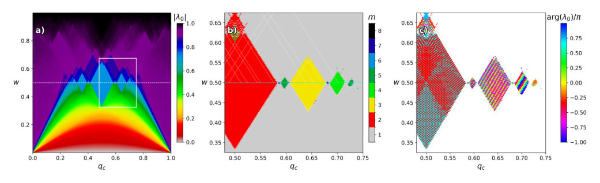
<figcaption class="paper-figure-caption"><b>Fig 1.</b> FIG. 1. Leading resonances over the plane of window centers and widths at n = 10 (N = 1024); the dashed line marks w = 1/2. (a) Modulus |λ0|: all diamonds share |λ0| ≃2−1/2, except the cones of the fixed point q = 0 near the edges (|λ0| ≃0.9–0.95); between these cones and below the diamonds no orbit survives and |λ0| decreases to zero with w, and positive-entropy repellers, with |λ0| approaching 1, appear only for w &gt; 1/2; the rectangle marks the region shown in (b) and (c). (b) Multiplet size m, with the border-collision lines of Eq. (3) (white). (c) Phase arg(λ0)/π where m &gt; 1: inside each diamond arg λ0 takes one of the T values (ΦO + 2πk)/T of Eq. (4), hence the checkerboard pattern.</figcaption>
</figure>
<figure class="paper-figure-card">
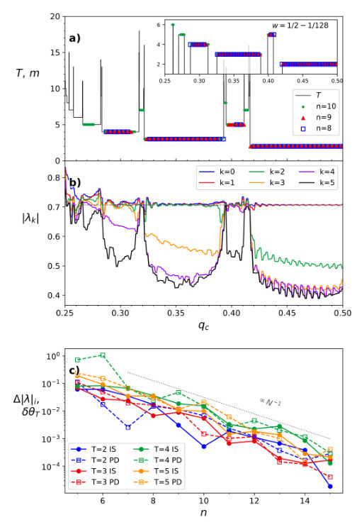
<figcaption class="paper-figure-caption"><b>Fig 2.</b> FIG. 2. Period locking at w = 1/2 for 1/4 ≤qc ≤1/2 (for qc &lt; 1/4 the fixed point survives, and qc →1 −qc is an exact symmetry). (a) Classical period T (black) and multiplet size m for n = 8, 9, 10; inset: w = 1/2 −1/128. (b) Moduli of the six leading eigenvalues at n = 10: on each plateau the multiplet sits at |λk| ≃2−1/2 (dashed line). (c) Intra-band spread ∆|λ|i (IS, full circles) and phase deviation δθT (PD, open squares) versus n, at qc = 0.50, 0.35, 0.30 and 25/62 inside the T = 2, . . . , 5 plateaus; dotted line: ∝N −1.</figcaption>
</figure>
<figure class="paper-figure-card">
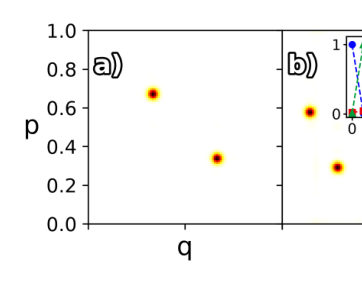
<figcaption class="paper-figure-caption"><b>Fig 3.</b> FIG. 3. Biorthogonal distribution P</figcaption>
</figure>
<figure class="paper-figure-card">
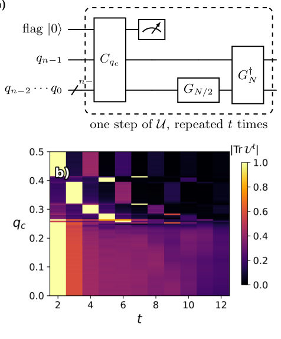
<figcaption class="paper-figure-caption"><b>Fig 4.</b> FIG. 4. (a) One step of U at w = 1/2: the comparator Cqc writes on a flag qubit whether the position register lies outside W(qc, 1/2), the flag is measured mid-circuit (runs are kept when it reads 0) and reset, and the closed map U = G† N(I ⊗GN/2) is applied; for qc = 1/4, Cqc is a CNOT from the most significant qubit qn−1. (b) Blind spectroscopy at n = 10: |Tr Ut| for t = 2, . . . , 12, normalized for each qc by its maximum, revives at multiples of the period and reconstructs the staircase of Fig. 2(a) without orbit information.</figcaption>
</figure>

**Summary.** This paper investigates the quantization of quantum resonances in the open quantum Baker Map, a model for chaotic open systems. It shows that the leading resonances form quantized multiplets whose properties are determined by the classical action of surviving periodic orbits. By realizing the open map as a mid-circuit measurement, the authors provide a pathway to experimentally test these quantization rules using quantum processors.

**Why it may be interesting.** This work bridges quantum chaos, semiclassical quantization, and open quantum dynamics, providing a concrete, measurable platform (mid-circuit measurement) to test fundamental quantization rules in non-Hamiltonian settings.

Detailed structure

**Main problem.** The study focuses on understanding the quantization of leading resonances and the behavior of quantum states in open quantum systems whose classical limit is chaotic, specifically using the open quantum Baker Map.

**Main result.** The leading resonances form quantized scar multiplets whose modulus saturates the topological-pressure bound at $2^{-1/2}$ when the system is opened via a mid-circuit measurement, leading to deterministic cycling cat states.

**Method.** The analysis combines semiclassical quantization techniques (relating eigenvalues to classical actions) with the modeling of open dynamics via projection onto a position window, which is realized as a mid-circuit measurement.

**Model / system.** The primary model is the open quantum Baker Map, a paradigmatic system for studying quantum chaos. The evolution is governed by a projected unitary operator $U = U \Pi_W$, where $\Pi_W$ restricts the dynamics to a position window $W(q_c, w)$.

**Key observables.** Leading resonances (eigenvalues $\lambda_k$), the modulus $|\lambda_0|$, the collective phase $\Phi_O$, and the cycling fidelity $F_j(t)$ of the resulting cat states.

**Important parameters / regimes.** The window width $w$ (especially the critical value $w=1/2$), the number of resonances $T$, and the classical action $\Phi_O$.

**Assumptions / limitations.** The analysis assumes that the opening mechanism effectively leaves a single surviving periodic orbit, allowing for the direct application of quantization rules.

**Figures summary.** Figures illustrate the leading resonances over the $(q_c, w)$ plane, showing modulus saturation at $w=1/2$, and demonstrate the detection of quantum plateaus and the decay of finite-N corrections.

**Paper structure.** The paper establishes the classical pruning geometry, derives the semiclassical quantization rule for the leading resonances forming scar multiplets, and then analyzes the resulting open dynamics, showing the formation of cycling cat states via mid-circuit measurement.

Abstract

We open the quantum baker map with a position window of width $w$ and center $q_c$. Classical pruning tiles the $(q_c,w)$ plane into diamonds where the $T$ leading resonances form root-of-unity multiplets. At $w=1/2$ one periodic orbit survives for almost every $q_c$, and the multiplets are quantized without free parameters: their modulus $2^{-1/2}$ saturates the pressure bound and their phase is the orbit action. They form cycling multicomponent cat states, and the opening becomes one mid-circuit measurement, enabling spectroscopy with $\sim10^2$ shots on quantum processors.

[↑ back to top](#top)

### [Discrete time crystals and classical logic gates in coupled open Dicke models](http://arxiv.org/abs/2610.23043v1)

**Authors:** Emmanuel D. G. U, Roy D. Jara, Jayson G. Cosme  
**Type:** theory · **Category:** quantum information and computing · **PDF:** <https://arxiv.org/pdf/2610.23043v1>  
**Analysis basis:** full PDF text, analyzed in chunks
**Topic relevance:** 🔥 `driven-dissipative phase transition` **4/5** · `Keldysh / 2PI / non-Gaussian methods` **3/5** · `analog quantum simulation` **3/5** · `methods for driven-dissipative` **3/5** · `correlated / nonlocal dissipation` **2/5** · `non-equilibrium universality` **2/5** · `Dicke superradiance` **1/5**

↔ Scroll figures horizontally

<figure class="paper-figure-card">
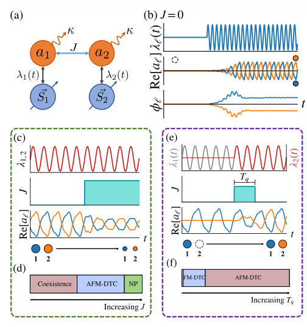
<figcaption class="paper-figure-caption"><b>Fig 1.</b> FIG. 1. (a) Sketch of the DD. (b) (Top panel) The light- matter coupling λi(t). (Middle panel) The real part of the bosonic field a(t) for the two symmetry broken DTC states of the Dicke model, represented by the blue (dark) and orange (light) circles. The hollow circles represents the NP. (Bottom panel) The absolute time phases for the DTC states. (c) and (e) (Top panel) The light-matter coupling λi(t) for each site. (Middle panel) The coupling strength J between two sites in the DLM. (Bottom panel) Exemplary dynamics for Re[aℓ] following the protocol shown in the panels above. The relative sizes of the circles represent the oscillation amplitude of the DTCs. Sketch of the phase diagram...</figcaption>
</figure>
<figure class="paper-figure-card">
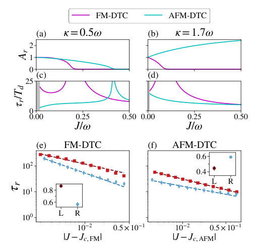
<figcaption class="paper-figure-caption"><b>Fig 2.</b> FIG. 2. (a), (b) DTC response amplitude, Ar, and (c), (d)relaxation time of the response amplitude, τr, after cou- pling the sites. (e), (f) Power law-scaling of τr for the FM-DTC and AFM-DTC near the critical points Jc,FM and Jc,AFM, respectively, for κ = 0.5ω. The square (di- amond) datapoints are taken from the right (left) side of Jc,FM/AFM. The inset plots show the critical exponents ob- tained from the power-law fit. The other parameters used are {ω0, ωd, A, N, λ0} = {ω, 0.8ω, 0.5, 107, 0.85λc}.</figcaption>
</figure>
<figure class="paper-figure-card">
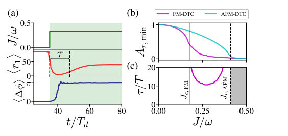
<figcaption class="paper-figure-caption"><b>Fig 3.</b> FIG. 4. (a) (Top panel) The coupling strength J between the two sites, (Middle panel) ⟨r1⟩, and (Bottom panel) ⟨∆ϕ⟩as functions of time. The green-shaded region indicates when the two sites are coupled with strength J = 0.33ω (b) Ar,min and (c) the lifetime τ of the FM-DTC as a function of J when N = 105. The other parameters used are {ω0, ωd, A, λ0 κ} = {ω, 0.8ω, 0.5, 0.85λc, 0.5ω}.</figcaption>
</figure>
<figure class="paper-figure-card">
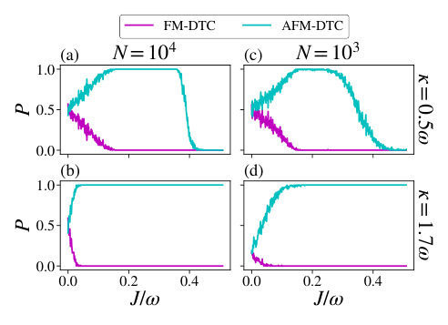
<figcaption class="paper-figure-caption"><b>Fig 4.</b> FIG. 3. The probability P of obtaining either an FM-DTC or AFM-DTC as the final steady state across 100 trajectories for (a), (c) κ = 0.5ω and (b), (d) κ = 1.7ω. Here, the two sites are connected for the entire duration of the simulation. We consider a system size of N = 104 for (a) and (b), while we set N = 103 for (c) and (d). The other parameters are {ω0, ωd, A, N, λ0} = {ω, 0.8ω, 0.5, 107, 0.85λc}.</figcaption>
</figure>
<figure class="paper-figure-card">
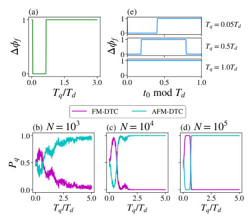
<figcaption class="paper-figure-caption"><b>Fig 5.</b> FIG. 5. (a) Mean-field phase difference ∆ϕf of the two sites at the final time as a function of Tq for the pulsed coupling. (b) - (d) The probability P of obtaining either an FM-DTC or an AFM-DTC when performing the protocol for (b) N = 103, (c) N = 104, and (d) N = 105. (e) Behavior of ∆ϕ when the synchronization / anti-synchronization protocol is performed at different times in the driving cycle for (Top panel) Tq = 0.05Td, (Middle panel) Tq = 0.5Td, and (Bottom panel) Tq = 1.0Td. The other parameters used are {ω0, ωd, A, N, λ0 κ} = {ω, 0.8ω, 0.5, 107, 0.85λc, 0.5ω}.</figcaption>
</figure>

**Summary.** This paper studies coupled Discrete Time Crystals (DTCs) in the Dicke model, analyzing their dynamics under coupling and dissipation. The authors show that DTCs can be manipulated to perform classical logic operations (NAND/NOR) by implementing a protocol of sequential pulsed coupling. This work suggests that engineered quantum many-body systems can serve as robust, physical building blocks for quantum information processing.

**Why it may be interesting.** This work bridges fundamental condensed matter physics (DTCs, open quantum systems) with quantum information processing, demonstrating a physical platform for quantum computation using non-equilibrium dynamics.

Detailed structure

**Main problem.** The paper investigates the dynamics of coupled Discrete Time Crystals (DTCs) and proposes using these physical systems to implement classical logic gates like NAND and NOR.

**Main result.** A protocol for implementing NAND and NOR gates is demonstrated using three coupled DTCs, showing that the logic operation is robust within specific parameter regimes.

**Method.** The dynamics are analyzed using mean-field simulations derived from the Lindblad master equation, supplemented by the Truncated Wigner Approximation (TWA) to account for quantum fluctuations.

**Model / system.** The system is based on the coupled Dicke model (or Dicke dimer) involving bosonic and spin operators, exhibiting DTC phases characterized by broken discrete time translation symmetry.

**Key observables.** DTC response amplitude ($A_r$), relaxation time ($	au_r$), final phase difference ($\Delta\phi_f$), and the probability of achieving a valid logic gate ($P_{	ext{Valid}}$).

**Important parameters / regimes.** Coupling strength ($J$), dissipation ($\kappa$), and pulse durations ($T_q$ or $T_{1O}$), relative to critical coupling strengths ($J_{c,FM}, J_{c,AFM}$).

**Assumptions / limitations.** The use of the Truncated Wigner Approximation (TWA) to map the master equation to effective stochastic equations, and the assumption that sequential pulsed coupling can reliably reset and operate the logic gates.

**Figures summary.** Figures illustrate the time evolution of amplitudes and phase differences during coupling, show power-law scaling of relaxation times near critical points, and map out the parameter space required for successful NAND/NOR gate operations.

**Paper structure.** The paper first analyzes the general dynamics of coupled DTCs, identifying phase transitions and the effect of coupling. It then details the use of pulsed coupling to control the final state (synchronization/anti-synchronization) and culminates in proposing and verifying the NAND/NOR logic gate architecture.

Abstract

We investigate the dynamics of coupled discrete time crystals (DTCs) in the coupled Dicke model or Dicke dimer (DD) with dissipation. By numerically simulating the mean-field dynamics of the system, we show that coupling two DTCs decreases their oscillation amplitude following a transient relaxation period. For sufficiently strong coupling, the coupled DTCs become unstable, resulting in the system relaxing towards the normal phase (NP). We demonstrate that the relaxation time diverges near the critical coupling strength, suggesting a continuous phase transition. Using the truncated Wigner approximation (TWA), we explore how the dynamics are affected by the introduction of quantum fluctuations. We also consider a scenario in which an NP is briefly coupled to a DTC, seeding the NP to transform into a DTC that is either synchronized or anti-synchronized relative to the DTC. We investigate the robustness of this phenomenon in the presence of noise. Using these results, we propose a scheme to perform NAND and NOR operations with three DTCs by sequentially coupling the input and output sites. We identify the parameter regimes in which the logic gate architecture remains valid, and investigate how the protocol is affected by the presence of quantum fluctuations.

[↑ back to top](#top)

### [From quantum emitters to technological platforms: a perspective on semiconductor quantum dots](http://arxiv.org/abs/2610.23106v1)

**Authors:** Klaus D. Jöns, Dorian A. Gangloff, Doris E. Reiter  
**Type:** both · **Category:** quantum information and computing · **PDF:** <https://arxiv.org/pdf/2610.23106v1>  
**Analysis basis:** full PDF text, analyzed in chunks
**Topic relevance:** 🔥 `quantum optics experiment` **4/5** · `QC/QI experiment` **3/5** · `Tavis-Cummings & cavity-many-emitter` **2/5** · `analog quantum simulation` **2/5** · `Keldysh / 2PI / non-Gaussian methods` **1/5** · `correlated / nonlocal dissipation` **1/5** · `driven-dissipative phase transition` **1/5** · `interference shaping light` **1/5** · `methods for driven-dissipative` **1/5** · `quantum measurements` **1/5**

↔ Scroll figures horizontally

<figure class="paper-figure-card">
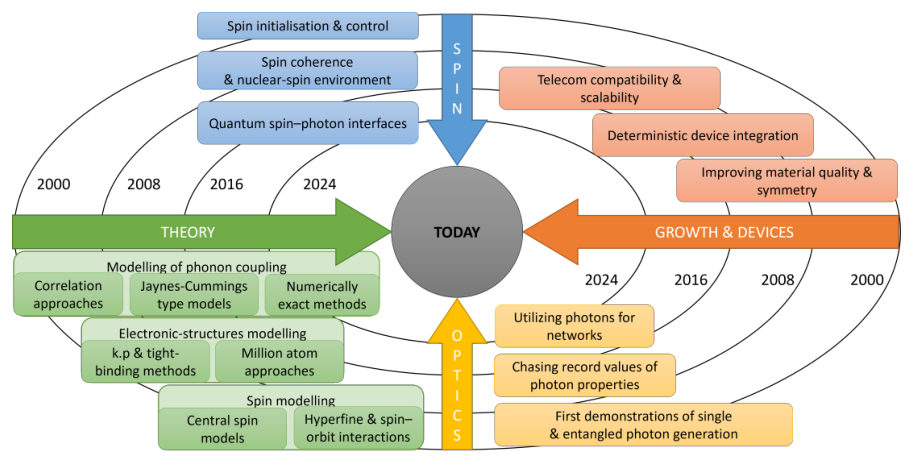
<figcaption class="paper-figure-caption"><b>Fig 1.</b> Figure 1: Illustration of the evolution of the research field of QDs from around 2000 to the present. The field has progressed along four main axes: optics, growth and devices, theory, and spin.</figcaption>
</figure>
<figure class="paper-figure-card">

<figcaption class="paper-figure-caption"><b>Fig 2.</b> Figure 2: Visualization of the feedback loop be- tween academia and industry. Fundamental experi- mental and theoretical research enables the development of quantum photonic devices, which are then translated into industrial technologies. Industrial constraints and requirements pose new questions to academia, forming a cycle of innovation.</figcaption>
</figure>
<figure class="paper-figure-card">
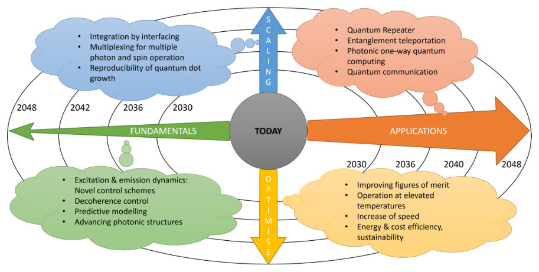
<figcaption class="paper-figure-caption"><b>Fig 3.</b> Figure 3: Illustration of the evolution of the research field of QDs towards the future. We envision along four lines: fundamentals, applications, scaling and optimization.</figcaption>
</figure>

**Summary.** This perspective reviews the maturation of semiconductor quantum dots as sources for quantum light, detailing the progress from initial single-photon demonstrations to complex entangled sources. It highlights the critical interplay between fundamental physics breakthroughs (spin control, coherence engineering) and engineering challenges (telecom compatibility, integration). The paper argues that the field is moving toward realizing fully integrated, scalable quantum photonic hardware.

**Why it may be interesting.** This is highly relevant as it bridges solid-state physics, open quantum systems (phonon coupling, decoherence), and quantum optics. The detailed discussion of Hamiltonian extensions (beyond simple Jaynes-Cummings) and the interplay between material science (growth) and quantum control is valuable.

Detailed structure

**Main problem.** The central challenge is developing robust, scalable, and high-fidelity sources of single and entangled photons from semiconductor quantum dots to power photonic quantum technologies.

**Main result.** The field has progressed from basic single-photon emission demonstrations to advanced control over spin and photon states, pushing towards deterministic, telecom-compatible, and integrated quantum devices.

**Method.** The review synthesizes decades of research, covering experimental advancements in QD growth and optical characterization alongside theoretical modeling of light-matter and spin dynamics.

**Model / system.** The primary system is the semiconductor quantum dot (QD) in III-V materials, which acts as a coherent light-matter interface. Theoretical models incorporate electron-phonon coupling, hyperfine interactions, and are evolving from simple Jaynes-Cummings models to complex polaron master equations.

**Key observables.** Single-photon emission rate, indistinguishability, entanglement fidelity, spin coherence time ($T_2^*$), and emission wavelength compatibility (O-band/C-band).

**Important parameters / regimes.** The key constraints involve achieving high determinism, low Fine-Structure Splitting (FSS), and maintaining coherence at telecom wavelengths.

**Assumptions / limitations.** The review implicitly assumes the successful integration of fundamental quantum control (spin/photon) with scalable semiconductor fabrication techniques.

**Figures summary.** Figure 1 illustrates the chronological evolution of QD research across optics, growth, theory, and spin. Other figures map the feedback loop between fundamental research and industrial application, and the future evolution along performance and scaling axes.

**Paper structure.** The paper follows a historical and thematic review, tracing the development of QDs across four axes (optics, growth, spin, theory) from the early 2000s to current multi-photon and networking concepts, concluding with future integration challenges.

Abstract

Photonic quantum technologies are based on controlled photon states. To generate these, quantum dots have emerged as excellent sources of single and entangled photons. In this Perspective, we briefly review the chronological development of quantum dots as photon sources, from their beginnings as quantum emitters in the early 2000s to the advanced photonic devices being developed today. We highlight the interplay between fundamental research and industrial aspects before discussing the photonic quantum technologies we expect to emerge in the near future.

[↑ back to top](#top)

### [Symmetry constraints on magnon-induced dynamics of skyrmion helicity in frustrated magnets](http://arxiv.org/abs/2610.23699v1)

**Authors:** Gabriel Mayor, Christina Psaroudaki  
**Type:** theory · **Category:** other · **PDF:** <https://arxiv.org/pdf/2610.23699v1>  
**Analysis basis:** full PDF text, analyzed in chunks
**Topic relevance:** 🔥 `Keldysh / 2PI / non-Gaussian methods` **4/5** · `analog quantum simulation` **3/5** · `correlated / nonlocal dissipation` **3/5** · `driven-dissipative phase transition` **2/5** · `methods for driven-dissipative` **2/5** · `Frenkel-Kontorova` **1/5** · `non-equilibrium universality` **1/5** · `quantum measurements` **1/5**

↔ Scroll figures horizontally

<figure class="paper-figure-card">
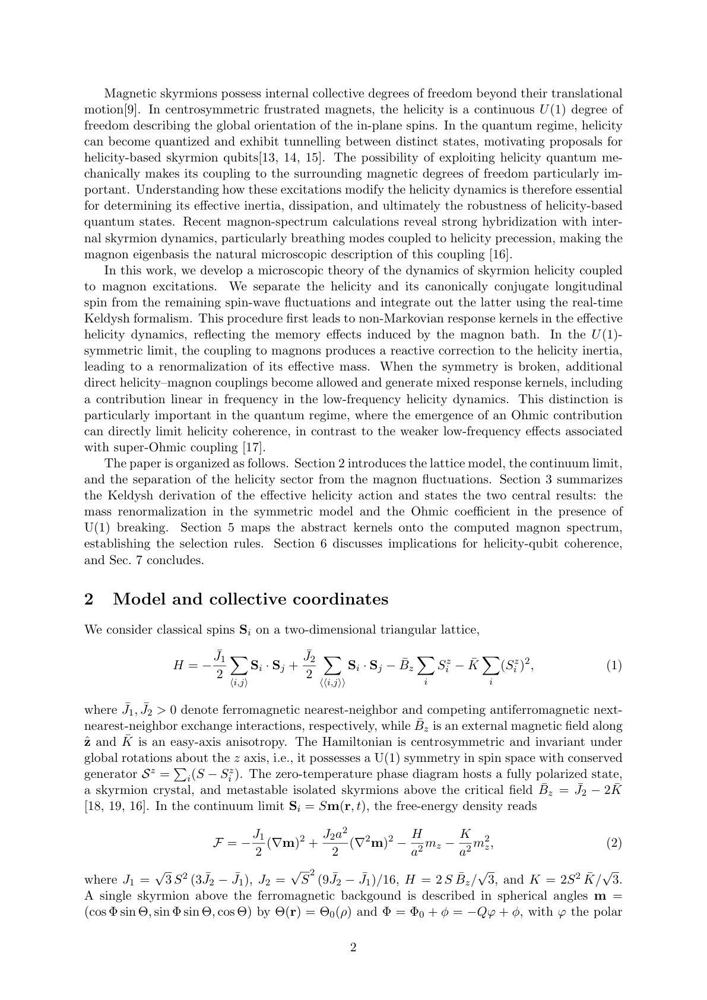
<figcaption class="paper-figure-caption"><b>Fig 1.</b> Low-resolution page preview, page 2</figcaption>
</figure>
<figure class="paper-figure-card">
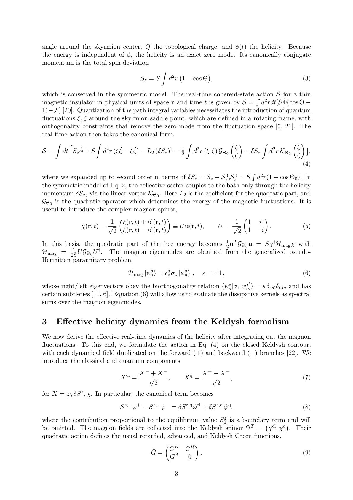
<figcaption class="paper-figure-caption"><b>Fig 2.</b> Low-resolution page preview, page 3</figcaption>
</figure>
<figure class="paper-figure-card">
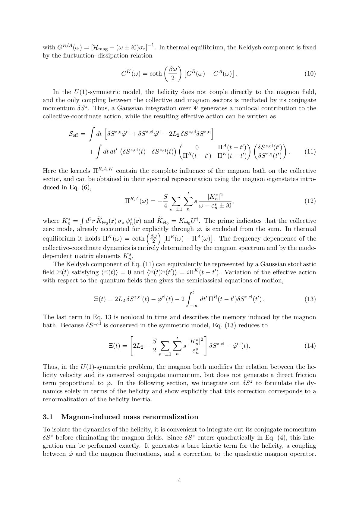
<figcaption class="paper-figure-caption"><b>Fig 3.</b> Low-resolution page preview, page 4</figcaption>
</figure>
<figure class="paper-figure-card">
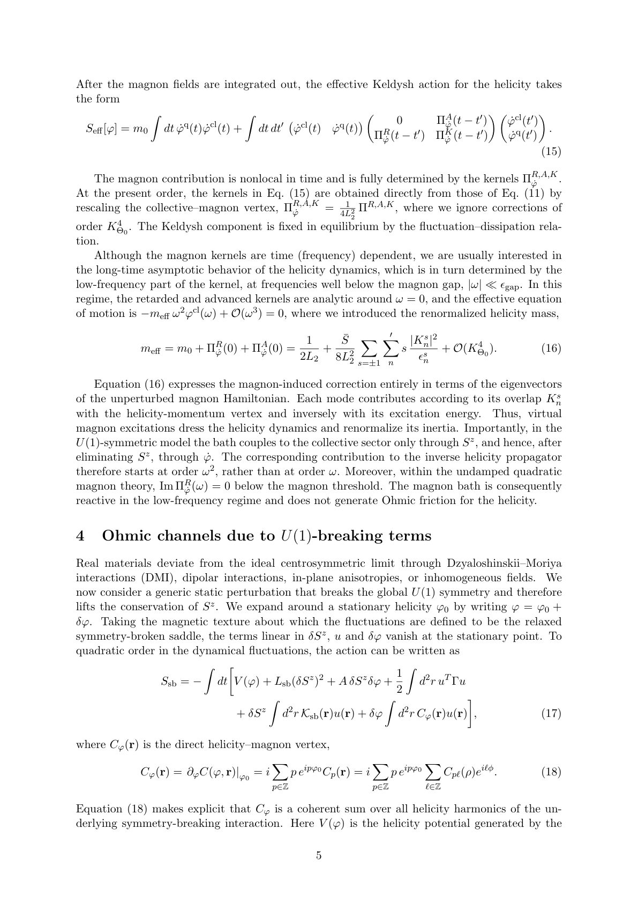
<figcaption class="paper-figure-caption"><b>Fig 4.</b> Low-resolution page preview, page 5</figcaption>
</figure>
<figure class="paper-figure-card">
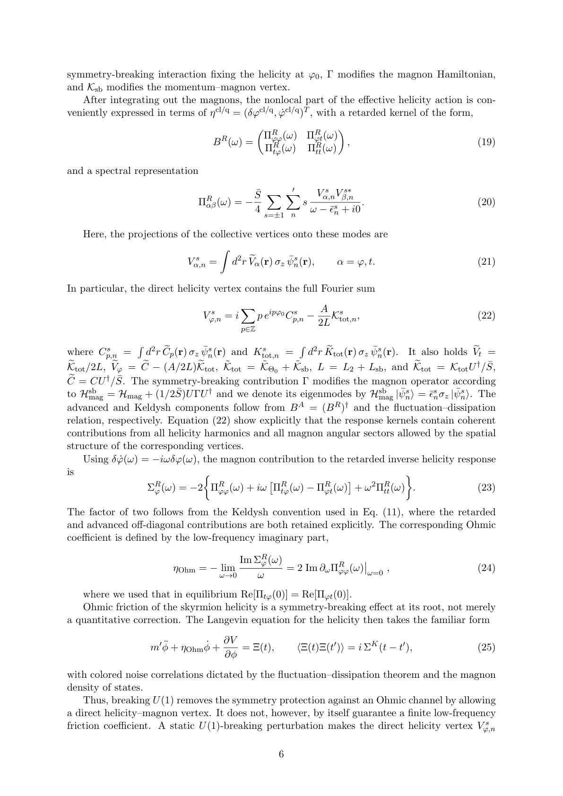
<figcaption class="paper-figure-caption"><b>Fig 5.</b> Low-resolution page preview, page 6</figcaption>
</figure>

**Summary.** This theoretical work develops a microscopic framework to calculate how magnon excitations damp the dynamics of a skyrmion's helicity in frustrated magnets. By using the Keldysh formalism, the authors show that dissipation requires both symmetry-breaking terms and finite magnon lifetimes. This establishes fundamental selection rules governing the decoherence of helicity-based quantum states.

**Why it may be interesting.** The work provides a detailed, microscopic understanding of how dissipation (damping) occurs in a quantum collective variable (helicity) due to coupling to a bosonic bath (magnons), which is crucial for designing robust quantum memory elements.

Detailed structure

**Main problem.** The paper addresses how the coherence of a magnetic skyrmion's helicity, treated as a collective coordinate, is influenced by its coupling to the surrounding magnon environment in frustrated magnets.

**Main result.** Dissipation of helicity requires both a symmetry-breaking perturbation (to generate coupling vertices) and finite magnon lifetimes (to provide the necessary spectral weight for Ohmic friction).

**Method.** The authors employ a microscopic Keldysh formalism to integrate out the magnon fluctuations, deriving an effective action for the helicity coordinate.

**Model / system.** The system is a magnetic skyrmion in a frustrated magnet, modeled on a 2D triangular lattice with exchange and anisotropy interactions. The dynamics are analyzed by treating the helicity ($\phi$) as a soft collective coordinate coupled to the magnon bath.

**Key observables.** Ohmic friction coefficient ($\eta_{Ohm}$), renormalized helicity mass ($m_{eff}$), and mode-resolved selection rules for magnon coupling.

**Important parameters / regimes.** The $U(1)$ symmetry breaking strength, magnon linewidth ($\Gamma_n$), and the specific symmetry of the perturbation (e.g., DMI vs. in-plane field).

**Assumptions / limitations.** The analysis relies on a weak-perturbation expansion and the use of the real-time Keldysh formalism to treat the coupling to the magnon bath.

**Figures summary.** Not specified.

**Paper structure.** The paper progresses from establishing the Hamiltonian and continuum description to deriving the effective action via Keldysh techniques. It then analyzes the $U(1)$-symmetric limit (reactive renormalization) before introducing symmetry-breaking terms and finite magnon lifetimes to derive the dissipation mechanism.

Abstract

The helicity of a magnetic skyrmion in a centrosymmetric frustrated magnet is a soft collective coordinate and a candidate variable for encoding quantum information. Its coherence is ultimately influenced by coupling to the magnon environment, which is commonly incorporated only phenomenologically. Here we combine a microscopic Keldysh treatment of the helicity--magnon coupling to resolve the contribution of individual magnon modes to the effective helicity dynamics. In the U(1)-symmetric model, the magnon bath generates, to leading order, a reactive helicity mass renormalization. When U(1) symmetry is broken, additional direct helicity--magnon couplings become allowed. In the presence of finite magnon lifetimes, these couplings generate an Ohmic contribution to the low-frequency helicity dynamics. The spatial symmetry of the perturbation determines which magnon sectors contribute to this damping, providing mode-resolved selection rules for the helicity--magnon coupling. Thus, we establish a microscopic connection between helicity dynamics and the excitation spectrum of frustrated skyrmions and identify the symmetry constraints governing dissipation of helicity-based quantum states.

[↑ back to top](#top)

### [Exploring Quantum Phase Transitions Beyond Landau Theory on a Quantum Processor](http://arxiv.org/abs/2610.22482v1)

**Authors:** Ruizhe Shen, Yin Zhong, Ching Hua Lee  
**Type:** both · **Category:** statistical mechanics · **PDF:** <https://arxiv.org/pdf/2610.22482v1>  
**Analysis basis:** full PDF text, analyzed in chunks
**Topic relevance:** 🔥 `analog quantum simulation` **4/5** · `QC/QI experiment` **3/5** · `methods for driven-dissipative` **3/5** · `driven-dissipative phase transition` **2/5** · `non-equilibrium universality` **2/5** · `quantum measurements` **1/5**

↔ Scroll figures horizontally

<figure class="paper-figure-card">
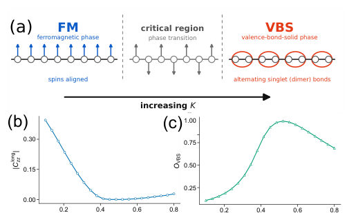
<figcaption class="paper-figure-caption"><b>Fig 1.</b> FIG. 1. Ferromagnetic-to-VBS transition analogous to a deconfined phase transition. (a) Schematic illustra- tion of the frustration-driven quantum phase transition ob- tained by increasing K for Jz &gt; Jx. At small K, the system is in a ferromagnetic (FM) phase characterized by long-range spin alignment. At large K, frustration favors alternating strong bonds, giving rise to a valence-bond-solid (VBS) phase with spontaneously broken lattice translation symmetry. (b) Absolute value of the long-distance ferromagnetic correlator |Clong zz | [Eq. 2] as a function of K. Its rapid suppression near Kc signals the destruction of ferromagnetic order. (c) VBS order parameter OVBS [Eq. 3] as a function...</figcaption>
</figure>
<figure class="paper-figure-card">
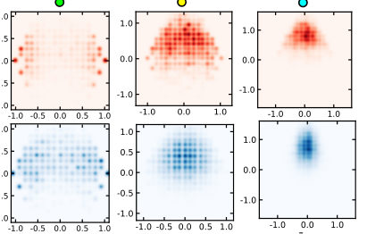
<figcaption class="paper-figure-caption"><b>Fig 2.</b> FIG. 3. Quantum hardware measurement of the fer- romagnetic correlator across the FM–VBS transition. (a) Bulk spin correlator Czz(i = L/2, j = L/2 + L/4) = ⟨σz L/2σz 3L/4⟩as a function of the frustration strength K. Black circles denote DMRG results, and orange triangles de- note IBM quantum-hardware measurements. The correla- tor remains finite in the small-K ferromagnetic regime and is rapidly suppressed as K approaches the transition region near Kc ≈0.4, signaling the loss of long-range ferromagnetic order. (b) Joint probability distributions of the competing order parameters ( ¯OzFM, ¯O′ VBS) obtained from DMRG and IBM Quantum data at the marked values of K. In the FM regime, the weight...</figcaption>
</figure>
<figure class="paper-figure-card">
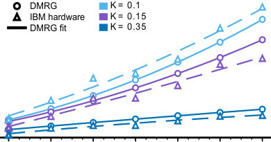
<figcaption class="paper-figure-caption"><b>Fig 3.</b> FIG. 4. Measurements of distance-resolved corre- lations and a finite-size correlation length on quan- tum hardware. (a) Ferromagnetic correlator Czz(r) = ⟨ZL/2ZL/2+r⟩for L = 32 at selected K. Open circles and tri- angles show DMRG and IBM hardware results, respectively. Solid curves are fits to the DMRG data. (b) Second-moment correlation length ξ2nd [Eq. 8] versus system size L for selected K, with the same marker and line conventions. At K = 0.35, ξ2nd increases approximately linearly with L, ξ2nd ∝L. Here, Jz = 1.0 and Jx = 0.8.</figcaption>
</figure>
<figure class="paper-figure-card">
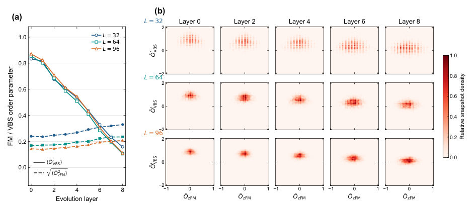
<figcaption class="paper-figure-caption"><b>Fig 4.</b> FIG. 5. Floquet-engineered evolution of competing FM and VBS correlations on quantum hardware. (a) Evolution of the mean VBS snapshot estimator ⟨¯O′ VBS⟩(solid lines) and FM fluctuation amplitude p</figcaption>
</figure>

**Summary.** This work explores quantum phase transitions between competing magnetic orders (FM and VBS) that defy conventional Landau theory. By utilizing superconducting quantum processors, the authors simulate the transition dynamics, confirming the suppression of long-range FM order and the emergence of VBS correlations. This establishes a versatile quantum-hardware platform for probing complex critical phenomena.

**Why it may be interesting.** The combination of simulating unconventional QPTs (like deconfined criticality) on near-term quantum hardware provides a crucial testbed for many-body physics beyond standard theoretical models.

Detailed structure

**Main problem.** The paper investigates continuous quantum phase transitions (QPTs) that challenge the Landau-Ginzburg-Wilson paradigm, specifically focusing on direct transitions between phases with distinct symmetries.

**Main result.** The authors successfully demonstrated the signatures of a direct continuous Ferromagnetic-to-Valence-Bond-Solid (FM-VBS) transition using both theoretical simulations and superconducting quantum hardware measurements.

**Method.** The study combines theoretical tools like DMRG with quantum hardware protocols, employing tensor-network-assisted circuit preparation to simulate ground states and non-equilibrium dynamics.

**Model / system.** The system is a frustrated one-dimensional spin-1/2 XZ chain governed by a Hamiltonian involving nearest and next-nearest-neighbor couplings, studied across a frustration strength K.

**Key observables.** Long-distance ferromagnetic correlators ($C_{	ext{long}}^{zz}$), staggered VBS order parameter ($O_{	ext{VBS}}$), and the second-moment correlation length ($\xi_{2	ext{nd}}$).

**Important parameters / regimes.** The frustration strength K, with critical regimes identified near $K_c \approx 0.4$.

**Assumptions / limitations.** The quantum hardware simulation relies on approximating DMRG states via parameterized quantum circuits and uses finite-size scaling analysis to infer critical behavior.

**Figures summary.** Figures illustrate the suppression of FM correlations and growth of VBS order across the transition (Fig. 1), and compare hardware measurements of correlators and joint probability distributions against DMRG results (Fig. 3).

**Paper structure.** The paper progresses from establishing the theoretical framework of Landau-forbidden transitions, to detailing the quantum hardware protocol for state preparation, and finally presenting results on both equilibrium critical signatures and non-equilibrium dynamics.

Abstract

Direct continuous quantum phase transitions between phases that break distinct symmetries challenge the conventional Landau-Ginzburg-Wilson paradigm and provide a framework for deconfined quantum criticality. Here, we investigate a Landau-forbidden ferromagnetic-to-valence-bond-solid (FM-VBS) transition in a frustrated one-dimensional spin chain using superconducting quantum processors. Combining matrix-product-state-assisted circuit preparation with quantum-hardware measurements, we resolve the suppression of long-range ferromagnetic correlations and the redistribution of competing-order fluctuations across the transition. Distance-resolved correlations and finite-size analyses reveal signatures consistent with critical behavior. We further extend our investigation to nonequilibrium dynamics, directly preparing dimerized states and tracking the evolution of VBS order and joint FM-VBS fluctuations under local unitary interactions. Our results establish a versatile quantum-hardware framework for probing competing orders, critical correlations, and many-body dynamics beyond conventional Landau theory.

[↑ back to top](#top)

### [Resonant pair production and flat band melting in a driven Rydberg chain](http://arxiv.org/abs/2610.22532v1)

**Authors:** Tista Banerjee, K. Sengupta  
**Type:** theory · **Category:** other · **PDF:** <https://arxiv.org/pdf/2610.22532v1>  
**Analysis basis:** full PDF text, analyzed in chunks
**Topic relevance:** 🔥 `Rydberg arrays` **4/5** · 🔥 `analog quantum simulation` **4/5** · `Keldysh / 2PI / non-Gaussian methods` **2/5** · `methods for driven-dissipative` **2/5** · `driven-dissipative phase transition` **1/5** · `non-equilibrium universality` **1/5**

↔ Scroll figures horizontally

<figure class="paper-figure-card">
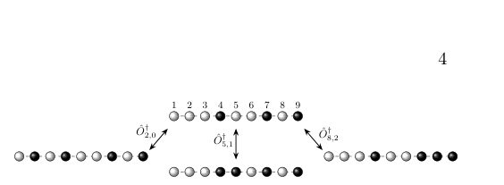
<figcaption class="paper-figure-caption"><b>Fig 1.</b> FIG. 1. Schematic depiction of ˆO† j,a on a representative Fock state for L = 8. Here j is the site index and a counts the change in the number of near-neighbor Rydberg excited pairs after the action of ˆO† j,a.</figcaption>
</figure>
<figure class="paper-figure-card">
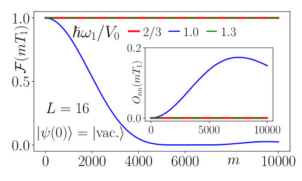
<figcaption class="paper-figure-caption"><b>Fig 2.</b> FIG. 2. Main: Plot of F(mT1) as a function of m starting from |vac⟩for the cosine wave drive protocol with ℏω1/V0 = 2/3 (red), 1 (blue) and 1.3 (green). Inset: pair correlation function Onn(mT1) as a function of m for same parameters. This illustrates the decay of fidelity due to resonant pair pro- duction at V0 = ℏω1 in line with the FPT prediction. For all plots V0/Ω1 = 10, L = 16, and ∆1/Ω1 = 1. See text for details.</figcaption>
</figure>
<figure class="paper-figure-card">
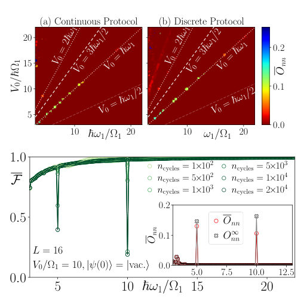
<figcaption class="paper-figure-caption"><b>Fig 3.</b> FIG. 3. Top: Onn as a function of V0/Ω1 and ℏω1/Ω1 for |vac⟩ initial state with (a) the cosine wave drive protocol and (b) square wave drive protocol. The dashed/dotted lines along V0 = ℏω1/2, ℏω1, 3ℏω1/2 and 2ℏω1 are drawn as guide to the eye. For these plots we have taken L = 12. (c) Plot of F averaged over initial ncycle number of cycles (ncycles = 102 − 2 × 104) as a function of ℏω1/Ω1. The inset shows plot of Onn averaged over 2×104 cycles and its infinite-time average value O∞ nn for cosine wave protocol as a function of ℏω1/Ω1. For all panels ∆1/Ω1 = 1 and ν = 3.</figcaption>
</figure>
<figure class="paper-figure-card">
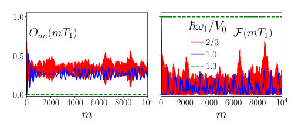
<figcaption class="paper-figure-caption"><b>Fig 4.</b> FIG. 4. (a) Stroboscopic time-evolution of (a) ⟨Onn⟩and (b) F for the cosine wave drive protocol for ℏω1/V0 = 2/3 (red), 1 (blue) and 1.3 (green) for the |Z2⟩initial state. For all plots V0/Ω1 = 10 and L = 16. See text for details.</figcaption>
</figure>
<figure class="paper-figure-card">
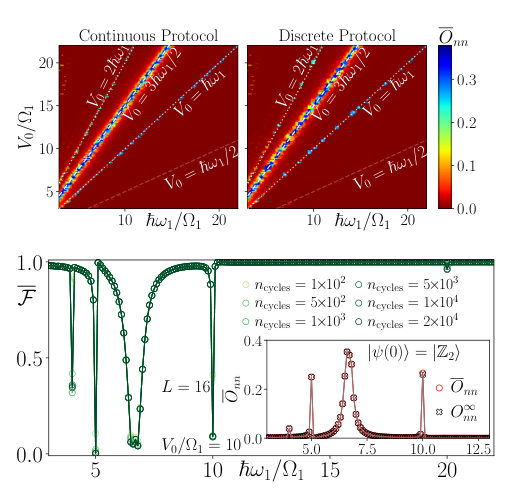
<figcaption class="paper-figure-caption"><b>Fig 5.</b> FIG. 5. Top: Plot of Onn as a function of V0/Ω1 and ℏω1/Ω1 for |Z2⟩initial state with (a) cosine wave drive pro- tocol and (b) square pulse protocol. The dashed lines V0 = ℏω1/2, ℏω1, 3ℏω1/2, 2ℏω1 are drawn as guide to the eye. For these plots we have chosen L = 12. Bottom: Plot of F aver- aged over ncycles = 102−2×104 cycles as a function of ℏω1/Ω1. The inset shows plot of Onn (averaged over 2 × 104 cycles) and O∞ nn for cosine wave protocol. For all plots, ∆1/Ω1 = 1, V0/Ω1 = 10, and ν = 3.</figcaption>
</figure>

**Summary.** This paper theoretically investigates how an exact Floquet flat band in a driven Rydberg chain breaks down due to resonant pair production. Using advanced techniques like Floquet perturbation theory, the authors identify two distinct melting mechanisms—resonant and virtual—and show that the stability is highly dependent on the initial excitation state. The findings suggest measurable signatures, such as pair correlation functions, that can be probed using current Rydberg quantum simulator platforms.

**Why it may be interesting.** This work directly addresses non-equilibrium dynamics in highly interacting quantum systems (Rydberg arrays), which is a major frontier in AMO physics. The identification of specific resonance mechanisms and the proposal of pair correlation measurements provide concrete, testable predictions for quantum simulators.

Detailed structure

**Main problem.** The study investigates the resonant pair production and the subsequent melting of exact Floquet flat bands in a periodically driven Rydberg chain.

**Main result.** Flat band melting occurs via two mechanisms: many-body resonances involving pair production, and virtual processes accessing intermediate states. The stability of the system depends strongly on the initial state, with $|Z_3\rangle$ showing melting via virtual processes.

**Method.** The analysis employs time-dependent Schrieffer-Wolff transformations and Floquet perturbation theory (FPT) to analyze the effective Hamiltonian and its corrections.

**Model / system.** The system is a 1D array of Rydberg atoms subjected to a two-tone periodic drive modulating the detuning and Rabi frequency. The model Hamiltonian includes nearest-neighbor interactions ($V_0$) and drive terms, which are analyzed beyond the leading-order PXP approximation.

**Key observables.** Nearest-neighbor pair correlation functions, flat band melting, quasi-energies, and entanglement entropy.

**Important parameters / regimes.** The drive frequencies ($\omega_1, \omega_2$), the blockade strength ($V_0$), and the initial Fock states ($|vac\rangle, |Z_2\rangle, |Z_3\rangle$).

**Assumptions / limitations.** The analysis relies on perturbative approaches (FPT) and assumes the PXP description is only accurate in the leading order, requiring inclusion of blockade-violating processes.

**Paper structure.** The paper first establishes the model and the PXP limit, then uses SW transformation to derive the effective Hamiltonian. It proceeds by applying FPT to identify and characterize the two distinct mechanisms causing flat band melting, analyzing these mechanisms for different initial states.

Abstract

We study a Rydberg chain subjected to a two-tone periodic drive of the detuning $Δ(t)$ and Rabi frequency $Ω(t)$ at frequencies $ω_1$ and $ω_2=νω_1$ respectively with $ν\in \mathbf{Z}$. In the strong Rydberg blockade limit, such a system reduces to the PXP model and exhibits exact Floquet flat band. Here we determine, using a time-dependent Schrieffer-Wolff transformation, the domain of validity of such PXP dynamics once the blockade-violating processes are taken into account. We study the melting of such flat bands in the presence of strong, but finite, blockade strength. Using Floquet perturbation theory (FPT), we identify two mechanisms for such melting; the first occurs due to the presence of many-body resonances involving resonant production of nearest-neighbor Rydberg excitation pairs while the second involves virtual processes that access intermediate states with such pairs. Our analytical FPT results match with those obtained using exact diagonalization on a finite chain. We study the dynamics for $|{\rm vac}\rangle$ (Fock state with no Rydberg excitation), $|{\mathbb {Z}}_2\rangle$, and $|{\mathbb {Z}}_3\rangle$ (Fock states with Rydberg excitations on alternate and every third site respectively) initial states. We find that $|{\rm vac}\rangle$ shows exceptional stability against resonant pair formation while $|{\mathbb {Z}}_3\rangle$ exhibits flat band melting via virtual processes away from the direct resonances. We find oscillatory dynamics with large time period for the $|{\mathbb {Z}}_2\rangle$ initial state and the presence of Floquet scars that have large overlap with $|{\mathbb {Z}}_3\rangle$ state; these phenomena occur due to processes that are absent in the PXP limit. We propose measurement of nearest neighbor pair correlation functions using Rydberg atom quantum simulator platforms as an accessible experimental probe for these effects.

[↑ back to top](#top)

### [Nonequilibrium Dynamical Quantum Phase Transitions in the Extended Agassi Model](http://arxiv.org/abs/2610.23096v1)

**Authors:** Ritesh Kumar Palai, Rajiv Kumar, Venktesh Singh, Sunil K. Mishra  
**Type:** theory · **Category:** statistical mechanics · **PDF:** <https://arxiv.org/pdf/2610.23096v1>  
**Analysis basis:** full PDF text, analyzed in chunks
**Topic relevance:** 🔥 `non-equilibrium universality` **4/5** · `driven-dissipative phase transition` **3/5** · `Keldysh / 2PI / non-Gaussian methods` **2/5** · `analog quantum simulation` **2/5** · `methods for driven-dissipative` **2/5**

↔ Scroll figures horizontally

<figure class="paper-figure-card">
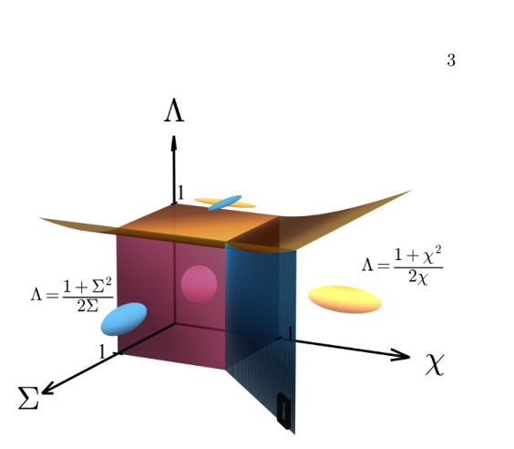
<figcaption class="paper-figure-caption"><b>Fig 1.</b> Figure 1. Phase diagram of the extended Agassi model. Second-order quantum phase transitions occur on the deep magenta vertical planes. First-order critical surfaces are in- dicated by the vibrant orange curved boundary, defined as Λ = 1 for χ &lt; 1 and Σ &lt; 1, Λ = (1 + χ2)/(2χ) for χ &gt; Σ, and Λ = (1 + Σ2)/(2Σ) for χ &lt; Σ, and by the deep cyan-blue vertical surface χ = Σ with Λ &lt; (1 + Σ2)/(2Σ). The sym- bols denote the symmetric (magenta sphere), HF deformed (orange oval), BCS deformed (blue oval), closed valley (black square outline), and combined HF-BCS deformed (crossed or- ange and cyan-blue ovals) phases Ref.[26].</figcaption>
</figure>
<figure class="paper-figure-card">
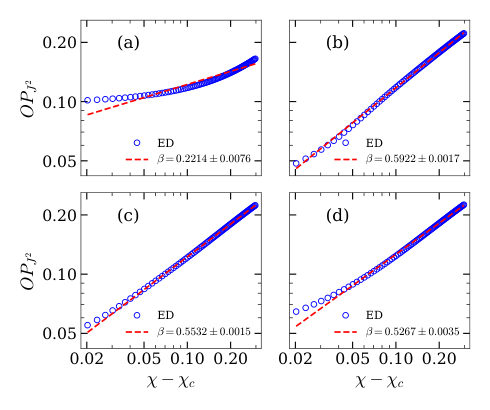
<figcaption class="paper-figure-caption"><b>Fig 2.</b> Figure 2. Scaling analysis of the equilibrium order parame- ter OPJ2 for the χ-driven transition in the extended Agassi model (The J2 refer to mathematical symmetry of coupling in mono-monopole term in Hamiltonian). Open circles denote exact-diagonalization (ED) results and dashed lines represent fits to OPJ2 ∝(χ−χc)β. Panels (a)–(d) correspond to j = 8, 100, 150, and 300, respectively. The critical couplings χc ap- proach the thermodynamic critical value χc = 1, while the extracted critical exponents converge toward the mean-field value β = 1/2. These results identify the symmetric-to-HF transition as a continuous quantum phase transition belong- ing to the mean-field universality class.</figcaption>
</figure>
<figure class="paper-figure-card">
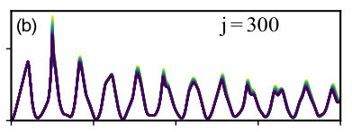
<figcaption class="paper-figure-caption"><b>Fig 3.</b> Figure 3. Loschmidt dynamics in the extended Agassi model following a sudden Σ quench for j = 300. (a) Loschmidt echo L(t) and (b) return-rate function λ(t) for a quench from Hi(Σi, χi, Λi) = H(0.5, 0.5, 0.0) to (Σf ∈[1.0, 2.0], χf = 1.5, Λf = 0.5). The quench crosses the equilibrium HF–BCS phase boundary at Σeq c = 1.5. A pronounced signature of a DQPT appears at Σf = 1.0.</figcaption>
</figure>
<figure class="paper-figure-card">
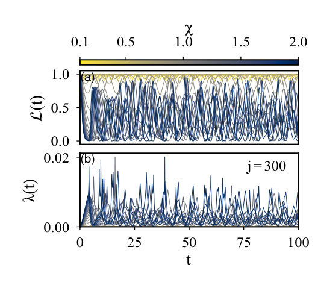
<figcaption class="paper-figure-caption"><b>Fig 4.</b> Figure 4. Loschmidt dynamics in the extended Agassi model following a sudden χ quench for j = 300. (a) Loschmidt echo L(t) and (b) return-rate function λ(t) for an initial state prepared at Hi = H(Σi, χi, Λi) = (0.5, 0.5, 0.0) and evolved under a final Hamiltonian with Σf = 0.5 and Λf = 0, while varying χf ∈[0.5, 2.5]. The quench trajectory crosses the equilibrium symmetric–HF phase boundary at χeq c = 1. The strongest signature of DQPT occurs at χf = 1.367.</figcaption>
</figure>
<figure class="paper-figure-card">
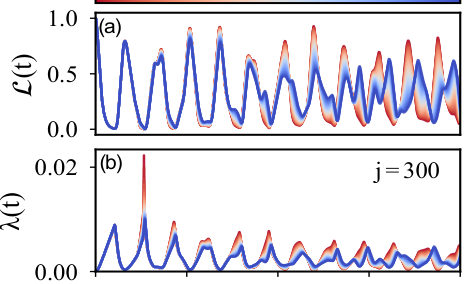
<figcaption class="paper-figure-caption"><b>Fig 5.</b> Figure 5. Loschmidt dynamics in the extended Agassi model following a sudden Λ quench for j = 300. (a) Loschmidt echo L(t) and (b) return-rate function λ(t) for an initial state pre- pared at Hi(Σi, χi, Λi) = H(0.5, 0.5, 0.0) and evolved under a final Hamiltonian with (Σf, χf) = (2.0, 1.5) while varying Λf ∈[1.0, 1.5]. The quench trajectory crosses the equilibrium first-order BCS–HF–BCS phase boundary at Λeq c = 1.25. The strongest signature of DQPT occurs at Λf = 1.0.</figcaption>
</figure>

**Summary.** This research explores Dynamical Quantum Phase Transitions (DQPTs) in the extended Agassi model by analyzing the time evolution after sudden parameter quenches. Using the Loschmidt echo and return-rate function, the authors distinguish between first-order and second-order-like DQPTs based on the non-analytic behavior of these observables. The findings reveal that the dynamical critical behavior is complex and depends distinctly on the specific pairing interaction being quenched.

**Why it may be interesting.** This work provides a detailed, quantitative comparison between equilibrium and non-equilibrium critical phenomena in a solvable many-body model, which is highly relevant for understanding quench dynamics in quantum many-body systems.

Detailed structure

**Main problem.** The paper investigates Nonequilibrium Dynamical Quantum Phase Transitions (DQPTs) in the extended Agassi model following sudden quenches across equilibrium phase boundaries.

**Main result.** The study finds that the order of the DQPT (first-order vs. second-order-like) depends on the specific pairing strength quenched ($\Sigma, \chi, \Lambda$), demonstrating that dynamical criticality is not solely determined by the equilibrium transition order.

**Method.** The dynamics are characterized using the Loschmidt echo and the intensive return-rate function, analyzed via exact diagonalization and finite-size scaling techniques.

**Model / system.** The system is the extended Agassi model, describing N fermions in two energy levels, whose Hamiltonian incorporates tunable pairing strengths: same-level ($\Sigma$), monopole-monopole ($\chi$), and cross-level ($\Lambda$).

**Key observables.** Loschmidt echo, intensive return-rate function, dynamical critical exponents ($\alpha$), and equilibrium critical exponents ($eta$).

**Important parameters / regimes.** The quench parameters ($\Sigma, \chi, \Lambda$) and the system size ($j$), which is analyzed using finite-size scaling.

**Assumptions / limitations.** The analysis relies on interpreting non-analyticities in the return rate's derivatives to determine the order of the transition, with results being noted as indicative pending full thermodynamic limit analysis.

**Figures summary.** Figures illustrate the time evolution of the first and second derivatives of the return rate function ($\mathrm{d}\lambda/\mathrm{d}t$ and $\mathrm{d}^2\lambda/\mathrm{d}t^2$) for the three different quench protocols ($\Sigma, \chi, \Lambda$) across various finite system sizes ($j=8, 100, 150$).

**Paper structure.** The paper progresses from establishing the equilibrium phase diagram and critical exponents ($eta$) to characterizing non-equilibrium dynamics using the Loschmidt echo and return-rate function for the three quench types, culminating in the extraction of distinct dynamical scaling exponents ($\alpha$).

Abstract

We investigate dynamical quantum phase transitions (DQPTs) in the extended Agassi model following sudden quenches of same level pairing ($Σ$), monopole-monopole ($χ$) and cross level pairing ($Λ$) strengths. Using exact diagonalization, we characterize the non-equilibrium dynamics through the Loschmidt echo and intensive return-rate function. Quenches across equilibrium phase boundaries produce cusp-like structures in the return rate that shows non-analyticities with increasing system size. Equilibrium finite size to large scaling identifies the $χ$-driven transition as a second order phase transition similar to mean-field, Dicke, and Lipkin-Meshkov-Glick (LMG) models critical behaviour with the exponent of the order parameter $β\simeq 1/2$, while the $Σ$- and $Λ$-driven transitions are first order. We further characterize the associated dynamical singularities through a local scaling exponent $α$, with $α_χ\simeq 2/3$, $α_Λ\simeq 1/3$, and $α_Σ\simeq 3/2$ of all three parameters. The distinct scaling behaviours across the parameter channels show that dynamical criticality is not determined solely by the equilibrium order of the transition, revealing multiple dynamical scaling regimes. These non-analyticities are associated with the Fisher zeros of the Loschmidt amplitude, which cross the real time axis at critical times and the time derivatives of the return-rate function to characterize the order of DQPTs within the extended Agassi model.

[↑ back to top](#top)

### [Programmable Preparation of Topological Entangled States](http://arxiv.org/abs/2610.22738v1)

**Authors:** M. Javad Zakeri, Alaric Pan, Darren D Hudson, Andrea Blanco-Redondo  
**Type:** experiment · **Category:** quantum information and computing · **PDF:** <https://arxiv.org/pdf/2610.22738v1>  
**Analysis basis:** full PDF text, analyzed in chunks
**Topic relevance:** 🔥 `quantum optics experiment` **4/5** · `QC/QI experiment` **3/5** · `analog quantum simulation` **3/5** · `interference shaping light` **3/5**

↔ Scroll figures horizontally

<figure class="paper-figure-card">
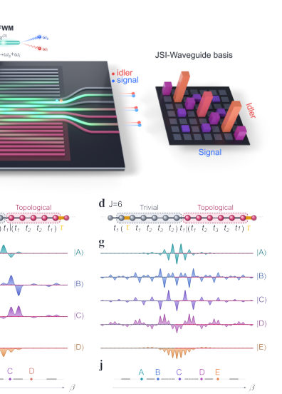
<figcaption class="paper-figure-caption"><b>Fig 1.</b> Fig. 1. Programmable silicon topological superlattice for high-dimensional biphoton generation. a, Schematic of the silicon photonic platform. Five pro- grammable pump inputs address the central interface region, seven output waveguides collect the generated signal–idler correlations. Independent amplitude and phase con- trol of the pump inputs prepares coherent excitations of the localized interface-mode manifold. Through SFWM, the programmed pump selects the nonlinear pathways that populate the output biphoton state. b–d, Coupling sequences of the J = 4 −6 super- lattices, respectively, formed by joining domains with distinct hopping patterns leading to distinct topologies. e–g,...</figcaption>
</figure>
<figure class="paper-figure-card">
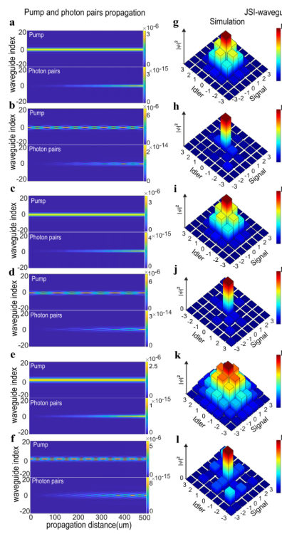
<figcaption class="paper-figure-caption"><b>Fig 2.</b> Fig. 2. Selective topological mode excitation. a,b, Pump and photon-pair prop- agation simulations in the J = 4 lattice for excitation profiles matching topological pump mode |C⟩and a coherent superposition |A⟩+|C⟩, respectively. c,d, Same in the J = 5 lattice with excitations matching topological pump mode |D⟩and |A⟩+ |D⟩, respectively. e,f, Same in the J = 6 lattice with excitations matching |E⟩and |A⟩+|E⟩, respectively. g–l, Simulated and measured output JSI in the waveguide basis −shown in the seven central waveguides, indexed from −3 to +3 with waveguide 0 at the center of the topological transition −for the six pump configurations in a–f. The simulations show the normalized intensity...</figcaption>
</figure>
<figure class="paper-figure-card">
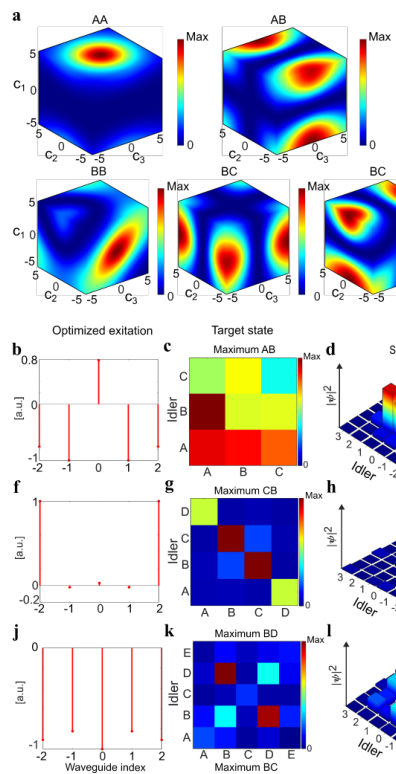
<figcaption class="paper-figure-caption"><b>Fig 3.</b> Fig. 3. Optimization-driven routing of biphoton correlations in topological- mode space. a, Pump-coefficient control landscape of the J = 4 lattice. Biphoton eigenmode populations of signal–idler blocks versus the coefficients (c1, c2, c3) of the coherent superposition of the three topological modes at fixed total power. b, Opti- mized pump excitation required to achieve a target quantum state with a local maximum probability at the off-diagonal block AB.c, Output BEP for such target quantum state at the output of the J = 4. d,e Simulated and measured output quan- tum states on the waveguide basis. f-i, j-m Same as b-e for the target quantum states shown in e and i sampling a variety of...</figcaption>
</figure>
<figure class="paper-figure-card">
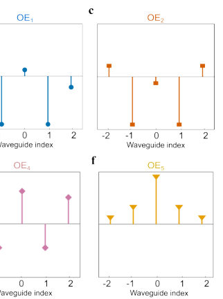
<figcaption class="paper-figure-caption"><b>Fig 4.</b> Fig. 4. Optimized excitation profiles for a targeted quantum state dimensionality (Ktarget = 5). a, Inverse-designed pump-control vectors c = (c1, c2, c3, c4, c5) of the J = 6 superlattice for the five solutions A–E with Ktarget = 5. b–f, Corresponding normalized launch profiles; colors as in a.</figcaption>
</figure>
<figure class="paper-figure-card">
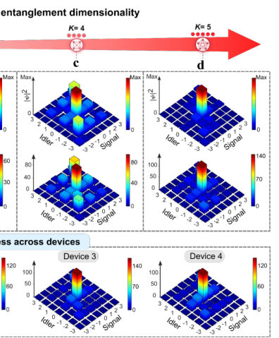
<figcaption class="paper-figure-caption"><b>Fig 5.</b> Fig. 5. Inverse-designed generation of high-dimensional topological bipho- ton entanglement. Spatially entangled signal–idler photon pairs are generated by spontaneous four-wave mixing in silicon topological superlattices. For each superlattice order J, the input pump is prepared as a coherent superposition of localized inter- face modes whose amplitudes are inverse-designed to synthesize a prescribed Schmidt number Ktarget. Coincidences are measured between the seven central output waveg- uides, indexed from −3 to +3, using superconducting-nanowire single-photon detectors over a 360 s integration time. a–d, Simulated and measured joint signal–idler inten- sity distributions for J = 6,...</figcaption>
</figure>

**Summary.** This paper demonstrates a method to programmatically generate high-dimensional topological entangled states using silicon photonic superlattices. By inverse-engineering the nonlinear pump profile, the researchers achieve deterministic control over the entanglement's dimensionality and modal structure. This work establishes a robust, scalable pathway for using topological photonics as a tailored quantum resource.

**Why it may be interesting.** This work provides a concrete, hardware-implementable platform for generating high-dimensional entangled states, directly addressing a key resource requirement for quantum communication and computation.

Detailed structure

**Main problem.** The central challenge is achieving programmable preparation of topological entangled quantum states, which is vital for scalable quantum information processing and quantum networking.

**Main result.** The authors demonstrated deterministic control over the dimensionality and modal structure of generated entangled states by inverse-engineering the nonlinear optical pump profile in silicon photonic superlattices.

**Method.** They used nonlinear optics (SFWM) in a topologically protected lattice, controlling the pump field via coherent superpositions of localized topological modes to steer the resulting biphoton correlations.

**Model / system.** The physical system is a silicon photonic topological superlattice hosting a multiband manifold of co-localized topological interface modes. The process is modeled by coupled evolution equations governing the pump and the biphoton state.

**Key observables.** Biphoton correlation maps (Joint Spatial Intensities), Schmidt number (K), and state fidelity.

**Important parameters / regimes.** Lattice index (J=4, 5, 6), target Schmidt dimensionality (K_target), and disorder strength.

**Assumptions / limitations.** The nonlinear process depends critically on the pump field squared, and the analysis relies on the ability to measure joint spatial intensity correlations.

**Figures summary.** Figures illustrate the programmable lattice structure and coupling sequences, while supplementary figures show how different pump inputs can yield the same target Schmidt number but populate distinct correlation patterns.

**Paper structure.** The paper establishes the need for programmability, details the physical platform and theoretical framework (including governing equations), demonstrates the control mechanism via pump shaping, and concludes by showing the robustness and systematic scaling of the achievable entanglement dimensionality.

Abstract

Programmable preparation of entangled quantum states is a central requirement for scalable quantum information processing, quantum networking and photonic quantum computing. Topological photonic platforms offer an attractive route towards robust quantum-state generation by encoding information in symmetry- protected optical modes, yet the generated entangled states are typically dictated by the lattice geometry and therefore lack programmability. Here we demonstrate programmable preparation of topological entangled states by inverse engineering the nonlinear optical pump profile of an integrated photonic lattice. Our approach enables deterministic control over both the dimensionality and modal structure of the generated entangled state while preserving its topological character. We experimentally realize silicon photonic topological superlattices in which the nonlinear generation pathway itself becomes programmable via tailored excitations. The superlattices host a multiband manifold of co localized topological interface modes, while coherently controlled inputs synthesize pump superpositions within this protected basis. We showcase this principle by selectively addressing topological biphoton eigenstates, steering correlations to produce a desired target state in a high-dimensional Hilbert space, and inverse-designing pump states that generate targeted Schmidt dimensionalities. Site-resolved two-photon correlation measurements remain reproducible across nominally identical fabricated devices, demonstrating robustness to realistic nanofabrication-induced disorder. Programmable preparation of topological entangled states establishes a pathway towards exploiting topological photonic modes as application-specific quantum resources, enabling tailored input states for high-dimensional quantum communication, quantum networking and photonic quantum computing.

[↑ back to top](#top)

### [A Fibre-Integrated SPDC Heralded Single-Photon Source Using Zn-Indiffused PPLN Ridge Waveguides at Telecom Wavelengths](http://arxiv.org/abs/2610.23499v1)

**Authors:** Peter Iveson, Paolo L. Mennea, Goronwy Tawy, Rex H. S. Bannerman, Noe Palomar-Davidson, Greg Blanchard-Emmerson, Patrick M. Ledingham, Peter G. R. Smith, James C. Gates, Corin B. E. Gawith  
**Type:** experiment · **Category:** quantum information and computing · **PDF:** <https://arxiv.org/pdf/2610.23499v1>  
**Analysis basis:** full PDF text, analyzed in chunks
**Topic relevance:** 🔥 `quantum optics experiment` **4/5** · `QC/QI experiment` **3/5** · `interference shaping light` **3/5**

↔ Scroll figures horizontally

<figure class="paper-figure-card">
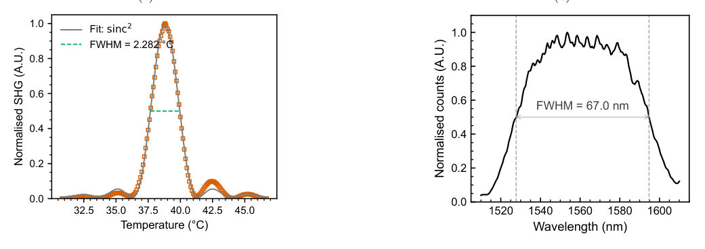
<figcaption class="paper-figure-caption"><b>Fig 1.</b> FIG. 2: SHG characterisation and SPDC spectral response. (a) SHG temperature acceptance. Fit yields T0 = 38.81 ◦C, FWHMT = 2.282 ◦C. Markers, data; orange curve, sinc2 fit; green dashed line, FWHM indication. (b) SPDC degenerate spectrum measured at T = 38.37 ◦C.</figcaption>
</figure>
<figure class="paper-figure-card">
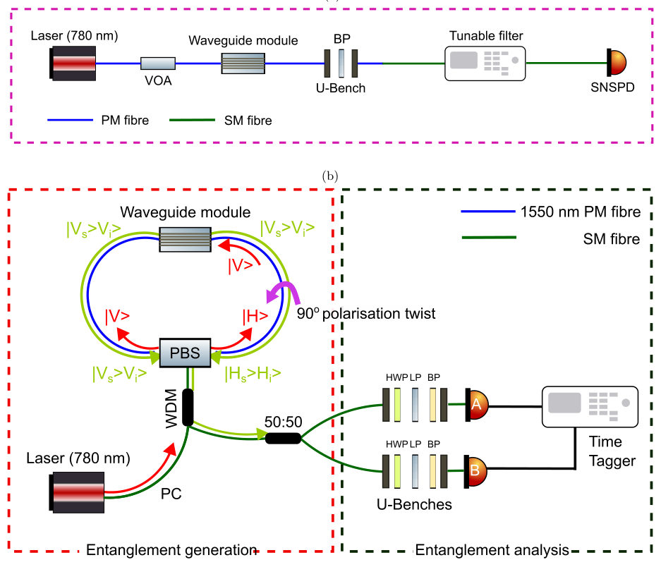
<figcaption class="paper-figure-caption"><b>Fig 2.</b> FIG. 3: Overview of the SPDC configurations. (a) Spectral characterisation with a tunable filter. (b) Experimental setup for polarisation entanglement in a Sagnac configuration using commercial components throughout. PM: polarisation-maintaining. SM: single-mode, PBS: fibre polarising beam splitter, VOA: variable optical attenuator, PC: Fibred polarisation controllers, WDM: Wavelength-division-multiplexer, BP: 1100 nm Longpass filter (broadband entanglement) / 1560 ± 6 nm Bandpass filter (narrowband entanglement). A: Alice, B:Bob SNSPD channels.</figcaption>
</figure>
<figure class="paper-figure-card">
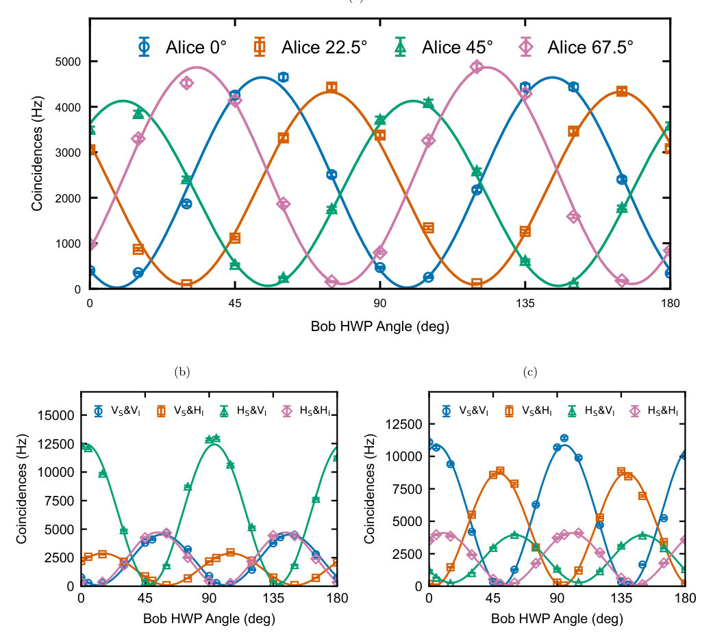
<figcaption class="paper-figure-caption"><b>Fig 3.</b> FIG. 4: Coincidence counts: (a) the Alice photon is projected in a linear polarisation basis and the Bob photon HWP angle is scanned. LP is set to H (90◦) for all measurements. (b) Visibility curves for Alice set to 0◦. (c) Visibility curves for Alice set to 45◦. Markers show the measured coincidence counts and the solid line gives the sinusoidal fit. Peaks are phase-shifted relative to the canonical |Φ+⟩expectation. Error bars assume Poissonian statistics. Legends in (b) and (c) show LP settings. LP: Linear polariser.</figcaption>
</figure>
<figure class="paper-figure-card">
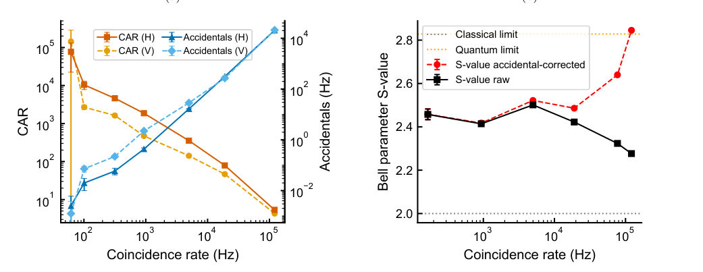
<figcaption class="paper-figure-caption"><b>Fig 4.</b> FIG. 5: Dependence of entanglement metrics on raw coincidence rate for broadband operation. (a) Measured CAR values and accidental coincidence rates in the H and V polarisation bases as a function of raw coincidence rate. (b) Raw and accidental-corrected CHSH Bell parameter as a function of raw coincidence rate. Error bars correspond to one standard deviation obtained from propagated counting statistics.</figcaption>
</figure>
<figure class="paper-figure-card">
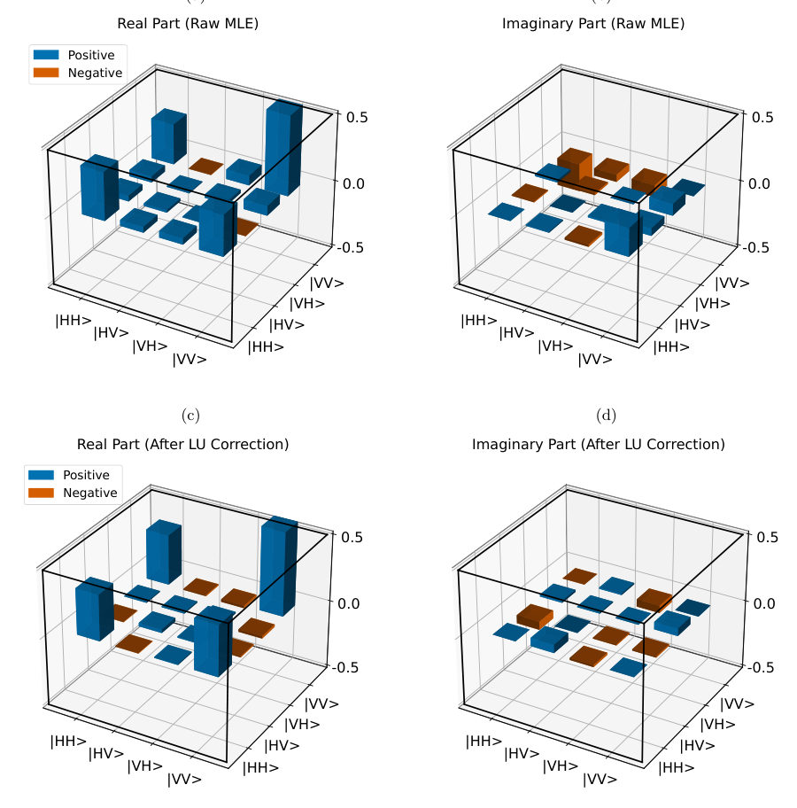
<figcaption class="paper-figure-caption"><b>Fig 5.</b> FIG. 6: Reconstructed density matrices. (a) Real and (b) imaginary components of the raw density matrix yielding a fidelity of 78.1% to the ideal |Φ+⟩Bell state. (c) Real and (d) imaginary components of the optimised density matrix, improving the fidelity to 85.6%.</figcaption>
</figure>

**Summary.** The authors report the creation of a fully fibre-integrated source for broadband, polarisation-entangled photon pairs using a PPLN waveguide. They demonstrated strong non-classical correlations by measuring a high CHSH parameter (S > 2) and high interference visibility. This development is significant because it achieves high entanglement quality across a broad spectral range suitable for long-distance quantum communication.

**Why it may be interesting.** This work provides a robust, scalable, and integrated platform for generating entangled photons at telecom wavelengths, which is crucial for practical quantum communication networks and quantum key distribution.

Detailed structure

**Main problem.** The goal was to develop a fully fibre-integrated source of broadband polarisation-entangled photon pairs operating at telecom wavelengths.

**Main result.** The source successfully generated high-quality entangled pairs, evidenced by a measured CHSH parameter of S = 2.501 and a high two-photon interference visibility of 96.9%.

**Method.** The experiment utilized Spontaneous Parametric Down-Conversion (SPDC) within a Zn-indiffused PPLN ridge waveguide integrated into a Sagnac interferometer.

**Model / system.** The physical system is a fibre-integrated Type-0 SPDC source using a Zn-indiffused MgO:PPLN ridge waveguide within a Sagnac interferometer setup. This platform allows for broadband operation across the full degenerate SPDC spectrum.

**Key observables.** Two-photon interference visibility (96.9% $\pm$ 0.2%), CHSH Bell parameter (S = 2.501 $\pm$ 0.005), and broadband spectral bandwidth ($\sim 67$ nm FWHM).

**Important parameters / regimes.** Telecom wavelengths, Type-0 SPDC process, and the violation of the classical Bell limit ($S>2$).

**Assumptions / limitations.** The analysis must account for the limitations of accidental-corrected metrics at high source brightness, as these can inflate the Bell parameter beyond theoretical bounds.

**Figures summary.** Figures illustrate the fibre-pigtailed waveguide module, the spectral response of the degenerate SPDC process, and the experimental setup for polarization entanglement using the Sagnac configuration.

**Paper structure.** The paper details the characterization of the waveguide (SHG), the measurement of the broadband SPDC spectrum, and the subsequent quantification of entanglement quality using two-photon interference visibility, CHSH inequality violation, and state tomography.

Abstract

We demonstrate a fully fibre-integrated source of broadband polarisation-entangled photon pairs at telecom wavelengths based on a commercially available Zn-indiffused MgO:PPLN ridge waveguide incorporated within a Sagnac interferometer. Operating across the full degenerate SPDC spectrum using pump-suppression filtering only, the source exhibits a measured bandwidth of approximately 67 nm. Strong non-classical correlations are observed, with an average two-photon interference visibility of 96.9 +/- 0.2 %, a fidelity to the Phi + Bell state of 78.1 %, and a CHSH Bell parameter of S = 2.501 +/- 0.005. We further explore the effect of increasing source brightness on Bell-state performance, revealing the limitations of accidental-corrected metrics in high-flux operating regimes.

[↑ back to top](#top)

### [Experimental Demonstration of a Balanced Travelling Wave Parametric Amplifier](http://arxiv.org/abs/2610.23810v1)

**Authors:** Nikita Klimovich, Peter K. Day, Henry G. Leduc, Boon-Kok Tan  
**Type:** experiment · **Category:** other · **PDF:** <https://arxiv.org/pdf/2610.23810v1>  
**Analysis basis:** full PDF text, analyzed in chunks
**Topic relevance:** 🔥 `interference shaping light` **4/5** · `quantum optics experiment` **3/5** · `driven-dissipative phase transition` **1/5**

↔ Scroll figures horizontally

<figure class="paper-figure-card">
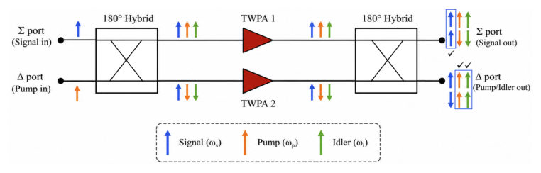
<figcaption class="paper-figure-caption"><b>Fig 1.</b> Figure 1. A schematic diagram showing a 3WM balanced TWPA configuration consisting of two identical TWPAs placed between two 180◦hybrids. Arrows indicate the phases of the signal, pump, and idler tones at various stages of the amplifier to demonstrate how the constructive and destructive interference in the two output ports results in signal, pump, and idler separation.</figcaption>
</figure>
<figure class="paper-figure-card">
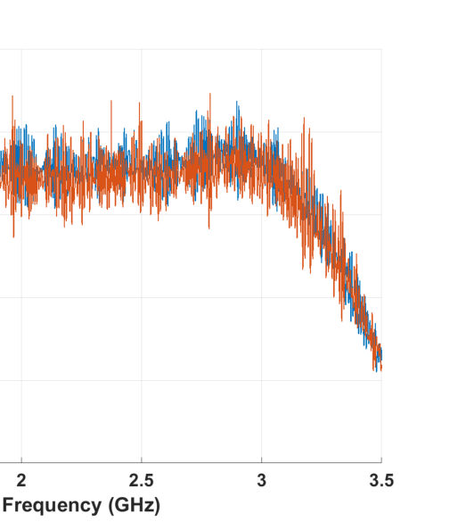
<figcaption class="paper-figure-caption"><b>Fig 2.</b> Figure 2. Individual gain profiles of the two TWPAs when supplied with an identical 4.75 GHz pump and 0.40 mA DC current.</figcaption>
</figure>
<figure class="paper-figure-card">
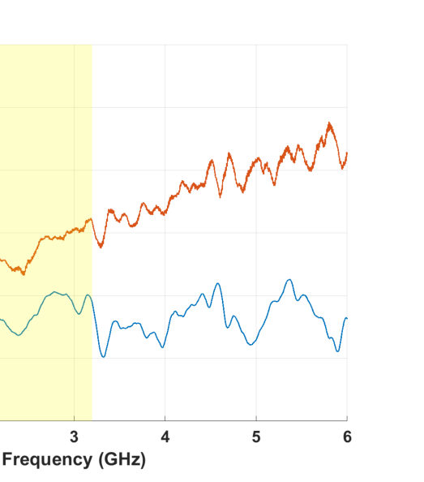
<figcaption class="paper-figure-caption"><b>Fig 3.</b> Figure 3. Experimentally measured signal leakage of the balanced TWPA configuration from Figure 1 without the TWPAs (blue) and with the TWPAs (red). The highlighted region represents the potential operating range of our balanced architecture.</figcaption>
</figure>
<figure class="paper-figure-card">
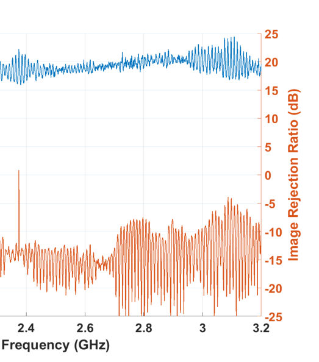
<figcaption class="paper-figure-caption"><b>Fig 4.</b> Figure 4. Gain (blue) and signal/idler rejection (red) for a balanced TWPA when optimizing for maximal idler rejection: 4.75 GHz pump and 0.88 mA DC current. Note that since the current is now split between the two TWPAs, the supplied current to the balanced configuration is roughly double the level used by each individual TWPA as shown in Figure 2.</figcaption>
</figure>
<figure class="paper-figure-card">
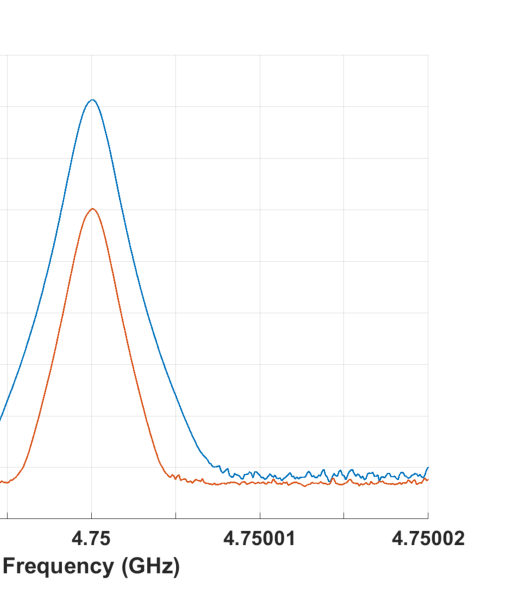
<figcaption class="paper-figure-caption"><b>Fig 5.</b> Figure 5. Pump tones measured using a spectrum analyser from the Δ output port (blue, the pump+idler port) and the Σ output port (red, the signal port) showing a pump rejection ratio, 𝑅𝑝= −21.37 dB.</figcaption>
</figure>

**Summary.** The paper presents an experimental demonstration of a balanced travelling-wave parametric amplifier (TWPA) designed to overcome spectral ambiguity. By using a specific two-amplifier, hybrid-coupled architecture, the setup successfully separates the amplified signal from unwanted pump and idler tones. This results in a broadband amplifier with high gain and excellent rejection ratios, making it ideal for complex quantum signal processing applications.

**Why it may be interesting.** This work is highly relevant to quantum optics and open quantum systems as it presents a robust, high-bandwidth platform for parametric amplification, which is crucial for quantum signal processing and quantum measurement.

Detailed structure

**Main problem.** Superconducting travelling-wave parametric amplifiers (TWPAs) suffer from spectral ambiguity due to idler tone generation at image frequencies, limiting their useful bandwidth.

**Main result.** The authors experimentally demonstrated a balanced architecture that doubles the usable bandwidth by spatially separating the amplified signal from the pump and idler tones.

**Method.** The technique involves connecting two TWPAs via $180^{\circ}$ hybrid couplers to achieve constructive signal interference at one output port and destructive interference for pump/idler at the other.

**Model / system.** The system uses superconducting kinetic-inductance TWPAs operating via three-wave-mixing (3WM) in a balanced configuration. This architecture is designed to resolve sideband degeneracy inherent in standard TWPAs.

**Key observables.** Signal gain ($\approx 20$ dB), pump rejection ($< -20$ dB), and average image rejection ($\approx -15$ dB) over nearly an octave bandwidth.

**Important parameters / regimes.** The operating bandwidth is nearly an octave (e.g., 1.8–3.2 GHz); the performance is limited by fabrication imbalance ($\epsilon$).

**Assumptions / limitations.** The analysis relies on the undepleted-pump approximation and the ability of the hybrid couplers to achieve precise $180^{\circ}$ phase shifts.

**Figures summary.** Figures illustrate the schematic of the balanced TWPA, the gain profiles, and the measured rejection ratios for the pump and idler tones, confirming spectral separation.

**Paper structure.** The paper introduces the problem of spectral ambiguity in TWPAs, details the balanced architecture using two TWPAs and hybrids, presents the theoretical separation mechanism, and concludes with experimental measurements demonstrating high gain and rejection ratios.

Abstract

Superconducting travelling-wave parametric amplifiers (TWPAs) provide broadband gain, low added noise, and high dynamic range, making them attractive for applications requiring wide instantaneous bandwidth. This is crucial for amplifying multiplexed narrow band signals spread over a wide frequency range, such as qubit resonator arrays, or amplifying inherently wide band signals, such as in spectrometers or radiometers. In many cases, however, the useful bandwidth of a TWPA is limited by the production of the idler tone at an image frequency. For three-wave-mixing (3WM) TWPAs, for example, an input signal at $f_s$ is indistinguishable from one at $f_p - f_s$, which can produce spectral ambiguity when the input spectrum is broadband or not known in advance. We experimentally demonstrate a balanced architecture that doubles the instantaneous image-rejected bandwidth available to a 3WM TWPA by spatially separating the amplified signal from the output pump and generated idler, which resolves the sideband degeneracy. The architecture consists of two amplifiers connected between a pair of 180$^{\circ}$ hybrid couplers, with the signal and pump injected and output through the sum and difference ports, respectively. Using two kinetic-inductance TWPAs, we demonstrate approximately 20 dB of signal gain across nearly an octave of bandwidth, together with pump rejection below --20 dB and an average image rejection of approximately --15 dB over the operating band. These results establish balanced TWPAs as a practical approach to broadband parametric amplification, enabling improved contamination free bandwidth and eliminating the need for complex filtering.

[↑ back to top](#top)

### [Quantum-Classical Neural Networks for Solving Lindblad Master Equations](http://arxiv.org/abs/2610.22691v1)

**Authors:** Rafael Florencio Díaz, Julio Guerrero García, Elvira Romera Gutiérrez  
**Type:** theory · **Category:** other · **PDF:** <https://arxiv.org/pdf/2610.22691v1>  
**Analysis basis:** full PDF text, analyzed in chunks
**Topic relevance:** 🔥 `methods for driven-dissipative` **4/5** · `Keldysh / 2PI / non-Gaussian methods` **1/5** · `correlated / nonlocal dissipation` **1/5** · `driven-dissipative phase transition` **1/5** · `quantum measurements` **1/5**

↔ Scroll figures horizontally

<figure class="paper-figure-card">
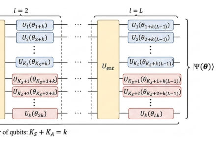
<figcaption class="paper-figure-caption"><b>Fig 1.</b> Fig. 1 Schematic representation of the quantum neural network (the case nrgq = 1 is shown for simplicity)</figcaption>
</figure>
<figure class="paper-figure-card">
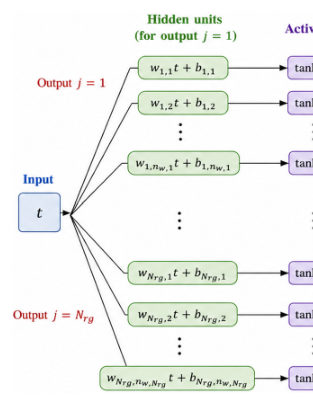
<figcaption class="paper-figure-caption"><b>Fig 2.</b> Fig. 2 Classical neural network schematic.</figcaption>
</figure>
<figure class="paper-figure-card">
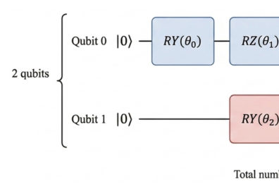
<figcaption class="paper-figure-caption"><b>Fig 3.</b> Fig. 3 Quantum neural network scheme of the two-qubit architecture used in the simulation.</figcaption>
</figure>
<figure class="paper-figure-card">
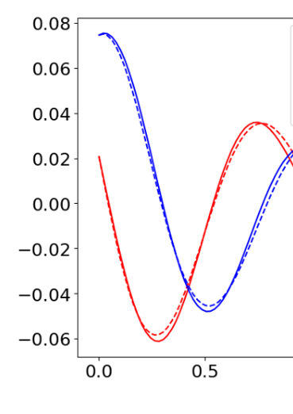
<figcaption class="paper-figure-caption"><b>Fig 4.</b> Fig. 4 Comparison between the expected values ⟨σx⟩and ⟨σy⟩as functions of time t, obtained from the analytic solution and from the proposed model in Figure 3 at the final iteration for nw = 34. Numerical results are those produced by the proposed model.</figcaption>
</figure>
<figure class="paper-figure-card">
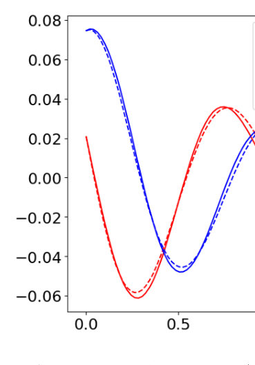
<figcaption class="paper-figure-caption"><b>Fig 5.</b> Figure 5 shows a comparison between the values of the cost function given in (38), as a function of the number of iterations of the gradient descent method, obtained using nw = 34, nw = 64, and nw = 124. The learning rate was fixed to η = 0.05. We observe that a greater reduction in the cost function values is achieved as nw increases, particularly from approximately 500 iterations onward. This result indicates that it is not necessary to increase the number of qubits to capture the damped oscillator behaviour of ⟨σx⟩and ⟨σy⟩; it is sufficient to increase the number of classical parameters nw.</figcaption>
</figure>

**Summary.** This paper introduces a novel Quantum-Classical Neural Network framework to solve the Lindblad master equation for open quantum systems. By combining a parameterized quantum circuit with a classical neural network, it creates a powerful variational model. The authors prove that this hybrid structure enhances expressivity and provides a practical method to overcome the barren plateau problem in quantum simulation.

**Why it may be interesting.** This work provides a concrete, theoretically grounded machine learning tool for simulating complex open quantum dynamics, directly addressing the limitations of purely quantum variational algorithms in this domain.

Detailed structure

**Main problem.** The paper addresses the challenge of simulating the time evolution of open quantum systems governed by the Lindblad master equation, which is computationally intractable due to the exponential scaling of the density matrix.

**Main result.** The proposed hybrid Quantum-Classical Neural Network (QNN-CNN) framework successfully simulates dissipative dynamics while theoretically demonstrating that classical parametrization enlarges the model's expressivity and mitigates the barren plateau problem.

**Method.** A variational approach is used, minimizing the residual of the Lindblad master equation by training a compositional ansatz combining a parameterized quantum circuit with a classical neural network via gradient descent.

**Model / system.** The system is an open quantum system whose dynamics are described by the Lindblad master equation. The variational state is parameterized by combining a QNN evolution with a time-dependent trajectory governed by a CNN.

**Key observables.** The Lindblad residual cost function, and time evolution of expectation values like $\langle\sigma_x
angle$ and $\langle\sigma_y
angle$.

**Important parameters / regimes.** The number of classical parameters ($n_w$) and the number of qubits ($n_{rgq}$), which are compared to analyze scaling behavior.

**Assumptions / limitations.** The density matrix is constructed via purification on an enlarged Hilbert space to guarantee physical constraints (positivity, Hermiticity, unit trace).

**Figures summary.** Figures show the successful capture of damped oscillator behavior using CNN parameters, and demonstrate that using the local Lindblad cost function significantly reduces gradient variance compared to global observables, mitigating barren plateaus.

**Paper structure.** The paper first introduces the variational formulation for the master equation, details the compositional ansatz (QNN+CNN) and the gradient calculation using the parameter-shift rule, and concludes with theoretical analysis of the covering number and numerical validation showing barren plateau mitigation.

Abstract

Variational quantum algorithms have emerged as a promising approach for simulating open quantum systems, yet their expressive power and trainability remain poorly understood. We propose a variational framework for solving Lindblad master equations by minimizing a residual cost function using a compositional ansatz obtained by combining a classical neural network with a parameterized quantum circuit. The density matrix is represented through a purification on an enlarged Hilbert space, ensuring positivity, Hermiticity, and unit trace by construction, while all gradients are evaluated exactly via the parameter-shift rule. Beyond the algorithmic formulation, we derive an upper bound for the covering number of the proposed compositional model and compare it with that of purely quantum neural networks. Our analysis shows that the classical parametrization enlarges the effective hypothesis class while providing finer control over its complexity, thereby establishing a theoretical connection between expressivity, covering numbers, effective dimension, and the barren plateau phenomenon. Numerical experiments validate both the accuracy of the proposed method for representative Lindblad master equations and the theoretical predictions regarding gradient concentration. These results provide a unified variational and theoretical framework for the simulation of dissipative quantum dynamics using compositional quantum machine learning models.

[↑ back to top](#top)

### [Exponential-SWAP gate between bosonic motional modes of trapped ions](http://arxiv.org/abs/2610.23208v1)

**Authors:** E. J. W. Koh, Rongjie Zhang, Dzmitry Matsukevich  
**Type:** experiment · **Category:** other · **PDF:** <https://arxiv.org/pdf/2610.23208v1>  
**Analysis basis:** full PDF text, analyzed in chunks
**Topic relevance:** 🔥 `QC/QI experiment` **4/5** · `quantum measurements` **2/5** · `quantum optics experiment` **1/5**

↔ Scroll figures horizontally

<figure class="paper-figure-card">

<figcaption class="paper-figure-caption"><b>Fig 1.</b> FIG. 1. Circuit diagram for the eSWAP gate and joint characteristic-function measurement. Modes a and b are the computa- tional motional modes, and mode c is an auxiliary mode initialized in |0⟩c. The Ry(−π</figcaption>
</figure>
<figure class="paper-figure-card">

<figcaption class="paper-figure-caption"><b>Fig 2.</b> FIG. 2. (a) Imaginary slices of the joint characteristic func- tion of (|0⟩(|0⟩+|1⟩)+i(|0⟩+|1⟩) |0⟩)/2. Each experimentally measured 40 × 40 slice contains data points averaged over 500 experimental repetitions. The data are compared with the prediction for an ideal eSWAP(−π</figcaption>
</figure>
<figure class="paper-figure-card">

<figcaption class="paper-figure-caption"><b>Fig 3.</b> FIG. 4. (a) Ideal and measured Re(α)-Re(β) slices of Im[χ(α, β)] at θ = π 2 over 100 experimental repetitions. (b) Measured (triangles) and simulated (curves) values of Im{[χ(±2γ, ∓2γ)]} as a function of θ, showing the expected 2π periodicity. Each data point is measured over 500 exper- imental repetitions and the error bars are plotted according to the binomial statistics of measurements.</figcaption>
</figure>
<figure class="paper-figure-card">

<figcaption class="paper-figure-caption"><b>Fig 4.</b> FIG. 3. Real slices of the joint characteristic function of (|1⟩|2⟩+i |2⟩|1⟩)/ √</figcaption>
</figure>

**Summary.** This paper reports the experimental realization of an exponential-SWAP (eSWAP) gate between the motional modes of trapped ions. By combining spin-dependent and spin-independent beam splitter interactions, the authors achieve a continuously tunable gate. The fidelity is verified by measuring the joint characteristic function, demonstrating its utility for hybrid qubit-bosonic quantum information processing.

**Why it may be interesting.** This work provides a concrete, high-fidelity platform for implementing complex quantum gates (eSWAP) using motional modes, which is crucial for building scalable quantum processors based on trapped ions.

Detailed structure

**Main problem.** The paper experimentally implements and characterizes the exponential-SWAP (eSWAP) gate between two bosonic motional modes of trapped ions.

**Main result.** The measurement of the joint characteristic function confirms the continuous, tunable operation of the eSWAP gate, demonstrating coherent control over the identity-SWAP superposition.

**Method.** The gate is realized using a sequence combining spin-independent and spin-dependent beam splitter interactions, and the fidelity is measured by analyzing selected slices of the joint characteristic function.

**Model / system.** The physical system is trapped ions (specifically using ${}^{171}	ext{Yb}^+$) whose internal spin states interact with their quantized bosonic motional modes. The interactions are modeled using beam splitter Hamiltonians.

**Key observables.** Joint characteristic function $\chi(\alpha, eta)$, expectation value of $\langle\hat{\sigma}_z
angle$, and the overlap $O_{	ext{exp}}$ between measured and ideal characteristic functions.

**Important parameters / regimes.** The tunable angle $	heta$ of the eSWAP gate, and the measurement relies on characterizing the dependence of $\chi$ on this angle.

**Assumptions / limitations.** The measurement focuses on selected slices of the joint characteristic function rather than full four-dimensional tomography due to time constraints.

**Figures summary.** Figures illustrate the circuit diagram for the eSWAP gate and show comparisons between measured slices of the joint characteristic function (real and imaginary parts) for various input states against ideal theoretical predictions.

**Paper structure.** The paper details the theoretical derivation of the eSWAP gate, outlines the experimental sequence involving beam splitters and spin rotations, and presents the measurement and analysis using the joint characteristic function to verify the gate operation and its tunability.

Abstract

The exponential-SWAP (eSWAP) gate generates a coherent superposition of identity and SWAP operations, with continuously tunable amplitudes. We experimentally implement this gate between two bosonic motional modes of trapped ions using spin-independent and spin-dependent beam splitter interactions. Measurements of selected slices of the joint characteristic function for distinct input states test the gate and demonstrate continuous control of the identity-SWAP superposition. This implementation provides a tunable interaction for hybrid qubit-bosonic quantum information processing.

[↑ back to top](#top)

### [Nonergodicity from Hilbert-Subspace Cloning](http://arxiv.org/abs/2610.23105v1)

**Authors:** Yuuya Chiba, Ryusuke Hamazaki  
**Type:** theory · **Category:** statistical mechanics · **PDF:** <https://arxiv.org/pdf/2610.23105v1>  
**Analysis basis:** full PDF text, analyzed in chunks
**Topic relevance:** 🔥 `scars & prethermalization` **4/5** · `analog quantum simulation` **2/5** · `non-equilibrium universality` **1/5**

↔ Scroll figures horizontally

<figure class="paper-figure-card">

<figcaption class="paper-figure-caption"><b>Fig 1.</b> FIG. 1. Schematic illustration of our work. (a) Single- Pauli-string (SPS) Hamiltonian with an extensive number of noncommuting local conserved quantities. Each of the single Pauli operators gj in the Hamiltonian commutes with mutu- ally noncommuting local operators ¯gl at each site. (b) Hilbert- subspace cloning, which occurs at each global-symmetry sec- tor specified by λ. The Hamiltonian has a block diagonal- ized structure, where exponentially many number of identical chaotic Hamiltonians H(λ) act on the Hilbert subspaces, each of which has an exponentially large dimension. The energy eigenvalue E at each sector then has an exponentially large de- generacies, up to which the spectrum...</figcaption>
</figure>
<figure class="paper-figure-card">

<figcaption class="paper-figure-caption"><b>Fig 2.</b> FIG. 2. Distribution of the ratio of consecutive level spacings of H(λ) (orange triangles), which shows the chaotic behavior. The coupling constants bj’s defined in Eq. (1) are taken as nonzero irrational numbers that differ for each j (see [28] for the detailed parameters). The global-symmetry sector λ is chosen such that the eigenvalues of (V2, U3, U1, V5, U2, U4) are (−1, +1, +1, −1, +1, −1). The solid and dashed lines repre- sent the GOE and Poisson distributions, respectively.</figcaption>
</figure>
<figure class="paper-figure-card">

<figcaption class="paper-figure-caption"><b>Fig 3.</b> FIG. 3. Expectation value of a matrix P (λ) g on H(λ) g cor- responding to a Pauli string P = g1 in eigenstates |ν⟩λ of H(λ) with eigenenergy E(λ) ν . The coupling constants bj’s de- fined in Eq. (1) are taken as the same as in Fig. 2. The global-symmetry sector λ is chosen such that the eigenvalues of (V2, U3, U1, V5, U2, U4) are (−1, +1, +1, +1, +1, +1).</figcaption>
</figure>

**Summary.** This paper analyzes quantum many-body systems exhibiting Hilbert-subspace cloning, where the Hamiltonian acts on many disconnected, yet identical, subspaces. Despite the chaotic dynamics within each subspace, the global system fails to fully thermalize because quantum coherence between these subspaces is protected. The long-time state is thus described by a coherence-preserving partial Gibbs ensemble.

**Why it may be interesting.** This work provides a concrete theoretical mechanism (HSC) for non-equilibrium steady states in quantum systems, which is crucial for understanding quantum memory and information storage in complex many-body settings.

Detailed structure

**Main problem.** The paper investigates how exponentially large spectral degeneracies in quantum many-body systems can lead to nonergodicity, protecting quantum coherence from local thermalization.

**Main result.** The system exhibits Hilbert-subspace cloning, leading to a long-time steady state described by a coherence-preserving partial Gibbs ensemble, which differs from the standard thermal ensemble.

**Method.** The authors analyze the structure imposed by local conserved quantities, applying concepts from quantum chaos (GOE statistics) and testing for thermalization using the Eigenstate Thermalization Hypothesis (ETH).

**Model / system.** The model is a single-Pauli-string (SPS) system on a 1D lattice of spin-1/2 spins, governed by a Hamiltonian constructed from Pauli strings. The system decomposes into exponentially many disconnected, yet identical, subspaces.

**Key observables.** Local observables, level spacing ratio distribution (GOE confirmation), and expectation values of local Pauli strings in eigenstates.

**Important parameters / regimes.** The system size L, the coupling strengths (implicit in the Pauli strings), and the temperature/inverse temperature $eta$ (implied by the Gibbs ensemble).

**Assumptions / limitations.** The analysis assumes the validity of ETH for the individual subspace Hamiltonians $H(\lambda)$ and focuses on the inversion-asymmetric case.

**Figures summary.** Figure 2 shows level spacing ratios following the GOE distribution, confirming quantum chaoticity. Figure 3 shows the expectation value of local operators converging smoothly, confirming ETH.

**Paper structure.** The paper first establishes the block-diagonal structure due to conserved quantities, then uses chaos diagnostics (level spacing) to confirm the chaotic nature of the individual subspaces. Finally, it analyzes the long-time dynamics, showing the deviation from standard thermalization towards a coherence-preserving partial Gibbs state.

Abstract

We identify a class of nonintegrable quantum many-body systems composed of single Pauli strings that possess an extensive number of noncommuting local conserved quantities and exhibit partial ergodicity breaking due to exponentially degenerate energy spectra. We show that such systems exhibit a novel mechanism, Hilbert-subspace cloning, where the identical chaotic Hamiltonian acts on each of exponentially many disconnected Hilbert subspaces. Although the dynamics within each clone thermalizes, quantum coherence between clones remains protected and detectable by local observables. Consequently, the long-time behavior of local observables is described by a coherence-preserving partial Gibbs ensemble, where the hidden subsystem retains its initial quantum coherence.

[↑ back to top](#top)

### [Quantum-Assisted Unambiguous Discrimination of Pure States with Robustness Bounds](http://arxiv.org/abs/2610.22954v1)

**Authors:** Jinhyeok Heo, Dongkeun Lee, Junghee Ryu, Minjin Choi  
**Type:** both · **Category:** quantum information and computing · **PDF:** <https://arxiv.org/pdf/2610.22954v1>  
**Analysis basis:** full PDF text, analyzed in chunks
**Topic relevance:** 🔥 `quantum measurements` **4/5** · `QC/QI experiment` **3/5**

↔ Scroll figures horizontally

<figure class="paper-figure-card">

<figcaption class="paper-figure-caption"><b>Fig 1.</b> FIG. 1: Hybrid quantum-classical workflow for NSS-based pure- state unambiguous discrimination. Discriminated states {|ϕk⟩} (top left), prepared by {Uk} with probabilities {ηk}, are processed within the NSS framework (right) in three steps. (1) The ansatz states are set to coincide with the discriminated states, |ψk⟩= |ϕk⟩. (2) The Gram matrix E, with entries Ek,ℓ= ⟨ϕk|ϕℓ⟩, is estimated via quantum circuits. The illustrated Hadamard-test circuit estimates the real part of the overlap. (3) The reduced SDP in Eq. (13) is solved classically to obtain the scalars {qn}. The optimal POVM (bottom left) is con- structed from E and {qn} through Eqs. (9) and (10).</figcaption>
</figure>
<figure class="paper-figure-card">

<figcaption class="paper-figure-caption"><b>Fig 2.</b> FIG. 2: Quantum circuits used in the numerical simulations. (a) State preparation circuit for generating the discriminated state |ϕk⟩using a three-qubit, two-layer HEA consisting of RY rotations and CNOT gates. The prepared states are real-valued, and thus their pairwise overlaps Ek,ℓ= ⟨ϕk|ϕℓ⟩are real. (b) Overlap estimation circuit for computing Ek,ℓ, obtained from the measurement outcome on the ancilla.</figcaption>
</figure>
<figure class="paper-figure-card">

<figcaption class="paper-figure-caption"><b>Fig 3.</b> FIG. 3: Numerical validation of the robustness bounds for ensembles of N = 2, 3, 4 pure states, generated using the three-qubit, two-layer ansatz circuit in Fig. 2(a), with equal prior probabilities. Panels (a)–(c) show the relative error RP in the average success probability and the bound in Eq. (43). Panels (d)–(f) show the maximum misidentification probability, maxk,n ⟨ϕk| b Mn |ϕk⟩, and the bound obtained by maximizing the right-hand side of Eq. (31) over k , n. For each N, one randomly generated state ensemble is fixed, and 100 perturbation strengths ε are sampled log-uniformly from [10−4, 5 × 10−2]. For each ε, an independent real symmetric perturbation ∆E with zero diagonal and ∥∆E∥2...</figcaption>
</figure>
<figure class="paper-figure-card">

<figcaption class="paper-figure-caption"><b>Fig 4.</b> FIG. 4: Finite-shot errors in Gram-matrix estimation for the same three-qubit ensembles used in Fig. 3, with N ∈{2, 3, 4}, in the ab- sence of circuit noise. Markers show the mean spectral-norm error ∥∆E∥2 over 500 independent repetitions at each shot count, and lines show the Hoeffding bounds with failure probability α = 0.05.</figcaption>
</figure>

**Summary.** This paper presents a hybrid quantum-classical method for unambiguously discriminating pure quantum states. It combines the NSS solver with a reciprocal-state representation to simplify the optimization problem significantly. Crucially, the authors derive robust theoretical bounds that quantify performance degradation due to errors in estimating state overlaps on quantum hardware.

**Why it may be interesting.** This work directly tackles the practical implementation of quantum information protocols on NISQ devices by providing rigorous error bounds for state discrimination, which is crucial for quantum communication and sensing.

Detailed structure

**Main problem.** The paper addresses the fundamental task of unambiguously discriminating between a set of unknown pure quantum states from an ensemble.

**Main result.** They propose a hybrid quantum-classical framework that simplifies the optimization problem by using the reciprocal-state representation, and they establish robust bounds against errors in estimating the state overlaps.

**Method.** The method combines the Noisy Intermediate-Scale Quantum (NSS) semidefinite program solver with the reciprocal-state representation to reduce the optimization variables from a general matrix form to a set of scalars.

**Model / system.** The system involves an ensemble of pure quantum states, $|\phi_k
angle$, whose overlaps are estimated using quantum circuits on hardware like the IBM quantum processor. The goal is to find an optimal Positive Operator-Valued Measure (POVM).

**Key observables.** Average conclusive success probability, violations of the no-error condition, and the estimated Gram matrix $E$ (pairwise overlaps).

**Important parameters / regimes.** The number of states ($N$), the preparation probabilities ($\{\eta_k\}$), and the bound on Gram matrix estimation error ($\epsilon$).

**Assumptions / limitations.** The framework assumes the ability to estimate the Gram matrix from quantum measurements and relies on a rescaling procedure to guarantee a valid POVM despite estimation errors.

**Figures summary.** Figure 1 illustrates the three-step hybrid workflow: ansatz selection, quantum estimation of overlaps (Gram matrix $E$), and classical optimization for the POVM elements. Figure 4 shows finite-shot scaling of estimation errors.

**Paper structure.** The paper first formulates the problem as an SDP, then introduces the hybrid NSS approach, significantly simplifies it using the reciprocal-state representation, derives robustness bounds against noise, and finally validates the approach through numerical simulations and experiments on quantum hardware.

Abstract

We propose a hybrid quantum-classical framework for the unambiguous discrimination of pure states by combining the noisy intermediate-scale quantum semidefinite program solver (NSS) with the reciprocal-state representation. In NSS, a given semidefinite program (SDP) is represented within a subspace spanned by chosen ansatz states, with the required quantities estimated using quantum circuits, and the resulting optimization is performed classically. This makes NSS naturally applicable to discrimination problems involving circuit-prepared states, as finding a discrimination measurement can be formulated as an SDP. By choosing the discriminated states themselves as the ansatz and exploiting the reciprocal-state representation, the general matrix-variable NSS formulation is reduced to an optimization over N scalar variables, where N is the number of discriminated states. The resulting formulation reduces the number of optimization variables and positive-semidefinite constraints compared with the original NSS formulation. We further establish robustness guarantees against Gram matrix estimation errors, including a rescaling procedure that guarantees a valid positive operator-valued measure (POVM) under bounded perturbations. The resulting bounds quantify both the deviation in average success probability and violations of the no-error condition using only the estimated Gram matrix, its SDP solution, and a characterized perturbation bound, without access to the ideal Gram matrix. Numerical simulations validate the derived robustness bounds and characterize finite-shot scaling. We also perform experiments on IBM quantum hardware to estimate pairwise overlaps, and then evaluate the performance of the resulting POVMs.

[↑ back to top](#top)

### [SpinControl: Control Software for Prototyping and Benchmarking of Spin-Qubit Devices and Measurement Protocols](http://arxiv.org/abs/2610.23316v1)

**Authors:** Harold B. Meerwaldt, Daniël P. van der Velde, Pieter T. Eendebak, Michiel J. Haye  
**Type:** experiment · **Category:** quantum information and computing · **PDF:** <https://arxiv.org/pdf/2610.23316v1>  
**Analysis basis:** full PDF text, analyzed in chunks
**Topic relevance:** 🔥 `QC/QI experiment` **4/5** · `quantum measurements` **3/5**

↔ Scroll figures horizontally

<figure class="paper-figure-card">

<figcaption class="paper-figure-caption"><b>Fig 1.</b> FIGURE 1. High-level overview of operation of a spin-qubit system using SpinControl</figcaption>
</figure>
<figure class="paper-figure-card">

<figcaption class="paper-figure-caption"><b>Fig 2.</b> FIGURE 2. Dependencies between Python packages in SpinControl</figcaption>
</figure>
<figure class="paper-figure-card">

<figcaption class="paper-figure-caption"><b>Fig 3.</b> FIGURE 3. Dependencies between components in SpinControl</figcaption>
</figure>
<figure class="paper-figure-card">

<figcaption class="paper-figure-caption"><b>Fig 4.</b> FIGURE 4. Class diagram of InstrumentManager, Instrument, and related classes</figcaption>
</figure>
<figure class="paper-figure-card">

<figcaption class="paper-figure-caption"><b>Fig 5.</b> FIGURE 5. Data flow diagram from circuit-level or cQASM program to acquisitions. A circuit-level program or cQASM string is passed to the CircuitCompiler, which passes the circuit-level program untouched or converts the cQASM string into a circuit-level program. The DeviceManager converts the circuit-level program into a pulse program using settings from a datastore. The PulseCompiler converts the pulse program into instrument-dependent pulse instructions, which are executed on the instruments, returning acquisitions.</figcaption>
</figure>

**Summary.** This paper introduces SpinControl, a sophisticated software framework tailored for controlling and benchmarking semiconductor spin-qubit quantum devices. It solves the challenge of integrating low-level hardware control with high-level quantum algorithm needs through a modular, customizable, and robust architecture. This tool standardizes the experimental process, making it easier for researchers to prototype and execute complex quantum measurements.

**Why it may be interesting.** It provides a concrete, software-centric solution for controlling solid-state qubits, which is crucial for experimentalists working on quantum hardware platforms that bridge theory and physical realization.

Detailed structure

**Main problem.** The control software for quantum computing is becoming overly complex due to the need to manage intricate qubit actions, calibration, and benchmarking procedures.

**Main result.** The authors present SpinControl, a comprehensive, modular, and robust software framework designed to manage the entire lifecycle of spin-qubit quantum experiments.

**Method.** The software design integrates three core metrics—customizability, modularity, and robustness—by separating data from behavior and structuring functionality into distinct, interconnected Python components.

**Model / system.** The system is designed for semiconductor spin-qubit quantum computers, requiring low-level access for experimental tuning while supporting high-level circuit execution for algorithm researchers.

**Key observables.** Single-qubit states, multi-qubit bitstrings, calibration parameters, and measurement results derived from pulse sequences.

**Important parameters / regimes.** Pulse parameters (voltages, timing), circuit gate definitions (cQASM), and operational regimes for calibration and benchmarking.

**Assumptions / limitations.** The development assumes the availability of underlying hardware control via instrument drivers (like those using qcodes) and relies on established quantum programming paradigms.

**Figures summary.** Figures illustrate the high-level system architecture, the component dependencies within the software, and the data flow from high-level circuit definitions down to physical pulse acquisitions.

**Paper structure.** The paper details the architecture by presenting the core components (InstrumentManager, Compilers, MeasurementManager), explaining the data flow from circuit definition to measurement execution, and concluding with the overall system orchestration and GUI tools.

Abstract

Quantum computers require software to control the states of the qubits. As the actions on qubits grow in complexity with circuit execution, calibration, and benchmarking, the complexity of the control software grows in tandem. Spin-qubit quantum computers are at a stage where experimentalists need low-level access for tuning and calibration, and quantum algorithm researchers want high-level circuit-level access. In this article, we present the software design of SpinControl. SpinControl integrates three architectural metrics: 1) customizability, to allow prototyping devices and measurement protocols, is achieved by separating data and behaviour; 2) modularity and extensibility are achieved by separating functionalities into different components; and 3) robustness, to reliably execute quantum circuits on many qubits, is achieved by CI pipelines and input validation. SpinControl allows different types of measurements while customizing the instruments used, the pulse or circuit program executed, and the data processing. It allows building standardized experiments from measurement and analysis building blocks and executing these for calibration in a custom and conditional order. SpinControl implements these functionalities alongside robust configuration and data management, a connection to the cloud, and calibration scheduling. Pulse and circuit compilation, virtual gate matrices, as well as spin-qubit-specific GUIs integrated by SpinControl, make heavy use of software packages developed by Delft University of Technology: pulse lib, core-tools (both open source), and QConstruct

[↑ back to top](#top)

### [Demonstration of Logical Error Suppression in a Surface Code Memory on a Cloud-Accessible IBM Superconducting Processor](http://arxiv.org/abs/2610.23840v1)

**Authors:** Shuwen Kan, Aaron Hoyt, Sean Garner, Ethan Vo, Adrian Harkness, Rod Rofougaran, Zefan Du, Chenxu Liu, Norm Tubman, Ying Mao, Samuel Stein  
**Type:** experiment · **Category:** quantum information and computing · **PDF:** <https://arxiv.org/pdf/2610.23840v1>  
**Analysis basis:** full PDF text, analyzed in chunks
**Topic relevance:** 🔥 `QC/QI experiment` **4/5** · `quantum measurements` **2/5**

↔ Scroll figures horizontally

<figure class="paper-figure-card">

<figcaption class="paper-figure-caption"><b>Fig 1.</b> FIG. 1. Device and rotated surface-code performance. Increasing the protected distance lowers the logical error per round in both memories for the selected rectangular patches. (a) The processor and selected placement, with qubits coloured by readout error and couplers by controlled-Z (CZ) gate error. (b) Check detection probabilities for 44 placements, pooling both memories. (c), (d) Z- and X-memory logical error probability (LEP) versus rounds at other distance 3, using exact maximum- likelihood decoding on all 20 000 shots. Insets show ε versus protected distance, with fits used to estimate the suppression factor Λ. (e) Calibration and detection-probability distributions, with dashed...</figcaption>
</figure>
<figure class="paper-figure-card">

<figcaption class="paper-figure-caption"><b>Fig 2.</b> FIG. 2. Readout-window duration. Shorter readout lowers logical errors and space-like pair probabilities, with phase-pair changes exceeding the idle-decoherence prediction. (a) Ancilla schedules with no reset, separate reset or fused measurement and reset. (b), (c) Z- and X-memory ε versus readout duration. Faint points show individual placements and prominent markers their means. Labels give fractional changes. (d) Measured reductions in space-like pij versus predictions from the shared data qubit’s calibrated T1 or T2. Markers distinguish placements, the dotted line denotes equality, and annotations give measured and predicted medians. Error bars in (b,c) are 95 % intervals from 200...</figcaption>
</figure>
<figure class="paper-figure-card">

<figcaption class="paper-figure-caption"><b>Fig 3.</b> FIG. 3. Reset at equal round duration. Both reset schemes reduce long-tail correlations, while fused reset also lowers X-memory logical error at matched round duration. (a) Ancilla schedules padded to a common 2.79 µs round. (b) Mean ε across three placements. (c) Excess neighbouring X-check activity after recorded ancilla readout 1 versus 0, relative to non- neighbouring checks, before and after weighting by the read-1 fraction. (d) Detector-pair classes. (e), (f) Long-tail pij without reset versus separate and fused reset, respectively. Points above equality have smaller correlations with reset. Insets enlarge the low-correlation region. Tail offsets account for each circuit’s...</figcaption>
</figure>
<figure class="paper-figure-card">

<figcaption class="paper-figure-caption"><b>Fig 4.</b> FIG. 4. Idle placement within syndrome extraction. The same inserted delay produces larger logical errors and hook- class correlations within the round than between rounds. (a) Delay positions after the second entangling layer or after ancilla readout, with illustrative fault propagation. (b) Z-memory ε versus inserted delay: solid lines and filled markers denote within- round insertion; dashed lines and open markers denote between-round insertion. (c), (d) Corresponding class-averaged pij, using a common scale. Measurements use the selected placement. Fig. 22 shows the complementary X-memory comparison. Error bars are 95 % intervals from 200 binomial resamples of each round count (b) and...</figcaption>
</figure>
<figure class="paper-figure-card">

<figcaption class="paper-figure-caption"><b>Fig 5.</b> FIG. 5. Dynamical decoupling during readout. The echo lowers X-memory logical error, while extending it beyond readout raises the error in both memories. (a) X–X sequences during fused readout, with hatched segments beyond the readout window. (b) ε versus nominal echo length in Z and X memory (zero: no-echo control). (c) Detection probability of each memory’s check family. (d) Same-check long-tail pij, averaged over both memories, for X-checks and Z-checks. Dotted lines mark the readout duration. Nominal lengths exclude pulse durations. Longer sequences extend the enclosing round. Error bars are 95 % intervals from 200 binomial resamples of each round count (b) or from 200 whole-shot...</figcaption>
</figure>

**Summary.** This work reports on achieving logical error suppression in a surface code memory on a superconducting quantum processor by optimizing the syndrome extraction circuit. Key optimizations, such as using fused measurement and reset, substantially lowered the logical error rate. The results highlight the critical interplay between circuit compilation, hardware noise characteristics, and the achievable performance of fault-tolerant quantum computation.

**Why it may be interesting.** The detailed characterization of hardware limitations, such as data-qubit idling noise and the necessity of circuit-level optimization (e.g., fused reset, echo), provides crucial, actionable feedback for designing fault-tolerant quantum computation primitives.

Detailed structure

**Main problem.** The paper demonstrates the feasibility of achieving logical error suppression in a surface code memory using a cloud-accessible superconducting quantum processor.

**Main result.** Optimizing the syndrome extraction circuit significantly reduced the per-round logical error rate by factors up to 3.8 in the X basis, and increasing the protected distance from 3 to 6 further reduced the error rate.

**Method.** The authors implemented and optimized syndrome extraction circuits, comparing performance across different readout and reset protocols.

**Model / system.** The experiment uses a rotated surface-code memory implemented on an IBM Nighthawk r2 superconducting processor, which supports mid-circuit measurements and resets.

**Key observables.** Logical error probability (LEP), logical error per round ($\epsilon$), and error-suppression factors ($\Lambda$).

**Important parameters / regimes.** Protected distance (d=3 to d=6), readout duration, and echo pulse length.

**Assumptions / limitations.** The analysis suggests that long-lived correlations and the weakening distance advantage point to persistent, non-Markovian error components in the hardware.

**Figures summary.** Figures illustrate processor layouts, performance comparisons of LEP vs. rounds, the effect of increasing protected distance, and the impact of echo pulses on flip probabilities.

**Paper structure.** The paper systematically analyzes performance by optimizing readout circuits (fused reset vs. standard), quantifying error suppression gains, and investigating the impact of idle time placement and echo pulses on coherence.

Abstract

Quantum error correction can suppress logical errors exponentially with code distance when physical noise is below threshold. Realizing this on hardware requires tight coordination among quantum gates, mid-circuit measurements, and qubit coherence. Device variation, noise asymmetry, and correlations across space and time complicate the translation of these capabilities into logical error suppression. Here, we study rotated surface-code memory on an IBM Nighthawk r2 processor. Performance varies across tested processor placements, which we attribute to differences in qubit quality. We optimize the code by combining short readout, fused measurement and reset, and an XX echo on data qubits during ancilla readout. Compared with standard readout without reset or echo, the optimized syndrome extraction circuit reduces the median per-round logical error rate by factors of 3.8 in the X basis and 1.4 in the Z basis. In memory experiments of up to 150 rounds, the distance advantage weakens, alongside long-lived correlations that may reflect a persistent error component. Under our optimization recipe, increasing the protected distance from 3 to 6 while holding the other distance fixed reduces the per-round logical error rate from 0.53% to 0.24% in Z memory and from 0.52% to 0.22% in X memory. The corresponding error-suppression factors under maximum-likelihood decoding are 1.68 and 1.85. These results connect circuit compilation and optimization to surface-code memory performance and limitations, and motivate QPU and QEC circuit codesign for fault-tolerant quantum computing primitives on current cloud hardware.

[↑ back to top](#top)

### [Transport and thermalization under noncommuting localized constraints](http://arxiv.org/abs/2610.23781v1)

**Authors:** Amir Nesturov, Attila Takács, Lenart Zadnik  
**Type:** theory · **Category:** statistical mechanics · **PDF:** <https://arxiv.org/pdf/2610.23781v1>  
**Analysis basis:** full PDF text, analyzed in chunks
**Topic relevance:** 🔥 `scars & prethermalization` **4/5** · `analog quantum simulation` **1/5** · `non-equilibrium universality` **1/5**

↔ Scroll figures horizontally

<figure class="paper-figure-card">

<figcaption class="paper-figure-caption"><b>Fig 1.</b> FIG. 1. Ballistic energy transport in the quantum Volterra model. The growth of the dynamical structure fac- tor’s variance σ2(t) = P</figcaption>
</figure>
<figure class="paper-figure-card">

<figcaption class="paper-figure-caption"><b>Fig 2.</b> FIG. 2. Diffusive energy transport in the classical limit. Panel (a) shows the rescaled dynamical structure factor, Eq. (53), as a function of n/ √</figcaption>
</figure>
<figure class="paper-figure-card">

<figcaption class="paper-figure-caption"><b>Fig 3.</b> FIG. 3. Cellular automata. Panel (a) depicts the update of a horizontal staircase (light gray) in the upwards direction, using a local update rule from either Eq. (59) or Eq. (60). The update rule is first simultaneously applied to all elementary plaquettes at the bottom (one of them denoted in red) and then at the top (one of them denoted in blue). Panel (b) shows a similar two-step protocol with a nonlinear update rule, Eq. (61), applied to an extended plaquette.</figcaption>
</figure>
<figure class="paper-figure-card">

<figcaption class="paper-figure-caption"><b>Fig 4.</b> FIG. 4. Ergodicity breaking in fragmented cellular automata. Plotted are the average mean distances dΛ for automata with linear and nonlinear update rules, Eqs. (60) and (61) respectively. Panel (a) is for the linear model with resolved fragmentation. dΛ is evaluated within a sin- gle randomly chosen fragment and exhibits power-law decay, dΛ(L) ∼L−β, with fitted exponent β = 0.503±0.004 (dashed lines). Panel (b) corresponds to the nonlinear model with resolved fragmentation. dΛ decays exponentially, dΛ(L) ∼ e−αL, with fitted α = 0.554 ± 0.020 (dashed-dotted lines). Panels (c) and (d) are, respectively, for the linear and nonlin- ear models without resolved fragmentation. In both cases dΛ is...</figcaption>
</figure>

**Summary.** This work explores the impact of localized conserved quantities on transport and thermalization in quantum and classical many-body models. It shows that while these constraints can severely break local ergodicity, the overall energy transport properties—whether ballistic or diffusive—are robust to this fragmentation. This suggests a decoupling between microscopic ergodicity failure and macroscopic transport behavior.

**Why it may be interesting.** The findings provide deep insights into the interplay between local conservation laws, ergodicity breaking, and macroscopic transport properties, which is crucial for understanding non-equilibrium dynamics in complex quantum materials.

Detailed structure

**Main problem.** The paper investigates how spatially localized conserved quantities affect energy transport and thermalization in various quantum and classical many-body systems.

**Main result.** While localized constraints cause a strong breakdown of local ergodicity in cellular automata, the bulk energy transport (ballistic or diffusive) remains unaffected by this fragmentation.

**Method.** The analysis involves deriving exact mappings (e.g., to chiral Potts chains), analyzing classical limits via Poisson brackets, and using local ergodicity diagnostics (distance between time averages and microcanonical expectation values).

**Model / system.** The study examines the quantum Volterra model, its nonintegrable classical limit, and related cellular automata defined on finite configuration spaces. These systems are characterized by localized constraints that fragment the Hilbert space.

**Key observables.** Energy transport coefficients (ballistic vs. diffusive), local ergodicity breakdown (quantified by distance $d_\Lambda$), and the nature of the resulting dynamics.

**Important parameters / regimes.** The degree of localization of constraints, the dimensionality of the system, and the specific model parameters (e.g., $q$ in the Weyl algebra).

**Assumptions / limitations.** The analysis focuses on the 'uniform fragmentation' setting where all dynamically disconnected sectors are of equal size, and the models are explicitly distinguished from lattice gauge theories.

**Figures summary.** Figures illustrate cellular automata update rules and plot the decay of the local ergodicity diagnostic ($d_\Lambda$) showing saturation to a non-zero value when constraints are unresolved.

**Paper structure.** The paper systematically analyzes the quantum Volterra model, maps its dynamics to the quantum chiral Potts chain, examines the classical limit, and concludes with an analysis of cellular automata dynamics.

Abstract

We investigate the effects of spatially localized conserved quantities on transport and thermalization in quantum and classical many-body systems. We consider several related models: the integrable quantum Volterra model, its nonintegrable classical limit, and two cellular automata derived from the latter. Although localized constraints are often associated with lattice gauge theories, our models do not admit such an interpretation. In systems with discrete degrees of freedom, these constraints induce uniform fragmentation of the Hilbert or configuration space. In the quantum Volterra model, we derive an exact mapping of the dynamics within each Hilbert-space fragment onto a quantum chiral Potts chain. We find that energy transport is ballistic, with identical transport coefficients across all fragments. In the nonintegrable classical limit, energy transport is diffusive, and we similarly find the diffusion constant to be independent of whether or not the constraints are fixed (resolved). Finally, in the cellular automata, we show that, despite leaving transport unaffected, localized constraints lead to a strong breakdown of local ergodicity.

[↑ back to top](#top)

### [Field-induced incommensurate--commensurate transitions in anisotropic magnets](http://arxiv.org/abs/2610.23124v1)

**Authors:** P. T. Bolokhova, A. V. Syromyatnikov  
**Type:** theory · **Category:** strongly correlated electrons · **PDF:** <https://arxiv.org/pdf/2610.23124v1>  
**Analysis basis:** full PDF text, analyzed in chunks
**Topic relevance:** 🔥 `Frenkel-Kontorova` **4/5** · `analog quantum simulation` **1/5**

↔ Scroll figures horizontally

<figure class="paper-figure-card">

<figcaption class="paper-figure-caption"><b>Fig 1.</b> FIG. 1. Schematic spin configurations in the xz plane of antiferromagnetic chain (1). (a) Typical incommensurate arrangement. (b) Typical commensurate (spin-flop) arrangement for a misaligned easy axis a and the field h (the angle between the field and the easy axis δ = 3π/10 for definiteness). (c) Commensurate (spin-flop) configuration at δ = 0 and h2 &gt; 8a. (d) Commensurate (antiferromagnetic) configuration at δ = 0 and h2 &lt; 8a.</figcaption>
</figure>
<figure class="paper-figure-card">

<figcaption class="paper-figure-caption"><b>Fig 2.</b> FIG. 2. Phase diagrams of the antiferromagnetic chain obtained analytically in the continuum approximation from Eq. (14) and confirmed numerically for different angles δ between the magnetic field h and the easy axis. Here α = 0.01 defines the DMI value (see Eq. (3)). Pink and violet regions correspond to commensurate and incommensurate phases, respectively. Typical spin arrangements in these phases are shown in Fig. 1.</figcaption>
</figure>
<figure class="paper-figure-card">

<figcaption class="paper-figure-caption"><b>Fig 3.</b> FIG. 3. Incommensurability parameter ζ (the inverse period of the soliton lattice) as a function of the magnetic field h. Points show numerical findings obtained from finite-difference solutions and the dashed line represents the analytical solution in the continuum approximation. Very close to the ICT, the incommensurate phase becomes unstable against a spatially irregular soliton state so that ζ cannot be smaller than a critical value shown by the horizontal dashed line (see the text).</figcaption>
</figure>

**Summary.** This theoretical work examines how external magnetic fields drive phase transitions between ordered (commensurate) and quasi-periodic (incommensurate) magnetic states in anisotropic spin chains. By deriving continuum equations for both ferromagnetic and antiferromagnetic couplings, the authors map out the phase boundaries. Crucially, they highlight that while continuum theory is useful, real-world lattice effects cause the incommensurate state to become unstable right at the transition point.

**Why it may be interesting.** The study of soliton dynamics and phase transitions in low-dimensional magnetic systems is highly relevant to understanding emergent quantum phenomena in condensed matter, particularly in systems exhibiting strong spin-orbit coupling effects.

Detailed structure

**Main problem.** The paper investigates field-induced incommensurate-to-commensurate transitions (ICTs) in anisotropic magnetic spin chains.

**Main result.** The continuum theory successfully predicts phase boundaries for the antiferromagnetic case, but near the transition, discreteness effects cause the incommensurate state to become unstable, suggesting first-order transitions.

**Method.** The study employs the continuum limit approximation to solve the discrete spin chain model, deriving effective sine-Gordon-type equations for both ferromagnetic and antiferromagnetic chains.

**Model / system.** The model consists of classical spin chains featuring Dzyaloshinskii-Moriya interaction (DMI), strong easy-plane anisotropy, and weak easy-axis anisotropy. The system is analyzed for both ferromagnetic and antiferromagnetic exchange interactions.

**Key observables.** Incommensurability parameter (inverse period of the soliton lattice), phase boundaries between commensurate and incommensurate states, and the effective magnetic field $h_{	ext{eff}}$.

**Important parameters / regimes.** DMI ($D$), easy-axis anisotropy ($A$), applied magnetic field ($H$), and the angle ($\delta$) between $H$ and the easy axis. The analysis assumes these are small compared to the exchange coupling $|J|$.

**Assumptions / limitations.** The primary assumption is the use of the continuum limit approximation, which is explicitly noted to break down near the ICTs due to lattice pinning effects.

**Figures summary.** Figures illustrate schematic spin configurations, phase diagrams mapping commensurate vs. incommensurate regions, and the dependence of the incommensulability parameter on the magnetic field, comparing analytical predictions to numerical results.

**Paper structure.** The paper analyzes the system separately for ferromagnetic and antiferromagnetic chains, deriving distinct continuum equations (double-sine-Gordon vs. sine-Gordon). It then uses these equations to find analytical phase boundaries, confirming them with numerical simulations while discussing the breakdown of the continuum theory near critical points.

Abstract

We study field-induced incommensurate--commensurate transitions (ICTs) in classical spin chains with Dzyaloshinskii-Moriya interaction (DMI) $D$, strong easy-plane anisotropy, and weak easy-axis anisotropy $A$ within the easy plane. This model describes systems with ferromagnetic layers coupled by exchange interaction with DMI. The magnetic field $\bf H$ is applied in the easy plane at an arbitrary angle $δ$ to the easy axis stabilizing a soliton lattice in the ground state. We consider ferromagnetic and antiferromagnetic in-chain exchange interactions within the continuum limit and show that the easy-axis anisotropy leads to qualitatively different effects in these two cases: the ferromagnetic chain is described by a double-sine-Gordon-type equation with phase-shifted harmonics, whereas the antiferromagnetic chain reduces to a sine-Gordon equation. For the latter case, phase boundaries between incommensurate and commensurate states are found analytically in $(H,A,D,δ)$ space and confirmed by numerical calculations for certain $D$ and $δ$ values. Close to all ICTs, results of the continuum consideration become invalid due to a stochastic destruction of near-separatrix solutions which either make an ICT a first-order transition or stabilize states with spatially irregular soliton and antisoliton arrangements.

[↑ back to top](#top)

### [On the relationship between the POVM framework and the no-signaling hypothesis](http://arxiv.org/abs/2610.22823v1)

**Authors:** Will Cavendish  
**Type:** theory · **Category:** other · **PDF:** <https://arxiv.org/pdf/2610.22823v1>  
**Analysis basis:** full PDF text, analyzed in chunks
**Topic relevance:** 🔥 `quantum measurements` **4/5**

↔ Scroll figures horizontally

<figure class="paper-figure-card">

<figcaption class="paper-figure-caption"><b>Fig 1.</b> Figure 1: A map of the logical relationships between 13 postulates. Acronyms in blue link to the section of the paper in which the given postulate is formalized. A thin arrow running from a background assumption to an implication indicates that the implication depends on that assumption, e.g., the proof of WPL ⇒QF applies only to systems whose Hilbert space H satisfies dim(H) ≥3. A circled number over an implication arrow indicates the section in which it is proved.</figcaption>
</figure>

**Summary.** This paper provides a deep axiomatic analysis of quantum foundations, linking the no-signaling principle to the mathematical structure of quantum measurements (POVMs). It demonstrates that under minimal assumptions, the no-signaling constraint is sufficient to enforce the POVM framework for all measurable outcomes in NRQM. This clarifies the logical relationships between core postulates of quantum mechanics.

**Why it may be interesting.** This work is highly relevant as it rigorously clarifies the logical structure of quantum probability, distinguishing which postulates are independent and which are constrained by fundamental principles like causality (no-signaling).

Detailed structure

**Main problem.** The paper investigates the fundamental relationship between the no-signaling hypothesis and the Positive Operator-Valued Measure (POVM) framework within Non-Relativistic Quantum Mechanics (NRQM). It seeks to determine what assumptions are necessary for the no-signaling principle to imply the universality of POVM descriptions for all experimental outcomes.

**Main result.** The no-signaling hypothesis is shown to be equivalent to the universality of the POVM framework, provided assumptions regarding composite experiments and marginal probability decompositions hold. This equivalence characterizes most, but not all, of the probability-generating fragment of NRQM.

**Method.** The authors use formal axiomatic analysis, mapping the logical dependencies between various postulates of quantum mechanics, and analyzing signaling constraints in composite systems.

**Model / system.** The analysis is conducted within the framework of Non-Relativistic Quantum Mechanics (NRQM), focusing on 'prepare-and-measure experiments' involving composite quantum systems.

**Key observables.** Experimental outcome probabilities, superluminal signaling capability, and the structure of joint probability distributions.

**Important parameters / regimes.** The equivalence relies on specific assumptions like the assumption of composite experiments (EQC) and two claims about marginal probabilities (IP and SMQC).

**Assumptions / limitations.** The core assumptions are the standard NRQM representation of composite experiments, and two specific empirical claims about marginal probabilities (IP and SMQC).

**Figures summary.** Figure 1 provides a map illustrating the logical relationships between thirteen key postulates of NRQM, showing which are equivalent under the no-signaling hypothesis.

**Paper structure.** The paper first formalizes the no-signaling hypothesis and then tackles the converse question, establishing the equivalence between NS and POVM universality under specific, minimal assumptions. It concludes by mapping the logical structure of NRQM's probability postulates.

Abstract

The quantum foundations literature contains dozens of "no-signaling" arguments that rely on the Born rule or, more generally, the positive operator-valued measure (POVM) framework to show that the resources of non-relativistic quantum mechanics (NRQM) cannot be used to send superluminal signals. What these arguments typically establish, however, is not a prohibition on superluminal signaling per se, but the seemingly stronger claim that signaling at any speed between mutually isolated systems is forbidden. This paper gives a precise formulation of this claim, the no-signaling hypothesis, and investigates the following converse question: under what additional assumptions does it imply that all experimental outcome probabilities are described by POVMs? Surprisingly few are needed: given the standard NRQM representation of composite experiments and two textbook claims about marginal probabilities, the no-signaling hypothesis is equivalent to the universality of the POVM framework. More broadly, by formalizing the relevant concepts and deriving the logical relationships between them, the paper shows that the no-signaling hypothesis can be used to derive most, though not all, of the probability-generating fragment of NRQM. The resulting map of implications clarifies which common postulates of NRQM are logically interrelated and which can be modified independently.

[↑ back to top](#top)

### [Diffusion-controlled reactions with time-dependent surface reactivity](http://arxiv.org/abs/2610.23017v1)

**Authors:** Denis S. Grebenkov, Yilin Ye  
**Type:** theory · **Category:** statistical mechanics · **PDF:** <https://arxiv.org/pdf/2610.23017v1>  
**Analysis basis:** full PDF text, analyzed in chunks
**Topic relevance:** `correlated / nonlocal dissipation` **3/5** · `driven-dissipative phase transition` **3/5** · `methods for driven-dissipative` **3/5** · `non-equilibrium universality` **3/5** · `Keldysh / 2PI / non-Gaussian methods` **2/5** · `quantum measurements` **2/5** · `scars & prethermalization` **2/5** · `analog quantum simulation` **1/5**

↔ Scroll figures horizontally

<figure class="paper-figure-card">

<figcaption class="paper-figure-caption"><b>Fig 1.</b> FIG. 1. (a) Schematic presentation of a confining domain Ωwhose smooth boundary ∂Ωis split into a reactive surface Γ (red) and a reflecting wall ∂Ω0 (gray). A thin reactive boundary layer of width a near Γ is shown in pink. Note that both Γ and ∂Ω0 can be unions of disjoint subsets; moreover, the boundary ∂Ωdoes not need to be connected, in particular, reactive surfaces can be located in the bulk. (b) A spherical shell, whose two concentric spheres of radii R and L represent the reactive surface Γ and the reflecting wall ∂Ω0, respectively.</figcaption>
</figure>
<figure class="paper-figure-card">

<figcaption class="paper-figure-caption"><b>Fig 2.</b> FIG. 2. Volume-averaged PDF H(t) of the first-reaction time on a spherical target of radius R, with time-dependent reactivity κ(t) from Eq. (40) and surrounded by a reflecting concentric sphere of radius L. Circles show the empirical PDF from Monte Carlo simulations, while solid and dashed lines present the encounter-based approximation (54) and the low- reactivity approximation (35), respectively. We used t0 = 1, D = 1, R = 1, L = 3, two values κ0 = 10 (left column) and κ0 = 1 (right column), and three values of α: −2 (top row), 0 (middle row), and 1 (bottom row).</figcaption>
</figure>
<figure class="paper-figure-card">

<figcaption class="paper-figure-caption"><b>Fig 3.</b> FIG. 3. Comparison of three numerical methods for com- puting volume-averaged PDF H(t) of the first-reaction time on a spherical target of radius R = 1, with time-dependent reactivity κ(t) from Eq. (40) and surrounded by a reflecting concentric sphere of radius L = 3. Circles show the empirical histogram from direct Monte Carlo simulations (Appendix E 1); crosses present the empirical histogram from Monte Carlo simulations with the exponential stopping condition on Lt (Appendix E 3); solid lines illustrate the results of finite- difference method (Appendix E 5). We set D = 1, t0 = 1, two values κ0 = 10 (top) and κ0 = 1 (bottom), and three values of α: −2, 0, and 1. For better visibility, the...</figcaption>
</figure>
<figure class="paper-figure-card">

<figcaption class="paper-figure-caption"><b>Fig 4.</b> FIG. 4. Comparison of theoretical predictions and numerical results for volume-averaged PDF He(t) of the first-reaction time on a spherical target of radius R = 1, with encounter- dependent reactivity κe(ℓ) from Eq. (55) and surrounded by a reflecting concentric sphere of radius L = 3. Circles show the empirical histogram from encounter-based Monte Carlo simulations (Appendix E 2), whereas solid lines illustrate the theoretical prediction (7) (see Appendix E 4). Dashed lines indicate the asymptotic behavior (C7) for α ≥0. We set D = 1, t0 = 1 (and thus ℓ0 = |Γ|Dt0/|Ω|), two values κ0 = 10 (top) and κ0 = 1 (bottom), and four values of α: −2, −0.5, 0, and 1. For better visibility, the PDFs for...</figcaption>
</figure>

**Summary.** This work analyzes diffusion-limited reactions on surfaces where the reaction rate changes over time. By comparing time-dependent and encounter-dependent reactivity models, the authors characterize the resulting first-reaction time statistics. The findings provide insights into how temporal variations in surface properties fundamentally alter reaction outcomes, including the possibility of permanent survival.

**Why it may be interesting.** The analysis of non-equilibrium dynamics, first passage times, and the transition between different decay regimes (exponential to power-law) is highly relevant to open quantum systems and reaction dynamics.

Detailed structure

**Main problem.** The paper investigates diffusion-controlled chemical reactions occurring on a reactive surface where the surface reactivity changes over time.

**Main result.** The authors identify five distinct long-time regimes for the first-reaction time distribution, and show that rapid reactivity decay can lead to a non-zero probability of never reacting.

**Method.** The study employs an adiabatic description, probabilistic reformulation, and comparison between time-dependent and encounter-dependent reactivity models.

**Model / system.** The system models diffusion of particles in a bounded domain with a reactive boundary. The reaction rate is governed by a time-dependent Robin boundary condition or an encounter-dependent reactivity function.

**Key observables.** Survival probability, First-Reaction Time (FRT) distribution, and the total reaction rate (diffusive flux).

**Important parameters / regimes.** Time-dependent reactivity $\kappa(t)$ and encounter-dependent reactivity $\kappa_e(\ell)$.

**Assumptions / limitations.** The encounter-based approach assumes reaction attempts are independent, and the time-dependent scenario assumes reactivity modulation is controlled by intrinsic dynamics.

**Figures summary.** Not specified, but the paper analyzes the asymptotic behavior of the FRT distribution across different decay regimes.

**Paper structure.** The paper progresses from the standard constant reactivity model to the advanced cases of time-dependent reactivity $\kappa(t)$ and encounter-dependent reactivity $\kappa_e(\ell)$, comparing theoretical predictions with Monte Carlo simulations.

Abstract

We investigate diffusion-controlled reactions on a reactive surface with time-dependent reactivity. Starting from a conventional formulation via diffusion equation with Robin boundary condition for the macroscopic concentration of particles, we aim at quantifying how temporal variations of reactivity affect the survival probability and the associated first-reaction time (FRT) of a single particle on the reactive surface. Using an adiabatic description, we first identify five long-time regimes of the first-reaction time distribution, ranging from exponential and stretched-exponential to power-law decay. In particular, sufficiently rapid decay of the reactivity leads to a nonzero probability of never reacting, despite diffusion in a bounded domain. Second, we provide a probabilistic reformulation of this problem and compare it with a different scenario of encounter-dependent reactivity. Our theoretical predictions are validated via extensive Monte Carlo simulations.

[↑ back to top](#top)

### [Liouvillian Non-Invertible Symmetry](http://arxiv.org/abs/2610.23111v1)

**Authors:** Ying-Cheng Yang, Jhen-Dong Lin, Yueh-Nan Chen  
**Type:** theory · **Category:** statistical mechanics · **PDF:** <https://arxiv.org/pdf/2610.23111v1>  
**Analysis basis:** full PDF text, analyzed in chunks
**Topic relevance:** `correlated / nonlocal dissipation` **3/5** · `driven-dissipative phase transition` **3/5** · `methods for driven-dissipative` **3/5** · `non-equilibrium universality` **2/5** · `Keldysh / 2PI / non-Gaussian methods` **1/5** · `analog quantum simulation` **1/5** · `quantum measurements` **1/5**

↔ Scroll figures horizontally

<figure class="paper-figure-card">

<figcaption class="paper-figure-caption"><b>Fig 1.</b> FIG. 1. Liouville-space extension of Kramers–Wannier non- invertible symmetry. (a) The periodic TFIM with non- invertible operator D. (b) The corresponding open-system construction, in which the closed-system non-invertible oper- ator is lifted to Liouville space and the outward arrows indi- cate dissipation into the environment.</figcaption>
</figure>
<figure class="paper-figure-card">

<figcaption class="paper-figure-caption"><b>Fig 2.</b> FIG. 3. Exceptional-degeneracy structure of the periodic N = 3 Liouvillian at g = 1. The blue curves denote the zero- discriminant set of the nonstationary block in L++. Generic points on these curves are EP2s. The red circles mark EP3s, and the black cross marks a semisimple degeneracy. The green dashed line denotes the self-dual condition γA = γB, whose unique intersection with the EP2 locus in L++ is marked by the yellow star at (γA, γB) = (2/3, 2/3). The yellow diamond marks an isolated EP2 shared by L+−and L−+, while the yellow circle marks an isolated EP2 in L−−.</figcaption>
</figure>
<figure class="paper-figure-card">

<figcaption class="paper-figure-caption"><b>Fig 3.</b> FIG. 2. Global second-Rényi KW asymmetry for the periodic N = 3 chain, starting from the fixed state ρ0. (a) Rate plane at g = 1 and Jt = 0.25. The dashed line denotes γA = γB, and the cyan circle marks the EP at (2/3, 2/3) in L++. (b) Field–rate plane at γB = 2/3 and Jt = 0.25. The dotted guides meet at (γA, g) = (2/3, 1). (c) Field scans at γA = γB = 2/3 for the indicated times. Panels (a) and (b) use a power-law color normalization with exponent 0.45. The colorbar gives the untransformed 103∆S(2) KW,glob.</figcaption>
</figure>

**Summary.** This paper extends the concept of non-invertible symmetries to open quantum systems by formulating a Liouville-space duality framework. Applying this to the Ising chain, the authors show that the symmetry imposes strict selection rules on the Liouvillian's spectral structure. This allows for the precise identification and characterization of self-dual exceptional points in the dynamics.

**Why it may be interesting.** This work provides a powerful, symmetry-based tool to analyze non-Hermitian quantum dynamics (open systems), which is crucial for understanding dissipation and non-equilibrium steady states in condensed matter and quantum optics.

Detailed structure

**Main problem.** The paper develops a general framework for non-invertible symmetries in open quantum systems, extending known dualities from Hilbert space to the Liouville space formalism.

**Main result.** It establishes a Liouville-space duality relation for the open system dynamics and derives a momentum-resolved selection rule for Liouvillian Jordan blocks, distinguishing between semisimple degeneracies and self-dual exceptional points.

**Method.** The authors utilize a Liouville-space duality framework, applying Kramers-Wannier (KW) duality to the periodic transverse-field Ising chain to analyze the constraints imposed by non-invertible symmetries on the spectral structure.

**Model / system.** The model is the periodic transverse-field Ising chain undergoing Markovian dynamics governed by a Lindblad master equation. The analysis focuses on the Liouvillian superoperator and its symmetries.

**Key observables.** Liouvillian spectrum, exceptional points (EPs), the global Rényi-2 KW asymmetry ($\Delta S^{(2)}_{KW,glob}$), and the structure of Jordan blocks.

**Important parameters / regimes.** The system parameters include coupling constants ($J, g$) and dissipation rates ($\gamma_A, \gamma_B$). Self-duality is achieved when $J=g$ and $\gamma_A = \gamma_B$.

**Assumptions / limitations.** The analysis is restricted to Markovian dynamics governed by the Lindblad equation, and the framework relies on the existence of a general Liouville-space duality.

**Figures summary.** Figures illustrate the Liouville-space extension of KW symmetry, the vanishing of the global second-Rényi KW asymmetry at self-dual points, and the mapping of exceptional degeneracies in parameter space.

**Paper structure.** The paper first formulates the Liouville-space duality, then applies it to the TFIM using KW duality, analyzing the resulting symmetry constraints on the Liouvillian Jordan structure, culminating in a detailed spectral analysis of the reduced dynamics at the self-dual point.

Abstract

Non-invertible symmetries extend conventional symmetries beyond group-like transformations and play an important role in quantum field theory and many-body physics. However, a general framework of non-invertible symmetries in open quantum systems is still lacking. Here, we formulate a general Liouville-space duality framework that extends Hilbert-space non-invertible dualities to open quantum systems. The resulting defect relates Liouvillians with dual Hamiltonian and dissipative parameters and becomes an exact symmetry at self-duality. We apply this framework to the periodic transverse-field Ising chain with two collective Lindblad channels exchanged by Kramers--Wannier (KW) duality. A strong $\mathbb{Z}_2$ symmetry divides Liouville space into four parity sectors, while the defect acts nontrivially only in the even-even sector. At self-duality, the KW defect imposes a momentum-resolved selection rule on Liouvillian Jordan blocks. Modes with different Liouville momenta or KW-defect eigenvalues cannot form a common exceptional Jordan block. For a three-site chain, a global Rényi-2 KW asymmetry dynamically identifies the self-dual conditions. At the same time, the spectral structure exhibits both a semisimple degeneracy and a self-dual exceptional point with a perturbation-selective response. These results extend non-invertible dualities to Markovian quantum dynamics and establish a symmetry-based selection rule for Liouvillian Jordan structures.

[↑ back to top](#top)

### [Entropy Production and Thermalization in Heavy-Quark Langevin Dynamics](http://arxiv.org/abs/2610.22501v1)

**Authors:** A. M. Silva  
**Type:** theory · **Category:** statistical mechanics · **PDF:** <https://arxiv.org/pdf/2610.22501v1>  
**Analysis basis:** full PDF text, analyzed in chunks
**Topic relevance:** `Keldysh / 2PI / non-Gaussian methods` **3/5** · `methods for driven-dissipative` **3/5** · `non-equilibrium universality` **3/5** · `correlated / nonlocal dissipation` **1/5** · `driven-dissipative phase transition` **1/5** · `quantum measurements` **1/5** · `scars & prethermalization` **1/5**

↔ Scroll figures horizontally

<figure class="paper-figure-card">

<figcaption class="paper-figure-caption"><b>Fig 1.</b> Figure 1: Static-bath entropy balance for d = 3, initial scaled variance x0 = 0.25, and scaled mean momentum r2 0 = 4. Left: entropy production, system entropy rate, and entropy flux. Right: relative entropy and integrated entropy production. Equation (25) implies that the two curves on the right sum to the constant H(0).</figcaption>
</figure>
<figure class="paper-figure-card">

<figcaption class="paper-figure-caption"><b>Fig 2.</b> Figure 2: Total production of the driven Gaussian benchmark in the Bjorken temperature protocol as a function of the relaxation-time ratio ϵ = 1/[γ(0)τ0], for d = 3, x0 = 0.25, r2 0 = 4, and T0/Tc = 0.40/0.155. Dashed: strong-coupling limit, Eq. (40). Dotted: weak- coupling limit, Eq. (41). The dash-dotted line marks H(0).</figcaption>
</figure>
<figure class="paper-figure-card">

<figcaption class="paper-figure-caption"><b>Fig 3.</b> Figure 3: Relativistic charm and bottom evolution for cD = 4 in the temperature-only Bjorken protocol. From left to right: instantaneous entropy production, relative entropy to the instantaneous Jüttner state, and accumulated production.</figcaption>
</figure>
<figure class="paper-figure-card">

<figcaption class="paper-figure-caption"><b>Fig 4.</b> Figure 4: Total relativistic entropy production at tf over 0.25 ≤cD ≤100. Dashed curves show the strong-coupling limit H(0)+a cD and dotted curves the weak-coupling limit b/cD, with the coefficients of Table 2. Both charm and bottom have an interior maximum.</figcaption>
</figure>

**Summary.** This work investigates how heavy quarks thermalize in a cooling quark-gluon plasma by analyzing the irreversible entropy production. Using Langevin dynamics, the authors derive the entropy balance equation and find that the total entropy production peaks at intermediate coupling strengths. This provides crucial theoretical insights into the non-equilibrium transport properties of heavy quarks in QCD matter.

**Why it may be interesting.** The rigorous application of entropy balance principles to non-equilibrium transport in a hot, dense medium provides a strong theoretical framework applicable to open quantum systems far from equilibrium.

Detailed structure

**Main problem.** The paper analyzes the irreversible entropy balance and thermalization process of heavy quarks moving through a cooling quark-gluon plasma (QGP).

**Main result.** The total entropy production exhibits a maximum at intermediate coupling strengths, and closed-form expressions for the production are derived for both strong and weak coupling limits.

**Method.** The authors use the Langevin and Fokker-Planck formalisms to derive and analyze the entropy balance equation, separating production into distinct contributions.

**Model / system.** The system models heavy quarks as Brownian probes interacting with a thermalizing, expanding QGP bath, analyzed using both nonrelativistic and relativistic descriptions.

**Key observables.** Entropy production rate ($\Pi$), Relative entropy ($KL[f||f_{eq}]$), Total entropy production ($\Sigma(t_f)$).

**Important parameters / regimes.** Coupling strength ($c_D$), Relaxation time ($	au$), Temperature protocol (Bjorken expansion).

**Assumptions / limitations.** The analysis is restricted to the classical single-particle momentum density entropy and assumes a Markovian process.

**Figures summary.** Figures illustrate the static-bath entropy balance, the comparison of asymptotic limits (strong/weak coupling) to the exact solution for total entropy production, and the time evolution of entropy for charm and bottom quarks.

**Paper structure.** The paper develops from the general entropy balance formalism for a static bath to the driven case of a cooling QGP, deriving closed-form limits and numerically verifying the results for different heavy quark species.

Abstract

Heavy quarks are often treated as Brownian probes of the quark-gluon plasma. We formulate the irreversible entropy balance of their momentum distribution and separate the production generated by collisions from the driving caused by an evolving medium. For linear dynamics the production splits into two positive contributions, from directed momentum and from the momentum width. A static bath obeys an exact H-theorem. A cooling bath adds an explicit driving term, and longitudinal Bjorken expansion enters as a separate kinematic drive rather than as collisional production. For a Bjorken temperature protocol we derive closed-form strong- and weak-coupling limits of the total production. At strong coupling it exceeds the initial relative entropy by a term linear in the relaxation time, whose quasistatic part has the thermodynamic-length form. At weak coupling it vanishes inversely with the relaxation time. A positive strong-coupling slope therefore guarantees maximal dissipation at intermediate coupling. The same structure holds for a relativistic Fokker-Planck equation with a Jüttner stationary state, solved numerically for charm and bottom quarks under the temperature protocol. Linear-response coefficients computed from the static generator reproduce both limits, and the numerical entropy balance is satisfied to high accuracy.

[↑ back to top](#top)

### [Anti-synchronized collective rotation in magnetic colloidal particles under rotating magnetic fields](http://arxiv.org/abs/2610.23784v1)

**Authors:** Adithya Bharath, A. V. Anil Kumar  
**Type:** theory · **Category:** statistical mechanics · **PDF:** <https://arxiv.org/pdf/2610.23784v1>  
**Analysis basis:** full PDF text, analyzed in chunks
**Topic relevance:** `driven-dissipative phase transition` **3/5** · `non-equilibrium universality` **3/5** · `methods for driven-dissipative` **2/5** · `Frenkel-Kontorova` **1/5** · `Keldysh / 2PI / non-Gaussian methods` **1/5** · `analog quantum simulation` **1/5** · `correlated / nonlocal dissipation` **1/5**

↔ Scroll figures horizontally

<figure class="paper-figure-card">

<figcaption class="paper-figure-caption"><b>Fig 1.</b> FIG. 1. Phase diagram of magnetic colloids subjected to a rotating magnetic field in the (B, ωf) plane. Four dynami- cal regimes are identified: disordered, anti-synchronized, syn- chronized, and slipping. Structural order is determined from the hexatic correlation length, while the rotational state is classified from the sign of the crystalline-core angular veloc- ity, Ωcore and the synchronization parameter, α. Parameters: N = 448, timestep ∆t = 6 × 10−6, µ = 7.</figcaption>
</figure>
<figure class="paper-figure-card">

<figcaption class="paper-figure-caption"><b>Fig 2.</b> FIG. 2. Snapshots of the four dynamical regimes for the magnetic colloidal particles under a rotating magnetic field. (a) Disordered phase: B=1020, ωf = 300. (b) Anti-synchronized phase: B=1200, ωf = 903. (c) Synchronized phase: B=1200, ωf = 1850. (d) Slipping phase: B=480, ωf = 2200. The red particles have |ψ6| &lt; 0.90, The colored particles are colored by their local ψ6 orientation angle.</figcaption>
</figure>
<figure class="paper-figure-card">

<figcaption class="paper-figure-caption"><b>Fig 3.</b> FIG. 3. Decay of core angular velocity with frequency.Each data point is averaged over 5 simulations of random initial conditions. The error bars shows the standard deviation of the mean angular velocities from these 5 simulations.To account for high frequencies we used a smaller time step of dt=2 × 10−6.</figcaption>
</figure>
<figure class="paper-figure-card">

<figcaption class="paper-figure-caption"><b>Fig 4.</b> FIG. 4. The results are from a cluster at ωf = 1374, B = 1200 showing rotation in synchronized phase.(a) Instantaneous angular velocity of the core as a function of time. (b) Normalized frequency spectrum of the angular velocity. (c) Probability distribution function of the angular velocity. (d) Normalized time correlation function of the angular velocity. Note that all the plots are representative, The waveform of angular velocity can show diverse modes of rotation.</figcaption>
</figure>
<figure class="paper-figure-card">

<figcaption class="paper-figure-caption"><b>Fig 5.</b> FIG. 5. The results are from simulations run at ωf = 847, B = 1200 showing rotation in anti-synchronized phase.(a)Instantaneous angular velocity of the core as a function of time. (b) Normalized frequency spectrum of the an- gular velocity. (c) Probability distribution function of the angular velocity. (d) Normalized time correlation function of the angular velocity. Note that all the plots are representative, The waveform of angular velocity can show diverse modes of rotation.</figcaption>
</figure>

**Summary.** This work analyzes the collective rotation of magnetic colloidal particles under a rotating magnetic field, discovering a unique 'anti-synchronized' state. In this state, the particle cluster's core rotates opposite to the external drive due to a breakdown in torque compensation. The transition into and out of this state is characterized as a first-order, history-dependent dynamical transition.

**Why it may be interesting.** The study provides a detailed, non-equilibrium mechanical analogy for understanding how local energy dissipation and spatial redistribution of interaction forces can drive macroscopic, counter-intuitive collective behaviors, relevant to driven many-body systems.

Detailed structure

**Main problem.** The study investigates the emergence of anti-synchronized collective rotation in a cluster of interacting magnetic colloidal particles subjected to a rotating external magnetic field.

**Main result.** The system can enter a distinct non-equilibrium state where the crystalline core rotates opposite to the applied field, which is fundamentally linked to a reorganization of interaction torques and core-surface rotational decoupling.

**Method.** The dynamics are modeled using overdamped Langevin equations incorporating steric and dipole-dipole interactions, analyzed via structural, spectral, and torque analyses.

**Model / system.** The system consists of a two-dimensional cluster of magnetic colloidal particles whose motion is governed by the interplay of WCA repulsion, dipole-dipole forces, and an external rotating magnetic field.

**Key observables.** Core angular velocity ($\Omega_{	ext{core}}$), synchronization parameter ($\alpha$), hexatic order parameter ($\Psi_6$), and net interaction torque.

**Important parameters / regimes.** Driving frequency ($\omega_f$), dipolar coupling strength ($\mu$), and the ratio of steric to dipolar torques.

**Assumptions / limitations.** The dynamics are treated using overdamped Langevin equations, and the analysis relies on decomposing the total torque into contributions from different interaction types.

**Figures summary.** Figures illustrate the transition between dynamical regimes (Disordered, Anti-synchronized, Synchronized) and show the hysteretic dependence of the core angular velocity on the driving frequency, confirming a first-order-like transition.

**Paper structure.** The paper establishes the physical model and equations of motion, analyzes the different rotational regimes (synchronized vs. anti-synchronized) using torque balances, and concludes by characterizing the transition between these states as a first-order dynamical transition.

Abstract

Collective synchronization is a common response of interacting magnetic particles subjected to rotating external fields. Here we demonstrate a distinct nonequilibrium state in a two-dimensional cluster of magnetic colloidal particles in which the ordered crystalline core rotates, on average, opposite to the direction of the applied rotating magnetic field, while the defect-rich outer region continues to rotate with the drive. We term this state anti-synchronized collective rotation. By combining structural, spectral, bond-resolved, and layer-resolved torque analyses, we show that anti-synchronization is associated with a broader defect-rich interface, enhanced and dynamically heterogeneous bond deformation, and a reorganization of torque transmission between the surface and the crystalline interior. In the synchronized state, steric torques compensate the opposing dipolar contribution in the outer core, maintaining a positive net interaction torque. In the anti-synchronized state this compensation becomes insufficient, producing a negative net torque in theouter core and enabling core-surface rotational decoupling. Increasing the driving frequency restores coherent rotation through a transition characterized by competing positive- and negative-angular-velocity populations and hysteresis, consistent with a discontinuous, first-order-like dynamical transition. These results demonstrate how deformation and spatial redistribution of interaction torques can generate counter-rotating collective states in driven colloidal matter.

[↑ back to top](#top)

### [Regularization of stochastic fluid dynamics and non-perturbative renormalization of the shear viscosity of incompressible fluids](http://arxiv.org/abs/2610.23442v1)

**Authors:** Mattis Harhoff, Cedric Riedel, Johannes Roth, Sören Schlichting  
**Type:** theory · **Category:** statistical mechanics · **PDF:** <https://arxiv.org/pdf/2610.23442v1>  
**Analysis basis:** full PDF text, analyzed in chunks
**Topic relevance:** `Keldysh / 2PI / non-Gaussian methods` **3/5** · `driven-dissipative phase transition` **2/5** · `methods for driven-dissipative` **2/5** · `non-equilibrium universality` **2/5** · `analog quantum simulation` **1/5** · `correlated / nonlocal dissipation` **1/5** · `quantum measurements` **1/5**

↔ Scroll figures horizontally

<figure class="paper-figure-card">

<figcaption class="paper-figure-caption"><b>Fig 1.</b> FIG. 1. Unequal-time correlation function C(∆t, p) of the transverse momentum density for a two-dimensional incom- pressible fluid extracted from direct numerical simulations with N = 48, Re−1 Λ = 0.1, Λa = 0.333. The axes are nor- malized to the thermal equilibrium value and the tree-level autocorrelation time per p, respectively. The red dashed curve shows the tree-level result.</figcaption>
</figure>
<figure class="paper-figure-card">

<figcaption class="paper-figure-caption"><b>Fig 2.</b> FIG. 2. Running estimate τ int R (M, p)/τ(p) of the inte- grated autocorrelation time as a function of the window size ∆tcutoff/τ(p) for the correlation functions in Fig. 1, with shaded bands indicating statistical uncertainties and the red dashed curve showing the tree-level result. The extracted values τ int R (p) (points with error bars) are given by the inter- sections with the grey line of slope 1/c (c = 5), where the Madras–Sokal criterion (93) is first fulfilled.</figcaption>
</figure>
<figure class="paper-figure-card">

<figcaption class="paper-figure-caption"><b>Fig 3.</b> FIG. 3. Extraction of the relaxation time τ FT R (p) from a fit of the Fourier-space correlation function C(ω, p)/[2τ(p)ρTV ] as a function of ωτ(p). The red dashed curve shows the tree- level result, Eq. (88). Dashed lines with shaded bands show fits to a Lorentzian as described in the main text.</figcaption>
</figure>
<figure class="paper-figure-card">

<figcaption class="paper-figure-caption"><b>Fig 4.</b> FIG. 4. Logarithmic derivative τ(p) ∂∆t ln C(∆t, p) as a function of ∆t/τ(p) for the correlation functions in Fig. 1. At tree level, it equals −1 (red dashed line). Solid (dot- ted) horizontal lines show the fit values −τ(p)/τ exp R (p) = −ηexp R (p)/η obtained in the self-consistently determined win- dows [τ exp R , 2τ exp R ] ([1.5τ exp R , 2.5τ exp R ]). The steep drop at late times signals the first zero crossing of C(∆t, p) due to limited statistics.</figcaption>
</figure>
<figure class="paper-figure-card">

<figcaption class="paper-figure-caption"><b>Fig 5.</b> FIG. 5. Renormalized shear viscosity ηR(p)/η of a two- dimensional fluid at Re−1 Λ = 0.1 and fixed ΛL = 16, for differ- ent lattice spacings. Symbols denote the extraction method. The solid red line shows the self-consistent RG improved re- sult of Sec. III A, and the dashed red line the bare viscosity.</figcaption>
</figure>

**Summary.** This work develops a mathematically consistent regularization scheme for stochastic fluid dynamics, allowing for the calculation of transport properties like shear viscosity. By treating the system as an Effective Field Theory, the authors use renormalization group techniques to calculate the viscosity, successfully bridging the gap between continuum field theory and numerical lattice simulations.

**Why it may be interesting.** While focused on classical fluid dynamics, the rigorous application of EFT techniques, renormalization group flow, and the need to reconcile continuum limits with lattice discretizations are highly relevant methodologies used in analyzing open quantum systems and many-body dynamics.

Detailed structure

**Main problem.** The paper addresses the regularization of stochastic fluid dynamics to ensure the theory is UV finite and admits a well-defined continuum limit for calculating transport coefficients.

**Main result.** The authors successfully perform renormalization group improved perturbative calculations of the shear viscosity ($\eta$) in 2D and 3D, showing agreement between continuum field theory and lattice simulations.

**Method.** The approach involves proposing a symmetry-preserving regularization scheme for the stochastic Navier-Stokes equations, followed by applying functional methods like the Martin-Siggia-Rose-Janssen-De Dominicis formalism for renormalization group analysis.

**Model / system.** The system is an incompressible fluid whose dynamics are governed by stochastic Navier-Stokes equations, treated as an Effective Field Theory (EFT) matching a microscopic quantum field theory.

**Key observables.** Shear viscosity ($\eta$), renormalized viscosity ($\eta_R$), and the stationary probability distribution $p_{eq}[\vec{\pi}]$.

**Important parameters / regimes.** UV cutoff ($\Lambda$), lattice spacing ($a$), and the inverse thermal Reynolds number ($Re^{-1}_\Lambda$).

**Assumptions / limitations.** The theory relies on the validity of the Poisson bracket formalism and assumes that the proposed regularization scheme correctly preserves all relevant symmetries and fluctuation-dissipation relations.

**Figures summary.** Figures illustrate the EFT structure with a cutoff separating microscopic (UV) and macroscopic (IR) scales, and show the dependence of the renormalized viscosity on the cutoff scale in 3D.

**Paper structure.** The paper introduces the stochastic hydrodynamics formalism, derives the necessary symmetries and conservation laws, develops the regularization scheme, performs the RG calculations for $\eta$, and finally compares the continuum results with lattice simulations.

Abstract

We propose a regularization of stochastic fluid dynamics that preserves all relevant symmetries. By considering an incompressible fluid, we demonstrate explicitly that the regularized theory is UV finite, and therefore admits a continuum limit. Strikingly, the regularized theory of stochastic fluid dynamics is not only amenable to direct numerical simulations of the lattice discretized theory, but also to functional methods in the continuum. We exploit this to perform renormalization group improved perturbative calculations of the renormalization of the shear viscosity of an incompressible fluid in two and three spatial dimensions, and compare our results to direct numerical simulations of the lattice discretized theory.

[↑ back to top](#top)

### [Interfacial Faraday instability driven by interspecies-interaction modulation in a phase-separated binary Bose-Einstein condensate](http://arxiv.org/abs/2610.23314v1)

**Authors:** Yating Huang, Yan Li  
**Type:** theory · **Category:** quantum gases · **PDF:** <https://arxiv.org/pdf/2610.23314v1>  
**Analysis basis:** full PDF text, analyzed in chunks
**Topic relevance:** `analog quantum simulation` **3/5** · `driven-dissipative phase transition` **3/5** · `methods for driven-dissipative` **2/5** · `non-equilibrium universality` **2/5** · `Keldysh / 2PI / non-Gaussian methods` **1/5**

↔ Scroll figures horizontally

<figure class="paper-figure-card">

<figcaption class="paper-figure-caption"><b>Fig 1.</b> FIG. 1. Equilibrium interface and density distributions in a phase-separated quasi-2D binary BEC. (a) Schematic of the disk–annulus configuration, with component B occupying the central disk and component A the surrounding annulus. Their common boundary is the internal A–B interface. (b,c) Equilibrium 2D density distributions of components A (87Rb) and B (85Rb), respectively, obtained from the stationary GP equations. (d) Radial density profiles nA(r) (blue solid line) and nB(r) (orange dashed line). The vertical dotted line marks the equilibrium interface radius R0.</figcaption>
</figure>
<figure class="paper-figure-card">

<figcaption class="paper-figure-caption"><b>Fig 2.</b> FIG. 2. Interaction dependence and periodic modulation of the interfacial tension. (a) Normalized interfacial tension σ/σ0 as a function of the interspecies scattering length aAB. The open circle marks the reference point aAB = 426a0, where the loga- rithmic tension sensitivity is ΛAB = 0.2447. (b) Normalized interfacial tension σ(t)/σ0 over one driving period TD for a relative modulation amplitude ϵAB = 168/426 ≃0.3944. Both curves are calculated using the unexpanded tension function at fixed reference pressure and healing lengths.</figcaption>
</figure>
<figure class="paper-figure-card">

<figcaption class="paper-figure-caption"><b>Fig 3.</b> FIG. 3. Free oscillation of the eightfold interface mode at con- stant aAB = 426a0. (a) Phase-sensitive eightfold interface dis- placement X8(t) obtained from the GP evolution. (b) Fourier amplitude spectrum normalized by its maximum. The gray dashed line marks the capillary prediction f8 = 47.8757 Hz, and the orange dotted line marks the frequency obtained from the free GP oscillation, 48.56 Hz.</figcaption>
</figure>
<figure class="paper-figure-card">

<figcaption class="paper-figure-caption"><b>Fig 4.</b> FIG. 4. Primary Floquet instability tongues for interfacial modes m = 3–8, plotted against driving frequency fD and relative modulation amplitude ϵAB of aAB. The orange regions show the predictions of the capillary model. Open circles mark GP driving parameters at ϵAB = 168/426. The inset shows the theoretical Floquet amplitude growth rate Γ8 as a function of fD at ϵAB = 168/426 ≃0.3944. The open square marks its maximum, and the filled circle marks its value at fD = 95.7513 Hz.</figcaption>
</figure>
<figure class="paper-figure-card">

<figcaption class="paper-figure-caption"><b>Fig 5.</b> FIG. 5. Star-shaped deformations of the internal A–B interface with azimuthal orders m = 3–8. The driving frequencies from left to right are fD = 21.19, 32.46, 47.15, 62.20, 78.59, 97.16 Hz. All snapshots use the reference scattering length aAB = 426a0 and modulation amplitude ∆aAB = 168a0. The two components exhibit complementary deformations of their common internal interface.</figcaption>
</figure>

**Summary.** This paper analyzes how modulating the interspecies interaction in a phase-separated binary BEC drives interfacial Faraday instabilities. By combining theoretical Floquet analysis with full Gross-Pitaevskii simulations, the authors predict specific resonance conditions for exciting capillary modes. The key finding is the demonstration of preferential, exponentially growing excitation of the eightfold interface pattern, offering a route for frequency-selective control over quantum fluid interfaces.

**Why it may be interesting.** This work provides a concrete, controllable mechanism (tuning interspecies interactions) to excite specific, high-order capillary modes at the interface of a quantum fluid, which is highly relevant for controlling superfluid dynamics and pattern formation in BECs.

Detailed structure

**Main problem.** The study investigates interfacial Faraday instabilities in a phase-separated binary Bose-Einstein condensate (BEC) when driven by periodic modulation of the interspecies scattering length.

**Main result.** The analysis predicts discrete azimuthal-mode frequencies and instability tongues, showing that the eightfold mode exhibits subharmonic oscillations and exponential growth of its amplitude, enabling frequency-selective excitation of capillary modes.

**Method.** The research combines a sharp-interface capillary model with Floquet analysis to derive governing equations for the interface displacement, which are then validated and extended using full Gross-Pitaevskii (GP) simulations.

**Model / system.** The system is a quasi-two-dimensional, phase-separated binary BEC (e.g., Rb-Rb) whose dynamics are governed by coupled 2D Gross-Pitaevskii equations. The driving mechanism is the time-periodic modulation of the interspecies scattering length, which modulates the interfacial tension.

**Key observables.** Interfacial tension ($\sigma$), azimuthal-mode frequencies ($m=3-8$), instability tongues, and the exponential growth rate ($\Gamma_{eff}$) of the eightfold mode amplitude.

**Important parameters / regimes.** Strongly immiscible regime ($K > 1$), modulation amplitude ($\epsilon_{AB}$), and the driving frequency ($\omega_D$).

**Assumptions / limitations.** The analysis relies on the planar-interface approximation for the interfacial tension ($\sigma$), although full GP simulations are used to test this approximation.

**Figures summary.** Figures illustrate the equilibrium density profiles and the time evolution of the normalized interfacial tension ($\sigma/\sigma_0$) under modulation. Later figures show the theoretical prediction of Floquet amplitude growth rates for the eightfold mode and the raw/averaged interface amplitudes.

**Paper structure.** The paper progresses from establishing the microscopic link between scattering length modulation and time-dependent interfacial tension, to deriving the linearized Mathieu/Hill equation for interface modes, and finally performing full GP simulations to confirm parametric resonance and observe the characteristic subharmonic growth of the eightfold mode.

Abstract

We investigate interfacial Faraday instabilities in a quasi-two-dimensional, phase-separated binary Bose-Einstein condensate driven by periodic modulation of the interspecies scattering length. In the strongly immiscible regime, the interspecies interaction energy is concentrated near the internal interface, linking the modulation to interfacial tension and the capillary restoring force. We quantify the first-order tension response through its logarithmic sensitivity and account for nonlinear tension variations at finite modulation amplitudes. A sharp-interface capillary model and Floquet analysis yield discrete azimuthal-mode frequencies and primary instability tongues that shift toward higher driving frequencies with increasing mode order. Gross-Pitaevskii simulations reveal star-shaped interface patterns with threefold to eightfold rotational symmetry. The eightfold mode exhibits subharmonic oscillations and approximately exponential growth of its period-averaged amplitude over a small-deformation interval. These results provide a route to frequency-selective excitation of interfacial capillary modes through interspecies-interaction control.

[↑ back to top](#top)

### [Electrochemical Molecular Dynamics within the Finite-Field Framework](http://arxiv.org/abs/2610.23291v1)

**Authors:** Krystof Brezina, Ludwig Ahrens-Iwers, Mariana Rossi  
**Type:** theory · **Category:** statistical mechanics · **PDF:** <https://arxiv.org/pdf/2610.23291v1>  
**Analysis basis:** full PDF text, analyzed in chunks
**Topic relevance:** `Keldysh / 2PI / non-Gaussian methods` **3/5** · `methods for driven-dissipative` **3/5** · `quantum measurements` **3/5**

↔ Scroll figures horizontally

<figure class="paper-figure-card">

<figcaption class="paper-figure-caption"><b>Fig 1.</b> Figure 1. The possible simulation approaches for a nanoscopic electrochemical cell consisting of a coarse-grained ionic liquid electrolyte (butylmethylimidazolium hexafluorophosphate, [BMIM+][PF− 6 ], with the cation shown in blue and the anion in green) and planar graphite electrodes (carbon atoms are shown in gray). Boundaries, across which PBCs are applied, are shown in red. The lateral (z) length of the unit cell is labeled L and capacitor (plate-to-plate) length L′. In panel A, we show the closed-circuit set up consistent with the CPM. Here, the unit cell has 2D PBC in the (x, y)-directions with the electrodes facing a vacuum on the outside edges of the unit cell and the control...</figcaption>
</figure>
<figure class="paper-figure-card">

<figcaption class="paper-figure-caption"><b>Fig 2.</b> Figure 2. Equivalences of different electrostatic descrip- tions of a model HCl/Au(100) nanocapacitor. In panel A, we show the electrolyte-centered system and the charge per layer as calculated by the four methods discussed above in the text. The data shows that the CPM and the constant- E methods as well as the CCM and the constant-D meth- ods represent equivalent descriptions under their respective PBCs. In panel B, we show the same system wrapped into the conductor-centered geometry. In this case, the CPM and CCM are not applicable and both sets of black-point refer- ences are reproduced from panel A. For the constant-E and -D methods, the data shows that the finite-field description is...</figcaption>
</figure>
<figure class="paper-figure-card">

<figcaption class="paper-figure-caption"><b>Fig 3.</b> Figure 4. Helmholtz free-energy F profiles as a function of the separation r of a LiCl ion pair at the water/Pd(111) interface. Panel A: The free-energy profile obtained by the constant-E method at grounded (zero-field) conditions is shown in blue, the corresponding one obtained by the elec- trostat is shown in red. The error bars are plotted at shaded intervals behind each profile in matching color. Panel B: The same calculation as in panel A, only with a 0.023 V ˚A −1 tar- get field applied. The inset shows a snapshot of the system in which the Pd electrodes are shown in blue, oxygen atoms in red, hydrogen atoms in white, the Li+ ion in orange and the Cl−ion in turquoise. The system is...</figcaption>
</figure>
<figure class="paper-figure-card">

<figcaption class="paper-figure-caption"><b>Fig 4.</b> Figure 3. Equivalence of the 2D- vs 3D-PBC simulations in the [BMIM+][PF− 6 ]/graphite system (Fig. 1). Panel A com- pares the evolution of total electrode charge in a constant- potential simulation using the CPM (blue) and the constant- E method (red); both simulations started from the same ini- tial condition and the voltage drop is 2 V, which was enforced directly in CPM or by an E-field of the corresponding mag- nitude (detailed in the text). Panel B shows a similar com- parison between CCM with the charge constrained to 3 e and the constant-D method with a correspondingly strong D-field (see text). Panel C compares the charge dynamics in stochas- tic simulations where the voltage drop...</figcaption>
</figure>
<figure class="paper-figure-card">

<figcaption class="paper-figure-caption"><b>Fig 5.</b> Figure 5. Diffusion coefficients D⊥for the motion in z- direction as a function of z for PF6 – (A) and BMIM+ (C) ions in a model system with an ionic liquid and graphite electrodes (cf. Fig. 1). Number-density profiles are shown in (B) and (D) for PF6 – and BMIM+, respectively. The coefficients and densities are shown for E-field of 0 and 15.6 mV ˚A −1, which were realized with constant-E and the electrostat.</figcaption>
</figure>

**Summary.** This paper introduces the 'electrostat,' a novel molecular dynamics protocol that allows for accurate simulation of electrochemical systems under constant voltage control using finite-field methods. It rigorously proves the electrostat's equivalence to established potentiostat techniques while demonstrating its computational advantages for large-scale atomistic simulations. This advances the toolkit for studying interfaces in electrochemistry.

**Why it may be interesting.** The rigorous development of ensemble control methods that correctly incorporate thermal fluctuations (like a potentiostat) into computationally efficient finite-field frameworks is crucial for simulating open quantum systems and interfaces.

Detailed structure

**Main problem.** The core problem is developing robust molecular dynamics simulation tools to enforce constant-voltage ($\phi^*$) conditions in electrochemical systems, especially for models beyond simple empirical metal descriptions.

**Main result.** The authors propose and validate an 'electrostat' protocol, showing it is equivalent to a potentiostat and yields correct equilibrium properties for large systems, while quantifying the limits where voltage fluctuations become significant.

**Method.** The work develops a theoretical framework for realizing the constant-voltage ensemble purely within finite-field simulations using a stochastic differential equation (SDE) approach.

**Model / system.** The system modeled is a nanoscopic electrochemical cell, typically involving an ionic liquid electrolyte and planar electrodes (e.g., graphite). The theory generalizes standard ensembles (Constant-E, Constant-D) to incorporate voltage control.

**Key observables.** Voltage ($\phi^*$), Electric Field ($E^*$), Displacement Field ($D^*$), Electrode Charge ($Q^*$), and ion-association free-energy profiles $F(r)$.

**Important parameters / regimes.** System size (thousands of atoms), temperature ($T$), and the time scale separation between different control mechanisms.

**Assumptions / limitations.** The framework relies on formulating the control purely within finite-field methods, and comparisons establish practical limits where the inclusion of voltage fluctuations is necessary.

**Figures summary.** Figures illustrate the various simulation setups (constant V, E, D, Q) for a nanocapacitor and show benchmarks comparing the electrostat to constant-field methods, confirming equivalence for large systems.

**Paper structure.** The paper develops the theory of the electrostat (Section II), benchmarks this new protocol against established methods (CPM, constant-E), and presents detailed simulations (Section III) on observables like ion association free energy and charge dynamics.

Abstract

Electrochemical processes at charged interfaces lie at the heart of modern technologies and their continued improvement depends on insights into the relevant atomistic processes. However, the necessary tools to impose constant-voltage conditions in molecular dynamics (MD) simulations typically directly target the electrode charge, making their extension to methods that go beyond an empirical description of metals more cumbersome. In this work, we propose an MD protocol to realize a thermodynamic ensemble in which voltage control is attained, but which is formulated purely within the framework of finite-field simulations in 3D periodic boundary conditions. We show a derivation and implementation of such a control device, which we coin an electrostat, in the ELECTRODE package within LAMMPS. Our simulations systematically benchmark the derived theory against other established approaches, for example, showing its equivalence to a potentiostat, and quantify the importance of properly accounting for ensemble fluctuations. We find that for systems of several thousands of atoms, one obtains the same equilibrium properties with the electrostat as with a simpler constant-field simulation. The difference between the two methods only manifests itself at smaller length scales, thereby establishing practical limits for the inclusion of voltage fluctuations in atomistic simulations of electrochemical systems. The strength of this framework also lies in its simplicity of extension to first-principles ab initio and reactive machine-learning potentials.

[↑ back to top](#top)

### [Universal Long-distance Tail of Particle-number Density near a Wall in Superfluids](http://arxiv.org/abs/2610.23165v1)

**Authors:** Keisuke Fujii  
**Type:** theory · **Category:** quantum gases · **PDF:** <https://arxiv.org/pdf/2610.23165v1>  
**Analysis basis:** full PDF text, analyzed in chunks
**Topic relevance:** `Keldysh / 2PI / non-Gaussian methods` **3/5** · `analog quantum simulation` **3/5** · `correlated / nonlocal dissipation` **1/5** · `methods for driven-dissipative` **1/5** · `non-equilibrium universality` **1/5**

↔ Scroll figures horizontally

<figure class="paper-figure-card">

<figcaption class="paper-figure-caption"><b>Fig 1.</b> Low-resolution page preview, page 2</figcaption>
</figure>
<figure class="paper-figure-card">

<figcaption class="paper-figure-caption"><b>Fig 2.</b> Low-resolution page preview, page 3</figcaption>
</figure>
<figure class="paper-figure-card">

<figcaption class="paper-figure-caption"><b>Fig 3.</b> Low-resolution page preview, page 4</figcaption>
</figure>
<figure class="paper-figure-card">

<figcaption class="paper-figure-caption"><b>Fig 4.</b> Low-resolution page preview, page 5</figcaption>
</figure>
<figure class="paper-figure-card">

<figcaption class="paper-figure-caption"><b>Fig 5.</b> Low-resolution page preview, page 6</figcaption>
</figure>

**Summary.** This theoretical study derives the universal long-distance tail of the particle-number density near a wall in superfluids using Superfluid Effective Field Theory. It predicts a power-law decay $z^{-(d+1)}$ at zero temperature, which transitions to different forms at finite temperatures. The results are highly relevant for interpreting density profiles measured in ultracold atomic gas experiments.

**Why it may be interesting.** This work provides a detailed, quantitative understanding of boundary effects in quantum fluids, which is crucial for interpreting experimental measurements in cold atom setups involving confinement or interfaces.

Detailed structure

**Main problem.** The paper investigates the long-distance decay of the particle-number density profile near a static, impermeable wall in a superfluid.

**Main result.** The density recovery exhibits a universal power-law tail of $z^{-(d+1)}$ at zero temperature, which crosses over to a different decay (e.g., $Tz^{-d}$ or exponential) at finite temperatures.

**Method.** The analysis employs Superfluid Effective Field Theory (EFT) on a half-space, using phonon fluctuations and calculating one-loop corrections to the density expectation value.

**Model / system.** The system is a $d$-dimensional Galilean-invariant superfluid, applicable to both Bose and Fermi superfluids, including strongly interacting Fermi gases at unitarity.

**Key observables.** The particle-number density recovery, $\Delta n(z)/n_0$, and its asymptotic decay rate.

**Important parameters / regimes.** Dimensionality ($d$), temperature ($T$), sound speed ($c_s$), and the characteristic length scale ($\xi$).

**Assumptions / limitations.** The EFT is valid for distances $z$ larger than the short healing length ($\xi$), and the analysis relies on phonon fluctuation approximations.

**Figures summary.** Figures schematically illustrate the crossover of the density recovery from mean-field exponential decay to phonon fluctuation contributions, showing both $z^{-(d+1)}$ and $Tz^{-d}$ regimes.

**Paper structure.** The paper builds from the general EFT formulation and boundary conditions (Neumann condition) to calculating the density deviation using phonon propagators, culminating in the derivation of the universal power-law tail coefficient.

Abstract

We investigate the long-distance recovery of the particle-number density near a static, impermeable wall in a $d$-dimensional Galilean-invariant superfluid. Using superfluid effective field theory (EFT) on a half-space, we show that quantum phonon fluctuations produce a $z^{-(d+1)}$ tail in the smooth density profile at zero temperature, where $z$ is the distance from the wall. The tail coefficient is fixed by the bulk equation of state and is independent of microscopic wall details. At low temperature $T$, the thermal length $c_s/T$, with $c_s$ the bulk sound speed, separates the zero-temperature behavior at intermediate distances from a thermal $Tz^{-d}$ tail at larger distances for $d>1$. For $d=1$, the long-distance phonon contribution instead decays as $\exp(-4πTz/c_s)$. The EFT applies to both Bose and Fermi superfluids, including strongly interacting Fermi gases at unitarity. We estimate the normalized tail amplitude in three dimensions across the BCS--BEC crossover using experimental sound-speed data.

[↑ back to top](#top)

### [Chirality-resolved imaging of spin waves with a quantum spin](http://arxiv.org/abs/2610.22867v1)

**Authors:** Enbo Zhang, Tiancheng Zheng, Bo-Yuan Yang, Shreyes Nallan, Chengchao Xu, Mark Ku, Jian-Gang Zhu  
**Type:** experiment · **Category:** other · **PDF:** <https://arxiv.org/pdf/2610.22867v1>  
**Analysis basis:** full PDF text, analyzed in chunks
**Topic relevance:** `QC/QI experiment` **3/5** · `quantum measurements` **3/5** · `quantum optics experiment` **1/5**

↔ Scroll figures horizontally

<figure class="paper-figure-card">

<figcaption class="paper-figure-caption"><b>Fig 1.</b> Fig. 1 | The NV centre as a chirality analyser for the Damon–Eshbach stray field. a, Cross-section viewed along +B (⊗B; x to scale, heights not). The stripline launches Damon–Eshbach surface spin waves toward −x (‘kx &lt; 0’) and +x (‘kx &gt; 0’), and the magnetization precesses in the same direction on both sides (‘same precession’, ellipses). Outside the film, the stray field of each wave is circularly polarized for every wavevector (‘circular for all kx’, equation (2)), and its chirality, the direction of rotation about B, ‘follows sgnkx · sgnz’: σ+ for kx &lt; 0 and σ−for kx &gt; 0 above the film, and the opposite below the film. Ring radii at equal precession amplitude, ‘weaker (1 −C)’ and...</figcaption>
</figure>
<figure class="paper-figure-card">

<figcaption class="paper-figure-caption"><b>Fig 2.</b> Fig. 2 | Two chirality channels left and right of the stripline, swapped by field reversal. a,c, ODMR contrast versus frequency and field, left of the stripline (a) and right of it (c), 30 µm away; NV–film 200 nm. Top, sketch of the two positions and of the stray-field chirality at each (⊗B). On the left, the σ+ channel f + e responds; on the right, the σ−channel f − e dominates (with a faint f − g ). Triangles, NV transitions. Dashed line, FMR. b, Calculated NV transitions. The shaded Damon– Eshbach band extends from the FMR (solid) to γ(B + µ0Ms/2) (dashed); the shading gives the stray-field factor e−kh at the 200 nm height of a and c (key). At low fields, both excited-state transitions...</figcaption>
</figure>
<figure class="paper-figure-card">

<figcaption class="paper-figure-caption"><b>Fig 3.</b> Fig. 3 | Reflection reverses the chirality: incident and reflected waves occupy separate channels at one point. a, Left, SEM image of the etched pit and stripline; middle, schematic of the spin-wave reflection and detection (not to scale); right, cross-section schematic: both waves share the precession direction, which is fixed by the bias field, so reversing kx reverses the chirality above the film. b, ODMR spectra measured outside and inside the reflection region, at the same distance from the stripline and at B = 6.51 mT. Outside, only the σ+ channel appears ( f + e ); inside, the σ−channel of the reflected wave appears as well ( f − e and f + e ), about 285 MHz apart. c,d,...</figcaption>
</figure>
<figure class="paper-figure-card">

<figcaption class="paper-figure-caption"><b>Fig 4.</b> Fig. 4 | Polarization-selective imaging at circular reflectors: waves along ±x separate into the two channels, oblique waves appear in both. a–d, Measured ODMR contrast maps around circular trenches of 20 µm (a,b) and 30 µm (c,d) outer diameter, each enclosing an intact YIG disk. Dashed circles, the SEM trench outlines used in the model. The crescent on the stripline side in b,d is the reflected wave travelling toward +x, imaged in the σ−channel alone. Waves along ±x separate cleanly, one channel each, whereas obliquely reflected waves appear in both (Supplementary Note 4). e–h, Simulated maps of a–d. They reproduce the chevrons, the crescent and their channel assignment, and the presence...</figcaption>
</figure>

**Summary.** This research demonstrates a novel technique to image the chirality of spin waves using Nitrogen-Vacancy (NV) centers as intrinsic polarization analyzers. By exploiting the NV center's sensitivity to circularly polarized magnetic fields, the authors successfully distinguish between wave propagation directions and even detect the reversal of chirality upon reflection. This advances quantum sensing by providing a phase-reference-free method for characterizing chiral spin-wave dynamics.

**Why it may be interesting.** This work provides a highly sensitive, non-contact quantum sensing platform for characterizing fundamental wave properties (chirality) in condensed matter systems, bridging quantum sensing with classical magnetism.

Detailed structure

**Main problem.** The primary goal is to develop a method to directly image the chirality (handedness) of propagating spin waves, a property inaccessible to conventional scalar magnetometers.

**Main result.** The Nitrogen-Vacancy (NV) center successfully images Damon-Eshbach waves in both propagation directions, and critically, it demonstrates that reflection reverses the wave's chirality, allowing for unambiguous direction sensing.

**Method.** The study uses Optically Detected Magnetic Resonance (ODMR) scanning single-NV magnetometry above a YIG thin film to exploit the NV center's intrinsic polarization analysis capability.

**Model / system.** The system involves spin waves (Damon-Eshbach surface waves) propagating in an in-plane magnetized YIG film, detected by the NV center in diamond. The NV center acts as a chiral analyzer because its transitions are sensitive to the circular polarization ($\sigma+$ vs. $\sigma-$) of the local stray magnetic field.

**Key observables.** Chirality contrast ratio ($\sigma+$ vs. $\sigma-$), decay lengths ($L$), and the separation of incident and reflected wave components in distinct chiral channels.

**Important parameters / regimes.** Bias field strength (e.g., $\pm 6$ mT), frequency (e.g., 1.53 and 1.31 GHz), and the geometry of the etched boundaries (pits/trenches).

**Assumptions / limitations.** The method relies fundamentally on the NV center's ability to resolve circular polarization and the assumption that the spin wave dynamics are governed by established micromagnetic models.

**Figures summary.** Figures illustrate the NV center's role as a chirality analyzer, showing how chirality follows $	ext{sgn}(k_x) \cdot 	ext{sgn}(z)$. They demonstrate channel swapping upon field reversal and the clean separation of incident and reflected waves into distinct chiral channels.

**Paper structure.** The paper logically establishes the need for chirality detection, details the NV center's mechanism as a chiral analyzer, and then presents experimental evidence through various geometries (striplines, etched pits, reflectors) to confirm chirality-resolved imaging and directionality.

Abstract

Spin waves carry their propagation direction in the handedness of their circularly polarized stray field, a property inaccessible to scalar magnetometers. In the Damon-Eshbach surface wave of an in-plane magnetized film, the dipolar field above the film rotates with a handedness fixed by the direction of travel. The nitrogen-vacancy (NV) centre in diamond is an intrinsic polarization analyser: a right-handed field about the NV axis drives one spin transition, and a left-handed field drives the other, in both the ground and the excited state. Here, we exploit the two excited-state transitions, which lie inside the spin-wave band of yttrium iron garnet (YIG), as a pair of chirality channels and image Damon-Eshbach waves in both directions. Because reflection from an etched boundary reverses the handedness, the incident and reflected waves appear as two lines in one spectrum and are imaged separately. In the ground state, the same rule applies, and the selected field drives Rabi oscillations, a route to chirality-selective control of the NV spin by magnons. Reading the two channels gives the direction of a spin wave at one point, without a phase reference. This advances chirality-resolved quantum sensing and provides insight into chiral spin-wave dynamics.

[↑ back to top](#top)

### [Fundamental Bounds on the Oscillation Efficiency of Markov Networks](http://arxiv.org/abs/2610.23310v1)

**Authors:** Chen Jia  
**Type:** theory · **Category:** statistical mechanics · **PDF:** <https://arxiv.org/pdf/2610.23310v1>  
**Analysis basis:** full PDF text, analyzed in chunks
**Topic relevance:** `non-equilibrium universality` **3/5** · `Keldysh / 2PI / non-Gaussian methods` **1/5** · `correlated / nonlocal dissipation` **1/5** · `driven-dissipative phase transition` **1/5** · `methods for driven-dissipative` **1/5**

↔ Scroll figures horizontally

<figure class="paper-figure-card">

<figcaption class="paper-figure-caption"><b>Fig 1.</b> FIG. 1. Dynamic bounds on the oscillation efficiency in Markov networks. (a) Non-monotonic power spectrum serves as a characteristic signature of sustained stochastic oscillations. (b) Uniform bidirectional and unidirectional rings. (c) Comparison of the universal bound in Eq. (2) and the normal bound in Eq. (14). (d) For four-state systems, non-uniform rings may produce a larger oscillation efficiency than uniform rings. Here the power spectrum is normalized so that Gf(0) = 1. For the non-uniform ring, we choose ϵ = 0.05.</figcaption>
</figure>
<figure class="paper-figure-card">

<figcaption class="paper-figure-caption"><b>Fig 2.</b> FIG. 2. Thermodynamic bounds on the oscillation efficiency in Markov networks. (a) An idealized three- site phosphorylation model inspired by KaiC. Here U denotes the state where both canonical sites are unphosphorylated, S and T denote the states where only one site is phosphorylated, and ST denotes the state where both sites are phosphorylated; in addition, 0 and 1 denote the phosphorylation state of the additional site. (b) Comparison of our universal and normal bounds with Dechant’s two bounds for the model in (a). (c) A uniform bidirectional ring. (d) Comparison of our normal and ring-specific bounds with Dechant’s second bound for the model in (c). In both (b) and (d), the parameters...</figcaption>
</figure>

**Summary.** This paper derives fundamental, universal bounds on how efficiently stochastic oscillations can occur in Markov networks. It establishes a quantitative link between the strength of spectral peaks and the minimum energy dissipation required to maintain those oscillations. These bounds are crucial for understanding the fundamental limits of non-equilibrium dynamics in complex systems.

**Why it may be interesting.** The work provides rigorous, quantitative limits on non-equilibrium dynamics in open quantum systems, connecting spectral features (oscillations) directly to fundamental thermodynamic costs (dissipation).

Detailed structure

**Main problem.** The paper establishes universal dynamical and thermodynamic bounds on the oscillation efficiency of Markov networks, aiming to quantify the unavoidable energetic cost of sustained stochastic oscillations.

**Main result.** It derives universal bounds, such as $\eta^*_N \le \cos^2(\pi/N)$, and a thermodynamic bound relating efficiency to entropy production ($\sigma$) and relaxation speed ($\lambda_s$).

**Method.** The analysis uses spectral properties of the Markov generator matrix $Q$, decomposing operators into self-adjoint and skew-adjoint parts, and employing cycle decomposition techniques.

**Model / system.** The system is a finite state space Markov network, modeled by a continuous-time Markov chain with generator matrix $Q$. The analysis focuses on the dynamics governed by this matrix.

**Key observables.** Oscillation efficiency ($\eta_f$), Power Spectrum ($G_f(\omega)$), Entropy Production Rate ($\sigma$), and Spectral Gap ($\lambda_s$).

**Important parameters / regimes.** Network size ($N$), relaxation timescale, and the minimum stationary probability ($\pi_{min}$).

**Assumptions / limitations.** The universal bound requires thermodynamic consistency for the entropy production rate to be well-defined; spectral estimates may yield zero lower bounds.

**Figures summary.** Figures illustrate the characteristic non-monotonic power spectrum of oscillations and compare the derived universal, normal, and ring-specific bounds against existing spectral dissipation estimates.

**Paper structure.** The paper progresses by first establishing dynamical bounds using spectral analysis, then deriving thermodynamic bounds connecting efficiency to dissipation, and finally refining these bounds using cycle decomposition methods.

Abstract

Stochastic oscillations are commonly identified through peaks in their power spectra, yet the fundamental limits on their strength and energetic cost remain unclear. Here we establish universal dynamical and thermodynamic bounds on oscillation efficiency in Markov networks, showing how finite state spaces constrain spectral peak enhancement. In particular, we demonstrate that networks maximizing modal coherence need not maximize oscillation efficiency. We further derive dissipation bounds that connect oscillation efficiency to the relaxation speed and stationary probabilities, revealing an unavoidable energetic cost of maintaining pronounced oscillations at a specified relaxation timescale. These bounds remain strictly positive in regimes where existing explicit spectral dissipation estimates vanish, with stronger constraints for normal networks and uniform rings. Our results distinguish spectral oscillatory strength from modal coherence and reveal how network dynamics and thermodynamic dissipation jointly limit stochastic oscillations.

[↑ back to top](#top)

### [Impact of Irrep Truncations on Quantum Simulations of QCD](http://arxiv.org/abs/2610.23681v1)

**Authors:** Patrick Draper, Drishti Gupta  
**Type:** theory · **Category:** numerical methods · **PDF:** <https://arxiv.org/pdf/2610.23681v1>  
**Analysis basis:** full PDF text, analyzed in chunks
**Topic relevance:** `analog quantum simulation` **3/5** · `methods for driven-dissipative` **2/5** · `Keldysh / 2PI / non-Gaussian methods` **1/5** · `quantum measurements` **1/5**

↔ Scroll figures horizontally

<figure class="paper-figure-card">

<figcaption class="paper-figure-caption"><b>Fig 1.</b> Figure 2: Active link irreps in Monte Carlo sampling of the seamed lattice at (a) β = 6.0 (g = 1) and (b) β = 7.089 (g = 0.92) for the heat kernel action at ξ = 5.0. The dots in the blue shaded region denote the irreps with character expectation values greater than 10−2 in every run of the MCMC. The characters with magnitude less than 10−2 cannot be measured reliably because the signal is overpowered by statistical noise.</figcaption>
</figure>
<figure class="paper-figure-card">

<figcaption class="paper-figure-caption"><b>Fig 2.</b> Figure 3: Each panel plots the binned averages with bin size of 100 as a function of measure- ment index for irreps 3 + ¯3 and 27 for the following cases (β = 6.0 in all cases) – (a) Wilson action with ξ = 4.0; (b) heat kernel action with ξ = 4.0; (c) Wilson action with ξ = 5.0; and (d) heat kernel action with ξ = 5.0.</figcaption>
</figure>
<figure class="paper-figure-card">

<figcaption class="paper-figure-caption"><b>Fig 3.</b> Figure 4: Jackknife errors plotted as a function of bin size plotted for ξ ≥3.0 with β = 6.0 for the Wilson and heat kernel actions for irreps 3 + ¯3 and 27.</figcaption>
</figure>
<figure class="paper-figure-card">

<figcaption class="paper-figure-caption"><b>Fig 4.</b> Figure 5: Mean distributions plotted for different chains of the Wilson and heat kernel actions with ξ = 4.0 and β = 6.0 for irreps 3 + ¯3 using bootstrap sampling wherein N random samples are drawn with replacement 1000 times (N is the number of elements in the original sample space) and the mean is computed for each draw. Panels (a) and (c) plot the mean distributions of the heat kernel and Wilson actions without binning, and panels (b) and (d) plot the mean distributions of said actions after binning in bin sizes of 20 and 10.</figcaption>
</figure>
<figure class="paper-figure-card">

<figcaption class="paper-figure-caption"><b>Fig 5.</b> Figure 6: Relative link irrep probability measurements for (a) Wilson and (b) heat kernel actions at β = 6.0 plotted for varying anisotropies ξ and extrapolated to the Hamiltonian limit ξ →∞using (a) quadratic extrapolation with the curve a + b/ξ + c/ξ2, and (b) linear extrapolation with the curve a + b/ξ2.</figcaption>
</figure>

**Summary.** This paper investigates how to accurately simulate lattice gauge theories like QCD on quantum computers by determining the necessary basis truncations. Using Monte Carlo and perturbation theory, the authors calculate the relative probabilities of different gauge field configurations (irreps and singlets). These results directly guide the construction of efficient quantum circuits for simulating non-abelian gauge dynamics.

**Why it may be interesting.** The techniques used for calculating correlation functions and determining necessary basis truncations are highly relevant to simulating complex quantum many-body systems on quantum hardware.

Detailed structure

**Main problem.** The core problem is determining the necessary truncation scheme when mapping the infinite-dimensional Hilbert space of lattice gauge theories onto a finite-dimensional qubit space for quantum simulation.

**Main result.** The study computes relative probabilities of link irreps and site singlets, providing quantitative data to inform the required truncation level needed to accurately capture non-abelian gauge dynamics near the continuum limit.

**Method.** The authors employ Euclidean Monte Carlo methods and weak-coupling lattice perturbation theory to calculate these relative probabilities.

**Model / system.** The system studied is SU(3) lattice gauge theory, analyzed using the Kogut-Susskind Hamiltonian framework.

**Key observables.** Relative probabilities of link irreps ($p(R')/p(R)$) and relative probabilities of different site singlets at each vertex.

**Important parameters / regimes.** Weak coupling regime ($g 	o 0$), anisotropic lattice limit ($\xi = a_s/a_t$), and the lattice spacing $a$.

**Assumptions / limitations.** The primary assumption is that the gauge theory can be effectively described by an electric basis, although the effectiveness of this basis in weak coupling is questioned.

**Figures summary.** Figure 1 compares the ratio of the two-point collinear correlator calculated in lattice vs. continuum PT, showing agreement at large separations ($r/a \gtrsim 10$).

**Paper structure.** The work involves calculating observables (link irrep probabilities, site-singlet probabilities) using Monte Carlo methods and comparing these results against predictions from weak-coupling lattice perturbation theory.

Abstract

Quantum simulations of lattice gauge theories with continuous gauge groups require a choice of basis (how states of the gauge theory map to the qubit computational basis) and truncation scheme (which of the infinitely many gauge theory basis states should be omitted in the map to the finite dimensional qubit Hilbert space.) The most common choices are adapted to an electric basis for the gauge theory, where the basis states for each link are associated with irreducible representations of the gauge group. Electric bases and truncations are generally advantageous for preserving gauge symmetries and simulating the strong coupling regime, but their effectiveness in the weak coupling regimes of physical interest are less well understood. In this work, we compute relative probabilities $p(R')/p(R)$ for finding a link in the irreps $R,R'$ in the ground state of SU(3) lattice gauge theory using Euclidean Monte Carlo methods and weak-coupling lattice perturbation theory. The observables that compute these relative probabilities are constructed by introducing seams into an anisotropic lattice, and by a similar construction we are also able to measure relative probabilities of different site singlets (ways that electric flux braids together into a gauge singlet) at each vertex. With these methods we can quantify, for example, the importance of higher electric flux states in the weak coupling ground state. These results directly inform what truncations are needed to accurately capture non-abelian gauge dynamics near the continuum limit.

[↑ back to top](#top)

### [Anyon bound states in MoTe$_2$ Fractional Chern Insulators](http://arxiv.org/abs/2610.22473v1)

**Authors:** Tianhong Lu, Luiz H. Santos  
**Type:** theory · **Category:** strongly correlated electrons · **PDF:** <https://arxiv.org/pdf/2610.22473v1>  
**Analysis basis:** full PDF text, analyzed in chunks
**Topic relevance:** `analog quantum simulation` **3/5** · `Keldysh / 2PI / non-Gaussian methods` **1/5** · `quantum measurements` **1/5**

↔ Scroll figures horizontally

<figure class="paper-figure-card">

<figcaption class="paper-figure-caption"><b>Fig 1.</b> FIG. 1. Exciton-quasihole binding and entanglement. (a) Schematic of an interlayer exciton coupled to a fractional Chern insulator. The exciton’s constituent charges are separated by ℓ, and its lower charge lies at distance h above the electronic layer. The repulsive electron–exciton interaction VFB &gt; 0 effectively attracts a quasihole. (b) Binding energy versus h. (c) Fermi- Bose bipartite entanglement entropy Sfb = −Tr(ρb ln ρb) of the exciton-quasihole ground state. The dotted line marks Smax = ln Nqh, where Nqh = 16 is the number of quasihole mo- mentum sectors. Colors denote the boson-to-fermion effective- mass ratio m∗ b/m∗ f, as indicated in (b). Calculations use five fermions on a...</figcaption>
</figure>
<figure class="paper-figure-card">

<figcaption class="paper-figure-caption"><b>Fig 2.</b> FIG. 2. Spatial structure of the exciton-induced electron deple- tion D(r) in the ground state, with r measured relative to the boson position. Panels show h = 1 nm (top row) and h = 10 nm (bottom row), for mass ratios m∗ b/m∗ f = 1 (left column) and 5 (right column). The shared color scale displays AMD(r). Each parallelogram represents the 4 × 4 lattice containing five fermions and one e/3 quasihole. Crosses mark r = 0.</figcaption>
</figure>
<figure class="paper-figure-card">

<figcaption class="paper-figure-caption"><b>Fig 3.</b> Fig. 1(b) shows EB as a function of the height h, after subtracting a uniform background that vanishes in the thermodynamic limit (see Supplemental Material[42]). At larger separations h ∼10 nm, the effective attrac- tion weakens and the binding energy decreases toward zero. Binding is also suppressed for lighter exciton ef- fective masses m∗ b, because broader exciton bandwidth increases the kinetic-energy cost of localization near the quasihole. Binding becomes stronger as two subsystems approach one another and as the boson-to-fermion ef- fective mass ratio increases, reaching approximately 1.23 meV at h = 1 nm and m∗ b/m∗ f = 5. At this mass ratio, the bandwidth of the lowest exciton...</figcaption>
</figure>
<figure class="paper-figure-card">

<figcaption class="paper-figure-caption"><b>Fig 4.</b> FIG. 3. Enclosed charge and angular structure of the depletion cloud. (a) Radial coefficients of the angular expansion. Here ρ0 is the angular average, and ρ3 describes the threefold, octupolar component. (b) Integrated depletion Q0(R) in a centered disk of radius R. Solid and dashed curves show the 4 × 4 and 5 × 5 systems, respectively. Shading highlights ρ0 for the 4 × 4 system, and vertical dashed line denotes its anyon core radius Rqh. Both panels use h = 1 nm and m∗ b/m∗ f = 5.</figcaption>
</figure>
<figure class="paper-figure-card">

<figcaption class="paper-figure-caption"><b>Fig 5.</b> FIG. 4. Effect of moiré anisotropy on the quasihole depletion profile. D(r) for anisotropy in the fermion intralayer potential (a,b) and interlayer tunneling (c,d), with δ = −0.2 (left) and +0.2 (right). Red and blue indicate electron depletion and excess, respectively. Dotted circles mark the quasihole core boundary Rqh, defined by the maximum of the disk-enclosed depletion Q0(R). Each panel gives Rqh, Q0(Rqh), and the C3-symmetry residual within the core. Calculations use h = 1 nm, m∗ b/m∗ f = 5. Insets plot the quantum geometry in first Brillouin zone.</figcaption>
</figure>

**Summary.** This theoretical study investigates the binding of excitons to fractional quasi-holes within a moiré-engineered Fractional Chern Insulator. Using exact diagonalization, the authors characterize the binding energy and the internal spatial structure of the resulting anyon bound state. The work demonstrates how these composite systems allow for the study of fractional excitations beyond just their total charge.

**Why it may be interesting.** The detailed analysis of fractional charge profiles and the coupling between excitonic degrees of freedom and topological excitations (anyons) in moiré systems provides a rich platform for studying emergent quantum phenomena relevant to strongly correlated electron physics.

Detailed structure

**Main problem.** The study aims to establish conditions for robust exciton-anyon binding in moiré heterostructures and to probe the internal structure of anyons beyond their total charge.

**Main result.** The authors found that strong binding occurs at small exciton-quasihole separation, and the analysis characterizes the quasihole core structure, revealing a moiré-induced octupolar profile.

**Method.** The research employs exact diagonalization of a continuum-based interacting model, treating the system as a Fermi–Bose mixture.

**Model / system.** The physical system is a twisted bilayer MoTe2 Fractional Chern Insulator (FCI) hosting an $e/3$ quasihole interacting with a mobile dipolar exciton (boson). The Hamiltonian models this as a Fermi-Bose mixture.

**Key observables.** Binding energy ($E_B$), exciton–quasihole entanglement entropy ($S_{	ext{fb}}$), real-space charge distribution of the anyon core, and the quasihole's octupolar moment ($M_{qh}^3$).

**Important parameters / regimes.** Exciton mobility ($m_b^*/m_f^*$), distance between exciton and FCI ($h$), and the moiré lattice parameters.

**Assumptions / limitations.** The analysis assumes the exciton behaves as a mobile boson within the moiré potential, and calculations are performed using continuum models.

**Figures summary.** Figures illustrate the binding energy and entanglement entropy dependence on separation distance, and show the spatial profile of electron depletion confirming the fractional charge.

**Paper structure.** The paper progresses by establishing the theoretical model (Fermi-Bose mixture Hamiltonian), calculating key diagnostics like binding energy and entanglement, and finally characterizing the real-space charge structure and its dependence on external parameters like anisotropy.

Abstract

Binding anyons to optically active excitons offers a route to manipulate fractional excitations and reveal the internal spatial structure of anyons. We establish the formation of anyon bound states between a mobile dipolar exciton and an $e/3$ quasihole in a twisted bilayer MoTe$_2$ fractional Chern insulator. Using exact diagonalization of a continuum-based interacting model, we identify a regime of meV-scale binding and strong exciton-quasihole entanglement controlled by exciton mobility and the distance between the exciton and the FCI. Spatial correlations resolve a localized depletion core carrying approximately $e/3$ charge around the exciton, providing a real-space characterization of the bound state. Beyond its fractional charge, the quasihole exhibits a moiré-induced octupolar structure. Interlayer tunneling anisotropy strongly deforms this structure while leaving the enclosed charge nearly unchanged, linking the internal profile of the anyon to the underlying electronic quantum geometry. These findings establish conditions for robust exciton-anyon binding in moiré heterostructures and show how these composites provide access to properties of fractional excitations beyond their total charge.

[↑ back to top](#top)

### [Inducing Extraordinary-log Criticality through a Quantum Spin Chain](http://arxiv.org/abs/2610.23221v1)

**Authors:** Grigorios Makris, Francesco Parisen Toldin, Stefan Wessel  
**Type:** both · **Category:** statistical mechanics · **PDF:** <https://arxiv.org/pdf/2610.23221v1>  
**Analysis basis:** full PDF text, analyzed in chunks
**Topic relevance:** `non-equilibrium universality` **3/5** · `analog quantum simulation` **2/5**

↔ Scroll figures horizontally

<figure class="paper-figure-card">

<figcaption class="paper-figure-caption"><b>Fig 1.</b> FIG. 1. Two coupling geometries between a quantum Heisenberg spin chain and a quantum critical antiferromagnetic Heisenberg bi- layer. In the first geometry, each spin in the chain (red) is coupled to two spins in the bulk (green bonds). In the second geometry, each chain spin is directly coupled only to a single bulk spin (via the blue dashed bonds).</figcaption>
</figure>
<figure class="paper-figure-card">

<figcaption class="paper-figure-caption"><b>Fig 2.</b> FIG. 3. Spin stiffness Lρs as a function of J′ for various linear system sizes L.</figcaption>
</figure>
<figure class="paper-figure-card">

<figcaption class="paper-figure-caption"><b>Fig 3.</b> FIG. 2. Binder ratio ⟨M 4 s ⟩/⟨M 2 s ⟩2 of the staggered magnetization of the coupled spin chain as a function of J′. In the inset the estimated crossing points, J′ × of the Binder ratio for system sizes L and 2L are plotted against inverse linear system size 1/L.</figcaption>
</figure>
<figure class="paper-figure-card">

<figcaption class="paper-figure-caption"><b>Fig 4.</b> FIG. 4. Spin stiffness Lρs as a function of L for J′ = 1 on a semi- log plot (the dashed line is a guide to the eye). The logarithmic fit with respect to system size is performed for L ≥64 (full line).</figcaption>
</figure>
<figure class="paper-figure-card">

<figcaption class="paper-figure-caption"><b>Fig 5.</b> FIG. 5. Step scaling function σ(s, ¯g) for s = 2 as a function of ¯g, after subtracting the trivial linear contribution ¯g. The gray strip is obtained using the RG flow of Eq. (3) with the universal constants, including their uncertainties, taken from the classical simulations in Ref. [9, 12], α = 0.540(8) and b = −0.12(3). The green strip corresponds to truncating the RG flow at quadratic order (i.e., set- ting b = 0). Both strips tend towards 0 and approach each other as g approaches 0 (not shown). The blue points show the values of σ(s, ¯g) −¯g obtained from our simulations for the coupled quantum spin chain system.</figcaption>
</figure>

**Summary.** This paper establishes the existence of extraordinary-log criticality in a quantum spin chain coupled to a critical bulk material using advanced Quantum Monte Carlo simulations. By analyzing the spin stiffness and the renormalization group flow, the authors confirm the universal behavior predicted for this specific critical point. This work provides a rigorous quantum many-body realization of this exotic critical phenomenon.

**Why it may be interesting.** The work provides concrete numerical evidence for a specific, non-trivial critical universality class (extraordinary-log) in a controllable quantum lattice model, which is highly relevant for understanding quantum phase transitions in condensed matter systems.

Detailed structure

**Main problem.** The paper aims to demonstrate the emergence of 'extraordinary-log criticality' in a genuine quantum many-body system by coupling a spin chain to a critical bulk environment.

**Main result.** The system exhibits extraordinary-log criticality, confirmed by the characteristic logarithmic growth of the spin stiffness and the quantitative agreement of the step-scaling function with universal predictions.

**Method.** The study employs large-scale, sign-problem-free Quantum Monte Carlo (QMC) simulations and analyzes the Renormalization Group (RG) flow of the effective defect coupling.

**Model / system.** The model consists of a spin-1/2 Heisenberg chain coupled to a two-dimensional quantum critical Heisenberg bilayer. The Hamiltonian describes the interactions across the coupled geometry.

**Key observables.** Spin stiffness ($
ho_s$), Binder Ratio ($\langle M_s^4 
angle / \langle M_s^2 
angle^2$), and the step-scaling function $\sigma(s, ar{g})$.

**Important parameters / regimes.** Coupling strengths ($J', J_c$), system size ($L$), and the RG flow parameter $\alpha$.

**Assumptions / limitations.** The analysis assumes the system belongs to a single phase when tuning the coupling $J'$, and the effective low-energy description is governed by a specific RG flow equation.

**Figures summary.** Figures illustrate the Binder ratio vs. coupling strength, the logarithmic growth of spin stiffness ($L
ho_s$ vs. $L$), and the step-scaling function $\sigma(s, ar{g})$ compared against universal RG flow curves.

**Paper structure.** The paper systematically investigates different coupling geometries (doubly/singly connected) by calculating key observables like spin stiffness and analyzing the RG flow using step-scaling functions to confirm the predicted extraordinary-log universality class.

Abstract

We demonstrate the emergence of extraordinary-log criticality in a quantum many-body system by coupling a spin-$1/2$ Heisenberg chain to a two-dimensional quantum critical Heisenberg bilayer. Under the quantum-to-classical mapping, the chain acts as a plane defect in a three-dimensional critical environment for which the extraordinary-log universality class has recently been predicted. Using large-scale sign-problem-free quantum Monte Carlo simulations, we directly probe the renormalization-group flow of the effective defect coupling through the spin stiffness. We observe the characteristic logarithmic growth with linear system size $L$, corresponding to a stable weak-coupling fixed point and a running coupling $g(L)\sim 1/\log L$. Furthermore, the extracted step-scaling function quantitatively follows the universal renormalization-group flow predicted for the extraordinary-log universality class, including the leading and subleading universal coefficients. Our results establish extraordinary-log criticality in a genuine quantum many-body setting and show that its universal behavior persists despite the topological $θ$-term present in the low-energy field theory of the isolated spin chain.

[↑ back to top](#top)

### [Quantumness of Entanglement in Schwarzschild de Sitter Spacetime](http://arxiv.org/abs/2610.22761v1)

**Authors:** Sumeng Wang, Xiaofen Huang  
**Type:** theory · **Category:** other · **PDF:** <https://arxiv.org/pdf/2610.22761v1>  
**Analysis basis:** full PDF text, analyzed in chunks
**Topic relevance:** `correlated / nonlocal dissipation` **3/5** · `Keldysh / 2PI / non-Gaussian methods` **1/5** · `methods for driven-dissipative` **1/5**

↔ Scroll figures horizontally

<figure class="paper-figure-card">

<figcaption class="paper-figure-caption"><b>Fig 1.</b> FIG. 1. Schematic illustration of the tripartite configuration in Schwarzschild de Sitter spacetime. The upper row rep- resents the initial modes A, B, and C, while the lower row shows the redistributed modes L, A, B, C, and R after the two horizon induced transformations.</figcaption>
</figure>
<figure class="paper-figure-card">

<figcaption class="paper-figure-caption"><b>Fig 2.</b> FIG. 2. Genuine multipartite concurrence CGM of the phys- ically accessible state ρABC and the physically inaccessi- ble reduced states ρABR, ρLBC, and ρLBR as a function of x = 3M √</figcaption>
</figure>
<figure class="paper-figure-card">

<figcaption class="paper-figure-caption"><b>Fig 3.</b> FIG. 3. Genuine multipartite concurrence CGM as functions of the mixing parameter p and the spacetime parameter x = 3M √</figcaption>
</figure>
<figure class="paper-figure-card">

<figcaption class="paper-figure-caption"><b>Fig 4.</b> FIG. 4. Genuine multipartite concurrence CGM as functions of the spacetime parameter x = 3M √</figcaption>
</figure>
<figure class="paper-figure-card">

<figcaption class="paper-figure-caption"><b>Fig 5.</b> FIG. 5. Genuine multipartite concurrence CGM as a function of the dimensionless field frequency ϖ = ω/ √</figcaption>
</figure>

**Summary.** This theoretical paper analyzes entanglement and nonlocality in a quantum state within Schwarzschild-de Sitter spacetime, considering effects from both a black hole and a cosmological horizon. It finds that genuine multipartite entanglement and genuine tripartite nonlocality degrade differently under these gravitational influences and initial noise. The results highlight that entanglement can persist in certain quantum sectors even when nonlocality is lost, providing insights into the distinct robustness of these quantum resources.

**Why it may be interesting.** This work is highly relevant to open quantum systems and quantum information in curved spacetime, as it quantifies how fundamental quantum correlations degrade or persist when interacting with horizons, a key topic in quantum gravity.

Detailed structure

**Main problem.** The paper investigates and compares the robustness of genuine multipartite entanglement and genuine tripartite nonlocality in a noisy quantum state subjected to the gravitational effects of a black hole and a cosmological horizon in Schwarzschild-de Sitter spacetime.

**Main result.** Genuine multipartite entanglement can survive in physically inaccessible quantum states even when genuine tripartite nonlocality is absent, demonstrating that the two quantum correlations have different levels of robustness under horizon effects and noise.

**Method.** The analysis uses fermionic mode transformations associated with the two horizons to calculate entanglement (via concurrence) and nonlocality (via the Svetlichny parameter) for various reduced density matrices.

**Model / system.** The system is a noisy generalized GHZ state evolving in Schwarzschild-de Sitter (SdS) spacetime, which features both a black hole event horizon (BEH) and a cosmological event horizon (CEH).

**Key observables.** Genuine multipartite concurrence ($C_{GM}$) and the optimized Svetlichny parameter ($S_{max}$).

**Important parameters / regimes.** Spacetime parameters ($x = 3M/\sqrt{\Lambda}$), noise parameter ($p$), and the Nariai limit.

**Assumptions / limitations.** The analysis relies on mapping the initial state to a five-mode system and tracing over inaccessible modes to define physically accessible and inaccessible reduced states.

**Figures summary.** Figures compare $S_{max}$ for the four reduced states against the Svetlichny bound, and plot parameter regions in the $x-p$ plane comparing where $C_{GM}=0$ versus $S_{max}=4$.

**Paper structure.** The paper follows a structure introducing the SdS geometry, constructing the state and measures, presenting numerical analysis across different parameters, and concluding with a comparison of the two quantum correlations.

Abstract

We investigate genuine multipartite entanglement and genuine tripartite nonlocality of a noisy generalized GHZ state in Schwarzschild-de Sitter spacetime. The genuine multipartite concurrence and optimized Svetlichny parameter are employed to characterize these two quantum correlations. It is shown that the black hole and cosmological event horizons redistribute genuine multipartite entanglement differently among the physically accessible and inaccessible reduced states, while Svetlichny violation occurs only in the physically accessible state. We find that genuine multipartite entanglement can survive in the physically inaccessible states even when genuine tripartite nonlocality is absent. In addition, initial white noise suppresses both correlations, with Svetlichny nonlocality surviving over a narrower parameter region. Furthermore, in the Nariai limit, under the normalization adopted here, the correlations become concentrated in the physically accessible state. These results demonstrate the different robustness of genuine multipartite entanglement and genuine tripartite nonlocality under horizon effects and initial noise.

[↑ back to top](#top)

### [Trapping of nanofabricated SiO$_2$ high-aspect-ratio discs in an optical lattice](http://arxiv.org/abs/2610.22614v1)

**Authors:** Shelby Klomp, Shafaq Gulzar Elahi, Scott Grudichak, Chethn Galla, Zhiyuan Wang, Mark Nguyen, George Winstone, Katarina Boskovic Guy, Emma Derrick, Maddox Wroblewski, Jacob Sprague, Andrew Laeuger, Jackson Larsen, Nancy Aggarwal, Shane L. Larson, Andrew A. Geraci  
**Type:** experiment · **Category:** other · **PDF:** <https://arxiv.org/pdf/2610.22614v1>  
**Analysis basis:** full PDF text, analyzed in chunks
**Topic relevance:** `quantum measurements` **3/5** · `interference shaping light` **1/5** · `quantum optics experiment` **1/5**

↔ Scroll figures horizontally

<figure class="paper-figure-card">

<figcaption class="paper-figure-caption"><b>Fig 1.</b> Figure 1. (a) SEM image of SiO2 disc with 10 µm diameter and 400 nm thickness, (b) optical microscope photo of 4 discs in the tip of a micropipette with a 30 µm opening, (c) depic- tion of a disc in a standing wave optical trap with motional coordinate system, (d) amplitude spectral density of disc in trap recorded with a fiber balanced photodetector positioned in the z direction. The dashed vertical lines correspond to predicted frequencies for the motional peaks corresponding to the transverse (x,y), librational (θx, θy), and axial (z) mo- tions.</figcaption>
</figure>
<figure class="paper-figure-card">

<figcaption class="paper-figure-caption"><b>Fig 2.</b> Figure 2. (upper) Diagram of the optical trapping apparatus consisting of a 1560 nm laser forming a dual-beam standing wave optical trap in a vacuum chamber. The motion of a disc is recorded by imaging the scattered trap light onto segmented quadrant photodiodes (QPD)s or by using a homodyne-like interference signal collected through the fiber onto a balanced detector [23]. A wave division multiplexer (WDM) allows the introduction of light at a separate wavelength which can be used for linear optical feedback cooling. (lower) Additonal SEM images of the discs. The batch used for the data shown in Fig. 3 had a diameter of 9 µm ± 1 µm. In some cases (left and middle) visible particulates have...</figcaption>
</figure>
<figure class="paper-figure-card">

<figcaption class="paper-figure-caption"><b>Fig 3.</b> Figure 3. Motional spectra representing typical discs in the optical trap. The left plots are the same particle as Fig. 1, trapped in the standing wave with 50 mW power per beam at 0.25 mbar. The right plots are an additional particle, trapped at 60 mW power per beam at 0.3 mbar. For each particle, spectra are shown for a fiber detector in the top plot and two channels of a QPD in the bottom plot.</figcaption>
</figure>
<figure class="paper-figure-card">

<figcaption class="paper-figure-caption"><b>Fig 4.</b> Figure 4. (a) Linewidth of the axial mode of the disc in Fig. 1 as a function of Pressure. Each data point represents the mean of Γ/(2π) obtained over five data-sets of 1-second each and the error bars show the standard error of the mean. The theoretical prediction is calculated according to Eq. 2 with gray band representing values of Γ/(2π) for all possible ac- commodation factors αc ∈[0,1]. (b) Frequency vs Pressure for peaks reported in Fig. 1. The frequencies of the observed peaks are independent of pressure in the 0.46-1.6 mbar range supporting the claim that they are not associated with rota- tional motion.</figcaption>
</figure>

**Summary.** This research details the successful trapping and characterization of motion for lithographically fabricated, high-aspect-ratio $\text{SiO}_2$ discs in an optical vacuum trap. By measuring the motional spectra, the authors demonstrate a robust platform for sensing, suggesting applications for next-generation detectors of high-frequency gravitational waves.

**Why it may be interesting.** This work bridges nanofabrication, advanced optical trapping, and quantum sensing, directly impacting the field of optomechanics and high-precision measurement, which are core areas of AMO physics.

Detailed structure

**Main problem.** The paper demonstrates the high-efficiency optical trapping and characterization of motion for nanofabricated, high-aspect-ratio $\text{SiO}_2$ discs in a vacuum environment.

**Main result.** They successfully trapped single particles and measured motional spectra, showing the method's potential for highly sensitive force/acceleration sensing, particularly for gravitational wave detection.

**Method.** The study combines top-down lithographic nanofabrication with optical trapping in a vacuum, characterizing motion using a combination of interferometric and imaging detection methods.

**Model / system.** The physical system involves disc-shaped $\text{SiO}_2$ particles ($\approx 10 \mu\text{m}$ diameter, $400 \text{nm}$ thick) trapped by a standing wave optical lattice. Theoretical calculations use SCUFF-EM to model optical forces, while experiments measure motional spectra.

**Key observables.** Motional spectra peaks corresponding to translational ($x, y, z$) and librational ($\theta_x, \theta_y$) motion, and the figure of merit for thermal noise limited sensitivity ($\eta_{\text{thermal}}$).

**Important parameters / regimes.** Particle dimensions ($r \approx 4.5 \mu\text{m}$, $t = 400 \text{nm}$), trapping wavelength ($1560 \text{nm}$), and the deep Mie scattering regime ($k r \approx 20$).

**Assumptions / limitations.** The analysis relies on the deep Mie regime approximation for calculating optical forces and torques.

**Figures summary.** Figures show SEM images of the discs, the optical trapping apparatus setup, and amplitude spectral density plots comparing predicted motional peaks with measured spectra.

**Paper structure.** The paper details the nanofabrication process, describes the optical trapping setup, presents the theoretical modeling of forces, and reports on the experimental measurement and analysis of the motional spectra.

Abstract

We describe the nanofabrication and loading of lithographically patterned, high aspect ratio $10$ $μ$m diameter silicon dioxide discs with thickness of $400$ nm into an optical standing wave trap in vacuum. We obtain motional spectra of the center of mass motion of the discs using a combination of interferometric and imaging methods. The method is capable of high-efficiency loading and optical trapping using small numbers of objects, of the order of a few particles, with customized geometries and sizes compatible with wafer scale nanofabrication methods. Disc-like particles in optical traps have been identified as promising candidates for detectors of high frequency gravitational waves or as sensitive accelerometers.

[↑ back to top](#top)

### [Bulk-Defect Correspondence in Algebraic Classical Spin Liquids](http://arxiv.org/abs/2610.22585v1)

**Authors:** Rafael Flores-Calderón  
**Type:** theory · **Category:** statistical mechanics · **PDF:** <https://arxiv.org/pdf/2610.22585v1>  
**Analysis basis:** full PDF text, analyzed in chunks
**Topic relevance:** `analog quantum simulation` **3/5** · `Keldysh / 2PI / non-Gaussian methods` **1/5**

↔ Scroll figures horizontally

<figure class="paper-figure-card">

<figcaption class="paper-figure-caption"><b>Fig 1.</b> FIG. 1. Bulk–defect correspondence at rank 1 (top, kagome) and rank 2 (bottom, honeycomb snowflake). Left: pinch point around the band touching, two-fold at rank 1 and four-fold at rank 2; the winding of the constrainer on the red loop is Wbulk. Right: spin texture (arrows) around the orphan spin (filled turquoise circle) left by a vacancy cluster (open circles); the turquoise dashed lines mark the cluster of the orphan’s constrainer. On the red circle the texture winds Wdefect = Wbulk times, once at rank 1 and twice at rank 2.</figcaption>
</figure>
<figure class="paper-figure-card">

<figcaption class="paper-figure-caption"><b>Fig 2.</b> FIG. 2. Rank-1 bulk–defect correspondence in Monte Carlo (L = 48, T = 0.05J, h = 0.2J). (a,b) Reconstructed flux ¯B z around the orphan (circle); color gives its magnitude. (c) Defect winding on cir- cles of radius R; open symbols are not statistically robust. (d) Radial flux per unit ⟨nz⟩, with the SCGA (lines). Details in the SM.</figcaption>
</figure>
<figure class="paper-figure-card">

<figcaption class="paper-figure-caption"><b>Fig 3.</b> FIG. 3. Rank-2 bulk–defect correspondence in the honeycomb- snowflake model (γ = 1/2, L = 48, h = 0.2J, mO = 1). (a) Reconstructed Φz c at T = 10−4J: arrows give its phase, color its magnitude F in units of its Coulomb-window value Qeff/4π √</figcaption>
</figure>

**Summary.** This work establishes a rigorous bulk-defect correspondence in algebraic classical spin liquids, showing that a topological invariant calculated from momentum-space singularities matches the winding number measured around a physical vacancy defect. By verifying this for various lattice models, the authors demonstrate that defects serve as universal probes to characterize the emergent gauge theories governing these strongly correlated magnetic materials.

**Why it may be interesting.** The concept of using local defects to probe global topological properties (like gauge fluxes) is a powerful theoretical tool applicable to understanding emergent order in complex many-body systems, relevant to quantum simulation and topological phases.

Detailed structure

**Main problem.** The paper establishes a bulk-defect correspondence, linking a topological invariant (winding number) calculated in momentum space to the winding number observed in real space around a local defect (vacancy) in algebraic classical spin liquids.

**Main result.** The correspondence $W_{	ext{defect}} = W_{	ext{bulk}}$ is proven and numerically verified for rank-n U(1) spin liquids, demonstrating that vacancies act as general probes for distinguishing emergent gauge theories.

**Method.** The analysis uses the constrainer formalism and hybrid field theory (SCGA) to calculate topological invariants in both momentum space (pinch-point singularity) and real space (orphan spin texture).

**Model / system.** The study focuses on Algebraic Classical Spin Liquids (CSL) characterized by local constraints, tested on lattices like Kagome and Checkerboard, and generalized to rank-n U(1) models.

**Key observables.** Winding number ($W$), pinch-point singularity, real-space spin texture winding, enclosed gauge charge ($Q_{	ext{enc}}$), and screening lengths ($\xi$).

**Important parameters / regimes.** Rank of the U(1) symmetry (rank-1 and rank-2), temperature ($T/J$), and lattice geometry (Kagome, Checkerboard, Honeycomb-snowflake).

**Assumptions / limitations.** The correspondence is proven under explicit conditions, and the analysis relies on continuum field theory approximations and the SCGA framework.

**Figures summary.** Figures illustrate the correspondence by comparing the momentum-space pinch point winding ($W_{	ext{bulk}}$) with the real-space spin texture winding ($W_{	ext{defect}}$) around a vacancy, showing agreement for different ranks.

**Paper structure.** The paper develops the theory by defining the bulk invariant from momentum-space constraints, then introduces the defect via vacancies, derives the real-space correlation functions using Lagrange multipliers, and finally proves and verifies the equality of the topological invariants across different lattice models.

Abstract

Local constraints in algebraic classical spin liquids give rise to singular momentum-space correlations. This so called pinch-point singularity carries a momentum-space winding number that determines the low-energy structure of the algebraic spin liquid. We show that nonmagnetic vacancies in two dimensions reveal this topological invariant in the real-space winding of the surrounding spin textures. Under explicit conditions, we prove this bulk-defect correspondence for rank-$n$ $\mathrm{U}(1)$ spin liquids and verify it numerically for the Coulomb spin liquids of the kagome and checkerboard lattices and the rank-2 $\mathrm{U}(1)$ spin liquid of the honeycomb-snowflake model. In this way we show that vacancies can be used as general probes for distinguishing the emergent gauge theories of strongly correlated classical disordered magnets.

[↑ back to top](#top)

### [Finite-temperature phase diagram of dipolar bosons in a cylindrical setup](http://arxiv.org/abs/2610.23687v1)

**Authors:** Juan Sánchez-Baena, Raúl Bombín, Jordi Boronat  
**Type:** theory · **Category:** quantum gases · **PDF:** <https://arxiv.org/pdf/2610.23687v1>  
**Analysis basis:** full PDF text, analyzed in chunks
**Topic relevance:** `analog quantum simulation` **3/5** · `methods for driven-dissipative` **1/5**

↔ Scroll figures horizontally

<figure class="paper-figure-card">

<figcaption class="paper-figure-caption"><b>Fig 1.</b> FIG. 1. Representative snapshots of the supersolid (top) and superfluid (bottom) phases of the dipolar system confined in an infinite tube. The temperature is set to T = 572 nK while the scattering length values are 47.31 a0 (top) and 56.74 a0 (bottom). The simulation box of length Lx = 40r0 has been replicated to produced the plots.</figcaption>
</figure>
<figure class="paper-figure-card">

<figcaption class="paper-figure-caption"><b>Fig 2.</b> FIG. 2. Top: contrast of the x-column density (see the text) as a function of the scattering length for different values of the temperature. Bottom: superfluid fraction as a function of the scattering length for different values of the temperature. The dashed lines indicate the thresholds of C and fs for the separation between the different phases (see the text and Ta- ble I). The color code for the temperature is the same in both plots.</figcaption>
</figure>
<figure class="paper-figure-card">

<figcaption class="paper-figure-caption"><b>Fig 3.</b> FIG. 3. Phase diagram for the dipolar system in the infinite tube as a function of the scattering length, a, and tempera- ture, T. The solid (S), supersolid (SS), superfluid (SF) and normal fluid (NF) phases are labeled.</figcaption>
</figure>
<figure class="paper-figure-card">

<figcaption class="paper-figure-caption"><b>Fig 4.</b> FIG. 4. Superfluid fraction and contrast of the column density along the x-axis as a function of the temperature for a scattering length of a = 44.56 a0 (left) and a = 47.31 a0(right).</figcaption>
</figure>

**Summary.** This work uses Path Integral Monte Carlo simulations to map the finite-temperature phase diagram of dipolar bosons in a cylinder. It reveals novel physics, such as the decoupling of spatial order loss from superfluidity loss, and demonstrates non-monotonic temperature dependence in superfluidity. These findings significantly extend theoretical understanding of quantum correlations in dipolar quantum gases.

**Why it may be interesting.** It provides quantitative, high-temperature results for dipolar quantum fluids, extending beyond mean-field theories and elucidating the relative thermal stability of spatial order versus superfluidity.

Detailed structure

**Main problem.** To investigate the complex interplay between thermal effects and quantum correlations in dipolar bosonic systems by mapping out the finite-temperature phase diagram.

**Main result.** The study reveals a regime where spatial order vanishes before superfluidity, and demonstrates a non-monotonic dependence of the superfluid fraction on temperature.

**Method.** The Path Integral Monte Carlo (PIMC) method is employed to calculate thermodynamic properties, supplemented by Extended Gross-Pitaevskii simulations (eGPE) for comparison.

**Model / system.** The system consists of dipolar bosons confined within an infinite cylindrical geometry. The interaction potential includes long-range dipolar terms, modeled by a Hamiltonian incorporating kinetic and dipolar interaction energy terms.

**Key observables.** Superfluid fraction ($
ho_s/
ho$), structural contrast of the x-column density ($C$), and the full phase diagram mapping.

**Important parameters / regimes.** Temperature ($T$) relative to the critical temperature ($T_c$), scattering length ($a$), and the fixed mean density ($
ho_{	ext{mean}}$).

**Assumptions / limitations.** The PIMC method uses the fourth-order Chin's action, and the study uses an approximation of a fixed box size ($L_x = 40r_0$) due to computational constraints.

**Figures summary.** Figures illustrate representative snapshots of supersolid and superfluid phases, and plot the structural contrast and superfluid fraction as functions of scattering length for various temperatures.

**Paper structure.** The paper systematically maps the phase diagram by varying temperature and scattering length, defining phases (Solid, Supersolid, Superfluid, Normal) using criteria based on structural contrast ($C$) and superfluid fraction ($f_s$).

Abstract

Temperature plays a non-trivial role in dipolar systems, being able to either induce or destroy spatial density modulations. In order to shed light into the interplay between thermal effects and quantum correlations, we employ the path integral Monte Carlo method (PIMC) to obtain the phase diagram of a system of dipolar bosons in an infinite cylindrical geometry and at finite temperatures. For a fixed total density, we vary the scattering length of the interaction and the temperature, and characterize the structure and superfluidity of the emerging phases. The PIMC method accounts for thermal effects and quantum correlations at all orders, and can be used to quantitatively estimate the superfluid fraction of the system. Remarkably, we find a regime of parameters where, starting from a supersolid, the spatial order vanishes with temperature before the superfluidity does. We also find a region of the phase diagram where the superfluid fraction displays a non-monotonous dependence with temperature. Our results extend previous descriptions, relying on Bogoliubov theory, to larger temperatures in the thermodynamic limit and illustrate how spatial modulations and superfluidity are lost as temperature is increased.

[↑ back to top](#top)

### [Fractional Chern insulators and composite Fermi liquids vs. charge order in twisted MoTe$_2$](http://arxiv.org/abs/2610.22479v1)

**Authors:** Enrique Aguilar-Méndez, Glenn Wagner  
**Type:** theory · **Category:** strongly correlated electrons · **PDF:** <https://arxiv.org/pdf/2610.22479v1>  
**Analysis basis:** full PDF text, analyzed in chunks
**Topic relevance:** `analog quantum simulation` **3/5** · `Frenkel-Kontorova` **1/5**

↔ Scroll figures horizontally

<figure class="paper-figure-card">

<figcaption class="paper-figure-caption"><b>Fig 1.</b> FIG. 1. Single-particle bands and their Hartree-Fock renormalization. a) Moir´e bands in valley K. The two highest bands carry Chern number C = +1 and C = −1. b) Minimum direct gap ∆between the two highest bands versus twist angle θ and displacement field D. The dotted line separates the C = +1 and C = 0 region of the highest band and follows the gap closing. c) Band width W of the highest valence band versus θ and D. d)-g) Single shot Hartree- Fock bandwidth WHF relative to W at ν = −1/4, −1/3, −1/2 and −2/3, calculations were done keeping only band 0 and assuming uniform occupation of this band.</figcaption>
</figure>
<figure class="paper-figure-card">

<figcaption class="paper-figure-caption"><b>Fig 2.</b> FIG. 2. Charge order at ν = −1/4 (Ns = 16, N 1 max = 2). a) max(∆Γ+3M Sz=2 , 0) of the four-state manifold at {Γ, M1, M2, M3}, versus D and θ at ξ = 20 nm. b) same as a) but plotted versus D and ξ at θ = 3.7◦. c) Spectrum at θ = 3.3◦, D = 20 meV, ξ = 20 nm: the Sz = 2 manifold (black) is gapped by 1.7 meV within its sector. d) charge density: a 2 × 2 superlattice.</figcaption>
</figure>
<figure class="paper-figure-card">

<figcaption class="paper-figure-caption"><b>Fig 3.</b> Fig. 3 shows the ED results at ν = −1/3. The results in Fig. 3ab include band mixing with N1 max = 2 and no FCI is observed anywhere in the phase diagram. However, we note that an FCI is found at this filling with N1 max = 0 and the FCI is still present (albeit with a smaller gap) for N 1 max = 1 (see Fig. S11). The destabilizing effect of band mixing on the FCI at ν = −1/3 was first noted in Ref. [31] and is also consistent with experiments, which</figcaption>
</figure>
<figure class="paper-figure-card">

<figcaption class="paper-figure-caption"><b>Fig 4.</b> FIG. 3. Charge order at ν = −1/3 (Ns = 12, N 1 max = 2). a) ∆Γ+2K Sz=2 of the three-state manifold at {Γ, K1, K2}, versus D and θ at ξ = 20 nm. b) same as a) but plotted versus D and ξ at θ = 3.7◦. c) Spectrum at θ = 3.7◦, D = 10 meV, ξ = 20 nm: the Sz = 2 manifold (black) is gapped by 6.7 meV within its sector. d) charge density: a √</figcaption>
</figure>
<figure class="paper-figure-card">

<figcaption class="paper-figure-caption"><b>Fig 5.</b> FIG. 4. CFL versus GWC at ν = −1/2 (Ns=24, Sz = 6, N 1 max=0). a) Order score: among the 8 lowest states the number with momenta in {Γ, M1, M2, M3} minus the number with CFL momenta, plotted versus D and θ at ξ = 20 nm. A score of -8 signals a CFL, positive values signal charge order at the M points. b) same as a) but plotted versus D and ξ at θ = 3.3◦. c) Spectrum at θ = 3.3◦, D = 20 meV and ξ = 20 nm, the six lowest states lie at Γ and M (score +6). d) charge density: maxima on alternate rows of moir´e sites, a stripe.</figcaption>
</figure>

**Summary.** This theoretical study maps the complex phase diagram of twisted MoTe2, investigating the competition between topological correlated states (FCI/CFL) and charge density waves. By using advanced ED techniques that incorporate band mixing, the authors show that the stability of these exotic phases is highly sensitive to external fields and band structure details. The results provide crucial guidance for interpreting experimental measurements in moiré materials.

**Why it may be interesting.** This work provides a detailed theoretical framework for understanding correlated topological phases in moiré heterostructures, which is highly relevant for realizing artificial quantum matter systems.

Detailed structure

**Main problem.** The paper investigates the competition between exotic correlated phases, specifically Fractional Chern Insulators (FCIs) and Composite Fermi Liquids (CFLs), versus charge ordered states (Charge Density Waves/Wigner Crystals) in twisted MoTe2.

**Main result.** The competition between these phases is highly sensitive to parameters like the displacement field and, crucially, the inclusion of band mixing, which generally destabilizes the FCI/CFL states in favor of charge order at certain fillings.

**Method.** The study employs Exact Diagonalization (ED) on a continuum model Hamiltonian, supplemented by Hartree-Fock calculations to analyze the ground state properties and charge density patterns.

**Model / system.** The system is twisted MoTe2 at small twist angles (around 3.7°), modeled by a continuum Hamiltonian incorporating Moiré potentials and Coulomb interactions. The analysis considers multiple fillings ($
u = -1/4, -1/3, -1/2, -2/3$) and explicitly accounts for band mixing beyond the single topmost valence band.

**Key observables.** Phase identification (FCI, CFL, GWC), charge density patterns (e.g., $\sqrt{3} 	imes \sqrt{3}$ superlattice), gap size ($\Delta$), and an 'Order score' to distinguish competing ground states.

**Important parameters / regimes.** Filling fraction ($
u$), displacement field ($D$), and the degree of band mixing (controlled by $N_{1	ext{max}}$).

**Assumptions / limitations.** The analysis relies on ED calculations, which are computationally limited, and the necessity of including band mixing (going beyond the single-band approximation) is a key refinement over prior work.

**Figures summary.** Figures illustrate the evolution of the ground state (CFL vs. GWC) across different fillings and parameters, showing characteristic charge density modulations (e.g., $\sqrt{3} 	imes \sqrt{3}$ superlattice) when charge order dominates.

**Paper structure.** The paper systematically analyzes the phase diagram by varying the displacement field and filling fraction, comparing the predictions of the single-band model against the more accurate, band-mixed ED results to map out the stability regions of FCI, CFL, and charge order.

Abstract

The bandstructure of twisted MoTe$_2$ around 3.7$^\circ$ consists of spin-valley locked Chern bands with a bandwidth that is smaller than the interaction scale. As such, the strongly correlated phases familiar from Landau levels can be realized: Quantum Hall states, composite Fermi liquids and charge order. These states have in common that they are all favoured by strong interactions, however changing the quantum geometry and topology of the bands as well as their bandwidth via the displacement field and twist angle tilts the balance between them. We provide a comprehensive exact diagonalization analysis of the competition between these states and in particular elucidate the nature of the charge order at fillings $ν=-\frac14,-\frac13,-\frac12,-\frac23$. Furthermore, we analyze the effect of band mixing by going beyond a single band per valley. This effect of band mixing is crucial for reconciling the numerical phase diagrams with experimental observations.

[↑ back to top](#top)

### [Quality-of-Transmission Estimation in Quantum Networks: Compute, Simulate, or Learn?](http://arxiv.org/abs/2610.23827v1)

**Authors:** Anis Bekri, Amar Abane, Van Sy Mai, Abdella Battou, Saddek Bensalem  
**Type:** theory · **Category:** quantum information and computing · **PDF:** <https://arxiv.org/pdf/2610.23827v1>  
**Analysis basis:** full PDF text, analyzed in chunks
**Topic relevance:** `methods for driven-dissipative` **3/5** · `quantum measurements` **1/5**

↔ Scroll figures horizontally

<figure class="paper-figure-card">

<figcaption class="paper-figure-caption"><b>Fig 1.</b> Fig. 1. Entanglement distribution along a repeater path. Elementary links are generated probabilistically and then fused by Bell-state measurements at intermediate repeaters. The final end-to-end fidelity is affected not only by the elementary-link qualities, but also by swap imperfections and memory decoherence accumulated while neighboring links wait.</figcaption>
</figure>
<figure class="paper-figure-card">

<figcaption class="paper-figure-caption"><b>Fig 2.</b> Fig. 2. Decision-aware machine-learning workflow for quantum QoT estimation. The upper part shows the offline training workflow: candidate path configurations are evaluated with a quantum-network simulator to produce fidelity labels, build a QoT dataset, and train a machine- learning surrogate. The lower part shows the online decision flow: a fidelity-estimation request is mapped to analytical computation when the formula is valid and its inputs are fresh, detailed simulation when runtime allows, or the trained machine-learning surrogate when repeated simulation is too costly at decision time.</figcaption>
</figure>
<figure class="paper-figure-card">

<figcaption class="paper-figure-caption"><b>Fig 3.</b> Fig. 3. Learning the expected fidelity. a) Five-fold cross-validated error of six regressors against the per-fold-calibrated formula; tree ensembles cut the error ∼5–6×. b) Learning curve: the surrogate overtakes the formula after ∼80 configurations and keeps improving.</figcaption>
</figure>
<figure class="paper-figure-card">

<figcaption class="paper-figure-caption"><b>Fig 4.</b> Fig. 4. Generalization to unseen path regimes. Leave-one-family- out error over 270 paths (90 per family; train on two of ring/grid/backbone, test on the third) beside pooled-interpolation error; every model beats the formula on each unseen family, and extrapolation is close to interpolation.</figcaption>
</figure>

**Summary.** This work tackles the critical problem of estimating entanglement quality in quantum networks by comparing analytical, simulation, and machine learning approaches. The authors demonstrate that while simple formulas fail under decoherence, a trained ML surrogate can provide highly accurate, real-time fidelity estimates. This framework is vital for enabling robust, scalable quantum network control planes.

**Why it may be interesting.** It provides a concrete, practical methodology for handling complex, time-dependent quantum channel characterization, which is crucial for scaling quantum communication networks beyond idealized models.

Detailed structure

**Main problem.** The paper addresses how to optimally estimate the Quality-of-Transmission (QoT) or end-to-end fidelity in quantum networks for real-time control decisions.

**Main result.** A learned surrogate model can achieve simulator-grade accuracy at formula-grade speed, effectively bridging the gap between computationally expensive simulation and inaccurate analytical approximations.

**Method.** The authors propose and evaluate a compute/simulate/learn framework, training machine learning surrogates on data generated by a full quantum network simulator.

**Model / system.** The system modeled is a quantum network relying on distributed entanglement, involving elementary links, entanglement swapping, and quantum memories subject to decoherence.

**Key observables.** End-to-end fidelity of the delivered entangled state, which can be a point estimate or a full probability distribution.

**Important parameters / regimes.** Decoherence rates, waiting times, link fidelities, and the computational cost/runtime constraints for online decision-making.

**Assumptions / limitations.** The primary assumption is that the fidelity estimation task can be decomposed into regimes where analytical, simulated, or learned methods are optimal; the analogy to optical QoT is noted as incomplete.

**Figures summary.** Figures illustrate the decision workflow comparing analytical, simulation, and ML approaches; one shows the learning curve where the surrogate overtakes the analytical formula, and another demonstrates generalization across different path link-length regimes.

**Paper structure.** The paper establishes the problem by contrasting the limitations of analytical formulas (failing with decoherence) and full simulation (too slow). It then introduces and validates the ML surrogate approach, showing its superior performance in speed and accuracy over both alternatives for online control.

Abstract

Future quantum networks will rely on control-plane decisions such as routing, scheduling, entanglement provisioning, purification, and memory allocation. Each decision depends on a timely and reliable estimate of the quality of the entanglement that a candidate path can deliver, with end-to-end fidelity as a central metric. Inspired by the optical-networking experience with quality-of-transmission (QoT) estimation, this article asks when a quantum controller should compute fidelity analytically, simulate it, or learn a surrogate model. The optical analogy is useful but incomplete: optical QoT estimation often predicts a scalar transmission margin, whereas quantum QoT estimation must account for probabilistic entanglement generation, random memory waiting times, decoherence, state consumption, and measurement constraints that can make fidelity a stochastic target. We propose a compute/simulate/learn framework for quantum QoT estimation and illustrate it with a simulation-based proof of concept. Our study shows that analytical composition can be sufficient in simple regimes, that simulation becomes necessary when stochastic memory effects shape the delivered fidelity distribution, and that lightweight learned surrogates can approximate simulator labels at much lower runtime cost for online control. We close with open challenges for deployment, including stochastic targets, sim-to-real transfer, data-generation cost, physics-informed learning, and generalization beyond individual paths to full network topologies.

[↑ back to top](#top)

### [Scaling of entanglement with distance between subsystems: detection of phase transitions in the $t'$-$π$-flux model](http://arxiv.org/abs/2610.23770v1)

**Authors:** Maksim Ulybyshev, Gergő Roósz, Gabriele Bellomia, Karsten Held, Fakher Assaad, Frederic Bippus  
**Type:** theory · **Category:** strongly correlated electrons · **PDF:** <https://arxiv.org/pdf/2610.23770v1>  
**Analysis basis:** full PDF text, analyzed in chunks
**Topic relevance:** `analog quantum simulation` **3/5**

↔ Scroll figures horizontally

<figure class="paper-figure-card">

<figcaption class="paper-figure-caption"><b>Fig 1.</b> FIG. 1. Schematic phase diagram of the t′-π-flux Hubbard model [35]. The inset shows the Dirac-point bandstructure of the three phases and the hopping and sublattice struc- ture (triangles and squares). In the SM regime, the band- structure forms two Dirac cones; at half filling (gray shading) the Fermi surface is made up from the singular points of the two cones. Once a t′ is introduced, the cones move through momentum space until merging in the BI regime with a non- interacting bandgap opening, whereas for the antiferromag- netic MI regime, the non-interacting band-structure remains unchanged but interactions open a Mott or Slater gap. Red arrows indicate the transitions we investigate in...</figcaption>
</figure>
<figure class="paper-figure-card">

<figcaption class="paper-figure-caption"><b>Fig 2.</b> FIG. 2. Entanglement entropy between the two halves of the system. Panel (a): Entropy according to a cut in the x-direction where the subsystem is given by y &lt; L/2. Panel (b): Entropy according to a cut in the y-direction where the subsystem is given by x &lt; L/2. The inset shows the size dependence of the subleading term, at the t′ = 3 SM to BI (dashed line) transition using system sizes up to L = 1024</figcaption>
</figure>
<figure class="paper-figure-card">

<figcaption class="paper-figure-caption"><b>Fig 3.</b> FIG. 3. Fermionic negativity N F between dimer-dimer configurations as a function of distance d for the three transition types SM -BI (left); MI -BI (center); and SM -MI (right) before and after the transition. Top: each dimer only spans lattice sites of the same sublattice; bottom: each dimer couples both sublattices. Values smaller than 10−8 are indicated as zero. Insets: We measure entanglement between the hollow highlighted sites (subsystem A) and the filled highlighted sites (subsystem B). Fading indicates increasing distances of subsystem B. Squares are A-sublattice sites while triangles are B-sublattice sites. Dotted lines display a N F(d) = κ d−ϵe−d/ξ fit to the data with parameters...</figcaption>
</figure>
<figure class="paper-figure-card">

<figcaption class="paper-figure-caption"><b>Fig 4.</b> FIG. 4. Same as Fig. 3 but for the 2s configurations (see inset). Top: sites are separated with negative hopping parameters alternating with distance between −t, −t′. Bottom: sites are separated with positive hoppings alternating between t, t′</figcaption>
</figure>
<figure class="paper-figure-card">

<figcaption class="paper-figure-caption"><b>Fig 5.</b> FIG. 5. (a,b) 2s N F(t′) for the SM -BI transition for different non-zero distances (according to the color intensity bar); (c,d) ∂log(N F)/∂t′ with the inset showing ∂2 log(N F)/∂t′2. Colors encode the geometric configuration of the two sites (see insets here and in Figs. 4, 3 (d)). The horizontal bar along the x-axis indicates the regime of a non-zero spin entanglement N S. And we indicate by the vertical line the true transition as identified in Appendix A.</figcaption>
</figure>

**Summary.** This work proposes using the scaling of fermionic entanglement negativity with distance as a robust diagnostic tool to detect quantum phase transitions in strongly correlated electron models. By applying this to the $t'$-$\pi$-flux Hubbard model via QMC, the authors successfully identify three distinct transitions, demonstrating the method's utility even when direct large-scale calculations are impossible.

**Why it may be interesting.** The technique provides a powerful, non-local diagnostic tool (entanglement scaling) to probe critical points in strongly correlated systems, which is highly relevant for understanding quantum materials.

Detailed structure

**Main problem.** The paper addresses the challenge of detecting phase transitions in strongly correlated electron models where standard methods fail due to computational limitations.

**Main result.** They demonstrate that phase transitions can be signaled by sharp signatures in the logarithmic derivatives of the fermionic negativity calculated between small, separated clusters.

**Method.** The study uses auxiliary-field Quantum Monte Carlo (QMC) simulations combined with a novel diagnostic based on entanglement scaling with distance.

**Model / system.** The primary model is the $t'$-$\pi$-flux Hubbard model on a square lattice, which is used to study three distinct phase transitions: SM to BI, SM to MI, and a magnetic order-disorder transition.

**Key observables.** Fermionic negativity ($\mathcal{N}_F$), first- and second-order logarithmic derivatives of negativity, and entanglement entropy ($S$).

**Important parameters / regimes.** The hopping parameters ($t, t'$), interaction strength ($U$), and the distance ($d$) between subsystems are key parameters.

**Assumptions / limitations.** The approach assumes that the entanglement structure, specifically the negativity, is sensitive enough to reveal the underlying phase transition points even when full system-size scaling is intractable.

**Figures summary.** Figure 1 schematically presents the phase diagram of the $t'$-$\pi$-flux Hubbard model, illustrating the different phases (SM, BI, MI) and the transitions between them.

**Paper structure.** The paper develops a methodology to adapt entanglement detection from system-size scaling to distance scaling, applies this to the $t'$-$\pi$-flux Hubbard model using QMC, and analyzes the resulting signatures for three distinct phase transitions.

Abstract

The system-size scaling of bipartite entanglement can be used to detect phase transitions. We develop a related approach for strongly correlated electron models where large density matrices or large system size scaling are inaccessible. To this end, we demonstrate that phase transitions of various kinds are signaled by a sharp signature in the first- or second-order logarithmic derivatives of the negativity measuring entanglement between small clusters at varying distances. Crucially, we show how to mitigate the effect of quantum Monte Carlo noise at large distances when computing the negativity. Our focus is on the $t'$-$π$-flux Hubbard model using auxiliary-field quantum Monte Carlo simulations. It has the particular advantage of showing three distinct phase transitions in a single model: semimetal to band insulator, semimetal to antiferromagnetic Mott insulator, and a magnetic order-disorder transition belonging to the Gaussian, Gross-Neveu, and O(3) Wilson-Fisher universality classes, respectively.

[↑ back to top](#top)

### [Statistics-controlled topological phases in a Su-Schrieffer-Heeger ladder](http://arxiv.org/abs/2610.23366v1)

**Authors:** Rajashri Parida, Biswajit Paul, Smitha Vishveshwara, Diptiman Sen, Tapan Mishra  
**Type:** theory · **Category:** quantum gases · **PDF:** <https://arxiv.org/pdf/2610.23366v1>  
**Analysis basis:** full PDF text, analyzed in chunks
**Topic relevance:** `analog quantum simulation` **3/5**

↔ Scroll figures horizontally

<figure class="paper-figure-card">

<figcaption class="paper-figure-caption"><b>Fig 1.</b> FIG. 1. (a) Schematic of the two-leg SSH ladder. (b) Topo- logical bond order phase with edge modes localized on the upper leg (BO1). (c) Topological bond order phase with edge modes localized on the lower leg (BO−1). (d) Schematic of the rung insulator phase. The edge states reside on the upper (lower) leg in the BO1 (BO−1) phase. For both fermions and bosons, the rung insulator is characterized in terms of a sin- gle particle being dimerized on a single rung, and it can not move through the entire ladder except the rung in which it is trapped.</figcaption>
</figure>
<figure class="paper-figure-card">

<figcaption class="paper-figure-caption"><b>Fig 2.</b> FIG. 2. The phase diagram in the t2 −tp plane for spinless fermions and hard-core bosons in (a) and (b) respectively. The red regions denote the topological bond-ordered phases (BO1 and BO−1), whereas the blue region indicates the triv- ial rung insulator phases (R-BI and RMI). The phase bound- aries marked by the blue squares demarcate the topological- to-trivial phase transitions in both the panels. The black dashed line in (a) is the gapless boundary between the two distinct topological phases which is absent in (b).</figcaption>
</figure>
<figure class="paper-figure-card">

<figcaption class="paper-figure-caption"><b>Fig 3.</b> FIG. 3. Winding number γ/π (blue dashed) and bulk gap G (gray solid) at half-filling are plotted in (a), (b), and (d). (a) The change in winding number from one to zero indicates the topological-to-trivial phase transition of hard-core bosons driven by tp for fixed t2 = 0.3. The gap is finite for all the values of tp except at the transition point (tp ∼0.83). (b) The change in winding number from one to zero to one as a function of t2 indicates a reentrant topological phase transi- tion for hard-core bosons for fixed tp = 0.8. This behavior is complemented by the gap (G). (c) Density ρ as a function of chemical potential µ for two exemplary values of tp, with fixed t2 = 0.3, where the...</figcaption>
</figure>
<figure class="paper-figure-card">

<figcaption class="paper-figure-caption"><b>Fig 4.</b> FIG. 4. Evolution of the polarization P(τ) as a function of τ for a system with L = 100 rungs, shown at four different values of the hopping strengths, i.e., t2 = 0.1 (green squares), t2 = 0.7 (red circles), t2 = 1.2 (gray triangles), and t2 = 2 (blue diamonds). See text for the details of other system parameters. While spinless fermions show smooth pumping for all values of t2, for hard-core bosons there is a regime of values of t2 where there is no pumping at all. This shows that there is a regime of t2 for which the cycle completely remains in a trivial phase for the case of hard-core bosons.</figcaption>
</figure>
<figure class="paper-figure-card">

<figcaption class="paper-figure-caption"><b>Fig 5.</b> FIG. 5. The on-site particle density (⟨ni⟩) for different phases corresponding to Fig. 2(b) with a system consisting of L = 100 rungs. In the figures, the face color of the circles represents the values of ⟨ni⟩at 1/2 filling (N = L) for (a) tp = 0.2, t2 = 0.3, (b) tp = 0.2, t2 = 1.8, (c) tp = 2.0, t2 = 0.3. For all the plots, the value of t1 = 1.0 and only the edge sites have been shown to indicate the edge states in the system.</figcaption>
</figure>

**Summary.** This paper explores how particle statistics dictate the nature of topological phase transitions in a two-leg SSH ladder. By comparing spinless fermions and hard-core bosons, the authors find that bosons exhibit a reentrant topological transition separated by a trivial phase, whereas fermions are separated by a gapless line. This highlights the profound influence of statistics on emergent quantum phenomena.

**Why it may be interesting.** This work directly addresses the fundamental role of particle statistics in determining macroscopic quantum properties like topological order, which is a key area of interest in strongly correlated quantum matter.

Detailed structure

**Main problem.** The study investigates how the difference in particle statistics (spinless fermions versus hard-core bosons) affects the topological phase transition when moving from one dimension to a two-leg ladder structure.

**Main result.** Hard-core bosons exhibit a reentrant topological phase transition (Topological $	o$ Trivial $	o$ Topological), while spinless fermions transition between topological phases separated by a gapless critical line.

**Method.** The research employs numerical simulations like DMRG and analytical techniques, including calculating topological invariants ($\gamma$) and using Thouless Charge Pumping (TCP) to probe the bulk topology.

**Model / system.** The system is a two-leg Su-Schrieffer-Heeger (SSH) ladder, modeled using Hamiltonians for spinless fermions and hard-core bosons, incorporating hopping dimerization ($t_1, t_2$) and inter-leg coupling ($t_p$).

**Key observables.** Topological phase transitions, energy gap closures, quantized pumped charge ($|Q|$), and topological invariant ($\gamma$).

**Important parameters / regimes.** Hopping dimerization strength ($t_1$ vs. $t_2$), inter-leg coupling strength ($t_p$), and particle statistics (fermions vs. bosons).

**Assumptions / limitations.** The analysis relies on comparing results in the 2-leg ladder geometry and utilizes approximations like the Hartree-Fock method for certain limits.

**Figures summary.** Figures illustrate the phase diagram in the $t_2 - t_p$ plane, comparing the topological regions for fermions and bosons, and showing the Rung Insulator phase for bosons.

**Paper structure.** The paper establishes the equivalence in 1D, then analyzes the 2-leg ladder, contrasting the gapless transition for fermions with the reentrant transition mediated by a trivial phase for bosons, using pumping measurements to confirm the statistical difference.

Abstract

In strictly one-dimensional lattices, free fermions and hard-core bosons exhibit equivalent physical properties in many-particle systems. However, this statistical equivalence generally breaks down upon moving to higher dimensions. Our work investigates the significant effects of this difference on the topological phase transition in a minimal system lying away from one dimension: the two-leg Su-Schrieffer-Heeger (SSH) ladder. Starting in the limit of two decoupled SSH chains having opposite hopping dimerization patterns (staggered dimerization), we demonstrate that introducing inter-leg coupling drives a transition from a topological to a trivial phase for both spinless fermions and hard-core bosons. However, the topological to trivial phase transition boundary is strongly sensitive to the underlying particle statistics. We find that this intriguing effect favors a trivial phase sandwiched between the two topological phases with opposite characters for the case of hard-core bosons, resulting in a reentrant topological phase transition. In contrast, this reentrant phenomenon is absent for spinless fermions, with the topological phases being separated by a gapless line instead of an intervening trivial phase. This study demonstrates the interplay between particle statistics and topological features, revealing fundamentally different properties in an experimentally accessible set-up.

[↑ back to top](#top)

### [Recursive Operator Localization and Spectral Gap Descent via the Geometry of Local Spectral Expansion](http://arxiv.org/abs/2610.23695v1)

**Authors:** Ryu Hayakawa  
**Type:** theory · **Category:** other · **PDF:** <https://arxiv.org/pdf/2610.23695v1>  
**Analysis basis:** full PDF text, analyzed in chunks
**Topic relevance:** `Keldysh / 2PI / non-Gaussian methods` **2/5** · `analog quantum simulation` **2/5** · `correlated / nonlocal dissipation` **2/5** · `driven-dissipative phase transition` **2/5** · `methods for driven-dissipative` **2/5** · `non-equilibrium universality` **1/5** · `quantum measurements` **1/5**

↔ Scroll figures horizontally

<figure class="paper-figure-card">

<figcaption class="paper-figure-caption"><b>Fig 1.</b> Figure 1: Retained spaces along a localization path. Left: along one selected path ∅→τ →ν in the hierarchy, retained data are successively localized in the spaces I∅, Iτ, and Iν. The nested regions illustrate the intuition of a subspace realization; general ROL spaces need not be subspaces of a common ambient space, nor is strict dimension decrease required at every step. Right: the same path is highlighted within a branching hierarchy. In a hierarchy indexed by faces of a simplicial complex, a child has the form ν = τi := τ ∪{i}, where i is a vertex of the link of τ.</figcaption>
</figure>
<figure class="paper-figure-card">

<figcaption class="paper-figure-caption"><b>Fig 2.</b> Figure 2: An overview of descent. Left: for one parent–child pair, Eτ,ib is the component removed by localization, lying in Uτ,i ⊆Iτ. Right: geometry across branches and spectral expansion of the classical link walks (illustrated in Figure 8) control average norm loss through the hierarchy. This allows local energy bounds to be transported upward to a global spectral gap under the descent assumptions.</figcaption>
</figure>
<figure class="paper-figure-card">

<figcaption class="paper-figure-caption"><b>Fig 3.</b> Figure 3: Ordered paths in a simplicial-link hierarchy. For the full tetrahedron X (including its interior), taking the link at i and then at j, or at j and then at i, gives the same full edge on {k, ℓ}. Taking its link at k leaves the vertex ℓ. Each triangle is filled. The two colored routes select the orders (i, j, k) and (j, i, k). This diagram describes link operations, not elimination of operator variables.</figcaption>
</figure>
<figure class="paper-figure-card">

<figcaption class="paper-figure-caption"><b>Fig 4.</b> Figure 4: Root paths and their prefixes in a chosen localization hierarchy. On the left, paths p and q merge at the same index ij and have the same endpoint t(p) = t(q) = ijk. On the right, each tree vertex represents an entire prefix, labelled only by its endpoint for brevity. The internal prefixes are the empty path, (∅→i), (∅→j), (∅→i →ij), and (∅→j →ij). A prefix shared by several stopped paths is counted once, but different prefixes with the same endpoint remain distinct. Paths s, t stop at depth two, whereas p, q stop at depth three.</figcaption>
</figure>
<figure class="paper-figure-card">

<figcaption class="paper-figure-caption"><b>Fig 5.</b> Figure 5: One-step localization and depth-two decomposition (Lemma 3.7 and Corollary 3.8). Each node carries an effective problem. Teal nodes are the endpoints where the displayed decomposition stops. Panel (a) assembles all outgoing steps at any depth. Panel (b) applies this operation at the root and at every depth-one node. Two outgoing steps are shown only for illustration. The tree layout separates paths for readability; their endpoints need not be distinct nodes of the underlying hierarchy.</figcaption>
</figure>

**Summary.** This paper introduces Recursive Operator Localization (ROL), a powerful mathematical framework designed to compute global spectral gaps by analyzing local energy problems hierarchically. It achieves this by quantifying the 'gluing defect'—the energy cost required to reconcile local minimum choices—and incorporating this into a recursive bound. This methodology provides a general tool for analyzing the mixing times and spectral properties of complex quantum and classical systems.

**Why it may be interesting.** The rigorous mathematical machinery connecting local spectral information (like those found in local Hamiltonians or small subsystems) to global spectral properties is highly valuable for analyzing complex, large-scale quantum systems where direct computation is intractable.

Detailed structure

**Main problem.** The paper develops a general framework to derive global spectral-gap bounds for complex operators by recursively combining local spectral estimates.

**Main result.** It establishes that the global spectral gap can be bounded by a combination of local energy bounds, norm-retention factors, and the accumulated 'gluing defect' costs across a hierarchical decomposition structure.

**Method.** The core method is Recursive Operator Localization (ROL), which constructs energy hierarchies linked by linear maps between Hilbert spaces, allowing local estimates to propagate globally.

**Model / system.** The framework is abstract, applying to operators on Hilbert spaces derived from local energy problems, with realizations including quantum Markov semigroups and weighted functions on simplicial complexes.

**Key observables.** Spectral Gap, Effective Energy ($E_{	ext{eff}}$), Gluing Defect ($\Delta_	au(b)$), Norm-Retention Factor ($	heta_	au$).

**Important parameters / regimes.** The structure depends on the choice of localization maps, energy definitions, and the geometry of the underlying complex.

**Assumptions / limitations.** The descent argument relies on discarding the non-negative defect term in the main gap bound, and the full recursive application requires careful tracking of subspaces.

**Figures summary.** Figure 1 illustrates the nested structure of retained spaces along a localization path; Figure 2 shows the overview of the energy descent, propagating local bounds upward across branches.

**Paper structure.** The paper introduces ROL, details the recursive decomposition theorem relating global energy to local energies and defects, provides specific mathematical propositions (like Proposition 7.1) for bounding the defect, and discusses applications to classical and quantum sampling.

Abstract

We introduce Recursive Operator Localization (ROL), a framework for constructing hierarchies of local energy problems linked by linear maps between Hilbert spaces. To address spectral-gap problems, including those arising in quantum systems, we study a realization of ROL by nested subspaces indexed by a weighted simplicial complex. Using spectral gaps of auxiliary classical random walks on links, we propagate geometric estimates upward and use them to turn local spectral gaps at the bottom of the hierarchy into a spectral-gap bound for the global operator. For weighted scalar-valued functions on facets, the ROL decomposition becomes the law of total variance, recovering classical spectral-gap bounds from local link expansion (Alev and Lau, STOC 2020). Moreover, for positive binary spin distributions, conditional influence describes the overlap of the corresponding subspaces, yielding known heat-bath gap bounds from spectral independence (Anari, Liu, and Oveis Gharan, FOCS 2020). The framework also offers a route toward quantum Gibbs sampling, with applications requiring model-specific geometric estimates and energy comparisons.

[↑ back to top](#top)

### [Mesoscopic learning dynamics of extensive-width neural networks](http://arxiv.org/abs/2610.23779v1)

**Authors:** Shu Zhou, Jean Barbier, Sebastian Goldt  
**Type:** theory · **Category:** disordered systems and neural networks · **PDF:** <https://arxiv.org/pdf/2610.23779v1>  
**Analysis basis:** full PDF text, analyzed in chunks
**Topic relevance:** `Keldysh / 2PI / non-Gaussian methods` **2/5** · `methods for driven-dissipative` **2/5** · `analog quantum simulation` **1/5** · `correlated / nonlocal dissipation` **1/5** · `driven-dissipative phase transition` **1/5** · `non-equilibrium universality` **1/5** · `quantum measurements` **1/5** · `scars & prethermalization` **1/5**

↔ Scroll figures horizontally

<figure class="paper-figure-card">

<figcaption class="paper-figure-caption"><b>Fig 1.</b> FIG. 1. The stages of learning in an extensive-width neural network. Schematic view of the learning regimes in the extensive-width teacher–student model. Red and blue arrows denote teacher and student hidden neurons, respectively, and the sphere represents the space of weight directions. The colored line schematically illustrates the decrease in generalization error during training. (a) At initialization, student weight vectors are isotropic and have only small random overlaps with the teacher’s. (b) In the early stages of learning, the student learns a quadratic approximation of the teacher function by learning the teacher weights up to a rotation; individual teacher-student overlaps...</figcaption>
</figure>
<figure class="paper-figure-card">

<figcaption class="paper-figure-caption"><b>Fig 2.</b> FIG. 2. Sequential learning of order parameters. For the three different activation functions ReLU, ELU, and tanh, we show the test loss (top row) and the evolution of the order parameters Qp and QWℓduring training. The shaded regions indicate the successive regimes dominated by the dynamics of Q1, Q2, and higher-order modes Qp≥3, while the bottom row tracks a permutation-fixed student–teacher overlap. Parame- ters: Network with width k = 200, input dimension d = 50.</figcaption>
</figure>
<figure class="paper-figure-card">

<figcaption class="paper-figure-caption"><b>Fig 3.</b> FIG. 3. Empirical distribution of the student–teacher overlap matrix entries at representative stages of training. Histograms of the teacher–student overlaps Ω01 ij at representative stages of training. Early on (first two columns), all entries lie within a Gaussian bulk (blue), whose mean and width are determined by Q1 and Q2. As training progresses, student neurons become strongly correlated with individual teacher neurons. For each student neuron, we highlight in red all overlaps whose magnitudes exceed the extremal value of k random teacher–student overlaps, which scales like √2 log k. Their appearance marks the emergence of specialization. The solid black curve is a Gaussian fit to the...</figcaption>
</figure>
<figure class="paper-figure-card">

<figcaption class="paper-figure-caption"><b>Fig 4.</b> FIG. 4. Generalization loss dynamics under Gaussian closure. We show the test loss eq. (5) obtained by simulating neural networks together with the prediction obtained under Gaussian closure, eq. (11). Panel (a) uses the activation σ(x) = He1(x) + He2(x)/2, for which the predicted plateau loss is zero. In this case, Gaussian closure describes the entire training dynamics; panels (b–d) show ReLU, ELU, and tanh activation functions. The blue dashed line shows the theoretical pre- specialization loss plateau after removing the contributions from the first two Hermite sectors. Parameters: k = 400, d = 100.</figcaption>
</figure>
<figure class="paper-figure-card">

<figcaption class="paper-figure-caption"><b>Fig 5.</b> FIG. 5. Timescale of specialization. We plot the time of specialization measured experimentally against the theo- retical prediction, eq. (16). Symbols indicate the SGD step where networks with varying k = d specialize, defined as the first time at which Q01 Wℓdeviates from its Gaussian-closure value by more than 0.1, with ℓ= 1 for odd r and ℓ= 2 for even r. The detailed data collection procedure is il- lustrated in Fig. 10. We fix the learning rate for all net- works at η = 0.1; the activation functions for r = 3, 4, 5, 6 are defined as σr(z) = He1(z) + 1</figcaption>
</figure>

**Summary.** This work provides a detailed theoretical framework for understanding learning dynamics in very wide neural networks. It moves beyond simple mean-field descriptions by characterizing the transition from collective learning to individual feature specialization. The key finding is the identification of a quadratic shielding mechanism that governs the timescale and nature of this feature discovery process.

**Why it may be interesting.** The mathematical framework of deriving collective dynamics from microscopic correlations, especially the identification of shielding mechanisms that simplify complex noise structures, mirrors techniques used in analyzing quantum many-body systems near critical points or in disordered quantum magnets.

Detailed structure

**Main problem.** The paper investigates how Stochastic Gradient Descent (SGD) learns internal representations within wide neural networks trained on complex target functions.

**Main result.** It develops a mesoscopic description showing that learning proceeds through distinct stages: initial Gaussian-closure dynamics, followed by a specialization phase accelerated by a quadratic shielding mechanism, and finally, a refinement phase of feature discovery.

**Method.** The analysis uses mean-field theory, expanding the activation function in Hermite polynomials, and deriving coupled Ordinary Differential Equations (ODEs) for mesoscopic overlap moments.

**Model / system.** The model is a two-layer neural network trained via one-pass online SGD, comparing the student network's weights to a fixed teacher network in the extensive-width (proportional) limit.

**Key observables.** Overlaps ($\Omega_{ab}^{ij}$), mesoscopic overlap moments ($Q_{ab}^p$), and the population loss function ($L$).

**Important parameters / regimes.** Network width ($k$), input dimension ($d$), learning rate ($\eta$), and the degree of the Hermite polynomial expansion ($r$).

**Assumptions / limitations.** The analysis heavily relies on the Gaussian-closure assumption in the early stages and the effective-confinement assumption when deriving dynamics in the specialized regime.

**Figures summary.** Figures illustrate the four stages of learning (initialization, Gaussian-closure, specialization, refinement) and show the Mean-Square Displacement (MSD) of overlaps demonstrating a crossover in noise scaling.

**Paper structure.** The paper progresses from establishing the general problem in the extensive-width limit, deriving the initial dynamics using Gaussian closure, identifying the specialization transition driven by higher-order modes, and finally deriving closed equations for the refined dynamics exhibiting quadratic shielding.

Abstract

Understanding how stochastic gradient descent learns internal representations in wide neural networks trained on rich target functions is a central problem in machine learning. We study this question in two-layer neural networks learning target functions represented by networks of the same architecture, with arbitrary nonlinearity, and with network width and input dimension growing proportionally. In this regime, standard approaches for describing the learning dynamics require tracking a diverging number of overlaps, which measure correlations between learned and target features, leaving no obvious description in terms of a few order parameters. Here, we develop a mesoscopic description of learning by characterizing the distribution of overlaps. In the early stages of learning, we find that a Gaussian description of overlap statistics reduces the learning dynamics to a few collective variables that track learning of the target function's linear and quadratic components. We then estimate the timescale of specialization, when Gaussian closure breaks down and individual learned features begin to strongly correlate with specific target features. We find that specialization in extensive-rank networks is accelerated via a quadratic shielding mechanism, whereby learning the linear and quadratic components of the target function filters gradient fluctuations. We finally describe how the activation function determines the pattern of specialization and characterize the subsequent refinement of learned features. Together, these results show how collective learning gives way to individual feature discovery and clarify when learning in large neural networks admits a simple statistical description.

[↑ back to top](#top)

### [Towards optimal selection schedules for online active learning](http://arxiv.org/abs/2610.23477v1)

**Authors:** Hugo Cui, Francesca Mignacco, Francesco Mori  
**Type:** theory · **Category:** disordered systems and neural networks · **PDF:** <https://arxiv.org/pdf/2610.23477v1>  
**Analysis basis:** full PDF text, analyzed in chunks
**Topic relevance:** `Keldysh / 2PI / non-Gaussian methods` **2/5** · `methods for driven-dissipative` **2/5** · `quantum measurements` **2/5** · `analog quantum simulation` **1/5** · `driven-dissipative phase transition` **1/5** · `non-equilibrium universality` **1/5**

↔ Scroll figures horizontally

<figure class="paper-figure-card">

<figcaption class="paper-figure-caption"><b>Fig 1.</b> Figure 1: (left) Selection policies in the (t, ω) plane for the final-error minimization. Colored regions indicate pt(·) = 1. The myopic rule p◦ ϵ,t(·) (8) is shown in blue. The horizon-optimized intermediate-margin schedule p⋆ ϵ,t(·) = 1[a⋆ t ≤| · | ≤b⋆ t ] (9), with a⋆ t and b⋆ t set to minimize the final error, is shown in yellow. Parameters: γ = 0.4, η = 0.5, m0 = 0, q0 = 0.15, tF = 20. (right) Final generalization error εg,tF vs. query budget γ. Parameters: η = 0.5, m0 = 0, q0 = 0.15, tF = 20. Lines represent theoretical predictions while symbols mark single-trajectory SGD simulations at d = 1000. For details on the policies see Table 1.</figcaption>
</figure>
<figure class="paper-figure-card">

<figcaption class="paper-figure-caption"><b>Fig 2.</b> Figure 2: (left) Selection policies in the (t, ω) plane for cumulative-cost minimization. Colored regions indicate pt(·) = 1. The myopic rule p◦ R,t(·), greedily maximizing the cost decrease at each time, is shown in blue. The horizon-optimized inner-margin schedule p⋆ R,t(·) = 1[| · | ≤bt], with bt set to minimize the final cumulative cost, is shown in yellow. Parameters: ∆= 0.3, η = 0.5, m0 = 0, q0 = 0.15, tF = 20. (right) Cumulative cost RtF vs. the query price ∆. Parameters: η = 0.5, m0 = 0, q0 = 0.15, tF = 20. Lines represent theoretical predictions while symbols mark single-trajectory SGD simulations at d = 1000. Constant and optimal intermediate-margin families collapse to the...</figcaption>
</figure>
<figure class="paper-figure-card">

<figcaption class="paper-figure-caption"><b>Fig 3.</b> Figure 3: Cumulative cost Rt and number of queries Qt versus mistakes Mt (inset) for the first-order and adaptive b-sampling algorithms (Cesa-Bianchi et al., 2004) (blue, orange), the logistic sampling algorithm (Sculley, 2007) (green) and the active perceptron algorithm (Dasgupta et al., 2005) (red), for binary classification on isotropic Gaussian data in dimension d = 200 (left), and the pneumonia diagnosis task on chest X-ray images (Kermany et al., 2018) (right). Purple curves mark a random (constant, margin- independent) strategy. Brown curves represent an inner margin policy with shrinking K/t threshold, with tunable bandwidth K. The query cost was set to ∆= 0.2. Hyperparameters were...</figcaption>
</figure>
<figure class="paper-figure-card">

<figcaption class="paper-figure-caption"><b>Fig 4.</b> Fig. 2 (right) shows that time-dependent schedules achieve lower cost than the best random policy pt(·) = p and all constant strategies. All free parameters, including p, are chosen to minimize RtF . The horizon-optimized schedule outperforms the myopic one, with a gap growing with ∆. The myopic rule queries only when it lowers the cost immediately, ignoring that each query also reduces future mistakes. At large ∆it therefore queries too little, whereas the horizon-optimized schedule invests in queries early in training that pay off later on.</figcaption>
</figure>
<figure class="paper-figure-card">

<figcaption class="paper-figure-caption"><b>Fig 5.</b> Figure 4: Preactivations Wx selected by the myopic policy p◦ R,t (13) (blue) for ∆= 0.46 and a naive inner-margin threshold on the network output pt(·) = 1[|v⊤g(·)| ≤0.35] (yellow). The weights W in (13) were extracted from a GeLU- activated two-layer neural network with r = 2 hidden neurons, trained without data selection on the logistic loss for 1000 steps, at d = 500 and η = 1. The un- trained readout is v = (1, 1)⊤. The de- cision boundary of the network is repre- sented in dashed lines.</figcaption>
</figure>

**Summary.** This paper develops the theory for optimally scheduling active learning in high-dimensional linear classification. By treating the problem as a control problem, it derives optimal query policies that outperform simple greedy strategies. The results provide scaling laws for error decay and regret growth, offering insights into efficient data acquisition in complex, information-theoretic settings.

**Why it may be interesting.** While the core topic is ML, the mathematical machinery—analyzing optimal control schedules in high dimensions, deriving asymptotic scaling laws, and using ODE approximations—shares methodological parallels with analyzing complex, non-equilibrium dynamics in disordered or interacting quantum systems.

Detailed structure

**Main problem.** The paper investigates finding the optimal schedule for active learning—determining when to query a label versus when to use a prediction—to minimize generalization error or cumulative cost.

**Main result.** The optimal policies are shown to be intermediate-margin rules, and the myopic policy for the cumulative cost leads to sub-linear growth of the regret, with test error decaying according to specific power laws depending on the loss function.

**Method.** The authors employ control-theoretic methods applied to Ordinary Differential Equations (ODEs) derived in the high-dimensional limit to optimize the selection policy schedule.

**Model / system.** The model is online linear classification under Gaussian design, where the learner iteratively updates its weights based on available data or queries. The process involves balancing the cost of mistakes against the cost of obtaining labels.

**Key observables.** Generalization error ($\epsilon_g$), cumulative cost ($R_k$), and the selection threshold ($\kappa_t$).

**Important parameters / regimes.** High-dimensional regime ($n \sim d$), labeling budget ($\gamma$), and query cost ($\Delta$).

**Assumptions / limitations.** The analysis relies on the Gaussian design, the realizable case, and the approximation of SGD dynamics by deterministic ODEs in the large dimension limit.

**Figures summary.** Figures compare selection policies (myopic vs. optimal) in the $(t, \omega)$ plane for final error minimization, and show the decay of test error ($\epsilon_{g,t}$) versus training time ($t$) for different loss functions.

**Paper structure.** The paper develops the problem formulation for online active learning, derives the governing ODEs for summary statistics, compares myopic vs. horizon-optimized policies for different objectives (generalization error vs. cumulative cost), and analyzes asymptotic scaling laws for various loss functions.

Abstract

We consider the problem of online linear classification, where a stream of unlabeled samples is available, and annotation is costly. We investigate the optimal query policy, that prescribes whether and when a sample should be labeled and used for a training step, or instead discarded, so as to minimize a given objective. We focus on the realizable case, under Gaussian design, in the high-dimensional regime where data dimension and number of unlabeled samples grow proportionally. We consider two objectives: 1) the generalization error under a labeling budget, and 2) a cumulative cost function where mistakes have unit cost and queries cost $Δ$. We first show that the myopic policies that greedily minimize at all times the increment in the objective correspond to either small or intermediate-margin policies, that prescribe the selection of samples whose margins fall within certain intervals that shrink with time. Within this class, we numerically ascertain the optimal schedules for the selection thresholds that minimize the final values of the objectives. Taking inspiration from the myopic policy for the cumulative cost, we design a very simple query policy schedule that we compare to other proposed heuristics, on synthetic data and real medical image datasets. Finally, we discuss myopic policies for two-layer neural networks, and exemplify how naive margin-based policies can cease to be optimal.

[↑ back to top](#top)

### [Universal Threshold Laws for Dipolar Evaporation of Molecular Fermi Gases](http://arxiv.org/abs/2610.22639v1)

**Authors:** Kevin B. Xu, John L. Bohn, Reuben R. W. Wang  
**Type:** both · **Category:** quantum gases · **PDF:** <https://arxiv.org/pdf/2610.22639v1>  
**Analysis basis:** full PDF text, analyzed in chunks
**Topic relevance:** `Keldysh / 2PI / non-Gaussian methods` **2/5** · `analog quantum simulation` **1/5** · `methods for driven-dissipative` **1/5** · `non-equilibrium universality` **1/5** · `scars & prethermalization` **1/5**

↔ Scroll figures horizontally

<figure class="paper-figure-card">

<figcaption class="paper-figure-caption"><b>Fig 1.</b> FIG. 1. The Fermi suppression factor ηF defined in (1) as a function of T/TF in both 3D (black curve) and 2D (red curve). The thin solid lines show the respective asymptotic scaling of ηF for T/TF →0. The inset is a zoomed-in version of the Fermi suppression plot with linear scale axes. The curves shown here use the Wigner-threshold laws (see App. A).</figcaption>
</figure>
<figure class="paper-figure-card">

<figcaption class="paper-figure-caption"><b>Fig 2.</b> FIG. 2. Energy dependence of the elastic (dotted curves) and loss (solid curves) two-body integral cross sections. (a) Cross sections from 3D collisions of dc shielded KRb (black), ac shielded NaK (red), and dc shielded NaK (green). All 3D cross sections are normalized by their respective threshold elastic cross section σ(0) el = 32πa2 d/15. (b) Cross sections from quasi-2D collisions of confinement-induced 2D shielded KRb (black) and dc shielded NaK (green). All 2D cross sections are normalized by the maximum elastic cross section within the plotted energy window.</figcaption>
</figure>
<figure class="paper-figure-card">

<figcaption class="paper-figure-caption"><b>Fig 3.</b> FIG. 3. Comparison of the theory curves to experimental data (points with error bars) from the JILA KRb experiment. (a) Effective 3D integral cross sections for elastic (solid black curve and purple squares) and lossy (dotted red curve and dark red diamonds) collisions. The Fermi temperature of the 3D gas is TF = 75 nK (vertical green line). (b) Effective 2D integral cross sections for elastic (solid black curve and purple squares) and lossy (dotted red curve and dark red diamonds) collisions. In both subplots, the classical effective elastic cross section without Fermi suppression is plotted as the dashed light gray curve. The Fermi temperature of the 2D gas is TF = 50 nK (vertical green...</figcaption>
</figure>
<figure class="paper-figure-card">

<figcaption class="paper-figure-caption"><b>Fig 4.</b> FIG. 4. Differential cross section (DCS) for quasi-2D dipolar collisions as a function of collision energy Ec and scattering angle ϕ. The left panel shows the DCS obtained from close- coupling calculations, while the right panel shows the fit to the angular expansion of Eq. (D5) using ℓ= 1, . . . , 6. The close agreement validates the fitted representation used to efficiently calculate Ncol.</figcaption>
</figure>

**Summary.** This paper analyzes the fundamental limitations of evaporative cooling in dipolar Fermi gases by examining how Fermi statistics suppress rethermalization. It derives universal threshold laws showing that the cooling efficiency is highly dependent on dimensionality, concluding that 2D geometries offer a more favorable path to deep quantum degeneracy than 3D. The results are supported by both theoretical modeling and comparisons to experimental data on molecular gases.

**Why it may be interesting.** This work provides quantitative, dimensionality-dependent predictions for the limits of evaporative cooling, which is crucial for designing experiments to reach the deepest quantum degeneracy regimes in molecular quantum gases.

Detailed structure

**Main problem.** The paper investigates the fundamental low-temperature bottleneck in evaporative cooling of quantum degenerate Fermi gases, caused by Fermi statistics suppressing necessary elastic rethermalization.

**Main result.** The efficiency of cooling, quantified by the thermalization-to-loss ratio ($\xi$), is governed by universal threshold laws dependent on dimensionality, suggesting 2D geometries are better suited for reaching deep degeneracy.

**Method.** The authors use theoretical derivations based on the Boltzmann equation, variational approaches, and ab initio close-coupling calculations to model collision dynamics in both 3D and quasi-2D systems.

**Model / system.** The system studied is single-component ultracold dipolar molecular Fermi gases, analyzed in the deeply degenerate Wigner threshold regime, considering both 3D and quasi-2D confinement geometries.

**Key observables.** Thermalization-to-loss ratio ($\xi$), Fermi Suppression Factor ($\eta_F$), and the temperature dependence of these ratios.

**Important parameters / regimes.** Effective dimensionality (2D vs 3D), temperature relative to Fermi temperature ($T/T_F$), and the Wigner threshold regime.

**Assumptions / limitations.** The analysis assumes the Wigner threshold regime and neglects higher-order effects like hydrodynamic behavior or Hartree-Fock mean-field corrections.

**Figures summary.** Figures compare the asymptotic power-law scaling of $\eta_F$ and $\xi$ in 3D vs 2D, and one figure compares calculated differential cross sections for quasi-2D dipolar collisions against theoretical fits.

**Paper structure.** The paper develops the theoretical framework for both 3D and 2D Fermi gases, derives the scaling laws for the thermalization-to-loss ratio ($\xi$) in the low-temperature limit, and validates these universal laws using close-coupling calculations against experimental data.

Abstract

Fermi statistics suppress the elastic collisions that rethermalize a Fermi gas during evaporative cooling, creating a fundamental low-temperature bottleneck for producing quantum degenerate gases. We show that, for shielded single-component ultracold dipolar molecular Fermi gases in the Wigner threshold regime, this bottleneck is governed by universal threshold laws fixed by the effective dimensionality of the gas. In this regime, Fermi suppression of rethermalization scales quadratically with temperature in 3D but only linearly in 2D. Consequently, the thermalization-to-loss ratio is more favorable in 2D than in 3D, and these results suggest that 2D geometries are better suited for reaching deep degeneracy. We also present ab initio close-coupling calculations that agree well with experimental measurements on Fermi degenerate gases of KRb molecules, supporting our conclusions.

[↑ back to top](#top)

### [Anyonic Neural Network Wavefunctions](http://arxiv.org/abs/2610.23815v1)

**Authors:** Andres Perez Fadon, Pok Man Tam, Leyna Shackleton  
**Type:** theory · **Category:** numerical methods · **PDF:** <https://arxiv.org/pdf/2610.23815v1>  
**Analysis basis:** full PDF text, analyzed in chunks
**Topic relevance:** `analog quantum simulation` **2/5** · `methods for driven-dissipative` **2/5** · `Keldysh / 2PI / non-Gaussian methods` **1/5**

↔ Scroll figures horizontally

<figure class="paper-figure-card">

<figcaption class="paper-figure-caption"><b>Fig 1.</b> FIG. 1. Schematic overview of this work, where a neural net- work architecture termed “AnyNet” is proposed to investigate generic many-anyon systems. (a) Essential to our methodol- ogy is the statistical transmutation, where anyons with ex- change phase eiπα are identified as flux-binding fermions, and hence an anyonic system is converted into an interact- ing fermionic system with long-range couplings to a statisti- cal gauge field. (b) Depending on the statistics parameter α, anyons have distinctive short-distance coalescence behavior, which have been engineered into a modified FermiNet-type neural network architecture (ψDet). This is further combined with a Deep Set architecture (ψDS)...</figcaption>
</figure>
<figure class="paper-figure-card">

<figcaption class="paper-figure-caption"><b>Fig 2.</b> FIG. 2. Learning curve for N = 10 anyons at exchange param- eter α = 0.5 (semions). The Jastrow + FermiNet ansatz has a divergent variance problem, which makes it practically chal- lenging to optimize. In contrast, the Jastrow + Bose ansatz is unable to represent the ground state and gets stuck in the holomorphic branch.</figcaption>
</figure>
<figure class="paper-figure-card">

<figcaption class="paper-figure-caption"><b>Fig 3.</b> FIG. 3. Schematic of the AnyNet network. We start by obtaining single-particle features, such as the position of the anyons, {ri}, and two-particle features, such as the relative displacements between pairs {ri −rj}. These features are then fed into the FermiNet architecture, from which the latent vectors hL i are obtained. The latent vectors are used to construct ordinary (bulk) orbitals, and the Vij and Sij tensors, which describe the shape of the wavefunction near anyon coincidences. The latent vectors are also pooled (averaged) and fed to a second small MLP, a method usually called Deep Set in machine learning. The bulk orbitals are then modified with the Vij and Sij tensors to encode...</figcaption>
</figure>
<figure class="paper-figure-card">

<figcaption class="paper-figure-caption"><b>Fig 4.</b> FIG. 4. Results for N = 10 anyons. Panel (a) shows the ground state energy and the total angular momentum as a function of the exchange parameter α. Error bars are not plotted as they are too small to be seen. (b): Radial density n(r) of the ground state wavefunction. At α ≈0.4, the density develops a hole in the center of the harmonic well. (c): Translationally averaged pair-density function n(2)(r) for a range of α. Panels (d), (e), and (f) correspond to the real space density at α = 0.2, 0.4, and 0.5, respectively.</figcaption>
</figure>
<figure class="paper-figure-card">

<figcaption class="paper-figure-caption"><b>Fig 5.</b> FIG. 5. Scaling of ground state energy as a function of N and fixed α, as a ratio to the prediction of the average field (AF) approximation in Ref. [128, 129, 152], with EAF(N, α) = √</figcaption>
</figure>

**Summary.** This paper introduces 'AnyNet,' a novel neural network ansatz, to overcome the computational limitations in studying non-interacting Abelian anyon gases. By enforcing the required short-distance statistical behavior, the method achieves high accuracy for systems up to $N=20$. This opens the door to understanding the macroscopic quantum phases predicted for anyons in various physical traps.

**Why it may be interesting.** The development and successful application of AnyNet represent a significant methodological advance in quantum many-body physics, providing a powerful tool to simulate strongly correlated systems whose wavefunctions are analytically intractable.

Detailed structure

**Main problem.** The core challenge is developing a robust numerical method to study the macroscopic behavior of non-interacting Abelian anyon gases, whose wavefunctions exhibit complex, non-analytic short-distance behavior.

**Main result.** The proposed 'AnyNet' neural network ansatz successfully enforces the required short-distance statistics, yielding accurate results up to $N=16$ and matching perturbative theory within 0.4% for $N=20$.

**Method.** The authors employ Neural Network Variational Monte Carlo (NNVMC) using a specialized ansatz ('AnyNet') to parameterize the variational state, circumventing the difficulties associated with multi-valued anyon wavefunctions via a gauge transformation.

**Model / system.** The system is a non-interacting gas of Abelian anyons in two dimensions, modeled by a Hamiltonian that is transformed into an effective fermionic gauge problem. The study is applied to anyons in a harmonic trap and as a model for impurity binding.

**Key observables.** Single-particle density, pair density, angular momentum, and the energy spectrum ($E$).

**Important parameters / regimes.** The exchange statistics parameter $\alpha$ ($0 \le \alpha \le 1$), the number of anyons $N$ (tested up to $N=20$), and the harmonic trap parameters.

**Assumptions / limitations.** The method relies on mapping the anyon problem to an equivalent single-valued fermionic wavefunction via a statistical gauge transformation. Previous methods were limited to very small system sizes ($N \le 4$).

**Figures summary.** Figures schematically illustrate the statistical transmutation process and the structure of the AnyNet ansatz. Tables present detailed numerical data for energy, angular momentum, and radius expectation values across varying parameters.

**Paper structure.** The paper first establishes the physical problem and the need for a new method. It details the gauge transformation and the AnyNet ansatz. Subsequently, it presents results comparing AnyNet against exact diagonalization and perturbation theory for various system sizes and statistics parameters, concluding with applications to traps and binding.

Abstract

The macroscopic behavior of a non-interacting gas of Abelian anyons has remained unsettled for many decades. Prior numerical methods employing exact diagonalization in the continuum and on the plane have been limited to small system sizes, at most $N = 4$ anyons. Using the rapidly developing technology of neural network wavefunctions, we develop variational ansatze appropriate for studying continuum models of the Abelian anyon gas. The neural network architecture, which we call "AnyNet", is capable of exactly enforcing the non-analytic short-distance behavior induced by the anyonic statistics. We demonstrate excellent agreement with exact diagonalization for $N=4$ anyons, obtain accurate results up to $N = 16$ for intermediate statistics, and study up to $N=20$ for almost-fermionic anyons, matching perturbative results within a 0.4% discrepancy. We use this methodology to study anyons in a harmonic trap, and anyonic atoms as a model for anyon binding to impurities. We study the structure of anyonic wavefunctions as the statistics parameter is varied. We focus on the single-particle density, the pair density, the angular momentum, and the scaling of the wavefunction as multiple anyons coalesce. This work opens doors to understanding the macroscopic behavior of anyons, for which rich phases have been predicted theoretically.

[↑ back to top](#top)

### [Topological Aspects of the $c=2$ Model in the Continuum and on the Lattice](http://arxiv.org/abs/2610.22485v1)

**Authors:** Yichul Choi, Nathan Seiberg, Sahand Seifnashri, Wucheng Zhang  
**Type:** theory · **Category:** strongly correlated electrons · **PDF:** <https://arxiv.org/pdf/2610.22485v1>  
**Analysis basis:** full PDF text, analyzed in chunks
**Topic relevance:** `Keldysh / 2PI / non-Gaussian methods` **2/5** · `analog quantum simulation` **2/5** · `quantum measurements` **1/5**

↔ Scroll figures horizontally

<figure class="paper-figure-card">

<figcaption class="paper-figure-caption"><b>Fig 1.</b> Low-resolution page preview, page 2</figcaption>
</figure>
<figure class="paper-figure-card">

<figcaption class="paper-figure-caption"><b>Fig 2.</b> Low-resolution page preview, page 3</figcaption>
</figure>
<figure class="paper-figure-card">

<figcaption class="paper-figure-caption"><b>Fig 3.</b> Low-resolution page preview, page 4</figcaption>
</figure>
<figure class="paper-figure-card">

<figcaption class="paper-figure-caption"><b>Fig 4.</b> Low-resolution page preview, page 5</figcaption>
</figure>
<figure class="paper-figure-card">

<figcaption class="paper-figure-caption"><b>Fig 5.</b> Low-resolution page preview, page 6</figcaption>
</figure>

**Summary.** This work explores the topological symmetries of a $c=2$ CFT, examining how background fields modify its symmetry structure in the continuum limit. Crucially, the authors demonstrate that these complex symmetry behaviors, including the role of non-invertible symmetries, are faithfully reproduced when the model is discretized onto a finite lattice. This provides a powerful tool for studying topological order in condensed matter systems.

**Why it may be interesting.** The deep connection between topological field theories, symmetry protection, and lattice regularization is highly relevant to understanding emergent symmetries in strongly correlated electron models, especially those involving gauge fields or topological order.

Detailed structure

**Main problem.** The paper investigates the topological aspects and symmetry structure of the $c=2$ conformal field theory (CFT) in both its continuum and lattice formulations.

**Main result.** It shows that the complex symmetry subtleties of the continuum model, including the role of background $B$-fields and non-invertible symmetries, are surprisingly preserved on a finite lattice using a modified Villain formulation.

**Method.** The analysis combines continuum field theory techniques (using differential cohomology) with lattice regularization methods, specifically employing a modified Villain formulation for quantization.

**Model / system.** The primary system is the $c=2$ CFT, modeled as a sigma model on a two-torus, characterized by compact scalar fields $\varphi_I$. The theory is analyzed under the influence of a background $B$-field, which can be spatially varying.

**Key observables.** Symmetry breaking patterns (e.g., reduction of continuous momentum symmetry to a discrete subgroup), non-Abelian symmetry groups, and the existence of non-invertible translation symmetries.

**Important parameters / regimes.** The background $B$-field, its winding number $K$, and the coupling constant $G$ (related to the sigma model metric).

**Assumptions / limitations.** The continuum theory requires careful handling of correction terms during patch trivialization, and the solvability relies on the presence of non-invertible translation symmetries.

**Paper structure.** The paper progresses from analyzing the continuum theory (Section 2), specializing to the case of a linear $B$-field (Section 3), developing the Hamiltonian formulation (Section 4), detailing the lattice realization (Section 5), and concluding with a comparison of the continuum and lattice symmetries.

Abstract

We discuss the continuum two-dimensional conformal field theory, whose target space is a two-torus. In addition to its standard zero-form internal symmetries, the model also has a $-1$-form symmetry associated with its $θ$-parameter, which is also known as a background $B$-field. These symmetries combine into a higher group with anomalies. A spatially winding $B$-field generically breaks the spatial translation symmetry completely, and reduces the continuous target-space (internal) momentum symmetry to a (projectively realized) discrete subgroup. When $B$ varies linearly, a discrete translation subgroup survives, and it combines with the internal symmetry into a non-Abelian group, while the other translations survive as non-invertible symmetries. Even though the model lacks the standard spatial translation symmetry, the non-invertible translation symmetry explains why it is solvable via a Fourier decomposition. We then consider a lattice version of this system, using its modified Villain formulation. Surprisingly, all these subtleties in the symmetries of the continuum model exist on a finite lattice. Finally, we discuss various generalizations of this model, demonstrating that the phenomena we uncovered are more broadly valid.

[↑ back to top](#top)

### [Attraction from repulsion in an interacting Chern band: chiral superconductivity, generalized Hall crystals, and competing fractional Chern insulators](http://arxiv.org/abs/2610.22498v1)

**Authors:** Fabian Pichler, Clemens Kuhlenkamp, Ashvin Vishwanath, Michael Knap  
**Type:** theory · **Category:** strongly correlated electrons · **PDF:** <https://arxiv.org/pdf/2610.22498v1>  
**Analysis basis:** full PDF text, analyzed in chunks
**Topic relevance:** `methods for driven-dissipative` **2/5** · `Keldysh / 2PI / non-Gaussian methods` **1/5** · `analog quantum simulation` **1/5**

↔ Scroll figures horizontally

<figure class="paper-figure-card">

<figcaption class="paper-figure-caption"><b>Fig 1.</b> FIG. 1. Mechanism and phase diagram. (a) Higher-order particle-hole processes generate attractive longer-range com- ponents of the effective interactions starting from bare repulsion. This attraction favors both chiral superconductors (SC) and commensurate generalized Hall crystals (GHC). In the strongly correlated regime, the superconductor transitions into fractional Chern insulators (FCIs) for certain fillings. (b) Phase diagram of interacting spinless fermions in a Chern band, Eq. (1), obtained from infinite density-matrix renormalization-group simulations on cylinders with Ly = 8 and bond dimension χ = 1024. The interaction strength is fixed at V = 2.2t, while filling ν and the...</figcaption>
</figure>
<figure class="paper-figure-card">

<figcaption class="paper-figure-caption"><b>Fig 2.</b> FIG. 2. Model. (a) Topological checkerboard model repre- sented using a two-site unit cell containing sublattices A and B. In the equivalent Hofstadter representation, each elemen- tary plaquette carries π flux, while the two-site cell encloses a total flux of 2π ≡0. (b) Single-particle dispersion and corresponding density of states (DoS) of the lower band, with Chern number C = 1, for staggered potential ∆= 0 (top) and ∆= 0.7t (bottom). The dashed line corresponds to ν = 1/3 filling. At finite ∆, there is a single Fermi surface. For small fillings below the van Hove singularity, it is particle-like and centered at the M = (π, 0) point. For large fillings, it is hole- like and centered at M...</figcaption>
</figure>
<figure class="paper-figure-card">

<figcaption class="paper-figure-caption"><b>Fig 3.</b> FIG. 3. Effective attractive interactions and emer- gent superconducting pairing. (a) The bare repulsive nearest-neighbor interactions (left) are dressed by higher or- der particle-hole corrections resummed by the random phase approximation (right). While the renormalized nearest- neighbor interaction remains repulsive, an attractive next- nearest-neighbor interaction is induced. VRPA is shown here for ν = 1/3, ∆= 0.9t, V = 2.2t. (b, c) Gap function ob- tained from self-consistently solving the superconducting gap equation (left) for two representative fillings and the corre- sponding Fermi surface (right) with filled states in black and empty states in white. The ∆BB(k) component is shown....</figcaption>
</figure>
<figure class="paper-figure-card">

<figcaption class="paper-figure-caption"><b>Fig 4.</b> FIG. 4. Cooper-pair wave function and correlations. (a) Real-space pairing function Eq. (11) from iDMRG for ν = 2/3 (top) and ν = 1/3 (bottom). In both cases, the origin is placed on a B sublattice site, and ∆= 0.9t, V = 2.2t were used. The phase winds |2π| around the origin, with opposite chirality in the two cases, consistent with our weak-coupling results (see Fig. 3). (b, c) Correlation functions inside the SC phase (∆= 0.9t, V = 2.2t, ν = 1/3). Single-particle cor- relations (b) decay exponentially and quickly converge with bond dimension, while Cooper-pair correlations Eq. (13) (c) decay algebraically, with the algebraic regime being limited only by bond dimension.</figcaption>
</figure>
<figure class="paper-figure-card">

<figcaption class="paper-figure-caption"><b>Fig 5.</b> FIG. 6. Bandwidth-tuned transition between an FCI and superconductor at ν = 1/3 for Ly = 8. (a) Ratio of correlation lengths ξ2e/ξ1e for fixed bond dimension χ = 1024 as function of interaction strength V and staggered potential ∆at ν = 1/3. We find an FCI for small ∆and large V , which is separated from a metallic phase in the large ∆and small V regime by an intermediate superconducting phase. (b) Ratio of correlation lengths ξ2e/ξ1e for fixed V = 2.2t as a function of ∆and various bond dimensions χ. Both in the FCI (small ∆≲0.6t) and the metal (large ∆≳1.2t), the ratio quickly converges in bond dimension to ξ2e/ξ1e = 0.5 (dashed line). In the intermediate regime, the system forms a...</figcaption>
</figure>

**Summary.** This work investigates the complex interplay between competing correlated phases—FCIs, superconductors, and Hall crystals—in interacting Chern bands. Using tensor network simulations and RPA, the authors demonstrate that fluctuation-induced attraction from repulsive interactions serves as the common microscopic mechanism stabilizing these distinct ordered states. The findings provide a unified theoretical picture for understanding correlated topological matter.

**Why it may be interesting.** The mechanism of fluctuation-induced attraction from repulsion is a general concept in many-body physics, providing a unified theoretical framework to explain the emergence of superconductivity and charge-density wave order in topological systems.

Detailed structure

**Main problem.** The paper aims to resolve the poorly understood microscopic relationship between competing correlated phases—Fractional Chern Insulators (FCIs), superconductors, and topological crystals—observed in interacting Chern bands.

**Main result.** It identifies fluctuation-induced attraction from repulsion as a common microscopic ingredient driving ordering, showing direct competition between FCIs, chiral p-wave superconductivity, and generalized Hall crystals.

**Method.** The study employs a combination of tensor network simulations, Random-Phase Approximation (RPA) for weak coupling, and Hartree-Fock calculations incorporating RPA-derived attraction.

**Model / system.** The model consists of spinless fermions with repulsive interactions studied in a tunable topological band on a checkerboard lattice, characterized by a kinetic term, a staggered potential ($\Delta$), and interaction terms.

**Key observables.** Phase identification (FCI, SC, GHC), charge correlation lengths ($\xi_{2e}/\xi_{1e}$), superconducting gap symmetry, and quantized charge pumping.

**Important parameters / regimes.** Filling fraction ($
u$), staggered potential ($\Delta$), and the coupling strength ($V$).

**Assumptions / limitations.** The RPA treatment for effective interactions is perturbative, and the analysis relies on comparing results from different computational techniques (tensor networks vs. weak-coupling approximations).

**Figures summary.** Figures illustrate the phase diagram showing transitions between FCI, SC, and GHC as $\Delta$ is tuned, and show evidence of charge pumping confirming FCI states at specific fillings.

**Paper structure.** The paper first establishes the physical context by reviewing the competing phases. It then uses weak-coupling methods (RPA) to derive an effective attraction, which is shown to stabilize both SC and GHC. Finally, tensor network simulations map the full phase diagram, confirming the competition between these ordered states.

Abstract

Experiments realizing strong interactions in partially filled Chern bands have observed fractional Chern insulators (FCIs), superconductors, and topological crystals in close proximity. Yet the microscopic relation between them remains poorly understood. Here, we use tensor network simulations to study repulsively interacting spinless fermions in a tunable topological band of the checkerboard lattice. We characterize the competing phases and identify key features of the experimental phenomenology. FCIs from the Jain sequence transition into chiral p-wave superconductivity both below and above half filling as the band dispersion is enhanced. By contrast, at half filling, a generalized Hall crystal with quantized Hall conductance and a doubled unit cell forms for sufficiently strong coupling. Surprisingly, a weak-coupling approach starting from a metallic parent state captures the nature of both ordered phases at intermediate coupling. We find that fluctuations in the metal generate longer-range attraction, which we analyze within the random-phase approximation. This approach captures the pairing symmetry as well as the radial form factors of the Cooper pairs, and incorporating this attraction into Hartree-Fock selects the observed Hall crystal. Together, these results identify fluctuation-induced attraction from repulsion as a common microscopic ingredient of ordering, while our tensor network computations establish the direct competition of both phases with FCIs.

[↑ back to top](#top)

### [Holographic two-point functions across a PT symmetry-breaking transition](http://arxiv.org/abs/2610.23580v1)

**Authors:** Zuo Wang, Liang He  
**Type:** theory · **Category:** other · **PDF:** <https://arxiv.org/pdf/2610.23580v1>  
**Analysis basis:** full PDF text, analyzed in chunks
**Topic relevance:** `Keldysh / 2PI / non-Gaussian methods` **2/5** · `driven-dissipative phase transition` **1/5** · `non-equilibrium universality` **1/5**

↔ Scroll figures horizontally

<figure class="paper-figure-card">

<figcaption class="paper-figure-caption"><b>Fig 1.</b> Figure 1. Scaling dimensions ∆± as a function of ϵ. (a,b) The real (a) and imaginary (b) parts of ∆±, for d = 3 and m2 = −1. The two dimensions are real and different for ϵ &gt; 0, coalesce at the exceptional point (EP) ϵ = 0, and form a complex-conjugate pair for ϵ &lt; 0 (shaded). In PT- symmetric theories with the same structure, the two regimes are the PT-unbroken and PT-broken phases (section 5). See section 2 for details.</figcaption>
</figure>
<figure class="paper-figure-card">

<figcaption class="paper-figure-caption"><b>Fig 2.</b> Figure 2. Two-point function ⟨O1(x1)O1(x2)⟩, multiplied by r2 ¯∆, as a function of ln r with r in units of the AdS radius, for d = 3 and m2 = −1. (a) Real scaling dimensions, ϵ = 0.1: linear combination of two power laws. The dashed curves are the contributions proportional to r−2∆+</figcaption>
</figure>
<figure class="paper-figure-card">

<figcaption class="paper-figure-caption"><b>Fig 3.</b> Figure 3. Thermal retarded response ⟨O1O1⟩R at x = 0, multiplied by e2πTH ¯∆t, against time, in the BTZ black hole (d = 2) with m2 = −0.5. (a) ϵ = 0.1: overdamped, two decay rates. The dashed curves are the contributions that decay as e−2πTH∆±t at late times. (b) Exceptional point, ϵ = 0: critically damped, linear in t at late times. (c) ϵ = −0.2: underdamped, oscillation with frequency 2πTHκ. The dashed lines are its late-time envelope. Compare with the dependence on ln r in figure 2. See section 5.3 for details.</figcaption>
</figure>

**Summary.** This paper uses the AdS/CFT correspondence to study how correlation functions change when a quantum system undergoes a PT symmetry-breaking transition. By deforming a holographic model, the authors show that the two-point functions smoothly transition between power-law, logarithmic, and log-periodic behaviors. This provides a concrete holographic realization of spectral transitions seen in non-Hermitian quantum mechanics.

**Why it may be interesting.** The connection between non-Hermitian physics (PT-symmetry breaking) and holographic dualities provides a powerful, geometric framework for understanding spectral transitions in quantum field theories.

Detailed structure

**Main problem.** The study investigates how holographic two-point functions behave across a quantum phase transition characterized by the breaking of Parity-Time (PT) symmetry.

**Main result.** The two-point functions continuously change functional form, transitioning from power laws (PT-unbroken) through a logarithmic form (exceptional point) to log-periodic oscillations (PT-broken).

**Method.** The authors employ the AdS/CFT correspondence, calculating renormalized two-point functions in the bulk and deriving them from conformal Ward identities on the boundary.

**Model / system.** The model is a deformation of the holographic dipole model in AdS spacetime, describing a system whose scaling dimensions transition between real and complex-conjugate pairs.

**Key observables.** Renormalized two-point functions $\langle O_a O_b 
angle$, and the real-time linear response (e.g., quasinormal frequencies).

**Important parameters / regimes.** The deformation parameter $\epsilon$, which controls the transition across the exceptional point ($\epsilon=0$).

**Assumptions / limitations.** The analysis is performed at leading semiclassical order, relying on the AdS/CFT correspondence and specific counterterms for renormalization.

**Figures summary.** Figures illustrate the splitting of scaling dimensions across $\epsilon$, the functional change of two-point functions across the exceptional point, and the transition of the real-time response from overdamped to underdamped.

**Paper structure.** The paper systematically analyzes the equations of motion, derives the two-point functions for different regimes ($\epsilon>0, \epsilon=0, \epsilon<0$), and confirms the continuity of the results using conformal Ward identities.

Abstract

In parity-time (PT)-symmetric non-Hermitian systems, an exceptional point, where eigenvalues and eigenvectors coalesce, typically separates a real spectrum from complex-conjugate eigenvalues. In logarithmic conformal field theories (LCFTs), such an exceptional point appears in the spectrum of scaling dimensions. Holographic models of LCFTs, such as the dipole model, are built exactly at this point. Here, we deform the holographic dipole model so that its two coalescing scaling dimensions split into either two real ones or a complex-conjugate pair. We obtain the renormalized two-point functions in closed form. They change continuously from a linear combination of two power laws, through the logarithmic form of the LCFT at the exceptional point, to log-periodic oscillations. For any pair of scalar primary operators with real mixing under dilatations, the conformal Ward identities fix this form up to two normalization constants, which the holographic dictionary determines. In PT-symmetric theories with such a dilatation operator, real and complex-conjugate scaling dimensions correspond to the PT-unbroken and PT-broken phases. In the BTZ black hole at finite temperature, the difference between the quasinormal frequencies associated with the two scaling dimensions changes from purely imaginary to purely real across the real-to-complex spectral transition. Correspondingly, the linear response changes from overdamped to underdamped, with critical damping at the exceptional point.

[↑ back to top](#top)

### [A Universal Lower Bound for the Complexity of Gaussian-Divisible Spin Glasses](http://arxiv.org/abs/2610.23823v1)

**Authors:** Pax Kivimae, Benjamin McKenna  
**Type:** theory · **Category:** disordered systems and neural networks · **PDF:** <https://arxiv.org/pdf/2610.23823v1>  
**Analysis basis:** full PDF text, analyzed in chunks
**Topic relevance:** `Keldysh / 2PI / non-Gaussian methods` **2/5** · `analog quantum simulation` **1/5**

↔ Scroll figures horizontally

<figure class="paper-figure-card">

<figcaption class="paper-figure-caption"><b>Fig 1.</b> Low-resolution page preview, page 2</figcaption>
</figure>
<figure class="paper-figure-card">

<figcaption class="paper-figure-caption"><b>Fig 2.</b> Low-resolution page preview, page 3</figcaption>
</figure>
<figure class="paper-figure-card">

<figcaption class="paper-figure-caption"><b>Fig 3.</b> Low-resolution page preview, page 4</figcaption>
</figure>
<figure class="paper-figure-card">

<figcaption class="paper-figure-caption"><b>Fig 4.</b> Low-resolution page preview, page 5</figcaption>
</figure>
<figure class="paper-figure-card">

<figcaption class="paper-figure-caption"><b>Fig 5.</b> Low-resolution page preview, page 6</figcaption>
</figure>

**Summary.** This theoretical paper establishes a lower bound for the annealed complexity of a generalized spin glass model where the disorder couplings are Gaussian-divisible. By extending techniques from the purely Gaussian case, the authors prove that the complexity remains bounded below by the standard Gaussian result under specific conditions on the non-Gaussian disorder component. This advances the understanding of complexity measures in disordered quantum/classical systems.

**Why it may be interesting.** While focused on classical spin glasses, the techniques developed for bounding complexity in disordered systems are highly relevant to understanding the energy landscapes and complexity measures in quantum many-body systems, especially those exhibiting glassy behavior.

Detailed structure

**Main problem.** The paper aims to determine a universal lower bound for the annealed complexity of spin glass models whose disorder couplings are Gaussian-divisible rather than purely Gaussian.

**Main result.** The annealed complexity of the Gaussian-divisible model is shown to be at least the complexity of the standard Gaussian model, provided the non-Gaussian component is centered and subexponential.

**Method.** The analysis heavily relies on the Kac–Rice formula to relate the expected number of critical points to integrals involving the Hamiltonian and its derivatives, followed by careful bounding of expectations involving non-Gaussian random variables.

**Model / system.** The model is a variant of the spherical mixed spin glass model characterized by a Hamiltonian involving $p$-spin interactions. The key feature is that the interaction coefficients are 'Gaussian-divisible,' meaning they are sums of a standard Gaussian variable and an independent, non-Gaussian variable.

**Key observables.** Annealed complexity, $\Theta_{N,p,\mu}(u)$, which measures the exponential growth rate of the expected number of critical points of the Hamiltonian lying in $(-\infty, u)$.

**Important parameters / regimes.** The disorder measure $\mu$ must be Gaussian-divisible, and the non-Gaussian part must be centered and subexponential. The analysis focuses on the limit $N 	o \infty$.

**Assumptions / limitations.** The primary technical assumption is the subexponential nature of the non-Gaussian component. A limitation noted is that the lower bound proof is only rigorously established for delocalized vectors on the sphere.

**Figures summary.** Not specified in the notes.

**Paper structure.** The paper builds upon known results for the standard Gaussian model, extending the analysis using the Gaussian-divisible structure. It employs the Kac-Rice formula and decomposes the expectation calculation by conditioning on the non-Gaussian part to establish the lower bound.

Abstract

We consider a variant of the spherical mixed spin glass model with non-Gaussian disorder. Specifically, we replace the usual standard Gaussian interaction coefficients with Gaussian-divisible ones, meaning that each coefficient can be expressed as the sum of a standard Gaussian random variable and an independent, non-Gaussian random variable. We show that the annealed complexity of this model is at least the annealed complexity of the standard Gaussian model, if the non-Gaussian part is centered and subexponential.

[↑ back to top](#top)

### [Bell scenarios encode classical non-causality](http://arxiv.org/abs/2610.23367v1)

**Authors:** Andreas Leitherer, Kyrylo Simonov, Ravi Kunjwal, Antonio Acín, Kuntal Sengupta, Hippolyte Dourdent  
**Type:** theory · **Category:** other · **PDF:** <https://arxiv.org/pdf/2610.23367v1>  
**Analysis basis:** full PDF text, analyzed in chunks
**Topic relevance:** `quantum measurements` **2/5** · `analog quantum simulation` **1/5**

↔ Scroll figures horizontally

<figure class="paper-figure-card">

<figcaption class="paper-figure-caption"><b>Fig 1.</b> FIG. 1. The AFLS hypergraph framework for a single party. (a) A contextuality scenario is described by a hypergraph, defined by hyperedges that connect a set of vertices. Here, a single hyperedge e (blue box) is shown, which contains four vertices vi, i = 1, .., 4. e is interpreted as a measurement and the vertices as its outcomes. A probabilistic model (lower part of (a)) assigns a probability to each vertex such that normalization is satisfied, as indicated by the bars over the vertices and the red legend. This defines a measurement in a theory-independent way. (b) shows two examples of contextuality scenarios that are contained in the AFLS approach: outcomes are shared across hyperedges....</figcaption>
</figure>
<figure class="paper-figure-card">

<figcaption class="paper-figure-caption"><b>Fig 2.</b> FIG. 2. The Cartesian product of two local contextuality scenarios leads to signaling. Two unipartite Bell scenarios HA and HB, defined by two measurements settings each hav- ing two outcomes, are composed via the Cartesian product HA × HB = (VA × VB, E(HA) × E(HB)). One can define a deterministic probabilistic model compatible with the global hypergraph (the probabilities assigned to the vertices are in- dicated in light red) such that the marginal outcome proba- bilities for A depend on the measurement setting of B. This is the case, for instance, in the first row for outcome 0 and setting 0 for A.</figcaption>
</figure>
<figure class="paper-figure-card">

<figcaption class="paper-figure-caption"><b>Fig 3.</b> FIG. 3. Recovering the CHSH scenario from the bipartite Foulis-Randall (FR) product. (a) Two unipartite Bell scenarios (cf. Fig. 1c) HA for party A and HB for party B are depicted as rounded rectangles on the left and top, with the respective local hyperedges (labeled by the measurement setting) colored in blue (HA) and magenta (HB). The composite vertex set is computed via the Cartesian product. A composite, no-communication hyperedge is depicted as a black square (marked by A ↛B, B ↛A), where both A and B choose the measurement settings zero. (b) shows hyperedges where A signals to B (A →B, light-brown solid line) and B signals to A (B →A, violet dashed line). (c) Depiction of the...</figcaption>
</figure>
<figure class="paper-figure-card">

<figcaption class="paper-figure-caption"><b>Fig 4.</b> FIG. 4. Sketch of the bipartite process-function communica- tion scenario. Two isolated parties implement arbitrary local interventions fA and fB. The single-round causal structure between the parties is specified by a process function w, rep- resented by a classical channel w together with retro-causal identity channels. The process function provides the incom- ing variables x and y to parties A and B, respectively, while the parties also receive external inputs iA and iB. For fixed local interventions, the parties generate external outputs oA and oB and output variables a and b, which are returned to the process function w. In this work, following Refs. [24–26], we consider trivial...</figcaption>
</figure>
<figure class="paper-figure-card">

<figcaption class="paper-figure-caption"><b>Fig 5.</b> FIG. 5. Sketch of the multipartite process-function commu- nication scenario, generalizing Fig. 4 to n parties: each party k performs an arbitrary local intervention fk, receiving the incoming variable xk from the process function w and return- ing the output variable ak. As before, the external inputs ik and outputs ok are taken to be trivial and can thus be ne- glected [24–26].</figcaption>
</figure>

**Summary.** This work develops a hypergraph formalism to unify contextuality and Bell nonlocality, extending the analysis to classical process functions. It shows that the structure of these processes directly encodes causality, providing a mathematical criterion to distinguish non-causal correlations from standard causal ones. This offers a novel, joint representation of non-causal classical correlations and nonlocal measurements.

**Why it may be interesting.** While the core topic is quantum foundations (Bell tests, causality), the rigorous mathematical framework involving hypergraphs and process matrices provides powerful tools for analyzing constraints in complex quantum information protocols, which can inform open quantum systems modeling.

Detailed structure

**Main problem.** The paper unifies Bell and contextuality scenarios within the AFLS hypergraph formalism to characterize classical non-causality in multipartite measurements.

**Main result.** It establishes that the measurements of composite Bell scenarios are equivalent to process functions, and non-causality is precisely characterized by the hyperedge generated by the disjunctive but not the maximal Foulis-Randall product.

**Method.** The authors use the AFLS hypergraph formalism, comparing different Foulis-Randall product rules (minimal, common, maximal, disjunctive) to model the composition of independent contextuality scenarios.

**Model / system.** The model involves hypergraphs where vertices are outcomes and hyperedges represent measurements. The focus extends to process functions, which are deterministic classical analogues of process matrices describing single-round, deterministic classical processes among parties.

**Key observables.** Contextuality, Bell nonlocality, and the logical consistency of process functions (i.e., absence of causal paradoxes).

**Important parameters / regimes.** The structure of the Foulis-Randall product (minimal, common, maximal, disjunctive) dictates the causal structure.

**Assumptions / limitations.** The equivalence between the validity of a hyperedge and the logical consistency of a process function is a central assumption used to characterize non-causality.

**Figures summary.** Figures illustrate the AFLS hypergraph framework, comparing the naive Cartesian product to the required structure for no-signaling using the FR product, and showing the hierarchy of causal constraints.

**Paper structure.** The paper builds from the AFLS hypergraph formalism for contextuality, introduces the Foulis-Randall product for composition, and then maps this structure onto process functions, culminating in the characterization of non-causality via the disjunctive product.

Abstract

Bell and contextuality scenarios are unified within the Acín-Fritz-Leverrier-Sainz hypergraph formalism, in which measurements are hyperedges. Multipartite measurements are obtained from product rules that combine independent contextuality scenarios into a single hypergraph. Several such rules exist: they are structurally distinct, yet yield the same classical, quantum, and boxworld correlations. Here, we show that this difference is not incidental, unveiling an unexpected connection. The measurements of composite Bell scenarios are exactly the process functions, the deterministic classical communication protocols that may be non-causal, i.e., lack a definite causal order without generating paradoxes. Validity of a hyperedge and logical consistency of a process function are thus one and the same condition. This allows us to characterize process functions by normalization and no-signaling alone, providing transformations that generate non-causal process functions from no-communication ones. The product rules, in turn, order process functions by causal structure, from no-communication to non-causality, which yields a graphical criterion for the latter: a process function is non-causal precisely when its hyperedge is generated by the disjunctive but not the maximal product. We thereby obtain the first joint hypergraph representation of (non-causal) process functions and (nonlocal-without-entanglement) measurements, recasting classical non-causality as a non-standard way of composing black boxes.

[↑ back to top](#top)

### [Equal-spin pairing at finite Cooper-pair momentum in $p$-wave magnets](http://arxiv.org/abs/2610.23260v1)

**Authors:** Jaeyong Lee, Kyoung-Min Kim  
**Type:** theory · **Category:** strongly correlated electrons · **PDF:** <https://arxiv.org/pdf/2610.23260v1>  
**Analysis basis:** full PDF text, analyzed in chunks
**Topic relevance:** `analog quantum simulation` **2/5** · `Keldysh / 2PI / non-Gaussian methods` **1/5**

↔ Scroll figures horizontally

<figure class="paper-figure-card">

<figcaption class="paper-figure-caption"><b>Fig 1.</b> FIG. 1. Schematic illustration of the pairing channels. (a) Equal-spin finite-momentum pairing in the Fulde–Ferrell (FF) states. The red and blue lines represent the up- and down-spin FSs, respectively, each shifted by + Q</figcaption>
</figure>
<figure class="paper-figure-card">

<figcaption class="paper-figure-caption"><b>Fig 2.</b> FIG. 2. Emergence of FF states. (a)–(d) Phase diagrams of the pairing ground state as functions of the p-wave exchange field strength J and the chemical potential µ. Light blue denotes the even-parity A1 phase, red the degenerate FF-px/odd-parity A1 phase, and orange the degenerate FF-py/B2 phase. The interaction strengths are (a) (U, V ) = (1, 3), (b) (1, 2), (c) (2, 3), and (d) (2, 2).</figcaption>
</figure>
<figure class="paper-figure-card">

<figcaption class="paper-figure-caption"><b>Fig 3.</b> FIG. 3. Distribution of pairing amplitude components. (a), (c) Pairing amplitudes as a function of J for (a) µ = 0 and (c) µ = 1.6. (b), (d) Pairing amplitudes as a function of µ for (b) J = 2 and (d) J = 0.5. The parameters (U, V ) = (1, 3) are used throughout, as in Fig. 2(a). The curves denote the s-wave (∆s, blue solid), sy-wave (∆sy, blue dotted), even-parity (∆e, blue dashed), and odd-parity (∆o, blue dot-dashed) components of the A1 state, together with the FF amplitudes ∆FF px;↑(red) and ∆FF py;↑(orange). In (c) and (d), insets display the difference ∆FF py;↑−∆FF px;↑within the FF-py/B2 phase. In each panel, the stabilized ground-state phase is annotated within its region, with the...</figcaption>
</figure>
<figure class="paper-figure-card">

<figcaption class="paper-figure-caption"><b>Fig 4.</b> FIG. 4. Selection of pairing channels. Squared form factors |gα(k′)|2 (color scale) overlaid with the zero-energy contour ˜ϵ(k′) = 0 (lines) at the exchange field strengths J = 0, 0.7, 1.4, and 2.1 (black, orange, magenta, and green, respectively). (a)–(d) µ = 0, for the (a) sx-, (b) sy-, (c) px-, and (d) py-wave form factors. (e)–(h) Same as (a)–(d), but at µ = 1.6.</figcaption>
</figure>
<figure class="paper-figure-card">

<figcaption class="paper-figure-caption"><b>Fig 5.</b> FIG. 5. Stabilization of the FF states by the Zeeman field. (a)–(c) Phase diagrams of the superconducting ground state as a function of J and µ for increasing Zeeman field: (a) h = 0.01, (b) h = 0.2, and (c) h = 0.6. (d) Phase diagram as a function of J and h at µ = 0. In all panels, the parameters (U, V ) = (1, 3) are used as in Fig. 2(a). Color coding follows Fig. 2. Dashed lines mark the corresponding h = 0 phase boundaries of Fig. 2.</figcaption>
</figure>

**Summary.** This work theoretically proves that $p$-wave magnets can host stable, finite-momentum superconducting states (FF states) even under weak magnetic fields. By using the Bogoliubov-de Gennes formalism, the authors show that these equal-spin FF states become the true superconducting ground state, providing a promising route to understanding unconventional superconductivity in magnetic materials.

**Why it may be interesting.** The theoretical framework for stabilizing unconventional superconductivity via magnetic order is highly relevant to understanding exotic pairing mechanisms in strongly correlated materials, which often share theoretical underpinnings with AMO systems exhibiting strong interactions.

Detailed structure

**Main problem.** The paper addresses the challenge of realizing superconducting states with finite Cooper-pair momentum (Fulde-Ferrell states) in $p$-wave magnets without requiring a large external Zeeman splitting.

**Main result.** The authors demonstrate that equal-spin, odd-parity, finite-momentum pairing states (FF states) are intrinsically stable in $p$-wave magnets and become the superconducting ground state upon application of an arbitrarily weak Zeeman field.

**Method.** The analysis relies on Bogoliubov-de Gennes (BdG) theory, performing self-consistent gap calculations and comparing the ground state energy of zero-momentum versus finite-momentum pairing channels.

**Model / system.** The system is modeled as $p$-wave magnets on a square lattice, described by an effective two-band Hamiltonian incorporating hopping, chemical potential, Zeeman field, and $p$-wave exchange coupling. The pairing is analyzed using the BdG formalism.

**Key observables.** Superconducting gap functions ($\Delta$), quasiparticle energy dispersions, and the calculated ground-state energy ($F_{A1}, F_{B2}, F_{FF}$).

**Important parameters / regimes.** Zeeman field strength ($h$), $p$-wave exchange field strength ($J$), chemical potential ($\mu$), and interaction strengths ($U, V$).

**Assumptions / limitations.** The FF states are assumed to be equal-spin, and the analysis is performed in the weak-coupling limit.

**Figures summary.** Figure 1 schematically shows the pairing channels, contrasting equal-spin finite-momentum pairing (FF states) with inter-spin zero-momentum pairing. Phase diagrams (Fig. 2) are used to map the energetically favored superconducting state.

**Paper structure.** The paper systematically analyzes the pairing instability by deriving and solving gap equations for various symmetry channels (A1, B2, FF). It establishes the energy degeneracy at zero field and uses the weak Zeeman field to select the stable FF state.

Abstract

The realization of Fulde-Ferrell (FF) superconducting states has long been pursued but remains challenging because of the large Zeeman splitting required. Here, we demonstrate that $p$-wave magnets can host equal-spin finite-pair-momentum states with $p$-wave symmetry, termed FF states, at arbitrarily weak fields. Our Bogoliubov-de Gennes analysis shows that, owing to the displacement of the Fermi surface, two equal-spin electrons in the FF states pair at the same energy, just as in the opposite-spin zero-pair-momentum states of the same gap symmetry. At zero field, the FF states are therefore exactly degenerate with these zero-pair-momentum counterparts. An arbitrarily weak Zeeman field lifts this degeneracy and makes the FF states the superconducting ground state, since they remain stable owing to their equal-spin nature, whereas their counterparts are suppressed by the formation of Bogoliubov Fermi surfaces. These findings identify the fermiology of $p$-wave magnets as a promising route toward long-sought finite-momentum superconductivity.

[↑ back to top](#top)

### [Pressure-Dependent hcp-to-fcc Phase Transition Path Derived from Exact Lattice Summations over Inverse Power Law Potentials](http://arxiv.org/abs/2610.22855v1)

**Authors:** Tage W. Maltby, Andres Robles-Navarro, Jonathan K. Hartlaub, Andreas A. Buchheit, Øivind Wilhelmsen, Morten Hammer, Peter Schwerdtfeger  
**Type:** theory · **Category:** statistical mechanics · **PDF:** <https://arxiv.org/pdf/2610.22855v1>  
**Analysis basis:** full PDF text, analyzed in chunks
**Topic relevance:** `Keldysh / 2PI / non-Gaussian methods` **2/5** · `analog quantum simulation` **1/5**

↔ Scroll figures horizontally

<figure class="paper-figure-card">

<figcaption class="paper-figure-caption"><b>Fig 1.</b> FIG. 1: The underlying primitive monoclinic cell in the Burgers transformation showing two</figcaption>
</figure>
<figure class="paper-figure-card">

<figcaption class="paper-figure-caption"><b>Fig 2.</b> FIG. 2: Residual energy ∆φ(r) = φJHBV(r)−φ(r) between the JHBV potential and other</figcaption>
</figure>
<figure class="paper-figure-card">

<figcaption class="paper-figure-caption"><b>Fig 3.</b> FIG. 3: (a) Deviation of various ELJ+ATM/E3B and (b) PBE cohesive energies (with and</figcaption>
</figure>
<figure class="paper-figure-card">

<figcaption class="paper-figure-caption"><b>Fig 4.</b> FIG. 4: Predicted enthalpy difference, ∆H = H(α)−Hfcc, H = Ecoh +PV, along the</figcaption>
</figure>
<figure class="paper-figure-card">

<figcaption class="paper-figure-caption"><b>Fig 5.</b> FIG. 5: Predicted lattice parameters ∆a(α) = a(α)−afcc, γ2(α), β1(α), and volume difference</figcaption>
</figure>

**Summary.** This work calculates the structural phase transition path between hcp and fcc crystal phases under extreme pressure using advanced lattice summation techniques. By combining generalized Lennard-Jones potentials with DFT, the authors accurately map the minimum-energy path and predict how the transition barrier evolves with pressure. The results confirm key structural features, such as symmetry breaking, and provide an accurate equation of state up to the melting point.

**Why it may be interesting.** While focused on classical solid-state physics, the rigorous mathematical treatment of lattice sums using advanced functions like the Epstein zeta function demonstrates sophisticated techniques applicable to calculating many-body interactions in complex quantum systems.

Detailed structure

**Main problem.** The paper investigates the pressure-dependent minimum-energy path and associated activation barrier for the phase transition between hexagonal close-packed (hcp) and face-centered cubic (fcc) crystal structures.

**Main result.** The transition pathway exhibits a pronounced symmetry-breaking feature, and the activation barrier increases approximately linearly with pressure at high compression.

**Method.** Free energies are evaluated using exact lattice summations based on generalizations of the Epstein zeta function for inverse-power potentials, supplemented by Density Functional Theory (DFT) comparisons.

**Model / system.** The system models close-packed crystal structures (hcp, fcc, bcc) undergoing a phase transition along the Burgers-Bain path, using interatomic potentials like (n,m)-Lennard-Jones and the Axilrod-Teller-Muto term.

**Key observables.** Pressure-dependent minimum-energy path, activation barrier, equation of state (V(T)), and lattice parameters ($\gamma_1, \gamma_2$).

**Important parameters / regimes.** Pressure ($P$) up to several hundred gigapascals, and the phase-transition parameter $\alpha \in [0, 1]$.

**Assumptions / limitations.** The methodology relies on exact lattice sums for inverse-power potentials and includes anharmonic effects for temperature dependence, though the zero-temperature limit is noted in some contexts.

**Figures summary.** Figure 1 illustrates the primitive monoclinic cell in the Burgers transformation, showing basis vectors for hcp, fcc, and bcc. Table I provides ideal lattice parameters for the three structures.

**Paper structure.** The work systematically derives the cohesive and free energies along the parameterized Burgers-Bain path, optimizing lattice parameters using Newton-Raphson procedures, and comparing results across various potential models and DFT calculations.

Abstract

We investigate the phase transition between hexagonal close-packed (hcp) and face-centered cubic (fcc) structures along the Burgers-Bain transformation path at pressures up to several hundred gigapascals. We consider a hierarchy of interatomic potentials, from $(n,m)$-Lennard-Jones potentials to extended Lennard-Jones two-body interactions in terms of inverse-power expansions and the Axilrod-Teller-Muto three-body term, alongside density functional theory (DFT) calculations for solid argon. For inverse-power potentials, free energies are evaluated through exact lattice sums and efficient integral representations based on generalizations of the Epstein zeta function to anisotropic interaction kernels, followed by lattice-parameter optimization. This methodology enables an accurate determination of the pressure-dependent Burgers-Bain minimum-energy path and the associated activation barrier for the phase transition. The transformation exhibits pronounced symmetry breaking connecting the Burgers and Bain paths, a feature confirmed by DFT calculations. At high pressure, the hcp-to-fcc activation barrier increases approximately linearly with pressure, owing to the dominant pressure-volume contribution. Including entropy and anharmonic effects yields excellent agreement with experimental temperature-dependent volumes up to the melting point. DFT results also highlight the increasing importance of many-body interactions under compression. Whereas two-body potentials predict that the path passes through the body-centered cubic (bcc) structure only at very high pressures, DFT generally predicts a pathway that bypasses bcc. The Axilrod-Teller-Muto term slightly reduces this discrepancy. Furthermore, DFT performs better at high pressures, where dispersion forces become less important.

[↑ back to top](#top)

### [Sampling the XY model with an attention-based neural network](http://arxiv.org/abs/2610.23783v1)

**Authors:** Piotr Białas, Christian D. Morales, Tomasz Stebel, Dawid Zapolski  
**Type:** theory · **Category:** statistical mechanics · **PDF:** <https://arxiv.org/pdf/2610.23783v1>  
**Analysis basis:** full PDF text, analyzed in chunks
**Topic relevance:** `methods for driven-dissipative` **2/5** · `analog quantum simulation` **1/5**

↔ Scroll figures horizontally

<figure class="paper-figure-card">

<figcaption class="paper-figure-caption"><b>Fig 1.</b> Figure 1: Schematic view of spin-by-spin configuration generation, for L = 6. Solid circles represent already generated spins, and the red spin (s21) is about to be generated. Locality-informed attention means that the conditional probability of a spin depends only on two rows of previously generated spins (darker circles). The approximate probabilities depend on two spins: top and left (for spin s21 this means s21,top = s15 and s21,left = s20).</figcaption>
</figure>
<figure class="paper-figure-card">

<figcaption class="paper-figure-caption"><b>Fig 2.</b> Figure 2: ESS comparison of CAN, NF, and tVAN through optimizer steps.</figcaption>
</figure>
<figure class="paper-figure-card">

<figcaption class="paper-figure-caption"><b>Fig 3.</b> Figure 3: Effect of gauge fixing and AP on ESS through optimizer steps.</figcaption>
</figure>
<figure class="paper-figure-card">

<figcaption class="paper-figure-caption"><b>Fig 4.</b> Figure 4: Energy (E), absolute magnetization (|m|), helicity modulus Υ, and W at lattice size L = 96 across β ∈{1.0, 1.12, 1.2}.</figcaption>
</figure>
<figure class="paper-figure-card">

<figcaption class="paper-figure-caption"><b>Fig 5.</b> Figure 5: Helicity modulus Υ for L = 96, β = 1.12 obtained from 106 samples and different symmetrization groups.</figcaption>
</figure>

**Summary.** This paper introduces a novel transformer-based neural network sampler for simulating the 2D XY model, a benchmark system in statistical mechanics. By incorporating physics knowledge like locality constraints and using advanced estimators like Neural Importance Sampling, the method achieves superior sampling efficiency compared to prior neural approaches. It provides a powerful, scalable tool for calculating thermodynamic properties in continuous spin systems.

**Why it may be interesting.** While focused on classical statistical mechanics, the development of advanced, physics-informed neural samplers represents a powerful general methodology for simulating complex, high-dimensional quantum many-body systems where MCMC struggles.

Detailed structure

**Main problem.** Developing efficient sampling methods for complex statistical physics systems to overcome the limitations of traditional Markov Chain Monte Carlo (MCMC) methods, such as critical slowing down.

**Main result.** A transformer-based variational autoregressive network significantly outperforms existing neural samplers, successfully reproducing key physical observables like energy and helicity modulus obtained via traditional MCMC.

**Method.** The authors employ a variational approach using a transformer architecture to model the conditional probability density of the system's configuration, supplemented by Neural Importance Sampling (NIS) for asymptotically exact estimates.

**Model / system.** The primary model is the two-dimensional XY model, which is used as a benchmark due to its continuous O(2) symmetry and its relevance to the Berezinskii–Kosterlitz–Thouless (BKT) transition.

**Key observables.** Energy, magnetization, helicity modulus, and the partition function ($Z$), which is estimated via the NIS method.

**Important parameters / regimes.** Lattice size up to $96 	imes 96$, inverse temperature ($eta$) near the BKT transition ($eta \approx 1.12$).

**Assumptions / limitations.** The variational estimate alone is insufficient; the NIS estimator is asymptotically exact provided the network covers the configuration space. Symmetrization techniques are used to improve sampling efficiency.

**Figures summary.** Figures illustrate the comparison of Effective Sample Size (ESS) across different sampling techniques and the calculation of the Helicity modulus ($\Upsilon$) for various symmetry groups.

**Paper structure.** The paper introduces the neural sampler, details the transformer architecture with locality-informed attention and approximate probabilities, compares the variational estimate to the asymptotically exact NIS estimate, and discusses advanced techniques like lattice symmetry averaging to boost sampling quality.

Abstract

We present a transformer-based variational autoregressive network for sampling lattice systems with continuous degrees of freedom and apply it to the two-dimensional XY model near the Berezinskii-Kosterlitz-Thouless transition. The architecture is combined with physics-informed ingredients: locality-informed attention and approximate probabilities. The resulting sampler significantly outperforms existing neural samplers. We train the model on lattices up to $96\times96$, verify with a mode-dropping estimator that no parts of the configuration space are missed, and reproduce the energy, magnetization and helicity modulus obtained with the traditional Markov Chain Monte Carlo algorithm.

[↑ back to top](#top)

### [Anticommuting Displacement Operators, Exact Pauli Algebras,and the Singlet State from the Oscillator Vacuum](http://arxiv.org/abs/2610.23264v1)

**Authors:** S. P. Sorella  
**Type:** theory · **Category:** quantum information and computing · **PDF:** <https://arxiv.org/pdf/2610.23264v1>  
**Analysis basis:** full PDF text, analyzed in chunks
**Topic relevance:** `quantum measurements` **2/5**

↔ Scroll figures horizontally

<figure class="paper-figure-card">

<figcaption class="paper-figure-caption"><b>Fig 1.</b> Low-resolution page preview, page 2</figcaption>
</figure>
<figure class="paper-figure-card">

<figcaption class="paper-figure-caption"><b>Fig 2.</b> Low-resolution page preview, page 3</figcaption>
</figure>
<figure class="paper-figure-card">

<figcaption class="paper-figure-caption"><b>Fig 3.</b> Low-resolution page preview, page 4</figcaption>
</figure>
<figure class="paper-figure-card">

<figcaption class="paper-figure-caption"><b>Fig 4.</b> Low-resolution page preview, page 5</figcaption>
</figure>
<figure class="paper-figure-card">

<figcaption class="paper-figure-caption"><b>Fig 5.</b> Low-resolution page preview, page 6</figcaption>
</figure>

**Summary.** This paper constructs a maximally entangled singlet state for two harmonic oscillators by defining anticommuting Pauli operators using displacement operators. The resulting state is shown to have a non-zero norm and saturates the Tsirelson bound for Bell inequalities. This provides a powerful, explicit theoretical framework for generating quantum correlations in continuous-variable systems.

**Why it may be interesting.** It provides a rigorous, continuous-variable realization of maximally entangled states and Bell non-locality directly from fundamental bosonic operators, which is highly relevant for quantum optics and continuous-variable quantum information.

Detailed structure

**Main problem.** To construct an explicit singlet state from the oscillator vacuum that exhibits exact Pauli algebra representations and saturates the Tsirelson bound for Bell-CHSH inequalities.

**Main result.** The authors successfully constructed such a state using anticommuting Weyl displacement operators, demonstrating that the projected vacuum has a non-vanishing norm and achieves the maximal Bell correlation value of $2\sqrt{2}$.

**Method.** The method involves constructing anticommuting Weyl displacement operators using bounded functional calculus, deriving exact Pauli operators, and then projecting the two-oscillator vacuum onto the singlet sector.

**Model / system.** The system is based on two independent harmonic oscillators ($H = H_A \otimes H_B$), whose continuous quadrature operators are used to define the Pauli algebra.

**Key observables.** Pauli operators ($\sigma_i$), the singlet projector ($P_-$), and the Bell-CHSH correlation value.

**Important parameters / regimes.** The Tsirelson value ($2\sqrt{2}$), the vacuum state $|\Omega
angle$, and the parameters defining the displacement operators.

**Assumptions / limitations.** The construction generally realizes a singlet sector with multiplicity, and the calculation relies on the vacuum state being a Gaussian state for the relevant quadratures.

**Paper structure.** The paper first introduces the construction of anticommuting Weyl displacement operators. It then uses these to derive exact Pauli operators and applies the singlet projector to the two-oscillator vacuum. Finally, it calculates the resulting Bell correlations and compares the method to older pseudospin approaches.

Abstract

We give an explicit construction of a pair of anticommuting Weyl displacement operators for a harmonic oscillator and use bounded functional calculus to obtain exact dichotomic representatives of the Pauli algebra. Two independent oscillators provide commuting Pauli algebras for Alice and Bob. The standard singlet-sector projector, written entirely in terms of these bounded oscillator observables, is then applied to the two-oscillator vacuum. We show explicitly that the projected vacuum has nonzero norm, so its normalization is well defined, has the exact singlet correlations, and reaches the Tsirelson value $2\sqrt2$ for the usual Bell--CHSH settings. We also clarify that the construction generally realizes a singlet sector with multiplicity, rather than selecting a unique vector in the full oscillator Hilbert space, and we compare the construction with the older pseudospin approach to continuous-variable Bell tests.

[↑ back to top](#top)

### [Encodings and Node Architecture: Lessons from the Fault-Tolerant Distributed Transversal Fanout](http://arxiv.org/abs/2610.22966v1)

**Authors:** Seng W. Loke  
**Type:** both · **Category:** quantum information and computing · **PDF:** <https://arxiv.org/pdf/2610.22966v1>  
**Analysis basis:** full PDF text, analyzed in chunks
**Topic relevance:** `QC/QI experiment` **2/5**

↔ Scroll figures horizontally

<figure class="paper-figure-card">

<figcaption class="paper-figure-caption"><b>Fig 1.</b> Fig. 1: Distributed controlled-U (i.e., dCNOT is when U=X (⊕) as shown) between nodes QC and QC′ (the computation qubits are c, the control qubit, and t, the target qubit), and the wavy line illustrates a Bell pair involving the communication qubits from the two nodes both initially |0⟩. The right hand side shows the notation we will use for a distributed controlled- U operation.</figcaption>
</figure>
<figure class="paper-figure-card">

<figcaption class="paper-figure-caption"><b>Fig 2.</b> Fig. 2: Distributed fanout operation with single control qubit (on A′) for multiple target qubits (one on A, one on B and one on C) - all target qubits on different nodes from the control qubit. The right hand side shows the notation we will use for distributed fanout throughout the paper. Note that mi ∈{0, 1}. Here, the qubits a0, a1, a2 and a3 form a distributed GHZ state.</figcaption>
</figure>
<figure class="paper-figure-card">

<figcaption class="paper-figure-caption"><b>Fig 3.</b> Figure 5 shows a similar trend with fixed pebit where the distributed fanouts are implemented using sequences of non- local transversal CNOTs (3 dCNOTs for each fanout since there are 4 nodes). We introduced the two cases of pebit = 0 in the simulation with the [[18, 4, 4]] and [[36, 4, 6]] encodings for comparison - effectively modelling all qubits (or all blocks) and so, all operations on the same node (note that there are extra operations involving local ebits which would not be needed compared to a totally local fanout using all local</figcaption>
</figure>
<figure class="paper-figure-card">

<figcaption class="paper-figure-caption"><b>Fig 4.</b> Fig. 5: Four node 3-CNOT sequential fanout: logical error rate (LER) versus physical error rate (PER), with shaded exact two- sided 95% Clopper–Pearson confidence intervals. For varying PER=p, we used a fixed pebit. Table III in the Appendix shows the data for this graph.</figcaption>
</figure>
<figure class="paper-figure-card">

<figcaption class="paper-figure-caption"><b>Fig 5.</b> Fig. 3: Configurations used in our experiments - four nodes: (a) a configuration with four blocks on one node (all operations local) and (b) a configuration with four nodes, one block per node, but with a higher distance code.</figcaption>
</figure>

**Summary.** This work analyzes the trade-offs between quantum error-correcting code encodings when performing complex distributed operations like fanout. It demonstrates that prioritizing higher code distance, even at the cost of more physical qubits, can significantly lower the logical error rate. The authors also propose architectural enhancements, such as encoding upgrading and caching, to boost fault tolerance in distributed quantum processors.

**Why it may be interesting.** The findings provide concrete guidelines on resource optimization in large-scale quantum computation, showing that increasing code distance can be a more effective strategy than minimizing physical qubit count for maintaining low logical error rates.

Detailed structure

**Main problem.** The paper investigates how the choice of quantum error-correcting code encoding impacts the performance of fault-tolerant distributed transversal fanout operations in quantum computing.

**Main result.** Higher code distance encodings can achieve lower logical error rates for distributed operations, even if they require more physical qubits, and implementing node caching can further improve performance.

**Method.** The study uses theoretical comparison and simulation via the Transversal Multiple Code Block Simulator (TMCBS) library to compare different encoding strategies and fanout implementations.

**Model / system.** The model is a distributed quantum computing architecture involving multiple nodes, analyzed using various Bivariate-Bicycle (BB) quantum error-correcting codes, such as [[18, 4, 4]] and [[54, 4, 8]].

**Key observables.** Logical Error Rate (LER) vs. Physical Error Rate (PER), and the comparison of LER for different fanout methods (1-shot GHZ vs. 3-CNOT sequence).

**Important parameters / regimes.** Code distance ($d$), number of physical qubits ($n$), physical error rate ($p_{ebit}$), and the overhead associated with encoding 'upgrading' or caching.

**Assumptions / limitations.** The analysis is performed for specific node configurations (e.g., 4-node setup) and relies on specific noise models (e.g., depolarizing noise).

**Figures summary.** Figures illustrate the structure of distributed operations (fanout) and the comparison of LER vs. PER across different encoding schemes and fanout methods. Tables provide quantitative data on LER measurements.

**Paper structure.** The paper systematically compares different encoding choices for distributed fanout, analyzes the trade-off between code distance and resource overhead, and proposes architectural improvements like encoding upgrading and caching.

Abstract

An encoding choice specifies the quantum error-correcting code used to encode logical qubits at a given node. Different encoding choices may differ in the number of physical qubits, the number of encoded logical qubits, the code distance, and the available fault-tolerant operations. We study different encodings for a distributed transversal fanout operation and look at its implications on node architecture. Our experiments suggest that an encoding with higher distance, even if requiring more ebits, can yield a lower logical error rate for distributed operations, and that ``upgrading'' an encoding prior to distributed operations and having a cache, as part of node architecture, for qubits can be useful for distributed operations.

[↑ back to top](#top)

### [Kitaev, semi-Dirac, and spinon quantum spin Hall liquids on the square-hexagon-dodecagon lattice: A parent projective symmetry group classification](http://arxiv.org/abs/2610.22965v1)

**Authors:** Harsh Raj, Yasir Iqbal  
**Type:** theory · **Category:** strongly correlated electrons · **PDF:** <https://arxiv.org/pdf/2610.22965v1>  
**Analysis basis:** full PDF text, analyzed in chunks
**Topic relevance:** `analog quantum simulation` **2/5**

↔ Scroll figures horizontally

<figure class="paper-figure-card">

<figcaption class="paper-figure-caption"><b>Fig 1.</b> FIG. 1. (a) Square-hexagon-dodecagon lattice with the elements of p6mm: the primitive translations T1 and T2 and the unit cell (parallelogram), the sixfold rotation C6 about the dodecagon center, and the mirror σ : y →−y (dashed line). Triangles and lenses mark the threefold and twofold rotation centers at the hexagon and square centers. Nearest-neighbor bonds are colored by orbit: square-dodecagon (Jb), hexagon-dodecagon (Jg), and square-hexagon (Jr) edges. (b) Reference unit cell with the sublattice labels µ = 1, . . . , 12 and the reference bonds i →j of the six bond orbits up to fourth neighbors (Table I); primed sites belong to the cell (x, y) = (−1, 1). (c) Extended Brillouin zone...</figcaption>
</figure>
<figure class="paper-figure-card">

<figcaption class="paper-figure-caption"><b>Fig 2.</b> FIG. 2. Minimal set of gauge-invariant flux loops on the SHD lattice, one representative per symmetry orbit, all based at the reference site v0 = (0, 0, 2) (black dot). The arrows give the order of the links in the flux operator PC(v0) = uv0jujk · · · ulv0. Loop bonds are drawn bold and colored by type; the faint background shows the bond types present up to the shortest range at which the loop is needed, indicated above each panel. (a) The dodecagon Pd (Jb, Jg), (b) square Ps (Jb, Jr), and (c) hexagon Ph (Jg, Jr) generate all loops for nearest-neighbor bonds. Every further-neighbor bond joins two sites of the same sublattice and closes a triangle: (d) the square triangle Pt (Jb, Jr, J′),...</figcaption>
</figure>
<figure class="paper-figure-card">

<figcaption class="paper-figure-caption"><b>Fig 3.</b> FIG. 3. The SHD lattice as the parent of the p6mm spin lattices. Center: a patch of the SHD (4.6.12) lattice, whose spins occupy the general Wyckoff position 12f of p6mm (triv- ial site symmetry 1); bonds are colored by type, Jb (square- dodecagon edge, blue), Jg (hexagon-dodecagon edge, green), and Jr (square-hexagon edge, red). Each outer panel shows the lattice obtained by shrinking every cluster of one kind to its centroid while keeping the space group: dodecagons give the triangular lattice (1a, site symmetry 6mm), hexagons the honeycomb lattice (2b, 3m), squares the kagome lattice (3c, 2mm), and Jr, Jg, and Jb edges give the star (3.12.12), ruby (3.4.6.4), and a honeycomb lattice with...</figcaption>
</figure>
<figure class="paper-figure-card">

<figcaption class="paper-figure-caption"><b>Fig 4.</b> FIG. 4. Hierarchy of the symmetric parton mean-field states of the SHD lattice realized with bond amplitudes up to second neighbors (J′); labels as in Sec. VI C. Each panel (a)–(d) shows two connected SU(2) parents, related by flipping nT2 and nC6, whose identical hierarchies are labeled jointly with the digit x (x = 0 for the first parent in the panel heading, x = 1 for the second, and ¯x = 1 −x). Box colors: green, SU(2); blue, U(1); orange, Z2; purple, chiral states with IGG SU(2) and broken time reversal. Arrows point from parent to descendant. The arrow label names the bonds whose amplitudes, added to a generic parent ansatz, lower the IGG: χ3 (τ 3 hopping) for SU(2) →U(1), and pairing...</figcaption>
</figure>
<figure class="paper-figure-card">

<figcaption class="paper-figure-caption"><b>Fig 5.</b> FIG. 5. Chern numbers, chiral edge modes, and thermal Hall response of class-B chiral spin liquids with singlet amplitudes up to J′. (a)–(c) Chern number on two-parameter slices of the ansatz space for (a) the Z2 PSG 0100, (b) the U(1) PSG 0001 in the sector (wC6, wσ) = (1, 0), and (c) the SU(2) PSG 0001 (labels nT2nσnσC6nC6). The horizontal axis is the signed ratio x of the Jr and Jb amplitudes, and the vertical axis the magnitude λ of the J′ amplitude, the only time-reversal-odd part of the ansatz; the directions of the amplitudes in the allowed spaces are listed in Sec. SX of the Supplemental Material [79]. Colors give ν = 2Cψ in (a) and the Chern number C per spin in (b) and (c); the...</figcaption>
</figure>

**Summary.** This paper classifies quantum spin liquid states on the SHD lattice by mapping them onto their Projective Symmetry Groups (PSGs). Using mean-field theory, the authors identify multiple phases, including the Kitaev and semi-Dirac spin liquids, characterized by topological invariants like the Chern number. This work provides a symmetry-protected framework for understanding complex magnetic order in frustrated quantum magnets.

**Why it may be interesting.** The rigorous classification of topological phases using symmetry constraints (PSGs) provides a powerful theoretical tool applicable to understanding exotic magnetic states in correlated materials.

Detailed structure

**Main problem.** To classify fermionic parton mean-field states (spin liquids) on the square-hexagon-dodecagon (SHD) lattice using their Projective Symmetry Groups (PSGs).

**Main result.** The SHD lattice supports various spin liquids, including the Kitaev spin liquid and critical semi-Dirac spin liquids, whose phases are classified by their underlying PSGs.

**Method.** The classification uses mean-field theory applied to fermionic parton states, constraining the allowed phases by the lattice's Projective Symmetry Groups (PSGs).

**Model / system.** The study focuses on spin liquid phases on the SHD lattice, which hosts an exactly solvable Kitaev spin liquid. The analysis involves mean-field theory with singlet and spin-orbit-coupled triplet amplitudes.

**Key observables.** Projective Symmetry Groups (PSGs), Spin Chern number, mean-field correlation exponents ($\propto r^{-3}$ or $r^{-6}$), and spinon gaps.

**Important parameters / regimes.** The analysis depends on the specific PSG symmetries derived from the $p6mm$ space group, and the system exhibits various flavor numbers ($N_f$) for Dirac phases.

**Assumptions / limitations.** The analysis relies on mean-field approximations for the spin liquid candidates, and the Kitaev model is treated in an idealized manner where lattice operations do not rotate spins.

**Figures summary.** Figures illustrate the geometry and symmetry elements of the lattice, and various figures display calculated gaps and Chern numbers for different spin liquid states.

**Paper structure.** The paper proceeds by establishing the PSG classification framework, analyzing the known Kitaev state, then exploring critical semi-Dirac and extended Dirac phases, and finally detailing the characterization of various chiral descendants using specific link parameters and symmetry invariants.

Abstract

The square-hexagon-dodecagon (SHD) lattice hosts an exactly solvable Kitaev spin liquid, while further-neighbor couplings frustrate its Heisenberg magnet into classically degenerate lines where quantum fluctuations can melt the Néel order. To place this state among the lattice's spin liquids, we classify fermionic parton mean-field states with singlet and spin-orbit-coupled triplet amplitudes by their projective symmetry groups (PSGs). As SHD sites lack site symmetry, its $Z_2$ PSGs are the projective classes of $p6mm$ with time reversal, from which those of every single-orbit $p6mm$ lattice follow. In the idealized Kitaev model, where lattice operations do not rotate spins, these liquids carry a single $Z_2$ PSG descending from the $SU(2)$ Lieb-flux state, and their projections are exact eigenstates. The PSG's sixfold-rotation sign, fixed by the dodecagon flux, doubles all Majorana bands, and the mirrors exclude a chiral phase in any uniform field, so only a sublattice-staggered three-spin term drives the non-Abelian Ising phase. Beyond the Kitaev state, we find a critical semi-Dirac spin liquid, with mean-field correlations $\propto r^{-3}$ along three directions and $r^{-6}$ otherwise, and extended Dirac phases with up to $48$ fermion flavors, among them an $N_f=12$ state whose PSG forbids every singlet mass. Out-of-plane Dzyaloshinskii-Moriya couplings gap the Dirac states of its $U(1)$ class into a mean-field spinon counterpart of the Kane-Mele quantum spin Hall insulator, with spin Chern number $1$ or $3$ and spin-carrying monopoles. Chiral states imply Kalmeyer-Laughlin, semion$\times$semion, and three-fermion orders, rotation-breaking ones show $q\to -q$ asymmetric neutron spectra, and sign-alternating fluxes break time reversal alone. Masses and monopoles in these many-flavor phases and the energetics of frustrated SHD Heisenberg models are natural next steps.

[↑ back to top](#top)

### [Quantum Tsallis Entropy Estimation: Near-Optimal Bounds and High-Precision Improvements](http://arxiv.org/abs/2610.22983v1)

**Authors:** Chengshen Gao, Zongxing Xiong, Lvzhou Li  
**Type:** theory · **Category:** quantum information and computing · **PDF:** <https://arxiv.org/pdf/2610.22983v1>  
**Analysis basis:** full PDF text, analyzed in chunks
**Topic relevance:** `quantum measurements` **2/5**

↔ Scroll figures horizontally

<figure class="paper-figure-card">

<figcaption class="paper-figure-caption"><b>Fig 1.</b> Low-resolution page preview, page 2</figcaption>
</figure>
<figure class="paper-figure-card">

<figcaption class="paper-figure-caption"><b>Fig 2.</b> Low-resolution page preview, page 3</figcaption>
</figure>
<figure class="paper-figure-card">

<figcaption class="paper-figure-caption"><b>Fig 3.</b> Low-resolution page preview, page 4</figcaption>
</figure>
<figure class="paper-figure-card">

<figcaption class="paper-figure-caption"><b>Fig 4.</b> Low-resolution page preview, page 5</figcaption>
</figure>
<figure class="paper-figure-card">

<figcaption class="paper-figure-caption"><b>Fig 5.</b> Low-resolution page preview, page 6</figcaption>
</figure>

**Summary.** This paper presents quantum algorithms to estimate the $q$-Tsallis entropy for a given probability distribution. By developing distinct, optimized procedures for $q \le 1/2$ and $q > 1/2$, the authors achieve query complexities that approach known lower bounds, marking significant theoretical improvements in quantum information processing.

**Why it may be interesting.** This work directly advances the field of quantum algorithms for statistical estimation, providing concrete, near-optimal complexity results for a non-standard entropy measure (Tsallis entropy) in the quantum query model.

Detailed structure

**Main problem.** The paper develops quantum algorithms to estimate the $q$-Tsallis entropy, $H_q(P)$, for a probability distribution $P$ given purified quantum query access.

**Main result.** It achieves near-optimal query complexities for estimating $H_q(P)$ in two distinct regimes: $\widetilde{O}((n/\epsilon)^{1/2q})$ for $0 < q \le 1/2$, and an improved bound for $1/2 < q < 1$.

**Method.** The methods involve adapting a multilevel framework using quantum singular value transformation (QSVT) for $q \le 1/2$, and employing a two-stage simultaneous probability estimation procedure combined with quantum mean estimation for $q > 1/2$.

**Model / system.** The analysis is performed in the abstract model of purified quantum query access to a classical probability distribution $P$ on $n$ outcomes. The focus is on the mathematical estimation of the entropy functional.

**Key observables.** The $q$-Tsallis entropy, $H_q(P)$, and related power sums, $F_q(P) = \sum p_i q^i$.

**Important parameters / regimes.** The order of the entropy, $q$ ($0 < q < 1$), the number of outcomes $n$, and the desired accuracy $\epsilon$.

**Assumptions / limitations.** The algorithms assume purified quantum query access via a unitary oracle $U_P$. The analysis relies on specific quantum subroutines like Amplitude Estimation and Mean Estimation.

**Figures summary.** The notes refer to a comparison table (Table 1) summarizing the derived upper bounds against existing results and lower bounds for different regimes of $q$.

**Paper structure.** The paper is structured by analyzing the problem in two regimes: $0 < q \le 1/2$ (using a multilevel framework and QSVT) and $1/2 < q < 1$ (using a two-stage estimation procedure). It builds upon previous work by improving complexity bounds.

Abstract

Estimating statistical properties of probability distributions is a fundamental problem in statistics and theoretical computer science. We develop quantum algorithms for estimating the $q$-Tsallis entropy $\mathrm{H}_q^{\mathrm{Tsa}}(P) =\frac{\sum_{i=1}^n p_i^q-1}{1-q}$ when $0<q<1$, given purified quantum query access to a distribution $P$ on $[n]$. When $0<q\leq \frac{1}{2}$, we provide a quantum algorithm with query complexity $\widetilde{O}\rbra{\left(\frac{n}{\varepsilon}\right)^{\frac{1}{2q}}}$, which is optimal up to polylogarithmic factors. When $\frac{1}{2}<q<1$, we introduce a two-stage simultaneous probability estimation procedure, yielding a quantum algorithm with query complexity $\widetilde{O}\left(\frac{n^{\frac12+\frac{1}{2q}}}{\varepsilon^{\frac{1}{2q}}}+\frac{n^{1-q}}{\varepsilon}\right)$, which improves the result given by Chen et al. (ICALP 2026) when $\varepsilon=O\rbra{n^{1-2q}}$.

[↑ back to top](#top)

### [Resonance crossings and diabolical points for DC electric field quantum sensors](http://arxiv.org/abs/2610.23392v1)

**Authors:** Andrea Sacchetti  
**Type:** theory · **Category:** other · **PDF:** <https://arxiv.org/pdf/2610.23392v1>  
**Analysis basis:** full PDF text, analyzed in chunks
**Topic relevance:** `quantum measurements` **2/5**

↔ Scroll figures horizontally

<figure class="paper-figure-card">

<figcaption class="paper-figure-caption"><b>Fig 1.</b> Figure 1. Schematic representation of the heterostructure (1) under an applied DC electric field along the growth direction x. Within the envelope-function approximation, the potential V (x) corresponds to a tilted double square well with no bound states, supporting instead the quantum resonances E1 (solid line) and E2 (dashed line).</figcaption>
</figure>
<figure class="paper-figure-card">

<figcaption class="paper-figure-caption"><b>Fig 2.</b> Figure 2. Left-hand panel: avoided crossings of the real parts of the four resonances E1 (solid line), E2 (dashed line), E3 (dotted line), and E4 (dash-dotted line), showing three Type I RCs at F = 7.9(6) kV/cm, F ≈30 kV/cm, and F ≈65 kV/cm. Right- hand panel: squared absolute values |CEj|2 (j = 1, 2, 3, 4) of the expansion coefficients in formula (6). The model parameters are taken from [8].</figcaption>
</figure>
<figure class="paper-figure-card">

<figcaption class="paper-figure-caption"><b>Fig 3.</b> Figure 3. Left-hand panel: avoided crossing of the real parts of the two resonances E1 (solid line) and E2 (dashed line). Right- hand panel: crossing of the imaginary parts of the two resonances. The RC is of Type I and occurs at F = FC = 13.087(5) kV/cm, with heterostructure parameters given by (7).</figcaption>
</figure>
<figure class="paper-figure-card">

<figcaption class="paper-figure-caption"><b>Fig 4.</b> Figure 4. The squared absolute values of the coefficients CE1 (solid line) and CE2 (dashed line) (left-hand panel) and the abso- lute value of A(t) for an initial wavefunction localized in just one well (right-hand panel), for model parameters given by (7). A complete beating motion occurs for F = FC (solid line), whereas no large-amplitude oscillations appear for F = FC · 1.01 (dashed line).</figcaption>
</figure>
<figure class="paper-figure-card">

<figcaption class="paper-figure-caption"><b>Fig 5.</b> Figure 5. The value of the crossing point FC as function of the width ℓw2. The values of the other parameters ℓw1, ℓb1 and s are those given by (7).</figcaption>
</figure>

**Summary.** This paper develops a theoretical model for using quantum resonances in double-well heterostructures as a highly sensitive electric field sensor. By analyzing the phenomenon of resonance crossings (specifically Type I), the authors show that large-amplitude quantum beating oscillations occur precisely at a critical electric field strength. This provides a pathway for engineering solid-state quantum devices for precise field measurement.

**Why it may be interesting.** This work directly applies advanced quantum mechanical techniques (resonance analysis, complex scaling) to a solid-state platform for sensing, bridging fundamental quantum theory with practical device physics.

Detailed structure

**Main problem.** To develop a theoretical foundation for a quantum sensor capable of rapidly and efficiently determining if an external DC electric field strength lies within a narrow target range.

**Main result.** The theoretical framework predicts that achieving a single Type I resonance crossing (RC) allows for a highly sensitive quantum sensing scheme for measuring the DC electric field strength.

**Method.** The analysis involves solving the time-independent Schrödinger equation for a double-well potential under an external field, utilizing Airy's special functions and complex scaling methods.

**Model / system.** The system is modeled as a double-well heterostructure (e.g., GaAs/AlGaAs) whose quantum resonances are perturbed by an external DC electric field (F). The Hamiltonian is parameterized by F.

**Key observables.** The existence and type of resonance crossings (RCs), the beating dynamics of the wavefunction (survival amplitude $A(t)$), and the expansion coefficients $|C_{Ej}|^2$.

**Important parameters / regimes.** The DC electric field strength (F), and structural parameters like well widths ($\ell_{w1}, \ell_{w2}$) and barrier widths ($\ell_{b1}$).

**Assumptions / limitations.** The analysis relies on treating the system as a non-symmetric $2 	imes 2$ matrix near the crossing point, and the use of BenDaniel and Duke matching conditions.

**Figures summary.** Figure 2 shows avoided crossings of resonance real parts and $|C_{Ej}|^2$ vs. F. Figure 3 shows the narrow Type I RC for optimized parameters. Figure 4 illustrates the resulting large-amplitude oscillations of the survival amplitude $A(t)$ near the crossing point.

**Paper structure.** The paper establishes the physical problem (quantum sensing via resonance crossings), develops the mathematical framework using the Schrödinger equation and special functions, analyzes the resonance crossing types (Type I/II), and concludes by demonstrating the sensor principle using optimized parameters.

Abstract

Since the 1990s, experiments on double-well heterostructures have highlighted a key phenomenon: applying an external DC electric field induces pronounced wave packet oscillations at specific field strengths. \ To gain a deeper insight into this effect, a comprehensive quantitative analysis of the properties of quantum resonances near a crossing point is required. \ This approach lays the theoretical foundation for devising a quantum sensor capable of rapidly and efficiently determining whether the strength of an external DC electric field lies within a narrow target range.

[↑ back to top](#top)

### [Termination-dependent surface Fermiology in the intercalated altermagnet CoNb$_4$Se$_8$](http://arxiv.org/abs/2610.23375v1)

**Authors:** Pietro Maria Forcella, Alessandro De Vita, Matthew D. Watson, Sammar Tayyab, Chiara Bigi, Iulia Cojocariu, Marcin Szpytma, Matteo Jugovac, Andrea Locatelli, Tevfik Onur Mentes, My Bang Petersen, Paolo Moras, Polina M. Sheverdyaeva, Christopher Candelora, Ilija Zeljkovic, Federico Motti, Jill A. Miwa, Vincent Polewczyk, Matthieu Jamet, Matteo Calandra, Younghun Hwang, Davide Romanin, Federico Mazzola  
**Type:** both · **Category:** strongly correlated electrons · **PDF:** <https://arxiv.org/pdf/2610.23375v1>  
**Analysis basis:** full PDF text, analyzed in chunks
**Topic relevance:** `quantum measurements` **2/5**

↔ Scroll figures horizontally

<figure class="paper-figure-card">

<figcaption class="paper-figure-caption"><b>Fig 1.</b> FIG. 1. a. Schematics of the crystal structure and the possible surface terminations obtained after cleaving</figcaption>
</figure>
<figure class="paper-figure-card">

<figcaption class="paper-figure-caption"><b>Fig 2.</b> FIG. 2. Fermi surface (left) and constant energy contour at E −EF = −25 meV (right) for the a. Se and</figcaption>
</figure>
<figure class="paper-figure-card">

<figcaption class="paper-figure-caption"><b>Fig 3.</b> FIG. 3. Calculated Fermi surfaces for the (a) Se- and (b) Co-terminated slabs, with the corresponding</figcaption>
</figure>
<figure class="paper-figure-card">

<figcaption class="paper-figure-caption"><b>Fig 4.</b> FIG. 4. Energy-momentum photoemission spectra along Γ–M as a function of photon energy, for the Se-</figcaption>
</figure>

**Summary.** This work investigates the electronic structure of the altermagnet $	ext{CoNb}_4	ext{Se}_8$ using micro-ARPES and DFT. The authors prove that the electronic properties, particularly the Fermi surface, are critically dependent on the surface termination (Co- vs. Se-terminated). This establishes a crucial methodological precedent for accurately characterizing electronic states in complex, layered quantum materials.

**Why it may be interesting.** While focused on magnetism, the rigorous methodology for separating surface-derived electronic features from bulk properties using spatially resolved spectroscopy and DFT modeling is highly relevant for understanding interface physics in quantum materials.

Detailed structure

**Main problem.** The primary challenge is reliably identifying the true electronic structure, specifically altermagnetism, in layered intercalated materials because surface states can obscure or mimic bulk features.

**Main result.** The study demonstrates that the surface electronic structure is highly dependent on the crystal termination (Co- vs. Se-terminated), requiring micro-ARPES to distinguish these distinct surface contributions.

**Method.** The research combines Angle-Resolved Photoemission Spectroscopy (ARPES) measurements, specifically micro-ARPES, with supporting Density Functional Theory (DFT) calculations.

**Model / system.** The system studied is $	ext{CoNb}_4	ext{Se}_8$, a layered intercalated altermagnet. The analysis models the material using slab geometries representing both Co- and Se-terminated surfaces.

**Key observables.** Fermi surface maps, constant-energy contours, projected Density of States (DOS), and core-level photoelectron intensity ratios.

**Important parameters / regimes.** The distinction between surface-localized states (outside the bulk continuum) and surface resonances (overlapping the bulk continuum) is a key diagnostic.

**Assumptions / limitations.** The analysis assumes that micro-ARPES can spatially resolve distinct termination domains, overcoming the averaging inherent in standard ARPES measurements.

**Figures summary.** Figures show schematic representations of terminations, spatial maps distinguishing termination domains, and constant-energy maps comparing the non-superimposable Fermi surfaces of Se- and Co-terminated surfaces.

**Paper structure.** The paper proceeds by first establishing the problem of surface sensitivity in layered altermagnets. It then uses micro-ARPES and XPS to confirm the existence of distinct terminations, followed by DFT calculations that model the resulting termination-dependent electronic structure and Fermi surfaces.

Abstract

Altermagnets have recently gained attention for hosting symmetry-enforced spin-split bands despite zero net magnetization. Angle-resolved photoelectron spectroscopy (ARPES) offers direct access to their electronic structure. However, the intrinsic surface sensitivity of this technique complicates the identification of the observed features: Surface states can be misinterpreted as the spin-split counterpart of bulk bands. This issue becomes particularly relevant for layered intercalated systems, where micrometer-sized domains with distinct terminations often coexist on a cleaved surface. We discuss this scenario for CoNb$_4$Se$_8$, one of the first established layered altermagnets. Supported by density functional theory calculations, we employ micro-ARPES to probe individual domains and reveal two contrasting surface terminations. We identify Co- and Se-terminated domains with characteristic surface states arising from bulk-surface connectivity of the material. Our work shows that termination-dependent surface contributions are essential for the reliable spectroscopic identification of altermagnetism and for assessing its presence across the family of layered materials.

[↑ back to top](#top)

### [The Classical Boundary of Quantum Computation: History-Resolved Causal Stochastic Machines and the Cost of Classicalization](http://arxiv.org/abs/2610.22750v1)

**Authors:** Kyoungho Cho, Junghee Ryu, Minsu Kim, Jeongho Bang  
**Type:** theory · **Category:** quantum information and computing · **PDF:** <https://arxiv.org/pdf/2610.22750v1>  
**Analysis basis:** full PDF text, analyzed in chunks
**Topic relevance:** `quantum measurements` **2/5**

↔ Scroll figures horizontally

<figure class="paper-figure-card">

<figcaption class="paper-figure-caption"><b>Fig 1.</b> FIG. 1. An HCSM is a causal stochastic tree over full histories. Each edge is labeled by a kernel Kt+1(xt+1|ht) that may depend on the entire previous history ht. A leaf hT receives probability µT (hT ) = µ0(x0) QT −1 t=0 Kt+1(xt+1|ht). This makes HCSM non-Markovian in general, while preserving ordinary positive probability.</figcaption>
</figure>
<figure class="paper-figure-card">

<figcaption class="paper-figure-caption"><b>Fig 2.</b> FIG. 2. Faithful diagonal embedding of one HCSM step. A probabil- ity distribution over histories is encoded as a diagonal density matrix over orthogonal history kets. A causal stochastic kernel becomes a quantum channel with Kraus operators ˆAh,x = p</figcaption>
</figure>
<figure class="paper-figure-card">

<figcaption class="paper-figure-caption"><b>Fig 3.</b> Fig. 2 illustrates the embedding. The proof can also be phrased unitarily: each stochastic kernel dilates to an isome- try that stores the sampled successor in an orthogonal garbage register, and every such isometry extends to a unitary on a larger Hilbert space. The detailed dilation argument is given in Appendix C.</figcaption>
</figure>
<figure class="paper-figure-card">

<figcaption class="paper-figure-caption"><b>Fig 4.</b> FIG. 3. Predictive resolution of phase-only preparations with identical present basis probabilities. Panel (a) varies the tolerance for eight qubits; panel (b) varies the register size at ϵ = 0.20. Solid curves certify universal-continuation lower bounds by cliques; dashed curves give constructive upper bounds for the 12-continuation bank, and dotted curves give physical-center upper bounds for universal continuations. Colors distinguish the two phase widths. Vertical coordinates are base-two logarithms of label counts; lines give their three-seed means and bands their ranges. A bank upper bound below a universal lower bound establishes an actual finite-task resolution gap, unlike a...</figcaption>
</figure>
<figure class="paper-figure-card">

<figcaption class="paper-figure-caption"><b>Fig 5.</b> FIG. 4. Exact finite-query codebooks and their continuation dependence. (a) Minimum deterministic predictive labels for 32 phase-only prepa- rations, using nested banks of binary continuation queries. Thin lines show four seeds and thick lines their means. Matching clique/coloring witnesses certify 57 instances; complete searches certify the remaining three. The dashed reference retains the full preparation index. (b) Minimum possible error on 256 new queries after fixing each encoding optimized at ϵ = 0.20. The new-query decoder is optimized coordi- natewise, but the labels cannot be changed. The excess above the design tolerance identifies predictive distinctions discarded by the selected...</figcaption>
</figure>

**Summary.** This work rigorously defines the classical boundary of quantum computation by comparing History-Resolved Causal Stochastic Machines (HCSMs) to quantum processes. It proves that classical simulation, even with full history memory, is restricted to a specific, diagonal sector of quantum dynamics. This establishes a precise 'no-free-classicalization principle,' showing that retaining full classical history cannot simulate all quantum phenomena.

**Why it may be interesting.** It provides a rigorous, information-theoretic characterization of what makes quantum computation fundamentally non-classical, which is crucial for understanding resource theories in quantum information.

Detailed structure

**Main problem.** The paper investigates the fundamental structural boundary separating quantum computation from classical computation, even when the classical model retains full causal history and memory.

**Main result.** The authors prove that the history laws of the strong classical model (HCSMs) coincide exactly with a specific, diagonal sector of ideal quantum processes, establishing a precise 'no-free-classicalization principle.'

**Method.** The study uses formal embedding theorems to map Probabilistic Turing Machines into History-Resolved Causal Stochastic Machines, comparing their predictive power against full quantum process descriptions.

**Model / system.** The primary model is the History-Resolved Causal Stochastic Machine (HCSM), a strong classical model retaining full causal history. This is compared against ideal quantum processes ($	ext{QTM}_{	ext{proc}}$) and standard Probabilistic Turing Machines (PTMs).

**Key observables.** Phase Ledger, Predictive Information, Acceptance Probability, and the comparison between HCSM history laws and quantum process compositionality.

**Important parameters / regimes.** The boundary itself, quantified by the required predictive information beyond visible probabilities, and the dimension bounds derived from continuous state encoding.

**Assumptions / limitations.** The analysis assumes continuous full-state encoding and focuses on compositional process simulation, which is a strong requirement.

**Figures summary.** Figure 1 illustrates an HCSM as a causal stochastic tree over full histories, showing how probabilities are calculated via history-dependent kernels.

**Paper structure.** The paper builds by first defining the HCSM as a rigorous classical model, then proving its embedding into quantum processes, and finally using information-theoretic tools (like the ledger cost) to quantify the necessary information that distinguishes quantum coherence from classical stochasticity.

Abstract

What separates quantum computation from classical computation when a classical model may retain every branch history and arbitrary causal memory? We study this question using history-resolved causal stochastic machines (HCSMs), which describe positive causal history laws. Probabilistic Turing machines (PTMs) embed in stochastic-ensemble models (SEnMs), which in turn embed in HCSMs. We prove that HCSM history laws coincide exactly with the fixed-basis, prefix-preserving diagonal sector of ideal quantum processes, denoted by $\mathsf{PTM}_{\rm proc}$ and distinguished here from algorithmic quantum Turing machines (QTMs). Coherent quantum processes extend strictly beyond this sector. The boundary is already visible in reversibility. Born-probability shadows of unitary gates preserve inverse composition exactly for basis permutations with phases. Outside this class, an exact positive stochastic simulation that supports universal quantum continuations must retain predictive information absent from visible probabilities. An inverse-recovery identity quantifies this phase ledger, and universal continuation forces the retained probability law to be tomographically sufficient for the quantum state. Under continuous full-state encoding assumptions, this requirement yields quantum-state dimension lower bounds. The familiar slogan $\mathsf{PTM}\subseteq\mathsf{QTM}$ is thereby sharpened into a precise classical boundary and a no-free-classicalization principle. Complete classical branching does not remove the predictive information needed to represent quantum coherence.

[↑ back to top](#top)

### [Multi-Time States in Quantum and Operational Probabilistic Theories: An Axiomatic Framework](http://arxiv.org/abs/2610.22489v1)

**Authors:** Kaumudibikash Goswami, Archana Barvar, Manabendra Nath Bera  
**Type:** theory · **Category:** other · **PDF:** <https://arxiv.org/pdf/2610.22489v1>  
**Analysis basis:** full PDF text, analyzed in chunks
**Topic relevance:** `Keldysh / 2PI / non-Gaussian methods` **1/5** · `analog quantum simulation` **1/5** · `correlated / nonlocal dissipation` **1/5** · `driven-dissipative phase transition` **1/5** · `methods for driven-dissipative` **1/5** · `quantum measurements` **1/5**

↔ Scroll figures horizontally

<figure class="paper-figure-card">

<figcaption class="paper-figure-caption"><b>Fig 1.</b> FIG. 1. Proof sketch for Theorem 2: We show a pictorial proof sketch of Theorem 2 for N = 3. In the first figure, for a state-linear star product, we have TrE3E′ 2E′ 1 {F2, F1}⋆σ = TrE3E′ 2E′ 1 C{F2,F1}(σ), i.e., we express the left-hand side in terms of the temporal extension map C{F2,F1}. If the properties of Axiom 1 are respected, then the first equality follows from Theorem 1 applied to the joint system- environment multi-time state. The second equality follows from Proposition 3 (a consequence of Axiom 2), with all product channels taken as identity channels, I. We illustrate this by comparing the dashed blue and dotted red lines in the second and third figures, where Proposition 3...</figcaption>
</figure>
<figure class="paper-figure-card">

<figcaption class="paper-figure-caption"><b>Fig 2.</b> FIG. 2. Consequence of semicausality on MTS. (a) A semicausal channel F : AIBI →AOBO that forbids signaling from AI to BO, denoted as AI ̸→BO. Operationally, AI ̸→BO implies for all ρ, ρ′ ∈ St(AI) and τ ∈St(BI), we have TrAO ◦F (ρ⊗τ) = TrAO ◦F (ρ′⊗τ) [73]. Equivalently, in local tomographic OPTs, such a channel admits a marginal channel e FBI→BO satisfying TrAO ◦F = TrAI ⊗e F [75, 76]. (b) Pictorial proof of Theorem 3. For a semicausal channel F , if the star product satisfies Axioms 1, and 2, then for an arbitrary input state σ ∈St(AI ⊗BI), the reduced operator TrAOB′ I(F ⋆σ) simplifies to</figcaption>
</figure>
<figure class="paper-figure-card">

<figcaption class="paper-figure-caption"><b>Fig 3.</b> FIG. 3. Multipartite states and multi-time states. The gray- shaded regions in the figure represent higher-order maps within OPTs [59, 78], which correspond to the quantum combs in the quantum theory. Here, USWAP ∈Chan(E ⊗A →A ⊗E) is the SWAP transformation in OPTs: USWAP(ψ ⊗ϕ) = ϕ ⊗ψ, for every state ψ ∈St(E) and ϕ ∈St(A). (a) Any multipartite state can be seen as arising out of a general process matrix, as illustrated for a tripartite case in the figure above. Since this state is obtained by inserting a broadcasting map in the slots of the process matrix, it also corresponds to a multi-time state. If the initial state, τA1E1F1, is a correlated (i.e., a non-product) state, then the...</figcaption>
</figure>
<figure class="paper-figure-card">

<figcaption class="paper-figure-caption"><b>Fig 4.</b> FIG. 4. Multi-time processes. (a) A general multi-time process, potentially exhibiting non-Markovian dynamics. An initially correlated system-environment state σA1E1 evolves through a sequence of system-environment interactions: Fn : A′′ n En → An+1En+1 for n = 1, 2, · · · , N −1, with the final environment EN being discarded. The orange open slots in both figures represent the probe regions where the experimentalist can perform their quantum operations. The overall dynamics is represented by the process matrix shown in Eq. (81). (b) A Markovian process, a special case of (a), described by an initial state ρA1 and a sequence of system-only channels En : A′′ n →An+1 for n = 1, 2, · · · , N...</figcaption>
</figure>
<figure class="paper-figure-card">

<figcaption class="paper-figure-caption"><b>Fig 5.</b> FIG. 5. Three-time quantum states. (a) A three-time quantum state, compatible with the Markovian process in (84) with N = 3. The state is constructed by inserting broadcasting maps CI (see Def. 3) into the probe-regions (orange slots in Fig. 4). As shown in Theorem 1, this structure follows from Axiom 1. One can further characterize the broadcasting maps by additional physically motivated axioms. See, e.g., Refs. [23, 70]. (b) A general three-time state (see Def. 4), compatible with a multi-time process in Eq. (81) with N = 3. As in (a), the state is obtained by fusing broadcasting maps in the probe regions of the general multi-time process. As shown in Theorem 2, this structure is derived...</figcaption>
</figure>

**Summary.** This paper constructs a general axiomatic framework for multi-time states applicable to Operational Probabilistic Theories (OPTs), generalizing concepts beyond standard quantum mechanics. By imposing axioms like compositionality, it successfully models both Markovian and non-Markovian dynamics. The resulting framework unifies the study of spatio-temporal states, causality, and Bayesian reasoning across diverse physical theories.

**Why it may be interesting.** This work provides a highly abstract, foundational framework for understanding time evolution and causality in quantum and non-quantum systems, which is crucial for developing generalized theories of open quantum systems.

Detailed structure

**Main problem.** The paper aims to develop a general axiomatic framework for characterizing multi-time states that extends beyond quantum mechanics to a broader class of Operational Probabilistic Theories (OPTs). It seeks to provide a unified understanding of spatio-temporal states and causality in general physical theories.

**Main result.** The framework successfully accommodates both Markovian and non-Markovian dynamics within OPTs, providing sufficient conditions to certify signaling and temporal memory. It establishes a correspondence between multi-time states and process-matrix frameworks for non-Markovian quantum dynamics.

**Method.** The authors develop the framework using three core axioms: compositionality, reconstructibility, and spatio-temporal marginal consistency. They apply these axioms to characterize multi-time states and propose a semidefinite program to infer causal order.

**Model / system.** The primary model is the Operational Probabilistic Theory (OPT), which includes quantum mechanics as a special case. Applications include characterizing multi-time states in 'boxworld' and analyzing general non-Markovian quantum dynamics.

**Key observables.** Multi-time states (MTSs), signaling, temporal memory, and causal order.

**Important parameters / regimes.** The framework is general, but specific applications involve characterizing dynamics across time steps (Markovian vs. non-Markovian).

**Assumptions / limitations.** The framework assumes the underlying theory is an OPT with finite-dimensional convex state spaces, causality, and local tomography.

**Paper structure.** The paper builds from the general axiomatic definition of MTSs in OPTs, applies these axioms to characterize dynamics (Markovian/non-Markovian), and then details specific applications like the boxworld model and the correspondence with process matrices.

Abstract

Quantum states over time were introduced, in part, to extend Bayesian probability to quantum theory and have since found applications across diverse areas, ranging from quantum causality and open-system dynamics to tests of macroscopic realism. While axiomatic characterizations of these states exist for Markovian dynamics, a general framework accommodating non-Markovian dynamics is still lacking. Moreover, extending this framework beyond quantum mechanics to general physical theories also remains elusive. In this work, we develop an axiomatic framework for multi-time states within a class of operational probabilistic theories (OPTs) that includes quantum mechanics as a special case. Based on three assumptions---compositionality, reconstructibility, and spatio-temporal marginal consistency---the framework accommodates both Markovian and non-Markovian dynamics, and provides sufficient conditions to certify signaling and temporal memory within OPT. As a concrete application of our OPT framework, we fully characterize the unique multi-time state in boxworld and develop a method for Bayesian retrodiction of physical transformations there. Our general framework is consistent with quantum theory, reproducing several existing results. In the non-Markovian quantum dynamics, we establish a correspondence between multi-time states and the process-matrix framework, and fully characterize the multi-time states compatible with general dynamics. This correspondence also lets us infer quantum causal models from multi-time states, and as a proof of principle, we propose a semidefinite program to infer causal order from quantum multi-time states. These results provide a unified framework for studying spatio-temporal states, causal relations, and Bayesian reasoning within OPTs, with implications for both fundamental and applied research.

[↑ back to top](#top)

### [Emergence of Correlations Between Records and Maximum in Random Time Series](http://arxiv.org/abs/2610.23217v1)

**Authors:** Satya N. Majumdar, Sanjib Sabhapandit, Gregory Schehr  
**Type:** both · **Category:** statistical mechanics · **PDF:** <https://arxiv.org/pdf/2610.23217v1>  
**Analysis basis:** full PDF text, analyzed in chunks
**Topic relevance:** `driven-dissipative phase transition` **1/5** · `non-equilibrium universality` **1/5**

↔ Scroll figures horizontally

<figure class="paper-figure-card">

<figcaption class="paper-figure-caption"><b>Fig 1.</b> Figure 1: A typical sequence of IID discrete time series with n entries and K records. Here Ri’s denote the record values, with RK = M denoting the global maximum, which is also the last record value. The ℓi’s denote the record ages, i.e., the interval between successive records. The interval following the last record is denoted by ℓ.</figcaption>
</figure>
<figure class="paper-figure-card">

<figcaption class="paper-figure-caption"><b>Fig 2.</b> Figure 2: Simulations showing Cq(n) vs n for q = 0.3 (left panel) and q = 0.7 (right panel) for the exponential distri- bution f(x) = e−x for x &gt; 0. For q &lt; qc = 0.372281 . . ., the covariance Cq(n) decays monotonically with increasing n, while for q &gt; qc, it shows a nonmonotonic behavior. The points show the simulation results while the dashed line cor- responds to exact analytical results obtained from the small v expansion of Eq. (8).</figcaption>
</figure>
<figure class="paper-figure-card">

<figcaption class="paper-figure-caption"><b>Fig 3.</b> Figure 3: Daily precipitation data from DWD compared with the IID dry-day model. Left: stations with dry-day frac- tion close to q = 0.501569 . . ., above the empirical thresh- old qc = 0.3152 . . ., show a nonmonotonic covariance. Right: November data with q = 0.232353 . . . &lt; qc = 0.279499 . . . show a monotone decrease. The theoretical curves use the empirical wet-day distribution.</figcaption>
</figure>
<figure class="paper-figure-card">

<figcaption class="paper-figure-caption"><b>Fig 4.</b> Figure 1: A typical sequence of IID discrete time series with n entries and K records. Here Ri’s denote the record values, with RK = M denoting the global maximum, which is also the last record value. The ℓi’s denote the record ages, i.e., the interval between successive records. The interval following the last record is denoted by ℓ.</figcaption>
</figure>
<figure class="paper-figure-card">

<figcaption class="paper-figure-caption"><b>Fig 5.</b> Figure 2: A typical realization of an IID time series of n entries and K records in the dry-day model. Each entry is either zero (dry day), with probability q, indicated by a red dot, or drawn from a continuous distribution f(x) (wet day), with probability 1 −q [see Eq. (1) in the Letter]. The record values R1, R2, . . . , RK are indicated by black dots, with the last record RK = M corresponding to the global maximum.</figcaption>
</figure>

**Summary.** This work analyzes the correlation between the maximum value and the number of records in a random time series, using this as a probe for extreme events. By modeling precipitation data with 'dry days,' the authors show that correlations emerge when the underlying distribution is non-continuous. They precisely locate a critical threshold $q_c$ that dictates whether the correlation decays monotonically or exhibits a non-monotonic shape, validating these findings against real weather data.

**Why it may be interesting.** While the topic is classical time series analysis, the rigorous mathematical framework for calculating correlations in extreme value statistics and the connection to physical processes (like dry spells) touches upon non-equilibrium statistical mechanics and fluctuation analysis.

Detailed structure

**Main problem.** The paper computes the covariance between the global maximum ($M$) and the number of records ($K$) in a random time series to probe the history leading to extreme events.

**Main result.** The covariance is zero for continuous IID series but becomes non-zero when the distribution has a delta-component (modeling dry days), exhibiting a shape transition at a critical probability $q_c$.

**Method.** The authors derive and analyze the joint Probability Generating Function (GF) for $K$ and $M$, calculating the covariance $C_q(n)$ both analytically and by comparing theory to empirical weather data.

**Model / system.** The model is a discrete time series of $n$ entries, initially IID, but specialized to model precipitation data by introducing a probability $q$ for a 'dry day' (value 0), creating a non-continuous PDF.

**Key observables.** Covariance $C_q(n) = \langle MK 
angle - \langle M 
angle \langle K 
angle$, Global Maximum ($M$), Number of Records ($K$).

**Important parameters / regimes.** The dry-day probability $q$, the critical threshold $q_c$, and the tail behavior of the underlying continuous PDF $f(x)$.

**Assumptions / limitations.** The entries $X_i$ are assumed to be IID, although the analysis extends to non-IID structures via the delta-component.

**Figures summary.** Figures illustrate the theoretical shape transition of $C_q(n)$ versus $n$ at $q_c$, and show a very good agreement between the theoretical predictions and real German precipitation data.

**Paper structure.** The paper first establishes the uncorrelated nature of $M$ and $K$ for continuous data. It then introduces the dry-day model ($q>0$), deriving the joint GF and showing the emergence of $C_q(n)$. The core analysis focuses on the shape transition at $q_c$ and the asymptotic power-law decay, concluding with comparisons to empirical weather records.

Abstract

We compute exactly the covariance between the maximum $M$ and the number of records $K$ in a discrete time series of $n$ entries as a quantitative probe of the history leading to an extreme event. For continuous IID series, with a common probability distribution function (PDF) $p(x)$, we find the striking result that $M$ and $K$ are uncorrelated for any $n \geq 1$. We show that this independence is rather fragile and the covariance $C_q(n)$ between $M$ and $K$ becomes nonzero when $p(x)$ becomes discontinuous due to a delta-component at $x=0$ with an amplitude $0< q < 1$. This time series models the occurrence of dry days with probability $q$ in a precipitation time series when there is no rainfall. We show that there is an interesting shape transition at a critical value $q_c$ where the covariance $C_q(n)$, as a function of $n$, changes from monotonic ($q<q_c$) to non monotonic behavior (for $q>q_c$). We compute the critical strength $q_c$ exactly. Furthermore, for large $n$, we show that $C_q(n)$ decays as a power law, with an exponent that depends on the tail of $p(x)$. We then compare our theoretical predictions with real precipitation data from several weather stations across Germany, finding a very good agreement.

[↑ back to top](#top)

### [Improving the estimation of spin-bath parameters via initial correlations and a two-qubit probe](http://arxiv.org/abs/2610.23582v1)

**Authors:** Anila Khan, Huzaifa Amjad, Rizwan Abbas, Ali Raza Mirza  
**Type:** theory · **Category:** quantum information and computing · **PDF:** <https://arxiv.org/pdf/2610.23582v1>  
**Analysis basis:** full PDF text, analyzed in chunks
**Topic relevance:** `correlated / nonlocal dissipation` **1/5** · `quantum measurements` **1/5**

↔ Scroll figures horizontally

<figure class="paper-figure-card">

<figcaption class="paper-figure-caption"><b>Fig 1.</b> FIG. 1. Estimation of the system-environment coupling strength g without direct inter-qubit interaction (χ = 0). (a) Optimized QFI versus g for the single-qubit probe without (dashed magenta) and with (solid blue) initial correlations, and for the two-qubit scheme without (red circles) and with (solid black) initial correlations. The red circles lie exactly on the dashed magenta curve, as dictated by Eq. (15). (b) QFI versus interaction time t for g = 0.3, with the same color code. Parameters: N = 50, ε1 = ε2 = 2, ∆1 = ∆2 = 1, εB = 0.1, T = 0.5, both qubits prepared in |+⟩, and the optimization in (a) is over 0 &lt; t ≤4.</figcaption>
</figure>
<figure class="paper-figure-card">

<figcaption class="paper-figure-caption"><b>Fig 2.</b> FIG. 2. Estimation of g in the presence of a direct Ising interaction between the qubits. (a) Same as Fig. 1(a) but with χ = 0.25 for the two-qubit scheme (the single-qubit curves are unchanged). (b) Optimized QFI versus χ at g = 0.3 for the two-qubit scheme without (red circles) and with (solid black) initial correlations; the horizontal lines show the single-qubit values without (dashed magenta) and with (solid blue) initial correlations. Other parameters as in Fig. 1.</figcaption>
</figure>
<figure class="paper-figure-card">

<figcaption class="paper-figure-caption"><b>Fig 3.</b> FIG. 3. Estimation of the environment temperature T with χ = 0. (a) Optimized QFI versus T; color code as in Fig. 1(a). The red circles (two-qubit, uncorrelated) coincide with the dashed magenta curve (single qubit, uncorrelated). (b) Ratio of the optimized QFI of the correlated two-qubit scheme to that of the correlated (solid) and uncorrelated (dot-dashed) single-qubit probe. Here g = 0.3; other parameters as in Fig. 1.</figcaption>
</figure>
<figure class="paper-figure-card">

<figcaption class="paper-figure-caption"><b>Fig 4.</b> FIG. 4. Optimal measurement. Optimized QFI (solid lines), CFI of the optimal projective measurement of Eq. (22) (stars), and CFI of a fixed σx measurement (dotted lines, separately optimized over t), for the correlated two-qubit scheme (black) and the correlated single-qubit probe (blue/cyan). (a) Esti- mation of g at T = 0.5. (b) Estimation of T at g = 0.3. Other parameters as in Fig. 1, with χ = 0.</figcaption>
</figure>

**Summary.** This paper demonstrates that using a two-qubit quantum probe, when initialized with specific correlations with the environment, significantly enhances the precision of estimating spin-bath parameters compared to using a single qubit or an uncorrelated two-qubit setup. The improvement stems from the second qubit reshaping the environment's statistical imprint, providing a powerful tool for quantum sensing.

**Why it may be interesting.** This work directly addresses quantum metrology in open quantum systems, showing how initial correlations can be harnessed to surpass the standard quantum limit in parameter estimation, a crucial topic for quantum sensing.

Detailed structure

**Main problem.** The paper aims to improve the precision of estimating spin-bath parameters (like coupling strength and temperature) by utilizing a two-qubit quantum probe.

**Main result.** Including initial system-environment correlations allows the two-qubit probe to significantly enhance the Quantum Fisher Information (QFI) compared to single-qubit or uncorrelated two-qubit probes, achieving gains of factors of 3-8.

**Method.** The analysis uses quantum metrology techniques, specifically calculating the Quantum Fisher Information (QFI) and Classical Fisher Information (CFI) for parameter estimation.

**Model / system.** The system consists of a two-qubit probe coupled to a common spin bath, modeled by an exactly solvable central-spin Hamiltonian. The dynamics are analyzed using the reduced density matrix formalism.

**Key observables.** Quantum Fisher Information (QFI) and Classical Fisher Information (CFI) are the primary diagnostics used to quantify estimation precision.

**Important parameters / regimes.** Coupling strength ($g$), temperature ($T$), and the initial correlation state ($
ho(0)$) are the key parameters being estimated.

**Assumptions / limitations.** The analysis assumes the use of the central-spin model for the bath and derives optimal measurements that saturate the QFI, which may lie outside the equatorial plane of the Bloch sphere.

**Figures summary.** The notes do not provide a summary of figures, but the text discusses comparing QFI values across different probe configurations (single vs. two-qubit, correlated vs. uncorrelated).

**Paper structure.** The paper develops the theoretical framework by first establishing the dynamics for the two-qubit probe coupled to the bath. It then compares the QFI achievable in uncorrelated versus correlated initial states, demonstrating the enhancement provided by initial correlations.

Abstract

We study how a second qubit can improve the estimation of spin-environment parameters when only one of the two qubits is measured. Both qubits are coupled to a common spin bath through the exactly solvable central-spin model, in which populations and coherences both evolve. Because the bath operator coupled to the qubits commutes with the bath Hamiltonian, the environment induces no effective interaction between the qubits. Without initial correlations or direct inter-qubit coupling, the two-qubit probe therefore performs exactly like a single qubit. When initial system-environment correlations are included, preparing the second qubit reshapes the environment statistics in a parameter-dependent way, and the measured qubit reads out this imprint. This improves the quantum Fisher information (QFI) for the coupling strength by factors of 3-4 relative to a correlated single-qubit probe, and by more than an order of magnitude relative to an uncorrelated one. For temperature estimation, the improvement reaches a factor of about 8. A direct Ising coupling does not help by itself, but the advantage persists in its presence. We also derive the classical Fisher information for arbitrary projective measurements and identify the measurement that saturates the QFI, which in general lies out of the equatorial plane of the Bloch sphere.

[↑ back to top](#top)

### [Unconditional Quantum PAC Learning Advantage in the Large Error Regime](http://arxiv.org/abs/2610.23268v1)

**Authors:** Igor C. Oliveira  
**Type:** theory · **Category:** quantum information and computing · **PDF:** <https://arxiv.org/pdf/2610.23268v1>  
**Analysis basis:** full PDF text, analyzed in chunks
**Topic relevance:** `interference shaping light` **1/5** · `quantum measurements` **1/5**

↔ Scroll figures horizontally

<figure class="paper-figure-card">

<figcaption class="paper-figure-caption"><b>Fig 1.</b> Low-resolution page preview, page 2</figcaption>
</figure>
<figure class="paper-figure-card">

<figcaption class="paper-figure-caption"><b>Fig 2.</b> Low-resolution page preview, page 3</figcaption>
</figure>
<figure class="paper-figure-card">

<figcaption class="paper-figure-caption"><b>Fig 3.</b> Low-resolution page preview, page 4</figcaption>
</figure>
<figure class="paper-figure-card">

<figcaption class="paper-figure-caption"><b>Fig 4.</b> Low-resolution page preview, page 5</figcaption>
</figure>
<figure class="paper-figure-card">

<figcaption class="paper-figure-caption"><b>Fig 5.</b> Low-resolution page preview, page 6</figcaption>
</figure>

**Summary.** This work proves a strong, unconditional quantum advantage in the field of quantum learning theory. It shows that quantum algorithms can learn Boolean functions with significantly higher accuracy than classical algorithms in the large error regime. This separation has deep implications for computational complexity, suggesting that quantum computation offers a genuine advantage in learning tasks.

**Why it may be interesting.** The core mechanism relies on quantum interference and sampling techniques, which are fundamental tools in quantum information theory and quantum algorithms.

Detailed structure

**Main problem.** The paper establishes an unconditional super-polynomial separation between quantum and classical learning capabilities for Boolean functions in the large error regime.

**Main result.** A quantum learner can achieve a significantly higher agreement with the target function than any polynomial-time classical learner, even when considering membership queries.

**Method.** The authors develop a quantum learner that generalizes Fourier sampling from parity to quadratic hypotheses, utilizing quantum interference to bias sampling toward positively correlated hypotheses.

**Model / system.** The setting is the PAC learning model for Boolean functions $f: \{0, 1\}^n 	o \{0, 1\}$ under the uniform distribution. The quantum advantage is demonstrated by comparing the performance of quantum vs. classical algorithms.

**Key observables.** Agreement ($	ext{agreement}(f, h)$), Success Probability, and the separation advantage $\lambda(n) = n^{-\omega(1)}$.

**Important parameters / regimes.** Large error regime, polynomial time complexity, and the separation factor $\lambda(n)$.

**Assumptions / limitations.** The separation in the small error regime would imply $	ext{NP} 
ot\subseteq 	ext{BPP}$.

**Paper structure.** The paper progresses from establishing an initial exponential separation (Theorem 1.2) to a robust, inverse superpolynomial separation (Theorem 1.5), culminating in implications for complexity class separation.

Abstract

We establish an unconditional super-polynomial separation between quantum and classical PAC learning of Boolean functions under the uniform distribution in the large error regime. For every advantage $λ(n) = n^{-ω(1)}$, we construct a concept class that a polynomial-time quantum learner learns to agreement $1/2+λ(n)$ with success probability at least $1-1/n^k$. The learner uses only quantum random examples and outputs a polynomial-size deterministic classical circuit. In contrast, no polynomial-time classical learner achieves agreement $1/2 + λ(n)/n^k$ with success probability greater than $1/n^k$, even with membership queries.   To achieve this, we develop a nearly-optimal quantum learner that uses quantum random examples to produce a hypothesis achieving a prescribed correlation with an arbitrary Boolean function. The learner generalizes Fourier sampling from parity hypotheses to quadratic hypotheses. While standard Fourier sampling is insensitive to the sign of the correlation, we use interference to bias sampling toward positively correlated hypotheses. This is combined with a careful analysis of the resulting distribution to boost both the learner's success probability and its agreement with the target function. We believe that the resulting quantum learning algorithm might be of independent interest.   Finally, although a robust quantum PAC learning advantage holds unconditionally in the large error regime, we note that an analogous separation between quantum and classical learning in the small error regime would imply that $\mathsf{NP} \nsubseteq \mathsf{BPP}$.

[↑ back to top](#top)

### [A thermally and perturbatively stable classical spin model in two dimensions](http://arxiv.org/abs/2610.22548v1)

**Authors:** Shankar Balasubramanian, Margarita Davydova, Ting-Chun Lin, Ryan Thorngren  
**Type:** theory · **Category:** statistical mechanics · **PDF:** <https://arxiv.org/pdf/2610.22548v1>  
**Analysis basis:** full PDF text, analyzed in chunks
**Topic relevance:** `analog quantum simulation` **1/5**

↔ Scroll figures horizontally

<figure class="paper-figure-card">

<figcaption class="paper-figure-caption"><b>Fig 1.</b> Figure 1: The replacement rules RRep (left) and RPar (right), shown separately for the basic square. Filled circles denote spins and open circles denote the parity checks. If the check is connected to spins {i1, ..., is}, the corresponding interaction term is proportional to −Zi1...Zis. Here ℓ= 7: each incidence edge is subdivided into 7 segments and is turned into a ladder with 2 rungs. Rungs are shown in blue; each contains a check in the Rep rule and a spin in the Par rule. The two refined copies differ by the integer shift (2, 2); the overlapping vertices are displaced slightly for clarity. Crossing wires are disjoint.</figcaption>
</figure>
<figure class="paper-figure-card">

<figcaption class="paper-figure-caption"><b>Fig 2.</b> Figure 2: The first two iterations, C(0), C(1) = RRep(C(0)), and C(2) = RPar(C(1)), using the spin/check convention of Figure 1. At each step, ℓ= 7 alternating segments replace every incidence edge before doubling, and 2 rungs are added per ladder. Blue highlights the latest rungs. The three examples are shown at different scales.</figcaption>
</figure>
<figure class="paper-figure-card">

<figcaption class="paper-figure-caption"><b>Fig 3.</b> Figure 3: The base code C(0): two spins (filled circles) and two identical parity checks (open circles). Note that the two parity checks are completely redundant, but we include both for symmetry and to aid further construction.</figcaption>
</figure>
<figure class="paper-figure-card">

<figcaption class="paper-figure-caption"><b>Fig 4.</b> Figure 4: Replacement of a single bit–check segment by RRep (left) or RPar (right), with bit–check inputs above and check–bit inputs below. Here ℓ= 7. Each rail has 7 alternating incidence segments; the two copies differ by the shift (2, 2). The 2 blue rungs have check midpoints for RRep and bit midpoints for RPar. Filled circles denote bits and open circles checks. Input segments are drawn at a different scale.</figcaption>
</figure>
<figure class="paper-figure-card">

<figcaption class="paper-figure-caption"><b>Fig 5.</b> Figure 5: Local pieces of the Rep replacement of the seed code, with ℓ= 7. Orange and green outlines enclose Kb1 and Kb2; the blue and magenta pairs mark the two copied-check pieces.</figcaption>
</figure>

**Summary.** This work constructs a novel class of 2D classical spin models that act as robust classical memories. The authors prove that these models maintain an exponentially long memory lifetime even when subjected to local Hamiltonian perturbations. The methodology combines advanced statistical mechanics techniques, including gauge theory and the Peierls argument, to establish this remarkable stability.

**Why it may be interesting.** While focused on classical statistical mechanics, the techniques—especially the use of gauge invariance and hierarchical averaging to prove robust stability—have deep parallels with error correction codes used in quantum information theory and the study of quantum phase transitions.

Detailed structure

**Main problem.** The paper addresses the fundamental question of determining if a classical spin model can maintain both thermal stability at non-zero temperatures and stability against arbitrary Hamiltonian perturbations in two dimensions.

**Main result.** They prove the existence of an infinite family of 2D classical spin Hamiltonians that function as a classical memory, exhibiting an exponentially large memory lifetime that remains stable under local perturbations.

**Method.** The proof utilizes a recursive construction involving gauge theory concepts, hierarchical gauge averaging, and the Peierls argument to bound the probability of system errors.

**Model / system.** The system is a 2D classical spin model defined on a lattice, whose dynamics follow reversible Markov chain rules leading to a Gibbs distribution. The model is constructed iteratively using refinement procedures (RRep and RPar) to encode information.

**Key observables.** Memory lifetime ($t_{	ext{mem}}$), probability of error, and the effective interaction strength ($V_{	ext{eff}}$).

**Important parameters / regimes.** Inverse temperature ($eta$), system size ($N$), and the perturbation strength ($\epsilon$).

**Assumptions / limitations.** The stability analysis requires the perturbation $V(N)$ to be sufficiently weak, quantified by an exponentially weighted interaction norm, and relies on advanced mathematical tools like the cluster expansion.

**Figures summary.** Figures illustrate the interaction graph structure, showing how bits and parity checks are incorporated into the Hamiltonian, and detail the RRep and RPar procedures.

**Paper structure.** The paper builds the Hamiltonian iteratively, alternating between steps that enhance thermal stability and steps that introduce gauge generators to improve perturbative stability. The core mathematical machinery involves bounding error probabilities using the Peierls argument and gauge averaging techniques.

Abstract

We show that the 2D classical spin model constructed in arXiv:2605.10943 hosts many metastable states at non-zero temperature which are stable to arbitrary Hamiltonian perturbations, providing the first such example. Our proof relies on a recursive application of the cluster expansion.

[↑ back to top](#top)

### [Asymmetric multiscalar fixed points from equiangular tight frames](http://arxiv.org/abs/2610.22923v1)

**Authors:** Christopher Beem  
**Type:** theory · **Category:** statistical mechanics · **PDF:** <https://arxiv.org/pdf/2610.22923v1>  
**Analysis basis:** full PDF text, analyzed in chunks
**Topic relevance:** `Keldysh / 2PI / non-Gaussian methods` **1/5**

↔ Scroll figures horizontally

<figure class="paper-figure-card">

<figcaption class="paper-figure-caption"><b>Fig 1.</b> Low-resolution page preview, page 2</figcaption>
</figure>
<figure class="paper-figure-card">

<figcaption class="paper-figure-caption"><b>Fig 2.</b> Low-resolution page preview, page 3</figcaption>
</figure>
<figure class="paper-figure-card">

<figcaption class="paper-figure-caption"><b>Fig 3.</b> Low-resolution page preview, page 4</figcaption>
</figure>
<figure class="paper-figure-card">

<figcaption class="paper-figure-caption"><b>Fig 4.</b> Low-resolution page preview, page 5</figcaption>
</figure>
<figure class="paper-figure-card">

<figcaption class="paper-figure-caption"><b>Fig 5.</b> Low-resolution page preview, page 6</figcaption>
</figure>

**Summary.** This paper addresses the existence of non-symmetric fixed points in the renormalization group flow of scalar field theories. The authors achieve this by mapping the problem onto the geometry of equiangular tight frames. By constructing such frames, they provide a concrete realization of these previously elusive asymmetric fixed points for a large number of fields.

**Why it may be interesting.** While the core topic is QFT/RG flow, the mathematical machinery—relying on highly structured combinatorial objects like equiangular tight frames—is relevant to understanding constraints in high-dimensional quantum state spaces or entanglement structures.

Detailed structure

**Main problem.** To determine if real, asymmetric fixed points exist for the one-loop renormalization group (RG) flow of scalar field theories in d=4-epsilon dimensions.

**Main result.** The authors report a construction of a large number of such asymmetric fixed points for $N=22001$ scalar fields, resolving the initial question.

**Method.** The analysis reduces the fixed point equation to a two-dimensional coupling space by utilizing the geometry of equiangular tight frames, whose existence is proven using Steiner frame constructions.

**Model / system.** The system is a theory of $N$ real scalar fields with a quartic potential, analyzed via the one-loop beta function $eta(\lambda)$ in $d=4-\epsilon$ dimensions.

**Key observables.** The existence of real solutions for the couplings $(t, s)$ derived from the fixed point equation, determined by the sign of the discriminant $\Delta$.

**Important parameters / regimes.** Number of fields ($N$), number of frame vectors ($M$), and the redundancy $
ho = M/N$.

**Assumptions / limitations.** The fixed point analysis is restricted to a two-coupling subspace spanned by $E$ and $F$; the construction relies on the existence of specific equiangular tight frames (e.g., via Steiner systems).

**Figures summary.** Not specified.

**Paper structure.** The paper first frames the problem using RG flow and the concept of equiangular tight frames. It then reduces the problem to solving a quadratic equation for couplings, establishing existence for $N \ge 5$. Finally, it uses advanced combinatorial bounds to prove the existence of the required asymmetric frames.

Abstract

In their work on multiscalar RG flows, Rychkov and Stergiou posed the question of whether there exist real fixed points of the one-loop renormalization group for scalar field theories in $d=4-ε$ which respect no extra symmetry beyond the universal $\mathbb{Z}_2$ field inversion. In this note, we report on a construction of a large number of such fixed points in the theory of $22001$ scalar fields, thus resolving the question. The construction uses the geometry of an equiangular tight frame in order to reduce the (up to two-loop) fixed point equation to a two-dimensional space of couplings without assuming any extra symmetry. The main technical hurdle is then to establish the existence of such a frame whose corresponding lines preserve no symmetry. This can be achieved using the Steiner frame construction of Fickus, Mixon, and Tremain.

[↑ back to top](#top)

### [Certifying information flow in multi-agent behaviours](http://arxiv.org/abs/2610.23631v1)

**Authors:** M. Haider Akbar, Onur Pusuluk, Özgür E. Müstecaplıoğlu  
**Type:** theory · **Category:** quantum information and computing · **PDF:** <https://arxiv.org/pdf/2610.23631v1>  
**Analysis basis:** full PDF text, analyzed in chunks
**Topic relevance:** `quantum measurements` **1/5**

↔ Scroll figures horizontally

<figure class="paper-figure-card">

<figcaption class="paper-figure-caption"><b>Fig 1.</b> Low-resolution page preview, page 2</figcaption>
</figure>
<figure class="paper-figure-card">

<figcaption class="paper-figure-caption"><b>Fig 2.</b> Low-resolution page preview, page 3</figcaption>
</figure>
<figure class="paper-figure-card">

<figcaption class="paper-figure-caption"><b>Fig 3.</b> Low-resolution page preview, page 4</figcaption>
</figure>
<figure class="paper-figure-card">

<figcaption class="paper-figure-caption"><b>Fig 4.</b> Low-resolution page preview, page 5</figcaption>
</figure>
<figure class="paper-figure-card">

<figcaption class="paper-figure-caption"><b>Fig 5.</b> Low-resolution page preview, page 6</figcaption>
</figure>

**Summary.** This theoretical paper develops a framework to certify information flow in multi-agent systems by analyzing the polytope of achievable input-output behaviors. It proves that the set of possible behaviors is constrained by algebraic equalities derived from input reachability, rather than just inequalities imposed by capacity. This provides a powerful tool for understanding the fundamental limits of distributed computation and communication.

**Why it may be interesting.** The rigorous mathematical characterization of information flow constraints using moment methods is highly relevant for understanding the limits of quantum communication protocols and device-independent security proofs.

Detailed structure

**Main problem.** The paper aims to characterize the set of achievable input-output behaviors in multi-agent communication protocols given a fixed communication schedule.

**Main result.** The affine hull of achievable behaviors is determined exactly by reachability constraints, meaning joint statistics only depend on inputs that can reach the involved agents.

**Method.** The authors use moment coordinates, convex hull analysis, and linear programming duality to establish necessary and sufficient conditions for behavioral achievability.

**Model / system.** The model consists of multi-agent systems with binary inputs and outputs, governed by a fixed communication schedule involving senders, recipients, and message alphabets.

**Key observables.** Joint output statistics, moment coordinates (e.g., $E_S(\mathbf{x})$), and the dimension of the local polytope projection.

**Important parameters / regimes.** Message capacity, the order of the moment statistics ($K$), and the specific structure of the communication schedule.

**Assumptions / limitations.** The analysis relies on explicit operational assumptions regarding the communication schedule and the use of shared randomness.

**Figures summary.** Figures illustrate the time-unrolled two-bit relay structure, showing how reachability sets determine dependencies, and a flow chart summarizes the certification procedure.

**Paper structure.** The paper progresses by introducing moment coordinates, establishing the main theorem relating the affine hull to reachability, and then applying this framework to worked examples like two- and three-agent relays to distinguish between direct and parity readouts.

Abstract

We study which input-output behaviours of several agents can be produced by a declared communication schedule, that is, a fixed sequence of senders, recipients, message alphabets, and output times, together with shared randomness. Since a schedule admits only finitely many deterministic protocols, membership is a linear program, and an infeasible target is excluded by a separating inequality. Under explicit operational assumptions, we prove that the affine hull of the achievable behaviours is described exactly by the equalities stating that each joint output statistic depends only on the inputs that can reach the agents involved, so that a violated equality identifies both the statistic and the missing input. One binary message per event already attains this affine hull, so message capacity restricts which behaviours are achievable without being visible to any equality. We apply the result to one-bit broadcast and relay hierarchies for two and three agents, and to low-order projections of the local polytope.

[↑ back to top](#top)

### [Coexistence of Griffiths phase and superparamagnetic-like behavior in La-doped antiferromagnetic CaMnO3](http://arxiv.org/abs/2610.22844v1)

**Authors:** Koustav Pal, Shuvendu Ghosh, N. N. S. V. Rama Raju, Chitrada Prasad, Kalipada Das, I. Das  
**Type:** both · **Category:** strongly correlated electrons · **PDF:** <https://arxiv.org/pdf/2610.22844v1>  
**Analysis basis:** full PDF text, analyzed in chunks
**Topic relevance:** `analog quantum simulation` **1/5**

↔ Scroll figures horizontally

<figure class="paper-figure-card">

<figcaption class="paper-figure-caption"><b>Fig 1.</b> FIG. 1. (a) Room-temperature powder X-ray diffraction pattern of bulk La0.19Ca0.81MnO3 together with the Rietveld refinement profile (red line), the difference curve (olive line), and the calculated Bragg reflection positions (vertical ticks). The refinement confirms a single-phase orthorhombic Pnma structure. (b) Polyhedral representation of the perovskite crystal structure showing the La/Ca (green/orange) and MnO6 (octahedra) coordination polyhedra. The orthorhombic distortion arises from cooperative tilting of the MnO6 octahedra. (c) High-magnification electron micrograph. (d) Representative region selected for EDS measurement. (e) EDS spectrum collected from the selected area,...</figcaption>
</figure>
<figure class="paper-figure-card">

<figcaption class="paper-figure-caption"><b>Fig 2.</b> FIG. 2. (a) Temperature dependence of magnetic susceptibility measured under zero-field-cooled (ZFC) and field-cooled (FC) conditions at an applied field of 500 Oe for La0.19Ca0.81MnO3. The inset shows the temperature derivative dχ/dT, highlighting the magnetic anomalies. (b) Temperature-dependent inverse susceptibility (1/χ) curve for this compound measured under an applied magnetic field of 500 Oe. The solid red line represents the Curie–Weiss (CW) fit. (c) 1/χ under external magnetic fields of 100 Oe, 300 Oe, 500 Oe, 700 Oe, 1000 Oe, and 3000 Oe. The solid lines serve as guides to the eye, highlighting deviations from CW behavior. (d) Double-logarithmic plot of inverse susceptibility...</figcaption>
</figure>
<figure class="paper-figure-card">

<figcaption class="paper-figure-caption"><b>Fig 3.</b> FIG. 3. (a) Galitski model fitting for magnetic fields ranging from 100 Oe to 10000 Oe. (b)The variation of the estimated constant C′ with the applied magnetic field. (c) Temperature dependence of the magnetic entropy change (−∆SM) under different applied magnetic fields ranging from 100 Oe to 60 kOe. The entropy change exhibits a broad peak around the magnetic transition temperature TG ≈280 K. (d) Temperature dependence of the field exponent n, obtained from the relation ∆SM ∝Hn for La0.19Ca0.81MnO3 compound.</figcaption>
</figure>

**Summary.** This work investigates the complex magnetic behavior of $\text{La}_{0.19}\text{Ca}_{0.81}\text{MnO}_3$, confirming its single-phase orthorhombic structure. By analyzing magnetic susceptibility and entropy changes, the authors demonstrate the coexistence of a Griffiths phase and superparamagnetic behavior. This highlights that disorder-induced randomness is a key factor in stabilizing intricate magnetic states in correlated perovskite oxides.

**Why it may be interesting.** The study provides a clear experimental demonstration of how quenched disorder can stabilize complex magnetic states (like the Griffiths phase) in correlated oxides, offering insights into magnetic frustration beyond simple mean-field models.

Detailed structure

**Main problem.** The study investigates the coexistence of a Griffiths phase and superparamagnetic-like behavior in a single-phase, homogeneous manganite, revealing multiple levels of magnetic clustering driven by disorder and competing interactions.

**Main result.** The material exhibits both a Griffiths phase below 280 K and superparamagnetic-like behavior up to 370 K, confirming the crucial role of disorder-induced exchange randomness in stabilizing complex magnetic states.

**Method.** The research combines structural characterization (XRD, SEM-EDS) with detailed magnetic measurements (ZFC/FC, magnetic entropy change analysis) to diagnose the magnetic transitions.

**Model / system.** The physical system is bulk $\text{La}_{0.19}\text{Ca}_{0.81}\text{MnO}_3$, an A-site doped antiferromagnetic manganite whose magnetism is governed by competing Double Exchange and Superexchange interactions.

**Key observables.** Deviation from Curie-Weiss behavior below $T_G = 280 \text{ K}$, superparamagnetic behavior between 280 K and 370 K, and the magnetic entropy change $\text{-}\Delta S_M(T, H)$.

**Important parameters / regimes.** Doping concentration ($\text{La}_{0.19}\text{Ca}_{0.81}$), transition temperatures ($T_G \approx 280 \text{ K}$, $T_N \approx 210 \text{ K}$), and the field exponent $n$ used for scaling analysis.

**Assumptions / limitations.** The analysis assumes that the observed magnetic phenomena are primarily driven by disorder-induced exchange randomness, allowing for the interpretation of the system's magnetic state via scaling laws.

**Figures summary.** Figures show XRD patterns confirming the single-phase orthorhombic structure, and magnetic measurements illustrate the temperature dependence of magnetization, the peak in $\text{-}\Delta S_M(T)$, and the evolution of the field exponent $n$ across different temperature regimes.

**Paper structure.** The paper follows a structure of structural confirmation (XRD/EDS) followed by detailed magnetic characterization. The magnetic analysis progresses by examining the temperature dependence of magnetization and then employing the magnetic entropy change and field exponent scaling to delineate distinct magnetic regimes (PM $\to$ SPM $\to$ GP $\to$ AFM).

Abstract

The coexistence of a Griffiths phase and superparamagnetic-like short range interaction in a single-phase homogeneous manganite is of particular interest because it reveals multiple levels of magnetic clustering generated by disorder and competing exchange interactions. In bulk $\mathrm{La}_{0.19}\mathrm{Ca}_{0.81}\mathrm{MnO}_{3}$, this unusual magnetic state develops in the antiferromagnetic regime, where A-site disorder strongly modifies the local magnetic landscape. Rietveld analysis confirms a single-phase orthorhombic structure, while magnetic measurements establish a Griffiths phase below $T_{\mathrm{G}} = 280\text{ K}$ through the deviation from Curie-Weiss behavior. Superparamagnetic-like behavior persisting from 280 to 370 K further indicates that isolated magnetic clusters remain stable well into the nominally paramagnetic region. The presence of both phenomena highlights the crucial role of disorder-induced exchange randomness in stabilizing complex magnetic states in correlated perovskite oxides.

[↑ back to top](#top)

### [Delta-sigma noise shaping for low-resolution quantization in Gaussian-modulated continuous-variable quantum key distribution](http://arxiv.org/abs/2610.23654v1)

**Authors:** Wenjun Fan, Zhenlin Zhao, Dawei Wang  
**Type:** theory · **Category:** quantum information and computing · **PDF:** <https://arxiv.org/pdf/2610.23654v1>  
**Analysis basis:** full PDF text, analyzed in chunks
**Topic relevance:** `interference shaping light` **1/5**

↔ Scroll figures horizontally

<figure class="paper-figure-card">

<figcaption class="paper-figure-caption"><b>Fig 1.</b> Fig. 1. Structure of (a) first-order DSM, (b) second-order DSM, and (c) ideal noise transfer function.</figcaption>
</figure>
<figure class="paper-figure-card">

<figcaption class="paper-figure-caption"><b>Fig 2.</b> Fig. 2. Simulated in-band SQNR and the theoretical prediction based on Eq. (11). (a) SQNR versus OSR (fc = 300 MHz); (b) SQNR versus quantum-signal center frequency (OSR = 12).</figcaption>
</figure>
<figure class="paper-figure-card">

<figcaption class="paper-figure-caption"><b>Fig 3.</b> Fig. 4. Simulated power spectral densities for different pilot frequencies. The quantum-signal center frequency is fc = 300 MHz, and the sampling rate is 12 GHz. (a) fp = 700 MHz; (b) fp = 800 MHz; (c) fp = 900 MHz; (d) fp = 1000 MHz. Arrows indicate the quantum-signal center, the pilot, and the third-order intermodulation replica centered at 2fp −fc.</figcaption>
</figure>
<figure class="paper-figure-card">

<figcaption class="paper-figure-caption"><b>Fig 4.</b> Fig. 3. (a) Power spectral densities of QPSK and Gaussian- modulated waveforms under 2-bit quantization. Insets show the constellations of the main signal and the 1.1-GHz replica. (b) Correlation coefficients between the I and Q components of the 1.1-GHz replica and the corresponding components of the original test symbols versus oversampling ratio.</figcaption>
</figure>
<figure class="paper-figure-card">

<figcaption class="paper-figure-caption"><b>Fig 5.</b> Fig. 5. Asymptotic secret key rate penalty. The conjugate replica considered in our case is compared with the ordinary copy reference [31] at the same k2. The parameters are VA = 4, T = 0.355, ξ = 0.016, η = 0.72, vel = 0.076, β = 0.98, Rs = 500 MBaud.</figcaption>
</figure>

**Summary.** This paper introduces and validates the use of digital delta-sigma modulation (DSM) to mitigate noise and spectral artifacts arising from low-resolution quantization in CVQKD transmitters. By effectively shaping the quantization noise, DSM allows the system to maintain high secret key rates even when using cost-saving, low-bit-depth components. This provides essential design guidance for practical, long-distance quantum communication links.

**Why it may be interesting.** This work directly tackles practical hardware limitations (low-resolution DACs) in quantum communication protocols, providing crucial design guidelines for building real-world quantum networks.

Detailed structure

**Main problem.** The paper addresses the performance degradation and excess noise introduced by using low-resolution digital-to-analog converters (DACs) in Continuous-Variable Quantum Key Distribution (CVQKD) transmitters.

**Main result.** Implementing digital delta-sigma modulation (DSM) significantly suppresses quantization noise, allowing low-resolution systems to achieve high secret key rates, approaching those of full-resolution systems.

**Method.** The authors model the quantization error using DSM structures (first- and second-order) and analyze the resulting noise transfer function (NTF) to quantify noise suppression and spectral replica penalties.

**Model / system.** The system is a Gaussian-modulated CVQKD link transmitting over optical fiber. The core model involves analyzing the quantization noise introduced by low-resolution DACs and its impact on the secret key rate.

**Key observables.** Asymptotic secret key rate (Mbps), Signal-to-Quantization-Noise Ratio (SQNR), and leakage-mode strength reduction.

**Important parameters / regimes.** Quantizer resolution (e.g., 3-bit, 4-bit), Oversampling Ratio (OSR), and DSM order (first-order, second-order).

**Assumptions / limitations.** The analysis relies on a linearized additive quantization-error model and assumes specific noise distributions for the quantization error.

**Figures summary.** Figures illustrate the structure of DSMs and the theoretical noise transfer function (NTF) magnitude, showing noise suppression in the signal band. Other figures compare SQNR vs. OSR and show the reduction of leakage-mode strength.

**Paper structure.** The paper first introduces the problem of low-resolution quantization in CVQKD. It then develops the theoretical framework using DSMs to model noise shaping, derives the key performance metrics (SQNR, key rate), and finally presents quantitative results comparing DSM performance against uniform quantization across varying resolutions and OSRs.

Abstract

Low-resolution digital-to-analog conversion can simplify continuous-variable quantum key distribution (CVQKD) transmitters, but coarse quantization increases excess noise and can generate data-correlated spectral replicas. We demonstrate digital delta--sigma modulation (DSM) for low-resolution waveform generation in Gaussian-modulated CVQKD. In a 500-MBaud CVQKD system over 20~km of fiber, 3-bit second-order DSM achieves an estimated asymptotic secret key rate of 46.38~Mbps at an oversampling ratio of 12, whereas uniform quantization yields no positive rate. With 4-bit second-order DSM, the rate reaches 50.11~Mbps, approximately 97\% of the 12-bit reference. A noise model combining the DSM noise-transfer function with matched filtering guides the sampling-rate and signal-band design for effective noise suppression. We also identify a phase-conjugate spectral replica arising from third-order intermodulation between the pilot tone and quantum signal, and evaluate its key-rate penalty using a linear-replica security model. At 3-bit resolution and an oversampling ratio of 24, first-order DSM reduces the experimentally estimated leakage-mode strength by approximately four orders of magnitude. Together, our findings establish the security boundaries and operating conditions of DSM, providing design guidance for low-resolution CVQKD transmitters.

[↑ back to top](#top)

### [Fractionalized Fermi Liquid and d-wave Superconductivity in Ba2CuO3+x](http://arxiv.org/abs/2610.23210v1)

**Authors:** M. S. Laad, S. Koley, A. Taraphder  
**Type:** theory · **Category:** strongly correlated electrons · **PDF:** <https://arxiv.org/pdf/2610.23210v1>  
**Analysis basis:** full PDF text, analyzed in chunks
**Topic relevance:** `Keldysh / 2PI / non-Gaussian methods` **1/5**

↔ Scroll figures horizontally

<figure class="paper-figure-card">

<figcaption class="paper-figure-caption"><b>Fig 1.</b> FIG. 1: (Color Online) Orbital-selective DMFT spectra (red=dx2−y2 and green=dz2) for BCO in main panel. Inset shows the imaginary part of the self energy around EF = ω = 0 eV. The pronounced pole in Im Σb(ω = 0) shows selective localization of b = dz2 fermion states (see text).</figcaption>
</figure>
<figure class="paper-figure-card">

<figcaption class="paper-figure-caption"><b>Fig 2.</b> FIG. 2: (Color Online) Momentum-resolved “ARPES” spec- tral function A(k, ω) along high-symmetry points in the Bril- louin zone (Γ–M–X–Γ) in the OSMP: In (a), very low en- ergy Landau quasiparticles co-exist with kink and smeared waterfall-like structures. In panel (b), spectral weight van- ishes at EF(= 0) (see text), resulting in an incoherent (lower) Hubbard band.</figcaption>
</figure>
<figure class="paper-figure-card">

<figcaption class="paper-figure-caption"><b>Fig 3.</b> FIG. 3: (Color Online) dc resistivity ρdc(T ) (in arbitrary units) for Ba2CuO3+x (Tc = 73 K) shows a smooth crossover from T -linear behavior above 60 K to an apparent normal ρdc(T ) ∝T 2) form below 30 K. Extrapolation of the T -linear part cuts the T -axis at T ≈38 K, marking a pseudogapped metal coexisting with localized b-fermion moments.</figcaption>
</figure>
<figure class="paper-figure-card">

<figcaption class="paper-figure-caption"><b>Fig 4.</b> FIG. 4: (Color Online) Total low-energy intra-band optical conductivity σxx(q = 0, ω; T ) as a function of temperature (10–160 K): (a) log-log plot highlighting the anomalous low- frequency power-law scaling regime for 0.03 ≤ω = 0.1 eV, and (b) σxx(q = 0, ω; T ) on a linear scale over 0 ≤ω ≤0.5 eV.</figcaption>
</figure>
<figure class="paper-figure-card">

<figcaption class="paper-figure-caption"><b>Fig 5.</b> FIG. 5: (Color Online) Non-interacting tight-binding electronic structure of the effective two-band model: (a) bare energy dispersion along high-symmetry paths in the two-dimensional Brillouin zone (Γ–M–X–Γ), with the Fermi level set to zero (EF = 0 eV, horizontal dotted line); (b) corresponding bare orbital-resolved density of states (DOS), showing prominent Van Hove singularities near the band edges and close to EF (vertical dotted line). (c),(d) show the Fermi pockets in BCO: the b = dz2-like band shows clear one-dimensional character, while the a = dx2−y2-band gives four hole pockets, centered about (±π, ±π) in the first Brillouin zone.</figcaption>
</figure>

**Summary.** This theoretical work models high-$T_c$ superconductivity in BCO using an Orbital Selective Mott Phase framework. It argues that the normal state is a Fractionalized Fermi Liquid, which drives $d_{x^2-y^2}$-wave superconductivity through coherent, two-fermion pair hopping between correlated orbitals. The findings provide a mechanism that explains the strange metal transport properties observed above $T_c$.

**Why it may be interesting.** The concept of FFL and OSMP provides a highly correlated, non-Fermi liquid description of the normal state, which is a key area of modern condensed matter theory relevant to understanding exotic quantum phases.

Detailed structure

**Main problem.** The paper addresses the mechanism behind the high-temperature superconductivity in $	ext{Ba}_2	ext{CuO}_{3+x}$ (BCO), challenging the assumption that $	ext{d}_{z^2}$-like states are irrelevant in cuprates.

**Main result.** The normal state is proposed to be a Fractionalized Fermi Liquid (FFL) driven by an Orbital Selective Mott Phase (OSMP), leading to $d_{x^2-y^2}$-wave superconductivity via coherent two-fermion pair hopping between orbitals.

**Method.** The study employs a combination of Tight-binding band structure plus Dynamical Mean Field Theory ($	ext{TB}+	ext{DMFT}$) to model correlation effects, followed by strong-coupling Eliashberg theory analysis for superconductivity.

**Model / system.** The system is BCO, modeled by a two-orbital Hubbard model exhibiting an OSMP, where $	ext{d}_{z^2}$ ($	ext{b}$-band) states are Mott localized while $	ext{d}_{x^2-y^2}$ ($	ext{a}$-band) states remain metallic.

**Key observables.** Strange metal resistivity ($
ho_{dc} \propto T$), non-Drude optical conductivity ($\sigma_{xx} \propto \omega^{-\alpha}$), and the superconducting gap structure.

**Important parameters / regimes.** Superconducting critical temperature ($T_c = 73$ K), characteristic temperature $T \approx 38$ K, and the BCS gap-to-$T_c$ ratio ($y \approx 4.3 - 4.5$).

**Assumptions / limitations.** The analysis assumes the OSMP framework, which dynamically blocks coherent $a-b$ mixing, making inter-chain two-fermion hopping processes relevant for pairing.

**Figures summary.** Figure 4 shows the total low-energy intra-band optical conductivity $\sigma_{xx}(q=0, \omega; T)$ versus Temperature, illustrating the temperature dependence in the strange metal regime.

**Paper structure.** The paper first establishes the FFL normal state using $	ext{TB}+	ext{DMFT}$ diagnostics (strange metal behavior). It then analyzes the superconducting instability by deriving an effective residual interaction Hamiltonian ($H_{	ext{res}}$) that mediates $d$-wave pair hopping between the two bands, predicting $d_{x^2-y^2}$-wave SC.

Abstract

Strongly enhanced superconductivity (SC) (Tc = 73 K) in Ba2CuO3+x (BCO) challenges the longheld paradigm of the irrelevance of the dz2-like states in cuprates. Using tight-binding band structure plus dynamical mean-field theory (TB+DMFT), we find that a fractionalized Fermi liquid (FFL) is the normal state for the parameters realistic for BCO. Transport properties exhibit strange metal behavior above Tcoh~38 K, supporting a direct instability of this strange metal to SC. Irrelevance of one-fermion inter-band mixing, itself a non-trivial consequence of the FFL state, preferentially enhances two-fermion hopping processes and provides a novel route for both SC and competing excitonic order(s) arising directly from the FFL. The proposed scenario also clarifies the role of dz2 band in shaping the physical responses of BCO.

[↑ back to top](#top)

### [Leveraging verifiable structure in quantum circuits to find more efficient compilations with agentic AI](http://arxiv.org/abs/2610.23832v1)

**Authors:** Tanuj Khattar, Nicholas C. Rubin, Craig Gidney, Michael Broughton, Guang Hao Low, Ryan Babbush  
**Type:** theory · **Category:** quantum information and computing · **PDF:** <https://arxiv.org/pdf/2610.23832v1>  
**Analysis basis:** full PDF text, analyzed in chunks
**Topic relevance:** `quantum measurements` **1/5**

↔ Scroll figures horizontally

<figure class="paper-figure-card">

<figcaption class="paper-figure-caption"><b>Fig 1.</b> FIG. 1. Polynomial approximation on [1, 2] (range 1: [1, 1.5], range 2: [1.5, 2]) with {a} and {b} coefficients from Ref. [9].</figcaption>
</figure>

**Summary.** This paper proposes a novel compilation paradigm where AI agents optimize quantum circuits by restricting bottleneck subroutines to have a classically verifiable structure. This allows for efficient classical simulation and rigorous testing of approximate circuit correctness. The approach is demonstrated across three critical quantum applications, aiming to accelerate the field through a public competition.

**Why it may be interesting.** The focus on verifiable structure and classical simulation techniques for quantum computation is highly relevant for developing practical, resource-aware quantum algorithms and compilers.

Detailed structure

**Main problem.** The paper addresses the challenge of efficiently compiling complex quantum circuits, particularly those containing resource-intensive subroutines.

**Main result.** By constraining bottleneck subroutines to possess a classically verifiable structure (e.g., reversible classical logic), the authors enable efficient classical simulation and certification of approximate circuit synthesis.

**Method.** The core method involves using AI agents to guide compilation, leveraging techniques like fuzz testing based on the Fiat-Shamir heuristic to verify approximate correctness on sampled inputs.

**Model / system.** The work focuses on abstract quantum circuits and computational models, demonstrated through applications like simulating the Coulomb operator for fusion, decoding Reed-Solomon codes, and simulating chemistry in second quantization.

**Key observables.** Fidelity of the purified output state, failure rate $\epsilon$, and the estimated Toffoli count (CBE) for circuit encoding.

**Important parameters / regimes.** The number of qubits ($n_p$), the error rate $\epsilon$, and the structure of the subroutines (e.g., kickmix gates).

**Assumptions / limitations.** The classical verification only guarantees high fidelity if approximate correctness on sampled basis states implies high fidelity on the actual quantum states, and the simulation assumes specific input distributions.

**Paper structure.** The paper introduces the paradigm, details the 'kickmix' gate set and simulation capabilities, and then applies this framework to three specific, complex computational benchmarks (fusion, coding, chemistry) to seed a Kaggle competition.

Abstract

We discuss an effective paradigm of utilizing AI agents to better compile quantum circuits when one can constrain bottleneck subroutines to have some form of classically verifiable structure. For example, when critical subroutines are composed exclusively of reversible classical logic, phasing operations, and measurement based uncomputation, one can efficiently simulate execution for classical inputs. This property facilitates efficient certification of approximate circuit synthesis via a form of fuzz testing, provided suitable assumptions on the input distribution. While this pattern was recently exploited to improve quantum cryptanalysis circuits, here we highlight the flexibility of the broader approach by discussing three important applications. (1) The computation of $1/\sqrt{x}$ that bottlenecks real space simulations of the Coulomb operator such as those important for modeling inertial confinement fusion reactors. (2) The decoding of Reed-Solomon codes which bottlenecks the decoded quantum interferometry algorithm when used to approximately solve the optimal polynomial intersection problem. And (3) the quantum look-up tables and controlled application of Givens rotations that bottleneck the most performant quantum algorithms for simulating chemistry in second quantization. We discuss reference implementations of these algorithms and how they can be constrained and verified in the interest of seeding a Kaggle competition designed to accelerate AI-based research into the optimization of their compilation.

[↑ back to top](#top)

### [Parity-dependent sublattice structure of local $2\times2$ correlations in domino tilings of the Aztec diamond](http://arxiv.org/abs/2610.22974v1)

**Authors:** Chaeyeon Kim, Suhwan Yoo, Jeehoon Choi, Hee Young Kwon, Changyeon Won  
**Type:** theory · **Category:** statistical mechanics · **PDF:** <https://arxiv.org/pdf/2610.22974v1>  
**Analysis basis:** full PDF text, analyzed in chunks
**Topic relevance:** `analog quantum simulation` **1/5**

↔ Scroll figures horizontally

<figure class="paper-figure-card">

<figcaption class="paper-figure-caption"><b>Fig 1.</b> FIG. 1. Domino tilings of the Aztec diamond. (a) One domino tiling of AZ(4). Filled and open dots mark black and white cells; each domino is drawn with the edge joining its two cells, so that the tiling is a perfect matching of the cell-adjacency graph. (b) A uniformly random tiling of AZ(60), sampled exactly by domino shuffling [15, 17]. The four frozen corners, each filled by a single domino type, meet the liquid region along the Arctic circle [18]. (c) Frozen/liquid map of AZ(12) from the inverse Kasteleyn matrix. Each cell is colored by the type of its most likely domino when that probability exceeds 0.85, and gray otherwise. A horizontal domino whose left cell (i, j) has i + j + n even...</figcaption>
</figure>
<figure class="paper-figure-card">

<figcaption class="paper-figure-caption"><b>Fig 2.</b> FIG. 2. Notation and known results. (a) The two sublattices of elementary squares in AZ(4). The center of each 2 × 2 square is marked by a filled circle (black-anchored) or an open square (white-anchored); gray cells are black. The blue outline is the central square. (b) Notation for a black-anchored square: edge probabilities, Kasteleyn phases (2), horizontal pair H (red) and vertical pair V (blue). (c) Central edge probability Pe(n) −1/4 for 2 ≤n ≤24 from the inverse Kasteleyn matrix, grouped by n mod 4, with the exact formula of Theorem 1 (crosses). (d) Central PH = 2Pe(n)2. It equals 1/8 for n ≡2, 3 (mod 4) [31] and lies above (below) 1/8 for n ≡1 (n ≡0) (mod 4).</figcaption>
</figure>
<figure class="paper-figure-card">

<figcaption class="paper-figure-caption"><b>Fig 3.</b> Figure 3(a) shows PH on all 265 elementary squares of AZ(12). Each value is drawn as a unit square centered on its 2 × 2 square, so that the 121 black-anchored and 144 white-anchored values do not overlap. In the frozen cor- ners PH is close to zero, as expected in a brick pattern, and it rises across the Arctic circle. Inside the liquid re- gion the profile is not smooth: black- and white-anchored squares form an interleaved checkerboard with visibly dif-</figcaption>
</figure>
<figure class="paper-figure-card">

<figcaption class="paper-figure-caption"><b>Fig 4.</b> Figure 4 shows the same profile for AZ(9), AZ(10), AZ(11) and AZ(12), one diamond from each residue class of n mod 4. The interleaved checkerboard is present in each case, but the brighter sublattice near the center</figcaption>
</figure>
<figure class="paper-figure-card">

<figcaption class="paper-figure-caption"><b>Fig 5.</b> FIG. 3. Local probabilities in AZ(12). (a) PH for every elementary square, drawn as a unit square centered on the corresponding 2 × 2 square. Blue: central square. Red: the four maxima among black-anchored squares. Magenta: the eight global maxima, which are white-anchored. (b) Deviation Pe −1/4 of every single-edge probability. Each edge is drawn as a segment joining the centers of its two cells and colored blue (Pe &lt; 1/4), white (Pe = 1/4), or red (Pe &gt; 1/4), saturating at ±1/8. The staircase line is the boundary of AZ(12) and the dashed circle the Arctic circle.</figcaption>
</figure>

**Summary.** This paper analyzes the local $2	imes2$ correlations in domino tilings of the Aztec diamond, revealing a strong, parity-dependent sublattice structure. The authors demonstrate that this specific pattern is a unique feature of the Aztec geometry, contrasting it with the weaker correlations found on a standard chessboard. The work uses advanced combinatorial methods to map out how the boundary conditions dictate the internal statistical properties of the tiling.

**Why it may be interesting.** While focused on classical statistical mechanics, the study of local correlations and parity effects in constrained tiling models shares mathematical techniques with understanding entanglement structure or boundary effects in quantum lattice models.

Detailed structure

**Main problem.** The study investigates the spatial structure and parity dependence of local $2	imes2$ correlations in domino tilings of the Aztec diamond.

**Main result.** The Aztec diamond exhibits a strong, parity-dependent sublattice contrast in its local correlations, a feature absent in the simpler $L	imes L$ chessboard geometry.

**Method.** The analysis uses exact computations derived from the inverse Kasteleyn matrix to determine probabilities, comparing these results against theoretical expectations and known identities.

**Model / system.** The model is the dimer covering (domino tiling) of the Aztec diamond $\mathrm{AZ}(n)$, a specific region on the square lattice. The analysis compares this to the standard $L	imes L$ chessboard.

**Key observables.** Local $2	imes2$ correlation probabilities ($P_H, P_V$), the sublattice contrast ($\Delta(n)$), and the location of the global maximum of these probabilities.

**Important parameters / regimes.** The size parameter $n$ (for $\mathrm{AZ}(n)$) and the parity of $n$ are crucial, as they dictate the dominant sublattice and the location of the maximum correlation.

**Assumptions / limitations.** The analysis relies on the known identity $P_H = P_V = P_1P_2 + P_3P_4$ and the assumption that the correlation structure is governed by the geometry's parity.

**Figures summary.** Figures compare $P_H$ profiles for $\mathrm{AZ}(n)$ across different $n$ values, illustrating the parity-dependent location of maxima, and contrast these results with the behavior on the $L	imes L$ chessboard.

**Paper structure.** The paper establishes the local correlation identity, computes exact probabilities using Kasteleyn theory, and then systematically compares the resulting sublattice structure and global maximum locations between the Aztec diamond and the square chessboard, highlighting the unique features of the Aztec geometry.

Abstract

We study local $2\times2$ correlations in uniformly random domino tilings of the Aztec diamond $\mathrm{AZ}(n)$, a dimer model with frozen corners and a liquid region bounded by the Arctic circle, and compare them with the square chessboard. For every elementary square the probabilities $P_H$ and $P_V$ of the two coverings by a pair of parallel dominoes satisfy $P_H=P_V=P_1P_2+P_3P_4$, where $P_1,\dots,P_4$ are the probabilities of the four surrounding edges. This known identity, a case of Kuo's graphical condensation, reduces the spatial profile of $P_H$ to single-edge probabilities, which we compute exactly from the inverse Kasteleyn matrix for all squares of $\mathrm{AZ}(n)$. The squares form two interleaved sublattices, distinguished by the color of their lower-left cell. The parity of $n$ decides which sublattice dominates near the center: the one containing the central square for odd $n$, and the other one for even $n$. This sign rule holds for the averaged sublattice contrast for all $4\le n\le22$. It also fixes the location of the global maximum of $P_H$, which lies at or next to the center for odd $n$ and several lattice spacings away for even $n$. Within the central sublattice, the preferred square follows a mod-4 pattern that matches the exactly pinned mean height of the center. On the $L\times L$ chessboard the same rule holds with $n$ replaced by the half-width $L/2$, but the contrast is two to six times weaker, the central edge probability never equals $1/4$, and the maxima of $P_H$ are pinned to the corners. The exact $1/4$ values and the interior, parity-selected maxima are therefore features of the Aztec geometry.

[↑ back to top](#top)

### [Sample-Based Quantum Linear Solver and Bounds on Krylov-State Sampling](http://arxiv.org/abs/2610.23138v1)

**Authors:** Byeongyong Park, Keunhong Jeong, Doyeol Ahn  
**Type:** theory · **Category:** quantum information and computing · **PDF:** <https://arxiv.org/pdf/2610.23138v1>  
**Analysis basis:** full PDF text, analyzed in chunks
**Topic relevance:** `quantum measurements` **1/5**

↔ Scroll figures horizontally

<figure class="paper-figure-card">

<figcaption class="paper-figure-caption"><b>Fig 1.</b> Low-resolution page preview, page 2</figcaption>
</figure>
<figure class="paper-figure-card">

<figcaption class="paper-figure-caption"><b>Fig 2.</b> Low-resolution page preview, page 3</figcaption>
</figure>
<figure class="paper-figure-card">

<figcaption class="paper-figure-caption"><b>Fig 3.</b> Low-resolution page preview, page 4</figcaption>
</figure>
<figure class="paper-figure-card">

<figcaption class="paper-figure-caption"><b>Fig 4.</b> Low-resolution page preview, page 5</figcaption>
</figure>
<figure class="paper-figure-card">

<figcaption class="paper-figure-caption"><b>Fig 5.</b> Low-resolution page preview, page 6</figcaption>
</figure>

**Summary.** This paper presents a novel sample-based quantum linear solver for $Ax=b$ by measuring quantum Krylov states instead of simulating the full cost Hamiltonian. It rigorously analyzes two sampling techniques—finite-time and signed-time—deriving complexity bounds that match theoretical lower limits. This work advances the practical feasibility and theoretical guarantees for applying quantum computation to solve large-scale linear systems.

**Why it may be interesting.** The focus on achieving complexity bounds matching theoretical lower bounds for linear algebra solvers is a core topic in quantum algorithms, directly relevant to quantum information theory.

Detailed structure

**Main problem.** The paper addresses the fundamental problem of solving linear systems of equations, $Ax=b$, using quantum computation.

**Main result.** Signed-time quantum sampling achieves a shot complexity scaling of $O(\kappa^2eta_L^{-1}L \log(L/\delta))$, matching a known worst-case lower bound in the evolution-only observation model.

**Method.** It proposes a sample-based quantum linear solver that combines quantum Krylov-state sampling with classical variational diagonalization, avoiding direct simulation of the cost Hamiltonian.

**Model / system.** The problem is mapped onto finding the zero-energy ground state of a cost Hamiltonian, $H_b(A) = A^\dagger(I -|b
angle\langle b|)A$, where the quantum evolution is governed by the operator $A$.

**Key observables.** The normalized solution state $|\mathbf{x}
angle$, the variational energy of $H_b(A)$, and the lower bounds on computational-basis sampling probabilities.

**Important parameters / regimes.** Condition number $\kappa$, lower bound $eta_L$ on solution probability weight, and failure probability $\delta$.

**Assumptions / limitations.** The analysis relies on establishing support-discovery guarantees for both finite nonnegative-time and signed-time sampling schemes, and includes analysis of qDRIFT compilation errors.

**Paper structure.** The paper first introduces the quantum linear solver framework, then details the two sampling schemes (finite vs. signed time), derives the complexity bounds for each, and concludes with an analysis of practical implementation errors like qDRIFT infidelity.

Abstract

To solve linear systems $Ax=b$, we propose a sample-based quantum linear solver combining quantum Krylov-state sampling with classical variational diagonalization. Rather than simulating the cost Hamiltonian $H_b(A)=A^\dagger(I-|b\rangle\langle b|)A$, we measure quantum Krylov states $e^{-iAT}|b\rangle$ generated by the original Hermitian operator $A$ in the computational basis. We then classically diagonalize the projected cost Hamiltonian to reconstruct an approximate solution. Using a representation of $A^{-1}|b\rangle$ as a linear combination of quantum Krylov states, we derive lower bounds on computational-basis sampling probabilities from solution amplitudes. We establish support-discovery guarantees for finite nonnegative-time grid sampling and signed-time sampling, which permits both positive and negative evolution times. The former bounds the maximum evolution time, whereas the latter improves ideal shot complexity at the cost of occasional long evolutions. For a condition-number bound $κ$ on $A$, a lower bound $β_L$ on the solution probability weight of each of $L$ target basis states, and failure probability $δ$, signed-time sampling achieves $O(κ^2β_L^{-1}\log(L/δ))$ shots, matching a worst-case lower bound up to constants within an evolution-only observation model in a specified parameter regime. Finally, we analyze the effects of finite-length qDRIFT compilation and circuit reuse on sampling and derive an infidelity bound for the reconstructed solution.

[↑ back to top](#top)

### [Solving Large-Scale Parameter Inference in Controllable Nuclear Fusion via Coherent Ising Machines and Block Coordinate Descent](http://arxiv.org/abs/2610.23507v1)

**Authors:** Zijie Liu, Wenchao Liu, Wenxin Li, Anzhe Jiang, Hongdong Zhu, Qi Gao, Yin Ma, Hai Wei, Yao Huang, Yuehang Wang, Kai Wen, Jiangang Li  
**Type:** both · **Category:** quantum information and computing · **PDF:** <https://arxiv.org/pdf/2610.23507v1>  
**Analysis basis:** full PDF text, analyzed in chunks
**Topic relevance:** `quantum measurements` **1/5**

↔ Scroll figures horizontally

<figure class="paper-figure-card">

<figcaption class="paper-figure-caption"><b>Fig 1.</b> Fig. 1: One-step global CIM solution under sufficient spin capacity. (a–b) Current reconstruction results for the 33- and 94-variable models. (c) CIM solving-time and quality across 100 independent runs.</figcaption>
</figure>
<figure class="paper-figure-card">

<figcaption class="paper-figure-caption"><b>Fig 2.</b> Fig. 3: Convergence profiles comparing FSA (serial and parallel) with the CIM parallel framework.</figcaption>
</figure>
<figure class="paper-figure-card">

<figcaption class="paper-figure-caption"><b>Fig 3.</b> Fig. 4: Current density distribution reconstructed by CIM parallel iteration at 2000 iterations.</figcaption>
</figure>
<figure class="paper-figure-card">

<figcaption class="paper-figure-caption"><b>Fig 4.</b> Fig. 5: Effects of spatial partitioning architectures and FISTA acceleration on serial iterative convergence.</figcaption>
</figure>
<figure class="paper-figure-card">

<figcaption class="paper-figure-caption"><b>Fig 5.</b> Fig. 6: Current density reconstruction using 4 × 4 block partitioning with FISTA acceleration.</figcaption>
</figure>

**Summary.** This work tackles the real-time computational bottleneck in plasma diagnostics for fusion reactors by mapping the complex Bayesian inference problem onto an Ising Hamiltonian solvable by a Coherent Ising Machine (CIM). By combining the CIM's quantum search capabilities with a Block Coordinate Descent framework and classical refinement, the authors achieve rapid, high-fidelity solutions for plasma parameter reconstruction.

**Why it may be interesting.** The paper directly applies quantum computing hardware (CIM) to solve a complex, high-dimensional optimization problem arising from plasma physics, demonstrating a pathway for quantum acceleration in fusion energy research.

Detailed structure

**Main problem.** The core challenge is performing large-scale, real-time parameter inference for plasma diagnostics in nuclear fusion, which is computationally prohibitive for classical sampling methods.

**Main result.** The proposed framework successfully demonstrates millisecond-scale reconstruction of plasma current profiles using a Coherent Ising Machine (CIM) approach, although current hardware limits require a block-wise iterative scheme.

**Method.** The method maps the Bayesian inference problem onto an Ising Hamiltonian, which is solved using a CIM architecture, supplemented by a Block Coordinate Descent (BCD) strategy and a final classical Conjugate Gradient (CG) refinement stage.

**Model / system.** The physical system is a tokamak plasma undergoing self-consistent parameter inversion. The mathematical model involves reformulating the negative log-posterior into a QUBO/Ising Hamiltonian, which is then solved using the dynamics of coupled degenerate optical parametric oscillators (DOPOs) in a CIM.

**Key observables.** Plasma current density profile ($\mathbf{I}$), electron density profile ($\mathbf{n}_e$), and the resulting MAP estimate of the parameters.

**Important parameters / regimes.** The required number of spins scales up to $\approx 2,039$ for full-scale problems; the solution time benchmark is $\approx 1$ ms.

**Assumptions / limitations.** The primary assumptions involve approximating the objective function via quadraticization (or local Taylor expansion) to fit the QUBO format, and relying on the CIM's ability to solve the resulting spin Hamiltonian.

**Figures summary.** Figures illustrate the one-step CIM reconstructions for smaller problems, compare convergence profiles between CIM and classical solvers (FSA), and show the effect of spatial partitioning and the final CG refinement stage.

**Paper structure.** The paper progresses from identifying the computational bottleneck in plasma inference, proposing the CIM mapping, detailing the necessary BCD decomposition for hardware constraints, and finally validating the full pipeline using a hybrid CIM-CG optimization strategy.

Abstract

Bayesian inference enables self-consistent plasma parameter inversion in tokamak integrated data analysis by fusing multi-source diagnostics. However, under nonlinear Gaussian likelihoods, finding the maximum a posteriori (MAP) estimate typically relies on sampling methods whose high computational overhead precludes real-time plasma control. To address this bottleneck, we propose a Bayesian inversion framework using a Coherent Ising Machine (CIM)-a quantum computing architecture based on coupled degenerate optical parametric oscillators (DOPOs). With native all-to-all connectivity, the CIM directly maps the negative log-posterior potential onto a spin Hamiltonian and leverages quantum vacuum fluctuations for rapid state-space search during pitchfork bifurcation. Validated on plasma current profile inversion for the EAST tokamak, this method achieves a single-run solution time of approximately 1 ms. Although current qubit limits necessitate a block-wise iterative scheme that prevents full real-time execution today, rapidly scaling quantum hardware offers a clear pathway toward real-time tokamak control.

[↑ back to top](#top)

## Other papers (26)

*Papers from primary archives without highlighted authors or any topic match. Click to expand.*

Show other papers

### [Area Theorems for Quantum Error Correction](http://arxiv.org/abs/2610.22710v1)

**Authors:** Avijit Mandal, Mert Gökduman, Henry D. Pfister  
**Type:** theory · **Category:** quantum information and computing · **PDF:** <https://arxiv.org/pdf/2610.22710v1>  
**Analysis basis:** full PDF text, analyzed in chunks

↔ Scroll figures horizontally

<figure class="paper-figure-card">

<figcaption class="paper-figure-caption"><b>Fig 1.</b> Figure 1: Normalized component EXIT functions hCZ/C⊥ X(ε)/hCZ/C⊥ X(1/2) of planar surface codes on the quan- tum erasure channel, estimated as described in Section 6.1. The curves are scaled by 20.10, 37.25, 87.54, 233.6, 447.0, 651.0, 1081, and 2046 in legend order. Before this normalization, each component area equals k/n.</figcaption>
</figure>
<figure class="paper-figure-card">

<figcaption class="paper-figure-caption"><b>Fig 2.</b> Figure 2: Normalized component EXIT functions hCZ/C⊥ X(ε)/hCZ/C⊥ X(1/2) of bivariate-bicycle codes on the quantum erasure channel, estimated as described in Section 6.1. The curves are scaled by 2.333, 4.198, 3.922, and 7.547 in legend order. Before this normalization, each component area equals k/n.</figcaption>
</figure>
<figure class="paper-figure-card">

<figcaption class="paper-figure-caption"><b>Fig 3.</b> Figure 3: Normalized X-component correction-class entropy ACZ/C⊥ X(ε)/k on the quantum erasure channel for the planar surface codes in Fig. 1. Here k is the number of encoded logical qubits. The largest standard error over ε ∈[0, 1] is 2.2 × 10−4, which is below the line width.</figcaption>
</figure>
<figure class="paper-figure-card">

<figcaption class="paper-figure-caption"><b>Fig 4.</b> Figure 4: Normalized X-component correction-class entropy ACZ/C⊥ X(ε)/k on the quantum erasure channel for the bivariate-bicycle codes in Fig. 2. Here k is the number of encoded logical qubits. The largest standard error over ε ∈[0, 1] is 7.6 × 10−5, which is below the line width.</figcaption>
</figure>
<figure class="paper-figure-card">

<figcaption class="paper-figure-caption"><b>Fig 5.</b> Figure 5: Stabilizer GEXIT function gQ(a) of small stabilizer codes on the depolarizing channel with a = a(p) = h4(p)/2, computed as described in Section 6.2. Each area equals k/n, and every curve lies in [0, 1].</figcaption>
</figure>

**Summary.** This work extends classical area theorems to the quantum domain to establish fundamental rate constraints for quantum error correction. By developing a coset-entropy formalism, the authors show that the area under the quantum GEXIT function quantifies the code's performance relative to the channel capacity. This provides powerful, mathematically rigorous tools for designing and analyzing quantum codes.

**Why it may be interesting.** The rigorous mathematical framework connecting information-theoretic concepts (entropy, area theorems) to physical constraints (channel capacity) provides powerful tools for analyzing the limits of quantum computation.

Detailed structure

**Main problem.** The paper generalizes classical area theorems, originally for classical error correction, to derive fundamental rate constraints for quantum error correction codes.

**Main result.** The area under the quantum GEXIT function equals the number of encoded qubits per channel use for stabilizer codes, and the area theorem yields capacity-matching upper bounds for specific quantum channels.

**Method.** The authors develop a coset-entropy formalism and apply the fundamental theorem of calculus to relate the integral of normalized entropy functions (GEXIT) to the dimension of the code quotient.

**Model / system.** The analysis focuses on quantum error correction, specifically examining stabilizer codes and CSS codes under various noise models, including the quantum erasure channel, depolarizing channel, and independent bit- and phase-flip noise.

**Key observables.** The area under the GEXIT function, correction-class entropy, and the rate $k/n$ are key observables used to derive bounds.

**Important parameters / regimes.** Erasure probability ($\epsilon$), crossover/flip probability ($p$), and the code rate ($k/n$) are critical parameters analyzed across different noise regimes.

**Assumptions / limitations.** The analysis relies on the equivalence between syndrome decoding and classical coset decoding, and the assumption of memorylessness for the channels considered.

**Figures summary.** Figures illustrate the entropy functions ($\gamma_Q(\epsilon)$) for the quantum erasure channel and show the decomposition of these functions for planar surface codes.

**Paper structure.** The paper progresses by first establishing the coset-entropy formalism, then deriving the classical area theorems, extending these theorems to stabilizer codes for specific channels, and finally deriving rate-dependent converse bounds.

Abstract

The extrinsic information transfer (EXIT) and generalized EXIT (GEXIT) area theorems provide fundamental conservation laws that connect the rate of classical codes to the performance of maximum-a-posteriori decoding on binary memoryless channels. In this work, we generalize these area theorems to quantum error correction. We first develop a coset-entropy formalism for nested linear codes, where the message specifies a coset and encoder randomization selects a codeword within that coset. The area under the resulting coset (G)EXIT function equals the normalized dimension of the quotient. For stabilizer codes, the measured syndrome restricts the Pauli error but does not always determine its logical effect, and the remaining uncertainty is an entropy over logical correction classes. We show that this entropy equals a classical coset entropy associated with the stabilizer group and the Pauli operators that commute with it. The resulting quantum GEXIT function has area equal to the number of encoded qubits per channel use for any stabilizer code, and this applies to the depolarizing channel through its joint four-valued Pauli-error distribution. For CSS codes on the quantum erasure channel and under independent bit- and phase-flip noise, the logical correction problem separates into two binary coset-decoding problems. On the quantum erasure channel, the duality between the stabilizer group and the Pauli operators that commute with it gives a folding identity at complementary erasure probabilities. Using this and the area theorem, we derive an upper bound on the rate of code families with vanishing logical error probability that matches the capacity of the quantum erasure channel. For the depolarizing channel, we also derive a rate-dependent converse, using a connection between correction-class entropy and coherent information to establish an inequality involving the complementary channel.

[↑ back to top](#top)

### [Cayley access models for matrix functions: reachable class and cost](http://arxiv.org/abs/2610.23429v1)

**Authors:** Gianna M. Del Corso  
**Type:** theory · **Category:** quantum information and computing · **PDF:** <https://arxiv.org/pdf/2610.23429v1>  
**Analysis basis:** full PDF text, analyzed in chunks

↔ Scroll figures horizontally

<figure class="paper-figure-card">

<figcaption class="paper-figure-caption"><b>Fig 1.</b> Figure 2: Realizing the Cayley transform from a block encoding UA of A. Stage (i), QSVT applied to UA with the bounded approximation of 1/x, produces a block encoding of the resolvent R with sub- normalization αR = Θ(1/γ). Its degree ninv is proportional to the condition number of the normalized shifted matrix, hence ninv = eO(αM/γ), and this is the query cost of one application of the encoding. Stage (ii) forms I −2iγR, whose subnormalization is β = O(1). Stage (iii) amplifies the singular values, all equal to 1/β, back to one, returning a genuine unitary at the cost of one flag qubit and a polynomial of degree O(log(1/δ)).</figcaption>
</figure>
<figure class="paper-figure-card">

<figcaption class="paper-figure-caption"><b>Fig 2.</b> Figure 3: Maximum error on the spectral set against the effective cost 2d η; for the polynomial model the cost includes the factor two of the mixed formulation on the functions of no definite parity. For each model the curve gives the smallest error attained by an approximant of cost at most 2d η. The dashed line marks the tolerance 10−6: the first point of each curve below it is the entry of Table 2.</figcaption>
</figure>
<figure class="paper-figure-card">

<figcaption class="paper-figure-caption"><b>Fig 3.</b> Figure 3 shows, for each model, the smallest error attainable at a given effective cost</figcaption>
</figure>

**Summary.** This paper proposes the Cayley transform as an advanced quantum access model for computing matrix functions $f(A)b$ on a quantum computer. By mapping the problem to a unitary signal processing framework, it achieves a significant reduction in the required computational degree compared to standard polynomial methods. This is particularly advantageous for functions whose spectral difficulty is localized, offering a pathway to more efficient quantum linear algebra algorithms.

**Why it may be interesting.** This work directly advances the theoretical understanding of quantum algorithms for linear algebra, providing a concrete, potentially superior quantum access model for computing matrix functions that are difficult for standard polynomial approximations.

Detailed structure

**Main problem.** The paper addresses the challenge of efficiently computing the matrix function $f(A)b$ on a quantum computer, especially when the function $f$ is nonsmooth or has localized difficulty in its spectrum.

**Main result.** The proposed Cayley transform provides a quantum access model that significantly reduces the required polynomial degree compared to standard models when the function's difficulty is localized in the spectrum.

**Method.** It introduces the Cayley transform, which converts the problem into applying Laurent polynomials via Generalized Quantum Signal Processing (GQSP) on a unitary encoding of the Hermitian matrix $A$.

**Model / system.** The core model involves computing $f(A)b$ where $A$ is a Hermitian matrix. The method utilizes the Cayley transform, parameterized by $\sigma$ and $\gamma$, to map the problem to the unit circle, allowing the use of GQSP with Laurent polynomials.

**Key observables.** Query complexity, circuit realization cost, and the required polynomial degree ($d$) to achieve a target accuracy $\epsilon$.

**Important parameters / regimes.** The Cayley parameters $\sigma \in \mathbb{R}$ and $\gamma > 0$ allow concentrating accuracy where $f$ is difficult. The required degree $d$ scales favorably with the spectral variation scale $\Delta$.

**Assumptions / limitations.** The cost advantage of the Cayley encoding is contingent on the matrix structure allowing the encoding to be built as a low-depth circuit.

**Figures summary.** Not specified, but the notes reference Table 3, which summarizes the balance and degree requirements for different functions using the Cayley approach.

**Paper structure.** The paper first establishes the problem of computing $f(A)b$ and motivates the Cayley transform as an alternative to standard polynomial/exponential access models. It then compares the three access models based on complexity, deriving key results showing the degree reduction and the exact representation of the resolvent. Finally, it analyzes the cost trade-offs, noting that the advantage is preserved for structured matrices.

Abstract

We study how to compute $f(A)b$ on a quantum computer, where $A$ is Hermitian. When $f$ is nonsmooth or has localized difficulty in the spectrum, classical numerical linear algebra approximates it with rational functions rather than polynomials.   We propose the Cayley transform, parameterized by $σ\in \mathbb{R}$ and $γ> 0$, as an alternative to the standard quantum access model. The two parameters let one concentrate accuracy where $f$ is difficult, which standard models can achieve only by raising the polynomial degree globally. This transformation converts Hermitian matrices to unitaries, allowing generalized quantum signal processing to apply Laurent polynomials bounded on the unit circle.   We compare three access models (block encoding, matrix exponential, and Cayley encoding) in terms of query complexity and of the cost of their circuit realization. When the difficulty of $f$ is localized in the spectrum, the Cayley encoding reduces the required degree by a factor of three to four, and it represents the shifted resolvent exactly at degree one. For spectral projectors, the standard models cannot reach the target accuracy at fixed degree, because their approximants cannot concentrate resolution near the discontinuity.   Realizing the Cayley encoding from a block encoding requires solving a shifted linear system, whose cost offsets its query-complexity gain over the standard models. For structured matrices arising in practice, however, low-depth circuits for the encoding can be constructed directly, and the gain is preserved at the circuit level.

[↑ back to top](#top)

### [Circuit Synthesis for Variational Quantum Algorithms: The Depth of Algebra and Geometry](http://arxiv.org/abs/2610.22689v1)

**Authors:** Boris Tsvelikhovskiy  
**Type:** theory · **Category:** quantum information and computing · **PDF:** <https://arxiv.org/pdf/2610.22689v1>  
**Analysis basis:** full PDF text, analyzed in chunks

↔ Scroll figures horizontally

<figure class="paper-figure-card">

<figcaption class="paper-figure-caption"><b>Fig 1.</b> FIG. 1. Overview of main theoretical results. (a) QAOA: Finite-Depth Solution Guarantees. If the problem Hamiltonian HP is diagonal and the mixer HM is irreducible, stoquastic in the computational basis, QAOA asymptotic solution reachability promotes to exact finite-depth realization. (b) Local Orbit Generation. We establish parametrized exact synthesis bounds for all states in a local open neighborhood V[ψ] ⊆G · [ψ] around the projectivized initial state [ψ] within its dynamical Lie group orbit. The provided depth upper bounds scale proportionally with the product of the DLA dimension and dimension of the projective orbit of [ψ]. (c) Orbit vs. Optima Bottleneck. We present a family of...</figcaption>
</figure>
<figure class="paper-figure-card">

<figcaption class="paper-figure-caption"><b>Fig 2.</b> FIG. 2. Logical pipeline establishing how projective orbit closedness (O[ξ] = O[ξ]) bridges asymptotic reachability and exact finite-depth circuit synthesis. When G is closed, any projectivized target state [t] in the topological closure O[ξ] lies within the orbit itself, enabling an exact finite-depth state preparation (up to a global phase).</figcaption>
</figure>
<figure class="paper-figure-card">

<figcaption class="paper-figure-caption"><b>Fig 3.</b> FIG. 3. Schematic illustration of the setup in (Subsection V). A low-dimensional orbit can host exponentially many linearly independent optimal states. The shaded surface represents the dynamical Lie group orbit O[ξk] of the initial state [ξk] inside the projectivized cyclic subspace, generated by the ray of |ξk⟩under the action of the dynamical Lie algebra g. Orange points represent optimal computational basis rays. While the orbit dimension scales quadratically in n, both the cyclic space dimension and the number of optimal states grow exponentially. Note: the drawing is purely schematic; planar distances do not represent Hilbert space inner products or linear relations.</figcaption>
</figure>

**Summary.** This work provides a deep theoretical analysis of Variational Quantum Algorithms by mapping the problem onto the geometry of dynamical Lie groups. It establishes rigorous, finite-depth bounds for preparing ground states and synthesizing arbitrary unitaries. This advances the field by providing algebraic guarantees on the computational depth required for quantum simulation and optimization.

**Why it may be interesting.** The rigorous connection between the algebraic structure (Lie algebras) and the geometric constraints (Lie group orbits) provides powerful, quantitative tools for determining the feasibility and efficiency of quantum computation protocols.

Detailed structure

**Main problem.** The paper addresses fundamental questions regarding state reachability, required control depth, and conditions for achieving optimal ground states exactly at finite depth within Hamiltonian Variational Ansätze (VQA).

**Main result.** It guarantees exact, finite-depth ground state preparation for QAOA under specific conditions (diagonal $H_P$, irreducible/stoquastic mixer) and derives explicit, bounded circuit depths for local and global synthesis tasks.

**Method.** The analysis heavily leverages Dynamical Lie Algebras (DLAs) and the geometry of the initial state's orbit under the corresponding dynamical Lie group $G$.

**Model / system.** The model is Variational Quantum Algorithms (VQA) utilizing parameterized quantum circuits built from Hamiltonian evolutions, governed by control Hamiltonians and a problem Hamiltonian ($H_P$).

**Key observables.** Projective orbit $G \cdot [\xi]$, circuit depth ($L$), commutator filtration depth, and the loss function $\ell_t(\sigma, H_P)$.

**Important parameters / regimes.** Control Hamiltonian generators, Problem Hamiltonian ($H_P$), and the structure of the underlying graph $\Gamma$ (in related synthesis sections).

**Assumptions / limitations.** The analysis assumes the true reachable set is well-approximated by the group orbit $O_\xi$, and relies on establishing local submersions for loss function analysis.

**Figures summary.** Figures summarize the finite-depth guarantee for QAOA, scaling laws for local orbit generation bounds, and the existence of descent directions for optimization.

**Paper structure.** The paper progresses by first establishing the algebraic framework using DLAs, then deriving local synthesis depth bounds via commutator filtration, followed by constructing global frameworks on invariant sectors, and concluding with analyses of loss function descent directions.

Abstract

The analysis of Hamiltonian Variational Ansätze centers on three fundamental questions: which states are exactly reachable from a given initial state, what native control depth suffices for local and global synthesis, and whether a bounded circuit extension can expose a direction of decreasing cost at a suboptimal output. We address these challenges by leveraging the dynamical Lie algebras (DLAs) associated with the circuits and the geometry of the initial state's orbit under the action of the corresponding dynamical Lie group $G$. We show that an initial state has a closed projective orbit whenever it is a nondegenerate eigenstate of a control Hamiltonian. Combined with asymptotic QAOA convergence, this guarantees exact, finite depth ground state preparation for architectures employing diagonal problem Hamiltonians and irreducible stoquastic mixers. We bound the number of native control exponentials required for local unitary synthesis and state preparation using DLA commutator filtration growth alongside reachable orbit dimensions. Complementing these local results, we construct global frameworks on invariant sectors equipped with full unitary or special unitary dynamical Lie algebras. These constructions yield explicit applications to Pauli-generated systems and constrained maximum independent set multi-angle QAOA circuits; specifically, we show that their native control costs are directly determined by commutator filtration depth and independent-set toggle-group geometry, respectively. Finally, if the dynamical Lie group is compact, the observable $H_P$ generates an admissible evolution ($iH_P \in \mathfrak{g}$, where $\mathfrak{g}$ is the DLA), and the projective orbit of the initial state contains a ground state ray of $H_P$, then a bounded depth, identity-initialized circuit extension exhibits either first-order descent or negative curvature at every suboptimal circuit output.

[↑ back to top](#top)

### [Comment on "Skyrmion Hall Effect in Altermagnets"](http://arxiv.org/abs/2610.22486v1)

**Authors:** Nicolai Timon Bechler, Jan Masell  
**Type:** theory · **Category:** other · **PDF:** <https://arxiv.org/pdf/2610.22486v1>  
**Analysis basis:** full PDF text, analyzed in chunks

↔ Scroll figures horizontally

<figure class="paper-figure-card">

<figcaption class="paper-figure-caption"><b>Fig 1.</b> FIG. 1. Velocity −vy as a function of simulation cell size a = ax = ay. O(an) simulations use O(an) finite difference schemes. Curves are the corresponding Thiele solutions with higher order STT. The simulation parameters are Ms = 290 kA/m, A1 = 40 pJ/m, |A2| = 16 pJ/m, A0 = 2 MJ/m3, D = −4 mJ/m2, K = 800 kJ/m3, α = 0.01, β = 0.02 and u = 200 m/s.</figcaption>
</figure>

**Summary.** This paper critically examines the Skyrmion Hall Effect (SkHE) in altermagnets, challenging the theoretical prediction based on a quadrupole tensor. The authors argue that the observed SkHE in simulations is not a true physical effect but rather an artifact stemming from the finite differencing used in the micromagnetic model. They show that the true physical effect vanishes as the lattice spacing approaches zero.

**Why it may be interesting.** While focused on magnetism, the rigorous analysis of numerical artifacts in continuum models (like the Thiele approach) and the comparison between analytical limits and discrete simulations is highly relevant to computational physics in general.

Detailed structure

**Main problem.** The paper comments on the Skyrmion Hall Effect (SkHE) predicted for skyrmions in d-wave altermagnets, questioning its physical origin.

**Main result.** The numerically observed SkHE is argued to be a discretization artifact arising from higher-order terms in the STT implementation, suggesting the true physical SkHE vanishes for smooth textures.

**Method.** The authors compare continuum theory (Thiele approach) with the specific numerical discretization schemes (finite differences) used in micromagnetic simulations.

**Model / system.** The system involves skyrmions in d-wave altermagnets, modeled using magnetization fields on sublattices, and analyzed via the Thiele equation approach.

**Key observables.** Transverse velocity ($v_y$) of the skyrmion, and its scaling with the lattice constant ($a_{
u}^2$).

**Important parameters / regimes.** The lattice constant ($a_{
u}$), the dimensionless quadrupole tensor ($A_{ij}$), and the STT parameters.

**Assumptions / limitations.** The analysis assumes the validity of the divergence theorem for the quadrupole tensor and focuses on the discrepancy between continuum theory and finite-difference numerical implementation.

**Figures summary.** Figure 1 illustrates the scaling behavior of the velocity $-v_y$ as a function of the simulation cell size $a$, confirming the predicted $a^2$ dependence.

**Paper structure.** The paper first reviews the theoretical prediction of SkHE via $A_{ij}$, then derives the expected vanishing result from the divergence theorem, and finally analyzes the numerical simulation results to attribute the observed effect to discretization errors.

Abstract

In their Letter, Jin et al. [Phys. Rev. Lett. 133, 196701 (2024)] predict a transverse velocity $v_y$ for skyrmions driven by spin-transfer torque (STT), known as skyrmion Hall effect (SkHE), in d-wave altermagnets. Usually, the SkHE emerges from the skyrmion's topological charge which here cancels between sublattices. Instead, Jin et al. attribute the SkHE to the dimensionless quadrupole tensor $A_{ij}$. The result in their Eq. (12) is fitted to micromagnetic simulations, yielding a finite value for $A_{xy}$. However, via the divergence theorem, $A_{ij}$ simplifies to a boundary integral that vanishes for a sufficiently smooth and localized texture. In this Comment, we substantiate our claim from Ref. [2] that the numerically observed SkHE by Jin et al. for a micromagnetic model with standard Zhang-Li STT in the individual sublattices is merely a discretization artefact.

[↑ back to top](#top)

### [Concrete Functions in Private Simultaneous Quantum Messages: Quantum Advantages and Structural Limitations](http://arxiv.org/abs/2610.23090v1)

**Authors:** Harumichi Nishimura  
**Type:** theory · **Category:** quantum information and computing · **PDF:** <https://arxiv.org/pdf/2610.23090v1>  
**Analysis basis:** full PDF text, analyzed in chunks

↔ Scroll figures horizontally

<figure class="paper-figure-card">

<figcaption class="paper-figure-caption"><b>Fig 1.</b> Low-resolution page preview, page 2</figcaption>
</figure>
<figure class="paper-figure-card">

<figcaption class="paper-figure-caption"><b>Fig 2.</b> Low-resolution page preview, page 3</figcaption>
</figure>
<figure class="paper-figure-card">

<figcaption class="paper-figure-caption"><b>Fig 3.</b> Low-resolution page preview, page 4</figcaption>
</figure>
<figure class="paper-figure-card">

<figcaption class="paper-figure-caption"><b>Fig 4.</b> Low-resolution page preview, page 5</figcaption>
</figure>
<figure class="paper-figure-card">

<figcaption class="paper-figure-caption"><b>Fig 5.</b> Low-resolution page preview, page 6</figcaption>
</figure>

**Summary.** This paper analyzes the quantum communication complexity of secure multi-party computation using Private Simultaneous Quantum Messages. It demonstrates that entanglement provides significant quantum advantages for certain functions like equality and majority. Crucially, it also reveals structural limitations, showing that while higher dimensions can overcome some barriers, the complexity remains highly dependent on the specific function's algebraic properties.

**Why it may be interesting.** The work provides deep insights into the fundamental resource trade-offs in quantum cryptography, specifically quantifying when and how entanglement provides a computational advantage over classical or restricted quantum communication protocols.

Detailed structure

**Main problem.** The paper investigates the communication complexity of computing concrete functions within the framework of Private Simultaneous Quantum Messages (PSQM), a minimal model for noninteractive secure quantum computation.

**Main result.** The authors establish strict quantum communication advantages for functions like equality and majority, while also identifying structural limitations (e.g., for AND) that restrict protocols when using only one-qubit local unitaries.

**Method.** The research employs protocol construction, comparing entanglement-assisted quantum communication costs against classical and non-entangled quantum lower bounds for specific Boolean functions.

**Model / system.** The core model is PSQM, where spatially separated players send quantum messages. The analysis compares protocols using shared entanglement (e.g., GHZ states) versus restricted local unitaries on single qubits or qudits.

**Key observables.** Communication complexity measured in qubits (e.g., $(1.633\ldots)^n$ for equality, $3 \log_2 3$ for AND3).

**Important parameters / regimes.** The number of parties ($k \geq 3$), the input size ($n$), and the local dimension of the quantum messages (qubits vs. qudits).

**Assumptions / limitations.** The analysis assumes the goal is achieving both perfect correctness and perfect privacy in the quantum communication setting.

**Figures summary.** Table 1.1 summarizes the classical and entanglement-assisted quantum communication bounds for several benchmark functions ($	ext{EQ}_{k,n}$, $	ext{MAJ}_3$, $	ext{AND}_k$).

**Paper structure.** The paper systematically analyzes different functions (Equality, Majority, AND) within the PSQM model, first establishing bounds using entanglement, then contrasting these with restrictions imposed by the one-qubit local-unitary model, and finally showing how increasing local dimension can overcome these structural barriers.

Abstract

Private simultaneous quantum messages (PSQM) provide a minimal model of noninteractive secure multiparty quantum computation, yet their communication complexity for concrete functions remains poorly understood. We show that familiar total functions already exhibit both genuine quantum advantages and strong structural limitations. For three-party equality on $n$-bit inputs, which determines whether the players' $n$-bit strings are identical, we construct an entanglement-assisted protocol with asymptotic communication $(1.633\ldots)n$ qubits, whereas every perfectly correct protocol without prior entanglement requires at least $3n$ qubits. For three-bit majority, one shared GHZ state and one transmitted qubit per player suffice for perfect correctness and perfect privacy, reducing the communication from the optimal classical cost of six bits to three qubits. Three-bit AND behaves differently. No perfectly correct and perfectly private protocol exists when the players share an arbitrary three-qubit state, apply arbitrary local unitary encodings, and transmit one qubit each. However, increasing the local dimension overcomes this obstruction: one shared three-qutrit GHZ state and one transmitted qutrit per player yield a one-shot protocol with total communication $3\log_2 3$. Together with the six-bit classical lower bound, this gives a strict quantum communication advantage. More generally, for every $k\geq 3$, we construct a perfectly correct and perfectly private one-shot protocol for $k$-bit AND using one qudit of dimension at most $k$ per player, and hence at most $k\log_2 k$ qubits in total.

[↑ back to top](#top)

### [ConQUESTA: Topology-Aware Post-Training Structural Pruning of Quantum Neural Networks](http://arxiv.org/abs/2610.23415v1)

**Authors:** Saim Rehman, Muhammad Shafique  
**Type:** theory · **Category:** quantum information and computing · **PDF:** <https://arxiv.org/pdf/2610.23415v1>  
**Analysis basis:** full PDF text, analyzed in chunks

↔ Scroll figures horizontally

<figure class="paper-figure-card">

<figcaption class="paper-figure-caption"><b>Fig 1.</b> Fig. 1. Overview of the ConQUESTA evaluation pipeline and main analyses</figcaption>
</figure>
<figure class="paper-figure-card">

<figcaption class="paper-figure-caption"><b>Fig 2.</b> Fig. 2. Matched 55% pruning: mean RT1 resource reduction ± sample SD over eight model seeds. “One-shot” applies Eq. (3) directly without combinatorial mask search.</figcaption>
</figure>
<figure class="paper-figure-card">

<figcaption class="paper-figure-caption"><b>Fig 3.</b> Fig. 3. Scaling study at fixed k = 4. Screening bounds the combinatorial domain while the raw full-mask space grows by four orders of magnitude.</figcaption>
</figure>
<figure class="paper-figure-card">

<figcaption class="paper-figure-caption"><b>Fig 4.</b> Figure 3 isolates the combinatorial effect in a controlled synthetic dense-CRY fixed-k = 4 probe; it is not a fixed-ratio application benchmark. Raw prunable entanglers grow from N = 12 to 132, so the full mask space grows from 495 to 12,082,785 (24,400× increase). Screening caps K at 20 from 6 qubits onward, while unique evaluated masks grow only from 189 to 305 (1.62× increase). Consequently, the explored fraction falls from 38.18% to 0.0025%. Search time grows from 265 to 3254 s and time per unique mask from 1.40 to 10.66 s, showing that screening suppresses combinatorial growth while per-mask compilation becomes the next bottleneck. Compile- cache hit rate is zero, so this trend is...</figcaption>
</figure>

**Summary.** This paper presents ConQUESTA, a novel post-training pruning framework designed to optimize Quantum Neural Networks for deployment on sparse quantum hardware. By combining task performance metrics with compiler-specific hardware costs, ConQUESTA significantly reduces resource requirements like two-qubit gates and circuit depth. This work provides a practical tool for making QNNs more viable for real-world quantum computation.

**Why it may be interesting.** While focused on ML, the core challenge of optimizing quantum circuits for physical hardware constraints (gate count, connectivity) is highly relevant to designing efficient quantum algorithms and simulating complex quantum systems on near-term devices.

Detailed structure

**Main problem.** The paper addresses the challenge of deploying Quantum Neural Networks (QNNs) on hardware with limited connectivity by developing a method to prune the network structure.

**Main result.** ConQUESTA achieves significant mean resource reductions (up to 82.2% on Iris) compared to simple baselines, demonstrating superior physical efficiency while maintaining high task accuracy.

**Method.** It introduces ConQUESTA, a post-training pruning framework that jointly optimizes for task saliency and compiler-induced hardware costs by searching complete pruning masks across multiple coupling topologies.

**Model / system.** The model is a Quantum Neural Network (QNN) implemented via Parameterized Quantum Circuits (PQCs), tested across various qubit counts (4 to 12) and benchmark datasets (Breast Cancer, Digits01, Iris).

**Key observables.** Resource reductions (two-qubit gates, SWAPs, circuit depth), Validation Accuracy, and Feasibility rates.

**Important parameters / regimes.** Pruning percentage (e.g., 55%), number of qubits ($N$), and the fixed cardinality ($k$) for mask search.

**Assumptions / limitations.** The held-out test split is only evaluated after the pruned structure is frozen, and the authors note that the search approach is a complement to, not a replacement for, quantum architecture search.

**Figures summary.** Figures illustrate the ConQUESTA evaluation pipeline, compare search results against simple baselines (TABLE III), and show the massive combinatorial growth of raw mask space versus the controlled growth of evaluated masks (Fig. 3).

**Paper structure.** The paper introduces the problem, details the ConQUESTA framework combining saliency and cost, compares its joint-mask search against one-shot and simple baselines across multiple datasets, and concludes with scalability analysis.

Abstract

Deploying quantum neural networks (QNNs) on sparse hardware requires preserving task accuracy while reducing compiler-induced two-qubit gates, SWAPs, and depth. We present ConQUESTA (\underline{C}onstrained \underline{Qu}antum \underline{E}ntangler \underline{S}election with \underline{T}opology \underline{A}wareness), a post training pruning framework that combines task saliency with compiler cost, screens candidate entanglers, and searches complete pruning masks under an explicit accuracy constraint. Unlike one-shot ranking, each mask is transpiled as a whole across multiple coupling topologies. Across 4-, 6-, and 8-qubit QNNs and eight model seeds at 55% pruning, ConQUESTA achieves mean resource reductions of 61.6% on Breast Cancer, 72.0% on Digits01, and 82.2% on Iris, exceeding the strongest matched simple baseline by 3.5, 1.7, and 8.9 percentage points, respectively. Fixed-mask recovery raises feasibility from 16/24 to 22/24 runs. In a fixed-k=4 scaling study on a scaling probe of 4 to 12-qubits, the raw mask space grew from 495 to 12.1M while the evaluated masks increase only from 189 to 305. Resource-weight changes alter depth/routing priorities with at most a 0.44-point mean validation shift.

[↑ back to top](#top)

### [Controlled PROP: Theory and Applications to Quantum Circuits](http://arxiv.org/abs/2610.23192v1)

**Authors:** Noé Delorme, Simon Perdrix  
**Type:** theory · **Category:** quantum information and computing · **PDF:** <https://arxiv.org/pdf/2610.23192v1>  
**Analysis basis:** full PDF text, analyzed in chunks

↔ Scroll figures horizontally

<figure class="paper-figure-card">

<figcaption class="paper-figure-caption"><b>Fig 1.</b> Figure 1. Complete axiomatization for quantum circuits defined as a conjugated controlled PROP generated by the Hadamard gate H and global phase gates α , using the notations Z(α) := ctrl( α ) and := H H Z(π) . See Section 6 for details.</figcaption>
</figure>
<figure class="paper-figure-card">

<figcaption class="paper-figure-caption"><b>Fig 2.</b> Figure 2. Coherence laws of PROPs.</figcaption>
</figure>
<figure class="paper-figure-card">

<figcaption class="paper-figure-caption"><b>Fig 3.</b> Figure 3. Coherence laws of control functors where τk,n,m,ℓ:= (idk ⊗σn,m ⊗idℓ).</figcaption>
</figure>
<figure class="paper-figure-card">

<figcaption class="paper-figure-caption"><b>Fig 4.</b> Figure 4. Additional coherence laws that a controlled PROP may satisfy.</figcaption>
</figure>
<figure class="paper-figure-card">

<figcaption class="paper-figure-caption"><b>Fig 5.</b> Figure 5. Axiomatization Av for QC, containing an instance of (zn) for any n ≥2.</figcaption>
</figure>

**Summary.** This paper introduces Controlled PROPs, an extension of algebraic structures used for diagrammatic reasoning, to formally model quantum control. It achieves a significant result by showing that quantum circuits can be axiomatized completely using axioms involving only a small, fixed number of qubits. This provides a mathematically rigorous and computationally tractable framework for analyzing quantum circuit complexity.

**Why it may be interesting.** The formal mathematical machinery developed (Controlled PROPs) provides a powerful, abstract tool for analyzing the structure and complexity of quantum computation, which is relevant for understanding resource constraints in quantum algorithms.

Detailed structure

**Main problem.** The paper develops a formal mathematical framework, using Controlled PROPs, to rigorously model the concept of 'control' in quantum and reversible computational models.

**Main result.** Controlled PROPs provide a simple and complete axiomatization for quantum circuits involving at most three qubits, overcoming the unbounded axiom requirement of standard PROP formalisms.

**Method.** The authors introduce controlled PROPs by extending standard PROPs with a control functor, allowing for diagrammatic reasoning that captures conditional gate application.

**Model / system.** The model is based on quantum circuits and reversible computation, formalized using the algebraic structure of PROPs (Symmetric Monoidal Categories) extended with a control functor.

**Key observables.** Unitary matrices, circuit transformations, and the structure of controlled gates (e.g., $	ext{ctrl}b$).

**Important parameters / regimes.** The number of qubits (specifically showing completeness with $\le 3$ qubits), and the structure of the control functor.

**Assumptions / limitations.** The framework assumes that quantum operations can be modeled by diagrammatic composition rules, and that the control functor captures the necessary physical constraints.

**Figures summary.** Figure 1 illustrates the complete axiomatization for quantum circuits as a conjugated controlled PROP generated by the Hadamard gate and global phase gates.

**Paper structure.** The paper builds from defining the general framework of Controlled PROPs, demonstrating their application to quantum circuits, and then proving completeness theorems for specific circuit classes (CQC and ACQC) using matrix decompositions like GCSD.

Abstract

Control is a fundamental concept in quantum and reversible computational models. It enables the conditional application of a transformation to a system, depending on the state of another system. We introduce a general framework for diagrammatic reasoning featuring control as a constructor. To this end, we provide an elementary axiomatization of control functors, extending the standard formalism of PROPs to controlled PROPs. As an application, we show that controlled PROPs facilitate diagrammatic reasoning for quantum circuits. In particular, they admit a simple and complete axiomatization involving at most three qubits, whereas in the standard PROP setting, completeness necessarily requires axioms involving arbitrarily many qubits.

[↑ back to top](#top)

### [Crystal Field-Phonon Coupling in ErFeO$_3$ Single Crystal Via Inelastic Neutron Scattering](http://arxiv.org/abs/2610.23015v1)

**Authors:** Guochu Deng, Xiaoxuan Ma, Wanting Yang, Wei Ren, Shixun Cao, Zhenxiang Cheng, Garry J. McIntyre  
**Type:** both · **Category:** other · **PDF:** <https://arxiv.org/pdf/2610.23015v1>  
**Analysis basis:** full PDF text, analyzed in chunks

↔ Scroll figures horizontally

<figure class="paper-figure-card">

<figcaption class="paper-figure-caption"><b>Fig 1.</b> Fig. 1 The energy scans at a series of transverse q positions (2+q, 0, 4-q) measured at (a) 300K, (b)</figcaption>
</figure>
<figure class="paper-figure-card">

<figcaption class="paper-figure-caption"><b>Fig 2.</b> Fig. 2 (a) Excitation energies, (b) peak intensities, and (c) peak widths of the energy scans at different</figcaption>
</figure>
<figure class="paper-figure-card">

<figcaption class="paper-figure-caption"><b>Fig 3.</b> Fig. 3 The energy scans at a series of longitudinal q positions (2-q, 0, 4-2q) measured at (a) 300 K, (b)</figcaption>
</figure>
<figure class="paper-figure-card">

<figcaption class="paper-figure-caption"><b>Fig 4.</b> Fig. 4 (a) Excitation energies, (b) peak intensities, and (c) peak widths of the energy scans at different</figcaption>
</figure>
<figure class="paper-figure-card">

<figcaption class="paper-figure-caption"><b>Fig 5.</b> Fig. 5 Theoretical (a) transverse and (b) longitudinal phonon dispersions calculated through the DFT</figcaption>
</figure>

**Summary.** This work uses inelastic neutron scattering and DFT to study the coupling between electronic Crystal Field excitations and lattice phonons in $	ext{ErFeO}_3$. Strong evidence for CF-phonon hybridization is presented through spectral renormalization and the emergence of phonon-like dispersion at high temperatures. This highlights how lattice dynamics can profoundly modify the electronic excitation spectrum in rare-earth magnetic materials.

**Why it may be interesting.** The observation of hybridization effects—where electronic excitations acquire phonon-like dispersion—is a key signature of strong electron-phonon coupling, relevant to understanding charge ordering and metal-insulator transitions in correlated oxides.

Detailed structure

**Main problem.** The study investigates the strong coupling mechanism between Crystal Field (CF) excitations and lattice vibrations (phonons) in the rare-earth orthoferrite $	ext{ErFeO}_3$.

**Main result.** Pronounced signatures of CF-phonon hybridization, including energy renormalization, intensity enhancement, and the emergence of phonon-like dispersion in CF excitations, are observed, particularly at elevated temperatures.

**Method.** The research combines inelastic neutron scattering (INS) experiments across varying temperatures with theoretical support from Density Functional Theory (DFT) phonon calculations.

**Model / system.** The physical system is the $	ext{ErFeO}_3$ single crystal. The analysis focuses on the interaction between localized electronic excitations (CF) and the collective lattice modes (phonons).

**Key observables.** Changes in excitation energies, spectral intensities, and linewidths, particularly the momentum-dependent dispersion of the CF excitations.

**Important parameters / regimes.** Temperatures ranging from 300 K to 750 K; excitation energies near 5 meV and 12 meV; momentum transfer $\mathbf{q}$ near the reciprocal-space point $Q = (2, 0, 4)$.

**Assumptions / limitations.** The interpretation relies on fitting spectra with resolution-convoluted models and assuming that observed dispersion patterns indicate hybridization rather than simple thermal effects.

**Figures summary.** Figures show INS spectra at various temperatures and momentum transfers, illustrating energy scans, intensity vs. q, and width vs. q for both transverse and longitudinal directions, compared against DFT phonon dispersions.

**Paper structure.** The paper systematically presents INS measurements at multiple temperatures, analyzing spectral modifications (shifts, intensity changes) in both transverse and longitudinal directions, supported by DFT calculations to confirm the hybridization mechanism.

Abstract

Crystal-field (CF) excitations and their coupling to lattice vibrations were investigated in ErFeO$_3$ using inelastic neutron scattering. Pronounced modifications of the excitation spectra, including energy shifts, intensity redistribution, and linewidth changes, were observed as a consequence of CF-phonon coupling. Significant renormalization of the first and second CF excitations, located near 5 meV and 12 meV, respectively, was detected along both transverse and longitudinal directions in the vicinity of the reciprocal-space point Q = (2, 0, 4). The coupling effects become more prominent as the temperature increases from 300 K to 650 K, while a slight suppression is observed at 750 K. Remarkably, CF excitation peaks that are strongly weakened by thermal population effects re-emerge in specific momentum regions through interaction with phonon modes. The coupled excitations exhibit characteristic signatures of hybridization, including energy renormalization, intensity enhancement, and linewidth narrowing. Density-functional-theory-based phonon calculations further support the interpretation of CF-phonon coupling in ErFeO3. These results demonstrate that strong interactions between CF excitations and lattice vibrations can substantially modify the excitation spectra in rare-earth orthoferrites.

[↑ back to top](#top)

### [EEG Lempel-Ziv Complexity vis-à-vis Autocorrelation Function](http://arxiv.org/abs/2610.23231v1)

**Authors:** Pedro Montoya, Ignacio Cifre, José Luis Rosselló Sanz, Dante R. Chialvo  
**Type:** both · **Category:** disordered systems and neural networks · **PDF:** <https://arxiv.org/pdf/2610.23231v1>  
**Analysis basis:** full PDF text, analyzed in chunks

↔ Scroll figures horizontally

<figure class="paper-figure-card">

<figcaption class="paper-figure-caption"><b>Fig 1.</b> FIG. 1: Markov chain: Autocorrelation (AC) and Lempel-Ziv complexity (LZC) relation computed numerically. Panels A-C show respectively, the numerically computed lag-1 autocorrelation (AC1), Lempel-Ziv complexity (plotted as 1 −LZC) across the range of the prescribed ρ values, and the weakly non-linear association between AC and LZC. Panel D plots LZC against the binary entropy rate H2((1 −AC1)/2) obtained from the measured AC1. The dashed red diagonal indicates the asymptotic reference LZC = h. The systematic deviation of the finite-length LZC values from this diagonal is consistent with the known finite-size dependence of normalized Lempel-Ziv complexity, which converges very slowly to the...</figcaption>
</figure>
<figure class="paper-figure-card">

<figcaption class="paper-figure-caption"><b>Fig 2.</b> FIG. 2: 1D random Cantor set: Autocorrelation (AC) and Lempel-Ziv complexity (LZC) relation computed numerically. The upper panel shows the Cantor set parameter P and the numerically computed lag-1 autocorrelation (AC1). The mid- dle panel compares the computed AC1 and the computed Lempel-Ziv complexity (plotted as 1 - LZC) across the range of ρ values. The lower panel depicts the weakly non-linear association between AC and LZC. As P increases, the cor- relation of the Cantor set increases, approaching a relatively more uniform (i.e., repeating) sequence, which is reflected as expected in the Lempel-Ziv complexity. Parameter b = 1/2. The data points are means and SDs from n=64 realizations.</figcaption>
</figure>
<figure class="paper-figure-card">

<figcaption class="paper-figure-caption"><b>Fig 3.</b> FIG. 3: Progressive decimation of a correlated 1D random Cantor set: Autocorrelation (AC) and Lempel-Ziv complex- ity (LZC) relation computed numerically. The top two panels show LZC and AC1 as functions of increasing coarse-graining L. The bottom panel shows the same data as the top pan- els across the coarse-graining range. Notice the close corre- spondence between the two metrics as decimation proceeds, progressively decorrelating the random Cantor set. The data points are means and SDs from N = 64 stochastic realizations of the random Cantor set. Parameter values b = 1/2, P = 0.9 .</figcaption>
</figure>
<figure class="paper-figure-card">

<figcaption class="paper-figure-caption"><b>Fig 4.</b> FIG. 4: Analysis of time series of EEG α-band event-related potentials (ERP) in response to visual imagery (“Happy faces”). Panel A shows typical traces (one for each of 46 electrodes) from a single trial. Time zero corresponds to the time of stimulus presentation. The results in Panel B correspond to the averages (n= 32 trials) for the same electrodes. The computed AC and LZC values shown in Panel C correspond to averages of all electrodes in each single trial, where the empty (black) circles denote the AC/LZC values for the pre-stimulus samples (first 100 msec.) and the filled (red) circles for the last 200 msec. Panel D summarizes the same computations as in Panel C for 51 subjects...</figcaption>
</figure>
<figure class="paper-figure-card">

<figcaption class="paper-figure-caption"><b>Fig 5.</b> FIG. 5: Analysis of resting-state EEG recordings (eyes open/closed). The AC1 (first-lag=2 msec.) and normalized Lempel-Ziv complexity results in Panels A and B correspond to calculations in 5-minute windows (i.e., open or closed conditions), and Panels C and D correspond to calculations on sliding, non-overlapping 75-sec windows. Panels A and C include all channels (pairs of data points), and panels C and D show the average across all channels within the sliding window as a function of time. EEG data from [29].</figcaption>
</figure>

**Summary.** This work compares Lempel-Ziv Complexity (LZC) against the Autocorrelation Function (ACF) using EEG data. The key finding is a systematic inverse relationship, indicating that LZC largely reflects temporal redundancy already captured by ACF. The authors recommend that complexity analyses must account for their dependence on basic temporal statistics for sound mechanistic inference.

**Why it may be interesting.** While the subject is neuroscience, the rigorous comparison between two distinct measures of temporal structure (LZC vs. ACF) mirrors the methodological challenges in characterizing complex, non-equilibrium dynamics in physical systems.

Detailed structure

**Main problem.** The paper revisits and compares the relationship between normalized Lempel-Ziv Complexity (LZC) and the Autocorrelation Function (ACF) in EEG signals to assess the interpretability of complexity measures.

**Main result.** A robust inverse relationship was found: signals with stronger temporal correlations (higher ACF) exhibit lower LZC. This suggests LZC captures information already quantified by conventional autocorrelation measures.

**Method.** The authors computed LZC (using LZ76 on binarized signals) and ACF for both synthetic time series (from Markov chains) and physiological EEG recordings (resting-state and ERPs).

**Model / system.** The primary system is Electroencephalography (EEG) signals, analyzed across synthetic time series generated by stochastic processes and real human data from resting-state recordings and evoked potential tasks.

**Key observables.** Normalized Lempel-Ziv Complexity (LZC), first-lag autocorrelation coefficient (AC1), and binary entropy rate.

**Important parameters / regimes.** The autocorrelation parameter ($
ho$) used in generating synthetic Markov chains.

**Assumptions / limitations.** LZC computation requires binarization of the continuous signal, and the authors caution that complexity measures aggregate multiple statistical properties whose mechanistic meaning is not straightforward.

**Figures summary.** Figures demonstrate the systematic inverse relationship between AC and LZC for simulated Markov chains and confirm this relationship holds across different time windows and participants in real EEG data.

**Paper structure.** The paper first establishes the theoretical comparison using synthetic Markov chains, demonstrating the inverse relationship. It then applies this analysis to real EEG data (ERPs and resting-state) to validate the finding across different physiological states.

Abstract

Measures of signal complexity have become increasingly popular in electroencephalography (EEG), where they are often interpreted as indicators of neural information processing, dynamical richness, or conscious state. In contrast, classical measures of temporal dependence, such as the autocorrelation function (ACF), remain more directly linked to known physiological mechanisms and are easier to interpret. The present work revisits, for the EEG practicioner, the relation between normalized Lempel-Ziv complexity (LZC) and temporal autocorrelation in both synthetic and physiological EEG signals. First, synthetic time series exhibiting a broad range of temporal structure and complexity levels were generated using stochastic processes with varying degrees of temporal dependence. LZC and autocorrelation measures were then computed and compared. Across simulated signals, a robust inverse relationship was observed between normalized LZC and the first autocorrelation coefficient, indicating that signals with stronger temporal correlations exhibit lower complexity estimates. This relationship also holds in resting-state EEG recordings from healthy adult participants across channels and subjects, as well as dynamically during eyes open/close maneuvers. Overall, these results show that the information captured by LZC reflects temporal redundancy already quantified by conventional autocorrelation measures. Because autocorrelation measures relate more directly to established neurophysiological mechanisms, including oscillatory persistence, network synchronization, and temporal integration, these results suggest that interpreting complexity-based EEG findings should explicitly account for their dependence on conventional temporal statistics, which may provide a more transparent framework for mechanistic inferences.

[↑ back to top](#top)

### [Electrostatic Limits on Quantum Spatial Search](http://arxiv.org/abs/2610.23560v1)

**Authors:** Weikang Li  
**Type:** theory · **Category:** quantum information and computing · **PDF:** <https://arxiv.org/pdf/2610.23560v1>  
**Analysis basis:** full PDF text, analyzed in chunks

↔ Scroll figures horizontally

<figure class="paper-figure-card">

<figcaption class="paper-figure-caption"><b>Fig 1.</b> FIG. 1. Electrostatic bound. (a) Potential drop 𝐵𝑚(𝑥) = 𝐴−𝐾(𝑥, 𝑚), the Dirichlet-optimal weight of the overlap, on a 41 × 41 torus in units of 𝐴, with contours at 𝐵𝑚/𝐴= 0.5, 0.75 and 1 and white lines along every fourth row and column. It vanishes at the marked vertex 𝑚(orange), where queries act, and grows logarithmically with distance. Blue dots sketch the walker amplitude. (b) Real part of the weighted overlap 𝐹for 𝑤= 𝐵𝑚along a schematic trajectory (purple). It starts at 𝐴, does not jump at queries (orange dots) and changes by at most √︁</figcaption>
</figure>
<figure class="paper-figure-card">

<figcaption class="paper-figure-caption"><b>Fig 2.</b> FIG. 2. Marked sets and tightness of the bound. (a) Potential drop 𝐵M (𝑥) = 𝐴M −𝐾M (𝑥) for two arrangements of 𝑘= 16 marked vertices (orange) on a 64 × 64 torus, a periodic 4 × 4 subgrid and a compact 4 × 4 cluster, on a common square-root grey scale. The spatial average of 𝐵M equals 𝐴M. (b) Self-potential 𝐴M on the 1024 × 1024 torus for periodic subgrids (filled circles), uniformly random sets (open circles, medians of four samples, whose spread is smaller than the symbols) and compact square clusters (orange squares), with ln(𝑁/𝑘)/(4𝜋𝑘) and ln(𝑁/𝑘)/(4𝜋) dashed. At 𝑘= 1 each set is a single marked vertex. (c) Number of local steps 𝑇at which Tulsi’s walk [21] reaches its peak success...</figcaption>
</figure>

**Summary.** This paper resolves the complexity of quantum spatial search on lattices by proving a lower bound on the required local steps. It achieves this by mapping the quantum dynamics onto classical electrostatics, showing the cost is governed by the self-potential of the marked sites. This establishes the optimal scaling for quantum search algorithms in this model.

**Why it may be interesting.** The use of electrostatic analogies to derive lower bounds for quantum search algorithms provides a powerful, non-standard theoretical tool for analyzing quantum computational complexity.

Detailed structure

**Main problem.** To establish a rigorous lower bound on the minimum number of local steps required for a quantum walker to search a two-dimensional lattice, resolving a long-standing open question in quantum search theory.

**Main result.** The lower bound for local steps on an $L 	imes L$ lattice is $\Omega(\sqrt{N} \log N)$, proving the asymptotic optimality of Tulsi's algorithm. The bound also depends on the arrangement of multiple marked vertices via capacitance.

**Method.** The proof establishes a lower bound by mapping the search process onto a problem in classical electrostatics, relating the search cost to the self-potential of the marked vertices.

**Model / system.** The system is a quantum walker moving on an $L 	imes L$ lattice (or torus), which is treated mathematically using graph Laplacian theory and concepts from electrostatics (point charges, potential drop, capacitance).

**Key observables.** Weighted Overlap ($\mathcal{F}_t$), Self-Potential ($A$), Field Energy ($E_w$), and the required number of local steps ($T$).

**Important parameters / regimes.** System size $N=L^2$, the number of marked vertices $k$, and the success probability $p$.

**Assumptions / limitations.** The analysis often requires the graph to be vertex-transitive, and the bound is derived by relating the search dynamics to Dirichlet energy minimization.

**Figures summary.** Figures illustrate the electrostatic bound, showing logarithmic potential growth on a torus, and compare the derived lower bound $T_{\min}$ against the steps taken by known algorithms like Tulsi's walk for various marked vertex arrangements.

**Paper structure.** The paper develops the lower bound by introducing the electrostatic analogy, deriving the time complexity bound based on the self-potential, and then applying this framework to specific graph geometries like the torus to match known optimal search times.

Abstract

We prove that a quantum walker cannot search a two-dimensional lattice in Grover's $O(\sqrt N)$ time, resolving the long-standing open question posed by Aaronson and Ambainis in 2003. A walker that hops between neighbouring sites of an $L\times L$ lattice, $N=L^2$, needs $Ω(\sqrt{N\log N})$ local steps at least to find a marked vertex, even with unlimited memory and free queries. Hence, Tulsi's algorithm is asymptotically optimal. Our proof rests on a surprising correspondence with classical electrostatics. We treat the marked vertex as a point charge and weight the overlap between the walker's states with and without the mark by the potential drop, which vanishes where queries act. Only local steps change this weighted overlap, at a rate limited by the field energy, so the lower bound is set by the self-potential of the charge. In the plane this self-potential grows logarithmically with system size, like the Coulomb potential, leading to the extra root-logarithmic factor. Several marked vertices turn the charge into a conductor, and the lower bound depends on their arrangement through its capacitance.

[↑ back to top](#top)

### [Emergent Discrimination and Polarization in Multi-Agent Systems](http://arxiv.org/abs/2610.22701v1)

**Authors:** Nestor Caticha, João Henrique Sant'Ana, Felippe Alves, Davi Bastos Costa, Mariana Mercucci, Juan P. Neirotti, Otavio Citton, Renato Vicente  
**Type:** theory · **Category:** disordered systems and neural networks · **PDF:** <https://arxiv.org/pdf/2610.22701v1>  
**Analysis basis:** full PDF text, analyzed in chunks

↔ Scroll figures horizontally

<figure class="paper-figure-card">

<figcaption class="paper-figure-caption"><b>Fig 1.</b> Figure 1: Four collective states and representative populations. Left: the phase diagram in the space of bias strength b and the fraction fb of biased agents, obtained from societies of N = 100 agents by averaging two realizations at each point of a 300 × 300 grid. In (I) out-group favoritism leads to a frustrated, in the sense of spin glass, structure of trust relations and opinions. In (II), polarization, opinion and trust form two camps unrelated to class. In (IIIa), both trust and opinion are highly correlated with class; in (IIIb), b is so high that irrespective of opinion, trust and class are correlated. Right: one representative N = 100 population from each phase. Each arrow is an...</figcaption>
</figure>
<figure class="paper-figure-card">

<figcaption class="paper-figure-caption"><b>Fig 2.</b> Figure 2: Evidence landscape and modulation functions. Left: Minus the log-evidence −ln Z. Online SGD follows its negative gradient toward higher-evidence regions and away from the dis- sonant configurations where evidence is low. Center and right: the opinion and trust modulation functions, Fw and Fµ. Learning and unlearning occurs in the low evidence regions which represent cognitive dissonance, i.e. when the emitter agrees (respect. disagrees) with a receiver that it distrusts (respect. trusts). Even in those low evidence regions the large changes occur mainly in one sector where the field is less in magnitude. This blame attribution to a sector resembles the algorithm of least action...</figcaption>
</figure>
<figure class="paper-figure-card">

<figcaption class="paper-figure-caption"><b>Fig 3.</b> Figure 3: Opinion and trust updates under in-context learning. The backgrounds show the analytic functions and the points show the measured changes divided by one global fitted scale for each experiment. The opinion experiment (left) contains 550 measured changes, with 94.7% sign agreement and rank correlation rs = 0.90. The trust experiment (right) contains 712 measured changes, with 86.0% sign agreement and correlation r = 0.85.</figcaption>
</figure>
<figure class="paper-figure-card">

<figcaption class="paper-figure-caption"><b>Fig 4.</b> Figure 4: Effect of the prejudice bias. Learning is driven by flows that decrease dissonance in the evidence landscape. The arrows components are proportional to the learning modulations Fw, Fµ at the receiver’s field hw and hµ induced by learning the emitter’s opinion. Left: More tolerant: b &lt; 0 increases the basin of attraction of agree/trust. Center: b = 0. Right : Less tolerant: b &gt; 0 increases the basin of attraction of disagree/distrust.</figcaption>
</figure>
<figure class="paper-figure-card">

<figcaption class="paper-figure-caption"><b>Fig 5.</b> Figure 5: Order parameters over the (b, fb) plane. Rµ,c measures trust–class alignment, Rc,w opinion–class alignment, and Rw,µ opinion–trust alignment. Each panel averages two N = 100 realizations at each point of a 300 × 300 grid.</figcaption>
</figure>

**Summary.** This work models opinion formation and discrimination in multi-agent systems using adaptive learning rules. By introducing a structural group bias, the authors derive a phase diagram showing four distinct collective states. The findings demonstrate that simple local interactions can generate complex, measurable forms of societal polarization.

**Why it may be interesting.** The use of order parameters and phase diagrams to characterize emergent collective behavior in a system governed by local, adaptive learning rules mirrors concepts used in spin-glass physics and complex systems modeling.

Detailed structure

**Main problem.** The paper theoretically investigates how polarization and discrimination emerge in a population of learning agents through repeated pairwise interactions.

**Main result.** The dynamics generate a rich phase diagram in the bias parameter space, revealing four distinct collective states, including spin-glass frustrated out-group favoritism.

**Method.** The study uses online Bayesian rules derived from teacher-student learning to model adaptive updates to opinion weights and trust estimates.

**Model / system.** The model consists of N agents interacting over P issues, where agents maintain linear decision layers for binary opinions and evolving trust estimates for every other agent.

**Key observables.** Order parameters characterizing pairwise opinion alignment, trust, and group membership.

**Important parameters / regimes.** Bias strength ($b$) and prevalence ($f_b$) of group bias.

**Assumptions / limitations.** Agents use adaptive linear decision layers, and the analysis relies on order parameters from statistical mechanics to connect local dynamics to collective states.

**Figures summary.** Figure 1 shows the phase diagram in the $(b, f_b)$ space, illustrating the four collective states. Other figures detail the evolution of opinion and trust profiles.

**Paper structure.** The paper first establishes the local learning dynamics via Bayesian updates, then introduces group bias, and finally uses order parameters to map the local dynamics onto a global phase diagram.

Abstract

We study theoretically how discrimination and polarization can emerge in a population of learning agents. Each agent uses an adaptive linear decision layer to map a language-model embedding of an issue to a binary opinion and maintains an evolving estimate of how much it trusts every other agent. Through pairwise interactions, agents update both their decision weights and trust estimates using an online Bayesian rule derived from teacher-student learning over a noisy channel. In-context-learning experiments with large language models qualitatively reproduce the predicted opinion and trust updates. We then assign each agent one of two arbitrary group labels, A or B, and model group bias by allowing a fraction $f_b$ of agents to shift its perceived agreement with each message by a strength $b$, a bias steering prejudice, depending on whether the sender and receiver share a label. We use order parameters from statistical mechanics to connect these local dynamics to collective states and transitions. Starting from uniformly random initial conditions, simulations reveal a rich phase diagram in the $(b,f_b)$ plane, comprising four collective states: spin-glass frustrated out-group favoritism, nondiscriminatory polarization, discrimination with opinion alignment, and discrimination without opinion alignment. Which state emerges depends on both the strength and prevalence of the bias. These results show how simple local learning dynamics can generate qualitatively distinct forms of polarization and discrimination, underscoring the need for population-level safety analysis of multi-agent systems. They also suggest measurable order parameters for characterizing analogous collective states in human societies.

[↑ back to top](#top)

### [Engineering nonrelativistic spin splitting in semiconductors by altermagnetic proximity](http://arxiv.org/abs/2610.23773v1)

**Authors:** Sing Lam Wong, Marcel Franz  
**Type:** theory · **Category:** other · **PDF:** <https://arxiv.org/pdf/2610.23773v1>  
**Analysis basis:** full PDF text, analyzed in chunks

↔ Scroll figures horizontally

<figure class="paper-figure-card">

<figcaption class="paper-figure-caption"><b>Fig 1.</b> Figure 1. The proposed setup. (a) A thin semiconductor film is supported on an insulating altermagnet. Electrostatic top gate can be used to define an elliptical quantum dot that can function as a field- free spin qubit. (b) Band structure: conduction band of the semiconductor (solid black line) is as- sumed to lie inside the gap of the insulating altermagnet. The band alignment is described by two parameters ∆v and ∆c that measure the position of the semiconductor band edge with respect to the ALM valence and conduction band, re- spectively.</figcaption>
</figure>
<figure class="paper-figure-card">

<figcaption class="paper-figure-caption"><b>Fig 2.</b> Figure 2. Spectral properties of the altermagnet Hamilto- nian defined in Eq. (4). (a,b) Energy levels along kx and ky: both spins are exactly degenerate at each band edge and differ only in curvature; comparing (a) with (b) shows the C4T altermagnetic symmetry. Shading marks the spin split- ting. (c) Constant-energy contours of the conduction band: ellipses 90○-rotated between the spins, centered on the Γ point represented by the dot. Valence band: blue; conduction band: red; spin ↑: solid; spin ↓: dotted. Parameters are: ∆ALM = 1 eV with Eedge c = −Eedge v = ∆ALM/2, so that the gap is centered at zero energy, (mv, mc) = (−1, 1) eV−1, and η0 v = η0 c = 150 meV, giving ∣αn∣= 0.3, with the...</figcaption>
</figure>
<figure class="paper-figure-card">

<figcaption class="paper-figure-caption"><b>Fig 3.</b> Figure 3. Altermagnetic proximity effect. (a) In the ab- sence of tunneling, the donor and and the host are indepen- dent: the spin-degenerate semiconductor band ϵk (black) lies inside the gap of the altermagnet, between its spin-split va- lence (blue) and conduction (red) bands. It is useful to define momentum-dependent gaps ∆v(k) and ∆c(k) separating it from the two donor bands, measured at the same momentum. At the band edge they reduce to ∆v(0) = ∆v and ∆c(0) = ∆c. (b) When the tunneling is turned on, the host band undergoes a level shift δϵk and acquires a spin splitting inherited from the altermagnet (spin ↑solid, spin ↓dashed). Because the induced couplings depend on momentum through...</figcaption>
</figure>
<figure class="paper-figure-card">

<figcaption class="paper-figure-caption"><b>Fig 4.</b> Figure 4. Properties of the effective Hamiltonian compared to the exact solution. Solid lines represent the effective theory Eqs. (31,32) while dashed lines are extracted from the exact spectrum of Eq. (9) via Eq. (43) at ∣k∣= 0.1. (a) The alter- magnetic coupling ηind 0 (red) and the Rashba coupling λind R (blue). (b) The ratio ∣ηind 0 /λind R ∣. Two vertical lines mark the sweet spot: x∗= 0.667 from Eq. (33) (solid) and the exact value x = 0.637 from Eq. (A7) (dashed), at which the ex- act λind R vanishes; the inset zooms into the two peaks. The shaded band highlights the region where Eq. (36) is satisfied for kF = 0.1 and the system may be regarded as predomi- nantly altermagnetic....</figcaption>
</figure>
<figure class="paper-figure-card">

<figcaption class="paper-figure-caption"><b>Fig 5.</b> Figure 5. Exact spectral function As(k, ω) for the semiconductor, Eq. (39), for the symmetric (top) and generic (bottom) parameter set, each at its exact Γ-point sweet spot, Eq. (A9): x = 1/2 and x = 0.637. (a,d) Color plot of As(k, ω) along the nodal line kx = ky, with ω measured from the spin-averaged in-gap dispersion ¯E(k). The symmetric set remains degenerate at every ∣k∣while for the generic set the residual λind k splits the band by 2k∣λind k ∣. (b,c,e,f) Constant-energy cuts at ω1 = E0+30 meV and ω2 = E0 + 60 meV, with E0 the bottom of the in-gap band (δϵ0 above the bare host edge), zoomed in to one of the four diagonal touching points; the insets show the full spin-split contours....</figcaption>
</figure>

**Summary.** This work proposes a method to engineer desirable nonrelativistic spin-split electronic states in established semiconductor platforms by coupling them to an altermagnetic material. The key mechanism is the transfer of the altermagnetic spin splitting via virtual tunneling, which allows for the independent tuning of spin-orbit coupling effects. This provides a general, electrically tunable route for advanced spintronic and quantum device design.

**Why it may be interesting.** The ability to engineer spin-splitting by separating material requirements is a powerful general strategy for designing quantum devices, offering clean control over spin-orbit interactions.

Detailed structure

**Main problem.** The paper addresses the challenge of engineering nonrelativistic spin splitting in semiconductors, which is crucial for spintronics, by circumventing the need for a single, ideal material.

**Main result.** They demonstrate that this desired spin splitting can be successfully transferred to a conventional semiconductor host via proximity coupling with an adjacent altermagnetic material.

**Method.** The theoretical framework involves developing an analytical theory and using a unitary Schrieffer-Wolff transformation to derive an effective Hamiltonian for the semiconductor by integrating out the degrees of freedom of the altermagnet.

**Model / system.** The system is a heterostructure comprising a non-magnetic semiconductor host coupled to an insulating altermagnet donor. The model uses a multi-band Hamiltonian incorporating tunneling terms and spin-orbit coupling effects.

**Key observables.** The induced nonrelativistic and relativistic spin splittings, the vanishing of the interfacial Rashba coupling, and the persistence of the d-wave spin splitting.

**Important parameters / regimes.** The band alignment parameters ($\Delta_v, \Delta_c$) and the tuning parameter $x$, which controls the relative strength of the coupling terms.

**Assumptions / limitations.** The analysis assumes the altermagnet is gapped and that the coupling can be treated perturbatively or via the Schrieffer-Wolff transformation, although exact diagonalization confirms robustness beyond this regime.

**Figures summary.** Figures illustrate the band structure of the proposed heterostructure, showing the mechanism of spin splitting transfer and the spectral properties under different parameter regimes.

**Paper structure.** The paper progresses from identifying the material limitations to proposing the proximity engineering solution. It develops the analytical theory using the Schrieffer-Wolff method, derives the effective Hamiltonian, and then analyzes the resulting spin-splitting tunability by identifying a 'sweet spot' condition.

Abstract

Altermagnets combine vanishing net magnetization with momentum-dependent, nonrelativistic spin splitting, offering functionalities attractive for spintronics and quantum devices. Their practical use, however, is constrained by the limited availability of materials that simultaneously possess the required altermagnetic symmetry, semiconducting electronic structure, and weak spin-orbit coupling. Here we show that these requirements can instead be separated between constituent materials through proximity engineering. We develop an analytical theory for a conventional semiconductor coupled to a gapped $d$-wave altermagnet and demonstrate that virtual tunneling transfers the altermagnetic spin splitting to the semiconductor. Crucially, the induced nonrelativistic and relativistic spin splittings exhibit qualitatively different dependences on band alignment. Virtual processes involving the valence and conduction bands of the altermagnet can reinforce the altermagnetic splitting while contributing with opposite signs to the interfacial Rashba coupling. Consequently, electrostatic tuning can access a regime in which the Rashba splitting vanishes while a sizable $d$-wave spin splitting persists. Exact diagonalization of the full heterostructure model confirms the analytical theory and establishes the robustness of this mechanism beyond the perturbative regime. Our results identify altermagnetic proximity as a route for engineering nonrelativistic spin-split electronic states in established semiconductor platforms, providing a general strategy for disentangling magnetic and relativistic spin interactions in quantum heterostructures.

[↑ back to top](#top)

### [Expressivity of IQP Feature-Map Quantum Kernels via Reproducing Kernel Hilbert Spaces](http://arxiv.org/abs/2610.23692v1)

**Authors:** Valeria Repetto, Stefano Melchionna, Romina D'Aurizio  
**Type:** both · **Category:** quantum information and computing · **PDF:** <https://arxiv.org/pdf/2610.23692v1>  
**Analysis basis:** full PDF text, analyzed in chunks

↔ Scroll figures horizontally

<figure class="paper-figure-card">

<figcaption class="paper-figure-caption"><b>Fig 1.</b> FIG. 1. Gaussian RKHS generators for different values of γ. Each plot displays the values of the kernel k(x, c) where c is fixed at the centre of the square and x = (x1, x2) where x1 and x2 are the Cartesian coordinates on the horizontal plane.</figcaption>
</figure>
<figure class="paper-figure-card">

<figcaption class="paper-figure-caption"><b>Fig 2.</b> FIG. 2. Graphic high-level circuit representation of 4 qubit IQP Feature Map with (a) linear entanglement and (b) full entanglement.</figcaption>
</figure>
<figure class="paper-figure-card">

<figcaption class="paper-figure-caption"><b>Fig 3.</b> FIG. 3. Circuit representation of feature maps considered in [21] and [25]. An example of such map is the Z-feature map.</figcaption>
</figure>
<figure class="paper-figure-card">

<figcaption class="paper-figure-caption"><b>Fig 4.</b> FIG. 6. Quantum RKHS generators are represented for different values of bandwidth and number of repetitions. Each plot displays the values of the kernel k(x, c) where c is fixed at the centre of the square and x = (x1, x2) where x1 and x2 are Cartesian coordinates in the horizontal plane. The periodic-like nature of the kernel becomes visible for larger values of b. It can also be observed that for intermediate values of b the kernel is multi-modal which suggests that it can be used to capture multi-modality or long range interactions in the data. Increasing the number of repetitions increases the complexity of the RKHS generator.</figcaption>
</figure>
<figure class="paper-figure-card">

<figcaption class="paper-figure-caption"><b>Fig 5.</b> FIG. 7. Heatmap representations of the Fourier transform of the 2D RKHS (see Figure 6) for different values of the bandwidth and reps parameter with linear entanglement.</figcaption>
</figure>

**Summary.** This work theoretically characterizes the expressive power of Quantum Kernels built using the IQP feature map by deriving a Fourier representation of the associated Reproducing Kernel Hilbert Space. It demonstrates that the kernel's behavior falls into three distinct regimes—local, multimodal, and periodic—depending critically on the bandwidth hyperparameter. This establishes a crucial criterion: the quantum kernel's power is maximized only when its accessible frequencies match the intrinsic structure of the data.

**Why it may be interesting.** While focused on ML, the explicit connection between the kernel's spectral properties (accessible frequencies) and the underlying data structure provides a powerful theoretical tool for understanding how quantum feature maps encode information, which has parallels in analyzing spectral properties in quantum many-body systems.

Detailed structure

**Main problem.** The paper addresses the lack of a theoretical characterization for the function class (expressivity) represented by Quantum Kernels, specifically those derived from the Instantaneous Quantum Polynomial (IQP) feature map.

**Main result.** The RKHS generators for IQP kernels are shown to have an explicit Fourier sum representation, revealing three distinct bandwidth regimes (localized, multimodal, periodic) that dictate the kernel's expressive power.

**Method.** The authors derived the Fourier representation of the RKHS generators and conducted numerical experiments on synthetic datasets to map the kernel's performance to the data's inherent structure.

**Model / system.** The model involves Quantum Kernels (QKs) utilizing the IQP feature map, which maps classical data into a high-dimensional Hilbert space via a unitary transformation. The analysis focuses on how the bandwidth hyperparameter tunes the resulting kernel structure.

**Key observables.** Test-set F1-score (for classification/anomaly detection), and the structure of the RKHS generators (Fourier sums).

**Important parameters / regimes.** Bandwidth hyperparameter ($b$), number of repetitions ($r$), multimodality ($C$), and dimensionality ($D$).

**Assumptions / limitations.** The analysis is restricted to synthetic datasets with controlled periodic or multimodal structures, and the theoretical characterization is specific to the IQP feature map.

**Figures summary.** Figures illustrate the RKHS generators vs. bandwidth for $D=2$, and supplementary figures show the Test-set F1-score for periodic and multimodal tasks as a function of bandwidth or frequency.

**Paper structure.** The paper first derives the explicit Fourier sum representation for the IQP kernel's RKHS generators. It then analyzes how the bandwidth parameter induces three distinct expressive regimes (local, multimodal, periodic). Finally, it validates these theoretical findings through numerical experiments on synthetic datasets.

Abstract

Quantum kernels are among the most promising methods in quantum machine learning, providing a natural way to embed data into high-dimensional Hilbert spaces via quantum circuits and capturing non-linear relationships in data. Their learning behaviour is governed by the function class they represent, which is formally characterized by the structure of the associated Reproducing Kernel Hilbert Space (RKHS). However, a theoretical characterization of this function class, and of how it depends on the choice of feature map and its hyperparameters, is still lacking. In this work, we focus on the Instantaneous Quantum Polynomial (IQP) feature map and derive a Fourier representation of the associated RKHS generators as finite sums of trigonometric functions evaluated on polynomially transformed input variables, with a finite set of accessible frequencies determined by the circuit construction and scaled by the bandwidth hyperparameter. This representation identifies three bandwidth regimes with qualitatively distinct expressive properties from localised, through multimodal, to periodic. Numerical experiments on synthetic datasets with controlled periodic and multimodal structure, across data dimensions and feature-map configurations, reproduce the three regimes in both supervised classification and unsupervised anomaly detection, benchmarked against a classical Gaussian kernel. These results make the relationship between expressivity and data structure explicit for IQP kernels: expressive power translates into a practical benefit only when the accessible frequencies match with the structure of the data, which provides a criterion for selecting the bandwidth when the periodic or multimodal structure of data is known.

[↑ back to top](#top)

### [Learning angles for quantum approximate optimization](http://arxiv.org/abs/2610.23296v1)

**Authors:** Johannes Jakubik, Isabelle Wittmann, Zaheed Gaffoor, Gciniwe Simphiwe Baloyi, Craig Mahlasi, Etienne Vos, Thomas Brunschwiler, Daniel J. Egger  
**Type:** both · **Category:** quantum information and computing · **PDF:** <https://arxiv.org/pdf/2610.23296v1>  
**Analysis basis:** full PDF text, analyzed in chunks

↔ Scroll figures horizontally

<figure class="paper-figure-card">

<figcaption class="paper-figure-caption"><b>Fig 1.</b> FIG. 1. Learning angles for QAOA: In Phase (1), we cast the optimization problem into a (hyper-)graph representation via a normalized Hamiltonian, which allows us to train a deep learning model in Phase (2) across varying graph types. Deep learning models mostly rely on information of the raw graph topologies as well as aggregated global features. Backbones can be distinguished into Graph Neural Network-type models and Transformer-type models. In Phase (3), we describe the inference, where we derive angles (β, γ) via single forward passes and test their quality through simulation and on quantum hardware.</figcaption>
</figure>
<figure class="paper-figure-card">

<figcaption class="paper-figure-caption"><b>Fig 2.</b> FIG. 2. Tree graph underlying the fixed-angles design for random four-regular graphs. The purple nodes show the tree seen by depth-one QAOA. The purple and blue nodes show the tree seen by depth-two QAOA.</figcaption>
</figure>
<figure class="paper-figure-card">

<figcaption class="paper-figure-caption"><b>Fig 3.</b> FIG. 3. Panels (a), (b), and (c) exemplify in-distribution Erd˝os–R´enyi, random-regular, and heavy-hex graphs, respectively. Panels (d) and (e) exemplify out-of-distribution Barab´asi–Albert and 2D grid graphs, respectively. Panels (f) and (g) show the distribution of the β1 and γ1 angles, respectively, obtained from the solver at p = 2 prior to rescaling γ. (h) Distribution of the γ angles before and after rescaling with Eq. (7). (i) Per-instance cost-operator scale factor a across all five graph topologies.</figcaption>
</figure>
<figure class="paper-figure-card">

<figcaption class="paper-figure-caption"><b>Fig 4.</b> FIG. 4. Quality validation of the QAOA angle training with Pauli propagation at p = 2 and 20 nodes. (a) AR loss of the angles optimized with Pauli propagation versus the AR of angles optimized with a state vector. Each marker is one of either 160 random d-regular graphs with d ∈{3, 4, ..., 10} or 160 Erd˝os–R´enyi graphs with pi ∈{5%, 6%, ..., 12%}. The ARs of all the trained angles are evaluate with a state vector. (b) Distribution of the loss in AR.</figcaption>
</figure>
<figure class="paper-figure-card">

<figcaption class="paper-figure-caption"><b>Fig 5.</b> FIG. 5. Schematic overview of the three classes of graph-based models used for QAOA angle prediction. The models differ in how graph structure and global graph features are represented, processed, and combined before predicting the QAOA angles.</figcaption>
</figure>

**Summary.** This paper tackles the computational bottleneck in QAOA by treating the selection of variational angles as a graph regression problem. By training deep learning models on graph structures, the authors create a fast predictor that outputs high-quality angles for new, unseen optimization problems. This significantly accelerates the application of QAOA to complex combinatorial optimization tasks.

**Why it may be interesting.** This work directly addresses the practical scalability of quantum algorithms by replacing computationally intensive classical optimization loops with fast, data-driven ML inference, which is crucial for applying QAOA to real-world, large-scale problems.

Detailed structure

**Main problem.** The core problem is overcoming the computational bottleneck associated with finding high-quality variational angles required for the Quantum Approximate Optimization Algorithm (QAOA).

**Main result.** The authors propose a machine learning framework that learns the mapping from a problem's graph structure directly to the optimal QAOA angles, achieving near-solver quality with a single forward pass.

**Method.** They frame angle selection as a supervised, graph-level regression problem, training deep neural networks (like GIN or specialized Transformers) on graph representations to predict the necessary variational parameters.

**Model / system.** The system is QAOA, which maps combinatorial optimization problems (like MaxCut) onto an Ising Hamiltonian. The variational state is $|\psi_p(eta, \gamma)
angle$, and the goal is to minimize the expected energy $E(eta, \gamma)$.

**Key observables.** Approximation Ratio (AR) of the solution quality, and the variational angles $(eta, \gamma)$ themselves.

**Important parameters / regimes.** The QAOA depth $p$, and the graph structure (topology, weights) of the optimization problem instance.

**Assumptions / limitations.** The primary assumption is that the relationship between the graph structure and the optimal angles is learnable via deep graph neural networks, allowing for generalization to unseen topologies.

**Figures summary.** Figures illustrate the process flow: casting the optimization problem into a graph representation, training the deep learning model across various graph types, and demonstrating the resulting angle prediction.

**Paper structure.** The paper first introduces QAOA and its optimization challenge. It then details the ML approach, comparing various graph encoder architectures (EdgeTF, GraphTF, GIN) to predict the angles. Finally, it validates the method by showing performance on quantum hardware and generalization capabilities.

Abstract

The Quantum Approximate Optimization Algorithm (QAOA) and its variants are leading algorithms to help solve challenging combinatorial optimization problems. QAOA maps these problems to Ising Hamiltonians such that their ground state is the desired solution. Candidate solutions are then drawn from a variational quantum circuit. The performance of QAOA hinges on a set of variational angles. However, finding good angles is an instance-specific and computationally expensive non-convex classical optimization task. Here, we learn the mapping from the problem instance to high-quality QAOA angles. Our learned models replace the per-instance optimization, that we call the solver, with a single forward pass that is several orders of magnitude faster than the solver with a near identical quality. Our models further generalize to unseen topologies such as Barabási-Albert and 2D grid graphs. Experiments on quantum hardware confirm that QAOA samples with angles produced by our open-source models are indistinguishable from solver angles. Crucially, models sensitive to the topology of the problem instance increase the quality of the QAOA angles. Our work amortizes a major bottleneck in QAOA by an up-front data generation and training cost. Importantly, this cost can be amortized over time in settings where many similar problems are optimized on a regular basis, as is often the case in applications for industry.

[↑ back to top](#top)

### [Metric and Dispersive Dynamics of Phase Perturbations in Bohmian Quantum Mechanics](http://arxiv.org/abs/2610.22737v1)

**Authors:** Felipe S. Escórcio, Hermano Velten  
**Type:** theory · **Category:** other · **PDF:** <https://arxiv.org/pdf/2610.22737v1>  
**Analysis basis:** full PDF text, analyzed in chunks

↔ Scroll figures horizontally

<figure class="paper-figure-card">

<figcaption class="paper-figure-caption"><b>Fig 1.</b> Low-resolution page preview, page 2</figcaption>
</figure>
<figure class="paper-figure-card">

<figcaption class="paper-figure-caption"><b>Fig 2.</b> Low-resolution page preview, page 3</figcaption>
</figure>
<figure class="paper-figure-card">

<figcaption class="paper-figure-caption"><b>Fig 3.</b> Low-resolution page preview, page 4</figcaption>
</figure>
<figure class="paper-figure-card">

<figcaption class="paper-figure-caption"><b>Fig 4.</b> Low-resolution page preview, page 5</figcaption>
</figure>

**Summary.** This paper generalizes the description of phase perturbations in Bohmian Quantum Mechanics by deriving an effective metric that accounts for the complete functional dependence of the quantum potential. It shows that the dynamics are governed by a modified Klein-Gordon equation, separating the geometric propagation from dispersive corrections arising from the full quantum potential structure. This offers a more comprehensive theoretical tool for analyzing quantum wave dynamics.

**Why it may be interesting.** This work provides a rigorous geometric description of quantum dynamics beyond standard semiclassical approximations, which is relevant for understanding wave packet spreading and non-linear quantum effects in complex systems.

Detailed structure

**Main problem.** The paper derives a generalized effective metric for phase perturbations within Bohmian Quantum Mechanics, extending previous work by fully accounting for the quantum potential's functional variation and incorporating external classical potentials.

**Main result.** The dynamics of phase perturbations are governed by an effective Klein-Gordon equation ($\square_g S_1 + D S_1 = 0$), where the metric $g_{\mu
u}$ describes the local geometry, and the term $D S_1$ captures dispersive corrections from the full quantum potential structure.

**Method.** The methodology involves linearizing the hydrodynamic equations derived from the Madelung transformation and separating the resulting equation into a geometric sector and a residual dispersive correction term using specialized differential operators.

**Model / system.** The study is set within the framework of Bohmian Quantum Mechanics, analyzing the dynamics of phase perturbations ($S_1$) around a background state ($
ho_0, S_0$) under the influence of external potentials ($V_{	ext{ext}}$).

**Key observables.** The effective metric ($g_{\mu
u}$) for phase perturbations and the resulting effective Klein-Gordon equation ($\square_g S_1 + D S_1 = 0$).

**Important parameters / regimes.** The background density ($
ho_0$), velocity field ($v_0$), and the external potential perturbation ($V_1$).

**Assumptions / limitations.** The derivation assumes the inverse operators used in the analysis are well-defined, and the analysis is based on linearizing the hydrodynamic equations.

**Figures summary.** Not specified.

**Paper structure.** The paper progresses by first establishing the generalized framework for the effective metric, then deriving the full propagation equation for phase perturbations, and finally analyzing specific limiting cases, such as the free Gaussian wave packet, where the dispersive corrections vanish.

Abstract

By linearizing the hydrodynamic equations associated with the Madelung transformation in the context of Bohmian dynamics, we derive an effective metric for the phase perturbation around a background state. We show that the metric previously obtained previously by the same authors arises naturally as a particular case of a more general structure, in which the complete functional variation of the quantum potential is retained and external classical potentials can be incorporated. This generalization preserves the dependence of the quantum potential on the density and its spatial derivatives, generating additional terms that introduce dispersive corrections and act as sources in the effective Klein-Gordon equation. To organize these contributions, we introduce differential operators that separate the local sector responsible for the effective geometry from the corrections associated with the complete functional structure of the quantum potential. We identify the conditions under which these additional terms become negligible, recovering homogeneous propagation and the effective geometry for the Gaussian wave packet of a free particle.

[↑ back to top](#top)

### [Multiscale Quantum-Classical Simulation of Protein Autoproteolysis in a Million-Atom Membrane Environment](http://arxiv.org/abs/2610.23108v1)

**Authors:** Alexander Orlov, Alexis Ralli, Tim Weaving, Michael Williams de la Bastida, Reuben Martin, Zohim Chandani, Minh Chung, P. V. Sriluckshmy, Fedor Simkovic, Luigi Iapichino, Peter J. Love, Christian B. Mendl, Andrea Townsend-Nicholson, Peter V. Coveney  
**Type:** theory · **Category:** strongly correlated electrons · **PDF:** <https://arxiv.org/pdf/2610.23108v1>  
**Analysis basis:** full PDF text, analyzed in chunks

↔ Scroll figures horizontally

<figure class="paper-figure-card">

<figcaption class="paper-figure-caption"><b>Fig 1.</b> Fig. 1: WF-in-DFT-in-MD workflow for reaction-barrier calculations in a biomolecular environment, applied to aGPCR autoproteolysis. a Three-stage workflow from structural modeling and molecular dynamics to reaction-path recon- struction and embedding, followed by QPU-assisted Hamiltonian diagonalization. In stage I, the model is built iteratively from computational and experimental structures, embedded in a realistic environment and assessed by MD. A configuration favorable for the reaction of interest is sampled from a final MD trajectory and provides the input to stage II. The reaction pathway is reconstructed at the QM/MM level through an iterative protocol of constrained...</figcaption>
</figure>
<figure class="paper-figure-card">

<figcaption class="paper-figure-caption"><b>Fig 2.</b> Fig. 3: WF-in-DFT-in-MD electronic barriers. Full WF-in-DFT-in-MD profiles for the R, T1, TH and E structures shown in (a) – (d), comparing the relative energies predicted by DFT, HF, QSCI and HCI benchmarks (the variational energy shown is computed at ε1 = 5 × 10−5, while the extrapolated results are computed with semistochastic perturbations at ε2 = 10−6). The Seufert et al. ADGRL1 reference is also shown for context, although we stress those values are Gibbs free energies (∆G), while we report electronic energies.</figcaption>
</figure>

**Summary.** This work presents a novel, multiscale quantum-classical simulation framework to study protein autoproteolysis in a massive, membrane-embedded system. By tightly coupling MD, DFT, and quantum wavefunction methods, the authors extend highly accurate electronic structure calculations to biologically relevant scales. This demonstrates a pathway for quantum computers to accelerate simulations of complex chemical reactions in biology.

**Why it may be interesting.** The integration of quantum computing resources (QPU) directly into a chemically demanding, multiscale simulation workflow for biomolecules is highly relevant, pushing the boundaries of simulating open quantum systems in complex chemical environments.

Detailed structure

**Main problem.** The core challenge is accurately predicting chemical reaction mechanisms in large, complex biomolecular systems where reactive centers are embedded in environments that significantly influence electronic structure.

**Main result.** The authors successfully applied a hybrid quantum-classical workflow to model the autoproteolysis of a large receptor, showing that correlated electronic structure methods can be extended to biologically relevant scales.

**Method.** A multiscale, hybrid workflow combining Molecular Dynamics, DFT, and correlated wavefunction methods (like QSCI), integrating CPUs, GPUs, and QPUs.

**Model / system.** The system is the ADGRG1 adhesion G protein-coupled receptor undergoing autoproteolysis, modeled in a biologically realistic environment exceeding one million atoms within an endoplasmic-reticulum membrane.

**Key observables.** Reaction barriers, reaction rates, and the specific autoproteolytic cleavage pathway (N–O acyl shift).

**Important parameters / regimes.** The simulation spans multiple length and accuracy scales, incorporating a 54-qubit IQM quantum processor and thousands of GPU cores.

**Assumptions / limitations.** The quantum advantage is noted as unproven, and the final WF-in-DFT-in-MD energies are single-point calculations that neglect the full structural relaxation of the environment.

**Figures summary.** Figure 1 details the modular workflow from structural modeling to QPU wavefunction sampling. Figure 2 illustrates the proposed N–O acyl shift reaction pathway (R $
ightarrow$ T1 $
ightarrow$ TH $
ightarrow$ E). Figure 3 compares calculated relative energies using different electronic structure methods.

**Paper structure.** The paper outlines a modular, multi-stage workflow: 1) MD sampling of conformations, 2) QM/MM reaction-path reconstruction via constrained scans, 3) Embedding the active space Hamiltonian, and 4) Treating the active space using quantum computational resources (QPU-assisted diagonalization).

Abstract

Predicting chemical reactions in biomolecules is challenging because reactive centers are embedded within complex environments that strongly influence their energetics and mechanisms. Here, we present a hybrid quantum-classical workflow that combines molecular dynamics, density functional theory, and correlated wavefunction methods, tightly integrating CPUs, GPUs, and quantum processing units (QPUs) to enable simulations across multiple length and accuracy scales. We apply this approach to ADGRG1 autoproteolysis, a maturation reaction in an adhesion G protein-coupled receptor that has not previously been studied using correlated electronic-structure methods. Our simulations treat a biologically realistic system containing more than one million atoms, including the full-length uncleaved receptor embedded in an endoplasmic-reticulum membrane, while incorporating a 54-qubit IQM quantum processor and up to 1,200 NVIDIA H100 GPUs. These results demonstrate how quantum computers can serve as accelerators within scalable scientific workflows, extending correlated electronic-structure methods to biologically relevant systems.

[↑ back to top](#top)

### [Partially isophase electro-magnetic configurations](http://arxiv.org/abs/2610.23645v1)

**Authors:** Andrey M. Pupasov-Maksimov  
**Type:** theory · **Category:** other · **PDF:** <https://arxiv.org/pdf/2610.23645v1>  
**Analysis basis:** full PDF text, analyzed in chunks

↔ Scroll figures horizontally

<figure class="paper-figure-card">

<figcaption class="paper-figure-caption"><b>Fig 1.</b> FIG. 1. Trajectories of the transformation (12),(13) in the (Bz, λ) plane, λ ≡E(0) ρ /ρ. Along each parabola λ = B2 z/4 − Ω2 the spectral quantum ℏΩ(color) is constant; the shaded region is Ω2 &lt; 0. The arrow is one step b →b + δb. For a non-linear background E(0) ρ (ρ), λ is the coefficient of its linear part, the only one changed by the flow.</figcaption>
</figure>
<figure class="paper-figure-card">

<figcaption class="paper-figure-caption"><b>Fig 2.</b> FIG. 2. Spectral flow (14) for l = 0 (protected), 1, 2 ver- sus ξ = −δb, on top of a non-equidistant bare spectrum En,0(b0) (levels n = 0, . . . , 3). Every n shifts linearly by δEn,l = eℏl ξ/2m, whatever the bare spectrum; the l = 0 levels stay flat.</figcaption>
</figure>
<figure class="paper-figure-card">

<figcaption class="paper-figure-caption"><b>Fig 3.</b> FIG. 3. Classical orbits with L = L0 before and after the transformation (e = m = 1), obtained by integrating Newton’s equations with the Lorentz force; the dot marks the initial point, dotted circles are the turning radii. Top: Fock–Darwin system, b = 1, λ = −0.75 (ω+/ω−= 3, closed four-lobe orbit), δf = ρ2δb/2, δb = −1/3 (ω+/ω−= 2, closed three-lobe orbit). Bottom: Bz = 0.6 + 1.4 e−ρ2/1.32, E(0) = 0, δf = 0.5 ρ2e−ρ2/2. Right: ρ(t) is identical before and after (to 10−9), while φafter −φbefore = − R Ωδ(ρ(t′)) dt′ (dotted) grows linearly (rigid rotation) in the quadratic case and by steps (differential rotation) otherwise.</figcaption>
</figure>
<figure class="paper-figure-card">

<figcaption class="paper-figure-caption"><b>Fig 4.</b> FIG. 4. Regular parts of the fields before and after the two-channel deformation (ls = 0, l = 1, µ = 1/2, ω = 1, E1 = ω/2, E2 = −3ω/2; ℏ2/2m = 1): (a) Bz, (b) Eρ, (c) universal potential deformation ∆Vl′/(l−l′). The AB flux µ = 1/2 is unchanged.</figcaption>
</figure>
<figure class="paper-figure-card">

<figcaption class="paper-figure-caption"><b>Fig 5.</b> FIG. 5. Potentials, levels and eigenfunctions En + un(ρ) before (dashed) and after (solid) the deformation for the isospectral channel ls = 0, the protected channel l = 1 (unchanged) and the unprotected channel l = 2.</figcaption>
</figure>

**Summary.** This work introduces the concept of 'partial isophase symmetry' to characterize electromagnetic backgrounds that can change while leaving the quantum dynamics invariant in one specific energy sector. By analyzing the Schrödinger equation, the authors demonstrate that such symmetries allow for the construction of infinite families of dynamically equivalent fields. This provides a theoretical framework for understanding protected quantum channels in complex electromagnetic environments.

**Why it may be interesting.** The concept of partial isophase symmetry provides a powerful tool for understanding how physical systems can undergo dramatic external changes while maintaining robust, protected quantum dynamics in specific subspaces, which is relevant for designing robust quantum devices.

Detailed structure

**Main problem.** The paper investigates a novel type of invariance, termed 'partial isophase symmetry,' in the quantum dynamics of a charged particle subjected to time-varying electromagnetic fields.

**Main result.** The symmetry implies the existence of an infinite family of physically distinct, yet dynamically equivalent, electromagnetic backgrounds that leave the quantum evolution invariant in one specific, protected energy sector.

**Method.** The analysis uses the 3D Schrödinger equation, focusing on separation of variables and deriving conditions for Hamiltonian invariance under field deformations, including extensions to two-channel isospectrality.

**Model / system.** The system is a charged particle governed by the Schrödinger equation in an external electromagnetic field, analyzed primarily in axially symmetric geometries (e.g., Fock-Darwin oscillator) and generalized to 2DEG slab geometries.

**Key observables.** Energy spectrum, wave packet evolution, transmission coefficient (T), and the conserved quantum number labeling the protected sector.

**Important parameters / regimes.** The conserved quantum number ($l$), the deformation parameter ($\delta f(
ho)$), and the magnetic field components ($\mathbf{B}, \mathbf{E}$).

**Assumptions / limitations.** The analysis relies on the existence of separation of variables and treats the system in the quasiclassical limit for some derivations.

**Figures summary.** Figures illustrate spectral flow (linear shifts in energy levels) and the effect of field deformations on classical trajectories, showing invariant quantities along specific curves.

**Paper structure.** The paper introduces the partial isophase symmetry via separation of variables, analyzes the axially symmetric case (Fock-Darwin), extends the symmetry to multiple channels using Darboux transformations, and discusses the implications for the inverse spectral problem.

Abstract

Separation of variables in Schrödinger equation allows an infinite-dimensional family of physically distinct field configurations that are dynamically indistinguishable in one selected sector, labeled by a conserved quantum number, while differing in all others. We call such a symmetry a partial isophase symmetry. Two main examples are considered: axially symmetric magnetic backgrounds (a rigid spectral flow of the Fock--Darwin oscillator, purely magnetic isophase families, and a two-channel extension) and a Cartesian slab geometry (magnetic barriers in two-dimensional electron gases, treated in the Appendices). We further discuss the consequences of this symmetry for the inverse spectral problem and consider its quasiclassical counterpart.

[↑ back to top](#top)

### [Quantum approximate stochastic combinatorial optimisation](http://arxiv.org/abs/2610.22876v1)

**Authors:** Edric Matwiejew, Paulo E. Santos, Jingbo B. Wang, Ugo Varetto  
**Type:** theory · **Category:** quantum information and computing · **PDF:** <https://arxiv.org/pdf/2610.22876v1>  
**Analysis basis:** full PDF text, analyzed in chunks

↔ Scroll figures horizontally

<figure class="paper-figure-card">

<figcaption class="paper-figure-caption"><b>Fig 1.</b> Figure 1: Two-stage stochastic optimisation with recourse. A first-stage decision x is selected before uncertainty is revealed, incurring the deterministic cost C(x). For each scenario ω ∈Ω, the recourse action is chosen from Y (x, ω) to minimise Q(x, y; ω), giving Q∗(x; ω). Averaging this minimum cost under µ and adding C(x) gives the stochastic objective Jµ(x).</figcaption>
</figure>
<figure class="paper-figure-card">

<figcaption class="paper-figure-caption"><b>Fig 2.</b> Figure 2: Representative six-vertex stochastic MaxCut instance. Left: graph structure with edge thickness proportional to the nominal weight ¯we. Right: nominal weight ¯we, perturbation support ∆e, and marginal distribution µe for each edge.</figcaption>
</figure>
<figure class="paper-figure-card">

<figcaption class="paper-figure-caption"><b>Fig 3.</b> Figure 3: Schematic circuit for QASCO. SX prepares the solution register in a uniform state over all first-stage solutions, and SΩprepares a probability-weighted superposition over the space of scenarios according to the target distribution µ. The recourse register is prepared conditionally on the solution and scenario registers by SY . UC and UQ phase-encode the first-stage and recourse costs, respectively. The adjoint preparation unitaries S† Y and S† Ωaggregate amplitudes associated with the same first-stage choice in a component flagged by |0⟩Ω|0⟩Y . The controlled mixer Λ0(UW ) acts on this component before the amplitudes are redistributed back to the full problem configuration space...</figcaption>
</figure>
<figure class="paper-figure-card">

<figcaption class="paper-figure-caption"><b>Fig 4.</b> Figure 4: Induced partite-graph structure of the controlled mixer with a transverse-field, or hypercube, solution-space adjacency AX with |X| = 8. Here SY prepares a uniform superposition over recourse ac- tions, |sx,ω⟩Y = |s⟩Y . The scenario distribution is a product of µ0 = (0.825, 0.175), µ1 = (0.660, 0.340), and µ2 = (0.739, 0.261). Left: the first-stage solution-space adjacency. Middle: the rank-one projector |r⟩⟨r|, where |r⟩= |µ⟩Ω|s⟩Y , with basis states ordered as (ω, y). Right: the induced adjacency matrix Amix. Block rows and columns correspond to the partite sets Vx and Vx′; each block is (AX)x,x′ |r⟩⟨r|. White entries are zero and darker entries have larger weights.</figcaption>
</figure>
<figure class="paper-figure-card">

<figcaption class="paper-figure-caption"><b>Fig 5.</b> Figure 5: QWOA recourse preconditioner SY for stochastic MaxCut. Each of the pR layers applies the modified recourse-phase oracle Ue Q, followed by transverse-field mixing on Y . The preconditioner parameters (α, β) are optimised first and then held fixed during optimisation of the main ansatz parameters. For pR = 0, the circuit reduces to H⊗n on the recourse register.</figcaption>
</figure>

**Summary.** This paper proposes QASCO, a novel variational quantum-walk ansatz designed to solve two-stage stochastic combinatorial optimization problems. It overcomes the difficulty of explicitly calculating expected minimum recourse costs by embedding this dependency directly into the quantum circuit dynamics. The results demonstrate that QASCO reliably finds globally optimal first-stage decisions for problems like Stochastic MaxCut, outperforming classical benchmarks.

**Why it may be interesting.** While focused on optimization, the core mechanism involves designing a quantum circuit (variational quantum walk) to implicitly handle complex, multi-stage dependencies (recourse) that are classically intractable, which is a key area in quantum algorithm design.

Detailed structure

**Main problem.** The paper addresses the computationally hard problem of two-stage stochastic combinatorial optimization, where decisions must be made before all uncertain information is known.

**Main result.** The proposed QASCO ansatz successfully incorporates scenario-dependent recourse into the quantum dynamics, showing superior performance over previous quantum and classical heuristics in reaching optimal first-stage decisions.

**Method.** It introduces Quantum Approximate Stochastic Combinatorial Optimisation (QASCO), a variational quantum-walk ansatz that searches the decision space by coherently modeling the expected minimum recourse cost.

**Model / system.** The model is the two-stage stochastic program, formulated for problems like Stochastic MaxCut, requiring the encoding of first-stage decisions, scenario realizations, and recourse actions across multiple quantum registers.

**Key observables.** Amplitude concentration on stochastic-optimal decisions, Hit rate, Expected Run Time (ERT), and Recourse evaluation cost (number of queries).

**Important parameters / regimes.** Variational parameters ($\gamma, t$), ansatz depth ($p$), and the required Sample Average Approximation (SAA) batch sizes ($M_{req}$).

**Assumptions / limitations.** The method assumes an efficiently preparable scenario distribution and relies on a product-form model for the joint distribution of uncertain parameters.

**Figures summary.** Figures illustrate the two-stage optimization process, the QASCO circuit structure across three registers, and benchmark results comparing QASCO against classical methods (Tabu, Greedy, Uniform) regarding hit rates and run times.

**Paper structure.** The paper first defines the two-stage stochastic program, then introduces the QASCO ansatz, details its circuit implementation for stochastic MaxCut, and concludes with extensive numerical studies comparing its performance against classical heuristics.

Abstract

Two-stage stochastic combinatorial optimisation concerns discrete decisions made before all relevant information is known. An initial decision is made; once uncertainty is resolved, it can be adapted to the realised scenario, at a cost. The aim is to find the initial decision that minimises the upfront cost plus the expected cost of optimal adaptation. The first-stage decision problem is often NP-hard, and computing the expected minimum recourse cost can be $\#\mathrm{P}$-hard for a single first-stage candidate. We introduce Quantum Approximate Stochastic Combinatorial Optimisation (QASCO), a variational quantum-walk ansatz that coherently incorporates scenario-dependent recourse into its dynamics to search over first-stage decisions without explicitly evaluating expected minimum recourse costs. We demonstrate QASCO for MaxCut with stochastic edge weights, obtain a circuit with polynomial per-layer gate complexity, and study the ansatz via exact state-vector simulation. Across the instances considered, QASCO concentrates amplitude more effectively on stochastic-optimal first-stage decisions than a previously proposed two-stage QAOA construction. We further show that the ansatz can be calibrated using a depth-independent number of parameters and applied to unseen instances without further circuit-parameter optimisation, including joint decision--scenario--recourse spaces spanning more than $2^{32}$ configurations. Under a query-cost model, comparison with the tested classical heuristics using sample-average approximations of the expected minimum recourse cost shows that QASCO more reliably reaches globally optimal first-stage solutions while requiring fewer cut evaluations. These results show how to incorporate scenario-dependent recourse into the ansatz dynamics, providing a general framework for variational quantum walks in two-stage stochastic combinatorial optimisation.

[↑ back to top](#top)

### [Quantum Circuits for Variable-Coefficient Vlasov Dynamics via Schrödingerisation](http://arxiv.org/abs/2610.23405v1)

**Authors:** Fong Yew Leong, Dax Enshan Koh, Wei-Bin Ewe, Qiubo Chen, Zhun-Yong Ong  
**Type:** theory · **Category:** quantum information and computing · **PDF:** <https://arxiv.org/pdf/2610.23405v1>  
**Analysis basis:** full PDF text, analyzed in chunks

↔ Scroll figures horizontally

<figure class="paper-figure-card">

<figcaption class="paper-figure-caption"><b>Fig 1.</b> Figure 3: vV1 block for A1 term. The dashed region applies the phase rotations θ0 and θb on the p-register, controlled by the velocity register, while the remaining controlled vWj and vU blocks implement the bulk and boundary finite-difference couplings. The dotted region indicates the corresponding vV2 block for the A2 term, which has the same layout but uses phase selections vWj(λ = −π/2) and vU(λ = π/2).</figcaption>
</figure>
<figure class="paper-figure-card">

<figcaption class="paper-figure-caption"><b>Fig 2.</b> Figure 4: Construction of Block 1 from binary-controlled powers of vV1, followed by a single vV2 block. Each P-register qubit controls the corresponding power vV 2l 1 , and the most significant qubit controls the adjoint unitaries.</figcaption>
</figure>
<figure class="paper-figure-card">

<figcaption class="paper-figure-caption"><b>Fig 3.</b> Figure 7: Phase-space validation of the 1D1V Schrödingerised Vlasov circuit for nx = nv = 5, np = 7, Nt = 1, ∆t = 0.05, and T = 0.05. (a) Initial distribution f0(x, vx). (b) Recovered quantum distribution fQ(x, vx, T). (c) Pointwise difference between the quantum and scheme-matched classical solutions, fQ −fC. The difference is of order 10−5, compared with distribution amplitudes of order 10−2.</figcaption>
</figure>
<figure class="paper-figure-card">

<figcaption class="paper-figure-caption"><b>Fig 4.</b> Figure 8: Marginal distributions for the 1D1V validation case at T = 0.05. (a) Spatial marginal ρ(x) = P vx f(x, vx). (b) Velocity marginal g(vx) = P x f(x, vx). The initial distribution (t = 0, dashed), scheme-matched classical solution (solid), and recovered quantum solution (markers) are shown.</figcaption>
</figure>
<figure class="paper-figure-card">

<figcaption class="paper-figure-caption"><b>Fig 5.</b> Figure 9: Resource scaling and temporal behaviour of the 1D1V Schrödingerised Vlasov circuit. (a) Peak logical-qubit count nq as the spatial and velocity grid resolutions are increased together from nx = nv = 2 to 5, with np = 7 fixed. The horizontal axis shows the corresponding combined number of physical grid points, Nx + Nv. (b) Decomposed CNOT count NCX and rotation-like gate count Nrot as functions of the number of Strang steps Nt for (nx, nv) = (3, 3), (4, 4), and (5, 5), with np = 7. Both resource measures grow approximately linearly with Nt. (c) Relative quantum–classical L2 discrepancy ϵQ−C versus total simulated time T = Nt∆t for the (nx, nv, np) = (4, 4, 7) circuit using ∆t =...</figcaption>
</figure>

**Summary.** This paper presents a method to simulate high-dimensional Vlasov dynamics, which governs collisionless plasma, using purely quantum circuits. By employing Schrödingerisation, they overcome the challenge of variable coefficients and non-unitary evolution, achieving a fully coherent simulation. The work provides critical resource estimates for scaling this simulation to large, complex physical systems.

**Why it may be interesting.** This work provides a concrete, resource-aware blueprint for simulating complex, non-Hamiltonian, non-equilibrium dynamics (like plasma physics) using purely quantum computational primitives, which is highly relevant for quantum simulation efforts.

Detailed structure

**Main problem.** The paper addresses the challenge of developing fully coherent quantum simulation circuits for high-dimensional Vlasov dynamics, especially when the governing equations involve variable coefficients.

**Main result.** They successfully developed explicit Schrödingerised circuits for variable-coefficient Vlasov transport, demonstrating simulation of coupled 3D3V systems entirely coherently on quantum hardware.

**Method.** The core method involves Schrödingerisation to map the non-unitary evolution to a unitary quantum circuit, which is then implemented using structured, explicit quantum gates for both velocity-dependent streaming and field-dependent acceleration.

**Model / system.** The model is the Vlasov equation, describing collisionless plasma dynamics, which is simulated by encoding the phase-space density into an amplitude-encoded quantum state. The simulation is extended to coupled 3D3V anharmonic Penning systems on a six-dimensional phase space.

**Key observables.** Circuit depth, resource scaling (linear growth with time steps), state fidelity ($F$), and quantum-classical discrepancy ($\epsilon_{Q-C}$).

**Important parameters / regimes.** Number of time steps, dimension of the phase space (e.g., 6D), and the degree of the polynomial external field.

**Assumptions / limitations.** The simulation relies on the Schrödingerisation technique to maintain unitarity, and resource analysis highlights the auxiliary register as the dominant depth bottleneck.

**Figures summary.** Figures illustrate generic circuit blocks for coefficient dependence, the structure of velocity-dependent free-streaming, and comparisons of state preparation fidelity and error for different initial profiles.

**Paper structure.** The paper details the theoretical framework of Schrödingerisation for Vlasov dynamics, presents the circuit decomposition for variable coefficients (velocity and field dependence), and analyzes the resource costs and state preparation techniques for high fidelity.

Abstract

High-dimensional Vlasov equations present promising use cases for quantum simulation, but their transport coefficients must be implemented coherently in order to preserve a compact quantum representation. We develop explicit Schrödingerised circuits for prescribed external field Vlasov dynamics without classical field updates. In 1D1V, velocity-dependent streaming is compiled directly from the encoded velocity register, while a non-linear cubic field is evaluated using reversible fixed-point arithmetic. For fixed polynomial degree, the field workspace scales linearly with the coordinate register width, while the field evaluation subroutine has polynomial depth. As a proof of concept, we simulate a minimal coupled 3D3V anharmonic Penning system and realise mixed electric-field terms and transverse magnetic coupling on a six-dimensional phase space in agreement with classical calculations. Resource analysis shows approximately linear growth with the number of time steps, while identifying the auxiliary register as the dominant depth bottleneck. Structured preparation and register recovery of the auxiliary state reveal an interplay between loading cost and readout. Together, our algorithm demonstrates a fully coherent quantum simulation of high-dimensional Vlasov dynamics with variable coefficients and identifies the practical resource costs that must be controlled for large-scale quantum implementation.

[↑ back to top](#top)

### [Quantum Sensitivity of $N$-Component Cat States](http://arxiv.org/abs/2610.23398v1)

**Authors:** Ranjit Singh, Alexander E. Teretenkov  
**Type:** theory · **Category:** other · **PDF:** <https://arxiv.org/pdf/2610.23398v1>  
**Analysis basis:** full PDF text, analyzed in chunks

↔ Scroll figures horizontally

<figure class="paper-figure-card">

<figcaption class="paper-figure-caption"><b>Fig 1.</b> Figure 1: Wigner functions for equal-phase N = 2, 3, 4 cats at α = 3, calculated from Eq. (7). The horizontal and vertical axes are Re β and Im β.</figcaption>
</figure>
<figure class="paper-figure-card">

<figcaption class="paper-figure-caption"><b>Fig 2.</b> Figure 2: Contours of the exact squared overlap γN(θ, δ, 0) = 10−3 (solid) and 10−2 (dashed) for N = 2, 3, 4, α = 1.5, and real δ. The axes are displacement δ and rotation angle θ; no squeezing is applied.</figcaption>
</figure>
<figure class="paper-figure-card">

<figcaption class="paper-figure-caption"><b>Fig 3.</b> Figure 3: Squared-overlap contours for squeezed states at t = 0.2, g = |A2| = 1, and φ = π. All other parameters and contour levels are as in Fig. 2. The ordered transformation is S†U(θ)D(δ)S.</figcaption>
</figure>
<figure class="paper-figure-card">

<figcaption class="paper-figure-caption"><b>Fig 4.</b> Figure 4: Exact phase quantum Fisher information FQ,N for equal-phase cat states as a function of the component number N = 2, . . . , 9 at the common mean photon number ¯n = 2.25. The coherent amplitude |αN| is independently adjusted for each N using Eq. (14). The dashed line denotes the coherent-state benchmark F coh Q = 4¯n = 9.00. All values are evaluated from the exact expression (13), valid for arbitrary N; the large-N asymptote is given in Eq. (17).</figcaption>
</figure>

**Summary.** This paper theoretically investigates the quantum sensitivity of $N$-component Schrödinger cat states for phase estimation. By deriving an exact overlap kernel, the authors calculate the Quantum Fisher Information (QFI), showing that the QFI scales predictably with $N$ at fixed mean photon number. The results confirm the utility of these complex states for quantum sensing while also cautioning about practical limitations on achievable precision.

**Why it may be interesting.** This work is highly relevant to quantum optics and quantum metrology, providing theoretical bounds on the precision achievable in phase estimation using complex, high-dimensional quantum states like cat states.

Detailed structure

**Main problem.** The paper extends the study of squeezed Schrödinger cat states to an arbitrary number $N$ of coherent components to analyze their quantum sensitivity for phase estimation.

**Main result.** The Quantum Fisher Information (QFI) for these states approaches a fixed-energy asymptote $F_{Q,N} = 4ar{n}(N-ar{n}) + o(1)$, which matches the known QFI for a vacuum–$N$-photon superposition.

**Method.** The authors derive a closed complex overlap kernel for the ordered action of displacement, phase rotation, and squeezing, and relate the QFI to the second derivative of this overlap function.

**Model / system.** The system is a single-mode quantum state modeled by $N$-component cat states, constructed as superpositions of coherent states, analyzed under the action of displacement, phase rotation, and squeezing unitaries.

**Key observables.** Quantum Fisher Information ($F_{Q,N}$), squared overlap kernel ($\gamma_N$), and the ideal quantum Cramér–Rao bound ($\Delta	heta_{	ext{QCRB}}$).

**Important parameters / regimes.** Number of components ($N$), mean photon number ($ar{n}$), displacement magnitude ($\delta$), and squeezing parameter ($t$).

**Assumptions / limitations.** The analysis distinguishes between local QFI and operational phase uncertainty, noting that the ideal bound does not guarantee unlimited precision due to practical limitations like optical loss.

**Figures summary.** Figures illustrate Wigner functions and contours of the squared overlap $\gamma_N$ for $N=2, 3, 4$ under various transformations (squeezing, displacement).

**Paper structure.** The paper builds by first establishing the general overlap kernel, then deriving the QFI for the squeezed state, and finally analyzing the asymptotic behavior and comparing results against benchmarks like coherent and squeezed-vacuum states.

Abstract

We extend our previous study of squeezed two-component Schrödinger cat states to a phase-referenced single-mode family with an arbitrary number $N$ of coherent components and general relative phases. Within the established circular-state construction, we derive a closed complex overlap kernel for the ordered action of displacement, phase rotation, and squeezing, retaining exact finite-amplitude normalization. We distinguish finite-displacement orthogonality from local phase-estimation sensitivity quantified by quantum Fisher information (QFI). For equal-phase states, we compare $N=2,\ldots,9$ at a common mean photon number and include coherent-state and squeezed-vacuum benchmarks. A bound on the higher photon-number sectors establishes the fixed-energy asymptote $F_{Q,N}=4\bar n(N-\bar n)+o(1)$. Its leading term agrees with the known QFI of a vacuum--$N$-photon superposition. The resulting decrease of the ideal local quantum Cramér--Rao bound does not establish unlimited attainable precision: prior phase information, sample size, phase-reference resources, optical loss, state preparation, and measurement choice remain relevant.

[↑ back to top](#top)

### [Renormalization Group Domain Walls from Phantom Symmetries](http://arxiv.org/abs/2610.23529v1)

**Authors:** Jin Chen  
**Type:** theory · **Category:** strongly correlated electrons · **PDF:** <https://arxiv.org/pdf/2610.23529v1>  
**Analysis basis:** full PDF text, analyzed in chunks

↔ Scroll figures horizontally

<figure class="paper-figure-card">

<figcaption class="paper-figure-caption"><b>Fig 1.</b> Figure 1. Half-space construction of an RG domain wall. A perturbation given by a relevant operator is switched on for x &lt; 0. The dashed magenta line denotes the interface during the flow, which need not be conformal. The solid magenta line denotes the RG wall after both the perturbed bulk and the interface interactions have reached their fixed points.</figcaption>
</figure>
<figure class="paper-figure-card">

<figcaption class="paper-figure-caption"><b>Fig 2.</b> Figure 2. Folding and shrinking a transmitted TDL. Black dots denote chiral IR and anti-chiral UV endpoint fields before folding, and their combined chiral field O(h) s afterwards. The dashed line is the transmitted TDL, which becomes bLs in the folded theory TA. Shrinking its segment brings the endpoint field to the RG brane (magenta) as a boundary operator of the same dimension h.</figcaption>
</figure>
<figure class="paper-figure-card">

<figcaption class="paper-figure-caption"><b>Fig 3.</b> Figure 3. Transport between RG branes for orbifold related RG flows. The green dashed line is the topological interface IG between the original and orbifold UV theories, with the common IR factor unchanged. Fusing it into the outer RG brane (magenta) removes the intervening orbifold strip and produces the inner RG brane at the distinguished moduli point ⃗φ∗.</figcaption>
</figure>
<figure class="paper-figure-card">

<figcaption class="paper-figure-caption"><b>Fig 4.</b> Figure 4. Self-annulus spectrum of R211(φ) between the RG angle φ∗= π and the factorized point φ = 0. Blue and red curves show primary weights extracted from the two remainders Fφ and Jφ defined in Appendix A. Dashed lines are the known constant levels. The additional dotted primary and the descendant shown in purple approach h = 1 from above. Black points give the independently known factorized spectrum, with multiplicities indicated when larger than one.</figcaption>
</figure>
<figure class="paper-figure-card">

<figcaption class="paper-figure-caption"><b>Fig 5.</b> Figure 5. A TIM spin-mixing channel through the composed Potts–M5,6–TIM interface. The green dashed and magenta lines denote Itop and IRG. The arrows follow a nonzero mixing channel from σT to Φ2,2, not an operator identity across the RG wall. Gauging turns this v-odd field into the Potts defect field µc, with h = ¯h = 1/40, attached to the charge conjugation line. The line ends on Itop. The Φ2,4 channel is treated in the same way. Neither channel contributes to ordinary local Potts–TIM spin overlaps of R211.</figcaption>
</figure>

**Summary.** This paper provides a systematic algebraic construction for understanding Renormalization Group domain walls connecting different 2D Conformal Field Theories. By utilizing phantom symmetries and automorphism groups, the authors classify two types of RG interfaces and calculate key non-perturbative physical observables. This work offers a powerful mathematical tool for analyzing quantum phase transitions in strongly correlated matter.

**Why it may be interesting.** The rigorous mathematical framework connecting RG flow structures to algebraic symmetries (automorphisms) is highly relevant for understanding quantum critical points and boundary physics in strongly correlated systems.

Detailed structure

**Main problem.** The paper develops a systematic method to construct Renormalization Group (RG) domain walls connecting two-dimensional rational conformal field theories (RCFTs). This addresses how physical theories flow between different fixed points.

**Main result.** The construction yields two types of RG walls—those from outer automorphisms and continuous families from inner automorphisms—and demonstrates how these can be mapped onto each other via an orbifold interface.

**Method.** The method uses an auxiliary chiral extension and relies on identifying suitable automorphism-twisted Cardy states within this auxiliary theory.

**Model / system.** The study focuses on RG flows between various CFTs, including non-unitary minimal models, parafermion theories, and generalized parafermion models.

**Key observables.** Boundary entropies, spectra, UV–IR operator mixings, and boundary monodromy.

**Important parameters / regimes.** The structure depends on the existence of preserved Topological Defect Lines (TDLs) and the specific automorphisms (outer vs. inner).

**Assumptions / limitations.** The initial construction assumes the UV and IR theories are RCFTs, and the analysis relies on the algebraic structure provided by the auxiliary theory.

**Figures summary.** Figure 1 illustrates the half-space construction of an RG domain wall using a relevant operator perturbation, while Figure 2 shows the folding and shrinking of a transmitted TDL onto the RG brane.

**Paper structure.** The paper builds by first establishing the general algebraic framework using auxiliary theories and automorphisms, then detailing the two types of RG walls (outer vs. inner), demonstrating these constructions with specific examples (minimal models, parafermions), and finally calculating non-perturbative observables.

Abstract

We develop a systematic construction of renormalization group (RG) domain walls between two-dimensional rational conformal field theories. Using phantom currents, we consider an auxiliary chiral extension linked to the folded ultraviolet--infrared theory by a topological interface. The construction of RG walls then reduces to identifying suitable automorphism-twisted Cardy states in the auxiliary theory. We find two such types of automorphisms: outer automorphisms exchanging identical current algebra factors, as in Gaiotto's construction, and continuous inner automorphisms generated by the zero modes of spin-one phantom currents. In the latter case, the RG domain walls generically admit a continuous defect conformal manifold. We further show that, when an RG flow can be orbifolded to another one, the orbifold may lift defect conformal moduli of the RG brane constructed using inner automorphisms. The two types of RG branes can then be mapped to each other via a topological interface defined by the orbifold. We demonstrate the two types of RG brane construction via various examples of flows between non-unitary minimal models, from parafermions to minimal models, and between generalized parafermions. Many physical observables of the RG walls are computed non-perturbatively, including boundary entropies and spectra, and UV--IR operator mixings. We also find interesting nontrivial boundary monodromy: a closed cycle in the defect conformal moduli space can carry an RG domain wall into other distinct non-trivial conformal interfaces.

[↑ back to top](#top)

### [Task-aligned spectral inductive biases in parameterized quantum circuits](http://arxiv.org/abs/2610.23834v1)

**Authors:** Felix Frohnert, Adrián Pérez-Salinas, Sebastian Lange, Marcus Schwaebisch, Evert van Nieuwenburg, Vedran Dunjko  
**Type:** theory · **Category:** quantum information and computing · **PDF:** <https://arxiv.org/pdf/2610.23834v1>  
**Analysis basis:** full PDF text, analyzed in chunks

↔ Scroll figures horizontally

<figure class="paper-figure-card">

<figcaption class="paper-figure-caption"><b>Fig 1.</b> Figure 1. From query-controlled circuits to geometry-aligned classification. (II) In a DDR circuit, a fixed query controls how signal-dependent Fourier components are combined, modifying the represented function without providing sample- specific information (Sec. II). (III) A spectral classification task supplies a fixed query f ⋆and, through its sampling positions and score structure, a target spectrum Ω(f) ⋆ that guides the query encoding (Sec. III). (IV) In SAR, the acquisition geometry supplies this structure, enabling geometry-aligned classification directly from raw measurements without first reconstructing a focused image (Sec. IV).</figcaption>
</figure>
<figure class="paper-figure-card">

<figcaption class="paper-figure-caption"><b>Fig 2.</b> Figure 2. Parameterized quantum circuits with data reuploading architectures: (a) The nq-qubit single data reuploading scheme consisting of L layers. Classical input features x are re-encoded at each layer via Eℓ(x) alongside parameterized unitaries Vℓ(θ). (b) The nq-qubit double data reuploading scheme extended to two input streams, x and f, structured across L/2 blocks. Each block alternates between encoding unitaries E(f) ℓ (f) and E(x) ℓ (x) and parameterized unitaries V (f) ℓ (θ) and V (x) ℓ (θ).</figcaption>
</figure>
<figure class="paper-figure-card">

<figcaption class="paper-figure-caption"><b>Fig 3.</b> Figure 3. Changing the query encoding or the query value can alter the hypothesis class and the function prior. The top row varies the encoding at fixed f = (π/4, π/3); the bottom row varies f(t) = t1 at fixed encoding. In each row, the three series represent (I) an absorbable local encoding with Haar-distributed parameters, (II) the same encoding with a Gaussian parameter prior of width 0.35, and (III) a nonlocal encoding with Haar-distributed parameters. The comparisons preserve the accessible query-frequency spectrum Ω(f), isolating changes beyond frequency support. (a–c) Encoding interpolation. The generators H(f) ℓ,n(α) = sℓ</figcaption>
</figure>
<figure class="paper-figure-card">

<figcaption class="paper-figure-caption"><b>Fig 4.</b> Figure 4. A task-aligned fixed query improves learning in a teacher–student problem. Teachers are DDR circuits evaluated at f ⋆= (π/4, π/3); students use the correct query, the mismatched query 2f ⋆, or no query. All students share the same architecture, trainable parameters, initializations, and optimization budget. (a) Test balanced accuracy versus training-set size. Lines show averages over ten independently sampled teachers after averaging folds within each teacher; shaded regions are paired 95% bootstrap intervals over teach- ers. (b) Median best-found relative mean-square error when fitting the continuous teacher score on an independent grid. The correct-query model reaches numerical...</figcaption>
</figure>
<figure class="paper-figure-card">

<figcaption class="paper-figure-caption"><b>Fig 5.</b> Figure 5. Classification sensitivity to the fixed query value. (a) Test balanced accuracy for students trained with f(λ) = λf ⋆, where f ⋆= (π/4, π/3) is the query used to generate the teacher labels. The values λ = 0, 1, and 2 corre- spond to the no-query, correct-query, and mismatched-query models, respectively. (b) Local sensitivity to perturbations f = f ⋆+ δ(cos ϕ, sin ϕ) over eight sampled directions. The solid curve denotes the directional mean, the light band the directional 10–90% range, and the dashed curve the minimum accuracy over directions, averaged over teachers. The marked tolerance δ1% estimates the largest query mismatch for which the worst-direction accuracy remains...</figcaption>
</figure>

**Summary.** This work develops a theoretical framework showing that incorporating a fixed 'query' input into Parameterized Quantum Circuits (PQCs) allows for the precise engineering of task-specific inductive biases. By analyzing the resulting spectral structure, the authors demonstrate that this mechanism can successfully map known signal processing tasks, such as those involving Nonuniform Fourier Transforms, onto quantum circuits, improving performance with limited data.

**Why it may be interesting.** It provides a rigorous, mathematically grounded method for engineering quantum circuit architectures to naturally encode physical constraints (like spectral relationships) relevant to quantum sensing or quantum simulation.

Detailed structure

**Main problem.** The paper addresses how to design Parameterized Quantum Circuits (PQCs) to incorporate task-specific inductive biases, moving beyond general circuit training.

**Main result.** By introducing a fixed, task-defined 'query' input alongside the variable 'signal' input, the circuit's hypothesis class can be precisely modulated to match structures found in spectral signal processing tasks.

**Method.** The authors utilize a Double Data Reuploading (DDR) circuit architecture, analyzing the resulting expectation value through Fourier decomposition to isolate the effect of the query on the circuit's coefficients.

**Model / system.** The model is a PQC processed via a DDR structure, taking two inputs: a sample-dependent signal $\mathbf{x}$ and a fixed, task-defined query $\mathbf{f}$. The output is analyzed as a Generalized Trigonometric Polynomial (GTP) of both inputs.

**Key observables.** The hypothesis class, the modulation of signal coefficients, and the relative mean-square error for approximation tasks.

**Important parameters / regimes.** The structure of the query $\mathbf{f}$ (e.g., determined by SAR acquisition geometry) and the number of trainable parameters $\theta$.

**Assumptions / limitations.** The analysis relies on the query encoding failing certain 'absorption' conditions to demonstrate a true change in the model's representational power.

**Figures summary.** Figures illustrate the DDR circuit structure, showing how the query controls the encoding, and demonstrate the application to SAR classification where geometry dictates the query.

**Paper structure.** The paper first establishes the mathematical framework of DDR circuits, then analyzes the effect of the query on the hypothesis class using formal propositions, and finally applies this understanding to solve a spectral classification problem inspired by synthetic aperture radar (SAR).

Abstract

Parameterized quantum circuits are widely investigated in quantum machine learning, yet how their architecture can provide task-aligned inductive biases remains poorly understood. We study data reuploading quantum circuits with two distinct inputs: a signal that varies between samples and a fixed, task-defined spectral query that specifies how the signal should be probed. We show that encoding the query can change the circuit's hypothesis class over the signal by modulating how its existing signal frequencies are combined, without introducing new sample-dependent information. This mechanism matches tasks built on nonuniform Fourier transforms, whose evaluation frequencies specify the query and whose sampling positions guide its encoding. We examine this connection in a classification task inspired by synthetic aperture radar, where acquisition geometry determines a query for classifying unfocused spectral patches before image formation. Across small-scale spectral and radar-like tasks, aligned queries improve learning from limited data over parameter-matched circuits with mismatched or absent queries. These results provide a route from known spectral task structure to the design and validation of inductive biases in parameterized quantum circuits.

[↑ back to top](#top)

### [Temperature dependence of a warm ensemble based memory on quantum communication rates](http://arxiv.org/abs/2610.23536v1)

**Authors:** Kenny Gregory, Khaled Mnaymneh, Connor Kupchak, Andrew MacRae  
**Type:** both · **Category:** quantum information and computing · **PDF:** <https://arxiv.org/pdf/2610.23536v1>  
**Analysis basis:** full PDF text, analyzed in chunks

↔ Scroll figures horizontally

<figure class="paper-figure-card">

<figcaption class="paper-figure-caption"><b>Fig 1.</b> Fig. 1: Schematic of a quantum repeater scheme where the total length L is divided into n = 3 links. Legend: (BSM) Bell-state measurement, (QM) Quantum memory, (BSS) Bell-state source.</figcaption>
</figure>
<figure class="paper-figure-card">

<figcaption class="paper-figure-caption"><b>Fig 2.</b> Fig. 2: Optical storage using EIT using optical depths of D = 2, 3, 5 corresponding to simulated optical storage efficiencies of ηmem = 5%, 9%, 16% respectively. In these simulations the control field Rabi frequency was Ωc = 1.5Γ and storage duration of 2µs. Inset: Simulated storage efficiency for increasing optical depths.</figcaption>
</figure>
<figure class="paper-figure-card">

<figcaption class="paper-figure-caption"><b>Fig 3.</b> Fig. 3: a) Level scheme for 3-level lambda system suitable for optical storage using EIT. b) Schematic diagram of the experimental setup where a single laser is employed for both the control and probe beams. The probe field is frequency modulated at the 87Rb ground state splitting frequency. Both fields are fibre coupled separately into the QMem system and spatially overlapped before propagation inside the gas vapour cell. Glan-laser prisms are used for field combination and separation.</figcaption>
</figure>
<figure class="paper-figure-card">

<figcaption class="paper-figure-caption"><b>Fig 4.</b> Fig. 5: Asynchronous entanglement rate distributions for varying optical depths used in EIT storage. a) Using experimental optical depths and efficiencies using portable warm vapour QMem system. Distribution rates using theoretical optical depths possible with EIT for b) n = 2 and c) n = 4 links. d) Entanglement rate vs optical depth for different node numbers at a fixed transmission distance of L = 250 km.</figcaption>
</figure>
<figure class="paper-figure-card">

<figcaption class="paper-figure-caption"><b>Fig 5.</b> Fig. 4: Experimental optical depths and storage efficiencies of the QMem system over temperatures of 328-348K (55-75◦C). The QMem system exhibits an exponential nature for the optical depth and an asymptotic response for the efficiency over the temperatures achievable in our system.</figcaption>
</figure>

**Summary.** This paper analyzes the feasibility of using warm atomic vapor quantum memories for long-distance quantum communication via quantum repeaters. By simulating and measuring the memory's efficiency dependence on temperature and optical depth, the authors quantify how these physical limitations constrain the achievable entanglement distribution rates. The results provide a crucial tool for designing robust, scalable quantum network nodes.

**Why it may be interesting.** This work directly bridges atomic physics (EIT, warm vapor dynamics) with quantum networking protocols, providing quantitative metrics (temperature dependence, optical depth scaling) essential for realizing practical quantum communication infrastructure.

Detailed structure

**Main problem.** The paper investigates the temperature dependence of quantum memory performance to determine its impact on achievable entanglement distribution rates for long-distance quantum repeaters.

**Main result.** The analysis provides a framework showing how memory efficiency, which depends on temperature and optical depth, critically limits the overall entanglement rate in quantum repeater nodes.

**Method.** The authors simulate and measure the optical depth-based performance of an EIT quantum memory and translate these metrics into end-to-end entanglement distribution rates using established repeater models.

**Model / system.** The system uses a warm atomic vapor cell operating under Electromagnetically Induced Transparency (EIT) to function as a quantum memory (QM). The performance is modeled using the entanglement distribution rate equation, incorporating memory efficiency ($\eta_{mem}$) and detector efficiency ($\eta_{det}$).

**Key observables.** Entanglement distribution rate ($R$), memory efficiency ($\eta_{mem}$), and optical depth ($D$).

**Important parameters / regimes.** Temperature range (328–348 K), attenuation coefficient ($\alpha = 0.2 	ext{ dB/km}$), and node number ($n=2, 4$).

**Assumptions / limitations.** Assumes the entangled source is maximally entangled, the BSM efficiency is 50%, and initially assumes infinite memory lifetime for model comparisons.

**Figures summary.** Figures illustrate the quantum repeater schematic, the $\Lambda$-system level structure, experimental measurements of optical depth and storage efficiency vs. temperature, and finally, the resulting asynchronous entanglement rate distributions for varying optical depths and node numbers.

**Paper structure.** The paper first establishes the quantum repeater model, then details the physical platform (EIT in warm vapor) and the necessary measurements (optical depth vs. temperature). Finally, it integrates these measured efficiencies into the repeater rate equation to analyze performance trade-offs across different link lengths and node counts.

Abstract

The success of long-distance quantum communication will hinge on quantum repeater nodes equipped with robust and scalable quantum memories. Such memories must possess specific operating characteristics to make these nodes practical. An attractive option for these memory devices is an atomic warm vapor system operating under the conditions of electromagnetically induced transparency (EIT). These systems are easy to implement and require relatively low equipment overhead. A key metric in atomic-based quantum memory performance is optical depth, as it is closely tied to the strength of light-matter coupling. Here, we simulate and measure the optical depth-based performance of an EIT quantum memory using a warm atomic vapor cell. We then translate the simulated and measured optical depth and efficiency metrics into expected entanglement distribution rates. Our analysis evaluates the feasibility of these memories in optical quantum repeater nodes, which are essential for robust long-distance quantum communication.

[↑ back to top](#top)

### [Temperature dependence of the Casimir force between plane-layered structures: an approach based on the principle of argument](http://arxiv.org/abs/2610.23354v1)

**Authors:** Michael V. Davidovich  
**Type:** theory · **Category:** statistical mechanics · **PDF:** <https://arxiv.org/pdf/2610.23354v1>  
**Analysis basis:** full PDF text, analyzed in chunks

↔ Scroll figures horizontally

<figure class="paper-figure-card">

<figcaption class="paper-figure-caption"><b>Fig 1.</b> Fig. 1 Rectangular DxLxL resonator in two parts 3 and 5 with two ideally conducting structures 1</figcaption>
</figure>
<figure class="paper-figure-card">

<figcaption class="paper-figure-caption"><b>Fig 2.</b> Fig. 2. Outline for the argument principle theorem. The symbols “*” schematically represent the</figcaption>
</figure>

**Summary.** This theoretical paper develops a comprehensive formula for the temperature dependence of the Casimir-Lifshitz force between layered structures. It utilizes complex analysis techniques, such as the principle of argument, to unify the zero-temperature quantum result with finite-temperature thermal corrections. The result is significant for understanding Casimir forces in realistic, warm environments.

**Why it may be interesting.** This work provides a rigorous, generalized framework for calculating thermal Casimir forces, which is crucial for designing nanoscale devices where thermal effects cannot be ignored.

Detailed structure

**Main problem.** The paper derives a general, temperature-dependent formula for the Casimir-Lifshitz dispersion force between two arbitrary plane-layered structures.

**Main result.** The derived formula generalizes previous results, showing how the force incorporates temperature effects via a combination of the standard Lifshitz formula and a temperature-dependent contour integral.

**Method.** The analysis employs complex analysis, specifically the principle of argument, to derive the force from the free energy of the system, comparing results from contour integration with established Lifshitz theory.

**Model / system.** The system consists of two plane-layered structures separated by a vacuum gap or a layer filled with an arbitrary dissipative dielectric. The theory handles interactions governed by electromagnetic fluctuations.

**Key observables.** Casimir force ($F_C$), energy density ($E_C$), and the force's dependence on temperature ($T$) and separation distance ($d$).

**Important parameters / regimes.** Temperature ($T$), gap size ($d$), and the material's dielectric permittivity $\epsilon(\omega)$. Key regimes include $T 	o 0$ and $T 	o \infty$.

**Assumptions / limitations.** The approach relies on the applicability of the principle of argument and the use of reflection coefficients. Limitations exist regarding the applicability of long-wavelength fluctuation theory at very small distances ($< 1-10$ nm).

**Figures summary.** Figures illustrate the force dependence on distance for various temperatures, comparing the derived Lifshitz result against the standard Casimir result.

**Paper structure.** The paper builds from the general problem statement to deriving the temperature-dependent formula using complex analysis. It compares this result against known limits (T=0, T=infinity) and discusses the mathematical consistency between the contour integral and the established Lifshitz formalism.

Abstract

Based on the complex analysis theorem the principle of argument, a temperature-dependent formula for the Casimir-Lifshitz dispersion force of the interaction of two arbitrary plane-layered structures separated by either a vacuum gap of size d or a layer of size d consisting of an arbitrary dissipative dielectric with dispersion is derived. The formula consists of the temperature-dependent Lifshitz formula plus the temperature-dependent contour integral

[↑ back to top](#top)

### [Transport Signatures of a Kinetically Self-Trapped Nagaoka Polaron](http://arxiv.org/abs/2610.23013v1)

**Authors:** Yusong Xiao, Yuan Wan  
**Type:** theory · **Category:** strongly correlated electrons · **PDF:** <https://arxiv.org/pdf/2610.23013v1>  
**Analysis basis:** full PDF text, analyzed in chunks

↔ Scroll figures horizontally

<figure class="paper-figure-card">

<figcaption class="paper-figure-caption"><b>Fig 1.</b> FIG. 1. Summary of the main results. (a) The temperature derivative of the DC mobility ∂µDC/∂T as a function of tem- perature T and Zeeman field h. Blue and red shaded areas are the polaron (∂µDC/∂T &gt; 0) and the incoherent transport regimes (∂µDC/∂T &lt; 0), separated by a crossover (solid line). The dashed line shows the crossover determined by the ap- pearance of a finite frequency peak in the dynamical mobility. (b) Representative dynamical mobility in the polaron regime (blue) and the incoherent transport regime (red). The corre- sponding locations in (a) are marked. (c) The finite frequency dynamical mobility peak is attributed to the internal modes of the hole trapped in a soft...</figcaption>
</figure>
<figure class="paper-figure-card">

<figcaption class="paper-figure-caption"><b>Fig 2.</b> FIG. 2. A walk Γ on the square lattice is decomposed into a skeleton (blue) dressed by self-retracing hairs (red). When embedded in the Bethe lattice, the skeleton is mapped to a Bethe lattice site, whereas the hair is mapped to excursions.</figcaption>
</figure>
<figure class="paper-figure-card">

<figcaption class="paper-figure-caption"><b>Fig 3.</b> FIG. 3. Thermal evolution of the dynamical mobility µ(ω). (a) Spin correlation on nearest neighbor bonds near the hole cut along the horizontal axis. Inset: spin correlations at kBT/t = 1/70. (b) Temperature driven evolution of µ(ω). (c) Cumulative spectral weight at kBT/t = 1/70 obtained by integrating SAC spectrum with a hard cutoff (orange) and by HLT method with a soft cutoff (blue). Inset shows the cutoff functions. (d) Transfer of spectral weights. Filled and open circles are for the HLT and SAC results, respectively. (e) DC mobility estimated from SAC (red) and HLT (blue). (f) Peak position of µ(ω) (red) compared with the toy model (blue). Inset shows the binding energies of the hole...</figcaption>
</figure>
<figure class="paper-figure-card">

<figcaption class="paper-figure-caption"><b>Fig 4.</b> FIG. 4. Field-driven polaron melting. (a) Spin correlations on nearest neighbor bonds near the hole along the horizontal cut for various Zeeman fields at kBT/t = 1/70. (b) Field-driven evolution of dynamical mobility µ(ω) at the same tempera- ture. (c) Transfer of spectral weights constructed from SAC (open circles) and HLT (filled circles). (d) Peak position as a function of field compared against the toy model. Inset: binding energies of bound states from the toy model.</figcaption>
</figure>

**Summary.** This work calculates the transport properties of the Nagaoka polaron in the t-model using advanced Quantum Monte Carlo techniques. The key finding is that as the system cools, the transport signature shifts from metallic to insulating, marked by a distinct finite-frequency peak. This demonstrates that transport measurements are a sensitive probe of kinetic self-trapping in correlated electron systems.

**Why it may be interesting.** The connection between transport measurements (dynamical mobility) and the underlying electronic structure (polaron formation) provides a powerful diagnostic tool for understanding strongly correlated phases, which is relevant to understanding exotic quantum materials.

Detailed structure

**Main problem.** The paper investigates the previously unexplored transport properties of the Nagaoka polaron, a key concept in kinetic magnetism.

**Main result.** The dynamical mobility transitions from a Drude-like response to an insulating state characterized by a finite-frequency peak, signaling the internal mode of the hole confined by its ferromagnetic cloud.

**Method.** The study employs resummation-based Quantum Monte Carlo simulations combined with stochastic analytic continuation to calculate the dynamical mobility.

**Model / system.** The system is modeled as a single hole moving in the square-lattice t-model, which exhibits polaron formation and kinetic self-trapping.

**Key observables.** Dynamical mobility $\mu(\omega)$, DC mobility $\mu_{	ext{DC}}$, and the finite-frequency peak in $\mu(\omega)$.

**Important parameters / regimes.** Temperature ($T$), magnetic field (Zeeman field), and the lattice hopping parameter ($t$).

**Assumptions / limitations.** The calculation relies on mapping the problem to a Bethe lattice model and using resummation techniques to efficiently compute current correlation functions.

**Figures summary.** Figures illustrate the thermal evolution of $\mu(\omega)$ showing the transition to the peak, and the effect of an external magnetic field on melting this polaron state.

**Paper structure.** The paper first establishes the theoretical framework using QMC on a Bethe lattice, then calculates the dynamical mobility, and finally analyzes the temperature and field dependence to characterize polaron formation and melting.

Abstract

Nagaoka polarons are canonical examples of kinetic magnetism. Although their spin structure is well understood, their transport remains unexplored. We compute the dynamical mobility of a single hole in the square-lattice $t$-model using resummation-based quantum Monte Carlo and analytic continuation. Upon cooling, an incoherent Drude-like response gives way to a finite-frequency peak as the dc mobility vanishes. The peak signals an internal mode of a hole confined by its ferromagnetic cloud. Our results establish transport as an incisive probe of polaron formation and kinetic self-trapping.

[↑ back to top](#top)

### [Typical Superpositions are Magical](http://arxiv.org/abs/2610.22476v1)

**Authors:** Joshuah T. Heath, Andrew Urilyon, Damien Quinn, Graham Kells  
**Type:** theory · **Category:** quantum information and computing · **PDF:** <https://arxiv.org/pdf/2610.22476v1>  
**Analysis basis:** full PDF text, analyzed in chunks

↔ Scroll figures horizontally

<figure class="paper-figure-card">

<figcaption class="paper-figure-caption"><b>Fig 1.</b> FIG. 1. The average non-stabilizer witness versus the sta- bilizer rank m for Haar random stabilizer states. The black dots are numerical data taken at N = 12 and averaged over 100 samples, while the purple dashed line is the theoretical prediction given by the in-figure equation. Increasing the sta- bilizer rank dilutes the diagonal excess to the Haar floor of the witness, which is a ceiling for the stabilizer Rényi entropy.</figcaption>
</figure>
<figure class="paper-figure-card">

<figcaption class="paper-figure-caption"><b>Fig 2.</b> FIG. 2. Diagrammatic representations for each non-vanishing contribution to the non-stabilizer witness of the m-state super- position. σdiag(P) and σoff(P) are defined in Eqn. (3). The non-stabilizer witness is a function of Pauli strings, P, and goes as ⟨ϕi|P|ϕj⟩⟨ϕj|P|ϕk⟩⟨ϕk|P|ϕℓ⟩⟨ϕℓ|P|ϕi⟩, with the black nodes in the above diagrams representing the four possible indices i, j, k, ℓ. A solid line connecting the nodes denotes a symmetric cycle where connected indices are equivalent; an arrow denotes a directed cycle where connected indices differ; and a dashed line denotes equality of the connected nodes whose contraction is prevented by the presence of one or more directed cycles. Symmetric...</figcaption>
</figure>
<figure class="paper-figure-card">

<figcaption class="paper-figure-caption"><b>Fig 3.</b> FIG. 3. Average stabilizer Rényi entropy (SRE) for two classes of equal-weight random superpositions, stabilizer states (cir- cles) and Gaussian states (diamonds), plotted versus the sta- bilizer rank and Gaussian rank, respectively. The SRE is averaged over 100 samples for each value of m, with cir- cles/diamonds representing numerical data, dashed lines the symmetry-restricted Haar ceiling, and solid lines the theoret- ical prediction. The SRE for random stabilizers is found with the fast Walsh-Hadamard transform [38, 39]. Error bars are smaller than most data points.</figcaption>
</figure>
<figure class="paper-figure-card">

<figcaption class="paper-figure-caption"><b>Fig 4.</b> FIG. 4. (a) The non-stabilizer witness for equal-weight ran- dom Gaussian states versus Gaussian rank m for N = 12. Numerical data is represented by the black dots, while the full theoretical prediction is the dashed purple line. Whereas in the case of random stabilizer states the 1/m3 term dominates M2(m) for small m (see Fig. 1), the growth of M2(m) for a small number of random Gaussian states is more strongly con- trolled by the 1/m2 dependence and the symmetry-restricted Haar floor of 4nfix = 8. (b) Same as (a), but only the theo- retical prediction at N = 85. Upon increasing N, the excess begins to scale as 1/m3.</figcaption>
</figure>
<figure class="paper-figure-card">

<figcaption class="paper-figure-caption"><b>Fig 5.</b> FIG. 1: The Jensen gap for the non-stabilizer witness. For N = 4, we see that the gap fluctuates even when taking 500 samples, and is comparable to the maximum value of the SRE N −2 = 2. As N is increased, we need less samples to reach convergence of the data, and the average gap over large values of m also becomes negligible compared to the Haar ceiling N −2.</figcaption>
</figure>

**Summary.** This paper develops a quantitative measure, the stabilizer Rényi entropy (SRE), to characterize the 'magic' or non-stabilizerness of quantum states. It demonstrates that for random superpositions of states (like stabilizer or Gaussian states), the SRE grows logarithmically with the number of components before reaching a universal maximum set by the Haar measure. The methodology involves sophisticated diagrammatic calculations on state expectation values.

**Why it may be interesting.** The universal logarithmic scaling law derived for the approach to maximal entanglement/complexity is a fundamental result applicable to understanding the computational hardness of simulating random quantum states.

Detailed structure

**Main problem.** The paper quantifies the 'magic' or non-stabilizerness of quantum states using the stabilizer Rényi entropy (SRE) and investigates how random superpositions approach the maximum possible SRE (the Haar ceiling).

**Main result.** For both random stabilizer and random Gaussian states, the SRE exhibits a universal logarithmic scaling ($\propto \log_2 m$) as the number of components $m$ increases, before saturating at the Haar-valued maximum.

**Method.** The analysis involves calculating the expectation value of a non-stabilizer witness $\langle W_\Psi(m) 
angle$ for superpositions, utilizing diagrammatic formalism and moment calculations for different state ensembles.

**Model / system.** The study analyzes random pure-state ensembles, specifically $m$-component superpositions $|\Psi_m
angle = \sum_{i=1}^m \lambda_i |\phi_i
angle$, comparing results for random stabilizer states and random fermionic Gaussian states.

**Key observables.** Stabilizer Rényi Entropy (SRE), the non-stabilizer witness $\langle W_\Psi(m) 
angle$, and the scaling of the excess over the Haar floor.

**Important parameters / regimes.** Number of components ($m$), system size ($N$), and the fixed Pauli string count ($n_{	ext{fix}}$).

**Assumptions / limitations.** The analysis relies on the ensemble satisfying conditions like Schur's lemma, and many results are derived in the thermodynamic limit ($N 	o \infty$).

**Figures summary.** Figures illustrate the approach of the average non-stabilizer witness to the Haar floor for both stabilizer and Gaussian states, and compare numerical data against theoretical predictions for the SRE scaling.

**Paper structure.** The paper progresses by defining the SRE and the witness, deriving general scaling laws, and then applying these methods to specific models: random stabilizer states (using 2-design properties) and random Gaussian states (using Majorana representations).

Abstract

The non-stabilizerness, or "magic", of a quantum state is a common metric for the hardness of simulation on a classical computer, and is often quantified by the stabilizer Rényi entropy (SRE). We show how random superpositions of classically simulable states saturate the SRE to the symmetry-restricted Haar-random maximum. For any large-$N$ random pure-state ensemble satisfying the conditions of Schur's lemma, the average SRE of the $m$-component superposition $\langle M_2(m)\rangle=N-\log_2[\langle W(m)\rangle]$ is governed by an average witness $\langle W(m)\rangle$ that universally decomposes into a Haar floor and an ensemble-specific excess. As the number of components $m$ increases, the excess is suppressed, resulting in a logarithmic scaling of the SRE before plateauing at the Haar-valued maximum. We derive a general closed form for $\langle W(m)\rangle$ in the thermodynamic limit, and numerically verify our result for random stabilizer states and random Gaussian states.

[↑ back to top](#top)

## Secondary cond-mat archives

*Papers from cond-mat.mtrl-sci, mes-hall, other, soft, supr-con. These archives are de-prioritized — they appear at the end regardless of relevance score.*

### Relevant in secondary archives (11)

### [Non-Adiabatic Spin-Induced Currents in Magnetic Weyl Semimetals](http://arxiv.org/abs/2610.23197v1)

**Authors:** Kota Watanabe, Akihiro Ozawa, Hiroaki Ishizuka, Hiroki Isobe, Kentaro Nomura  
**Type:** theory · **Category:** other · **PDF:** <https://arxiv.org/pdf/2610.23197v1>  
**Analysis basis:** full PDF text, analyzed in chunks
**Topic relevance:** 🔥 `Keldysh / 2PI / non-Gaussian methods` **4/5** · `methods for driven-dissipative` **3/5**

↔ Scroll figures horizontally

<figure class="paper-figure-card">

<figcaption class="paper-figure-caption"><b>Fig 1.</b> FIG. 1. Model of the driven MWSM. (a) Band structure of a MWSM lacking inversion (P) symmetry, indicating the dis- tinct chemical potentials of opposite chirality. The tunneling coefficient between the system and the bath is denoted by T . T ∗for the process from the bath to the system. (b) The effective chiral gauge field A5 induced as a perturbation.(c) The relevant Floquet band sector, highlighting the resonance between the one-photon-dressed valence band and the bare conduction band.</figcaption>
</figure>
<figure class="paper-figure-card">

<figcaption class="paper-figure-caption"><b>Fig 2.</b> FIG. 2. Schematic illustration of the energy offset between Weyl nodes. (a) The energy splitting between the two Weyl nodes is denoted by ∆, with the nodes symmetrically dis- placed by ±∆/2 relative to the reference energy ϵ = 0. (b) Assuming the s = −1 Weyl node is located at a higher energy than the s = +1 Weyl node, the energy differences relative to the chemical potential µ are given by ϵ−= ∆/2 −µ for the s = −1 node and ϵ+ = −(∆/2+µ) for the s = +1 Weyl node. The gray areas indicate the occupied electronic states.</figcaption>
</figure>
<figure class="paper-figure-card">

<figcaption class="paper-figure-caption"><b>Fig 3.</b> FIG. 3. Frequency dependence of the current induced by spin precession for the potential −∆/2 ≤µ ≤0. (a) Schematic of the interband transitions induced by spin precession at two Weyl nodes separated in energy by ∆. The gray regions represent occupied states, and the chemical potential lies a distance |µ| from the lower-energy s = +1 Weyl node. The blue arrows indicate drive-induced transitions. The transition at the s = +1 node is allowed, whereas that at the s = −1 node is forbidden by the emptiness of the initial state, as indicated by the red crosses. (b) Frequency dependence of the normalized total DC current ¯Jtotal/ ¯J0 generated by spin precession, where ¯J0 = ∆A2 5/(2π) and τ = 1.0....</figcaption>
</figure>
<figure class="paper-figure-card">

<figcaption class="paper-figure-caption"><b>Fig 4.</b> FIG. 4. Schematic illustrating the different cases for the lower integration bound. (a) When the resonant surface lies entirely below the chemical potential, the integration range begins at −¯k = max{−¯k, K−}. (b) When the chemical potential inter- sects the resonant surface, only the portion below the chemical potential contributes, restricting the lower integration bound to K−= max{−¯k, K−}. (c) When K−&gt; ¯k, the integration range completely collapses.</figcaption>
</figure>
<figure class="paper-figure-card">

<figcaption class="paper-figure-caption"><b>Fig 5.</b> FIG. 5. Frequency dependence and directions of the dc currents induced by magnetization precession in the yz plane for a Weyl system with a z-directed tilt. (a) and (b) Schematics of the resonant interband transitions at the two Weyl nodes in the lower-frequency onset regime and the higher-frequency cancellation regime, respectively. The solid blue arrows represent Pauli-allowed transitions, whereas the dotted blue contours indicate the portions of the resonant surfaces excluded by Pauli blocking. The finite tilt makes the allowed transition phase space depend on kz. (c) Relative directions of the tilt, magnetization precession, and the induced currents. The linear injection current is...</figcaption>
</figure>

**Summary.** This work calculates the DC electric currents induced by rapid spin precession in magnetic Weyl semimetals using advanced Green's function techniques. The authors show that the current depends critically on the geometry of the Weyl nodes, and that introducing a tilt modifies the current structure, allowing for novel current components. This provides a theoretical framework for understanding spin-charge conversion in topological spintronics.

**Why it may be interesting.** The use of the Keldysh formalism to calculate non-equilibrium currents driven by time-periodic fields is a powerful technique applicable to open quantum systems, providing insights into how external driving can induce persistent currents in topological materials.

Detailed structure

**Main problem.** The paper theoretically investigates the DC electric currents generated by rapid, non-adiabatic spin precession in non-centrosymmetric magnetic Weyl semimetals (MWSMs).

**Main result.** The induced current is decomposed into shift and injection components; the presence of a Weyl-cone tilt allows for new current types and ensures a finite net current even when summing opposite chiralities.

**Method.** The study employs the Floquet–Keldysh Green’s-function formalism to handle the time-periodic Hamiltonian, calculating observables via Dyson equations.

**Model / system.** The system is a non-centrosymmetric MWSM whose Hamiltonian is time-dependent due to magnetic precession. The analysis uses an effective two-level Floquet basis derived from the MWSM Hamiltonian.

**Key observables.** DC electric current density ($ar{J}_{a;xy}$), decomposed into shift-current ($ar{J}^{	ext{shift}}$) and injection-current ($ar{J}^{	ext{inj}}$) contributions.

**Important parameters / regimes.** Driving frequency ($\Omega$), relaxation time ($	au$), Weyl-cone tilt ($u$), and the energy offset ($\Delta$) between Weyl nodes.

**Assumptions / limitations.** The analysis relies on the wide-band approximation and the Rotating-Wave Approximation (RWA) to simplify the Green's function calculations.

**Figures summary.** Figures illustrate the MWSM band structure, the induced chiral gauge field, and the relevant Floquet band sectors, while subsequent figures detail frequency dependence.

**Paper structure.** The paper builds from the general formalism using Floquet theory and Keldysh Green's functions, derives the current decomposition, and then analyzes specific limits, including the untilted and tilted Weyl semimetal cases, to calculate the various current components.

Abstract

We theoretically study dc electric currents induced by rapid spin precession in noncentrosymmetric magnetic Weyl semimetals using the Floquet--Keldysh Green's-function formalism. The spin dynamics act as a time-dependent chiral gauge field and the geometric structure of electric currents is expressed in terms of the Berry curvature, the quantum metric, and the shift vector. For an isotropic Weyl cone, only an injection current is generated. This current scales quadratically with the driving frequency and linearly with the relaxation time associated with coupling to a fermionic bath. We further show that a finite Weyl-cone tilt modifies the available interband-transition phase space, smooths the frequency dependence of the current, and allows for a shift current and another type of injection current, both of which flow in directions determined by the tilt and the direction of the precession. A finite net current can remain after summing contributions from Weyl nodes of opposite chiralities when their transition phase spaces are inequivalent.

[↑ back to top](#top)

### [Stability and Nonlinear Dynamics of Field-Driven Extended Domain Walls with Interfacial Dzyaloshinskii-Moriya Interaction](http://arxiv.org/abs/2610.23413v1)

**Authors:** Enzo Fabrizio Pusiol, Alberto Rosso, Alejandro B. Kolton  
**Type:** theory · **Category:** other · **PDF:** <https://arxiv.org/pdf/2610.23413v1>  
**Analysis basis:** full PDF text, analyzed in chunks
**Topic relevance:** `driven-dissipative phase transition` **3/5** · `non-equilibrium universality` **3/5** · `analog quantum simulation` **2/5** · `methods for driven-dissipative` **2/5** · `Frenkel-Kontorova` **1/5** · `Keldysh / 2PI / non-Gaussian methods` **1/5** · `scars & prethermalization` **1/5**

↔ Scroll figures horizontally

<figure class="paper-figure-card">

<figcaption class="paper-figure-caption"><b>Fig 1.</b> FIG. 1. Schematic of the extended DW interface. The white (gray) region denotes the +ˆ𝑧(−ˆ𝑧) domain. The interface is colored by the in-plane magnetization angle 𝜙measured from the 𝑥axis (colorwheel at right). At each point, ˆt and ˆn denote the local tangent and normal, 𝜒is the tangent’s angle from horizontal, and 𝜓is the angle between the magnetization m and ˆt.</figcaption>
</figure>
<figure class="paper-figure-card">

<figcaption class="paper-figure-caption"><b>Fig 2.</b> FIG. 2. Field-driven dynamics of an extended DW in the presence of DMI. (a) DW velocity as a function of the driving field 𝐵𝑧of a perturbed extended DW (red dots), compared with the prediction of the Walker model [solid line, Eq. (7)] and with micromagnetic simulations of an unperturbed flat DW (squares). (b) Normalized interface width 𝑤/Δ [Eq. (5), dots left axis] and multivalued fraction 𝑓𝑚[Eq. (6), squares right axis] as a function of 𝐵𝑧, quantifying the roughness and the degree of overhang proliferation of the DW, respectively. (c)–(e) Steady-state magnetic configurations at long times, for the points marked (1), (2), and (3) in panel (a), respectively, corresponding to the...</figcaption>
</figure>
<figure class="paper-figure-card">

<figcaption class="paper-figure-caption"><b>Fig 3.</b> FIG. 4. Space-time transient evolution of the angle 𝜓between the local tangent and the DW magnetization, for the same driving field and time window as in Fig. 3.</figcaption>
</figure>
<figure class="paper-figure-card">

<figcaption class="paper-figure-caption"><b>Fig 4.</b> FIG. 3. Short-time transient dynamics of the DW in the corrugated phase, at the driving field 𝐵𝑧= 71.4 mT [point (2) in Fig. 2(a)]. (a) DW position 𝑢(𝑡). (b) Interface width 𝑤(𝑡) (left axis) and multivalued fraction 𝑓𝑚(𝑡) (right axis). (c) Parallel and perpendicular components of the magnetization measured from the local tangent. (d) Spatial variance of the parallel magnetization component, 𝜎2 ∥(𝑡).</figcaption>
</figure>
<figure class="paper-figure-card">

<figcaption class="paper-figure-caption"><b>Fig 5.</b> FIG. 5. Internal field ℎint(𝜙; 𝛿) for (a) 𝛿= 0, (b) 𝛿= 0.3, (c) 𝛿= 1, and (d) 𝛿= 1.5. Fixed points at applied field ℎare the intersections of ℎint with the line ℎint = −ℎ. Black (white) dots mark stable (unstable) fixed points; at ℎ= 0 these are the roots of ℎint. In every panel, the dashed line ℎ= ℎ𝑊is tangent to the global minimum of ℎint, located at 𝜙𝑊(half-filled dot). Shaded areas indicate the stable branches. In panel (b), we additionally mark the secondary minimum at 𝜙𝑏(half-filled dot), which defines the bifurcation curve ℎ𝑏(𝛿). Two stable fixed points coexist for ℎ&lt; ℎ𝑏. As 𝛿→1 (c), 𝜙𝑏merges with the stable root at an inflection point (ℎ𝑏→0), and for 𝛿&gt; 1 (d) only 𝜙𝑊remains.</figcaption>
</figure>

**Summary.** This work analyzes how extended magnetic domain walls behave under external fields when DMI is present. It predicts a transition from simple, predictable dynamics to a complex, chaotic regime at intermediate fields. The findings map out a comprehensive phase diagram detailing these distinct dynamical states.

**Why it may be interesting.** The study of pattern formation and dynamic instabilities in magnetic systems provides analogies to complex dynamics seen in driven-dissipative quantum systems, particularly concerning phase transitions between ordered and chaotic states.

Detailed structure

**Main problem.** The study investigates the stability and nonlinear dynamics of extended domain walls (DWs) subjected to an external magnetic field, incorporating the interfacial Dzyaloshinskii-Moriya Interaction (DMI).

**Main result.** The system exhibits distinct dynamical regimes, transitioning from a rigid-wall Walker model to a non-trivial, spatio-temporally chaotic regime at intermediate fields, before re-stabilizing at high fields.

**Method.** The analysis combines linear stability theory using Floquet analysis with numerical micromagnetic simulations solving the Landau-Lifshitz-Gilbert equation.

**Model / system.** The system models extended domain walls in ultrathin magnetic heterostructures, governed by the LLG equation and an energy functional including Zeeman, exchange, magnetostatic, PMA, and DMI terms.

**Key observables.** DW velocity, interface width, multivalued fraction, and the internal magnetization angle ($\phi$).

**Important parameters / regimes.** External magnetic field ($B_z$ or $h$), DMI strength ($\delta$), and damping constant ($\alpha$).

**Assumptions / limitations.** The initial analysis often assumes the 'clean limit' (no disorder/thermal fluctuations), and approximations include neglecting flexural degrees of freedom in certain regimes.

**Figures summary.** Figures illustrate the schematic of the DW interface, the evolution of width and multivalued fraction across different field regimes, and the phase diagram mapping out stable and chaotic dynamical regimes.

**Paper structure.** The paper progresses from establishing the governing equations and basic dynamics (Walker model) to performing linear stability analyses (Floquet theory) to map out the phase diagram, culminating in the description of the chaotic transition regime.

Abstract

We analyze the stability and non-linear dynamics of extended domain walls (DWs) with Dzyaloshinskii-Moriya interaction (DMI) driven by an external magnetic field in the clean limit (i.e., in the absence of disorder and thermal fluctuations). We show that for moderate DMI strengths, the dynamics in both the low- and high-field regimes are accurately described by a rigid-wall Walker model that neglects flexural degrees of freedom. At intermediate fields, however, the system undergoes a transition into a non-trivial spatio-temporally chaotic regime characterized by dynamically roughened domain walls displaying single- or multi-valued profiles. The phase boundaries delimiting this regime in the magnetic field-DMI phase space are computed using a linear stability analysis based on Floquet theory applied to the extended domain wall, explicitly accounting for DMI and internal phase dynamics. Our theoretical analysis and predicted phase diagram are fully supported by numerical micromagnetic simulations solving the full Landau-Lifshitz-Gilbert equation.

[↑ back to top](#top)

### [Limits from nonlinear loss of spin-orbit-torque control of magnon transport](http://arxiv.org/abs/2610.23763v1)

**Authors:** Lerato Takana, Katya Mikhailova, Charles Zheng, Sauviz Alaei, Xiangcheng Liu, Junwei Tong, Kwangyul Hu, Michael Flatté, Xiaoqin Li, Yuri Suzuki  
**Type:** both · **Category:** other · **PDF:** <https://arxiv.org/pdf/2610.23763v1>  
**Analysis basis:** full PDF text, analyzed in chunks
**Topic relevance:** `driven-dissipative phase transition` **3/5** · `correlated / nonlocal dissipation` **1/5** · `methods for driven-dissipative` **1/5** · `non-equilibrium universality` **1/5**

↔ Scroll figures horizontally

<figure class="paper-figure-card">

<figcaption class="paper-figure-caption"><b>Fig 1.</b> Figure 1: Nonlocal measurements of a two-terminal device showing magnon cur- rent generation. (a) Schematic of the nonlocal measurement geometry. An ac current (f = 9.8 Hz) is applied to the Pt source, while the first-harmonic voltage is measured at the Pt drain using a lock-in amplifier. The source and drain are separated by an edge-to-edge distance of (d = 300 nm). Pt nanowires are 4 nm thick, 300 nm wide and 40 µm long. An in-plane magnetic field of µ0H = 80 mT is applied to saturate the magnetization. Measure- ments were performed at 300 K. (b) Angular dependence of the first-harmonic drain voltage measured at different ac source currents. The in-plane angle, γ, is defined as the angle...</figcaption>
</figure>
<figure class="paper-figure-card">

<figcaption class="paper-figure-caption"><b>Fig 2.</b> Figure 2: Nonlocal measurements of a three-terminal device for magnon current control. (a) Schematic of the three-terminal nonlocal device used for magnon control in Li0.5Al1.0Fe1.5O4. Three Pt nanowires (4 nm thick, 300 nm wide, and 40 µm long) are separated by an edge-to-edge distance of 300nm. With an ac current (f = 9.8 Hz) applied to the source and a dc current applied to the gate, the first-harmonic nonlocal voltage is measured at the drain using a lock-in amplifier. An in-plane magnetic field of µ0H = 80 mT saturates the magnetization. All measurements were performed at 300 K. (b) Angular dependence of the first-harmonic non-local voltage for different dc gate currents at a fixed IAC...</figcaption>
</figure>
<figure class="paper-figure-card">

<figcaption class="paper-figure-caption"><b>Fig 3.</b> Figure 3: Brillouin Light Scattering measurements on a Pt/LAFO bilayer. (a) BLS spectra measured with the laser spot positioned on top of the Pt bar under DC currents ranging from 0.4 to 1.0 mA in 0.025 mA increments. (b) Same as (a) but measured 1 µm from the Pt bar. (c) Current dependence of the fitted amplitude and full width at half maximum (FWHM) linewidth of the auto-oscillation mode extracted from the spectra in (a). (d) Current dependence of the fitted amplitude and full width at half maximum (FWHM) linewidth of the propagating magnon mode extracted from the spectral map in (b).</figcaption>
</figure>
<figure class="paper-figure-card">

<figcaption class="paper-figure-caption"><b>Fig 4.</b> Figure 4: Micromagnetic simulations of the nonlocal and BLS measurements. Simulated (a) m⊥,rms of the propagating magnons and (b) Vdrain amplitude increase as functions of the DC gate current (Ig) for the current independent damping (Uniform α, red) and the phenomenological current-dependent damping (Non-linear α, blue). The gray dashed line marks the threshold current, Ith = 0.6 mA. The solid lines in (a) are a guide to the eye and (b) red and blue are fits to an exponential function and two piecewise functions with linear and quadratic terms, respectively.</figcaption>
</figure>

**Summary.** This paper investigates the limits of magnon current control in magnonic devices using SOT control in LAFO films. By combining nonlocal transport measurements, BLS microscopy, and micromagnetic simulations, the authors demonstrate that the signal saturation and subsequent drop are caused by nonlinear damping. This damping is attributed to the onset of localized auto-oscillations, establishing a new understanding of the fundamental bottleneck in magnon modulation.

**Why it may be interesting.** The work provides a concrete example of how nonlinear dynamics (auto-oscillations) can fundamentally limit the control parameters in solid-state spintronic devices, offering insights into energy dissipation mechanisms beyond simple linear damping.

Detailed structure

**Main problem.** The study investigates the fundamental physical mechanisms that limit the ability to control magnon currents in magnonic devices using spin-orbit torque (SOT). Specifically, it aims to distinguish between simple spin injection saturation and nonlinear damping as the limiting factor.

**Main result.** The nonmonotonic gate response of the magnon signal is limited by nonlinear damping arising from the emergence of an SOT-driven auto-oscillation mode. This nonlinear loss, rather than spin injection saturation, dictates the maximum achievable magnon modulation.

**Method.** The research combines nonlocal transport measurements and Brillouin light scattering (BLS) microscopy with micromagnetic simulations. The simulations are crucial for modeling the non-linear dynamics by incorporating an amplitude-dependent effective damping term.

**Model / system.** The platform is a three-terminal nonlocal device fabricated using low-damping lithium aluminum ferrite (LAFO) thin films, controlled by a Platinum (Pt) gate via SOT. The physics involves the dynamics of magnon excitations and the onset of auto-oscillations.

**Key observables.** Nonlocal drain voltage (showing nonmonotonic dependence on gate current), magnon frequency measured by BLS (showing redshift), and the effective magnon damping coefficient.

**Important parameters / regimes.** Critical gate current density (I_c) where the signal turns over, and the parameters governing the amplitude-dependent effective damping ($\alpha_{	ext{eff}}$).

**Assumptions / limitations.** The analysis assumes that the observed turnover is due to nonlinear damping associated with auto-oscillations, and the simulations use a phenomenological, current-dependent damping term to model these losses.

**Figures summary.** Figures show nonlocal voltage measurements demonstrating nonmonotonic behavior vs. gate current, BLS spectra revealing the emergence of a localized auto-oscillation mode, and simulation results comparing non-linear vs. linear damping models.

**Paper structure.** The paper first presents the experimental observations of the nonmonotonic gate response using nonlocal measurements and BLS. It then uses micromagnetic simulations, incorporating amplitude-dependent damping, to reproduce this non-monotonicity, concluding that nonlinear losses are the bottleneck.

Abstract

Controlling magnon currents is central to the development of magnonic devices, which exploit spin excitations for information transport without charge flow. Here, we use the spin-orbit torque (SOT) from a Pt gate to control the effective magnon damping in three-terminal devices fabricated from low-damping lithium aluminum ferrite (LAFO) thin films and identify the nonlinear damping that ultimately limits the gate response. With increasing gate current, the nonlocal magnon signal initially increases, but saturates and subsequently decreases above a critical gate current density. Brillouin light scattering microscopy reveals that this turnover coincides with the emergence of an SOT-driven auto-oscillation mode localized beneath the gate, whose frequency continuously redshifts with increasing gate current, characteristic of large-amplitude nonlinear dynamics, and with a suppression of the propagating magnon population away from the gate. Micromagnetic simulations reproduce the observed nonmonotonic gate response only when an amplitude-dependent effective damping is included, indicating that nonlinear losses, rather than saturation of spin injection, limit the degree of magnon modulation. Our results show that SOT compensation of magnon damping is ultimately limited by nonlinear damping attributed to auto-oscillations, providing a framework for understanding the limits of magnon current modulation in magnetic insulators.

[↑ back to top](#top)

### [Magnetic flux ring splitting near a Navier-Stokes singularity](http://arxiv.org/abs/2610.22510v1)

**Authors:** Antti J. Niemi  
**Type:** theory · **Category:** other · **PDF:** <https://arxiv.org/pdf/2610.22510v1>  
**Analysis basis:** full PDF text, analyzed in chunks
**Topic relevance:** `non-equilibrium universality` **3/5** · `analog quantum simulation` **1/5** · `driven-dissipative phase transition` **1/5** · `scars & prethermalization` **1/5**

↔ Scroll figures horizontally

<figure class="paper-figure-card">

<figcaption class="paper-figure-caption"><b>Fig 1.</b> FIG. 1. The torus, the collapse flow and the splitting. Panel a, the initial torus, a Taylor spheromak of unit radius, in the colour code of every ring in this work: flux surfaces enclosing 10, 40 and 70% of the ring’s poloidal flux (red, orange, green) and the outer surface at 5% of the peak flux (blue), revolved about the axis and cut open. Panel b, the imposed flow at t = 0.75: speed of the meridional flow times √1−t (blue), streamlines (black), swirl at 25, 50 and 75% of its maximum (red) and the initial torus as in Panel a, with flux contours and its magnetic axis (gold). Fluid is drawn in along the midplane and expelled along the axis inside a column contracting like √1−t. Panel c,...</figcaption>
</figure>
<figure class="paper-figure-card">

<figcaption class="paper-figure-caption"><b>Fig 2.</b> FIG. 2. Splitting, merging and shallow islands on the flux ridge. World lines of the resolved magnetic axes (gold) and saddles (black) along the flux ridge, and the normal-form scalings of the same events. Panel a, pitchfork-like split at εB = 1, η = 0.05. The original axis moves slightly off z = 0 while a saddle and a second, nearly equal axis appear beside it. Panel b, fold at εB = 50, η = 0.05. The saddle and the new axis are born together off the stagnation plane, and the new island is born much shallower. Panel c, inverse fold at εB = 1000, η = 0.05, after the release. Shallow islands form on the lobes of both daughters at 1.25 &lt; t &lt; 1.41, the daughters shed outer rings in folds at t =...</figcaption>
</figure>
<figure class="paper-figure-card">

<figcaption class="paper-figure-caption"><b>Fig 3.</b> FIG. 3. The cusp description and its test for single-island splits. Panel a, the flux along the ridge near the pinch in the normal form −x4/4+ax2/2+bx, before the pinch (a &lt; 0, grey), at the symmetric pinch (b = 0, blue), a pitchfork, and at the asymmetric pinch (b ̸= 0, red), a fold. Panel b, the measured ridge profile at t = 0.9 for η = 0.01. At εB = 50 the torus split at t = 0.70. At εB = 200–500 it has been compressed into a flat sheet, symmetric to within 1–2% about its centre, that pinches centrally at ts ≈0.96–1.0. Panel c, the same for η = 0.05. The splits are earlier and one-sided, and no flat sheet forms, except at εB = 1000, where the top is broad and slightly hollow when it...</figcaption>
</figure>
<figure class="paper-figure-card">

<figcaption class="paper-figure-caption"><b>Fig 4.</b> FIG. 4. Regimes after the release. Panel a, the energy ratio across the release, the kinetic energy K of the released flow at t = 1.05 divided by the magnetic energy M just before the release, at t = 0.99, against the magnetic coupling εB. It spans four decades, from 4×104 at εB = 1, η = 0.05 to 4 at εB = 1000, η = 0.01. Panel b, number of rings against time for all eighteen runs, counting the main ring and every secondary flux maximum deeper than 5% of Ψmax. The triplet forms at t ≈2.3 for εB = 1000, η = 0.05, and the central ring begins to form at t ≈3.9 for εB = 500. Daggers mark the late splits at η = 0.01, whose timing and symmetry are resolution-sensitive (Methods). Panel c, helicity...</figcaption>
</figure>
<figure class="paper-figure-card">

<figcaption class="paper-figure-caption"><b>Fig 5.</b> FIG. 5. Three dimensions. Two cases of the scan repeated in a 2563 Cartesian simulation with a random solenoidal magnetic perturbation of relative amplitude 10−3 added to the seed. Panel a, εB = 50, η = 0.01 at t = 2: the two daughters of the fold and the neck between them. Panel b, εB = 1000, η = 0.05 at t = 3: the triplet, two compact tori and the flat equatorial ring formed by the merger of the daughters’ cores. In Panels a and b, drawn to the same scale, the surfaces are flux surfaces of the azimuthally averaged field in the colour code of Fig. 1a, applied to each ring’s own flux, revolved about the axis and cut open. The field lines (purple, shaded by |B| relative to its maximum in the...</figcaption>
</figure>

**Summary.** This work simulates magnetic flux rings near a fluid singularity to understand how magnetic reconnection restructures the field. By analyzing the system's evolution after the imposed collapse force is removed, the authors show that the magnetic field dictates whether the ring splits symmetrically (pitchfork) or asymmetrically (fold). This confirms that approaching hydrodynamic blow-up can trigger significant magnetic restructuring.

**Why it may be interesting.** While focused on classical fluid dynamics, the study of singularities, energy cascades, and non-linear pattern formation (like bifurcations) shares mathematical parallels with critical phenomena studied in quantum many-body systems.

Detailed structure

**Main problem.** The paper investigates the physical consequences of a forced Navier-Stokes flow that develops a finite-time singularity, using magnetic flux splitting and merging as a diagnostic tool.

**Main result.** Magnetic reconnection events, triggered by the approach to hydrodynamic blow-up, cause the magnetic flux ring to split into daughter rings, with the specific bifurcation type (pitchfork vs. fold) being selected by the Lorentz force feedback.

**Method.** The study employs resistive magnetohydrodynamics (MHD) simulations, analyzing the dynamics near critical points using the cusp catastrophe normal form.

**Model / system.** The system models a magnetic flux ring (initially a Taylor spheromak) evolving under the influence of an imposed, regularized fluid flow that mimics a collapsing core, governed by resistive MHD equations.

**Key observables.** Magnetic flux splitting/merging, bifurcations of the poloidal flux function, asymmetry parameter ($eta$), and energy/helicity budgets.

**Important parameters / regimes.** Magnetic diffusivity ($\eta$), magnetic coupling ($\epsilon_B$), and the Lundquist number.

**Assumptions / limitations.** The analysis relies on modeling the local dynamics near the pinch using the cusp catastrophe normal form, and the 'release' phase is treated as a model choice.

**Figures summary.** Figures illustrate the initial torus, the imposed flow, the dependence of split time on parameters, and diagrams comparing pitchfork and fold splitting mechanisms.

**Paper structure.** The paper progresses by setting up the MHD model, simulating the collapse and subsequent 'release,' analyzing the resulting magnetic bifurcations using the cusp catastrophe, and finally performing energy/helicity budget checks on the free evolution.

Abstract

OpenAI reports a forced Navier-Stokes flow that becomes singular in finite time, raising the question of its physical consequences. Magnetic reconnection offers a test through the splitting and merging of flux structures. We use resistive magnetohydrodynamics to simulate a magnetic ring driven by an imposed, regularized flow that reproduces the geometry and scaling of the collapsing core. At the nominal singular time, we remove the imposed drive and allow the system to evolve freely. Reconnections before and after release split the ring into two or more daughter rings through bifurcations of the poloidal flux function, with Lorentz feedback selecting the bifurcation type. Unequal winding by the swirl above and below the midplane produces asymmetric toroidal magnetic stresses, unfolding the kinematic pitchfork-like transition into a fold. For single-island splits, the cusp normal form predicts the asymmetry of the daughter rings without adjustable parameters. Three-dimensional simulations retain the splits and merger, confirming that approach to hydrodynamic blow-up can trigger magnetic restructuring.

[↑ back to top](#top)

### [Topological edge and domain-wall phonons in the mass-dimerized diatomic chain: complex band structure, Zak phase, and spectral unfolding](http://arxiv.org/abs/2610.23300v1)

**Authors:** Vincent Meunier  
**Type:** theory · **Category:** other · **PDF:** <https://arxiv.org/pdf/2610.23300v1>  
**Analysis basis:** full PDF text, analyzed in chunks
**Topic relevance:** `Frenkel-Kontorova` **3/5** · `analog quantum simulation` **2/5**

↔ Scroll figures horizontally

<figure class="paper-figure-card">

<figcaption class="paper-figure-caption"><b>Fig 1.</b> Figure 1. (a) Sketch of a mass-dimerized diatomic 1D chain with constant spring constant K and with alternating masses m1 and m2. When the two masses are different, this system is an example of an SSH-type phononic model even though K is uniform (see Sec. III A). The lattice constant is a and the interatomic distance is a/2. (b)-(c) The two sharp domain walls between opposite mass orderings: heavy|heavy (H|H) and light|light (L|L). The black dots mark the acoustic Wan- nier centers, which sit on the heavier masses and shift by a/2 across each wall (Sec. III C). The optical Wannier centers (not shown) sit on the lighter masses and shift by a/2 in the same way; only the acoustic centers...</figcaption>
</figure>
<figure class="paper-figure-card">

<figcaption class="paper-figure-caption"><b>Fig 2.</b> Figure 2. Phonon band structure for a 1D mass-dimerized diatomic chain with different values for the masses and identical spring constants, with frequencies in units of p</figcaption>
</figure>
<figure class="paper-figure-card">

<figcaption class="paper-figure-caption"><b>Fig 3.</b> Figure 3. Complex band structure for the mass-dimerized 1D chain, with frequencies in units of p</figcaption>
</figure>
<figure class="paper-figure-card">

<figcaption class="paper-figure-caption"><b>Fig 4.</b> Figure 4. (a) The function Λ(ω) of Eq. (28); dashed lines mark Λ = ±2, which separate propagating (|Λ| &lt; 2) from evanescent solutions. (b) Real (red) and imaginary (green) parts of the Bloch factors z±(ω) of Eq. (29). Frequencies are in units of p</figcaption>
</figure>
<figure class="paper-figure-card">

<figcaption class="paper-figure-caption"><b>Fig 5.</b> Figure 5. Adiabatic sharpening of a domain wall between the two mass orderings, using the smooth profile of Eq. (90) with K = 1, mL = 1, and mH = 3 (802 masses, with heavy masses at both ends so that no end modes appear). The in-gap mode localized at the wall is followed as the width w decreases. For wide walls it sits close to ω2 = d0 (dotted line), the value predicted by the long-wavelength Dirac equation, Eq. (91). As w →0 the mode stays inside the gap (shaded) and evolves continuously into ωsym for a wall centered on the bond that becomes the L|L spring (red), and into ωanti,−for a wall centered on the bond that becomes the H|H spring (blue). The mode never leaves the gap, while its...</figcaption>
</figure>

**Summary.** This paper analytically investigates the vibrational modes of a mass-dimerized diatomic chain, treating it as a phononic analogue to topological insulators. By analyzing the complex band structure and calculating the Zak phase, the authors rigorously classify localized modes at free ends and domain walls. This work establishes a clear link between bulk topology and the existence of gap states in mechanical systems.

**Why it may be interesting.** The rigorous application of topological invariants (Zak phase) to mechanical lattice vibrations provides a powerful analogy to electronic band theory, offering new insights into how geometry dictates vibrational modes.

Detailed structure

**Main problem.** To provide a unified analytical treatment for the bulk topology, complex band structure, and the full spectrum of localized modes (edge and domain-wall) in a mass-dimerized diatomic chain.

**Main result.** The analysis yields closed-form frequencies and decay lengths for all localized modes, distinguishing between modes protected by bulk topology (via the Zak phase) and those set by local geometry.

**Method.** The authors use complex band structure analysis, matching evanescent Bloch waves directly to force balance conditions at boundaries, and employing the Zak phase to quantify topological invariants.

**Model / system.** The system is a one-dimensional diatomic chain with alternating masses (mass-dimerized), modeled as an SSH-type phononic system where dimerization is introduced via mass contrast.

**Key observables.** Phonon dispersion relation ($\omega^2_{\pm}(q)$), Zak phase ($\gamma_{\pm}$), Wannier center position, and localized mode frequencies.

**Important parameters / regimes.** Mass ratio ($m_2/m_1$), spring constant ($K$), and the dimerization strength ($\delta$ or $\lambda$).

**Assumptions / limitations.** The analysis relies on the validity of matching evanescent Bloch waves to force balance conditions and assumes the presence of inversion symmetry for Zak phase quantization.

**Figures summary.** Figures illustrate the phonon band structure for varying mass ratios and show the localized antisymmetric states at domain walls (H|H and L|L) as a function of interfacial spring strength ($\lambda$).

**Paper structure.** The paper progresses from deriving the general dispersion relation to analyzing the topological invariants (Zak phase) that characterize the bulk, and finally contrasts symmetry-protected modes with topologically-protected modes at interfaces.

Abstract

The one-dimensional chain with alternating masses is the simplest mechanical system with a topological band structure. We give a fully analytical account of its localized vibrations built on the complex band structure. The evanescent Bloch waves available at each frequency are matched directly to force balance at a free end or a domain wall, without transfer matrices, which yields closed-form frequencies and decay lengths for every localized mode. The free-end mode sits at a branch point of the complex band structure, where the acoustic and optical sheets join and the decay is fastest. For uniform springs, a sharp wall between the two mass orderings hosts one in-gap mode, symmetric at the light$\mid$light wall and antisymmetric at the heavy$\mid$heavy wall, and an adiabatic construction shows that these are the same topological mode; the light$\mid$light wall also binds a non-topological mode above the optical branch. Spectral unfolding makes this classification visible in momentum space: the sign of the Bloch factor sets the zone-center or zone-boundary character of each mode, and its magnitude sets the width. The Zak phase, quantized by inversion, identifies the modes of topological origin and fixes a half-integer mode count per band at a wall, while the chiral symmetry known to be hidden in strain coordinates explains which frequencies are pinned.

[↑ back to top](#top)

### [Kinematics of Inverse Compton Scattering from Dirac Carriers in Graphene](http://arxiv.org/abs/2610.23358v1)

**Authors:** Dar Faheem Ul Haq, Naveed Ahmad Shah, SSZ Ashraf  
**Type:** both · **Category:** other · **PDF:** <https://arxiv.org/pdf/2610.23358v1>  
**Analysis basis:** full PDF text, analyzed in chunks
**Topic relevance:** `analog quantum simulation` **2/5** · `Keldysh / 2PI / non-Gaussian methods` **1/5** · `interference shaping light` **1/5** · `quantum measurements` **1/5** · `quantum optics experiment` **1/5**

↔ Scroll figures horizontally

<figure class="paper-figure-card">

<figcaption class="paper-figure-caption"><b>Fig 1.</b> Figure 1: Schematic ray diagram of photon scattering by Dirac carriers in graphene. For the proposed inverse-Compton channel, ωf &gt; ωi and Ef &lt; Ei, subject to energy and in-plane momentum conservation. The angle αf shown in the diagram is measured from the indicated in-plane reference direction. The diagram is schematic and not to scale.</figcaption>
</figure>
<figure class="paper-figure-card">

<figcaption class="paper-figure-caption"><b>Fig 2.</b> Figure 2: Proposed time-resolved geometry for inverse Compton scattering (ICS) in graphene and the in- dependent diagnosis of the transient carrier distribution using time-resolved angle-resolved photoemission spectroscopy (TR-ARPES). (a) Preparation of energetic carriers: an ultrafast pump pulse of energy ℏωp excites graphene at t = 0, creating a nonequilibrium carrier population. (b) Inverse Compton scattering: at t = ∆t1, an incident photon of energy ℏωi and wave vector kγi interacts with the carriers, producing a scattered photon of energy ℏωf and wave vector kγf, with ωf &gt; ωi and Ef &lt; Ei. (c) TR-ARPES diagnostic: at t = ∆t1 + ∆t2, a separate probe pulse of energy ℏωpr photoemits...</figcaption>
</figure>

**Summary.** This paper develops a kinematic framework to analyze Inverse Compton Scattering from Dirac carriers in graphene, recognizing that the low Fermi velocity ($v_F$) invalidates simple substitutions into standard scattering formulas. The main result is a derived quadratic equation governing the scattered photon energy, which is proposed to be measured using a time-resolved pump-probe setup coupled with TR-ARPES diagnostics.

**Why it may be interesting.** This work is relevant to quantum optics and open quantum systems because it models energy and momentum transfer in a solid-state system (graphene) where the mediating quasiparticles have highly non-relativistic, linear dispersion relations, requiring specialized conservation laws beyond standard QED treatments.

Detailed structure

**Main problem.** The paper investigates the kinematics of Inverse Compton Scattering (ICS) involving Dirac carriers in graphene, noting that standard scattering formulas fail because graphene carriers move at a characteristic velocity $v_F \ll c$.

**Main result.** The authors derive a specific quadratic kinematic relation for the scattered photon energy, establishing a framework to distinguish ICS from other nonlinear optical processes like Doppler shifts.

**Method.** The derivation relies on combining energy conservation with the graphene's linear dispersion relation and in-plane momentum conservation, leading to a purely kinematic model.

**Model / system.** The system is graphene, modeled by Dirac quasiparticles with a linear dispersion $E = v_F|\mathbf{\pi}|$. The analysis contrasts the effective 2+1 dimensional metric governed by $v_F$ against the vacuum metric governed by $c$.

**Key observables.** The scattered photon spectrum ($\hbar\omega_f, \mathbf{k}_{\gamma f}$) is the primary observable, complemented by time- and angle-resolved photoemission spectroscopy (TR-ARPES) to probe the transient carrier distribution.

**Important parameters / regimes.** The characteristic Fermi velocity $v_F$, the photon frequency ($\omega_i, \omega_f$), and the energy/momentum conservation laws are central.

**Assumptions / limitations.** The work establishes a kinematic framework only; it does not provide the scattering rate or prove experimental detectability, requiring future work on matrix elements.

**Figures summary.** Figure 2 illustrates the proposed time-resolved pump-probe geometry: an ultrafast pump pulse creates carriers, which then undergo ICS with an incident photon, while a separate TR-ARPES probe measures the resulting non-equilibrium carrier distribution.

**Paper structure.** The paper progresses by first identifying the failure of standard formulas, deriving the general kinematic relations for both gapless and gapped graphene, establishing the ICS signature ($\omega_f > \omega_i$ and $E_f < E_i$), and concluding with a detailed proposal for a time-resolved pump-probe experiment combining photon detection with TR-ARPES diagnostics.

Abstract

We examine the kinematics of Compton and inverse Compton scattering by Dirac carriers in graphene. Unlike photons in vacuum, which propagate at the speed of light c, graphene carriers have a characteristic velocity vF, with vF much less than c. This difference means that the standard Compton scattering formula cannot be applied to graphene simply by replacing c with vF. We first examine Compton-like scattering for a gapless Dirac carrier initially at the Dirac point and for a gapped carrier at the band edge, both corresponding to zero in-plane momentum. We then consider scattering from an energetic gapless Dirac carrier. By combining energy conservation with the graphene dispersion and in-plane momentum conservation, we obtain a quadratic equation for the scattered photon energy within the model considered. This relation is the main kinematic result of the work. We identify inverse Compton-like scattering by the transfer of energy from the carrier to the photon, subject to the simultaneous conservation of energy and in-plane momentum. We also discuss how this process differs kinematically from Doppler-shifted emission, Cerenkov-like radiation, harmonic generation, photon drag, and other nonlinear optical processes. Finally, we propose a time-resolved pump-probe arrangement in which the scattered photon spectrum is the primary observable, while time- and angle-resolved photoemission spectroscopy (TR-ARPES) provides an independent probe of the nonequilibrium carrier distribution. These results provide a kinematic framework for analysing inverse Compton-like scattering in graphene and for identifying the conditions under which energy can be transferred from energetic Dirac carriers to photons.

[↑ back to top](#top)

### [Quantum-interference correction to conductivity in disordered electronic bands with non-uniform quantum geometry](http://arxiv.org/abs/2610.22500v1)

**Authors:** Yip Chun Wong, Asimpunya Mitra, Yong Baek Kim  
**Type:** theory · **Category:** disordered systems and neural networks · **PDF:** <https://arxiv.org/pdf/2610.22500v1>  
**Analysis basis:** full PDF text, analyzed in chunks
**Topic relevance:** `Keldysh / 2PI / non-Gaussian methods` **2/5** · `analog quantum simulation` **1/5** · `interference shaping light` **1/5**

↔ Scroll figures horizontally

<figure class="paper-figure-card">

<figcaption class="paper-figure-caption"><b>Fig 1.</b> FIG. 1. (a) The normalized quantum-interference correction to the dc conductivity, δσ/(e2/4π2), in the λ-jellium model as a function of the dimensionless parameter β = Bk2 F /2, that controls the “active” band quantum geometry. Weak antilo- calization (WAL) due to the non-uniform quantum geometry occurs at β = 1, and weak localization (WL) occurs in the trivial limits of β →0 and β →∞. (b) At β = 1, equal weights of the two orbitals on the Fermi surface is responsi- ble for an emergent antiunitary symmetry T that protects a gapless Cooperon channel, ∆n=1(β = 1) →0, and results in WAL since T 2 = −1. The corresponding orbital spinors are shown in the insets of panel (a) for representative...</figcaption>
</figure>
<figure class="paper-figure-card">

<figcaption class="paper-figure-caption"><b>Fig 2.</b> FIG. 2. Diagrammatic representation of the Bethe-Salpeter equation for: (a) diffuson, (b) Cooperon. Dashed lines de- note impurity vertices, while arrows denote the disordered electronic Green’s functions. (c) Vertex correction to the ve- locity from ladder diagrams. (d) Diagrams contributing to the quantum-interference correction of the conductivity: the bare and the two dressed Hikami boxes (top and bottom re- spectively).</figcaption>
</figure>
<figure class="paper-figure-card">

<figcaption class="paper-figure-caption"><b>Fig 3.</b> FIG. 3. Berry curvature ΩN(k): for (a) ideal RNG model, and (b) λN-model at B = 1, shown for different values of N. For N = 2, both models reduce to the λ-jellium model.</figcaption>
</figure>
<figure class="paper-figure-card">

<figcaption class="paper-figure-caption"><b>Fig 4.</b> FIG. 4. Transport diffusion coefficient Dtr/Dbare for: (a) ideal RNG model, and (b) λN-model for different values of N. For N = 2, both models reduce to the λ-jellium model.</figcaption>
</figure>
<figure class="paper-figure-card">

<figcaption class="paper-figure-caption"><b>Fig 5.</b> FIG. 5. The normalized quantum-interference correction to the dc conductivity, δσ/(e2/4π2), in: (a) the ideal model of RNG and (b) the λN-model. At β = 1, the ideal RNG model exhibits weak localization (WL) for odd N and weak anti-localization (WAL) for even N. The λN-model exhibits WAL for N = 2 and WL for N = 3. For N &gt; 3, no logarithmically divergent corrections are present.</figcaption>
</figure>

**Summary.** This theoretical work examines how varying the quantum geometry in disordered electronic bands affects quantum interference corrections to conductivity. By analyzing models based on graphene, the authors show that geometric tuning can induce crossovers between localization and antilocalization. Crucially, they demonstrate that specific geometric points restore gapless Cooperon modes via emergent symmetries, thereby controlling quantum interference effects.

**Why it may be interesting.** The concept of emergent symmetries protecting gapless modes in engineered quantum systems is highly relevant to understanding topological phases and robust transport properties, which are key areas in AMO physics and quantum materials.

Detailed structure

**Main problem.** The study investigates how non-uniform quantum geometry modifies quantum-interference corrections to DC conductivity in disordered electronic bands, especially when time-reversal symmetry (TRS) is broken.

**Main result.** Nonuniform quantum geometry can qualitatively change the sign of the conductivity correction, allowing weak-localization or weak-antilocalization to re-emerge at special parameter values by protecting a gapless Cooperon mode via an emergent antiunitary symmetry.

**Method.** The analysis uses a band-projected formalism, employing diagrammatic transport calculations involving the Diffuson and Cooperon propagators derived from solving Bethe-Salpeter equations.

**Model / system.** The system is modeled using a band-projected framework, motivated by spin- and valley-polarized rhombohedral N-layer graphene (RNG) and analyzed via the $\lambda$-jellium model.

**Key observables.** Quantum-interference correction to DC conductivity ($\delta\sigma$), Cooperon mode gap ($\Delta_n$), and the ratio of transport diffusion coefficient to bare diffusion coefficient ($D_{tr}/D_{bare}$).

**Important parameters / regimes.** The dimensionless quantum geometric parameter $eta = B k_F / 2$, and the number of layers $N$.

**Assumptions / limitations.** Assumes parabolic dispersion ($\xi_k$) and operates in the weak-disorder regime ($\mu	au \gg 1$).

**Figures summary.** Figure 1 illustrates the quantum-interference correction $\delta\sigma$ vs. $eta$, showing crossovers between localization and antilocalization. Other figures detail the behavior of $D_{tr}/D_{bare}$ and Berry curvature profiles.

**Paper structure.** The paper builds from general concepts of quantum interference corrections (Diffuson/Cooperon) to the specific application of the band-projected formalism. It derives the conductivity correction using Hikami boxes, analyzes the role of emergent antiunitary symmetries ($T_N$), and concludes by showing how geometry controls the gap closing and restoration of quantum interference effects.

Abstract

Weak localization in two-dimensional disordered electron systems originates from constructive interference between time-reversed scattering paths, giving rise to a logarithmically divergent quantum-interference correction to the dc conductivity. This behavior is generally suppressed when time-reversal symmetry (TRS) is broken. In this study, using a band-projected framework motivated by spin- and valley-polarized rhombohedral $N$-layer graphene (RNG), we show that nonuniform quantum geometry can qualitatively modify quantum-interference corrections to dc transport. In particular, continuously tuning the quantum geometry can change the sign of the conductivity correction, corresponding to a crossover between localization and antilocalization tendencies. Remarkably, at special values of the parameter controlling the quantum geometry, weak-localization (WL) or weak-antilocalization (WAL) can re-emerge despite broken microscopic TRS. At these special points, the orbital structure of the Bloch states gives rise to an emergent antiunitary symmetry that protects a gapless Cooperon mode and restores the logarithmically divergent quantum-interference correction characteristic of WL or WAL. Our results establish nonuniform quantum geometry as a mechanism for controlling quantum interference and electron localization in multiorbital electronic systems.

[↑ back to top](#top)

### [Programming the Nonlinear Optics of a Nanoporous Photonic Metamaterial by Confined Crystallization](http://arxiv.org/abs/2610.22801v1)

**Authors:** Andrii Z. Maxym, Junhui Lang, Bouchta Sahraoui, Anatoliy S. Andrushchak, Yaroslav Shchur, Olha Kityk, Robert Wielgosz, Monika Lelonek, Piotr Pawlik, Patrick Huber, Jaroslaw Jedryka, Andriy V. Kityk  
**Type:** experiment · **Category:** other · **PDF:** <https://arxiv.org/pdf/2610.22801v1>  
**Analysis basis:** full PDF text, analyzed in chunks
**Topic relevance:** `interference shaping light` **1/5** · `quantum optics experiment` **1/5**

↔ Scroll figures horizontally

<figure class="paper-figure-card">

<figcaption class="paper-figure-caption"><b>Fig 1.</b> FIG. 1. Morphology of the AAO templates, schematic representation of the BZL crystallization regimes, and experimental arrangement for SHG measurements. (a–f) SEM images of AAO membranes with average nanochannel diameters of (a) 32, (b) 45, (c) 55, (d) 70, (e) 180, and (f) 270 nm used for fabrication of BZL:AAO nanocomposites. (g,h) Schematic illustration of the two crystallization regimes of BZL confined in AAO nanochannels: (g) correlated crystallization promoted by a bulk BZL layer formed between the AAO membrane and the supporting glass substrate GT; (h) uncorrelated crystallization in a free-standing AAO membrane. The stages marked 1/1’, 2, and 3/3’ represent the initial BZL...</figcaption>
</figure>
<figure class="paper-figure-card">

<figcaption class="paper-figure-caption"><b>Fig 2.</b> FIG. 2. Raman spectra of BZL:AAO nanocomposite mem- branes with channel diameters of 32, 45, 55, 70, 180, and 270 nm, obtained under free-standing crystallization condi- tions, with bulk BZL shown for comparison.</figcaption>
</figure>
<figure class="paper-figure-card">

<figcaption class="paper-figure-caption"><b>Fig 3.</b> FIG. 3. X-ray diffraction patterns (θ/2θ scans) recorded from opposite sides of free-standing BZL:AAO nanocompos- ite membranes with channel diameters of 32, 45, 55, 70, 180, and 270 nm, obtained under free-standing crystallization con- ditions. The XRD pattern of bulk BZL powder is shown for comparison. The inset schematically illustrates the X- ray diffraction geometry.</figcaption>
</figure>
<figure class="paper-figure-card">

<figcaption class="paper-figure-caption"><b>Fig 4.</b> FIG. 5. SHG response as a function of the incident-light polarization direction for three fixed azimuthal angles, measured in transmission geometry for alumina–benzil nanocomposite membranes fabricated using the uncorrelated crystallization method- ology (free-standing crystallization): BZL:AAO (32 nm) (a), BZL:AAO (45 nm) (b), BZL:AAO (55 nm) (c) and BZL:AAO (70 nm) (d), each at α = −15◦, 0◦and +15◦; BZL:AAO (180 nm) (e) at α = −20◦, 0◦and +20◦; and BZL:AAO (270 nm) (f) at α = −30◦, 0◦and +30◦.</figcaption>
</figure>
<figure class="paper-figure-card">

<figcaption class="paper-figure-caption"><b>Fig 5.</b> FIG. 6. Normalized SHG response R# 2ω = (h/1 mm)−1k−1 t P −1I2ω/I2ω(SiO2) from BZL:PS nanocomposite membranes (squares, green online color) [15] and BZL:AAO membranes (circles, red online color) as a function of channel diameter D. The blue solid line represents the model fit of the R# 2ω(D) dependence using the function R0(D −2L)2/D2, where R0 = 1200 and L = 2.6 nm are fitting parameters. The inset schematically illustrates the nanocrystalline cluster morphology consisting of an NLO-inactive amorphous interfacial layer adjacent to the host channel wall and an NLO-active crystalline core.</figcaption>
</figure>

**Summary.** This research demonstrates a method to engineer nonlinear optical metamaterials by controlling the crystallization of a molecular crystal (benzil) within nanopores. By comparing free-standing versus seeded crystallization, the authors show that the processing pathway dictates whether the resulting material exhibits isotropic or highly anisotropic nonlinear optical responses. This offers a powerful route to tailor optical properties at the nanoscale.

**Why it may be interesting.** This work bridges solid-state physics, materials science, and quantum optics by demonstrating how processing parameters (crystallization pathway) can engineer macroscopic quantum-like properties (anisotropy in NLO response) in structured media.

Detailed structure

**Main problem.** The paper aims to program the nonlinear optical properties of a photonic metamaterial by controlling the orientation of embedded nonlinear molecular crystals.

**Main result.** Confined crystallization pathways allow for the control of the effective susceptibility tensor, enabling the creation of macroscopically anisotropic nonlinear optical metamaterials.

**Method.** The study uses Second-Harmonic Generation (SHG) measurements combined with structural characterization (Raman and XRD) on AAO membranes filled with benzil (BZL).

**Model / system.** The system is a photonic metamaterial formed by a dense array of nanochannels (AAO membrane) filled with BZL, which acts as a noncentrosymmetric nonlinear meta-atom. The orientation is controlled by the crystallization pathway (uncorrelated vs. seeded/correlated).

**Key observables.** Effective second-harmonic generation (SHG) response, effective susceptibility tensor, and crystallographic texture (analyzed via XRD).

**Important parameters / regimes.** Channel diameters ranging from 32 to 270 nm; the difference between free-standing (uncorrelated) and seeded (correlated) crystallization regimes.

**Assumptions / limitations.** The optical response is governed by the architecture (metamaterial limit), and the crystallization process dictates the macroscopic anisotropy.

**Figures summary.** Figures illustrate SEM images of AAO templates, Raman spectra comparing confined vs. bulk BZL, and XRD patterns showing changes in relative reflection intensities based on channel diameter and crystallization method.

**Paper structure.** The paper systematically compares two regimes: uncorrelated crystallization in free-standing membranes (showing isotropic response) versus correlated crystallization seeded from a bulk layer (showing macroscopic anisotropy), using SHG and structural characterization to prove pathway control.

Abstract

A membrane traversed by a dense array of nanochannels acts as a photonic metamaterial: with channels far smaller than the wavelength of light, the optical response is set by the architecture rather than by the constituent materials. Here each nanochannel is turned into a nonlinear optical meta-atom by filling anodic aluminum oxide (AAO) with benzil (BZL), a noncentrosymmetric molecular crystal, and the crystallization pathway programs their orientation. In free-standing membranes every channel solidifies independently, the orientations remain uncorrelated, and the effective second-harmonic generation (SHG) response is nearly polarization isotropic; its magnitude follows a core - shell model in which an optically inactive interfacial layer of 2.6 nm reduces the active volume of each meta-atom, reproducing on bare alumina the value previously found on alkyl-grafted silica and indicating a host-insensitive limit. Seeding crystallization from a bulk benzil layer instead aligns the meta-atoms over submillimeter domains and produces a macroscopically anisotropic effective susceptibility. Channel diameters from 32 to 270 nm span the transition out of the subwavelength regime, and the anomalous directional SHG emission reported here is confined to the metamaterial limit. Confined crystallization thus offers a route to nonlinear optical metamaterials whose effective susceptibility tensor is written during processing.

[↑ back to top](#top)

### [Topological Magnetism in 2D and 3D: Skyrmions and Hopfions. Classical and quantum approaches](http://arxiv.org/abs/2610.23490v1)

**Authors:** ANtonio S T Pires  
**Type:** theory · **Category:** other · **PDF:** <https://arxiv.org/pdf/2610.23490v1>  
**Analysis basis:** full PDF text, analyzed in chunks
**Topic relevance:** `Keldysh / 2PI / non-Gaussian methods` **1/5** · `analog quantum simulation` **1/5**

↔ Scroll figures horizontally

<figure class="paper-figure-card">

<figcaption class="paper-figure-caption"><b>Fig 1.</b> Figure 1. A sine-Gordon soliton.</figcaption>
</figure>
<figure class="paper-figure-card">

<figcaption class="paper-figure-caption"><b>Fig 2.</b> Figure 2. Stereographic projection of a sphere. Homotopy theory provides a systematic framework for classifying continuous maps between topological spaces. Therefore, I will briefly discuss this subject. Let 1p and 2p be points in a manifold X. If there is a curve C in X that goes from</figcaption>
</figure>
<figure class="paper-figure-card">

<figcaption class="paper-figure-caption"><b>Fig 3.</b> Figure 3. We can view the mapping 1 1( ), : Y f S Y π → , as a mapping from the interval [0, 1], such that</figcaption>
</figure>
<figure class="paper-figure-card">

<figcaption class="paper-figure-caption"><b>Fig 4.</b> Figure 4. (a) the unknot (trivial knot) and (b) the trefoil. The Hopf invariant relates to knot theory primarily through the linking number and maps between spheres (π₃(S²)). Mathematically, it measures how many times the preimages of two points in a mapped space intertwine, which translates directly to the topological interlocking of closed loops (knots and links). In 3D physical systems, a hopfion is a stable, knot-like twisting of fields (e.g., in magnetic materials, liquid crystals, or quantum matter). The Hopf invariant determines the mathematical stability and topological &quot;charge&quot; of these knotted defects. I will discuss hopfions in section 14. Two circles linked exactly once, like a...</figcaption>
</figure>
<figure class="paper-figure-card">

<figcaption class="paper-figure-caption"><b>Fig 5.</b> Figure 5. A Hopf link. These two displacements form two adjacent sides of a parallelogram on the surface.</figcaption>
</figure>

**Summary.** This review comprehensively surveys topological magnetism, detailing how skyrmions and Hopfions—stable, knot-like magnetic textures—are characterized by topological invariants. It bridges classical continuum field theory, advanced topology, and quantum mechanics to provide a unified understanding of these structures across different dimensions and magnetic materials.

**Why it may be interesting.** The rigorous mathematical connection between topological invariants (like the Hopf invariant) and the emergent stable states in condensed matter systems provides a powerful, non-Hamiltonian constraint on magnetic dynamics, relevant for understanding exotic quantum states.

Detailed structure

**Main problem.** To provide a unified theoretical framework for understanding the formation, stability, dynamics, and quantum properties of topological magnetic textures, specifically skyrmions and Hopfions, in both 2D and 3D.

**Main result.** The paper establishes that the stability and classification of these magnetic textures are governed by topological invariants, such as the winding number and the Hopf invariant, which arise from mapping the physical space onto spheres.

**Method.** The approach combines continuum field theory, advanced topology (homotopy theory), classical magnetic dynamics (LLG equations), and quantum mechanical formalisms (path integrals, spin coherent states).

**Model / system.** The study focuses on magnetization $\mathbf{M}$ in ferromagnetic and antiferromagnetic systems. The mathematical framework involves mapping the magnetization vector onto the unit sphere $S^2$ or $S^3$.

**Key observables.** Topological charge (skyrmions), Hopf invariant (Hopfions), and the dynamical evolution governed by generalized Landau-Lifshitz equations.

**Important parameters / regimes.** The competition between exchange, Dzyaloshinskii-Moriya interaction (DMI), and dipole-dipole interactions dictates the existence and stability of the textures.

**Assumptions / limitations.** The analysis often relies on semiclassical approximations or continuum field theory descriptions, though it aims to extend beyond these limits to quantum regimes.

**Figures summary.** Figures illustrate concepts like the sine-Gordon soliton, stereographic projections of spheres, and the geometric structure of the Hopf fibration, showing linked circles.

**Paper structure.** The review progresses logically from basic mathematical concepts (homotopy groups $\pi_n(Y)$) to classical descriptions of skyrmions (2D), extension to Hopfions (3D), and finally incorporating quantum mechanical treatments.

Abstract

We discuss the properties of ferromagnetic skyrmions in relation to the Dzyaloshinskii Moriya interaction, nonlinear sigma models, merons, vortices, frustration, and dipole dipole interactions. Particular attention is given to skyrmion skyrmion interactions and to the dynamical equations governing magnetic textures, including the Landau Lifshitz Gilbert, Thiele, and Landau Lifshitz Bloch equations. The review subsequently extends the discussion to antiferromagnetic systems and to topological structures in three dimensions, with emphasis on Hopfions and their topological characterization. We then examine quantum skyrmions, including approaches that go beyond the semiclassical description, and discuss the emergence of quantum Hopfions. The theoretical framework is complemented by appendices presenting analytical solutions and ansatzes for skyrmions, spin coherent states and path integrals, quantum antiferromagnets, spin torques, fiber-bundle concepts and the Hopf map, and the Euler Lagrange formalism in three dimensions. By connecting continuum field theory, magnetic dynamics, topology, and quantum mechanics, this review aims to provide a coherent framework for understanding the formation, stability, dynamics, interactions, and quantum properties of topological magnetic textures across different dimensions and magnetic systems.

[↑ back to top](#top)

### [Temperature and Thickness Dependent Spin Current Transmission through Epitaxial Antiferromagnetic α-Fe2O3](http://arxiv.org/abs/2610.23764v1)

**Authors:** Koushik Prabhakara, Rajeev Nepal, Subhashree Chatterjee, Rabindra Basnet, Ezana Negusse, Ramesh C Budhani  
**Type:** experiment · **Category:** other · **PDF:** <https://arxiv.org/pdf/2610.23764v1>  
**Analysis basis:** full PDF text, analyzed in chunks
**Topic relevance:** `quantum measurements` **1/5**

↔ Scroll figures horizontally

<figure class="paper-figure-card">

<figcaption class="paper-figure-caption"><b>Fig 1.</b> Figure 1: AFM surface topography of (a) 9 nm Pt</figcaption>
</figure>
<figure class="paper-figure-card">

<figcaption class="paper-figure-caption"><b>Fig 2.</b> Fig. 1(d) shows the 2- X-ray diffraction pattern of the</figcaption>
</figure>
<figure class="paper-figure-card">

<figcaption class="paper-figure-caption"><b>Fig 3.</b> Figure 2: (a) Normalized magnetization of Pt/α-</figcaption>
</figure>
<figure class="paper-figure-card">

<figcaption class="paper-figure-caption"><b>Fig 4.</b> Figure 3: Field dependence of Vmix for Py/α-Fe2O3/Pt</figcaption>
</figure>
<figure class="paper-figure-card">

<figcaption class="paper-figure-caption"><b>Fig 5.</b> Figure 4: Field dependence of Vmix for (a) Py/Pt and (b)</figcaption>
</figure>

**Summary.** This work investigates spin-current transmission through epitaxial $\alpha$-Fe$_2$O$_3$ thin films using spin pumping and the Inverse Spin Hall Effect. By measuring the temperature dependence of the resulting voltage coefficient ($K_s$), the authors demonstrate that spin transport is highly sensitive to the magnetic state of the insulator. They identify a characteristic temperature ($T^*$) linked to the material's magnetic reorientation, providing crucial data for spintronic device design.

**Why it may be interesting.** While focused on condensed matter magnetism, the precise measurement of spin transport coefficients ($K_s$) as a function of magnetic state and temperature provides fundamental insights into spin-orbit coupling and spin dynamics in magnetic insulators, which are relevant to quantum spintronics.

Detailed structure

**Main problem.** The study aims to understand how the magnetic state of an antiferromagnetic insulator, $\alpha$-Fe$_2$O$_3$, influences the transmission of spin current.

**Main result.** Spin-current transmission was observed across a wide temperature range, showing that the spin-current coefficient ($K_s$) exhibits a distinct change in temperature dependence correlated with the material's magnetic reorientation transition ($T^*$).

**Method.** The experiment uses spin pumping combined with the Inverse Spin Hall Effect (ISHE) in a Pt detector layer, measuring the resulting symmetric DC voltage across the $\alpha$-Fe$_2$O$_3$ spacer.

**Model / system.** The physical system is an epitaxial heterostructure consisting of a Permalloy (Py) ferromagnet, an $\alpha$-Fe$_2$O$_3$ antiferromagnetic insulator spacer, and a Pt detector layer. Measurements are performed over temperatures from 1.6 K to 300 K.

**Key observables.** Symmetric DC voltage coefficient ($K_s$), characteristic temperature ($T^*$), and the temperature derivative of $K_s$ ($dK_s/dT$).

**Important parameters / regimes.** Film thickness (0, 30, 40, 100 nm), temperature range (1.6 K to 300 K), and the characteristic temperature $T^*$.

**Assumptions / limitations.** The observed $T^*$ is correlated with the spin reorientation transition (Morin transition) in $\alpha$-Fe$_2$O$_3$, and the measurement isolates the spin-current contribution via symmetric voltage analysis.

**Figures summary.** Figures show AFM topography and XRD patterns confirming film quality. Key figures illustrate the field dependence of the measured voltage ($V_{mix}$) for various thicknesses and temperatures, and plots of $K_s$ vs. temperature clearly show the change in slope at $T^*$.

**Paper structure.** The paper establishes the physical system and the problem (spin transport in AFM insulators). It details the experimental setup (spin pumping/ISHE) and presents results showing the temperature and thickness dependence of $K_s$, linking the observed changes to the magnetic phase transitions of $\alpha$-Fe$_2$O$_3$.

Abstract

Antiferromagnetic insulator α-Fe2O3 is a potential medium for coherent motion of spin waves over relatively large distances, allowing non-dissipative transfer of information between circuit elements. However, the structural defects and temperature dependent spin reorientations in this oxide impact the propagation. Understanding how the magnetic state of an antiferromagnetic insulator affects spin-current transmission is therefore important for elucidating the mechanisms governing spin transport. Here, we report spin-current transmission through epitaxial α-Fe2O3 thin films sandwiched between Permalloy and Pt. Using spin pumping and inverse spin Hall effect, we observe a finite symmetric dc voltage across the Pt layer over the temperature range 1.6 to 300 K for alpha-Fe2O3 thicknesses of 0, 30, 40, and 100 nm. The symmetric voltage coefficient Ks exhibits two approximately linear temperature regimes, separated by a characteristic temperature T* whose value depends on the thickness of the α-Fe2O3 layer. Further, the dc magnetization measurements on some of the samples suggest that the T* is correlated with the spin reorientation transition (Morin transition) in α-Fe2O3. Interestingly, a significantly larger magnitude of dKs/dT is noted below the characteristic temperature T*. The observed thickness and temperature dependent spin-current transmission indicates a sensitivity to the magnetic state of the insulating hematite layer.

[↑ back to top](#top)

### [Type 1.5 vortex bags in single component Ginzburg-Landau models with higher order potentials](http://arxiv.org/abs/2610.23761v1)

**Authors:** Martin Speight, Thomas Winyard  
**Type:** theory · **Category:** other · **PDF:** <https://arxiv.org/pdf/2610.23761v1>  
**Analysis basis:** full PDF text, analyzed in chunks
**Topic relevance:** `analog quantum simulation` **1/5**

↔ Scroll figures horizontally

<figure class="paper-figure-card">

<figcaption class="paper-figure-caption"><b>Fig 1.</b> Figure 1: Profile solutions to (3.4) for a single vortex (N = 1).</figcaption>
</figure>
<figure class="paper-figure-card">

<figcaption class="paper-figure-caption"><b>Fig 2.</b> Figure 2: The top row indicates the typology of the model for different parameters. The coloured points indicate the parameters of the potentials plotted in the same colour in row 2 and the vortex configurations in the final row. The configurations are plots of the magnetic field density B for a winding 4 local minimizer that resulted from an initial condition of two well separated degree 2 configurations. The typology then determines the interaction type as described in section 3.</figcaption>
</figure>
<figure class="paper-figure-card">

<figcaption class="paper-figure-caption"><b>Fig 3.</b> Figure 3: Local minimizers of degree N = 2 and N = 12 respectively for µ2 = 2, m1 = 1, m2 = 2 and α = β = 0. The plots include the magnetic field density B the order parameter magnitude |ψ| and the energy density E. These parameters correspond to type II for both vacua, as can be seen in Figure 3, hence they split locally, but are contained by the domain wall into the superconducting bubble.</figcaption>
</figure>
<figure class="paper-figure-card">

<figcaption class="paper-figure-caption"><b>Fig 4.</b> Figure 4: Plots of the magnetic field density B for local minimizers of degree N = 1 −12 for parameters µ2 = 2, m1 = 1, m2 = 2 and α = β = 0 which is type II.</figcaption>
</figure>
<figure class="paper-figure-card">

<figcaption class="paper-figure-caption"><b>Fig 5.</b> Figure 5: Local minimizers of degree N = 2 and N = 12 respectively for µ2 = 0.05, m1 = 1, m2 = 2 and α = β = 0. The plots include the magnetic field density B the order parameter magnitude |ψ| and the energy density E. These parameters correspond to type I for both vacua, as can be seen in Figure 3, hence vortices attract and form a single large winding vortex, contained by the domain wall.</figcaption>
</figure>

**Summary.** This theoretical work demonstrates that incorporating higher-order terms into the Ginzburg-Landau potential can induce multiple competing superconducting states in a single-component superconductor. This leads to complex vortex structures, termed 'bags,' whose interactions can mimic the behavior of type 1.5 superconductors. The analysis relies on solving the field equations and linearizing the long-range behavior to classify these novel superconducting regimes.

**Why it may be interesting.** The study of complex vortex structures and multi-scale physics in superconductors provides theoretical analogues for understanding phase transitions and topological defects in other condensed matter systems, which is relevant to understanding quantum phase transitions.

Detailed structure

**Main problem.** The paper investigates the existence and nature of 'type 1.5 like superconductivity' within a single-component Ginzburg-Landau model that incorporates higher-order potentials.

**Main result.** The higher-order potential allows for multiple competing superconducting Meissner states, leading to complex vortex interactions that can exhibit characteristics of type 1.5 behavior, even in a single-component system.

**Method.** The analysis involves solving non-linear field equations numerically and linearizing the equations far from the vortex cores to determine long-range interaction potentials.

**Model / system.** The system is described by a single complex order parameter field $\psi$ coupled to a U(1) gauge field $A$, governed by a GL free energy functional generalized with a higher-order potential $V(\psi)$.

**Key observables.** Vortex interaction type (determined by the hierarchy of four length scales), vortex clustering patterns (bags), and the superconducting Meissner state (MS) type.

**Important parameters / regimes.** The ratio $\kappa = \lambda/\xi$ for the competing vacua, and the parameters controlling the higher-order potential ($\alpha, eta$).

**Assumptions / limitations.** The analysis relies on linearizing the field equations for long-range interactions, which is valid far from the vortex cores.

**Figures summary.** Figures illustrate the model's typology across different parameters and show numerical results of vortex configurations for varying winding numbers ($N$), demonstrating the formation of 'bags' or domain walls.

**Paper structure.** The paper establishes the generalized GL model, analyzes the existence of multiple competing superconducting vacua, derives the long-range interaction potentials based on these vacua, and finally classifies the resulting vortex structures into four distinct interaction types.

Abstract

We demonstrate the existence of type 1.5 like superconductivity in a single component Ginzburg-Landau model with a higher order potential. The model exhibits two competing superconducting Meissner states (MS), each of which has its own pair of length scales (coherence length and penetration depth). The solutions take the form of bags that contain vortices of one vacuum inside the other. This gives rise to four different types of vortex interaction, where one set of length scales determines vortex interactions inside the bags and the other set between the bags. Hence, within the bag the vortices can repel or attract and the bags themselves can repel or attract depending on the hierarchy of four length scales. When vortices repel within the bag, solutions act similarly to those in type 1.5 multicomponent superconductors, but in a single component system.

[↑ back to top](#top)

### Other secondary papers (5)

Show other secondary papers

### [Fully Gapped Superconductivity in the Nonsymmorphic Centrosymmetric Superconductor In2Bi](http://arxiv.org/abs/2610.22917v1)

**Authors:** Atul Gangwar, Kunal Yadav, Barnabha bandyopadhyay, S. Patnaik, K. G. Suresh, Sandip Chatterjee  
**Type:** experiment · **Category:** other · **PDF:** <https://arxiv.org/pdf/2610.22917v1>  
**Analysis basis:** full PDF text, analyzed in chunks

↔ Scroll figures horizontally

<figure class="paper-figure-card">

<figcaption class="paper-figure-caption"><b>Fig 1.</b> FIG. 1. shows X-ray diffraction (XRD) pattern for In2Bi and inset shows the image of pallet with shiny metallic luster sur- face.</figcaption>
</figure>
<figure class="paper-figure-card">

<figcaption class="paper-figure-caption"><b>Fig 2.</b> Figure 2(a) shows the resistivity data in tempera- ture range 1.8 - 300 K, measured using standard four probe method in 10 mA applied current in zero mag- netic field. The lower inset shows the superconducting transition at 5.86 K with the sharp superconducting gap ∆T(T onset c −T zero c ) = 0.1 K and the residual resistiv- ity ratio (RRR), calculated as RRR = ρ(300K)/ρ(7K), is 57.32. Both ∆T and RRR are reflecting the high quality of the sample. Above Tc, the sample shows typical metallic behavior. The lower inset of Fig.2(b) shows the normal state resistivity data in temperature range of 7 - 20 K, which follow the Fermi liquid be- havior for a typical metal and can be fit using the for-...</figcaption>
</figure>
<figure class="paper-figure-card">

<figcaption class="paper-figure-caption"><b>Fig 3.</b> FIG. 2. (a)shows the resistivity data in the temperature range 1.8 - 300 K. Lower inset is the close view near the superconducting transition. (b) shows the fitting using Bloch–Grüneisen and Fermi liquid model in range of 7 - 300 K and upper inset shows the Fermi liquid fit in temperature range 7 - 20 K. (c) shows the magneto-resistance in temperature range 1.9 - 8 K under various magnetic fields.(d) Solid red curve shows the GL fit for the T onset c and T zero c .</figcaption>
</figure>
<figure class="paper-figure-card">

<figcaption class="paper-figure-caption"><b>Fig 4.</b> FIG. 3. (a) Temperature dependence of magnetization measured in zero-field-cooled (ZFC) and field-cooled (FC) modes at 10 Oe between 1.8 and 8 K. (b) Magnetization curves under various magnetic fields up to 2000 Oe, with the inset showing an enlarged view at 1800 Oe. (c) Upper critical field Hc2(T) fitted with the generalized GL model.</figcaption>
</figure>
<figure class="paper-figure-card">

<figcaption class="paper-figure-caption"><b>Fig 5.</b> FIG. 4. (a) M(H) isotherm curves in 0-1000 Oe magnetic field after the demagnetization correction. The solid green line is Meissner-line corresponding to the linear fitting.(b) shows the Hc1(T) phase diagram and solid red line is the GL model fit.(c) shows superfluid density (ρs(T)) calculated from Hc1 and solid red line is BCS s-wave fitting.(d) shows typical hysteresis loops for type-II superconductors at various temperatures.</figcaption>
</figure>

**Summary.** This paper experimentally investigates the superconducting properties of In2Bi using a combination of transport, magnetic, and thermodynamic measurements. By analyzing the temperature dependence of the gap and critical fields, the authors conclude that In2Bi behaves as a type-II, BCS-like, fully gapped superconductor. The results strongly support a conventional, phonon-mediated pairing mechanism operating in a strongly coupled regime.

**Why it may be interesting.** While focused on BCS-like behavior, the strong coupling constant and enhanced gap ratio suggest physics beyond simple weak-coupling BCS theory, which is relevant for understanding pairing mechanisms in strongly correlated or unconventional systems.

Detailed structure

**Main problem.** To determine the nature of superconductivity (conventional vs. unconventional) in the nonsymmorphic centrosymmetric superconductor In2Bi.

**Main result.** The study concludes that In2Bi is a typical type-II, BCS-like, strongly coupled, and fully gapped superconductor in the dirty limit.

**Method.** The research employed multiple experimental probes, including electrical resistivity, magnetization, penetration depth, and specific heat measurements.

**Model / system.** The physical system is polycrystalline In2Bi. The analysis heavily relies on fitting superconducting properties to the BCS model and using the Ginzburg-Landau model for critical fields.

**Key observables.** Superconducting transition temperature (Tc ~ 6 K), upper critical field (Hc2), coherence length (35.43 nm), penetration depth (101.9 nm), and the gap ratio (2Delta_0/kBTc ~ 4.0).

**Important parameters / regimes.** The electron-phonon coupling constant (lambda_e-ph = 1.05) suggests strong coupling; the gap ratio values are consistently above the weak-coupling BCS limit (3.53).

**Assumptions / limitations.** The analysis assumes the BCS model accurately describes the superconducting state, and the use of the GL model for Hc2 is an approximation.

**Figures summary.** Figures show XRD patterns confirming sample purity, resistivity vs. T under varying fields, and fittings of normal state resistivity using Fermi liquid and Bloch-Grüneisen models.

**Paper structure.** The paper systematically presents measurements across multiple techniques (resistivity, magnetization, $\lambda(T)$, $C_p(T)$) to characterize the superconducting state, comparing results against BCS theory predictions to establish a consistent picture of the pairing symmetry and gap structure.

Abstract

The nature of superconductivity in nonsymmorphic In2Bi remains an open question, with ongoing debate over whether it exhibits conventional (BCS-like) or unconventional superconductivity. Here we report the physical characteristics and superconducting properties of polycrystalline In2Bi. Measurements of electrical resistivity, magnetization, penetration depth, and specific heat demonstrate the superconducting transition temperature about 6 K, with a sharp transition in resistivity (Delta_Tc = 0.1 K) and RRR = 57.32, reflecting the high quality of the sample. The upper critical field Hc2(0) obtained from resistivity and magnetization measurements are in good agreement with each other and are smaller than the Pauli limit, suggesting orbital limited mechanism. The coherence length = 35.43 nm, penetration depth = 101.9 nm and electron-phonon coupling constant = 1.05 suggest strongly coupled type-II superconductivity. For T<Tc, Delta_lambda(T) is best described by an s-wave BCS model and does not have any power law dependency with T, which is expected for a nodeless superconducting order parameter. The superfluid density reveals a fully gapped superconductivity with a gap of 2Delta_0/kBTc = 4.02. In the superconducting state, the electronic specific heat is best described by an s-wave BCS model with a gap of 2Delta_0/kBTc = 4.05. All these results from the present study indicate that In2Bi is a typical type-II,BCS-like, strongly coupled, and fully gapped superconductor in the dirty limit.

[↑ back to top](#top)

### [Hidden Staggered Superconducting Order in V2Se2O-Family Altermagnets](http://arxiv.org/abs/2610.22935v1)

**Authors:** Chun Yu Wan, Xiangxi Zhang, Fei Yang, Junwei Liu  
**Type:** theory · **Category:** other · **PDF:** <https://arxiv.org/pdf/2610.22935v1>  
**Analysis basis:** full PDF text, analyzed in chunks

↔ Scroll figures horizontally

<figure class="paper-figure-card">

<figcaption class="paper-figure-caption"><b>Fig 1.</b> FIG. 1. (a) Schematic of the hopping processes and intersublattice spin-singlet pairing considered in the model, including extended-𝑠- and 𝑑-wave channels. (b) Representative Fermi surface exhibiting strong altermagnetic spin splitting and oppositely spin-polarized val- leys at 𝑋and 𝑌. (c) Real-space structure of the 𝜂-like condensate, whose phase alternates by 𝜋between neighboring unit cells while its magnitude remains uniform. (d) 𝜂-like-pairing amplitude as a func- tion of temperature 𝑇and hopping anisotropy 𝑡𝛼−𝑡𝛽, which controls the altermagnetic spin splitting. The inset compares the pairing am- plitudes of uniform and 𝜂-like pairing at 𝑇= 0.4.</figcaption>
</figure>
<figure class="paper-figure-card">

<figcaption class="paper-figure-caption"><b>Fig 2.</b> FIG. 2. (a) Fermi surface with single pockets and finite valley mis- match, where the 𝜂-like state evolves into an intervalley FF′ state with pairing momentum Q −𝛿q (i.e., an FF-like modulation of the stag- gered 𝜂-like-pairing state). The inset shows the corresponding small momentum shift 𝛿q in the folded Brillouin zone. (b) Pairing momen- tum and SC gap (inset) for strong altermagnetic splitting, showing the 𝜂-like-to-FF′ transition occurring at large valley mismatch. (c) Fermi surface with two overlapping pockets, allowing finite-momentum in- travalley pairing. The inset shows the folded Brillouin zone. (d) Equilibrium Cooper-pair momentum and SC gap (inset) as functions of 𝑡𝛼+ 𝑡𝛽and 𝜇....</figcaption>
</figure>
<figure class="paper-figure-card">

<figcaption class="paper-figure-caption"><b>Fig 3.</b> FIG. 3. (a) Schematic of a Josephson junction between a staggered 𝜂-like-pairing SC and a uniform SC. The staggered pairing doubles the unit cell, which contains two primitive cells and four sublattices. (b) Current-phase relation (CPR) and its harmonic decomposition. All odd harmonics vanish due to the staggered structure of the 𝜂-like condensate, leaving only even-harmonic contributions. The CPR is dominated by the second harmonic sin(2𝜃), with smaller sin(4𝜃) and sin(6𝜃) components. In the simulations, 𝜇= 2, 𝑡′ = −1, and 𝑡𝑧= 1, with 𝑡𝛼= −𝑡𝛽= 0.6 for the 𝜂-like-pairing SC.</figcaption>
</figure>

**Summary.** This theoretical work demonstrates that altermagnetism in V2Se2O-family materials naturally induces a hidden staggered superconducting order ($\eta$-pairing). This exotic state, which involves a sign change in the order parameter between unit cells, is predicted to be robust and can be unambiguously detected using a phase-sensitive Josephson junction measurement that reveals a characteristic charge-$4e$ response.

**Why it may be interesting.** The concept of using crystalline magnetic symmetry to dictate the translational structure of a superconducting condensate is highly relevant to understanding exotic pairing mechanisms in strongly correlated systems, bridging magnetism and superconductivity.

Detailed structure

**Main problem.** The paper aims to reveal and characterize the hidden staggered superconducting order ($\eta$-pairing) in V2Se2O-family altermagnets.

**Main result.** The altermagnetic nature naturally favors this $\eta$-like pairing, which can be directly detected via a phase-sensitive Josephson measurement exhibiting a charge-$4e$-like response.

**Method.** The study uses mean-field theory applied to a tight-binding model, analyzing the thermodynamic potential and calculating the Current-Phase Relation (CPR) for a Josephson junction.

**Model / system.** The system is the V2Se2O-family altermagnets, modeled using a tight-binding Hamiltonian on two oppositely spin-polarized, symmetry-related valleys (X and Y) separated by a commensurate momentum Q=(pi, pi).

**Key observables.** Phase-sensitive Josephson current (showing even harmonics in the CPR) and the superconducting order parameter $\Delta_{\delta}(R_c)$ exhibiting staggered phase structure.

**Important parameters / regimes.** The robustness of the $\eta$-like state is shown to be independent of variations in chemical potential, hopping parameters, and Fermi-surface topology.

**Assumptions / limitations.** The analysis assumes the electronic structure is highly two-dimensional with negligible interlayer hopping, and that the Josephson junction interface is symmetry-balanced.

**Figures summary.** Figures illustrate the schematic of hopping processes, the spin-split Fermi surface with valleys at X and Y, the real-space structure of the staggered condensate, and the expected even-harmonic dependence of the Josephson CPR.

**Paper structure.** The paper progresses from establishing the physical mechanism (altermagnetism favoring $\eta$-pairing) to developing the theoretical framework (mean-field calculation of the SC state) and finally proposing a definitive diagnostic test (phase-sensitive Josephson measurement).

Abstract

$η$ pairing describes a staggered superconducting condensate whose order parameter changes sign between neighboring unit cells while maintaining a uniform magnitude. Nearly four decades after its theoretical proposal by C. N. Yang, a material platform for stabilizing $η$ pairing has remained elusive. Here, we reveal that altermagnetism, despite being pair breaking for conventional BCS pairing, naturally favors $η$-like pairing in V$_2$Se$_2$O-family altermagnets. Their valley-contrasting spin structure gives rise to oppositely spin-polarized, symmetry-related valleys centered at $X=(π,0)$ and $Y=(0,π)$, which form spin-singlet pairing partners separated by the commensurate momentum $\mathbf Q=(π,π)$, thereby favoring an $η$-like condensate. Self-consistent calculations demonstrate that the resulting $η$-like state remains robust over broad variations of chemical potential, hopping parameters, and Fermi-surface topology. To detect this hidden staggered order, we propose a phase-sensitive Josephson measurement with a uniform superconductor, where destructive interference suppresses single-Cooper-pair tunneling while preserving two-Cooper-pair processes. This constitutes a charge-$4e$-like Josephson response despite a bulk condensate composed of charge-$2e$ Cooper pairs, providing a direct phase-sensitive signature of the otherwise elusive $η$-like condensate in V$_2$Se$_2$O-family altermagnets.

[↑ back to top](#top)

### [Orbital Angular Momentum Currents and Textures in a Multiorbital Double Helix](http://arxiv.org/abs/2610.23814v1)

**Authors:** Danny Cordova, Edwin Vásconez, Ernesto Medina  
**Type:** theory · **Category:** other · **PDF:** <https://arxiv.org/pdf/2610.23814v1>  
**Analysis basis:** full PDF text, analyzed in chunks

↔ Scroll figures horizontally

<figure class="paper-figure-card">

<figcaption class="paper-figure-caption"><b>Fig 1.</b> FIG. 1. Schematic representation of the double helix geom- etry and local orbital basis. The red and blue backbones represent the two helical strands wrapping around the cen- tral z-axis, with radius a and axial rise hz. The structural asymmetry is defined by the minor groove angle φ0 and the major groove angle 2π −φ0 = 210◦, as well as an inter-strand vertical shear z0. Position vectors R1,n and R2,n locate site n on each strand, with d1,n and d12,n representing the intra- strand and inter-strand bond vectors, respectively. At each lattice site, the local electronic states are modeled using pr, pϕ, and pz orbitals.</figcaption>
</figure>
<figure class="paper-figure-card">

<figcaption class="paper-figure-caption"><b>Fig 2.</b> FIG. 2. Electronic band structure of the fully coupled six- band B-DNA double-helix model. Panel (a) isolates the low- est energy states: ν = 1 (blue), ν = 2 (red), corresponding primarily to the longitudinal pz orbitals. Panel (b) details the remaining higher-energy manifolds: ν = 3 (green), ν = 4 (or- ange), ν = 5 (purple), ν = 6 (cyan), dominated by hybridized transverse modes. The structural and compositional asym- metry lifts the degeneracies of the corresponding symmetric model.</figcaption>
</figure>
<figure class="paper-figure-card">

<figcaption class="paper-figure-caption"><b>Fig 3.</b> FIG. 3. Momentum-dependent orbital angular momen- tum textures for the six-band double-helix model. The color coding follows the band indexing (ν = 1, . . . , 6) established in Fig. 2. Panels (a), (b), and (c) display the radial, az- imuthal, and longitudinal components, respectively. Time- reversal symmetry imposes the antisymmetric orbital texture ⟨Lα⟩ν(k) = −⟨Lα⟩ν(−k). Crucially, panel (a) demonstrates the emergence of a finite radial orbital texture ⟨Lr⟩ν(k), which is absent in the corresponding isolated single-helix model.</figcaption>
</figure>
<figure class="paper-figure-card">

<figcaption class="paper-figure-caption"><b>Fig 4.</b> FIG. 4. Temperature dependence of the linear atomic Edel- stein susceptibility χLα at the chemical potentials that max- imize the response. The different components reflect distinct orbital sectors and their thermal sampling near avoided cross- ings. (a) Radial response. (b) Azimuthal response near µ = 1 eV (solid line) and near µ = −1 eV (dashed line). The az- imuthal component is appreciable in two distinct energy win- dows. (c) Longitudinal response.</figcaption>
</figure>
<figure class="paper-figure-card">

<figcaption class="paper-figure-caption"><b>Fig 5.</b> FIG. 5. Temperature dependence of the second-order orbital current conductivity σ(2) Lα for (a) radial, (b) azimuthal (solid: µ = 1.14 eV, dashed: µ = −0.95 eV), and (c) longitudinal components. As in Fig. 4, the azimuthal conductivity is ap- preciable in two chemical-potential windows.</figcaption>
</figure>

**Summary.** This work develops a multiorbital tight-binding model for a double helix, treating OAM as a key electronic response to molecular chirality. By incorporating inter-strand coupling, the model predicts the emergence of a full 3D atomic OAM texture and a unique radial itinerant OAM current. This establishes a framework for understanding geometry-controlled angular momentum transport in chiral biomolecular systems.

**Why it may be interesting.** The explicit derivation of geometry-controlled, non-zero radial itinerant OAM via inter-strand plaquettes provides a novel topological mechanism for generating orbital polarization in chiral molecular conductors.

Detailed structure

**Main problem.** The study investigates Orbital Angular Momentum (OAM) as a direct electronic response to molecular chirality, moving beyond traditional spin-orbit coupling descriptions.

**Main result.** The double-helix structure generates a full three-component atomic OAM texture and a unique radial itinerant OAM component, which are distinct from single-helix contributions.

**Method.** The authors construct and diagonalize a multiorbital, six-band tight-binding Hamiltonian parameterized by B-DNA geometry, analyzing both local atomic and itinerant OAM.

**Model / system.** The system is a multiorbital double-helix model, parameterized by B-form DNA geometry, incorporating major-minor groove asymmetry and inter-strand coupling via a $6 	imes 6$ Bloch Hamiltonian.

**Key observables.** Atomic OAM texture ($\langle L_r 
angle, \langle L_\phi 
angle, \langle L_z 
angle$), itinerant OAM currents ($	ext{Lit}_z, 	ext{Lit}_r$), and orbital Edelstein polarization.

**Important parameters / regimes.** B-form DNA geometry parameters ($\phi_0, z_0$), hopping scales, and the structural asymmetry that activates cross-couplings.

**Assumptions / limitations.** The model uses a tight-binding parameterization and neglects explicit spin-orbit coupling, contacts, or dephasing mechanisms in the primary analysis.

**Figures summary.** Figures illustrate the double-helix geometry, the resulting full 3D atomic OAM texture, and the elementary inter-strand plaquette responsible for the radial itinerant OAM.

**Paper structure.** The paper builds the Hamiltonian using a localized, co-rotating frame, analyzes the full $6 	imes 6$ Bloch matrix, and then separates the analysis into local atomic OAM (from coherence) and itinerant OAM (from plaquette circulation).

Abstract

The microscopic origin of chirality induced spin selectivity (CISS) in biomolecular structures has traditionally been discussed in terms of spin orbit coupling and spin angular momentum. However, orbital angular momentum (OAM) is increasingly recognized as a more direct electronic response to molecular chirality. A helical hopping network built only from s orbitals can support an itinerant orbital moment and an orbital Edelstein response, but such a basis has no local atomic OAM and therefore omits the complementary contribution arising from coherence among active p orbitals. Here we construct a six-band multiorbital double helix model parameterized by characteristic B form DNA geometry and hopping scales. The model incorporates major minor groove asymmetry, an axial base pair offset representing stagger, and compositional inequivalence between the two strands, providing structural control parameters with which the orbital response can be tuned. Inter strand hybridization generates a full three component atomic OAM texture in the corotating local helical frame, including a radial component absent in the corresponding single helix model. We separately evaluate the itinerant OAM using the Bloch wave packet formulation of orbital magnetization and identify an additional inter-strand circulation channel unique to the double-helix connectivity. The resulting atomic and itinerant responses have distinct microscopic origins, magnitudes, and temperature dependences, establishing a multiorbital framework for geometry controlled angular momentum generation and transport in chiral molecular conductors.

[↑ back to top](#top)

### [Valley-Selective Transport through Structural Domain Walls in Rhombohedral Graphene Quarter Metals](http://arxiv.org/abs/2610.22521v1)

**Authors:** Vo Tien Phong, Pablo San-Jose, Bing Cheng, Zhengguang Lu, Elsa Prada, Long Ju, Eugene Mele, Cyprian Lewandowski, Francisco Guinea  
**Type:** theory · **Category:** other · **PDF:** <https://arxiv.org/pdf/2610.22521v1>  
**Analysis basis:** full PDF text, analyzed in chunks

↔ Scroll figures horizontally

<figure class="paper-figure-card">

<figcaption class="paper-figure-caption"><b>Fig 1.</b> Figure 1. Stacking order and topographic characterization of a multilayer flake. (a) SNOM image of a rhombohedral region (bright yellow) showing the presence of several domain walls. (b) AFM to- pography of the same region used to identify the number of layers, which is five in this case.</figcaption>
</figure>
<figure class="paper-figure-card">

<figcaption class="paper-figure-caption"><b>Fig 2.</b> Figure 2. Real-space schematic of structural domain walls. (a) A domain wall of width w running along the zigzag (x) direction is created by tensile stress. (b) A domain wall of width w running along the armchair (y) direction is created by shear stress. Here, F is the applied force. (c) Band structure alignment of the two do- mains separated by a domain wall. Here, ξ = ± denotes valley while ν = ± denotes chirality. When the mz mass does not change sign across the domain wall, states in the same valleys spectrally align. On the other hand, when the mz mass does change sign across the domain wall, states with the same chirality spectrally align. Here, 2|mz| ≈ε+ −ε−is the valley-polarization...</figcaption>
</figure>
<figure class="paper-figure-card">

<figcaption class="paper-figure-caption"><b>Fig 3.</b> Figure 3. Transmission through an abrupt domain wall in the simplified two-band continuum model. (a) Transmission as a func- tion of energy E and parallel momentum kx for different layer num- bers. (b) Energy cross section at E = 0.1 as a function of kx for different layer numbers. (c) Transmission for normal incidence (kx = 0) as a function of energy for different layer numbers. At larger energies in the window shown, the transmission for odd N ap- proaches one, while the transmission for even N approaches zero. In all cases, the transmission is set to zero outside of the bulk spec- trum. Here, ξ = + on both sides of the wall, δ = 0.05, and en- ergies and momenta are measured in units of...</figcaption>
</figure>
<figure class="paper-figure-card">

<figcaption class="paper-figure-caption"><b>Fig 4.</b> Figure 4. Transmission through a finite-width domain wall along the armchair direction for N = 5. (a) Spectral function A(E, ky) and (b) transmission across the armchair domain wall where mz,L = mz,R. (c) Spectral function A(E, ky) and (d) transmission across an armchair domain wall where mz,L = −mz,R. Here, mz = 10 meV, ∆= 20 meV, and w = 50a ≈12 nm.</figcaption>
</figure>

**Summary.** This work investigates domain walls in graphene quarter metals, differentiating between structural defects and intrinsic symmetry-broken walls. By analyzing their electronic transport properties, the authors show that structural walls are magnetically opaque, while intrinsic walls are unstable in a magnetic field. This dichotomy offers a robust method for experimental characterization of these exotic quantum states.

**Why it may be interesting.** The clear distinction between transport control by valley ($\xi$) versus magnetic coupling by chirality ($
u$) provides a powerful, measurable signature for probing topological or symmetry-protected states in condensed matter systems.

Detailed structure

**Main problem.** The study aims to distinguish between two types of domain walls (structural vs. intrinsic) in rhombohedral graphene quarter metals by analyzing their distinct responses to external magnetic fields.

**Main result.** Structural domain walls are rendered electronically opaque by an applied magnetic field, whereas intrinsic domain walls are unstable and can be eliminated by such a field, allowing for experimental differentiation.

**Method.** The analysis employs continuum models and tight-binding calculations to determine the transmission properties across the domain walls based on valley and chirality degrees of freedom.

**Model / system.** The system is rhombohedral graphene multilayers hosting quarter metals, modeled using continuum Hamiltonians and tight-binding approaches that incorporate valley polarization and structural defects.

**Key observables.** Transmission ($T$) as a function of energy and momentum, and the electronic opacity/stability of the domain walls.

**Important parameters / regimes.** Valley degree of freedom ($\xi$), momentum-space chirality ($
u$), and the strength of the applied magnetic field.

**Assumptions / limitations.** The analysis relies on continuum models assuming sharp walls and specific relationships between valley and chirality for structural defects.

**Figures summary.** Figures show SNOM imaging of structural domain walls, schematics of walls induced by strain, and plots of transmission vs. energy/momentum for both continuum and tight-binding models.

**Paper structure.** The paper first establishes the physical context of domain walls, then develops theoretical models (continuum/tight-binding) to calculate transport, culminating in the key result distinguishing the two wall types based on magnetic field response.

Abstract

Domain walls separating quarter metals with opposite valley polarizations have recently been imaged in rhombohedral graphene multilayers. Depending on their formation mechanism, these walls respond in distinct ways to external magnetic probes. Therefore, understanding their behaviors is critical to the interpretation of experimental results. In this work, we examine domain walls formed from strain-induced one-dimensional structural defects that separate domains with complementary rhombohedral stacking orders. We show that while transport across such domain walls is controlled by the valley degree of freedom, the coupling to a magnetic field is dictated by the momentum-space chirality encoded in the Hamiltonian. As a consequence, structural domain walls are rendered electronically opaque by an applied magnetic field, while intrinsic domain walls formed by spontaneous valley symmetry breaking are unstable in the presence of such an ordering field and can be eliminated. This dichotomy allows the two types of domain walls to be distinguished in a magnetotransport experiment.

[↑ back to top](#top)

### [Zeta potential of magnetic-field-controlled silver nanoparticles](http://arxiv.org/abs/2610.22611v1)

**Authors:** Y. Tawalbeh, M. F. Pereira  
**Type:** theory · **Category:** other · **PDF:** <https://arxiv.org/pdf/2610.22611v1>  
**Analysis basis:** full PDF text, analyzed in chunks

↔ Scroll figures horizontally

<figure class="paper-figure-card">

<figcaption class="paper-figure-caption"><b>Fig 1.</b> Figure 1: Nucleation, structural response, and electrokinetic boundaries. (a) The theoretical radius–field curve passes through the experimental endpoints, shown as diamonds. (b) Schematic nucleation work ∆F, following Refs.25,36 The red zero-field and blue field-prepared curves illustrate the reduction of the barrier and critical size. Filled circles mark the maxima, dotted vertical lines locate the critical sizes, and the growth annotation identifies the descending branch. The grey horizontal line is zero formation work; the leftmost dark point denotes the metastable parent state. (c,d) The black structural surface has radius r, the blue charge plane has radius Rs = r + tlig, and the...</figcaption>
</figure>
<figure class="paper-figure-card">

<figcaption class="paper-figure-caption"><b>Fig 2.</b> Figure 2: Electrostatic potential and shell-dependent charge. (a) Linear Poisson–Boltzmann profiles for the two characteristic particles: red at zero field and blue at 250 mT. The dotted vertical line locates the charge plane at R −Rs = 0; the dashed line locates the slipping plane at R −Rs = δslip = 1 nm. The pale region lies between these planes. Circles at the slipping plane mark the calibrated potentials −13.2 mV and −10.0 mV. (b) The grey dashed curve is nshell[x(B)]/nshell(x1); the green solid curve is |Qeff(B)|/|Qeff(0)|. (c) The charge weight per shell count relative to its zero-field value is 1 + αf(B). The endpoint annotation 1.316 is 1 + α, not the total-charge ratio. All panels...</figcaption>
</figure>
<figure class="paper-figure-card">

<figcaption class="paper-figure-caption"><b>Fig 3.</b> Figure 3: Comparison of linear and nonlinear electrostatics. Blue dashed and orange solid curves denote the linear and nonlinear Poisson–Boltzmann calculations, respectively. (a) Shell coefficient determined from the two endpoint potentials at κ−1 = 1.5, 3, 5, 8 nm, tlig = 0, and δslip = 1 nm. Circles and squares mark the evaluated screening lengths; joining lines guide the eye. (b) Difference of predicted magnitudes, ∆|ζ| = |ζshell| −|ζarea|, at (κ−1, tlig, δslip) = (3, 0, 1) nm. Each charge law is calibrated independently to the same endpoints with quadratic field dependence. The nonlinear calculation uses a 5 mT grid and gives a maximum separation of 0.0449 mV. The curves compare model...</figcaption>
</figure>
<figure class="paper-figure-card">

<figcaption class="paper-figure-caption"><b>Fig 4.</b> Figure 4: Effect of the charge-plane and slipping-plane offsets. (a–c) Linear shell coefficient α required by the endpoint ratio, versus Debye length and charge-plane offset, for δslip = 0, 1, 2 nm, respectively. The panels share a color scale; dashed contours denote α = 0 where present. Hatching marks |eψ(Rs)|/(kBT) ≥1 at either endpoint. (d,e) Charge-plane potential magnitude in thermal units, calculated from the linear solution at 0 and 250 mT, respectively, with tlig = 0. The color scale is logarithmic; white contours identify values 0.5, 1, and 2 where they occur. Stars identify the reference interface (κ−1, tlig, δslip) = (3, 0, 1) nm. The number beside the star in (b) is α = 0.316;...</figcaption>
</figure>
<figure class="paper-figure-card">

<figcaption class="paper-figure-caption"><b>Fig 5.</b> Figure 5: Normalized zeta magnitude for three charge-response functions: quadratic f2(B) = (B/B2)2</figcaption>
</figure>

**Summary.** This paper develops a comprehensive theoretical model to calculate the zeta potential of silver nanoparticles whose size is controlled by an applied magnetic field. It overcomes the limitation that size alone is insufficient by integrating structural size evolution with detailed electrokinetic theory. The resulting model provides a robust framework for interpreting the relationship between nanoparticle structure and colloidal stability.

**Why it may be interesting.** While focused on colloid science, the rigorous coupling of structural evolution (nucleation) with an electrostatic potential calculation demonstrates a complex, multi-scale physical modeling approach applicable to systems where geometry dictates emergent properties.

Detailed structure

**Main problem.** The study aims to accurately determine the zeta potential of silver nanoparticles whose size is controlled by an external magnetic field, recognizing that size alone is insufficient for this prediction.

**Main result.** The combined structural and electrokinetic model successfully identifies both the size-dependent contribution to the zeta potential and the necessary interfacial information required for its correct interpretation.

**Method.** The authors extend the sphere-packing description by distinguishing three radii (structural, effective charge, and hydrodynamic slipping plane) and applying the Poisson-Boltzmann electrostatics.

**Model / system.** The system involves silver nanoparticles whose size distribution is governed by magnetic-field-controlled nucleation theory. The model couples this structural input to an electrokinetic calculation that determines the potential at the hydrodynamic slipping plane.

**Key observables.** Zeta potential ($\zeta$), structural radius, effective charge, and the location of the slipping plane.

**Important parameters / regimes.** Magnetic field strength ($B$), Debye screening length ($\kappa^{-1}$), and the various geometric offsets ($\delta_{slip}$, $t_{lig}$).

**Assumptions / limitations.** The model assumes spherical symmetry, a symmetric monovalent electrolyte, and that the structural size distribution dictates the input for the electrokinetic calculation.

**Figures summary.** Figures compare cumulative distribution functions (CDFs) of particle sizes and potentials across varying magnetic fields, illustrating the structural propagation method and potential magnitude calculations.

**Paper structure.** The paper progresses by first establishing the physical limitations (size $
eq$ zeta potential), then developing a comprehensive model that integrates structural size selection with electrokinetic theory, and finally validating the model using numerical checks and comparisons against measured data.

Abstract

Magnetic-field-dependent nanoparticle size does not by itself determine zeta potential, which also depends on interfacial charge, electrolyte screening, and the location of the slipping plane. We extend the sphere-packing description of silver nanoparticles by distinguishing the structural surface, the effective charge plane, and the hydrodynamic slipping plane. The model uses structural radii of \SI{20}{nm} and \SI{5}{nm} at zero field and \SI{250}{mT}, with reported zeta potentials of \SI{-13.2}{mV} and \SI{-10.0}{mV}. Effective charge is related to the defective-shell atom count. For field-independent interfacial parameters, the linear response without additional charge weighting decreases with decreasing radius. Its normalized form depends on three electrokinetic lengths through only two sums, preventing their independent determination from a field-dependent zeta curve. At \((κ^{-1},t_{\mathrm{lig}},δ_{\mathrm{slip}})=(3,0,1)\,\mathrm{nm}\), nonlinear Poisson--Boltzmann electrostatics changes the fitted shell coefficient from 0.316 to 0.299. Constant total charge still predicts an increase in zeta magnitude, opposite to the observed trend in the evaluated scenarios. Independently calibrated shell and area charge laws differ by less than \SI{0.05}{mV}, so the endpoint agreement does not distinguish these mechanisms. Propagating the initial size frequencies gives a narrower endpoint size distribution than measured. With charge parameters determined from the measured size populations, its predicted mean zeta potential is \SI{-9.131}{mV}, with standard deviation \SI{0.994}{mV}. Imposing the measured mean by charge recalibration does not remove the discrepancy in size width. The combined structural and electrokinetic model thus identifies both the size-dependent contribution to zeta potential and the interfacial information needed to interpret it.

[↑ back to top](#top)

