
# arxiv digest (quant-ph + cond-mat) — 2026-10-21

*227 papers · 25 relevant · 1 highlighted*

## 🔥 Most relevant (25)

*Every paper with at least one nonzero topic score, sorted by best-matching score. 🔥 marks scores ≥4/5. Click the title to jump to the full entry below; click [arXiv] to open the paper page. `(secondary)` marks papers from de-prioritized cond-mat archives.*

Show 25 relevant papers

- [Non-local Stabilization and Synchronization of Larmor Precession in Trapped Polariton Condensate Dimer](#paper-2610.26499) [[arXiv]](http://arxiv.org/abs/2610.26499v1) — 🔥 `correlated / nonlocal dissipation` **4/5** · `analog quantum simulation` **3/5** · `driven-dissipative phase transition` **3/5** · `quantum optics experiment` **3/5** · `Tavis-Cummings & cavity-many-emitter` **2/5** · `interference shaping light` **2/5** · `non-equilibrium universality` **2/5** · `methods for driven-dissipative` **1/5** · `quantum measurements` **1/5**
- [Observation and control of polariton noise in a thermal Rydberg atom electrometer](#paper-2610.26479) [[arXiv]](http://arxiv.org/abs/2610.26479v1) — 🔥 `quantum measurements` **4/5** · `Rydberg arrays` **3/5** · `analog quantum simulation` **3/5** · `quantum optics experiment` **3/5** · `driven-dissipative phase transition` **2/5** · `methods for driven-dissipative` **2/5** · `Keldysh / 2PI / non-Gaussian methods` **1/5** · `Tavis-Cummings & cavity-many-emitter` **1/5** · `correlated / nonlocal dissipation` **1/5** · `interference shaping light` **1/5**
- [Self-Trapping and Liouvillian Spectral Transitions in a Dissipative Bose-Hubbard Dimer](#paper-2610.25222) [[arXiv]](http://arxiv.org/abs/2610.25222v1) — 🔥 `driven-dissipative phase transition` **4/5** · 🔥 `methods for driven-dissipative` **4/5** · `analog quantum simulation` **3/5** · `correlated / nonlocal dissipation` **3/5** · `non-equilibrium universality` **3/5** · `Keldysh / 2PI / non-Gaussian methods` **2/5** · `quantum measurements` **1/5**
- [Strong-to-Weak Spontaneous Symmetry Breaking Transitions on a Quantum Processor](#paper-2610.26229) [[arXiv]](http://arxiv.org/abs/2610.26229v1) — 🔥 `QC/QI experiment` **4/5** · `correlated / nonlocal dissipation` **3/5** · `driven-dissipative phase transition` **3/5** · `non-equilibrium universality` **3/5** · `quantum measurements` **3/5** · `analog quantum simulation` **2/5** · `methods for driven-dissipative` **2/5**
- [Phase-sensitive quantum-state texture during thermalization of a Dzyaloshinskii-Moriya Heisenberg dimer](#paper-2610.26736) [[arXiv]](http://arxiv.org/abs/2610.26736v1) — 🔥 `methods for driven-dissipative` **4/5** · `driven-dissipative phase transition` **3/5** · `non-equilibrium universality` **3/5** · `scars & prethermalization` **3/5** · `Keldysh / 2PI / non-Gaussian methods` **2/5** · `quantum measurements` **2/5** · `analog quantum simulation` **1/5** · `correlated / nonlocal dissipation` **1/5**
- [High-order resonances and emergent coherent dynamics in interacting Stark chains](#paper-2610.26328) [[arXiv]](http://arxiv.org/abs/2610.26328v1) — 🔥 `analog quantum simulation` **4/5** · 🔥 `scars & prethermalization` **4/5** · `Frenkel-Kontorova` **3/5** · `non-equilibrium universality` **3/5** · `methods for driven-dissipative` **2/5**
- [Large Language Model Steering of Acousto-Optic Tweezer Arrays](#paper-2610.25014) [[arXiv]](http://arxiv.org/abs/2610.25014v1) — 🔥 `quantum measurements` **4/5** · `QC/QI experiment` **3/5** · `Rydberg arrays` **3/5** · `analog quantum simulation` **3/5** · `methods for driven-dissipative` **2/5** · `quantum optics experiment` **1/5**
- [Measuring the Quantum Phase of Multiphoton Systems](#paper-2610.25727) [[arXiv]](http://arxiv.org/abs/2610.25727v1) — 🔥 `quantum optics experiment` **4/5** · `analog quantum simulation` **3/5** · `quantum measurements` **3/5** · `interference shaping light` **2/5** · `methods for driven-dissipative` **2/5** · `Full counting statistics` **1/5** · `QC/QI experiment` **1/5**
- [Effects of Nonmagnetic Impurities on Nonequilibrium Phase Transitions in Microwave-Driven Superconductors](#paper-2610.25859) [[arXiv]](http://arxiv.org/abs/2610.25859v1) `(secondary)` — 🔥 `Keldysh / 2PI / non-Gaussian methods` **4/5** · 🔥 `driven-dissipative phase transition` **4/5** · `methods for driven-dissipative` **3/5** · `non-equilibrium universality` **3/5** · `correlated / nonlocal dissipation` **1/5**
- [Signatures of slow particle transport in the interacting Aubry-André chain](#paper-2610.25557) [[arXiv]](http://arxiv.org/abs/2610.25557v1) — 🔥 `scars & prethermalization` **4/5** · `analog quantum simulation` **3/5** · `non-equilibrium universality` **3/5** · `Frenkel-Kontorova` **2/5** · `quantum measurements` **1/5**
- [Conjugate measurement-induced evolution towards maximally mixed states in quadratic quantum systems](#paper-2610.25976) [[arXiv]](http://arxiv.org/abs/2610.25976v1) — 🔥 `quantum measurements` **4/5** · `scars & prethermalization` **2/5** · `Keldysh / 2PI / non-Gaussian methods` **1/5** · `analog quantum simulation` **1/5** · `correlated / nonlocal dissipation` **1/5** · `driven-dissipative phase transition` **1/5** · `methods for driven-dissipative` **1/5** · `non-equilibrium universality` **1/5**
- [Systemic collapse emergence from climate-induced perturbations in transportation networks](#paper-2610.26428) [[arXiv]](http://arxiv.org/abs/2610.26428v1) — 🔥 `non-equilibrium universality` **4/5** · `driven-dissipative phase transition` **3/5** · `Keldysh / 2PI / non-Gaussian methods` **2/5** · `methods for driven-dissipative` **2/5** · `Frenkel-Kontorova` **1/5**
- [Trajectree - A quantum trajectory-based quantum circuit simulator](#paper-2610.24160) [[arXiv]](http://arxiv.org/abs/2610.24160v1) — 🔥 `methods for driven-dissipative` **4/5** · 🔥 `quantum measurements` **4/5** · `analog quantum simulation` **2/5** · `correlated / nonlocal dissipation` **1/5** · `driven-dissipative phase transition` **1/5**
- [Annealing Dynamics of the Two-Dimensional Fully Frustrated Ising Model](#paper-2610.25109) [[arXiv]](http://arxiv.org/abs/2610.25109v1) — 🔥 `non-equilibrium universality` **4/5** · `analog quantum simulation` **2/5** · `methods for driven-dissipative` **2/5** · `driven-dissipative phase transition` **1/5** · `scars & prethermalization` **1/5**
- [Adiabatic controlled-$Z$ gate for neutral atoms with Förster-enhanced Rydberg dressing](#paper-2610.24755) [[arXiv]](http://arxiv.org/abs/2610.24755v1) — 🔥 `Rydberg arrays` **4/5** · `analog quantum simulation` **3/5** · `QC/QI experiment` **2/5**
- [Trapped-ion quantum simulation of (1+1)D SU(2) lattice gauge theory via loop-string-hadron formulation](#paper-2610.24091) [[arXiv]](http://arxiv.org/abs/2610.24091v1) — 🔥 `QC/QI experiment` **4/5** · 🔥 `analog quantum simulation` **4/5**
- [Beyond low-dissipation regime: general condition for Curzon-Ahlborn efficiency](#paper-2610.24434) [[arXiv]](http://arxiv.org/abs/2610.24434v1) — 🔥 `non-equilibrium universality` **4/5** · `correlated / nonlocal dissipation` **1/5** · `driven-dissipative phase transition` **1/5**
- [Gate-defined quantum dot and charge noise analysis in a Forksheet transistor](#paper-2610.24136) [[arXiv]](http://arxiv.org/abs/2610.24136v1) — 🔥 `QC/QI experiment` **4/5** · `quantum measurements` **1/5**
- [Generalized Svetlichny Inequalities as a Cross-Platform Benchmark for Quantum Processors](#paper-2610.24213) [[arXiv]](http://arxiv.org/abs/2610.24213v1) — 🔥 `QC/QI experiment` **4/5** · `quantum measurements` **1/5**
- [Optical vortex bullets with large angular momenta](#paper-2610.26289) [[arXiv]](http://arxiv.org/abs/2610.26289v1) — 🔥 `analog quantum simulation` **4/5** · `interference shaping light` **1/5**
- [Optimal robust single-qubit gates in superconducting quantum processors](#paper-2610.24212) [[arXiv]](http://arxiv.org/abs/2610.24212v1) — 🔥 `QC/QI experiment` **4/5** · `quantum measurements` **1/5**
- [Quantum error correction well below the color code threshold](#paper-2610.24077) [[arXiv]](http://arxiv.org/abs/2610.24077v1) — 🔥 `QC/QI experiment` **4/5** · `quantum measurements` **1/5**
- [Sidewall Metrology Protocol for Superconducting Qubit Devices](#paper-2610.26223) [[arXiv]](http://arxiv.org/abs/2610.26223v1) — 🔥 `QC/QI experiment` **4/5** · `quantum measurements` **1/5**
- [Two-qubit cryo-CMOS control of a spin register in diamond](#paper-2610.26413) [[arXiv]](http://arxiv.org/abs/2610.26413v1) — 🔥 `QC/QI experiment` **4/5** · `quantum measurements` **1/5**
- [Nonlocality as a Benchmarking Tool for Quantum Processors](#paper-2610.24196) [[arXiv]](http://arxiv.org/abs/2610.24196v1) — 🔥 `QC/QI experiment` **4/5**

## ⭐ Highlighted (1)

*Papers by authors on your watch list. Click the title to jump to the full entry below; click [arXiv] to open the paper page.*

Show 1 highlighted papers

- ⭐ [A Chiral Superlattice Route to Spin-Split Topological Antiferromagnetism](#paper-2610.24242) [[arXiv]](http://arxiv.org/abs/2610.24242v1) `(secondary)` — Mikhail D. Lukin

## All papers (153, sorted by relevance)

*Papers from quant-ph and your primary cond-mat archives (quant-gas, stat-mech, str-el, dis-nn). Highlighted papers (⭐) come first, then everything else sorted by topic-relevance score, highest first.*

### [Non-local Stabilization and Synchronization of Larmor Precession in Trapped Polariton Condensate Dimer](http://arxiv.org/abs/2610.26499v1)

**Authors:** Stepan Baryshev, Alexey Yulin, Ivan Gnusov, Sergey Alyatkin, Pavlos G. Lagoudakis  
**Type:** experiment · **Category:** other · **PDF:** <https://arxiv.org/pdf/2610.26499v1>  
**Analysis basis:** full PDF text, analyzed in chunks
**Topic relevance:** 🔥 `correlated / nonlocal dissipation` **4/5** · `analog quantum simulation` **3/5** · `driven-dissipative phase transition` **3/5** · `quantum optics experiment` **3/5** · `Tavis-Cummings & cavity-many-emitter` **2/5** · `interference shaping light` **2/5** · `non-equilibrium universality` **2/5** · `methods for driven-dissipative` **1/5** · `quantum measurements` **1/5**

📷 Fig 1

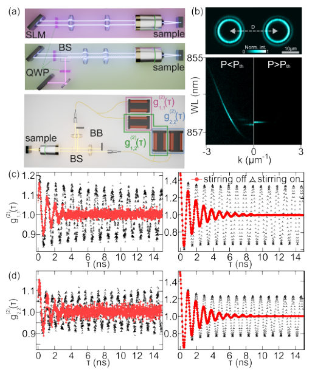 
Figure 1. (a) Experimental scheme for polariton condensate intensity correlation measurements. Two condensates (C1, C2) are excited in optical traps at a variable distance D un- der two regimes: both in identical static traps (top) or with one trap stirred and the other static (middle). The bottom panel outlines the auto- and cross-correlation measurement setup, using color boxed detectors for corresponding correla- tion functions. BS - 50:50 beam splitter; BB - beam block. (b) Excitation profile (top panel). Typical dispersion image for the ground state trapped condensate below and above the threshold (bottom panel); WL - wavelength. (c)(d) Measured (left) and simulated (right)...

📷 Fig 2

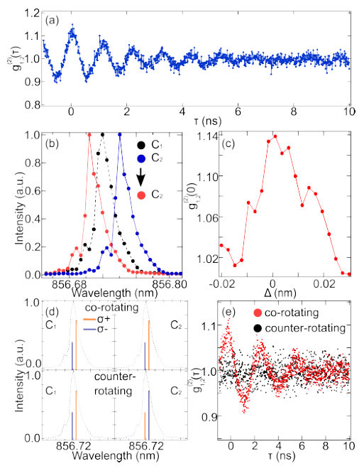 
Figure 2. (a) Measured polarization-filtered intensity cross- correlation function g(2) 1,2(τ) between two condensates. (b) Measured emission spectra of the of the condensate C1 (black dots), while the emission wavelength of C2 is tuned by varying the trap diameter from blue to red dots. (c) Zero-delay cross- correlation amplitude g(2) 1,2(0) as a function of the spectral de- tuning ∆between the two condensates. (d) Schematic repre- sentation of the co-circularly and counter-circularly polarized dimer spectra. The spectrum of the C1 and C2 are the same and constituent σ+ and σ−lines are in resonance (upper pan- els) and out of resonance (lower panels). (e) Cross-correlation function g(2)...

📷 Fig 3

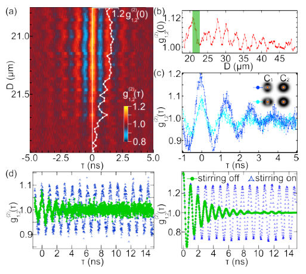 
Figure 3. (a) The measured map of the cross-correlation function g(2) 1,2(τ) as a function of D. White dots show the

**Summary.** The authors demonstrate that Larmor precession in two coupled polariton condensates can become mutually synchronized, even when only one condensate is actively driven. By measuring cross-correlation functions, they show that driving one site non-locally stabilizes the coherence of its neighbor, creating a robust, tunable platform for studying quantum synchronization in solid-state systems.

**Why it may be interesting.** This work provides an experimental platform to study non-equilibrium, time-periodically driven quantum systems, offering insights into collective dynamics and entanglement-like phenomena (master-slave coupling) in strongly interacting bosonic systems.

Detailed structure

**Main problem.** The research aims to demonstrate and characterize the mutual synchronization of Larmor precessions between two spatially separated, optically trapped polariton condensates.

**Main result.** Optical stirring of one condensate non-locally stabilizes and prolongs the pseudo-spin dephasing time of its neighbor by an order of magnitude, establishing a master-slave entrainment mechanism.

**Method.** The study uses polarization-resolved Hanbury-Brown-Twiss interferometry to measure second-order intensity correlation functions, $g^{(2)}_{1,2}(	au)$, which serve as diagnostics for condensate coupling and synchronization.

**Model / system.** The physical system is a polariton condensate dimer formed in a microcavity, exhibiting spinor degrees of freedom that undergo Larmor precession due to intrinsic energy splitting. The coupling is mediated by polariton outflow between the two sites.

**Key observables.** Cross-condensate correlation function $g^{(2)}_{1,2}(	au)$, pseudo-spin dephasing time, and the spectral overlap/winding direction of the precessing pseudo-spins.

**Important parameters / regimes.** Spectral overlap, precession winding direction, and the strength of the optical stirring field relative to the Larmor frequency.

**Assumptions / limitations.** The coupling mechanism is assumed to be mediated by polariton outflow, and the analysis often relies on approximations like the Kuramoto model or weak fluctuation limits.

**Figures summary.** Figures show $g^{(2)}_{i,i}(	au)$ curves comparing static vs. stirred traps to demonstrate dephasing time prolongation, and $g^{(2)}_{1,2}(	au)$ dependence on separation and spectral detuning to map out synchronization regimes.

**Paper structure.** The paper progresses from demonstrating basic synchronization via correlation functions to quantifying the non-local stabilization effect using optical stirring, and further explores the underlying physics by analyzing polarization plane locking using advanced correlation measurements.

Abstract

We demonstrate mutual synchronization of Larmor precessions between spatially separated, optically trapped polariton condensates. We identify the cross-condensate correlation g(2)1,2(τ) as a sensitive metric for condensate coupling. Synchronization of precessions in a condensate dimer is mediated by polariton outflow and resonantly depends on spectral overlap and precession winding. All-optical stirring of one site non-locally increases the pseudo-spin dephasing time of its static neighbor, prolonging phase-locking in a dimer by an order of magnitude. Our work establishes a scalable platform for studying non-equilibrium time-periodically driven systems and for high-speed spinoptronic networks.

[↑ back to top](#top)

### [Observation and control of polariton noise in a thermal Rydberg atom electrometer](http://arxiv.org/abs/2610.26479v1)

**Authors:** Teng Zhang, Luís Felipe Gonçalves, Alisher Duspayev, Georg Raithel, David A. Anderson  
**Type:** both · **Category:** other · **PDF:** <https://arxiv.org/pdf/2610.26479v1>  
**Analysis basis:** full PDF text, analyzed in chunks
**Topic relevance:** 🔥 `quantum measurements` **4/5** · `Rydberg arrays` **3/5** · `analog quantum simulation` **3/5** · `quantum optics experiment` **3/5** · `driven-dissipative phase transition` **2/5** · `methods for driven-dissipative` **2/5** · `Keldysh / 2PI / non-Gaussian methods` **1/5** · `Tavis-Cummings & cavity-many-emitter` **1/5** · `correlated / nonlocal dissipation` **1/5** · `interference shaping light` **1/5**

📷 Fig 1

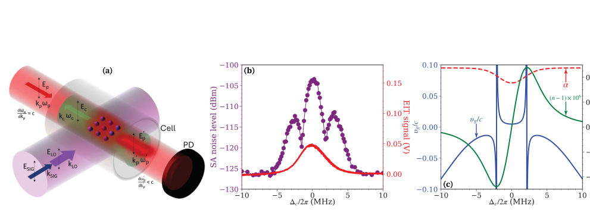 
FIG. 1. (a) Conceptual diagram of the experimental setup, including the probe beam (red), the coupler beam (green), RF fields (purple), and their wave and polarization vectors. Primed probe-beam quantities are inside the Rydberg vapor. A photodiode (PD) measures the probe power transmitted through the EIT medium. (b) Measured background-subtracted probe-light transmission (red) and polariton noise (purple) at Ωc/(2π) ≈0.4 MHz versus coupler beam detuning ∆c. The utilized Rydberg state is 42D5/2 . (c) Theoretical probe-light absorption α (dashed red), scaled refractive index (n-1)×106

📷 Fig 2

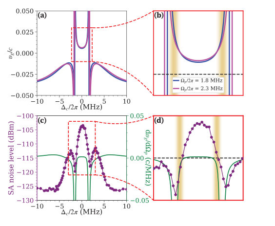 
FIG. 2. Polariton noise amplification and reduction near EIT resonance. (a) Calculated polariton group velocity, vg, ver- sus coupler detuning, ∆c, for the probe Rabi frequencies, Ωp, indicated in panel (b). The latter is a zoom-in of panel (a). (c) dvg/dΩp versus ∆c (green) overlaid with the measured po- lariton noise level (purple). Panel (d) is a zoom-in of panel (c). Horizontal dashed black line in (b) and (d) corresponds to vg = 0 and dvg/dΩp = 0, respectively. In (c) and (d), the orange shading indicates the regions where vg &gt; 0 and dvg/dΩp &lt; 0. There, our model predicts polariton noise re- duction through a negative-feedback mechanism (see text for details).

📷 Fig 3

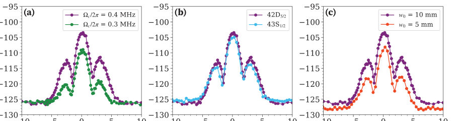 
FIG. 3. Rydberg polariton noise versus coupler detuning, ∆c, at different coupler Rabi frequencies, Ωc, (a), using different Rydberg levels (b), and with different EIT beam volumes (c). In the latter panel, the indicated w0 = 10 mm (5 mm) corresponds to the EIT beam volume of 3.0 cm3 (0.75 cm3). w0 = 10 mm is also used for the data in (a) and (b). In (a) and (c), the utilized Rydberg state is 42D5/2 . In (b), the coupler Rabi frequencies are slightly different (Ωc/(2π) = 0.3 MHz (0.4 MHz) for the 43S1/2 ( 42D5/2 ) state) due to available coupler power and a difference in the respective electric-dipole transition matrix elements. See text for discussion.

📷 Fig 4

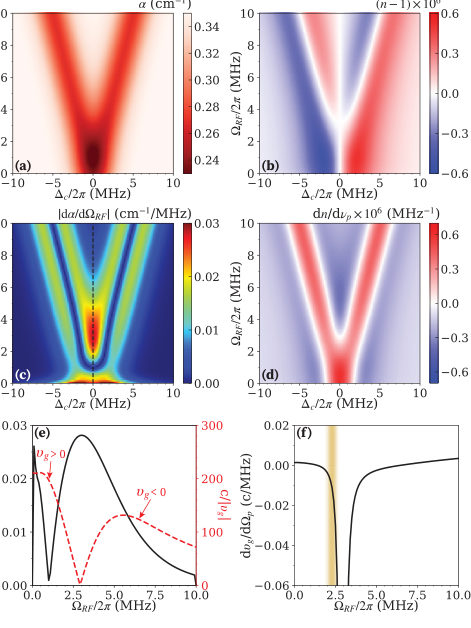 
FIG. 4. Theoretical model. (a) Probe light absorption co- efficient, α, as a function of coupler detuning ∆c and Rabi frequency of the RF field, ΩRF . (b) Rescaled probe re- fractive index, 106 × [n(∆c, ωRF ) −1]. (c) Responsivity |[dα/dΩRF ](∆c, ωRF )|. (d) Derivative of the probe refractive index with respect to the probe frequency, [dn/dνp](∆c, ωRF ). (e) Responsivity |dα/dΩRF | (solid black curve) and c/|vg| (dashed red curve) as a function of ΩRF for fixed ∆c = 0. Branches with vg &gt; 0 and vg &lt; 0 are indicated on the c/|vg|- curve. (f) Feedback figure dvg/dΩp as a function of ΩRF for fixed ∆c = 0. The orange shading indicates the region where the theoretical model predicts polariton...

📷 Fig 5

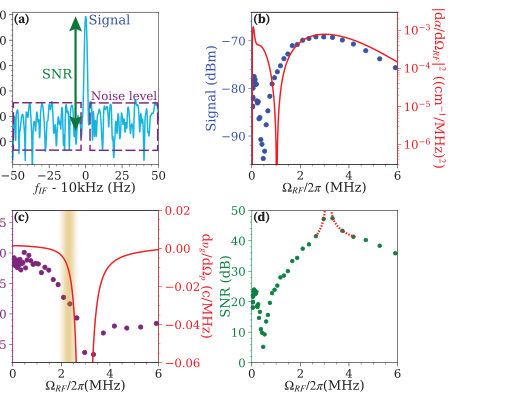 
FIG. 5. (a) SA spectrum of the Rydberg-receiver output sig- nals for a measurement of 9.937 GHz fields at LO and SIG electric fields of ELO = 0.2 V/m and ESIG = 0.53 mV/m, re- spectively. (b) Theoretical responsivity squared, |dα/dΩRF |2, as a function of ΩRF overlaid with the measured heterodyne signal at IF = 10 kHz (blue dots). (c) Calculated dvg/dνp (solid red line) overlaid with the measured SA noise level (purple symbols) at IF = 10 kHz. Note the noise dip centered at ΩRF /(2π) ≈3.1 MHz. The orange shading indicates the region where negative feedback in the calculation suppresses polariton noise (see text for details). (d) Measured SNR as a function of ΩRF . The red dotted curve is a...

**Summary.** This paper reports the observation and active control of polariton-mediated optical noise in a thermal Rydberg atom electrometer. By exploiting the nonlinear slow-light feedback mechanism inherent to the EIT resonance, the authors demonstrate how applying a reference RF field can suppress this noise. This establishes polariton noise as a critical, controllable factor for improving the sensitivity of Rydberg-based quantum sensors.

**Why it may be interesting.** This work is highly relevant as it tackles fundamental noise limitations in quantum sensing using controlled light-matter interactions in Rydberg media, providing a concrete mechanism (negative feedback) to approach fundamental sensitivity limits.

Detailed structure

**Main problem.** The primary goal is to establish metrics and actively control fundamental noise sources, specifically polariton-mediated optical noise, within quantum sensing platforms.

**Main result.** The authors successfully observed and demonstrated active suppression of this intrinsic polariton noise by applying a resonant radio-frequency field, optimizing the electric-field sensitivity of the Rydberg electrometer.

**Method.** The study combines experimental measurements of noise spectra with theoretical modeling using a phenomenological slow-light feedback picture derived from the density matrix formalism.

**Model / system.** The system utilizes a thermal Rydberg atom vapor undergoing Electromagnetically Induced Transparency (EIT), which supports the formation and propagation of polaritons. The dynamics are modeled using the density matrix formalism and Lindblad equation.

**Key observables.** Polariton noise (AC component), EIT absorption dip (DC component), group velocity ($v_g$), and the ratio of noise suppression/amplification across the EIT resonance.

**Important parameters / regimes.** Coupler detuning ($\Delta_c$), Rabi frequencies ($\Omega_p, \Omega_c$), and the operating regime defined by the feedback mechanism ($v_g > 0$ and $dv_g/d\Omega_p < 0$).

**Assumptions / limitations.** The analysis relies on a phenomenological slow-light feedback picture rather than a complete quantum model, and the noise dips are noted to be surprisingly narrow.

**Figures summary.** Figures illustrate the measured EIT absorption and polariton noise spectra versus detuning, alongside calculated plots of absorption, refractive index, and group velocity, mapping the noise suppression regions to the negative feedback regimes.

**Paper structure.** The paper progresses from identifying the noise problem in the Rydberg electrometer, presenting experimental measurements of noise structure across the EIT resonance, developing a theoretical model linking noise to slow-light feedback, and concluding with the demonstration of active noise control.

Abstract

The establishment of metrics and control of fundamental noise sources in quantum sensing is a long-standing goal in quantum science and technology. We report on the observation of polariton-mediated optical noise in a thermal Rydberg atom vapor and demonstrate its active control and suppression using a radio-frequency field in Rydberg electrometry. The noise exhibits structured amplification and reduction across the Rydberg electromagnetically induced transparency resonance. This reveals a nonlinear slow-light feedback mechanism in which the polariton medium stores and releases probe-field energy. We show that the reference radio-frequency field used in Rydberg heterodyne receivers can also tune the medium into an operating regime where high electromagnetic-field responsivity coincides with reduced optical noise. This operating-point control enables optimization of the electric-field sensitivity within the constraints imposed by Rydberg-polariton physics. These results establish polariton noise as a previously unrecognized intrinsic noise source in thermal Rydberg vapors and the corresponding control method as a crucial aspect of continued efforts to achieve fundamental sensitivity limits in Rydberg electrometry.

[↑ back to top](#top)

### [Self-Trapping and Liouvillian Spectral Transitions in a Dissipative Bose-Hubbard Dimer](http://arxiv.org/abs/2610.25222v1)

**Authors:** Subhendu Saha, Raka Dasgupta  
**Type:** theory · **Category:** quantum gases · **PDF:** <https://arxiv.org/pdf/2610.25222v1>  
**Analysis basis:** full PDF text, analyzed in chunks
**Topic relevance:** 🔥 `driven-dissipative phase transition` **4/5** · 🔥 `methods for driven-dissipative` **4/5** · `analog quantum simulation` **3/5** · `correlated / nonlocal dissipation` **3/5** · `non-equilibrium universality` **3/5** · `Keldysh / 2PI / non-Gaussian methods` **2/5** · `quantum measurements` **1/5**

📷 Fig 1

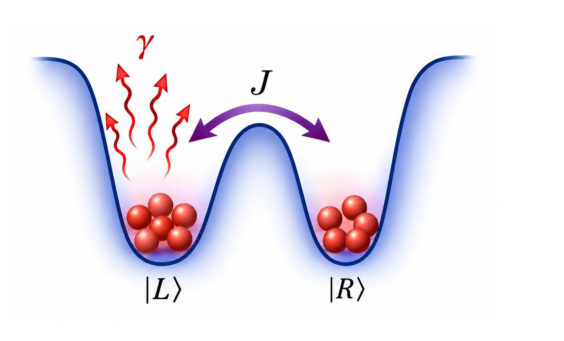 
FIG. 1: Schematic diagram of a dissipative bosonic Josephson junction. Bosons trapped in a double-well potential undergo coherent tunneling between the wells, while localized particle loss with rate γ acts on Well 1.

📷 Fig 2

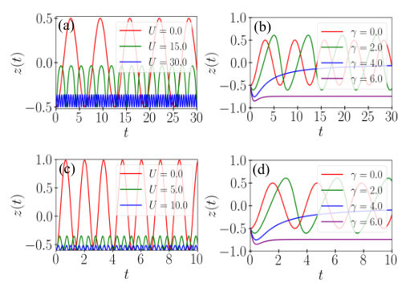 
FIG. 2: Plots of population imbalance z(t) for interaction and dissipation-driven dynamics, respectively. (a) MF results varying U at γ = 0 (b) MF results varying γ at U = 0, (c) ED results varying U at γ = 0 for N = 5 (d) ED results varying γ at U = 0 for N = 4

📷 Fig 3

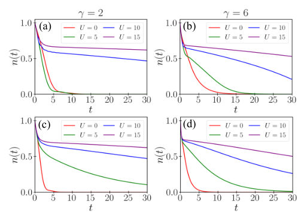 
FIG. 3: Plots of time evolution of the normalized particle number n(t). Panels (a)-(b) shows MF method and (c)-(d) shows ED method.

📷 Fig 4

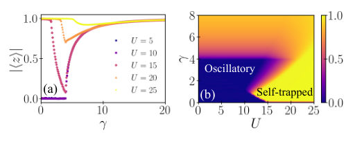 
FIG. 5: Dissipation-driven crossover between oscillatory and self-trapped dynamics. (a) Order parameter |⟨z⟩| as a function of γ for different U values. (b) Phase diagram in the U −γ parameter plane, showing the oscillatory and self-trapped dynamical regimes. The color scale represents |⟨z⟩|, with larger values indicating stronger self-trapping.

📷 Fig 5

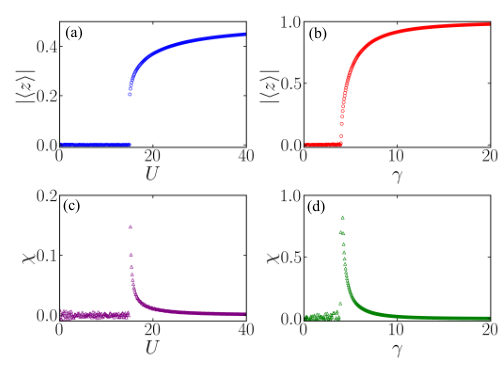 
FIG. 4: Plots of order parameter |⟨z⟩| and susceptibility χ as functions of the interaction strength U and dissipation rate γ. Panels (a) and (c) show the results as U is varied at γ = 0, while (b) and (d) correspond to varying γ at U = 0. Here J = 1, N = 1 were used throughout.

**Summary.** This paper analyzes the self-trapping transition in a dissipative Bose-Hubbard dimer, showing that environmental dissipation can induce localization similar to interaction effects. By analyzing the Liouvillian spectrum, the authors map out complex dynamical regimes resulting from the interplay between interaction and dissipation. The findings provide a detailed spectral understanding of how non-Hermitian effects govern quantum coherence in open quantum systems.

**Why it may be interesting.** This work is highly relevant as it tackles non-equilibrium dynamics in bosonic systems, using advanced spectral tools (Liouvillian analysis) to characterize phase transitions induced by environmental coupling, a core topic in open quantum systems.

Detailed structure

**Main problem.** The study investigates the self-trapping transition in a dissipative Bose-Hubbard dimer, comparing the effects of interaction versus dissipation on localization.

**Main result.** Dissipation alone can induce a transient self-trapping-like localization, and the interplay between interaction and dissipation creates complex, multi-regime dynamics.

**Method.** The analysis employs Mean-Field theory and Exact Diagonalization, characterizing the dynamics using the Liouvillian superoperator spectrum.

**Model / system.** The system is a Bose-Josephson junction (BJJ) modeled by a Hamiltonian and subjected to dissipation via a Lindblad Master Equation. The model involves tunneling ($J$), on-site interaction ($U$), and a dissipation rate ($\Gamma$).

**Key observables.** Self-trapping transition, Liouvillian spectrum (eigenvalues), Liouvillian gap, and population imbalance ($z$).

**Important parameters / regimes.** Tunneling rate ($J$), interaction strength ($U$), and dissipation coefficient ($\Gamma$ or $\gamma$).

**Assumptions / limitations.** The Mean-Field analysis assumes $U$ is an effective nonlinear interaction scale, and the dynamics are governed by the Lindblad Master Equation framework.

**Figures summary.** Figures illustrate the time evolution of population imbalance ($z(t)$) and particle number ($n(t)$) under varying interaction and dissipation strengths, and show the Liouvillian spectrum's dependence on dissipation.

**Paper structure.** The paper first establishes the model using the Hamiltonian and Lindblad equation, then analyzes the transition mechanisms (interaction-driven vs. dissipation-driven) using MF and ED, and finally connects these dynamical transitions to spectral features like exceptional points and the quantum-Zeno regime.

Abstract

We study the self-trapping transition in dissipative double wells using mean-field theory and exact diagonalization. We find that, similar to the conventional interaction-driven transition from oscillatory dynamics to self-trapping, dissipation alone can also induce self-trapping-like localization in one well. The resulting state, although transient and decaying, persists for a substantial time. At the mean-field level, the interaction- and dissipation-driven transitions are discontinuous and continuous, respectively. When interaction and dissipation both are present, their interplay produces three dynamical regimes: (i) at weak interaction, increasing dissipation drives a transition from oscillations to self-trapping; (ii) at moderate interaction, self-trapping at weak dissipation, oscillatory dynamics at intermediate dissipation, and re-entrant self-trapping at strong dissipation; and (iii) at strong interaction, self-trapping persists but is weakened by dissipation. We connect the transition with the Liouvillian spectrum. It is observed that purely dissipation-driven transition coincides with an exceptional point in the spectra, and a peak in the Liouvillian gap, marking the onset of the quantum-Zeno regime. In the presence of interactions, however, the onset of the Zeno regime is shifted to dissipation strengths larger than that required for the self-trapping transition.

[↑ back to top](#top)

### [Strong-to-Weak Spontaneous Symmetry Breaking Transitions on a Quantum Processor](http://arxiv.org/abs/2610.26229v1)

**Authors:** Zhi-Yuan Wei, Christopher Fechisin, Yu-Xin Wang, Jeet Shah, Tsung-Cheng Lu, Cheng-Ju Lin, Alexey V. Gorshkov  
**Type:** experiment · **Category:** statistical mechanics · **PDF:** <https://arxiv.org/pdf/2610.26229v1>  
**Analysis basis:** full PDF text, analyzed in chunks
**Topic relevance:** 🔥 `QC/QI experiment` **4/5** · `correlated / nonlocal dissipation` **3/5** · `driven-dissipative phase transition` **3/5** · `non-equilibrium universality` **3/5** · `quantum measurements` **3/5** · `analog quantum simulation` **2/5** · `methods for driven-dissipative` **2/5**

📷 Fig 1

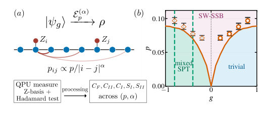 
FIG. 1. Setup and phase diagram. (a) We study mixed states ρ generated by applying a power-law-correlated dephas- ing channel E(α) p [Eq. (3)] to initial matrix-product states (MPS) |ψg⟩[Eq. (1)]. Computational-basis measurements pro- vide the data for reconstructing the SW-SSB correlators CF , CII, and CI, while an additional Hadamard-test measurement provides access to the string observables SI and SII. The reconstruction combines quantum measurements with classi- cally computed channel weights, allowing different (p, α) to be explored using the same measurement data. (b) Phase dia- gram at α = 1.4. The orange curve indicates the theoretical thermodynamic-limit SW-SSB transition boundary...

📷 Fig 2

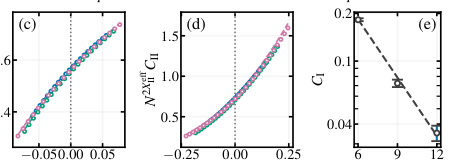 
FIG. 2. SW-SSB transition. Results for g = 0.4 and α = 1.4. (a),(b) Scaled fidelity correlator CF and R´enyi-2 correlator CII for N = 6, 9, 12. Colors distinguish system sizes, open symbols denote QPU measurements, and dashed curves show exact finite-chain calculations. Dotted vertical lines indicate the transition-point estimates pc,F and pc,II obtained from finite-size scaling fits across the three system sizes. (c),(d) Corresponding finite-size scaling collapses. The exact curves in (a)–(d) are rescaled using the scaling parameters fitted to the QPU data. Error bars in (a)–(d) are smaller than the plotted symbols and are not shown. (e) System-size dependence of the linear correlator CI,...

📷 Fig 3

 
FIG. 3. Estimated SW-SSB transition points. (a) Dependence of the estimated transition points pc,F and pc,II on the MPS parameter g at fixed α. The α = 1.4 cut corre- sponds to the phase diagram in Fig. 1(b). (b) Dependence on the power-law exponent α at fixed g. The dotted vertical line marks α = 1, where the channel normalization changes its functional form [cf. Eq. (3)]. Symbols denote QPU esti- mates, while dashed and dotted curves show transition-point estimates obtained from separate fits to the exact finite-chain correlators using the same fitting procedure. A comparison with large-system theoretical phase boundaries is provided in the SM [16].

📷 Fig 4

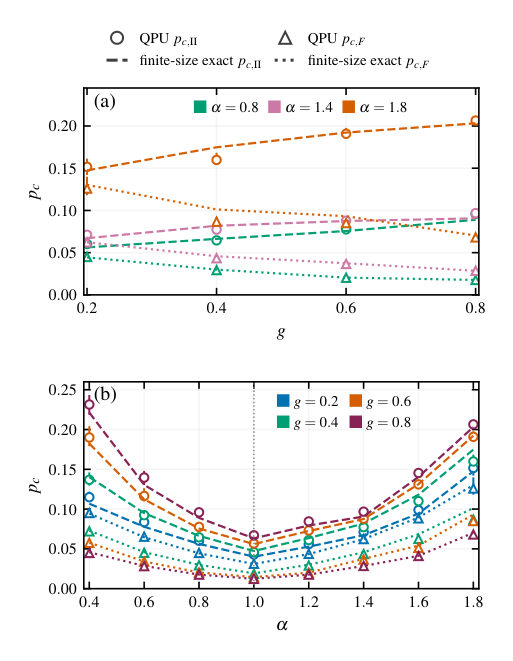 
Figure 2 shows representative results at g = 0.4 and α = 1.4. The scaled fidelity and R´enyi-2 correlators exhibit clear finite-size crossings [Figs. 2(a),(b)]. Finite- size scaling fits of the three measured sizes N = 6, 9, 12 yield transition-point estimates pc,D (D = F, II), with the corresponding scaling collapses shown in Figs. 2(c),(d). In contrast, the linear correlator CI decays approximately exponentially with N [Fig. 2(e)]. The measurements agree well with exact finite-chain results (dashed curves). Additional parameter cuts and fitting details are provided in the SM [16]. Together, these results reveal finite-size critical signatures of SW-SSB transitions. We next map the...

📷 Fig 5

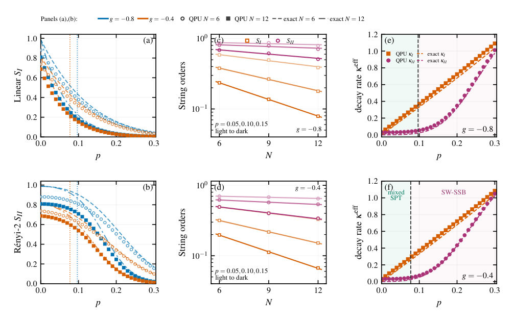 
FIG. 4. Signatures of the mixed-SPT phase at α = 1.4. Error bars are smaller than the plotted symbols and are omitted. (a),(b) Linear and R´enyi-2 string order parameters, SI and SII, as functions of the dephasing strength p for g = −0.8, −0.4 and N = 6, 12. Vertical dotted lines mark pc,II, independently extracted from the SW-SSB finite-size scaling at the same |g| [cf. Fig. 3]. (c),(d) System-size dependence of the two string orders at fixed p = 0.05, 0.10, 0.15 for g = −0.8 and −0.4, respectively. Solid lines show exponential fits SX ∝exp  −κeff X ℓN , with ℓN = N/3 and X ∈{I, II}. (e),(f) Corresponding effective decay rates κeff I and κeff II as functions of p. Dashed curves are...

**Summary.** This work experimentally investigates Strong-to-Weak Spontaneous Symmetry Breaking (SW-SSB) transitions in mixed quantum states using a superconducting quantum processor. The authors introduce a novel quantum-classical measurement protocol to reconstruct nonlinear correlators, allowing them to observe finite-size critical scaling signatures. This establishes a powerful quantum-classical approach for diagnosing complex symmetry breaking and topological order in noisy quantum systems.

**Why it may be interesting.** The methodology provides a concrete, experimental roadmap for probing complex, non-linear quantum phase transitions (like SW-SSB) in realistic, noisy quantum hardware, bridging quantum information diagnostics with condensed matter critical phenomena.

Detailed structure

**Main problem.** The paper addresses the challenge of experimentally characterizing Strong-to-Weak Spontaneous Symmetry Breaking (SW-SSB) transitions in mixed quantum states, which cannot be detected using simple linear observables.

**Main result.** The authors report the first experimental observation of finite-size critical scaling for SW-SSB transitions on a superconducting quantum processor, successfully mapping the transition points across various system parameters.

**Method.** A quantum-classical measurement protocol is developed to reconstruct nonlinear mixed-state correlators (like fidelity and Rényi-2) using only two measurement settings, allowing for the diagnosis of non-linear critical behavior.

**Model / system.** The study uses a superconducting quantum processor to simulate mixed states generated by applying a power-law-correlated dephasing channel to an initial Matrix-Product State (MPS).

**Key observables.** Fidelity correlator ($C_F$), Rényi-2 correlator ($C_{II}$), linear correlators ($C_I$), and string observables ($S_I, S_{II}$).

**Important parameters / regimes.** Dephasing strength ($p$), correlation exponent ($\alpha$), and an initial state parameter ($g$).

**Assumptions / limitations.** The analysis relies on the ability to map the transition points across a tunable parameter space and compares QPU results against exact finite-chain calculations.

**Figures summary.** Figures demonstrate finite-size scaling analysis for $C_{II}$ and $C_F$ across varying $g$ and $\alpha$, and show the distinct behavior of string order parameters ($S_I$ vs $S_{II}$) in the mixed-SPT regime.

**Paper structure.** The paper develops the measurement protocol, applies it to the MPS/dephasing model, analyzes the finite-size scaling of nonlinear correlators to pinpoint SW-SSB transitions, and complements this with string-order measurements to identify mixed-state SPT phases.

Abstract

Mixed quantum states can exhibit unconventional forms of symmetry breaking without pure-state counterparts. A prominent example is strong-to-weak spontaneous symmetry breaking (SW-SSB), which cannot be diagnosed by observables linear in the density matrix. Here, we experimentally resolve finite-size critical signatures of SW-SSB transitions on a superconducting quantum processor. We develop a measurement protocol that combines quantum measurements with classical processing based on the known dephasing channel to reconstruct nonlinear mixed-state correlators. Using only two measurement settings, the protocol reconstructs fidelity, Rényi-2, and linear correlators, as well as string observables. Applying this approach to matrix-product states subjected to power-law-correlated dephasing, we observe finite-size crossings and scaling collapses in nonlinear correlators, accompanied by decaying linear correlations. We further map the estimated SW-SSB transition points across initial-state and channel parameters. Measurements of linear and Rényi-2 string observables further reveal signatures of mixed-state symmetry-protected topological (SPT) phases, with a nonlinear string-order crossover aligned with an independently estimated SW-SSB transition point. Our results establish a quantum-classical approach to probing SW-SSB critical behavior and mixed-state SPT order.

[↑ back to top](#top)

### [Phase-sensitive quantum-state texture during thermalization of a Dzyaloshinskii-Moriya Heisenberg dimer](http://arxiv.org/abs/2610.26736v1)

**Authors:** Onofre Rojas, Zhirayr Adamyan, Fadwa Benabdallah, Vadim Ohanyan  
**Type:** theory · **Category:** statistical mechanics · **PDF:** <https://arxiv.org/pdf/2610.26736v1>  
**Analysis basis:** full PDF text, analyzed in chunks
**Topic relevance:** 🔥 `methods for driven-dissipative` **4/5** · `driven-dissipative phase transition` **3/5** · `non-equilibrium universality` **3/5** · `scars & prethermalization` **3/5** · `Keldysh / 2PI / non-Gaussian methods` **2/5** · `quantum measurements` **2/5** · `analog quantum simulation` **1/5** · `correlated / nonlocal dissipation` **1/5**

📷 Fig 1

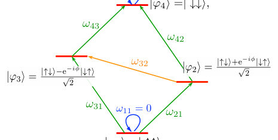 
FIG. 1. Schematic representation of the transverse and longi- tudinal transitions. The links are labeled by the signed gaps ω21, ω31, ω42, ω43. The physical absorption direction on each link is determined by the actual energy ordering. Away from level crossings, the loop at ω = 0 denotes pure dephasing. Since ⟨φ1|Sz|φ1⟩= +1/2 and ⟨φ4|Sz|φ4⟩= −1/2, this zero- frequency channel affects both polarized states, but with op- posite signs in the corresponding matrix elements.

📷 Fig 2

 
FIG. 4. Rugosity R(ϱ) for D = 0, 2, 4, showing how the DM interaction changes the dynamical departure from the uniform coherent reference. Parameters are J = Jz = 1, h = 0.5, η = 0.2, and ωc = 5. Panel (a): heating, T0 = 1 →Tb = 10; panel (b): cooling, T0 = 10 →Tb = 1.

📷 Fig 3

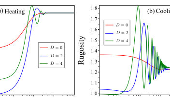 
Figure 4 shows the three interconnected effects of D: it changes the splitting K = √

📷 Fig 4

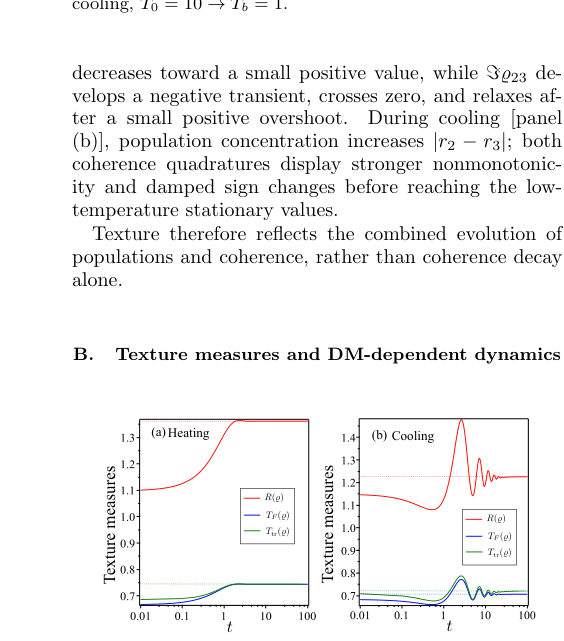 
FIG. 3. Rugosity R(ϱ), fidelity-based texture TF (ϱ), and trace-distance texture Ttr(ϱ). The quantities R and TF are monotonic functions of the same overlap, R = −ln(1 −TF ). Parameters are J = Jz = 1, D = 1, h = 0.5, η = 0.2, and ωc = 5. Panel (a): heating, with a smooth approach to stationarity; panel (b): cooling, with a pronounced nonmono- tonic transient.

📷 Fig 5

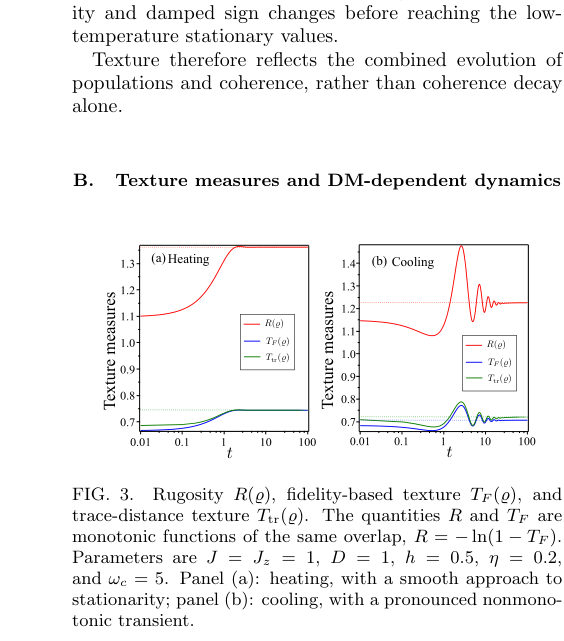 
Figure 3 compares overlap-based texture with trace- distance distinguishability. Since R = −ln(1 −TF ), R and TF have identical extrema and state ordering and differ only in scale. By contrast, Ttr depends on the full spectrum of ϱ −|f1⟩⟨f1|. During heating [panel (a)], the three curves approach stationarity predominantly smoothly, with only a weak transient overshoot, and TF

**Summary.** This paper analyzes how quantum-state texture evolves as an anisotropic Heisenberg dimer thermalizes. By solving the Lindblad master equation, the authors show that the DM interaction imparts a phase-sensitive signature on this texture. This demonstrates that texture is a powerful diagnostic tool, revealing complex dynamics distinct from simple population decay.

**Why it may be interesting.** This work provides a detailed, quantitative look at non-equilibrium dynamics in quantum many-body systems, specifically highlighting how geometric/phase information (texture) survives and characterizes relaxation beyond simple measures of mixedness.

Detailed structure

**Main problem.** The study investigates the complex dynamics of quantum-state texture during the thermal relaxation process of an anisotropic spin-1/2 Heisenberg dimer.

**Main result.** The research establishes that quantum-state texture serves as a phase-sensitive diagnostic of thermal relaxation, revealing distinct transient behaviors during cooling and heating protocols.

**Method.** The authors construct and solve a global weak-coupling Lindblad master equation, comparing various texture diagnostics (like rugosity and fidelity) against standard measures like purity.

**Model / system.** The system is an anisotropic spin-1/2 Heisenberg dimer subjected to a longitudinal magnetic field and a Dzyaloshinskii-Moriya (DM) interaction. The dynamics are modeled using the Lindblad formalism coupled to a bosonic bath.

**Key observables.** Quantum-state texture (diagnosed by rugosity, fidelity-based texture, trace-distance texture), single-excitation coherence, vector spin chirality, and purity.

**Important parameters / regimes.** The DM coupling strength (D), the longitudinal field (h), and the temperature/thermal bath parameters ($eta$).

**Assumptions / limitations.** The analysis relies on the Born–Markov approximation and the full secular approximation for the weak-coupling regime.

**Figures summary.** Figures illustrate the comparison of purity and texture measures during heating and cooling protocols for varying DM coupling strengths.

**Paper structure.** The paper first sets up the Hamiltonian and the Lindblad master equation, then analyzes the separation of population thermalization from coherence decay, and finally compares various texture diagnostics to show the phase-sensitive nature of the relaxation.

Abstract

We investigate quantum-state texture during the thermal relaxation of an anisotropic spin-$1/2$ Heisenberg dimer subject to a longitudinal magnetic field and a Dzyaloshinskii-Moriya (DM) interaction. Starting from local transverse and longitudinal couplings to a bosonic bath, we construct a global weak-coupling Lindblad equation, identify its transition channels, and discuss the applicability and limitations of the secular approximation. The Gibbs state is obtained explicitly in the local spin basis, revealing that the DM coupling controls both the modulus and phase of the single-excitation coherence by modifying the energy splitting and rotating the chiral phase. For heating and cooling protocols, we compare rugosity, fidelity-based texture, and trace-distance texture with coherence, vector spin chirality, and purity. The relaxation dynamics separates population thermalization from the decay and precession of deliberately prepared energy-basis coherence. Their combined contribution to local coherence produces DM-dependent texture overshoots and, during cooling, damped oscillations and sign changes of the coherence quadratures. These transients differ from the evolution of coherence magnitude and purity, while trace-distance texture weights them differently from the overlap-based quantifiers. Calculations at reduced dissipation preserve the texture maxima within the secular model. The results identify a phase-sensitive diagnostic of relaxation.

[↑ back to top](#top)

### [High-order resonances and emergent coherent dynamics in interacting Stark chains](http://arxiv.org/abs/2610.26328v1)

**Authors:** Jiahe Chang, Hongzheng Zhao  
**Type:** theory · **Category:** other · **PDF:** <https://arxiv.org/pdf/2610.26328v1>  
**Analysis basis:** full PDF text, analyzed in chunks
**Topic relevance:** 🔥 `analog quantum simulation` **4/5** · 🔥 `scars & prethermalization` **4/5** · `Frenkel-Kontorova` **3/5** · `non-equilibrium universality` **3/5** · `methods for driven-dissipative` **2/5**

📷 Fig 1

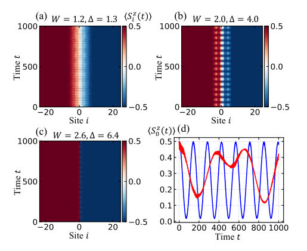 
FIG. 1. Quench dynamics for different parameters. (a)–(c) Spatiotemporal maps of ⟨Sz i (t)⟩for three representative pa- rameter points, characterized respectively by a smooth tran- sition region, coherent oscillations, and a sharp domain wall. (d) Time traces of ⟨Sz 0(t)⟩for two cases exhibiting coher- ent oscillations. The blue curve corresponds to W = 8.0, ∆= 12.0, while the red curve corresponds to W = 2.0, ∆= 5.0. Although both exhibit long-lived coherent oscil- lations, their temporal structures are different: the former is nearly cosine-like, whereas the latter shows a more complex oscillatory pattern.

📷 Fig 2

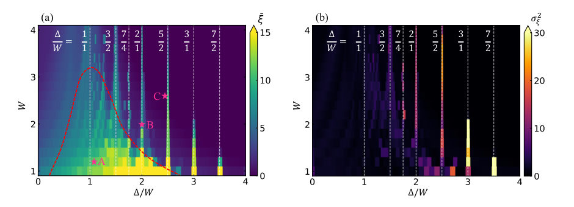 
FIG. 2. Localization-length maps. Colormaps of (a) the time-averaged localization length ¯ξ and (b) its temporal fluctuations σ2 ξ as functions of W and ∆/W, obtained from TEBD simulations for L = 48 up to T = 1000. (a) Brighter colors indicate a larger average extent of domain-wall melting. The red dashed curve marks the contour ¯ξ = 10 as a guide, separating the broad-melting region at smaller W from the strongly suppressed melting at larger W. White dashed lines mark simple fractional values of ∆/W where ¯ξ is anomalously enhanced. Points A, B, and C correspond to Fig. 1(a)–(c), respectively. (b) Brighter colors indicate stronger temporal fluctuations. Enhanced σ2 ξ is concentrated near...

📷 Fig 3

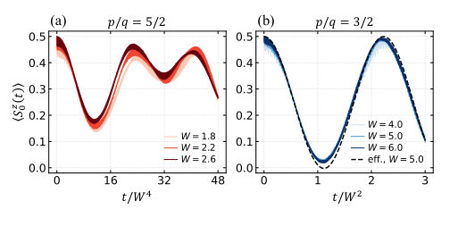 
FIG. 3. Time-rescaled collapse of resonant dynamics. At fixed ∆/W = p/q, the local magnetization ⟨Sz 0(t)⟩for different W approximately collapses under the rescaling τ = t/W nmin−1. Panels (a) and (b) correspond to p/q = 5/2 and 3/2, with nmin = 5 and 3, respectively. The black dashed curve in panel (b) is obtained from the third-order effective Hamilto- nian described below and closely reproduces the full-model dynamics. The collapse confirms that nmin sets the charac- teristic dynamical timescale; residual deviations arise from subleading higher-order corrections.

📷 Fig 4

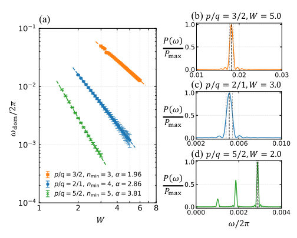 
FIG. 4. Dominant-frequency scaling of the resonant dynam- ics. (a) Dominant oscillation frequency ωdom/2π, extracted from the frequency spectrum of ⟨Sz 0(t)⟩, as a function of the Stark gradient W on log–log axes for resonance ratios p/q = 3/2, 2, and 5/2. The error bars indicate the lower and upper half-maximum frequencies of the dominant spec- tral peak. Power-law fits ωdom ∼W −α yield exponents con- sistent with the prediction α = nmin −1. (b)–(d) Repre- sentative frequency spectra for (W, ∆) = (5.0, 7.5), (3.0, 6.0), and (2.0, 5.0), corresponding to p/q = 3/2, 2, and 5/2, re- spectively. The corresponding time windows are [0, 1000], [0, 1500], and [0, 10000]. Each spectral power P(ω) is...

**Summary.** This work investigates high-order resonances in interacting quantum spin chains under a linear potential gradient (Stark effect). The authors systematically map out a hierarchy of resonances, showing they manifest as long-lived coherent oscillations. By deriving effective Hamiltonians, they provide a microscopic understanding of how specific interaction-to-tilt ratios stabilize these slow, coherent many-body dynamics.

**Why it may be interesting.** The connection between commensurately tuned interaction-to-tilt ratios and the emergence of parametrically slow, coherent many-body dynamics is highly relevant for understanding controllable quantum simulation platforms.

Detailed structure

**Main problem.** The study aims to systematically classify and microscopically describe high-order interaction-tilt resonances in interacting quantum spin chains subjected to a linear potential gradient (Stark effect).

**Main result.** The authors uncover a hierarchy of high-order resonances characterized by long-lived, coherent many-body oscillations whose timescales depend parametrically on the resonance order and the ratio of interaction to tilt strength.

**Method.** The analysis employs quench dynamics simulations using TEBD and develops an effective Hamiltonian via high-frequency expansion and perturbation theory to calculate resonant coupling strengths.

**Model / system.** The system is an interacting Stark spin chain, modeled by a Hamiltonian involving nearest-neighbor interactions (Ising term $\Delta$) and a linear potential gradient ($W$). The dynamics are analyzed by mapping the system to a fermionic Hamiltonian.

**Key observables.** Localization length ($\xi(t)$), average localization length ($ar{\xi}$), fluctuation measure ($\sigma^2_{\xi}$), and the dominant frequency ($\omega_{	ext{dom}}$).

**Important parameters / regimes.** The resonance condition is governed by the fractional ratio $\Delta/W = p/q$, and the resonance order $n$ dictates the scaling of the dominant frequency ($\omega_{	ext{dom}} \sim W^{-(n-1)}$).

**Assumptions / limitations.** The analysis relies on the high-frequency expansion and perturbation theory (Schrieffer-Wolff), which is systematic but computationally intensive for very high orders.

**Figures summary.** Figures illustrate the three dynamical regimes (smooth, coherent, suppressed) via magnetization profiles, and show the resonance signatures in localization length maps ($ar{\xi}$ and $\sigma^2_{\xi}$) at specific $\Delta/W$ ratios.

**Paper structure.** The paper progresses from general dynamic characterization using localization length to deriving an effective Hamiltonian via perturbation theory, culminating in the calculation of specific resonant coupling strengths for higher-order processes.

Abstract

A linear potential gradient can strongly suppress quantum dynamics, while interactions can activate resonant many-body processes whose higher-order structure remains largely unexplored. Here we uncover a systematic hierarchy of high-order interaction--tilt resonances in an interacting Stark chain, where the resonance order counts the minimal number of elementary exchange steps involved. These resonances manifest as long-lived coherent oscillations with order-dependent timescales. By isolating individual resonant channels and developing a microscopic effective description, we connect these dynamical timescales to the underlying many-body exchange processes and reveal a pronounced dependence on the initial-state structure. Our results provide crucial insights into high-order many-body resonances and show how commensurate interaction-to-tilt ratios generate a hierarchy of parametrically slow coherent many-body dynamics.

[↑ back to top](#top)

### [Large Language Model Steering of Acousto-Optic Tweezer Arrays](http://arxiv.org/abs/2610.25014v1)

**Authors:** Cheng Sheng, Kai-xuan Xiao, Yin Zhang, Wen-hao Wang, Feng-yi Zhang, Xu-xing Geng, Guang-ming Huang, Gao-xiang Li  
**Type:** experiment · **Category:** other · **PDF:** <https://arxiv.org/pdf/2610.25014v1>  
**Analysis basis:** full PDF text, analyzed in chunks
**Topic relevance:** 🔥 `quantum measurements` **4/5** · `QC/QI experiment` **3/5** · `Rydberg arrays` **3/5** · `analog quantum simulation` **3/5** · `methods for driven-dissipative` **2/5** · `quantum optics experiment` **1/5**

📷 Fig 1

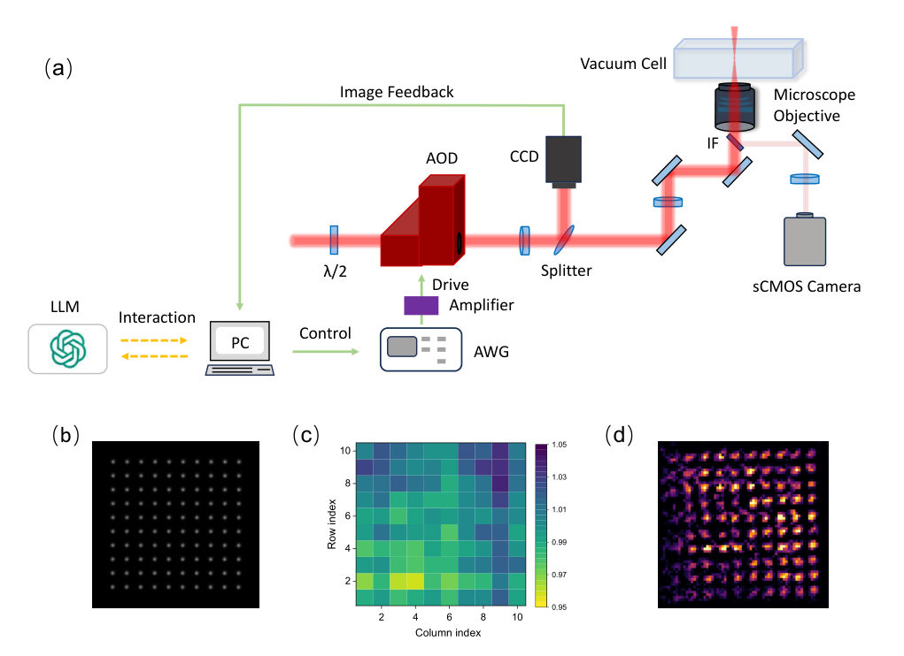 
FIG. 1. LLM-guided optical control on a neutral-atom platform. (a) An 852-nm laser generates tweezers for 87Rb atoms. A crossed AOD pair is driven by an arbitrary waveform generator (AWG) through RF amplifiers. A 1:99 beamsplitter directs 1% of the optical power to the feedback CCD and 99% through an interference filter (IF) and microscope objective toward the vacuum cell; a sCMOS camera records the science image. The LLM exchanges measured states and proposed strategies with the computer through a human-verified interface. (b) Measured 10 × 10 tweezer intensity array on the feedback camera. (c) Normalized fitted-peak map at the optimized setting. (d) Representative fluorescence image of...

📷 Fig 2

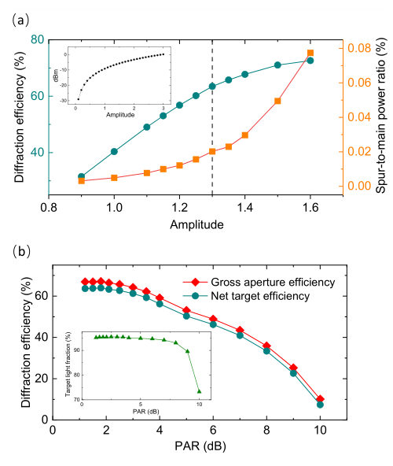 
FIG. 2. Choice of the RF operating regime. (a) Diffraction effi- ciency (teal circles, left axis) and spur-to-main RF-power ratio (orange squares, right axis) versus normalized multifrequency amplitude. The dashed line marks A = 1.30, where diffraction is high but the spur ratio has not yet entered its rapid-growth regime; the inset calibrates normalized AWG amplitude to RF power in dBm. (b) Gross aperture efficiency (red diamonds) and net target efficiency (teal circles) for 14 phase condi- tions ordered by peak-to-average power ratio (PAR). Both efficiencies deteriorate with increasing PAR; the inset shows the accompanying loss of target-array power fraction. The scan defines a low-PAR,...

📷 Fig 3

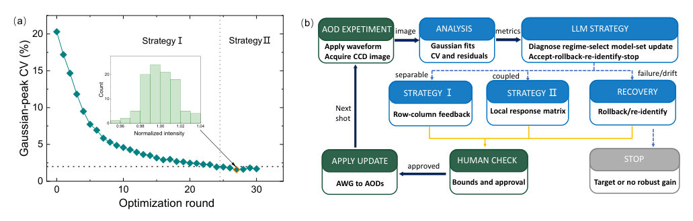 
FIG. 3. Experimental trajectory and step-by-step LLM control workflow. (a) The Gaussian-peak CV decreases under Strategy I, separable row–column feedback, before promotion to Strategy II, a measured 100 × 20 local response matrix. The orange diamond identifies the response-matrix state whose 100-site normalized-intensity distribution is shown in the inset; the lowest plotted CV occurs at R27, with a reported minimum of 1.57%, whereas the final plotted state R30 has a CV of approximately 1.7%. (b) At each round the experiment supplies an image, deterministic analysis returns CV and residual metrics, and GPT-5.5 Thinking selects a strategy and proposes the next update. A human verifies bounds...

**Summary.** The research demonstrates using a Large Language Model (LLM) as an intelligent, human-in-the-loop layer to guide the complex calibration of acousto-optic tweezer arrays for neutral atoms. By adaptively selecting and refining control strategies—such as switching from simple to local response matrix fitting—the system achieved a significant reduction in spatial intensity variation. This highlights a powerful paradigm for using AI to manage the iterative, expert-driven optimization of quantum control systems.

**Why it may be interesting.** This work bridges advanced quantum control theory with modern AI tools, showing how LLMs can manage the complex, multi-stage decision-making process inherent in optimizing physical quantum hardware.

Detailed structure

**Main problem.** Controlling quantum hardware, specifically neutral-atom tweezer arrays, requires adapting experimental strategies to compensate for nonlinear responses, coupling, and drift.

**Main result.** An LLM-guided workflow successfully optimized the tweezer array control, reducing the Gaussian-peak coefficient of variation from 20.30% to 1.57% over 30 update rounds.

**Method.** The study uses a human-in-the-loop approach where an LLM guides the selection and refinement of control models, transitioning from simple row-column corrections to a complex local response-matrix method.

**Model / system.** The physical system is a neutral-atom tweezer platform utilizing a $10 	imes 10$ crossed-acousto-optic-deflector (AOD) array to trap and manipulate atoms.

**Key observables.** Gaussian-peak coefficient of variation (CV), diffraction efficiency, and optical intensities measured on a feedback CCD.

**Important parameters / regimes.** The optimization involves characterizing the RF-to-optical response using multiple tones and minimizing a Tikhonov objective function related to the local response matrix.

**Assumptions / limitations.** The LLM's utility is demonstrated in guiding strategy selection rather than directly generating optimal control parameters, and the minimum CV is noted as the best observed value.

**Figures summary.** Figures illustrate the LLM-guided optical control loop, showing the setup, measured intensity arrays, and the step-by-step optimization trajectory tracking the CV reduction across different control strategies.

**Paper structure.** The paper details the necessity of adaptive control, presents the LLM-guided workflow, shows the mathematical transition between control models (row-column to local MIMO), and quantifies the performance improvement via CV reduction over iterative rounds.

Abstract

Controlling quantum hardware requires choosing and revising experimental strategies as nonlinear response, coupling, and drift limit calibration. We experimentally investigate a general-purpose large language model (LLM) as a human-in-the-loop strategy layer for a neutral-atom tweezer platform. Through step-by-step interaction with experimental feedback, the LLM guides a transition from multiplicative row--column correction to a drift-corrected local response-matrix method when separable feedback stalls. Deterministic software performs image analysis and numerical updates, while an experimentalist verifies and authorizes each waveform. For a $10\times10$ crossed-acousto-optic-deflector array, this workflow reduces the Gaussian-peak coefficient of variation from $20.30\%$ to $1.57\%$ in 30 candidate-update rounds. The experiment demonstrates feedback-informed strategy selection on a physical quantum-control subsystem, rather than direct generation of control parameters alone. These results highlight the potential of LLMs to guide control optimization across diverse quantum platforms by adaptively formulating and refining experimental strategies.

[↑ back to top](#top)

### [Measuring the Quantum Phase of Multiphoton Systems](http://arxiv.org/abs/2610.25727v1)

**Authors:** Ian Baum, Riley B. Dawkins, Jannatul Ferdous, Omar S. Magana-Loaiza  
**Type:** experiment · **Category:** other · **PDF:** <https://arxiv.org/pdf/2610.25727v1>  
**Analysis basis:** full PDF text, analyzed in chunks
**Topic relevance:** 🔥 `quantum optics experiment` **4/5** · `analog quantum simulation` **3/5** · `quantum measurements` **3/5** · `interference shaping light` **2/5** · `methods for driven-dissipative` **2/5** · `Full counting statistics` **1/5** · `QC/QI experiment` **1/5**

📷 Fig 1

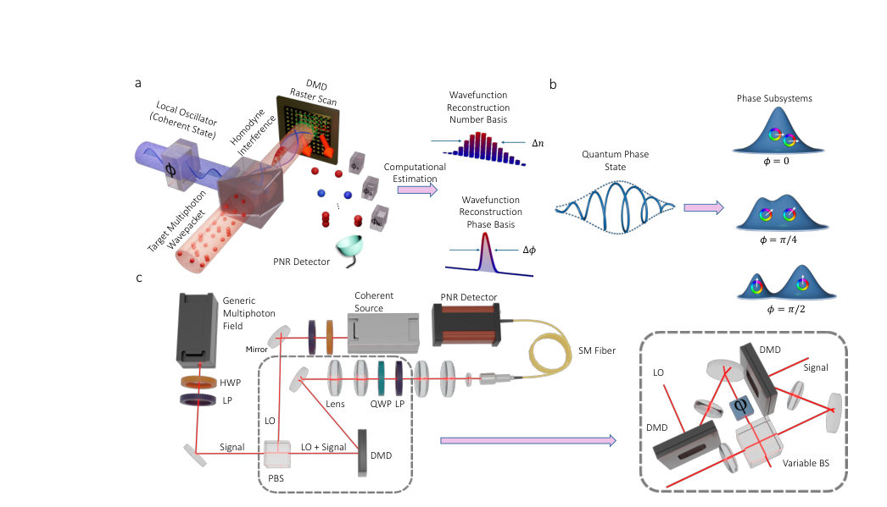 
FIG. 1. Spatially-photon-number-resolved homodyne tomography. As illustrated in a, we employ a new quantum state tomography scheme that combines homodyne interferometry with photon-number-resolving (PNR) detection to reconstruct the complementary photon-number and phase bases of an optical field. This information enables us to select both the constituent multiphoton (photon-number) subsystems that form an optical field and multiphoton phase states with specific phase values. As shown in b, this capability enables us to extract multiphoton phase states with well-defined phases from an arbitrary optical field. The experimental implementation is shown in c. The unknown signal and a coherent...

📷 Fig 2

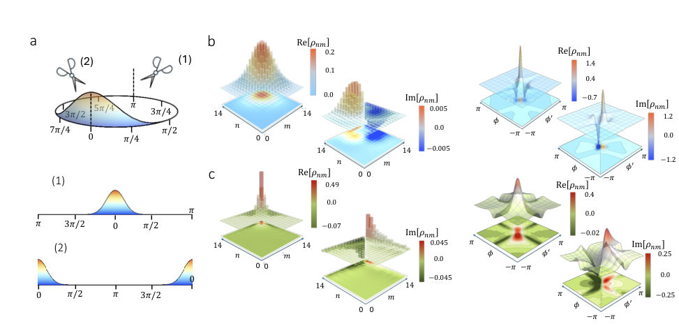 
FIG. 2. Quantum state tomography of multiphoton fields in the number and phase bases. The periodic nature of quantum phase prevents its direct characterization through a linear average of phase values. As illustrated in a, because phase is defined on a circle, the inferred mean can depend strongly on the arbitrary position of the phase reference, here shown for two different choices of the 2π boundary. The trigonometric observables ˆC and ˆS circumvent this ambiguity by providing a representation that preserves the periodicity of phase. Using these observables, our tomography enables the reconstruction of multiphoton fields in the complementary photon-number and phase bases. As shown in b,...

📷 Fig 3

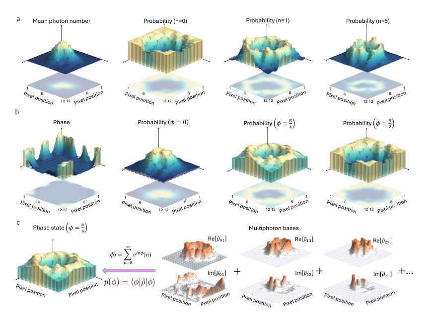 
FIG. 3. Number–phase Fourier duality in spatially resolved multiphoton fields. Our spatially resolved quantum state tomography reveals the complementary photon-number and phase structure of a multiphoton field. As shown in a, we demonstrate the possibility of distilling the constituent multiphoton subsystems of a classical light field from its mean photon-number (intensity) distribution. This capability is illustrated for n = 0, 1, and 5, revealing distinct spatial distributions for each multiphoton subsystem. The complementary phase representation is shown in b, where the reconstructed quantum phase is resolved into multiphoton phase subsystems with well-defined values ϕ = 0, π/4, and π/2....

📷 Fig 4

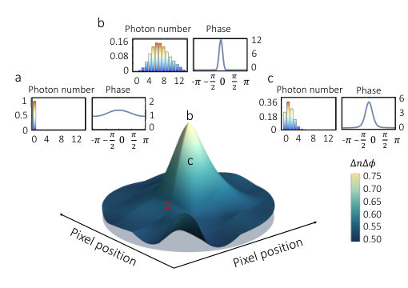 
FIG. 4. Mapping the number–phase uncertainty of a multiphoton field. Our spatially resolved quantum state tomography enables the direct experimental characterization of the number–phase uncertainty product, ∆n∆ϕ, across a co- herent multiphoton field. The measured uncertainty exhibits a pronounced spatial dependence, approaching the lower bound in regions of low photon number and increasing toward the center of the field. The photon-number and phase distribu- tions at representative positions a–c reveal the complementary fluctuations underlying this behavior. In a, the low photon- number region is dominated by the vacuum contribution and accompanied by a broad phase distribution. Toward the...

**Summary.** This paper reports the first experimental measurement of the quantum phase in multiparticle photonic systems containing up to fifteen particles. By combining homodyne interferometry with photon-number-resolving detection, the authors established the number-phase uncertainty relation. This work provides a vital operational tool for characterizing quantum phase in complex quantum optical systems.

**Why it may be interesting.** This work provides a crucial experimental methodology for characterizing quantum phase in complex photonic systems, which is fundamental for understanding quantum correlations and developing quantum information protocols.

Detailed structure

**Main problem.** The quantum phase of multiparticle systems is poorly understood due to the lack of a suitable phase operator, preventing the formulation of a meaningful uncertainty relation with particle number.

**Main result.** The authors successfully measured the quantum phase of up to fifteen-particle photonic systems, establishing the number-phase uncertainty relation and providing an operational framework for phase measurement.

**Method.** They employed a novel quantum state tomography scheme combining homodyne interferometry with photon-number-resolving detection to reconstruct complementary photon-number and phase representations.

**Model / system.** The study focuses on multiparticle photonic systems, analyzing the quantum state density matrix ($\hat{
ho}$) in both the Fock (number) and phase bases.

**Key observables.** Quantum phase ($\phi$), photon number ($n$), and the derived trigonometric observables ($\hat{C}$ and $\hat{S}$) used to characterize phase.

**Important parameters / regimes.** Up to fifteen particles; the number-phase uncertainty relation ($\Delta n \Delta \phi \geq \dots$).

**Assumptions / limitations.** The necessity of constructing Hermitian trigonometric observables ($\hat{C}, \hat{S}$) because the initial phase operator ($\hat{E}$) is not Hermitian.

**Figures summary.** Figures illustrate the setup for spatially-resolved tomography combining homodyne interferometry and PNR detection, and show the number-phase Fourier duality in spatially resolved fields.

**Paper structure.** The paper develops the theoretical framework for phase operators ($\hat{E}, \hat{C}, \hat{S}$), details the measurement technique (homodyne/PNR tomography), derives the number-phase uncertainty relation, and finally applies this framework to measure and map the phase in multiparticle systems.

Abstract

The quantum phase of a multiparticle system has remained a long-standing mystery in quantum physics. The absence of a phase operator that faithfully represents this physical quantity has prevented the formulation of a meaningful uncertainty relation with particle number. Here, we resolve this problem by measuring, for the first time, the quantum phase of multiparticle systems containing up to fifteen particles. We achieve this through a new quantum state tomography scheme that combines homodyne interferometry with photon-number-resolving detection. This approach enables us to reconstruct complementary photon-number and phase representations and establish the corresponding number-phase uncertainty relation. Our measurements further provide access to the mutually unbiased basis of a multiparticle system, a fundamental resource for multiparticle quantum information processing. Furthermore, we report the spatially resolved characterization of the quantum phase. These results provide an operational framework for measuring quantum phase in multiparticle systems, with implications for fundamental quantum physics and scalable multiparticle quantum technologies.

[↑ back to top](#top)

### [Signatures of slow particle transport in the interacting Aubry-André chain](http://arxiv.org/abs/2610.25557v1)

**Authors:** S. Sharifan, M. Kiefer-Emmanouilidis, J. Sirker  
**Type:** theory · **Category:** disordered systems and neural networks · **PDF:** <https://arxiv.org/pdf/2610.25557v1>  
**Analysis basis:** full PDF text, analyzed in chunks
**Topic relevance:** 🔥 `scars & prethermalization` **4/5** · `analog quantum simulation` **3/5** · `non-equilibrium universality` **3/5** · `Frenkel-Kontorova` **2/5** · `quantum measurements` **1/5**

📷 Fig 1

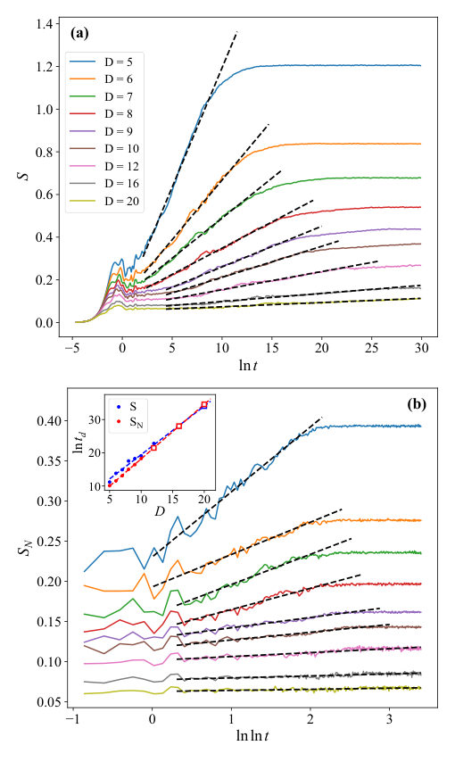 
FIG. 1. Time evolution of entanglement entropy S and num- ber entropy SN for system size L = 16 and various potential strengths D. The initial state is a N´eel state and results are averaged over R = 10000 realizations. (a) S ∼µ ln t at in- termediate times with decreasing µ for increasing potential strengths D, followed by finite-size saturation at long times. (b) SN ∼ν ln ln t at intermediate times followed by satura- tion. Inset: Deviation times td ∼eaD with almost identical exponents a for S and SN.

📷 Fig 2

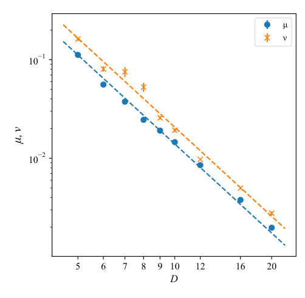 
FIG. 2. Scaling of the parameters µ and ν as a function of the potential strength D extracted from fits S ∼µ ln t and SN ∼ν ln ln t. Both parameters show the same power-law scaling µ ∼ν ∼D−γ consistent with γ ≈3, see dashed lines.

📷 Fig 3

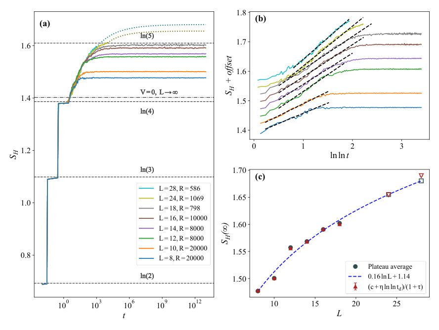 
FIG. 3. (a) SH(t) for D = 7 and system sizes L = 8, 10, 12, 14, 16, 18 obtained from ED and L = 24, 28 from a Trotter-Suzuki decomposition of the time evolution operator. The continuations of the L = 24, 28 curves are guides to the eye connecting the data to the saturation values predicted in panel (c). The number of potential realizations R is given in the legend. The non-interacting model (V = 0) saturates at SH ≈1.40 for L →∞. (b) The same data shown against ln ln t with a constant offset 0.025 and fits to SH(t) = c+η ln ln t; the fit parameters c, η are extracted independently for each L. (c) Saturation values SH(t →∞) as a function of L. Filled blue circles: late-time average of the L...

📷 Fig 4

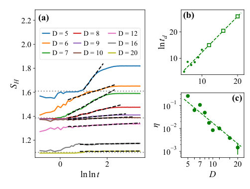 
FIG. 4. Hartley number entropy SH(t) of the Aubry-Andr´e chain with V = 1 and L = 16 for disorder strength D = 5 −20, averaged over 10,000 disorder realizations. (a) SH ∼ η ln ln t at intermediate times with decreasing η for increasing potential strength. (b) Deviation times td, defined as times at which the data deviate from the ln ln-fit by 10%, scale as td ∼eaD. For D = 12, 16, 20 the simulations do not reach saturation and the values are obtained by extrapolation. (c) The prefactor η as a function of D. The dashed line indicates η ∼D−3.

📷 Fig 5

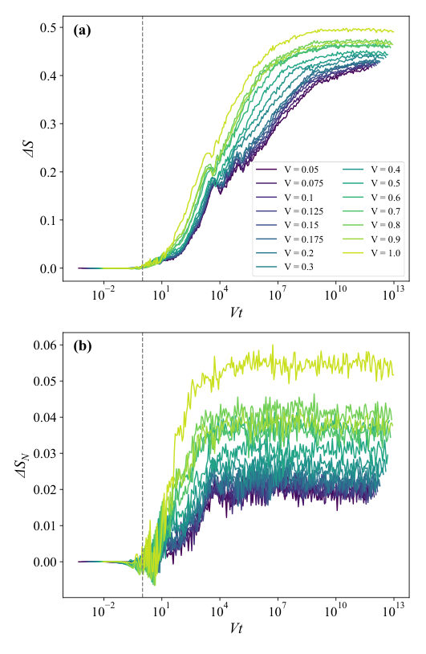 
FIG. 5. (a) Entanglement entropy ∆S = S −S0, where S0 is the entanglement entropy for V = 0, plotted as a function of V t for interaction strengths V ∈[0.05, 1] and D = 7. (b) Same as in (a) for the number entropy ∆SN.

**Summary.** This study investigates the origin of slow particle transport in interacting quantum chains by comparing quasi-periodic and disordered systems. Using entropy measures, the authors show that the slow dynamics observed are robust and stem from a mechanism independent of rare-region resonances. This challenges current understanding of MBL stability by identifying a universal obstruction in the thermodynamic limit.

**Why it may be interesting.** The work directly addresses the stability of Many-Body Localized (MBL) phases by providing evidence that slow transport persists even when the mechanisms previously thought necessary (like rare resonances) are explicitly removed.

Detailed structure

**Main problem.** The paper aims to distinguish between two mechanisms causing slow particle transport in strongly disordered quantum chains: rare resonances/avalanches or an energy-independent combinatorial path-entropy obstruction.

**Main result.** The slow transport signatures observed in the quasi-periodic Aubry-André chain are quantitatively similar to those in quenched disorder, suggesting a common origin independent of rare-region avalanches.

**Method.** Numerical simulation of time evolution following a quantum quench, calculating entanglement entropy, number entropy, and Hartley number entropy.

**Model / system.** The interacting Aubry-André chain is studied, featuring a quasiperiodic potential $D_j = D \cos(2\pieta j + \phi)$ applied to spinless fermions at half filling.

**Key observables.** Entanglement entropy $S(t)$, Number entropy $S_N(t)$, and Hartley number entropy $S_H(t)$; their growth rates ($\mu, 
u$) and saturation values ($\ln L$).

**Important parameters / regimes.** Disorder strength $D$, system size $L$, and the quasiperiodicity parameter $eta$ (golden ratio).

**Assumptions / limitations.** The quasi-periodic potential is constructed to eliminate rare regions responsible for avalanche instabilities, allowing a clean test of the underlying transport mechanism.

**Figures summary.** Figures illustrate the logarithmic and double-logarithmic growth of entropies ($S(t) \sim \mu \ln t$, $S_N(t) \sim 
u \ln \ln t$) and the linear growth of $S_H$ with system size ($\ln L$), comparing quasi-periodic and disordered cases.

**Paper structure.** The paper establishes the physical problem by contrasting two theoretical origins for slow transport. It then applies numerical methods to the interacting Aubry-André chain, calculating various entropy measures. The core of the work is comparing the scaling laws and saturation behaviors between the quasi-periodic and quenched disorder limits to draw a conclusion about the universal nature of the slow transport mechanism.

Abstract

Slow delocalization in strongly disordered many-body quantum chains can originate from two distinct mechanisms: rare resonances and avalanches, rooted in the energy statistics, or an energy-independent combinatorial path-entropy obstruction in operator space. Quasiperiodic potentials eliminate rare regions with similar potentials that are thought to be responsible for avalanche instabilities and modify the statistics of resonances, thus allowing us to delineate the two mechanisms. To do so, we numerically study the entanglement entropy $S(t)$, number entropy $S_N(t)$, and Hartley number entropy $S_H(t)$ following a quantum quench in the interacting Aubry-André chain with disorder strength $D$. We find $S(t)\simμ\ln t$, $S_N(t)\simν\ln\ln t$ with growth rates $μ\simν\sim D^{-γ}$ and $γ\approx 3$, the same behavior that was previously found in the case of quenched disorder. Furthermore, the saturation values $S_H(t\to\infty)$ continue to grow with system size $L$ as $\ln L$, a growth that persists for $D\gtrsim 8$ where MBL was argued to be stable. The similarity of the quasi-periodic and quenched disorder cases points to a common origin of the slow particle transport that does not rely on rare-region avalanches and persists despite strongly modified resonance statistics.

[↑ back to top](#top)

### [Conjugate measurement-induced evolution towards maximally mixed states in quadratic quantum systems](http://arxiv.org/abs/2610.25976v1)

**Authors:** S. Adarsh, T. P. Sreeraj  
**Type:** theory · **Category:** statistical mechanics · **PDF:** <https://arxiv.org/pdf/2610.25976v1>  
**Analysis basis:** full PDF text, analyzed in chunks
**Topic relevance:** 🔥 `quantum measurements` **4/5** · `scars & prethermalization` **2/5** · `Keldysh / 2PI / non-Gaussian methods` **1/5** · `analog quantum simulation` **1/5** · `correlated / nonlocal dissipation` **1/5** · `driven-dissipative phase transition` **1/5** · `methods for driven-dissipative` **1/5** · `non-equilibrium universality` **1/5**

📷 Fig 1

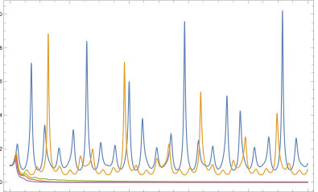 
FIG. 2. Time evolution of the spectral norm of A−1(t), at dif- ferent values of the coupling strength relative to the critical coupling gc. At g &lt; gc, it remains oscillatory and does not approach zero. While at g &gt; gc, ∥A−1(t)∥2 decays towards zero, which illustrates the mechanism by which nonzero sub- system phase-space separations are suppressed to zero.

**Summary.** This paper develops a rigorous theory showing how a quantum subsystem can approach a maximally mixed state purely through unitary evolution when coupled to an environment. It analyzes this phenomenon in quadratic systems, distinguishing between free-particle and harmonic oscillator dynamics. By using phase-space tools and regularization, the authors establish a clear phase-space mechanism for this non-equilibrium equilibration.

**Why it may be interesting.** This work provides a rigorous, purely unitary, and non-equilibrium mechanism for quantum thermalization in simple, exactly solvable models, which is highly relevant for understanding open quantum systems dynamics in quantum optics and AMO physics.

Detailed structure

**Main problem.** The paper investigates the mechanism by which a reduced quantum subsystem approaches a maximally mixed state through strictly unitary dynamics, mimicking thermalization.

**Main result.** The reduced subsystem asymptotically approaches a maximally mixed state in both free-particle and harmonic oscillator models, with the mechanism depending on whether the dynamics induce phase-space shear or hyperbolic expansion.

**Method.** The analysis uses phase-space representations, specifically tracking the reduced Wigner function and Weyl characteristic function, and employs finite-volume regularization to rigorously define the continuum limit.

**Model / system.** The system is a quadratic quantum system partitioned into a subsystem (S) and an environment (E), modeled by a total quadratic Hamiltonian. The dynamics are governed by linear Heisenberg equations.

**Key observables.** Reduced Wigner function (WS), Weyl characteristic function ($\chi$), and the measure of local Wigner flattening ($\Delta_K(t)$).

**Important parameters / regimes.** Coupling constant ($g$), critical coupling value ($g_c$), and regularization parameters (finite volume $L$, momentum cutoff $N$).

**Assumptions / limitations.** The analysis requires finite-volume and momentum regularization to make the maximally mixed state mathematically precise, and the underlying Hamiltonian is assumed to be quadratic.

**Paper structure.** The paper builds from general quadratic dynamics (Chunk 1) to detailed mathematical tools like Wigner/Weyl functions and environmental tracing (Chunk 2). It then analyzes the transition between dynamical regimes (e.g., critical coupling) and proves local Wigner flattening in the hyperbolic regime (Chunk 3). Finally, it situates the work within the broader literature of quantum relaxation (Chunk 4).

Abstract

In an earlier work, we showed that, in the interaction-dominant setting, coupling the conjugate variables of a subsystem to distinct environment modes drives the subsystem to a maximally mixed state. Here, we extend the study to the full quadratic dynamics of a single-mode subsystem coupled to a two-mode environment, and identify the phase-space mechanism responsible for the asymptotic behavior. By tracking the exact reduced Weyl characteristic and Wigner functions, we demonstrate that they lose their dependence on local phase-space coordinates on every fixed compact region. In free-particle model, this happens for all values of coupling, whereas in the harmonic oscillator model, it happens above a critical value of the coupling. Under a finite-volume and momentum regularization, this behavior corresponds to the reduced subsystem approaching a maximally mixed state.

[↑ back to top](#top)

### [Systemic collapse emergence from climate-induced perturbations in transportation networks](http://arxiv.org/abs/2610.26428v1)

**Authors:** Mauro Faccin, Tomas Scagliarini, Manlio De Domenico  
**Type:** theory · **Category:** statistical mechanics · **PDF:** <https://arxiv.org/pdf/2610.26428v1>  
**Analysis basis:** full PDF text, analyzed in chunks
**Topic relevance:** 🔥 `non-equilibrium universality` **4/5** · `driven-dissipative phase transition` **3/5** · `Keldysh / 2PI / non-Gaussian methods` **2/5** · `methods for driven-dissipative` **2/5** · `Frenkel-Kontorova` **1/5**

📷 Fig 1

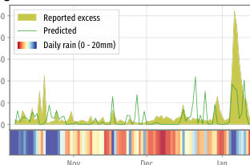 
Figure 2: Daily delay validation for 2024. Time-series of rain, predicted delays and reported excess delays for IRN (a) and CRN (c). Comparison of predicted daily delays and reported excess delay for IRN (b) and for CRN (d). Color and size correspond to the cumulative amount of rain experienced by the railway system in each day. During early September and October, overlapping lines of panel a partially obscure the agreement, which becomes apparent in panel b. One can notice in b (IRN) how, in rainy days (blue dots), the predicted delay correlates to the reported excess of delay. In the high-speed Chinese railway system, rainfalls along the costal line do not affect the functionality of the...

📷 Fig 2

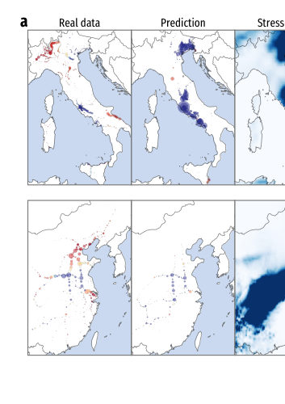 
Figure 3: Local daily delay validation in rainy days. Two rainy days: 9th of Sept. 2024 from IRN (above) and 6th of Jan. 2020 from CRN (below). Notice how nodes with predicted delays (a center) concentrate in and around the areas with strong external stressor field (a right). Node size is proportional to the real or predicted delay (a) or to the capacity (b). The Spearman’s coefficient is computed on stations with nonzero delay. Horizontal blue lines represent the confidence interval of each point.

📷 Fig 3

 
Figure 4: Steady state distribution of the model under a constant external stressor field. Distribution of delay (size) on the map and its ag- gregation on a hexagonal lattice (a) with an external stressor field of 10 mm of hourly rain. The weak correlation of the steady state with degree distribu- tion and betweenness centrality (b) shows the shortcoming of topology only indicators. The steady state phase diagram (c) includes three phases marked by color codes (no delay (pink), endemic finite state attractor (white), de- lay diverges to infinity (gray)). Phases are separated by the propagation and the disruption thresholds (dashed lines correspond to the approximate theoretical...

📷 Fig 4

 
Figure 5: Perturbability of the system and social risk. Each node is perturbed by a strong external stressor field for a short period of time and left to evolve according to the model for 24 hours. High perturbability appears on the east part of Italy (a) and is compared to node capacity. In CRN (panel c), pertubability is driven by the station centrality. Left panels display the distribution of social risk for IRN (b) and CRN (d) on the country and is compared to node capacity. Node size and color on the maps represent degree and betweenness centrality respectively.

**Summary.** This work models the systemic failure of critical infrastructure, such as railways, due to external stressors like heavy rainfall. It develops a coupled dynamical model incorporating diffusion, stressor generation, and system absorption to predict when localized perturbations lead to widespread collapse. The findings provide a quantitative framework for assessing infrastructure vulnerability under intensifying climate change impacts.

**Why it may be interesting.** The framework of modeling system failure via coupled dynamics and identifying critical thresholds ($eta g > \gamma c$) mirrors concepts in non-equilibrium statistical mechanics, particularly those related to phase transitions and critical phenomena in complex systems.

Detailed structure

**Main problem.** The paper investigates how complex human infrastructures, like transportation networks, undergo systemic collapse or significant delays when subjected to external, climate-induced perturbations.

**Main result.** The developed model successfully captures critical behavior, showing that disruptions emerge above specific thresholds of external stressor intensity, allowing for quantitative risk assessment.

**Method.** A coupled dynamical model is proposed that treats the network state evolution as a function of internal diffusion, external generation (stressor field), and internal absorption (capacity).

**Model / system.** The system is a transportation network modeled by a differential equation coupling state dynamics $s(t)$ to external fields $\phi(x, t)$. The dynamics are governed by diffusion, generation, and absorption processes.

**Key observables.** System perturbability, corresponding societal risk, and the order parameter $\langle s(t) 
angle$ (average perturbation).

**Important parameters / regimes.** The coupling parameters $\alpha, eta, \gamma$, and the external stressor field intensity (e.g., rainfall strength).

**Assumptions / limitations.** The model uses a linear diffusion approximation and simplifies real-world dynamics by neglecting complex operational rules like detailed dispatching or cancellations.

**Figures summary.** Figures illustrate the three fundamental processes (diffusion, generation, absorption), show correlations between predicted and real delays on rainy days, and plot cumulative delays against stressor intensity to identify thresholds.

**Paper structure.** The paper introduces the coupled dynamical model, applies it to case studies (railway networks), derives theoretical thresholds for collapse, validates the model against empirical delay data, and discusses limitations regarding multi-layer integration.

Abstract

The interaction between human infrastructures and external events results in loss of functionality or even complete system disruption through a snowball effect of cascading-failures. Their complex interplay challenges their prevention, affecting the human population that rely on their functionality. Understanding how these networks respond to external perturbations is crucial for predicting and mitigating the impacts of disruptive events. In particular, meteorological events, while not preventable, can have significant impacts on human infrastructure. Here, we propose a model coupling the dynamics of transportation systems to the dynamics of external events considered as fields, to capture at the same time the critical behavior of the former and the level of influence of the latter. The impact of rainfalls on real-world railway networks provides a compelling case study, showcasing local endemic and system-wide disruptions around a critical value of the rainfall strength. Remarkably, localized perturbations on the wider network reveals the local weaknesses of the global infrastructure, and we assess them in terms of system perturbability and corresponding societal risk. Our framework opens the door to the quantitative analysis of criticalities in essential human infrastructure imputable to vulnerabilities that are set to intensify due to climate change.

[↑ back to top](#top)

### [Trajectree - A quantum trajectory-based quantum circuit simulator](http://arxiv.org/abs/2610.24160v1)

**Authors:** Ansh Singal, Allen Zang, Jordan Thomas, Alexander Kolar, Anirudh Ramesh, Joaquin Chung, Rajkumar Kettimuthu, Prem Kumar  
**Type:** theory · **Category:** quantum information and computing · **PDF:** <https://arxiv.org/pdf/2610.24160v1>  
**Analysis basis:** full PDF text, analyzed in chunks
**Topic relevance:** 🔥 `methods for driven-dissipative` **4/5** · 🔥 `quantum measurements` **4/5** · `analog quantum simulation` **2/5** · `correlated / nonlocal dissipation` **1/5** · `driven-dissipative phase transition` **1/5**

📷 Fig 1

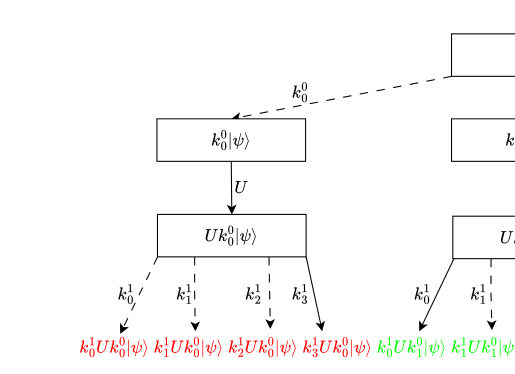 
Fig. 1: Trajectree saving example

📷 Fig 2

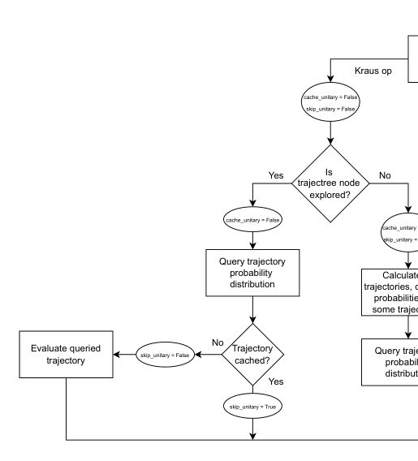 
Fig. 2: Trajectory saving scheme

📷 Fig 3

 
Fig. 3: (a) Average time per sample for entanglement swap experiment. (b) Average time per sample by number of saved nodes.

📷 Fig 4

 
Fig. 9. We choose the entanglement swapping experiment for our benchmarks due to its pivotal role in optical entanglement distribution, sufficient computational complexity to analyze the simulator (it requires eight optical modes in tensor product) and variable parameters with physical relevance which allow testing a range of properties of the simulator. In summary, the entanglement swapping experiment performs a Bell state measurement between one of the modes of two independent entanglement generation sources, thereby entangling the remote modes. We further elaborate the experiment in Sec. V-B.

📷 Fig 5

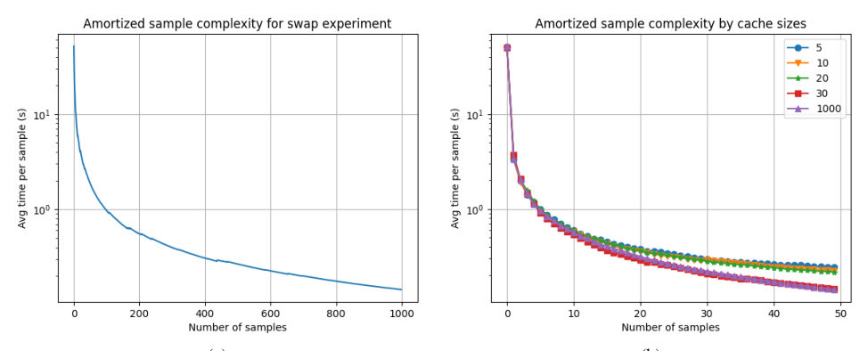 
Figure 5 (a) compares the wall clock time required to perform the entanglement swapping experiments described in Sec. V-B for multiple tensor network error tolerances (to understand the relationship between simulation accuracy and computational complexity).

**Summary.** This paper introduces Trajectree, a novel quantum circuit simulator designed to efficiently handle deep and noisy open quantum systems. It achieves this by implementing a state-saving mechanism on quantum trajectories, drastically reducing the computational cost of Monte Carlo sampling. The simulator demonstrates superior performance on both general noisy circuits and complex quantum optical experiments.

**Why it may be interesting.** This work directly addresses the computational bottleneck in simulating realistic, noisy quantum hardware (both superconducting and photonic), providing a scalable simulation tool for quantum information processing.

Detailed structure

**Main problem.** The primary goal is to efficiently simulate broad and deep noisy quantum circuits, particularly those describing open quantum systems, which typically suffer from exponential scaling issues.

**Main result.** The proposed simulator, Trajectree, achieves significant speedups (up to 5x faster than QSim) by implementing a novel state-saving partial execution scheme for quantum trajectories.

**Method.** It utilizes a quantum trajectory-based simulation approach combined with a tree-like data structure that saves partially executed quantum trajectories to avoid redundant Monte Carlo sample calculations.

**Model / system.** The simulator handles open quantum systems using Kraus operators, supporting both qubit and qudit systems. It features a dedicated optical backend for simulating photonic circuits, including entanglement swapping and optical CNOT gates.

**Key observables.** Expectation values of observables (Tr[rho O]), entanglement visibility, and coincidence probabilities for optical gates.

**Important parameters / regimes.** The efficiency gain is measured relative to standard simulators like Google's QSim; memory management is controlled using an MFU node replacement algorithm.

**Assumptions / limitations.** The core assumption is that saving the most frequently encountered quantum trajectories provides a significant computational advantage over full density matrix evolution or naive trajectory sampling.

**Figures summary.** Figures illustrate the trajectory graph showing cached vs. uncached paths, and performance comparisons showing speedups for benchmark circuits and optical experiments.

**Paper structure.** The paper introduces the need for efficient open system simulation, details the Trajectree architecture using trajectory saving, demonstrates its performance on standard noisy circuits, and validates its utility by simulating specific quantum optical experiments.

Abstract

We introduce Trajectree, a quantum trajectory-based quantum circuit simulator that uses a novel, state-saving partial execution of the quantum circuits to simulate broad and deep noisy quantum circuits efficiently. Trajectree can efficiently generate a large number of Monte Carlo samples by saving partially executed trajectories. We conduct extensive performance analysis of the Trajectree approach, proving the utility of the trajectory saving scheme for simulations of open quantum systems. Using this architecture, we show that Trajectree can simulate standard benchmark noisy circuits over five times faster than Google's QSim, a part of the Cirq package. We also analyze Trajectree's performance for simulating quantum optical systems relevant to communication and computing applications. We demonstrate applications of the optical backend to simulate three optical experiments: CHSH Bell test, entanglement swapping, and optical CNOT gate. This shows Trajectree's potential for simulating noisy qudit and optical systems efficiently.

[↑ back to top](#top)

### [Annealing Dynamics of the Two-Dimensional Fully Frustrated Ising Model](http://arxiv.org/abs/2610.25109v1)

**Authors:** Kai-Hsin Wu, Anders W. Sandvik, Ying-Jer Kao  
**Type:** both · **Category:** statistical mechanics · **PDF:** <https://arxiv.org/pdf/2610.25109v1>  
**Analysis basis:** full PDF text, analyzed in chunks
**Topic relevance:** 🔥 `non-equilibrium universality` **4/5** · `analog quantum simulation` **2/5** · `methods for driven-dissipative` **2/5** · `driven-dissipative phase transition` **1/5** · `scars & prethermalization` **1/5**

📷 Fig 1

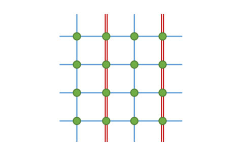 
FIG. 1. The FFIM on the square lattice. The nearest- neighbor Ising interactions are ferromagnetic in the horizontal direction (blue bonds) while in the vertical direction they are alternating ferromagnetic (blue bonds) and antiferromagnetic (red double-line bonds).

📷 Fig 2

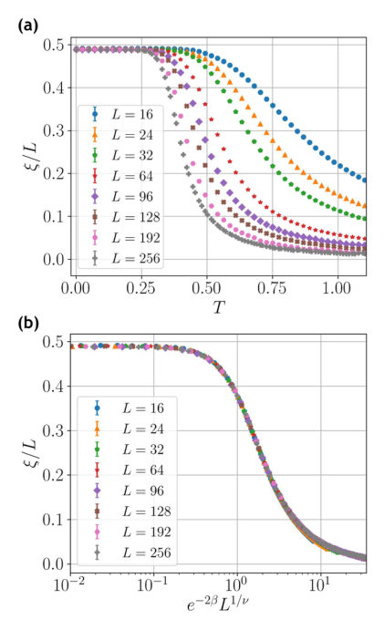 
FIG. 2. (a) Equilibrium correlation length for different system sizes vs temperature. (b) Finite-size scaling of the data in (a) using ν = 1 in Eq. (17a).

📷 Fig 3

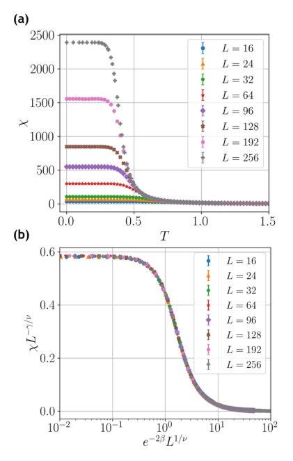 
FIG. 3. (a) Temperature dependence of the susceptibility of the FFIM in equilibrium for different system sizes. (b) Finite-size scaling of the data in (a) using the known exponent γ/ν = 3/2 and ν = 1 in Eq. (17b).

📷 Fig 4

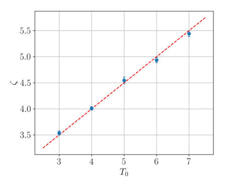 
FIG. 5. The generalized KZ exponent ζ as a function of the initial temperature. The exponents ζ for different T0 were ex- tracted from the scaling collapse of susceptibility, exemplified for T0 = 3 in Fig. 4. The expected linear function ζ = 0.5T0+z is consistent with the data and a fit gives z = 1.99(2).

📷 Fig 5

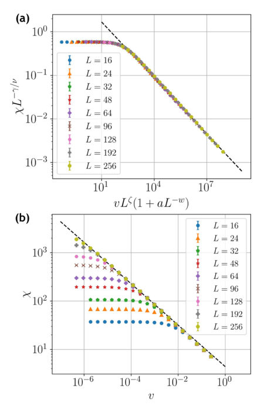 
FIG. 4. (a) The susceptibility scaled according to Eq. (28) using the known exponent γ/ν = 3/2 and fitted exponents ζ = 3.53(4), w = 1.0(2). The dashed line indicates a power- law relation in the diabatic region with slope −x defined in Eq. (27). (b) SA results of the susceptibility as a function of the inverse annealing time for various system sizes L. The simulations were started at initial temperature T0 = 3.

**Summary.** This paper analyzes the non-equilibrium dynamics of the 2D fully frustrated Ising model using simulated annealing. The authors adapt the Kibble-Zurek mechanism to account for the model's exponentially divergent correlation length near criticality. They find that the dynamic exponent $z$ is consistently close to 2 for various measured quantities, confirming theoretical expectations for relaxation dynamics.

**Why it may be interesting.** The work provides a detailed study of non-equilibrium dynamics in a highly frustrated magnetic system, offering insights into how critical slowing down manifests when standard assumptions about the critical point (like finite $T_c$) are violated.

Detailed structure

**Main problem.** The study investigates the dynamical scaling properties of the two-dimensional fully frustrated Ising model (FFIM) by simulating its annealing dynamics.

**Main result.** The dynamic exponent $z$ is found to be consistently close to 2 across different observables (susceptibility, excess energy, EA order parameter), suggesting the applicability of generalized Kibble-Zurek scaling laws even for systems with exponentially divergent correlation lengths.

**Method.** The research employs Monte Carlo simulations, specifically using simulated annealing protocols, and compares the results against theoretical scaling forms derived from the Kibble-Zurek mechanism.

**Model / system.** The system is the two-dimensional fully frustrated Ising model (FFIM) on a square lattice, characterized by specific ferromagnetic and alternating bonds. It is known for its highly degenerate, critical ground state at zero temperature.

**Key observables.** Dynamic exponent ($z$), susceptibility ($\chi$), excess energy density ($\Delta E$), and the Edwards-Anderson (EA) order parameter ($q_2$).

**Important parameters / regimes.** Initial temperature ($T_{initial}$ or $eta_0$), system size ($L$), and annealing velocity ($v$).

**Assumptions / limitations.** The analysis extends the Kibble-Zurek mechanism to handle the exponential divergence of the correlation length as $T 	o 0$, which requires modifying standard scaling assumptions.

**Figures summary.** Figures illustrate data collapse for equilibrium scaling (e.g., $\chi$ vs $T$) and show the scaling of various observables (susceptibility, energy, $q_2$) as a function of annealing velocity ($v$) for different system sizes ($L$).

**Paper structure.** The paper first establishes the model and the need to adapt the KZ mechanism. It then analyzes equilibrium scaling using the exponential divergence variable $\lambda$. Finally, it applies the generalized scaling forms to the annealing dynamics to extract the dynamic exponent $z$ for multiple observables.

Abstract

We study the dynamical scaling properties of the two-dimensional fully frustrated Ising model by simulated annealing. The model has a highly degenerate, critical ground state with well known equilibrium properties. To study its out-of-equilibrium behavior, we develop an annealing protocol that is convenient for extending the Kibble-Zurek mechanism to the case of an exponentially divergent correlation length in the limit of the temperature $T \to T_c = 0$. We find excellent agreement with the scaling forms derived, including a dependence on the initial temperature that is not present in the conventional Kibble-Zurek mechanism. The dynamic exponent $z$ is consistent among all quantities studied; fits of its dependence on the initial temperature give $z = 1.99(2)$ (susceptibility), $z = 2.072(8)$ (excess energy), and $z = 2.09(3)$ (Edwards-Anderson order parameter). These values are close to $z=2$, which is consistent with previous studies of relaxation after instantaneous quenches and of time dependent correlations in equilibrium, including the estimate $z = 2.004(9)$ from equilibrium autocorrelation functions.

[↑ back to top](#top)

### [Adiabatic controlled-$Z$ gate for neutral atoms with Förster-enhanced Rydberg dressing](http://arxiv.org/abs/2610.24755v1)

**Authors:** Diksha Thapliyal, Ajay Wasan  
**Type:** theory · **Category:** other · **PDF:** <https://arxiv.org/pdf/2610.24755v1>  
**Analysis basis:** full PDF text, analyzed in chunks
**Topic relevance:** 🔥 `Rydberg arrays` **4/5** · `analog quantum simulation` **3/5** · `QC/QI experiment` **2/5**

📷 Fig 1

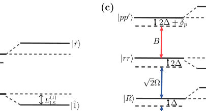 
FIG. 1: Energy-level structure and Rydberg dressing for the CZ gate. (a) Bare level structure of two atoms separated by the interatomic distance R. The laser couples |1⟩to |r⟩with Rabi frequency Ωand detuning ∆, while the dipole-dipole interaction couples the pair states |rr⟩and |pp′⟩with strength B. (b) Single-atom dressing in the basis {|1⟩, |r⟩}. The dressed state |e1⟩connected to |1⟩acquires the light shift E(1) LS . (c) Two-atom dressing in the basis {|11⟩, |R⟩, |rr⟩, |pp′⟩}, where |R⟩= (|1r⟩+ |r1⟩)/ √

📷 Fig 2

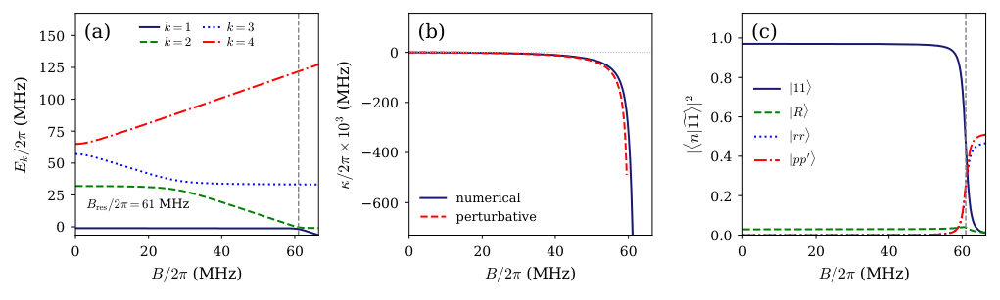 
FIG. 2: Dressed state spectrum as a function of the pair coupling B, for Ω/2π = 8 MHz, ∆/2π = 32 MHz, and δp/2π = −6.9 MHz. (a) Dressed eigenenergies Ek/2π as functions of B/2π. The vertical dashed line indicates Bres/2π = 61 MHz, defined by the minimum energy gap between |f 11⟩and the nearest dressed state. (b) Effective dressed interaction κ obtained from the full Hamiltonian (blue solid) and from the perturbative expression in Eq. (6) (red dashed). (c) Bare-state probabilities of |f 11⟩for the basis states |11⟩, |R⟩, |rr⟩, and |pp′⟩.

📷 Fig 3

 
FIG. 3: Effective dressed interaction |κ|/∆× 103 (blue solid, left axis), dressed state gap Egap/∆between |f 11⟩and the nearest dressed state (red dashed, right axis), and Rydberg admixture PRyd of |f 11⟩(green dotted, right axis), as func- tions of the normalized pair coupling B/Bres for the same parameters as in Fig. 2. Here, Bres is defined by the min- imum of Egap. The horizontal dotted line shows reference value PRyd = 0.11, and the shaded region indicates the inter- val B/Bres ∈[0.80, 0.98].

📷 Fig 4

 
FIG. 4: CZ-gate performance at zero relative F¨orster defect (γ = 0) as functions of the peak dressing ratio α0 = Ωmax/∆and the normalized pair coupling β/βres. (a) Minimum adiabatic population P min adiab. (b) Conditional phase error (ϕCZ −π)/π. (c) Bell-state fidelity FBell. (d) Peak Rydberg state population P max Ryd . For each (α0, β/βres), the quantities are evaluated at the smallest complete-pulse duration for which ϕCZ(τgate) = π within α0τgate ≤160π. The red region in (d) satisfies ϕCZ = π, P min adiab ≥0.999, FBell ≥0.9999, and P max Ryd ≤0.11. The star marks the point with the smallest α0τgate within this region.

📷 Fig 5

 
FIG. 5: Dependence of the selected CZ-gate parameters on the relative F¨orster defect γ = δp/∆. (a) Pair coupling βres at the avoided crossing for α0 = 0.20, 0.25, 0.30, and 0.35. (b) Minimum α0τgate = ΩmaxT among the points satisfying the gate conditions at each γ. (c) Corresponding normalized pair coupling β/βres.

**Summary.** This paper details the theoretical design of an adiabatic controlled-Z gate for neutral atoms by exploiting Förster-enhanced dipole-dipole coupling in Rydberg dressed states. The authors determine an optimal operating regime that maximizes the gate interaction while keeping the Rydberg excitation probability low. They rigorously analyze gate fidelity by accounting for both finite Rydberg lifetime and parasitic interactions from spectator atoms.

**Why it may be interesting.** This work provides a detailed, quantitative roadmap for building quantum gates using highly controllable, long-range interactions inherent to Rydberg atoms, which is a cornerstone of modern quantum simulation and computing.

Detailed structure

**Main problem.** The paper addresses the challenge of implementing an adiabatic controlled-Z (CZ) gate for neutral atoms by leveraging Förster-enhanced dipole-dipole coupling between Rydberg pair states.

**Main result.** They identify an optimal operating range where the required conditional phase is accumulated with high fidelity while minimizing transient Rydberg population, and they quantify the error contributions from finite lifetime and spectator atoms.

**Method.** The analysis uses time-dependent quantum simulation, tracking the evolution of dressed states under a smooth pulse, and calculating the accumulated conditional phase $\phi_{CZ}(T)$.

**Model / system.** The system involves neutral atoms trapped in optical tweezers, using hyperfine ground states as qubits, with entanglement mediated by excitation to Rydberg states. The Hamiltonian models single-atom and two-atom interactions, incorporating the Förster defect $\delta_p$.

**Key observables.** Conditional phase ($\phi_{CZ}$), Bell-state fidelity ($F_{Bell}$), maximum Rydberg population ($P_{max}^{Ryd}$), and spectator-induced phase shift ($\Delta F_{talk}$).

**Important parameters / regimes.** Dipole-dipole coupling strength ($B$), Rabi frequency ($\Omega$), Förster defect ($\delta_p$), and pulse duration ($T$).

**Assumptions / limitations.** The analysis assumes adiabatic evolution is possible in the identified operating range, and error sources are quantified separately (lifetime vs. spectator interaction).

**Figures summary.** Figures illustrate the energy level structure and Rydberg dressing (Fig. 1), the dependence of the effective interaction $\kappa$ on coupling strength $B$ (Fig. 2, 3), and the time-dependent dynamics showing population evolution and phase accumulation (Fig. 9, 10).

**Paper structure.** The paper first establishes the model and the role of Förster enhancement in generating the necessary interaction. It then analyzes the time-dependent dynamics to select optimal pulse parameters, followed by a detailed analysis of error sources, including spectator atom interactions.

Abstract

We study an adiabatic controlled-$Z$ (CZ) gate for neutral atoms in which dipole-dipole coupling between nearly degenerate Rydberg pair states enhances the interaction between dressed ground states. This coupling produces an avoided crossing in the two-atom dressed-state spectrum. Approaching the crossing enhances the dressed interaction, but also reduces the dressed-state gap and increases the Rydberg admixture. We identify a Förster-enhanced operating range in which the required conditional phase is accumulated with adiabatic return and small transient Rydberg population. We then analyze the finite-time dynamics of the two-qubit computational states under a smooth pulse. Reducing the dressing strength weakens the dressed interaction, so maintaining the target phase at the same pulse duration requires operation closer to the avoided crossing, where the Rydberg admixture increases. This dependence is then used to select the shortest gate at a fixed peak Rabi frequency in the Förster-enhanced operating range that accumulates the CZ phase with high Bell-state fidelity while keeping the Rydberg population small. Changing the Förster defect shifts the avoided crossing, while the gate parameters change only weakly. For a specific rubidium Förster channel, the selected gate corresponds to experimentally relevant laser coupling, pulse duration, and interatomic separation. We also estimate errors from the finite Rydberg lifetime and from weak excitation of a neighboring spectator atom. For the parameters considered, the spectator-induced error remains below the finite-lifetime contribution.

[↑ back to top](#top)

### [Trapped-ion quantum simulation of (1+1)D SU(2) lattice gauge theory via loop-string-hadron formulation](http://arxiv.org/abs/2610.24091v1)

**Authors:** Toshiaki Kaji, Jesse R. Stryker, Yutaro Iiyama, Lento Nagano, Enrico Rinaldi, Christian W. Bauer, Koji Terashi  
**Type:** experiment · **Category:** other · **PDF:** <https://arxiv.org/pdf/2610.24091v1>  
**Analysis basis:** full PDF text, analyzed in chunks
**Topic relevance:** 🔥 `QC/QI experiment` **4/5** · 🔥 `analog quantum simulation` **4/5**

📷 Fig 1

 
FIG. 1. The lattice and its degrees of freedom. (a) A de- piction of the lattice with four staggered sites, open bound- ary conditions, and a single unit of external flux sourced at the right-side boundary. (b) A depiction of the LSH de- grees of freedom relevant to the system. Each box corre- sponds to one qubit used to represent the indicated quantum numbers. (c) A cartoon illustration of the LSH basis state |(0, 1, 0), (0, 1, 1), (0, 0, 2), (1, 0, 1)⟩, with a certain set of spec- ified boundary flux values. Red dots are drawn to illustrate the Abelian Gauss’s law: the units of gauge flux at either end of a link must be balanced.

📷 Fig 2

 
FIG. 2. First-order Trotterized circuit for 4 lattice sites. Each labeled block represents the propagator associated with the indicated Hamiltonian subterm rather than an elementary gate. Blocks spanning multiple register lines indicate the qubits on which the corresponding subterm acts; they do not necessarily imply entangling operations between all of those qubits.

📷 Fig 3

 
FIG. 3. An example of error conversion in the hopping subterm H(j=1) I (r = 0). Registers i(r), o(r), ℓ(r) are assigned for ni(r), no(r), nℓ(r), respectively. The gray box represents the diagonal block, implemented using RZ and CX gates. (a) The original circuit without the error insertion. (b) A Z-error between H gates is converted into the X error, which is further propagated and spreads out. (c) A Z-error outside two H gates propagates and can change some angles, but is not converted to X-errors, at least in this subcircuit.

📷 Fig 4

 
FIG. 4. Estimated effective depolarizing-noise parameters ob- tained using the test circuits. The red squares, yellow trian- gles, and green inverted triangles correspond to the observ- ables on links 0, 1, and 2, respectively.

📷 Fig 5

 
FIG. 5. Discard rate and number of shots remaining after post-selection as functions of the number of Trotter steps. The black left vertical axis corresponds to the discard rate shown by black circles, while the red right vertical axis cor- responds to the number of remaining shots shown by red di- amonds.

**Summary.** This work presents a quantum simulation of the SU(2) lattice gauge theory using trapped ions, employing the advanced loop-string-hadron formulation. By mapping the theory onto qubits, the authors simulate the time evolution of the electric field, demonstrating that current quantum hardware can tackle complex gauge theories while achieving substantial noise reduction through sophisticated error mitigation protocols.

**Why it may be interesting.** The direct use of trapped ions to simulate a complex, non-Abelian lattice gauge theory is highly relevant, showcasing the capability of trapped-ion platforms to handle intricate, constrained many-body dynamics.

Detailed structure

**Main problem.** The paper addresses the challenge of simulating interacting quantum field theories, specifically SU(2) lattice gauge theory, without relying on perturbative methods or encountering the sign problem.

**Main result.** The authors successfully demonstrated that modern trapped-ion quantum hardware can simulate complex lattice gauge theories, achieving significant error reduction through advanced error mitigation techniques.

**Method.** The simulation uses the loop-string-hadron (LSH) formulation to map the gauge theory Hamiltonian onto qubit operators, followed by Trotterized real-time quantum evolution.

**Model / system.** The system is an SU(2) lattice gauge theory in 1+1 dimensions with one flavor of fermions. The simulation is implemented on the trapped-ion Quantinuum System Model H2, utilizing qubits to encode both bosonic gauge and fermionic matter degrees of freedom.

**Key observables.** Time evolution of the electric-field energy density across the lattice.

**Important parameters / regimes.** The simulation accesses the $j=1$ electric-flux sector, surpassing the typical $j_{	ext{max}}=1/2$ truncation, and uses a minimal four-site lattice.

**Assumptions / limitations.** The simulation relies on the LSH formulation to manage Gauss's law constraints and employs error mitigation techniques like rescaling and post-selection to combat hardware noise.

**Figures summary.** Figure 12 compares the calculated electric energy density over time, contrasting theoretical predictions with results obtained from a quantum emulator using raw, depolarizing error-mitigated, and post-selection error-mitigated measurements.

**Paper structure.** The paper reviews the LSH setup, details the circuit construction and necessary optimizations, discusses the application of error mitigation techniques, and finally presents the simulation results using data from the H2-2 platform.

Abstract

We present a quantum simulation of the SU(2) lattice gauge theory in 1+1 dimensions with one flavor of fermions, performed using the trapped-ion Quantinuum System Model H2. This work is based on the loop-string-hadron (LSH) formulation of the gauge theory, and is distinguished by using qubits to represent both bosonic-gauge and fermionic-matter degrees of freedom. Furthermore, we access the $j=1$ electric-flux sector beyond the $j_{\max}=1/2$ truncation commonly used in SU(2) quantum simulations. To that end, we digitize an electric-field degree of freedom using a multiqubit register for representing the bosonic quantum number. Our simulation therefore synthesizes several key ingredients relevant to quantum simulations in higher spatial dimensions, in particular explicit local gauge-field degrees of freedom represented here by a multiqubit bosonic register, while relying solely on circuit-construction optimizations that are expected to scale polynomially with lattice size. This work demonstrates that modern quantum hardware is increasingly able to accommodate the features of complicated but physically important lattice gauge theories while successfully reproducing the expected Trotterized dynamics.

[↑ back to top](#top)

### [Beyond low-dissipation regime: general condition for Curzon-Ahlborn efficiency](http://arxiv.org/abs/2610.24434v1)

**Authors:** Yuki Izumida  
**Type:** theory · **Category:** statistical mechanics · **PDF:** <https://arxiv.org/pdf/2610.24434v1>  
**Analysis basis:** full PDF text, analyzed in chunks
**Topic relevance:** 🔥 `non-equilibrium universality` **4/5** · `correlated / nonlocal dissipation` **1/5** · `driven-dissipative phase transition` **1/5**

📷 Fig 1

 
Low-resolution page preview, page 2

📷 Fig 2

 
Low-resolution page preview, page 3

📷 Fig 3

 
Low-resolution page preview, page 4

📷 Fig 4

 
Low-resolution page preview, page 5

📷 Fig 5

 
Low-resolution page preview, page 6

**Summary.** This paper generalizes the analysis of heat engine efficiency beyond the standard low-dissipation approximation. By incorporating nonlinear heat transfer responses, the authors derive a general condition necessary for the recovery of the Curzon-Ahlborn efficiency at the quadratic order. This clarifies the physical requirements for efficiency universality in more realistic, non-linear thermodynamic settings.

**Why it may be interesting.** This work provides a rigorous, non-equilibrium thermodynamic framework to understand the conditions for efficiency universality, which is crucial for understanding energy conversion processes in complex, non-linear systems.

Detailed structure

**Main problem.** The study aims to derive a general condition under which the Curzon-Ahlborn (CA) efficiency is recovered at the quadratic order, extending the analysis beyond the standard low-dissipation regime.

**Main result.** A general condition, $\kappa_h^2 \kappa_{h1} = \kappa_c^2 \kappa_{c1}$ (or its equivalent in other formulations), is derived for the recovery of CA efficiency, showing that this condition encompasses both the generalized symmetric dissipation case and the original CA model.

**Method.** The authors use asymptotic expansions of heat absorbed ($Q_i$) in the inverse operation time ($1/	au_i$) and maximize the power output ($P$) with respect to the finite operation times ($	au_h, 	au_c$).

**Model / system.** The model is a heat engine operating between two heat baths ($T_h$ and $T_c$) over finite times, analyzed using a generalized heat-transfer law that includes nonlinear response terms.

**Key observables.** Carnot efficiency ($\eta_C$), Curzon-Ahlborn efficiency ($\eta_{CA}$), and the efficiency expansion coefficients up to the quadratic order.

**Important parameters / regimes.** Heat bath temperatures ($T_h, T_c$), operation times ($	au_h, 	au_c$), and the coefficients ($\kappa_{i1}, \kappa_{i2}$) characterizing the nonlinear heat transfer.

**Assumptions / limitations.** The analysis relies on asymptotic expansions up to quadratic order in $1/	au_i$, and the comparison involves specific models like the standard low-dissipation framework and the endoreversible CA model.

**Figures summary.** Not specified in the notes, but the analysis involves deriving and comparing several mathematical conditions (e.g., Eq. 12 and Eq. 23) derived from power maximization.

**Paper structure.** The paper progresses by first establishing the context of CA efficiency in the low-dissipation limit, then extending the model to include nonlinear response via a generalized heat-transfer law, and finally deriving the general condition that must be met for CA efficiency recovery in this extended regime.

Abstract

In recent years, physicists have extensively investigated the universality of Curzon-Ahlborn (CA) efficiency as the efficiency at maximum power of heat engines, which, like Carnot efficiency, is determined only by heat-bath temperatures. While the universality of the CA efficiency to the first order in the temperature difference is established within linear response theory in the inverse operation time, it is generally lost at quadratic order. In the low-dissipation Carnot heat engine model known as the standard framework, the symmetric dissipation condition is necessary. Yet, it is not a necessary condition as the original CA model that adopts endoreversibility does not require such symmetry. In this study, we extend the low-dissipation model to include nonlinear response in the inverse operation time and derive a general condition under which the CA efficiency is recovered in the quadratic order. The generalized symmetric dissipation condition and the CA model with Newton's law of cooling are shown to be special cases of this condition. By applying the obtained condition, we also clarify the condition under which an endoreversible model with a general heat-transfer law exhibits the CA efficiency.

[↑ back to top](#top)

### [Gate-defined quantum dot and charge noise analysis in a Forksheet transistor](http://arxiv.org/abs/2610.24136v1)

**Authors:** Dominic Leclerc, Claude Rohrbacher, Alexis Morel, Joffrey Rivard, Romain Ritzenthaler, Christian Lupien, Hans Mertens, Naoto Horiguchi, Eva Dupont-Ferrier  
**Type:** experiment · **Category:** quantum information and computing · **PDF:** <https://arxiv.org/pdf/2610.24136v1>  
**Analysis basis:** full PDF text, analyzed in chunks
**Topic relevance:** 🔥 `QC/QI experiment` **4/5** · `quantum measurements` **1/5**

📷 Fig 1

 
Fig. 1. a) TEM image across the conduction channel of the Forksheet device from [15]. b) Illustration of the measurement setup with the measured Forksheet (FS) device at 10 mK.

📷 Fig 2

 
Fig. 2. Transfer characteristics of the Forksheet device as a function of temperature. a) Drain current IDS as a function of gate voltage VG at different temperatures, shown on a logarithmic scale (left axis) and a linear scale (right axis). b) Extracted subthreshold swing and threshold voltage as a function of temperature.

📷 Fig 3

 
Fig. 4. Example of a charge-noise measurement and comparison with other noise sources. a) Coulomb peak at VDS = 2 mV showing the three points of comparison. b) Power spectral density (PSD) measured at the three points of comparison, illustrating the range of validity of the charge-noise measurement and the Lorentzian spectral shape with a characteristic frequency f0 ∼0.1 Hz.

📷 Fig 4

 
Fig. 3. Measured stability diagram of the Forksheet device at T = 10 mK, with the electron filling identified from N = 0 to N = 5. The color scale represents the differential conductance G = ∂IDS/∂VDS in units of e2/h, computed numerically.

**Summary.** This work reports the cryogenic characterization of a Forksheet transistor containing a gate-defined quantum dot. The authors successfully demonstrated transistor operation and observed clear Coulomb blockade features at millikelvin temperatures. Crucially, they measured the charge noise, achieving a low value comparable to state-of-the-art silicon spin qubits, highlighting the technology's potential for monolithic integration in future quantum processors.

**Why it may be interesting.** The demonstration of low charge noise in a standard CMOS process flow, particularly using a gate-all-around architecture, is highly relevant for developing scalable solid-state qubits and quantum processors.

Detailed structure

**Main problem.** The study characterizes charge noise in a gate-defined quantum dot formed within a Forksheet transistor structure to assess its potential for scalable quantum computing integration.

**Main result.** The device retains transistor operation at cryogenic temperatures and exhibits a low average charge-noise amplitude ($\langle S_0 
angle = 10 	ext{ } \mu	ext{eV}/\sqrt{	ext{Hz}}$), comparable to state-of-the-art silicon spin-qubit devices.

**Method.** The researchers performed cryogenic characterization, measuring transistor transfer characteristics, observing Coulomb blockade in the quantum dot regime, and quantifying charge noise via current Power Spectral Density measurements.

**Model / system.** The physical system is a 14-nm nMOS Forksheet transistor fabricated on a 300 mm platform, which hosts a gate-defined quantum dot operable in the single-electron regime.

**Key observables.** Transistor transfer characteristics ($I_{DS}$ vs $V_G$), Coulomb blockade features, and the charge-noise amplitude $\langle S_0 
angle$.

**Important parameters / regimes.** Cryogenic temperatures down to 10 mK; average charging energy $\langle E_C 
angle \approx 10 	ext{ meV}$; noise levels in the $1-10 	ext{ } \mu	ext{eV}/\sqrt{	ext{Hz}}$ range.

**Assumptions / limitations.** The noise measurement assumes the observed noise is intrinsic to the quantum dot and not dominated by setup noise or thermal fluctuations.

**Figures summary.** Figures show the temperature dependence of transistor characteristics (Fig. 2), stability diagrams confirming Coulomb diamonds (Fig. 3), and the charge-noise Power Spectral Density (PSD) measurements (Fig. 4).

**Paper structure.** The paper progresses by first demonstrating basic cryogenic transistor function, then confirming quantum dot formation via Coulomb blockade, and finally quantifying the charge noise using the quantum dot as a sensitive charge sensor.

Abstract

We report the cryogenic characterization of a 14-nm nMOS Forksheet transistor down to 10 mK. We demonstrate that the device retains transistor operation with improved characteristics at cryogenic temperatures, while also forming a gate-defined quantum dot that can be tuned to the single-electron regime. In the quantum-dot regime, we perform low-frequency charge-noise measurements across different charge occupations and observe an average charge-noise amplitude of $\langle S_0\rangle = 10\;μ\mathrm{eV}/\sqrt{\mathrm{Hz}}$ at 1 Hz, with a minimum measured value of $3.3\;μ\mathrm{eV}/\sqrt{\mathrm{Hz}}$. These results highlight the potential of Forksheet technology for the monolithic cointegration of quantum and classical CMOS functionalities in future quantum processors.

[↑ back to top](#top)

### [Generalized Svetlichny Inequalities as a Cross-Platform Benchmark for Quantum Processors](http://arxiv.org/abs/2610.24213v1)

**Authors:** Andrés Camilo Granda Arango, Giuseppe Sergioli, Luigi Iapichino, Tobias Valentin Bauer, Carlo Cuccu, Roberto Giuntini  
**Type:** both · **Category:** quantum information and computing · **PDF:** <https://arxiv.org/pdf/2610.24213v1>  
**Analysis basis:** full PDF text, analyzed in chunks
**Topic relevance:** 🔥 `QC/QI experiment` **4/5** · `quantum measurements` **1/5**

📷 Fig 1

 
FIG. 1. Normalized Svetlichny violation VN under calibrated hardware noise models for the AQT trapped-ion plat- form (FakeAQT) and six superconducting noise models available through the Qiskit FakeProvider framework (FakeAlgiers, FakeBrisbane, FakeMontrealV2, FakeCusco, FakeSingaporeV2, FakeTorontoV2). (a) VN as a function of the number of qubits, from N = 2 to N = 10. Shaded bands around each curve indicate 95% confidence intervals (based on Student’s t-distribution) from 20 repetitions per data point, not visible where smaller than the line width. The dotted line at VN = 1 marks the boundary between the white HLR region and the green nonclassical region. (b) VN at N = 10 for each...

📷 Fig 2

 
FIG. 2. Normalized Svetlichny violation VN from N = 2 to N = 10 qubits. Blue triangles correspond to AQT IBEX Q1, red circles to AQT Marmot, and orange diamonds to IQM EQE1. Shaded bands around each curve indicate 95% confidence in- tervals. The dotted line at VN = 1 marks the boundary be- tween the white HLR region and the green nonclassical region.

📷 Fig 3

 
FIG. 3. Readout error mitigation. Normalized Svetlichny violation VN for AQT IBEX Q1 (blue triangles), AQT Marmot (red circles), and IQM EQE1 (orange diamonds) under unmitigated (open markers) and mitigated (solid markers) conditions. (a) Correlated readout mitigation up to N = 6. The dotted green line at VN = √

📷 Fig 4

 
FIG. 4. Mitigation gain. Relative improvement from readout error mitigation, ∆mit (%), for AQT IBEX Q1, AQT Marmot, and IQM EQE1. (a) Correlated readout mitigation, up to N = 6. (b) Local readout mitigation, up to N = 10.

📷 Fig 5

 
FIG. 5. GHZ-state preparation circuit: (a) Logical circuit (black), IQM (cream), and AQT (blue) transpiled implementations. (b) N = 3 example: logical circuit (top, black), IQM implementation (middle, cream), AQT implementation (bottom, blue).

**Summary.** This work introduces the generalized Svetlichny inequality as a cross-platform benchmark to test multipartite nonlocality on superconducting and trapped-ion quantum computers. By comparing raw measurements against error-mitigated results, the authors quantify the impact of readout noise and demonstrate a common framework for assessing collective quantum performance across different hardware modalities.

**Why it may be interesting.** It provides a concrete, hardware-agnostic metric for assessing the collective performance of quantum processors, which is crucial for benchmarking NISQ devices in the context of fundamental quantum physics tests.

Detailed structure

**Main problem.** The paper addresses the need for a device-independent, yet sensitive, benchmark to compare the collective quantum performance of diverse, noisy quantum processors.

**Main result.** The generalized Svetlichny inequality successfully benchmarks nonlocality across trapped-ion and superconducting platforms, showing that readout error mitigation can recover significant performance, though intrinsic decoherence remains a key limitation.

**Method.** The authors use the violation of generalized Svetlichny inequalities, applied to GHZ-state circuits, as a test for multipartite nonlocality, comparing raw results against those corrected by local and correlated readout error mitigation.

**Model / system.** The study utilizes three heterogeneous quantum processors: trapped-ion (Marmot, IBEX Q1) and superconducting (Euro-Q-Exa System 1). The benchmark relies on simulating multipartite nonlocality using GHZ states.

**Key observables.** Normalized Svetlichny violation ($V_N$), which quantifies the deviation from the classical local-realism bound ($V_N > 1$).

**Important parameters / regimes.** Subsystem size ($N=2$ to $N=10$ qubits); the degree of noise (raw vs. mitigated); and the type of error mitigation (local vs. correlated).

**Assumptions / limitations.** The test is a simulation of nonlocality, not a loophole-free certification, due to the inability to achieve space-like separation on current hardware. The choice of mitigation strategy involves a trade-off between accuracy and scalability.

**Figures summary.** Figures illustrate the normalized violation ($V_N$) versus qubit number ($N$) for ideal simulations, raw hardware runs (showing platform differences), and after applying error mitigation techniques.

**Paper structure.** The paper establishes the theoretical benchmark (Svetlichny inequalities), applies it to three distinct hardware platforms, systematically measures performance degradation due to noise, and finally compares the efficacy of local versus correlated readout error mitigation.

Abstract

A cross-platform benchmark should be device-independent yet sensitive to imperfections accumulated during execution. Building on prior work, we formulate and validate a protocol through demonstrations based on generalized Svetlichny inequality violations (a simulation, rather than a loophole-free certification, of multipartite nonlocality) for larger subsystem sizes. We apply it unchanged to three processors, the trapped-ion Marmot and IBEX Q1 (both manufactured by AQT) and the superconducting Euro-Q-Exa System 1 (IQM), using identical GHZ-state circuits with fixed theoretical measurement settings from N=2 to N=10 qubits. Both trapped-ion processors sustain violations up to ten qubits, while the superconducting processor loses them beyond six qubits under unmitigated (raw) conditions; readout-error mitigation recovers violations up to eight qubits, with a substantial fraction of the degradation attributable to measurement imperfections. These processors provide a heterogeneous testbed for validating the protocol's cross-platform applicability and discriminating power, demonstrating its practicality as a common framework for assessing collective quantum performance.

[↑ back to top](#top)

### [Optical vortex bullets with large angular momenta](http://arxiv.org/abs/2610.26289v1)

**Authors:** José R. Salgueiro, Carlos F. Sánchez, Boris A. Malomed, Ángel Paredes, Humberto Michinel  
**Type:** theory · **Category:** quantum gases · **PDF:** <https://arxiv.org/pdf/2610.26289v1>  
**Analysis basis:** full PDF text, analyzed in chunks
**Topic relevance:** 🔥 `analog quantum simulation` **4/5** · `interference shaping light` **1/5**

📷 Fig 1

 
FIG. 2. The norm of vortex bullets vs. the propagation con- stant for different values of the guiding-profile’s strength γ, fixed width parameter q = 1/2, see Eq. (4), and four values of the winding number, from ℓ= 1 to 4. Points marked with let- ters correspond to the modes whose propagation is displayed in Fig. 6 (the letters match in both figures).

📷 Fig 2

 
FIG. 1. Examples of optical bullets with embedded vortic- ity ranging from ℓ= 1 to 4, for γ = 4, q = 1/2 and β = 1.0. (a) Radial spatial profiles in cross-section T = 0 (to which the maximum amplitude belongs). (b) Temporal profiles in cross- section r = rmax, where the maximum amplitude is attained. (c-f) 3D toroidal shapes of vortex bullets with winding num- bers ℓ= 1, 2, 3 and 4, respectively, represented by means of isosurfaces ψ = 0.25.

📷 Fig 3

 
FIG. 3. (a) The norm vs. low values of the propagation constant for the family of solutions with ℓ= 1, γ = 3.3, q = 0.5. (b) Temporal field profiles in the cross-section r = rmax, corresponding to the field maximum. (c) Widths vs. β of the field in the spatial (wr) and temporal (wT ) directions in the cross-sections corresponding to the field maximum. (d) The maximum field amplitude vs. β.

📷 Fig 4

 
FIG. 5. (a-c) The instability growth rate as a function of different system’s parameters: topological charge (a), index strength (b), and the profile’s width w = 1/√q (c), with fixed values of other parameters, as indicated in each panel. The propagation constant is β = 3 in all cases. Dashed thin lines connecting the points are plotted as a guide for the eye. (d) The maximum field amplitude plotted against the prop- agation distance for the points shown in panel (b). (e) The same for the points represented in panel (c).

📷 Fig 5

 
FIG. 4. The development of the splitting (azimuthal) insta- bility for the toroidal vortex bullets with winding numbers ℓ= 2, 3, and 4. In all cases, the guiding-profile strength is γ = 4. (a) ℓ= 2, q = 0.16, β = 1.0; (b) ℓ= 3, q = 0.08, β = 1.0; (c) ℓ= 4, q = 0.04, β = 1.5. The panels show the plane (x, y) with T = 0, where the field maximum is located.

**Summary.** This work theoretically analyzes stable, high-angular-momentum optical vortex solitons propagating in structured nonlinear media. By modeling the system using the nonlinear Schrödinger equation, the authors demonstrate that while engineered guiding potentials enhance stability, the structures remain susceptible to azimuthal instabilities. The findings provide crucial guidelines for controlling and supporting complex quantum light/matter waves.

**Why it may be interesting.** The direct analogy to matter-wave solitons in BECs makes this highly relevant to AMO physics, providing theoretical guidelines for stabilizing complex, high-angular-momentum quantum matter waves.

Detailed structure

**Main problem.** The study investigates the existence, structure, and stability of three-dimensional spatiotemporal optical vortex solitons (light bullets) carrying high orbital angular momentum.

**Main result.** Engineered refractive-index landscapes significantly enlarge the stability domain for these vortex bullets, although their robustness is ultimately limited by azimuthal instabilities that grow with angular momentum.

**Method.** The analysis involves solving the (3+1)D nonlinear Schrödinger equation numerically, using stability criteria like the Vakhitov-Kolokolov (VK) criterion.

**Model / system.** The system models light propagation in Kerr media with anomalous group-velocity dispersion and a transversely localized Gaussian refractive index profile. This is mathematically analogous to matter-wave solitons in Bose-Einstein condensates.

**Key observables.** Topological charge ($\ell$), Norm ($N$), Field amplitude evolution over propagation distance ($z$), and Instability growth rate.

**Important parameters / regimes.** Topological charge ($\ell=1$ to $4$), Guiding potential strength ($\gamma$), and Guiding profile width ($q$).

**Assumptions / limitations.** The stability analysis relies on the Vakhitov-Kolokolov (VK) criterion, which is necessary but not sufficient for full stability.

**Figures summary.** Figures illustrate vortex bullet cross-sections, the dependence of the norm on the propagation constant ($eta$) relative to the VK criterion, and the growth of azimuthal instability as a function of $\ell$ and $\gamma$.

**Paper structure.** The paper systematically analyzes the solutions to the reduced nonlinear Schrödinger equation, first establishing the existence of stable states based on the VK criterion, and then using direct simulations to probe the ultimate limitations imposed by azimuthal instabilities.

Abstract

We investigate three-dimensional spatiotemporal optical vortex solitons (light bullets with a toroidal shape) carrying higher-order orbital angular momentum in Kerr media with anomalous group-velocity dispersion and a transversely localized Gaussian profile of the linear refractive index. Stationary vortex bullets with topological charges (winding numbers) $1\leq \ell \leq 4$ are obtained as numerical solutions of the three-dimensional nonlinear Schrödinger equation, and their existence, structure and stability are systematically analyzed. In terms of atomic Bose-Einstein condensates, these solutions represent matter-wave solitons with embedded vorticity. We examine the dependence of the solution families on the propagation constant, the depth and width of the guiding profile, and $\ell $. It is found that the increase of $\ell $ requires one to use a stronger or wider waveguiding potential to sustain localized states satisfying the Vakhitov-Kolokolov (VK) stability criterion. VK-complying and non-complying branches of vortex-soliton families are separated by a degenerate Townes branch. Direct simulations reveal that, although the guiding profile substantially suppresses the collapse and extends the propagation distance of vortex bullets, their robustness is ultimately limited by azimuthal instabilities, whose growth is enhanced for values of $\ell $. These results demonstrate that engineered refractive-index landscapes significantly enlarge the stability domain of spatiotemporal vortex bullets and provide guidelines for supporting optical bullets carrying large orbital angular momenta.

[↑ back to top](#top)

### [Optimal robust single-qubit gates in superconducting quantum processors](http://arxiv.org/abs/2610.24212v1)

**Authors:** Tangyou Huang, Anuj Aggarwal, Jingjun Zhu, Akshay Gaikwad, David Niepce, Marcus Rommel, Andreas Nylander, Amr Osman, Anita Fadavi Rousari, Janka Biznárová, Stéphane Guérin, Gheorghe Sorin Paraoanu, Anton Frisk Kockum, Giovanna Tancredi  
**Type:** experiment · **Category:** quantum information and computing · **PDF:** <https://arxiv.org/pdf/2610.24212v1>  
**Analysis basis:** full PDF text, analyzed in chunks
**Topic relevance:** 🔥 `QC/QI experiment` **4/5** · `quantum measurements` **1/5**

📷 Fig 1

 
FIG. 1. The TRIO pulse. Comparison of TRIO (blue) and Gaussian (purple) pulses for an X gate in a two-level system. a, Pulse envelopes; dark and light blue denote the real (dark blue) and imaginary (light blue) components of the TRIO pulse, respectively. b, Corresponding trajectories in the (θ, γ) plane, where θ and γ denote the mixing angle and global phase of the evolving state, respectively. c, State trajectories on the Bloch sphere. Solid curves represent ideal control, whereas dashed curves include a simultaneous 20 % drive-amplitude offset and a 4 MHz detuning error. Filled circles mark the final states of the dashed trajectories.

📷 Fig 2

 
FIG. 2. Experimental characterization of the X gate. a, Reference and interleaved randomized benchmarking decay curves, yielding gate fidelities of 99.94(1) % for the Gaussian pulse and 99.90(1) % for the TRIO pulse, averaged over ten experiments. b, Absolute values of the real and imaginary components of ∆J for the TRIO-based X gate, i.e., the difference between the experimentally reconstructed and ideal X-gate Choi matrices. c, Gate infidelity as a function of gate duration for the Gaussian and TRIO pulses, compared with the coherence limit [37] (solid curve).

📷 Fig 3

 
Figure 1 compares the TRIO and Gaussian pulse envelopes and their corresponding trajectories for X gate in a two-level system. The TRIO envelope is smooth at the boundaries, compatible with experimental implementation, while admitting the designed trajectory geometry in the (θ, γ) representation [33], where θ and γ denote the qubit mixing angle and the global phase, respectively. The dashed curves in Fig. 1(a)– (c) show the perturbed evolution in the presence of an amplitude error α = 20 % and a detuning error δ = 4 MHz. Although the perturbed TRIO trajectory deviates from the ideal path during the evolution, it reconverges near the target state, whereas the Gaussian trajectory exhibits a...

📷 Fig 4

 
Figure 2 presents the benchmarking of the TRIO-based X gate and its Gaussian counterpart for a gate duration of tf = 90 ns. All reported gate fidelities for both Gaussian and TRIO pulses include calibrated DRAG (derivative removal by adiabatic gate) corrections [9]. IRB measurements averaged over five indepen- dent experiments yield X-gate fidelities of F = 99.90 ± 0.01 % for the TRIO pulse and 99.94 ± 0.01 % for the Gaussian pulse, as shown in Fig. 2(a).

📷 Fig 5

 
FIG. 3. Robustness against amplitude and detuning errors for a tf = 90 ns X gate. a, d, IRB infidelity for the Gaussian and TRIO pulses as a function of relative amplitude error α and frequency detuning δ, respectively. Data points are experimental results, with error bars denoting the standard deviation over ten repetitions. Solid curves show numerical simulations. b, c, Experimentally measured two-dimensional gate-fidelity maps under simul- taneous amplitude and detuning errors for the Gaussian and TRIO pulses, respectively. e, f, Numerical simulations corresponding to the cases in b and c, respectively. Dotted contours indicate the labeled fidelity levels.

**Summary.** This paper introduces Time-rescaling robust inverse-optimal (TRIO) pulses for single-qubit gates on superconducting quantum processors. The method designs pulses that are inherently robust against common errors like frequency detuning and amplitude fluctuations. Experimentally, these pulses demonstrate significantly superior fidelity maintenance compared to standard Gaussian pulses, paving a practical path toward fault-tolerant quantum computation.

**Why it may be interesting.** The focus on robust control pulses directly addresses the primary bottleneck in scaling quantum processors: maintaining gate fidelity in the presence of unavoidable hardware noise and control imperfections.

Detailed structure

**Main problem.** Developing high-fidelity, robust single-qubit gates for fault-tolerant quantum computation that are resilient to control errors and device imperfections.

**Main result.** The proposed Time-rescaling robust inverse-optimal (TRIO) pulses achieve fidelities above 99.9% for the X gate and maintain high fidelity even under significant simultaneous drive-amplitude and detuning variations, outperforming conventional Gaussian pulses.

**Method.** The authors use energy-optimal control theory combined with a time-rescaling technique (TRIO) to design pulses that are robust against systematic errors, which are then experimentally validated using Interleaved Randomized Benchmarking (IRB) and Quantum Process Tomography (QPT).

**Model / system.** The work is performed on superconducting quantum processors using transmon qubits. The dynamics are modeled using a driven two-level system Hamiltonian, and the control pulses are designed to implement specific unitary gates (X, Hadamard) while minimizing energy.

**Key observables.** Gate fidelity (measured via IRB), gate infidelity as a function of amplitude error ($\alpha$) and detuning error ($\delta$), and leakage population $P(|2
angle)$.

**Important parameters / regimes.** Gate duration ($t_f = 90 	ext{ ns}$), amplitude variation up to 20%, and qubit detuning up to 4 MHz.

**Assumptions / limitations.** The initial energy-optimal pulses derived from the RIO framework are assumed to be converted into experimentally feasible, smooth waveforms using the TRIO time-rescaling.

**Figures summary.** Figures compare the pulse envelopes and state trajectories of TRIO vs. Gaussian pulses, and show IRB measurements demonstrating that TRIO maintains higher fidelity across wider error parameter ranges ($\alpha$ and $\delta$).

**Paper structure.** The paper progresses from defining the need for robust gates, detailing the TRIO pulse design methodology, presenting experimental characterization using IRB and QPT, and finally demonstrating the superior robustness of the new pulse scheme compared to existing methods.

Abstract

Fault-tolerant quantum computing requires high-fidelity quantum gates that are resilient to control errors and device imperfections. Here, we develop energy-optimal control pulses for single-qubit gates that are simultaneously robust against frequency detuning and waveform inhomogeneities while also suppressing leakage outside the computational subspace. Combining the optimized pulse envelopes with an adaptive control scheme, we experimentally demonstrate optimal robust gates on a superconducting quantum processor. For a gate duration of 90ns, we achieve fidelities above 99.9% for the X gate and 99.6% for Hadamard-type gates. For the X gate, we maintain fidelities above 99.5% for simultaneous drive-amplitude variations up to 20% and qubit detuning up to 4 MHz. This robustness outperforms that of conventional Gaussian pulses by an order of magnitude, without much difference in peak gate fidelity. These results establish a route towards robust single-qubit control in large-scale quantum processors, advancing the development of fault-tolerant quantum computing.

[↑ back to top](#top)

### [Quantum error correction well below the color code threshold](http://arxiv.org/abs/2610.24077v1)

**Authors:** Ali Lavasani, Adam P. Reed, Joan M. Dreiling, Annie J. Park, Michael Mills, Matteo Puviani, Gabriel Matos, M. S. Allman, Noah Berthusen, Natalie C. Brown, Victor E. Colussi, Brian Estey, Cameron Foltz, Daniel Gresh, Reza Haghshenas, Akhil Isanaka, Nikhil Kotibhaskar, Anthony Ransford, Ciarán Ryan-Anderson, Brian Neyenhuis, David Hayes, Tzvetan S. Metodi, Andrew C. Potter  
**Type:** both · **Category:** quantum information and computing · **PDF:** <https://arxiv.org/pdf/2610.24077v1>  
**Analysis basis:** full PDF text, analyzed in chunks
**Topic relevance:** 🔥 `QC/QI experiment` **4/5** · `quantum measurements` **1/5**

📷 Fig 1

 
FIG. 1. Triangular color code distance scaling a) Triangular color codes at distances 3,5 and 7. The gold dots represent physical qubits, and faces correspond to the code stabilizers. For distances d = 3, 5 we run 6 and 2 parallel memory experiments per shot. b) The SWAP-superdense syndrome extraction circuit. The bottom figure shows the mapping between the wires in the circuit and the qubits in each face. For four-qubit faces, the missing wires should simply be dropped from the circuit. The mapping changes after each syndrome extraction round, with a period of three, to ensure each data qubits eventually gets swapped with a fresh syndrome qubit. c) The distance scaling plot; both...

📷 Fig 2

 
FIG. 2. Hardware-level leakage reduction a) Leakage repump scheme for 137Ba+. State-selective, narrow-linewidth transitions (red arrows) sequentially transfer leaked population to three 2D5/2 states. After each of these transitions, the transferred population is driven (orange arrows) to 2P3/2, which decays predominantly to 2S1/2 (dashed arrows). b) Leaked population versus number of repump cycles, normalized to the zero-cycle mean (see Methods). Gray dashed lines mark the three cycles used in this work and the corresponding suppression. c) Logical error rate (LER) per syndrome-extraction round, with and without circuit-level LRU and hardware-level leakage repump. Hardware-level leakage...

📷 Fig 3

 
FIG. 3. Decoder statistics Decoding time distributions for streaming Frontier, CNN and RTT decoders across all three code distances; h(t) dt corresponds to the fraction of rounds, across all shots of a given distance, that took between t and t+dt milliseconds to process. The numbers for the streaming Frontier is from its WASM implementation.

📷 Fig 4

 
FIG. 4. Syndrome error analysis a) Average non-trivial syndrome density (ps) per round. Faded lines correspond to specific stabilizers, and bold lines indicate shot-averaged quantities for each distance. Syndromes corresponding to weight w = 4 and weight w = 6 stabilizers are averaged sep- arately. b) Correlation between detector firings. The dashed lines show the range of detectors corresponding to the 10th round of syndrome extraction, showing that correlations with the 10th round are only significant in the 9th and 11th rounds. A discrete color map is used for better contrast (see Supple- mentary Material for analogous plots with continuous color maps for all distances). c) Error budget...

📷 Fig 5

 
FIG. 5. Clifford 2QRB a) the Failure rate PL(m) of unen- coded and encoded Clifford 2QRB circuits for different 2QRB sequence lengths m. b) Logical error rate per Clifford gate ε for distances d = 3, 5. We extract ε assuming the decay form PL = A(1 −4

**Summary.** This research demonstrates that quantum error correction using triangular color codes can operate significantly below the theoretical error threshold on a trapped-ion quantum processor. By combining hardware leakage mitigation with advanced neural network decoding, the authors achieved extremely low logical error rates. These results suggest that trapped-ion systems can reach application-relevant performance with smaller code blocks than previously thought necessary.

**Why it may be interesting.** The combination of physical implementation on trapped ions with state-of-the-art ML decoding techniques pushes the boundaries of achievable error suppression, providing concrete benchmarks for fault-tolerant quantum computation.

Detailed structure

**Main problem.** The paper demonstrates quantum error correction (QEC) operation well below the theoretical threshold to enable scalable, fault-tolerant quantum computation.

**Main result.** They achieved logical error rates as low as $5 	imes 10^{-6}$ and demonstrated error suppression by over an order of magnitude ($\Lambda \approx 12$) when increasing the code distance.

**Method.** The study combines hardware-level leakage reduction schemes with advanced machine learning decoders (CNN and Transformer) to process syndrome measurements from color codes.

**Model / system.** The work uses triangular color codes on Quantinuum's Helios trapped-ion quantum processor, which utilizes $^{137}	ext{Ba}^+$ ions as qubits.

**Key observables.** Logical Error Rate (LER), Suppression Factor ($\Lambda$), and performance of various decoders (Tesseract, CNN, RTT).

**Important parameters / regimes.** Code distances $d=3, 5, 7$; physical error rates ($p$) relative to the threshold ($p_{	ext{th}}$).

**Assumptions / limitations.** The hardware-level scheme was limited to three cycles, and the neural network decoders were applied without further fine-tuning on hardware data.

**Figures summary.** Figures illustrate the color code structure, the syndrome extraction circuit, and plots showing the distance scaling of the logical error rate.

**Paper structure.** The paper details the experimental setup on the trapped-ion platform, presents results from memory and randomized benchmarking experiments, and provides extensive technical details on training and implementing CNN and Transformer decoders.

Abstract

Quantum error correction enables scalable fault-tolerant quantum computation by suppressing logical errors exponentially with code distance once physical error rates fall below a critical threshold. Here we demonstrate below-threshold operation of triangular color codes with distances $d=3,5,$ and $7$ on Quantinuum's Helios trapped-ion quantum processor. Leveraging both circuit- and hardware- level leakage reduction schemes, we achieve logical error rates as low as $5_{-2}^{+4}\times 10^{-6}$, and demonstrate error suppression by over an order of magnitude, $Λ=12_{-2}^{+3}$, with each successive increase in code distance. Moreover, we demonstrate below threshold scaling of error rates for Clifford two-qubit randomized benchmarking circuits when encoded in $d=3,5$ color codes, achieving logical error rate of $7^{+3}_{-3}\times 10^{-5}$ per logical two-qubit Clifford at distance $5$ with a suppression factor of $Λ=9_{-3}^{+8}$. We compare logical performance for existing near-optimal algorithmic decoders, and both convolutional neural network and transformer-based neural network decoders capable of real-time decoding an order of magnitude faster than the syndrome extraction rate. These results approach the logical error rates required for megaquop-scale quantum computation and indicate that scaled trapped-ion processors could reach application-relevant performance with substantially smaller code blocks than indicated by previous results in other qubit modalities.

[↑ back to top](#top)

### [Sidewall Metrology Protocol for Superconducting Qubit Devices](http://arxiv.org/abs/2610.26223v1)

**Authors:** Jørgen Garnæs, Henrik S. Guttesen, Astrid T. Rømer, Oscar Danielsson, Emily P. Duggan, Zhenhai Sun, Asen Lyubenov Georgiev, Li Wei Chang, Morten Kjaergaard, Mark Bieler, Lukas Grünhaupt, Sabbir A. Khan  
**Type:** experiment · **Category:** quantum information and computing · **PDF:** <https://arxiv.org/pdf/2610.26223v1>  
**Analysis basis:** full PDF text, analyzed in chunks
**Topic relevance:** 🔥 `QC/QI experiment` **4/5** · `quantum measurements` **1/5**

📷 Fig 1

 
FIG. 1. (a) Blueprint of Al-based (blue color is Al) superconducting qubit investigated in the present study (device number 1-7). Each qubit comprises a cross-shaped capacitor pad connected via an Al/AlOx/Al Josephson junction to a surrounding Al layer. Each qubit is capacitively coupled (“resonator coupling”) to a readout resonator, and each readout resonator is inductively coupled to a feedline (not shown in the figure). A microwave driveline is capacitively coupled to the qubit island to enable controlled qubit driving (|0⟩→|1⟩). The five colored lines (two in zoom inset and three in the main figure) show the positions of sidewall profiles shown in Figs. 3 and 4. (b) Schematic of the...

📷 Fig 2

 
FIG. 2. (a) Example of a vertical sidewall profile of a Josephson junction electrode with indications of the detected sidewall region by use of the height-based method (shown in blue), summed gradient-based method (shown in magenta) and the gradient-based method (shown in turquoise). (b) Example of a vertical sidewall profile of a resonator coupling with indications of the detected sidewall region by use of the height-based method (shown in blue), summed gradient-based method (shown in magenta) and the gradient-based method (shown in turquoise). The three different methods are described in the text.

📷 Fig 3

 
Figure 4 summarizes the observed vertical sidewall pro- files of a capacitor pad and the smaller Josephson junc- tion (JJ) electrode. A qualitative assessment gives that most profiles on the same chip are similar, however, one profile (Capacitor pad of device 4) is significantly differ- ent, indicating that a single profile of one edge is not sufficient to make a general statement about the angle and shape of the sidewall on the chip. The single profile of the capacitor (device 2) in panel (c) shows a distinct sharp protrusion near the top of the aluminum pad, with an observed local minimum ra- dius of ρOBS = −21.8 nm (negative for protrusions), which is equal to the conservative estimate...

📷 Fig 4

 
Figure 3 summarizes the AFM characterization of the lateral sidewall morphology for the investigated super- conducting qubits and readout resonators. The average lateral sidewall roughness, RLSP q , ranges from approxi- mately 2-5 nm for the Josephson junction structures to approximately 20 nm for the readout resonators. A side- wall with a visible local pit exhibits an increased rough- ness value of approximately 30 nm. The profile-to-profile variation of the extracted roughness values within the same image area, quantified by σ  RLSP q,i  , ranges from approximately 0.3–0.6 nm for the qubit components and up to approximately 5 nm for the readout resonators.

📷 Fig 5

 
FIG. 3. (a)-(e) AFM height maps of various circuit components and their sidewalls. Orange windows indicate the locations of the in-plane profile variations shown in grayscale images next to the maps. A lateral sidewall profile XLSP,i(y) corresponding to the middle cut of the orange windows are indicated below each grayscale map. (f) Average sidewall roughness calculated from multiple sidewall profiles acquired across seven wet-etched transmon qubit devices. (g) Same as (f) for linear circuit elements. (h) Profile-averaged sidewall roughness calculated for the readout resonators of the same seven devices as measured in (f) and (g), as well as five additional readout resonators from an...

**Summary.** This work establishes a quantitative, standardized protocol for measuring sidewall morphology in superconducting qubit devices using advanced scanning probe microscopy. By introducing new descriptors for roughness and curvature, the authors provide a foundation for comparing fabrication processes across different labs. This research links nanoscale geometry directly to potential sources of energy loss in quantum circuits.

**Why it may be interesting.** While highly experimental, the focus on quantifying material interfaces and loss mechanisms in superconducting circuits directly impacts the coherence time ($T_1$) of qubits, which is central to quantum computation.

Detailed structure

**Main problem.** Quantitatively characterizing sidewall morphology in superconducting qubit devices is challenging due to the lack of standardized measurement protocols, despite sidewall geometry potentially affecting qubit performance.

**Main result.** The authors developed a comprehensive scanning probe microscopy framework introducing new quantitative descriptors like refined RMS lateral roughness and curvature-equivalent radius for standardized sidewall characterization.

**Method.** The study uses Atomic Force Microscopy (AFM) with specialized configurations (tilted/3D) to measure sidewall profiles, developing specific protocols for data processing and artifact mitigation.

**Model / system.** The physical system is superconducting qubit devices (e.g., Transmon qubits) and their associated Josephson junctions and resonators, where sidewall profiles are critical interfaces.

**Key observables.** Refined root mean square lateral sidewall roughness descriptor (RLSP_q), curvature-equivalent radius (Rρ), and minimum radius of curvature (ρ_min).

**Important parameters / regimes.** Dielectric loss ($rac{1}{T_{	ext{dielectric}}}$), electric field concentration, and the scale of roughness (e.g., 2-5 nm to 30 nm).

**Assumptions / limitations.** The measured roughness is proposed as a *proxy* for underlying material/interface properties, not a direct measure of superconducting quality, and no universal monotonic relation to quality factors is expected.

**Figures summary.** Figures illustrate the qubit blueprint, schematics for AFM measurement approaches (tilted/vertical profiles), and detailed analysis of sidewall profiles showing measured roughness and radii of curvature.

**Paper structure.** The paper progresses from identifying the measurement gap to developing the quantitative descriptors (RLSP_q, Rρ), detailing the measurement procedures (AFM setup, probe correction), and finally discussing the implications for qubit loss mechanisms and measurement variability.

Abstract

Sidewall morphology is a potentially important factor influencing superconducting qubit performance, yet its quantitative characterization remains challenging due to the absence of standardized measurement protocols. In this work, we develop a scanning probe microscopy-based measurement framework for the quantitative characterization of superconducting qubit sidewalls. The framework introduces a refined root mean square lateral sidewall roughness descriptor and a new curvature-equivalent radius for quantifying vertical sidewall morphology. The descriptors and measurement procedures are applied to different components of qubit devices, forming the basis of a proposed sidewall characterization protocol. This provides a foundation for quantitative comparisons of fabrication processes across laboratories, enabling future investigations of correlations between sidewall geometry and qubit performance.

[↑ back to top](#top)

### [Two-qubit cryo-CMOS control of a spin register in diamond](http://arxiv.org/abs/2610.26413v1)

**Authors:** H. B. van Ommen, N. E. Fakkel, M. van Riggelen, J. Yun, L. A. Enthoven, M. A. B. ElBadry, F. Sebastiano, M. Babaie, T. H. Taminiau  
**Type:** experiment · **Category:** quantum information and computing · **PDF:** <https://arxiv.org/pdf/2610.26413v1>  
**Analysis basis:** full PDF text, analyzed in chunks
**Topic relevance:** 🔥 `QC/QI experiment` **4/5** · `quantum measurements` **1/5**

📷 Fig 1

 
FIG. 1. Integrated qubit system. The cryo-CMOS qubit controller chip [23] and diamond qubit device hosting NV centres are placed together on a printed circuit board in a cryostat at 6 K. Solid Immer- sion Lenses are used to improve the optical collection efficiency of the NV centre emission. The CMOS chip autonomously performs a quantum circuit on the qubits. Qubit initialization and readout are performed by the room-temperature control system. Prior to cir- cuit runtime the CMOS chip is programmed to perform the desired quantum circuit(s). A reference clock, power supply, and a start- ing trigger are provided by external room-temperature systems. A magnetic field of 196 mT is applied...

📷 Fig 2

 
FIG. 2. CMOS controller architecture. a) The qubit controller is programmed prior to runtime by the host PC. This includes static configuration of the signal generators, the sequencer instruction memory, and the waveform memory. b) The digital sequencer follows the instructions contained in instruction memory. Most instructions lead to the writing of data to a configuration register (such as changing the GHz signal frequency) or triggering of either signal generation path to start waveform playback. The sequencer can be triggered by an external system to start executing instructions. The GHz signal generator controls the electron-spin qubit. In-phase (I) and Quadrature-phase (Q) signals are...

📷 Fig 3

 
FIG. 3. Electron spin decoupling. a) Dynamical decoupling sequence to protect the electron-spin coherence, parametrized by τ (the time between the pulses) and N (the number of pulses). Total sequence time: T = 2Nτ. The XY8 sequence is robust to phase and am- plitude errors of the π pulses. On the right, we show the simpli- fied steps by which the XY8 sequence is efficiently programmed. b) Electron-spin coherence as a function of τ, for different N, us- ing CMOS control. For N = 512 a measurement using the room- temperature control system is also shown (open red circles). See Appendix B.1 for data processing details. c) Scaling of the coher- ence time T e 2 as a function of N. Blue (red)...

📷 Fig 4

 
FIG. 4. Gate Set Tomography. a) Definition of the gate set. Electron- spin pulses are square. The identity gate consists of only an XY8 sequence, and is included to diagnose the fidelity of just the decou- pling sequence. The nuclear spin gates consist of a single square pulse. b) GST estimates process matrices of the entire gate set (in- cluding SPAM) by fitting a model of the gate set to data obtained by running specific diagnostic sequences on the quantum processing unit (QPU). c) For the electron-spin GST measurements the states of n, c0 and c1 were initialized alongside e by the room-temperature system. Then, the CMOS chip performed the GST sequence, after which the RT system performed...

📷 Fig 5

 
FIG. 5. Two-qubit gate. a) The two-qubit hyperfine interaction between the electron spin and nuclear spin can be utilized to form a two-qubit gate by applying a DD sequences with the appropriate interpulse delay τe. b) Electron-spin state after DD spectroscopy. The measurement sequence is: Rx(π/2)e −DD(τ, N = 44) −Rx(−π/2)e. Interaction between e and the uninitialized c1 during the DD sequence causes the characteristic dip in the DD spectrum. The centre of the dip defines the ideal τ = τe. c) To calibrate the DD gate, N is swept while keeping τ = τe. For comparison we also show the same N-sweep at a different τ, which simply protects the electron spin state. At N = 28 we perform the desired...

**Summary.** This paper presents a breakthrough in quantum hardware integration by demonstrating two-qubit gate operations on diamond spin qubits using a custom cryo-CMOS controller. By integrating the classical control electronics directly with the quantum chip at cryogenic temperatures, the authors achieve high gate fidelities, marking a significant step toward scalable, practical quantum processors.

**Why it may be interesting.** This work is highly relevant as it tackles the critical engineering bottleneck—the classical control electronics—for solid-state quantum computing platforms, which is a major focus area for quantum information scientists.

Detailed structure

**Main problem.** The primary challenge addressed is developing scalable, efficient, and integrated classical control hardware necessary for utility-scale quantum technologies.

**Main result.** The authors successfully demonstrated two-qubit gates on electron and nuclear spins in diamond using a cryo-CMOS controller, achieving an estimated two-qubit gate fidelity of 95(2)%.

**Method.** The work involves integrating a custom cryo-CMOS ASIC with a diamond quantum device in a cryostat to perform precise pulse control, characterized using Gate Set Tomography (GST).

**Model / system.** The physical system is a solid-state quantum register utilizing electron and nearby carbon nuclear spins within Nitrogen-Vacancy (NV) centers in diamond. Control is achieved via a cryo-CMOS controller generating both GHz (electron) and MHz (nuclear) pulses.

**Key observables.** Two-qubit gate fidelity ($F_{2q,avg}$), Rabi frequencies ($\Omega_e, \Omega_{c0}, \Omega_{c1}$), and coherence times ($T_2$).

**Important parameters / regimes.** Operating temperature ($\approx 6$ K), electron spin frequency ($f_e \approx 2.6 	ext{ GHz}$), and nuclear spin frequencies ($	ext{MHz}$ range).

**Assumptions / limitations.** The core gate operations are performed cryogenically, though initialization and readout still require external room-temperature control. Heat generation from the CMOS chip is noted as a potential limitation.

**Figures summary.** Figures illustrate the integrated setup in a cryostat, the detailed architecture of the CMOS controller (showing GHz and MHz paths), and measurements demonstrating coherence time scaling and gate fidelity characterization.

**Paper structure.** The paper progresses from establishing the need for integrated control hardware to detailing the cryo-CMOS architecture, demonstrating single- and two-qubit gate operations, and concluding with the fidelity results for the integrated system.

Abstract

Utility-scale quantum technologies will not only require a well-performing quantum platform, but also classical control hardware that is scalable, efficient, and meets the design requirements set by the quantum system of interest. One approach is the application of silicon CMOS technology, a highly scalable and mature technology, to design application-specific integrated circuits (ASIC) that are optimized for the quantum system. In this work, we present two-qubit control of electron and nuclear spins in NV centres in diamond, using a cryogenic CMOS qubit controller integrated with a diamond quantum device in a cryostat. Using Gate Set Tomography (GST) we characterize the performance of the single-qubit gates on both electron- and carbon nuclear spins, and analyze the limiting noise processes. We use dynamical decoupling to engineer a two-qubit gate, and estimate $F_\text{2q,avg} = 95(2)\%$ for the electron-nuclear two-qubit gate fidelity. Our demonstration of cryo-CMOS-driven two-qubit gates is a key step towards highly-integrated quantum devices based on colour centres.

[↑ back to top](#top)

### [Nonlocality as a Benchmarking Tool for Quantum Processors](http://arxiv.org/abs/2610.24196v1)

**Authors:** Andrés Camilo Granda Arango, Carla Sophie Rieger, Carlo Cuccu, Giuseppe Sergioli, Luigi Iapichino, Tobias Valentin Bauer, Roberto Giuntini, Federico Hernán Holik  
**Type:** both · **Category:** quantum information and computing · **PDF:** <https://arxiv.org/pdf/2610.24196v1>  
**Analysis basis:** full PDF text, analyzed in chunks
**Topic relevance:** 🔥 `QC/QI experiment` **4/5**

📷 Fig 1

 
Figure 1. Regions defined by the classical bound of each inequality. For Mermin, exceeding the bound indicates incompatibility with fully local hidden-variable models. For Svetlichny, it indicates incompatibility with all hybrid local-realistic decompositions, consistent with genuine multipartite nonlocality.

📷 Fig 2

 
Figure 2. Comparison between the relative violation percentage of Svetlichny’s inequality, that of Mermin’s, and algorithmic success probability of Grover’s algorithm for (a) N = 3, (b) N = 4, and (c) N = 5 under varying one-qubit depolarizing noise pdepol,1 and two-qubit depolarizing noise pdepol,2 = 2pdepol,1. For this simulation, 104

📷 Fig 3

 
Figure 3. Evaluating the MMD with a Gaussian kernel as defined in Eq. (7) between the ideal (simulated) and noisy violation distributions for N = 3,4,5 qubits based on 104 samples while varying over the depolarizing noise for one and two qubits, respectively. The simulation is using 103 shots.

📷 Fig 4

 
Figure 4. Examples of connectivity configurations for a five-qubit system. Connectivity layout adapted from IQM (Garnet QPU)43. Highlighted qubit subsets and red connections added by the authors.

📷 Fig 5

 
Figure 5. Quantum circuits for N = 3 qubits with the same theoretical Svetlichny violation (4 √

**Summary.** This paper proposes using the violation of the Svetlichny inequality as a rigorous benchmark to assess the genuine multipartite nonlocality of quantum processors. By testing superconducting and ion-trap systems, the authors demonstrate that this nonlocality test is a powerful metric for characterizing collective hardware performance, guiding calibration, and distinguishing true quantum capabilities from classical limits.

**Why it may be interesting.** It provides a concrete, physics-based diagnostic tool (nonlocality violation) that can be directly applied to characterize and optimize the performance of near-term quantum hardware platforms like trapped ions and superconducting circuits.

Detailed structure

**Main problem.** The paper addresses the critical need to benchmark quantum processors by developing a protocol based on testing for genuine multipartite nonlocality (GMNL).

**Main result.** Tests based on the Svetlichny inequality provide a powerful and superior tool compared to Mermin's inequality for characterizing the collective performance and guiding the calibration of quantum devices.

**Method.** The authors compare the violation of the Svetlichny inequality against Mermin's inequality using both theoretical simulations and experimental data from superconducting and ion-trap quantum processors.

**Model / system.** The study tests two distinct quantum processing units: the superconducting Garnet system and the ion-trap Marmot system. Benchmarking is performed on three to five qubits using families of quantum circuits built with Clifford and universal gates.

**Key observables.** Violation of the Svetlichny inequality (ruling out Hybrid Local-Realistic models) and Mermin's inequality, quantified by relative violation percentages ($V_r(p)$).

**Important parameters / regimes.** Number of qubits (3 to 5), depolarizing noise parameter ($p$), and the specific quantum circuit family used.

**Assumptions / limitations.** The test simulates nonlocality because physical constraints (colocated qubits) prevent achieving true space-like separation, meaning the result is interpreted as a measure of contextuality rather than a loophole-free Bell test.

**Figures summary.** Figures compare relative violation percentages for Svetlichny, Mermin, and Grover's algorithm success probability across varying noise levels and qubit numbers.

**Paper structure.** The paper introduces the theoretical background of the inequalities (Mermin vs. Svetlichny), presents experimental results comparing the two architectures (Marmot and Garnet) using specific circuits, and concludes by establishing the nonlocality test as a robust performance metric.

Abstract

Benchmarking quantum processors is a central task in every roadmap aimed at quantum advantage. Here, we discuss a benchmarking protocol based on the violation of the Svetlichny inequality, which is designed to simulate genuine multipartite nonlocality. We compare it with Mermin's inequality, and present the results of applying this framework to two different quantum processing units -the superconducting system Garnet (from IQM) and the ion-trap system Marmot (from AQT), testing different families of quantum circuits for three to five qubits under identical experimental conditions. We also run simultaneous triplet tests across the full register, including a comparison between GHZ and linear cluster states, to probe how Svetlichny-inequality violations depend on qubit location and calibration. Our results demonstrate that tests based on genuine multipartite nonlocality provide a powerful tool to characterize the collective performance of quantum devices and to guide their calibration and optimization.

[↑ back to top](#top)

### [Chiral Floquet Selection of an Algebraic Rydberg Bound State in the Continuum](http://arxiv.org/abs/2610.24956v1)

**Authors:** X. Z. Zhang, X. F. ZHang, M. W. Liu  
**Type:** theory · **Category:** other · **PDF:** <https://arxiv.org/pdf/2610.24956v1>  
**Analysis basis:** full PDF text, analyzed in chunks
**Topic relevance:** `Rydberg arrays` **3/5** · `analog quantum simulation` **3/5** · `correlated / nonlocal dissipation` **3/5** · `driven-dissipative phase transition` **3/5** · `methods for driven-dissipative` **3/5** · `Keldysh / 2PI / non-Gaussian methods` **2/5** · `non-equilibrium universality` **2/5** · `interference shaping light` **1/5**

📷 Fig 1

 
FIG. 1. Floquet symmetry separates radiation from the long- range bound response. (a) A winding-driven C4 mode belongs to a joint sector whose accessible guide replicas are gapped even though other sectors form a folded continuum; the non- propagating coupling remains long ranged. (b) The axial static channel has ℓs = 0, and phase-factor order r = 1 couples to the angular component ℓeff = −1. (c) The complete state, including its waveguide component, is nonradiating because no propagating guide replica is available in its κ = 2 sector, while its bound guide component obeys qm = (Em −Hw)−1fm. An embedded eigenstate must also satisfy the real self-consistent eigenvalue equation.

📷 Fig 2

 
FIG. 2. Spectral proximity and algebraic localization of the same Floquet branch. (a) Periodic quasienergy distance ∆ext to the waveguide-like extended subset for the single-tone and bi- harmonic drives. (b) Plaquette weight, target-chirality weight, and IPR of the single-tone branch. (c) Lw = 321 snapshot amplitudes for both waveforms and the geometrical reference Kgeo, each normalized at n = 108; colors and markers follow panel (a). (d) Amplitude exponents fitted in interior window WB, with whiskers spanning windows WA–WC of Supplemen- tal Material, Sec. VIII. The guide has open ends and uses Ω/J∗= 1.21, z1 = 1.1, and z2 = 0 or 0.1.

📷 Fig 3

 
FIG. 3. Axial angular channel and its symmetry-breaking response. (a) A transverse displacement produces a quadratic onset of the unwanted-to-target static angular-channel power ratio ηC4; the dashed line fits the small-displacement regime. (b) Schematic view of the 25-atom geometry, with the four-site plaquette enlarged for visibility. (c) At the axial point, the direct ARC exchange has a finite ℓs = 0 component while the ℓs = ±1, 2 components vanish to numerical precision. (d) The finite Floquet branch remains continuously connected to the axial state over the plotted displacement range. Panels (a,c) use the static contacts to the first eight guide sites at B = 20 G; panel (b) shows the...

**Summary.** This paper analyzes the existence and properties of an algebraic Floquet Bound State in the Continuum (BIC) within a Rydberg waveguide coupled to a plaquette. By applying Floquet theory and symmetry analysis, the authors demonstrate that the bound state retains a characteristic inverse-cube spatial decay signature even when symmetry forbids all radiative decay channels. This confirms the robustness of localized quantum features in complex, driven quantum architectures.

**Why it may be interesting.** This work provides a detailed theoretical understanding of how topological or symmetry constraints can enforce robust, localized quantum states (BICs) in open, driven quantum systems, which is highly relevant for designing robust quantum emitters or waveguides.

Detailed structure

**Main problem.** The study investigates how a bound state embedded in the continuum (BIC) maintains its spatial localization signature when its radiation channels are forbidden by symmetry in a driven system.

**Main result.** The system supports an algebraic Floquet BIC whose nonradiating waveguide amplitude decays as $n^{-3}$, confirming the persistence of long-range coupling signatures even when radiation is symmetry-forbidden.

**Method.** The analysis employs Floquet theory, Green's function techniques, and Feshbach projection methods to separate the bound state response from the continuum of propagating modes.

**Model / system.** The model is a Hermitian Rydberg spin waveguide coupled to a four-site plaquette, driven by a winding phase. The system is analyzed in the Floquet framework to study quasienergy eigenstates.

**Key observables.** Nonradiating waveguide amplitude decay exponent ($\alpha \approx 3$), the static unwanted-channel ratio ($\eta_{C4}$), and the state overlap ($O_{ax}$).

**Important parameters / regimes.** Winding drive phase, transverse displacement ($\delta$), and the guide length ($L_w$).

**Assumptions / limitations.** The analysis assumes the guide is semi-infinite for asymptotic decay calculations and relies on symmetry conditions to forbid propagating guide replicas.

**Figures summary.** Figures illustrate how Floquet symmetry separates radiation from the bound response, detail the algebraic decay of the nonradiating amplitude, and show the quadratic onset of symmetry-breaking effects ($\eta_{C4} \propto \delta^2$) upon transverse displacement.

**Paper structure.** The paper progresses by establishing the BIC concept in driven systems, calculating the guide response using Green's functions, quantifying the algebraic decay exponent, and finally analyzing the robustness of this state against symmetry-breaking perturbations via transverse displacement.

Abstract

Bound states in the continuum (BICs) remain localized despite the presence of extended modes at the same energy. In driven systems with long-range couplings, the absence of radiation does not by itself determine how a bound state decays in space. We study a Hermitian Rydberg spin waveguide coupled to a four-site plaquette, where a winding drive phase combines rotation with time translation to forbid propagating guide channels in one symmetry sector. The resulting eigenstate remains embedded in the continuum of other sectors and carries an inverse-cube waveguide amplitude, with coherent contributions from direct plaquette--guide coupling and long-range guide propagation. Pair-state calculations determine the microscopic couplings in the axial geometry, while coherent Floquet mixing sets the weight of the dominant circulating plaquette mode. The bound state thus retains the spatial signature of the long-range coupling even when radiation is forbidden.

[↑ back to top](#top)

### [Anomalously fast heating of ground states in dephased $SU(N)$ spin systems](http://arxiv.org/abs/2610.25310v1)

**Authors:** Tairan Lou, Junxiao Chen, Xiang-Ping Jiang, Mingdi Xu, Lei Pan  
**Type:** theory · **Category:** statistical mechanics · **PDF:** <https://arxiv.org/pdf/2610.25310v1>  
**Analysis basis:** full PDF text, analyzed in chunks
**Topic relevance:** `correlated / nonlocal dissipation` **3/5** · `driven-dissipative phase transition` **3/5** · `methods for driven-dissipative` **3/5** · `non-equilibrium universality` **3/5** · `scars & prethermalization` **3/5** · `Keldysh / 2PI / non-Gaussian methods` **2/5** · `analog quantum simulation` **1/5** · `quantum measurements` **1/5**

📷 Fig 1

 
FIG. 1. Anomalously fast ground-state heating at L = 9, N = (3, 3, 3), J2 = 0, and γ/J1 = 0.4. (a) Commonly normalized energy deviation Eβ [Eq. (5)], computed by propagating the Gibbs family in the exact symmetry quotient. (b) Trace distance of the evolved states, evaluated in all translation blocks. Thermal trajectories are propagated directly through γt = 20; ground-state curves use the exact shell solution. The finite temperatures are βJ1 = 0.02, 0.1, 0.5, 2. The zero- temperature state starts farther away in both diagnostics and overtakes each plotted thermal state; its energy follows ED = e−2γt. The continuous-temperature statement follows from Sec. IV.

📷 Fig 2

 
FIG. 2. Exact coherence-shell weights and ground-state relax- ation. (a) Squared shell coefficients wm = nm/D2 N at balanced L = 6 and 18, obtained by exact integer counting in Eq. (B5). The large-size weights follow from shell counting and do not require the Liouvillian spectrum. Both even and odd teeth occur. (b) Dicke-state trace distance for L = 6, 8, 9, with nearest-balanced occupations. The dashed line indicates the exact leading exponent 2γ.

📷 Fig 3

 
FIG. 3. Dicke-state support in the complete Liouvillian spectrum at L = 7, N = (3, 2, 2), and γ/J1 = 0.4. (a,b) All D2 N eigenvalues for J2/J1 = 0 and 0.6 are obtained by diagonalizing every translation and cyclic-color character block and combining their complete spectra. Gray points show the surrounding spectrum; blue circles mark the occupied comb teeth, with area proportional to pλ. The black square is the stationary eigenvalue, removed from ρD −ρss. (c) Projection weights evaluated by polynomial spectral projectors on the verified reducing shell span agree with the exact weights. Appendix B describes the projector construction and an independent five-site dual-basis calculation. The...

📷 Fig 4

 
FIG. 4. Continuous-temperature criterion at L = 10. (a) Energy-band cumulative weights for both exchange choices, normalized by Amax, with ek = (Ek −E0)/(EM −E0). Every interior cumulative is positive. (b) Rescaled overlap bFQ = ZβeβE1FQ/Amax from the same complete bands. The four-site expression is retained as a dashed analytic reference. (c) Temperature-independent upper bounds Γfilt(ρβ) ≤Γ(J2) s obtained from the two ten-site witnesses, compared with the exact ground-state rate. Downward arrows indicate the bound; the lines are not fitted thermal exponents. The four-site algebraic proof is given in Appendix D. The point at T = 0 represents the Dicke preparation. All panels use γ/J1 = 0.4.

📷 Fig 5

 
Figure 8(c) tracks the departure from protected dynamics. If as vanishes as a power of ϵ, Eq. (17) gives a logarith- mically growing acceleration interval as the perturbation

**Summary.** This paper studies the non-equilibrium dynamics of dephased SU(N) spin systems, revealing a strong quantum Mpemba effect. It proves that the ground state heats up anomalously fast compared to any finite-temperature Gibbs state. The findings establish a robust, size-independent rate separation between the ground state and thermal relaxation channels.

**Why it may be interesting.** This work provides a rigorous theoretical demonstration of non-equilibrium dynamics where the zero-temperature limit exhibits unique, faster relaxation dynamics compared to thermal ensembles, which is highly relevant to understanding thermalization in open quantum systems.

Detailed structure

**Main problem.** The paper investigates an anomalous quantum Mpemba effect, where the ground state of a many-body system heats faster than any finite-temperature Gibbs state under specific dissipative dynamics.

**Main result.** The ground state evolution rate is fixed by the bath and is shown to be strictly faster than the thermal relaxation rate for positive temperatures, demonstrating a rate inversion.

**Method.** The analysis uses the Lindblad master equation formalism, deriving exact solutions for the ground state evolution via a 'shell identity' and employing spectral projection methods to compare decay rates.

**Model / system.** The system is a ferromagnetic SU(N) exchange chain subjected to local color dephasing, modeled by a Hamiltonian and a Lindblad dissipator. The dynamics are analyzed within a fixed-color sector.

**Key observables.** Trace distance ($D_{tr}(t)$) and normalized energy deviation ($E_eta(t)$) are used to quantify the rate of relaxation and heating.

**Important parameters / regimes.** The dephasing rate ($\gamma$), the temperature parameter ($eta$), and the exchange couplings ($J_1, J_2$) are key parameters.

**Assumptions / limitations.** The analysis is restricted to a fixed-color sector, and the rate comparison relies on establishing a sign criterion for the thermal contribution.

**Figures summary.** Figures compare the energy deviation and trace distance for the ground state versus various finite temperatures, visually confirming the ground state's faster decay rate.

**Paper structure.** The paper progresses from identifying the anomalous heating effect to deriving the exact ground-state evolution using shell identities, establishing the rate separation via spectral analysis, and confirming the results with specific observable measurements.

Abstract

We identify a strong quantum Mpemba effect in which a many-body ground state heats faster than every Gibbs state at finite positive temperature under the same dissipative dynamics within a fixed-color sector. In ferromagnetic $SU(N)$ exchange systems with local dephasing, exact coherence shells confine the ground-state evolution and exclude all slower Liouvillian modes. Its relaxation rate is fixed by the bath, independently of system size, exchange graph, and integrability. We derive an energy-resolved sign criterion that guarantees a slower thermal contribution throughout the positive-temperature range. An exact finite-chain solution proves this rate inversion, and symmetry-resolved calculations confirm the criterion in larger spin-one chains, including nonintegrable exchange. The zero-temperature endpoint of a continuous Gibbs family can therefore be dynamically isolated by its exact exclusion from slow relaxation channels.

[↑ back to top](#top)

### [Enhanced charging in open Rabi and Dicke quantum batteries](http://arxiv.org/abs/2610.26126v1)

**Authors:** A-Long Zhou, Nuo Xu, Ya-Wen Xiao, Li-Li Gao, Long-Jie Li, Zi-Min Li, Chuan-Cun Shu  
**Type:** theory · **Category:** other · **PDF:** <https://arxiv.org/pdf/2610.26126v1>  
**Analysis basis:** full PDF text, analyzed in chunks
**Topic relevance:** `Dicke superradiance` **3/5** · `Tavis-Cummings & cavity-many-emitter` **3/5** · `driven-dissipative phase transition` **3/5** · `methods for driven-dissipative` **3/5** · `correlated / nonlocal dissipation` **2/5** · `non-equilibrium universality` **2/5** · `Keldysh / 2PI / non-Gaussian methods` **1/5** · `analog quantum simulation` **1/5** · `quantum measurements` **1/5**

📷 Fig 1

 
FIG. 1. Schematic illustration of the open quantum battery models under direct incoherent pumping. (a) Independent Rabi reference composed of identical units, each containing one cavity mode and one TLS. The units have separate cavi- ties and local pumps and do not interact. Each unit has cav- ity frequency ωc, TLS transition frequency ω0, light–matter coupling strength g, and local pump parameter γ. (b) Dicke battery in which all TLSs couple to one common cavity mode and receive identical local pumps. The Hamiltonian contains no direct interaction among the TLSs; the common cavity me- diates their correlations. In both panels, the curved arrows denote the local incoherent excitation...

📷 Fig 2

 
FIG. 2. Rabi battery charging benchmarks for the Hermitian reference and full-Lindblad protocol at exact resonance and fixed initial state |ψ(0)⟩= |1⟩c ⊗|g⟩B. Panels (a)–(d) show the Hermitian reference: (a) charging dynamics for g/ω0 = 0.1, 0.5, 1, (b) first-cycle charging energy, (c) first-cycle average power, and (d) timing robustness R0.95 as functions of g/ω0. Panels (e)–(h) show the physical Lindblad protocol: (e) charging dynamics at fixed γ/ω0 = 1 for the same three couplings, followed by (f) maximum stored energy, (g) maximum average charging power, and (h) R0.95 as functions of γ/ω0. In the discrete three- coupling comparisons, colors encode g/ω0 = 0.1, 0.5, 1 from purple to red;...

📷 Fig 3

 
FIG. 3. Maximum stored energy of the Rabi battery as a function of detuning at the reference coupling g/ω0 = 0.1. The dashed black curve is the Hermitian reference, and the colored solid curves are the physical Lindblad results for γ/ω0 = 0.5, 1, 2 over ∆/ω0 ∈[−1, 1]. Direct incoherent pump- ing replaces the sharp Hermitian resonance peak by a broad high-energy region.

📷 Fig 4

 
FIG. 4. Observable-level usage map of the conditioned non- Hermitian description for the Rabi battery. Panels (a) and (b) show the peak-energy discrepancy δEmax = |∆Enj max−∆EME max| in units of ℏω0 over the (∆, γ) and (g, γ) planes, respec- tively, where nj and ME denote the conditioned no-jump and Lindblad master-equation results. Panels (c) and (d) show the time-averaged reduced-battery-state infidelity IB between the same two evolutions over the corresponding parameter planes. The fidelity is sampled uniformly over tj ∈[0, tcut], with tcutω0 = 50 and Nt = 201, after tracing out the cav- ity. In panels (a) and (c), g/ω0 = 0.1; in panels (b) and (d), ∆= 0. The two panels in each row share...

📷 Fig 5

 
FIG. 5. Operational comparison via ergotropy with input bookkeeping for the Rabi battery at g/ω0 = 0.5. In panel (a), solid and dashed curves denote the stored energy ∆E(t) and ergotropy W(t), respectively; black, purple, and red iden- tify the Hermitian reference and the pumped protocols at γ/ω0 = 1 and 2. Open circles and filled squares mark ∆E and W at the ergotropy-optimal time t∗ W, also indicated by the vertical dotted lines. Panel (b) groups ∆E(t∗ W), Wmax, Wmax/∆E(t∗ W), and the adopted input-normalized ergotropy yield ηW in by horizontal position; within each group the black– purple–red order identifies the protocols, and hatching pro- vides a redundant metric cue. The first two...

**Summary.** This paper analyzes how direct incoherent pumping enhances the charging capabilities of Rabi and Dicke quantum batteries. Using the Lindblad master equation, the authors show that pumping stabilizes energy storage and increases extractable energy (ergotropy) in these open quantum systems. The findings provide a theoretical route for improving quantum energy harvesting in cavity QED setups.

**Why it may be interesting.** This work directly addresses open quantum system dynamics, energy storage, and non-equilibrium physics in quantum optics, making it highly relevant for AMO theorists studying cavity QED and quantum energy harvesting.

Detailed structure

**Main problem.** The paper investigates enhanced charging protocols for Rabi and Dicke quantum batteries operating in open quantum systems subjected to direct incoherent pumping.

**Main result.** Direct incoherent pumping stabilizes the charging dynamics in both Rabi and finite Dicke quantum batteries, improving stored energy, ergotropy, and robustness against errors compared to Hermitian references.

**Method.** The dynamics are modeled using the Lindblad master equation, supplemented by analysis using effective non-Hermitian generators for the conditioned no-jump mechanism.

**Model / system.** The models include the Rabi battery (TLS coupled to a single bosonic mode) and the Dicke battery (N coupled TLSs to a common bosonic mode). The dynamics are governed by Hamiltonians and Lindblad dissipation terms.

**Key observables.** Charging Energy ($\Delta E$), Average Charging Power ($\Delta P$), Maximum Stored Energy ($\Delta E_{\max}$), Ergotropy ($W$), and Timing Robustness ($R_{0.95}$).

**Important parameters / regimes.** Pumping rate ($\gamma$), coupling strength ($g$), detuning ($\Delta$), and the pump-input bound.

**Assumptions / limitations.** The analysis distinguishes between the full Lindblad evolution and the auxiliary conditioned no-jump descriptions; approximations include the Rotating-Wave Approximation (RWA) in some contexts.

**Figures summary.** Figure 1 schematically illustrates the open quantum battery models (Rabi and Dicke) under direct incoherent pumping.

**Paper structure.** The paper develops the theoretical framework using the Lindblad master equation to track charging metrics. It then analyzes the specific behavior of the Rabi and Dicke models, comparing pumping effects against Hermitian limits and examining various performance diagnostics.

Abstract

We investigate open-system charging protocols for Rabi and Dicke quantum batteries under direct incoherent pumping. The charging dynamics follows a Lindblad master equation, while effective non-Hermitian generators describe the conditioned no-jump mechanism. For a single Rabi battery, this pumping suppresses coherent energy backflow, broadens the high-energy charging window, and improves robustness against both timing errors and detuning. At the selected Rabi operating points, pumping also increases ergotropy and the extractable fraction of the stored energy. For finite Dicke batteries, direct incoherent pumping likewise stabilizes the charging dynamics. Across the finite-size scan, the strongest pump considered improves the peak stored energy and ergotropy per cell and near-peak timing robustness relative to the Hermitian reference. The maximum average charging power also increases, although this metric includes pump-assisted jump contributions. Equal-input comparisons show that the relative performance of common-cavity Dicke and independent Rabi batteries varies with the pump-input bound. Taken together, these results show that direct incoherent pumping provides a route to stabilized charging in Rabi and finite Dicke quantum batteries.

[↑ back to top](#top)

### [Collective Strong Quantum Mpemba Effect in Accelerated Quantum Detectors](http://arxiv.org/abs/2610.24658v1)

**Authors:** G. D. de Moraes Neto, Richard Q. Matos, Norton G. de Almeida  
**Type:** theory · **Category:** statistical mechanics · **PDF:** <https://arxiv.org/pdf/2610.24658v1>  
**Analysis basis:** full PDF text, analyzed in chunks
**Topic relevance:** `correlated / nonlocal dissipation` **3/5** · `driven-dissipative phase transition` **3/5** · `methods for driven-dissipative` **3/5** · `non-equilibrium universality` **3/5** · `Keldysh / 2PI / non-Gaussian methods` **2/5** · `scars & prethermalization` **2/5** · `quantum measurements` **1/5**

📷 Fig 1

 
FIG. 1. Collective strong quantum Mpemba relaxation in an accelerated detector chain. (a) Four identical detectors coupled to the Minkowski vacuum, with acceleration transverse to their array. Reflection Π4 exchanges D1 ↔D4 and D2 ↔D3; adjacent sites are separated by d = ω0L in dimensionless transverse coordinates. (b)–(d) Pointlike secular dynamics for N = 4, E = ω0/a = 0.424264, d = 0.01, and s = g2η. (b) Trace distance for optimized preparation A (solid blue) and reference B (dashed orange). Despite DA(0) &gt; DB(0), the curves cross at s× ≃8.3674. The inset follows B to s = 5 × 104, revealing finite slow relaxation, ¯γslow ≃5.06156 × 10−5. (c) Excess detector energy (Edet −Eeq)/ω0. (d)...

📷 Fig 2

 
FIG. 2. Acceleration and geometry dependence of the strong-Mpemba mechanism. (a) Strong-Mpemba preparation parameter p⋆as a function of E = ω0/a and the transverse detector separation d. (b) Corresponding spectral enhancement log10 R, where R = γk∗/γslow. (c) Cuts of R as a function of E for different detector separations. The pointlike secular grid comprises 41 × 31 directly evaluated points for 0.28 ≤E ≤0.58 and 0.006 ≤d ≤0.018. The marker denotes the reference (nominal) operating point E = 0.424264 and d = 0.01, for which p⋆≃0.771543 and R4 ≃16.25.

**Summary.** This theoretical paper proves the existence of a strong quantum Mpemba effect in an array of accelerated quantum detectors. The effect arises from collective dissipation mechanisms involving the conservation of specific reflection sectors. It demonstrates that the relaxation ordering can be reversed by carefully preparing the initial quantum state.

**Why it may be interesting.** This work provides a concrete, non-trivial example of non-equilibrium dynamics in an open quantum system, directly addressing the Mpemba effect in a quantum context relevant to quantum field theory and quantum optics.

Detailed structure

**Main problem.** The paper investigates the 'strong quantum Mpemba effect,' where a quantum state initially farther from equilibrium relaxes faster than a state initially closer to equilibrium.

**Main result.** The effect is rigorously established for multiple detectors coupled to a vacuum or thermal field, stemming from the interplay between collective dissipation and conserved reflection sectors.

**Method.** The analysis uses the point-like secular master equation, spectral analysis, and projection techniques to track the slow relaxation mode.

**Model / system.** The system consists of N identical two-level Unruh-DeWitt detectors collectively coupled to a common massless scalar field in the Minkowski vacuum or a common thermal field.

**Key observables.** Trace distance decay, slow relaxation rates ($ar{\gamma}_{	ext{slow}}$), and the spectral enhancement factor ($R$).

**Important parameters / regimes.** Number of detectors ($N \ge 2$), transverse separation ($d$), and the acceleration parameter ($E$).

**Assumptions / limitations.** The analysis is restricted to the point-like secular master equation and relies on the existence of two conserved reflection sectors.

**Figures summary.** Figures illustrate the geometry of the detector array, comparing trace distance decay curves for optimized vs. reference states, and showing the dependence of the optimal preparation parameter and spectral enhancement factor on system parameters.

**Paper structure.** The paper develops the theory by analyzing the master equation, identifying the slow relaxation mode generated by weak intersector transfer, constructing specific initial states to demonstrate the reversal of relaxation ordering, and generalizing the mechanism to thermal fields.

Abstract

Collective coupling to the Minkowski vacuum allows uniformly accelerated quantum detectors to exhibit a strong quantum Mpemba effect, in which a state initially farther from equilibrium relaxes faster than a closer one. We establish the existence of this effect for every fixed finite number of detectors $N\geq 2$ at sufficiently small transverse separation within the pointlike secular master equation. The mechanism originates from two reflection sectors whose populations are conserved by the leading collective dynamics. Weak intersector transfer at finite separation generates an isolated, parametrically slow relaxation mode. A simple family of initial states permits its leading-order cancellation by matching the equilibrium sector populations, while a corrected preparation eliminates the slow-mode amplitude exactly. We construct a reference state that establishes a genuine reversal of trace-distance ordering. Numerical calculations and local-rate-preserving controls identify the collective origin of the effect, while spatially smeared detector calculations support its persistence within the second-order secular framework. The same mechanism extends to detectors coupled to a common thermal field, with analytically distinct slow relaxation rates. Thus, strong Mpemba relaxation is not exclusive to acceleration but emerges from a more general interplay between collective dissipation, reflection-sector conservation, and weak symmetry-breaking transfer.

[↑ back to top](#top)

### [Avalanches and Aging Driven by Parametric Amplification in Kerr Oscillator Networks](http://arxiv.org/abs/2610.26573v1)

**Authors:** Alejandro S. Gómez, Javier del Pino  
**Type:** theory · **Category:** statistical mechanics · **PDF:** <https://arxiv.org/pdf/2610.26573v1>  
**Analysis basis:** full PDF text, analyzed in chunks
**Topic relevance:** `driven-dissipative phase transition` **3/5** · `methods for driven-dissipative` **3/5** · `non-equilibrium universality` **3/5** · `Keldysh / 2PI / non-Gaussian methods` **2/5** · `scars & prethermalization` **2/5** · `Tavis-Cummings & cavity-many-emitter` **1/5** · `analog quantum simulation` **1/5** · `correlated / nonlocal dissipation` **1/5**

📷 Fig 1

 
FIG. 1. (a) Network of coupled driven-dissipative nonlinear resonators with detunings ∆m, two-photon drives Gm, Kerr nonlinearities Um, loss rates κm, and cross-Kerr couplings Vm,n. (b) Mean-field phase diagram of a single KPO in the (∆/U, G/U) plane at κ/U = 5, with one, three, or five FPs. (c) Single-KPO flow in the three-FP regime at (∆/U, G/U) = (0, 3), where the unstable branches of the saddle at the origin lead to the two stable phase states. (d) Schematic of saddles in a higher-dimensional network, whose attracting directions guide the approach to modal plateaus and whose repelling ones set the escape.

📷 Fig 2

 
FIG. 2. (a) Schematic normalized modal responses: top, even mode active; middle, odd mode active, whose cross-Kerr shift carries the dormant even resonance (dashed) into the even- mode gain window (shaded); bottom, both modes active, with dashed monomode references. R(ω) is the normalized response of each mode, ω{m} m its resonance on the monomode {m}, and δωe,o the cross-Kerr shifts. (b) Stationary-state count in the (∆/U, G/U) plane; white dashed curves, linear instability tongues |∆e| &lt; χ and |∆o| &lt; χ; colored dotted curves, mixed branch boundaries; black dashed line, the ∆/U = 3.5 cut used in Fig. 3. (c) Stationary intensities along the cut ∆/U = 3.5 of (b), with stable branches solid...

📷 Fig 3

 
FIG. 3. (a) Morse-resolved FP landscape, labeled by the numbers (n0, n1, n2) of FPs with 0, 1, and 2 unstable directions; magenta curve, Hopf boundary of the two-mode FP. (b) Long-time states reached from vacuum perturbations, with the dashed cut and colored markers identifying the trajectories in panels (c)–(e). (c) Two-mode avalanche, ∅→{o} →{e, o}. (d) Capture by the limit cycle, ∅→{o} →osc. (e) Transfer to the even monomode, ∅→{o} →{e}. In (c)–(e), shading marks the odd-mode plateau and dotted lines the activations that end the vacuum dwell and the plateau. (f) The four invariant subspaces of the four-dimensional phase space, one per support, and representative connections colored by...

📷 Fig 4

 
FIG. 4. (a) Dwell times in the vacuum, τ(∅) (gray), and on the odd-mode plateau, τ({o}) (orange), along the cut ∆/U = 3.5 at ε0 = 10−3: medians (lines) and interquartile ranges (bands). Backgrounds denote the support reached along the cut, colored as in Fig. 3(b). (b) Depth log10[c⋆/|cin +,e|] of the incoming seed on entering the odd-monomode neighbor- hood, for sixteen initial directions at ε0 = 10−1, 10−3, 10−5

📷 Fig 5

 
FIG. 5. (a) Top, detuning ladder of Eq. (18) for N = 8, inside the interval ∆± 2J of width 4J, with the gain window |∆m| &lt; χ shaded; bottom, modal network; nodes, single-mode supports {m}, colored as in (b); links, selected modal couplings Vm,n (all pairs are coupled). (b) Dominant late-time outcomes for N = 3, . . . , 8 in (∆/U, gN/U), using 32 uniformly sampled initial directions per point; white, endpoints classified as vacuum; solid colors, single-mode supports; stripes, mixed supports; gray, persistent activity. Unresolved trajectories are colored by their endpoint support. Dashed lines: ∆/U = 1.20 cuts for N = 4, 6, 8. (c) Size-dependent cutoff G(N) max, defined by the highest...

**Summary.** This work analyzes the transient dynamics of Kerr parametric oscillator networks, showing that the approach to steady states is characterized by 'avalanches' and 'aging.' The mechanism involves sequential mode activation driven by nonlinear frequency shifts, causing the system's relaxation time to increase logarithmically with time.

**Why it may be interesting.** The connection drawn between nonlinear parametric amplification, avalanche dynamics, and aging mirrors phenomena studied in glassy systems and disordered media, making it highly relevant to non-equilibrium statistical physics.

Detailed structure

**Main problem.** The paper investigates the transient dynamics of driven-dissipative nonlinear systems, specifically focusing on how they approach their steady states.

**Main result.** The system develops 'avalanches' of amplification and exhibits 'aging,' meaning its relaxation slows down logarithmically over time as it approaches equilibrium.

**Method.** The analysis uses mean-field approximations derived from the Lindblad master equation to track the time evolution of the system's complex amplitudes.

**Model / system.** The system is modeled using Kerr Parametric Oscillator (KPO) networks, which can be realized in superconducting, nanomechanical, or photonic arrays. The dynamics are governed by a master equation incorporating detunings, nonlinearities, and parametric gain.

**Key observables.** Avalanche cascades, aging rate (logarithmic accumulation of activations), and the duration of 'dwell times' between activations.

**Important parameters / regimes.** Parametric gain, loss rates ($\kappa_m$), detunings ($\Delta_m$), and nonlinear coupling strengths ($V_{m,n}$).

**Assumptions / limitations.** The analysis relies on the high-occupation limit, which allows for the neglect of quantum correlations in the mean-field description.

**Figures summary.** Figures illustrate the network structure, the mean-field phase diagram of a single KPO, and schematics showing how saddle points guide the approach to plateaus in the higher-dimensional network.

**Paper structure.** The paper first establishes the physical model and the mathematical framework (Lindblad equation, mean-field flow). It then analyzes the mechanism of mode activation via parametric gain, leading to the prediction of avalanche dynamics and subsequent aging behavior.

Abstract

Gain, loss, and nonlinearity shape the phase-space landscape of driven-dissipative systems, such as Kerr parametric oscillator (KPO) networks realized in superconducting, nanomechanical, and photonic arrays. Networks of KPOs exploit the stationary states of this landscape for Ising machines, bosonic error-correcting codes, and sensing. Yet how transients reach these states from a given initial condition remains largely unexplored. Here we show that KPO networks with nonlinear couplings can develop avalanches in their transient dynamics: rapid cascades of amplification between modes reminiscent of the relaxation avalanches of glassy systems. The mechanism is that parametric gain first activates the modes whose detuning it can overcome, and their nonlinear frequency shifts then pull dormant modes into the gain window one at a time. Dormant modes keep decaying while they wait for their turn, so every activation starts from a smaller seed and the intervals between activations grow geometrically. The network thus ages: the longer it has evolved, the slower it changes, and activations accumulate only logarithmically in time. In a 20-mode network, each dwell lasts about twice as long as the previous one. While aging delays the approach to the stationary state, additive noise sets a floor on the seeds and unsticks the network, shortening the longest dwells first while the activation sequence survives to noise several orders of magnitude stronger.

[↑ back to top](#top)

### [Generalised Fluctuating Dynamic Density-Functional Theory: Derivation and Applications](http://arxiv.org/abs/2610.26129v1)

**Authors:** Toby Kay, Serafim Kalliadasis  
**Type:** theory · **Category:** statistical mechanics · **PDF:** <https://arxiv.org/pdf/2610.26129v1>  
**Analysis basis:** full PDF text, analyzed in chunks
**Topic relevance:** `Keldysh / 2PI / non-Gaussian methods` **3/5** · `methods for driven-dissipative` **3/5** · `correlated / nonlocal dissipation` **2/5** · `driven-dissipative phase transition` **2/5** · `non-equilibrium universality` **2/5** · `quantum measurements` **2/5** · `analog quantum simulation` **1/5** · `scars & prethermalization` **1/5**

📷 Fig 1

 
Fig. 1 Flow diagram of the structure of the derivation of the FDDFT and DDFT and the applications presented in this work. Blue boxes indicate major steps in the derivation, with the red boxes detailing the tools needed to move from one step to the next. Bold boxes display the main results of this work.

**Summary.** This paper develops a Generalized Fluctuating Dynamic Density-Functional Theory (FDDFT) by deriving it from first principles using projection operator techniques. It provides a comprehensive framework to model non-equilibrium dynamics in mesoscopic systems, correctly incorporating both dissipative and stochastic effects. The formalism is highly general, successfully reproducing known results for colloidal and viscous fluids.

**Why it may be interesting.** While focused on classical fluids, the rigorous derivation of non-equilibrium dynamics, the explicit inclusion of fluctuation-dissipation theorems, and the clear separation of stochastic/deterministic regimes provide a powerful theoretical template applicable to open quantum systems and quantum field theory dynamics.

Detailed structure

**Main problem.** The paper addresses the challenge of extending classical Density-Functional Theory (DFT) to accurately describe the time evolution of order parameters in non-equilibrium, mesoscopic systems where thermal fluctuations are significant.

**Main result.** A generalized Fluctuating Dynamic Density-Functional Theory (FDDFT) is derived from first principles, which successfully recovers established models like the colloidal FDDFT and the fluctuating Navier-Stokes equations.

**Method.** The derivation employs coarse-graining techniques, specifically Zwanzig's projection operator method, starting from the microscopic Hamiltonian dynamics to yield a Fokker-Planck equation and its associated Langevin equation.

**Model / system.** The theory is applied to general classical N-particle, n-species Hamiltonian systems, such as colloidal suspensions and simple viscous fluids. The dynamics are governed by the system's Hamiltonian and are analyzed via the evolution of the probability density function.

**Key observables.** The primary observables include the entropy functional, the probability density function $p(\mathbf{z}, t)$, and the resulting mean dynamics derived from the entropy gradient.

**Important parameters / regimes.** The analysis distinguishes between the mesoscopic scale (governed by FDDFT) and the macroscopic scale (governed by generalized DDFT), highlighting the emergence of bare and renormalized transport coefficients.

**Assumptions / limitations.** The derivation relies on the Markov approximation, and the authors note that the general variational principle for the GENERIC formulation remains an open problem.

**Figures summary.** Figure (1) provides a diagrammatic overview illustrating the derivation pathway and the various applications of the generalized FDDFT formalism.

**Paper structure.** The paper progresses logically from the microscopic Hamiltonian dynamics (Liouville equation) to the coarse-grained probability density (Fokker-Planck equation), leading sequentially to the stochastic FDDFT (Langevin equation) and its deterministic counterpart (DDFT) via averaging.

Abstract

Classical density-functional theory is a powerful theoretical framework for studying the equilibrium density distribution of complex many-body systems. The core of the framework is to bridge microscopic and macroscopic descriptions of fluids through a variational principle that minimises the system's free energy. For dynamical settings, dynamic DFT (DDFT) extends the equilibrium framework to capture the time evolution of an order parameter, typically density. However, DDFT is often insufficient for mesoscopic systems far from equilibrium where fluctuations become significant, necessitating a stochastic extension: fluctuating DDFT. Here we derive a generalised FDDFT from first principles starting from the microscopic Hamiltonian dynamics using coarse-graining techniques, including Zwanzig's projection operator method. The resulting FDDFT applies to arbitrary observable fields, where the dynamics are driven by a thermodynamic force expressed in terms of an entropy functional. The dynamics consist of reversible, dissipative, and stochastic contributions, each directly linked to the underlying microscopic dynamics via the Liouville operator, Green-Kubo relations, and the fluctuation-dissipation theorem. To highlight the difference in the level of description between DDFT and FDDFT, we demonstrate how further coarse-graining via averaging leads to a generalised DDFT, valid at the macroscale. To showcase the effectiveness and utility of the generalised FDDFT, we apply it to two prototypical fluid systems: colloidal and simple viscous fluids. In the former case, we utilise the new formalism to re-derive the recently found colloidal FDDFT. In the latter case, we rigorously recover the non-isothermal extension of the Landau-Lifshitz fluctuating Navier-Stokes equations, providing fundamental derivation of this well-known phenomenological model, enabling to clarify its underlying principles.

[↑ back to top](#top)

### [Motility-Induced Phase Separation of Run-and-Tumble Particles under Local Stochastic Resetting](http://arxiv.org/abs/2610.26149v1)

**Authors:** Pascal Grange  
**Type:** theory · **Category:** statistical mechanics · **PDF:** <https://arxiv.org/pdf/2610.26149v1>  
**Analysis basis:** full PDF text, analyzed in chunks
**Topic relevance:** `driven-dissipative phase transition` **3/5** · `methods for driven-dissipative` **3/5** · `non-equilibrium universality` **3/5** · `Keldysh / 2PI / non-Gaussian methods` **2/5** · `analog quantum simulation` **2/5** · `Frenkel-Kontorova` **1/5** · `correlated / nonlocal dissipation` **1/5** · `quantum measurements` **1/5**

📷 Fig 1

 
Figure 1: Spatial configuration of the steady state with a central liquid droplet of half-width b. The particle velocity v(ρ) switches from a density-dependent profile in the gas phase to a uniform minimum value inside the saturated liquid phase.

📷 Fig 2

 
Figure 2: Exact droplet half-width b as a function of resetting rate r. The droplet emerges at rc, reaches maximum extent at r∗, and contracts asymptotically for large r.

📷 Fig 3

 
Figure 3: Stationary spatial density profile ρ(x) (logarithmic scale) representative parameters. For r &lt; rc there is a discontinuity at x = b. The density in the entire space is obtained by parity symmetry.

📷 Fig 4

 
Figure 4: Time evolution of droplet mass Mliq(t) nucleating at the origin in a supersaturated gas (for implementation, v0 = 1, α = 1, ρm = 1, 000 M = 289 &gt; 2/χ, r = 0.5), confirming exponential relaxation with rate r. Stars indicate the values obtained by direct numerical simulation of the system, as described in Appendix A.

📷 Fig 5

 
Figure 5: Phase diagram. In the domain between the two curves, there are two steady states, one of which is a supersaturated gas. The values used in the plot are ρm = 5, α = 1, v0 = 1.

**Summary.** This paper theoretically analyzes how run-and-tumble particles exhibiting Motility-Induced Phase Separation behave when subjected to local stochastic resetting. It finds that above a critical rate, the system stabilizes into a distinct liquid droplet coexisting with a gas phase. The work provides exact analytical solutions for the density profiles and characterizes the size dependence of this phase separation.

**Why it may be interesting.** While focused on classical active matter, the non-equilibrium nature, phase transitions, and the use of continuous kinetic equations for steady states are highly relevant to open quantum systems and non-equilibrium statistical mechanics.

Detailed structure

**Main problem.** The study investigates the non-equilibrium stationary states of an active gas undergoing Motility-Induced Phase Separation (MIPS) when subjected to local stochastic resetting.

**Main result.** The system undergoes a transition to a stationary two-phase state (liquid droplet in a gas background) above a critical resetting rate, and the droplet size exhibits a non-monotonic dependence on the resetting rate.

**Method.** The analysis uses kinetic evolution equations to derive the exact steady-state density profile in both the gas and liquid phases, solving the resulting differential equations.

**Model / system.** The model is a one-dimensional active gas composed of Run-and-Tumble Particles (RTPs) whose motility is density-dependent, and which are subjected to local stochastic resetting at the origin.

**Key observables.** Stationary two-phase density profile, droplet size ($b$), relaxation timescale of the droplet, and the density profile in the surrounding gas phase.

**Important parameters / regimes.** Critical resetting rate ($r_c$), density of movers ($
ho_m$), and the resetting rate ($r$).

**Assumptions / limitations.** The analysis assumes parity symmetry and relies on piecewise definitions for the particle velocity based on density thresholds.

**Figures summary.** Figures illustrate the spatial configuration of the steady state (liquid droplet/gas phase), the dependence of droplet size on the resetting rate, and the exponential time evolution of the droplet mass.

**Paper structure.** The paper progresses by deriving the stationary state equations, analyzing the interface equilibrium conditions, solving the resulting differential equations for both phases, and finally analyzing the dynamics of droplet nucleation and the extension to finite resetting velocity.

Abstract

We investigate the non-equilibrium stationary states of a one-dimensional active gas composed of run-and-tumble particles (RTPs) undergoing motility-induced phase separation (MIPS) and subjected to local stochastic resetting at the origin. Unlike global resetting, local resetting maintains a mass-injection flux at the origin while preserving large-scale spatial self-organization. We demonstrate that above a critical resetting rate $r_c$, the active system undergoes a transition toward a stationary two-phase state featuring a dense liquid droplet centered at the origin coexisting with a surrounding gas phase. Using kinetic evolution equations, we derive the exact steady-state density profile expressed in terms of the Lambert function. The size of the droplet has a non-monotonic dependence on the resetting rate $r$, and attains its maximum. Furthermore, we analyze the dynamical stability of the supersaturated gas phase and show that a nucleated droplet relaxes exponentially toward its steady-state size with a relaxation timescale of $1/r$. We extend our framework to model a finite resetting velocity, proving that the stationary droplet size is invariant with respect to the resetting velocity.

[↑ back to top](#top)

### [The resource cost of cooperative invasion](http://arxiv.org/abs/2610.26235v1)

**Authors:** Abhishek Chowdhury  
**Type:** theory · **Category:** statistical mechanics · **PDF:** <https://arxiv.org/pdf/2610.26235v1>  
**Analysis basis:** full PDF text, analyzed in chunks
**Topic relevance:** `Keldysh / 2PI / non-Gaussian methods` **3/5** · `non-equilibrium universality` **3/5** · `quantum measurements` **3/5** · `driven-dissipative phase transition` **2/5** · `methods for driven-dissipative` **2/5** · `analog quantum simulation` **1/5** · `correlated / nonlocal dissipation` **1/5** · `scars & prethermalization` **1/5**

📷 Fig 1

 
FIG. 1. The six-site contact design. Strong outer contacts suppress copies from the follower cores into the two central pins, which continue to send copies outward and align their followers. The unit central contact couples the domains. Sites 1, 2 and 5, 6 are followers, aligned through copying from their nearest pin; each pin and its two followers form a domain. A pin is dynamically protected, and its trait can change like that of any other site. Uniform introduction reaches each pin with probability 1/6. Birth-associated introduction reaches site i with probability ϑi/6, where ϑi = P

📷 Fig 2

 
FIG. 2. From contact resources to an observable invasion advantage on the six-site path, at target benefit–cost ratio b/c = 1+ϵ with ϵ ↓0. (a) Uniform and birth-associated introduction require different least caps HU min and Hb min on contrast H(w) = max w/ min w, even though they share the threshold infimum one. Here ϑi is the incoming copying weight, and ζ is the uniform fraction in a mixture of the two introduction rules. (b,c) The blue continuation concerns uniform introduction near its least- contrast design, with consecutive weights (QL, qL, 1, qR, QR) and H∗(ϵ) = HU min(ϵ) = 656ϵ−2 + O(ϵ−1). The scaled surplus is d = ϵ2[H −H∗(ϵ)]. The matrix contains six ratios of these contacts; its...

📷 Fig 3

 
FIG. 3. Least contact contrast on the six-site path under the weak-selection target Rζ ≤1 + ϵ. The uniform fraction ζ mixes uniform and birth-associated singleton introduction. In the joint limit ϵ →0 at fixed ξprep = ζ/ϵ, the rescaled least contrast ϵ3Hζ min/4050 connects the birth-associated value one (dotted line) to the regime dominated by a small uniform frac- tion. The dashed curve is its large-ξprep asymptote, distinct from the fixed-ζ = 1 endpoint.

📷 Fig 4

 
FIG. 4. Leading neutral absorption-time frontiers under uniform singleton introduction on C4, C5, P5 and P6, normalized by each support’s least-contrast design. The weak-selection target is R ≤R∗+ϵ, with ϵ ↓0 measured from that support’s threshold floor. The balanced C5 curve lies exactly on C4 until the marked change of limiting geometry at normalized contrast 3.80769 . . .. The sketch identifies the five-cycle’s unit bridge, blue access contacts and two chain contacts. Beyond the marked change, their optimizing ratio w45/(w34 + w45) tends to zero after a possible reflection, while all retained weights stay positive at finite gap. Dotted lines indicate the time-only limiting infima. All...

📷 Fig 5

 
FIG. 5. Finite-budget feasibility and parameter tolerance for the reflected six-site path with contacts (H, q, 1, q, H), uniform singleton introduction and target R ≤1 + ϵ. The scaled coordinates are θ = ϵq, η = ϵ2H, and the displacements are ∆q = q −q∗(ϵ), ∆H = H −H∗(ϵ). (a) The solid boundary is the exact rational weak-selection threshold at ϵ = 0.01; the shaded region is feasible. The dashed leading boundary underestimates the required budget. (b) Exact curves, centered on their own finite-ϵ minima, approach the quadratic fold relation. Distinct markers separate the nearly coincident curves; the inset shows the exact minus leading required budget. The curves are evaluations of the...

**Summary.** This theoretical paper quantifies the resource cost, specifically network contact contrast, needed to sustain cooperation against defection in a structured population. It derives scaling laws showing that this required resource diverges rapidly as the selection advantage approaches zero. The work highlights that the optimal strategy depends critically on whether the advantage is measured by invasion time, resource cost, or measurement efficiency.

**Why it may be interesting.** While focused on evolutionary game theory, the mathematical tools—such as analyzing non-equilibrium dynamics, resource optimization under constraints, and scaling laws in the weak coupling limit—are highly relevant to understanding phase transitions and steady states in complex quantum or classical many-body systems.

Detailed structure

**Main problem.** The paper determines the minimum resource cost (contact contrast) required for cooperation to invade a population against defection in a structured network.

**Main result.** The required contact contrast diverges as $\epsilon^{-2}$ or $\epsilon^{-3}$ depending on the introduction mechanism, and the optimal design balancing cost, speed, and measurement differs significantly.

**Method.** The analysis uses weak selection approximations, variational identities, and optimization techniques to find the minimum resource required to maintain a fitness advantage.

**Model / system.** The model is a finite contact network where individuals reproduce based on averaged cooperation payoffs, analyzed on a six-site path. Dynamics follow a source-first Birth-death updating rule.

**Key observables.** Contact contrast (ratio of strongest to weakest contact), leading mean time to extinction/fixation, and the required measurement effort.

**Important parameters / regimes.** The threshold gap $\epsilon$ (where $b/c = 1+\epsilon$), the selection strength $\delta$, and the network topology (e.g., six-site path).

**Assumptions / limitations.** The analysis assumes weak selection, a fixed finite population size, and compares different introduction mechanisms (uniform vs. birth-associated).

**Paper structure.** The paper progresses by establishing the general framework of cooperative invasion, deriving scaling laws for the required contrast under different introduction rules, and finally comparing the optimal resource allocation for different objectives (cheapest, fastest, most measurable).

Abstract

A contact network can favor cooperation by sheltering a lineage until its descendants compete with defectors as a group. We determine the contact strengths, invasion times and measurement effort needed to realize this advantage at fixed population size. Individuals reproduce according to averaged cooperation payoffs, and offspring replace neighbors through contacts of equal weight in both directions. Contact contrast is the ratio of strongest to weakest contact. Under weak selection on a six-site path, the least contrast needed to favor a single cooperator over the reverse invasion by a defector grows as $656ε^{-2}$ for uniformly placed mutants and $4050ε^{-3}$ for mutations in newborn offspring, as the benefit-cost ratio $b/c=1+ε$ approaches one. The extra power arises because rare replacement protects a site while suppressing mutation arrival there. Global bounds force two weakly coupled groups and exact mirror symmetry of the least-contrast contacts for sufficiently small $ε$. Under uniform introduction, additional contrast shortens the leading mean time to extinction or fixation in the absence of selection, from $12/ε$ toward $6/ε$ reproduction attempts, and eventually breaks the mirror symmetry of the fastest design. Estimating the uniform-introduction advantage from fixation outcomes of independent completed invasions defines a third optimum. Within the six-site family with mirror-symmetric, strongly separated contacts, we optimize contacts and selection strength with reproduction weighted linearly or exponentially by payoff. At fixed relative precision, with contrast a fixed factor above its minimum, the leading summed trial duration grows as $ε^{-3}$. Efficient measurement accepts a smaller advantage in exchange for shorter trials. The cheapest, fastest and most efficiently measured networks therefore differ.

[↑ back to top](#top)

### [Ergotropy of nonequilibrium steady states beyond the full secular approximation](http://arxiv.org/abs/2610.24561v1)

**Authors:** Xing-Xing Hu, Hui-Yu Yang, Kun Zhang, Xiao-Hui Wang  
**Type:** theory · **Category:** statistical mechanics · **PDF:** <https://arxiv.org/pdf/2610.24561v1>  
**Analysis basis:** full PDF text, analyzed in chunks
**Topic relevance:** `driven-dissipative phase transition` **3/5** · `methods for driven-dissipative` **3/5** · `non-equilibrium universality` **3/5** · `Keldysh / 2PI / non-Gaussian methods` **2/5** · `analog quantum simulation` **1/5** · `correlated / nonlocal dissipation` **1/5** · `quantum measurements` **1/5** · `scars & prethermalization` **1/5**

📷 Fig 1

 
FIG. 2. Coherence-only ergotropy of the NESS at resonance (∆ω = 0). All panels use the parameters T1/¯ω = 0.2, T2 = T1 + ∆T, and J/¯ω = 0.01. (a) Coherent ergotropy of the NESS as a function of the temperature bias ∆T for different exchange couplings λ. The inset shows Ecoh/(∆T)2 near equilibrium with λ/¯ω = 0.05. (b) Coherent ergotropy of the NESS as a function of the exchange coupling λ for different temperature biases ∆T. Filled dots mark independently optimized maxima. (c) Coherent ergotropy in the (λ, ∆T) plane. The white dashed curve marks the optimized value λcoh opt, and the white dotted horizontal lines indicate ∆T/¯ω = 0.2, 0.6. (d) Coherent ergotropy as a function of the...

📷 Fig 2

 
FIG. 3. Finite-detuning activation, composition, and optimization of NESS ergotropy. All panels use J/¯ω = 0.01 and T1/¯ω = 0.2, with T2 = T1 + ∆T. (a) Total (blue solid), coherent (orange dashed), and incoherent (green dotted) ergotropy versus temperature bias ∆T at ∆ω/¯ω = 0.02 and λ/¯ω = 0.1. The gray vertical dotted line marks the onset of incoherent ergotropy. (b) Incoherent ergotropy of two uncoupled qubits (λ = 0) versus detuning ∆ω. Open circles mark the activation endpoints where n(ω2, T2) = n(ω1, T1). (c) Incoherent-ergotropy map at T2/¯ω = 0.3. The black solid curve is the exact ∆p = 0 activation boundary. (d) Population imbalance ∆˜p = N∆p versus exchange coupling at ∆ω/¯ω =...

📷 Fig 3

 
FIG. 4. Comparison of NESS ergotropy with and without the full secular approximation. All panels use fixed T1/¯ω = 0.2 and T2 = T1 + ∆T, ∆ω/¯ω = 0.02, λ/¯ω = 0.1, and J/¯ω = 0.01. (a) Total ergotropy E of the partially secular NESS (blue solid) and Esec of the fully secular NESS (green dashed). (b) Coherent ergotropy Ecoh (orange solid) and the total ergotropy difference E −Esec (blue dashed). (c) Population correction δEpop = Einc −Esec (purple solid). In all panels, gray dashed and blue dotted vertical lines mark ∆psec = 0 and ∆p = 0, respectively.

**Summary.** This theoretical paper analyzes the maximum extractable work (ergotropy) from a two-qubit system driven into a Non-Equilibrium Steady State (NESS). By using a refined master equation that retains steady-state coherence, the authors show that ergotropy has both coherent and incoherent components. The results clarify the physical conditions necessary for non-zero work extraction, emphasizing the necessity of going beyond the full secular approximation.

**Why it may be interesting.** This work is highly relevant to AMO and open quantum systems as it provides quantitative insights into how non-equilibrium driving can sustain extractable work, directly challenging the limitations of standard secular approximations in quantum thermodynamics.

Detailed structure

**Main problem.** The paper investigates the ergotropy, or maximum extractable work, of Non-Equilibrium Steady States (NESS) in quantum systems, focusing on limitations of standard approximations.

**Main result.** The NESS ergotropy can be decomposed into coherent and incoherent parts, and the activation of incoherent ergotropy requires the hotter reservoir to couple to the qubit with the higher bare frequency.

**Method.** The analysis uses the Bloch-Redfield master equation, specifically employing a partial-secular step to retain steady-state coherence, which is crucial for accurate work calculations.

**Model / system.** The system consists of two exchange-coupled qubits interacting with independent thermal reservoirs. The dynamics are governed by a master equation derived under weak-coupling and Markovian approximations.

**Key observables.** Ergotropy (maximum extractable work), steady-state coherence ($c$), and population imbalance ($\Delta p$).

**Important parameters / regimes.** Temperature bias ($\Delta T$), qubit detuning ($\Delta\omega$), and exchange coupling ($\lambda$).

**Assumptions / limitations.** The analysis relies on the Markov approximation, Born approximation, and crucially, the retention of coherence via a partial-secular approximation over the full secular approximation.

**Figures summary.** Figure 1 schematically illustrates the two-qubit model coupled to local reservoirs and shows the system's four eigenstates and associated transitions.

**Paper structure.** The paper establishes the theoretical framework by defining ergotropy in NESS, derives the partial-secular master equation, and then analyzes the resulting steady state to derive analytical criteria and explicit expressions for the coherent and incoherent contributions to the total ergotropy.

Abstract

Understanding the generation and activation of ergotropy, the maximum work extractable by cyclic unitary operations, is central to quantum battery research. Positive-temperature thermal states are passive, whereas nonequilibrium environments can sustain nonpassive steady states with nonzero ergotropy. However, the full secular approximation commonly used in Lindblad descriptions can suppress steady-state coherence and obscure its contribution to ergotropy. Using a Bloch-Redfield master equation beyond the full secular approximation, we investigate the ergotropy of the nonequilibrium steady state (NESS) of two exchange-coupled qubits connected to independent thermal reservoirs. The NESS ergotropy of two qubits with the same frequency is entirely coherent and grows quadratically with temperature bias near equilibrium. In contrast, detuned qubits can exhibit incoherent ergotropy. We derive an exact analytical criterion for its activation and show that activation requires the hotter reservoir to be coupled to the qubit with the higher bare frequency. Comparing NESSs obtained with and without full secularization reveals quantitative and qualitative differences in ergotropy that reflect changes in both its coherent and incoherent contributions. The results clarify the mechanisms of NESS ergotropy activation and demonstrate the importance of retaining steady-state coherence beyond the full secular approximation when characterizing stationary work resources.

[↑ back to top](#top)

### [Frustration-Assisted Electrical Switching in $Co_xTaS_2$](http://arxiv.org/abs/2610.25112v1)

**Authors:** Matan Sterenberg, Bar Segura, Muntaser Naamneh, Eran Maniv  
**Type:** experiment · **Category:** disordered systems and neural networks · **PDF:** <https://arxiv.org/pdf/2610.25112v1>  
**Analysis basis:** full PDF text, analyzed in chunks
**Topic relevance:** `analog quantum simulation` **3/5** · `scars & prethermalization` **3/5** · `driven-dissipative phase transition` **2/5** · `non-equilibrium universality` **2/5** · `quantum measurements` **2/5** · `Frenkel-Kontorova` **1/5** · `correlated / nonlocal dissipation` **1/5** · `methods for driven-dissipative` **1/5**

📷 Fig 1

 
FIG. 1. Characterization of near-stoichiometric Hall-inactive CoxTaS2 near x = 0.33. (a) Longitudinal resistivity ρ∥(T) measured on a microdevice from 2–300 K. The dashed vertical line marks the AFM transition temperature TN = 31.5 K. Inset: transverse resistivity ρ⊥versus out-of-plane magnetic field, measured at 2 K between −9 and 9 T on an additional cross-shaped switching microdevice; no resolved zero-field spontaneous Hall component is observed. (b) Heat capacity Cp(T) of the parent bulk crystal measured in out-of-plane magnetic fields of 0, 8, and 14 T. The sharp anomaly at TN = 31.5 K defines the magnetic transition used throughout the paper. (c) Magnetic susceptibility M/H measured...

📷 Fig 2

 
FIG. 2. Electrical switching in Hall-inactive CoxTaS2 near x = 0.33. (a) SEM image of the cross-shaped focused- ion-beam microdevice. The horizontal and vertical arms define the fixed write-pulse directions A and B, while the diagonal arms provide the main readout paths. (b) Write/read schematic for the diagonal-readout configuration used in panel (c). Alternating unipolar write pulses are applied along A and B. The resistance state is read using a 0.1 mA AC probe current along one diagonal bar. The longitudinal and transverse readout channels are parallel and perpendicular to the AC probe current, respectively. The probe-current direction is rotated by 45 degrees relative to the A/B...

📷 Fig 3

 
FIG. 3. Temperature- and current-dependent switching reveals two dynamical regimes. (a) Representative transverse-resistance traces R⊥(t) measured on the cross-shaped switching microdevice for write-pulse currents of 35, 25, and 15 mA. Traces are colored by temperature from 4 to 34 K. The traces illustrate two response lobes: a stronger low- temperature/high-current lobe and a weaker high-temperature/low-current lobe, with an intermediate temperature range in which both contributions are visible. (b) Switching amplitude ∆R⊥/R∥, expressed as a normalized peak-to-peak percentage, as a function of temperature T and write-pulse current I. Normalized peak-to-peak switching amplitudes are...

📷 Fig 4

 
FIG. 4. Magnetic aging, post-field relaxation, and comparison to electrical switching. (a) Aging response ∆M(T) obtained by subtracting the no-pause zero-field-cooled warming reference from zero-field-cooled warming curves measured after a 60 min pause at Tpause, ∆M(T) = M pause ZFC (T) −M no pause ZFC (T). Raw data are presented in Supplementary Fig. S14. Curves are colored by Tpause = 6, 10, 14, 18, 22, 26, 30, and 34 K; dashed vertical lines mark the corresponding pause temperatures. (b) Phenomenological aging components extracted from panel (a) as a function of Tpause: Dip-like memory amplitude (top) and Step-like amplitude (bottom). The labels denote line-shape components of the aging...

**Summary.** This work investigates electrical switching in the frustrated antiferromagnet $	ext{Co}_x	ext{TaS}_2$, showing that the process is not governed by simple magnetic torques. Instead, the switching relies on the material's history-dependent, glassy magnetic dynamics, confirming that magnetic frustration provides a pathway for electrical control in AFMs.

**Why it may be interesting.** The strong correlation found between electrical switching contrast and magnetic relaxation strength suggests that the underlying physics is governed by slow, glassy dynamics, which is a key concept in disordered magnetic systems relevant to many-body physics.

Detailed structure

**Main problem.** To determine if magnetic frustration and glassy dynamics can actively assist electrical switching in antiferromagnets, moving beyond simple torque models.

**Main result.** The electrical switching in $	ext{Co}_x	ext{TaS}_2$ is governed by slow, history-dependent magnetic dynamics, establishing a route to functional switching through a dynamically soft antiferromagnetic landscape.

**Method.** Electrical switching measurements using current pulses on microstructured devices, complemented by magnetic aging and post-field-relaxation measurements.

**Model / system.** The study uses near-stoichiometric $	ext{Co}_x	ext{TaS}_2$, a van der Waals antiferromagnet located near a composition boundary between Hall-active and Hall-inactive magnetic regimes.

**Key observables.** Nonvolatile anisotropic resistance change ($\Delta R_{\perp}/R_{\parallel}$), magnetic relaxation strength, and the temperature/current dependence of the switching response.

**Important parameters / regimes.** The activation current density ($\sim 10^5 	ext{ A cm}^{-2}$), the Néel temperature ($T_N \approx 31.5 	ext{ K}$), and the correlation between relaxation strength and switching amplitude.

**Assumptions / limitations.** The switching mechanism is driven by the frustration-induced, history-dependent dynamics of the AFM state, rather than simple thermal effects or rigid torque application.

**Figures summary.** Figures illustrate the AFM transition, ARPES data showing van Hove singularities, and maps showing the complex dependence of the switching amplitude on both temperature and applied current.

**Paper structure.** The paper progresses from characterizing the material's electronic and magnetic properties (AFM ordering, van Hove singularities) to demonstrating the electrical switching effect, and finally correlating this switching behavior with slow magnetic relaxation dynamics (aging/relaxation measurements).

Abstract

Electrical switching in antiferromagnets is commonly described as the action of current-induced torques on a rigid order parameter. In frustrated magnets, however, competing states can create a history-dependent energy landscape in which slow collective dynamics actively participate in electrical reconfiguration. Here, we demonstrate frustration-assisted switching in near-stoichiometric $Co_xTaS_2$, a van der Waals antiferromagnet located at the composition-sensitive boundary between Hall-active and Hall-inactive multi-Q-related magnetic regimes. Although the crystals exhibit no resolved spontaneous Hall response, they retain van Hove singularities near the Fermi level and order antiferromagnetically below $T_N \simeq 31.5 K$. Current pulses write nonvolatile anisotropic resistance states in microstructured devices, with an activation current density nearly an order of magnitude below that reported for the Hall-active lower-intercalation phase. The switching response separates into two temperature-dependent dynamical regimes rather than following a single current threshold. Independent magnetization-aging and post-field-relaxation measurements reveal slow, history-dependent magnetic dynamics, and the relaxation strength closely follows the inverse switching amplitude. These results identify magnetic frustration and glassy dynamics as central ingredients in the electrical reconfiguration of $Co_xTaS_2$, establishing a route to functional switching through a dynamically soft antiferromagnetic landscape.

[↑ back to top](#top)

### [Non-Markovian exceptional points and information backflow: a Heisenberg reaction-coordinate approach](http://arxiv.org/abs/2610.26620v1)

**Authors:** Daniel Holst, Gianmichele Blasi, Shishir Khandelwal  
**Type:** theory · **Category:** other · **PDF:** <https://arxiv.org/pdf/2610.26620v1>  
**Analysis basis:** full PDF text, analyzed in chunks
**Topic relevance:** `correlated / nonlocal dissipation` **3/5** · `driven-dissipative phase transition` **3/5** · `methods for driven-dissipative` **3/5** · `Keldysh / 2PI / non-Gaussian methods` **2/5** · `non-equilibrium universality` **2/5** · `analog quantum simulation` **1/5** · `quantum measurements` **1/5**

📷 Fig 1

 
FIG. 1. Example of the system–bath geometry used for the reaction-coordinate mapping, with Ns = 2, N 1 b = 1, and N 2 b = 2.

📷 Fig 2

 
FIG. 2. EP lines for Eq. (15) with κ1 = κ2 = κ and re- gions showing a non-zero BLP measure defined in Eq. (9) in grey. Note that with a characteristic polynomial of degree 3, a negative discriminant is now a sufficient but not necessary condition for non-Markovian revivals.

📷 Fig 3

 
FIG. 3. BLP measure for dynamics given by Eq. (20). Red and blue curves show EP2± branches of Eq. (21) with EP4 determined by Eq. (22) highlighted. Note that the EP lines no longer demarcate the boundary between Markovian and Non-Markovian dynamics.

📷 Fig 4

 
FIG. 4. Parametric sweep of Eq. (24) with respect to q for δ1+ δ2 = 1 and q ∈[0, 1/4] plotted as a function of corresponding g, κ values. As q approaches q⋆from 0 (blue curve) the two double eigenvalues of ˜A are real. Beyond the EP4 the real part of the eigenvalues is constant (−S/4) with an increasing imaginary component.

📷 Fig 5

 
FIG. 5. Integrated information backflow Bρ1,ρ2 = R

**Summary.** This paper develops a Heisenberg-equation approach using reaction coordinates to analyze open quantum systems exhibiting non-Markovian behavior. It investigates how Exceptional Points govern information backflow, demonstrating that the relationship between EPs and revivals is complex and order-dependent. The methodology offers a powerful tool for controlling information loss in engineered quantum environments.

**Why it may be interesting.** This work provides powerful, exact analytical tools (Heisenberg/RC) to study non-Markovian dynamics, which is crucial for understanding realistic open quantum systems where memory effects are significant.

Detailed structure

**Main problem.** The paper investigates the dynamics of open quantum systems, specifically focusing on non-Markovian effects and the role of Exceptional Points (EPs) in governing information backflow.

**Main result.** The analysis shows that the notion that EPs universally mark the onset of quantum revivals is false for higher-order EPs, and the framework allows for controlling information loss using engineered reservoirs.

**Method.** The authors employ a Heisenberg-equation approach utilizing the reaction-coordinate formalism to derive exact analytical dynamics, which simplifies analysis compared to standard master equation techniques.

**Model / system.** The model involves a system of $N_s$ modes coupled to $N_b$ non-interacting baths, often analyzed using Lorentzian spectral densities and mapped onto a Langevin equation for a vector $\vec{v}$.

**Key observables.** Non-Markovian revivals, information backflow (measured by trace distance or BLP measure), and the rate of irreversible information loss.

**Important parameters / regimes.** The order of the Exceptional Point ($m$), the damping rates ($\alpha, \delta$), and the ratio of coupling strengths ($\alpha/\delta$).

**Assumptions / limitations.** The analysis often assumes initial factorized states and relies on the reaction-coordinate mapping to reduce the complexity of the full system-bath dynamics.

**Figures summary.** Figures illustrate the system-bath geometry for the RC mapping and show the dynamics related to the effective Hamiltonian.

**Paper structure.** The paper progresses from introducing the Heisenberg-equation/RC method to analyzing non-Markovian revivals at various EP orders, and finally applying the framework to engineered reservoirs to control information loss.

Abstract

The primary pathway to the investigation of exceptional points (EPs) in open quantum systems has been the use of Markovian master equations. However, recently it has been realised that they can arise in settings that show non-Markovian behaviour. The main approach in this direction has been the use of pseudomodes, which allow the influence of a structured environment to be replaced by new damped auxiliary modes. In this work, we use a Heisenberg-equation approach which relies on the reaction-coordinate formalism to obtain exact analytical dynamics. First, we show how our method considerably simplifies the analysis compared to the use of master equations. Second, we utilise it to discuss non-Markovian revivals in systems with second and higher-order EPs, showing that the notion that EPs demarcate the onset of revivals is not generally true. We then utilise our results to discuss the dynamical effects of higher-order non-Markovian EPs, deriving bounds on the number of revivals and investigating enhanced asymptotic relaxation near higher-order EPs. Finally, we investigate non-Markovian EPs with engineered reservoirs and show how they can be utilised to control the rate of irreversible information loss.

[↑ back to top](#top)

### [Tunable annealing of defects in self-aligning active crystals](http://arxiv.org/abs/2610.26459v1)

**Authors:** Kanka Ghosh, Andreas M. Menzel  
**Type:** theory · **Category:** statistical mechanics · **PDF:** <https://arxiv.org/pdf/2610.26459v1>  
**Analysis basis:** full PDF text, analyzed in chunks
**Topic relevance:** `driven-dissipative phase transition` **3/5** · `non-equilibrium universality` **3/5** · `analog quantum simulation` **2/5** · `methods for driven-dissipative` **2/5** · `Frenkel-Kontorova` **1/5** · `Keldysh / 2PI / non-Gaussian methods` **1/5** · `correlated / nonlocal dissipation` **1/5** · `quantum measurements` **1/5** · `scars & prethermalization` **1/5**

📷 Fig 1

 
FIG. 1. Progressive transformation from poly- to single-crystalline order in ABP crystals. Snapshots at different time instances are shown from left to right in each row. Time is expressed in reduced Lennard-Jones units. The domains containing atoms are colored by (a–d) local hexatic order |ψ6,i|, (e–h) local grain orientation Θ6,i, and (i–l) individual particle orientations θi. (m–p) presents zoomed-in regions, respectively, from (i–l) with explicit arrows attached with active particles showing corresponding orientations of active forcing during these progressive snapshots. These simulations are performed on a domain of dimension 100σ × 100σ at a fixed packing fraction ϕ = 0.87. Activity...

📷 Fig 2

 
FIG. 2. Structural positional reorganization towards a single-crystal continues beyond saturation of global polar orientational order. (a) The global polar orientational order parameter P is presented for the system in Fig. 1 as a function of time t. Four yellow squares A (t=0), B (t=34.875), C (t=71.1), and D (t=150) along the polarization curve relate to the four columns (times) in Fig. 1. An inset shows the particle configuration at time t = 0, with particles in a zoomed-in fragment colored according to their local coordination number inferred from Voronoi tessellation. (b) Voronoi-neighbor coordination maps for the three sequential snapshots labeled B, C, and D in panel (a). The gradual...

📷 Fig 3

 
Figure 3 demonstrates an example situation with Pe = 800 (lp ≈266.67) and τp = 3.33 of such velocity fluc- tuations during the poly-to-single-crystal transformation of self-aligning active crystals. At short times, active forcing is expected to dominate. Initial velocity fluctu- ations show slightly elevated values ≳v2 0. The excess contribution can be attributed to interaction forces. Af- ter a transient period, frequent collisions due to repulsive interactions at high densities constrain particle motion. Thereby, they suppress the overall velocity fluctuations within the crystalline structure. Meanwhile, at high Pe (hence high lp), active persistence produces phase sepa- rated dense and...

📷 Fig 4

 
FIG. 3. A typical demonstration of the time evolution of the velocity variance during poly-to-single-crystal transformation. (a) Time evolution of the velocity variance δv2(=PN i=1(vi −⟨v⟩)2/N), presented together with the con- tributions from the mean squared velocity ⟨v2⟩(= PN i=1 |vi|2/N), the squared mean velocity |⟨v⟩|2(= | P

📷 Fig 5

 
Figure 3(b) elucidates the relation between velocity fluctuations and corresponding progressive changes in the crystal structure. We mark four instances in Fig. 3(a) at times t = 1.4, 5, 16.15, and 150 via A, B, C, and D, respectively. The peak of the velocity variance curve and thus the peak in spatial velocity fluctuations corresponds to a typical MIPS state, shown in panel A of Fig. 3(b). The corresponding zoomed-in orientation map for the in- dividual particle orientations θi in Fig. 3(c), panel A, confirms associated large variations in directions of ac- tive particle forcing.

**Summary.** This work explores how active matter systems, modeled as active crystals, can self-heal defects to achieve perfect single-crystal order. By controlling the timescales associated with particle persistence and alignment, researchers demonstrated a tunable, activity-assisted annealing mechanism. This provides a non-equilibrium route for designing reconfigurable soft materials.

**Why it may be interesting.** The concepts of non-equilibrium phase transitions, defect dynamics, and the role of active fluctuations in achieving ordered states are highly relevant to understanding open quantum systems and driven many-body dynamics.

Detailed structure

**Main problem.** The study investigates the mechanism of defect annealing and the transition from defect-rich polycrystalline to defect-free single-crystal states in active matter systems.

**Main result.** Defect annealing is shown to be controllable by tuning the spatiotemporal orientational fluctuations, suggesting that activity-assisted annealing can drive structural reorganization.

**Method.** The research employs numerical simulations using overdamped Langevin equations of motion for Active Brownian Particles (ABPs) to model the coupled translational and rotational dynamics.

**Model / system.** The system models active crystals, ranging from living organisms to artificial metamaterials, using ABPs interacting via a repulsive WCA potential. The dynamics are governed by Langevin equations incorporating active forces and torques.

**Key observables.** Crystallographic order (poly- to single-crystal), local hexatic order parameter ($g_6(r)$), global polar order parameter ($P$), and the number of remaining dislocations ($N_{	ext{dislo}}$).

**Important parameters / regimes.** Activity magnitude (Péclet number), persistence length ($	ext{l}_p$), and alignment timescales ($	au_p$).

**Assumptions / limitations.** The analysis often relies on separating the roles of activity magnitude, persistence, and alignment timescales, and sometimes assumes $	ext{l}_a \ll 	ext{l}_p$.

**Figures summary.** Figures illustrate the time evolution of crystal order, the dependence of polar order on timescale control, and the sample-to-sample variability in defect annihilation.

**Paper structure.** The paper progresses by establishing the physical problem (defect control), detailing the simulation setup and dynamics, and then systematically analyzing how tuning different activity timescales ($	au_p$ vs. $	ext{l}_p$) controls the annealing process and the resulting structural phase.

Abstract

Obtaining defect-free single-crystals is of crucial importance in soft matter and materials science, spanning both fundamental interests and practical applications. Active crystals, encompassing diverse dense systems from living organisms to artificial metamaterials, can offer a promising platform for autonomous structural reorganization. We demonstrate that increasing spatiotemporal orientational fluctuations around the mean polarized state can enhance crystallographic order in active crystals. Poly-to-single-crystal transformations in defect-rich, self-aligned active Brownian crystals with coupled translational-rotational dynamics are investigated. We show that long-lived persistence with slow alignment controls the defect-annealing capability. By disentangling activity magnitude from associated timescales, we reveal activity-assisted annealing. Tuning the persistence length enables overcoming thermal energy barriers. Simultaneously adjusting persistence and alignment timescales can tune relaxation from `fast' to `slow', yielding defect-rich and defect-free crystals, respectively. Furthermore, active crystals of point particles are found to exhibit similar defect annealing when flocking is delayed by tuning the timescale of the velocity relaxation towards the polarized state. These findings suggest that the mechanism may extend to a broader class of active crystals. Our results intersect statistical physics of living soft matter with the mechanics of defects and microstructures, proposing a nonequilibrium route towards reconfigurable materials.

[↑ back to top](#top)

### [\textit{In situ} certification of multiparticle indistinguishability in a generic interferometer](http://arxiv.org/abs/2610.25471v1)

**Authors:** Valery Shchesnovich  
**Type:** theory · **Category:** quantum information and computing · **PDF:** <https://arxiv.org/pdf/2610.25471v1>  
**Analysis basis:** full PDF text, analyzed in chunks
**Topic relevance:** `Full counting statistics` **3/5** · `interference shaping light` **3/5** · `quantum optics experiment` **3/5** · `QC/QI experiment` **2/5** · `quantum measurements` **2/5** · `analog quantum simulation` **1/5**

📷 Fig 1

 
FIG. 1. In situ certification of n-photon indistinguishabil- ity. (1) The n photons of interest (n = 4) are interfering in a generic linear interferometer, possibly with loss, with M ≥n input and output ports. Select a fixed subset ΩK of 1 ≤K &lt; M output ports. (2) In each run i, record the total number Ni of photons detected in ΩK and compute Zi = Ni(Ni −1)/[n(n −1)], the fraction of all input pho- ton pairs for which both photons are detected in ΩK. (3) The sample mean bP (2|n) R = R−1 PR i=1 Zi over R runs estimates the marginal two-photon bunching probability P (2|n) in ΩK. (4) Compare the measured probability with the ideal maximum P (2|n) max , attained only by indistinguishable...

**Summary.** This paper introduces a novel, scalable method to certify the indistinguishability of identical particles in quantum interferometers by measuring only two-particle marginal bunching statistics. By avoiding the intractable calculation of full $n$-particle output distributions, the required experimental resources scale polynomially, making it highly practical for large-scale quantum optics experiments like Boson Sampling.

**Why it may be interesting.** This work provides a concrete, resource-efficient diagnostic tool for verifying fundamental assumptions (indistinguishability) critical for realizing quantum advantage in photonic quantum computation.

Detailed structure

**Main problem.** The paper proposes a scalable and efficient method to quantify the multiparticle indistinguishability of identical bosons or fermions in quantum interference experiments.

**Main result.** The method achieves this certification by analyzing only the two-particle marginal bunching probabilities, which requires a polynomial number of experimental runs, unlike the full $n$-particle statistics which demands exponential resources.

**Method.** It uses marginal bunching and anti-bunching properties derived from measuring the fraction of detected photon pairs ($Z_i$) over many experimental runs ($R$).

**Model / system.** The analysis is applied to identical bosons or fermions interfering in a generic linear interferometer, with specific suitability for single photons in large-scale experiments like Boson Sampling.

**Key observables.** Marginal two-photon bunching probability ($P^{(2|n)}$) and the resulting indistinguishability deficit ($D$).

**Important parameters / regimes.** The required number of experimental runs ($R$) scales polynomially with particle number ($n$) and interferometer size, provided the contrast is non-zero.

**Assumptions / limitations.** The method assumes the interferometer is Haar-random unitary for the polynomial scaling guarantees, and that the two-particle marginal statistics are sufficient for certification.

**Figures summary.** Figure 1 illustrates the four-step process for in situ certification, detailing the calculation of the pair fraction $Z_i$ and the final comparison step.

**Paper structure.** The paper develops the theory by first establishing the two-particle case, then generalizing the measurement to marginal probabilities, and finally deriving the required statistical bounds on the number of experimental runs needed for certification.

Abstract

We propose a scalable and efficient \textit{in situ} method for assessing the multiparticle indistinguishability of identical bosons or fermions in quantum interference experiments on linear interferometers by harnessing quantum parallelism and the bunching/anti-bunching tendencies of these particles. The proposed certification method can be applied to any generic linear interferometer. For particles occupying distinct input ports of a Haar-random unitary interferometer, the number of experimental runs required to attain a prescribed statistical precision is polynomial in the number of particles, the interferometer size, and the inverse precision, with high probability. Our method is robust under losses: for uniform particle losses, the polynomial scaling is preserved when the inverse single-particle survival probability is polynomially bounded. Our scheme is especially suitable for certifying the indistinguishability of single photons in large-scale interference experiments, such as Boson Sampling in the regime of quantum advantage over classical computation.

[↑ back to top](#top)

### [Autonomous Thermal Switching Outperforms the Frozen Optimum with Vanishing Correlations](http://arxiv.org/abs/2610.24589v1)

**Authors:** Siyi Deng, Longxing Xu, Zhuolin Ye, Xian He, Jianhui Wang  
**Type:** theory · **Category:** statistical mechanics · **PDF:** <https://arxiv.org/pdf/2610.24589v1>  
**Analysis basis:** full PDF text, analyzed in chunks
**Topic relevance:** `driven-dissipative phase transition` **3/5** · `non-equilibrium universality` **3/5** · `Keldysh / 2PI / non-Gaussian methods` **2/5** · `correlated / nonlocal dissipation` **2/5** · `methods for driven-dissipative` **2/5** · `analog quantum simulation` **1/5** · `quantum measurements` **1/5**

📷 Fig 1

 
FIG. 1. Reversible model underlying the two main re- sults. (a) The curves are conditional profiles at fixed c, each spending ∆on a different barrier. Fast switching averages their conductances with weights q∗ c = αc, giving g∞ aut = g({ ¯we}). Optimizing the weights yields Eq. (1); gopt st is its separately optimized frozen benchmark. (b) Each row shows visible tran- sitions in one configuration; vertical links represent reversible switching at scale Γ. For this path construction, M = n −1 and the joint equilibrium is Πic = πiq∗ c. At fixed profiles and weights, increasing Γ preserves the averaged conductances while suppressing auxiliary deviations. The slow-rate deficit is O(Γ−1) and the...

📷 Fig 2

 
FIG. 2. A minimal analytic witness of strict separation. (a) At fixed x = β∆&gt; 0 (shown for x = 1), full-budget frozen conductances satisfy wLwR = w2 0ex. Equal mixing of the extreme profiles gives a point above this curve. (b) Each extreme profile leaves one bottleneck; thermal switching balances both. The best frozen allocation splits the lowering equally. (c) Gaps normalized by g0 = 3w0: the optimal frozen and fast-switching values are ex/2 and (1 + ex)/2, respectively. Their ratio is cosh(x/2) &gt; 1.

📷 Fig 3

 
FIG. 4. Optimal collective relaxation and the finite- rate hierarchy. (a) Globally optimal autonomous and frozen gaps for the Curie–Weiss magnetization chain at βJ = 1.2 and h = 0, with identical budget ∆, equilibrium weights, and bare rates at each N. The autonomous optimum uses N single-edge configurations. Error bars bracket the frozen optimum to relative width below 2 × 10−7, unresolved at this scale. (b) The same optimal device at N = M = 40: relative joint-gap deficit (circles) and peak auxiliary departure (squares) versus switching rate. Dashed lines indicate the inverse and inverse-square laws of Eq. (2); profiles, weights, and preparation remain fixed.

📷 Fig 4

 
FIG. 3. Finite speed advantage with diminishing auxiliary departure. Exact joint dynamics for x = 1, q∗= (1/2, 1/2), and p(0) = (0.80, 0.15, 0.05); g0 = 3w0. (a) The full joint gap crosses the best frozen value at Γc/g0 = 4e1/2

📷 Fig 5

 
FIG. 5. Trajectory-level kinetic-Monte-Carlo simulation. (a),(b) System and auxiliary components of one illustrative trajectory at Γ/g0 = 3. (c) Exact normalized imbalance (lines) and Monte Carlo estimates (symbols) for three switching rates. Error bars are one standard error; points are shown where the signal exceeds three standard errors. (d) Exact rate deficit [g∞ aut −rvis(Γ)]/g0 (with g0 = 1) and peak eD (stored free energy in units of kBT), together with finite-record reconstructions. Peak-departure error bars are bootstrap standard deviations. The guides show the predicted Γ−1 and Γ−2 powers.

**Summary.** This work theoretically proves that actively controlling system parameters via fast, autonomous switching can enhance thermal transport rates beyond the best static (frozen) configuration. By analyzing the gap in joint Markov dynamics, the authors establish a quantifiable advantage that remains robust even as transient correlations diminish. This has implications for designing highly efficient energy conversion or transport mechanisms.

**Why it may be interesting.** It provides rigorous theoretical bounds on non-equilibrium transport, showing how dynamic control (fast switching) can surpass static optimization limits, which is crucial for understanding energy efficiency in nanoscale devices.

Detailed structure

**Main problem.** The paper investigates whether autonomous thermal switching can enhance transport/relaxation rates beyond the theoretical limit set by the best 'frozen' barrier allocation while maintaining equilibrium.

**Main result.** Autonomous switching is shown to provide a strict, quantifiable advantage over the frozen optimum gap, and this advantage persists even when system-auxiliary correlations vanish at finite, fast switching rates.

**Method.** The analysis uses theoretical bounds, comparing the supremum of the joint gap (autonomous) against the gap derived from fixed barrier allocations (frozen optimum) using Markov master equations.

**Model / system.** The study uses a general framework of finite reversible networks coupled to auxiliary configurations, analyzed via specific models like a three-state device, a Curie-Weiss magnet, and a colloidal particle.

**Key observables.** The primary observables are the 'gaps' ($g_{	ext{sup}}^{	ext{aut}}$ vs. $g_{	ext{opt}}^{	ext{st}}$), which quantify the enhanced conductance, alongside rate deficits and peak auxiliary departure measures.

**Important parameters / regimes.** The key parameters include the lowering budget ($\Delta$), the auxiliary switching rate ($\Gamma$), and the size/connectivity of the network ($N$).

**Assumptions / limitations.** Assumptions include the validity of joint detailed balance, the ability to separate relaxation from correlation decay, and approximations used for continuous models (e.g., basin factor-ization).

**Figures summary.** Figures illustrate the comparison between the optimal frozen and fast-switching gaps, showing a clear separation, and demonstrate the scaling of rate deficits and departure measures with the switching rate $\Gamma$.

**Paper structure.** The paper develops results for finite reversible networks by comparing the autonomous gap to the frozen optimum, then analyzes the rate dependence, providing specific model examples (three-state, Curie-Weiss) to confirm the theoretical advantage.

Abstract

Can autonomous thermal switching outperform the best frozen barrier allocation while keeping system--auxiliary correlations arbitrarily small? We establish this relaxation advantage at fixed lowering budget and visible equilibrium, preserving joint detailed balance. On finite reversible networks, optimal fast switching mixes profiles concentrating the budget on single edges. A three-state model gives a strict gain and its finite-rate threshold. Faster switching preserves the gain while correlations vanish throughout relaxation. Collective and continuous models suggest a colloidal test.

[↑ back to top](#top)

### [Enhancement of liquid-liquid phase transition under shear flow](http://arxiv.org/abs/2610.25243v1)

**Authors:** Kyohei Takae  
**Type:** theory · **Category:** statistical mechanics · **PDF:** <https://arxiv.org/pdf/2610.25243v1>  
**Analysis basis:** full PDF text, analyzed in chunks
**Topic relevance:** `driven-dissipative phase transition` **3/5** · `non-equilibrium universality` **3/5** · `Keldysh / 2PI / non-Gaussian methods` **2/5** · `methods for driven-dissipative` **2/5** · `Frenkel-Kontorova` **1/5** · `analog quantum simulation` **1/5** · `correlated / nonlocal dissipation` **1/5** · `quantum measurements` **1/5**

📷 Fig 1

 
FIG. 1. Unstable region of the order-parameter fluctuation in the wavevector plane, λψ &gt; 0 in the long-

📷 Fig 2

 
FIG. 2. Occurrence of the transition in the ( ˙γ,L) plane for V0 = 0.01. (a) α = 10, τ = −0.123. (b) α = 10,

📷 Fig 3

 
FIG. 3. Structure factor of the order parameter Sφ(q) of metastable liquid 1 under shear at L = 0.02,

📷 Fig 4

 
FIG. 4. Incubation time tinc for V0 = 0.01. (a),(b) tinc for (a) α = 10 and (b) α = −10. (c),(d) The scaling

📷 Fig 5

 
FIG. 5. Incubation time tinc for V0 = 0.02, plotted as in Fig. 4. The transition occurs at all the shear rates,

**Summary.** This work theoretically and numerically investigates how shear flow drives a liquid-liquid phase transition (LLT) in a liquid. It shows that shear acts as a new control parameter, destabilizing the metastable liquid above a critical shear rate ($\dot{\gamma}_c$). The transition is characterized by anisotropic domain nucleation, demonstrating that external flow profoundly alters the thermodynamics of phase change.

**Why it may be interesting.** The coupling between external fields (shear flow) and intrinsic phase transition dynamics is a key non-equilibrium problem relevant to understanding complex fluid behavior, which shares mathematical parallels with driven quantum systems.

Detailed structure

**Main problem.** The paper investigates how shear flow influences the liquid-liquid phase transition (LLT) in a single-component liquid.

**Main result.** Shear rate acts as a control variable for the LLT, inducing the transition above a critical shear rate ($\dot{\gamma}_c$) via a feedback mechanism that enhances order parameter fluctuations.

**Method.** The study employs a two-order-parameter hydrodynamic model, analyzing stability using linear theory and confirming results with full hydrodynamic simulations.

**Model / system.** The system is a single-component liquid undergoing LLT, modeled using a two-order-parameter hydrodynamic framework where viscosity depends on the structural order parameter. Governing equations include mass and momentum conservation, alongside the evolution equation for the non-conserved order parameter.

**Key observables.** The structure factor $S_\varphi(q)$, the critical shear rate $\dot{\gamma}_c$, and the amplification factor $G$ of fluctuations.

**Important parameters / regimes.** Dimensionless shear rate ($\dot{\gamma}/\dot{\gamma}_c$) and the ratio $\Lambda$ of the thermodynamic relaxation rate to $\dot{\gamma}_c$.

**Assumptions / limitations.** The analysis uses an isothermal limit and assumes the kinetic coefficient $L$ is small, simplifying the dynamics to non-conserved kinetics.

**Figures summary.** The notes detail the mathematical framework for analyzing fluctuation growth and structure factor evolution under shear, but do not describe specific figure contents.

**Paper structure.** The paper builds from establishing the hydrodynamic model and governing equations, proceeding through linear stability analysis in Fourier space, and concluding with nonlinear hydrodynamic simulations to confirm the shear-induced transition.

Abstract

In a liquid--liquid transition (LLT), a single-component liquid transforms into another liquid with different density and viscosity. Flow therefore couples to the transition, but the effect of shear flow is not understood. Here we investigate the LLT under shear with a two-order-parameter hydrodynamic model in which the viscosity depends on the non-conserved structural order parameter. Under shear, a fluctuation of the order parameter drives a compressional flow through the viscosity, and the resulting density change enhances the order parameter fluctuation. In a linear analysis, this feedback destabilizes the metastable liquid above a critical shear rate $\dotγ_{\rm c}$ for wavevectors in particular directions. Because the flow rotates the wavevector, a fluctuation grows only for a finite time duration, and its amplification is determined by the dimensionless shear rate $\dotγ/\dotγ_{\rm c}$ and the second dimensionless number $Λ$, the ratio of the thermodynamic relaxation rate of the order parameter to $\dotγ_{\rm c}$. In hydrodynamic simulations, shear above about $\dotγ_{\rm c}$ induces the transition in the metastable region when $Λ\gtrsim1$. The transition proceeds by nucleation of domains whose morphology becomes anisotropic. The incubation time decreases and the onset of the viscosity increase is accelerated as $\dotγ$ and $Λ$ increase. These results imply that the shear rate is a control variable of LLT in addition to temperature and pressure, selecting whether and how a metastable liquid transforms.

[↑ back to top](#top)

### [Beyond Fidelity: Resolving Errors in Photonic Seed State Generation](http://arxiv.org/abs/2610.26603v1)

**Authors:** Sara Bartolucci, Patrick Birchall, Jacob Bulmer, Sam Gartenstein, Mihir Pant, Terry Rudolph, Chris Sparrow, Andrzej Veitia  
**Type:** theory · **Category:** quantum information and computing · **PDF:** <https://arxiv.org/pdf/2610.26603v1>  
**Analysis basis:** full PDF text, analyzed in chunks
**Topic relevance:** `interference shaping light` **3/5** · `quantum measurements` **3/5** · `Full counting statistics` **2/5** · `methods for driven-dissipative` **2/5** · `analog quantum simulation` **1/5** · `correlated / nonlocal dissipation` **1/5** · `driven-dissipative phase transition` **1/5**

📷 Fig 1

 
FIG. 1. Schematic for the error mechanisms that we consider in this work. Distinguishability, multiphoton (coherent photon addition), and loss at the input, and loss and detector noise (incoherent photon addition) at the detectors. Yellow circles are photons in the “good” mode, red circles are photons in the “bad” mode. Here shown as an example for some ninp = m = 5 Bell state generation circuit, e.g. the 5DFT in Figure 4a. These error mechanisms lead to a noisy output state, ρ(p) out, which we can then use to calculate output subspace probabilities Pr(Q|p) as discussed in Section III B.

📷 Fig 2

 
FIG. 2. Commuting of the loss channels at the input to loss channels on the SSG output modes. The quantities next to the ellipses give the probability which parameterizes the loss channel, as defined in Appendix B. The first step shows how the balanced loss channels commute across a unitary matrix to loss channels on the output and detected modes, while the second step shows the transformation of loss on the detected mode to effective loss on the SSG outputs. The resulting effective loss can be seen to be minimized when the error response coefficient cLdet→QV = 0. The remainder of the loss on the outputs is unavoidable.

📷 Fig 3

 
FIG. 3. Sketch of the error processes which should be considered to model detector loss and detector noise, with Kraus operators as defined in Appendix B. In this example, the S6 Bell state generator, introduced in Section VI C with a successful detection outcome p = (2, 2), is drawn. When loss and multiphoton errors are commuted through the circuit, the intrinsic error removal properties of the S6 SSG mean that there is zero amplitude for any output where the states |2⟩|3⟩, |3⟩|2⟩, |1⟩|2⟩, or |2⟩|1⟩are present in the two detected modes. Thus, when we condition on the successful measurement outcome, to first order there is no impact from these error channels.

📷 Fig 4

 
FIG. 4. Circuit schematic of seed state generators discussed in Section VI. The 5DFT (a), 2-3DFT (b), S6 (c), and H8 (d) Bell state generator circuits, the 2-H4 3GHZ state generator circuit (e) and the 4-3DFT 4GHZ state generator circuit (f). Black horizontal and crossing lines represent optical modes. Rounded boxes indicate any implementation of the indicated unitary transformation. Black vertical lines indicate balanced beam splitters, with transformation given by H. Triangles are passive phase shifts. Circuit layouts are drawn with detectors on the first mdet modes. This is not intended to represent how these circuits should be realized in practice, which should consider practical...

📷 Fig 5

 
FIG. 5. Certain error mechanisms in SSG produce states in which multiple qubits are simultaneously in leakage subspaces. Such leakage is likely to cause subsequent fusions to fail, preventing the affected states from entering the resource state. We call these errors fusion heraldable. Panel (a) sketches one way in which these fusion heraldable states can be generated. Here detector loss in the 2-H4 3GHZ generator results in a state which lives in the (M, V, V ), (V, M, V ), or (V, V, M) output subspaces. Panel (b) gives the output subspace probabilities for the 2-H4 and “standard” PC 3GHZ generators with input loss, Linp, of βLinp = 0.05 and no other errors. For both generators,...

**Summary.** This paper introduces a detailed error analysis framework for generating entangled photonic seed states crucial for linear optical quantum computing. By moving beyond simple fidelity metrics, the authors quantify how specific detector losses and noise channels degrade the output state. They demonstrate improved generators that are robust to these common physical imperfections.

**Why it may be interesting.** This work is highly relevant to quantum optics and open quantum systems as it provides rigorous, quantitative tools to characterize and mitigate realistic noise sources (detector loss/noise) in photonic quantum computation protocols.

Detailed structure

**Main problem.** The paper addresses the need for a detailed understanding of linear-optical error performance when probabilistically generating entangled seed states for quantum computing.

**Main result.** The authors developed a framework showing that destructive many-photon interference can suppress errors, and they presented new generators where detector loss and noise do not affect the output Bell state quality to first order.

**Method.** They developed a comprehensive framework to resolve sensitivities to physically distinct errors, analyzing the output state's probability distribution over error-affected subspaces rather than just fidelity.

**Model / system.** The work focuses on photonic quantum computing architectures utilizing linear optical transformations to generate small dual-rail qubit entangled states (seed states). The analysis models errors arising from input channels and detector measurements.

**Key observables.** The conditional heralded subspace probability distribution $	ext{Pr}(Q|p)$ and the error response coefficients $c(p)$ are key observables.

**Important parameters / regimes.** The analysis is performed to first order in the error probability $eta_E$, and the success probability of the generators is a key metric.

**Assumptions / limitations.** The analysis assumes that errors are single-mode error channels applied sequentially (input or detector) and neglects errors occurring within the interferometer components.

**Figures summary.** The notes reference tables detailing error response coefficients for various generators (S6, H8, etc.) across different Pauli error combinations, and figures illustrating error mechanisms.

**Paper structure.** The paper systematically develops an error framework, applies it to analyze specific seed state generators (Bell and GHZ states), and quantifies the error response coefficients for various error channels.

Abstract

An important aspect of many linear optical quantum computing architectures is probabilistically generating small dual-rail qubit entangled states, or seed states. While many schemes to achieve this have been discovered, attention has been primarily focused on minimizing input resources and maximizing success probability rather than establishing a detailed understanding of linear-optical error performance. In this work, we develop a framework for resolving sensitivities to physically distinct errors in linear optical state generation, allowing us to identify precise ways in which these errors affect the properties of the output state. We use this framework to identify seed state generators in which destructive many-photon interference prevents detector loss and detector noise from causing a falsely successful heralding event. We show that this effect suppresses errors, for example cutting the effective loss on the output of particular Bell state generators in half relative to a standard scheme. We also present a new Bell state generator in which both detector loss and detector noise do not affect the quality of the output Bell state to first order, and a 4GHZ generator with >75% higher success probability than a standard circuit. In addition we provide some useful identities, bounds and invariants for studying linear optical seed state generation.

[↑ back to top](#top)

### [Fate of Arnold tongues and canards in Mobius systems with noise](http://arxiv.org/abs/2610.26354v1)

**Authors:** Artem Alexandrov  
**Type:** theory · **Category:** statistical mechanics · **PDF:** <https://arxiv.org/pdf/2610.26354v1>  
**Analysis basis:** full PDF text, analyzed in chunks
**Topic relevance:** `Keldysh / 2PI / non-Gaussian methods` **3/5** · `methods for driven-dissipative` **3/5** · `Frenkel-Kontorova` **1/5** · `analog quantum simulation` **1/5** · `correlated / nonlocal dissipation` **1/5** · `driven-dissipative phase transition` **1/5** · `non-equilibrium universality` **1/5** · `quantum measurements` **1/5** · `scars & prethermalization` **1/5**

📷 Fig 1

 
Figure 1: Bandgap structures of all three models: RSJ model, θ-neuron, and G2 model. Arnold tongues (spectral gaps) are dark, gaps between tongues (spectral bands) are light.

📷 Fig 2

 
Figure 2: Influence of three noise channels V1, V2, and V3 on the deterministic dynamics of overdamped Josephson junction (RSJ model) with f(φ, τ) = −cos φ + B + A cos τ, A = 0.5, B = 0.8, ω = 0.2. Dark solid curve corresponds to deterministic trajectory, thin red curves represent stochastic trajectories. The noise intensity is D = 0.01 for each active channel. The dashed black curve represents frozen equilibrium f(φ, τ) = 0.

📷 Fig 3

 
Fig. 2 illustrates how the three noise channels perturb deterministic trajectories. It is clear that equal channel intensities do not necessarily give equal local phase diffusion, since fields Vr depend on the phase differently.

📷 Fig 4

 
Figure 3: (a)-(c) Melting tongues for different additive noise intensities for RSJ model, θ- neuron, and G2-model. The color represents top Lyapunov exponent. The black dashed curves show deterministic tongue boundaries; (d)-(f) Total completed-phase slip activity ΓΣ per forcing period along A = 1 cuts through tongues with rotation numbers ℓ= 1, 2, 2 respectively. Circles mark measurements, shaded bands demonstrate 95% confidence intervals. Horizontal dashed line shows tolerance Γtol = −log(1−α)/Nobs ≃1.05×10−2 , with Nobs = 10 and α = 0.1. Insets show the total activity per physical time, rΣ = ωΓΣ/(2π), at D = 0.05, following the same tongue at the fixed fractional position u0 = 0.15...

📷 Fig 5

 
Figure 4: Adler equation simulations with B = 1. (a) Empirical survival probability for forward threshold crossing S(t) = P(tslip &gt; t) for Adler equation with initial condition φs = arcsin(1−δ) with D = 10−3 for several values δ/δ0. Solid curves show simulation results, dashed curves show the asymptotic Kramers prediction. The first-slip time is defined by the first hit of the 3π/2 phase. Shading indicated 95% intervals; (b) Melting widths δm, defined by P(tslip ≤Tobs) = α with α = 0.1 for several observation times. Circles denote interpolation probability crossing. Dashed curves satisfy r+Tobs = −ln(1 −α) on the activated branch ∆U+/D ≥5. The dash- dotted curve shows the intrinsic rounding...

**Summary.** This work analyzes how noise affects phase-locking phenomena in Möbius systems, which model various physical oscillators. By combining WKB theory, large-deviation theory, and FW theory, the authors quantify the stability of phase-locked states and the probability of rare phase slips. This provides a comprehensive theoretical framework for understanding noise tolerance in complex, periodically driven systems.

**Why it may be interesting.** The rigorous mathematical tools developed here—combining semiclassical methods with noise theory—are highly relevant for understanding noise-induced transitions and stability in quantum or classical systems exhibiting slow dynamics, such as Josephson junctions or quantum tunneling.

Detailed structure

**Main problem.** The paper investigates the fate of phase-locking structures (Arnold tongues) and the existence of canard trajectories in noisy dynamical systems governed by Möbius transformations.

**Main result.** It provides quantitative criteria for metastable phase-locking and the melting of Arnold tongues by combining large-deviation theory for fluctuations and weak-noise escape actions for rare phase slips.

**Method.** The analysis employs a combination of Wentzel-Kramers-Brillouin (WKB) methods, large-deviation theory, and Freidlin-Wentzell (FW) theory to analyze the system in the slow-fast and weak-noise limits.

**Model / system.** The system is a noisy dynamical system on the two-dimensional torus whose phase evolution is governed by Möbius transformations. Examples include the overdamped Josephson junction (RSJ-model) and the $\theta$-neuron.

**Key observables.** Poincaré rotation number, Arnold tongues, canard trajectories, finite-time rotation number fluctuations, and phase-slip event rate.

**Important parameters / regimes.** Slow-fast limit ($\omega \to 0$), weak noise limit, and observation time.

**Assumptions / limitations.** The analysis distinguishes between long-time current large deviations and the weak-noise limit for phase slips, and relies on the Stratonovich prescription for noise.

**Figures summary.** Figure 1 illustrates the bandgap structures for three models ($\theta$-neuron, RSJ model, G2 model), showing Arnold tongues (dark) and spectral bands (light).

**Paper structure.** The paper builds from the deterministic limit (WKB analysis suggesting band-gap structure) to stochastic fluctuations (large-deviation theory) and finally to rare event dynamics (FW theory) to characterize metastable locking.

Abstract

We consider a class of noisy dynamical systems on the two-dimensional torus whose phase evolution is governed by Mobius transformations. In the deterministic limit, these systems favor phase-locking that is described by the band-gap structure of an associated Schrodinger equation with a periodic potential. We use the Wentzel-Kramers-Brillouin method to characterize this structure in the slow-fast limit. Then we show that large-deviation theory describes fluctuations of the finite-time rotation number, whereas weak-noise escape actions determine the exponential scale of rare phase slips. These estimates provide quantitative criteria for metastable phase-locking and melting of Arnold tongues over a prescribed observation time. We derive sufficient conditions for stochastic trajectories to follow prescribed canard segments. With controlled entrance errors, exponential amplification of fluctuations along repelling branches leads to an exponentially small sufficient noise scale for canard persistence in the slow-forcing limit.

[↑ back to top](#top)

### [Phase Diagram of the Two-Dimensional Vicsek Model](http://arxiv.org/abs/2610.26569v1)

**Authors:** Yu Duan, Hugues Chaté, Benoît Mahault, Xia-qing Shi  
**Type:** both · **Category:** statistical mechanics · **PDF:** <https://arxiv.org/pdf/2610.26569v1>  
**Analysis basis:** full PDF text, analyzed in chunks
**Topic relevance:** `driven-dissipative phase transition` **3/5** · `non-equilibrium universality` **3/5** · `analog quantum simulation` **2/5** · `methods for driven-dissipative` **2/5** · `Frenkel-Kontorova` **1/5** · `Keldysh / 2PI / non-Gaussian methods` **1/5** · `correlated / nonlocal dissipation` **1/5**

📷 Fig 1

 
FIG. 1. Phase diagram of the two-dimensional Vicsek model in the (density, noise strength) plane. (a) current phase di- agram (discrete-time version, v0 = 0.5, data from [23]). (b) new version elaborated from the results obtained here with Eq. (1).

📷 Fig 2

 
FIG. 2. Regular band configurations in moderate-size sys- tems. (a) variation with Dr of the width at mid height of the first band nucleating near the gas binodal (protocol de- tailed in the CP [30]). (b) snapshots of the momentum field in steady states obtained by increasing density slowly from ρ0 = 0.6 to 3.5. (c) time- and y-averaged density profiles of the single band at different ρ0 values (color coding of ρ0 given in (d)). (d) width at mid-height of the profiles shown in (c), normalized by Lx: the lever rule is satisfied in this apparent macrophase separation. The vertical dotted line corresponds to the gas binodal determined by the density in the gas. (e) decrease with increasing ρ0...

📷 Fig 3

 
FIG. 3. Spatial coexistence of TT liquid and bands in large systems (here 9600 × 2400). Steady coexistence at Dr = 0.15 in (a,b,c) and red timeseries in (d), intermittent coexistence at Dr = 0.23 in (e) and purple time series in (d). (a) snapshots of momentum field for two different global densities. (b) pro- files of order averaged over the transverse direction and time ⟨m(r, t) · ex⟩y,t/⟨ρ(r, t)⟩y,t for different ρ0 values indicated in (c). The denser, more ordered, TT liquid domain moves faster than the cross-sea pattern of bands. (c) linear variation with ρ0 of the longitudinal size of the TT liquid domain, measured as the width of the profiles shown in (b). (d) time series of global...

📷 Fig 4

 
FIG. 4. Metastability of the Toner-Tu liquid. (a) snapshots of coarse-grained momentum field during the growth of the droplet following the introduction of a group of counter-going particles (Dr = 0.15, ρ0 = 1.2, Lx = 38400, Ly = 9600, col- ormap as in Fig. 2(b)). (b) instantaneous density profile of the growing front for the t = 5000 snapshot in (a), calcu- lated by counting particles with cos θi &lt; 0 (going against the mean +x flow) for each y value. The vertical dashed lines are defined by using a threshold at 10% of the peak height. (c) time series of front width (measured as in (b)) for var- ious initial rectangular perturbations of density ρd (colored symbols) and linear fits (black...

📷 Fig 5

 
FIG. 5. Metastability of the Toner-Tu liquid. (a) vg vs ρ0 (Dr = 0.1), measured as in Fig. 4(d). (b) vg(Dr) for various ρ0 values. (c) −k(ρ0)/c(ρ0) vs 1/ρ0 estimated from the data shown in (b). In (a-c), dashed lines are linear fits. (d) the vg = 0 dashed line given by Eq.(3), and metastability limits estimated numerically (symbols, same data as green line in Fig. 1(b)).

**Summary.** This work provides a major revision of the phase diagram for the 2D Vicsek model, revealing complex phase separation regimes beyond simple predictions. By combining large-scale simulations with phenomenological theory, the authors successfully map out the metastability limit of the ordered liquid phase, highlighting the limitations of simple continuum theories in describing active matter dynamics.

**Why it may be interesting.** The study of Vicsek-type models provides a crucial non-equilibrium platform for studying collective dynamics, phase transitions, and pattern formation, which shares conceptual links with driven-dissipative quantum systems and active matter physics.

Detailed structure

**Main problem.** The paper updates the complex phase diagram of the two-dimensional Vicsek model and precisely maps the metastability limit of the ordered Toner-Tu liquid phase.

**Main result.** The phase diagram is more complex than previously thought, featuring multiple phase separation scenarios and a distinct metastability limit for the ordered liquid phase, which is derived both numerically and phenomenologically.

**Method.** The authors combine extensive numerical simulations on large domains with the development and fitting of a phenomenological theory to analyze the growth speed of domain boundaries.

**Model / system.** The system is the Vicsek model, a minimal model for collective motion of self-propelled particles whose alignment is governed by local interactions and rotational noise. The dynamics are described by continuous-time equations for particle positions and orientations.

**Key observables.** Phase diagram mapping, momentum field $\mathbf{m}(\mathbf{r})$, liquid fraction, band width, and the growth speed ($v_g$) of droplet fronts.

**Important parameters / regimes.** Global density ($
ho_0$) and rotational noise strength ($D_r$).

**Assumptions / limitations.** The analysis relies on comparing numerical results to a phenomenological theory derived for the growth speed, which is assumed to be valid except in regimes of strong fluctuations at low densities.

**Figures summary.** Figures illustrate the updated phase diagram in the $(	ext{density}, 	ext{noise strength})$ plane, showing multiple coexistence regions. Other figures detail the dynamics of domain growth, the linear dependence of the growth speed on noise, and the resulting metastability boundary.

**Paper structure.** The paper progresses by first presenting the comprehensive numerical mapping of the phase diagram, then focusing on the complex coexistence region, and finally deriving and testing a phenomenological theory to pinpoint the metastability limit of the ordered liquid phase.

Abstract

Motivated by gaps in our current knowledge of the Vicsek model, we present a major update of its phase diagram in two space dimensions, summarizing comprehensive numerical simulations at length- and timescales never explored before. Our main conclusions are that multiple phase separation scenarios are at play, not just the simple microphase separation put forward in [Phys. Rev. Lett. 114, 068101 (2015)], and that the coexistence phase is subdivided in two. We also map out the region of metastability of the homogeneous Toner-Tu liquid phase.

[↑ back to top](#top)

### [A General Master Equation for Two Accelerated Detectors: Stationary States and Entanglement](http://arxiv.org/abs/2610.26753v1)

**Authors:** Riccardo Acquaviva, Paolo Facchi  
**Type:** theory · **Category:** other · **PDF:** <https://arxiv.org/pdf/2610.26753v1>  
**Analysis basis:** full PDF text, analyzed in chunks
**Topic relevance:** `correlated / nonlocal dissipation` **3/5** · `Keldysh / 2PI / non-Gaussian methods` **2/5** · `driven-dissipative phase transition` **2/5** · `methods for driven-dissipative` **2/5** · `quantum measurements` **2/5** · `non-equilibrium universality` **1/5**

📷 Fig 1

 
FIG. 1. Asymptotic concurrence C[ˆρ] as a function of a/ω0 for different values of ξ and for the symmetric cou- pling tensor. From top to bottom, the curves correspond to ξ = −3, −2.5, −2, −1.5, −1, −0.5, 0, 0.5, 1. The concurrence is non-increasing with acceleration and vanishes above a finite critical acceleration for −1 &lt; ξ &lt; 1. At small accelerations, the curves approach their inertial limiting values, with expo- nentially small deviations.

📷 Fig 2

 
FIG. 2. Concurrence C[ˆρ] as a function of a/ω0 and ξ for the symmetric coupling tensor. The curves correspond to the values of ξ shown in Fig.1.

**Summary.** This paper develops a general master equation for two accelerated quantum detectors interacting with a quantum field bath. By employing the weak-coupling limit, they derive the dynamics in the GKLS form, allowing for the calculation of key observables like entanglement. The results highlight how detector coupling geometry dictates whether entanglement depends on the acceleration experienced by the detectors.

**Why it may be interesting.** This work provides a rigorous, general framework for analyzing open quantum systems involving relativistic motion (acceleration), which is crucial for understanding quantum measurements in curved or accelerating spacetimes.

Detailed structure

**Main problem.** The paper derives a general master equation describing the dynamics of two uniformly accelerated two-level detectors coupled to a quantum scalar field bath.

**Main result.** It finds that for specific coupling types and massless fields in 4D, the entanglement between the detectors can be either acceleration-dependent or independent of acceleration.

**Method.** The dynamics are derived using the Nakajima-Zwanzig projection-operator formalism, which is then approximated in the weak-coupling limit to yield a Markovian Gorini-Kossakowski-Lindblad-Sudarshan (GKLS) master equation.

**Model / system.** The system consists of two two-level detectors following accelerated worldlines in Minkowski spacetime, coupled to a bath of free scalar bosonic fields. The dynamics are governed by a total Hamiltonian $H = H_S + H_B + \lambda H'$.

**Key observables.** Stationary states, entanglement (quantified by concurrence), and transition rates.

**Important parameters / regimes.** Acceleration, field mass, coupling strength ($\lambda$), and spacetime dimension.

**Assumptions / limitations.** The detectors are weakly coupled to the environment, and the analysis assumes the initial state is factorized.

**Figures summary.** Not specified.

**Paper structure.** The paper moves from deriving the general integro-differential equation for the reduced density matrix to approximating it in the weak-coupling limit, resulting in the GKLS form, and finally applying this formalism to calculate entanglement in specific physical scenarios.

Abstract

We derive a general Gorini-Kossakowski-Lindblad-Sudarshan master equation for two co-located, uniformly accelerated two-level detectors weakly coupled to scalar fields in the Minkowski vacuum, retaining coherent and dissipative contributions for arbitrary orientations, field masses, and spacetime dimensions. For equal orientations, we determine stationary states and their entanglement for two couplings to massless fields in four dimensions: symmetric coupling yields acceleration-dependent concurrence, whereas rotating-wave coupling gives acceleration-independent concurrence.

[↑ back to top](#top)

### [Coexistence phase of the two-dimensional Vicsek model](http://arxiv.org/abs/2610.26561v1)

**Authors:** Yu Duan, Hugues Chaté, Benoît Mahault, Xia-qing Shi  
**Type:** theory · **Category:** statistical mechanics · **PDF:** <https://arxiv.org/pdf/2610.26561v1>  
**Analysis basis:** full PDF text, analyzed in chunks
**Topic relevance:** `driven-dissipative phase transition` **3/5** · `non-equilibrium universality` **3/5** · `analog quantum simulation` **2/5** · `Frenkel-Kontorova` **1/5** · `Keldysh / 2PI / non-Gaussian methods` **1/5** · `methods for driven-dissipative` **1/5**

📷 Fig 1

 
FIG. 1. Current knowledge about the coexistence phase of the Vicsek model. (Data taken from [18] for (a,c).) Results from the discrete-time model (3) with v0 = 0.5. (a) phase diagram in the (global density, noise strength) parameter plane. (b) typical coarse-grained density field of a smectic arrangement of bands (Lx = Ly = 1200, η = 0.32, ρ0 = 1, coarse-grained over boxes of linear size 2, the white arrow indicates the direc- tion along which bands travel). (c) superposition of instan- taneous density profiles (averaged over the transverse direc- tion) in smectic configurations at two different global densities (bands traveling from left to right, η = 0.4, ρ0 = 1.05 (green line) and ρ0 =...

📷 Fig 2

 
FIG. 2. Scaling of the gas binodal and the first band emerg- ing near it in the vanishing noise and infinite density limits. The band is moving along the +x direction (results obtained with the continuous-time VM (2) with v0 = 1, Lx = 1200, Ly = 300). (a) part of time- and y-averaged profiles at vari- ous noise strengths (density, density relative to the gas den- sity, and polar order in, respectively, the top, middle, and bottom panels). (b) 1/ρgas (blue data, left y-axis) and w1 (orange data, right y-axis) vs 1/Dr revealing the scaling of these quantities in the zero-density zero noise limit. (c) ρgas (blue data, left y-axis) and w1 (orange data, right y-axis) vs ( 1

📷 Fig 3

 
FIG. 3. Counter-going band lanes. Results obtained with the discrete-time model (3) with v0 = 0.5, ρ0 = 1, η = 0.29. (a) momentum field m(r) = P

📷 Fig 4

 
FIG. 4. Instability of long lanes (discrete-time VM with v0 = 0.5). Momentum field shown at various times (time running downward) (a) η = 0.35, ρ0 = 1.264. (b) η = 0.29, ρ0 = 1.

📷 Fig 5

 
FIG. 5. Fat bands. Results obtained with the continuous- time model (2) with v0 = 1. (a) superimposed time-averaged density profiles of stable fat bands obtained at various global densities. Bands are traveling to the left. (b) maximum width wmax of single fat bands vs Dr (obtained by increasing pro- gressively ρ0 until the band splits within the typical time win- dow ∆t ∼106); wmax estimated from the width at mid height of density profiles such as those in (a). (c) density fields at selected times showing the progressive destruction of a long fat band (ρ0 = 0.923). The initial condition was created by duplicating a narrow , stable, single fat band traveling to the left (Lx = 3600, Ly =...

**Summary.** This work explores the complex phase coexistence of the 2D Vicsek model, revealing numerous previously unseen band patterns. The key finding is that these ordered patterns are unstable in the infinite limit, suggesting the coexistence phase is fundamentally metastable and approaches a disordered state. The research uses detailed simulations and theoretical comparisons to map out the system's non-equilibrium phase boundaries.

**Why it may be interesting.** While focused on classical active matter, the study of metastability, phase coexistence, and the failure of simple continuum theories (like TT) to capture complex, emergent patterns provides rich analogies for understanding non-equilibrium dynamics in quantum many-body systems.

Detailed structure

**Main problem.** The study investigates the diversity and asymptotic stability of band patterns observed in the coexistence phase of the two-dimensional Vicsek model.

**Main result.** The coexistence phase is found to be at least partially metastable, suggesting that in the infinite-size limit, it must transition into a disordered phase composed of chaotically interacting traveling bands.

**Method.** The authors use numerical simulations for both continuous-time and discrete-time versions of the Vicsek model, comparing results to continuum theories like the Toner-Tu equations.

**Model / system.** The system is the Vicsek model, a fundamental model for active matter, which exhibits distinct phases including a ferromagnetic flocking phase, a disordered paramagnetic phase, and a complex coexistence phase characterized by various band patterns.

**Key observables.** Global density, polar order, density profiles of traveling bands, and scaling laws near binodal lines.

**Important parameters / regimes.** Noise strength ($\eta$ or $D_r$), particle speed ($v_0$), and particle density ($
ho_0$).

**Assumptions / limitations.** The analysis relies on comparing discrete simulations to continuum theories (like TT) and analyzing the system's behavior in specific limits (e.g., vanishing noise, infinite size).

**Figures summary.** Figures illustrate the phase diagram, typical smectic band arrangements, scaling of band widths near binodals, and evidence of structural instabilities like lane buckling.

**Paper structure.** The paper systematically analyzes the phase diagram, details the observed band configurations (smectic, counter-going, fat/inverse), compares these findings to established continuum theories (Toner-Tu), and discusses the implications for the system's long-term stability.

Abstract

The Vicsek model continues to be central in statistical physics studies of active matter, with major recent surprises such as the partial metastability of the famous Toner-Tu flocking phase. Here we report on the diversity of band patterns observed in its coexistence phase --some of them never observed before--, but we also argue that most disappear in the infinite-size limit, leaving nevertheless a different picture than anticipated previously. We finally show that these rather regular, globally ordered band configurations can be destroyed by a localized perturbation: the coexistence phase is also at least partially metastable, and thus must be, asymptotically, a disordered phase made of a variety of chaotically interacting traveling bands.

[↑ back to top](#top)

### [From particles to continuum theories in effective models of self-propelled rods](http://arxiv.org/abs/2610.26593v1)

**Authors:** Elia Bronzo, Hugues Chaté, Benoît Mahault, Alexandre Solon  
**Type:** theory · **Category:** statistical mechanics · **PDF:** <https://arxiv.org/pdf/2610.26593v1>  
**Analysis basis:** full PDF text, analyzed in chunks
**Topic relevance:** `driven-dissipative phase transition` **3/5** · `non-equilibrium universality` **3/5** · `Keldysh / 2PI / non-Gaussian methods` **2/5** · `methods for driven-dissipative` **2/5** · `Frenkel-Kontorova` **1/5**

📷 Fig 1

 
FIG. 1. Schematic of the interactions considered. The inter- action of two self-propelled rods is approximated as a nematic alignment (our bare model) combined with repulsive forces or repulsive torques, all acting within a circular region of inter- action.

📷 Fig 2

 
FIG. 2. Bare microscopic model. A: Binodal lines measured in a system of size 2562 using the procedure detailed in App. A. The symbols (B) and (D) indicate the position of the snapshots in panel B and D. B: Snapshot in the ordered phase at ¯ρ = 2, Dr = 0.01 with particles colored by polar orientation. C: Space-time evolution of coexistence phase for system of size 4000×250, black regions are bands while white are regions of disordered gas. Bands are detected from the density profiles averaged along the short direction. D: Snapshots in the phase coexistence region for ¯ρ = 1.75, Dr = 0.11 for system size Lx = 1000, 2000, 4000, Ly = 250, particles colored by nematic orientation. Below the...

📷 Fig 3

 
FIG. 3. Microscopic model with repulsive forces. A: Bin- odal densities with cr = 1 (plain lines) compared to the bare model cr = 0 (dashed lines) (see App. A for details on the measurement). System size 2562. The (D) symbol indicates the position of the snapshot shown in panel D. B-C: Varia- tion of the binodal densities with repulsion strength at low noise Dr = 0.03 (B) and higher noise Dr = 0.1 (C). System size 10242. D: Snapshot in the homogeneous ordered phase at cr = 1, ¯ρ = 2.5 and Dr = 0.05.

📷 Fig 4

 
FIG. 4. Microscopic model with repulsive torques. A: Phase diagram for β = 0.2. The two transition lines (order/disorder and order/nematic chaos) are defined as the point where ⟨S⟩= 1/2 and depend strongly on system size only for the second transition. B: Order parameter for different system sizes. β = 0.2, ¯ρ = 4. C: Order parameter for different values of β. For β ≳0.4, the ordered phase completely disappears. ¯ρ = 4, L = 256. D. Snapshot of the nematic angle of the coarse-grained field in the nematic chaos phase. β = 0.2, ¯ρ = 4, Dr = 0.02 and system size 10242

📷 Fig 5

 
FIG. 5. The grey area is the region containing the particles colliding in time-step dt and thus the area where the collision kernel is nonzero. It reduces to a line in the limit dt →0.

**Summary.** This work tackles the difficult problem of creating continuum theories for self-propelled rods by using Vicsek-style particle models. The authors successfully derive hydrodynamic equations that map the complex phase behavior—including ordered, coexistence, and chaotic regimes—observed in simulations. This provides a powerful theoretical tool for analyzing active matter systems beyond simple mean-field approximations.

**Why it may be interesting.** The rigorous attempt to bridge particle-level active matter dynamics with continuum field theories is highly relevant to understanding non-equilibrium phase transitions in complex active systems, a field adjacent to many-body dynamics.

Detailed structure

**Main problem.** The primary challenge is developing continuum theories that accurately describe the collective behavior of self-propelled rods, as direct coarse-graining of their explicit geometry is notoriously difficult.

**Main result.** The authors derived hydrodynamic equations (BGL approach) that qualitatively reproduce the phase diagrams observed in particle-level simulations, identifying distinct regimes like ordered, coexistence, and nematic chaos.

**Method.** The study combines microscopic simulations (Vicsek-style models) with theoretical derivations using the Boltzmann-Ginzburg-Landau (BGL) approach to derive continuum equations for slow modes.

**Model / system.** The system consists of self-propelled rods, analogous to gliding bacteria, whose dynamics are modeled using Vicsek-style rules incorporating nematic alignment and various repulsive interactions (forces and torques).

**Key observables.** Nematic order parameter ($S$), polar order parameter ($P$), density profiles, and the identification of slow modes ($c$ and $Q_\perp$).

**Important parameters / regimes.** Mean density ($ar{
ho}$), rotational noise strength ($D_r$), and the nature/strength of repulsive interactions.

**Assumptions / limitations.** The derivation of continuum theories relies on the Boltzmann-Ginzburg-Landau approach and assumes that the system can be reduced to a few slow modes under certain stability conditions.

**Figures summary.** Figures illustrate the phase diagram showing transitions between disordered, ordered, and coexistence phases; snapshots show microphase separation into nematic bands; and later figures detail the mathematical coefficients and slow mode equations.

**Paper structure.** The paper progresses from establishing the microscopic particle model and its phase diagram, to deriving the continuum description via the Boltzmann equation, and finally performing a linear stability analysis to reduce the system to equations governing the slow collective modes.

Abstract

Models of colliding self-propelled rods are abstractions of many real systems such as gliding bacteria and biofilaments displaced by molecular motors. They have been studied mostly in two space dimensions and shown to display a wealth of different collective regimes with many parameters involved in the ensuing phase diagrams. Continuum-level theories faithful to this phenomenology are largely lacking since coarse-graining models of explicit rods is notoriously difficult. Here we study collections of particles in which the rods geometry is taken into account effectively, by implementing the nematic alignment of their velocities and two types of repulsion. These Vicsek-style models are simple enough to be starting points for systematic coarse-graining. We thus derive hydrodynamic equations that we show to have solutions qualitatively faithful to their particle-level origin.

[↑ back to top](#top)

### [Origins of Faceted Anomalous Scaling](http://arxiv.org/abs/2610.26356v1)

**Authors:** Maximilien Bernard, José Luis Iguain, Alejandro Kolton, Alberto Rosso  
**Type:** theory · **Category:** statistical mechanics · **PDF:** <https://arxiv.org/pdf/2610.26356v1>  
**Analysis basis:** full PDF text, analyzed in chunks
**Topic relevance:** `non-equilibrium universality` **3/5** · `Keldysh / 2PI / non-Gaussian methods` **2/5** · `methods for driven-dissipative` **2/5** · `Frenkel-Kontorova` **1/5** · `analog quantum simulation` **1/5** · `correlated / nonlocal dissipation` **1/5** · `driven-dissipative phase transition` **1/5**

📷 Fig 1

 
FIG. 1. Phenomenological slope-field classification of stationary one-dimensional rough interfaces with αloc = 1 and αs &gt; 1, according to the contribution controlling the second moment of slope increments. Here ∆ℓ= m(x + ℓ) −m(x), and Eq. (7) decomposes ⟨|∆ℓ|2⟩into typical and rare contributions, the latter weighted by the probability Pr(ℓ, L) of sampling a large rare increment. Standard L-independent typical fluctuations yield a super-rough, nonfaceted height field (top). “Faceted” anomalous scaling has two origins, illustrated by the anharmonic Larkin model: dominant anomalous typical fluctuations produce weakly faceted (1/2 &lt; p &lt; 1) or nonfaceted (p &gt; 1) morphologies (middle), whereas...

📷 Fig 2

 
FIG. 2. Stationary height structure factor Sh(k, L) of the one-dimensional columnar KPZ equation for L = 214, aver- aged over 360 disorder realizations, with free boundary con- ditions. The dashed segments indicate the k−4 behavior at small k, generated by the macroscopic slope jump, and the k−2 behavior at larger k, associated with the short-scale fluc- tuations χ(x) of the localized state. Insets: centered height profile h(x, t) −h(t) (upper) and corresponding slope pro- file m(x, t) = ∂xh(x, t) (lower) for a representative stationary configuration. The two finite slope plateaus separated by a macroscopic jump produce the faceted height profile. The structure factor is computed with the...

📷 Fig 3

 
FIG. 3. Global and spectral roughness exponents of the gen- eralized stationary slope process as a function of p. Blue circles show αs extracted from the height structure factor, for system sizes L = 214 (lightest) to L = 226 (darkest); the spread near p = 1

📷 Fig 4

 
FIG. 4. Time evolution of a two-dimensional columnar-KPZ interface with columnar disorder for L = 256. The centered height h(x, t) −h(t) is shown at three times. Several localized structures compete initially, while a single structure dominates at late times.

📷 Fig 5

 
FIG. 6. Finite-size convergence of αs near the crossover p = 1

**Summary.** This work provides a rigorous statistical mechanical framework to understand 'faceted anomalous scaling' in fluctuating interfaces by analyzing the statistics of the slope field. It shows that the scaling exponents are determined by the competition between typical fluctuations and rare, large jumps in the slope increments. The analysis uses the Larkin and KPZ models to derive exact exponents, clarifying the physical conditions required for faceted versus non-faceted interface behavior.

**Why it may be interesting.** The detailed mathematical framework connecting interface morphology (faceting) directly to the underlying statistical properties of the slope field is highly relevant to understanding non-equilibrium dynamics in complex systems, which shares mathematical structures with quantum many-body localization problems.

Detailed structure

**Main problem.** The paper investigates the statistical origin of 'faceted anomalous scaling' in fluctuating interfaces, characterized by specific roughness exponents ($\alpha_s > 1, \alpha_s 
eq \alpha, \alpha_{	ext{loc}} = 1$). It seeks to determine whether this scaling is due to typical fluctuations or rare, large jumps in the slope field.

**Main result.** The anomalous scaling arises from the competition between typical and rare slope increments, which can be analytically derived in the generalized anharmonic Larkin model and the columnar KPZ equation. The columnar KPZ model, representing the rare-jump dominated case, yields specific exponents like $(\alpha, \alpha_s, \alpha_{	ext{loc}}) = (1, 3/2, 1)$.

**Method.** The analysis involves decomposing the second moment of slope increments into typical and rare contributions, employing techniques like Brownian mapping, and analyzing the scaling behavior of the structure factor $S_h(k, L)$.

**Model / system.** The study focuses on fluctuating interfaces modeled by the generalized anharmonic Larkin model and the columnar Kardar–Parisi–Zhang (KPZ) equation. These models describe the evolution of the interface height $h(x, t)$ under the influence of noise and non-linear slope terms.

**Key observables.** Global ($\alpha$), spectral ($\alpha_s$), and local ($\alpha_{	ext{loc}}$) roughness exponents; the structure factor $S_h(k, L)$; and the density of slope flips $
ho_{	ext{flip}}(t, L)$.

**Important parameters / regimes.** The exponent $p$ governing the slope field statistics, which dictates the dominance of typical versus rare fluctuations; and the system size $L$ and time $t$.

**Assumptions / limitations.** The analysis relies on decomposing the second moment of slope increments into typical and rare contributions, and uses approximations like linearizing the exact expression for slope increments in the Larkin model.

**Figures summary.** Figures illustrate the classification of scaling regimes based on slope field statistics, show the structure factor decay for columnar KPZ (exhibiting $k^{-4}$ and $k^{-2}$ decays), and track the time evolution of localized structures and the decay of slope flips.

**Paper structure.** The paper first defines the problem via roughness exponents, then analyzes the slope field statistics by splitting increments into typical and rare parts. It establishes the framework analytically using the Larkin model and the columnar KPZ equation, deriving specific exponent values for different physical limits.

Abstract

Fluctuating interfaces are typically characterized by their global, spectral, and local roughness exponents. Faceted anomalous scaling, characterized by $α_s>1$, $α_s\neqα$, and $α_{\mathrm{loc}}=1$, owes its name to the tendency of such interfaces to develop long, nearly linear segments called facets. Its statistical origin, and whether facets are required, have remained unclear. We show that this exponent structure is determined by the spatial statistics of the slope field. Slope increments split into typical fluctuations and rare, larger jumps. This anomalous scaling arises either when the typical slope increment displays genuine system-size-dependent anomalous scaling or when the rare jumps dominate the second moment. The two contributions can coexist, and their competition leads to bifractal scaling of the slopes. We establish this framework analytically in the generalized anharmonic Larkin model and the columnar Kardar--Parisi--Zhang equation, and we derive exactly the global, spectral, and local roughness exponents in both cases. The Larkin model realizes both mechanisms and produces anomalous interfaces with or without facets, whereas columnar KPZ belongs to the jump-dominated case and yields $α_s=3/2$.

[↑ back to top](#top)

### [Quantum-Correlation-Based Multi-Emitter Localization in Information-Limited Regimes via Learned Inference](http://arxiv.org/abs/2610.24457v1)

**Authors:** Sanket K. Tripathy, Simeon I. Bogdanov  
**Type:** both · **Category:** disordered systems and neural networks · **PDF:** <https://arxiv.org/pdf/2610.24457v1>  
**Analysis basis:** full PDF text, analyzed in chunks
**Topic relevance:** `quantum measurements` **3/5** · `quantum optics experiment` **3/5** · `interference shaping light` **2/5** · `methods for driven-dissipative` **2/5** · `Full counting statistics` **1/5**

📷 Fig 1

 
Figure 1. Overview of the localization framework.

📷 Fig 2

 
Figure 2. The limitations of the fit-and-select approach.

📷 Fig 3

 
Figure 3. Architecture and learned inference pipeline of the proposed localization framework. (a) General architecture shared by the classification and regression models. The measured intensity, I(x), and second- order correlation, g(2)(x), are processed by separate convolutional feature-extraction branches. The resulting feature vectors are combined by an adaptive feature-fusion layer using photon-budget-dependent weighting and subsequently passed to a fully connected task-specific network. (b) Schematic of the adaptive feature- fusion operation, in which feature vectors from the intensity and autocorrelation branches are weighted independently and combined to form a fused feature...

📷 Fig 4

 
Figure 4. Emitter-counting accuracy as a function of emitter separation and photon budget. Results are shown for ground-truth emitter counts 𝑁GT = 2 and 𝑁GT = 3 (sections) and SBR = 2, 6 and 10 (columns). Within each section, the upper row shows results for the proposed Classification-NN, and the lower row shows results for the fit-and-select approach. Each heatmap shows emitter-counting accuracy as a function of the minimum ground-truth emitter separation and the photon budget 𝑛pulse, evaluated over Monte Carlo realizations on identical simulated datasets.

📷 Fig 5

 
Figure 5: Position-estimation standard deviation as a function of emitter separation and photon budget. Results are shown for ground-truth emitter counts NGT = 2 and NGT = 3 (sections) and SBR 2, 6 and 10 (columns). Within each section, the upper row shows results for the proposed Regression-NN, and the lower row shows results for the existing fit-and-select approach. N is fixed to the ground-truth value for both approaches. Each heatmap shows the standard deviation of the position-estimation error as a function of the minimum ground- truth emitter separation and the number of excitation pulses, evaluated over independent Monte Carlo realizations on identical simulated datasets.

**Summary.** This paper introduces a machine learning approach to overcome limitations in localizing multiple quantum emitters using quantum correlation measurements. By employing a two-stage neural network pipeline, the method accurately determines both the number and positions of emitters, showing substantial performance gains over traditional fitting techniques, particularly when photon counts are low.

**Why it may be interesting.** This work bridges quantum optics measurement theory with advanced machine learning, providing a robust computational tool for characterizing complex quantum light sources, which is highly relevant for quantum sensing and imaging.

Detailed structure

**Main problem.** The core problem is accurately performing multi-emitter localization, which requires simultaneously determining the number of emitters ($N$) and estimating their individual positions ($\{x_i\}$) from quantum correlation measurements.

**Main result.** The proposed learned inference framework significantly outperforms traditional fit-and-select methods, achieving $>10	imes$ improvement in localization precision and requiring up to $5	imes$ fewer photons, especially in low-photon or high-background regimes.

**Method.** The authors propose a two-stage deep learning pipeline: a Classification-NN to infer $N$ from intensity and correlation data, followed by a Regression-NN to estimate positions conditioned on the inferred $N$.

**Model / system.** The system involves single-photon emitters (SPEs) whose photoluminescence is measured using a Hanbury Brown–Twiss (HBT) interferometer, yielding spatially sampled intensity $I(x)$ and second-order correlation $g^{(2)}(x)$ data.

**Key observables.** Intensity $I(x)$, second-order correlation $g^{(2)}(x)$, Emitter Count ($N$), and Emitter Positions ($\{x_i\}$).

**Important parameters / regimes.** Photon budget ($n_{	ext{pulse}}$), Signal-to-Background Ratio (SBR), and minimum emitter separation.

**Assumptions / limitations.** The traditional fit-and-select method suffers from model selection bias and error propagation from multi-parameter optimization, which the learned inference bypasses.

**Figures summary.** Figure 1 compares the measurement setup and the performance of the fit-and-select vs. learned inference approaches. Figure 2 demonstrates the failure modes of the fit-and-select method, showing counting accuracy degradation. Figure 3 details the dual-branch CNN architecture for both classification and regression tasks.

**Paper structure.** The paper first establishes the limitations of existing fit-and-select methods. It then introduces the novel learned inference pipeline, detailing the architecture of the Classification-NN and the Regression-NN, and finally presents quantitative results demonstrating superior performance under various low-photon and high-background conditions.

Abstract

Quantum correlation measurements have emerged as a powerful tool for localizing multiple emitters with subwavelength separation. Multi-emitter localization consists of two distinct tasks: identifying the emitter count $N$ and estimating their positions $\left\{x^{i}\right\}$. Existing fit-and-select frameworks fit the measured intensity and autocorrelation data using several models corresponding to different values of $N$ and then select the best-supported model. This procedure lets errors from the multi-parameter optimization of emitter positions propagate into the choice of model, degrading performance under photon-limited and high-background conditions. We propose a method that directly infers the emitter count and positions from the multimodal data via learned inference. Learned inference improves both the emitter-counting accuracy and localization precision compared to the fit-and-select method. It achieves more than tenfold improvement in precision and requires up to five times fewer photons to achieve practically meaningful localization with the largest gains observed under low photon counts, strong background, narrowly spaced emitter configurations, and spatially truncated data. This photon-efficient quantum-assisted localization framework offers a promising route toward real-time biological imaging and single-particle tracking in densely labeled samples.

[↑ back to top](#top)

### [Run-and-tumble particles in a harmonic external field: constructing the solution of the Fokker-Planck equation from the equations of motion](http://arxiv.org/abs/2610.24961v1)

**Authors:** Aoran Sun, Fangfu Ye, Jeff Z. Y. Chen  
**Type:** theory · **Category:** statistical mechanics · **PDF:** <https://arxiv.org/pdf/2610.24961v1>  
**Analysis basis:** full PDF text, analyzed in chunks
**Topic relevance:** `Keldysh / 2PI / non-Gaussian methods` **3/5** · `methods for driven-dissipative` **3/5** · `Frenkel-Kontorova` **1/5** · `analog quantum simulation` **1/5** · `driven-dissipative phase transition` **1/5** · `non-equilibrium universality` **1/5** · `quantum measurements` **1/5**

📷 Fig 1

 
FIG. 1. Schematic presentation of the goal of this work. In a theoret- ical study of the RTP model, one may proceed along the right-hand route in the figure by considering the evolution of the joint proba- bility density of position and active velocity, appears in the Fokker– Planck equation. Alternatively, one may follow the left-hand route by considering individual trajectories following the Langevin equations. Previously, following the idea of Kac, the Langevin equations were used to compute the moments of position, which ultimately lead to the time-dependent positional distribution; in such an approach, in- formation on the active velocity is not retained. The main contribu- tion of the...

📷 Fig 2

 
FIG. 2. Steady-state distributions of the two-state RTP model at different rates. Panels (a)–(c) illustrate cases with increasing γR at a small γT = 1/2, while panels (d)–(f) show cases with increasing γR at a larger γT = 2. The total distribution p, defined in (31), is shown by the deep orange curves, while the components pR and pT are shown in blue and orange, respectively. The velocity-dependent distributions p+ and p− appearing in (30) are shown in purple and green. For γT &lt; 1, a singular peak at the center arises from the tumble state, accompanied by a pronounced change in p± near the center. When γR &lt; 1, the peaks at the boundaries originate from particles in the corresponding run...

**Summary.** This work provides a rigorous mathematical method to solve the Fokker-Planck equation for run-and-tumble particles moving in a harmonic trap. By integrating the underlying Langevin equations and calculating conditional moments, the authors derive exact steady-state distributions that confirm the consistency between the stochastic trajectory approach and the density evolution approach.

**Why it may be interesting.** While focused on active matter, the rigorous mathematical techniques used—relating stochastic differential equations (Langevin) to partial differential equations (Fokker-Planck) via moment closure—are highly relevant to open quantum systems and non-equilibrium dynamics in quantum optics.

Detailed structure

**Main problem.** The paper addresses the mathematical challenge of constructing the exact solution to the Fokker-Planck equation governing the probability distribution of run-and-tumble particles (RTPs) in an external harmonic potential.

**Main result.** The authors successfully derived the exact steady-state distributions for the tumble and run states, demonstrating their equivalence to the known solutions of the corresponding Fokker-Planck equations.

**Method.** They introduce a novel method that integrates the Langevin equations of motion by systematically constructing conditional moments and correlation functions, which is shown to match the results derived from the Fokker-Planck formalism.

**Model / system.** The system models run-and-tumble particles (RTPs) whose motion is governed by a generalized Langevin equation in one dimension, subjected to a harmonic external force field. The particle's active velocity switches between 'run' and 'tumble' states according to a Markov process.

**Key observables.** Joint probability density function $f(r, u, t)$, steady-state distributions for the tumble and run states, and conditional moments $\langle x(t)^l | 	ext{state} 
angle$.

**Important parameters / regimes.** Harmonic potential strength ($b$), tumble rate ($\gamma$), and the time evolution parameters related to the Markov switching process.

**Assumptions / limitations.** The analysis focuses on the 1D case for deriving explicit analytic solutions, and the method relies on the assumption that the Markov process governing the state is at equilibrium for steady-state calculations.

**Figures summary.** Figure 1 schematically contrasts the two approaches: the 'right-hand route' (Fokker-Planck equation for the joint distribution) versus the 'left-hand route' (Langevin equations for individual trajectories).

**Paper structure.** The paper develops the methodology by first establishing the Langevin equation framework, then using the law of total expectation and diagrammatic techniques to calculate conditional moments, culminating in the explicit derivation of the steady-state conditional distributions in the appendix.

Abstract

A method for integrating the Langevin equations of motion for run-and-tumble particles is introduced to compute the joint distribution of their position and active velocity, with and without a harmonic external force field. The key step is the construction of the moments of the distribution and the correlation functions, conditional on the particles being in a specific state at the final time. For one-dimensional run-and-tumble particles in a harmonic external potential, the exact steady-state distributions for the tumble state, as well as for the run state conditional on a specified velocity direction, are obtained. This enables us to demonstrate their equivalence to the exact solutions of the corresponding Fokker-Planck equations.

[↑ back to top](#top)

### [Dynamic clustering of active chemotactic Janus particles](http://arxiv.org/abs/2610.26657v1)

**Authors:** Joël Mabillard, Frédéric van Wijland, Jean-Baptiste Fournier  
**Type:** theory · **Category:** statistical mechanics · **PDF:** <https://arxiv.org/pdf/2610.26657v1>  
**Analysis basis:** full PDF text, analyzed in chunks
**Topic relevance:** `driven-dissipative phase transition` **3/5** · `non-equilibrium universality` **3/5** · `Keldysh / 2PI / non-Gaussian methods` **2/5** · `methods for driven-dissipative` **2/5**

📷 Fig 1

 
FIG. 1. Schematic representation of four particle models: Ac- tive Brownian Particle (ABP, upper left), Keller-Segel parti- cle (KS, lower left), Keller-Segel Active Brownian Particle (KS-ABP, center), and our Janus Active Brownian Particle (JABP, right). The dashed circle delineates the excluded vol- ume boundary of the particle core. Here, v0 denotes the self- propulsion velocity along the orientation vector u, and ϵ rep- resents the spatial eccentricity of the chemical source. The shaded color gradient illustrates the profile of the chemical concentration field c.

📷 Fig 2

 
FIG. 2. Largest eigenvalue λmax(q) obtained from the linear stability analysis as a function of the wavenumber q. The three curves correspond to c∞= 0.1c∞,th (dotted), c∞= c∞,th (solid), and c∞= 10c∞,th (dashed), where cth = 13.67× 104. The instability threshold is identified by the change of sign of λmax. All other parameters are identical to those used in the simulations, with µ = −10−4 and µ′ = 10−5.

📷 Fig 3

 
FIG. 3. Velocity v0 of a JABP particle as a function of the reservoir concentration c∞for µ = −10−4, obtained from a single particle without noise. Simulation parameters are given in Appendix C 3.

📷 Fig 4

 
FIG. 5. Structure factor S(q) for the gas (blue dotted line), dynamic-clustering (red solid line), and collapse (gray dashed line) phases. The simulation parameters are the same as in Fig. 4.

📷 Fig 5

 
FIG. 4. Trajectory of a single particle over a time interval ∆ttraj (left) and particle configurations at a surface packing fraction of 5% (right) for the gas (top), dynamic-clustering (middle), and collapse (bottom) phases. The snapshots show a quarter of the simulation box in the z = 0 plane. Particle colors indicate their orientations, while yellow crosses mark blocked lattice sites where chemical diffusion is suppressed. The gray levels show the solute concentration. Here, µ = −10−4, µ′ = 10−5, and c∞= 104, 107, and 5×107 for the gas, dynamic-clustering, and collapse phases, respectively. Other simulation parameters are given in Appendix C 3.

**Summary.** This work models active Janus particles that move by consuming a chemical solute, leading to self-propulsion and chemotaxis. By applying linear stability analysis, the authors prove that the system undergoes a transition into a dynamically clustered state. This clustering is understood as a synergy between classical phase separation mechanisms and active particle motility.

**Why it may be interesting.** While focused on classical active matter, the analysis of phase transitions (clustering) using linear stability theory and the interplay between non-equilibrium driving forces (chemotaxis) and collective behavior is highly relevant to non-equilibrium statistical mechanics.

Detailed structure

**Main problem.** The paper investigates the dynamic clustering behavior of active chemotactic Janus particles, which self-propel by consuming a chemical solute.

**Main result.** Dynamic clustering is found to be a robust feature of the system, arising from the combined effects of Keller-Segel collapse and Motility-Induced Phase Separation (MIPS).

**Method.** The analysis employs linear stability analysis on the homogeneous state to determine the critical conditions for the onset of clustering.

**Model / system.** The system models active Janus colloids whose self-propulsion is governed by diffusiophoresis, interacting with a diffusing chemical solute field. The dynamics are described by coupled equations for particle positions, orientations, and the solute concentration.

**Key observables.** Dynamic clustering region in the phase diagram, self-propulsion velocity ($v_0$), and the linear stability threshold ($\lambda_{max} > 0$).

**Important parameters / regimes.** Reservoir concentration ($c_\infty$), phoretic mobility ($\mu$), solute diffusion ($D$), and the spatial eccentricity ($\epsilon$).

**Assumptions / limitations.** Key approximations include assuming the solute gradient is uniform ($\mu
abla c$) and that the concentration profile adjusts instantaneously during the stability analysis.

**Figures summary.** Figures illustrate the comparison between different particle models (ABP, KS, JABP) and show the dependence of the instability threshold ($\lambda_{max}$) on the reservoir concentration ($c_\infty$).

**Paper structure.** The paper develops from the general JABP model, applies it to a specific experimental setup, and uses linear stability analysis to derive the critical threshold for clustering, comparing results across different physical limits.

Abstract

Modeling self-propulsion as an emergent diffusiophoretic effect, we come back to the dynamic clustering experiment of active Janus colloids. Working in the original three-dimensional geometry, and using the chemical solute concentration as a control parameter, we find that the dynamic clustering region occupies a robust fraction of the phase diagram. This behavior is rationalized using a linear stability analysis that efficiently captures the instability of the gas phase to dynamic clusters. We also find that dynamic clustering results from the combined effects of a Keller-Segel collapse and of a motility-induced phase separation, either being arrested by the orientational coupling to the chemical field in agreement with previous work.

[↑ back to top](#top)

### [Higher-order disorder correlations control reflected phonon counting statistics](http://arxiv.org/abs/2610.25153v1)

**Authors:** Ara Sedrakyan  
**Type:** theory · **Category:** disordered systems and neural networks · **PDF:** <https://arxiv.org/pdf/2610.25153v1>  
**Analysis basis:** full PDF text, analyzed in chunks
**Topic relevance:** `Full counting statistics` **3/5** · `Keldysh / 2PI / non-Gaussian methods` **2/5** · `analog quantum simulation` **1/5** · `correlated / nonlocal dissipation` **1/5** · `interference shaping light` **1/5** · `methods for driven-dissipative` **1/5** · `quantum measurements` **1/5**

📷 Fig 1

 
FIG. 1. Scattering geometry and the meaning of the layer propagator. (a) A wave enters a finite stack from a lead of material B. The A layers have random thicknesses dA,j, while all B spacers have the same thickness dB. The reflected and transmitted energy fractions are RN and TN. The drawing is schematic and does not fix the thickness ratios. (b) Equation (1) propagates displacement and normalized stress from the left face of one homogeneous layer to its right face. Interface continuity permits these propagators to be multiplied directly.

📷 Fig 2

 
FIG. 2. Exact reflectance calculations for four cells, n0 = 5 and r = 2. Left: pooled reflected factorial correlation for input |2⟩in the two equal-spectrum ensembles; the dashed line is the Poisson counting-variance threshold. Right: their nearly identical mean reflected powers.

📷 Fig 3

 
FIG. 3. Robustness tests for input |2⟩, four cells, r = 2 and carrier detuning ϵ = 0.001. Thickness-error points are Monte Carlo estimates with batch standard errors; bandwidth and propagation-loss points are numerical evaluations of the finite ensemble. Thermal-background values follow Eq. (36).

**Summary.** This paper analyzes how structural disorder correlations in an acoustic stack dictate the counting statistics of reflected phonons. By employing transfer-matrix methods and quantum input-output mapping, the authors show that the second-order correlation function $g^{(2)}$ depends on the fourth moment of the disorder ($\mu_4$). This highlights that higher-order disorder statistics are crucial for accurately predicting quantum noise in disordered media.

**Why it may be interesting.** It provides a concrete, non-photonic realization of how disorder correlations influence quantum noise statistics, drawing parallels between acoustic scattering and quantum light-matter interactions.

Detailed structure

**Main problem.** The study investigates which structural disorder correlations, beyond just the power spectrum, govern the counting statistics of reflected phonons in a one-dimensional acoustic stack.

**Main result.** The reflected factorial correlation $g^{(2)}$ depends on higher-order disorder moments ($\mu_4$), demonstrating that the counting statistics are sensitive to correlations beyond the two-point function.

**Method.** The authors use an elastic transfer-matrix approach combined with quantum input-output mapping to relate classical scattering moments to quantum phonon counting statistics.

**Model / system.** The system is a one-dimensional acoustic stack (multilayer structure) where elastic waves propagate normally incident on fluctuating layers. The analysis is formulated using transfer matrices and innovation filters.

**Key observables.** Reflected-power second moment, ensemble-averaged reflected factorial correlation $g^{(2)}$, and the higher-order resistance-growth coefficient.

**Important parameters / regimes.** The fourth moment of the innovation ($\mu_4$), the number of layers ($N$), and the detuning parameter ($\epsilon$).

**Assumptions / limitations.** The analysis assumes lossless, linear elastic propagation and focuses on disorder-averaged pulse statistics, confirming that the disorder does not generate nonclassicality from coherent input.

**Figures summary.** Figures illustrate the scattering geometry and the layer propagator, while tables/figures show the dependence of $g^{(2)}$ on parameters like RMS thickness error and fractional bandwidth.

**Paper structure.** The paper progresses from establishing the classical scattering problem and relating it to quantum counting statistics, deriving the dependence of $g^{(2)}$ on $\mu_4$, and finally testing this dependence using explicit ensemble constructions and numerical simulations.

Abstract

We investigate how structural correlations beyond the power spectrum affect phonon counting in a one-dimensional acoustic stack. An integer-thickness construction cancels the extensive leading backscattering term and leaves a finite-chain reflection amplitude determined by endpoint innovations. For symmetric independent innovations with unit variance and fourth moment $μ_4$, the normalized reflected-power second moment tends to $(μ_4+5)/4$. With vacuum environmental inputs, a two-phonon Fock input therefore gives an ensemble-averaged reflected factorial correlation $g^{(2)}=(μ_4+5)/8$. Two explicitly constructed ensembles with identical mean and complete two-point correlation function yield $g^{(2)}=3/4$ and $9/8$, placing their counting variances on opposite sides of the Poisson value. Conditional tensor averaging also gives a general fourth-order resistance-growth coefficient for arbitrary impedance contrast, including a positive higher-scattering contribution not recovered by shifting the lowest-order spectrum. Exact enumeration confirms the fixed-$N$, small-detuning limit and shows that increasing $N$ at fixed detuning produces a crossover governed by accumulated higher-order bulk scattering rather than convergence to the endpoint formula. Further calculations test bandwidth, thickness error, propagation loss and thermal background. The result concerns disorder-averaged pulse statistics; it neither creates nonclassicality from coherent input nor changes the conditional factorial correlation of an individually resolved passive sample.

[↑ back to top](#top)

### [Local response theory of multiparameter sudden-quench quantum Otto engines](http://arxiv.org/abs/2610.24482v1)

**Authors:** Dehua Liu, Yihang Cai, Biao Xiong, Jibing Liu, Chuanjia Shan, Jianhui Wang  
**Type:** theory · **Category:** statistical mechanics · **PDF:** <https://arxiv.org/pdf/2610.24482v1>  
**Analysis basis:** full PDF text, analyzed in chunks
**Topic relevance:** `non-equilibrium universality` **3/5** · `Keldysh / 2PI / non-Gaussian methods` **2/5** · `methods for driven-dissipative` **2/5** · `analog quantum simulation` **1/5** · `driven-dissipative phase transition` **1/5** · `quantum measurements` **1/5**

📷 Fig 1

 
FIG. 1: (a) Exact output work Wout and local quadratic work Wloc, and (b) exact efficiency η and the diagnostic quantity ηdig, as functions of the radial quench amplitude ξ∥along the path ∆λ(ξ∥). The black solid and red dashed lines denote the exact and local results, respectively. The black and red vertical dashed lines mark the pathwise 2%-deviation bench- mark ξ∥≃0.35 and the unconstrained optimal radial ampli- tude b∥/(2κ∥) ≃0.75, respectively. The other parameters are λ0 = (0.6, 0.8), βh = 0.6, and βc = 2.0.

📷 Fig 2

 
FIG. 2: Performance contour plots for the sudden-quench Otto cycle with the two-level working medium. The exact output work (a) and exact efficiency (b) are displayed in the quench-coordinate plane parameterized by the amplitude ξ and angle θ. The other parameters are the same as in Fig. 1.

📷 Fig 3

 
FIG. 3: (a) Exact output work Wout and local quadratic work Wloc, and (b) exact efficiency η and diagnostic quantity ηdig, along the unconstrained-optimal quench path ∆λunc(ξ) = ξvunc. The black and red vertical dashed lines indicate the selected amplitude bound ǫ = 0.6 and the unconstrained op- timal amplitude ξunc ≃0.79, respectively. The other param- eters are the same as in Table I.

📷 Fig 4

 
FIG. 4: (a) Relative deviation δW between Wout and Wloc along the three quench paths ∆λprop(ξ), ∆λunc(ξ), and ∆λopt(ξ). (b) Exact output work along these paths, together with the maximum exact output work. (c) Exact efficiency along the same paths and along ∆λext opt(ξ). Black solid, red dashed, and blue dotted curves denote ∆λprop(ξ), ∆λunc(ξ), and ∆λopt(ξ), respectively. In panels (b) and (c), the cyan dash-dotted curve denotes the result associated with ∆λext opt(ξ). The other parameters are the same as in Table I.

**Summary.** This paper introduces a local response theory to optimize the work output of quantum Otto engines subjected to multiple parameters being quenched simultaneously. It shows that the local work decomposes into a thermal-bias gain and a response cost, whose competition dictates the optimal quench direction. This provides a powerful, practical tool for designing efficient quantum thermal machines.

**Why it may be interesting.** It provides a rigorous, local, and practical criterion for optimizing non-equilibrium work extraction in complex quantum thermal machines, bridging quantum thermodynamics with linear response theory.

Detailed structure

**Main problem.** The paper develops a local response theory to determine the optimal direction and amplitude of a small quench vector that maximizes the local quadratic approximation to the total output work in multiparameter sudden-quench quantum Otto engines.

**Main result.** The optimal quench vector is determined by the balance between the thermal-bias projection and the response-cost eigenvalues across the response eigenchannels.

**Method.** The theory uses a local response expansion, decomposing the local quadratic work into a thermal-bias gain and a quadratic response cost, which are then analyzed via diagonalization.

**Model / system.** The system is a quantum Otto engine whose Hamiltonian depends linearly on $M$ externally tunable parameters ($\lambda$). The analysis is applied to a two-level system and a finite interacting XYZ spin chain.

**Key observables.** Local quadratic work ($W_{loc}$), total output work ($W_{out}$), thermal-bias gain, and quadratic response cost.

**Important parameters / regimes.** Small quench amplitude ($\epsilon$), bath temperatures ($eta_h, eta_c$), and the quench vector direction/amplitude.

**Assumptions / limitations.** The analysis relies on the small quench amplitude limit, and the work stroke is modeled as a sudden quench.

**Paper structure.** The paper derives the exact work, then develops the local quadratic work and optimization criteria, and finally illustrates the theory using two distinct physical examples.

Abstract

Multiparameter quantum Otto engines raise an optimization problem absent in single-parameter cycles: which small quench vector maximizes the quadratic approximation to the exact output work in a multidimensional control space? We develop a local response theory for sudden-quench Otto engines with quantum working media described by linearly controlled Hamiltonians. We show that the local quadratic work decomposes into a thermal-bias gain and a quadratic response cost, whose competition determines the quench vector that maximizes the local quadratic work at a prescribed quench amplitude. We illustrate the theory in a minimal two-level working medium, where radial and transverse quenches play distinct roles, and in a finite interacting XYZ spin chain, where the resulting quench vector is determined by the balance between thermal-bias and response cost. Our results provide a practical local criterion for designing small multiparameter quenches in sudden-quench quantum Otto engines.

[↑ back to top](#top)

### [Spatiotemporal Imaging of Thermally Driven Metal-Insulator Phase Domain Propagation in VO2](http://arxiv.org/abs/2610.26367v1)

**Authors:** Ilaria Delbono, Raouf Amara, Matias Feldman, Hankun Yang, Cédric Leau, Carlo Scian, Erwan Dandeu, Sébastien Royer, Debora Pierucci, Emmanuel Lhuillier, Franck Vidal, Tiziana Cesca, Hilton B. de Aguiar, Jose Ordonez-Miranda, Danièle Fournier, Raj Pandya, Boris Kalinic, Giovanni Mattei, James K. Utterback  
**Type:** both · **Category:** statistical mechanics · **PDF:** <https://arxiv.org/pdf/2610.26367v1>  
**Analysis basis:** full PDF text, analyzed in chunks
**Topic relevance:** `driven-dissipative phase transition` **3/5** · `non-equilibrium universality` **3/5** · `methods for driven-dissipative` **2/5** · `Frenkel-Kontorova` **1/5** · `Keldysh / 2PI / non-Gaussian methods` **1/5**

📷 Fig 1

 
Fig. 1. Morphological and optical characterization of VO2 thin film. (a) SEM side view and top view of VO2 thin films. (b) Refractive index (n, top panel) and extinction coefficient (k, bottom panel) of a VO2 thin film for increasing temperature. The vertical dashed gray line represents the probe wavelength. (c) Variation of the optical constants at 775 nm relative to 298 K, fit to Eq. (S1). (d) Reflectance change at 775 nm relative to 298 K simulated from optical constants in (c). The vertical dashed gray line represents the experimental phase transition temperature TIMT,h. Optical pump–probe imaging of phase domain To trigger the VO2 phase transition and spatiotemporally track the...

📷 Fig 2

 
Fig. 2. stroboSCAT technique. (a) Schematic representation of the stroboSCAT experimental setup and observation of metallic phase domain propagation. DM labels the dichroic mirror and BS labels the 50/50 beam splitter. (b) Representative stroboSCAT data for selected pump–probe time delays after photoexcitation at 635 nm: top row shows spatially resolved maps of ∆R/R0 probed at 775 nm; bottom row displays the corresponding radial profiles, mirrored across the origin. Scale bars: 1 µm.

📷 Fig 3

 
Fig. 3. Influence of pump fluence, film thickness, and substrate on VO2 phase relaxation kinetics. Peak reflectance change time traces at 775 nm for (a) a 45 nm-thick VO2 film on silica under three different excitation fluences, (b) VO2 films on silica with thicknesses of 45 nm and 180 nm excited at a 1/e2 pump fluence of 7.3 mJ/cm2, and (c) 45 nm-thick VO2 films on silica and silicon substrates, excited at a pump fluence of 7.3 mJ/cm2. The pump–probe time delay of 0 ns, not shown on the logarithmic time axis, was defined as the peak of the Gaussian function assumed for the instrument response function (IRF).

📷 Fig 4

 
Fig. 4. Fitting of the experimental data and simulations of metallic domain size evolution. (a-b) Top row, experimental transient scattering profiles (empty dots) and fitting curves (solid lines) for selected time delays; Bottom row, the fitted change in the extinction coefficient (solid curves) and in the refractive index (dashed curves) relative to panel (a,b). The experimental data and the fits are reported for (a) 45 nm-thick and (b) 180 nm-thick VO2 film on silica substrate excited at 7.3 mJ/cm2. The gray dashed lines indicate where the changes in the refractive index and extinction coefficient exceed half of their saturation values, corresponding to the onset of the insulator-to-metal...

📷 Fig 5

 
Fig. 5. Simulations of metallic domain size evolution. (a) Schematic depiction of temperature profile and phase boundary evolution including stages of propagation outward, reversal, and inward. The metallic and insulating domains are denoted by grey and yellow shading, respectively. The radial positions of the phase domain boundary, rmetal, and the standard deviation of the temperature profile, , are indicated along the x-axis. The σ corresponding direction of propagation and magnitude of the instantaneous diffusivities of

**Summary.** This work uses advanced optical microscopy and thermal simulations to map the dynamics of the metal-insulator phase boundary in VO2. It demonstrates that the phase front motion is fundamentally controlled by heat dissipation, establishing a quantitative link between thermal transport and phase-transition kinetics. This framework is valuable for controlling phase-change materials for photonic applications.

**Why it may be interesting.** The work provides a detailed, quantitative framework for understanding non-equilibrium phase transitions driven by thermal gradients, which has parallels in studying quench dynamics or domain wall motion in other condensed matter systems.

Detailed structure

**Main problem.** The study investigates the nature and dynamics of the mesoscale, thermally driven propagation of the insulator-metal phase boundary in VO2 thin films.

**Main result.** The phase front propagation is governed by heat flow, and while it can propagate faster than predicted by simple thermal diffusion, the dynamics are successfully modeled by linking heat dissipation to the phase-front motion.

**Method.** The research combines stroboscopic optical scattering microscopy for in-situ spatiotemporal imaging with finite-element simulations of nonlinear, latent-heat-modulated thermal transport.

**Model / system.** The system is VO2 thin films undergoing a first-order solid-solid phase transition. The modeling incorporates nonlinear thermal transport, latent heat effects, and the distinction between temperature-field evolution and phase-boundary isotherm motion.

**Key observables.** Lateral spatiotemporal evolution of the metallic phase domain, phase boundary position, instantaneous effective diffusivity ($D_{	ext{eff}}(t)$), and reflectance change ($\Delta R/R_0$).

**Important parameters / regimes.** Excitation fluence, film thickness, substrate thermal conductivity, and the latent heat of the transition.

**Assumptions / limitations.** The approach assumes the dynamics can be described by heat flow governed by Fourier's law, and that the phase boundary motion can be characterized by an effective diffusivity.

**Figures summary.** Figures show the spatiotemporal dynamics of the metal-insulator boundary using stroboSCAT, and supplementary figures compare experimental and simulated instantaneous diffusivity ($D_{	ext{eff}}(t)$) derived from the evolution of the domain radius.

**Paper structure.** The paper first establishes the experimental setup and observes the domain evolution. It then develops theoretical models comparing instantaneous diffusivity versus velocity, showing that diffusivity is the key parameter. Finally, it applies these models to analyze the experimental data, confirming the link between heat dissipation and phase-front kinetics.

Abstract

Achieving a detailed picture of the nature and dynamics of phase boundaries remains a major challenge, particularly solid-solid transitions central to phase-change materials. Here, we use stroboscopic optical scattering microscopy and finite-element simulations to study the nonlinear thermally driven motion of the mesoscale insulator-metal phase boundary in VO2 thin films. We visualize the lateral spatiotemporal evolution of a diffraction-limited photoinduced metallic phase domain, resolving its outward propagation, contraction, and ultimate disappearance. The phase boundary dynamics are governed by heat flow, which can be controlled by excitation fluence, film thickness, and substrate thermal conductivity. Parameter-free agreement between the data and nonlinear thermal transport simulations identify the phase boundary transport as locally diffusive under this regime. We quantify how the latent heat acts as a thermal inertia, suppressing transport and prolonging the phase coexistence. Paradoxically, despite being driven by the underlying thermal gradient locally described by Fourier's law, the mesoscale phase front propagates faster than expected from thermal diffusion. This phenomenon arises from the distinction between temperature-field evolution and phase-boundary isotherm motion. These results establish a link between heat dissipation and mesoscale phase-front motion, providing a framework for controlling phase-transition kinetics relevant to photonics applications of VO2. We anticipate that this approach generalizes to a broad class of first- and second-order transitions.

[↑ back to top](#top)

### [Time-resolved transient absorption spectroscopy with quantum light](http://arxiv.org/abs/2610.26041v1)

**Authors:** Mingrui Yuan, Nikolay V. Golubev  
**Type:** theory · **Category:** other · **PDF:** <https://arxiv.org/pdf/2610.26041v1>  
**Analysis basis:** full PDF text, analyzed in chunks
**Topic relevance:** `Keldysh / 2PI / non-Gaussian methods` **3/5** · `interference shaping light` **3/5** · `methods for driven-dissipative` **3/5** · `quantum measurements` **1/5**

📷 Fig 1

 
FIG. 1. Diagrams illustrating possible arrangements of the energy levels and the corresponding energy conservation condi- tions imposed by Eqs. (34) and (35). The initially populated states |m⟩and |n⟩are connected by the coherence ρnm, |l⟩is the state reached through the two dipole transitions, ω is the detected photon energy, and ωk that of the correlated incident mode. (a), (b) Pathways selected by the normal correlations, and (c), (d) pathways selected by the anomalous correlations.

📷 Fig 2

 
FIG. 2. Influence of the spectral coherence of the probe field on the transient absorption signal from a time-evolving target. (a) Schematic energy-level diagram and the electric dipole couplings between the levels. Initial state is prepared as a coherent superposition of the two lowest states, ρ11 = ρ22 = ρ12 = ρ21 = 1/2. (b) Normalized incident photon-number spectrum N bg ω , which is taken to be identical for the incoherent and coherent probes. The shaded band marks the detected photon energy range displayed in (d) and (f). (c) Spectrally incoherent probe: representative monochromatic components at 20, 21.5, and 23 eV that carry no mutual phase relation and therefore do not form a...

📷 Fig 3

 
FIG. 3. Comparison of a coherent and a squeezed vacuum probe with identical spectral photon-number distributions. (a) Three- level target with the corresponding couplings between the levels. The initial state is prepared as ρ11 = ρ33 = ρ13 = ρ31 = 1/2. (b) Normalized incident photon spectrum N bg ω , consisting of two bands centered at ω12 and ω23 and identical for both coherent and squeezed probes. (c), (e) Expectation value of the electric field ⟨ˆE(t)⟩(red solid line) together with its variance (shaded area) for the coherent and the squeezed probe. For the squeezed vacuum the mean field vanishes, and only the variance carries the temporal structure of the probe. (d), (f) Normalized...

📷 Fig 4

 
FIG. 4. Normal, ⟨ˆa† ωˆaω′⟩, and anomalous, ⟨ˆa† ωˆa† ω′⟩, field cor- relations of the coherent [(a),(b)] and two-mode squeezed vacuum [(c),(d)] probes with identical spectral photon-number distributions. The energy axes are depicted relative to Ω/2 = (E3 −E1)/2 = 2.5 eV, and all panels share a com- mon color scale. The dashed line marks ω = ω′. For the coherent probe both types of correlations contain contribu- tions within and between the two spectral bands, whereas for the squeezed vacuum the normal correlations remain within each band and the anomalous correlations couple the bands with a larger magnitude than in the coherent case.

**Summary.** This paper presents a comprehensive quantum theory for Time-resolved Transient Absorption Spectroscopy, treating both the matter and the probe light quantum mechanically. It derives how quantum correlations within the probe field can alter the measured spectral signal beyond what classical light sources can achieve. This work provides a fundamental theoretical foundation for using quantum light in ultrafast spectroscopy.

**Why it may be interesting.** This is highly relevant as it pushes the theoretical description of ultrafast spectroscopy into the quantum regime, providing tools to predict and interpret signals generated by non-classical light sources.

Detailed structure

**Main problem.** To develop a fully quantum theory for Time-resolved Transient Absorption Spectroscopy (TR-TAS) that accurately describes the linear response of a non-equilibrium target to quantum probe fields, moving beyond classical approximations.

**Main result.** The work establishes a general quantum framework showing that quantum correlations in the probe field can modify the transient absorption spectrum in ways unattainable with classical light sources.

**Method.** The theory uses the von Neumann equation for the density matrix, quantizes the probe field using bosonic operators, and derives the measured signal by analyzing the expectation value of an effective photon-number operator.

**Model / system.** The system involves a target (described by fermionic operators) coupled to a quantized electromagnetic probe field. The Hamiltonian includes terms for the target, the field, and their interaction, allowing for the calculation of field-matter correlations.

**Key observables.** The detected spectral intensity $I(\omega)$ or the effective photon-number operator $\hat{O}$, which is decomposed into background, interference, and radiation contributions.

**Important parameters / regimes.** The analysis considers various light states, including incoherent, coherent, and squeezed-light probes, and operates in the linear response regime.

**Assumptions / limitations.** The initial state is assumed uncorrelated ($\hat{
ho}(t_i) = \hat{
ho}_t(t_i) \otimes \hat{
ho}_b(t_i)$), and the theory builds upon the general quantum formulation of the interaction.

**Figures summary.** The notes detail the mathematical structure of the signal decomposition ($N_\omega = N_{	ext{bg},\omega} + N_{	ext{int},\omega} + N_{	ext{rad},\omega}$) and the derivation of field operator evolution in the Heisenberg picture.

**Paper structure.** The paper progresses by first establishing the general quantum framework, then decomposing the measured signal into distinct physical contributions (background, interference, radiation), and finally deriving the necessary field operator evolutions and correlation functions for specific light states like squeezed vacuum.

Abstract

We present a fully quantum theory of time-resolved transient absorption spectroscopy, providing a general framework for describing the linear response of a nonequilibrium target to quantum probe fields beyond the semiclassical approximation. We elucidate how quantum correlations between probe-field frequency modes couple to coherences in the target and derive a simple expression for computing the resulting spectroscopic signals. We identify conditions under which quantum light can modify transient absorption spectra beyond the limits achievable with classical fields. Our work establishes a theoretical foundation for exploiting quantum light in ultrafast spectroscopy and suggests new routes for resolving dynamics in matter on timescales shorter than the duration of the probe pulse.

[↑ back to top](#top)

### [Fast and High-Fidelity Motional-State-Preserving Transport in Optical Tweezers](http://arxiv.org/abs/2610.25020v1)

**Authors:** Wen-hao Wang, Jian-gong Hu, Guang-ming Huang, Gao-xiang Li, Cheng Sheng  
**Type:** theory · **Category:** other · **PDF:** <https://arxiv.org/pdf/2610.25020v1>  
**Analysis basis:** full PDF text, analyzed in chunks
**Topic relevance:** `analog quantum simulation` **3/5** · `QC/QI experiment` **2/5** · `methods for driven-dissipative` **2/5** · `Rydberg arrays` **1/5** · `quantum measurements` **1/5**

📷 Fig 1

 
FIG. 1. Single-atom transport and control objective. A Gaussian optical tweezer carries the atom from site A to site B with center x0(t) and depth U(t). The initial state is either the motional ground state or an incoherent mixture with populations pn. A common waveform is used to preserve the occupied motional-state labels. Here T denotes tf. The potential-energy zero and illustrative depth excursion are schematic, whereas Eq. (1) uses zero potential at infinity and the numerical depth modulation is bounded by 5%.

📷 Fig 2

 
FIG. 2. Ground-state transport over L = 12.6 µm. (a)–(e) use tf = 28.5 µs: (a) physical trap centers for STA, trajectory- only, and joint protocols, with the auxiliary qc(t); (b) optimized center corrections relative to STA; (c) joint depth U(t)/U0; (d) terminal populations Pn for the displayed vibrational states; (e) infidelity across accepted iterations of the trajectory-only, depth-coupled, and full-joint stages; vertical guides mark the stage boundaries. (f) Terminal infidelities for separately optimized 30.5- and 28.5 µs tasks after refined repropagation. The STA bars are shown at unity scale.

📷 Fig 3

 
FIG. 3. Ground-state joint control under varied transport conditions. (a) Distance scan at tf = 30.5 µs. (b) Duration scan at L = 12.6 µm. Each marker denotes a separately opti- mized waveform followed by independent refined propagation. Neighboring markers are discrete tasks rather than a contin- uous fidelity frontier.

📷 Fig 4

 
FIG. 4. Controls and state-resolved transport for two ini- tial motional distributions. (a) Low-lying Gaussian-spectrum populations. (b) Physical center waveforms; the inset shows their differences from the ground-state control. (c) Relative depth waveforms. (d) Same-state probabilities Fn for reuse of the ground-state control and for separately optimized en- semble controls. Population-weighted fidelities are reported in the text; initial-state truncation checks are given in Ap- pendix A. For the shared ground-state waveform, overlapping state labels have the same Fn; only their statistical weights differ.

📷 Fig 5

 
FIG. 5. Population-weighted error contributions and staged optimization. (a),(b) Contributions pn(1 −Fn) for the two ensembles, comparing STA, motion-only, and full joint con- trols. (c),(d) Total weighted infidelity at successive optimiza- tion stages. The plotted FT denotes Fens in Eq. (23). The depth stage retains the motion coefficients but reconstructs the physical center using the updated depth.

**Summary.** This paper presents a sophisticated quantum control protocol using GRAPE to guide neutral atoms rapidly between optical tweezer sites. By jointly optimizing both the tweezer's position and its confinement depth, the authors achieved extremely low motional excitation during transport. This demonstrates a key technological step toward building flexible and high-fidelity quantum processors based on trapped atoms.

**Why it may be interesting.** This work directly addresses the engineering challenge of quantum state preservation during dynamic manipulation, which is crucial for scaling up neutral-atom quantum processors and quantum simulation platforms.

Detailed structure

**Main problem.** The core challenge is achieving rapid, high-fidelity transport of neutral atoms between optical-tweezer sites while minimizing residual motional excitation.

**Main result.** The developed joint control protocol achieved a ground-state infidelity of $2.41 	imes 10^{-7}$ for a $12.6 \mu	ext{m}$ transfer in $30.5 \mu	ext{s}$, demonstrating robust, low-excitation transport.

**Method.** The authors employed a basis-parameterized Gradient-Ascent Pulse Engineering (GRAPE) framework, optimizing control over both tweezer position and confinement depth simultaneously.

**Model / system.** The system involves a single $^{87}	ext{Rb}$ atom confined in a time-dependent Gaussian potential created by optical tweezers. The dynamics are governed by a time-dependent Gaussian Hamiltonian.

**Key observables.** Ground-state infidelity, population-weighted same-state transport probabilities, mean error, and worst sampled error under noise.

**Important parameters / regimes.** Transfer distance ($12.6 \mu	ext{m}$), transfer time ($30.5 \mu	ext{s}$), and the number of control parameters (up to 27).

**Assumptions / limitations.** The analysis relies on a measurement-informed depth-noise model for robustness testing, and the local harmonic approximation is used for auxiliary references.

**Figures summary.** Figure 1 illustrates the single-atom transport objective, showing the controlled movement of the tweezer center and depth from site A to site B.

**Paper structure.** The paper establishes the need for fast transport, develops the basis-parameterized GRAPE framework incorporating depth modulation, optimizes for ground-state and population-weighted fidelity, and concludes by testing the robustness of the protocol against depth noise.

Abstract

Reconfigurable neutral-atom processors require rapid, high-fidelity transport of atoms between optical-tweezer sites. In finite-depth Gaussian traps, fast motion can leave residual motional excitation even when the atom reaches its destination. We develop a basis-parameterized gradient-ascent pulse-engineering (GRAPE) framework for one-dimensional transport of a single $^{87}$Rb atom. A shortcut-to-adiabaticity reference is refined using 17 trajectory parameters, with ten additional parameters providing bounded trap-depth modulation; depth affects both confinement and the inverse construction of the physical trap center. For a $12.6\,μ$m transfer completed in only $30.5\,μ$s, corresponding to approximately $2.75$ periods of the reference trap, the selected joint protocol achieves a ground-state infidelity of $2.41\times10^{-7}$. Because preparing an exactly pure motional ground state is experimentally challenging, we also optimize population-weighted transport for initial distributions with mean vibrational occupations $\nbar\simeq0.16$ and $1.87$, reaching same-state probabilities of about $0.99993$ and $0.9934$. Trap-depth fluctuations can further degrade transport fidelity. Robust optimization under a measurement-informed depth-noise model improves the mean error, worst sampled error, and fidelity dispersion for the specified noise realizations. Coordinated control of tweezer position and confinement thus offers a route to rapid transport with low residual excitation for flexible atom rearrangement and dynamic connectivity in neutral-atom processors.

[↑ back to top](#top)

### [Fast Hubbard-Thouless Pumping with Local Counterdiabatic Driving](http://arxiv.org/abs/2610.26786v1)

**Authors:** Alexander Chansky  
**Type:** theory · **Category:** strongly correlated electrons · **PDF:** <https://arxiv.org/pdf/2610.26786v1>  
**Analysis basis:** full PDF text, analyzed in chunks
**Topic relevance:** `Keldysh / 2PI / non-Gaussian methods` **3/5** · `analog quantum simulation` **3/5** · `methods for driven-dissipative` **2/5** · `quantum measurements` **1/5**

📷 Fig 1

 
FIG. 1. Time evolution of the population of state 1 in a spin-1/2 system with energy gap ω0 = 10. a) Breakdown of the adiabatic approximation when driving fast using only the reference Hamiltonian H0. b) Perfect tracking of the adiabatic path recovered by adding the CD term H1.

📷 Fig 2

 
Figure 1 confirms that this simple example already cap- tures the essential feature of CD driving: with only H0, the adiabatic approximation for the state populations vis- ibly breaks down at fast rotation rates (large ˙θ), whereas adding H1 makes the exact and adiabatic solutions coin- cide for any ˙θ [19] – the system tracks the ground state exactly regardless of driving speed. Realizing H1 directly is generally difficult experimen- tally, since it demands access to the full non-local, multi- qubit operator content of the auxiliary term. An es- tablished alternative is to synthesize an equivalent ef- fective Hamiltonian using a fast periodic (Floquet) drive

📷 Fig 3

 
FIG. 2. Time evolution of the state population for one mo- mentum mode of the Kitaev chain as µ varies from −4t to 0. The topological transition point is at µ = −2t; k = 0.1π is used to avoid the discontinuity at k = 0. Parameters are ∆= t = 1.0. a) Breakdown of the adiabatic approximation when driving fast using only the reference Hamiltonian H0. b) Perfect tracking of the adiabatic path across the topologi- cal phase transition with H0 + H1.

📷 Fig 4

 
FIG. 4. The expectation value of electron positions in the Rice-Mele chain (lattice size N = 40 unit cells, t = 1.0, Thou- less parameters ∆0 = δ = 0.5) for a) slow and fast pumping (evolution of θ(t)). The slow pump satisfies the adiabatic con- dition and translates by exactly one unit cell; the fast pump breaks this invariance. b) Restoration of adiabatic behavior for the fast pump using the counterdiabatic correction.

📷 Fig 5

 
FIG. 3. Counterdiabatic coupling term ˜F(r) as a function of lattice site r for t = ∆= ˙µ = 1. a) Standard plot for four regimes: trivial, approaching the phase transition, just outside the transition, and at the transition point. b) Log-log plot of the same four regimes.

**Summary.** This paper tackles the difficulty of implementing fast quantum control in interacting many-body systems by analyzing the required counterdiabatic driving Hamiltonian. The authors show that standard variational methods fail when interactions are present, proposing a novel, interaction-resolved local ansatz that successfully quantizes the topological pumping even at very fast driving speeds.

**Why it may be interesting.** The work provides a sophisticated theoretical framework for controlling quantum dynamics in strongly correlated materials, moving beyond simple non-interacting approximations by incorporating interaction-dependent gauge potentials.

Detailed structure

**Main problem.** The paper addresses the challenge of achieving fast, transitionless quantum evolution (Thouless pumping) in interacting many-body systems where the exact counterdiabatic (CD) driving term is non-local and multi-body.

**Main result.** By developing an interaction-resolved local ansatz with 14 coefficients, the authors successfully maintained quantized pumping for fast cycle times in the interacting Rice-Mele model, overcoming the failure of standard variational approximations.

**Method.** The study combines the theory of Counterdiabatic driving with variational principles applied to the action functional, specifically resolving the gauge potential dependence on interaction energy.

**Model / system.** The primary model is the Rice-Mele chain, extended to include onsite and nearest-neighbor Hubbard-type interactions. The analysis also draws parallels with the Kitaev chain and general many-body gauge potentials.

**Key observables.** Quantized pumped charge (topological pumping), the stability of the pumping mechanism under fast driving, and the structure of the many-body gauge potential.

**Important parameters / regimes.** Interaction strengths (U, V), hopping parameters (t, $\Delta$), and the cycle time $T$ (e.g., $T=2/t$ and $T=1/t$).

**Assumptions / limitations.** The standard variational approach fails for interacting systems; the solution relies on constructing a local ansatz whose coefficients are determined by a ground-state-weighted action that explicitly accounts for interaction energy costs.

**Figures summary.** Figure 10 shows the fitted intracell coefficients for the $\Delta E$-resolved ansatz, demonstrating how these coefficients change as a function of the local interaction energy $\epsilon$.

**Paper structure.** The paper first reviews the general theory of CD driving and its application to topological systems (Kitaev chain). It then focuses on the Thouless pumping in the Rice-Mele model, contrasting the noninteracting case with the interacting case, culminating in the proposal and validation of the 14-coefficient local ansatz.

Abstract

Counterdiabatic (CD) driving suppresses the excitations of fast protocols by adding an auxiliary Hamiltonian, but in many-body and topological systems the exact CD term is generally non-local and multi-body. We study this obstruction for Thouless pumping in the Rice-Mele model, first without and then with interactions. For noninteracting fermions, the exact CD term of the pump is non-local, but the variational framework of Sels and Polkovnikov yields accurate nearest-neighbor approximations. For the spinful Rice-Mele chain with onsite and nearest-neighbor repulsion, in the regime where the competition of the two interactions stabilizes quantized pumping, this approach fails: the infinite-temperature variational action only penalizes the CD amplitudes, and the resulting two-parameter nearest-neighbor term does not prevent the pump from breaking down when the cycle time is reduced from $50/t$ to $2/t$. We trace the failure to the structure of the exact many-body gauge potential, whose amplitude for each hop depends on the interaction energy that the hop costs. Resolving the nearest-neighbor currents by this energy, and fixing the coefficients with a ground-state-weighted action, gives a local ansatz with 14 coefficients that keeps the interacting pump quantized for cycle times $T=2/t$ and $T=1/t$, with an accuracy per site that does not degrade between rings of 8 and 12 sites.

[↑ back to top](#top)

### [Large Deviations in Switching Diffusion: Dynamical Condensation and Diffusivity BBP Transition](http://arxiv.org/abs/2610.25072v1)

**Authors:** Mathis Guéneau, Timo Schorlepp, Satya N. Majumdar, Gregory Schehr  
**Type:** theory · **Category:** statistical mechanics · **PDF:** <https://arxiv.org/pdf/2610.25072v1>  
**Analysis basis:** full PDF text, analyzed in chunks
**Topic relevance:** `driven-dissipative phase transition` **3/5** · `non-equilibrium universality` **3/5** · `Keldysh / 2PI / non-Gaussian methods` **2/5** · `methods for driven-dissipative` **1/5**

📷 Fig 1

 
FIG. 1. Sketch of a sample path of the SD (1). Left. Diffusion coefficient sample path D(t) which is piecewise constant, with values drawn independently from W(D), during time intervals Ti −Ti−1 ∼Exp(r). Right. Corresponding sample path of x(t) with this diffusion coefficient history D(t). We denote the total displacement per constant D segment by ∆xi = x(Ti)−x(Ti−1).

📷 Fig 2

 
FIG. 2. Sketch of the SCGF Ψ(q) (left column), rate function I(y) (center column), and space-time diagrams of the SD displacement (right column), cf. Ref. [44]. Top row. Right edge exponent ν ∈(0, 1], where the SCGF dynamical phase transition is continuous. Bottom row. Right edge exponent ν &gt; 1, where the SCGF dynamical phase transition is first order, and an intermediate coexistence region appears for the displacement.

📷 Fig 3

 
FIG. 3. Phase diagrams of the SCGF Ψ(q) (left) and rate function I(y) (right) for the example W(D) = (ν + 1)(1 −D)ν of the diffusion coefficient distribution (in units of r = Dmax = 1). Dashed lines indicate continuous phase transitions, and solid lines are first-order phase transitions (consistent with the convention in Ref. [49]). The dotted vertical line at ν = 2 in the phase diagram of I(y) delimits the boundary between a normal (ν ≥2) and anomalous condensate (1 &lt; ν &lt; 2). The calculations to generate these phase diagrams, for the more general case of W(D) a Beta distribution, are included in Appendix B.

📷 Fig 4

 
FIG. 4. Sketch of trajectory condensation for ν &gt; 1 in the fluid, coexistence, and saturated phases, cf. Table I. Top. Represen- tative conditioned trajectories x(s)/(yt). The insets indicate the number of runs Nt and the displacement fraction f∗carried by the largest run. Bottom. First-run laws Pt(ξ | y) on the complete axis ξ/(yt). Blue, orange, and black denote the fluid sector, condensate sector, and the Dirac atom at yt from trajectories without any switch. For their masses, see Sec. 4.

📷 Fig 5

 
FIG. 5. Graphical interpretation of the diffusivity BBP transition. The secular equation q2/r = G(z(q)), with z(q) = (Ψ(q) + r)/q2, determines whether the leading eigenvalue is detached from or pinned to the upper edge of the bulk. Left. For −1 &lt; ν ≤0, we have G(D+ max) = ∞, so the horizontal level q2/r always intersects G(z) at z &gt; Dmax and the leading eigenvalue Ψ(q) remains detached from the bulk. Right. For ν &gt; 0, G(Dmax) &lt; ∞defines a critical value through q2 c/r = G(Dmax). The insets illustrate the spectrum of the matrix H(q) in Eq. (22).

**Summary.** This paper studies large deviations in a switching diffusion process, where the diffusion coefficient changes randomly over time. It identifies two distinct dynamical phase transitions: dynamical condensation and the Diffusivity BBP transition. The key finding is that these two phenomena are mathematically equivalent, providing a unified understanding of how the system selects extreme states of diffusivity over long timescales.

**Why it may be interesting.** The connection drawn between dynamical condensation and the BBP transition provides a powerful, unified framework for understanding non-equilibrium phase transitions in systems with fluctuating parameters.

Detailed structure

**Main problem.** The paper investigates the large-deviation behavior and dynamical phase transitions in a system where the diffusion coefficient of a Brownian particle switches randomly over time.

**Main result.** It establishes that the dynamical condensation transition and the Diffusivity BBP transition are two complementary manifestations of the same underlying physical mechanism governing diffusivity selection.

**Method.** The analysis uses renewal theory, moment-generating functions, and analogies to equilibrium statistical mechanics to derive rate functions and identify critical thresholds based on the edge exponent of the diffusivity distribution.

**Model / system.** The system is a one-dimensional Brownian particle whose diffusivity $D(t)$ switches at Poissonian times, with new values drawn from a bounded distribution $W(D) \sim C(D_{\max}-D)^
u$ near its upper edge.

**Key observables.** Time-averaged velocity ($y$), the rate function $I(y)$, and the moment-generating function $\langle e^{zx(t)} 
angle$.

**Important parameters / regimes.** The edge exponent $
u$ of the diffusivity distribution, which dictates the nature of the phase transition ($
u>1$ vs $0<
u\le1$).

**Assumptions / limitations.** The analysis assumes the specific power-law decay $W(D) \sim C(D_{\max}-D)^
u$ near the upper edge and relies on the Gärtner–Ellis theorem for large-time asymptotics.

**Figures summary.** Figures sketch the sample path of the process showing piecewise constant diffusion coefficients and the resulting path $x(t)$, and illustrate phase diagrams of the generating function $\Psi(q)$ and rate function $I(y)$ for different values of $
u$.

**Paper structure.** The paper builds upon previous work by analyzing the rate function via a renewal approach, detailing the existence of two distinct thresholds ($y_-, y_+$) for $
u>1$, and showing the merging of these thresholds for $0<
u\le1$.

Abstract

We consider a Brownian particle with position $x(t)$ whose diffusivity changes at Poissonian switching times, with each new value drawn independently from a bounded distribution $W(D)$. Assuming $W(D)\sim C(D_{\max}-D)^ν$ near its upper edge, we study the large-deviation regime $x(t)\simeq yt$ with $y = O(1)$ at large times, far beyond the typical diffusive scale. In a recent work Guéneau et al., Phys. Rev. Lett. 135, 067102 (2025), the rate function of the displacement was obtained through a renewal approach and it was shown to display several singularities. In this paper, we carry out a detailed study of the corresponding dynamical phase transitions and trajectory condensation. For moderate $y$, the imposed displacement is shared among $O(t)$ displacement increments accumulated during successive intervals between switches. Beyond a first threshold $y_-$, one interval produces an increment of order $t$ carrying a finite fraction of the total displacement, signaling dynamical condensation. For $ν>1$, a second threshold $y_+>y_-$ is reached when this macroscopic increment carries asymptotically the entire imposed displacement, whereas for $0<ν\leq1$ the two thresholds merge, $y_-=y_+$. In turn, the moment-generating function of $x(t)$ displays a complementary transition from collective contributions of many diffusivities to selection of states near $D_{\max}$. We show that this transition is governed by the same edge mechanism as the Baik-Ben Arous-Péché (BBP) transition, indicating that diffusivity selection and trajectory condensation are two manifestations of the same phenomenon. We validate our predictions for the dynamical condensation against numerical results from rare event sampling.

[↑ back to top](#top)

### [Real-time quantum simulation of hadron production in deep inelastic scattering](http://arxiv.org/abs/2610.25350v1)

**Authors:** Xianghui Cao, Meijian Li, Yang Li, Wenyang Qian  
**Type:** theory · **Category:** other · **PDF:** <https://arxiv.org/pdf/2610.25350v1>  
**Analysis basis:** full PDF text, analyzed in chunks
**Topic relevance:** `Keldysh / 2PI / non-Gaussian methods` **3/5** · `methods for driven-dissipative` **3/5** · `analog quantum simulation` **1/5** · `non-equilibrium universality` **1/5** · `quantum measurements` **1/5**

📷 Fig 1

 
Figure 1: Diagram of the DIS physical process γ∗+ p/A →J/ψ + X where the proton p or nucleus A is taken as the background gluon field.

📷 Fig 2

 
Figure 2: Schematic of the quantum circuit for the real-time probe evolution in back- ground medium in the |q¯q⟩Fock space.

📷 Fig 3

 
Figure 5: Quantum circuits for computing the real and imaginary overlaps in evaluating the cross sections dσtotal/d2b and dσel/d2b.

📷 Fig 4

 
Figure 6: Quantum circuits for computing the hadron overlap probability | ⟨ψh|ψ(x+)⟩|2.

📷 Fig 5

 
Figure 7: Momentum broadening of quark and anti-quark of the initial single-momentum dipole for the proton using classical and quantum circuit simulations.

**Summary.** This work pioneers a first-principles, amplitude-level quantum simulation approach to model how quarks and gluons evolve into hadrons during Deep Inelastic Scattering. By simulating the dipole propagation through a nuclear color field, the authors calculate key observables like the nuclear modification factor, providing crucial insights for future collider experiments like the Electron-Ion Collider.

**Why it may be interesting.** While the core physics is high-energy QCD, the methodology—using quantum simulation to model non-equilibrium, real-time evolution in a complex many-body background field—is highly relevant to open quantum systems dynamics and quantum field theory simulations.

Detailed structure

**Main problem.** The paper aims to understand the real-time evolution of quarks and gluons produced in Deep Inelastic Scattering (DIS) as they hadronize within the color field of a nuclear target.

**Main result.** The quantum simulation framework successfully calculates observables like the nuclear modification factor ($R_A$) and dipole cross sections, showing agreement with eikonal predictions in the classical limit.

**Method.** The primary method is developing and applying a real-time quantum simulation framework based on the light-front QCD Hamiltonian formalism, benchmarked against classical simulations.

**Model / system.** The system models the process $\gamma^* + p/A 
ightarrow J/\psi + X$, where the virtual photon fluctuates into a $qar{q}$ dipole that propagates through the color field of a nuclear target (Proton or Gold). The dynamics are governed by the light-front QCD Hamiltonian in the Color Glass Condensate (CGC) effective theory.

**Key observables.** Transverse momentum broadening, total and elastic dipole cross sections, $J/\psi$ production rate, and the nuclear modification factor ($R_A$).

**Important parameters / regimes.** Photon virtuality ($Q^2$), target type (Proton, Gold), and the small-$x$ regime characteristic of the CGC theory.

**Assumptions / limitations.** The simulation uses a discrete momentum basis and initially focuses on the $|qar{q}
angle$ Fock sector, relying on the eikonal approximation for initial benchmarks.

**Figures summary.** Figure 1 illustrates the DIS process ($\gamma^* + p/A 
ightarrow J/\psi + X$), and the text describes extracting observables by projecting onto the $J/\psi$ light-front wavefunction.

**Paper structure.** The paper introduces the physical problem (DIS hadron production), details the theoretical framework (light-front QCD, CGC), describes the simulation methodology (Trotterized unitary evolution on a quantum circuit emulator), and presents calculations for key observables like cross sections and $R_A$.

Abstract

We develop a quantum simulation framework for meson production in deep inelastic scattering based on light-front QCD Hamiltonian formalism. A quark-antiquark dipole, prepared either as a single-momentum state or as the $q\bar q$ component of a virtual photon, is evolved in real time through the color field of a nuclear target via Trotterized unitary evolution. We consider both proton and gold nuclear targets, each characterized by their respective saturation scale. From the evolved state we extract the transverse momentum broadening, the total and elastic cross sections, and the $J/ψ$ production rate by projecting onto the $J/ψ$ light-front wavefunction. We then extract the nuclear modification factor $R_A$ at different photon virtuality $Q^2$ and analyze nuclear modification effect. Results of classical simulations show good agreement with analytical eikonal predictions across a broad range of parameters. For the single-momentum dipole, quantum simulation is demonstrated on a quantum circuit emulator with a smaller lattice size, and results are consistent with the classical benchmark. This work establishes a first-principles, amplitude-level pathway toward computing exclusive hadron production in deep inelastic scattering, directly relevant to the physics program of the Electron-Ion Collider.

[↑ back to top](#top)

### [Rydberg Atomic Receiver for Wireless Physical Layer: A Survey](http://arxiv.org/abs/2610.25462v1)

**Authors:** Minze Chen, Mingyao Cui, Zhiao Zhu, Jingyi Feng, Haodong Zhang, Qunsong Zeng, Tianqi Mao, Dezhi Zheng, Kaibin Huang  
**Type:** both · **Category:** other · **PDF:** <https://arxiv.org/pdf/2610.25462v1>  
**Analysis basis:** full PDF text, analyzed in chunks
**Topic relevance:** `quantum measurements` **3/5** · `Rydberg arrays` **2/5** · `analog quantum simulation` **2/5** · `quantum optics experiment` **2/5**

📷 Fig 1

 
Figure 1. Milestones in the development of Rydberg atomic receivers.

📷 Fig 2

 
Figure 2. Architectural comparison of a conventional electronic superheterodyne receiver (top) and a Rydberg atomic superheterodyne receiver (bottom).

📷 Fig 3

 
Figure 3. Architecture of a typical Rydberg atomic receiver and the associated four-level quantum system.

📷 Fig 4

 
Figure 4. Key mechanisms of a RARE: (a) the EIT effect, (b) on-resonance AT splitting, (c) off-resonance AT splitting, and (d) AC stark shift.

📷 Fig 5

 
Figure 5. Superheterodyne detection under (a) the EIT-AT effect and (b) AC stark shift effect.

**Summary.** This survey reviews Rydberg atomic receivers as a quantum alternative to classical electronics for wireless sensing and communication. It details how exploiting the strong electric dipole moments of Rydberg atoms allows for highly sensitive measurement of RF field parameters like amplitude and phase. The paper maps out the technological maturity, key challenges, and future research directions for integrating these atomic sensors into next-generation wireless systems.

**Why it may be interesting.** This work directly applies advanced quantum phenomena (Rydberg blockade, highly sensitive atomic transitions) to a practical engineering problem (RF sensing/communication), providing a rich platform for studying quantum-enhanced measurement and open quantum system dynamics in a real-world context.

Detailed structure

**Main problem.** Developing next-generation, high-sensitivity receivers for wireless communication and sensing that surpass the limitations of classical electronic counterparts.

**Main result.** Rydberg atomic receivers (RAREs) are shown to be a promising physical-layer technology capable of measuring electric field amplitude, phase, frequency, and polarization with high intrinsic sensitivity.

**Method.** The core method involves using the interaction of incident RF electromagnetic fields with highly excited alkali atoms in Rydberg states, often employing an atomic superheterodyne detection scheme for signal readout.

**Model / system.** The physical system is the Rydberg atomic receiver, utilizing alkali atoms excited to high Rydberg states. Detection relies on measuring the modulation of probe-beam transmission due to the interaction with the external RF field, which is then read out optically.

**Key observables.** Electric field amplitude, phase, frequency, polarization, and the resulting Intermediate Frequency (IF) signal.

**Important parameters / regimes.** Operating bandwidth (limited by atomic response), intrinsic sensitivity (e.g., $62 	ext{ nV cm}^{-1} 	ext{ Hz}^{-1/2}$), and the ability to operate across multiple frequency bands.

**Assumptions / limitations.** The primary limitations include narrow instantaneous bandwidth, saturation/nonlinearity at strong signals, and the complexity/size of peripheral classical subsystems (lasers, DAQ).

**Figures summary.** Figures illustrate the evolution of RARE technology through milestones (e.g., EIT-AT Electrometry to AoA Estimation) and compare the architecture of conventional electronic superheterodyne receivers with the atomic superheterodyne receiver.

**Paper structure.** The paper introduces the concept by reviewing the evolution of RAREs, detailing the underlying mechanisms from both classical and quantum perspectives, presenting necessary fundamentals (Rydberg atoms, structures), reviewing state-of-the-art detection methods, and concluding with promising research trends.

Abstract

With the escalating development of the quantum information technologies, the Rydberg atomic receiver has been envisioned as a promising alternative to its classical electronic counterparts, attracting extensive attentions from both physics and electronic engineering disciplines. By exploiting the electrical acuteness of Alkali atoms with diverse Rydberg energy states for electromagnetic field measurement, Rydberg atomic receiver is capable of surmounting the inherent limitations on the operating bandwidth and detection sensitivity of the classical electronic counterparts. Against this background, this article provides an extensive overview of Rydberg atomic communication and sensing from fundamental theory, critical technologies to practical implementations. Firstly, the milestones of the Rydberg atomic receiver evolution was introduced. Then we provide a clear understanding of Rydberg atomic receiver mechanisms from the perspective of classical communication and sensing, and highlight the unprecedented advantages over traditional electronic receivers as well as the technical challenges. Afterwards, necessary fundamentals are presented including the Rydberg atoms, typical non-coherent/coherent structures, and explicit experimental configurations, followed by discussions on state-of-the-art development of the Rydberg atomic receiver. Specifically, advancements on electric-field detection methods for accurate measurement of amplitude, phase, frequency and polarization, are extensively investigated. Based on the established methodologies, recent innovations in Rydberg atomic communication and sensing are reviewed, ranging from waveform design and array-based signal processing to radar applications like localization, imaging and remote sensing, with practical experimental results presented. Finally, we summarize the promising research trends around Rydberg atomic receiver.

[↑ back to top](#top)

### [An infinite sequence of higher order Ehrenfest transitions in a one-dimensional crystal](http://arxiv.org/abs/2610.26371v1)

**Authors:** Sakineh Mizani, Szabolcs Varga, Martin Oettel, Péter Gurin  
**Type:** theory · **Category:** statistical mechanics · **PDF:** <https://arxiv.org/pdf/2610.26371v1>  
**Analysis basis:** full PDF text, analyzed in chunks
**Topic relevance:** `Frenkel-Kontorova` **3/5** · `Keldysh / 2PI / non-Gaussian methods` **2/5** · `analog quantum simulation` **1/5** · `driven-dissipative phase transition` **1/5** · `non-equilibrium universality` **1/5**

📷 Fig 1

 
FIG. 1. Schematic of the 1D anchored hard-sphere solid. Hard spheres of diameter σ move within intervals of length δ centered on lattice sites (grey dots, spacing ℓ). Crosses mark particle positions, xi ∈[−δ/2, δ/2]. Particles cannot pass one another, preventing intersite hopping in this single-file sys- tem.

📷 Fig 2

 
FIG. 2. Thermodynamic properties upon compression. f and its first three reduced density derivatives (f ′, f ′′, f ′′′) versus reduced density ρσ for δ = σ/2. Colored curves denote suc- cessive density regimes specified by n separated by vertical dashed lines at ρn. Black curves show the Tonks gas result, fTonks = ln ρσ −1 −ln(1 −ρσ), for comparison.

📷 Fig 3

 
FIG. 3. Local order and correlation length. (a) Local posi- tional probability distributions ασ at interval midpoint den- sities ¯ρn = (ρn + ρn+1)/2 for δ/σ = 0.5. (b) Positional cor- relation length ξ (in units of particle number) versus density for δ/σ = 0.5. Inset: Density derivative ξ′ = dξ/d(ρσ) versus ρσ .

📷 Fig 4

 
FIG. 1. Schematic representation of the integration domain of the kernel K(x, x′). The kernel is

📷 Fig 5

 
FIG. 2. Ncell(ℓ), total F(ℓ), total Ω(ℓ), and F/N(ℓ) per well, for δ = 0.5, βµ = 1.0. The dotted

**Summary.** This work presents a theoretical study of a 1D hard-sphere crystal exhibiting an infinite sequence of higher-order Ehrenfest phase transitions. By analyzing the free energy via the transfer operator and DFT, the authors prove that these transitions are marked by discontinuities in the $n$-th derivative of the free energy, rather than conventional critical divergences. This clarifies the scope of Ehrenfest classification for non-critical, geometrically driven transitions.

**Why it may be interesting.** While focused on classical statistical mechanics, the rigorous mathematical framework of identifying non-critical transitions via derivative singularities is highly relevant to understanding phase transitions in quantum many-body systems where conventional critical exponents might fail.

Detailed structure

**Main problem.** The paper investigates the existence and nature of higher-order Ehrenfest phase transitions ($n \ge 2$) in a confined, one-dimensional crystalline system.

**Main result.** It demonstrates an infinite sequence of phase transitions characterized by a discontinuity in the $n$-th derivative of the free energy, confirming a distinct class of noncritical phase transitions.

**Method.** The analysis employs the transfer operator method and Density Functional Theory (DFT) to calculate the free energy by solving eigenvalue problems across different density regimes.

**Model / system.** The system is a one-dimensional solid composed of hard spheres confined by a periodic external potential, modeled using concepts from statistical mechanics and lattice physics.

**Key observables.** Free energy ($f$), its derivatives ($f^{(n)}$), positional correlation length ($\xi$), and the local density profile ($
ho(x)$).

**Important parameters / regimes.** Density ($
ho$), lattice constant ($\ell$), sphere diameter ($\sigma$), and the transition order ($n$).

**Assumptions / limitations.** The analysis assumes the system's thermodynamics can be determined by the dominant eigenvalue of the transfer operator, and that the free energy is analytic within fixed density regimes.

**Figures summary.** Figures illustrate the non-analytic connection of eigenvalue branches, the discontinuity of free energy derivatives at transition points, and the evolution of the density profile $
ho(x)$ across different regimes.

**Paper structure.** The paper builds from the general transfer operator formalism to specific calculations using DFT for the grand canonical ensemble, culminating in the derivation of the free energy and the identification of the order of the phase transition via derivative discontinuities.

Abstract

Higher-order Ehrenfest phase transitions are exceptionally rare and poorly understood. We present an exactly solvable one-dimensional model exhibiting a sequence of Ehrenfest transitions of arbitrary $n\geq2$ order. These transitions occur without symmetry breaking and even the second-order transition lacks conventional critical behavior, although the density derivative of the correlation length diverges. Our results reveal a distinct class of noncritical phase transitions and help clarify the scope of the Ehrenfest classification.

[↑ back to top](#top)

### [End-to-End Optimization of Partial Fault Tolerance in Neutral-Atom Arrays](http://arxiv.org/abs/2610.26471v1)

**Authors:** Stefano Veroni, Aydin Deger, Andrew J. Daley  
**Type:** theory · **Category:** quantum information and computing · **PDF:** <https://arxiv.org/pdf/2610.26471v1>  
**Analysis basis:** full PDF text, analyzed in chunks
**Topic relevance:** `Rydberg arrays` **3/5** · `QC/QI experiment` **2/5** · `analog quantum simulation` **2/5** · `quantum measurements` **1/5**

📷 Fig 1

 
Figure 1. Overview. (a) Partially fault-tolerant realization of arbitrary-angle RZ,L(θL) rotations. An angle-dependent resource state |mθL⟩L is encoded via the Transversal Multi-Rotation (TMR) protocol, then gate teleportation is performed and eventually repeated until the target measurement is obtained. The Clifford S† X is required if an even number of transversal rotations is applied in the TMR stage. (b) TMR encoding of the |mθL⟩L resource state in the rotated surface code. First, a logical patch is encoded with code distance ds; then r multi-qubit transversal rotations by a suitable angle are applied; finally, other rounds of syndrome extraction are performed, growing the code distance...

📷 Fig 2

 
Figure 2. Overview of noise sources and propagation. (a) Correlated phase-flips, occurring shortly before or after the physical rotations, cause the rejection of the correctly rotated state, while passing a wrongful rotation by angle θ1 (see Eq. (10)). (b) Two repeating bit-flips, occurring shortly before and after the physical rotations respectively, lead to the inverse of the target θL rotation. Z-error terms are correctly rejected upon post-selection. (c) Schematic depiction of leading-order error propagation in the Clifford-terminated RUS (ctRUS) procedure. Subscripts denote the step within the RUS process, in this example from 1 to 3. Black (red) arrows represent gate-teleportation...

📷 Fig 3

 
Figure 3. Rydberg gate and associated noise, with relevant parameters. (a) The two-qubit Rydberg gate exploits the blockade interaction V |rr⟩⟨rr|, arising when the |1⟩state of both atoms is coupled to the highly-excited Rydberg state |r⟩. (b) We consider 171Yb atoms trapped at low yet finite temperature, thus undergoing atomic motion coupled with recoil from the driving photons. (c) The amplitude of the driving laser has finite ramping time, modeled by a cosine-tapered envelope, as well as gaussian fluctuations in its value. (d) The Rydberg state has finite lifetime 1/γ, thus experiences decay both outside the computational subspace, as well as back to the computational states. (e)...

📷 Fig 4

 
Figure 4. Logical performance of the RUS execution of the TMR protocol. The rows show the logical error rate, and the average number of encoding attempts per resource state. Columns correspond to two-qubit error rates p = 0.1% and 0.05% respectively, based on which other error rates are rescaled. Code distances d = 5, 7, 9 are considered, with corre- sponding distance ds = d −1 at which the physical transversal rotations are applied. The use of time-optimal (dashed) and noise-optimized (solid) Rydberg gates is compared. (a-b) Log- ical error rate of an arbitrary-angle RZ(θL) rotation. Markers are presents for both pL and ϵ⋄, indistinguishable due to their closeness. The inset compares...

📷 Fig 5

 
Figure 5. Overview of resource requirements for partially and fully FT simulations. For concreteness, the problem considered is the time evolution of the Fermi-Hubbard model on a square lattice with periodic boundaries. We consider rotated surface encoding at moderate code distances d = 5, 7, 9, and physical error rate p = 10−3. The partially FT approach (stars) is compared against standard Clifford+T synthesis (circles) and Hamming weight phasing HWP (squares), as well as a NISQ implementation (crosses) when applicable. (a) Maximum lattice size supported by growing hardware sizes. This is independent of the approach, and determined by code distance d and the fraction Qsyn/Qalg of logical...

**Summary.** This paper investigates optimizing quantum computation using a partially fault-tolerant (pFT) architecture tailored for neutral-atom arrays. By co-designing the STAR protocol with ${}^{171}	ext{Yb}$ Rydberg gates, the authors achieve significant reductions in logical error rates and resource overhead. They conclude that pFT offers a practical and advantageous route for achieving quantum advantage in simulating models like the Fermi-Hubbard model with current hardware capabilities.

**Why it may be interesting.** This work directly bridges the gap between advanced quantum information theory (pFT, surface codes) and cutting-edge experimental hardware (neutral atoms), providing concrete, resource-aware pathways for near-term quantum simulation.

Detailed structure

**Main problem.** The primary challenge is realizing fault-tolerant quantum computation while minimizing the significant overhead associated with fully fault-tolerant methods.

**Main result.** The authors demonstrate that a partially fault-tolerant (pFT) approach using the STAR architecture offers a compelling pathway to early quantum advantage, showing significant reductions in logical error rates and resource overhead compared to full FT methods.

**Method.** The work involves co-designing the pFT architecture with neutral-atom hardware, performing error-selective pulse optimization at the physical level, and running detailed circuit-level simulations on the rotated surface code.

**Model / system.** The physical platform is neutral-atom arrays utilizing ${}^{171}	ext{Yb}$ Rydberg gates. The computational model is based on the STAR architecture, which implements partial fault tolerance for universal computation.

**Key observables.** Logical error rate, resource overhead (state-injection depth, Clifford resources), and the regime of advantage compared to classical/NISQ and fully FT approaches.

**Important parameters / regimes.** Moderate physical error rates ($p \sim 10^{-3}$) and qubit counts in the few thousand range are identified as the accessible regime for early advantage.

**Assumptions / limitations.** The analysis assumes that the partial fault tolerance provides a better balance of overhead and error rate for near-term quantum simulation tasks.

**Figures summary.** Figures illustrate the pFT realization of rotations, the TMR encoding in the rotated surface code, the physical device operation, and a map comparing the regimes of advantage (Classical/NISQ vs. Full FT vs. Partial FT) for the Fermi-Hubbard model.

**Paper structure.** The paper progresses from identifying the overhead problem in FT computation to proposing the pFT STAR architecture. It details physical improvements via pulse optimization, establishes the logical error suppression mechanism, quantifies resource trade-offs, and concludes by applying the framework to simulating the Fermi-Hubbard model.

Abstract

Fault-tolerant (FT) quantum computation offers a pathway to quantum advantage, but its realization is hindered by its significant overhead. The partially FT "STAR" architecture reduces the cost of universal computation at the price of relaxing FT requirements for non-Clifford operations, increasing exposure to hardware noise. Therefore, maximizing its performance and applicability demands careful co-design with the underlying hardware. In this work we investigate the co-design of the STAR architecture with neutral-atom platforms, connecting the underlying atomic physics to logical error modeling and application-level performance. At the physical level, we identify a favorable noise bias in $^{171}\mathrm{Yb}$ Rydberg gates, and show how it can be enhanced through error-selective pulse optimization. At the logical level, we identify an intrinsic error suppression mechanism, yielding vanishing logical coherent noise in leading order. Detailed circuit-level simulations of surface code implementations show more than an order of magnitude reduction in logical error relative to previous estimates. As a concrete target application, we focus on the Fermi-Hubbard model with periodic boundaries, for which we design a simulation circuit particularly suited to early implementations. We quantify the resource tradeoff of partially and fully FT approaches to gate synthesis, with the former showing approximately an order of magnitude reduction in state-injection depth, and an even larger reduction in Clifford resources. Comparing with classical and fully FT approaches, we identify regimes where partial fault tolerance provides both lower overheads and lower error rates. In our estimates, this is accessible with moderate error rates $p\sim 10^{-3}$ and a few thousand qubits, underlining that for these types of problems, partial FT approaches provide a compelling pathway to early quantum advantage.

[↑ back to top](#top)

### [Ferroelastic domain wall driven glassy dynamics and photoresponse in a SrTiO$_3$ (111) two-dimensional electron gas](http://arxiv.org/abs/2610.25943v1)

**Authors:** Jyotirmay Maity, Manav Beniwal, Pranab Hazra, Sumit Tomar, Srimanta Middey  
**Type:** experiment · **Category:** disordered systems and neural networks · **PDF:** <https://arxiv.org/pdf/2610.25943v1>  
**Analysis basis:** full PDF text, analyzed in chunks
**Topic relevance:** `scars & prethermalization` **3/5** · `Frenkel-Kontorova` **1/5** · `correlated / nonlocal dissipation` **1/5** · `driven-dissipative phase transition` **1/5** · `non-equilibrium universality` **1/5** · `quantum measurements` **1/5**

📷 Fig 1

 
FIG. 1. (a) Schematic illustration of the (111) planes formed by the B-site sublattice in an ABO3 perovskite

📷 Fig 2

 
FIG. 2. (a) Temperature-dependent sheet resistance (RS) of the AlOx/STO (111) heterostructure (F1)

📷 Fig 3

 
FIG. 3. (a) Temporal evolution of resistance at a fixed temperature of 25 K for samples F1 and F2. (b)

📷 Fig 4

 
FIG. 4. (a) Temporal evolution of resistance at some fixed temperatures under 525 nm green light illumi-

📷 Fig 5

 
FIG. 5. (a) Relative change in resistance ( ∆R(t)

**Summary.** This work demonstrates that the ferroelastic domain walls in SrTiO3 (111) act as a controllable, glassy degree of freedom influencing the electronic properties of 2DEGs. By tuning the carrier density, researchers can switch the system between a glassy state dominated by DW dynamics and a more metallic state. This opens avenues for manipulating electronic properties using topological defects.

**Why it may be interesting.** The coupling between topological defects (DWs) and itinerant charge carriers provides a concrete, measurable platform for studying glassy dynamics and emergent order parameters in condensed matter systems.

Detailed structure

**Main problem.** The study investigates how the polar ferroelastic domain-wall (DW) network in SrTiO3 (111) influences charge transport and photoresponse in two-dimensional electron gases (2DEGs).

**Main result.** The slow, glassy dynamics observed in the 2DEG transport and photoresponse are directly linked to the underlying polar ferroelastic DW network, which acts as a tunable electronic degree of freedom.

**Method.** The research combines low-temperature transport measurements (resistance relaxation, memory effects) with photoresponse measurements on AlOx/STO (111) heterostructures.

**Model / system.** The physical system is a 2DEG confined at an AlOx/STO (111) interface. The key element is the ferroelastic domain wall network within the STO substrate, which introduces a polar background field.

**Key observables.** Thermal hysteresis, slow resistance relaxation, memory effects, and persistent photoconductivity.

**Important parameters / regimes.** Carrier density ($n_s$), temperature (especially the transition region around 80 K and 25 K), and light intensity.

**Assumptions / limitations.** The slow dynamics observed are attributed to the glassy nature of the ferroelastic DW network, rather than purely electronic energy scales.

**Figures summary.** Figures show resistance vs. temperature (hysteresis), temporal evolution of resistance (relaxation curves), and photoinduced changes in conductivity, demonstrating history and rate dependence.

**Paper structure.** The paper systematically compares low-density (glassy) vs. high-density (non-glassy) 2DEGs, analyzes the temperature and time dependence of resistance relaxation, and finally links the photoresponse to the onset of DW polarity.

Abstract

The (111) orientation of SrTiO$_3$ (STO)-based heterostructures has emerged as a versatile platform for two-dimensional electron gases (2DEGs), yet the influence of STO's polar ferroelastic domain-wall (DW) network on charge transport remains largely unexplored. Here we study AlO$_x$/STO (111) interfaces hosting 2DEGs of different carrier densities. In the lower-density 2DEG, low-temperature transport exhibits thermal hysteresis, slow resistance relaxation, cooling-rate dependence, and memory effects, signaling glasslike electron dynamics. The relaxation is strongly non-monotonic in temperature, increasing below $\sim$80 K, peaking near 25 K, and vanishing below $\sim$12 K, tracking the established evolution of the ferroelastic DW state of bulk STO rather than any electronic energy scale, which identifies the DW network as its origin. These signatures are absent in a second, more metallic interface with much higher carrier density, demonstrating that the electron-DW coupling can be tuned. We further show that polar DWs govern the photoresponse: the persistent photoconductivity rises sharply below $\sim$80 K, coinciding with the onset of DW polarity. Together, these results establish polar ferroelastic DWs as a carrier-density-tunable electronic degree of freedom in STO (111)-based 2DEGs, opening routes to manipulate 2DEG properties through topological defects.

[↑ back to top](#top)

### [Kohler's Rule Holds in the Strange Metallic Hubbard Model](http://arxiv.org/abs/2610.24208v1)

**Authors:** Rebekah M. Jin, Emily Z. Zhang, Jixun K. Ding, Brian Moritz, Thomas P. Devereaux  
**Type:** theory · **Category:** strongly correlated electrons · **PDF:** <https://arxiv.org/pdf/2610.24208v1>  
**Analysis basis:** full PDF text, analyzed in chunks
**Topic relevance:** `analog quantum simulation` **3/5** · `Keldysh / 2PI / non-Gaussian methods` **2/5** · `non-equilibrium universality` **2/5** · `methods for driven-dissipative` **1/5**

📷 Fig 1

 
FIG. 1. Semiclassical magnetoresistance picture and Hubbard-Hofstadter resistivity versus interaction strength U. (a) Schematic illustration of semiclassical magnetoresistance in an interacting model as a function of U. At weak coupling (left), electrons undergo independent cyclotron orbits of mean free path l with cyclotron frequency ωc and scattering time τ. Stronger coupling (center) shortens the mean free path, and at strongest U (right) quasiparticles may be shorter-lived yet still traverse well-defined orbits governed by a single scattering time. (b–d) Temperature dependence of the D.C. longitudinal resistivity ρ for U/t = 2, 4, 6, respectively. The particle density ⟨n⟩= 0.8 for all...

📷 Fig 2

 
FIG. 2. Magnetic field and temperature dependence of the D.C. transverse conductivity σxy. (a-c) are interaction strengths U/t = 2, 4, 6, and particle density ⟨n⟩= 0.8 for all panels. σxy is approximately B-linear below the cutoff field B⋆(U, T, n). For each temperature, solid and dotted connect- ing lines indicate fields below and above B⋆, respectively.

📷 Fig 3

 
FIG. 3. Kohler plots: magnetoresistance vs. the magnetic field strength B divided by the zero-field resistivity ρ0 for tem- peratures T/t = 0.25 −4.0. (a–c) are interaction strengths U/t = 2, 4, 6 at fixed particle density ⟨n⟩= 0.8. (d–g) are ⟨n⟩= 0.85, 0.9, 0.95, 0.97 at fixed U/t = 4. Solid and dotted lines denote points below and above the cutoff field B⋆(U, T, n), respectively. Insets show zoomed views of the Kohler-obeying temperatures in each panel, restricted to below B⋆.

📷 Fig 4

 
FIG. 4. Temperature dependence of the (a) double occupancy ⟨d⟩= ⟨n↑n↓⟩and (b) specific heat cV for interaction strengths U/t = 2, 4, 6, and magnetic field strength B = 1/64. Each curve exhibits a minimum/maximum at T ⋆≈t, separating a low-T quantum coherent regime from a high-T thermally disordered one.

**Summary.** This theoretical study uses Quantum Monte Carlo simulations on the Hubbard-Hofstadter model to investigate magnetotransport in strange metals. Despite the system exhibiting hallmarks of non-Fermi liquid behavior, the authors demonstrate that Kohler's rule for magnetoresistance surprisingly holds. This suggests that the underlying physics is governed by a robust many-body quantum coherence mechanism.

**Why it may be interesting.** The finding that a simple scaling law like Kohler's rule persists in a regime characterized by strong correlations and non-Fermi liquid behavior is highly relevant to understanding emergent quantum phenomena in strongly correlated materials.

Detailed structure

**Main problem.** The study investigates the origin of anomalous magnetotransport in strange metals, specifically testing whether Kohler's rule holds despite strong correlations and the breakdown of conventional quasiparticle descriptions.

**Main result.** The authors find that Kohler's rule unexpectedly holds in the strongly correlated Hubbard-Hofstadter model, suggesting that the scaling reflects a general form of many-body quantum coherence rather than quasiparticle behavior.

**Method.** The research employs Determinant Quantum Monte Carlo (DQMC) simulations combined with advanced analytic continuation techniques (like Constrained MaxEnt) to extract real-frequency transport coefficients from imaginary-time correlation functions.

**Model / system.** The system modeled is the hole-doped Hubbard-Hofstadter model, a minimal lattice Hamiltonian used to simulate interacting electrons in a magnetic field. The calculations are performed on finite lattices ($8 	imes 8$ or $10 	imes 10$).

**Key observables.** Magnetoresistance (MR), longitudinal resistivity ($
ho_{xx}$), transverse conductivity ($\sigma_{xy}$), double occupancy ($\langle d 
angle$), and specific heat ($c_V$).

**Important parameters / regimes.** Strong on-site interaction ($U/t$), hole doping ($\langle n 
angle$), and temperature ($T/t$). A key crossover temperature is $T^\star \approx t$.

**Assumptions / limitations.** The primary assumption is that the DQMC method, coupled with constrained MaxEnt, can accurately map imaginary-time correlation functions to real-frequency transport spectra.

**Figures summary.** Figures illustrate the temperature dependence of $\langle d 
angle$ and $c_V$ showing extrema at $T^\star/t \approx 1$, and show Kohler plots demonstrating the collapse of MR data onto a universal scaling function below a characteristic field $B^\star$.

**Paper structure.** The paper first establishes the theoretical framework using the Hubbard-Hofstadter model and DQMC. It then details the complex numerical methods for extracting real-frequency conductivities. The core analysis focuses on calculating and plotting the magnetoresistance across various doping and interaction regimes, culminating in the confirmation of Kohler's scaling law.

Abstract

Unconventional magnetotransport violating Kohler's rule has been reported in many strongly correlated strange metals, but the exact origin of these violations is yet unknown. To investigate this question, we use determinant quantum Monte Carlo to compute the magnetoresistance of the hole-doped Hubbard-Hofstadter model. Despite $T$-linear resistivity exceeding the Mott-Ioffe-Regel limit and the nominal absence of well-defined quasiparticles, we find Kohler's rule unexpectedly holds across a wide range of on-site interaction strengths and hole dopings. In particular, Kohler emerges below a crossover temperature $T^\star\approx t$ identified from the double occupancy and specific heat, coinciding with the onset of local singlet correlations between lattice sites. We thus propose that Kohler scaling in this regime reflects a more general form of many-body quantum coherence. Our results show that strong correlations and strange metallicity do not themselves generically produce anomalous magnetoresistance.

[↑ back to top](#top)

### [A McLennan formula for equiaccessible steady states](http://arxiv.org/abs/2610.26755v1)

**Authors:** Jacob Calvert  
**Type:** theory · **Category:** statistical mechanics · **PDF:** <https://arxiv.org/pdf/2610.26755v1>  
**Analysis basis:** full PDF text, analyzed in chunks
**Topic relevance:** `methods for driven-dissipative` **3/5** · `non-equilibrium universality` **3/5** · `driven-dissipative phase transition` **1/5**

📷 Fig 1

 
FIG. 1. Correction to the equiaccessible law of a perturbed directed cycle. (a) Dynamics 𝑾(0) on a directed cycle when perturbed by 𝑲 (red arrows) are nearly equiaccessible. (b) The perturbation changes the stationary distribution, causing the equiaccessible law to fail. (c) Analogue of McLennan formula restores accuracy. (d) Relative error of uncorrected and corrected predictions, as a function of the perturbation strength. Dotted line indicates 𝜖= 0.4.

📷 Fig 2

 
FIG. 2. Comparison of McLennan formulas. (a) The local geom- etry of the Bis, Rev, and Sym sets of Markov generators, whose dimensions depend on 𝑚, the number of edges in the (undirected, connected, bipartite) transition graph. (b) Perturbation of the trap model 𝑾(0) ∈Sym on the six-dimensional hypercubic graph by random anti-symmetric forces 𝐹𝑖𝑗= −𝐹𝑗𝑖produces a generator 𝑾(𝜖) outside of Bis and Rev. The McLennan formulas, Eqs. (7) and (10), correct the (c) equilibrium and (d) equiaccessible laws.

**Summary.** This theoretical work generalizes the McLennan formula, which describes deviations from equilibrium, to a broader class of 'equiaccessible' steady states. By analyzing perturbed Markov jump processes, the authors derive a new first-order correction term that accounts for global traffic imbalances. This provides a more robust tool for characterizing non-equilibrium steady states in complex systems.

**Why it may be interesting.** It provides a powerful, generalized tool for analyzing non-equilibrium steady states in Markovian systems, extending concepts from near-equilibrium thermodynamics to regimes far from equilibrium.

Detailed structure

**Main problem.** The paper aims to derive an analogue of the McLennan formula for steady states that are 'equiaccessible,' allowing the description to remain valid arbitrarily far from equilibrium, unlike the original formula.

**Main result.** The analogue formula for equiaccessible states is $\pi_i(\epsilon) \propto \exp(-R_i + \epsilon A_i)$, where $A_i$ quantifies the impact of global traffic imbalances.

**Method.** The derivation uses matrix perturbation theory (Neumann series expansion) applied to the stationary distribution of a perturbed Markov jump process.

**Model / system.** The system is modeled as a stationary Markov jump process on $N$ discrete states, analyzed under small perturbations ($\mathbf{P}(\epsilon) = \mathbf{P} + \epsilon\mathbf{B}$).

**Key observables.** Stationary occupation probabilities ($\pi_i(\epsilon)$), escape rates ($R_i$), and the correction term ($A_i$).

**Important parameters / regimes.** The perturbation strength $\epsilon$, and the local escape rates/transition rates ($W_{ij}$).

**Assumptions / limitations.** The derivation assumes the perturbed generator remains irreducible for small $\epsilon \ge 0$, and relies on the spectral radius of $\mathbf{B}\mathcal{Z}$ being less than one.

**Figures summary.** Figure 1 illustrates the correction to the equiaccessible law on a perturbed directed cycle, showing the analogue formula restores accuracy. Table I compares formulas for equilibrium vs. equiaccessible states.

**Paper structure.** The paper establishes the mathematical framework by comparing the known near-equilibrium McLennan formula with the required analogue for equiaccessible states. It derives the first-order correction term $A_i$ using spectral methods and relates this to physical concepts like traffic imbalances.

Abstract

Near equilibrium, the Boltzmann distribution is corrected by the transient irreversible entropy flux, a result known as the McLennan formula. By expanding around equiaccessible steady states instead, we derive an analogue that can hold arbitrarily far from equilibrium. At zeroth order, steady-state occupation is determined solely by local escape rates, yielding a strong form of the active-matter principle of "low rattling." The first-order correction measures the impact of traffic imbalances on the accessibility of each state, marking the onset of nonlocal determinants of relative occupation.

[↑ back to top](#top)

### [A Readout-Aware Theory of Approximate Heisenberg Propagation](http://arxiv.org/abs/2610.26222v1)

**Authors:** Yubraj Bhandari, Jakob S. Kottmann, Adelina Bärligea  
**Type:** theory · **Category:** other · **PDF:** <https://arxiv.org/pdf/2610.26222v1>  
**Analysis basis:** full PDF text, analyzed in chunks
**Topic relevance:** `methods for driven-dissipative` **3/5** · `analog quantum simulation` **2/5** · `Keldysh / 2PI / non-Gaussian methods` **1/5** · `quantum measurements` **1/5**

📷 Fig 1

 
FIG. 1. Unified graph picture of exact and approximate Heisenberg propagation. (a) In an operator basis B = {Bα}D α=1, each nonzero row-action coefficient Aαβ of the adjoint matrix (6) defines a weighted edge Bα →Bβ of the commutator graph, with the reverse edge carrying weight −Aαβ. (b) The mean value (10) can be interpreted as the signed transfer between two sets. The support of the observable coefficients w defines the source set, while the nonzero components of s define the state readout. Exact Heisenberg propagation requires only the observable-reachable module RG(w), and its intersection with the readout- unobservable subspace NG(s) (19) can be removed without affecting the computed...

📷 Fig 2

 
FIG. 2. Delayed observability and readout-aware defect error estimation. (a) A recorded defect r contributes to the readout through its transfer function Φr(t) (42), which depends on the remaining propagation time. (b) The readout grading excludes contributions from graph walks shorter than ∆(r) (44) steps. Consequently, the corresponding transfer moments µm(r) (43) vanish for m &lt; ∆(r), as established in Theorem 1. (c) These vanishing moments motivate the signed error estimates of Eqs. (55) and (56). The leading-allowed-order estimate uses the first allowed moment, while the p-enriched estimate includes the next p moments. Both approximate the exact defect transfer through a truncated...

📷 Fig 3

 
FIG. 3. Signed readout-error estimates from discarded Pauli components. (a) Exact signed error and finite-order transfer estimates for X/Y -grade truncation of a transverse-field Ising circuit. Every recorded defect has minimum X/Y grade two, so its transfer moments vanish below order ∆= 2. The enrichment order p counts additional transfer orders beyond ∆. (b) Absolute estimation discrepancy compared with the uncorrected readout error and the conservative defect-norm bound for the same calculation. (c) Relative estimation error R(8) from Eq. (E3) for three ensembles of 50 six-qubit instances each, using an X/Y -grade cutoff of one. The dotted line marks R(8) = 1. Points show medians and...

📷 Fig 4

 
FIG. 4. Approximate propagation and defect-transfer estimates in symmetry-adapted operator coordinates. (a) Direct permutation-orbit propagation and propagation of individual ladder strings for the LMG model Eq. (64) at n = 12 and T = 0.3, using three first-order product-formula steps. (b) Direct translation-cycle propagation, individual Pauli strings, and merge-after symmetry compression for Eq. (65) at n = 12 and T = 1, using eight first-order product-formula steps. Both panels show absolute readout errors relative to the same untruncated circuit, plotted against generated commutator contributions. The dotted lines mark the comparison levels 10−3 in (a) and 10−2 in (b). Only completed...

📷 Fig 5

 
FIG. 5. Readout errors under weak symmetry breaking. (a) Permutation-invariant LMG dynamics and (b) translation- invariant Ising dynamics with the inhomogeneous field of Eq. (69). The unperturbed approximation neglects the full pertur- bation, while the approximation including the uniform field includes its invariant component. In (a,b), points show median absolute readout errors and shaded bands denote 95% bootstrap confidence intervals over sampled inhomogeneous fields. (c) Fitted error exponents for the two approximations using the original and a shorter perturbative fitting interval. The results approach linear scaling for the unperturbed approximation and quadratic scaling for the...

**Summary.** This paper introduces a generalized Pauli propagation framework to rigorously analyze errors in computing quantum expectation values. By mapping dynamics onto a weighted commutator graph, the authors derive exact identities quantifying how approximation errors accumulate. This provides a powerful, readout-aware tool for developing more accurate and reliable quantum simulation strategies.

**Why it may be interesting.** This work provides a rigorous, graph-theoretic framework for error analysis in quantum simulation, which is crucial for developing reliable numerical techniques for open quantum systems and dynamics.

Detailed structure

**Main problem.** The paper addresses the challenge of efficiently and accurately computing quantum expectation values $\langle O(t) 
angle$ in the Heisenberg picture, where approximations often discard crucial operator components.

**Main result.** The authors develop a framework establishing 'delayed observability,' providing exact identities to quantify approximation errors based on signed contributions of omitted components, leading to state-dependent error estimates.

**Method.** The core method is 'generalized Pauli propagation,' which maps the evolution onto a weighted commutator graph and reduces the problem to a bilinear exponential action on a finite-dimensional subspace.

**Model / system.** The theory applies to general quantum many-body dynamics governed by Hamiltonians, using the adjoint action $	ext{ad}_H$ to track the evolution of observables $O$. Specific tests involve Ising and circuit ensembles.

**Key observables.** Expectation value $\langle O(t) 
angle$, approximation error ($\epsilon_{	ext{mv}}(t)$), and the weighted commutator graph structure.

**Important parameters / regimes.** Propagation time ($t$), perturbation strength ($\epsilon$), and the order of approximation ($p$).

**Assumptions / limitations.** The analysis relies on restricting the dynamics to a finite-dimensional invariant subspace $V$ and deriving error bounds based on graph structure, though cancellations can invalidate simple bounds.

**Figures summary.** Figures illustrate the unified graph picture of the mean value calculation, showing the source-to-readout transfer, and comparing relative estimation errors and sign accuracy for different circuit depths.

**Paper structure.** The paper builds from defining the general problem via the commutator graph, deriving exact error identities (delayed observability), and then applying this framework to test its efficacy across various physical models and approximation schemes.

Abstract

Classical methods for computing quantum expectation values often propagate observables in the Heisenberg picture. To remain tractable, these methods rely on approximations that discard operator components during evolution. Yet the magnitude of these components alone does not determine the resulting expectation-value error, which also depends on their subsequent evolution and the input state. We develop \emph{generalized Pauli propagation}, a common algebraic framework encompassing Pauli propagation, Lie-algebraic simulation, and Krylov subspace methods. Using weighted commutator graphs, we derive exact identities that relate approximation errors to the signed contributions of omitted and discarded operator components. Our central result establishes \emph{delayed observability}, identifying conditions under which these contributions vanish at low orders in propagation time. We use this structure to develop finite-order error estimates and state-dependent selection rules. We further prove that retaining the symmetry-preserving part of a weak perturbation eliminates first-order expectation-value errors under suitable symmetry conditions. By revealing how approximation errors affect the desired expectation value, our framework provides a basis for more informative error analysis and the development of readout-aware simulation strategies.

[↑ back to top](#top)

### [EntangledEdge: A Distributed System for Orbital Quantum Sensing and Learning](http://arxiv.org/abs/2610.24353v1)

**Authors:** Mohammad Abrarul Hasanat, Amit Samanta, Jason Ludmir, Tirthak Patel, Rohan Basu Roy  
**Type:** both · **Category:** quantum information and computing · **PDF:** <https://arxiv.org/pdf/2610.24353v1>  
**Analysis basis:** full PDF text, analyzed in chunks
**Topic relevance:** `QC/QI experiment` **3/5** · `quantum measurements` **3/5** · `quantum optics experiment` **1/5**

📷 Fig 1

 
Figure 1. An orbital quantum sensor teleports its data qubit to a ground station’s QPUs through a pre-shared Bell pair and a classical radio channel, where an ansatz performs learning and inference on the recovered state.

📷 Fig 2

 
Figure 2. The fully quantum pipeline leads. The others mea- sure the state at the satellite and lose the quantum structure. Shaded bands are across-seed standard deviations.

📷 Fig 3

 
Figure 3. Ground tracks of two satellites (NOAA-20, NOAA- 21), ground-station coverage disks, and contact windows. Passes are short, sparse, and not simultaneous across stations. Empirical evidence. Fig. 2 confirms this on OPS-SAT [71] telemetry data as the anomaly fraction sweeps from 6% to 20%. All three pipelines share the same bottleneck and train- ing budget. The fully quantum pipeline (sense →teleport → quantum autoencoder detection) holds the highest F1 at ev- ery operating point. The classical-transmission pipeline mea- sures quantum state 𝜌at the satellite into a 25-dimensional vector of single-qubit X/Y/Z and two-qubit ZZ observables, transmits it, and runs a classical autoencoder...

📷 Fig 4

 
Figure 4. Classical telemetry alone selects one capacity-tier QAE on the QPU, with SPSA gradient estimation on a classical node. The inset details the label-free SWAP-test reconstruction, which yields a scalar score without measuring the input state.

📷 Fig 5

 
Figure 5. F1 score against the per-link channel noise parameter 𝜂for two QAE capacities at opposite ends of the model-size axis. The large capacity has higher F1 at low 𝜂. The small capacity has a higher F1 at high 𝜂. No single capacity covers the range. The pattern generalizes to other pairs on the axis. primitive that returns the closeness between two quantum registers as a single scalar without disturbing the registers it compares. The test uses an auxiliary qubit and a controlled- SWAP between the trash register and the reference register. A single measurement on the auxiliary qubit produces an out- come whose probability grows as the trash register deviates from the reference. This...

**Summary.** This paper introduces EntangledEdge, a novel distributed system designed to perform quantum sensing and machine learning end-to-end across space and ground stations. It solves the critical problem of preserving quantum information during transmission by using quantum teleportation. The architecture achieves high-quality inference while managing real-world constraints like decoherence and data sparsity.

**Why it may be interesting.** It addresses the practical challenge of integrating quantum sensing measurements into real-world, distributed machine learning pipelines, which is crucial for quantum networking and remote quantum computation.

Detailed structure

**Main problem.** Developing a distributed system for quantum sensing data that remains quantum from the sensor in orbit to the inference engine on the ground, circumventing classical measurement collapse.

**Main result.** The proposed EntangledEdge architecture achieves high-quality inference by unifying sensing and learning end-to-end, showing superior performance over classical and centralized methods.

**Method.** The system uses quantum teleportation to transfer the sensed quantum state from the satellite to the ground QPU, followed by quantum autoencoder learning.

**Model / system.** The system involves an orbital quantum sensor interacting with a field, transmitting the state via a quantum link (teleportation) to a ground QPU for processing. It utilizes a quantum data plane and a classical control plane.

**Key observables.** F1 Score, detection quality, latency, throughput, and QPU utilization.

**Important parameters / regimes.** Quantum state superposition and entanglement, hardware fidelity, and the short coherence times ($T_2$) of the qubits.

**Assumptions / limitations.** Quantum data cannot be buffered or copied on the satellite due to the no-cloning theorem and short coherence times; learning must occur online.

**Figures summary.** Figures illustrate the end-to-end process from orbital sensing to ground inference, comparing performance across different data aggregation architectures (Isolated, Centralized, Federated).

**Paper structure.** The paper introduces the problem, details the EntangledEdge architecture (quantum data plane + classical control plane), compares its performance against various baselines (e.g., classical transmission, centralized learning), and validates scalability and robustness.

Abstract

An orbital quantum sensor is more precise than classical and holds its information in a quantum state's superposition and entanglement, which classical measurement collapses. Learning on quantum-sensed data therefore requires a distributed system in which the data stay quantum from sensor to inference. We present EntangledEdge, the first system architecture to unify orbital quantum sensing and learning end-to-end, with a quantum data plane and a classical control plane. It routes each event to a channel-matched model in a capacity-diverse bank, adapts its detection threshold without labels, and aggregates across stations by hardware fidelity. Evaluated with a hybrid prototype (real quantum processors, simulated orbit-to-ground link) over satellite telemetry, EntangledEdge achieves high-quality inference at bounded per-event cost, improves quantum processor utilization, and scales with fleet size.

[↑ back to top](#top)

### [Frustration and topology in the phase behavior of solute-frustrated $q$-clock models](http://arxiv.org/abs/2610.24923v1)

**Authors:** Hari Rajesh, Richard C. Remsing  
**Type:** theory · **Category:** statistical mechanics · **PDF:** <https://arxiv.org/pdf/2610.24923v1>  
**Analysis basis:** full PDF text, analyzed in chunks
**Topic relevance:** `analog quantum simulation` **3/5** · `Frenkel-Kontorova` **1/5** · `driven-dissipative phase transition` **1/5** · `methods for driven-dissipative` **1/5** · `non-equilibrium universality` **1/5**

📷 Fig 1

 
FIG. 1. Phase diagram of the SF4C model with Q = +1.

📷 Fig 2

 
FIG. 2. Phase diagram of the SF6C model with Q = +1.

📷 Fig 3

 
FIG. 3. Phase diagram of the SF4C model with Q = +5.

📷 Fig 4

 
FIG. 4. Phase diagram of the SF6C model with Q = +5.

📷 Fig 5

 
FIG. 6. Magnetic susceptibility χ for the SF6C model at ρ = 2

**Summary.** This work investigates the phase behavior of solute-frustrated $q$-clock models by coupling spin dynamics with mobile, interacting ions. Using Monte Carlo simulations and theoretical mappings, the authors demonstrate that frustration and topology lead to complex phase diagrams, including novel low-temperature states and defect-driven crystallization. This guides the design of materials leveraging these competing interactions.

**Why it may be interesting.** The combination of topological constraints and frustration in a lattice model provides a rich playground for studying non-equilibrium phase transitions, which has parallels in understanding complex quantum materials or frustrated quantum magnets.

Detailed structure

**Main problem.** The study aims to understand the complex interplay between geometric frustration and topological constraints on the phase behavior of interacting lattice systems.

**Main result.** The solute-frustrated $q$-clock (SF$q$C) models exhibit rich phase diagrams featuring low-temperature phases, strongly frustrated domains, and evidence that topological defects can drive crystallization.

**Method.** The research employs Monte Carlo simulations (including parallel tempering) and theoretical mapping techniques to derive effective Hamiltonians for the system.

**Model / system.** The system is the SF$q$C model, which combines a $q$-clock spin model with mobile, interacting charged solutes (ions). The Hamiltonian includes spin-spin, spin-ion, and ion-ion interaction terms, leading to frustration.

**Key observables.** Phase diagram structure, order parameters ($K_4, K_6$), ion-ion heat capacity (for crystallization detection), and the Helmholtz free energy.

**Important parameters / regimes.** The key parameters include the clock number $q$ ($q=4, 6$), ion density ($
ho$), temperature ($T$), and coupling constants ($J, K, L$).

**Assumptions / limitations.** The analysis sometimes relies on a mean-field approach (MFT) when calculating free energy, which limits the ability to account for certain types of topological crystal formation.

**Figures summary.** Not specified, but the notes indicate the analysis involves creating phase diagrams using heat capacities and order parameters.

**Paper structure.** The paper introduces the SF$q$C model, details the Hamiltonian, presents simulation methods (MC), analyzes specific cases ($q=4, 6$), and discusses the resulting phase transitions, including mapping to effective Ising models.

Abstract

Frustration can enhance fluctuations and create new and interesting phase behavior. When combined with the ability to host topological defects, frustration can increase the complexity of a system's phase diagram through topological and frustrated topological transitions. To understand the interplay of frustration and topology on phase behavior, we introduce and study solute-frustrated $q$-clock (SF$q$C) models, in which solute sites are added to the $q$-clock model, a lattice model where each spin can take one of $q$ orientations. The $q$-clock model can exhibit spontaneous symmetry breaking and topological transitions, and the interaction between the spins and a solute frustrates the system, in essence by creating a fixed lower bound on the concentration of positive topological defects or vortices. We perform Monte Carlo simulations and develop theoretical descriptions of SF$q$C models with $q=4$ and $q=6$ to understand their phase behavior. We find that these systems exhibit rich phase diagrams that depend on the choice of parameters. In particular, SF$q$C models have a wide range of interesting low-temperature phases, including the presence of strongly frustrated domains and the absence of long-range order. We also find topological effects even at low temperatures; for instance, we find that topological defects can drive crystallization. We anticipate these results to guide the development of materials that take advantage of frustration and topology to tune phase behavior and fluctuations.

[↑ back to top](#top)

### [Spontaneous particle-hole symmetry breaking in a disordered two-site quantum breakdown model](http://arxiv.org/abs/2610.24669v1)

**Authors:** Kinya Guan  
**Type:** theory · **Category:** statistical mechanics · **PDF:** <https://arxiv.org/pdf/2610.24669v1>  
**Analysis basis:** full PDF text, analyzed in chunks
**Topic relevance:** `Keldysh / 2PI / non-Gaussian methods` **3/5** · `methods for driven-dissipative` **3/5** · `analog quantum simulation` **1/5**

📷 Fig 1

 
FIG. 3. Leading diagrams for the disorder-averaged Green functions at 𝑠= 3. Red and blue arrows denote free 𝑎- and 𝑏-fermion propagators, respectively, and dashed curves denote disorder contractions.

📷 Fig 2

 
FIG. 4. Diagrammatic Schwinger–Dyson equations for 𝑠= 3. Red and blue lines denote 𝑎- and 𝑏-fermion propagators, respectively. Filled circles denote fully dressed propagators, and hatched circles denote self-energies. Lines without circles are free propagators.

📷 Fig 3

 
FIG. 5. The two sides of Eq. (39) for (a) 𝑠= 3, (b) 𝑠= 5, (c) 𝑠= 11, and (d) 𝑠= 13. Black curves show 𝑟𝐸′ 𝑠(𝑚)/𝑇0, and blue, orange, and green dashed curves show 𝑇artanh 𝑚/𝑇0 at 𝑇/𝑇0 = 0.85, 1, and 1.20, respectively. Circles mark the nonzero intersections.

📷 Fig 4

 
FIG. 6. The ratio 𝑟𝐸′ 𝑠(𝑚)/[𝑇0 artanh 𝑚] in Eq. (41) for 𝑠= 3, 5, 7, 9, 11, 13, 15. A horizontal line at 𝑇/𝑇0 intersects each curve at the nonzero self-consistent solutions. The dashed line marks 𝑇/𝑇0 = 1, and the values at 𝑚= 0 and 𝑚= ±1 are the continu- ous limits of the ratio.

📷 Fig 5

 
FIG. 7. Free energy at small 𝑟. Panels (a)–(f) show 𝑠= 3, 5, 7, 9, 11, 13, respectively, with 𝑠2𝑟 = 0.045. Dots show [F (𝑇, 𝑚) −F (𝑇, 0)]/(𝑀𝑏𝑇0) obtained from the full Schwinger– Dyson equations using Eq. (A17), and solid curves show Eq. (48). Blue, orange, green, and red correspond to 𝑇/𝑇0 = 0.80, 0.90, 1.10, 1.50, respectively. Filled and open black-edged cir- cles mark the lowest minima and the higher local minima, respec- tively.

**Summary.** This paper theoretically analyzes spontaneous particle-hole symmetry breaking in a disordered two-site quantum breakdown model. Using advanced techniques like Schwinger-Dyson equations in the large-mode limit, the authors determine that the system undergoes a finite-temperature phase transition. The results characterize the transition type and calculate the critical exponents, providing insights into symmetry restoration in disordered quantum matter.

**Why it may be interesting.** The study of symmetry breaking transitions in interacting quantum many-body systems, particularly those involving disorder and particle-hole symmetry, is central to understanding critical phenomena in condensed matter physics.

Detailed structure

**Main problem.** The study investigates the spontaneous breaking of particle-hole symmetry in a disordered two-site quantum breakdown model.

**Main result.** The model exhibits a finite-temperature phase transition, which can be continuous or first-order depending on system parameters, with the order parameter exponent found to be close to 1/2 in certain regimes.

**Method.** The analysis employs the large-mode limit, solving the problem via Schwinger-Dyson equations and calculating the free energy difference to locate the ground state.

**Model / system.** The system is a disordered two-site quantum breakdown model whose Hamiltonian possesses particle-hole symmetry. The analysis is performed using fermionic modes on two sites, $a$ and $b$, and is solvable in the limit of a large number of fermionic modes.

**Key observables.** The order parameter, $m = G_b(eta^-) - G_b(0^+)$, measures the deviation from particle-hole symmetry; the free energy $F(T, m)$ determines the equilibrium state.

**Important parameters / regimes.** The ratio of fermionic modes $r = M_a/M_b$, the temperature $T$, and the odd integer $s$ governing the interactions are key parameters.

**Assumptions / limitations.** The analysis relies on the large-mode limit ($M_a, M_b 	o \infty$) and various approximations when solving the Schwinger-Dyson equations.

**Figures summary.** Figures illustrate the model setup, diagrammatic expansions, and compare free energy calculations derived from the full Schwinger-Dyson equations against analytical approximations for various values of $s$.

**Paper structure.** The paper progresses by establishing the symmetry properties, deriving the self-consistency equations for the order parameter $m$ in the large-mode limit, analyzing the free energy landscape to determine the nature of the phase transition (continuous vs. first-order), and extending these results to higher values of the interaction parameter $s$.

Abstract

We study spontaneous particle-hole symmetry breaking in a disordered two-site quantum breakdown model. The model is solvable in the limit of a large number of fermionic modes on each site. For a small ratio of the numbers of modes on the two sites, we derive the free energy analytically and find a finite-temperature symmetry-breaking transition. This transition changes from continuous to first order as the number of fermions produced in each conversion increases. Numerical results show that both types of transition persist beyond this regime, with an order-parameter exponent close to $1/2$ for continuous transitions.

[↑ back to top](#top)

### [Performance of a Hot Rb Vapour-Based Portable Quantum Memory](http://arxiv.org/abs/2610.24098v1)

**Authors:** Kenneth Gregory, Konrad Socha, Khaled Mnaymneh, Connor Kupchak  
**Type:** experiment · **Category:** quantum information and computing · **PDF:** <https://arxiv.org/pdf/2610.24098v1>  
**Analysis basis:** full PDF text, analyzed in chunks
**Topic relevance:** `QC/QI experiment` **3/5** · `quantum optics experiment` **2/5** · `quantum measurements` **1/5**

📷 Fig 1

 
Fig. 1. Schematic diagram of the interior of the QMem system. A single tunable diode laser generates both the control and probe beams. The probe beam is detuned from the control field by the 87Rb ground state splitting frequency using an electro-optical modulator (EOM). Both fields are coupled into separate input fibre ports of the QMem system. Before passing through the vapour cell, the probe and controlfields are spatially overlapped using a prism system.(Colour changed to green for clarity)

📷 Fig 2

 
Fig. 2. Sampling of retrieved probe pulse at a storage time of 50 µs and temperature of 70◦C. The traces shown are not subject to any averaging.

📷 Fig 3

 
Fig. 4. Sample of noise traces for a when the control field is switched on after 1500 µs. In the data shown, the probe field is not present and the effect of atomic decoherence between the atoms is apparent starting at 1.25 µs

📷 Fig 4

 
Fig. 3. Storage efficiency as a function of storage time at a vapour temperature of 70◦C. The coherence time is extracted from the fit to this curve.

📷 Fig 5

 
Fig. 8. The plot shows the BER versus storage time at the temperatures investigated in the QMem system. The BER values were calculated using the measured SNR values.

**Summary.** This paper experimentally characterizes a portable quantum memory based on warm rubidium vapour, designed for use in quantum repeaters. The authors measure key performance indicators like coherence time, efficiency, SNR, and BER across varying temperatures. The results demonstrate that the device meets several classical communication benchmarks, marking a vital step toward integrating quantum memories into real-world quantum communication architectures.

**Why it may be interesting.** This work directly addresses the hardware bottleneck for quantum networking by providing empirical data on a solid-state, scalable quantum memory platform, which is crucial for quantum information scientists.

Detailed structure

**Main problem.** The primary goal is to develop portable, robust, and scalable Quantum Memory (QMem) units necessary for building functional quantum repeaters to overcome signal loss in long-distance quantum communication networks.

**Main result.** The study successfully characterized the QMem performance, demonstrating that the system achieves SNR and BER values meeting classical telecommunication benchmarks under optimal conditions (e.g., 90°C, 5 $\mu$s storage time).

**Method.** Performance metrics like coherence time, absolute efficiency, SNR, and BER were characterized by measuring the storage and retrieval of quantum states using a warm Rb vapour cell.

**Model / system.** The system utilizes a commercial QMem based on a warm rubidium (Rb) vapour cell, operating via Electromagnetically Induced Transparency (EIT) on the D1 transition of Rb atoms.

**Key observables.** Coherence time, absolute efficiency ($\eta$), Signal-to-Noise Ratio (SNR), and Bit Error Ratio (BER).

**Important parameters / regimes.** Vapour temperature (60°C - 90°C), storage time (up to 100 $\mu$s), and the EIT regime.

**Assumptions / limitations.** It is assumed that the classical offset observed at long storage times is due to ground state decoherence and can be accurately subtracted for coherence time fitting.

**Figures summary.** Figures illustrate the setup schematic, sample retrieved pulses, storage efficiency decay vs. time/temperature, and the dependence of SNR and BER on temperature and storage time.

**Paper structure.** The paper proceeds by first detailing the setup and measuring fundamental metrics like efficiency and coherence time. It then extends the analysis to calculate and report SNR and BER, comparing these results against established classical communication standards to assess quantum network viability.

Abstract

Quantum repeaters will be paramount to the success of the future quantum internet. Presently however, the losses incurred in fibre communications are unsustainable when fragile quantum states are transmitted over long distances. The most effective repeater nodes will require incorporation of a minimum of two quantum memory units (QMems) for successful operation. Therefore a network composed of numerous nodes will ideally require scalable repeaters that contain QMems that are portable, robust and do not require a high amount of overhead. Here we investigate the performance of a commercial QMem based on a warm vapour of Rb atoms. Specifically, we characterize the coherence time, absolute efficiency, signal to noise ratio and bit error ratio of this device over a range of vapour temperatures that are readily controllable. For our system, we place these performance metrics into the same conventions as those established for current optical communication protocols. Development of QMem systems meeting these benchmarks will be a vital step for seamless integration of QMems systems into present-day communication architectures.

[↑ back to top](#top)

### [Two-Dimensional Quantum Droplets in a Mixture of Bose-Einstein Condensates](http://arxiv.org/abs/2610.26449v1)

**Authors:** Yue Zhang, Liangchao Chen, Wei Han, Linshan Gong, Yazhou Wang, Zekui Wang, Xinhao Liang, Wenjie Sui, Pengjun Wang, Lianghui Huang, Zengming Meng, Zhuxiong Ye, Jing Zhang  
**Type:** both · **Category:** quantum gases · **PDF:** <https://arxiv.org/pdf/2610.26449v1>  
**Analysis basis:** full PDF text, analyzed in chunks
**Topic relevance:** `analog quantum simulation` **3/5** · `Keldysh / 2PI / non-Gaussian methods` **2/5** · `methods for driven-dissipative` **1/5**

📷 Fig 1

 
FIG. 1. (a) Schematic illustration of the quasi-2D geometry. The ultracold atoms are compressed into a quasi-2D geometry with axial confinement frequency ωz by an accordion optical lattice formed by the interference of two blue-detuned 532 nm laser beams. A red-detuned 1064 nm laser beam propagating vertically provides weak confinement with frequency ωx,y in the xy-plane. (b) Experimental sequence for the preparation of quantum droplets and Townes solitons. (c) Magnetic-field dependence of the scattering lengths near the Feshbach reso- nance. Quantum droplets are formed in a two-spin mixture with δa &lt; 0, whereas Townes solitons are created in the sin- gle |↓⟩state with a↓↓&lt; 0. The black...

📷 Fig 2

 
FIG. 3. (a), (b) Phase diagrams for a single stable 2D quan- tum droplet and Townes soliton, respectively, as a function of the effective mean-field scattering length and atom number. The color of each grid cell indicates the probability of success- fully preparing a single quantum droplet or Townes soliton, as determined from 10 experimental measurements. The solid red line in (b) represents the theoretical critical atom number of Townes solitons [51]. (c), (d) Atomic cloud size and peak OD as functions of the effective mean-field scattering length for the two-spin mixture and the single-spin BECs, respec- tively. Both the measurements in (c) and (d) are performed after 20 ms of evolution,...

**Summary.** This paper reports the experimental observation of stable two-dimensional quantum droplets in a spin-mixture BEC, contrasting them with 2D Townes solitons formed in a single-spin state. The key finding is that the quantum droplet phase, stabilized by the LHY effect, exhibits superior stability across a broader parameter space than the solitons. This advances the understanding of self-bound states in low-dimensional quantum gases.

**Why it may be interesting.** This work provides crucial experimental and theoretical benchmarks for understanding non-linear dynamics in quantum liquids, particularly highlighting how dimensionality and beyond-mean-field corrections (LHY) dictate the stability of exotic self-bound quantum states.

Detailed structure

**Main problem.** The study investigates the formation and stability of two-dimensional (2D) quantum droplets and Townes solitons in Bose-Einstein Condensates (BECs) confined to a quasi-2D geometry.

**Main result.** The authors demonstrate that 2D quantum droplets, formed in a spin mixture, are significantly more stable and robust over a wider parameter range compared to 2D Townes solitons.

**Method.** The research combines experimental realization using ultracold atoms in optical lattices with theoretical analysis of the energy functional using variational ansatze.

**Model / system.** The system involves a Bose-Einstein Condensate mixture in a quasi-2D geometry, governed by mean-field interactions augmented by the Lee-Huang-Yang (LHY) correction. Two distinct self-bound states are studied: quantum droplets (in a two-spin mixture) and Townes solitons (in a single spin state).

**Key observables.** Droplet size, lifetime, relative spin population ratio ($N_{\uparrow}/N_{\downarrow}$), and the energy functional $E(\sigma)$ vs. condensate width $\sigma$.

**Important parameters / regimes.** The sign of the effective scattering length ($\delta a < 0$ for droplets; $a_{\downarrow\downarrow} < 0$ for solitons) and the dimensionality (quasi-2D).

**Assumptions / limitations.** The analysis relies on the frozen-mode approximation for the quasi-2D geometry and uses Gaussian ansatze to approximate the energy functional.

**Figures summary.** Figures show absorption images comparing gaseous BECs, quantum droplets, and Townes solitons; phase diagrams map stability regions based on scattering lengths and atom numbers; and energy plots illustrate the critical behavior distinguishing the two types of self-bound states.

**Paper structure.** The paper first establishes the experimental setup and the physical basis for quantum droplets and solitons in 2D. It then compares the stability of the two states, showing the LHY effect grants superior robustness to the quantum droplets compared to the critically dependent Townes solitons.

Abstract

Quantum droplets represent a striking manifestation of beyond-mean-field physics, with properties that depend sensitively on dimensionality. Although quantum droplets have been experimentally realized in one and three dimensions, their realization in two dimensions has remained elusive. Here, we observe the formation of a two-dimensional (2D) quantum droplet in a quasi-2D geometry by transferring the single-component Bose-Einstein condensates (BECs) into a spin mixture in the Lee-Huang-Yang (LHY) regime, where the LHY effect evidently deviates from its three-dimensional form. We find that, in our scheme, 2D quantum droplets are more stable and exhibit longer lifetimes than previously reported quantum droplets. By instead transferring the initial BECs into another single-spin state with a negative scattering length, we generate 2D Townes solitons. A comparison between the two types of self-bound states shows that, whereas 2D Townes solitons are stable only near a critical atom number determined by the scattering length, 2D quantum droplets remain well-defined and self-bound over a much broader parameter range. These realizations of quantum droplets and Townes solitons in two dimensions provide new insights into self-bound states and open new avenues for exploring nonlinear dynamics in quantum liquids.

[↑ back to top](#top)

### [Dzyaloshinskii-Moriya interactions and deconfined criticality in SrCu$_2$(BO$_3$)$_2$](http://arxiv.org/abs/2610.25081v1)

**Authors:** Yasir Iqbal  
**Type:** theory · **Category:** strongly correlated electrons · **PDF:** <https://arxiv.org/pdf/2610.25081v1>  
**Analysis basis:** full PDF text, analyzed in chunks
**Topic relevance:** `analog quantum simulation` **3/5** · `Keldysh / 2PI / non-Gaussian methods` **2/5**

📷 Fig 1

 
FIG. 1. Allowed and forbidden effects of DM on the spinon Dirac cones. (a) SS lattice with the [110] (blue) and [1¯10] (rose) dimers and the inter-dimer DM vectors for bonds i →j along +x and +y, drawn for D′ ⊥, D′ Σ &gt; 0. Shown are D′ ⊥(⊙/⊗) and the in-plane component along each bond’s tetragonal axis, which sets D′ Σ; the other in-plane component, which does not enter λ, and the intra-dimer D are omitted. (b)–(e) Band cuts through a Dirac node, with the unperturbed cone dashed. (b) A mass opens a gap. DM does this on kagome [32] but not on the SS lattice, where every gauge-singlet mass is forbidden (Table I). (c) Among gauge-singlet bilinears the in-plane couplings induce only λODM, a...

📷 Fig 2

 
FIG. 2. Field selection rule for the staggered moment N = P

**Summary.** This theoretical study analyzes the role of Dzyaloshinskii-Moriya interactions in the quantum magnet $	ext{SrCu}_2(	ext{BO}_3)_2$, a key candidate for deconfined criticality. Using gauge theory and symmetry analysis, the authors demonstrate that these interactions do not gap the spinon continuum, confirming the material's status as a platform for exotic quantum phases. The work provides detailed predictions regarding the nature of the resulting quantum ground state.

**Why it may be interesting.** This work provides a deep theoretical understanding of how specific microscopic interactions (DM) interact with underlying symmetries to stabilize exotic quantum phases, which is crucial for understanding strongly correlated materials relevant to quantum simulation.

Detailed structure

**Main problem.** The study investigates the role of Dzyaloshinskii-Moriya (DM) interactions in determining the nature of deconfined criticality in the quantum magnet $	ext{SrCu}_2(	ext{BO}_3)_2$. The core question is whether these interactions gap the system's spinon continuum.

**Main result.** The symmetry analysis shows that time reversal and lattice symmetries forbid any gauge-singlet spinon mass, meaning the system remains a platform for deconfined criticality. In-plane DM couplings reconstruct the Dirac nodes into a quadratic band touching, while out-of-plane couplings are irrelevant at low orders.

**Method.** The analysis employs advanced theoretical techniques, including $	ext{SU}(2)$ gauge theory, renormalization group (RG) analysis, and detailed classification of fermion bilinears under specific symmetry groups ($\mathcal{T}$ and glide operations).

**Model / system.** The system is the $	ext{SrCu}_2(	ext{BO}_3)_2$ antiferromagnet, modeled using an $	ext{SU}(2)$ gauge theory framework that incorporates Heisenberg exchange and DM couplings. The theoretical machinery analyzes emergent $	ext{SO}(5)$ symmetry.

**Key observables.** Gauge-singlet fermion masses (Néel, VBS, chirality), spinon Dirac cones, and the magnetic field dependence of the staggered moment ($\mathbf{N}$ vs $\mathbf{B}$).

**Important parameters / regimes.** Critical temperature scale $T^* \simeq 0.03-0.17$ K; the relevance of DM coupling strengths ($\lambda$); and the symmetry constraints imposed by $\mathcal{T}$ and lattice operations.

**Assumptions / limitations.** The analysis assumes the validity of the $	ext{SU}(2)$ gauge theory description and relies heavily on symmetry constraints derived from the spin-orbit-locked symmetry group.

**Figures summary.** Figures illustrate the effect of DM on spinon Dirac cones, showing the reconstruction into a quadratic band touching. Tables summarize the action of symmetries on various fermion bilinears, confirming which order parameters are forbidden or induced.

**Paper structure.** The paper proceeds by establishing the theoretical framework using gauge theory and symmetry analysis. It systematically classifies symmetry-allowed order parameters, analyzes the effect of in-plane versus out-of-plane DM couplings, and concludes by confirming the persistence of the deconfined critical state.

Abstract

SrCu$_2$(BO$_3$)$_2$ is the leading candidate for deconfined criticality, yet theories of its critical regime omit the Dzyaloshinskii-Moriya (DM) interactions, which gap the kagome Dirac spin liquid. Adding them to the SU(2) gauge theory, we show that time reversal and a spin-orbit-locked glide forbid any gauge-singlet spinon mass to all orders. In-plane DM only twists the spinons, reconstructing the nodes below $0.03$-$0.17$ K, while out-of-plane DM is irrelevant and SO(5) anisotropy arises only at second order. The material thus remains a platform for deconfined criticality, which NMR can test, since a $[100]$ field induces a Néel moment and a $[001]$ field does not.

[↑ back to top](#top)

### [Dzyaloshinskii-Moriya interactions in the SU(2) gauge theory of the Shastry-Sutherland Dirac spin liquids](http://arxiv.org/abs/2610.25082v1)

**Authors:** Yasir Iqbal  
**Type:** theory · **Category:** strongly correlated electrons · **PDF:** <https://arxiv.org/pdf/2610.25082v1>  
**Analysis basis:** full PDF text, analyzed in chunks
**Topic relevance:** `analog quantum simulation` **3/5** · `Keldysh / 2PI / non-Gaussian methods` **2/5**

📷 Fig 1

 
FIG. 1. Symmetry-allowed DM textures on the SS lattice, generated as the null space of the spin–orbit-locked space- group action on bond-vector space. They agree bond by bond with Ref. [27] (all panels, panel (d) through its Supplemen- tary Note 1) and Ref. [26] (panel (b)): (a) the intra-dimer D, (b) the out-of-plane inter-dimer D′ ⊥, (c),(d) the staggered and non-staggered in-plane inter-dimer components D′ ∥,s, D′ ∥,ns. Blue/red: dimer orientations A/B; small arrowheads (white- filled on the dimers, gray on the inter-dimer bonds): site or- dering i →j in Si × Sj; circled dot/cross: the sign of the D′ ⊥ mode on that bond, +1 (out of the plane) or −1 (into the plane); violet arrows:...

📷 Fig 2

 
FIG. 2. Diagrams of the large-N sector (Appendix O). Solid indigo lines are spinons (Majorana-matrix fermions), wavy violet lines the SU(2) gauge field with the induced propagator Dµν, dashed red lines the adjoint Higgs fields, the black box a flavored operator insertion and the crossed box its seagull vertex. Top row, O(1/N) renormalization of a flavored bilinear: (a) fermion self-energy, giving s, with external momentum k and internal momentum k + q. (b) Vertex correction with the operator inserted at momentum transfer k2 −k1, giving vscalar, vJ or vmain 2 according to the insertion. (c),(d) The two seagull graphs of the covariant-derivative operator, vsg 2 (labeled L and R for the left...

📷 Fig 3

 
FIG. 3. Node reconstruction by λ ODM at the π-flux point. (a) Spectrum of h(k) = v(kxρx −kyρz)+λhDM, with hDM the node matrix of ODM, along ky = 0 at λ/t = 0.12 (solid; every band is doubly degenerate, so the eight bands appear as four curves) and the λ = 0 Dirac cone (dashed): two branches split to ±4λ (bracket); four modes stay gapless at Γ (open circle). (b) The residual dispersion (solid) is an isotropic quadratic band touching, |E| ≃v2k2/4λ (dashed). Energies and mo- menta are plotted in units of t (E/t, vkx/t, vk/t).

📷 Fig 4

 
FIG. 4. Selection within the VBS doublet. (a) Lattice free energy ∆F(θ) on the (Vx, Vy) = |V |(cos θ, sin θ) circle at d = 0.6, m = 0.05 (circles), lying on the two allowed harmonics b2 sin 2θ + a4 cos 4θ (line; b2 = −18.82 × 10−8 t, a4 = +23.84 × 10−8 t); the forbidden harmonics vanish. The global minima of this determinant contribution (red triangles) are the two empty-plaquette states ±Pe (θ = π/4, 5π/4), one on each void sublattice. The full-plaquette directions ±Pf (θ = 3π/4, 7π/4) are only shallow local minima at d = 0.6. Gray labels mark the columnar directions. (b)–(e) The four lattice states colx, coly, +Pe, Pf with their θ (thick red: strengthened bonds; dashed indigo: weakened;...

📷 Fig 5

 
FIG. 6. One-loop diagrams of the replicated static-disorder problem, in the spinon basis ψ = (Dirac)⊗(valley)⊗(spin) in which all 36 singlets are number conserving. Solid indigo lines: ⟨ψψ†⟩= (iω + H)/(ω2 + v2k2); a, b, c are replica indices. Gray dashed lines with ×: the static correlator ∆ijδ2(r), which transfers momentum but no frequency. Matrix products are read against the arrow, and ij, kl mark the covariance entries. (a) Replica vertex −1

**Summary.** This theoretical work investigates the impact of Dzyaloshinskii-Moriya interactions on the SU(2) gauge theory describing Shastry-Sutherland Dirac spin liquids. Using advanced field theory techniques, the authors show that these interactions constrain the low-energy spectrum, predicting a transition into either a valence-bond ordered state or a gapped $\mathbb{Z}_2$ spin liquid below a characteristic temperature scale $T^*$. This provides a detailed theoretical roadmap for understanding quantum criticality in frustrated quantum magnets.

**Why it may be interesting.** The detailed analysis of symmetry constraints and the resulting low-energy effective field theory provides deep insights into how subtle interactions like DM terms dictate the fate of quantum critical points in frustrated magnets.

Detailed structure

**Main problem.** The paper classifies fermion bilinears within the SU(2) gauge theory describing Shastry-Sutherland Dirac spin liquids, focusing on the role of Dzyaloshinskii-Moriya (DM) interactions.

**Main result.** DM interactions forbid local gauge-singlet fermion masses, and the system's low-energy physics is characterized by a crossover scale $T^*$ followed by a flow ending on either a valence-bond ordered ray or a gapped chiral $\mathbb{Z}_2$ spin liquid.

**Method.** The analysis employs theoretical techniques including classifying fermion bilinears under a specific space group, treating DM interactions at leading order in $1/N$, and performing one-loop renormalization group flow calculations.

**Model / system.** The study models the magnetic properties of the Shastry-Sutherland lattice, exemplified by the material $\text{SrCu}_2(\text{BO}_3)_2$, using an SU(2) gauge theory framework.

**Key observables.** Conserved spin current of dimension 2, crossover scales $T^*$ and $T^{**}$, and the nature of the reconstructed Dirac cones (e.g., $d$-wave quadratic band touching).

**Important parameters / regimes.** The DM interaction strength, the lattice coupling constants ($J, J'$), and external magnetic fields applied along [100] or [001].

**Assumptions / limitations.** The analysis relies on treating DM interactions perturbatively at leading order in $1/N$ and at one loop, and assumes the validity of the continuum gauge theory description.

**Figures summary.** The notes mention figures detailing symmetry-allowed DM textures on the SS lattice, which dictate the allowed coupling patterns.

**Paper structure.** The paper is structured by first setting up the model Hamiltonian including DM terms, then performing symmetry analysis to constrain allowed DM textures, followed by deriving the low-energy effective theory via gauge theory and RG flow analysis.

Abstract

We classify the fermion bilinears of the SU(2) gauge theory of the Shastry-Sutherland Dirac spin liquids under the spin-orbit-locked space group and treat the Dzyaloshinskii-Moriya (DM) interactions of SrCu$_2$(BO$_3$)$_2$ at leading order in $1/N$ and at one loop. At linear order DM can neither gap the spinons nor destabilize the SO(5) point above a scale $T^*$. Symmetry forbids every local gauge-singlet fermion mass at any order. Among the singlet bilinears, the in-plane couplings induce only a conserved spin current of dimension exactly 2, which sets $T^*=4λ\simeq0.03$-$0.17$ K, and the out-of-plane coupling only a flavored spin-2 current, irrelevant at a unitary critical point. DM-induced Yukawa couplings start below $2\%$ of the one that bounds the pseudocritical window. In zero field, measured samples order above $1$ K, at or above $T^*$. Below $T^*$, in a two-dimensional sample at the critical pressure, the Dirac cones reconstruct into a chirally protected $d$-wave quadratic band touching whose only gauge-singlet gap channels are the two valence-bond components and the scalar chirality. A one-loop flow, with the gauge field screened by the band touching, ends at $T^{**}\sim(0.03$-$0.1)λ$ on a ray containing valence-bond order for the material's exchange and for most random couplings, and otherwise on a gapped chiral $\mathbb{Z}_2$ spin liquid. The DM bias between the two plaquette patterns is at most of order $10^{-4}$, with a direction not fixed at $O(1/N)$, whereas non-magnetic quenched disorder couples a relevant random field to the plaquette doublet and none to the chirality. A field along $[100]$ induces a $(π,π)$ Néel moment linear in the field; a field along $[001]$ does not. This selection rule also holds in the dimer phase and is testable by $^{11}$B NMR under pressure.

[↑ back to top](#top)

### [Evidence of valence bond solid and quantum paramagnetism in the $J_1$--$J_2$--$J_3$ Heisenberg model from pseudofermion functional renormalization group](http://arxiv.org/abs/2610.26135v1)

**Authors:** Gün Günal, Erhai Zhao, Ahmet Keleş  
**Type:** theory · **Category:** strongly correlated electrons · **PDF:** <https://arxiv.org/pdf/2610.26135v1>  
**Analysis basis:** full PDF text, analyzed in chunks
**Topic relevance:** `analog quantum simulation` **3/5** · `Keldysh / 2PI / non-Gaussian methods` **2/5**

📷 Fig 1

 
FIG. 1. Phase diagram of the J1–J2–J3 model on square lattice obtained with pf-fRG where each dot represents an independent calculation. The colors correspond to the iden- tified phases: antiferromagnetic (AFM) order in green, stripe order in orange, spiral order in brown, and the quantum para- magnetic (QP) regime in blue. We distinguish two different QP phases: candiate qauntum spin liquid (QSL) and valence bond solid (VBS), separated with red dashed area, by moni- toring the dimer susceptibility flows (see main text).

📷 Fig 2

 
FIG. 2. Static spin susceptibility in the J1–J2 model. Up- per panel: flow of χΛ(q) in the leading momentum channel for representative points in the AFM phase (J2/J1 = 0.35, green), the candidate QSL regime (J2/J1 = 0.55, red), the VBS regime (J2/J1 = 0.60, blue), and the stripe phase (J2/J1 = 0.75, orange). The magnetically ordered phases exhibit an instability that terminates the flow at a critical scale Λc, whereas within the QP window the susceptibility flows smoothly down to the lowest scale Λ = 0.05J1. Lower panel: the corresponding momentum-resolved susceptibility χΛ(q) evaluated at the end of the flow.

📷 Fig 3

 
FIG. 3. Renormalization flow of the dimer susceptibility χΛ d in the J1–J2 model for selected values of J2. The horizontal gray dotted line marks the unperturbed initial value χd = 1. In the AFM phase (J2/J1 = 0.35, green) the perturbation is sup- pressed before the flow breaks down. In the frustrated regime (J2/J1 = 0.55, red), χΛ d grows initially but is ultimately sup- pressed at low energy scales. In the VBS regime, it instead displays a significant enhancement down to the lowest scales smoothly, (J2/J1 = 0.60 and 0.65, solid and dashed blue, re- spectively). In the stripe phase (J2/J1 = 0.75, orange), the dimer susceptibility plateaus and the magnetic instability ter- minates the flow.

📷 Fig 4

 
FIG. 4. Static spin susceptibility along the J2 = 0 cut. Up- per panel: flow of χΛ(q) in the leading momentum channel for representative points in the AFM phase (J3/J1 = 0.2), the QP regime (J3/J1 = 0.35 and 0.6), and the spiral phase (J3/J1 = 1.0 and 3.0). The magnetically ordered phases ex- hibit an instability that terminates the flow at a critical scale Λc, whereas within the QP window the susceptibility flows smoothly down to the lowest scale Λ = 0.05J1. Lower panel: the corresponding momentum-resolved susceptibility χΛ(q) for the AFM (J3/J1 = 0.2), the QP (J3/J1 = 0.35), and spiral (J3/J1 = 1.0) states, with the susceptibility profiles evaluated at the end of the flow.

📷 Fig 5

 
FIG. 5. The flow of the dimer susceptibility χΛ d for selected points. The gray dotted line indicates the unperturbed value χd = 1. The upper panel shows the J2 = 0 cut. The candi- date QSL regime (J3 = 0.35, red) is characterized by a sup- pression of χΛ d towards the end of the flow. In contrast, the VBS phase (J3 = 0.6, blue) exhibits a steady, continuous en- hancement. The AFM (J3 = 0.2, green) and spiral (J3 = 1.0, brown) phases undergo a magnetic flow breakdown at large scale Λ. The lower panel shows the J2 = 0.6 cut. The system transitions from a stripe phase (J3 = −0.4, orange) into an extended VBS phase (J3 = −0.1 blue solid line and J3 = 0.2 blue dotted line) characterized by...

**Summary.** This theoretical study uses the pseudofermion Functional Renormalization Group (pf-fRG) to map the phase diagram of the $J_1$-$J_2$-$J_3$ Heisenberg model. By analyzing the flow of the dimer susceptibility, the authors resolve the Quantum Paramagnetic (QP) regime into two distinct regions: one indicative of Valence Bond Solid (VBS) order and another suggesting a Quantum Spin Liquid (QSL) candidate. This refines our understanding of quantum magnetism in frustrated lattices.

**Why it may be interesting.** This work provides a detailed theoretical probe into the complex interplay between competing magnetic interactions ($J_1, J_2, J_3$) in frustrated quantum magnets, offering a sophisticated tool (pf-fRG) to differentiate between competing exotic ground states like VBS and QSL.

Detailed structure

**Main problem.** The study aims to map the zero-temperature phase diagram of the $J_1$-$J_2$-$J_3$ Heisenberg model to distinguish between Quantum Spin Liquid (QSL) and Valence Bond Solid (VBS) phases within the Quantum Paramagnetic (QP) regime.

**Main result.** The analysis suggests the QP window splits into two distinct regions: one characterized by continuously growing dimer susceptibility (indicating VBS order), and another showing a peak followed by suppression (suggesting a QSL candidate).

**Method.** The research employs the pseudofermion Functional Renormalization Group (pf-fRG) technique, analyzing the flow of various susceptibilities as a function of the renormalization scale.

**Model / system.** The system is the $J_1$-$J_2$-$J_3$ Heisenberg model defined on the square lattice, described by a Hamiltonian involving nearest-neighbor ($J_1$), next-nearest-neighbor ($J_2$), and third-nearest-neighbor ($J_3$) couplings.

**Key observables.** Dimer susceptibility ($\chi_{\Lambda}^d$), static spin susceptibility ($\chi_{\Lambda}(\Omega=0)$), and the flow behavior of these quantities with the renormalization scale ($\Lambda$).

**Important parameters / regimes.** The ratios $J_2/J_1$ and the inclusion of $J_3$ are critical parameters used to traverse different magnetic regimes (AFM, QP, VBS, stripe).

**Assumptions / limitations.** The pf-fRG flow is truncated at the six-point level using the Katanin truncation scheme, and the detection of VBS order relies on adding a small source field ($\delta$) to break symmetry.

**Figures summary.** Figures illustrate the phase diagram across different couplings, showing how the flow of dimer susceptibility ($\chi_{\Lambda}^d$) changes qualitatively across the QP window, distinguishing between continuous growth (VBS) and peaking/suppression (QSL candidate).

**Paper structure.** The paper systematically investigates the phase diagram by analyzing the flow of susceptibilities using pf-fRG. It first establishes the general phase boundaries and then uses the dimer susceptibility flow to resolve the QP regime into distinct VBS and QSL-like regions.

Abstract

Motivated by recent tensor network studies reporting a quantum spin liquid (QSL) within the quantum paramagnetic (QP) regime, we investigate numerically the zero-temperature phase diagram of the $J_1$--$J_2$--$J_3$ Heisenberg model on the square lattice using the pseudofermion functional renormalization group (pf-fRG). Thanks to improved frequency resolution and larger lattice truncations, we are able to explore a significantly larger parameter space than previous pf-fRG work to map out the phase boundary of an extended QP region. We further resolve possible bond order within the QP regime by measuring the dimer response to small deformations in $J_1$, i.e. bond anisotropy that breaks the point-group symmetry of the Hamiltonian. The functional renormalization group flow of the dimer susceptibility suggests that the QP window splits into two: a region where it grows continuously down to the lowest energy scale to signal valence bond solid (VBS) order, and another region where it reaches a peak at a finite scale and is subsequently suppressed to indicate a QSL.

[↑ back to top](#top)

### [LIDAR with Optically Amplified Thermal Light](http://arxiv.org/abs/2610.26082v1)

**Authors:** Darren Ming Zhi Koh, Peng Kian Tan, Christian Kurtsiefer  
**Type:** experiment · **Category:** other · **PDF:** <https://arxiv.org/pdf/2610.26082v1>  
**Analysis basis:** full PDF text, analyzed in chunks
**Topic relevance:** `quantum optics experiment` **3/5** · `interference shaping light` **1/5** · `quantum measurements` **1/5**

📷 Fig 1

 
FIG. 1. Comparison of brightness and spectral widths of dif- ferent thermal light sources. Light sources in the green region have unresolvable intensity fluctuations. Light sources in the purple region are dimmer than the ASE of an optical ampli- fier, assuming a uniform ASE spectral density of 1 µW/nm. Amplifiable light sources with resolvable coherence time are in the white region. Microsphere suspension (MS) and ro- tating ground glass (RGG) are pseudothermal light sources whose intensity fluctuation arise from scattering light through a time-varying dispersive medium. As such, their coherence time do not depend on their spectral width. SLD: superlumi- nescent diode.

📷 Fig 2

 
FIG. 3. Comparison of optical spectra and g(2)(τ) at differ- ent stages of amplification. The spectral resolution is limited to 4 GHz by the spectrometer. Broad peaks at 1530 nm and 1560 nm at B and C are due to the uncorrelated ASE from the EDFA. The extracted g(2)(τ) has a floor at g(2) = 1 cor- responding to accidental coincidences of 8900 counts per time bin. Error bars are based on Poissonian counting statistics of √

📷 Fig 3

 
FIG. 5. Extracted g(2)(τ) for three different points (x, y) highlighted in red in Fig. 4. (2,12) floodlights, (9,7) middle protrusion of the building and (18,15) top right corner of the building. The g(2)(τd) peaks can be clearly identified at a time delay of 1.43 µs, 8.80 µs, and 8.93 µs, respectively.

📷 Fig 4

 
FIG. 4. Top: Photo of the building and floodlights. Bottom: Results of a 21 pixel x 21 pixel raster scan. The building is about 1.3 km away, with lights in the foreground about 215 m away. White pixels have insufficient return photoevents to identify the peak in g(2)(τ) with sufficient SNR.

**Summary.** This paper demonstrates that amplified thermal light can be effectively used for long-range LIDAR applications. The authors prove that the key quantum signature, the second-order coherence function g^(2)(τ), remains intact after optical amplification. This allowed them to successfully map a building at 1.3 km with high depth resolution.

**Why it may be interesting.** This work directly addresses the practical application of quantum light sources (thermal light) by overcoming fundamental limitations (low spectral density) through amplification, which is a key topic in quantum optics and quantum sensing.

Detailed structure

**Main problem.** The primary challenge is utilizing thermal light for practical applications like LIDAR, which is limited by the low spectral density of the light source.

**Main result.** The authors successfully demonstrated a LIDAR raster scan of a building at 1.3 km with a depth resolution of 2 cm using amplified thermal light.

**Method.** The experiment involved characterizing the normalized second-order coherence function, g^(2)(τ), of amplified thermal light and using this property to measure distances via time-of-flight measurements.

**Model / system.** The system uses thermal light, which is amplified (e.g., via EDFA) to boost brightness. The coherence properties are analyzed using the normalized second-order coherence function, g^(2)(τ), which is shown to be preserved after amplification.

**Key observables.** Normalized second-order coherence function, g^(2)(τ); distance (d) derived from the time delay (τ_d = 2d/c).

**Important parameters / regimes.** 1.3 km range; 2 cm depth resolution; 1550 nm wavelength; 60 s integration time.

**Assumptions / limitations.** The analysis assumes that the amplified spontaneous emission (ASE) is thermal light with a broadband spectrum, and that the preservation of g^(2)(τ) holds true after amplification.

**Figures summary.** Figure 1 compares brightness of thermal sources; Figure 2 shows the experimental setup; Figure 3 compares optical spectra and g^(2)(τ) at different amplification stages (A-D); Figure 4 shows the raster scan result; Figure 5 confirms distance calculation using g^(2)(τ_d) peaks.

**Paper structure.** The paper first establishes the theoretical basis by showing that g^(2)(τ) is preserved during optical amplification. It then details the experimental setup and measurements, culminating in the successful demonstration of the LIDAR scan.

Abstract

Thermal light exhibits intensity fluctuations or photon bunching that has been used as a source of entropy or temporally correlated light. However, its low spectral density limits its use in practical applications like LIDAR. One method of remedying this is optical amplification to boost its brightness. In this paper, we show that the normalized second order coherence function $g^{(2)}(τ)$ of a thermal light source is preserved after amplification. We then use amplified thermal light to demonstrate a LIDAR raster scan of a building at 1.3 km with a depth resolution of 2 cm.

[↑ back to top](#top)

### [Local Measurement Theory for Quantum Cellular Automata](http://arxiv.org/abs/2610.26587v1)

**Authors:** Tommaso Brambilla, Alessandro Tosini, Paolo Perinotti  
**Type:** theory · **Category:** quantum information and computing · **PDF:** <https://arxiv.org/pdf/2610.26587v1>  
**Analysis basis:** full PDF text, analyzed in chunks
**Topic relevance:** `quantum measurements` **3/5** · `analog quantum simulation` **1/5** · `correlated / nonlocal dissipation` **1/5**

📷 Fig 1

 
FIG. 1. Three-region spacetime configuration.

📷 Fig 2

 
FIG. 3. Causally disjoint spacetime regions (Ω1, t1) and (Ω2, t2), with t1 &lt; t2. The causal neighbourhood of Ω2 does not intersect Ω1.

📷 Fig 3

 
FIG. 5. Entanglement entropy of the central branch states as a function of the interaction phase. The value is independent of the measurement outcomes.

📷 Fig 4

 
FIG. 6. Order-two stabilizer Rényi entropy of the central branch states. The curves distinguish the three classes of outer outcomes; the inner outcomes n and i do not change the SRE.

**Summary.** This work develops a local measurement theory for Quantum Cellular Automata (QCAs) to ensure measurement processes respect relativistic causality. By defining Operational Measurement Protocols, the authors show that non-local measurement effects are generated purely through the causal composition of local operations. This provides a powerful, algebraically consistent tool for studying quantum correlations in discrete spacetime models.

**Why it may be interesting.** The framework provides a rigorous, algebraic method to connect local physical operations (like those in QCA) to non-local measurement outcomes, which is crucial for understanding quantum correlations in spatially extended systems.

Detailed structure

**Main problem.** The paper addresses the challenge of formulating a measurement theory compatible with relativistic causality when applied to discrete quantum systems.

**Main result.** It establishes that non-local measurement effects must arise from the causal propagation and composition of strictly local operations, providing a causally consistent mechanism for synthesizing extended measurements.

**Method.** The authors develop an operator-algebraic framework using Operational Measurement Protocols (OMPs) applied to Quantum Cellular Automata (QCAs).

**Model / system.** The model is the Quantum Cellular Automaton (QCA), which describes a lattice of finite-dimensional quantum systems evolving with a causal, reversible dynamics in discrete time steps.

**Key observables.** Entanglement entropy $S(\varphi)$ and stabilizer Rényi entropy $M_\alpha$, and the realization of Bell-basis projective measurements.

**Important parameters / regimes.** The interaction phase $\varphi \in (-\pi, \pi]$ and the structure of the causal cone.

**Assumptions / limitations.** The analysis relies on the QCA structure providing a discrete, causally constrained setting, and the use of single-site instruments.

**Figures summary.** Figures illustrate the three-region spacetime configuration used to analyze causal violations and the Heisenberg propagation of local observable algebras under QCA evolution.

**Paper structure.** The paper first establishes the general problem of causal measurement theory, then uses QCAs to model it, and finally constructs and analyzes a specific two-step protocol to realize and quantify the resulting measurement effects.

Abstract

The formulation of quantum measurements compatible with relativistic causality is obstructed by the tension between the locality of observable algebras and the dynamical state transformations induced by measurement processes. We develop a local measurement theory for quantum cellular automata, lattices of finite-dimensional quantum systems with a causal reversible dynamics evolving in discrete time steps. Measurement processes are described by localized completely positive maps and organized into operational measurement protocols, finite non-adaptive sequences of local instruments distributed across the causal cone induced by the automaton local dynamics. Each protocol induces an effective measurement on the initial time slice, whose support is constrained by the causal structure generated by the automaton. Non-local measurement effects therefore arise through causal propagation and composition of local operations, rather than from primitive non-local interventions or instantaneous collapse prescriptions. We establish the corresponding spatial support bounds and characterize the resulting measurement architecture. As an explicit example, we construct a two-step protocol for a one-dimensional nearest-neighbour qubit automaton which, for suitable automaton parameters, realizes a Bell-basis projective measurement on two neighbouring sites after coarse-graining of the local outcomes. Away from this point, the same protocol generates a continuous family of deformed Bell measurements whose entanglement and stabilizer Rényi non-classicality can be quantified explicitly. The framework thus provides a causally consistent operator-algebraic mechanism for synthesizing spatially extended quantum measurements from strictly local operations.

[↑ back to top](#top)

### [Low-Field J-Coupling Spectroscopy Measured with a Diamond Nitrogen Vacancy Spectrometer](http://arxiv.org/abs/2610.24815v1)

**Authors:** Stephen J. DeVience, John W. Blanchard, Camille G. McDonnell, Ronald L. Walsworth  
**Type:** experiment · **Category:** other · **PDF:** <https://arxiv.org/pdf/2610.24815v1>  
**Analysis basis:** full PDF text, analyzed in chunks
**Topic relevance:** `QC/QI experiment` **3/5** · `quantum measurements` **2/5**

📷 Fig 1

 
Figure 1: Schematic of the low-field NV-NMR spectrometer viewed from the top. Components are described in the main text and are not drawn to scale. Detection of NMR signals from liquid in the sample tube is performed by the adjacent NV-diamond sensor via CASR NMR measurements. Pulses are first applied with orthogonal 1H and 13C coils to induce NMR signals from the liquid sample, held adjacent to the NV-NMR sensor. CASR NMR measurements are performed by the NVs, in which the NV electronic spins are initialized and read out with 532 nm laser pulses and manipulated by microwave (MW) pulses from the MW loop. The same MW loop is used for Overhauser DNP of the sample. Red NV photoluminescence...

📷 Fig 2

 
Figure 2: CASR pulse sequence for high-resolution NV-NMR. A series of k phase-sensitive XY16-2 dynamical decoupling (DD) measurements are performed by the ensemble NV sen- sor. Each measurement consists of two blocks of NV spin-state optical initialization, an NV DD pulse sequence controlled by microwaves, and NV photoluminescence (PL) readout. The PL signals from these two blocks, called “signal” and “refer- ence,” are subtracted to give the optical contrast for a single time point during Larmor precession. The contrast in turn depends on the phase of the NMR signal at each time point. Since the sampling rate is much smaller than the nuclear spin Larmor frequency, the resulting measurement...

📷 Fig 3

 
Figure 3: Low-field NV-NMR of glycerol. (A) Free-decay CASR measurement of a thermally polarized sample shows a single NMR spectral line at ∼6 kHz as well as large artifacts from coil ringdown. (B) and (C) Acquisition of a spin echo and windowing of the time domain eliminates the ringdown artifact from the RF coil. (D) A series of spin-echo measurements gives T2 = 28 ± 3 ms when fit to a single exponential decay. (E) Addition of 20 mM TEMPOL enables Overhauser DNP and polarization enhancements of over 100 times the thermal value. Here, the polarization enhancement increases with microwave frequency due to the gain response of the microwave amplifier. (F) T1 = 18 ± 2 ms measured using a...

📷 Fig 4

 
Figure 4: Low-field NV-NMR of propylene carbonate mea- sured with the Synchronized Echo (SyncE) sequence. NV- NMR amplitude dips result from the creation of NMR-dark dressed states at particular echo times (here converted to an equivalent SLIC spin-lock nutation frequency). The frequen- cies of the dips agree with those found from simulations using high-field J-coupling measurements. The measured dip inten- sity may be stronger due to additional relaxation beyond the scope of the model.

📷 Fig 5

 
Figure 5: Low-field NV-NMR measurements of methanol-13C using spin-echo double resonance (SEDOR). (A) 13C pulse calibration at a fixed echo time. (B) SEDOR at a series of echo times, fit with the function y = A sin(2πJτ) + y0 to find 1JCH = 139 ± 1 Hz.

**Summary.** This paper details the use of Nitrogen Vacancy centers in diamond as a quantum sensor to perform low-field NMR spectroscopy. By focusing on J-coupling rather than chemical shifts, the authors overcome the technical hurdles of high-field NMR for NV detection. The results prove the feasibility of high-resolution chemical characterization in minute sample volumes using this quantum sensing platform.

**Why it may be interesting.** This work bridges quantum sensing (NV centers) with fundamental chemical physics (NMR spectroscopy), demonstrating a pathway to miniaturize and simplify high-resolution spectroscopy for quantum applications.

Detailed structure

**Main problem.** To perform high-resolution Nuclear Magnetic Resonance (NMR) spectroscopy, specifically J-coupling measurements, on small samples using Nitrogen Vacancy (NV) centers in diamond, circumventing the limitations of traditional high-field NMR.

**Main result.** The authors successfully demonstrated homonuclear and heteronuclear J-coupling spectroscopy at low magnetic fields using the NV-NMR spectrometer, achieving chemical resolution in small volumes ($\sim 50 	ext{ pL}$).

**Method.** The technique adapts standard NMR pulse sequences (like SEDOR and SyncE) for detection via the NV electronic spin state using Coherently Averaged Synchronized Readout (CASR) at low bias fields ($\sim 21 	ext{ mT}$).

**Model / system.** The physical platform is an NV-center in diamond acting as a quantum sensor for nuclear spins. The system operates by coupling the nuclear spin dynamics (NMR) to the measurable electronic spin state of the NV center.

**Key observables.** J-coupling constants ($^1J_{	ext{CH}}$), $T_1$ and $T_2$ relaxation times, and Overhauser DNP enhancement factors.

**Important parameters / regimes.** Low magnetic field ($\sim 21 	ext{ mT}$), spectral resolution in the kHz range, and small sample volumes ($\sim 50 	ext{ pL}$).

**Assumptions / limitations.** The technique assumes that the NV electronic spin can coherently read out the nuclear spin evolution via CASR, bypassing the need for high microwave frequencies required at multi-tesla fields.

**Figures summary.** Figures illustrate the spectrometer setup, time-domain measurements (free-decay, spin-echo, DNP), and spectral results showing J-coupling dips for various molecules.

**Paper structure.** The paper progresses from establishing the need for a low-field approach to demonstrating initial measurements on simple liquids (glycerol), followed by complex measurements of heteronuclear and homonuclear J-couplings in model organic molecules.

Abstract

Nitrogen vacancy centers in diamond (NVs) are point defects well suited to quantum sensing of magnetic fields. NV spin states can be initialized and read out optically with high spatial resolution, enabling detection of pL-scale volumes of nuclear spins. Using Coherently Averaged Synchronized Readout (CASR), standard NMR spectroscopy techniques such as free decay, spin echo, and PGSE have been performed with Hz-scale spectral resolution using NV-diamond sensors. However, using NV detection for conventional high-resolution NMR at multi-tesla fields is challenging due to the need to manipulate NV electronic spins at resonance frequencies 100 GHz or higher. Low-field J-coupling spectroscopy provides an alternative path to chemical resolution in a regime more easily accessible to NVs. Here, we demonstrate homonuclear and heteronuclear J-coupling spectroscopy using an NV-NMR spectrometer based on permanent magnets operating at $\sim$890 kHz proton Larmor frequency (bias magnetic field $\sim$21 mT). This field strength enables chemical characterization based on J-coupling using sequences such as Synchronized Echo (SyncE) and Spin-Echo Double Resonance (SEDOR), which do not require the strong chemical shift dispersion and pristine field homogeneity of high-field NMR. The frequency range is easily detected by NVs using standard XY dynamical decoupling sequences and is well-suited for applying Overhauser DNP, which can boost proton signal by two orders of magnitude. We acquire initial NV-NMR measurements of T$_1$, T$_2$, and Overhauser DNP in glycerol before advancing to SEDOR spectroscopy of methanol-$^{13}$C and a methanol-$^{13}$C/acetonitrile-2-$^{13}$C mixture at sample volumes $\sim$50 pL, in which we demonstrate measurement of $^1J_\text{CH}$ couplings and resolution between species. We also acquire a homonuclear J-coupling spectrum of a natural-abundance propylene carbonate sample.

[↑ back to top](#top)

### [Microphase Separation and Ionic Aggregation in Oppositely Charged End-Functionalized Polymer Blends](http://arxiv.org/abs/2610.24361v1)

**Authors:** Chao Duan, Zhen-Gang Wang  
**Type:** theory · **Category:** statistical mechanics · **PDF:** <https://arxiv.org/pdf/2610.24361v1>  
**Analysis basis:** full PDF text, analyzed in chunks
**Topic relevance:** `Keldysh / 2PI / non-Gaussian methods` **3/5** · `analog quantum simulation` **2/5**

📷 Fig 1

 
Figure 1. Schematic of ion clustering in a binary blend of end-ion-functionalized polymers, together with isosurface plots of polymer and charge densities for the candidate structures: microphase-separated body-centered cubic spheres (S), hexagonal cylinders (C), double-gyroid networks (G), lamellae (L), and orthorhombic Fddd networks (O70) at χN = 15.0; and correspond- ing plots for the ionic aggregates within disordered polymers at χN = 5.0 (S′, C′, G′, L′, and O70′). N = 100, b = 1.0nm, v = 0.2nm3, εr = 2.5, and a = 0.5nm.

📷 Fig 2

 
Figure 2. 1D density profiles of A-, B-polymers, and terminal charge C of either A- or B-polymer, normal to the interface over one equilibrium lamellar period: (a) L phase at χN = 15.0, and (b) L′ phase at χN = 5.0. N = 100, fA = 0.4. The dashed lines indicate corresponding density profiles for neutral diblock copolymers under otherwise identical parameters.

📷 Fig 3

 
Figure 3. Phase diagrams in the fA–χN plane for the can- didate structures listed in Fig. 1: (a) N = 100, (b) N = 80, and (c) N = 50. The boundaries between regimes of ordered and disordered polymers are highlighted in bold blue. Phase diagram of the neutral linear diblock copolymers is shown by the gray dashed curves.

📷 Fig 4

 
Figure 4. (a) Zoomed-in phase diagram corresponding to Fig. 3b for N = 80 and a = 0.5nm, showing the phase bound- aries among S, C, G and L. The C–L boundary within the stable region of G phase is indicated by a dashed line. The S–C and C–L transition points at fA = 0.20 and 0.35, respec- tively, together with the onset χN of the G phase, are marked by symbols. (b) χN-shifts of the three marked characteristic points with ion radius a.

**Summary.** This work uses an advanced self-consistent field theory to map the phase behavior of charged polymer blends. It demonstrates that collective ion clustering, rather than just simple ion pairing, dictates the self-assembly pathways. The findings reveal systematic structural transitions and significantly alter the predicted phase diagram compared to non-ionic counterparts.

**Why it may be interesting.** While focused on polymer physics, the methodology of using advanced statistical field theories (SCFT) to model complex, interacting many-body systems with long-range electrostatic interactions shares theoretical parallels with modeling interacting quantum fluids or charged quantum materials.

Detailed structure

**Main problem.** The study investigates the phase behavior and self-assembly of polymer blends containing oppositely charged end-functionalization, focusing on how strong ion correlations modify structure formation.

**Main result.** Ion clustering drives the formation of emergent multichain architectures, fundamentally altering the phase diagram by suppressing network phases and causing systematic shape transitions (Sphere $
ightarrow$ Cylinder $
ightarrow$ Lamella) in the disordered regime.

**Method.** The research employs an ion-correlation-augmented self-consistent field theory (IC-SCFT) to calculate the free energy and density profiles of the system.

**Model / system.** The system consists of binary polymer blends (A and B) with oppositely charged termini, modeled as an incompressible melt. The theory incorporates electrostatic correlations beyond simple pairwise ion pairing.

**Key observables.** Density profiles ($\phi_K$), equilibrium free energies ($\Delta u$, $-T\Delta s$, $\Delta f_e$), and the stability regions of various morphologies (Spheres, Cylinders, Lamellae, Networks).

**Important parameters / regimes.** Polymer segregation strength ($\chi N$), chain length ($N$), and ion size ($a$).

**Assumptions / limitations.** The model uses mean-field approximations augmented by ion correlation terms, assuming constant Kuhn length and dielectric constant.

**Figures summary.** Figures illustrate density profiles comparing charged vs. neutral systems, phase diagrams mapping stability regions, and free-energy decompositions along phase boundaries.

**Paper structure.** The paper develops the IC-SCFT framework, analyzes the phase behavior in both strongly and weakly segregated regimes, details the structural evolution driven by ion clustering, and compares results against neutral polymer models.

Abstract

We study the phase behavior of binary blends of polymers with oppositely charged termini using an ion-correlation-augmented self-consistent field theory (IC-SCFT). Under the low dielectric conditions typical for organic polymer melts, strong ion correlations drive association of multiple chain ends, leading to emergent multichain architectures that go beyond a simple ion-paired diblock copolymer picture previously used to interpret recent experiments. At moderate to strong polymer segregation, the resulting phase diagram differs considerably from this effective-diblock prediction: ion clustering broadens the lamellar and cylindrical windows while suppressing the network phases, the reverse of the trend for end-charged diblock copolymers. At weak segregation, the two polymers remain miscible even as ion clustering persists, and decreasing chain length drives the clusters themselves through a sphere-to-cylinder-to-lamella shape transition, connecting continuously to the aggregation behavior of classical terminally charged ionomers in the limit when one of the polymer species shrinks to just the charged end. These results reveal that ion clustering -- beyond simple pairwise bonding -- shapes the self-assembly of end-charged polymer blends.

[↑ back to top](#top)

### [Quantum-Classical Iterative Refinement for the Pressure-Poisson Equation on NISQ Hardware](http://arxiv.org/abs/2610.24342v1)

**Authors:** Doyeol "David" Ahn, Byeongyong Park, Rho Shin Myong, Franz Klein  
**Type:** experiment · **Category:** numerical methods · **PDF:** <https://arxiv.org/pdf/2610.24342v1>  
**Analysis basis:** full PDF text, analyzed in chunks
**Topic relevance:** `QC/QI experiment` **3/5** · `quantum measurements` **2/5**

📷 Fig 1

 
Fig. 1. (a) Real-amplitude ansatz 𝑈(𝜃) with 24 trained angles and 15 CNOT gates. (b) The five HTree readout circuits measured at every correction.

📷 Fig 2

 
Fig. 2. The hybrid quantum–classical refinement loop. The residual, the scale and the update are computed exactly on the classical side; the quantum processor supplies one normalized direction per correction.

📷 Fig 3

 
Fig. 3. Relative residual of problem P1 against the number of quantum corrections (IBM ibm_cleveland, pre- registered 20-pair experiment of 14 October 2026). Squares at the right: the single solves with a comparable total number of shots.

📷 Fig 4

 
Fig. 4. Relative residual and pressure error of problem P2 on IonQ Forte against the number of quantum corrections.

📷 Fig 5

 
Fig. 5. Relative residual of problem P3 (six qubits, 8 × 8) on ibm_cleveland against the number of quantum corrections. The dashed line is the median of the 20 four-qubit runs of Fig. 3; the squares at the right are the single solves at 690,000 shots.

**Summary.** This paper proposes a novel hybrid quantum-classical method to solve the pressure-Poisson equation for fluid dynamics on noisy quantum hardware. By iteratively refining the solution using the residual, the authors circumvent the error floor limitations of single quantum solves. Experiments on real quantum processors show that this refinement technique successfully drives the error down to high physical tolerances.

**Why it may be interesting.** The work provides a concrete, hardware-aware algorithmic blueprint for solving complex partial differential equations (PDEs) that are central to fluid dynamics, moving beyond simple quantum simulation to address iterative numerical stability.

Detailed structure

**Main problem.** The paper addresses the challenge of solving the pressure-Poisson equation, a computationally intensive step in simulating incompressible Navier-Stokes fluid dynamics, using noisy quantum hardware.

**Main result.** By employing a hybrid quantum-classical iterative refinement scheme, the authors demonstrated that the quantum error enters as a controllable contraction factor, allowing the simulation to reach high accuracy ($10^{-7}$) on NISQ hardware, unlike single-solve methods which hit an error floor.

**Method.** They use an iterative refinement loop where the residual is repeatedly solved quantumly to determine a direction, which is then scaled using a least-squares fit derived from the physical residual, thereby achieving convergence.

**Model / system.** The model is the incompressible Navier-Stokes equations solved using a staggered (MAC) grid discretization. The computation is performed on superconducting (ibm_cleveland) and trapped-ion (IonQ Forte) quantum processors.

**Key observables.** The primary observable is the pressure residual, monitored by the relative residual $\|r!\|/\|b\|$, with convergence tracked by the contraction factor $\sin	heta!$.

**Important parameters / regimes.** Target relative residual tolerance ($	au$) of $10^{-7}$; the number of qubits (up to 6); and the number of iterative corrections (8 to 13).

**Assumptions / limitations.** The core assumption is that the iterative refinement structure allows the quantum error to manifest as a multiplicative contraction factor rather than an additive error floor, which is critical for convergence.

**Figures summary.** Figures illustrate the real-amplitude ansatz and the multi-circuit readout process (HTree), while the overall structure shows the iterative quantum-classical refinement loop.

**Paper structure.** The paper details the physical derivation of the Poisson equation, introduces the hybrid quantum-classical iterative refinement methodology, presents experimental results on multiple quantum hardware platforms demonstrating convergence, and concludes by comparing this approach to single-solve limitations.

Abstract

We present a hybrid quantum-classical iterative refinement for the pressure-Poisson equation of the incompressible Navier-Stokes projection method on noisy quantum hardware. Rather than solving the pressure equation once per time step, we solve it repeatedly for the normalized residual and scale each quantum direction by a least-squares fit to the physical residual. As a result, the error of the quantum solve enters as a contraction factor $\sinθ_k$ of the residual rather than as an error floor. This removes the requirement of a state infidelity below $10^{-7}$ that was estimated for single-solve schemes. With a boundary-consistent staggered (MAC) discretization, the pressure residual equals the velocity divergence left after projection up to the factor $Δt/ρ$. On the IBM processor ibm_cleveland, a four-qubit ($16\times16$) problem reached a relative residual below $10^{-7}$ within eight to ten corrections in all 20 runs of a pre-registered experiment, whereas a single solve with a comparable number of shots stopped at 0.33-0.59. In a six-qubit ($64\times64$) pilot, all three runs reached the same tolerance in 13 corrections. On the IonQ Forte processor, a manufactured-solution benchmark reached $5.6\times10^{-8}$ in nine corrections, with a pressure error of $4.9\times10^{-8}$. Finally, we carried out the variational training itself on ibm_cleveland, so that every sampled value of the cost function was obtained from hardware measurements. The residual fell to $5.6\times10^{-4}$ in seven corrections, below the pre-specified tolerance of $10^{-3}$, at the rate predicted by a noise model and with 24 min of QPU time.

[↑ back to top](#top)

### [Super Howe duality and rigidity of hybrid Fourier transforms](http://arxiv.org/abs/2610.25057v1)

**Authors:** Jing-Song Huang, Yongzhi Luan, Yinuo Xue  
**Type:** theory · **Category:** strongly correlated electrons · **PDF:** <https://arxiv.org/pdf/2610.25057v1>  
**Analysis basis:** full PDF text, analyzed in chunks
**Topic relevance:** `analog quantum simulation` **3/5** · `Keldysh / 2PI / non-Gaussian methods` **1/5** · `quantum measurements` **1/5**

📷 Fig 1

 
Low-resolution page preview, page 2

📷 Fig 2

 
Low-resolution page preview, page 3

📷 Fig 3

 
Low-resolution page preview, page 4

📷 Fig 4

 
Low-resolution page preview, page 5

📷 Fig 5

 
Low-resolution page preview, page 6

**Summary.** This paper rigorously characterizes the hybrid Fourier transform connecting bosonic and fermionic quantum systems using advanced techniques from representation theory. It establishes a strong rigidity result, showing that the transform is uniquely determined by its covariance properties. The work culminates in demonstrating that this transform unitarily diagonalizes and relates the spectrum of the physically relevant Hubbard–Holstein Hamiltonian.

**Why it may be interesting.** The rigorous mathematical framework for characterizing unitary transformations between different representations of interacting quantum systems, especially those bridging continuous and discrete variables, is highly relevant for quantum optics and many-body physics.

Detailed structure

**Main problem.** The paper characterizes the hybrid Fourier transform connecting continuous bosonic and discrete fermionic degrees of freedom, and proves its rigidity under various covariance conditions.

**Main result.** The hybrid Fourier transform is shown to be unitary and its structure is determined by covariance relations, leading to explicit formulas for its conjugation action on Hamiltonians.

**Method.** The analysis employs representation theory, utilizing the bosonic oscillator Howe decomposition and the fermionic Lefschetz decomposition to study intertwining relations between operators.

**Model / system.** The study focuses on hybrid quantum systems combining continuous bosonic variables (modeled by $S(\mathbb{R}^m)$) and fermionic variables ($\Lambda^{2n}$). A key application is the unitary conjugation of the Hubbard–Holstein Hamiltonian.

**Key observables.** The unitary transform $U_{\sigma}^{m|2n}$, the Hamiltonian $H$, and its transformed counterpart $U_{\sigma}^{1|2n}H(U_{\sigma}^{1|2n})^\dagger$.

**Important parameters / regimes.** The dimensions $m$ and $n$ (bosonic and fermionic degrees of freedom), and the coupling constants in the Hamiltonian.

**Assumptions / limitations.** The analysis assumes the operator $T$ is continuous and complex-linear, and the rigidity results are proven for specific dimensional regimes ($m, n \ge 1$ or $m=1, n \ge 2$).

**Paper structure.** The paper proceeds by analyzing the structure of the transform on the bosonic and fermionic sectors separately using decomposition theorems, then combines these results to establish the rigidity of the full hybrid transform, culminating in the application to the Hubbard-Holstein Hamiltonian.

Abstract

We characterize the hybrid Fourier transform on the Schwartz--Grassmann space $\caS(\bbR^m)\otimesΛ_{2n}$ by operator intertwining relations. Using the bosonic oscillator Howe decomposition and the fermionic Lefschetz decomposition, we describe the action of the hybrid Fourier transform on both tensor factors. We show that first-order covariance with respect to coordinate multiplication and differentiation determines the transform up to a scalar. For $m,n\ge1$, we prove that covariance under all even quadratic operators, together with any one nonzero mixed quadratic operator, determines the linear span of the hybrid Fourier transform and its inverse. This rigidity result is obtained by computing the ordinary commutants of the even and full quadratic oscillator actions of $\fosp(4n|2m)$. After a degree-scaling change of normalization, we make the hybrid Fourier transform unitary with respect to the occupation number inner product, and factor it into a bosonic oscillator rotation and (up to a scalar phase) an $SU(2)$ rotation in the fermionic Lefschetz representation. For $m=1$ and $n\ge2$, we show that full even quadratic covariance together with the parity-preserving cubic relation for $qQ_f$ determines the unitary transform up to a global phase and a fermion-parity phase. Finally we calculate the unitary conjugation formulas for Hubbard--Holstein Hamiltonian for a hybrid continuous-variable and discrete-variable quantum system.

[↑ back to top](#top)

### [Tensor network Monte Carlo study of the J1-J2 Ising model on the square lattice](http://arxiv.org/abs/2610.25270v1)

**Authors:** Wanying Zheng, Tao Chen, Youjin Deng, Wanzhou Zhang  
**Type:** theory · **Category:** statistical mechanics · **PDF:** <https://arxiv.org/pdf/2610.25270v1>  
**Analysis basis:** full PDF text, analyzed in chunks
**Topic relevance:** `methods for driven-dissipative` **3/5** · `analog quantum simulation` **2/5**

📷 Fig 1

 
Figure 1. Schematic diagram of the lattice structure and tensor decomposition for the two-dimensional square-lattice J1-J2 frustrated Ising model. (a) Spin representation of the full two-dimensional lattice: circles denote spins, solid black lines stand for nearest-neighbor couplings J1, red diagonal lines represent next-nearest-neighbor diagonal couplings J2, and the blue dashed box marks the lattice region to be trans- formed. (b) The grid enclosed by the blue dashed box in panel (a) is extracted and rotated clockwise by 45◦, yielding the 4 × 4 tensor grid shown here; circles correspond to copy tensors, and intersections of red lines denote interaction ten- sors T. (c) Four types of...

📷 Fig 2

 
Figure 2. Caching and contraction workflow for autoregressive sampling on the 4 × 4 tensor grid. Panel (a) shows the initial grid, while panels (b)–(d) depict the top-to-bottom row con- traction procedure. The intermediate tensors A′ y,x generated during this process are cached to avoid redundant computa- tions. Finally, column contraction is performed from right to left on the bottom layer to extract the full partition function. Blue lines denote indices with bond size 1, and red lines de- note indices with bond size 2. Note that all subfigures merely illustrate the topological order of caching and contraction and do not reflect the actual geometric dimensions of the tensors, as dimension...

📷 Fig 3

 
Figure 3. Rules for simplifying Einstein summation indices in TN contraction caching: (a) parallel index-line combination; (b) perpendicular index-line combination.

📷 Fig 4

 
Figure 4. Update process of a single fourth-order interaction tensor. The yellow squares denote the projection vector νa.

📷 Fig 5

 
Figure 6. Schematic of Contraction and Calculation Process for Left Tensors. The projected tensor’s yellow square is on the right (a), below (b), and on the left (c).

**Summary.** This paper introduces a Tensor-network Monte Carlo (TNMC) algorithm to overcome the limitations of simulating the frustrated J1-J2 Ising model. By developing an efficient sampling technique, the authors perform finite-size scaling analyses to accurately determine critical temperatures and exponents. This provides a robust computational tool for studying frustrated magnetism in condensed matter physics.

**Why it may be interesting.** The development of TNMC provides a powerful, nearly bias-free numerical tool for simulating complex, frustrated magnetic systems, which is highly relevant for studying phase transitions in condensed matter models.

Detailed structure

**Main problem.** Characterizing the rich magnetic phases and phase transitions of the frustrated square-lattice J1-J2 Ising model, which is difficult due to critical slowing down in conventional Monte Carlo methods.

**Main result.** The developed Tensor-network Monte Carlo method successfully extracts apparent critical temperatures and effective thermal exponents for specific frustration ratios, showing consistency with theoretical predictions for continuous transitions.

**Method.** The authors developed and applied a Tensor-network Monte Carlo (TNMC) algorithm, enhanced with histogram reweighting, to simulate the model efficiently.

**Model / system.** The system is the frustrated square-lattice J1-J2 Ising model, described by a Hamiltonian involving nearest-neighbor ($J_1$) and next-nearest-neighbor ($J_2$) couplings, characterized by the frustration ratio $g = J_2/|J_1|$.

**Key observables.** Binder cumulant $Q(T)$, apparent critical temperatures ($T_c$), and effective thermal exponents ($y_t$).

**Important parameters / regimes.** Frustration strengths $g = 0.55$ and $g = 1.0$; simulations cover both open and periodic boundary conditions.

**Assumptions / limitations.** The analysis relies on finite-size scaling theory, and the authors note that the accessible system sizes limit definitive conclusions on the transition order at certain points.

**Figures summary.** Figures schematically illustrate the lattice structure, the tensor network contraction workflow (caching), and the results show Binder cumulant data used for finite-size scaling analysis.

**Paper structure.** The paper first introduces the physical problem and the limitations of existing simulation techniques. It then details the construction and implementation of the TNMC algorithm, including tensor definitions and caching strategies. Finally, it applies the method to perform finite-size scaling analyses to extract critical parameters.

Abstract

The frustrated square-lattice J1-J2 Ising model exhibits rich magnetic phases, yet its phase transitions remain difficult to characterize due to critical slowing down in conventional Monte Carlo and truncation errors inherent to tensor renormalization group methods.We develop a tensor-network Monte Carlo (TNMC) algorithm for this frustrated model, which supports both open and periodic boundary conditions. For periodic lattices, we use a sweeping block-update strategy that updates spin blocks while fixing surrounding spins.To boost efficiency, we couple our sampler with histogram reweighting, and test each technique standalone to validate these independent optimizations.We perform extensive finite-size scaling analyses at g=0.55 and g=1.0, extracting apparent critical temperatures and effective thermal exponents from Binder-cumulant data.Our method offers an efficient, nearly bias-free path for large-scale simulations of J1-J2-type frustrated magnets under periodic boundaries and generalizes readily to other frustrated spin lattices.

[↑ back to top](#top)

### [Two quantum spin liquid states coexisting in the kagome antiferromagnet herbertsmithite](http://arxiv.org/abs/2610.24065v1)

**Authors:** Arthur C. Campello, Shengtao Jiang, Wei He, Jiajia Wen, Daniel M. Pajerowski, Steven A. Kivelson, Hong-Chen Jiang, Young S. Lee  
**Type:** both · **Category:** strongly correlated electrons · **PDF:** <https://arxiv.org/pdf/2610.24065v1>  
**Analysis basis:** full PDF text, analyzed in chunks
**Topic relevance:** `analog quantum simulation` **3/5** · `methods for driven-dissipative` **2/5**

📷 Fig 1

 
FIG. 1. Isotropic and chevron QSL states. (a) Neu- tron scattering intensity integrated from 0 to 8 meV in abso- lute units per unit cell. (b) Ground state phase diagram of the kagome Heisenberg model in the presence of J2 and Dz couplings, obtained from DMRG simulations on an XC12-12 cylinder. The isotropic and chevron QSLs exist in the in- termediate regime. The red point (J2 = −0.02J1, Dz = 0) marks the parameters used for comparison with the neutron data in this work. (c, d) Patterns of spin-spin correlation on NN bonds extracted from the bulk of an XC12-12 clus- ter in DMRG simulations, with their strengths proportional to the thickness of the lines. The isotropic QSL has a more...

📷 Fig 2

 
FIG. 2. Separation of impurity and intrinsic kagome scattering. (a,b) Scattering contours in the (HK0) plane at T = 1.7 K integrated over 0.2 ≤ω ≤0.3 meV and 1.7 ≤ω ≤2.1 meV, respectively. Both panels use the same intensity scale. The low- and high-energy slices define the two basis patterns used in the linear decomposition. (c) Fit- ted coefficients α and β, together with the coefficient of de- termination R2, obtained by modeling each energy slice as αILow + βIHigh. Shaded regions mark the energy windows used to define the basis slices. The dotted line marks the en- ergy at which β is closest to 0.5.

📷 Fig 3

 
FIG. 3. Intrinsic spin gap in S = 1/2 kagome ma- terials, including momentum dependence of the gap. (a) Energy dependence of χ′′(ω) at the K′ point for herbert- smithite and Zn-barlowite [28] in absolute units. DHO+σ(x) fits are shown in solid lines with the DHO components in dot- ted lines and the sigmoid components in dashed lines. The inset shows the momentum region of integration. (b) Spin gap energy extracted from the sigmoid fit mapped at various momenta.

📷 Fig 4

 
FIG. 5. Spin-spin correlations, derived ground state energy density and fitted correlation length. (a) Left half: Intensity integrated from 0 to 8 meV. Right half: In- tensity from the pair-correlation model including bond corre- lations up to d=6 NN spacings. (b) The absolute spin-spin correlations versus distance in units of NN distance d, on a log-linear scale. Symbols show whether correlations are posi- tive or negative. An error-weighted linear fit of d ≥2 correla- tions implies an exponential correlation length of ∼1.2 lattice spacings. (c) Energy density derived from the NN spin-spin correlation from neutron scattering data compared with se- lected numerical calculations for the NN...

📷 Fig 5

 
FIG. 4. Isotropic and chevron QSLs. Comparison of dynamical structure factors from DDMRG and neu- tron scattering. (a, c, e) DDMRG S(Q, ω) correspond- ing to isotropic (left) and chevron (right) QSL states for ω=0.2, 0.3, 0.4J1, respectively. (b, d, f) Equally mixed, symmetrized isotropic and chevron states calculated using DDMRG (left) compared against neutron scattering data at various energies, ω=0.2, 0.3, 0.4J1. The DDMRG simulations are performed on XC8-12 cylinders with (J2 = −0.02J1, Dz = 0) and a broadening factor η = 0.05J1, keeping a maxi- mum bond dimension of 2400. Further details regarding the DDMRG algorithm, its convergence, and results on the XC12 cylinder are shown in the...

**Summary.** This work investigates the ground state of the quantum spin liquid Herbertsmithite by comparing inelastic neutron scattering data with advanced DMRG simulations. The researchers identify two competing QSL states—one symmetric and one symmetry-breaking—and conclude that the material's observed magnetic response requires an equal admixture of both states, suggesting a novel coexistence regime.

**Why it may be interesting.** The quantitative comparison between highly sophisticated numerical simulations (DMRG) and cutting-edge experimental measurements (neutron scattering) provides a powerful benchmark for understanding complex magnetic ground states in frustrated quantum materials.

Detailed structure

**Main problem.** The primary goal is to resolve the precise ground state of Herbertsmithite, a quantum spin liquid (QSL) candidate, and to determine if multiple QSL states coexist.

**Main result.** The authors find strong evidence that Herbertsmithite realizes a regime where two distinct, nearly degenerate QSL states—an isotropic one and a symmetry-breaking chevron one—coexist, as an equal admixture of both best reproduces neutron scattering data.

**Method.** The study combines high-resolution inelastic neutron scattering experiments with advanced numerical simulations using Density-Matrix Renormalization Group (DMRG) and its dynamical extension (DDMRG).

**Model / system.** The system is the kagome antiferromagnet Herbertsmithite, modeled by the $S=1/2$ kagome Heisenberg Hamiltonian, which includes nearest-neighbor, second nearest-neighbor, and Dzyaloshinskii-Moriya interactions.

**Key observables.** Equal-time spin structure factor $S(\mathbf{Q})$, dynamical structure factor $S(\mathbf{Q}, \omega)$, and real-space spin-spin correlation patterns.

**Important parameters / regimes.** The analysis focuses on the relative weights ($w$) of the two QSL states, and the energy gap ($\sim 1 	ext{ meV}$ gap observed).

**Assumptions / limitations.** The analysis relies on fitting the measured neutron spectra as a linear superposition of the theoretical predictions from the two distinct QSL states.

**Figures summary.** Figures compare the momentum dependence of $S(\mathbf{Q})$ and $S(\mathbf{Q}, \omega)$ for the isotropic and chevron states, showing that the equal-weight average best matches the diffuse neutron scattering intensity.

**Paper structure.** The paper first establishes the Hamiltonian and compares measured spin correlations to model predictions. It then uses DMRG to identify two distinct QSL ground states (isotropic vs. chevron). Finally, it compares the dynamical structure factors $S(\mathbf{Q}, \omega)$ from both states against neutron data, concluding that a superposition is required for quantitative agreement.

Abstract

Herbertsmithite (ZnCu$_3$(OH)$_6$Cl$_2$) is one of the most extensively studied quantum spin liquid (QSL) candidates, yet the precise nature of its ground state remains unresolved. Here, we compare the results of high-resolution inelastic neutron scattering on single crystals of herbertsmithite (Zn$_\mathrm{x}$Cu$_\mathrm{4-x}$(OD)$_6$Cl$_2$, $x\simeq 0.85$) with large-scale density-matrix renormalization group (DMRG) and dynamical DMRG simulations to benchmark the spin Hamiltonian and uncover fundamental properties of the ground state. The measured spin correlations determine an energy density for the Heisenberg model that closely matches simulations, an essential verification of the Hamiltonian. In parallel, DMRG simulations reveal two nearly degenerate QSL states. Both preserve translational symmetry, but one retains the lattice point-group symmetries whereas the other develops anisotropic spin correlations that break point-group symmetry. These two QSLs have distinct spin structure factors, and, remarkably, close agreement with the neutron spectra is achieved with an admixture of the two states. Our results establish a quantitative correspondence between neutron scattering and simulations, and suggest that herbertsmithite realizes a regime in which two proximate gapped QSL states coexist.

[↑ back to top](#top)

### [Wave-Particle Complementarity in Quantum Walk from a Quantum Mechanical Perspective](http://arxiv.org/abs/2610.26204v1)

**Authors:** Norio Konno, Shigeki Matsutani, Etsuo Segawa, Tomoyuki Terada  
**Type:** theory · **Category:** other · **PDF:** <https://arxiv.org/pdf/2610.26204v1>  
**Analysis basis:** full PDF text, analyzed in chunks
**Topic relevance:** `interference shaping light` **3/5** · `analog quantum simulation` **1/5** · `quantum measurements` **1/5**

📷 Fig 1

 
Figure 1. Constant quantum circumstance.

📷 Fig 2

 
Figure 1,

📷 Fig 3

 
Figure 2. Constant quantum circumstance with quasi-inner scattering ra- tio s.

📷 Fig 4

 
Figure 3. Dependence on s: the numerical calculation shows (a) for s = 0.1 and (b) for s = 2.

📷 Fig 5

 
Figure 4. Dependence on s in (3.2) (a) and the dependence of the velocity of the wavefront on s (b)

**Summary.** This paper re-examines the quantum walk model to show it naturally embodies wave-particle complementarity. By analyzing its asymptotic behavior using spectral methods, the authors demonstrate that the model exhibits both particle-like wavefront propagation and wave-like interference patterns. This positions the QW as a powerful mathematical tool for understanding the transition between classical and quantum descriptions.

**Why it may be interesting.** It provides a concrete, mathematically tractable model (QW) to explore fundamental concepts like wave-particle duality and the correspondence principle, which are central to quantum optics and open quantum systems.

Detailed structure

**Main problem.** The paper reevaluates the quantum walk (QW) model from a quantum mechanical perspective to rigorously demonstrate its inherent wave-particle complementarity.

**Main result.** The QW exhibits both particle-like behavior (manifested as wavefront propagation) and wave-like behavior (manifested as interference patterns), with the latter resembling Fraunhofer diffraction.

**Method.** The analysis uses spectral decomposition in Fourier space, applying the GJS method to derive the weak limit distribution of the rescaled position variable.

**Model / system.** The system is the Quantum Walk (QW) on a discrete space-time lattice, treated as a quantum mechanical toy model analogous to Feynman's path integral.

**Key observables.** The weak limit distribution of the Hadamard walk, the wavefront velocity, and the interference profile modulated by $2\cos^2(\ell k(x))$ are key observables.

**Important parameters / regimes.** The scattering parameter $s$ is crucial, as it bridges the regimes between classical, particle-like, and wave-like quantum behavior.

**Assumptions / limitations.** The QW model is treated as a mathematical toy model for quantum mechanics, and the analysis relies on the spectral formulation and the existence of eigenvalues/eigenvectors.

**Figures summary.** Figures illustrate the double-slit model in the QW, comparing diffraction intensity to fold caustic behavior, and showing the dependence of the probability density on the parameter $s$.

**Paper structure.** The paper progresses by establishing the QW framework, analyzing its asymptotic moments using spectral methods, and then demonstrating the duality by showing interference patterns and wavefront propagation.

Abstract

A quantum walk is a mathematical model and a quantum version of a random walk. For the past two decades, it has been studied from mathematical and physical viewpoints. It has many desirable properties. This paper reevaluates quantum walk from a quantum mechanical perspective, as Feynman essentially proposed it as a toy model in his path integral method. Then we demonstrate that the quantum walk model exhibits both particle-like and wave-like properties by showing reflection and partial reflection as a particle and interference as a wave. In particular, for an initial state supported at two sites $\pm\ell$, we explicitly derive the weak limit distribution of the Hadamard walk and show that the Konno distribution is modulated by the interference factor $2\cos^2(\ell k(x))$. The resulting interference profile is reminiscent of far-field (Fraunhofer-type) diffraction.

[↑ back to top](#top)

### [Microwave probing of magnetic phases in a dipolar-exchange magnet LiGdF$_4$](http://arxiv.org/abs/2610.24734v1)

**Authors:** S. S. Sosin, A. I. Smirnov, T. A. Soldatov, V. S. Edelman, O. A. Morozov, S. L. Korableva, I. V. Romanova  
**Type:** experiment · **Category:** other · **PDF:** <https://arxiv.org/pdf/2610.24734v1>  
**Analysis basis:** full PDF text, analyzed in chunks
**Topic relevance:** `analog quantum simulation` **3/5** · `quantum measurements` **1/5**

📷 Fig 1

 
Figure 1. The tetragonal unit cell of LiGdF4 (only Gd sites are shown) with four additional Gd ions (hatched circles) neighboring the central site in the middle ab square plane. Bold solid lines represent bonds connecting each ion to its nearest neighbors forming the tetrahedron, dashed lines are next-nearest bonds within square ab planes. Arrows denote vectors shifting square planes from one to another

📷 Fig 2

 
Figure 2. Magnetic resonance spectra in LiGdF4 (open cir- cles, every 10th point is shown) recorded at a frequency ν = 27.5 GHz and temperature T = 4.2 K for H ∥c (left panel) and H ∥a (right panel). Bold and thin lines repre- sent data from [17] obtained under the same conditions for LiY1−xGdxF4 samples with x = 0.05 and x = 0.005, respec- tively. All data are rescaled to a unit output signal

📷 Fig 3

 
Figure 3. Transmitted microwave signals recorded at several fixed temperatures for H ∥c at frequencies ν = 35.5 GHz (a), 44.6 and 27.0 GHz (b); for H ∥a at frequencies ν = 35.5 GHz and 41.2 GHz (d). Black solid curves — T &gt; TN, blue and red curves — T &lt; TN on a forward and backward field sweep, respectively, dotted lines extrapolate the resonance background outside ordered phase, the resonance modes at ν = 35.5 GHz are marked as a1, a2, a3. Resonance lines in the paramagnetic phase are denoted as “f1–f4” for H ∥c and “f1–f7, S” for H ∥a. Panels c and e show temperature scans of the transmitted microwave signal (at ν = 35.5 GHz) at several constant values of the external field H ∥c (c) and H ∥a...

📷 Fig 4

 
Figure 4. Phase diagram of LiGdF4 in magnetic field. Upper panel: H ∥c, points are explained in the legend, solid lines are guide-to-eye phase boundaries obtained from field-down and temperature scans, dashed line is a phase II boundary from field-up scans, shaded and hatched areas correspond to phases where the resonance modes a1, a2, a3 (see Fig. 3 a) are observed (their positions are marked by arrows on the right). Lower panel: H ∥a, points are obtained from temperature scans, solid line is the theoretical fit (see text)

**Summary.** This paper reports on low-temperature magnetic resonance measurements on LiGdF4, a dipolar-exchange antiferromagnet. The authors map out a complex magnetic phase diagram, identifying multiple field-induced transitions below 0.2 K. The findings suggest that competing exchange and dipolar interactions are responsible for the system's unusual magnetic ordering and phase behavior.

**Why it may be interesting.** The detailed mapping of a complex magnetic phase diagram using spectroscopic techniques provides empirical data on magnetic frustration and field-induced quantum/classical phase transitions, relevant to understanding many-body ground states.

Detailed structure

**Main problem.** The study investigates the complex magnetic phase diagram and low-temperature magnetic ordering in the dipolar-exchange antiferromagnet LiGdF4.

**Main result.** The research reports observing a transition into an ordered state below 0.19 K and detecting a sequence of field-induced phase transitions governed by competing exchange and dipolar interactions.

**Method.** Microwave spectroscopy measurements were performed on single-crystal samples, utilizing both field scans and temperature scans.

**Model / system.** The system is a weakly anisotropic dipolar-exchange antiferromagnet, LiGdF4, whose magnetic behavior is modeled by a Hamiltonian incorporating dipolar, single-ion anisotropy, and exchange coupling terms.

**Key observables.** Magnetic resonance spectra, nonresonant signal anomalies (steps/kinks), and the temperature/field dependence of these features.

**Important parameters / regimes.** Critical transition temperatures ($T_N = 0.19 	ext{ K}$), critical magnetic fields ($H_{c1}, H_{c2}$), and characteristic energy scales ($E_{dd} \simeq 0.6 	ext{ K}$).

**Assumptions / limitations.** The analysis combines dynamic (resonance) and nonresonant signal features, and the complex phase diagram is attributed to magnetic frustration from competing interactions.

**Figures summary.** Figures illustrate magnetic resonance spectra taken at various temperatures and magnetic fields, mapping out the phase boundaries and transition points.

**Paper structure.** The paper systematically presents experimental results from microwave probing, first establishing the low-temperature ordering transition, then mapping out the field-dependent phase transitions, and finally interpreting these results through the lens of competing magnetic interactions.

Abstract

We report the results of low-temperature magnetic resonance measurements performed on a single-crystal sample of a weakly anisotropic dipolar-exchange antiferromagnet LiGdF$_4$. The transformation of a resonance spectrum due to the formation of the ordered phase is observed at temperatures below $T_N=0.19(1)$ K. A sequence of field-induced phase transitions is detected for the external magnetic field applied along the fourfold axis of the crystal. A well-resolved magnetic resonance spectrum is observed in one of the low-field magnetic phases as well as above the saturation field. Competing exchange and dipolar interactions, as a special type of magnetic frustration, are suggested to account for the delayed ordering and complex magnetic phase diagram of the system.

[↑ back to top](#top)

### [Power-Law Correlations Without Apparent Temperature-Tuned Criticality in Fixed-Tree Hierarchical Languages](http://arxiv.org/abs/2610.24334v1)

**Authors:** Marcel Kühn, Bernd Rosenow  
**Type:** theory · **Category:** disordered systems and neural networks · **PDF:** <https://arxiv.org/pdf/2610.24334v1>  
**Analysis basis:** full PDF text, analyzed in chunks
**Topic relevance:** `non-equilibrium universality` **3/5** · `driven-dissipative phase transition` **1/5**

📷 Fig 1

 
FIG. 1. Left: Schematic plot of different mutual-information behaviors. In the 2D Ising model, an ordered phase would show a plateau in the mutual information, whereas a disordered phase would show exponential decay. At criticality, correlations decay as a power law. Natural language likewise exhibits an approximate power-law decay of correlations. We ask whether such decay requires tuning to a special sampling temperature. Center: Structure of the synthetic language for s = 2 and L = 3. Right: Protocol for autoregressively sampling text from this language at a modified temperature.

📷 Fig 2

 
FIG. 2. Temperature dependence of the two-point mutual information in a grammar drawn from the full-support rule ensemble with heterogeneous probabilities, with v = 16, L = 10, and s = 2, corresponding to sequence length d = 1024. More details are given in Section A. Left: Empirical mutual information I(r) as a function of token distance r for several decoding temperatures. Points show estimates at individual distances, crosses indicate averages over distances that share the same lowest common ancestor with the last token, and dashed lines show power-law fits. Right: Fitted effective exponent α in I(r) ∼r−α as a function of temperature. Temperature changes both the magnitude and the...

📷 Fig 3

 
FIG. 3. Temperature dependence of the two-point mutual information in grammars drawn from sparse rule ensembles with branching factor s = 3, L = 5, v = 16, and m = 4 allowed transition rules per parent. Top row: Strictly sparse grammar with ε = 0. Bottom row: Softened sparse grammar with ε = 0.1. In the strict case, forbidden transitions remain forbidden at all finite temperatures and therefore continue to sustain correlations even at high temperature. In the softened case, high temperature weakens the preferred sparse structure, but the observed decay remains well described by a power law over the sampled range. Additional results for sparse transition rules, including results for s = 2...

📷 Fig 4

 
FIG. 4. Additional temperature sweeps for the full-support heterogeneous rule ensemble with v = 16, s = 2, L = 10, d = 1024, and σ = 5. Rows correspond to three independent rule draws. Left column: empirical two-point mutual information I(r) as a function of token distance r. Points show individual distance estimates, crosses show averages over distances with the same common-ancestor level, and dashed lines show power-law fits to the averaged points. Right column: fitted effective exponent α in I(r) ∼r−α as a function of decoding temperature. Each curve is estimated from 2.0 × 107 autoregressively sampled strings. Error bars denote two standard errors from the fit; missing error bars...

📷 Fig 5

 
FIG. 5. Temperature dependence of two-point mutual information in sparse rule ensembles with branching factor s = 2 and m = 3 allowed transition rules per parent. Top row: strictly sparse grammar with ε = 0. Bottom row: softened sparse grammar with ε = 0.1. Left column: empirical mutual information I(r) as a function of token distance r. Points show individual distance estimates, crosses show common-ancestor-level averages, and dashed lines show power-law fits. Right column: fitted effective exponent α in I(r) ∼r−α as a function of decoding temperature. Each curve is estimated from 2.0 × 108 autoregressively sampled strings. Error bars denote two standard errors from the fit; missing error...

**Summary.** This paper investigates the origin of power-law correlations in language models by using a simplified, controlled model based on a fixed hierarchical grammar. By measuring mutual information across varying temperatures, the authors show that the power-law decay persists due to the underlying tree structure, even without tuning to a special critical temperature. This clarifies the structural contributions to long-range correlations before considering the complexities of fully trained neural networks.

**Why it may be interesting.** The work provides a clean, analytically tractable baseline for understanding how structural constraints (like those in a tree) can induce critical-like scaling (power laws) in correlation measures, which is relevant for understanding emergent physics in complex, structured systems.

Detailed structure

**Main problem.** To determine if power-law correlations observed in language models stem from a genuine phase transition or if they can arise solely from the fixed hierarchical structure and temperature rescaling of the model.

**Main result.** The mutual information consistently follows a power-law envelope across tested temperatures, suggesting that the hierarchical structure alone can sustain power-law correlations without tuning to a special critical temperature.

**Method.** The study uses a controlled analogue—a probabilistic context-free grammar on a fixed tree—to compute and measure the two-point mutual information between tokens as a function of separation.

**Model / system.** The model is a finite-depth probabilistic context-free grammar defined on a fixed hierarchical tree. The process involves computing exact next-token conditionals via belief propagation and then rescaling them using a softmax temperature before autoregressive sampling.

**Key observables.** Two-point mutual information, I(r), measured as a function of token separation r; the fitted exponent $\alpha(T)$ vs. temperature $T$.

**Important parameters / regimes.** Decoding temperature $T$; grammar ensemble type (full-support vs. sparse support); system size (depth of the grammar).

**Assumptions / limitations.** The analysis provides a controlled baseline, assuming the fixed hierarchical structure is the sole source of correlation, thereby excluding effects from training data or neural architecture.

**Figures summary.** Figures illustrate the expected power-law, plateau, and exponential decay behaviors for mutual information. Specific plots show the power-law envelope of $I(r)$ across varying temperatures and compare the goodness-of-fit between power-law and exponential models.

**Paper structure.** The paper establishes the controlled model (PCFG on a tree), details the measurement of mutual information $I(r)$ under temperature rescaling, presents results showing persistent power-law decay, and concludes by mapping this behavior to an Ising model on a tree.

Abstract

Sampling temperature can substantially reshape autoregressive generation, but it is unclear when temperature changes in long-range correlations reflect a genuine phase transition rather than a smooth change in statistics. We study this question in a controlled analogue of temperature sampling: a finite-depth probabilistic context-free grammar on a fixed hierarchical tree, where exact next-token conditionals are computed by belief propagation and then rescaled by a softmax temperature before autoregressive sampling. We measure two-point mutual information between tokens as a function of separation. Across the tested temperatures and grammar ensembles, mutual information remains well described by a power-law envelope. Temperature changes the correlation magnitude and fitted exponent, but within the accessible system sizes we find no long-distance plateau characteristic of an ordered phase and no clear crossover to short-range exponential decay. An approximate mapping to an Ising model on a tree explains how exponential decay in tree distance becomes a power law in token distance, allowing power laws to persist without tuning to a special decoding temperature. This controlled baseline clarifies which temperature effects can arise from hierarchical structure alone, before adding training, approximation error, or neural architecture.

[↑ back to top](#top)

### [Surface corrections and vortex energetics in the Thomas--Fermi limit of a self-bound unitary Fermi superfluid](http://arxiv.org/abs/2610.24565v1)

**Authors:** Bao-Duy Le  
**Type:** theory · **Category:** quantum gases · **PDF:** <https://arxiv.org/pdf/2610.24565v1>  
**Analysis basis:** full PDF text, analyzed in chunks
**Topic relevance:** `analog quantum simulation` **3/5** · `Keldysh / 2PI / non-Gaussian methods` **1/5**

📷 Fig 1

 
FIG. 1. Static star. (a) Density profiles for four values of ℏeff against the TF profile (Lane–Emden index 3/2). (b) L1 density deviation and deviations of µ and E from TF; guides ∝ℏ5/3 eff and ∝ℏ2 eff.

📷 Fig 2

 
FIG. 2. Test of Theorem 1 and Proposition 1. (a) (E −ETF)/ℏ2 eff against ℏ1/3 eff ; the star is the exact limit A, the dashed line A −Bℏ1/3 eff with B from Eq. (10). (b) L1 density error ϵTF = ∥ρ −ρTF∥1 in units of the predicted Pϵℏ5/3 eff .

📷 Fig 3

 
FIG. 3. (a) Central-vortex energy threshold ωc1 (circles) and sampled surface minima from the spherical spectrum (squares). Dashed: Eq. (16); dash-dotted: the continuum Landau estimate Eq. (25). Both curves have coefficients fixed by the universal problems. The spherical scans include every integer multipolarity on both sides of the minima (Table IV). These are energy scales, not a nonlinear phase diagram. (b) Constant term y −X, where y = ωc1R2 TF/(C3/2ℏeff) is the threshold in units of the leading prefactor of Eq. (16) and X = ln(RTF/ξ0); y −X →c1 as ℏeff →0. Filled circles: sector energies; triangles: slice estimate Eq. (19) on the computed density; dashed: the theoretical c1 = −0.5351;...

📷 Fig 4

 
FIG. 4. Central vortex at ℏeff = 0.0125 (N = 6.4 × 104). (a) Density of the ℓ= 1 state in the meridional plane y = 0. (b) Equatorial profiles of the ℓ= 0 and ℓ= 1 states against TF as functions of the cylindrical radius s; inset: the core, of width ∼ξ0 = 0.014. Lengths in units of rN.

📷 Fig 5

 
FIG. 5. Surface-mode energy per unit angular momentum, ωl/l, in units of ωK for three values of ℏeff. Symbols are the archived real-time frequencies; solid lines join the spherical eigenfrequencies at every integer l. Dashed lines are the large- l surface formula Eq. (24), shown for l ≥6, with no fitted coefficient.

**Summary.** This paper rigorously calculates the energy corrections associated with the surface and the formation of quantized vortices in a unitary Fermi superfluid using the Thomas-Fermi approximation. By employing matched asymptotics and extensive numerical simulations, the authors distinguish between bulk physics and the critical gradient physics that governs surface and vortex stability. The results offer precise theoretical benchmarks for understanding superfluid behavior in trapped atomic gases.

**Why it may be interesting.** It provides rigorous theoretical tools to calculate finite-size corrections (surface/vortex) in strongly interacting quantum many-body systems, which is crucial for understanding real-world trapped atomic experiments.

Detailed structure

**Main problem.** The study investigates surface corrections and the energetics of quantized vortices in a self-bound unitary Fermi superfluid within the Thomas-Fermi (TF) limit.

**Main result.** The analysis successfully separates the accuracy of the TF bulk description from the gradient physics governing the surface and vortex core, providing quantitative thresholds for vortex energy.

**Method.** The work combines theoretical derivations using extended Thomas-Fermi functionals, matched asymptotics for boundary layers, and numerical testing via Bogoliubov-Poisson and real-time calculations.

**Model / system.** The system is a spin-balanced unitary Fermi superfluid interacting via an attractive 1/r potential, analyzed in the large-particle-number limit using an extended Thomas-Fermi density functional.

**Key observables.** Central vortex energy threshold, local energetic thresholds for surface excitations, and the surface Landau scale.

**Important parameters / regimes.** Particle number (N), effective Planck constant (hbar_eff), and the polytropic index (3/2).

**Assumptions / limitations.** The analysis relies on the Thomas-Fermi approximation and asymptotic matching techniques; nonlinear vortex entry dynamics are noted as open problems.

**Figures summary.** Figures illustrate density profiles for different angular momenta ($\ell$), and show the calculated surface-mode energy ($\omega_l/l$) compared against theoretical predictions.

**Paper structure.** The paper progresses from establishing the TF limit and leading gradient corrections to deriving the vortex energy via matched asymptotics, followed by extensive numerical validation of surface modes and vortex matching.

Abstract

We study a spin-balanced unitary Fermi superfluid bound by an attractive $1/r$ interaction within an extended Thomas--Fermi density functional. Its large-particle-number limit is the Lane--Emden polytrope of index $3/2$. We prove the leading gradient correction to the ground-state energy and strong convergence of the density amplitude. A rescaled surface problem predicts the next energy correction and the leading integrated density error. Matching a vortex core to the polytropic bulk gives the energetic threshold of a singly quantized central vortex, including the constant beyond the leading logarithm. Linearizing the same surface problem predicts a local energetic threshold for collective surface excitations that, in the natural TF frequency units, decreases more slowly with particle number than the central-vortex threshold. Radial stationary, spherical Bogoliubov--Poisson, and axisymmetric real-time calculations test the predicted energy corrections and vortex matching, and resolve finite-size surface-mode minima whose approach to the continuum surface coefficient is followed to $N\simeq4\times10^6$. For the reference gradient coefficient the vortex constant is $c_1=-0.535$, and the surface Landau scale is $1.417\,ω_K(\hbar_{\rm eff}^2/2R_{\rm TF})^{1/6}\propto N^{-1/9}$; sector energies at $N\simeq4.6\times10^5$, computed after the fit, agree with the extrapolated vortex threshold to $10^{-4}$. These results distinguish the accuracy of the Thomas--Fermi bulk from the gradient physics that controls the surface and vortex core, and separate vortex energetics from the open problem of nonlinear vortex entry.

[↑ back to top](#top)

### [Synchronous and asynchronous Monte Carlo dynamics of mean-field spin glasses with rotationally invariant couplings: what they share and where they differ](http://arxiv.org/abs/2610.24942v1)

**Authors:** Yoshiyuki Kabashima  
**Type:** theory · **Category:** disordered systems and neural networks · **PDF:** <https://arxiv.org/pdf/2610.24942v1>  
**Analysis basis:** full PDF text, analyzed in chunks
**Topic relevance:** `methods for driven-dissipative` **3/5** · `Keldysh / 2PI / non-Gaussian methods` **1/5**

📷 Fig 1

 
FIG. 1. ROM at T = 0.3, tw = 20. (a) Correlation function C(tw + τ, tw) versus τ in SyncMC

📷 Fig 2

 
Figure 3 shows the correlation functions and the aging time τ ∗(tw), defined by C(tw +

📷 Fig 3

 
FIG. 2. Fluctuation–dissipation plots of the ROM at T = 0.1. (a) SyncMC (N = 4096); (b)

📷 Fig 4

 
FIG. 3. Aging of the ROM at T = 0.1. (a), (b) C(tw + τ, tw) for SyncMC (N = 4096) and

📷 Fig 5

 
FIG. 4. Size dependence for SyncMC, ROM at T = 0.1. (a)–(c) Fluctuation–dissipation plots for

**Summary.** This paper theoretically compares synchronous and asynchronous Monte Carlo dynamics for mean-field spin glasses. Using Dynamical Mean-Field Theory, the authors show that although the microscopic update rules differ, the macroscopic, slow-time-scale physics—such as the fluctuation-dissipation relations—are identical for both methods. This confirms that the choice of simulation algorithm affects only the speed of convergence, not the final physical state reached.

**Why it may be interesting.** The work provides a rigorous theoretical comparison of different simulation algorithms for complex, non-equilibrium systems, which is crucial for accurately modeling dynamics in disordered quantum or classical systems.

Detailed structure

**Main problem.** The paper compares the dynamical mean-field theory description of two Monte Carlo Markov Chain dynamics—synchronous (SyncMC) and asynchronous (Metropolis-Hastings, MH)—for mean-field spin glasses.

**Main result.** While the specific update rules and noise terms differ, both dynamics yield the same equations for slow time scales, including the fluctuation-dissipation ratio and the Parisi equation.

**Method.** The authors use the Guionnet-Maïda formula and derive effective single-spin processes via Dynamical Mean-Field Theory (DMFT) for both update schemes.

**Model / system.** The system is an Ising spin glass with rotationally invariant couplings, modeled by a Hamiltonian $H(\sigma) = -rac{1}{2} \sum_{i 
eq j} J_{ij}\sigma_i\sigma_j$. The couplings are analyzed for the Sherrington-Kirkpatrick (SK) model and the random orthogonal model (ROM).

**Key observables.** Fluctuation–Dissipation Relation (FDR), Response Function $G(t, s)$, Correlation function $C(t, s)$, and the Parisi equation solution.

**Important parameters / regimes.** The comparison is made in the limit $N 	o \infty$ (mean-field limit) and involves analyzing the separation between fast and slow time scales.

**Assumptions / limitations.** The analysis assumes that the slow-time-scale equations coincide under time-scale separation, and the MH dynamics are analyzed in a continuous-time limit.

**Figures summary.** Not specified, but the notes reference Table I summarizing the differences between the two dynamics and Table V comparing computational costs.

**Paper structure.** The paper first introduces the physical model and the two dynamics (SyncMC vs. MH). It then derives the effective single-spin processes using DMFT, comparing the resulting equations and identifying the shared and unique terms for each dynamics. Finally, it confirms the equivalence of slow-time-scale physics via simulations.

Abstract

We compare two Markov chain Monte Carlo dynamics for Ising spin glasses with rotationally invariant couplings: the synchronous Monte Carlo method (SyncMC), which updates all spins in parallel with the help of Gaussian auxiliary fields, and asynchronous Metropolis-Hastings dynamics, which updates one spin at a time. Using the Guionnet-Maïda formula, we derive the dynamical mean-field theory of both dynamics in terms of the R-transform of the coupling spectrum. The two effective single-spin processes share a retarded self-interaction and a Gaussian noise; SyncMC has, in addition, an instantaneous self-coupling and a noise that depends only on the response function. These additional terms act only on the fastest time scale, so that the equations for slow time scales, including the fluctuation-dissipation ratio and, for the Sherrington-Kirkpatrick model, the Parisi equation, are the same for the two dynamics. Simulations of the random orthogonal and Sherrington-Kirkpatrick models confirm that both dynamics approach the same fluctuation-dissipation relations, differing only in how many updates they need to do so.

[↑ back to top](#top)

### [Turning Number and the Geometry of Disorder-Induced Topology](http://arxiv.org/abs/2610.24637v1)

**Authors:** Lars Emmrich, Michael Potthoff  
**Type:** theory · **Category:** disordered systems and neural networks · **PDF:** <https://arxiv.org/pdf/2610.24637v1>  
**Analysis basis:** full PDF text, analyzed in chunks
**Topic relevance:** `analog quantum simulation` **3/5** · `Keldysh / 2PI / non-Gaussian methods` **1/5**

📷 Fig 1

 
FIG. 1. Turning number τ (color code) as a function of t2/t1 and W for t1 = 0.75. Left of the dashed and right of the dashed-dotted line, Weyl’s inequality guarantees an open spectral gap.

📷 Fig 2

 
FIG. 2. Band structure ϵ±(k) for −π &lt; k ≤π (top) and Bloch vector d0(k) (bottom) in the clean limit W = 0. From left to right: (t1, t2) = (1, 0), (1, 0.5), (1, 1), (0.5, 1), (0, 1).

📷 Fig 3

 
FIG. 3. Imaginary part of the disorder-averaged Green’s function (left) and of the disorder self-energy (right) for differ- ent disorder strengths W. Parameters: t1 = 0.75, t2 = 1.25, L = 400, N = 1000.

📷 Fig 4

 
FIG. 4. Loop d(k) in the dx-dy plane (middle) and its inverse stereographic projection onto the sphere S2 (top panels) for various t2 at W = 3.5 Bottom: The same but for W = 2.5. Parameters: t1 = 0.75, L = 600, N = 1000.

📷 Fig 5

 
FIG. 5. Top: Imaginary part of the local, disorder-averaged Green’s function, (−1/π) Im Gii(ω + iϵ), with i = 1, . . . , 20 labeling the sites of an SSH chain with disorder strength W = 0.1 in the left half and W = 5 in the right half (left and right of the dashed red line). Bottom: Imaginary part of the corresponding disorder self-energy, (−1/π) Im Σii(ω + iϵ). Parameters: t1 = 0.75, t2 = 1.25, L = 20, N = 1000, Nω = 200, and ϵ = ∆ω.

**Summary.** This work introduces the 'turning number' ($	au$) as a geometric topological invariant to refine the classification of quantum systems beyond standard winding numbers. By applying this to the disordered SSH model, the authors show that $	au$ detects additional phase transitions driven by the geometry of the momentum-space Hamiltonian map, providing a richer phase diagram than previously known.

**Why it may be interesting.** The concept of using geometric invariants of momentum-space maps to classify topological phases is highly relevant for understanding complex many-body systems, including those studied in AMO physics (e.g., synthetic gauge fields) or condensed matter systems with engineered disorder.

Detailed structure

**Main problem.** To refine the topological characterization of quantum systems beyond the noninteracting clean limit by characterizing the geometry of momentum-space Hamiltonian maps.

**Main result.** The turning number ($	au$) provides an additional topological invariant beyond the conventional winding number ($
u$), revealing phase transitions driven by the vanishing of the tangent vector of the Bloch loop, even when the gap remains open.

**Method.** The authors analyze the geometry of the Bloch loop traced by the topological Hamiltonian $H_{	ext{top}}(k)$ derived from the zero-frequency Green's function, calculating both the winding number ($
u$) and the turning number ($	au$).

**Model / system.** The study uses the one-dimensional chiral Su-Schrieffer-Heeger (SSH) model subjected to disorder. The topological properties are encoded in the momentum-space Hamiltonian map $H_{	ext{top}}(k) = -G^{-1}(k, i\omega = 0)$.

**Key observables.** Winding number ($
u$), Turning number ($	au$), Spectral gap, and the geometry of the Bloch loop $d(k)$.

**Important parameters / regimes.** Disorder strength ($W$), hopping ratios ($t_2/t_1$), and the momentum $k$ within the Brillouin Zone (BZ).

**Assumptions / limitations.** The analysis relies on the topological Hamiltonian derived from the zero-frequency Green's function, and the turning number is defined as the winding number of the tangent vector, which requires $\partial_k d(k) 
eq 0$.

**Figures summary.** Figures illustrate $	au$ transitions as a function of disorder and hopping ratios, show band structures for the clean limit, and display the disorder-averaged Green's function revealing gap reopening.

**Paper structure.** The paper introduces the concept of geometric invariants ($	au$) to complement standard topological invariants ($
u$). It applies this framework to the disordered SSH model, demonstrating that $	au$ captures transitions invisible to $
u$, especially in the strong disorder regime.

Abstract

The geometry of momentum-space Hamiltonian maps derived from the zero-frequency single-particle Green's function provides a route to a refined topological characterization of quantum systems beyond the noninteracting clean limit. The central idea is to complement standard topological invariants by invariants that characterize the geometry of the map itself. As a paradigmatic example, we study the one-dimensional chiral Su-Schrieffer-Heeger model with disorder, where the topological Hamiltonian defines a planar Bloch loop. In addition to its conventional winding number, this loop possesses an integer turning number that characterizes the winding of its tangent vector. We identify turning-number transitions that occur while the topological Hamiltonian remains finite and spectrally gapped, driven solely by a vanishing tangent vector of the Bloch loop, and obtain an extended phase diagram with additional topological structure beyond the winding-number classification. Asymptotic analysis predicts the emergence and disorder dependence of the corresponding transition regime, in agreement with the numerical results. Our findings establish the geometry of momentum-space Hamiltonian maps as an additional source of topological structure beyond conventional classifications.

[↑ back to top](#top)

### [Universal Quantum Criticality from a Gaussian Variational Manifold](http://arxiv.org/abs/2610.26246v1)

**Authors:** Reyhaneh Khasseh, Fabian Ballar Trigueros, Markus Heyl, M. A. Rajabpour  
**Type:** theory · **Category:** statistical mechanics · **PDF:** <https://arxiv.org/pdf/2610.26246v1>  
**Analysis basis:** full PDF text, analyzed in chunks
**Topic relevance:** `Keldysh / 2PI / non-Gaussian methods` **3/5** · `analog quantum simulation` **1/5**

📷 Fig 1

 
FIG. 1. Gaussian variational description of the long- range Ising chain. (a) Schematic of the chain with ferro- magnetic couplings Jr = J/rα. Representative bonds from one site are shown; all pairs interact. (b) Fidelity between the optimized Gaussian state and the exact finite-size ground state for L = 20, together with the thermodynamic Gaussian critical line (dashed curve) and finite-size estimates of the crit- ical field from the entanglement-entropy peak (EE peak) and Binder-cumulant crossings (FSS). The fidelity is reduced most strongly near the critical line, yet the Gaussian prediction for the critical field remains in close agreement with the finite-size estimates. Fields are...

📷 Fig 2

 
FIG. 2. Critical exponents. (a) Magnetic exponent β/ν, comparing Gaussian finite-size results, benchmark data, and the analytic prediction β/ν = xσ/2. (b) Dynamical exponent z: QMC estimates from Ref. [44] are compared with the static Euler exponent ζE(α), providing a numerical test of the predicted relation z = ζE.

📷 Fig 3

 
FIG. 3. Logarithmic entanglement coefficient. Numerical estimates of ceff from optimized Gaussian states and ED, com- pared with the analytic dilogarithm expression Eq. (22). The short-range branch approaches ceff = 1/2. In the long-range regime the quantity is interpreted as a logarithmic entangle- ment coefficient rather than automatically as a conformal central charge.

📷 Fig 4

 
FIG. 4. Gaussian critical line and magnetic exponent. (a) Blue diamonds show the thermodynamic self-consistent Gaussian critical fields after extrapolation rmax →∞; the orange dashed line is the QMC fit [44]. The inset shows their signed relative deviation. (b) Blue diamonds show the analytic Gaussian prediction for xσ/2, while the orange line is the LR MF result (3 −α)/4. The dashed vertical line marks αMF = 5/3; the inset shows the relative difference between the two predictions.

**Summary.** This work develops a systematic method to approximate quantum critical points using a fermionic Gaussian variational manifold. By solving a self-consistent Euler equation derived from minimizing the energy functional, the authors accurately predict critical lines and exponents for the long-range Ising chain. The key insight is that the method's success in capturing universal critical behavior is independent of its poor fidelity to the exact ground state near the transition.

**Why it may be interesting.** The core finding—that critical universal behavior can be extracted from a mathematically simple, non-interacting variational manifold even when the underlying wave function is highly non-Gaussian—provides a powerful, analytically tractable tool for studying complex critical phenomena.

Detailed structure

**Main problem.** To determine if a noninteracting fermionic description (Gaussian variational manifold) can accurately capture the universal long-distance physics of an interacting quantum critical point, even where the microscopic wave-function approximation is weakest.

**Main result.** The variational description successfully yields critical lines and analytic predictions for critical exponents that agree with numerical benchmarks, demonstrating that the singular structure of the Gaussian solution captures the essential long-wavelength physics.

**Method.** The authors employ a variational approach, restricting the quantum state to a fermionic Gaussian manifold and minimizing the energy functional, which leads to a self-consistent Euler equation.

**Model / system.** The study focuses on the ferromagnetic long-range transverse-field Ising chain, described by a Hamiltonian with power-law interactions $J/r^\alpha$. The analysis is performed in the thermodynamic limit using translation invariance.

**Key observables.** Critical line location, magnetic correlation exponent ($\chi_\sigma$), dynamical exponent ($z$), and the logarithmic entanglement coefficient ($c_{	ext{eff}}$).

**Important parameters / regimes.** The interaction decay exponent $\alpha$, the transverse field $h$, and the system size $L$ (used in finite-size scaling).

**Assumptions / limitations.** The primary assumption is the restriction of the variational state to the fermionic Gaussian manifold, which is known to be least accurate near the critical point.

**Figures summary.** Figures compare Gaussian variational predictions (e.g., critical fields, exponents) against independent numerical benchmarks (like QMC or Binder cumulant crossings), showing quantitative agreement despite low state fidelity near criticality.

**Paper structure.** The paper systematically develops the variational procedure, deriving the self-consistent Euler equation. It then applies this framework to calculate multiple critical observables (exponents, critical lines) and compares these analytic results against finite-size scaling and entanglement entropy diagnostics.

Abstract

Universal behavior at continuous phase transitions is encoded in long-wavelength fixed-point theories controlled by dimensionality and symmetries. It is a central question for which systems this universal behavior and the underlying long-wavelength description can be captured by a noninteracting theory allowing for analytical and accurate predictions. In this work we provide a systematic procedure for obtaining the best noninteracting fermionic description of a quantum phase transition through fermionic Gaussian states. We demonstrate the performance of our procedure for the interacting long-range transverse-field Ising chain. This formulation reduces the problem to a self-consistent Euler equation that yields a critical line in close agreement with independent numerical benchmarks, while its singular momentum structure provides analytic predictions for continuously varying critical properties. Yet exact diagonalization shows that Gaussian-state fidelity to the exact ground state is poorest, and non-Gaussianity strongest, near the transition. Thus, accurate predictions for critical properties can emerge from the Gaussian variational description even where its microscopic wave-function approximation is weakest.

[↑ back to top](#top)

### [Exact projective-steering boundary and sample-size optimization for angularly averaged hyperon-antihyperon states](http://arxiv.org/abs/2610.26526v1)

**Authors:** Weicheng Miao, Linzhi Jiang, Bingbing Li  
**Type:** theory · **Category:** quantum information and computing · **PDF:** <https://arxiv.org/pdf/2610.26526v1>  
**Analysis basis:** full PDF text, analyzed in chunks
**Topic relevance:** `quantum measurements` **3/5**

📷 Fig 1

 
Figure 1 displays the witnesses and their angular boundaries. At transverse production, 𝐹3 = √1 + 2𝛼2 and 𝐺3 = (1 + 2𝛼)/√3 . These fixed-angle results set the reference for the angularly averaged states studied below.

📷 Fig 2

 
Fig. 1 Pointwise witnesses and their angular boundaries. Panel (a) uses 𝛼= 0.4748 and the three indicated phases; the dotted curve is the fixed-triad value. Panel (b) gives the critical |𝑥| for the phase-resolved optimum, its all-phase guarantee, and the fixed prescription. The fixed-prescription curve is absent where no violation is possible. These pointwise results serve as the benchmark for the finite-bin analysis.

📷 Fig 3

 
Fig. 2 Hierarchy of symmetrically averaged states on the positive production branch. Panel (a) compares the CHSH, CJWR, exact projective- steering, and entanglement boundaries in the acceptance moment 𝑢. Panel (b) shows uniform central bins, 𝑢= 𝐿2/3 ≤1/3. Regions I–IV distinguish projective unsteerability, projective steering without CJWR violation, CJWR violation without CHSH violation, and CHSH violation. PVM denotes a projective measurement. The endpoint 𝐿= 0 is the zero-yield limit. The vertical dotted line marks 𝛼= 0.4748; at 𝛼= 0 , the averaged states are separable.

📷 Fig 4

 
Fig. 3 Averaged-state witnesses and statistical cost. Panel (a) compares the projective functional, CJWR, fixed-triad witness, and one half of the maximal CHSH value, each with threshold one. Panel (b) gives the full-range pair requirement for the fixed linear witnesses at nominal 𝑧= 5. Dotted lines mark the separately optimized widths. The projective criterion detects steering through 𝐿= 1; the CJWR cost curve ends at its violation boundary.

📷 Fig 5

 
Figure 4 scans the production parameter 𝛼 with fixed analyzing powers. The black trajectories give the optimal central widths. The surfaces show how weaker production correlations raise the event requirement and how the

**Summary.** This work rigorously analyzes quantum steering in hyperon-antihyperon pair production, establishing an exact boundary for nonclassical spin correlations. By developing and optimizing a projective witness, the authors demonstrate a substantial reduction (67.4%) in the required experimental sample size compared to previous methods. This advances the field by providing a more sensitive diagnostic tool for quantum correlations in particle decays.

**Why it may be interesting.** It provides a rigorous, quantitative method for testing nonclassical correlations (steering) in a particle physics context, offering a significant improvement in experimental sensitivity over established bounds.

Detailed structure

**Main problem.** The paper determines the exact projective-steering boundary for quantum correlations in angularly averaged hyperon-antihyperon states and optimizes angular selections to minimize the required experimental sample size.

**Main result.** The exact projective-steering boundary is found, revealing a region missed by previous criteria, and optimizing the angular window reduces the required sample size by 67.4% compared to the CJWR criterion.

**Method.** The analysis uses necessary and sufficient criteria for steering under projective measurements, deriving fixed linear witnesses, and employing statistical methods to optimize angular acceptance windows.

**Model / system.** The system involves hyperon-antihyperon pair production via electron-positron annihilation, where quantum correlations are analyzed through the angular distribution of weak decays.

**Key observables.** Quantum steering, Bell-diagonal states, covariance of weak-decay angular moments, and the required pair sample size ($N$).

**Important parameters / regimes.** The production parameter $\alpha$, the acceptance window $B$, and the statistical significance $z$.

**Assumptions / limitations.** The analysis assumes specific production-frame spin conventions and relies on reconstructing the spin density matrix from weighted decay-angle moments.

**Figures summary.** Figure 1 compares pointwise witnesses and angular boundaries for different production parameters; Figure 2 shows the hierarchy of nonlocality witnesses (CHSH, CJWR, $W_P$); Figure 3 compares the statistical cost (sample size) for different witnesses.

**Paper structure.** The paper progresses from defining the physical problem (steering in hyperon decays) to deriving the exact mathematical boundary using projective measurements, comparing this to existing criteria, and finally performing a statistical optimization to quantify the experimental advantage of the new witness.

Abstract

In hyperon-antihyperon production through electron-positron annihilation, quantum steering provides a stricter test of nonclassical spin correlations than entanglement. We determine when steering survives angular averaging and optimize angular selections to reduce the sample size needed to resolve it. In the specified production-frame spin convention, we show that windows symmetric about 90 degrees with even production-angle acceptance yield phase-independent Bell-diagonal states. Applying the necessary and sufficient criterion for steering under arbitrary dichotomic projective measurements determines the exact boundary for this family and reveals a steering region missed by the three-setting Cavalcanti-Jones-Wiseman-Reid (CJWR) criterion. For positive production parameters and uniform full-range acceptance, the steering threshold is $α\simeq0.36065$. We derive the covariance of weak-decay angular moments, construct fixed linear witnesses, and optimize the angular window. For $J/ψ\toΛ\barΛ$, steering survives full-range averaging. The statistical model predicts that, after separately optimizing the two angular selections at nominal $z=5$, the required full-range pair sample decreases from $8.61\times10^4$ for CJWR to $2.80\times10^4$ for the projective witness, a 67.4% reduction. This advantage persists under the production-acceptance and analyzing-power variations studied.

[↑ back to top](#top)

### [Large exchange bias from coupled antiferromagnetic order and glassy magnetic freezing in $Co_{0.36}NbS_{2}$](http://arxiv.org/abs/2610.25102v1)

**Authors:** Suman Mondal, Himadri Roy Dakua, Raz Luger, Muntaser Naamneh, Eran Maniv  
**Type:** experiment · **Category:** disordered systems and neural networks · **PDF:** <https://arxiv.org/pdf/2610.25102v1>  
**Analysis basis:** full PDF text, analyzed in chunks
**Topic relevance:** `analog quantum simulation` **3/5**

📷 Fig 1

 
FIG. 1. Magnetic and transport characterization of Co0.36NbS2. (a) Temperature dependence of the magnetization measured in zero-field-cooled heating (ZFCH) and field-cooled (FC) protocols for H = 100 Oe applied along the c axis. The cusp near TN ≈26 K marks the AFM transition, while the ZFCH/FC bifurcation indicates thermomagnetic irreversibility. (b) Molar susceptibility, χmol = M/H, obtained after converting the measured magnetization to molar units. The red curve is a Curie–Weiss fit using χ = χ0 + C/(T −θP ) over the range 100–340 K. (c) Zero-field-cooled M(H) loop measured at 1.8 K in the field range ±70 kOe. The inset enlarges the low-field region, showing a small hysteretic component...

📷 Fig 2

 
FIG. 3. Field-protocol and temperature dependence of the EB response. (a) EB field |HEB| and coercive field HC as a function of the field-sweep range HFS, measured at 2 K with H ∥c. In this protocol, the cooling field was set equal to the sweep field, Hcool = HFS. (b) Cooling-field dependence of |HEB| and HC at 2 K, measured using a fixed maximum field-sweep range of ±140 kOe. (c) Temperature dependence of |HEB| and HC after field cooling in 70 kOe and measuring loops with a ±70 kOe sweep range. The EB vanishes near the blocking temperature TB ≈12 K, while HC becomes small on approaching TN. Error bars represent the uncertainty estimated from the magnetic-field step size.

📷 Fig 3

 
FIG. 4. Field dependence of magnetic irreversibility. (a)-(e) Normalized magnetization, M(T)/MFC(2 K), measured in ZFCH and FC protocols for different applied fields with H ∥c. The cusp near TN marks the AFM transition, while Tirr is defined operationally as the temperature at which the ZFCH and FC curves bifurcate. (f) Field dependence of Tirr. The solid red line is a fit to Eq. (2), giving ϕ = 5.54 ± 0.29.

📷 Fig 4

 
FIG. 5. ZFC aging-memory response of Co0.36NbS2. The sample was cooled in zero field with a one-hour wait- ing time at selected temperatures Tw, then cooled to base temperature. Magnetization was measured on warming in H = 1 kOe and compared with a reference curve measured without a waiting step. The plotted difference, ∆M(T) = Maged(T) −Mref(T), shows memory dips near the waiting temperatures, most clearly for Tw = 10, 15, and 20 K. The dips indicate that the system retains memory of the aging temperature, consistent with slow glassy magnetic dynamics.

📷 Fig 5

 
FIG. 6. Magnetic phase diagram and schematic exchange-bias mechanism. (a) Magnetic field- temperature phase diagram for Co0.36NbS2 with H ∥c. The upper boundary marks the AFM transition near TN, while the lower boundary follows the irreversibility tempera- ture Tirr extracted from the ZFCH/FC bifurcation. Symbols indicate experimentally determined Tirr values; shaded regions are guides to the eye. (b)-(d) Phenomenological schematic of the proposed field-cooling mechanism. Frozen uncompensated moments associated with Co-rich or disor- dered regions couple to the AFM background and generate a unidirectional anisotropy after field cooling. The schematic does not imply direct microscopic...

**Summary.** This experimental study characterizes the large exchange bias observed in Co0.36NbS2, a material exhibiting both antiferromagnetic order and glassy magnetic freezing. The authors propose that the EB arises from the exchange coupling between the AFM background and disorder-induced, pinned uncompensated magnetic moments. This work expands the understanding of EB mechanisms beyond simple heterostructures by incorporating glassy dynamics.

**Why it may be interesting.** The interplay between long-range order (AFM) and quenched disorder (glassy freezing) is a canonical problem in condensed matter physics, relevant to understanding complex magnetic ground states and frustration.

Detailed structure

**Main problem.** The study investigates the origin and mechanism of large exchange bias (EB) in a material where magnetic ordering is coupled with glassy magnetic freezing.

**Main result.** The large EB effect is attributed to the exchange coupling between long-range antiferromagnetic (AFM) order and disorder-induced, glassy frozen uncompensated magnetic moments.

**Method.** Magnetization measurements (M(H) loops) were performed using Zero-Field-Cooled (ZFCH) and Field-Cooled (FC) protocols, along with temperature-dependent measurements.

**Model / system.** The physical system is single-crystalline Co0.36NbS2, an intercalated transition-metal dichalcogenide exhibiting both AFM order (T_N ~ 26 K) and glassy freezing below a blocking temperature (T_B ~ 12 K).

**Key observables.** Exchange bias shift (|HEB| ~ 4.4 kOe), AFM transition temperature (T_N), blocking temperature (T_B), and the temperature dependence of irreversibility (T_irr).

**Important parameters / regimes.** The EB magnitude is sensitive to the field-cooling and field-sweep protocols, and the coupling is confirmed by the vanishing of EB below T_B.

**Assumptions / limitations.** The primary assumption is that the EB arises from the coupling between the established AFM matrix and a history-dependent, glassy component of magnetic moments.

**Figures summary.** Figures illustrate M(T) and M(H) loops showing the AFM transition and the EB shift. Phase diagrams map the coexistence of AFM and glassy regimes, and schematics detail the field-cooling mechanism.

**Paper structure.** The paper systematically measures magnetic properties (M(T), M(H)) across various field protocols to characterize the coexistence of AFM order and glassy freezing, culminating in a proposed model for the EB mechanism.

Abstract

Magnetization measurements on single-crystalline $Co_{0.36}NbS_{2}$ reveal antiferromagnetic order near $T_{N} \simeq 26 K$ and a lower-temperature history-dependent magnetic response consistent with glassy freezing of a subset of magnetic moments. After field cooling, $M(H)$ loops exhibit a sizable exchange-bias shift, reaching $|H_{EB}| \simeq 4.4 kOe$ at $1.8 K$ for a $70 kOe$ field-cooling sweep protocol. The training effect, field-sweep and cooling-field protocol dependence, and disappearance of the bias near a blocking temperature $T_{B} \simeq 12 K$, well below $T_{N}$, support an interpretation in which frozen uncompensated moments are exchange-coupled to an antiferromagnetic matrix. These results suggest that antiferromagnetic-glassy-moment coupling may provide a broader route to exchange bias in off-stoichiometric magnetic $NbS_{2}$ intercalates.

[↑ back to top](#top)

### [Measurement-efficient energy estimator for quantum chemistry of photodynamic materials](http://arxiv.org/abs/2610.26689v1)

**Authors:** Connor Lenihan, Kripa Panchagnula, Luca Erhart, Jem Guhit, Carlo A. Gaggioli, Gabriel Greene-Diniz, Gabriel Laude, Megan Cerys Rowe, Fabian Finger, Pranav Kalidindi, Enrico Rinaldi, Mikko Muuronen, Chandrika Mulakala, Thomas M. Soini, Elvira Shishenina, David Muñoz Ramo, David Zsolt Manrique  
**Type:** both · **Category:** quantum information and computing · **PDF:** <https://arxiv.org/pdf/2610.26689v1>  
**Analysis basis:** full PDF text, analyzed in chunks
**Topic relevance:** `quantum measurements` **3/5**

📷 Fig 1

 
Fig. 1 End-to-end workflow from chemical modelling to precise energy differences, illustrated here for an H2DBB–Ru molecular model extracted from the Hf–DBB–Ru framework. Classical calculations define the relevant geometries and AS Hamiltonians. A quantum state-preparation method provides a target eigenstate or approximation, here we use a variant of tUPS: pp-tUPS optimized by statevector VQE; and sparse multiconfiguration states. Direct measurements of overlaps with classically con- structed sparse reference and residual states, particularly compute–uncompute, reduce sampling cost and variance relative to Pauli averaging. The mixed estimator combines these overlaps with classically known...

📷 Fig 2

 
Fig. 2 Exact ME quantities for the triplet-spin ground states of the two (6,6) AS Hamiltonians corresponding to the Rx and R0 geometries. For each m, the reference is obtained by diagonalizing the Hamiltonian in the subspace of the m largest-amplitude CASCI determinants, from which the corresponding normalized residual state is constructed. a, Reference-energy error EΦ −ECASCI. b, Residual norm rΦ = ∥QΦH |Φ⟩∥. c, Energy correction rΦh/s. d, Residual-state overlap h = ⟨Ψ|Λ⟩. e, Reference-state overlap s = ⟨Ψ|Φ⟩. f, Ratio of the two overlaps.

📷 Fig 3

 
Figure 3 compares the direct expectation value and the mixed estimator using the same sequence of approximate target states for all three active spaces. For pp-tUPS, two layers place both estimators within the ±1.6 mHa interval for both geometries. For sMCS, the mixed estimator generally approaches the CASCI energies with fewer retained determinants than the direct expectation value, with the clearest separation in the larger ASs. Because the state is not exact in this test and the mixed estimator is non-variational, it is not guaranteed to converge monotonically or to be closer at every truncation. The result, however, demonstrates that the mixed estimator can reduce the target-state...

📷 Fig 4

 
Fig. 3 Statevector energy convergence of mixed estimator and expectation value for the approximate target states: a) pp-tUPS targets in the (6,6) active space. b)–d), sMCS targets in the (6,6), (8,8), and (10,10) active spaces. Dashed and dotted curves correspond to ME and direct EV values, with solid lines marking the CASCI energy, and the shaded region marking ECASCI ± 1.6 mHa. Orange and blue correspond to the Rx and R0 geometries. Scatter markers for sMCS indicate the truncations used for emulator and hardware runs as defined by Eq. (5).

📷 Fig 5

 
Fig. 4 State-preparation quality and circuit resources for the (6,6) active space. a), b) indicate the overlap of the CASCI and pp-tUPS state, alongside the two-qubit pp-tUPS resources. By definition of the ansatz (fig. 9), resources for both geometries are identical. c), d) are analogous for the sMCS states. Orange and blue correspond to the Rx and R0 geometries. pp-tUPS resources for both states are identical; a feature of the ansatz with two-qubit gate count as hexagons and depth as octagons. sMCS gate count is shown as a solid line, with dotted corresponding to depth.

**Summary.** This paper introduces a measurement-efficient mixed estimator to calculate correlated energy differences for challenging quantum chemistry problems relevant to photodynamic materials. By combining quantum-prepared target states with classical references, the method drastically reduces the required quantum measurement shots compared to standard techniques. The approach is validated on a complex molecular model and tested on trapped-ion quantum hardware.

**Why it may be interesting.** The development of measurement-efficient estimators directly addresses the resource bottleneck in applying quantum computing to complex molecular simulations, bridging quantum information theory with physical chemistry.

Detailed structure

**Main problem.** Accurately determining correlated energy differences for quantum chemistry, which is crucial for modeling chemical reaction rates in photodynamic and radiodynamic therapies.

**Main result.** The proposed mixed estimator achieves predicted precision of 1.6 mHa with significantly fewer quantum shots compared to single-determinant or Hamiltonian-term sampling methods.

**Method.** The authors developed and applied a measurement-efficient mixed estimator (EME) that combines a quantum-prepared target state with sparse multiconfiguration references to estimate electronic energies.

**Model / system.** The study uses the H2DBB--Ru molecular model, derived from a Ru-functionalized hafnium metal-organic framework, which serves as a challenging benchmark for electronic structure calculations.

**Key observables.** Electronic energy differences (activation energy, $\Delta E$), overlap terms ($\langle\Psi|\Lambda
angle$, $\langle\Psi|\Phi
angle$), and required quantum circuit resources (qubit count, depth).

**Important parameters / regimes.** Target precision of 1.6 mHa; comparison across active spaces up to (10,10); comparison against CASCI benchmarks.

**Assumptions / limitations.** The method assumes the ability to classically obtain the reference state $|\Phi
angle$ and resolves sign ambiguities by assuming the target state is the ground state.

**Figures summary.** Figure 1 illustrates the end-to-end workflow, integrating classical calculations, quantum state preparation (pp-tUPS/sMCS), direct overlap measurements, and the final mixed estimator calculation.

**Paper structure.** The paper details the theoretical formulation of the mixed estimator, benchmarks it against established quantum chemistry methods using the H2DBB--Ru system, and validates the approach using both emulator and trapped-ion experiments on Quantinuum Helios.

Abstract

Accurate modelling of chemical reaction rates requires precise correlated energy differences. Quantum computing offers a potential route to their determination, but extracting energies from quantum-prepared states can demand prohibitive sampling. We demonstrate measurement-efficient correlated energy estimation using an electronically challenging H$_2$DBB--Ru model derived from a Ru-functionalized hafnium metal-organic framework relevant to radiodynamic and photodynamic therapies. The mixed estimator combines a quantum-prepared target with sparse multiconfiguration references and recovers ground-state corrections using magnitude-only compute-uncompute measurements. Analytical variance estimates predict 1.6 mHa precision with a few hundred shots, about 100 times fewer than the single-determinant formulation and three orders of magnitude fewer than optimized Hamiltonian-term sampling. With approximate targets, it reaches comparable accuracy using simpler state preparation than direct expectation-value estimation. Emulator and trapped-ion experiments on Quantinuum Helios validate the approach up to (10,10), including a 50-qubit circuit combining AI-assisted state preparation with error detection, providing a measurement-efficient route to correlated energy differences for challenging chemical problems.

[↑ back to top](#top)

### [Monolayer van der Waals kagome lattice for high-temperature flat-band physics](http://arxiv.org/abs/2610.24071v1)

**Authors:** Hyungkun Bong, Choongjae Won, Seongyong Lee, Soomin Oh, Phuong X. Nguyen, Raghav Chaturvedi, Sehyun Oh, Jiyong Han, Paul Malinowski, Chad Mowers, Jimin Kim, Sae Hee Ryu, Hyunjong Lee, Jinhyeok Choi, Sangsu Yer, Chris Jozwiak, Aaron Bostwick, Eli Rotenberg, Craig M. Polley, Matthew D. Watson, Timur K. Kim, Heejun Yang, Jieun Lee, Kin Fai Mak, Jie Shan, Jae-Hoon Park, Gil Young Cho, Kyle M. Shen, Mingu Kang  
**Type:** both · **Category:** strongly correlated electrons · **PDF:** <https://arxiv.org/pdf/2610.24071v1>  
**Analysis basis:** full PDF text, analyzed in chunks
**Topic relevance:** `analog quantum simulation` **3/5**

📷 Fig 1

 
Figure 1 | vdW kagome materials family A2T3X4 as a new class of 2D flat band system. a–c, Classification of kagome lattice materials based on type of interlayer bonding: metallic (a), ionic (b), and vdW (c). The vdW kagome family A2T3X4 not only offers an ideal opportunity to realize true 2D monolayer kagome lattices, but also hosts an isolated kagome flat band at the valence band maximum (EVBM). d, Bulk crystals of A2T3X4. e, Realization of the 2D kagome lattices by mechanical exfoliation of Cs2Pd3S4 down to the monolayer limit. f,g, Optical contrast and atomic force microscopy measurements on exfoliated Cs2Pd3S4, confirming single-layer thickness. The inset in g displays an atomic force...

📷 Fig 2

 
Figure 2 | Bulk electronic structure of the vdW kagome series A2T3X4. a, Optical microscope image of exfoliated A2T3X4 flakes on conducting substrate. Among the exfoliated flakes, we selected a thick-enough flake (&gt; 30 nm) to obtain bulk electronic structure of A2T3X4. Compared to conventional ARPES measurements on cleaved bulk crystals, this approach reduces sample charging, yielding substantially higher ARPES spectrum quality. b, Corresponding ARPES spatial map visualizing the exfoliated flakes in situ. c,d, ARPES spectra of Rb2Pd3S4 measured along Γ–M and Γ–K high-symmetry surface Brillouin zone directions, respectively. For comparison, the corresponding DFT band structures along...

📷 Fig 3

 
Figure 3 | Electronic structure of 2D A2Pd3S4 measured by nano-ARPES. a, Schematics of the graphene/A2Pd3S4/graphite vdW heterotrilayer prepared for nano-ARPES measurements. b, Optical image of a representative heterotrilayer device. c–e, Spatial mappings of photoelectron intensities using the valence band photocurrents (c), S-2p core levels (d), and graphene Dirac bands (e), respectively. These mappings offer in situ visualization of bottom graphite, A2Pd3S4 flakes, and top graphene, respectively, as marked with white, magenta, and yellow solid lines. Green solid lines mark an additional A2Pd3S4 flake on our device not covered by graphene, while orange-dashed lines indicate a surface...

📷 Fig 4

 
Figure 4 | Gate-engineering and access to the partially filled kagome flat band states in 2D A2T3X4. a, Schematic illustration of the single-gated A2T3X4 field effect device used for in operando nano-ARPES measurements. The device is composed of [cover graphene / monolayer Cs2Pd3S4 / hBN/graphite bottom gate]. b, Gate-dependent evolution of energy distribution curves measured at the M point, spectroscopically visualizing the gate-tunability of the kagome flat band. c, Schematic illustration of the dual-gated A2T3X4 field effect device used to measure two-terminal transport. The device consists of [graphite/hBN top gate / graphite electrodes / trilayer Rb2Pd3Se4 / SiO2/Si bottom gate]. d,...

📷 Fig 5

 
Figure 5 | Potential for high-temperature flat band phenomena in 2D A2T3X4. a–c, Comparison between characteristic energy scales in 2D vdW kagome system (A2Pd3S4) and Moiré superlattice system (twisted bilayer MoTe2). The latter is adopted from Ref. 42. Flat bands in kagome lattice hosts two orders of magnitude higher flat band electron density (n) compared to Moiré systems and, consequently, enhanced energy and temperature scales. d,e, Electronic structure of monolayer Rb2Pd3S4 without (d) and with (e) spin-orbit coupling. f, Mean- field phase diagram of monolayer Rb2Pd3S4 at partial fillings of the flat band. A cascade of strongly correlated phases emerges in different parameter regimes,...

**Summary.** This work introduces the $	ext{A}_2	ext{T}_3	ext{X}_4$ van der Waals family as the first ideal 2D material for studying kagome physics. By combining nano-ARPES and theory, the authors confirm the existence of a highly dense, intrinsic flat band. This platform promises to enable the study of correlated topological states, such as the FQAH state, at significantly higher temperatures than previously achieved.

**Why it may be interesting.** The realization of a high-density, intrinsic 2D flat band platform fundamentally changes the landscape for studying correlated topological states, offering a superior alternative to current Moiré-based systems for high-temperature physics.

Detailed structure

**Main problem.** The primary goal is to establish and study ideal two-dimensional (2D) kagome lattices to unlock novel quantum phenomena inaccessible in bulk 3D systems.

**Main result.** The $	ext{A}_2	ext{T}_3	ext{X}_4$ vdW family provides the first ideal 2D platform, exhibiting an intrinsic, highly dense flat band that can host high-temperature correlated states like the FQAH state.

**Method.** The work combines experimental characterization using nano-ARPES with theoretical predictions from DFT and many-body calculations.

**Model / system.** The system is the van der Waals (vdW) kagome lattice $	ext{A}_2	ext{T}_3	ext{X}_4$, which is synthesized and exfoliated into a true 2D monolayer limit. This structure is compared to Moiré systems and modeled using tight-binding Hamiltonians.

**Key observables.** Isolated kagome-derived flat band, fractional quantum anomalous Hall state (FQAH) gap ($\approx 14–29 	ext{ meV}$), and high flat band electron density ($	ext{n} \approx 1.0 	ext{ nm}^{-2}$).

**Important parameters / regimes.** The flat band electron density is $>220$ times higher than Moiré systems, and the physics is predicted to be stable at higher temperatures.

**Assumptions / limitations.** The vdW nature allows for clean exfoliation and the electronic structure is assumed to be dominated by the $d_{xy}$ orbitals forming the kagome network.

**Figures summary.** Figures illustrate the ideal 2D kagome dispersion, show optical images of exfoliated flakes, and present ARPES spectra confirming the flat band and Dirac points, alongside theoretical calculations of many-body spectra and Chern band analysis.

**Paper structure.** The paper progresses from establishing the need for 2D kagome systems, to identifying the $	ext{A}_2	ext{T}_3	ext{X}_4$ material family, characterizing the intrinsic flat band via ARPES, and finally using many-body theory to predict and confirm the existence of high-temperature correlated states like the FQAH state.

Abstract

Kagome lattice materials host a remarkably rich landscape of novel quantum phenomena, all arising from the intrinsic interplay of topology, correlation, and frustration. While previous studies have been mostly limited to bulk three-dimensional (3D) kagome crystals, the realization of a true two-dimensional (2D) kagome system has remained a long-standing goal, to unlock fundamentally new physics and engineering pathways inaccessible in 3D systems. In this work, we establish the first ideal 2D monolayer kagome lattices by leveraging a novel and versatile van der Waals (vdW) kagome family, A2T3X4 (A = K, Rb, Cs; T = Ni, Pd, Pt; X = S, Se). Our nano-focused angle-resolved photoemission spectroscopy (nano-ARPES) directly characterizes the electronic structure of A2T3X4 down to the monolayer limit, notably revealing an isolated kagome-derived flat band just below the Fermi level. Via gate-engineering of 2D A2T3X4, the kagome flat band can be further tuned to the Fermi level, allowing direct access to the partially filled flat band physics and establishing a qualitatively new 2D flat band platform. Compared to existing moire-based artificial flat band systems, this vdW kagome-based intrinsic flat band system realizes more than 220 times higher flat band electron density, opening an entirely new density and energy regime for exploring 2D flat band physics. Harnessing this high-electron-density flat band in 2D vdW kagome system provides a clear pathway to scale emergent flat band phenomena - such as fractional quantum anomalous Hall states - to far higher temperatures than currently achievable, as long-envisioned in theory and further supported by our many-body calculations.

[↑ back to top](#top)

### [Near self-duality and spatial reorganization of anyon vortex lattices](http://arxiv.org/abs/2610.25412v1)

**Authors:** Bao-Duy Le  
**Type:** theory · **Category:** quantum gases · **PDF:** <https://arxiv.org/pdf/2610.25412v1>  
**Analysis basis:** full PDF text, analyzed in chunks
**Topic relevance:** `analog quantum simulation` **3/5**

📷 Fig 1

 
FIG. 1. Density across the interaction axis at β = 61: strong attraction, zero contact coupling, and repulsion, from left to right. Coordinates are divided by the root-mean-square radius √

📷 Fig 2

 
FIG. 2. Integrated attractive response. (a) Relative magnetic defect δ versus distance ϵ from the established stability line. (b) The defect relative to the remaining positive quartic coefficient, η = δ/ϵ, expressed as a percentage. Lines connect computed states; open symbols mark states above the stationarity criterion, Eq. (26). A small magnetic defect can remain a percent-level correction to the residual energy near the boundary.

📷 Fig 3

 
FIG. 3. Squared energy and contact-response consistency. (a) Near-boundary E2/β with fits to the three closest accepted points and the rigorous lower-bound reference. (b) Relative mismatch 100Ri between the squared-energy increment and the trapezoidal integral of the density-shape factor on every neighboring attractive interval. Midpoints are geometric in ϵ. Open symbols mark states, or intervals with an endpoint, above the stationarity criterion. No derivative smoothing or fitted correction is used.

📷 Fig 4

 
FIG. 4. Spatial organization of the self-duality defect at β = 61. (a)–(c) Probability-normalized defect density Pd/Q at zero coupling, moderate attraction, and the closest attractive state satisfying the stationarity criterion, with a shared logarithmic color scale. Dashed circles enclose 90% of particle mass. (d) Enclosed defect versus enclosed mass. (e) Defect outside a variable mass radius versus the corresponding outer mass fraction. Dotted diagonals indicate equal radial distributions of mass and defect. The relative outward bias becomes pronounced under strong attraction.

📷 Fig 5

 
FIG. 5. Peripheral enrichment across all 14 attractive β = 61 fields. (a) Fractions of the defect, covariant kinetic energy, amplitude-gradient energy, and quartic density outside the radius containing 90% of mass. The horizontal reference marks 10%. (b) Regional nonsaturation ℓΩ= (R

**Summary.** This theoretical paper analyzes vortex lattices in a trapped anyon gas model to pinpoint where the system deviates from a state of self-duality. By using a specialized local defect measure, the authors show that the residual non-self-dual energy concentrates in a vortex-free outer shell. This reveals a crucial spatial mechanism governing the energy balance in these exotic quantum fluids.

**Why it may be interesting.** This work provides detailed spatial diagnostics for topological order in synthetic quantum systems, offering insights into how local structure dictates global energy properties in strongly interacting quantum fluids.

Detailed structure

**Main problem.** The study investigates the spatial distribution of the departure from self-duality in a trapped anyon vortex lattice as attractive interactions are increased.

**Main result.** The residual defect concentrates in a vortex-free outer shell, resolving a spatial imbalance in the cancellation that produces near self-duality, which is not captured by integrated energy measures alone.

**Method.** The authors use numerical computation of low-energy states and employ a positive, gauge-invariant local defect to measure the excess covariant kinetic energy.

**Model / system.** The system is an effective model of a trapped anyon gas described by the almost-bosonic Chern–Simons–Schrödinger (CSS) average-field model. The energy functional involves kinetic, interaction, and potential energy terms.

**Key observables.** Self-duality Defect ($\delta$), density modulation, covariant kinetic energy, and the local defect ($\delta$).

**Important parameters / regimes.** Statistical flux ($eta$), attractive interaction strength ($G$), and the stability line ($G_c = -4\pieta$).

**Assumptions / limitations.** The analysis uses an effective functional and is not a proof of a simultaneous many-body limit; results are robust to grid refinement.

**Figures summary.** Figures illustrate the vortex-free edge at high flux, comparing the azimuthal flow ($ar{r}v_{	heta}$) and density decay rate ($-ar{r}\partial_r \log ar{s}$) to demonstrate local self-duality.

**Paper structure.** The paper establishes the energy functional and key diagnostics (defect $\delta$, scale-invariant quantities $b_{sh}, \eta$), analyzes the effect of attractive interactions approaching the stability boundary, and finally pinpoints the spatial location of the residual defect in the outer shell.

Abstract

Contact attraction drives the self-generated vortex lattice of a trapped anyon gas towards self-duality, but integrated energies do not reveal where the remaining departure from it is located. We address this question in the almost-bosonic Chern--Simons--Schrödinger average-field model using a positive, gauge-invariant local defect that measures the covariant kinetic energy in excess of the magnetic bound. Numerically computed low-energy states at three statistical fluxes show that, as the stability line is approached, the integrated defect falls by about two orders of magnitude while the density modulation grows, so that magnetic saturation and density uniformity separate. The residual defect concentrates in a vortex-free outer shell that carries unscreened statistical flux. There it reduces to a smooth radial mismatch between the statistical flow and the density decay, which the interior lattice cannot cancel, whereas the covariant kinetic and amplitude-gradient energies show no comparable enrichment. The effect is robust to grid and box refinement, while its magnitude depends on flux and on the low-energy branch. Exact dilation and contact-response identities relate the squared energy to the density shape and provide consistency checks. Repulsion produces the opposite trend: a smoother density with a larger defect.

[↑ back to top](#top)

### [Squeezing-type lower bounds on generalized metrological sensitivity](http://arxiv.org/abs/2610.26319v1)

**Authors:** Irene García-Martínez, Manuel Gessner  
**Type:** theory · **Category:** quantum information and computing · **PDF:** <https://arxiv.org/pdf/2610.26319v1>  
**Analysis basis:** full PDF text, analyzed in chunks
**Topic relevance:** `quantum measurements` **3/5**

📷 Fig 1

 
Figure 1. Single-copy squeezing-type sensitivities for a single qubit. We compare the Wineland (152), HCR (153), and Abel (159) squeez- ing sensitivities over λ ∈[−π, π] for Bloch-vector lengths (a) r = 0.3 and (b) r = 0.8. After optimizing over λ, the HCR and Abel sensi- tivities do not exceed the Wineland sensitivity for mixed states. As the state approaches the pure-state limit, the optimized HCR sensi- tivity converges to the Wineland result, whereas the Abel sensitivity remains lower for all values of r considered here. (c) This behavior can be traced back to the dependence of the optimal displacement λopt on r. (d) Above the critical value r = 0.77 obtained in Eq. (163), the optimal...

📷 Fig 2

 
Figure 2. Comparison between the squeezing sensitivities and the corresponding quantum information functions for m = 1 and m = 3 copies at fixed Bloch-vector length r = 0.6. Solid lines represent the squeezing-type sensitivities, while dashed lines represent the corre- sponding quantum information functions for different values of λ. In each panel, the state and observables appearing in the legend are understood as their corresponding m-copy forms. For a single copy, the hierarchy is saturated for all three constructions (a). For multi- ple copies, saturation is retained only in the standard Wineland–QFI case, while deviations arise for the HCR and Abel constructions. All quantities...

📷 Fig 3

 
Figure 4. Maximum normalized squeezing sensitivity as a function of the particle number N for the Wineland and Abel (1, 1) construc- tions at fixed entropy S 0 = 0.24. The white-noise fraction ϵ is ad- justed for each N according to S (ρ0) = S 0. Although ϵ decreases with increasing N, the metrological gain per particle reaches a maxi- mum and subsequently decreases, reflecting the competition between OAT-generated correlations, normalization by N, and noise sensitiv- ity.

📷 Fig 4

 
Figure 3. Single-copy squeezing parameters for S (ρ0) = S 0 = 0.240, corresponding to ϵ = 0.038 for N = 12 qubits. The standard Wineland parameter provides the largest sensitivity, while the Abel parameter exceeds the classical limit N (black dashed line) over a finite interval of OAT times (a). At early times, the HCR information function is minimized at λ = 0 and coincides with the QFI. Beyond a critical time, the minimum shifts to λ = λmax = 2π/3, producing the abrupt change in the HCR squeezing curve (b).

**Summary.** This paper introduces generalized squeezing-type lower bounds that extend the standard Quantum Cramér-Rao Bound to a hierarchy of metrological sensitivities. By analyzing moment-based and test-observable constructions, the authors provide theoretically rigorous and experimentally accessible ways to characterize quantum estimation limits. This is vital for designing high-precision quantum sensors in both theoretical and physical systems.

**Why it may be interesting.** This work provides a powerful, systematic theoretical tool to quantify estimation precision beyond the standard QFI, which is crucial for designing optimal quantum sensing protocols in complex, realistic scenarios.

Detailed structure

**Main problem.** The paper develops and characterizes squeezing-type lower bounds for a hierarchy of generalized metrological sensitivities, aiming to generalize the standard Quantum Cramér-Rao Bound.

**Main result.** The authors introduce squeezing-type bounds that provide efficient and experimentally viable characterizations of generalized metrological sensitivities, recovering the exact sensitivity when arbitrary observables are accessible.

**Method.** The methodology involves constructing generalized bounds using test observables and associated bias constraints, leading to quantum information matrices ($\mathbf{Q}$) and deriving bounds based on these matrices.

**Model / system.** The theory applies to general quantum systems parameterized by a state $
ho(	heta)$ and measured via a POVM $\{E_x\}_x$. Specific examples include collective spin systems undergoing One-Axis-Twisting (OAT) dynamics.

**Key observables.** Metrological sensitivity, Quantum Fisher Information (QFI), generalized squeezing parameters ($\chi_{-2}$), and various information matrices ($\mathbf{C}, \mathbf{Q}$).

**Important parameters / regimes.** The parameter $	heta$ being estimated, the number of qubits $N$, and the noise admixture $\epsilon$.

**Assumptions / limitations.** The analysis often compares results derived from the QFI (standard bound) against bounds derived from finite-displacement constructions or moment-based approaches.

**Figures summary.** Figure 2 compares various squeezing sensitivities (HCR and Abel constructions) against the standard QFI, showing how the optimal displacement $\lambda$ shifts over time.

**Paper structure.** The paper builds from the standard QCRB to a generalized framework involving multiple test observables and bias constraints. It then introduces moment-based and squeezing-type parameters ($\mu_{-2}, \chi_{-2}$) to establish lower bounds on the quantum information function ($	ext{IQ}$). Finally, it applies this framework to specific physical models like OAT dynamics.

Abstract

We introduce squeezing-type lower bounds for a hierarchy of variance bounds under specific unbiasedness constraints, which generalizes the quantum Cramér-Rao bound. Our construction directly extends standard squeezing coefficients to the corresponding generalized metrological sensitivities while retaining their experimentally accessible structure. We show how observables maximizing these bounds can be identified analytically within families of accessible observables. If arbitrary observables are accessible, the optimized squeezing-type bound recovers the exact generalized metrological sensitivity. These bounds provide efficient and experimentally viable characterizations of generalized metrological sensitivities that are especially relevant in finite-shot scenarios and in the transition from local to global parameter estimation.

[↑ back to top](#top)

### [Topological Quantum Gates on FCIs with Bounded Quantum Geometry](http://arxiv.org/abs/2610.25472v1)

**Authors:** Hisham Sati, Urs Schreiber  
**Type:** theory · **Category:** strongly correlated electrons · **PDF:** <https://arxiv.org/pdf/2610.25472v1>  
**Analysis basis:** full PDF text, analyzed in chunks
**Topic relevance:** `analog quantum simulation` **3/5**

📷 Fig 1

 
Figure 1: The Brillouin zone of an effectively two-dimensional crystalline system is a torus T 2, depicted here by a fundamental domain with op- posite edges identified. The momentum coordinates kx and ky have reciprocal periods 2π/ax and 2π/ay, respectively; the displayed aspect ratio is schematic. Below, in § 3, we constrain the kx-averaged quan- tum metric gxx(ky) (2) uniformly in ky, selecting the horizontal cycle as the “small” momentum direction. The associated momentum 1-cycles are Wa for this bounded direction and Wb for the unrestricted vertical direction, cf. Fig. 3.

**Summary.** This theoretical work investigates how bounding the quantum geometry of Fractional Chern Insulators refines their topological order. By constraining the quantum metric, the authors show the system supports a cyclic structure of braiding observables. This structure theoretically allows for the implementation of crucial non-Clifford quantum gates, pointing toward novel hardware pathways for topological quantum computation.

**Why it may be interesting.** It connects abstract concepts from algebraic topology (fundamental groups, monodromy) directly to the physical realization of quantum gates in solid-state topological materials, which is highly relevant for quantum computation theory.

Detailed structure

**Main problem.** To refine the topological order of Fractional Chern Insulators (FCIs) by bounding the integrated quantum metric along a Brillouin-zone cycle to realize specific topological quantum gates.

**Main result.** Bounding the quantum metric enhances the topological order, leading to a cyclic structure of $|C|$ distinct braiding observables and theoretically enabling non-Clifford gates like the T-gate and CCZ-gate.

**Method.** The authors analyze the fundamental group of the parameter space of Bloch Hamiltonians, refining the space by imposing a bound on the quantum metric (Dirichlet functional) to constrain the topological structure.

**Model / system.** The system studied is a two-band 2D Fractional Chern Insulator (FCI), which is a crystalline topological material analogous to Fractional Quantum Hall liquids.

**Key observables.** Topological gates (T-gate, CCZ-gate), braiding observables, quantum metric $g_{ij}(k)$, and the Chern number $|C|$.

**Important parameters / regimes.** The bound $\ell^2$ on the quantum metric, and the Chern number $|C| > 1$.

**Assumptions / limitations.** The analysis assumes the topological order is governed by the fundamental group of the bounded parameter space, and the resulting structure is compared to known FQH layer physics.

**Figures summary.** Figure 1 shows the Brillouin zone as a torus $T^2$. Figure 2 illustrates the $|C|$ Quantum Hall layers of FCI states, which are cyclically permuted under lattice translation.

**Paper structure.** The paper progresses from establishing the initial Hopfionic topological order in FCIs, to refining this order by imposing a bound on the quantum metric, which leads to a classification of quantum gates and a discussion of the resulting cyclic, mildly non-abelian braiding structure.

Abstract

Two-band 2D fractional Chern insulators (FCIs) have recently been shown, in principle, to admit unusual anyonic order, associated with Bloch Hopfions localized in momentum space. Here we show that bounding the integrated quantum metric along one primitive Brillouin-zone cycle may refine this topological order to $|C|$ distinct braiding observables, cyclically permuted by lattice translations, for Chern numbers $|C| > 1$. The cyclic structure entails mildly non-abelian braiding phases and otherwise matches the spectral flow exhibited by the FCI's hybrid Wannier states, with the metric bound equivalently a bound on the states' real-space spread.   We give a classification of quantum gates in principle implementable on this topological order; among them we find the non-Clifford T-gate and the non-Clifford entangling CCZ-gate. This points to novel pathways to fault-tolerant quantum processes within the known orbital structure of FCIs, potentially informing experimental searches towards hardware for future topological quantum computers.

[↑ back to top](#top)

### [Multiplicative Noise in Nanolaser Amplification: From Discrete Emission Events to the Additive-Noise Limit](http://arxiv.org/abs/2610.25520v1)

**Authors:** G. Sonnino, Ph. Peeters, P. Nardone, G. L. Lippi  
**Type:** theory · **Category:** other · **PDF:** <https://arxiv.org/pdf/2610.25520v1>  
**Analysis basis:** full PDF text, analyzed in chunks
**Topic relevance:** `methods for driven-dissipative` **2/5** · `quantum measurements` **2/5** · `Full counting statistics` **1/5** · `Keldysh / 2PI / non-Gaussian methods` **1/5** · `driven-dissipative phase transition` **1/5** · `superradiant laser` **1/5**

📷 Fig 1

 
FIG. 2: Macroscopic laser: β = 10−6. Average photon num- ber (black) and (rescaled) emitter number (green) as a func- tion of pump rate, normalized to threshold. The red curve displays the sole contribution of the spontaneous emission per cavity round trip.

📷 Fig 2

 
FIG. 1: Probability of initiating the lasing process as a func- tion of the ratio r between gain and losses. r = 1 matches the conceptual definition of laser threshold.

📷 Fig 3

 
FIG. 3: Nanolaser: β = 10−1. Average photon number (black) and (rescaled) emitter number (green) as a function of pump rate, normalized to threshold. The red curve displays the sole contribution of the spontaneous emission per cavity round trip.

📷 Fig 4

 
FIG. 7: Nanolaser: β = 10−1. Display of the fluctuations of the stochastic photon signal generated by the QWS model with multiplicative noise. The blue shaded region represents the statistical spread of the photon signal, whereas the brown region indicates the intrinsic instrumental noise. The values of the stochastic parameters are the same as those mentioned in Fig. 5.

📷 Fig 5

 
FIG. 4: Nanolaser: β = 10−1, the values of the other pa- rameters are Γc = 109sec−1, γ = γc = 109sec−1, and R = 1012electron sec−1. This figure shows the evolution of the photon and carrier populations obtained with Henry’s additive-noise model. The difference between the stochastic and deterministic carrier populations is barely visible.

**Summary.** This paper develops a comprehensive stochastic model for laser amplification, recognizing that standard additive noise models fail when the photon count is low. By deriving a multiplicative noise framework from discrete event simulations, the authors show that this model accurately captures the physics near threshold. It demonstrates a clear physical crossover: discrete events dominate at low counts, while the system smoothly approaches the well-known additive Langevin description at high counts.

**Why it may be interesting.** This work is highly relevant to open quantum systems and quantum optics as it provides a rigorous mathematical framework for modeling noise evolution across different physical regimes, bridging the gap between discrete quantum jumps and continuous classical noise approximations.

Detailed structure

**Main problem.** The paper addresses the failure of standard additive noise models to accurately describe the initial, few-photon stages of laser amplification, where discrete emission events dominate.

**Main result.** A multiplicative Gaussian noise framework, derived from an event-based Laser Markov Chain, accurately reproduces the statistical behavior in the low-photon regime, while correctly recovering the classic additive Langevin description at high photon counts.

**Method.** The authors employ a comparison between an event-based simulation (Laser Markov Chain) and a derived state-dependent diffusion approximation (multiplicative noise model).

**Model / system.** The system is a nanolaser undergoing amplification, modeled using a single-mode photon-carrier framework. The dynamics transition from discrete, event-driven processes to continuous diffusion processes.

**Key observables.** Photon number, carrier population, and the statistical distribution of these quantities.

**Important parameters / regimes.** The ratio of gain to loss ($r$), the operating regime (few-photon vs. high-photon), and the spontaneous emission factor ($eta$).

**Assumptions / limitations.** The primary assumption is that the system dynamics can be accurately mapped across three regimes: discrete (LMC), continuous multiplicative (diffusion), and classical additive (Langevin).

**Figures summary.** Figure 1 illustrates the probability of initiating lasing as a function of the gain-to-loss ratio ($r$), confirming the conceptual threshold at $r=1$.

**Paper structure.** The paper progresses by first noting the failure of simple rate equations, deriving a correlated, multiplicative Gaussian noise model from discrete transitions, and finally validating this model against the rigorous, event-based Laser Markov Chain, showing the recovery of the additive limit at high counts.

Abstract

Laser amplification kicks off with just a few photons in the cavity, a regime where standard additive Langevin noise cannot capture the real fluctuations. To understand how this amplification begins, we map out a single-mode photon-carrier model that links macroscopic lasers directly into nanolasers. Stationary rate equations reveal that stimulated emission takes over across a tight pump window. In nanolasers, however, spontaneous processes coexist across a much broader range. Because steady-state averages miss the individual events that lead to the macroscopic photon number, we frame the stochastic dynamics around the actual discrete transitions, deriving a state-dependent diffusion approximation. The destruction of an excited carrier concurrent with the generation of a photon creates a negative photon-carrier cross-correlation. This unavoidably leads to a correlated, multiplicative Gaussian-noise framework. We track the resulting discrete dynamics with an established, event-based Laser Markov Chain (LMC) which stochastically samples pump, relaxation, emission, and cavity-loss events keeping all physical quantities as non-negative integers. Comparing its predictions to those of our multiplicative model proves that the latter reproduces excellently well the statistical behavior of photons and carrier, as long as a continuous diffusion description holds. Once the emission drops into the few-photon regime, however, the discrete model becomes indispensable. On the other hand, at large photon counts relative fluctuations shrink to a level where the state-dependence of the diffusion matrix can be ignored, to leading order, thus returning to the classic Langevin description of the system's stochastic dynamics.

[↑ back to top](#top)

### [Poisson-shot-noise induced escape dynamics of a passive particle and a dimer](http://arxiv.org/abs/2610.26316v1)

**Authors:** Gemeit Goel, Rahul Marathe  
**Type:** theory · **Category:** statistical mechanics · **PDF:** <https://arxiv.org/pdf/2610.26316v1>  
**Analysis basis:** full PDF text, analyzed in chunks
**Topic relevance:** `Keldysh / 2PI / non-Gaussian methods` **2/5** · `methods for driven-dissipative` **2/5** · `Frenkel-Kontorova` **1/5** · `driven-dissipative phase transition` **1/5** · `non-equilibrium universality` **1/5** · `quantum measurements` **1/5**

📷 Fig 1

 
Fig. 1: (a) A Brownian particle trapped in a bistable potential well. (b) A dimer trapped

📷 Fig 2

 
Fig. 2: Plot of amplitude Y of the kicks sampled from a Gaussian distribution Eq. (5) with

📷 Fig 3

 
Fig. 3: Trajectory of a Brownian particle in contact with a thermal bath and an active

📷 Fig 4

 
Fig. 4: Probability density for the First Passage Time (FPT) is plotted for different kick

📷 Fig 5

 
Fig. 5: (a) Escape rate R versus relative barrier height 1/D for a particle in the thermal

**Summary.** This paper analyzes how active noise, modeled as Poisson Shot Noise, affects the escape dynamics of particles and dimers trapped in a bistable potential. By calculating the Mean First Passage Time (MFPT) under various noise regimes, the authors show that the escape rate is highly sensitive to the noise characteristics and that optimizing the intermediate potential can significantly alter the escape time.

**Why it may be interesting.** The study provides advanced theoretical tools for analyzing escape dynamics in non-Markovian or non-Gaussian noise environments, which is highly relevant for understanding relaxation processes in complex quantum or classical systems.

Detailed structure

**Main problem.** The study investigates the Mean First Passage Time (MFPT) and escape rate of a passive particle and a dimer from a bistable potential when subjected to both thermal and active noise.

**Main result.** The MFPT can be significantly enhanced and optimized by carefully selecting the profile of an intermediate potential barrier, and the escape rate shows distinct scaling behaviors in weak and strong noise regimes.

**Method.** The analysis employs theoretical derivations using the Fokker-Planck equation formalism, deriving analytical results for specific noise regimes, and complementing these with numerical simulations.

**Model / system.** The system models a single overdamped Brownian particle or a dimer (two coupled particles) trapped in a bistable potential. The dynamics are governed by a Langevin equation incorporating thermal noise and active noise modeled as Poisson Shot Noise (PSN).

**Key observables.** Mean First Passage Time (MFPT) and the corresponding escape rate.

**Important parameters / regimes.** Noise strength (characterized by kick rate $\omega$ and variance $\sigma_a^2$), temperature ($k_B T$), and potential parameters ($\Omega_B$).

**Assumptions / limitations.** Analytical results are derived under the small kick variance approximation, and the active noise and thermal noise are assumed to be independent.

**Figures summary.** Figures illustrate the bistable potential, realizations of PSN, particle trajectories, and plots comparing the escape rate and MFPT dependence on noise parameters and kick distributions.

**Paper structure.** The paper first introduces the physical model and the role of MFPT. It then develops the mathematical framework using Fokker-Planck equations, deriving analytical scaling laws for weak and strong noise regimes. Specific analyses are dedicated to the single particle and the dimer, concluding with optimization strategies for the potential profile.

Abstract

Mean First Passage Time (MFPT) is a crucial quantity that characterizes stochastic processes in various stochastic dynamical systems across different disciplines. The inverse of the MFPT, known as the escape rate, is helpful in the context of Brownian motion and chemical processes. The MFPT dynamics of a passive particle in the presence of active noises presents a fascinating avenue. In this work, we study the dynamics of two different systems: first, a single Brownian particle and second, a dimer (two Brownian particles connected by a spring). In both cases, the systems are kept in contact with a thermal bath and an active bath, and are trapped in a bistable potential. The active bath produces kicks that follow the Poisson distribution. The MFPT of the particle and the dimer is investigated in various scenarios. Analytical results are presented for the small kick variance approximation only. In this approximation, we formulate the MFPT in two scaling regimes: a weak-noise regime characterized by classical Arrhenius scaling for escape rate and a strong-noise regime in which the MFPT scales as a power law in the effective noise strength. For the general case, the problem is solved numerically. Next, under the same approximation, the MFPT of a dimer in the small-bond-strength regime is studied using a sequential-hopping mechanism, and in the large-bond-strength regime, the MFPT is formulated using the adiabatic elimination approach. Motivated by recent studies on speeding up the escape mechanism, the MFPT of the particle and the dimer in the presence of an intermediate barrier is also examined. We deduced from the numerical results that the MFPT can be enhanced and further optimized by selecting a suitable intermediate potential profile.

[↑ back to top](#top)

### [On Higher-Form Fracton Hydrodynamics with Momentum Conservation](http://arxiv.org/abs/2610.26862v1)

**Authors:** Ben Bobell, Rahul Nandkishore, Andrew Lucas  
**Type:** theory · **Category:** statistical mechanics · **PDF:** <https://arxiv.org/pdf/2610.26862v1>  
**Analysis basis:** full PDF text, analyzed in chunks
**Topic relevance:** `Keldysh / 2PI / non-Gaussian methods` **2/5** · `methods for driven-dissipative` **2/5** · `analog quantum simulation` **1/5** · `driven-dissipative phase transition` **1/5** · `non-equilibrium universality` **1/5**

📷 Fig 1

 
Figure 1: Possible Rα and RI allowed by C1 for Ra = [23, 1] before modification rules. Crossed-out dashed red boxes indicate boxes that were deleted from Ra and solid green boxes indicate boxes added to Ra.

**Summary.** This theoretical work establishes a mathematical framework to analyze the hydrodynamics of quantum systems with exotic symmetries, like those found in fracton models. By using the MSR formalism, the authors derive strict consistency conditions that must hold if momentum conservation is maintained without symmetry breaking. The findings strongly suggest that higher-form symmetries are the only viable candidates compatible with these fundamental physical constraints.

**Why it may be interesting.** The rigorous mathematical constraints derived here provide powerful tools for classifying exotic conservation laws in condensed matter systems, which is crucial for understanding non-equilibrium dynamics in strongly correlated materials.

Detailed structure

**Main problem.** The paper addresses the challenge of developing a hydrodynamic description for quantum theories possessing exotic conservation laws, such as those described by fractons, while ensuring compatibility with momentum conservation without invoking spontaneous symmetry breaking.

**Main result.** The authors derive necessary representation-theoretic consistency conditions that must be satisfied by such theories, proving that higher-form symmetries provide a consistent framework, and that momentum conservation strongly constrains the allowed symmetries.

**Method.** The analysis employs the Martin-Siggia-Rose (MSR) effective field theory formalism and develops a rigorous representation-theoretic framework to impose constraints derived from conservation laws.

**Model / system.** The study focuses on translationally invariant systems characterized by exotic conservation laws (higher-form symmetries) and their associated hydrodynamic equations, which include conserved charge densities and momentum densities.

**Key observables.** The primary observables are the conserved charge density ($
ho_a$) and momentum density ($g_i$), constrained by generalized Gauss's law and two specific representation-theoretic consistency conditions (C1 and C2).

**Important parameters / regimes.** The analysis depends on the spatial dimension ($d$), the form of the symmetry representation (e.g., one-form vs. higher-form), and the structure of the Hamiltonian.

**Assumptions / limitations.** The analysis relies on mild assumptions regarding the form of the hydrodynamics, the use of the MSR formalism, and specific structural assumptions about the entropy current.

**Figures summary.** No specific figure summaries were extracted, but the analysis involves deriving constraints through algebraic manipulations involving parameters like $\kappa$ and functions $G(d)$.

**Paper structure.** The paper reviews the MSR formalism, generalizes it to exotic charges, derives the necessary consistency conditions (C1, C2, and Gauss's law), determines the allowed representations, and finally proves the main results concerning higher-form symmetries.

Abstract

Momentum conservation is common in fluids, yet it may be incompatible with the hydrodynamics of theories with exotic conservation laws (such as fracton hydrodynamics) unless symmetries are spontaneously broken. Using the Martin-Siggia-Rose (MSR) effective field theory formalism, we develop a representation-theoretic framework for the hydrodynamics of translationally invariant systems with exotic conservation laws without spontaneous symmetry breaking. Under mild assumptions on the form of hydrodynamics, we show that such theories must satisfy two representation theoretic consistency conditions and a generalized Gauss's law constraint. Higher-form symmetries satisfy these conditions and we derive their ideal hydrodynamics; in three dimensions, the one-form case produces ideal non-relativistic magnetohydrodynamics. Finally, we prove that no other theories are compatible with momentum conservation in SO(3) nor SO($d$), for sufficiently large odd $d$.

[↑ back to top](#top)

### [Quantifying the Kinetic and Thermodynamic Origins of the Glass-Forming Ability in Metals](http://arxiv.org/abs/2610.24101v1)

**Authors:** Weiwei Jin, Jinpeng Fan, Mark D. Shattuck, Corey S. O'Hern  
**Type:** theory · **Category:** disordered systems and neural networks · **PDF:** <https://arxiv.org/pdf/2610.24101v1>  
**Analysis basis:** full PDF text, analyzed in chunks
**Topic relevance:** `driven-dissipative phase transition` **2/5** · `non-equilibrium universality` **2/5** · `Keldysh / 2PI / non-Gaussian methods` **1/5** · `analog quantum simulation` **1/5** · `methods for driven-dissipative` **1/5**

📷 Fig 1

 
FIG. 1. Characteristic crystallization rate KX = (IU 3)1/4 at T = 0.8Tm plotted as a function of the critical cooling rate Rc divided by the melting temperature Tm for metallic liq- uids that crystallize into BCC/B2 (squares) and FCC phases (triangles).

📷 Fig 2

 
FIG. 2. Normalized kinetic ˆKkin and thermodynamic ˆΦth con- tributions to the crystallization rate KX plotted as functions of Rc. The kinetic contribution spans approximately three or- ders of magnitude, whereas the thermodynamic contribution spans approximately eight orders of magnitude.

📷 Fig 3

 
FIG. 3. Two factors contribute to the dimensionless nucle- ation barrier β∆Gc in Eq. 15. (a) Inverse squared reduced driving force, ∆˜µ−2, normalized by its maximum and (b) the cubed reduced effective liquid–crystal interfacial free energy, ˜γ3, normalized by its maximum, plotted versus Rc.

📷 Fig 4

 
FIG. 4. (a) Structural frustration Sfrust = (1 −Fcry)Fico, defined using the fractions of atoms with crystal- and icosahedral-like local environments within the supercooled liq- uid at 0.8Tm. (b) Chemical-order mismatch Dchem JS , calculated using the Jensen–Shannon divergence between local chemical- order distributions in the liquid and crystal. Good glass form- ers exhibit stronger structural frustration and larger chemical- order mismatch.

📷 Fig 5

 
FIG. 5. Determination of the melting temperature of Al using the solid–liquid coexistence simulations. (a) Atomic volume plotted as a function of time at prescribed temperatures T = 1217, 1212.5, 1211, 1206.5, and 1203.5 K, ordered from the uppermost to the lowermost curve at t = 1 ns. (b) Ratio of the time-averaged atomic volume V to its initial value V0 plotted as a function of temperature. V /V0 = 1 determines the melting temperature Tm ≈1212 K.

**Summary.** This work quantifies how metallic liquids resist crystallization by analyzing the competition between kinetic and thermodynamic barriers. It establishes that the thermodynamic factors, particularly the interplay between interfacial energy and bulk driving force, are the primary determinants of the glass-forming ability. The findings link superior glass formation to enhanced structural frustration and specific local atomic arrangements.

**Why it may be interesting.** While focused on metallic glasses, the rigorous decomposition of a macroscopic rate into distinct kinetic and thermodynamic components, and the identification of structural descriptors (like local order) governing this transition, provides a generalizable framework for understanding non-equilibrium phase transitions relevant to complex quantum systems.

Detailed structure

**Main problem.** The paper aims to quantify the Glass-Forming Ability (GFA) of metallic liquids by dissecting the kinetic and thermodynamic factors governing their crystallization process.

**Main result.** A strong positive correlation exists between the crystallization rate ($K_X$) and the critical cooling rate ($R_c$), and the thermodynamic contribution to $K_X$ is shown to dominate the kinetic contribution.

**Method.** The study uses classical nucleation theory (CNT) combined with molecular dynamics (MD) simulations to calculate the crystallization rate ($K_X$) and the nucleation barrier ($\Delta G_c$).

**Model / system.** The research models pure metals and alloys (e.g., BCC/B2 and FCC structures) undergoing supercooling, using empirical potentials like EAM potentials for simulations.

**Key observables.** Critical cooling rate ($R_c$), crystallization rate ($K_X$), reduced effective liquid–crystal interfacial free energy ($	ilde{\gamma}$), and reduced bulk driving force ($	ilde{\Delta}\mu$).

**Important parameters / regimes.** The relative magnitudes of $	ilde{\gamma}$ and $	ilde{\Delta}\mu$, and the structural metrics like icosahedral-like local environments and chemical-order mismatch.

**Assumptions / limitations.** The analysis relies on classical nucleation theory and MD simulations for rate calculations, and the thermodynamic driving force ($\Delta\mu$) is approximated based on enthalpy of fusion.

**Figures summary.** Figures illustrate the strong positive correlation between $K_X$ and $R_c$, and plot the normalized kinetic and thermodynamic contributions to $K_X$ to show the dominance of the thermodynamic term.

**Paper structure.** The paper details the rigorous simulation protocols for determining $T_m$ and $\Delta H_m$, followed by the calculation of kinetic parameters (nucleation rate $I$ and growth rate $U$) and the subsequent decomposition of the overall crystallization rate $K_X$.

Abstract

The glass-forming ability (GFA) of a metallic liquid can be quantified by the critical cooling rate $R_c$, below which it crystallizes upon cooling. $R_c$ is determined by the competition between $R$ and the crystallization rate $\mathcal{K}_{\rm X}$. Here, we calculate $R_c$ and $\mathcal{K}_{\rm X}$ in model pure metals and alloys with BCC/B2 and FCC equilibrium crystal structures. Using classical nucleation theory and independently calculated crystal growth rates, we evaluate $\mathcal{K}_{\rm X}=(IU^3)^{1/4}$ at $T=0.8T_m$, where $I$ and $U$ are the nucleation and growth rates and $T_m$ is the melting temperature. We find a strong positive correlation between $\mathcal{K}_{\rm X}$ and $R_c$ over eleven orders of magnitude. We decompose $\mathcal{K}_{\rm X}$ into a product of a kinetic contribution, involving atomic cluster attachment and diffusion, and a thermodynamic contribution. We show that the thermodynamic contribution to $\mathcal{K}_{\rm X}$ dominates the kinetic contribution over the range of cooling rates that we consider. The nucleation barrier $ΔG_c \sim \tildeγ^3/Δ\tildeμ^2$, where $\tildeγ$ is the reduced effective liquid--crystal interfacial free energy and $Δ\tildeμ$ is the reduced bulk driving force, determines the magnitude of the thermodynamic contribution. The relative importance of $\tildeγ$ and $Δ\tildeμ$ depends on the material: a large interfacial free energy can suppress nucleation in some systems, whereas a weak bulk driving force can inhibit crystallization in others. Analyses of the structural and chemical order show that better glass formers have enhanced structural frustration, more icosahedral-like and less crystal-like local environments, and a larger chemical-order mismatch between the supercooled liquid and crystal phases.

[↑ back to top](#top)

### [Squeezing and Decoherence of Axion Dark Matter](http://arxiv.org/abs/2610.25466v1)

**Authors:** Vasileios Fragkos, Igor Pikovski  
**Type:** theory · **Category:** other · **PDF:** <https://arxiv.org/pdf/2610.25466v1>  
**Analysis basis:** full PDF text, analyzed in chunks
**Topic relevance:** `Keldysh / 2PI / non-Gaussian methods` **2/5** · `methods for driven-dissipative` **2/5** · `correlated / nonlocal dissipation` **1/5** · `driven-dissipative phase transition` **1/5** · `quantum measurements` **1/5**

📷 Fig 1

 
FIG. 1. Evolution of the Wigner function W(z, t) = 2

📷 Fig 2

 
FIG. 2. Squeezing of axion dark matter as found in [52]. An initial coherent state develops quadrature squeezing that results

📷 Fig 3

 
FIG. 3. Cosmological squeezing timescales as functions of the axion mass-energy. The blue curve shows the onset time tsqz ∝m−1 a , while the orange curve shows the time tmax ∝m−7/6 a at which maximal squeezing is reached. The dashed horizontal line denotes the age of the Universe. It is clear that over the plotted axion mass range, the onset of squeezing is well below the age of the Universe.

📷 Fig 4

 
FIG. 4. Maximum attainable squeezing rmax of the cosmological axion mode as a function of the axion mass-energy. The curve shows the estimate rmax ≃36 + 1

📷 Fig 5

 
FIG. 5. Physical processes associated with the two-mode axion Hamiltonian in Eq.(19). For a detailed discussion of the analogous processes in quantum optics, see Ref.[102].

**Summary.** This paper analyzes the quantum behavior of axion dark matter, showing that its self-interactions generate quantum squeezing in the field fluctuations. By analyzing the system as an open quantum system, the authors demonstrate that this squeezing is robust and can survive environmental decoherence, suggesting persistent quantum signatures for dark matter detection.

**Why it may be interesting.** This work directly bridges quantum optics (squeezing, decoherence) with fundamental particle astrophysics (dark matter), providing a theoretical framework for detecting non-classical quantum effects in cosmological fields.

Detailed structure

**Main problem.** The paper investigates whether the quantum features, specifically squeezing, inherent in axion dark matter fields survive environmental decoherence and dissipation.

**Main result.** The analysis shows that the non-linear self-interactions of the axion field generate squeezing rapidly enough that it can persist even in the presence of decoherence mechanisms.

**Method.** The authors employ open-system analysis techniques to study the time evolution of quantum field operators, comparing unitary (closed-system) dynamics with dissipative evolution.

**Model / system.** The system models axion-like particles as a highly occupied bosonic field whose dynamics are governed by a Kerr oscillator Hamiltonian, $\hat{H} = \hbar\omega\hat{a}^\dagger\hat{a} + \hbar\chi\hat{a}^\dagger^2\hat{a}^2$.

**Key observables.** Squeezing (quantified by quadrature variance $V_{-}(t)$), Wigner function evolution, and the time evolution of field moments ($\langle a(t) 
angle, \langle a^2(t) 
angle$).

**Important parameters / regimes.** Axion mass ($m$), non-linearity strength ($\chi$), and decoherence rates (related to the environment/bath).

**Assumptions / limitations.** The initial analysis relies on the mean-field approximation, and the extension to decoherence requires modeling the system as an open quantum system interacting with a bath.

**Figures summary.** Figures illustrate the evolution of the Wigner function showing nonlinear shearing and squeezing, and plot the onset and maximum magnitude of quadrature squeezing as a function of axion mass.

**Paper structure.** The paper first establishes the Kerr oscillator model for the axion field, demonstrates the initial squeezing via unitary evolution, and then extends the analysis to incorporate various decoherence channels to test the robustness of the quantum features.

Abstract

Bosonic particles beyond the Standard Model, such as axions, are among the leading candidates for dark matter. If such particles have a small mass, they are usually described as a purely classical field. However, it was recently shown that this description is incomplete: their inherent gravitational self-interactions can squeeze the field, producing a quantum feature beyond the classical description. Here we analyze squeezing of light dark matter in the presence of decoherence. We show that squeezing is continuously generated, and rapidly enough to survive dissipation, and may also remain present under thermal fluctuations and dephasing. Our results demonstrate that dark matter might possess persistent quantum features and motivate further investigation of their implications for dark matter detection.

[↑ back to top](#top)

### [Statistical decision theory in thermodynamics](http://arxiv.org/abs/2610.26617v1)

**Authors:** Yoshihiko Hasegawa  
**Type:** theory · **Category:** statistical mechanics · **PDF:** <https://arxiv.org/pdf/2610.26617v1>  
**Analysis basis:** full PDF text, analyzed in chunks
**Topic relevance:** `quantum measurements` **2/5** · `Keldysh / 2PI / non-Gaussian methods` **1/5** · `correlated / nonlocal dissipation` **1/5** · `driven-dissipative phase transition` **1/5** · `methods for driven-dissipative` **1/5** · `non-equilibrium universality` **1/5**

📷 Fig 1

 
FIG. 1. Schematic illustration of statistical decision theory. There is a true parameter θ, and a distribution Pθ(X) pa- rameterized by it. Observations from this distribution yield a measurement X. Based on this measurement, an action ˆθ(X) is selected. The loss between θ and ˆθ(X) is represented by L, and the loss associated with the action that minimizes the worst-case expected loss is called the minimax risk M.

**Summary.** This paper integrates statistical decision theory into stochastic thermodynamics to establish fundamental lower bounds on estimation problems. By analyzing the minimax risk in Markov processes, the authors derive uncertainty relations that connect estimation theory directly to measurable quantities like dynamical activity and entropy production. This provides a powerful, general tool for quantifying fundamental limits in non-equilibrium physics.

**Why it may be interesting.** It provides a rigorous, information-theoretic framework (minimax risk) to derive fundamental bounds on thermodynamic processes, extending beyond standard quadratic loss assumptions.

Detailed structure

**Main problem.** The paper introduces statistical decision theory to stochastic thermodynamics to unify sensing, classification, and uncertainty relations in non-equilibrium systems.

**Main result.** The minimax risk provides lower bounds on estimation problems that simplify to uncertainty relations involving dynamical activity or entropy production.

**Method.** The study employs the framework of statistical decision theory, utilizing Le Cam's two-point method to derive lower bounds on the minimax risk.

**Model / system.** The analysis is conducted on stochastic thermodynamic systems modeled by continuous-time Markov processes with defined transition rates.

**Key observables.** Minimax Risk (M), Time-integrated Entropy Production ($\Sigma(	au)$), and Dynamical Activity ($a(t)$).

**Important parameters / regimes.** Time interval ($	au$), loss function metric ($b$-metric), and the set of possible parameters ($\Theta$).

**Assumptions / limitations.** The derivation relies on the assumption that the loss function is a $b$-metric, and the use of Le Cam's two-point method restricts the maximization over parameters to two points.

**Figures summary.** Figure 1 schematically illustrates the flow of statistical decision theory: true parameter $	heta 
ightarrow$ measurement $X 
ightarrow$ action $\hat{	heta}(X)$, linked by loss $L$ and minimax risk $M$.

**Paper structure.** The paper builds from the general framework of statistical decision theory to specific applications in Markov processes, deriving lower bounds on the minimax risk using information inequalities and relating these bounds to fundamental thermodynamic quantities like dynamical activity and entropy production.

Abstract

We introduce statistical decision theory in stochastic thermodynamic systems. Statistical decision theory integrates several statistical tasks, such as estimation, hypothesis testing, and classification. In this study, we consider statistical decision theory in stochastic thermodynamics, which unifies sensing, classification, and uncertainty relations. In particular, we focus on the minimax risk, the smallest achievable expected loss under the worst-case parameter choice, even with an optimal estimator. We derive lower bounds on the minimax risk using Le Cam's two-point method. The derived relationships can be used across a broader range of thermodynamic scenarios. To illustrate these relations, we study classification and distribution estimation problems in a Markov process. We demonstrate that the minimax risk provides lower bounds given by the dynamical activity in these problems. Furthermore, by examining particular dynamics, we establish that the resulting bounds simplify to uncertainty relations involving dynamical activity or entropy production.

[↑ back to top](#top)

### [Certifying Nonlocal Spin Quantum Entanglement from Local Tunneling Spectra](http://arxiv.org/abs/2610.24440v1)

**Authors:** Payman Kazemikhah, Ruolun Zhang, Xiangyu Luo, Byunghoon Kim, Yu-Peng Zhu, Md. Shafayat Hossain, M. Zahid Hasan  
**Type:** theory · **Category:** strongly correlated electrons · **PDF:** <https://arxiv.org/pdf/2610.24440v1>  
**Analysis basis:** full PDF text, analyzed in chunks
**Topic relevance:** `quantum measurements` **2/5** · `Keldysh / 2PI / non-Gaussian methods` **1/5** · `analog quantum simulation` **1/5** · `correlated / nonlocal dissipation` **1/5** · `methods for driven-dissipative` **1/5**

📷 Fig 1

 
FIG. 2. Calibration-free bound on the local QFI. (a) Normalized conductance of the isolated dimer at T = 0.05J for r = τ0/τ1 = 0, 0.6 and 1.2 (solid) and at T = 0.3J with r = 0.6 (dashed), for a lock-in amplitude of 0.02J. (b) Dlow i /Di versus r. The line shows Eq. (4). Filled symbols are optimized bounds for exact spectra (h = T/32 at 0.05J and T/64 otherwise). Open symbols are bounds for noise η = 0.5%, 181 bias points and a joint confidence level of 95%.

📷 Fig 2

 
FIG. 3. Certification from noisy spectra. (a) Bound W low = 2(Dlow 1 + Dlow 2 ) for the isolated dimer (η = 0.5%, 181 bias points, joint confidence level 95%, noise-free data with tolerances). White lines are the contours W low = 4, 6 and 8, and orange lines are the noise-free boundaries. (b) Dlow i /Di for 100 noise realizations per site at (T/J, r) = (0.05, 0.5), (0.2, 0.8) and (0.4, 0.3). Dashed lines show Eq. (4). The frac- tions exceeding 4, 6 and 8 are 1, 1 and 1, then 1, 0.48 and 0, then 1, 1 and 0.

📷 Fig 3

 
FIG. 4. States that mimic entanglement and Kondo screening. (a) Naive estimate 2(D1 + D2) (hatched), full- state W (blue) and reduced Wcl (gray) for the isolated dimer (T = 0.3J), the Kondo-coupled dimer (JK = 0.1J, T → 0), the bath-mediated state, privately screened spins, a N´eel product state, a ferromagnetic dimer and a misidentified spin- 1 ion. Lines mark the thresholds. (b) W (blue) and Wcl (gray) of the Kondo-coupled dimer versus ϵ. Circles are from exact diagonalization with discretized baths (JK/J = 0.05– 3.5), filled for T →0 and open for T = 0.1J and 0.25J. Squares are from NRG with continuous bands at T = 0.02J. Lines show Eq. (8).

**Summary.** This paper presents a novel theoretical technique to certify nonlocal spin entanglement by analyzing local tunneling spectra. It overcomes the apparent mismatch between local measurements and non-local entanglement by employing fundamental physical constraints like spin sum rules. The resulting method provides a quantitative, calibration-free bound on the collective quantum Fisher information, establishing a new route for quantum characterization in solid-state systems.

**Why it may be interesting.** This work provides a powerful, experimentally grounded theoretical tool to probe non-local quantum correlations in condensed matter systems using only local spectroscopic measurements, which is highly relevant for understanding quantum materials.

Detailed structure

**Main problem.** The paper addresses the fundamental challenge of certifying nonlocal quantum entanglement using only local measurements, specifically local tunneling spectroscopy.

**Main result.** By leveraging strong physical constraints like spin sum rules and total-spin conservation, the authors establish a rigorous, calibration-free method to derive a lower bound on the collective quantum Fisher information, thereby certifying entanglement.

**Method.** The methodology involves deriving local Quantum Fisher Information (QFI) bounds from inelastic electron tunneling spectra (IETS) and then combining these local bounds using total-spin conservation to obtain a bound on the collective entanglement witness.

**Model / system.** The primary system studied is an exchange-coupled spin dimer ($S_1, S_2$) coupled to a metallic substrate (electron bath $E$) via Kondo exchange ($J_K$). Theoretical analysis is performed using NRG and SDP techniques on various spin clusters.

**Key observables.** Local Quantum Fisher Information ($D_i$), Collective Quantum Fisher Information ($W$), Leakage parameter ($\epsilon$), and various entanglement thresholds (e.g., $W=4, 6, 8$).

**Important parameters / regimes.** Temperature ($T/J$), coupling strengths ($J_K/J$), and the ratio of bath bandwidth to coupling ($W_b/J$).

**Assumptions / limitations.** The method assumes the system obeys strong physical constraints (sum rules, conservation laws) and that the measurement process is weak enough to maintain thermal equilibrium.

**Figures summary.** Figures illustrate the process flow, showing how sum rules yield local QFI bounds, and how total-spin conservation combines these into a collective bound ($W$), which is then compared against theoretical thresholds for different entanglement regimes.

**Paper structure.** The paper develops the theoretical framework by first establishing local QFI bounds from IETS, then using total-spin conservation to elevate these to a collective entanglement witness ($W$), and finally applying this framework to model systems like Kondo-coupled dimers and Heisenberg chains.

Abstract

Quantum entanglement is intrinsically nonlocal, whereas tunneling spectroscopy measures one site at a time. We show that this apparent mismatch can be overcome: local tunneling spectra can certify spin entanglement without coherent control or absolute intensity calibration. An exact spin sum rule turns the high-bias conductance into an internal normalization, allowing the inelastic spin-flip weight to place a lower bound on the local quantum Fisher information. Total-spin conservation then fixes the otherwise inaccessible intersite fluctuation, converting two local spectra into a bound on a collective entanglement witness. We incorporate coupling to the substrate through a spectroscopic bound on spin leakage, while a hierarchy of thresholds distinguishes entanglement between the spins from entanglement with their environment. Including instrumental broadening and noise, the resulting certificate holds at a stated confidence level. These results establish a route for extracting nonlocal quantum information from equilibrium local spectroscopy.

[↑ back to top](#top)

### [Noise-Awareness in Quantum Software Testing: An Empirical Landscape Analysis](http://arxiv.org/abs/2610.25233v1)

**Authors:** Mir Mohammad Yousuf, Shabir Ahmad Sofi, Bisma Majid  
**Type:** theory · **Category:** other · **PDF:** <https://arxiv.org/pdf/2610.25233v1>  
**Analysis basis:** full PDF text, analyzed in chunks
**Topic relevance:** `QC/QI experiment` **2/5** · `quantum measurements` **2/5** · `analog quantum simulation` **1/5** · `methods for driven-dissipative` **1/5**

📷 Fig 1

 
Fig. 1. Decision process for noise-awareness classification. Any non-hardware noise indicator (strong, other, or weak in Table II) is sufficient on its own; hardware-only indicators count as noise-aware unless suppressed by an explicit idealization statement. A single weak indicator as the only evidence, and hardware-only matches, additionally trigger a manual review flag (Section IV-G).

📷 Fig 2

 
Fig. 2. Hierarchical workflow of the two-pipeline methodology. The lexical classification pipeline applies regex-based matching for testing-technique and noise-awareness assignment, and raises review flags for ambiguous cases. The evaluation-realism attributes (backend type, oracle type, statistical-test usage, shot budget, and artifact availability) are sourced according to the protocol described in Section IV-E, which records each attribute only when explicitly stated. Both streams converge at the manual-review-and-recording stage, where flagged papers are inspected, final categories are recorded, and supporting rationale is logged.

📷 Fig 3

 
Fig. 3. Overall distribution of noise-awareness in quantum software testing research (N = 61, 2018–2025). Of the analyzed papers, 47 (77.0%) are noise-oblivious and 14 (23.0%) explicitly consider noise or NISQ hardware constraints.

📷 Fig 4

 
Figure 4 presents the distribution of noise-aware and noise- oblivious studies across the eight primary testing paradigms and the residual Other category.

📷 Fig 5

 
Fig. 4. Distribution of noise-aware (green) and noise-oblivious (red) studies across eight primary testing paradigms and a residual Other category. Test generation dominates with 14 papers, of which only 2 explicitly consider noise. Unit testing and the residual Other category exhibit the highest noise-awareness rates (3 of 6 papers each, 50.0%). Coverage-based testing (0/5), metamorphic testing (0/2), and differential testing (0/2) contain no noise-aware contributions in the analyzed corpus.

**Summary.** This paper systematically analyzes the state of Quantum Software Testing (QST) by surveying 61 academic papers. It reveals that most current testing methods ignore hardware noise inherent to NISQ devices, pointing to a major gap in the field. The work provides a reusable framework to guide future research toward developing robust, hardware-aware testing practices.

**Why it may be interesting.** While not directly focused on AMO Hamiltonian simulation, the paper's deep dive into the *limitations* of current computational models (simulators vs. hardware) and the need for statistical rigor in measurement outcomes is highly relevant to understanding the practical boundaries of quantum simulation.

Detailed structure

**Main problem.** The paper addresses the critical gap in Quantum Software Testing (QST) methodologies regarding explicit accounting for hardware noise and the realities of Noisy Intermediate-Scale Quantum (NISQ) execution environments.

**Main result.** The analysis found that the vast majority (77.0%) of existing QST research is noise-oblivious, indicating a significant methodological gap in handling hardware imperfections.

**Method.** A systematic empirical landscape analysis was conducted across 61 QST papers (2018-2025) using a deterministic, taxonomy-guided framework to classify noise-awareness and evaluation realism.

**Model / system.** The focus is on the abstract software testing methodologies applied to quantum computation running on NISQ hardware (e.g., superconducting qubits, trapped ions). The system behavior is characterized by probabilistic outcomes influenced by decoherence and gate errors.

**Key observables.** Noise-awareness rate, evaluation realism (testing on physical hardware vs. ideal simulators), and performance across eight distinct testing paradigms.

**Important parameters / regimes.** NISQ era constraints (decoherence time, gate fidelity), and the proportion of noise-aware contributions (only 23.0% overall).

**Assumptions / limitations.** The analysis assumes that a systematic, taxonomy-guided framework can accurately quantify the maturity and focus of a rapidly evolving research field.

**Figures summary.** Not specified by the notes, but the analysis quantifies noise-awareness rates across different testing paradigms.

**Paper structure.** The paper introduces the problem (NISQ noise challenge), details the systematic empirical analysis framework, presents quantitative results showing the low rate of noise-aware work, and concludes by outlining structural gaps for future research.

Abstract

Noisy Intermediate-Scale Quantum (NISQ) hardware has transformed quantum computing into a practical experimental platform while introducing fundamental challenges associated with hardware noise, decoherence, and probabilistic execution. Although quantum software testing (QST) has rapidly emerged as an active research area, it remains unclear to what extent existing testing methodologies explicitly engage with noisy and hardware-constrained execution environments. This paper presents a systematic empirical landscape analysis of noise-awareness in QST research through a deterministic, taxonomy-guided analytical framework applied to 61 papers published between 2018 and 2025 across eight testing paradigms, contrasting how contributions are framed with how they are evaluated. Among the analyzed papers, 47 (77.0%) are noise-oblivious and only 14 (23.0%) explicitly engage with noise-related execution concerns, while only 11 (18.0%) report evaluation on physical hardware or a noisy simulator. Test generation, the largest paradigm, exhibits a noise-awareness rate of only 14.3%, and debugging and repair 18.2%; coverage-based, metamorphic, and differential testing contain no noise-aware contributions. Noise-aware methodologies emerged late and remain outnumbered in all analyzed years. Framing and evaluation are strongly associated (odds ratio 40.5, p < 0.001) yet diverge for individual papers: 5 of the 14 noise-aware papers evaluate only on ideal simulators. Inferential statistical tests are reported in only 16.4% of papers. The classification framework was validated against a blinded, human-coded reference sample, achieving almost perfect inter-rater agreement on testing-technique classification and substantial agreement on noise-awareness. The framework provides a reusable empirical basis for longitudinal analysis of hardware-conscious testing practice.

[↑ back to top](#top)

### [Quantum control as renormalization group flow](http://arxiv.org/abs/2610.26154v1)

**Authors:** Zuo Wang, Paul M. Schindler, Modesto Orozco-Ruiz, Nguyen H. Le, Florian Mintert, Marin Bukov  
**Type:** theory · **Category:** statistical mechanics · **PDF:** <https://arxiv.org/pdf/2610.26154v1>  
**Analysis basis:** full PDF text, analyzed in chunks
**Topic relevance:** `analog quantum simulation` **2/5** · `Keldysh / 2PI / non-Gaussian methods` **1/5** · `QC/QI experiment` **1/5** · `methods for driven-dissipative` **1/5** · `quantum measurements` **1/5**

📷 Fig 1

 
FIG. 1. Renormalization group flow in the space of control Hamiltonians. The middle oval shows the space of time-dependent control Hamiltonians, shaded from the initial seed at µ = 0 (pink) to the subspace of purely accessible con- trols at µ = µf →∞(blue). Each point is a time-dependent Hamiltonian; the orange curves are flow trajectories along the flow parameter µ. The two trajectories shown share the same seed but end at different accessible control Hamiltonians, cor- responding to different frames V (µ, t) and, equivalently, gen- erators K(µ, t) through Eq. (4). Dashed ovals illustrate three stages of the flow. The initial frame at µ = 0 has a large experimentally inaccessible part...

📷 Fig 2

 
FIG. 2. Domain and boundary conditions of the con- trol flow. The generator couples the Hamiltonian at neigh- boring times through ˙K(µ, t), so the flow of Eq. (5) is a sys- tem of partial differential equations on the two-dimensional domain spanned by the physical time t ∈[0, T] and the flow parameter µ ≥0, sketched as the horizontal plane. The sur- face above it is the Hamiltonian H(µ, t) with each line cut at a fixed µ. The flow deforms the control schedule continuously as µ grows in the arrow’s direction. The seed Hamiltonian fixes the µ = 0 edge, H(µ = 0, t) = Hs(t) (red). On the two temporal edges (green) the frame transformation is fixed to the identity, V (µ, t = 0) = V (µ, t = T) =...

📷 Fig 3

 
FIG. 3. Haldane’s model as a control target, and its flow to an implementable protocol. The left panel illus- trates the static Haldane Hamiltonian of Eq. (32), which has a real-valued nearest-neighbor hopping J (solid), a complex- valued next-nearest-neighbor hopping J′ (dashed), and a po- tential offset M between the red and blue sublattices. The right panel illustrates the fixed point of the flow, i.e., the ac- cessible implementation protocol of Eq. (35) which has one complex-valued time-dependent hopping Jα(t) per bond di- rection; both the next-nearest-neighbor hopping and the sub- lattice offset have been decimated by the flow. The result- ing nearest-neighbor protocol reproduces the...

📷 Fig 4

 
FIG. 4. CtrlsRG flow behavior and validation of the flow-engineered Haldane model. The panels are grouped by topology: the blue group above is the topological case, M/|J′| = 1 and C = −1, and the orange group below is the trivial one, M/|J′| = 6 and C = 0. The Haldane phase diagram at the center gives the lower-band Chern number of the static target Hamiltonian in each region, with stars marking the parameters for the two targets. (a1,a2) Magnitude and phase of the three converged hopping schedules over one drive period [legend between top and bottom panels]. Three schedules break the C3 symmetry. (b1,b2) Inaccessible-control weight w⊥(µ) in Eq. (12) (blue) and unitary error ϵU(µ) of the...

📷 Fig 5

 
FIG. 5. CtrlsRG flow to a fast-forward (FF) proto- col in the transverse-field Ising chain. (a) Schematic illustration of the flow from the seed counterdiabatic (CD) Hamiltonian to the fast-forward protocol. The seed contains the static Ising interaction J, the transverse field h(t), and the nonlocal adiabatic gauge potential (AGP) term ˙h(t)Ah(t), which enforces adiabatic evolution but is inaccessible. The flow decimates the AGP term and produces a fast-forward protocol with only the renormalized Ising interaction J(µf, t) and transverse field h(µf, t). (b) Time-averaged magnitude of every operator coefficient as a function of the flow parameter µ. For the two accessible controls,...

**Summary.** This work introduces the Control Renormalization Group (CtrlsRG) framework, which maps quantum control design onto the mathematical structure of the Renormalization Group flow. By engineering this flow, the authors can systematically transform an ideal but inaccessible Hamiltonian into a physically implementable, accessible form. This offers a unifying principle for designing high-fidelity quantum gates and protocols.

**Why it may be interesting.** It provides a powerful, systematic, and theoretically grounded methodology (RG flow) to solve complex, non-adiabatic quantum control problems, which is highly relevant for designing experiments with trapped ions or superconducting qubits.

Detailed structure

**Main problem.** The paper develops a novel framework to design accessible quantum control protocols by structurally mapping the problem onto the Renormalization Group (RG) flow.

**Main result.** This Control RG (CtrlsRG) framework provides a unifying perspective on Hamiltonian engineering and unitary quantum control, successfully realizing protocols that surpass the accuracy of standard Floquet engineering methods.

**Method.** The core method involves constructing a flow equation in the space of time-dependent Hamiltonians, parameterized by a flow variable $\mu$, which smoothly deforms an initially inaccessible Hamiltonian to an experimentally accessible fixed-point manifold while preserving the target unitary.

**Model / system.** The framework applies to general quantum control problems governed by time-dependent Hamiltonians $H(t)$, demonstrated using models like the Haldane model and large transverse-field Ising chains.

**Key observables.** Target unitary fidelity ($F_\ell$), Hamiltonian weight outside the accessible subspace, and the flow parameter $\mu$.

**Important parameters / regimes.** Flow parameter $\mu$, drive frequency $\omega$, and system size $L$.

**Assumptions / limitations.** The method assumes the existence of a flow that monotonically reduces the weight of inaccessible Hamiltonian terms while preserving the target unitary.

**Figures summary.** Figures illustrate the RG flow in the Hamiltonian space, showing the transition from an initial state ($\mu=0$) to a final accessible state ($\mu 	o \infty$), and compare the infidelity of Floquet vs. CtrlsRG protocols.

**Paper structure.** The paper introduces the CtrlsRG concept by drawing an analogy to Hamiltonian RG, details the flow equation governing the Hamiltonian evolution, and validates the framework through two distinct applications: nonperturbative Floquet engineering and fast-forward driving.

Abstract

The Renormalization Group (RG) establishes relations between effective descriptions of physical systems at different scales; in Hamiltonian RG, these relations induce a flow in the space of Hamiltonians. In direct correspondence, we design an RG framework for quantum control by constructing a flow in the space of time-dependent Hamiltonians. A prescribed control subspace, selected to contain only experimentally accessible terms, forms the fixed-point manifold, while the flow preserves the target unitary and monotonically reduces the Hamiltonian weight outside this subspace. Exploiting the freedom in constructing the flow, we introduce flow-equation engineering to enhance the versatility of the framework for diverse control problems, including time-periodic and open-interval smooth protocols with prescribed endpoints. We provide two disparate applications to exhibit the utility of our approach: (i) Nonperturbative Floquet engineering beyond the regime of validity of high-frequency expansions, which we demonstrate by constructing an implementable time-periodic protocol for the Haldane model; (ii) Accessible fast-forward driving from unit-fidelity counterdiabatic evolution, which we showcase for large transverse-field Ising chains away from the adiabatic regime by compressing the long-range multibody adiabatic gauge potential into the original time-dependent Ising control schedules. Our control RG framework reveals a unifying perspective on Hamiltonian engineering and unitary quantum control, and can serve as an organizing principle behind seemingly disparate nonequilibrium quantum dynamics.

[↑ back to top](#top)

### [Quantum computing for plasma physics in magnetic-confinement fusion](http://arxiv.org/abs/2610.25885v1)

**Authors:** Chenjia Zhu, Shuai Xu, Yousheng Zhang, Yunfeng Liang, Yue Yang  
**Type:** theory · **Category:** quantum information and computing · **PDF:** <https://arxiv.org/pdf/2610.25885v1>  
**Analysis basis:** full PDF text, analyzed in chunks
**Topic relevance:** `analog quantum simulation` **2/5** · `Keldysh / 2PI / non-Gaussian methods` **1/5** · `methods for driven-dissipative` **1/5**

📷 Fig 1

 
FIG. 1. An overview of MCF and its computational challenges. (a) Schematic of MCF plasmas in toroidal plasma equilibrium. Red curves denote representative magnetic field lines, while the translucent layers represent nested magnetic-flux surfaces. (b) Simplified poloidal cross- section of the SPARC tokamak adapted from Ref. [18], highlighting the plasma and vacuum vessel. Computational problems are associated with their respective regions. (c) Computational problems in MCF, and their representative spatial and temporal scales and commonly used numerical approaches [2].

📷 Fig 2

 
FIG. 2. Results and circuit diagrams of studies of plasma transport. (a) The Landau damping result adapted from Fig. 5 in Ref. [112], where e𝐸 denotes the Fourier component of the electric field for certain wave number, and the 𝑦-axis is scaled accordingly. (b) Evolution of the normalized 𝑙= 0, 2 mode populations in the pre-quantized 𝐼𝑙𝑃and second-quantized 𝐼𝑙𝑄models, adapted from Fig. 5 of Ref. [123]. (c) The quantum circuit for the block encoding of the effective Hamiltonian of the 1D Vlasov equation adapted from Ref. [125], where 𝑈Incr. and 𝑈Decr. are unitary shift operators, sys denotes the system register encoding the spatial coordinate, ancilla denotes the auxiliary qubits. (d)...

📷 Fig 3

 
FIG. 3. Hardware results for plasma wave simulations. (a) Error-mitigated propagation of an electromagnetic wave packet through an inho- mogeneous overdense plasma with a Gaussian density profile, adapted from Fig. 4(c) of Ref. [131]. The upper panel shows the wave-packet intensity and center-of-mass trajectory, while the lower panel gives the normalized plasma-frequency profile. (b) Time evolution of state oc- cupation probabilities under combined three- and four-wave interactions simulated using first- and fourth-order product formulas at fixed gate depth, adapted from Fig. 3(a) of Ref. [135]. The four panels represent states |0⟩-|3⟩with different energy distributions among the waves....

📷 Fig 4

 
FIG. 4. Results and circuit diagrams in plasma equilibrium studies. (a) Quantum circuit for evaluating the radial derivative contribution of the Grad-Shafranov operator, adapted from Fig. 3(a) in Ref. [140], where 𝑄𝑅and 𝑄𝑍denote the radial and vertical coordinate registers, anc and aux denote the measurement and auxiliary qubits, respectively, and ˆ𝑈, ˆ𝐴, and ˆ𝑉represent the parameterized ansatz, shift operator, and coefficient-encoding vector unitary, respectively. (b) Time evolution of the fluid velocity ˜𝑢and electric field ˜𝐸at 𝑥= 0, adapted from Fig. 2 in Ref. [143]. The subscripts QSVT and expm denote results obtained using QSVT and classical matrix exponentiation, respectively.

📷 Fig 5

 
FIG. 5. Diagrams of plasma-related quantum machine learning studies. (a) The classical-quantum-classical diagram to solve the Poisson equation adapted from Fig. 1 in Ref. [144], where the input is the charge density 𝜌(𝑥, 𝑡), the output is the electric potential Φ(𝑥, 𝑡), CC denotes classical computing, and QC denotes quantum computing. (b) The architecture of the Koopman-PQNN framework adapted from Fig. 2 in Ref. [145], where Koopman features extracted from diagnostic signals are processed by parallel quantum circuits for anomaly detection.

**Summary.** This review assesses the potential of quantum computing to accelerate plasma simulations for magnetic-confinement fusion. It details the computational bottlenecks arising from high dimensionality and nonlinear dynamics in MCF plasmas. The authors map out a roadmap, highlighting that while quantum methods show promise, current applications are limited and require significant development to tackle full, realistic fusion models.

**Why it may be interesting.** It bridges the gap between advanced quantum algorithms (Hamiltonian simulation, solving PDEs) and a major, complex physical system (MCF plasma), suggesting potential quantum applications for non-equilibrium, high-dimensional dynamics.

Detailed structure

**Main problem.** Plasma simulations for magnetic-confinement fusion (MCF) are severely bottlenecked by high-dimensional, nonlinear, and multiscale dynamics.

**Main result.** The review summarizes current quantum computing studies, concluding that practical quantum advantage for realistic fusion simulations remains a significant gap.

**Method.** The paper reviews existing quantum algorithms (e.g., Hamiltonian simulation, HHL) and theoretical approaches to apply quantum computation to plasma physics problems.

**Model / system.** The physical system is the plasma within MCF devices (tokamaks/stellarators), governed by complex equations like Vlasov, Fokker-Planck, and MHD equations.

**Key observables.** Plasma density, temperature, magnetic fields, current profiles, and stability metrics.

**Important parameters / regimes.** Extremely wide spatio-temporal scales, high dimensionality, and strong nonlinear coupling.

**Assumptions / limitations.** Current quantum studies are largely restricted to linearized equations, reduced models, or isolated subroutines, not full realistic simulations.

**Figures summary.** Figure 1 provides an overview of MCF computational challenges, schematically illustrating the device, plasma regions, and associated computational problems/scales.

**Paper structure.** The paper reviews the computational bottlenecks in classical plasma simulations, surveys existing quantum approaches across different plasma physics sub-domains (kinetic, wave, equilibrium), and concludes with a roadmap for achieving quantum advantage.

Abstract

Plasma simulations for magnetic-confinement fusion (MCF) involve high-dimensional kinetic dynamics, strong nonlinear coupling, complex geometries, and multiscale spatiotemporal behavior, imposing severe computational bottlenecks. While quantum computing offers a potential alternative for accelerating plasma simulation problems, its practical advantage for fusion research has not yet been demonstrated. We review existing quantum computing studies across kinetic dynamics, wave interactions, equilibrium, and macroscopic stability, evaluating their hardware implementations and operational bottlenecks. Current studies remain largely restricted to linearized equations, reduced models, or isolated computational subroutines, leaving a substantial gap from realistic fusion simulations. We summarize key problem characteristics, including high dimensionality, structured dynamics, and measurement requirements, under which plasma applications are most likely to yield a quantum advantage. Guided by these considerations, we highlight potential approaches and present a roadmap toward practical quantum advantage of simulating plasma in MCF.

[↑ back to top](#top)

### [Average lower bound on magnetic double-well tunneling with asymptotically large well separation](http://arxiv.org/abs/2610.26637v1)

**Authors:** Charles L. Fefferman, Say-Yeon Kwon, Jacob Shapiro, Michael I. Weinstein  
**Type:** theory · **Category:** other · **PDF:** <https://arxiv.org/pdf/2610.26637v1>  
**Analysis basis:** full PDF text, analyzed in chunks
**Topic relevance:** `Keldysh / 2PI / non-Gaussian methods` **2/5** · `analog quantum simulation` **1/5**

📷 Fig 1

 
Figure 1: An indented sector contour, drawn schematically for 0 &lt; θ1 &lt; θ2 &lt; π/2.

**Summary.** This theoretical paper derives sharp lower bounds for quantum tunneling in a double-well potential subjected to a magnetic field. Using advanced complex analysis, the authors prove that the tunneling rate decays exponentially with the separation distance, providing a precise asymptotic form that improves upon previous estimates. This work is significant for understanding barrier penetration in mesoscopic quantum systems.

**Why it may be interesting.** The rigorous mathematical techniques used to derive these exponential decay bounds are highly relevant to understanding tunneling phenomena in quantum systems, particularly those involving magnetic fields or geometric confinement, which is a core topic in AMO physics and quantum field theory.

Detailed structure

**Main problem.** The paper aims to establish rigorous lower bounds on the tunneling coefficient and the splitting of the two lowest eigenvalues for a quantum system modeled by a double-well potential subjected to a constant perpendicular magnetic field.

**Main result.** The authors prove that the tunneling coefficient and eigenvalue splitting decay asymptotically as $e^{-b\lambda d_1^2 - C d_1^{1+\delta}}$ for large separations $d_1$, outside a set of measure zero.

**Method.** The proof combines complex analysis techniques, specifically using the explicit Landau resolvent kernel and complex analytic estimates for logarithmic averages of the hopping coefficient.

**Model / system.** The system is described by a Hamiltonian involving tunneling between two identical, smooth, compactly supported potential wells in the presence of a constant perpendicular magnetic field. The analysis focuses on the asymptotic behavior of the hopping coefficient $
ho(d_1)$ as the well separation $d_1$ tends to infinity.

**Key observables.** The hopping coefficient ($
ho(d_1)$) and the splitting of the two lowest eigenvalues ($\Delta(d_1)$).

**Important parameters / regimes.** The well separation $d_1$ (tending to $\infty$), the magnetic field parameter $b$, and the potential scaling parameter $\lambda$.

**Assumptions / limitations.** The analysis assumes the existence of a small positive magnetic field $b$ and relies on complex analytic continuation techniques applied to the integral representation of the hopping coefficient.

**Figures summary.** The notes mention Figure 1, which illustrates an indented sector contour used in the complex analysis proof for analytic continuation.

**Paper structure.** The paper proceeds by setting up the Hamiltonian and defining the tunneling observables. It then utilizes complex analysis to analyze the function $
ho(z)$ by extending the separation parameter $d_1$ to the complex plane, culminating in the proof of the pointwise lower bounds (Theorems 1.1 and 1.2).

Abstract

We study tunneling between two identical, smooth, compactly supported potential wells in a constant perpendicular magnetic field, with the coupling and magnetic field fixed and the well separation tending to infinity. For a sufficiently small positive magnetic field, we prove lower bounds on the hopping coefficient and on the splitting of the two lowest eigenvalues outside a set of separations of density zero. If the well centers are separated by $2d_1$ and the magnetic field strength is $bλ$, the lower bounds have the form $e^{-bλd_1^2-Cd_1^{1+δ}}$ for every fixed $δ\in(0,1)$. No radial or reflection symmetry of the single-well potential is assumed. The proof combines the explicit Landau resolvent kernel with a complex analytic estimate for logarithmic averages of the hopping coefficient.

[↑ back to top](#top)

### [Distributed Phase Tags: A Locality-Preserving Realification Compiler for Misty-State Quantum Programs](http://arxiv.org/abs/2610.25703v1)

**Authors:** Dan-Adrian German, Tony Newton  
**Type:** theory · **Category:** quantum information and computing · **PDF:** <https://arxiv.org/pdf/2610.25703v1>  
**Analysis basis:** full PDF text, analyzed in chunks
**Topic relevance:** `quantum measurements` **2/5** · `analog quantum simulation` **1/5**

📷 Fig 1

 
Figure 1: Compiler architecture. The nonlocal phase code is prepared once; every dynamic command remains local to its source owner.

📷 Fig 2

 
Figure 2: Logical complex structure from local real actions. Every party has a different physical tag but the same logical action of multiplication by i.

📷 Fig 3

 
Figure 3: The GHZ Y/Y branch. The 64-path cancellation of the original derivation is compressed to one logical sign-transfer identity.

📷 Fig 4

 
Figure 4: Two different realification goals. The six-rebit construction addresses the stronger structure-preserving problem, not minimal dimension for the GHZ correlation.

**Summary.** This paper presents a compiler that translates complex quantum circuits into an equivalent, locality-preserving computation using only real-valued operations within a 'misty-state' framework. By encoding the imaginary component using local phase tags, it successfully simulates complex quantum gates while guaranteeing the preservation of measurement probabilities and the interaction structure. This provides a powerful theoretical tool for realizing complex quantum algorithms on hardware restricted to real Hamiltonians.

**Why it may be interesting.** For theorists working on open quantum systems or quantum computation, this work provides a rigorous, resource-aware method for simulating complex quantum dynamics using only real physical resources, which is crucial for physical implementations.

Detailed structure

**Main problem.** The paper addresses the challenge of simulating complex quantum computations, which naturally involve complex amplitudes, using only real-valued operations while preserving locality in a multipartite setting.

**Main result.** It develops a locality-preserving compiler that translates complex quantum circuits into a real 'misty-state' intermediate language, proving that the resulting real circuit maintains the original computational-basis measurement probabilities.

**Method.** The core method involves recasting the simulation into a syntax-directed compiler that encodes the complex structure using local, auxiliary phase tags (rebits) for each party.

**Model / system.** The model is multipartite quantum computation. The simulation is achieved by adjoining a two-dimensional real/imaginary degree of freedom to the Hilbert space, leading to the 'misty-state' formalism.

**Key observables.** Computational-basis measurement probabilities, the run-time interaction graph, and the overhead (proven to be one rebit per party).

**Important parameters / regimes.** The number of parties ($n$), the local phase-reference codewords ($|0
angle_{Pn}, |1
angle_{Pn}$), and the structure of the complex gate $A = A_R + iA_I$.

**Assumptions / limitations.** The proof is restricted to finite party-local pure-state circuits followed by computational-basis measurements; extensions to mixed states or general measurements require different semantics.

**Figures summary.** Figures illustrate the compiler architecture, showing how nonlocal phase codes are prepared locally, and demonstrate the logical structure of the GHZ state translation using local $J$ operators.

**Paper structure.** The paper introduces the problem, defines the realification map and the compiler rules (e.g., $A_j 	o A_R \otimes I + A_I \otimes J_j$), proves the intertwining theorem for general circuits, and applies the framework to the canonical three-party GHZ program.

Abstract

Complex amplitudes can be simulated over real Hilbert spaces by adjoining a two-dimensional real/imaginary degree of freedom. In a multipartite program, however, one globally shared phase tag is not a locality-preserving program transformation: every party would have to act on the same auxiliary system. We recast the distributed real simulation of multipartite quantum mechanics as a syntax-directed compiler into a real misty-state intermediate language. For $n$ parties we give explicit phase-reference codewords $|0\rangle_{P_n}$ and $|1\rangle_{P_n}$ on $n$ local tags and prove that the same real operator $J=XZ$ on any single tag realizes the logical action of multiplication by $i$. If a complex party-local gate is $A=A_R+iA_I$, its real translation is \[   \widehat A_j=A_R\otimes I+A_I\otimes J_j, \] which acts only on party $j$'s data and local phase tag. We prove an intertwining theorem for arbitrary finite party-local pure-state circuits, exact preservation of computational-basis measurement probabilities, preservation of the run-time interaction graph, and one-rebit-per-party overhead. For the canonical three-party GHZ program, the translation lies entirely inside the ordinary black-and-white misty gate fragment: controlled-$J$ replaces the complex phase operation, while the invariant $J_jJ_k|0\rangle_P=-|0\rangle_P$ transfers the required branch sign. This yields a short correctness proof for all four promised GHZ inputs and explains the earlier 64-path cancellation calculation at a single logical phase-code boundary. We distinguish this program realification problem from the weaker task of finding any real strategy with the same correlations, and state precisely which parts are known real-Hilbert-space simulation and which parts belong to the misty-language compilation layer developed here.

[↑ back to top](#top)

### [Exact Quantum Query Complexity of the Five-Bit Symmetric Boolean Function $\Exact^5_{3,4}$](http://arxiv.org/abs/2610.24518v1)

**Authors:** Guoliang Xu, Haoran Zhang, Mengfan Wu, Songyao Xue, Mingke Liu  
**Type:** theory · **Category:** quantum information and computing · **PDF:** <https://arxiv.org/pdf/2610.24518v1>  
**Analysis basis:** full PDF text, analyzed in chunks
**Topic relevance:** `quantum measurements` **2/5** · `Keldysh / 2PI / non-Gaussian methods` **1/5**

📷 Fig 1

 
Low-resolution page preview, page 2

📷 Fig 2

 
Low-resolution page preview, page 3

📷 Fig 3

 
Low-resolution page preview, page 4

📷 Fig 4

 
Low-resolution page preview, page 5

📷 Fig 5

 
Low-resolution page preview, page 6

**Summary.** This paper rigorously establishes that the exact quantum query complexity for the $	ext{EXACT}^5_{3,4}$ function is exactly 4. It achieves this by constructing a complex rational dual certificate that mathematically rules out any exact quantum algorithm using only three queries. The work represents a significant theoretical advance in the field of quantum query complexity.

**Why it may be interesting.** While focused on Boolean functions, the rigorous mathematical machinery—using SDPs, Fourier analysis, and algebraic certificates—is highly relevant to understanding the computational limits of quantum information processing.

Detailed structure

**Main problem.** The paper determines the exact quantum query complexity of the five-bit symmetric Boolean function $	ext{EXACT}^5_{3,4}$, which is 1 exactly on inputs of Hamming weight 3 or 4.

**Main result.** The exact quantum query complexity is proven to be 4, resolving a long-standing 'three-versus-four gap' in the field.

**Method.** The proof uses advanced techniques involving constructing and verifying positive definite rational dual certificates derived from Gram matrices of Fourier coefficients to establish the lower bound.

**Model / system.** The analysis is conducted in the exact quantum query complexity model, comparing the standard bit-query model to an equivalent phase-query model.

**Key observables.** The primary observable is the quantum query complexity, $QE(f)$, and the diagnostic tool is the positive semidefiniteness of constructed certificate matrices.

**Important parameters / regimes.** The function is defined over 5 bits, and the complexity is compared against the number of queries (3 vs 4).

**Assumptions / limitations.** The lower bound proof assumes the existence of a fixed rational dual certificate whose slack matrices are all positive definite, ruling out exact computation with fewer queries.

**Figures summary.** No specific figures are described, but the notes detail the construction and verification of various matrices (e.g., $Z_{t,i}$) and the passing of multiple algebraic and Fourier sum checks.

**Paper structure.** The paper progresses by introducing the phase-query model and Fourier basis, establishing necessary conditions via Gram recurrence, constructing the explicit rational dual certificate, proving its positivity, and finally deriving the quantitative lower bound to confirm $QE(f)=4$.

Abstract

Let \(f = \text{EXACT}^5_{3,4}\) be the Boolean function that equals 1 exactly on inputs of Hamming weight 3 or 4. Earlier numerical studies reported success probabilities close to one using three queries, but the existence of an exact three-query algorithm had remained unresolved. This paper settles this problem by proving that the exact quantum query complexity of \(f\) is \(4\). For the lower bound, we express every three-query algorithm through layer-by-layer Gram matrices of low-degree Fourier coefficients. We then construct a fixed rational dual certificate whose slack matrices are all positive definite. This certificate separates the necessary Gram-matrix region from the exact-output condition and therefore rules out every exact algorithm using at most three queries in the stated model. The positivity verification reduces to five small rational matrices and Sylvester's criterion. For the upper bound, we invoke the previously known four-query algorithm for the seven-bit function \(\text{EXACT}^7_{3,4}\) and apply the standard padding reduction. To quantify the near-exact behavior, we use the same certificate to derive a valid, though not claimed tight, lower bound \(\frac{25600}{43779488192449}>0\) on the worst-case error of every algorithm using at most three queries. This positive error gap is compatible with the near-unit success probabilities reported in earlier numerical studies, which do not establish exact computation.

[↑ back to top](#top)

### [How Quantum Is Light? Concepts, Measures, and Applications of Optical Quantumness](http://arxiv.org/abs/2610.25894v1)

**Authors:** Soumyakanti Bose, Hyukjoon Kwon, Yong Siah Teo, Hyunseok Jeong, Luis L. Sánchez-Soto  
**Type:** theory · **Category:** quantum information and computing · **PDF:** <https://arxiv.org/pdf/2610.25894v1>  
**Analysis basis:** full PDF text, analyzed in chunks
**Topic relevance:** `quantum measurements` **2/5** · `interference shaping light` **1/5**

📷 Fig 1

 
FIG. 1. Schematic of Hanbury Brown–Twiss experiment where an incoming signal is split into a half-silvered mirror and then fed to two detectors registering the intensity. Sub- sequently the data is fed to a monitor to analyze intensity correlation between the detectors.

📷 Fig 2

 
FIG. 2. Schematic representation of Wigner-Weyl correspon- dence between Hilbert-space operators and Phase-space dis- tributions through operator-Fourier transformation

📷 Fig 3

 
FIG. 3. Summary of various approaches in quantifying the optical quantumness. Different measures have been divided into three major groups based on their basic character and operational perspectives, such as (a) Hilbert-space based approaches, (b) phase-space based approaches, and (c) resource-theoretic approaches. Underlying principles have been encircled with dashed lines, while their manifestation is represented in circles with solid lines. Satellite dotted-gray circles stand for the specific proposal.

**Summary.** This review provides a comprehensive framework for quantifying the 'quantumness' of light by examining both theoretical phase-space distributions and experimental measurements. It establishes that quantum features manifest as non-classical signatures, such as negative values in the Wigner function or sub-unity second-order correlation functions. Ultimately, it frames quantumness quantification as a practical necessity for realizing quantum advantage.

**Why it may be interesting.** It provides a unified, comprehensive review connecting abstract mathematical concepts of quantum state characterization (phase-space negativity) directly to measurable physical signatures in quantum optics, which is crucial for quantum information applications.

Detailed structure

**Main problem.** The paper addresses the fundamental challenge of quantifying the 'quantumness' of a quantum state of light and developing a systematic framework to distinguish it from classical states.

**Main result.** Quantumness can be characterized using phase-space distributions (like the Wigner function) which exhibit non-positive values, and operationally via intensity correlations like $g^{(2)}(0) < 1$ (anti-bunching).

**Method.** The review synthesizes theoretical tools, including the Glauber-Sudarshan P representation and phase-space mapping (Wigner-Weyl correspondence), with operational measurements like the Hanbury Brown-Twiss experiment.

**Model / system.** The primary system is quantum states of light (optical fields). The theoretical models involve phase-space representations (P, W, Q functions) used to map quantum operators onto quasiprobability distributions.

**Key observables.** The normalized second-order correlation function $g^{(2)}(	au)$, the negativity/singularity of the P function, and the non-positive values of the Wigner function.

**Important parameters / regimes.** The quantum nature is signaled by deviations from classical bounds, such as $g^{(2)}(0) < 1$ for anti-bunching.

**Assumptions / limitations.** The analysis relies on the mathematical properties of quasiprobability distributions, acknowledging that the P-representation's singularities complicate direct measurement.

**Figures summary.** The notes mention schematics for the HBT experiment setup and the Wigner–Weyl correspondence, illustrating the theoretical mapping between operators and phase-space functions.

**Paper structure.** The paper progresses by introducing the problem of quantifying quantumness, detailing theoretical tools (P, W, Q functions) and their mathematical relationships, and finally grounding the concept in operational measurements like intensity correlations.

Abstract

Quantum states are ultimately responsible for numerous counterintuitive phenomena that defy classical intuition. As the development of quantum technologies accelerates, our ability to harness these quantum resources becomes essential. This review addresses a fundamental question. How do we quantify the quantumness of a state, and which specific traits distinguish it from its classical counterparts? We examine quantumness through both theoretical and operational lenses, providing a clear framework for state characterization. Ultimately, we demonstrate that certifying quantumness is not just a theoretical exercise. It is a practical necessity for identifying, and realizing quantum advantage in real-world applications.

[↑ back to top](#top)

### [Physics-anchored residual quantum neural networks for cloud-cover parameterization](http://arxiv.org/abs/2610.26279v1)

**Authors:** Zhuo Wang, Ce Yu, Bin Yang  
**Type:** both · **Category:** disordered systems and neural networks · **PDF:** <https://arxiv.org/pdf/2610.26279v1>  
**Analysis basis:** full PDF text, analyzed in chunks
**Topic relevance:** `methods for driven-dissipative` **2/5** · `analog quantum simulation` **1/5**

📷 Fig 1

 
Figure 1: Physics-anchored residual QNN. The fixed branch supplies logit a(x). The quantum branch supplies local expectations mi = ⟨Zi⟩to one affine head. Its zero initialization recovers the clipped anchor. The branches combine before the sigmoid, and the inverse target transform returns physical cloud cover. Training loss is evaluated before that inverse transform; the dashed arrow updates only trainable parameters. Overlapping blocks and representative wires abbreviate the six- or eight-qubit circuit, not its actual layer count. The figure’s T and Tx denote the target and input transforms.

📷 Fig 2

 
Figure 2: Test-set performance across input configurations. Each row groups six-input (open) and eight- input (filled) bars, whose lengths show mean physical-space MSE. Small points represent three matched replicates; whiskers show ± one sample SD (n = 3, 20,000 test cells per replicate). QNNs are blue, Q1 adaptations ochre, and remaining controls gray. Every residual model is anchored to Xu–Randall; all QNNs use local Z readout. Q1 uses a larger architecture and a separate, longer training protocol. Axis values are expressed in units of 10−2; lower values indicate lower error. Source data: runs.csv and summary.csv.

📷 Fig 3

 
Figure 3: Paired effects of residual prediction and input configuration. a–d, direct-to-residual QNN comparisons for six-input XYZ, six-input ZZXY, eight-input XYZ, and eight-input ZZXY, respectively. Each thin line connects one matched replicate; small endpoints show its physical-space MSE. Large open circles (six inputs) and filled squares (eight inputs) show means, with whiskers indicating ± one sample SD. e, percentage MSE reductions for eight inputs relative to six, computed within replicate before averaging. Bars and right-hand labels show mean reductions; small points show individual pairs, and whiskers indicate ± one sample SD. Positive values favor eight inputs; colors identify...

**Summary.** This work proposes using residual quantum neural networks to improve cloud-cover parameterization in climate models. By training the QNN to predict only a correction term relative to an established physical estimate, the authors achieved substantial reductions in prediction error compared to direct methods. This demonstrates the power of physics-informed machine learning approaches within the quantum circuit framework.

**Why it may be interesting.** While the application is climate science, the core methodology—using quantum circuits to learn corrections to physically constrained models—is highly relevant to developing physics-informed neural networks for complex quantum or many-body systems.

Detailed structure

**Main problem.** The paper addresses the challenge of accurately parameterizing cloud cover in climate models, a process complicated by coarse spatial resolution and unresolved sub-grid physics.

**Main result.** Implementing a residual quantum neural network (QNN) formulation, which learns a correction to a known physical estimate, significantly reduced the test Mean Squared Error (MSE) compared to direct QNN prediction.

**Method.** The authors employed an offline residual formulation, training a QNN to predict a correction term to the logit of a fitted Xu–Randall cloud-cover estimate, rather than predicting the cloud cover directly.

**Model / system.** The physical system is cloud-cover parameterization within climate models, using data derived from ICON/DYAMOND simulations. The model utilizes compact QNNs with XYZ or ZZXY circuits as the parameterized function class.

**Key observables.** Physical-space test Mean Squared Error (MSE) for cloud fraction, $R^2$, Hellinger distance, and Wasserstein distance.

**Important parameters / regimes.** Training epochs (e.g., 30 epochs), number of inputs (six or eight), and the specific quantum circuit structure (XYZ, ZZXY).

**Assumptions / limitations.** The results do not establish computational quantum advantage or online climate-model skill; the comparison is limited by the specific training budget and matched replicates.

**Figures summary.** Figures illustrate the residual QNN structure, comparing test MSE reduction percentages between direct and residual predictions across different input configurations (6 vs 8 inputs).

**Paper structure.** The paper introduces the physical problem, details the residual QNN methodology (anchoring to Xu-Randall), presents quantitative comparisons against MLPs and Q1 models using various metrics, and concludes by discussing the limitations regarding quantum advantage.

Abstract

Compact quantum neural networks have been explored for cloud-cover parameterization, but their predictive value depends on how physical knowledge is incorporated and which classical models provide the reference. We investigate an offline residual formulation that retains a fitted \XR\ cloud-cover estimate and learns a correction to its logit in transformed target space. Using released ICON/DYAMOND-derived data, we compare ten model variants in six- and eight-input settings, with three matched replicates and 10,000 training samples per replicate. All quantum circuits use local Z readout and noiseless exact expectation values. Under a common 30-epoch protocol, residual prediction reduced physical-space test mean squared error relative to direct QNN prediction by 54.3\% and 38.8\% for six-input XYZ and ZZXY circuits, and by 49.2\% and 38.9\% for their eight-input versions. Residual QNNs also outperformed the selected compact residual multilayer perceptron in every paired replicate. A larger, longer-trained Grundner-Q1 adaptation nevertheless achieved lower error: residual Q1 reached mean MSEs of 0.00778 and 0.00791, compared with 0.01124 and 0.01082 for residual XYZ. The results support residual prediction for compact simulated QNNs within the tested budget and establish a clear boundary set by stronger classical references. They do not establish computational quantum advantage or online climate-model skill.

[↑ back to top](#top)

### [Signed FK percolation in Ising spin glasses](http://arxiv.org/abs/2610.24629v1)

**Authors:** Alberto Gandolfi, Charles Newman, Danile Stein  
**Type:** theory · **Category:** disordered systems and neural networks · **PDF:** <https://arxiv.org/pdf/2610.24629v1>  
**Analysis basis:** full PDF text, analyzed in chunks
**Topic relevance:** `Keldysh / 2PI / non-Gaussian methods` **2/5** · `analog quantum simulation` **1/5**

📷 Fig 1

 
Low-resolution page preview, page 2

📷 Fig 2

 
Low-resolution page preview, page 3

📷 Fig 3

 
Low-resolution page preview, page 4

📷 Fig 4

 
Low-resolution page preview, page 5

📷 Fig 5

 
Low-resolution page preview, page 6

**Summary.** This theoretical work develops signed Fortuin-Kasteleyn percolation to characterize order parameters in the random-interaction Ising spin glass. It proves that nonzero magnetization and mutual overlap are mathematically equivalent to specific density imbalances within the associated FK cluster companions. The methodology relies heavily on the Edwards-Sokal representation and advanced ergodic theorems for disordered systems.

**Why it may be interesting.** While focused on classical spin glasses, the rigorous mathematical machinery involving percolation, extremal states, and density convergence is highly relevant to understanding phase transitions and order parameters in complex quantum many-body systems.

Detailed structure

**Main problem.** The paper aims to characterize two key order parameters in the $\pm J$ random-interaction Ising model: the nonzero uniform magnetization density and the two-replica mutual overlap.

**Main result.** It establishes mathematical equivalences between the existence of these non-zero order parameters and the density distinguishability of companion objects derived from signed Fortuin-Kasteleyn (FK) percolation clusters.

**Method.** The analysis employs the infinite-volume Edwards–Sokal (ES) joint spin–FK representation, extending connectivity definitions to incorporate the parity of coupling products along open paths (signed FK percolation).

**Model / system.** The system is the $\pm J$ random-interaction Ising model defined on an infinite graph ($\mathbb{Z}^d$), analyzed using techniques from statistical mechanics related to extremal Gibbs states.

**Key observables.** Nonzero limiting expected uniform magnetization density, two-replica mutual overlap, and the density distinguishability of FK cluster companions.

**Important parameters / regimes.** The coupling signs ($\pm J$), the temperature/inverse temperature ($eta$), and the structure of the random couplings ($J$).

**Assumptions / limitations.** The analysis critically assumes the existence of at most one infinite FK cluster almost surely, and the almost-sure existence of companion densities along a chosen van Hove sequence.

**Paper structure.** The paper develops the theory by first defining signed FK percolation for single replicas (magnetization) and then extending the framework to two independent replicas (mutual overlap), culminating in rigorous theorems linking these physical quantities to companion density properties.

Abstract

We introduce signed Fortuin-Kasteleyn (FK) percolation for the +/-J random-interaction Ising model to characterize nonzero uniform magnetization density and two-replica overlap within the class of Gibbs distributions whose infinite-volume Edwards-Sokal (ES)/FK representation has at most one infinite FK cluster almost surely. The construction refines ordinary FK connectivity by retaining the parity of coupling products along open paths. Using the infinite-volume ES representation and its DLR equations, we study pairs of companion objects and the compatible spin assignments on them. In one replica, companions are defined by positive-parity FK connections. For extremal states satisfying the infinite-cluster assumption and almost-sure existence of companion densities along the chosen van Hove sequence, nonzero limiting expected magnetization density is equivalent to density distinguishability of the companions of the infinite FK cluster. For two independent replicas, companions are defined by FK connections coherent in parity. For products of extremal one-replica states satisfying the infinite-cluster assumption and almost-sure existence of the companion densities along the chosen sequence, density distinguishability of the companions is equivalent to nonzero limiting expected mutual overlap. For two independent replicas drawn from the same extremal state, this specializes to the Edwards-Anderson self-overlap.

[↑ back to top](#top)

### [Symmetry-breaking chelation enables room-temperature all-optical spin coherence readout of aqueous Cu(II) for chemoselective discrimination](http://arxiv.org/abs/2610.24925v1)

**Authors:** Jinlei Li, Qiaoyun Wu, Qiaoqiao Shao, Zhubin Hu, Haitao Sun, Zhenrong Sun, Donghai Feng  
**Type:** both · **Category:** other · **PDF:** <https://arxiv.org/pdf/2610.24925v1>  
**Analysis basis:** full PDF text, analyzed in chunks
**Topic relevance:** `quantum measurements` **2/5** · `quantum optics experiment` **1/5**

📷 Fig 1

 
Fig. 1 | Coordination structures and optical spectra of aqueous 𝐂𝐮𝟐+ complexes.

📷 Fig 2

 
Fig. 2 | Ultrafast optical detection and concentration-dependent spin coherence

📷 Fig 3

 
Fig. 3 | Magnetic-field dependence of all-optical spin coherence in aqueous Cu–

📷 Fig 4

 
Fig. 4 | Specific prolongation of Cu–EDTA spin coherence induced by histidine. a, Time-

📷 Fig 5

 
Fig. 5 | Magnetic-field-dependent spin dynamics and histidine coordination of

**Summary.** The authors overcome the difficulty of optically reading electron spins in aqueous Cu(II) by using EDTA chelation to break symmetry, significantly enhancing optical signals. They then demonstrate that spin coherence time can be measured at low concentrations and, critically, that this coherence time can be selectively extended by binding to specific amino acids like histidine, opening avenues for quantum sensing.

**Why it may be interesting.** This work provides a direct, experimentally validated platform for using molecular spin coherence as a highly sensitive, all-optical sensor for chemical species in aqueous media, bridging quantum optics with biochemistry.

Detailed structure

**Main problem.** Optical spin readout of aqueous Cu(II) is challenging due to weak, Laporte-forbidden d-d transitions, historically requiring high concentrations.

**Main result.** Symmetry-breaking chelation with EDTA enhances optical signals and enables ultrafast, low-concentration spin readout, while specific ligands like histidine can chemoselectively extend spin coherence time.

**Method.** The study combines advanced spectroscopic measurements (MCD, pump-probe) with quantum chemical calculations (DFT, TD-DFT) to model electronic structure and spin dynamics.

**Model / system.** The system is aqueous Cu(II) complexes, specifically comparing the aqua ion to those chelated by EDTA, and further testing selectivity using histidine and glycine ligands.

**Key observables.** Spin dephasing time (T2*), magnetic circular dichroism (MCD) amplitude, and UV-vis absorption enhancement factors.

**Important parameters / regimes.** Low concentrations ($\sim 100 \mu	ext{M}$), room temperature, and varying transverse magnetic fields ($B_\perp$).

**Assumptions / limitations.** The initial aqua ion model is treated as time-averaged, and the spin dynamics are analyzed using pump-probe spectroscopy techniques.

**Figures summary.** Figures show spectral enhancements (MCD/UV-vis) comparing complexes, time-resolved spin coherence decay curves across concentrations, and plots detailing the linear dependence of $1/T_2^*$ on $B_\perp$ and the concentration-dependent extension of $T_2^*$ upon histidine addition.

**Paper structure.** The paper first establishes the spectroscopic enhancement mechanism via symmetry breaking (EDTA vs. aqua). It then uses time-resolved pump-probe spectroscopy to demonstrate low-concentration spin readout. Finally, it performs detailed analysis showing that ligand binding (His vs. Gly) modulates the spin coherence time in a chemically specific manner.

Abstract

Optical initialization and readout of molecular electron spins in water remains challenging for 3d transition-metal complexes. Their Laporte-forbidden d-d transitions yield weak transition dipole moments, so optical spin detection in aqueous Cu(II) previously required ~1 M concentrations. Here we overcome this constraint through symmetry-breaking chelation. Coordinating Cu(II) with EDTA imposes a non-centrosymmetric ligand field with enhanced metal-ligand covalency, relaxing Laporte restrictions and amplifying d-d transition dipole moments. This design enhances absorption and magnetic circular dichroism by 7.3- and 5.6-fold, enabling ultrafast spin readout down to 100 μM with an apparent dephasing time T2^*~0.54 ns. As a proof-of-concept for selective molecular-spin sensing, histidine addition extends T_2^* to ~0.8 ns in a concentration-dependent manner, whereas glycine produces no measurable effect. These results show that symmetry breaking provides a strategy to create molecular spin-photon interfaces, opening avenues toward all-optical, analyte-responsive quantum sensing in water.

[↑ back to top](#top)

### [Three-body corrections to Brownian hard-sphere viscosity](http://arxiv.org/abs/2610.24948v1)

**Authors:** Julian Olszewski, Zijian Liu, Jie Xu  
**Type:** theory · **Category:** statistical mechanics · **PDF:** <https://arxiv.org/pdf/2610.24948v1>  
**Analysis basis:** full PDF text, analyzed in chunks
**Topic relevance:** `Keldysh / 2PI / non-Gaussian methods` **2/5** · `methods for driven-dissipative` **1/5**

📷 Fig 1

 
Figure 1: Three-sphere coordinates and excluded-volume geometry. All separations are measured in units of a. (a) Physical spheres of radius a, with r = x2 −x1, s = x3 −x1 and q = s −r; sphere 3 touches sphere 1 at s = 2n. (b) A planar section of the radius-2 excluded-volume balls for 2 &lt; r = |r| &lt; 4. The orange lens is their overlap. The solid blue contact arc is accessible to the third center; the dashed orange arc lies inside the second excluded-volume ball.

**Summary.** This theoretical paper calculates the three-body correction to the viscosity of hard-sphere Brownian fluids. By employing advanced statistical mechanics tools, such as energy identities and variational principles, the authors derive a highly precise, rigorous bounding interval for this coefficient. This result provides a stringent benchmark against which all existing theoretical closure approximations must be tested.

**Why it may be interesting.** Although focused on classical colloidal systems, the rigorous mathematical machinery—using energy functionals, variational bounds, and weak solutions—is highly relevant to developing precise theoretical descriptions of non-equilibrium dynamics in complex many-body systems.

Detailed structure

**Main problem.** The paper aims to determine the precise value of the three-body correction coefficient ($c_3(0)$) to the zero-shear Brownian viscosity for hard spheres.

**Main result.** The authors establish a rigorous, quantitative two-sided enclosure for $c_3(0)$ as $1.8266948 \le c_3(0) \le 1.8267157$, which excludes predictions from standard closure approximations.

**Method.** The analysis employs advanced theoretical techniques, including deriving conditional energy identities, applying variational principles, and using adjoint representations to rigorously bound the three-body stress tensor.

**Model / system.** The system modeled is a fluid of Brownian hard spheres, analyzed under the assumption of independent free diffusion and neglecting hydrodynamic interactions. The focus is on the non-equilibrium rheological properties.

**Key observables.** The primary observable is the zero-shear Brownian viscosity coefficient, specifically the coefficient $c_3(0)$ describing the three-body contribution.

**Important parameters / regimes.** The analysis is performed in the zero-shear limit ($\dot{\gamma} 	o 0$) and involves the density parameter $\phi$.

**Assumptions / limitations.** Key assumptions include that the physical three-body correction matches the finite-energy weak solution and that certain remainder terms in the adjoint identity vanish.

**Figures summary.** Figures and tables detail the geometry of three-sphere overlaps and present numerical results summarizing the derived lower and upper bounds for the viscosity coefficient.

**Paper structure.** The paper progresses by first establishing the theoretical framework using pair-distribution equations and adjoint representations. It then contrasts the result with simpler closure theories (like Kirkwood superposition) before deriving the final, rigorous two-sided enclosure using variational and energy methods.

Abstract

For Brownian hard spheres without hydrodynamic interactions, we obtain a conditional enclosure between 1.8266948 and 1.8267157 for the third-order zero-shear Brownian viscosity coefficient. It applies when the physical three-body correction coincides with the finite-energy weak solution and the remote remainder in the pair adjoint identity vanishes. Kirkwood superposition gives zero because three nonzero pair contributions cancel exactly. An elementary radial identity exposes this cancellation, and a common contact-stress convention allows direct comparison of closure predictions. Although superposition solves the bulk equation, it leaves a shared-contact flux error. Correcting this error defines a unique weak response with positive Dirichlet energy. Explicit symmetric trials yield a variational lower bound and a residual upper bound using the rotational structure of shear and three-sphere geometry. Exact integration and outward interval evaluation enclose the fixed-trial functionals. Under the stated physical conditions, the resulting interval excludes all closure coefficients compared here and supplies a quantitative benchmark for dilute three-body Brownian stress.

[↑ back to top](#top)

### [Variational Block Correlated Coupled Cluster Monte Carlo](http://arxiv.org/abs/2610.26646v1)

**Authors:** Hunter Brodie, Alexander Shilcusky, Adrian E. Feiguin  
**Type:** theory · **Category:** strongly correlated electrons · **PDF:** <https://arxiv.org/pdf/2610.26646v1>  
**Analysis basis:** full PDF text, analyzed in chunks
**Topic relevance:** `analog quantum simulation` **2/5** · `methods for driven-dissipative` **1/5**

📷 Fig 1

 
FIG. 1. Energy convergence for a 1D chain of length L = 24 and block size N0 = 4 (6 blocks) with

📷 Fig 2

 
FIG. 2. Relative error in a log scale for a 1D chain of length L = 24 and block size N0 = 6 (4

📷 Fig 3

 
FIG. 3. Energy convergence for a BCCC3 simulation of a 6 × 6 square lattice using square 2 × 2

**Summary.** This paper introduces a Variational Block Correlated Coupled Cluster Monte Carlo method to tackle the complex many-body problem in quantum magnets. By combining CC theory with advanced Monte Carlo sampling and Young tableaux encoding, it achieves a scalable and systematically improvable way to calculate ground state energies. The method is successfully applied to the Heisenberg model in 1D and 2D, demonstrating its potential for correlated materials research.

**Why it may be interesting.** While focused on spin models, the combination of CC theory with advanced Monte Carlo sampling and variational optimization techniques represents a powerful, generalizable numerical tool for tackling strongly correlated quantum Hamiltonians, which is relevant to many AMO systems.

Detailed structure

**Main problem.** The paper addresses the challenge of solving the many-body problem in correlated quantum systems, which involves exponentially growing configuration spaces.

**Main result.** The Variational Block Correlated Coupled Cluster (BCCC) Monte Carlo method provides a systematically improvable and scalable framework for calculating ground state energies with competitive accuracy.

**Method.** It combines Coupled Cluster theory (using an exponential ansatz) with Variational Monte Carlo sampling, employing a Young tableaux representation to manage computational complexity.

**Model / system.** The method is tested on the antiferromagnetic Heisenberg model, specifically using the $	ext{H}_{	ext{XXZ}}$ Hamiltonian, applied to both one-dimensional chains and two-dimensional lattices.

**Key observables.** The primary observable is the ground state energy ($E$), with diagnostics including correlation structure and convergence behavior.

**Important parameters / regimes.** Key parameters include the Ising anisotropy ($\Delta$), the block size ($N_0$), and the variational hyperparameter $\alpha$ used in importance sampling.

**Assumptions / limitations.** The approach relies on the variational principle to ensure the calculated energy is an upper bound, and it assumes that truncating the CC expansion (e.g., at $	ext{BCCC3}$) is sufficient, though long-range correlations remain a limitation.

**Figures summary.** Figures illustrate energy convergence (e.g., $	ext{BCCC3}$ energy vs. iteration) and show comparisons of relative errors across different lattice geometries and truncation schemes.

**Paper structure.** The paper introduces the variational CC framework, details the Young tableaux representation and the importance sampling technique, and then applies this machinery to calculate ground state energies for the Heisenberg model in 1D and 2D, comparing results against known exact limits.

Abstract

Motivated by the recent success of quantum neural states, we present a variational implementation of the coupled cluster method suitable for quantum Monte Carlo simulations. We introduce a Young tableaux representation of the wave-function coefficients and their derivatives that substantially reduces the computational complexity of the variational optimization. While the algorithm is generic, we illustrate its implementation with an application to the Heisenberg model in one and two dimensions, using the block correlated coupled cluster ansatz (BCCC) with doubles and triples. Convergence is greatly improved by means of importance sampling based on a fictitious temperature. The resulting approach achieves competitive accuracy while providing a scalable framework for variational coupled-cluster calculations.

[↑ back to top](#top)

### [Quantum State Search with Classical Interactive Advice](http://arxiv.org/abs/2610.25657v1)

**Authors:** Mohammed Barhoush  
**Type:** theory · **Category:** quantum information and computing · **PDF:** <https://arxiv.org/pdf/2610.25657v1>  
**Analysis basis:** full PDF text, analyzed in chunks
**Topic relevance:** `quantum measurements` **2/5**

📷 Fig 1

 
Low-resolution page preview, page 2

📷 Fig 2

 
Low-resolution page preview, page 3

📷 Fig 3

 
Low-resolution page preview, page 4

📷 Fig 4

 
Low-resolution page preview, page 5

📷 Fig 5

 
Low-resolution page preview, page 6

**Summary.** This paper analyzes the quantum state search problem to determine if classical interaction between a prover and verifier helps find a hidden quantum state. It proves a strong lower bound on the required resources, showing that classical interaction does not provide an advantage over single-message proofs. This leads to a formal separation between the quantum complexity classes UniqueQMA and QCIP.

**Why it may be interesting.** This work provides fundamental complexity separations that constrain the power of classical communication in quantum verification protocols, which has implications for quantum cryptography and computational hardness.

Detailed structure

**Main problem.** The paper investigates the computational advantage gained by allowing an unbounded prover to interact classically with a quantum verifier during the process of finding a hidden quantum state.

**Main result.** It establishes a lower bound showing that achieving constant average fidelity requires a super-polynomial scaling in the number of queries and communication bits, leading to a separation between the complexity classes UniqueQMA and QCIP.

**Method.** The proof extends the Aaronson-Kuperberg lower bound by analyzing the information gain derived from the classical interaction transcript, relating it to the dimension of the Hilbert space.

**Model / system.** The model is the quantum state search problem involving a hidden Haar-random n-qubit state $|\psi
angle$, verified using a reflection oracle $R_\psi = I - 2|\psi
angle\langle\psi|$.

**Key observables.** Average fidelity, number of verifier queries ($q$), and total prover-to-verifier communication bits ($B$).

**Important parameters / regimes.** The lower bound scales as $\Omega(2^n)$, where $n$ is the number of qubits.

**Assumptions / limitations.** The analysis assumes the verifier has access to a reflection oracle and that the prover can provide optimal, deterministic responses for any given transcript.

**Paper structure.** The paper develops the lower bound by analyzing the information gain from classical interaction, extends this to prove a separation between UniqueQMA and QCIP, and further constructs a gap problem for QMA-QCIP[2].

Abstract

We study whether a quantum verifier can find a hidden quantum state by exchanging classical messages with an unbounded prover who knows the state. The verifier has access to a reflection oracle about the target. For a Haar-random $n$-qubit target, we prove that achieving constant average fidelity with the target requires $(q+1)^2(B+1)=Ω(2^n)$, where $q$ is the number of verifier queries and $B$ is the total prover-to-verifier communication. The bound allows arbitrary classical interaction and unrestricted computation between queries. Our proof extends the lower bound of Aaronson and Kuperberg from a single classical proof to an arbitrary classical interaction.   As a result, we obtain a quantum-oracle separation of UniqueQMA from QCIP with polynomially many classical messages. In particular, we give a unitary oracle $\mathcal{U}$ such that there exists a language $L\in\mathrm{UniqueQMA}^{\mathcal{U}}$ but $L\notin\mathrm{QCIP}^{\mathcal{U}}$.   We further give an oracle construction for a notion known as QMA-QCIP[2] gap problem. This gives average case hardness for a QMA language under classical access to a QCIP[2] decision oracle and is used in establishing negative results on witness encryption and quantum indistinguishability obfuscation.

[↑ back to top](#top)

### [Randomness Certification from Statistically Hiding Commitments](http://arxiv.org/abs/2610.25518v1)

**Authors:** Ilya Merkulov, Rotem Arnon  
**Type:** theory · **Category:** quantum information and computing · **PDF:** <https://arxiv.org/pdf/2610.25518v1>  
**Analysis basis:** full PDF text, analyzed in chunks
**Topic relevance:** `quantum measurements` **2/5**

📷 Fig 1

 
Figure 1: The hidden virtual input is the computational analogue of a Bell measurement setting. Classical hiding excludes efficient classical strategies and yields a PoQ, whereas quantum hiding also protects against the prover’s residual quantum state and enables randomness certification. Our main technical contribution is to establish this stronger guarantee for a commitment-based proof-of-qubit protocol.

**Summary.** This paper develops a protocol to certify genuine randomness from an untrusted quantum device by leveraging cryptographic assumptions. It shows that this requires a stronger security notion, 'quantum virtual-input hiding,' compared to what is needed just to prove the device is quantum. The result provides a path to randomness certification using post-quantum commitment schemes.

**Why it may be interesting.** While focused on cryptography, the core concept of certifying genuine randomness from physical processes (like quantum measurements) is fundamental to quantum information theory and device characterization, which has implications for quantum hardware validation.

Detailed structure

**Main problem.** The paper addresses randomness certification: guaranteeing that the output of an untrusted quantum device is genuinely random and unpredictable even when the adversary possesses quantum side information.

**Main result.** The authors establish that randomness certification can be achieved using post-quantum statistically hiding bit commitments, requiring only statistical hiding and ordinary computational binding against quantum polynomial-time senders.

**Method.** The work builds upon the framework of Computational Bell Inequalities, distinguishing between classical and quantum virtual-input hiding to upgrade a proof-of-quantumness protocol to a randomness-certification protocol.

**Model / system.** The setting involves a classical verifier interacting with a single, untrusted quantum device. The analysis uses cryptographic primitives like commitment schemes and draws analogies to physical Bell tests via computational analogues.

**Key observables.** Conditional von Neumann entropy, Bell correlation (CHSH tuple), and the success of the commitment opening procedure.

**Important parameters / regimes.** The security relies on the existence of post-quantum statistically hiding bit commitments and the computational power of quantum polynomial-time (QPT) senders.

**Assumptions / limitations.** The protocol assumes the existence of post-quantum statistically hiding bit commitments satisfying computational binding against QPT senders, which is shown to be weaker than stronger notions like sum-binding.

**Figures summary.** Figure 1 illustrates the computational analogue of a Bell measurement setting, showing that classical hiding suffices for Proofs of Quantumness (PoQ), while quantum hiding is necessary for randomness certification.

**Paper structure.** The paper progresses by first establishing the necessity of quantum virtual-input hiding over classical hiding, then providing the main technical contribution by proving this hiding property for a commitment-based protocol, and finally instantiating the construction using specific functions (TCFs) or models (QROM).

Abstract

Randomness certification aims to guarantee that the output of an untrusted quantum device contains genuine randomness that remains unpredictable even given quantum side information held by an adversary. For a classical verifier interacting with a single quantum device, such a guarantee cannot rely on the physical separation underlying standard Bell tests and must instead follow from computational restrictions on the prover. Building on the framework of Computational Bell Inequalities, we distinguish classical and quantum virtual-input hiding, showing that the former suffices for proofs of quantumness, whereas the latter enables randomness certification against quantum side information.   Our main technical contribution is to establish quantum virtual-input hiding for a commitment-based protocol derived from the proof of quantumness from one-way-functions by Morimae and Yamakawa. We show that statistical hiding together with ordinary computational binding against quantum polynomial-time senders suffices, without requiring stronger quantum binding notions such as sum-binding or collapse-binding. This yields a randomness-certification protocol from post-quantum statistically hiding bit commitments. In particular, existing constructions of such commitments from post-quantum one-way permutations imply that post-quantum one-way permutations suffice for randomness certification.   We further instantiate our construction using quantum-secure trapdoor claw-free functions, obtaining an efficient classical verifier, and in the quantum random oracle model, obtaining randomness certification without additional computational assumptions but with an inefficient verifier. These instantiations separate the cryptographic properties sufficient for randomness certification from the additional structure required for efficient verification within our commitment-based framework.

[↑ back to top](#top)

### [The Anyon Atlas](http://arxiv.org/abs/2610.25439v1)

**Authors:** Jonah Berean-Dutcher, Clay Cordova, Julio Parra-Martinez, Richard Tuddenham  
**Type:** theory · **Category:** other · **PDF:** <https://arxiv.org/pdf/2610.25439v1>  
**Analysis basis:** full PDF text, analyzed in chunks
**Topic relevance:** `analog quantum simulation` **2/5**

📷 Fig 1

 
Figure 1: Number of modular and supermodular data at each rank, with the total shown above the bars. The light bars count, respectively, all data and the subset which is pseudo-unitary, meaning that its quantum dimensions are positive and hence it could possibly correspond to a full unitary modular tensor category. The dark inner bars count the subset of the data which are prime, i.e. do not split into a product of lower-rank examples. Finally, the green bars count completely anisotropic data corresponding to terminal elements in a Witt class that do not admit any possible anyon condensation.

📷 Fig 2

 
Figure 2: The Witt group is composed of equivalence classes of modular categories related by conden- sation and gauging, or, equivalently, 1- and 0-form gauging. Condensation between two phases, and its effect on simple lines, is illustrated schematically on the left. Two phases related by condensation admit a gapped domain wall interface. Anyonic excitations in one phase may be deconfined, surviving as freely propagating excitations in the condensed phase; confined, unable to propagate into the con- densed phase but surviving as excitations localized to the interface; or condensed, becoming identified with the vacuum in the condensed phase. In the database, we represent these condensation...

📷 Fig 3

 
Figure 3: Counts of pseudo-unitary modular (left) and supermodular (right) data identified as Chern– Simons theories based on possibly disconnected and non-simply connected gauge groups, or proven not to be. Unresolved cases may be invertible gaugings of Chern–Simons theories at ranks greater than 2500.

📷 Fig 4

 
Figure 4: AnyonAtlas.org includes a calculator for the modular data of any Chern–Simons theory with a compact, connected gauge group, including spin theories. That is, it covers invertible anyon condensations of U(1) and affine Lie modular categories. We compute the modular data of these condensates by the procedure developed in [59].

📷 Fig 5

 
Figure 5: Flowchart of the modular and supermodular data classification algorithm.

**Summary.** This paper classifies topological quantum field theories in 2+1 dimensions by analyzing their underlying mathematical structure, the modular tensor category. The authors develop a computational method to catalog these theories, finding numerous examples that cannot be derived from conventional Chern-Simons gauge theories. This expands our understanding of topological order beyond established gauge theory paradigms.

**Why it may be interesting.** This work provides a deep mathematical framework for classifying exotic topological phases of matter, which is crucial for understanding fractional quantum Hall states and topological quantum computation beyond standard gauge theory models.

Detailed structure

**Main problem.** The goal is to classify all possible Topological Quantum Field Theories (TQFTs) in 2+1 dimensions and map the relationships between them, creating a comprehensive 'Anyon Atlas.'

**Main result.** The authors classify up to 22 bosonic and 26 fermionic TQFTs using modular/supermodular tensor categories, identifying examples that fundamentally go beyond descriptions based on Chern-Simons gauge theories.

**Method.** Classification relies on analyzing the modular data (S, T) which defines a congruence representation of SL(2, Z), using a numerical optimization algorithm scaled to high ranks.

**Model / system.** The theory concerns TQFTs describing anyons (quasiparticles with non-standard statistics) in 2+1 dimensions, mathematically characterized by unitary modular or supermodular tensor categories.

**Key observables.** Modular data (S, T), anyon types (up to 22 bosonic/26 fermionic), and satisfaction of the pentagon and hexagon equations.

**Important parameters / regimes.** The rank of the modular/supermodular category (up to 22 or 26).

**Assumptions / limitations.** The classification is computationally intensive, and the authors admit that the current method does not provide an exact certificate that *every* possible set of modular data has been found.

**Figures summary.** Figure 1 shows the counts of identified modular and supermodular data at various ranks, categorized by pseudo-unitary, prime, and anisotropic types.

**Paper structure.** The paper systematically classifies modular data using numerical methods, analyzes the relationship between these data and Chern-Simons theories, and presents the findings in the online Anyon Atlas.

Abstract

We classify possible topological quantum field theories in 2+1 dimensions with up to 22 anyons in the bosonic case and up to 26 in the fermionic case, through the modular data of modular and supermodular tensor categories. We construct such data via congruence representations of $\mathrm{SL}(2,\mathbb{Z})$ using a numerical optimization algorithm that scales to high rank. We chart the relations between the resulting theories, including anyon condensations and Chern-Simons realizations. We find examples of modular data that do not appear to arise from any Chern-Simons theory by any sequence of condensations of anyons or gaugings of ordinary global symmetries. These examples give qualitatively new topological quantum field theories, which go beyond any notion of gauge theory. For examples in this class with 11 and 12 anyon types, we solve the pentagon and hexagon equations explicitly, showing that these modular data are realized by full unitary topological quantum field theories. We also introduce https://www.AnyonAtlas.org, an online resource for exploring the data.

[↑ back to top](#top)

### [Chirality destroys oriented active solids](http://arxiv.org/abs/2610.25953v1)

**Authors:** S. J. Kole, Gareth P. Alexander, Ananyo Maitra, Sriram Ramaswamy  
**Type:** theory · **Category:** statistical mechanics · **PDF:** <https://arxiv.org/pdf/2610.25953v1>  
**Analysis basis:** full PDF text, analyzed in chunks
**Topic relevance:** `Keldysh / 2PI / non-Gaussian methods` **1/5** · `analog quantum simulation` **1/5** · `correlated / nonlocal dissipation` **1/5** · `driven-dissipative phase transition` **1/5** · `methods for driven-dissipative` **1/5** · `non-equilibrium universality` **1/5**

📷 Fig 1

 
FIG. 1. Schematic illustration of the types of oriented solids we consider and the generic helical instability in chiral ori- ented active solids. Top row (left to right): polar solid in a surrounding network; isotropic solid in an polar network; ori- ented elastomer. Bottom row: Chiral instability. Dark grey arrows indicate the polar axis and we have made the image partly transparent and highlighted a material line parallel to the polar direction to aid visualisation.

**Summary.** This theoretical work develops a hydrodynamic theory to examine how chirality and active forces destabilize solid materials. It demonstrates that while these forces generally cause instability, the enhanced symmetry of polar elastomers allows them to remain stable. The findings are highly relevant for understanding biological tissues and active matter systems.

**Why it may be interesting.** While focused on condensed matter mechanics, the study of active instabilities and symmetry breaking in non-equilibrium systems has parallels with understanding dissipation and steady states in complex quantum or many-body systems.

Detailed structure

**Main problem.** The paper investigates how chiral and active force densities affect the stability of three-dimensional uniaxial solids.

**Main result.** Active chiral force densities generically destabilize the solid state, but this instability is eliminated in higher-symmetry materials like polar elastomers.

**Method.** The authors construct and analyze a hydrodynamic theory, using linearized equations and wavevector perturbations to study the dynamics.

**Model / system.** The study models 3D uniaxial solids and polar elastomers using continuum mechanics, incorporating free energy functionals and active force tensors.

**Key observables.** Instability growth rate, helical transverse displacement field, and the comparison of odd elastic force densities.

**Important parameters / regimes.** Chiral and active force densities, wavevector magnitude (q), and elastic moduli ($\lambda, \mu, r, w, t, s$).

**Assumptions / limitations.** The analysis assumes a vacancy-free solid and compares general uniaxial solids to the higher symmetry of elastomers.

**Figures summary.** Figure 1 schematically illustrates the considered oriented solids and the generic helical instability.

**Paper structure.** The paper develops a hydrodynamic theory, analyzes the instability in general uniaxial solids, and then contrasts these findings with the stability observed in higher-symmetry polar elastomers.

Abstract

We construct a hydrodynamic theory of the effect of chiral and active force densities on three-dimensional uniaxial solids. We show that in a fixed background medium active chiral force densities---that arise at lower order in gradients than odd elasticity---generically destabilise the solid state. We further show this active instability also affects isotropic chiral solids in an anisotropic medium, a situation that is relevant for cell clusters moving through the extracellular matrix. Interestingly, the instability is eliminated in a higher-symmetry solid, known as the polar elastomer; indeed, we show that chirality does not affect the leading-order mechanics of such materials. We further demonstrate that momentum-conserving polar active solids have two chiral odd elasticities in contrast to the one discussed for two-dimensional solids. However, we again find that the higher symmetry of polar elastomers eliminates one of these with the remaining one being equivalent to the two-dimensional odd elastic force density. Our results should apply to numerous biological and condensed matter systems.

[↑ back to top](#top)

### [De Finetti Structures in Networks of Quantum Systems](http://arxiv.org/abs/2610.25280v1)

**Authors:** Gavin Hull, Marco Merkli  
**Type:** theory · **Category:** quantum information and computing · **PDF:** <https://arxiv.org/pdf/2610.25280v1>  
**Analysis basis:** full PDF text, analyzed in chunks
**Topic relevance:** `Keldysh / 2PI / non-Gaussian methods` **1/5** · `analog quantum simulation` **1/5** · `correlated / nonlocal dissipation` **1/5** · `driven-dissipative phase transition` **1/5** · `methods for driven-dissipative` **1/5** · `non-equilibrium universality` **1/5**

📷 Fig 1

 
Figure 1. A network of quantum systems. Each of the N vertices of a graph hosts an identical quantum system (white discs). Every edge in the graph represents the interaction between the quantum systems located at the corresponding vertices. The interaction between vertices i, j is of the form AiAj, where Ai is the single-vertex operator A translated to act on the vertex i. K among the N vertices are singled out to form an open system S which is connected to a reservoir RN consisting of the remaining N −K vertices. As the graph size N is increased, existing edges remain unchanged, while new ones may be added. We analyze the state of the fixed system S as N →∞.

📷 Fig 2

 
Figure 2. Effective connectivity along a graph sequence. S consisting of K = 3 vertices connected to an R of a growing number N −K = 2, 4, 6 of vertices. L, (2.19) consists of two elements B1, B2 (each one of them is one of the Ai). The system is fixed while reservoir incidence classes accumulate. As the graph grows, the incidence numbers ν1, ν2 associated to B1, B2, (3.2) are growing in the first row, while one of them remains bounded (equal to one) in the bottom row. Accordingly, the effective connection number εK(N), (3.3) grows in N or stays bounded. Growing εK(N) →∞gives a well-connected system S.

📷 Fig 3

 
Figure 3. Different resolutions of the system by the reservoir. Collective resolution: each vertex in R connected to S is linked to every vertex in S; the set of boundary operators L, (2.19) is a singleton; the CPTP map P, (3.12) is an integral over a ζ-dimensional torus with factorized, symmetric integrand. Coarse resolution: S is subdivided into several subsystems (two in the example depicted); each vertex in R which connects to S is linked to all the vertices of exactly one subsystem; each subsystem contributes to L with one operator; P is the product of actions of the collective type on each subsystem. Local resolution: each vertex in R which is connected to S connects to exactly one...

📷 Fig 4

 
Figure 4. Area Law in quantum networks. The boundary ∂S of S, (2.15) is induced by the graph: it is the collection of vertices in S which are connected to R. Two representations in which the network is viewed as being 2- and 3-dimensional. The von Neumann entropy of the state of S is called the entanglement entropy when the total network state is pure. The entanglement entropy may grow with S. We show that as N →∞, the system entanglement entropy is bounded above by |∂S|, the area of the boundary of S (not its volume).

**Summary.** This work extends the de Finetti theorem to quantum networks, showing that the reduced state of a subsystem converges to a specific convex combination structure even when the system interactions are non-exchangeable. By analyzing entanglement entropy and information measures, the authors provide quantitative convergence rates for these quantities in the thermodynamic limit. This is crucial for understanding correlations in large, complex quantum many-body systems.

**Why it may be interesting.** The generalization of the de Finetti theorem to non-exchangeable quantum networks provides powerful tools for understanding entanglement and correlations in complex, realistic quantum systems beyond simple mean-field approximations.

Detailed structure

**Main problem.** The paper determines the structure of the reduced state of a finite subsystem embedded in a large quantum network as the total system size approaches infinity.

**Main result.** The reduced state converges to a de Finetti representation, extending this structure to quantum networks that are inherently non-exchangeable.

**Method.** The analysis involves taking the partial trace over the reservoir and analyzing the convergence of quantum information measures using various inequalities and scaling limits.

**Model / system.** The model consists of N identical quantum systems at graph vertices interacting via pairwise edge couplings, with a subsystem S (size K) coupled to a reservoir R (size N-K).

**Key observables.** Reduced state ($
ho^{(K)}_N$), entanglement entropy, von Neumann entropy, mutual information, and concurrence.

**Important parameters / regimes.** The system size limit ($N 	o \infty$), the connectivity structure (e.g., Erdős–Rényi random graphs), and the scaling of the S-R interaction (mean-field vs. fluctuation).

**Assumptions / limitations.** Generic connectivity assumptions between S and R, and the system being in a 'well-connected' regime for convergence to hold.

**Figures summary.** Figure 1 illustrates the network structure (S coupled to R). Figure 2 illustrates the concept of effective connectivity ($\epsilon_K(N)$) using incidence numbers to define 'well-connectedness'.

**Paper structure.** The paper first establishes the convergence to the de Finetti structure for non-exchangeable quantum networks. It then analyzes the convergence of specific information-theoretic quantities (entropy, mutual information) in the large N limit, providing explicit convergence rates and bounds.

Abstract

Consider $N$ identical quantum systems at the vertices of a graph, interacting via pairwise edge couplings. We designate $K$ vertices as a system of interest $\mathrm S$ and the remaining $N-K$ as a reservoir $\mathrm R$. Under generic connectivity assumptions between $\mathrm S$ and $\mathrm R$, we show that for $N\to\infty$, the reduced state of $\mathrm S$ converges to a convex combination of symmetric product states of $K$ single-vertex density matrices -- called a de Finetti representation. Unlike in standard derivations for symmetric (exchangeable) systems, we establish de Finetti representations for quantum networks, which are inherently non-exchangeable. We construct the representations explicitly and quantify the convergence rate. We show that Erdős--Rényi random graphs exhibit the de Finetti structure: as the reservoir grows, the reduced state of any fixed finite subgraph converges almost surely to an explicit deterministic product state. As applications, we establish a general area law for the entanglement entropy of $\mathrm S$, analyze mean-field and fluctuation scalings of the $\mathrm S$-$\mathrm R$ interaction, and illustrate our results on qubit networks. We also derive quantitative convergence estimates for information-theoretic quantities, including von Neumann entropy, mutual information, and entanglement within $\mathrm S$ and between $\mathrm S$ and $\mathrm R$.

[↑ back to top](#top)

### [Effect of chirality on active elastomers and solids in three dimensions](http://arxiv.org/abs/2610.25945v1)

**Authors:** S. J. Kole, Gareth P. Alexander, Ananyo Maitra, Sriram Ramaswamy  
**Type:** theory · **Category:** statistical mechanics · **PDF:** <https://arxiv.org/pdf/2610.25945v1>  
**Analysis basis:** full PDF text, analyzed in chunks
**Topic relevance:** `Keldysh / 2PI / non-Gaussian methods` **1/5** · `analog quantum simulation` **1/5** · `correlated / nonlocal dissipation` **1/5** · `driven-dissipative phase transition` **1/5** · `methods for driven-dissipative` **1/5** · `non-equilibrium universality` **1/5**

📷 Fig 1

 
FIG. 1. Schematic illustration of oriented solids (blue) moving through an isotropic external medium, visualised as a light grey mesh. (a) Polar solid with both p ̸= 0 and Q ̸= 0. (b) Uniaxial solid with p = 0 but Q ̸= 0.

📷 Fig 2

 
FIG. 2. Schematic illustration of a uniaxial elastomer in an isotropic external medium. The left-hand panel shows the isotropic state (p = Q = 0) and the right-hand panel a spon- taneously ordered state, as in Eq. (IV.A.2). The elastomer is shown in blue with a side-chain polymer architecture; the external medium is visualised as a light grey mesh. Note that orientational ordering is associated with a deformation of the solid.

📷 Fig 3

 
FIG. 3. Illustration of the soft mode of elastomers. The isotropic reference state is indicated as a light grey cube and the uniaxial state as an orange parallelepiped with the direction of polar alignment indicated by a red arrow. These are all equivalent ground states of the elastomer, Eq. (IV.A.2), but corresponding to different elastic strains of the isotropic state. Importantly, the intermediate states cannot be obtained via a rigid rotation of the leftmost parallelepiped. This is the key distinction between the symmetry properties of uniaxial elastomers and solids: the latter are invariant only under rigid rotations of the parallelepiped.

📷 Fig 4

 
FIG. 4. Linear instability of chiral active solids. The solid is shown as a lattice of spheres with the unperturbed state on the left and the linearly unstable displacement mode associated to (VI.B.5) on the right.

📷 Fig 5

 
FIG. 5. Schematic of an active chiral solid (blue) in an ex- ternal medium with cubic anisotropy, indicated by the grey mesh. A rotation of the solid about a general axis, shown in red, leads to a destabilising chiral active force density as described in the text.

**Summary.** This theoretical work develops the hydrodynamic theory for active elastomers and solids, focusing on the role of chirality in 3D. It shows that while high symmetry constrains the effects of chirality in elastomers, breaking this symmetry leads to a generic instability in the resulting solid phase. This work is crucial for understanding the stability limits of active materials in complex environments.

**Why it may be interesting.** The study of active matter dynamics, especially instability mechanisms driven by chirality, provides rich non-equilibrium physics relevant to understanding driven quantum or classical many-body systems far from equilibrium.

Detailed structure

**Main problem.** The paper investigates how chirality affects the mechanical stability and dynamics of active elastomers and solids in three dimensions.

**Main result.** Chiral activity generically destabilizes the resulting uniaxial solid state, and this instability is characterized by an odd elastic force density that is absent in the highly symmetric elastomeric phase.

**Method.** The authors construct general hydrodynamic equations for nematic and polar uniaxial elastomers and solids, analyzing symmetry constraints and force densities.

**Model / system.** The models involve active elastomers and solids characterized by nematic ($Q$) and polar ($p$) order parameters, analyzed in 3D.

**Key observables.** Force density responsible for instability, odd elastic force density, polar order parameter ($p$), and nematic order parameter ($Q$).

**Important parameters / regimes.** Symmetry-breaking field, inertial regime, and the degree of polarization/uniaxiality.

**Assumptions / limitations.** The analysis relies on linear theory, assuming permanent crosslinking, and distinguishing between achiral and chiral contributions to active stresses.

**Figures summary.** Figure 1 illustrates the difference between polar and uniaxial states, and the text references various stress and force density equations.

**Paper structure.** The paper is structured by constructing force densities (Sec. II), analyzing elastomer dynamics (Sec. V), and then examining the dynamics of more ordered solids (Sec. VI), concluding with discussions in non-isotropic media (Sec. VII).

Abstract

We examine the effect of chiral activity on nematic and polar uniaxial elastomers and solids by constructing the general hydrodynamic equations for these phases. We start with the elastomer, which is not only invariant under rigid rotations but also under an independent rotation of the uniaxial direction, and show that this higher symmetry strongly constrains the effects of chiral activity. We then break the elastomeric symmetry by adding a symmetry-breaking term to the free energy but still retain invariance under rigid rotations. The resulting state has the symmetry of a uniaxial solid, and we show that in a fixed background medium chiral activity generically destabilises it. The force density responsible for this {instability} vanishes as the field that breaks the elastomeric symmetry goes to zero. Further, the presence of the symmetry-breaking field also allows for an additional odd elastic force density that generically destabilises momentum-conserved chiral and uniaxial solids in the inertial regime.

[↑ back to top](#top)

### [Generation of $N$-particle kappa-distributed velocities via superstatistical Gibbs sampling](http://arxiv.org/abs/2610.25487v1)

**Authors:** Leonardo Herrera_Fuenzalida, Sergio Davis  
**Type:** theory · **Category:** statistical mechanics · **PDF:** <https://arxiv.org/pdf/2610.25487v1>  
**Analysis basis:** full PDF text, analyzed in chunks
**Topic relevance:** `Keldysh / 2PI / non-Gaussian methods` **1/5** · `analog quantum simulation` **1/5** · `methods for driven-dissipative` **1/5** · `non-equilibrium universality` **1/5**

📷 Fig 1

 
Figure 1. Distribution of vx for u = 0.01 and βS = 1.25.

📷 Fig 2

 
Figure 2. Distribution of vx for u = 0.05 and βS = 1.25.

📷 Fig 3

 
Figure 3. Distribution of vx for u = 0.1 and βS = 1.25.

📷 Fig 4

 
Figure 4. Distribution of vx for u = 0.15 and βS = 1.25.

📷 Fig 5

 
Figure 5. Distribution of vx for u = 0.2 and βS = 1.25.

**Summary.** This work develops a specialized Gibbs sampling algorithm to generate $N$-particle velocity distributions that correctly follow the kappa distribution, which is crucial for simulating non-equilibrium plasmas. By sampling the joint distribution of velocities and the superstatistical parameter $eta$, the method successfully reproduces non-trivial correlations between particle kinetic energies that independent sampling methods miss.

**Why it may be interesting.** While focused on plasma physics, the rigorous application of superstatistics and advanced MCMC techniques to model non-equilibrium, correlated many-body systems is highly relevant to understanding complex dynamics in quantum many-body systems where simple product states fail.

Detailed structure

**Main problem.** The paper addresses the challenge of accurately generating $N$-particle kappa-distributed velocities, which are necessary for simulating non-equilibrium plasmas, because the joint distribution does not factorize into independent single-particle marginals.

**Main result.** A Gibbs sampler was successfully implemented that reproduces the full joint $N$-particle kappa distribution, correctly capturing non-trivial correlations between particle kinetic energies.

**Method.** The authors employed a Gibbs sampling Markov Chain Monte Carlo (MCMC) method, alternating between sampling velocities from a Maxwellian conditional and sampling the inverse temperature $eta$ from a Gamma conditional.

**Model / system.** The system modeled is a plasma described by a superstatistical framework where the velocity distribution follows the kappa distribution. This distribution is treated as a mixture weighted by a probability distribution for the inverse temperature $eta$.

**Key observables.** Mean kinetic energy, Pearson correlation coefficient ($
ho$), and Mutual Information ($I_{k_1, k_2}$) for two-particle kinetic energies.

**Important parameters / regimes.** The plasma parameter $\kappa$ (via the superstatistical structure) and the variance parameter $u$ governing the superstatistics.

**Assumptions / limitations.** The primary assumption is that the joint $N$-particle distribution structure must be explicitly sampled because single-particle marginals are insufficient; furthermore, the variance of the correlation estimator requires $u < 1/4$.

**Figures summary.** Figures compare sampled velocity histograms against the exact kappa distribution for varying $u$, show the recovered distribution of $eta$ vs. theory, and illustrate the recovery of joint kinetic energy distributions and correlation measures.

**Paper structure.** The paper develops the theoretical framework for the joint $N$-particle kappa distribution, implements the Gibbs sampler based on conditional distributions, and then validates the sampler by comparing sampled observables (like $\langle k 
angle$, $
ho$, and $I$) against analytical predictions across varying parameters.

Abstract

The \emph{kappa} distribution is widely used to model heavy-tailed, non-equilibrium velocity distributions in space and laboratory plasmas. Its correct use in particle-in-cell (PIC) simulations requires more than sampling the single-particle marginal: the $N$-particle \emph{kappa} distribution predicts non-trivial correlations between the kinetic energies of particles. Building on the superstatistical structure, we implement a Gibbs sampler whose stationary distribution is the joint distribution of the velocities and $β$, so that the sampled velocities follow the $N$-particle \emph{kappa} distribution and reproduce these correlations by construction.

[↑ back to top](#top)

### [The Fundamental Memory Ceiling of Noisy Quantum Reservoirs](http://arxiv.org/abs/2610.26228v1)

**Authors:** Markus Baumann, Jonas Stein, Claudia Linnhoff-Popien  
**Type:** theory · **Category:** quantum information and computing · **PDF:** <https://arxiv.org/pdf/2610.26228v1>  
**Analysis basis:** full PDF text, analyzed in chunks
**Topic relevance:** `correlated / nonlocal dissipation` **1/5** · `driven-dissipative phase transition` **1/5** · `methods for driven-dissipative` **1/5** · `quantum measurements` **1/5**

📷 Fig 1

 
FIG. 2. Noisy quantum reservoir computing. (a) Forecasting yt+1 = 0.7 ut +0.3 ut−100 needs a memory of 100 time steps. (b) Every time step reinitializes k input qubits in σ(ut), applies a fixed unitary U to all n qubits, and depolarizes every qubit; a linear readout predicts ˆyt+1. Noise injects entropy into all n qubits, but only the k input qubits carry it out.

📷 Fig 2

 
FIG. 3. The memory limit (schematic). (a) The optimum over reservoir sizes lies between two exponentials in k (Theorem 1); A, B, and C mark the reservoirs of (b). (b) One input stream drives three reservoirs: A and B differ tenfold in size but share k = 2 input qubits, and C is A with two more input qubits. Inputs older than the bound (red) are out of reach for every reservoir with the same k, so A and B share the bound Wq,2, and C’s bound Wq,4 lies further back.

📷 Fig 3

 
FIG. 4. Attaining the limit. (a) Error-correcting reservoir (r = 3, k = 5): U writes the new bit, or the majority of the stored copies, into fresh ancillas and swaps them into the memory; the old copies leave with the input register. (b) With its fresh qubits used for repair, the memory depth of the error-correcting reservoir (exact single-qubit readout, n = 2k −2) grows exponentially with k, above the lower bound of Theorem 1; without repair (gray), the same r = k−2 copies gain almost nothing. Depths are continuous threshold crossings, rounded up to integers. (c) Within the sampled ensembles, standard reservoirs gain nothing from size at k = 1 (filled) or k = 2 (open); mean ± s.d., six...

**Summary.** This work establishes a fundamental, exponential memory ceiling for noisy quantum reservoirs, proving that the memory retention time is dictated by the rate of fresh input qubits ($k$), not the physical size ($n$) of the system. The authors provide both an upper bound and an explicit construction that achieves this optimal scaling. This result sets a critical resource law for quantum information processing under realistic noise conditions.

**Why it may be interesting.** It provides a rigorous, fundamental resource law for quantum memory storage, showing that the input rate ($k$) is the bottleneck, which is crucial for designing robust quantum computation protocols.

Detailed structure

**Main problem.** The paper determines the fundamental theoretical limit on how long a quantum system (reservoir) can retain memory when subjected to continuous depolarizing noise.

**Main result.** The memory depth is fundamentally limited by the rate at which fresh input qubits ($k$) are reinitialized, scaling exponentially as $\exp[O(k)]$, independent of the total reservoir size ($n$).

**Method.** The proof analyzes the decay of distinguishability between two echo states corresponding to different input histories, utilizing entropy budgeting and purity constraints imposed by the noise channel.

**Model / system.** The model is Quantum Reservoir Computing (QRC) using $n$ interacting qubits subjected to depolarizing noise at every time step. Information is injected via $k$ reinitialized input qubits.

**Key observables.** Memory Depth ($W(\epsilon)$), Purity ($\log_2 P_2$), Trace Distance between echo states.

**Important parameters / regimes.** Number of fresh input qubits ($k$), Reservoir size ($n$), Noise parameter ($q$), Error tolerance ($\epsilon$).

**Assumptions / limitations.** The analysis assumes Markovian dynamics without classical feedback, and the bound applies to any unital noise channel.

**Figures summary.** Figures schematically demonstrate that both the theoretical upper bound and an achievable lower bound scale exponentially with $k$, confirming the resource law.

**Paper structure.** The paper establishes the problem by defining the noisy QRC setup, derives the exponential upper bound using entropy arguments, and then constructs an explicit error-correcting reservoir that achieves this lower bound, contrasting it with standard reservoir behavior.

Abstract

Fresh qubits, not size, set how long a noisy quantum system can remember. With $k$ input qubits reinitialized per time step, the longest memory any reservoir can attain under depolarizing noise is $\exp[Θ(k)]$ time steps, whatever its size, dynamics, and input encoding. A universal upper bound and an explicit reservoir that attains the exponential scaling establish this optimal resource law. The bound depends on the dynamics only through the entropy that fresh qubits remove per time step, so it holds for any Markovian noisy dynamics without feedback, including measurement-free error correction.

[↑ back to top](#top)

### [Comment on "The polarization hierarchy for polynomial optimization over convex bodies, with applications to nonnegative matrix rank"](http://arxiv.org/abs/2610.24542v1)

**Authors:** Julius A. Zeiss  
**Type:** theory · **Category:** other · **PDF:** <https://arxiv.org/pdf/2610.24542v1>  
**Analysis basis:** full PDF text, analyzed in chunks
**Topic relevance:** `Keldysh / 2PI / non-Gaussian methods` **1/5** · `analog quantum simulation` **1/5** · `quantum measurements` **1/5**

📷 Fig 1

 
Low-resolution page preview, page 2

📷 Fig 2

 
Low-resolution page preview, page 3

📷 Fig 3

 
Low-resolution page preview, page 4

📷 Fig 4

 
Low-resolution page preview, page 5

📷 Fig 5

 
Low-resolution page preview, page 6

**Summary.** This paper rigorously corrects mathematical claims regarding the polarization hierarchy used to solve polynomial optimization problems over convex sets. It proves that a stronger algebraic condition (HD) is necessary and sufficient for the hierarchy to correctly characterize feasibility and guarantee convergence to the true optimum. This has implications for understanding the limits of relaxation techniques in optimization theory.

**Why it may be interesting.** While the core topic is convex optimization, the reliance on advanced mathematical tools like polarization maps and convergence theorems mirrors the rigorous mathematical foundations required in quantum information theory for characterizing state spaces and entanglement.

Detailed structure

**Main problem.** The paper revisits and corrects the feasibility and convergence claims of the polarization hierarchy used for polynomial optimization over convex bodies, particularly concerning non-negative matrix rank.

**Main result.** The original assumption (H2) is insufficient; the necessary and sufficient condition is a stronger algebraic condition (HD), which restores the equivalence between geometric feasibility and the satisfaction of the polarization constraint.

**Method.** The authors use counterexamples to disprove existing theorems and establish necessary and sufficient algebraic conditions by analyzing the properties of the polarization map $\Pi$ and its kernel.

**Model / system.** The framework involves polynomial optimization over convex bodies $K_A 	imes K_B$, formulated via a polarization hierarchy that uses tensor products and polarization maps $\Pi$.

**Key observables.** The polarization constraint $\Pi((f \otimes f)S^2(y^2)) = 0$, the objective function values $p_{\Pi}^n$, and the total variation distance $dTV(T_0, T)$.

**Important parameters / regimes.** The order of the hierarchy ($n$), the algebraic condition (HD), and the structure of the constraint function $f(a, b)$.

**Assumptions / limitations.** The primary assumption corrected is that the original condition (H2) is insufficient, requiring the stronger algebraic condition (HD) for the characterization to hold.

**Figures summary.** The text references specific counterexamples (Ex. 3.1, Ex. 3.2) and shows convergence patterns in Table 1 for hierarchy values.

**Paper structure.** The paper proceeds by identifying the failure of the original assumptions using counterexamples, establishing the necessary and sufficient condition (HD) via algebraic analysis (Prop. 4.1), and finally proving the corrected characterization theorems for feasibility and convergence (Thm. 5.1, Thm. 5.4).

Abstract

We revisit the feasibility and convergence claims for the polarization hierarchy of Plávala, Ligthart and Gross [Linear Algebra Appl.\ 723 (2025) 15--32]. Counterexamples show that the stated assumption is insufficient for the feasibility characterization and for convergence of the hierarchy with the polarization constraint. We establish corrected results under a stronger algebraic condition and supply a missing compactness argument.

[↑ back to top](#top)

### [Electric Flux as a Criterion for String Breaking and Schwinger Pair Production](http://arxiv.org/abs/2610.24175v1)

**Authors:** Sebastian Grieninger  
**Type:** theory · **Category:** other · **PDF:** <https://arxiv.org/pdf/2610.24175v1>  
**Analysis basis:** full PDF text, analyzed in chunks
**Topic relevance:** `Keldysh / 2PI / non-Gaussian methods` **1/5** · `methods for driven-dissipative` **1/5** · `quantum measurements` **1/5**

📷 Fig 1

 
FIG. 1. The vacuum subtracted electric field at midpoint be- tween the external charges Ein for q = 1, θ = 0, on a ring with N = 160 and ga = 1/8. The gray dashed curve is the massless free-boson result Eq. (15). The colored dashed curve at m/g = 0.025 incorporates the first-order mass cor- rection. The horizontal line identifies Ein = 1/2. Increasing m/g yields a convex region in gd that leads to a plateau at m/g followed by a sharp transition. The inset shows the cur- vature R of Eq. (17) for the light masses. Negative curvature indicates the developing concave region and is an imprint of the formation and breaking of the flux tube.

📷 Fig 2

 
FIG. 3. Static-light pair energy MH and neutral vacuum me- son mass Ms, at ga = 1/8. The inset shows their difference ∆H = MH−Ms. Black squares give the exact massless values. The initial rise of ∆H is fixed by Eq. (21), while its shallow maximum near m/g = 0.2 is a numerical result.

📷 Fig 3

 
FIG. 2. Discharge width and gap minimum as a function of m/g. Main: width-to-separation ratio W/(gdbreak). Inset: Relative separation of the location of the gap minimum d∗ and dbreak.

📷 Fig 4

 
FIG. 4. Comparison of dbreak (points) and the screened en- ergy crossing dx (curve), Eq. (38), at ga = 1/8. The vac- uum susceptibility, meson mass and static-light plateau fix the curve independently. The open triangle is the analytic m →0+ limit of dx, distinct from dbreak(0). The inset compares σ = 2π2χtop with the mass-based prediction σM, Eq. (31) and the slope σV of the approximately linear part of the static potential. The latter is shown only for m/g ≥0.3, where this linear part can be resolved.

📷 Fig 5

 
Figure 4 compares this energy crossing with dbreak ob- tained from the midpoint electric field. The agreement is excellent for all masses considered. Note that the in- puts are determined independently of that separation: Ms and σ come from vacuum calculations and MH from the static potential at large separation. The agreement with dbreak connects the local loss of flux to the energetic competition between an intact string with the screened configuration. Where the potential contains a resolved linear interval, its slope provides a separate test of the bulk coefficient, shown in the inset of Fig. 4. At small mass screening ob- scures the linear regime, while the string tension from the...

**Summary.** This work establishes electric flux as the key diagnostic for string breaking and Schwinger pair production in the massive Schwinger model. By analyzing entanglement entropy, the authors show that the point of string breaking corresponds to a maximum in entanglement, linking this process to the vacuum transition structure. The methodology combines lattice field theory simulations with quantum information measures.

**Why it may be interesting.** The deep connection drawn between entanglement structure (entanglement entropy peaks) and fundamental non-perturbative phenomena like string breaking provides a powerful quantum information diagnostic tool for strongly coupled field theories.

Detailed structure

**Main problem.** The paper investigates string breaking and Schwinger pair production, using the electric flux as a fundamental criterion for these non-perturbative quantum field theory processes.

**Main result.** String breaking is characterized by the midpoint electric field falling to half a flux unit, which corresponds to a maximum in the entanglement entropy, linking it to vacuum transition physics.

**Method.** The study employs numerical calculations using Hamiltonian lattice formulations (Matrix Product States) and analytic solutions derived from minimizing energy functionals in the massive Schwinger model.

**Model / system.** The primary model is the massive Schwinger model (QED in 1+1 dimensions), used as a minimal realization of confinement, involving static external charges and a $\theta$-angle background.

**Key observables.** Electric Flux ($E$), String Potential ($V(d)$), Entanglement Entropy, and the order parameter $\text{Ein}(d)$ for string breaking.

**Important parameters / regimes.** The flux unit (1), the fermion mass ($m$), the external charge ($q$), and the $\theta$-angle.

**Assumptions / limitations.** The analysis relies on extending descriptions perturbatively to first order in the fermion mass, and uses the massive Schwinger model as the physical proxy for confinement.

**Figures summary.** Figures illustrate the electric flux diagnostic ($	ext{Ein}(d)$) showing the transition point, and show the spatial dependence of charge coherence across the string structure.

**Paper structure.** The paper develops the theory by defining the flux criterion, calculating the energy balance in the massive Schwinger model, analyzing entanglement entropy peaks at the half-flux point, and finally comparing the structure of the vacuum transition to string breaking.

Abstract

We define string breaking by the midpoint electric field falling to half a flux unit. In the massive Schwinger model, an energy balance between intact string and screened configuration predicts this separation using only vacuum observables and meson masses as input. We observe numerically that this half flux point corresponds to equal weights of the two configurations thus explaining the observed peak of the entanglement entropy as maximal uncertainty of the binary flux. The same binary uncertainty explains the entanglement peak at the vacuum transition. Near breaking, screening organizes part of the spatial entanglement between the string interior and exterior into a nearly maximally entangled bit. Within the selected flux sectors, this approximate encoded Bell pair records whether the flux is screened and nearly separates from the remaining correlations. The vacuum transition exhibits the same structure. The string and the $θ$-vacuum reveal a matching structure of the capacity of entanglement minimum at their transition point, linking their entanglement spectra. The transition rearranges degrees of freedom coherently as revealed by the entanglement asymmetry and Robustness of Magic of disjoint subregions. Finally, we construct the $θ$-vacuum and string wavefunctions with high fidelity using a restricted Boltzmann machine ansatz.

[↑ back to top](#top)

### [Generative marginal learning for finite-size molecular simulation with application to stress calculation](http://arxiv.org/abs/2610.25105v1)

**Authors:** Cheng Yuan  
**Type:** theory · **Category:** statistical mechanics · **PDF:** <https://arxiv.org/pdf/2610.25105v1>  
**Analysis basis:** full PDF text, analyzed in chunks
**Topic relevance:** `Keldysh / 2PI / non-Gaussian methods` **1/5** · `analog quantum simulation` **1/5** · `methods for driven-dissipative` **1/5**

📷 Fig 1

 
Figure 1: The domain reduction used by GML. The full domain Ωcontains N atoms. The retained region R ⊂Ωcontains M atoms with coordinates x; the exterior coordinates y are integrated out. The observation core C ⊂R is surrounded by the interaction buffer R\C. GML learns the joint distribution of all retained coordinates from full-system samples, while observables are evaluated in C. The coordinates shown here precede the translation alignment used for training (Fig. 2). Atomic dots and region sizes are schematic.

📷 Fig 2

 
Figure 2: Data generation, training, and stress estimation with GML. Blue and orange denote R and C as in Fig. 1; icons are schematic. Full-system molecular dynamics sup- plies configurations and, for force-alignment training, forces including exterior interactions. Translation alignment gives the retained coordinates xa defined in Eq. (12); corrected forces follow Eq. (24). The losses average over temperature, full-system configuration, noise level, and Gaussian noise according to P in Eq. (16), with D = dM. At fixed T, independent samples xa,(m), m = 1, . . . , S, give the mean buffered Irving–Kirkwood (IK) stress, including the thermal contribution and bonds crossing C.

📷 Fig 3

 
Figure 3: Reference geometry of the seven-vacancy crystal. (a) Full periodic system; the blue and orange rectangles delimit R and C. (b) Retained region and RDF sampling sets. Regional centers lie in C; purple rings mark the twelve atoms immediately bordering the vacancy cluster, whose labels form IS. The green plus marks one of these atoms, and its dashed circle shows the neighbor-search radius 3.4a. Neighbors may lie in the buffer. The two panels use different scales.

📷 Fig 4

 
Figure 4: Regional RDFs after 100000 training updates. Rows correspond to T ∗= 0.07 (held out) and 0.10 (training). The left column shows gC and the right column its signed difference from large-cell MD on a linear scale. Insets resolve the first peak and the smaller GML differences.

📷 Fig 5

 
Figure 6 and Table 3 show that GML reduces the temperature-dependent biases of both baselines. Small periodic MD is less compressive than the reference, whereas the Gaussian model is more compressive; both discrepan- cies grow overall with temperature. Among the three GML models, force- alignment training gives the smallest stress discrepancy at three training temperatures and joint training at two. Denoising training gives the smallest discrepancy at all four held-out temperatures. This agrees with the RDF evidence for stronger final generalization with denoising training. However, these final-checkpoint results do not show whether force-alignment training reaches accurate stress estimates...

**Summary.** This paper introduces Generative Marginal Learning (GML), a novel framework using conditional diffusion models to estimate the equilibrium marginal distribution of a localized region in molecular simulations. By learning the influence of the surrounding environment implicitly, GML accurately calculates local observables like the stress tensor, significantly outperforming traditional methods that suffer from finite-size artifacts.

**Why it may be interesting.** While focused on classical MD, the use of advanced generative modeling (diffusion models) to extract equilibrium statistical properties from complex, constrained physical systems is highly relevant to developing next-generation simulation tools for quantum many-body systems.

Detailed structure

**Main problem.** To accurately calculate macroscopic physical quantities, such as the Irving-Kirkwood stress, in a localized region of a large molecular system without the computational cost or boundary artifacts of full-system simulations.

**Main result.** The Generative Marginal Learning (GML) framework significantly improves the accuracy of pair structure and local stress estimation compared to small periodic molecular dynamics simulations by mitigating finite-size effects.

**Method.** GML employs a conditional diffusion model trained on large-system equilibrium samples to learn the marginal distribution of the retained region by integrating out the surrounding environment degrees of freedom.

**Model / system.** The system is crystalline matter simulated via molecular dynamics (MD) with pair potentials. The model learns the marginal density $p_R(x | A, T)$ from the full-system density $p(x, y | A, T)$.

**Key observables.** Spatially averaged Irving-Kirkwood (IK) stress ($\langle\sigma_C
angle_{	ext{conf}}$), pair structure (RDFs), and the effective potential $V(x; A, T)$.

**Important parameters / regimes.** Temperature ($T$), system size (large vs. small periodic cells), and the specific defect type (e.g., vacancy).

**Assumptions / limitations.** The framework assumes that the marginal distribution can be accurately modeled by a conditional diffusion process, and the force-alignment loss provides a necessary constraint on the learned potential gradient.

**Figures summary.** Figure 1 illustrates the domain reduction from a full system ($\Omega$) to a retained region ($R$) and an observation core ($C$). Figure 10 compares defect-neighbor RDFs across various simulation methods, showing GML's improved accuracy.

**Paper structure.** The paper introduces GML, derives the necessary mathematical identities linking forces and scores, details the training using both denoising and force-alignment losses, and applies the method to estimate the IK stress near a vacancy defect, concluding with comparative numerical results.

Abstract

We propose generative marginal learning (GML), a framework for equilibrium sampling and local observable estimation in molecular simulations. By training a conditional diffusion model on large-system simulations, GML learns the marginal distribution of a retained region, enabling configuration generation without explicitly simulating the surrounding environment or imposing periodic boundary conditions on the retained region. We derive a marginal effective potential and the associated conditional mean-force identity, which provide the basis for both denoising and force-alignment training. As an application, we estimate the spatially averaged Irving--Kirkwood stress near a vacancy defect. Numerical results demonstrate that GML substantially improves pair structure and local stress accuracy compared with small periodic molecular dynamics simulations, mitigating finite-size effects in calculating local molecular observables.

[↑ back to top](#top)

### [Gini coefficient of scientists and universities](http://arxiv.org/abs/2610.26053v1)

**Authors:** Klaus M. Frahm, Dima L. Shepelyansky  
**Type:** theory · **Category:** statistical mechanics · **PDF:** <https://arxiv.org/pdf/2610.26053v1>  
**Analysis basis:** full PDF text, analyzed in chunks
**Topic relevance:** `driven-dissipative phase transition` **1/5** · `non-equilibrium universality` **1/5** · `scars & prethermalization` **1/5**

📷 Fig 1

 
Figure 1. Left: Comparison of the citation Lorenz curve for Einstein (red data curve) with the theoretical RJE model (blue curve). The x-axis corresponds to the cumulative fraction of households/papers (h) and the y-axis to the cumulative fraction of wealth/citations (w). The dashed black line corresponds to the line of perfect equipartition w = h. The corresponding values of a and ε have been determined by minimizing the geometrical curve distance between both curves and such that they have the same Gini coefficient G = 0.883. Right: Pareto curve C(wm) for the same data (red data curve) where C(wm) represents the fraction of articles having more citations than wm (analogous to wealth). The...

📷 Fig 2

 
Figure 2. Same as Fig. 1 for R. Feynman.

📷 Fig 3

 
Figure 3. Same as Fig. 1 for K. Novoselov.

📷 Fig 4

 
Figure 4. Same as Fig. 1 for D. Baker.

📷 Fig 5

 
Figure 5. Same as Fig. 1 for Y. LeCun.

**Summary.** This paper analyzes the inequality in scientific recognition by applying economic measures like the Gini coefficient to citation data. It models these citation distributions using advanced concepts from statistical mechanics, specifically the Rayleigh-Jeans thermalization framework. The findings demonstrate that citation accumulation follows highly unequal patterns, mirroring global wealth distribution.

**Why it may be interesting.** While the subject matter is bibliometrics, the rigorous application of statistical mechanics concepts (RJ/RJE distributions, thermalization) to model complex, emergent distributions of scientific recognition provides a powerful analogy for understanding non-equilibrium dynamics in complex systems.

Detailed structure

**Main problem.** The paper applies concepts from economic inequality, specifically the Gini coefficient, to analyze the citation distributions of scientists and universities.

**Main result.** The citation distributions exhibit high levels of inequality (e.g., average Gini coefficient of 0.81 for Nobel laureates), which can be modeled using concepts from statistical mechanics like Rayleigh-Jeans thermalization.

**Method.** The authors construct Lorenz and Pareto curves using citation counts as proxies for wealth, and then fit these empirical curves to theoretical models derived from statistical mechanics.

**Model / system.** The system analyzed is the citation network of scientists and universities. The theoretical framework employs the Wealth Thermalization Hypothesis (WTH) and models the distribution using Rayleigh-Jeans (RJ) and extended RJ (RJE) statistical distributions.

**Key observables.** Gini coefficient (G), Lorenz curve, Pareto curve, and citation shares held by the top percentiles of scientists/universities.

**Important parameters / regimes.** Gini coefficient (G), temperature/chemical potential parameters ($\epsilon, a, \mu$), and citation thresholds ($N_{min}=500$).

**Assumptions / limitations.** The core assumption is the analogy between citation counts and economic wealth ($c_m = w_m$), and that the underlying distribution follows a thermalized state described by RJ statistics.

**Figures summary.** Figures compare the empirical Lorenz and Pareto curves for various datasets (e.g., Princeton, World 2021, Nobel laureates) against theoretical curves derived from RJE and RJS models.

**Paper structure.** The paper progresses by defining the data sets, introducing the Rayleigh-Jeans properties, detailing the curve construction methods, presenting the main results (including specific Gini values), and discussing the thermalization assumptions.

Abstract

Using the public database of Google Scholar article citations of scientists and universities we apply the algorithm for constructing Lorenz curves to the resulting citation distributions. Using Lorenz and Pareto curves, broadly used for economic analyses of wealth inequality across countries, we show that this approach gives a useful insight of citation distributions of world-leading scientists characterized by the Gini coefficient $G$ obtained from the Lorenz curves. For articles of 15 Nobel laureates (including A. Einstein and R. Feynman) we find the average $G=0.81$ with 50% of articles capturing only 2.7% of all citations and the top 10% (1%) of articles capturing 71% (30%) of all citations. Furthmore, we determine for world-leading universities the Gini coefficient via the citations of affiliated scientists. We show that about 65 percent of all citations belonging to a university (e.g. Princeton, Cambridge) are generated only by 10 percent of their university scientists while 50% of scientists produce only 3% of all university citations. The citation distributions are well described by the concept of Rayleigh-Jeans thermalization and condensation with similarities traced to the world wealth inequality.

[↑ back to top](#top)

### [Where should we look for the deviation from quantum mechanics?](http://arxiv.org/abs/2610.24857v1)

**Authors:** Jerome Nicolas, Albert Schwarz  
**Type:** theory · **Category:** other · **PDF:** <https://arxiv.org/pdf/2610.24857v1>  
**Analysis basis:** full PDF text, analyzed in chunks
**Topic relevance:** `correlated / nonlocal dissipation` **1/5** · `driven-dissipative phase transition` **1/5** · `quantum measurements` **1/5**

📷 Fig 1

 
Low-resolution page preview, page 2

📷 Fig 2

 
Low-resolution page preview, page 3

📷 Fig 3

 
Low-resolution page preview, page 4

📷 Fig 4

 
Low-resolution page preview, page 5

📷 Fig 5

 
Low-resolution page preview, page 6

**Summary.** This theoretical paper proposes using the decay of metastable helium as a sensitive test for deviations from standard quantum mechanics. By introducing a small quartic deformation to the system Hamiltonian, the authors analyze how this modification affects the decay law and the mean lifetime. The results suggest that even minute deviations can lead to measurable changes in the lifetime, making this a promising experimental avenue for fundamental physics.

**Why it may be interesting.** This work directly addresses the theoretical search for physics beyond the Standard Model using precision measurements in atomic decay, which is a core topic in open quantum systems and quantum optics.

Detailed structure

**Main problem.** The paper investigates potential deviations from standard quantum mechanics by analyzing the decay law and mean lifetime of metastable particles.

**Main result.** The analysis shows that the absolute change in the mean lifetime can be significant even if the modification to the Hamiltonian is small, providing a sensitive diagnostic tool.

**Method.** The decay process is analyzed using the Wigner–Weisskopf approximation applied to a modified two-level system Hamiltonian.

**Model / system.** The system is a two-level quantum system (metastable helium) whose Hamiltonian is deformed by a small, gauge-invariant quartic term ($H_4$).

**Key observables.** Mean survival time ($	au_{	ext{mean}}$), decay law, and the absolute change in the mean lifetime ($\delta	au$).

**Important parameters / regimes.** The small coupling constant associated with the quartic deformation ($A_1/\Delta E$), and the long natural lifetime of the metastable state ($\approx 2$ hours).

**Assumptions / limitations.** The analysis relies on the Wigner–Weisskopf approximation and the assumption that the modification can be modeled by a quartic term.

**Paper structure.** The paper establishes the physical problem (testing QM linearity via decay) and then develops the theoretical framework by introducing the quartic deformation, deriving the memory equation, and finally analyzing the resulting decay rates and mean lifetime corrections.

Abstract

We argue that the experimental measurement of the lifetime and decay law of metastable helium is a promising way to find a deviation from quantum mechanics. We analyze the decay of the metastable state for a quartic deformation of quantum mechanics. We find that the absolute change of the mean lifetime can be significant even if the modification is small. We show that, in the Wigner--Weisskopf approximation, the deviation from the exponential law in the modified theory can occur on time scales comparable with the lifetime.

[↑ back to top](#top)

### [CME-SpectrumBench: Can LLMs Analyze Condensed Matter Spectral Data?](http://arxiv.org/abs/2610.24304v1)

**Authors:** Jin Gene Wong, Anjney Midha, Joseph Mathew Tennyson, Wei-Lin Chiang, Ion Stoica, Zhi-Xun Shen  
**Type:** both · **Category:** strongly correlated electrons · **PDF:** <https://arxiv.org/pdf/2610.24304v1>  
**Analysis basis:** full PDF text, analyzed in chunks
**Topic relevance:** `Keldysh / 2PI / non-Gaussian methods` **1/5** · `analog quantum simulation` **1/5**

📷 Fig 1

 
Figure 1: Sample spectral function A(k, ω) from the bottom of a band, from which we may draw three tiers of questions (Section 2.3). Increasing noise levels are shown: (a) 0%, (b) 10%, (c) 40%.

📷 Fig 2

 
Figure 2: (a) More recently released, closed–weight (proprietary) models generally perform better. Models with asterisks (*) are open–weight. Note expanded axes scaling, which top out at 1. Min./max. refer to spectra with minimum and maximum noise or convolution. (b) Advanced prompting improved scores, particularly for questions with minimal noise and convolution (min.), but gains were marginal when experimental complications were severe (max.). A solid black line denotes identical scores under direct query and advanced prompting. The legend applies to both subfigures.

📷 Fig 3

 
Figure 3: Advanced prompting improved scores slightly for Tier I and Tier III questions, and vastly for Tier II. However, questions with maximal noise or convolution (red) were still poorly tackled.

📷 Fig 4

 
Figure 4: (a) Higher resolution (more pixels/token count) typically worsened scores. Three examples are shown, representing the three tiers of questions. A vertical dashed line at 1002 pixels indicates the resolution at which the standard evaluation is carried out in Fig. 2. Shaded areas indicate error in the mean score (standard error) σx = σx/√n, for score x, sample standard deviation σx, and sample size n. (b) Maintaining the same color scheme, exponential decay of score with resolution (beyond 1002 pixels) is shown across categories, highlighting the differences between tiers of questions.

📷 Fig 5

 
Figure 5: Unexpected improvement and subsequent expected decline in accuracy of answers with increasing noise; ground truth in red. Noise levels are set at (a) 0%, (b) 10%, and (c) 40% of maximum dispersion intensity, for a quadratic dispersion (question category B2).

**Summary.** This work introduces CME-SpectrumBench, a benchmark designed to test LLMs on analyzing complex, noisy spectral data from condensed matter experiments. The study finds that while frontier models struggle to interpret raw data directly, their performance dramatically improves when they can use code interpreters to perform the necessary data processing steps. This highlights a key limitation: LLMs are currently better suited as code-interfacing assistants rather than direct data analysts.

**Why it may be interesting.** While the focus is on AI benchmarking, the underlying physics problem—extracting fundamental parameters from noisy, complex spectral data—is highly relevant to any theoretical or experimental work in strongly correlated electron systems.

Detailed structure

**Main problem.** The paper evaluates the ability of Large Language Models (LLMs) to perform complex data analysis on research-level spectral data from condensed matter experiments.

**Main result.** LLMs struggle significantly when asked to analyze spectral data directly from large, noisy inputs, but their performance improves substantially when the task is framed as an agentic code generation problem requiring tool use.

**Method.** A benchmark called CME-SpectrumBench, containing 190 questions, was designed using simulated spectral data from condensed matter experiments (CME). Models are scored on their ability to numerically extract physical parameters from 2D intensity arrays.

**Model / system.** The physical domain is Condensed Matter Physics, specifically analyzing spectral data from techniques like ARPES and RIXS. The underlying physics involves solving an inverse problem to extract dispersion $\epsilon(k)$ and line width $\Sigma''(\omega)$ from a measured spectrum $A(k, \omega)$.

**Key observables.** Dispersion curves $\epsilon(k)$ and line widths $\Sigma''(\omega)$; the measured spectral data $A(k, \omega)$ are 2D intensity maps.

**Important parameters / regimes.** Noise levels (e.g., 10%, 40%) and instrumental convolution levels are key parameters used to increase the difficulty of the analysis.

**Assumptions / limitations.** The core assumption is that LLMs, when provided with code execution tools, can be effectively mapped to act as research assistants capable of solving complex scientific inverse problems.

**Figures summary.** Figures illustrate sample spectral functions showing the effect of increasing noise on the spectrum, and another figure compares model performance gains when advanced prompting or tool use is enabled.

**Paper structure.** The paper introduces the gap in current LLM benchmarks (lack of data analysis tests), presents the CME-SpectrumBench, details the methodology of spectral analysis (inverse problem), reports performance gains achieved through tool use, and concludes with the limitations of direct data processing by LLMs.

Abstract

Large Language Models (LLMs) are presently well assessed by expert-level mathematics and physics benchmarks which focus on theoretical, symbolic reasoning. However, we lack experimental benchmarks that evaluate data analysis in frontier research problems, a capability that future domain-specific foundation models must have. To this end, we present CME-SpectrumBench, an expert-designed benchmark consisting of 190 questions that measures how reliably frontier LLMs analyze research-level spectral scientific data in condensed matter experiments (CME). Using simulated CME spectral data, we prompt models to identify structures from 2D intensity arrays in the face of noise and limited instrumental resolution, a test of dense context reasoning. Models are scored by how accurately their numerical answers approach the ground truth. Under direct query, scores generally pale in comparison to handwritten code due to clear failure modes: models can find simple features but struggle to trace patterns or compute derived quantities, and performance typically degrades with increased data resolution and noise/convolution levels. LLM performance becomes comparable to handwritten code by allowing tool use (access to a Python interpreter) with/without ReAct prompting, in effect mapping questions onto agentic code generation problems. Our findings show that frontier models can serve as research assistants by interfacing with data through code, but still face difficulties processing information directly from large datasets - a key barrier future foundation models must overcome. The code and data are publicly available at https://huggingface.co/datasets/jingene/CMESpectrumBench.

[↑ back to top](#top)

### [Engineering topological phenomena via field-driven Weyl motion](http://arxiv.org/abs/2610.25609v1)

**Authors:** Jeonghoon Shin, Taekoo Oh  
**Type:** theory · **Category:** strongly correlated electrons · **PDF:** <https://arxiv.org/pdf/2610.25609v1>  
**Analysis basis:** full PDF text, analyzed in chunks
**Topic relevance:** `Keldysh / 2PI / non-Gaussian methods` **1/5** · `analog quantum simulation` **1/5**

📷 Fig 1

 
FIG. 1. The basic structure of pyrochlore iridates. (a) The conventional unit cell of pyrochlore iridates. (b) The all- in-all-out magnetic ordering of pyrochlore iridates.

📷 Fig 2

 
FIG. 2. The parameters used in the model of pyrochlore lattice. (a) The nearest neighbor vectors b12, d12, a12 used in Eq. 1 are shown. (b) The next nearest neighbor vectors R13, D13 used in Eq. 1 are shown.

📷 Fig 3

 
FIG. 3. The assumption on the effect of magnetic field. (a) When a magnetic field is applied to [111] direction, we assume that the spins gradually rotate from AIAO to FM state. As one spin is already parallel to [111], other three spins rotate toward [111] direction. (b) The initial position of three spins are represented by the rotation angle θ = 109.47◦

📷 Fig 4

 
FIG. 4. Weyl semimetal phase of pyrochlore iridates at AIAO state. (a) The band structure in the condition U = 1.485, tσ = −0.8, m = 0.35 at θ = 109.47◦. This is a WSM with four pairs of Weyl nodes, which reside at the Γ −L line. (b) The first Brillouin zone of pyrochlore lattice (fcc).

📷 Fig 5

 
FIG. 5. The computed AHC as a function of the spin rotation angle θ. (a) The comparation between the Kubo formula with node distance method. The blue solid line is obtained by the Kubo formula, while the green dotted line is computed by the Weyl node separation. (b) The error rate of AHC between σKubo xy and σnode xy at each θ. The red solid line is the error rate calculated by formula (σKubo xy - σnode xy )/σKubo xy ×100 %. Yellow vertical dotted line at θc ≈14◦

**Summary.** This work theoretically models how changing the magnetic order in pyrochlore iridates drives topological phenomena, specifically the motion of Weyl nodes. By comparing the Kubo formula to geometric node separation, the authors demonstrate that the resulting anomalous Hall conductivity is fundamentally controlled by these momentum-space monopoles. This provides a quantitative framework for predicting transport properties in strongly correlated topological insulators.

**Why it may be interesting.** The explicit connection drawn between the Berry curvature flux (a topological invariant) and measurable transport coefficients like AHC provides a powerful theoretical framework for understanding topological materials, which is relevant to understanding exotic quantum states in correlated systems.

Detailed structure

**Main problem.** The paper investigates how the anomalous Hall conductivity (AHC) in topological materials is engineered by the field-driven motion of Weyl nodes in momentum space.

**Main result.** The computed intrinsic AHC exhibits non-monotonic behavior and shows an order-of-magnitude agreement with experiments, confirming that Weyl node dynamics fundamentally drive the transport properties.

**Method.** The authors compare two theoretical calculations for AHC—the full multi-band Kubo formula and the geometric Weyl node separation—by tracking node movement as the magnetic state changes.

**Model / system.** The system studied is pyrochlore iridates, modeled using a microscopic Hubbard Hamiltonian that is treated within a mean-field approximation. The magnetic state is varied by simulating the spin rotation from an antiferromagnetic (AIAO) to a ferromagnetic (FM) state under an external magnetic field.

**Key observables.** Anomalous Hall Conductivity (AHC), Weyl node positions, Berry curvature flux, and the discrepancy between Kubo and node-separation calculations.

**Important parameters / regimes.** The magnetic canting angle $\theta$ (ranging from $109.47^\circ$ to $0^\circ$), the external magnetic field direction ([111]), and the critical angle $\theta_c \approx 14^\circ$.

**Assumptions / limitations.** The analysis relies on the Hartree-Fock mean-field approximation for the Hubbard interaction and assumes the magnitude of local moments remains fixed during spin rotation.

**Figures summary.** Figures illustrate the crystal structure, the Hamiltonian components (hopping terms), the spin rotation path, and the band structure evolution, highlighting the Weyl nodes in k-space.

**Paper structure.** The paper builds the Hamiltonian using a tight-binding model incorporating hopping terms and a mean-field magnetic exchange term. It then calculates AHC using both the Kubo formula and the geometric node separation method, analyzing the resulting dependence on the magnetic canting angle $\theta$.

Abstract

We illustrate the field-driven anomalous Hall engineering via the momentum-space motion of Weyl nodes using pyrochlore iridates under a [111] magnetic field as an example. We model the system with a well-established microscopic Hamiltonian and the field effect with the spin rotation from the all-in-all-out to the ferromagnetic state. Tracking the position of Weyl nodes during the spin rotation, we demonstrate macroscopic anomalous Hall conductivity variations are fundamentally driven by Weyl node motions by comparing the full multi-band Kubo formula with the geometric Weyl node separation. The discrepancy occurs only near a critical spin rotation angle, where several Weyl nodes come into close proximity. We reveal that the evolution of anomalous Hall conductivity under the magnetic field agrees with reported experiments in an order-of-magnitude and non-monotonicity. These results elucidate the field-driven dynamics of momentum-space monopoles and provide a framework for understanding transport in strongly correlated topological materials.

[↑ back to top](#top)

### [Field theory guides Monte Carlo in the one-dimensional long-range Ising model](http://arxiv.org/abs/2610.26838v1)

**Authors:** António Antunes, José Matos  
**Type:** both · **Category:** statistical mechanics · **PDF:** <https://arxiv.org/pdf/2610.26838v1>  
**Analysis basis:** full PDF text, analyzed in chunks
**Topic relevance:** `Keldysh / 2PI / non-Gaussian methods` **1/5** · `methods for driven-dissipative` **1/5**

📷 Fig 1

 
Figure 1: Finite-size behavior at s = 0.4. (a) Binder cumulant UL; (b) rescaled lowest- momentum correlator FL = L−s eG(2π/L). Lines join measured points, to guide the eye. Left) Wide range; Right) Zoom-in on the critical region

📷 Fig 2

 
Figure 2: Further zoom of fig. 1 in the critical region. Red crosses mark intersections of fits at consecutive lattice sizes. Dashed curves are linear fits over 0.1810 ≤J0 ≤0.1813.

📷 Fig 3

 
Figure 3: Finite-size critical-coupling estimates at s = 0.4 from the Binder threshold (blue circles) and consecutive-size crossings of FL (orange squares). The x-axis coordinate is the larger size in each pair. Solid curves fit J0,c(L) = J0,c + AL−p and dashed lines represent the extrapolated values. One-standard-error uncertainties are represented by bands.

📷 Fig 4

 
Figure 4: Same as fig. 3, but for s = 0.9, where the fixed-point in non-Gaussian and the Binder cumulant provides a more stable estimate of the critical coupling.

📷 Fig 5

 
Figure 5: Critical couplings and exponents from the Binder and rescaled-propagator crossings. The table shows the numbers plotted. Missing entries indicate unavailable or unreliable estimates. The values compare well with [28]. The estimates of Mart´ınez- Herrera, Rodr´ıguez-L´opez, and Sol´ıs [43], obtained through finite-range transfer-matrix extrapolation, provide an independent consistency check, although with substantially larger uncertainties. – 11 –

**Summary.** This work investigates the one-dimensional long-range Ising model, treating it as a testbed for non-perturbative Conformal Field Theory methods. By employing sophisticated Monte Carlo simulations, the authors estimate critical exponents and correlation functions. The results demonstrate the utility of these numerical tools for analyzing complex, strongly coupled quantum many-body systems.

**Why it may be interesting.** The application of advanced numerical techniques (MC) to study critical phenomena in a solvable, yet complex, CFT model provides a valuable benchmark for developing and testing non-perturbative methods applicable to strongly coupled quantum systems.

Detailed structure

**Main problem.** The paper revisits the Monte Carlo approach to the one-dimensional long-range Ising (LRI) model to estimate scaling dimensions and correlation functions, using it as a testbed for non-perturbative methods in strongly coupled CFTs.

**Main result.** The LRI model is shown to be an ideal playground for testing non-perturbative CFT methods, yielding specific estimates for scaling dimensions ($\Delta\phi_2, \Delta\phi_4$) and OPE coefficients through numerical simulations.

**Method.** The study combines field theory analysis (CFT, AdS/CFT correspondence) with advanced numerical techniques, primarily Monte Carlo simulations using optimized algorithms like the Fukui-Todo method.

**Model / system.** The system is the one-dimensional long-range Ising (LRI) model, described by a Hamiltonian involving interactions decaying with distance $d(i, j)^{1+s}$. The continuum limit is governed by a Gaussian Free Field (GFF) action.

**Key observables.** Scaling dimensions of operators ($\Delta\phi_2, \Delta\phi_4$), three-point and four-point functions, the critical coupling constant ($J_{0,c}$), and the Binder cumulant ($U_L$).

**Important parameters / regimes.** The long-range decay exponent ($s$), the coupling constant ($J_0$), and the system size ($L$).

**Assumptions / limitations.** The analysis relies on comparing results from various estimators and assuming that the system can be mapped to a CFT framework, though systematic uncertainties remain a limitation.

**Figures summary.** Figures show finite-size scaling of the Binder cumulant ($U_L$) and rescaled propagators ($F_L$) to estimate critical couplings ($J_{0,c}$) for various $s$. Other figures compare calculated scaling dimensions and OPE coefficients across different $s$ values.

**Paper structure.** The paper first establishes the theoretical framework using CFT and AdS/CFT for the LRI model. It then details the numerical implementation using efficient MC algorithms to calculate observables like scaling dimensions and correlation functions, culminating in comparisons across different coupling regimes ($s$).

Abstract

The statistical long-range Ising (LRI) model in one dimension provides a family of some of the simplest non-exactly solvable critical points. These critical points are described by long-range conformal field theories (CFTs) that are well understood analytically with perturbative expansions and some exact results. Guided by this, we revisit the Monte Carlo (MC) approach to the corresponding lattice model which has many favorable features compared to other systems studied with MC methods. In particular, with very modest computational cost, we are able to estimate scaling dimensions of leading and subleading operators as well as the associated three-point functions, and even certain four-point functions. These results help highlight the fact that 1d LRI CFTs are a phenomenal playground to more generally test non-perturbative methods and ideas for strongly coupled CFTs.

[↑ back to top](#top)

### [HyQ-LC: Improving Light-Curve Classification with Hybrid Quantum--Classical Learning](http://arxiv.org/abs/2610.26052v1)

**Authors:** Xinghang Yu, Bin Yang  
**Type:** theory · **Category:** disordered systems and neural networks · **PDF:** <https://arxiv.org/pdf/2610.26052v1>  
**Analysis basis:** full PDF text, analyzed in chunks
**Topic relevance:** `methods for driven-dissipative` **1/5** · `quantum measurements` **1/5**

📷 Fig 1

 
Figure 1: HyQ-LC model overview. (a) The main model combines a 120-dimensional Window MLP representation with 27 features from a global nine-qubit readout. Separately normalised features enter a 147→128→10 residual MLP, whose logits are added to the backbone prediction before class-weight correction. (b) The separate fixed-fusion configuration averages the corrected logits of independently trained token-wise quantum and Window MLP classifiers. Its 55,581-scalar budget includes one fixed mixing coefficient. Light curves are schematic illustrations, not measured examples; the tokens group feature entries rather than time samples.

📷 Fig 2

 
Figure 2: Nine-qubit readout in the residual HyQ-LC model. (a) The bounded input supplies 512 normalised amplitudes and nine grouped angles. The amplitude formula shown applies to nonzero inputs; Eq. (2) specifies the zero-norm fallback. (b) State preparation is performed once. Each of twelve layers applies trainable Rz–Ry–Rz rotations, the ordered CNOT ring 0 →1, . . . , 7 →8, 8 →0, and angle re-uploading. The 324 rotation, 108 frequency, and 108 shift parameters sum to 540; qubit zero is the least significant basis bit. (c) Nine expectations for each of X, Y , and Z form the 27- dimensional output. All expectations are computed by classical state-vector simulation.

**Summary.** This paper proposes HyQ-LC, a hybrid quantum-classical neural network, to enhance the classification of stellar light curves using engineered features. The model integrates a classical MLP with a quantum readout circuit, demonstrating measurable performance gains over pure classical counterparts. However, the authors caution that the full benefit over state-of-the-art classical methods like LightGBM is not definitively proven.

**Why it may be interesting.** While the application is astrophysics, the core methodology involves integrating quantum circuits (readout) into a deep learning framework for feature processing, which is relevant to quantum machine learning applied to complex data structures.

Detailed structure

**Main problem.** The paper aims to improve the classification of stellar variability from light curves, a task crucial for large-scale time-domain astronomical surveys.

**Main result.** The hybrid quantum-classical model (HyQ-LC) showed point-estimate gains in Macro-F1 over the pure MLP control, although the full-budget LightGBM reference generally scored higher on key metrics.

**Method.** The authors developed a hybrid model combining a classical MLP backbone with a quantum readout circuit utilizing amplitude encoding and angle re-uploading.

**Model / system.** The system analyzes stellar light curves using 359 handcrafted features. The model architecture involves a window MLP processing these features, which then feeds into a nine-qubit readout circuit for classification.

**Key observables.** Macro-averaged F1 (Macro-F1) and Accuracy (ACC) on a 20,000-object test set.

**Important parameters / regimes.** The model has approximately 44,238 trainable parameters; the quantum readout uses a 12-layer circuit with 540 trainable parameters.

**Assumptions / limitations.** All quantum circuits are simulated classically, and the specific contribution of the quantum branch remains unresolved due to architectural overlaps with classical controls.

**Figures summary.** The figures detail the model overview (MLP backbone + 9-qubit readout), the quantum encoding/circuit structure, and comparisons across various control configurations (MLP, fixed fusion, LightGBM).

**Paper structure.** The paper introduces the problem, details the hybrid quantum-classical architecture (encoding, readout circuit, fusion), compares its performance against parameter-matched and full-budget classical baselines (MLP, LightGBM), and analyzes class-specific gains.

Abstract

Light curves reveal stellar variability and support studies of stellar evolution and cosmic distances. Reliable classification is therefore important for large time-domain surveys. We present HyQ-LC for ten-class stellar light-curve classification using 359 handcrafted features and 633,034 training objects. The main model combines a window multilayer perceptron (MLP) backbone with a nine-qubit readout using amplitude encoding and angle re-uploading. Both this hybrid and its pure-MLP control have 44,238 parameters. On a shared 20,000-object test set, the hybrid has macro-averaged F1 (Macro-F1) point gains of 0.8276 and 1.2393 percentage points over the pure MLP on two fine-tuning seeds. A separate fixed-fusion configuration achieves slightly higher Macro-F1 but lower accuracy than approximately budget-matched LightGBM. Its positive class-level differences are concentrated in CEP, RRC, and ROT, while the full-budget LightGBM reference scores higher on both metrics. All circuits are simulated classically. The comparisons retain existing validation-selected checkpoints and use the same test objects, with features, predictions, and recomputation code publicly available. The results identify point-estimate improvements over the tested controls while leaving the specific contribution of the quantum branch unresolved.

[↑ back to top](#top)

### [Methods of density functional theory in one dimension](http://arxiv.org/abs/2610.26012v1)

**Authors:** Thomas E. Baker, Kasey Chen  
**Type:** theory · **Category:** strongly correlated electrons · **PDF:** <https://arxiv.org/pdf/2610.26012v1>  
**Analysis basis:** full PDF text, analyzed in chunks
**Topic relevance:** `analog quantum simulation` **1/5** · `methods for driven-dissipative` **1/5**

📷 Fig 1

 
FIG. 1. For a given external potential v(x), the exact den- sity for the interacting problem is determined with DMRG. From that density, a gradient-based method can be used to determine the exact Kohn-Sham (KS) potential, vs(x). This compares favourably with the exact Kohn-Sham potential de- termined for the 2-electron system presented here with more details in the text. The densities are divided by the grid spacing, ∆= 0.1. We start from the external potential for the starting guess for vs(x) since we notice in this case some useful features for this case as explained in the text.

📷 Fig 2

 
FIG. 2. A comparsion of the exact computation from DMRG with the LDA from Ref. 19 with ∆= 1/32.

📷 Fig 3

 
FIG. 3. Density differences between the exact and LDA com- putations from Fig. 2.

**Summary.** This paper details the numerical and theoretical methods for applying Density Functional Theory to one-dimensional quantum systems. By simplifying the dimensionality, the authors develop efficient computational strategies for calculating key energy components, particularly focusing on the exchange and correlation energies within the LDA framework. This work is crucial for advancing the understanding of strongly correlated electron behavior in low dimensions.

**Why it may be interesting.** The rigorous application of DFT methods, especially the focus on 1D systems and the use of advanced numerical techniques like DMRG, provides a valuable theoretical benchmark for understanding correlation effects in low-dimensional quantum matter.

Detailed structure

**Main problem.** The paper discusses developing efficient numerical strategies to evaluate Density Functional Theory (DFT) computations for Kohn-Sham systems, specifically focusing on the one-dimensional case to gain insight into the general theory.

**Main result.** The 1D reduction allows for the study of exact functional relationships in DFT, and the use of an exponential interaction proves highly efficient for advanced numerical methods like DMRG.

**Method.** The authors employ the Kohn-Sham formalism, utilizing techniques like Fast Fourier Transforms (FFT) for calculating Hartree energy and applying the Density Matrix Renormalization Group (DMRG) for solving the interacting system.

**Model / system.** The study focuses on quantum systems modeled by DFT, simplified to one dimension. The Hamiltonian includes kinetic, external, and electron-electron interaction terms, with various soft-Coulomb or exponential interactions considered.

**Key observables.** One-body density $\rho(r)$, total energy components ($T[n], U[n], E_x[n], E_c[n]$), and the Kohn-Sham potential $\text{vs}[n](x)$.

**Important parameters / regimes.** The dimensionality (1D), the interaction potential form (e.g., exponential decay $\exp(-\lambda|x-x'|)$), and density regimes (low- and high-density limits).

**Assumptions / limitations.** The primary assumptions involve restricting the problem to 1D and employing the Local Density Approximation (LDA) when calculating exchange and correlation energies.

**Figures summary.** Not specified.

**Paper structure.** The paper progresses from the general DFT framework to the 1D simplification, details the computational implementation of energy components (Hartree, Exchange, Correlation), and concludes by analyzing the asymptotic limits of the exchange energy.

Abstract

Density functional theory is formally justified by an existence proof. As such, the need for computational methods to study the theory is a useful route to understanding the full theory. In this paper, we discuss the numerical strategies to efficiently evaluate computations for Kohn-Sham systems in one dimension and also methods for determining exact properties, including time-dependence. An accompanying library is also available for computing one-dimensional density functional theory and publicly available. The expressions used to implement the density functional in one-dimension are surveyed. An alternative justification for a gradient-based technique is also shown that can be applied to time-dependent evolution of the exact Kohn-Sham potential.

[↑ back to top](#top)

### [Quantum Optimal Control Primer](http://arxiv.org/abs/2610.26725v1)

**Authors:** Ignacio R. Sola  
**Type:** theory · **Category:** other · **PDF:** <https://arxiv.org/pdf/2610.26725v1>  
**Analysis basis:** full PDF text, analyzed in chunks
**Topic relevance:** `Keldysh / 2PI / non-Gaussian methods` **1/5** · `quantum measurements` **1/5**

📷 Fig 1

 
Low-resolution page preview, page 2

📷 Fig 2

 
Low-resolution page preview, page 3

📷 Fig 3

 
Low-resolution page preview, page 4

📷 Fig 4

 
Low-resolution page preview, page 5

📷 Fig 5

 
Low-resolution page preview, page 6

**Summary.** This paper serves as a detailed theoretical primer on Quantum Optimal Control (QOC), outlining the mathematical framework for steering quantum systems to target states using external fields. It rigorously derives the necessary conditions for optimality and systematically compares several advanced, convergent numerical algorithms (like Krotov and fast-kick-off) required to solve the resulting complex, nonlinear equations.

**Why it may be interesting.** This work provides a comprehensive, advanced theoretical toolkit for manipulating quantum systems using external fields, which is central to quantum optics and molecular control studies.

Detailed structure

**Main problem.** The core problem is finding the time-dependent external field $\epsilon(t)$ that drives an initial quantum state $|\psi(0)
angle$ to a desired target state $|\phi_t
angle$ with maximum probability.

**Main result.** The optimal control field $\epsilon_{oc}(t)$ is determined by solving the variational condition $\delta J / \delta \epsilon(t) = 0$, leading to complex, nonlinear equations requiring iterative solvers.

**Method.** The paper develops and compares several iterative algorithms, including gradient methods, Krotov-type schemes, and fast-kick-off algorithms, all rooted in variational calculus.

**Model / system.** The system is modeled as an isolated molecule whose dynamics are governed by the time-dependent Schrödinger equation (TDSE) with a Hamiltonian $\hat{H}(t) = \hat{H}_0 - \mu\epsilon(t)$. The control is applied via an external classical field $\epsilon(t)$ acting through the dipole interaction.

**Key observables.** The objective function $J = \langle\psi(T)|\hat{P}|\psi(T)
angle$ (transition probability), and the time evolution of observables $\langle \psi(t)|\hat{A}|\psi(t)
angle$.

**Important parameters / regimes.** The control field parameters (frequencies, intensities, phases) and the convergence parameters for the iterative schemes ($\gamma, \eta$).

**Assumptions / limitations.** The analysis relies on the dipole approximation and assumes the external field $\epsilon(t)$ can be treated classically. The derivation of algorithms often involves first-order variations.

**Paper structure.** The structure moves from defining the general problem (QC) to deriving the variational condition for optimality, and finally comparing and detailing multiple advanced numerical algorithms (Gradient, Krotov, Fast-kick-off) to solve the resulting implicit equations.

Abstract

This is a set of detailed notes that are part of a Ph.D. Course on Quantum Control delivered at the Department of Chemistry of Seoul National University in 2014. Part of this course was also taught in the Department of Chemistry of the Friedrich Schiller University Jena. It focuses on quantum optimal control and quantum optimal control algorithms based on the gradient and extended gradient methods.

[↑ back to top](#top)

### [Supervised Learning with Quantum Hamiltonian Embeddings](http://arxiv.org/abs/2610.26833v1)

**Authors:** Riccardo Molteni, Minjun Jeon, Paolo Braccia, Abhinav Deshpande, Vedran Dunjko, Liang Jiang, Su-un Lee, Swarnadeep Majumder, Javier Robledo Moreno, Parthasarathy Suryanarayanan, Kunal Sharma  
**Type:** both · **Category:** quantum information and computing · **PDF:** <https://arxiv.org/pdf/2610.26833v1>  
**Analysis basis:** full PDF text, analyzed in chunks
**Topic relevance:** `analog quantum simulation` **1/5** · `quantum measurements` **1/5**

📷 Fig 1

 
Figure 1. a) Test accuracy versus system size for various methods on a binary classification problem from the Fashion-MNIST dataset. The methods are: best-performing classical baseline (gray), classical iterative solver (orange) used in HE framework, quantum kernel based on a product-state embedding (blue), 1-reduced density matrix (1-RDM) projected quantum kernel with the same embedding [HBM+21] (green), and the 1-RDM projected quantum kernel based on the E2 embedding of Ref. [HBM+21] (pink). b) Held-out test accuracy of the five runs with the highest validation accuracy at n = 50. In this plot, we additionally show the accuracy obtained by the HE model trained on hardware (yellow).

📷 Fig 2

 
Figure 2. Left: fidelity between the final exact learned ground state and its MPS approximation obtained by Schmidt truncation at maximum bond dimension χ, using the fixed qubit ordering of the simulation. Right: test accuracy obtained by replacing the exact learned state with the corresponding truncated MPS state.

📷 Fig 3

 
Figure 3. Test accuracy Aη as a function of bond dimension at system sizes n ∈{12, 24, 36, 48, 60}, averaged over 10 trials, with (a) η = 0.1, (b) η = 0.01. (c) Minimum energy seen during training as a function of bond dimension. (d) The signed margin y(x) U(x)†Z1U(x) .

📷 Fig 4

 
Figure 4. Accuracy of surrogate models. The green curve shows the surrogate that optimizes the mS,z from Eq. (G44), keeping cS,z(α) fixed by taking α = α∗obtained from the Hamiltonian embedding model. The orange curve optimizes over both mS,z and α (which determines cS,z(α)). Also shown in orange dots for comparison are the best (over bond dimensions χ) accuracies for the Hamiltonian embedding model for each trial.

📷 Fig 5

 
Figure 5. A comparison of the test accuracy from the Hamiltonian embedding model, when used in conjunction with a classical iterative solver (blue circles) and the SKQD method on hardware (orange squares) for the dataset of Fig. 1(b).

**Summary.** This paper introduces Quantum Hamiltonian Embeddings, a supervised learning framework that maps classical data into a single, trainable quantum Hamiltonian. By optimizing this Hamiltonian's ground state, the model performs classification, offering theoretical guarantees and demonstrating computational advantages over classical algorithms. It establishes a practical path for implementing QML on near-term quantum hardware.

**Why it may be interesting.** The focus on learning structure through Hamiltonian optimization provides a physical, variational approach to QML, which is highly relevant for researchers working on quantum simulation and characterizing complex quantum states.

Detailed structure

**Main problem.** Developing a general quantum machine learning model that is efficiently trainable, provides generalization guarantees, and exhibits computational advantages over classical methods.

**Main result.** The proposed framework, Quantum Hamiltonian Embeddings, successfully establishes a new, theoretically grounded paradigm for QML, demonstrating both its potential for realizing classically hard functions and its scalability on current quantum hardware.

**Method.** The framework encodes a classical dataset into a single, parameterized effective Hamiltonian, whose ground state defines the classification rule. Training involves optimizing the Hamiltonian parameters by minimizing the ground-state energy.

**Model / system.** The model operates on an n-qubit Hilbert space, using a data-dependent Hamiltonian $H_T(\alpha)$ derived from encoding unitaries $U(x, \alpha)$ and label operators $O(y)$. Inference is performed by approximating the ground state of this learned Hamiltonian.

**Key observables.** Test accuracy, ground-state energy, and the ability to realize hypothesis functions beyond classical reach.

**Important parameters / regimes.** Number of qubits ($n$), regularization strength ($\lambda$), and the number of Pauli terms retained after Hamiltonian pruning ($n_P$).

**Assumptions / limitations.** The realization of classically hard problems relies on standard cryptographic assumptions; gradient estimation relies on the ability to compute expectation values classically.

**Figures summary.** Figures compare the test accuracy of the Hamiltonian Embedding model against classical solvers and other methods on quantum hardware, showing performance advantages. Other figures compare the required training set size ($L_{90}$) to reach 90% test accuracy.

**Paper structure.** The paper details the model construction, establishes theoretical properties including generalization bounds and classical surrogates, and concludes with experimental demonstrations on quantum hardware.

Abstract

Machine learning is widely regarded as a promising application in which quantum computing could offer a computational advantage. However, general quantum machine learning models with provable guarantees on performance, trainability, and efficient inference remain limited. In this work, we introduce quantum Hamiltonian embeddings, a supervised learning framework in which a classical training dataset is encoded into a single effective, parameterized Hamiltonian. Training optimizes the parameters of this data-dependent Hamiltonian, whose approximate ground state defines the classification rule. Once the ground state has been approximated using a quantum algorithm, inference can be performed either classically using a classical representation of the learned state, or with a quantum representation of the state. We establish efficient methods for gradient estimation and prove favorable generalization guarantees. Furthermore, under standard cryptographic assumptions, we show that Hamiltonian embeddings can realize hypothesis functions beyond the reach of efficient classical algorithms. We then demonstrate the framework at scale on IBM Heron processors using a standard benchmark dataset. Together, these results establish Hamiltonian embeddings as a new framework for quantum machine learning, combining theoretical guarantees with a path for experimental investigations at scale on quantum hardware.

[↑ back to top](#top)

### [Categorical classification of non-Fermi liquids in 2+1 dimensions](http://arxiv.org/abs/2610.25713v1)

**Authors:** Shubham Kukreja, Dawson M. Willerton, Sung-Sik Lee  
**Type:** theory · **Category:** strongly correlated electrons · **PDF:** <https://arxiv.org/pdf/2610.25713v1>  
**Analysis basis:** full PDF text, analyzed in chunks
**Topic relevance:** `Keldysh / 2PI / non-Gaussian methods` **1/5**

📷 Fig 1

 
FIG. 2: The set {V ′ n|n ∈Z}, which consists of the pairing interaction in every angular momentum channel, flows as the logarithmic length scale l = 1

📷 Fig 2

 
FIG. 1: For a convex Fermi surface, frequency scales with the momentum perpendicular and parallel to the Fermi surface as ω1/z ∼qz ⊥∼q2 ∥/kF , respectively, where z is the dynamical critical exponent defined with respect to q⊥. Perturbatively, z = 3/2 for many non-Fermi liquids, resulting in ω ∼q3 ∥. Low-energy bosons, which primarily scatter fermions tangentially, carry typical momentum q∥∼ω1/2z at energy ω. The universal pairing interaction generated in the angular momentum channel n at energy ω is determined by the nature of the critical boson, and the ratio between q∥ and the pitch of the pair wavefunction. For example, the transverse gauge field generates a positive scattering vertex...

📷 Fig 3

 
FIG. 3: The RG flow generates the mapping Rl∗,0 from couplings at a short-distance scale (l = 0) to those at a mid-infrared scale (l = l∗), and R∞,l∗from l∗to the infrared limit (l = ∞). In the large angular momentum limit, l∗becomes arbitrarily large. The topological data of the RG trajectories includes the number of disjoint images of Rl∗,0 and R∞,l∗in the large l∗limit, and the mappings between them. In (a), each of the three disjoint images of Rl∗,0 flow to different images of R∞,l∗. In (b), all images of Rl∗,0 flow to only one disjoint image of R∞,l∗. (a) can not be smoothly connected to (b) without a topological phase transition.

📷 Fig 4

 
FIG. 4: Quantum corrections that include the four-fermion coupling denoted by the dashed line. The solid and wiggly lines are the fermion and boson propagators, respectively. (a) For the four-point function in the pairing channel with zero net momentum, the virtual particle can go to any ⃗k′ on the Fermi surface without costing energy. As a result, every vertex V is enhanced by a factor of kF . (b)-(d) For the two- and three-point functions, V is not enhanced for generic internal momenta, ⃗p and ⃗k. These corrections can be ignored in the large kF limit in Eq. (3).

📷 Fig 5

 
FIG. 5: Bosons decay primarily into particle-hole pairs near the Fermi surface tangential to its momentum.

**Summary.** This work tackles the challenge of classifying non-Fermi liquids in 2+1 dimensions by focusing on the four-point pairing function. Using a generalized Renormalization Group approach, the authors provide a non-perturbative classification, identifying seven distinct superuniversality classes. This offers a powerful theoretical framework for understanding strongly correlated quantum critical metals.

**Why it may be interesting.** The rigorous, non-perturbative classification scheme based on RG topology is a powerful theoretical tool applicable to strongly correlated systems where standard mean-field or perturbative approaches fail.

Detailed structure

**Main problem.** The paper aims to develop a systematic classification of non-Fermi liquids (NFLs) in 2+1 dimensions, moving beyond merely defining them by what they are not.

**Main result.** The authors provide a non-perturbative classification of 2+1D NFLs, finding seven superuniversality classes based on the topology of the Renormalization Group (RG) flow.

**Method.** The classification utilizes the four-point function in the pairing channel and analyzes the RG flow using a generalized notion of fixed points, extending perturbative methods non-perturbatively.

**Model / system.** The system involves fermions coupled to critical collective fluctuations in 2+1 dimensions, relevant to quantum critical metals and superconductivity near quantum critical points.

**Key observables.** The topological data of RG trajectories, the universal pairing interaction flow, and the resulting phase diagrams for each superuniversality class.

**Important parameters / regimes.** The large Fermi momentum limit ($k_F$), the ratio between the Cooper pair wavefunction pitch and the fluctuation momentum ($q_{\parallel}/k_F$), and the bare four-fermion coupling.

**Assumptions / limitations.** The classification relies on the assumption that the topological features of the RG flow are robust and that high-energy modes decouple from low-energy physics.

**Figures summary.** Figures illustrate frequency scales and crossover mechanisms for the pairing interaction, show the flow of pairing interactions across different scales, and map out the RG flow generating mappings between couplings defining distinct superuniversality classes.

**Paper structure.** The paper establishes the difficulty in classifying NFLs, proposes using the four-point pairing function, develops the RG framework using generalized fixed points, and concludes by presenting the non-perturbative classification into seven superuniversality classes.

Abstract

A defining feature of non-Fermi liquids is a lack of the quasiparticle peak on the Fermi surface in the spectral function, which is usually realized by coupling a finite density of fermions with critical collective fluctuations. However, these features of the two- and three-point vertex functions are qualitatively the same across many non-Fermi liquids, which has made it difficult to classify them beyond the definition by negation. We point out that the four-point function in the pairing channel contains rich information that positively differentiates distinct types of non-Fermi liquids. Using the generalized notion of fixed points that captures scale-dependent universal pairing interaction, we provide a non-perturbative classification of 2+1-dimensional non-Fermi liquids. In the large Fermi momentum limit with fixed dimensionless couplings, metals coupled with long-wavelength critical fluctuations are classified into seven superuniversality classes. Each of them exhibits a unique phase diagram in the space of temperature and bare four-fermion coupling. The present work generalizes the earlier perturbative classification to strongly interacting non-Fermi liquids by leveraging kinematic constraints.

[↑ back to top](#top)

### [Characterizing Local and Correlated Pauli Noise in Quantum Teleportation Circuits](http://arxiv.org/abs/2610.24840v1)

**Authors:** L. Anjos, Jose Alfredo de Leon, R. S. Sarthour, Alejandro Fonseca  
**Type:** theory · **Category:** quantum information and computing · **PDF:** <https://arxiv.org/pdf/2610.24840v1>  
**Analysis basis:** full PDF text, analyzed in chunks
**Topic relevance:** `correlated / nonlocal dissipation` **1/5**

📷 Fig 1

 
Fig. 1 Coherent quantum teleportation circuit with the six noise insertion locations T1–T6. The blue boxes T1–T3 represent noise acting on the resource pair (1, 2), whereas the orange boxes T4– T6, noise acting on Alice’s pair (0, 1). Only one noise location is considered in each calculation. The configurations T3 and T4 correspond to the same circuit boundary but act on different qubit pairs.

📷 Fig 2

 
Figure 1 shows the six noise configurations, denoted by T1, . . . , T6, placed at five temporal circuit boundaries. They were selected to compare the resource pair (1, 2) during its preparation with Alice’s pair (0, 1) during the Bell-basis transformation and before the coherent corrections. They are not intended as an exhaustive list of every possible qubit pair at every circuit boundary. In each analytical calculation, the noise channel is inserted in only one configuration. As summarized in Table 1, the six configurations are divided according to the qubit pair on which the noise channel acts:

📷 Fig 3

 
Fig. 2 Average teleportation fidelity as a function of the error probability p assigned to the first qubit of each ordered pair. Solid curves correspond to independent local errors for fixed p∗∈{0, 0.2, 0.4, 0.6, 0.8, 1}; red dashed curves correspond to correlated errors, and gray dotted lines indicate the classical threshold 2/3. The rows show the representative locations T1, T2, and T3. The paired locations T6, T5, and T4 give the same results, respectively.

**Summary.** This paper analytically investigates how different types of Pauli noise—local versus correlated—degrade a three-qubit quantum teleportation circuit. By analyzing six distinct noise insertion points, the authors show that noise configurations can be grouped into equivalent pairs based on their effect on the final state. The findings provide a detailed map of error sensitivity, showing that the circuit's robustness depends critically on the interplay between error statistics and noise location.

**Why it may be interesting.** This work provides detailed, analytical insights into noise resilience in fundamental quantum protocols, which is crucial for designing fault-tolerant quantum hardware and understanding decoherence mechanisms in quantum computation.

Detailed structure

**Main problem.** The paper characterizes how the location and the local or correlated structure of stochastic Pauli errors impact the performance of a three-qubit coherent quantum teleportation circuit.

**Main result.** The six noise configurations fall into three pairs that induce equivalent reduced channels on Bob's qubit, demonstrating that the error response depends jointly on the error statistics, Pauli axis, and position within the protocol.

**Method.** The analysis analytically propagates Pauli-error realizations through the Clifford circuit gates to determine the effective channel and calculate state-resolved and average fidelities.

**Model / system.** The system is a three-qubit coherent quantum teleportation circuit, analyzed under the influence of stochastic Pauli errors (X, Y, Z) which are inserted at six distinct locations ($T_1$ to $T_6$).

**Key observables.** Effective channel on Bob's qubit, average fidelity ($ar{F}$), and state-resolved fidelities for Pauli eigenstates.

**Important parameters / regimes.** Error probabilities ($p, p_a, p_b$) and the specific Pauli axis (X, Y, Z) of the noise.

**Assumptions / limitations.** The analysis assumes the error remains a Pauli operator when propagated through the Clifford gates, and the results are limited to the specific stochastic Pauli error models considered.

**Figures summary.** Table 1 maps every Pauli error event to the effective operator on Bob for different configurations, while Table 2 summarizes fidelities for six input states comparing local and correlated noise models.

**Paper structure.** The paper systematically analyzes the effect of local vs. correlated noise by inserting noise at six locations ($T_1-T_6$), deriving the effective channel on Bob's qubit, and comparing the resulting average and state-resolved fidelities.

Abstract

We analytically characterize how the location and the local or correlated structure of stochastic Pauli errors affect a three-qubit coherent quantum-teleportation circuit. Independent local channels and a fully correlated two-qubit channel are inserted separately in six configurations. Propagating each Pauli-error realization through the Clifford circuit yields the effective channel on Bob's qubit and analytical expressions for the average and state-resolved fidelities. Under a common ordered-pair probability convention, the six configurations form three pairs that induce equivalent reduced channels on Bob. Within each pair, corresponding Pauli-error realizations have the same probabilities and produce the same effective Pauli operator on Bob's output state. The equivalence therefore holds for every input state within the stochastic Pauli models considered here, rather than only for the average fidelity. Correlated Z errors do not affect the output for the first pair; local X and Z errors exhibit complementary qubit sensitivity for the second; and correlated same-axis Pauli errors cancel for the third. These results classify the error response of the selected circuit configurations and show that it depends jointly on the error statistics, Pauli axis, and position within the protocol.

[↑ back to top](#top)

### [Emergent Sparsity: How Many Effective Variables Survive Coarse-Graining in AlphaEarth Embeddings?](http://arxiv.org/abs/2610.25258v1)

**Authors:** Johannes Hirn  
**Type:** theory · **Category:** statistical mechanics · **PDF:** <https://arxiv.org/pdf/2610.25258v1>  
**Analysis basis:** full PDF text, analyzed in chunks
**Topic relevance:** `Keldysh / 2PI / non-Gaussian methods` **1/5**

📷 Fig 1

 
Figure 1: Validation scale–tolerance contours for ball (a) and unit-norm (b) targets. Each labeled K curve gives the lowest relative distortion attained with at most K coordinates. Colored solid curves are VAE envelopes over the β scan, and gray dashed curves show PCA. Distortions are normalized by the training-mean predictor’s validation distortion at each support.

**Summary.** This paper analyzes the effective dimensionality of global Earth embeddings by testing how many variables are needed to reconstruct the data when averaging over larger spatial scales. Using $\beta$-VAEs, the authors find that the required number of variables drops significantly as the scale increases, demonstrating that effective dimension depends on both the desired accuracy and the spatial averaging scale.

**Why it may be interesting.** While the application is geophysical, the mathematical framework—determining the effective degrees of freedom of a high-dimensional embedding field under coarse-graining—is analogous to concepts in renormalization group theory or dimensionality reduction in complex many-body systems.

Detailed structure

**Main problem.** To determine how the effective number of variables required to represent global Earth observations decreases when the spatial support is coarse-grained, and how this dependence relates to reconstruction accuracy.

**Main result.** The effective dimension is a two-control surface dependent on both reconstruction tolerance and spatial scale, showing a significant reduction in required variables (e.g., from 24 to 7) when moving from 10 m to 78.9 km scale.

**Method.** The study uses $\beta$-Variational Autoencoders ($\beta$-VAEs) to learn nonlinear coordinates and compares the resulting effective dimension against Principal Component Analysis (PCA) ranks across varying spatial scales and reconstruction tolerances.

**Model / system.** The system uses AlphaEarth embeddings, which encode global land pixel data into 64-component vectors. The analysis investigates the intrinsic dimensionality of this embedding field across scales ranging from 10 m to 78.9 km.

**Key observables.** Effective Dimension ($	ext{deff}$), Reconstruction Tolerance ($\epsilon$), Spatial Scale ($\ell$), Rank-Distortion Curves, and coordinate association coefficients ($\phi_K$).

**Important parameters / regimes.** Reconstruction tolerance (e.g., 3%), Spatial scale ($\ell$) (e.g., 10 m to 78.9 km), and the VAE regularization parameter ($eta$).

**Assumptions / limitations.** The effective dimension estimate is an empirical upper bound, and the analysis relies on fitting functional forms (e.g., power laws) to the observed scale dependence.

**Figures summary.** Figures illustrate validation scale–tolerance contours comparing VAE and PCA performance, and show the relationship between retained coordinates and environmental variables like temperature and precipitation.

**Paper structure.** The paper establishes the problem by defining effective dimension as a surface $	ext{deff}(\epsilon, \ell)$. It details the VAE/PCA methodology, presents the core finding of scale-dependent dimension reduction, and concludes by deriving analytical approximations for this dependence.

Abstract

AlphaEarth encodes each 10 m land pixel as a 64-component vector intended to support diverse global mapping tasks. Yet many scientific applications work at coarser spatial supports, for which fewer than 64 effective variables may suffice. We ask whether these vectors can be reorganized into ranked global nonlinear coordinates, how many suffice at a chosen reconstruction accuracy, and whether that number decreases with spatial scale. We thus describe effective dimension as a two-control surface over tolerance and spatial scale, rather than one intrinsic number. At each scale, a $β$-VAE scan with a common architecture produces a rank--distortion envelope, giving the smallest retained count achieved within the scanned family at each reconstruction tolerance. At 3% validation tolerance, this number falls from 24 to 7 when the scale is increased from 10 m to 78.9 km, whereas the corresponding PCA rank falls only from 46 to 38. Repeating the analysis on unit-norm targets preserves this trend.

[↑ back to top](#top)

### [Entanglement-enhanced Ramsey spectroscopy of broadband signals](http://arxiv.org/abs/2610.25912v1)

**Authors:** Noah Kaufmann, Anders Søndberg Sørensen  
**Type:** theory · **Category:** other · **PDF:** <https://arxiv.org/pdf/2610.25912v1>  
**Analysis basis:** full PDF text, analyzed in chunks
**Topic relevance:** `quantum measurements` **1/5**

📷 Fig 1

 
Figure 1. Ramsey spectroscopy of time-varying signals in the frequency range [0, Ω] under Markovian dephasing of strength γ, using either N separable (a) or entangled (b) probes. The interrogation time τ is the free-evolution time during which the signal is encoded in the probes, and the protocol is repeated T/τ times. For the entangled probes, the preparation involves interaction among the probes. The probes do not interact during evolution and probing. (c) Qualitative optimal interrogation times and corresponding uncertainties for signals at the maximum frequency Ωi of the band [0, Ωi]. For low bandwidth Ω1 &lt;πγ, τ is limited by dephasing, leading to shorter interrogation times for...

📷 Fig 2

 
Figure 2. Bandwidth-dependent sensing uncertainty with separable, squeezed and GHZ probe states in the presence of Marko- vian dephasing of strength γ. (a) The average estimation uncertainty as a function of the signal bandwidth for different numbers of probes. (b) The interrogation time that minimizes the average estimation uncertainty at a given signal bandwidth is plotted against the bandwidth. (c) The metrological gain r versus the number of probes for different bandwidths. Solid lines are for separable states, while dashed (dashed-dotted) lines are for GHZ (squeezed states). Colors in (a) and (b) denote the number of probes (N), whereas colors in (c) describe the ratio of bandwidth to...

📷 Fig 3

 
Figure 3. The average uncertainty and metrological gain of spin-squeezed and GHZ probes are plotted in the presence of noise with spectral density SF (ν) = γe−ν2/(2σ2) for γ = σ. The same parameters, colors, and line styles as in Fig. 2 are used. (a) The normalized average uncertainty versus the signal bandwidth Ωfor different numbers of probes N. (b) The corresponding metrological gain as a function of N for different Ω.

**Summary.** This theoretical paper investigates using quantum entanglement to improve the sensitivity of Ramsey spectroscopy when measuring time-varying signals. It shows that entanglement overcomes the limitations imposed by dephasing noise, allowing for a substantial increase in measurable bandwidth or a reduction in estimation uncertainty compared to classical probes. The findings are vital for advancing the design of high-precision quantum sensors.

**Why it may be interesting.** This work directly tackles the limitations of quantum sensing in realistic, noisy environments, providing quantitative scaling laws for entanglement advantages in broadband measurements, which is crucial for designing practical quantum sensors.

Detailed structure

**Main problem.** The paper addresses how to enhance the sensitivity of quantum sensing, specifically Ramsey spectroscopy, when measuring time-varying signals, by utilizing quantum entanglement.

**Main result.** Entanglement allows for a significant increase in the measurable bandwidth (by a factor of N) or reduces the average estimation uncertainty by a factor of sqrt(N) compared to separable probes.

**Method.** The analysis involves deriving fundamental lower bounds on the average estimation uncertainty over a fixed bandwidth using Fourier representations of the signal and comparing these bounds for entangled versus separable probe states.

**Model / system.** The system consists of N identical two-level qubits whose energy splittings interact with a time-dependent external field b(t). The analysis considers the effect of classical white noise (pure-dephasing) on the quantum evolution.

**Key observables.** Estimation uncertainty (Delta_B), bandwidth enhancement factor, and the metrological gain (r).

**Important parameters / regimes.** Number of probes (N), signal bandwidth (Omega), dephasing rate (gamma), and interrogation time (T).

**Assumptions / limitations.** The noise is modeled as classical stationary pure-dephasing, and the analysis often considers the limit of long interrogation times (T -> infinity).

**Figures summary.** Not specified.

**Paper structure.** The paper progresses by first establishing the problem in sensing, then analyzing the effect of entanglement on bandwidth enhancement for time-varying signals under noise, and finally quantifying the metrological gain compared to separable states.

Abstract

The use of entanglement in sensing is often motivated by improved sensitivity arising from non-classical correlations among probes. For static signals, however, this quantum advantage in Ramsey spectroscopy with $N$ probes is known to be highly susceptible to dephasing, which severely limits the possible gain from entanglement. In contrast, we consider sensing of signals that vary in time. Considering the simplest example of dephasing by classical white noise, we show that entanglement allows a large increase in bandwidth when estimating the frequency components of a time-dependent signal. Without sacrificing any sensitivity, entanglement allows for an increase in bandwidth by a factor of $N$. Alternatively, when interrogation times are limited by the signal bandwidth rather than by dephasing, the average estimation uncertainty over a fixed bandwidth is reduced by a factor of $\sqrt{N}$ compared with separable states.

[↑ back to top](#top)

### [Failure of disjoint additivity under magnetic Gauss constraints](http://arxiv.org/abs/2610.25329v1)

**Authors:** Yi Liang  
**Type:** theory · **Category:** other · **PDF:** <https://arxiv.org/pdf/2610.25329v1>  
**Analysis basis:** full PDF text, analyzed in chunks
**Topic relevance:** `analog quantum simulation` **1/5**

📷 Fig 1

 
FIG. 1. Failure and restoration of additivity for a fixed eight-edge loop L (blue) on a square torus with N, M ≥8. In (a,b), black edges form S0 and orange dashed edges form K. Each inner face shares a numeral with its two exterior peripheral contact edges; shading and a plus sign denote coverage, whereas a minus sign denotes an uncovered face. Unselected contacts (grey dotted) and other pale grey edges remain exterior degrees of freedom. Both supports RK = S0 ∪K have 24 edges and vertex-set distance 1 from L. (a) Four contacts cover all four faces, giving strict inclusion for every finite non-Abelian group. (b) Four contacts cover only two faces, giving equality for every finite group. (c)...

**Summary.** This theoretical paper proves that for quantum systems on a torus with magnetic Gauss constraints, the algebra of observables on a union of disjoint regions does not necessarily equal the join of the individual algebras if the underlying symmetry group is non-Abelian. The failure is precisely characterized by the local geometry of the support regions relative to the magnetic constraints.

**Why it may be interesting.** The failure of simple additivity rules in constrained quantum systems is a deep topic relevant to understanding entanglement structure and locality in topological quantum field theories.

Detailed structure

**Main problem.** The paper investigates the failure of 'disjoint additivity' for physical observable algebras in quantum systems subjected to local magnetic Gauss constraints.

**Main result.** Disjoint additivity fails for every finite non-Abelian group on a square torus lattice, unless specific geometric conditions (like leaving an inner face uncovered) are met.

**Method.** The analysis uses the framework of magnetic double models, comparing the algebra generated by the union of two regions to the join of the individual algebras.

**Model / system.** The system is defined on a regular square torus lattice and is governed by magnetic Gauss constraints involving a finite group G. The observables are studied via their $	ext{C}^*$-algebras.

**Key observables.** Physical observable algebras $A(R)$, joint transition operators $c_{WK}$, and loop factors $T_L$.

**Important parameters / regimes.** The structure of the finite group G (specifically, whether it is non-Abelian) and the geometric coverage of inner faces on the torus.

**Assumptions / limitations.** The analysis retains the full magnetic physical space and original edge supports, avoiding electric or global-sector projections.

**Figures summary.** Figure 1 illustrates the failure and restoration of additivity for a fixed eight-edge loop on a square torus, showing strict inclusion when all faces are covered for non-Abelian groups.

**Paper structure.** The paper develops the mathematical machinery to test additivity, deriving conditions based on loop operators and joint observables, and concludes by proving the failure of additivity under specific group and geometric constraints.

Abstract

Under local magnetic Gauss constraints, vertex-disjoint regions can have commuting physical observable algebras that do not generate all observables on their union. We construct such counterexamples for every finite non-Abelian group on regular square tori, retaining the full magnetic physical space and original supports inside a fixed contractible disk. A peripheral projector selects inputs on which a joint transition preserves the constraints, while its loop factor alone fails the universal test over physical exterior completions. For a specified support family around a fixed eight-edge square loop, additivity fails if and only if the group is non-Abelian and each inner face is covered by at least one of its two prescribed peripheral edges. Leaving a face uncovered restores full additivity. For the same loop, additivity also holds with any region at vertex-set graph distance at least two. These results refute a recent group-double additivity proposition.

[↑ back to top](#top)

### [FTWeave: Composing Logical Execution, Real-Time Decoding, and Magic-State Supply in Tightly Integrated Quantum-Classical Systems](http://arxiv.org/abs/2610.24344v1)

**Authors:** Panayiotis Christou, Shuwen Kan, Ying Mao  
**Type:** theory · **Category:** quantum information and computing · **PDF:** <https://arxiv.org/pdf/2610.24344v1>  
**Analysis basis:** full PDF text, analyzed in chunks
**Topic relevance:** `quantum measurements` **1/5**

📷 Fig 1

 
Figure 1. FTWeave combines dependency-preserving inputs, grounding profiles, and machine settings on one event timeline. The waiting T operation needs usable feedback and a compatible magic state while continuing QEC and factory control share classical resources. Outputs record progress, protection work, and resource use. Timelines and counts are schematic.

📷 Fig 2

 
Figure 2. Captured-frontier example. The dashed line fixes round 10 at 11 𝜇s. Teal markers show QEC progress. The ap- plied target resolves at 15 𝜇s, and the orange batch becomes ready at 17 𝜇s. Protection continues during both waits. Re- sources are available at 17 𝜇s.

📷 Fig 3

 
Figure 4. RQ1 architectural decisions. (a) Reference rotated-surface 𝑑= 3 study with one chain. Uniform demand crosses a CPU-capacity threshold, while both regimes plateau over 16–32 slots. (b) Separate 256-slot code/decoder study. Cells show the runtime reduction from one to two chains under burst demand. Construction size 𝑠equals distance for the first four families and half the distance for HGP. Every cell is a matched completed pair under the service mapping in Section 5.

📷 Fig 4

 
Figure 5. Demand grouping changes waiting and the useful upgrade. (a,b) Saved QEC-wait intervals for the first sixteen T consumers, covering 512 requested Clifford rounds in each regime. Black strips count overlapping waits once. Both excerpts use one chain and the same time scale. (c,d) Complete five-circuit jobs, each consuming 640 T states, at 32 CPU slots. Only decoder service is scaled, with physical cadence fixed at 1.1 𝜇s. Two- and four-chain curves coincide.

📷 Fig 5

 
Figure 6. RQ2 efficiency and readiness. Left: window size changes service per new round, uniform runtime, and p99 waiting. Right: GPU predecoding with CPU fallback changes p95 waiting before substantially changing runtime. Both panels use one chain, 32 CPU slots, and 24 outstanding windows. Window scaling, predecoder service, and fallback probabilities are architectural sensitivities.

**Summary.** This paper introduces FTWeave, a system-level simulator designed to explore the architecture of fault-tolerant quantum computers by modeling the interplay between quantum circuits, real-time decoding, and magic-state supply. It demonstrates that resource provisioning must account for continuous protection work generated during waits, revealing that simple component scaling often fails to capture the true performance gains achievable through coordinated resource management.

**Why it may be interesting.** While focused on simulation, the detailed resource accounting and analysis of bottlenecks (like storage constraints vs. worker counts) provide crucial insights into the practical resource budgeting required for scaling complex quantum hardware.

Detailed structure

**Main problem.** Architecting fault-tolerant quantum systems requires coordinating logical execution, real-time decoding, and magic-state supply, especially when operations stall waiting for resources.

**Main result.** The coupling between components significantly changes provisioning decisions, and resource ownership (e.g., feedback entries) can yield substantial speedups that are missed by simpler models.

**Method.** The authors developed FTWeave, a system-level simulator that uses an event timeline to model resource competition between quantum operations, decoding work, and state supply.

**Model / system.** The system models tightly integrated quantum-classical architectures for fault-tolerant quantum computation, accepting inputs from OpenQASM, CUDA-Q, and Stim circuits.

**Key observables.** Application progress, resource ownership, total decoding work, and completion time under various resource constraints.

**Important parameters / regimes.** Code mappings (Color, Hypergraph-product), resource counts (decoder workers, memory), and service variability.

**Assumptions / limitations.** The model assumes distinct completion points for classical steps and provides a framework to test resource combinations rather than providing absolute performance guarantees.

**Figures summary.** Figures illustrate the event timeline showing resource interaction, the workflow stages of a factory, and how fixed points in time dictate subsequent progress while QEC continues.

**Paper structure.** The paper introduces FTWeave, details its ability to accept diverse inputs and track resource ownership over an event timeline, and presents comparative studies showing how resource coupling dictates performance gains.

Abstract

Fault-tolerant quantum applications depend on both decoded measurement information and a continuing supply of magic states. While an operation waits for either, its logical data require protection that produces more syndrome data and decoding work. Architects must provision the quantum and classical parts of the machine together, before complete systems are available to measure. FTWeave is a system-level simulator for this architectural exploration. It accepts OpenQASM 2/3 circuits, CUDA-Q Logical compiler artifacts, Stim circuits, and provider-derived physical inputs through adapters that preserve operation and measurement dependencies. Users bind these inputs to quantum resources, classical processors, memory, communication, and factory configurations. One event timeline determines application progress, resource ownership, and continuing protection. This supplies the system model needed to connect circuit and decoder evidence to application performance. Controlled demand studies and complete multiplier and Ising circuits show why the coupling changes provisioning decisions. A fixed-work approximation predicts a 3.55x multiplier speedup from additional factories where the coupled model gives almost none. Explicit ownership also changes useful capacity: increasing decoder workers alone has no benefit in a storage-constrained case, while increasing workers and feedback entries together gives 4.93x speedup. Selected color and hypergraph-product code mappings take 53-90% longer under decoder service variability, despite an unchanged mean. These comparisons identify useful resource combinations and distinguish protection work from the elapsed lifetime of quantum data.

[↑ back to top](#top)

### [High-Accuracy Propagation-Assisted Local Decoding for Fast Transversal Clifford Circuits](http://arxiv.org/abs/2610.26784v1)

**Authors:** Mark Webber, Simanraj Sadana, Matthew A. Lane, Lucy Jade Robson, Anthony O'Rourke  
**Type:** theory · **Category:** quantum information and computing · **PDF:** <https://arxiv.org/pdf/2610.26784v1>  
**Analysis basis:** full PDF text, analyzed in chunks
**Topic relevance:** `quantum measurements` **1/5**

📷 Fig 1

 
FIG. 1. Deep random Clifford benchmark on the rotated surface code. Using the logical circuit and noise model of Ref. [1], we plot the logical error rate per logical-gate layer versus code distance d for: IRS (blue circles) with a prior-informed initial pass and one or two syndrome-extraction (SE) buffer rounds between logical-gate layers, shown as solid and dashed lines, respectively; the ghost protocol (burgundy triangles) [1] with one SE buffer round, using author-supplied reference data; and the open-source LOM decoder (orange squares) [2]. Our simulations accumulate approximately 100 logical failures per point. IRS continues to suppress logical errors with increasing distance, with the...

📷 Fig 2

 
FIG. 2. Schematic of a transversal CNOT between two distance-3 rotated surface-code patches. The deterministic propagation rules are shown for X-type errors, which propagate from control to target, and Z-type errors, which propagate from target to control.

📷 Fig 3

 
FIG. 3. IRS layers, passes and iterations in the circuit being decoded, using the notation of Algorithm 1. Each layer ℓcontains simultaneous tCNOTs. Pink boxes represent one iteration: IRS visits the layers in circuit order, removes each layer’s stored propagation correction δℓ, infers and applies an updated propagation correction, and re-decodes. Each iteration contains L decoding passes; an initial pass precedes the first iteration. Iterations repeat until ∆(n)

📷 Fig 4

 
FIG. 4. (a) Logical circuit for preparing a 3 logical qubit GHZ state. The 0th qubit is initialised in the logical plus state, for which the initial Z-type stabilizer values are indeterminate, indicated by red question marks on the blue stabilizers; this is the standard gauge freedom when initialising in the Z(X)-basis and measuring the X(Z)-stabilizers. This gauge propagates across the tCNOTs onto other blocks, represented by the X enclosed in an orange box, whose contributions cancel in the logical Z1Z2 observable. The resulting performance is shown in Figure 5. (b) Other deterministic logical measurements on the GHZ-state. The contributions from the initially indeterminate Z-stabilizer...

📷 Fig 5

 
FIG. 5. 3-block GHZ benchmark using the logical circuit and physical error model of Ref. [3]. Circuit logical error rate is shown versus code distance d for IRS with correlated MWPM (blue circles), the published reliable logical Pauli-products (RLPP) decoder (magenta diamonds), and the independent patch-transfer reference (black stars) from Figure S7 of Ref. [3]. Solid lines with filled markers, and dashed lines with empty markers, use full-full and half-full initialisation, respectively (see main text). The dotted blue curve uses ⌈d/2⌉full syndrome-extraction rounds before the first tCNOT. Shaded bands show 95% confidence Wilson intervals. Error-model details are given in Appendix E E.1....

**Summary.** This paper introduces the Iterative Redecode Scheme (IRS), a powerful decoding technique for fault-tolerant quantum computation using transversal Clifford circuits. IRS operates within a Propagation-Assisted Local (PAL) framework, iteratively refining error estimates by combining local matching with error propagation across circuit layers. It demonstrates superior performance over existing methods, making it a significant advancement for building reliable quantum computers.

**Why it may be interesting.** While focused on quantum computation, the core concept of iterative refinement and propagating local constraints to solve a global, correlated problem shares conceptual parallels with advanced techniques in statistical physics and optimization.

Detailed structure

**Main problem.** The paper addresses the challenge of achieving high-accuracy decoding for fault-tolerant quantum computation, specifically dealing with correlated error structures arising from error propagation across multiple logical blocks in transversal Clifford circuits.

**Main result.** The proposed Iterative Redecode Scheme (IRS) significantly lowers logical failure rates compared to established protocols like the ghost protocol and Logical Observable Matching (LOM) across deep random and structured benchmarks.

**Method.** IRS implements a Propagation-Assisted Local (PAL) framework by iteratively alternating local minimum-weight perfect matching (MWPM) decoding with Pauli-frame propagation and detector updates across transversal CNOT layers.

**Model / system.** The work focuses on fault-tolerant quantum computation using surface codes and general CSS codes, simulating circuits involving successive transversal CNOT (tCNOT) layers.

**Key observables.** Logical failure rates, detector records, and the consistency between local and global error estimates.

**Important parameters / regimes.** Code distance (d), number of syndrome-extraction buffer rounds ($\lfloor d/4
floor$), and error probabilities ($p$).

**Assumptions / limitations.** The method assumes that local decoders can be coupled via message passing (PAL framework) and that the error process can be modeled by propagating Pauli errors across gate boundaries.

**Figures summary.** Figure 1 compares the logical error rate vs. code distance for IRS against the ghost protocol and LOM on a deep random Clifford benchmark. Other figures detail circuit schematics for GHZ preparation and repeated logical S gates.

**Paper structure.** The paper introduces the IRS as an extension of the PAL framework, detailing its iterative mechanism (MWPM $\leftrightarrow$ Propagation). It then benchmarks this scheme against state-of-the-art decoders on various deep circuits (random Clifford, GHZ, repeated S gates), concluding with discussions on the underlying error models and necessary buffer sizes.

Abstract

We benchmark the Iterative Redecode Scheme (IRS) on fast transversal Clifford circuits, achieving high-accuracy correlated decoding using local memory-style detectors and decoders. On a deep random Clifford benchmark, IRS yields approximately $4\times$ lower logical failure rates than the ghost protocol at $d=11$ with matched buffers, and $15\times$ lower rates than logical observable matching (LOM). In three-block GHZ preparation, IRS achieves $2\times$ lower logical error rates than reliable logical Pauli-product decoding with matched initialisation, improving to $25\times$ at $d=19$ with $\lceil d/2\rceil$ full initialisation rounds. We place IRS, which builds on Wan et al.'s scheme, within a broader propagation-assisted local (PAL) framework, where local decoders exchange messages rather than decoding a global hypergraph. IRS alternates local minimum-weight perfect matching (MWPM) on memory-equivalent detector error models (DEMs) with Pauli-frame propagation and detector updates across transversal CNOT layers, seeking local error estimates consistent with the global detector record. Prior-informed DEMs account for probabilities of propagated errors missing from the memory-equivalent model, improving initial decoding and reducing logical error rates. Zero-weight physical Pauli mechanisms enable inference and propagation of initially indeterminate stabilizer outcomes. Error rates saturate after a few iterations even for deep, adversarial alternating-tCNOT circuits, allowing iteration caps with negligible loss of accuracy. We find syndrome-extraction buffers of order $\lfloor d/4\rfloor$ sufficient for distance-dependent error suppression in the demanding regimes studied. The approach extends to other local decoders and CSS codes; for repeated logical $S$ gates, IRS achieves approximately $4$ to $10\times$ lower logical error rates than LOM, depending on initialisation.

[↑ back to top](#top)

### [Interaction-driven competing instabilities in two-dimensional checkerboard quadratic band crossing semimetals](http://arxiv.org/abs/2610.25046v1)

**Authors:** Jia-Hao Wen, Wen-Hao Bian, Jing Wang  
**Type:** theory · **Category:** strongly correlated electrons · **PDF:** <https://arxiv.org/pdf/2610.25046v1>  
**Analysis basis:** full PDF text, analyzed in chunks
**Topic relevance:** `Keldysh / 2PI / non-Gaussian methods` **1/5**

📷 Fig 1

 
FIG. 1. (Color online) Energy-dependent evolution of all sixteen fermion-fermion couplings with initial value λ0 = 10−2. (a) Unrescaled couplings diverge at a common critical scale lc ≃41.5. (b) Rescaled couplings remain finite and flow to the unique fixed point FP0.

📷 Fig 2

 
FIG. 2. (Color online) Evolution of critical values at lc with (a) λ00(0) and (b) λ10(0) varied. All other initial couplings are 10−5. For large dominant couplings, all rescaled cou- plings converge to the same FP1, demonstrating its univer- sality.

📷 Fig 3

 
FIG. 3. (Color online) Evolution of FP2CFP7 and the unstable cases. (a)C(f) Fixed-point couplings versus the dominant initial coupling: (a) FP2 (λ12), (b) FP7 (λ32), (c) FP3 (λ13), (d) FP6 (λ31), (e) FP4 (λ21), (f) FP5 (λ23). (g),(h) Unstable flows for varied λ11(0) and λ33(0), respectively. All other initial couplings are 10−5.

📷 Fig 4

 
FIG. 4. (Color online) Energy-dependent susceptibilities of candidate instabilities for (a) FP0 with λ0 = 10−2, (b) FP0 with λ0 = 10−5, (c) FP1 with λ00 = 10−2 and the rest being 10−5, and (d) FP1 with λ10 = 10−2 and the rest being 10−5.

📷 Fig 5

 
FIG. 5. (Color online) Energy dependence of the susceptibilities for the candidate instabilities. Panels (a)C(f) correspond to FP2, FP3, FP4, FP6, FP5, and FP7, respectively, with one dominant coupling initialized at 10−2 and all remaining couplings at 10−5. Panel (g) shows FP5 with λ23 = 10−2, λ10 = 10−3, and all other couplings set to 10−5. Panel (h) shows FP7 with λ32 = 10−2, λ10 = 10−3, and all other couplings set to 10−5.

**Summary.** This theoretical work uses the Renormalization Group to study how strong electron-electron interactions drive competing quantum instabilities in 2D semimetals with quadratic band crossings. By analyzing all 16 interaction channels, the authors map out a complex phase diagram, predicting multiple possible ground states like QAH or superconducting orders depending on the system's initial coupling strengths.

**Why it may be interesting.** The detailed RG analysis of competing instabilities and the identification of trajectory-dependent physics provide a rich theoretical framework for understanding emergent topological and correlated phases in low-dimensional materials.

Detailed structure

**Main problem.** The paper investigates the role of complete fermion-fermion interactions in driving competing instabilities within two-dimensional quadratic band crossing point (QBCP) semimetals.

**Main result.** The low-energy physics is highly dependent on initial conditions, leading to various stable phases such as Nematic spin-nematic (NSN), Quantum Anomalous Hall (QAH), and chiral superconducting orders.

**Method.** The primary method employed is the Momentum-shell Renormalization Group (RG) approach, which derives coupled flow equations for all 16 marginally short-range fermion-fermion interactions.

**Model / system.** The system modeled is a spin-1/2 checkerboard-lattice QBCP semimetal, analyzed using an effective action combining a quadratic free part and general fermion-fermion interaction terms.

**Key observables.** Dominant and subdominant instabilities, including NSN, QAH, $\mathrm{SC}_1$, and QSH orders; the evolution of source terms ($\delta S$).

**Important parameters / regimes.** The initial coupling strengths ($\lambda_{ij}$), which determine the flow path between various fixed points (FPs).

**Assumptions / limitations.** The analysis relies on the assumption that all 16 fermion-fermion interaction channels must be considered, correcting limitations of previous models that used only a subset of interactions.

**Figures summary.** Figure 1 illustrates the energy-dependent evolution of couplings, showing how rescaled couplings flow to a fixed point, while Figure 9 and 10 detail one-loop Feynman diagrams for interaction and source term renormalization.

**Paper structure.** The paper systematically proceeds by introducing the model, deriving the coupled RG flow equations, analyzing the flow trajectories based on initial conditions, identifying the resulting instabilities, and concluding with a comprehensive understanding of the quantum critical behavior.

Abstract

Two-dimensional quadratic band crossing point (QBCP) semimetals serve as a fertile platform for interaction-driven quantum criticality, nevertheless, the role of the complete fermion-fermion interactions remains largely unexplored. To address this, we systematically investigate the low-energy physics of a spin-1/2 checkerboard-lattice QBCP semimetal by considering all 16 marginally short-range fermion-fermion interactions. Using the momentum-shell renormalization group, we derive the coupled flow equations, which reveal that the low-energy physics is governed by a series of fixed points. Depending on the initial conditions, the system may exhibit a single stable fixed point, several discrete fixed points, or three continuous groups of fixed points parameterized by a few variables. By introducing source terms and evaluating susceptibilities, we identify the dominant and subdominant instabilities. The leading phases include nematic spin-nematic (NSN), quantum anomalous Hall (QAH), chiral superconducting ($\mathrm{SC}_1$), and quantum spin Hall (QSH) orders. Moreover, several features distinguish our findings from previous simplified models. Off-diagonal interactions generate terms that promote orders absent in such models, the continuous groups allow systematic tuning of the leading instability, and trajectory-dependent instabilities emerge where the full RG flow, rather than the fixed point alone, determines the dominant state. These results offer a comprehensive theoretical understanding of low-energy quantum critical behaviors and phase instabilities in two-dimensional QBCP semimetals and related electron systems.

[↑ back to top](#top)

### [Kondo Lattice model for field induced triplet pairing in CeRh$_2$As$_2$](http://arxiv.org/abs/2610.26858v1)

**Authors:** Indra Gankhuyag, Piers Coleman  
**Type:** theory · **Category:** strongly correlated electrons · **PDF:** <https://arxiv.org/pdf/2610.26858v1>  
**Analysis basis:** full PDF text, analyzed in chunks
**Topic relevance:** `Keldysh / 2PI / non-Gaussian methods` **1/5**

📷 Fig 1

 
FIG. 1. Left: the crystal structure of CeRh2As2 which crys- tallises in a tetragonal P4nmm structure. The inversion cen- ter is represented by a red cross in between two distinct Ce atoms leading to a unit cell with two atoms. These are the Ce(A) and Ce(B) which are related to one another by in- version. There is the electric potential coming from the Rh atoms depicted by green arrows. Right: the two pairing pos- sibilities stabilized by staggered ASOC interaction. The ∆α0 is the uniform solution which has the same sign pairing gap and ∆α3 is the staggered solution which has a modulated pairing gap on alternating layers. Here, ∆is the pairing gap magnitude and αm is the sublattice degree of...

📷 Fig 2

 
FIG. 2. The depiction of orbitals overlapping on an atom. In green and blue is the p-orbital which has a node and in purple is the isotropic s-orbital a.) Left: inversion center is located at the atomic center which has an even atomic potential V (x) = V (−x). The spatial overlap integral between p and s orbitals is zero, W = 0 due to the atomic potential is even. Right: orbitals have well defined parity, b.) Inversion is broken at the atomic sites, the local crystal fields distort the orbitals leading to an offset of the inversion center. The atomic potential is no longer even V (x) ̸= V (−x). The resulting overlap integral between p and s orbitals is finite W ̸= 0.

📷 Fig 3

 
FIG. 3. The normal state bandstructure plotted along the high symmetry points. The intralayer hopping is given by t = 5, the interlayer hopping ts = 1.5 and the f electron hopping is tf = 0.5, the chemical potential µ = −1 and the f electron constraint λ = −1.7, the hybridization strengths are V = 3 and W = 2. The doubly degenerate bands are ensured by Kramer’s degeneracy.

📷 Fig 4

 
FIG. 5. The superconducting phase diagram of applied field Bz along the z-axis w.r.t T for uniform ∆kα0 and staggered ∆kα3 phases. The SC1 phase is given by the uniform state which is Pauli limited and the high field SC2 phase is given by the staggered state. The Tc was calculated by computing the pair susceptibility χP (Bz, Tc) obtained from taking the second derivative w.r.t pairing field ∆. The first order phase transition line is shown in purple which separates the two second order phase transitions.

📷 Fig 5

 
FIG. 4. The 3D Fermi surface of the normal state, the sur- faces are doubly degenerate. The parameters for the normal state are given by the intralayer hopping t = 5, the chemical potential µ = −1 the interlayer hopping ts = 1.5 and the f electron hopping tf = 0.5, and the f electron chemical po- tential λ = −1.7, the hybridization strengths are V = 3 and W = 2. Top: the top view. Bottom: the side view.

**Summary.** This theoretical work models superconductivity in CeRh2As2 using a Kondo lattice approach to explain the field-induced transition between even and odd parity superconducting states. The key finding is that local symmetry breaking generates an Anti-Symmetric SOC, which stabilizes these competing pairing symmetries. It provides a general framework for understanding unconventional pairing in heavy fermion systems.

**Why it may be interesting.** The mechanism of generating unconventional pairing symmetries (like odd-parity pairing) via structural symmetry breaking (local inversion symmetry breaking) is a general theme in strongly correlated materials, relevant to understanding pairing in non-centrosymmetric superconductors.

Detailed structure

**Main problem.** The paper addresses the origin of superconductivity in the heavy fermion superconductor CeRh2As2, specifically focusing on the mechanism behind the field-induced phase transition between even and odd parity superconducting states.

**Main result.** The authors develop a Kondo lattice model showing that local hybridization driven by broken inversion symmetry generates an Anti-Symmetric SOC (ASOC), leading to nearly degenerate even and odd parity superconducting states and predicting a field-induced parity transition.

**Method.** The methodology involves developing a Kondo lattice model, calculating the f-electron self-energy, and using group theory (symplectic group) to analyze the symmetry constraints on the pairing states.

**Model / system.** The system is CeRh2As2, a heavy fermion superconductor. The model is a Kondo lattice Hamiltonian incorporating local hybridization terms that break inversion symmetry, leading to the ASOC interaction.

**Key observables.** Field-driven parity transition between even-parity and odd-parity pseudospin triplet superconducting states; symmetry-allowed pairing states (Table I).

**Important parameters / regimes.** Magnetic field (near 4 T); hybridization strength (W); Kondo coupling strength (J).

**Assumptions / limitations.** The analysis uses a mean-field approach, approximates the conduction electrons with a single band, and assumes the ASOC arises from local parity breaking hybridization.

**Figures summary.** Figure 1 illustrates the crystal structure and shows two pairing possibilities stabilized by staggered ASOC (uniform vs. staggered solutions).

**Paper structure.** The paper develops the Kondo lattice model, derives the ASOC term from local hybridization, analyzes the resulting competing even/odd parity superconducting states, and discusses implications for other heavy fermion systems.

Abstract

Spin triplet superconductors are of interest because of their topological properties, and their robustness to high magnetic fields. CeRh$_2$As$_2$ is a unique heavy fermion superconductor with both even-parity and candidate odd-parity superconducting phases with a special feature enabling a field induced phase transition between the two. The field induced transition which switches the parity of the Cooper pairs is enabled by a staggered antisymmetric spin orbit coupling (ASOC) interaction. However, the heavy fermion origins of the superconductivity in CeRh$_2$As$_2$ and the origin of the antisymmetric spin-orbit coupling are currently unexplored. Here, we develop a Kondo lattice model for CeRh$_2$As$_2$ and demonstrate how local hybridization between Cerium $d$- and $f$-orbitals, driven by the locally broken inversion symmetry, at the Cerium sites generates the ASOC. The resulting Kondo lattice model leads to nearly degenerate even and odd parity superconducting states that display a field induced parity transition between an even-parity state and an odd-parity pseudospin triplet state. We discuss the wider implications of our results extended to other heavy fermion systems like CeSiI.

[↑ back to top](#top)

### [KrMM Recurrences: HPC-Enhanced Estimators for Nonlinear Classical Shadows](http://arxiv.org/abs/2610.26472v1)

**Authors:** Matthias Gruber, Sabrina Herbst, Ivona Brandic, Vincenzo De Maio  
**Type:** theory · **Category:** quantum information and computing · **PDF:** <https://arxiv.org/pdf/2610.26472v1>  
**Analysis basis:** full PDF text, analyzed in chunks
**Topic relevance:** `quantum measurements` **1/5**

📷 Fig 1

 
Fig. 1: Our contribution. Polynomial classical shadows estimators, including online and batched [4] estimators for mixed- state entanglement verification and the Quantum Fisher Information, (see Sec. V), share a common representation, the KrMM recurrence, which induces a row-wise splitting by the Kronecker structure of Ft. This allows defining a computational kernel Ki, that iteratively computes the row estimators independently of each other, as each computation only depends on the previous timestep, making the computation highly parallelizable. Each worker locally aggregates the results, and communication is only required for the final aggregation and reduction. This results in...

📷 Fig 2

 
Fig. 2: Overview of Plain and Batch Classical Shadows. On the left (orange), quantum measurements are collected by randomly sampling a unitary U from the ensemble U. The process is repeated N times, and the measurements {(Ui, |b⟩i)} are forwarded to the classical computer for post-processing. For the plain shadows (top), the estimator for the k-th order polynomial is then built by iterating over all size-k subsets of the snapshots, scaling as O(N k). For batch shadows (bottom), the snapshots are split into NB ≥k distinct batches. Batch shadows are built by averaging over all snapshots of the batch, and the k-th order polynomials are estimated by iterating over all size-k subset of batches....

📷 Fig 3

 
Fig. 3: Fused row kernel Ki with custom SIMD data layout for a vector size Vs of 2 doubles. Performing one full SRM operation (index j) requires fully covering one row with M/(2Vs) repetitions of the SRM and update cycle. r indices denote real part, and i indices imaginary part. Green fields correspond to small data that will likely be accessed from cache. Blue fields correspond to large data that will likely be loaded from memory. In the online algorithm, each recursion cycle repeats m times, with the output of the previous update cycle directly serving as the input. Aggregation in the online algorithm corresponds to storing the i-th entry of the row state. In the batch algorithm it...

📷 Fig 4

 
Fig. 4: Used single node parallelism over increasing number of qubits. We use simultaneous multithreading (SMT) once the number of rows exceeds the number of available cores.

📷 Fig 5

 
Fig. 5: Relative error of PT moment estimation over number of measurements of the Werner state for moments 2 and 34 for 6, 8, and 10 qubits. Lightened lines and dots depict the relative errors. Thick lines correspond to the probabilistic error bound of the online algorithm obtained through variance estimation.

**Summary.** This paper introduces a novel, highly parallel computational technique to estimate difficult nonlinear properties of quantum states using classical shadows. By mapping the estimation problem onto a structured Kronecker-matrix-matrix recurrence, the authors enable massive parallelization via row-wise decomposition and custom SIMD optimization. This significantly boosts the throughput for tasks like QFI estimation, making previously computationally prohibitive quantum characterization feasible on modern HPC hardware.

**Why it may be interesting.** This work provides a concrete, high-performance computational tool for characterizing quantum states that goes beyond simple expectation values, directly impacting the feasibility of verifying quantum hardware properties.

Detailed structure

**Main problem.** The paper addresses the computational bottleneck in estimating nonlinear properties of quantum states using the classical shadows formalism, which is otherwise intractable.

**Main result.** By identifying a recurring computational kernel structured as Kronecker-matrix-matrix (KrMM) recurrences, the authors enable massive parallelization via row-wise partitioning and custom SIMD vectorization.

**Method.** The core method involves reformulating polynomial estimators into KrMM recurrences, which are then decomposed into independent row-wise Kronecker-matrix-vector (KrMV) recurrences for parallel processing.

**Model / system.** The work analyzes quantum states ($
ho$) and their properties, utilizing the classical shadows framework derived from randomized measurements on quantum systems.

**Key observables.** Nonlinear properties such as purity and Quantum Fisher Information (QFI) are key observables being estimated.

**Important parameters / regimes.** The complexity scales are analyzed concerning the number of measurements ($N$), the order of the polynomial ($k$), and the number of qubits ($n$).

**Assumptions / limitations.** The approach assumes that the estimators can be mapped onto a structured recurrence relation (KrMM) that allows for row-wise decomposition.

**Figures summary.** Figures illustrate the comparison between plain and batch classical shadows, and detail the implementation of the fused row kernel using custom SIMD data layouts for high parallel efficiency.

**Paper structure.** The paper first introduces the classical shadows framework and the difficulty of nonlinear estimation. It then derives the KrMM recurrence structure, details the row-wise decomposition and custom hardware implementation (SIMD/SRM), and finally benchmarks the approach on specific tasks like QFI estimation, showing scaling results.

Abstract

While quantum technologies are rapidly evolving, near-term applications heavily rely on hybrid quantum-classical paradigms. Among these, the classical shadows framework has gained a lot of traction, not only for quantum information science, but also for the development and verification of quantum hardware. It allows to efficiently classically estimate many properties of quantum states from randomized measurements alone, a task that is otherwise intractable due to the destructive nature of measurements in quantum systems. There are, however, many properties of interest that are, due to their very problem formulation, not efficiently estimable. In this work, we identify a computational kernel occurring in estimators of polynomial functions, a class of problems that are in general computationally difficult to solve. We show that this structure allows a row-wise partition that, together with a custom SIMD vectorization, enables massive parallelization and can reduce the computational cost significantly. We show applicability and scalability of the approach on different tasks, and our results showcase that the approach allows high sequential throughput and close-to-ideal parallel scaling. The work thus provides a new way of identifying and exploiting structure in classical shadow estimators, resulting in practical advantages on inherently difficult problems.

[↑ back to top](#top)

### [Logical-Space Theory of Ordered-Statistics Decoding for Quantum LDPC Codes](http://arxiv.org/abs/2610.24503v1)

**Authors:** Yun Shang  
**Type:** theory · **Category:** quantum information and computing · **PDF:** <https://arxiv.org/pdf/2610.24503v1>  
**Analysis basis:** full PDF text, analyzed in chunks
**Topic relevance:** `quantum measurements` **1/5**

📷 Fig 1

 
FIG. 1. Logical-space structure of finite-list OSD. (a) Gaussian elimination parametrizes syndrome-compatible corrections as cf = c0(s) + GF f. (b) Mlog = LZGF maps free-variable patterns onto logical displacements (many-to-one). (c) Logical failure: coverage miss (ytrue /∈S) or selection failure (a competing class has lower cost, or equal cost but is selected by the tie rule). Hence PL = Pmiss + Psel.

📷 Fig 2

 
FIG. 2. Pmiss(p) for HGP [[27, 4, 3]], BB [[72, 12, 6]], and BB [[144, 12, 12]]. (HGP [[13, 1, 3]] omitted: Pmiss ≡0 for this code.) Solid: exact Fourier result; points: Monte Carlo (1.5 × 104 shots/point) with error bars of ±1 standard er- ror p

**Summary.** This paper develops a theoretical framework to analyze the performance of quantum LDPC code decoders by mapping physical errors to a logical signature space. It rigorously proves that the overall logical error rate decomposes into two distinct failure types: missing the true logical class (coverage miss) or selecting the wrong representative within the correct class (selection failure). This decomposition guides the construction of more efficient, coverage-aware decoding lists.

**Why it may be interesting.** While focused on quantum error correction, the rigorous mathematical decomposition of failure mechanisms ($P_{	ext{miss}}$ vs $P_{	ext{sel}}$) provides a generalizable theoretical tool for analyzing the limitations of any finite-list decoding scheme in quantum information.

Detailed structure

**Main problem.** The paper addresses how to determine the logical error rate for quantum Low-Density Parity-Check (LDPC) codes when using candidate-based decoding methods like Ordered-Statistics Decoding (OSD).

**Main result.** The logical error rate ($P_L$) is rigorously decomposed into two complementary failure modes: coverage miss ($P_{	ext{miss}}$) and wrong selection ($P_{	ext{sel}}$).

**Method.** The authors develop a theoretical framework using a logical-signature map ($M_{	ext{log}}$) to algebraically connect physical error spaces to the logical space, allowing for exact calculation of error probabilities.

**Model / system.** The study focuses on quantum LDPC codes, specifically analyzing decoding performance for CSS quantum codes under X-error decoding assumptions.

**Key observables.** Logical Error Rate ($P_L$), Coverage Probability ($P_{	ext{cover}}$), $P_{	ext{miss}}$, and $P_{	ext{sel}}$.

**Important parameters / regimes.** The noise probability ($p$) of the i.i.d. bit-flip channel, and the structure of the code (e.g., the $[\![144,12,12]\!]$ gross code).

**Assumptions / limitations.** The exact distributional results are derived under the assumption of fixed, error-independent column orderings and an i.i.d. bit-flip channel.

**Figures summary.** Figures illustrate the logical-space structure, mapping free variables to logical displacements, and showing $P_{	ext{miss}}(p)$ curves comparing theoretical results with Monte Carlo simulations.

**Paper structure.** The paper first introduces the logical-signature map and the OSD-0 rate, then proves the exact decomposition $P_L = P_{	ext{miss}} + P_{	ext{sel}}$, and finally applies this framework to compare various decoding strategies on specific quantum codes.

Abstract

Quantum decoding succeeds when a correction matches the logical class of the error, whereas ordered-statistics decoding (OSD) searches a finite list of physical corrections. We connect these spaces through a rank-$k$ logical-signature map $M_{\rm log}:\mathbb F_2^q\to\mathbb F_2^k$. For fixed, error-independent orderings it yields the exact logical-signature distribution, the OSD-0 logical error rate, and the logical-class coverage of any fixed list. For minimum-cost list decoding we prove $P_L=P_{\rm miss}+P_{\rm sel}$, separating absent-class from wrong-selection failures. Hypergraph-product and bivariate-bicycle codes are consistent with the coverage predictions. On the $[\![144,12,12]\!]$ gross code, 672 coverage-aware candidates outperform 899 combination-sweep candidates (paired McNemar $p=0.013$), while two lists with identical logical coverage give $P_L=11.30\%$ and $3.78\%$; the signature-based coverage compression persists across 30 random column orderings. Logical coverage and within-class representative selection are therefore complementary resources that candidate count alone does not capture. The framework guides OSD list construction and compression by identifying coverage requirements and distinguishing coverage losses from failures of representative selection.

[↑ back to top](#top)

### [Margin-Based Generalization for Quantum Machine Learning with Classical Data Encoding](http://arxiv.org/abs/2610.24426v1)

**Authors:** Ju-Young Ryu, Tak Hur, Daniel K. Park  
**Type:** both · **Category:** quantum information and computing · **PDF:** <https://arxiv.org/pdf/2610.24426v1>  
**Analysis basis:** full PDF text, analyzed in chunks
**Topic relevance:** `quantum measurements` **1/5**

📷 Fig 1

 
Figure 1: Four-qubit embedding circuits with input ⃗x = [x0, x1, x2, x3]. (a) RX angle embedding. (b) RY angle embedding. (c) One IQP embedding layer. One- and two-layer variants are used.

📷 Fig 2

 
Figure 2: Four-qubit variational circuits with trainable parameters ⃗θ = [θ0, θ1, . . . ]. (a) Basic entangler layer with RX rotations. The RY variant substitutes RY gates, and strongly entangling layers substitute general U3 rotations in place of RX rotations. (b) Simplified two-design layer.

📷 Fig 3

 
Figure 3: 90th-percentile values of the sign-error empirical distribution, decomposed by the hyperparameter varied within each pair. Lower is better.

📷 Fig 4

 
Figure 4: Accuracies and generalization gaps of all 19,440 runs. The training accuracy and test accuracies are represented as boxplots. The box extends from the first quartile to the third, with a line at the median. Error bars represent 1.5× the inter-quartile range added to the box boundaries.

📷 Fig 5

 
Figure 5: 90th-percentile of the empirical sign-error distribution for composite complexity measures µ(c) = √nq/mm + c√np. (a) One c is used for all experiments. (b) Each (ansatz A, number of qubits nq) pair has its own cA,nq. BE: basic entangler; S2D: simplified two-design; SEL: strongly entangling layers. ((a) and (b) have different scales)

**Summary.** This paper establishes a rigorous, margin-based generalization theory for Quantum Machine Learning models that process classical data via quantum encoding. It derives a novel bound accounting for the complexity of trainable encoders and empirically demonstrates that the inverse margin is the most robust measure for predicting model generalization performance.

**Why it may be interesting.** While focused on ML theory, the rigorous bounding of complexity in QML is crucial for understanding the scalability and theoretical limits of quantum computation applied to physical measurements or data processing.

Detailed structure

**Main problem.** The paper develops a generalization framework for Quantum Machine Learning (QML) when the input data is classical and requires quantum encoding, addressing the complexity introduced by this encoding step.

**Main result.** A margin-based generalization bound is derived for QNNs with trainable encodings, and empirical testing shows that the inverse margin performs best among various complexity measures for predicting generalization performance.

**Method.** The authors use margin-based generalization theory, deriving new bounds via a two-scale covering argument for trainable encodings, and validate these bounds through extensive simulations on image classification tasks.

**Model / system.** The model involves Quantum Neural Networks (QNNs) utilizing parameterized quantum circuits acting on $n$-qubit systems. The core challenge is handling the classical-to-quantum data encoding process, which can be fixed or trainable.

**Key observables.** Inverse margin, 90th-percentile sign-error, Conditional Independence Score (K), and the generalization gap (difference between true and empirical risk).

**Important parameters / regimes.** Number of trainable encoding parameters ($L$), training sample size ($m$), and the quantum circuit depth/architecture.

**Assumptions / limitations.** The analysis assumes the classical data problem reduces to the quantum-data problem when the encoding is fixed, and the derivation of the bound relies on Lipschitz continuity of the encoding family.

**Figures summary.** Figures summarize training/test accuracies and generalization gaps across various datasets (MNIST, KMNIST, Fashion-MNIST) and sample sizes, while tables compare the performance of different complexity measures like the inverse margin and composite measures.

**Paper structure.** The paper progresses from establishing the theoretical framework for fixed encodings (Theorem 1) to deriving the generalized bound for trainable encodings (Theorem 2) using a two-scale covering argument. It then validates these theoretical bounds by comparing them against empirical measures across numerous simulated training runs.

Abstract

Understanding generalization is essential for assessing the practical viability of quantum machine learning. In many applications, quantum models operate on classical data that must first be encoded into quantum states, making the encoding part of the effective hypothesis class. We develop a margin-based generalization framework for this setting, covering both fixed and trainable quantum data encodings. For fixed encodings, the existing margin bound transfers unchanged. For trainable encodings, we derive a bound using a two-scale covering argument that combines the original margin-dependent term with an additive encoding-capacity term of order $\tilde O(\sqrt{L/m})$, where $L$ is the number of trainable encoding parameters and $m$ is the training-sample size. Across 19,440 simulated training runs spanning various image datasets, circuit architectures, and optimization settings, the inverse margin performs best among five baseline and two bound-derived complexity measures under conditional-independence and 90th-percentile sign-error criteria, within bootstrap uncertainty. These results provide a unified margin-based view of generalization in quantum machine learning with classical data.

[↑ back to top](#top)

### [Multi-path Security in Quantum Networks with Trusted Nodes](http://arxiv.org/abs/2610.26120v1)

**Authors:** Muhammad Kumail Haider, Aeysha Khalique  
**Type:** theory · **Category:** quantum information and computing · **PDF:** <https://arxiv.org/pdf/2610.26120v1>  
**Analysis basis:** full PDF text, analyzed in chunks
**Topic relevance:** `interference shaping light` **1/5**

📷 Fig 1

 
Fig. 1: In a quantum repeater network long-range end-to-end entanglement is formed using elementary entanglement swapping and purification operations. If Alice and Bob are provided with a resource of entangled states, |Ψ⟩AB, this enables the information-theoretically secure sharing of random bit-strings between them, which is robust against man-in-the-middle attacks.

📷 Fig 2

 
Fig. 2: Trusted nodes setup with BBN QKD scheme. Key K from Alice to Bob through an intermediate relay using shared keys QK1 and QK2.

📷 Fig 3

 
Fig. 3: A trusted node multi-path quantum relay network where keys ki through each ith path are independently distributed. The final key, kAB = k1 ⊕k2 ⊕· · · ⊕kn is formed by hashing together n independent keys.

📷 Fig 4

 
Fig. 4: Probability of having security Pnet vs the node security Pnode is obtained from GreedyPaths() for maximum 1 path, 2 paths and 3 paths from top to bottom.

📷 Fig 5

 
Fig. 5: Probability of being hacked as Heat map of wheel graph Tnodes = 4.

**Summary.** This paper addresses the vulnerability of quantum key distribution networks to compromised intermediate nodes by proposing and analyzing a multi-path routing strategy. Using graph theory, the authors quantify security improvements by showing that combining keys from multiple independent paths significantly enhances resilience against unknown adversarial compromises. The work provides a scalable framework for designing robust quantum communication infrastructure without needing quantum memory.

**Why it may be interesting.** While focused on QKD, the rigorous graph-theoretic analysis of network resilience, optimization of connectivity, and the use of probabilistic security bounds are highly relevant to understanding the robustness of quantum communication protocols.

Detailed structure

**Main problem.** The security of quantum communication networks using trusted nodes collapses if intermediate relay nodes are compromised, especially when the compromised nodes cannot be identified.

**Main result.** Multi-path routing provides quantifiable protection against unidentified compromised nodes, and the framework identifies optimal topologies and routing strategies to maximize security.

**Method.** The authors developed a statistical and graph-theoretic analysis to model network security, utilizing multi-path key derivation via XOR combination to ensure security if at least one path remains uncompromised.

**Model / system.** The system is a quantum communication network using trusted nodes for Quantum Key Distribution (QKD). Security is modeled using graph theory applied to various network topologies (line, star, grid, etc.).

**Key observables.** Network security probability ($P_{	ext{net}}$), probability of a hack ($	ext{Phack}$), and the final secure key rate ($R_{	ext{final}}$).

**Important parameters / regimes.** The maximum number of compromised nodes ($T$), the probability of node compromise ($P_{	ext{node}}$), and the network topology structure.

**Assumptions / limitations.** The security relies on the key being formed by XORing independent keys, ensuring security if at least one path is uncompromised, and that the adversary only learns the key upon physical compromise.

**Figures summary.** Figures illustrate entanglement formation, the trusted node setup, and the multi-path relay network structure. Tables and plots show comparative security analysis ($	ext{Phack}$ vs $T_{	ext{nodes}}$) and optimal edge placement for various topologies.

**Paper structure.** The paper establishes the problem, develops statistical and graph-theoretic models for multi-path security, applies these models to analyze seven different network topologies, and concludes by proposing an iterative method for optimizing network robustness.

Abstract

Quantum communication networks promise information-theoretic security but this security collapses if intermediate relay nodes are compromised, a risk that grows sharply when compromised nodes cannot be identified. We address this twofold: first, we show that multi-path routing provides quantifiable protection against unidentified compromised nodes. Second, we provide a comprehensive statistical and graph-theoretic analysis of network and node security under compromise, covering full and partial node compromise, optimal placement of additional edges via an iterative method, and comparative hacking-probability analysis across network topologies. Together, these results identify the topology and multi-path routing strategy that most improves security for a given network. We apply this framework to quantum key distribution across multiple network topologies, demonstrating a scalable route to secure, reliable quantum communication under realistic, unidentified adversarial threats, without relying on quantum memory.

[↑ back to top](#top)

### [Perturbation theory for quantum information quantities of Gaussian states](http://arxiv.org/abs/2610.25792v1)

**Authors:** Zihao Gong, Saikat Guha  
**Type:** theory · **Category:** quantum information and computing · **PDF:** <https://arxiv.org/pdf/2610.25792v1>  
**Analysis basis:** full PDF text, analyzed in chunks
**Topic relevance:** `Keldysh / 2PI / non-Gaussian methods` **1/5**

📷 Fig 1

 
FIG. 1. Relative error RQ = |Q −Q(2) pert|/|Q| of the second-order perturbative approximations as a function of the covariance-matrix perturbation norm ϵ. Each point is aver- aged over 105 independent random perturbation realizations. The VNE exhibits RQ = O(ϵ3), while the QRE, QCE, and quantum infidelity 1 −F exhibit RQ = O(ϵ), consistent with the predicted perturbative approximation errors.

📷 Fig 2

 
FIG. 2. Scaling of the information quantities of Gaussian states for reference covariance matrices with symplectic eigenvalues greater than 1/2 and equal to 1/2 as a function of the covariance-matrix perturbation norm ϵ. The plotted quantities are normalized by ϵ. Each point is averaged over 105 independent random perturbation realizations. (a) Direct evaluation using the full Gaussian formulas. (b) Evaluation using the perturbative formulas derived in Sec. III. When all symplectic eigenvalues of the reference covariance matrix are greater than 1/2, the VNE variation scales as O(ϵ), while the QRE, QCE, and quantum infidelity scale as O(ϵ2). For the pure reference state, approximated by...

**Summary.** This paper introduces a unified, second-order perturbation theory for quantifying quantum information measures (like entropy and fidelity) specifically for Gaussian quantum states. By employing Fréchet derivatives, the authors derive compact formulas that avoid approximations common in other methods. This framework successfully applies to physical problems, confirming known asymptotic scaling laws in quantum illumination.

**Why it may be interesting.** This work provides a powerful, systematic mathematical tool to analyze the performance limits of quantum communication and sensing tasks using Gaussian resources, which is highly relevant to quantum optics and continuous-variable quantum information.

Detailed structure

**Main problem.** The paper develops a unified perturbation theory for characterizing quantum information quantities (like entropy, relative entropy, and fidelity) directly within the formalism of Gaussian quantum states.

**Main result.** Compact second-order expressions are derived for these quantities using Fréchet derivatives, and the framework successfully recovers known asymptotic limits for tasks like quantum illumination.

**Method.** The core method involves applying Fréchet derivatives, which serve as a matrix generalization of the Taylor expansion, to the defining functions of the quantum information measures.

**Model / system.** The analysis focuses on $n$-mode bosonic systems described by Gaussian quantum states, characterized entirely by their mean vector and covariance matrix ($\sigma$).

**Key observables.** Von Neumann Entropy (VNE), Quantum Relative Entropy (QRE), Quantum Chernoff Quantity (QCE), and Quantum Fidelity (QF).

**Important parameters / regimes.** The analysis depends on the symplectic eigenvalues of the reference covariance matrix, particularly distinguishing between eigenvalues $> 1/2$ and those equal to $1/2$.

**Assumptions / limitations.** The derivations rely on the analyticity of the relevant matrix functions and assume the applicability of Fréchet derivative identities for Gaussian state moments.

**Figures summary.** Not specified in the notes, but the analysis applies the theory to quantum illumination and incoherent-light sub-Rayleigh object discrimination.

**Paper structure.** The paper first establishes the general perturbative framework using Fréchet derivatives for the four key quantities. It then derives the second-order expansions for each observable, followed by specific applications and analyses of asymptotic scaling regimes.

Abstract

Many quantum-information tasks can benefit from Gaussian quantum resources, while their fundamental performance limits are characterized by quantum information quantities. However, a unified perturbation theory for these quantities directly within the Gaussian-state formalism has been lacking. We develop such a theory for the von Neumann entropy, quantum relative entropy, quantum Chernoff quantity, and quantum fidelity, using perturbations of the moments of a reference Gaussian state. Using general Fréchet-derivative identities, we derive compact second-order expressions for reference-state covariance matrices whose symplectic eigenvalues are all greater than $1/2$. We also show that the perturbative quantum Chernoff quantity is maximized at its symmetric point, yielding the quantum Chernoff exponent (QCE). We further show that symplectic eigenvalues equal to 1/2 can lead to slower asymptotic vanishing, potentially improving the corresponding fundamental performance limits. For reference-state covariance matrices containing symplectic eigenvalues both equal to and greater than 1/2, we identify sufficient conditions under which the former determine the leading covariance-matrix contributions, allowing the remaining modes to be traced out without changing the leading-order asymptotic scaling or the coefficient. Applying the framework to quantum illumination and incoherent-light sub-Rayleigh object discrimination, we recover known asymptotic QCEs directly within the Gaussian-state formalism. In the latter problem, the slower asymptotic vanishing explains the known quadratic scaling of the QCE with the source separation.

[↑ back to top](#top)

### [Phase transitions of the antiferromagnetic $J_1$-$J_2$-$J_3$ Ising model on the cubic lattice](http://arxiv.org/abs/2610.25884v1)

**Authors:** Kai-Wei Huang, Chien-Ting Chen, Shang-Wei Li, Fu-Jiun Jiang  
**Type:** both · **Category:** statistical mechanics · **PDF:** <https://arxiv.org/pdf/2610.25884v1>  
**Analysis basis:** full PDF text, analyzed in chunks
**Topic relevance:** `methods for driven-dissipative` **1/5**

📷 Fig 1

 
FIG. 1: Histograms of E for J2 = 4/7 and L = 32.

📷 Fig 2

 
FIG. 2: Histograms of E for J2 = 4/7 and L = 64. The initial configuration to start the MC simulations is one of the theoretical ground-state stripe configurations.

📷 Fig 3

 
FIG. 3: Three initial configurations to start the MC simulations. Up and down arrows stand for the spins having values of 1 and -1, respectively.

📷 Fig 4

 
FIG. 4: Histograms of E for J2 = 4/7 and L = 56. The initial configurations to start the MC simulations and the related number of data points are listed in the titles of the associated panels. Data points are recorded once after conducting 2000 MC sweeps.

📷 Fig 5

 
FIG. 5: Histograms of E for J2 = 1.0 and L = 256 at three temperatures close to the critical temperature Tc. The initial configuration used to start the MC simulations is one of the ground-state stripe configurations.

**Summary.** This work resolves a long-standing debate on the phase transition order of the 3D $J_1$-$J_2$-$J_3$ Ising model by combining Monte Carlo simulations and efficient Neural Network calculations. The study confirms the transition is second order for the isotropic case ($J_1=J_2=J_3=1.0$) and first order for $J_2=4/7$. The NN method is highlighted as a powerful, resource-saving tool for studying critical behavior in high-dimensional systems.

**Why it may be interesting.** The rigorous application of advanced numerical techniques like Neural Networks to resolve long-standing debates in classical statistical mechanics models is valuable for understanding critical phenomena in complex lattice systems.

Detailed structure

**Main problem.** The study aims to resolve conflicting historical findings regarding the order of the phase transition in the three-dimensional antiferromagnetic $J_1$-$J_2$-$J_3$ Ising model on the cubic lattice.

**Main result.** The authors conclude that for the isotropic case ($J_1 = J_2 = J_3 = 1.0$), the phase transition is second order, while for $J_2 = 4/7$, it is first order.

**Method.** The research employs a combination of extensive Monte Carlo simulations and a novel, resource-efficient Neural Network (NN) technique to analyze critical behavior.

**Model / system.** The system is the 3D antiferromagnetic $J_1$-$J_2$-$J_3$ Ising model on the cubic lattice, described by a Hamiltonian involving nearest-neighbor ($J_1, J_3$) and next-nearest-neighbor ($J_2$) couplings.

**Key observables.** Energy density histograms, specific heat ($C_v$) scaling, and a diagnostic observable $R$ derived from NN calculations.

**Important parameters / regimes.** The couplings $J_1, J_2, J_3$, particularly the isotropic case ($J_1 = J_2 = J_3 = 1.0$) and the specific ratio $J_2/J_1 = 4/7$.

**Assumptions / limitations.** The NN method is shown to be highly efficient, requiring minimal storage capacity compared to standard procedures for large lattices.

**Figures summary.** Figures show energy histograms diagnosing first-order transitions (two-peak structure) for $J_2=4/7$, and continuous evolution of the observable $R$ across $T_c$ for $J_2=1.0$, supporting a second-order transition.

**Paper structure.** The paper systematically investigates the phase transition order using both MC and NN methods, first resolving the $J_1=J_2=J_3=1.0$ case, then analyzing the $J_2=4/7$ case, and finally confirming the second-order nature for $J_2=1.0$ using large-scale testing sets.

Abstract

Motivated by the conflicting findings in prior studies regarding the nature of the phase transition for the three-dimensional antiferromagnetic $J_1$-$J_2$-$J_3$ Ising model on the cubic lattice with $J_1 = J_2 = J_3 = 1.0$, in this study we conduct a detailed investigation of this model using both Monte Carlo simulations and neural networks (NN). Here $J_1$ and $J_2$ are the intralayer nearest-neighbor and next-nearest-neighbor couplings, respectively, and $J_3$ is the nearest-neighbor interlayer interaction. By investigating the data obtained from much larger lattices than those used in previous studies, we find that the phase transition for $J_1 = J_2 = J_3 = 1.0$ is second order without any ambiguity. Hence we bring a resolution to this debate. Apart from $J_1 = J_2 = J_3 = 1.0$, we study the critical phenomenon associated with $J_2/J_1 = 4/7$ and $J_3 = J_1 = 1.0$ as well. In addition, by employing a dedicated training and testing strategy, our NN computation not only is much more efficient than those utilizing the standard procedures commonly used in the literature, but also requires only a per-mille fraction of the storage capacity needed by a conventional NN calculation when a large linear system size $L$ is considered. The method employed here provides an extremely resource-efficient route for applying NN techniques to study the critical behaviors of higher-dimensional systems.

[↑ back to top](#top)

### [PPT-assisted capacities of bosonic Gaussian channels](http://arxiv.org/abs/2610.26783v1)

**Authors:** Matthew Barber, Stefano Pirandola  
**Type:** theory · **Category:** quantum information and computing · **PDF:** <https://arxiv.org/pdf/2610.26783v1>  
**Analysis basis:** full PDF text, analyzed in chunks
**Topic relevance:** `correlated / nonlocal dissipation` **1/5**

📷 Fig 1

 
FIG. 1. Unconstrained capacities. The left branch constructs a PPT code; the right branch limits every adaptive PPT protocol. Both use the same energy-constrained resource states, but take the energy and coding limits in different orders. The bottom box records results that can be read independently of the capacity proof.

📷 Fig 2

 
FIG. 2. Energy-constrained extension. The polynomial norm bound is sufficient because its logarithm divided by block length vanishes. The sharper norm equality in Appendix P is not needed. Boundary cases complete the main theorem; the hard-budget construction is an additional consequence.

**Summary.** This paper calculates the exact quantum communication and entanglement-distribution capacities for key bosonic Gaussian channels (loss, amplification, noise) under the assistance of PPT-preserving operations. It establishes that these capacities match known theoretical bounds across both unconstrained and energy-constrained settings. The results provide crucial benchmarks for understanding the limits of quantum information transmission through noisy optical and microwave channels.

**Why it may be interesting.** This work provides rigorous, exact capacity formulas for fundamental noise channels relevant to quantum communication, directly impacting the theoretical limits of quantum networking and quantum sensing.

Detailed structure

**Main problem.** The paper determines the exact quantum communication and entanglement-distribution capacities of three fundamental bosonic Gaussian channels (thermal loss, amplification, and additive noise) when assisted by PPT-preserving operations.

**Main result.** The PPT-assisted capacity for all three channels is found to coincide with the established PLOB bound, and these exact capacities are derived for both unconstrained and energy-constrained regimes.

**Method.** The analysis uses techniques involving collective distillation maps, establishing lower and upper bounds by matching constructive protocols with converse arguments.

**Model / system.** The system involves bosonic Gaussian channels, modeling physical processes like optical attenuation (thermal loss), amplification, and Gaussian noise, characterized by parameters like transmissivity ($\eta$), mean photon numbers ($n, \xi$), and energy constraints ($N$).

**Key observables.** Quantum capacity ($	ext{QPPT}$), Entanglement-distribution capacity ($	ext{DPPT}$), and the PLOB bound.

**Important parameters / regimes.** Transmissivity ($\eta$), environment mean photon number ($n$), amplifier gain ($\kappa$), added mean photon number ($\xi$), and the energy constraint $N$.

**Assumptions / limitations.** The primary assumption is the power of PPT-preserving operations, which are shown to be more powerful than LOCC but less powerful than unrestricted operations.

**Paper structure.** The paper systematically analyzes the capacity for each channel (loss, amplification, noise) first in the unconstrained setting, establishing equality with known bounds, and then extends the results to the energy-constrained regime using functional forms $F(N)$.

Abstract

We determine the exact quantum communication and entanglement-distribution capacities of three fundamental bosonic channels, namely thermal loss, thermal amplification and additive Gaussian noise, assisted by operations that completely preserve positive partial transpose (PPT). These operations are more powerful than local operations and classical communication (LOCC), but cannot generate distillable entanglement on their own. For thermal loss, the unconstrained capacity coincides with the Pirandola-Laurenza-Ottaviani-Banchi (PLOB) bound throughout the non-entanglement-breaking regime. The corresponding upper bounds are also attained for thermal amplification and additive noise. We extend these results to energy-constrained communication, establishing exact capacities for all three channels at every prescribed mean input energy. Our results solve a class of bosonic capacity problems under PPT assistance and establish exact benchmarks for determining whether the same communication rates can be achieved via LOCC alone.

[↑ back to top](#top)

### [Random spin-3/2 antiferromagnetic Heisenberg chains revisited](http://arxiv.org/abs/2610.24994v1)

**Authors:** Yen-Tung Lin, Pochung Chen, Yu-Cheng Lin  
**Type:** theory · **Category:** disordered systems and neural networks · **PDF:** <https://arxiv.org/pdf/2610.24994v1>  
**Analysis basis:** full PDF text, analyzed in chunks
**Topic relevance:** `methods for driven-dissipative` **1/5**

📷 Fig 1

 
Figure 1. Two decimation processes in the Damle–Huse domain-wall RG. In the same-type (σ′ = σ′′) process, the domain-wall spins at sites i and j, which bound the domain with the strongest coupling, form a singlet, and that domain is eliminated. In the different-type (σ′ ̸= σ′′) process, the two domain walls at i and j merge into a single domain wall carrying the effective spin Sσ′,σ′′ given by Eq. (3). Throughout the RG, the size s(i) of spin cluster associated with each domain wall is also tracked.

📷 Fig 2

 
Figure 2. Disorder-averaged correlations at the Pn fixed point, with n = 3, 4 and 5, obtained by numerical domain-wall RG. (a) Disorder-averaged bulk correlations for spins separated by the largest distance L/2 in chains with periodic boundary conditions; (b) disorder-averaged end-to-end correlations in open chains. For each parameter n and system size L, 300,000 samples (disorder realizations) were used to obtain the averaged correlations.

📷 Fig 3

 
Figure 4. Distributions of energy gaps at R = 0.1. (a) Unscaled log-histograms for system sizes L = 256, 512, and 1024; (b) A scaling plot of the gap-histograms, assuming −ln(∆E) ∼Lψ with ψ = 1/2.

📷 Fig 4

 
Figure 5. The ratio (B) of the variance of the energy gap to the mean energy gap, plotted as a function of R for system sizes L = 128(inset), 256, 512, and 1024. The minimum around R = 0.9 indicates a transition point.

📷 Fig 5

 
Figure 6. Distributions of energy gaps at Rc = 0.9. (a) Unscaled log-histograms for L = 256, 512, and 1024; (b) A scaling plot of the gap-histograms with ψ4 = 1/4, corresponding to the P4 universality class; (c) Rescaled histograms with ψ2 = 1/2 exhibit poor data collapse.

**Summary.** This work theoretically investigates the spin-reduction transition in random spin-3/2 Heisenberg chains using the tSDRG method. It maps this transition onto a specific $\mathcal{P}_4$ multicritical point within the Damle--Huse universality class. The study successfully predicts and confirms the critical exponents governing the system's correlation functions at this disorder-driven quantum critical point.

**Why it may be interesting.** The application of advanced RG techniques (tSDRG) to characterize quantum phase transitions in highly disordered magnetic systems provides a powerful theoretical tool for understanding quantum criticality in materials science.

Detailed structure

**Main problem.** The paper revisits the spin-reduction transition in the random spin-3/2 antiferromagnetic Heisenberg chain, characterizing the critical point using advanced renormalization group techniques.

**Main result.** The transition is identified as corresponding to a $\mathcal{P}_4$ multicritical point within the Damle--Huse classification, yielding specific theoretical critical exponents ($\eta=1, \eta_1=1/2$).

**Method.** The study employs the Tensor-Network Strong-Disorder Renormalization Group (tSDRG) method combined with theoretical derivations from the Damle--Huse RG framework.

**Model / system.** The system is a random spin-3/2 antiferromagnetic Heisenberg chain, modeled by random couplings $J_i$ and analyzed through its low-energy effective degrees of freedom.

**Key observables.** Bulk and end-to-end correlation functions ($C_b(r) \sim r^{-\eta}$, $C_1(L) \sim L^{-\eta_1}$), and the energy gap distribution.

**Important parameters / regimes.** Bond randomness strength ($R$), which controls the system's location relative to the critical point ($R_c \approx 0.9$).

**Assumptions / limitations.** The analysis relies on the Damle--Huse classification of infinite-randomness fixed points and the applicability of the tSDRG method to capture asymptotic critical scaling.

**Figures summary.** Figures illustrate the domain-wall RG processes, show numerical agreement between calculated and theoretical critical exponents for $P_n$ classes, and map out phase diagrams in the randomness parameter space.

**Paper structure.** The paper first reviews the Damle--Huse RG theory, derives flow equations for domain couplings, and then applies the tSDRG method to calculate critical exponents and locate the $P_4$ multicritical point by analyzing correlation function scaling and gap distributions.

Abstract

We revisit the spin-reduction transition in the random spin-$3/2$ antiferromagnetic Heisenberg chain using the tensor-network strong-disorder renormalization group (tSDRG). The predicted transition separates two random-singlet (RS) phases: one formed by effective spin-$1/2$ moments at weaker disorder and the other by full spin-$3/2$ moments at stronger disorder. Within the Damle--Huse classification, this transition corresponds to an emergent permutation-symmetric $\mathcal{P}_4$ multicritical point on a $\mathcal{P}_2$ critical line associated with the RS phases. We first derive the critical exponents governing the disorder-averaged bulk and end-to-end correlation functions in the $\mathcal{P}_n$ universality classes within the Damle--Huse framework. Using these theoretical predictions, together with a diagnostic constructed from the mean and variance of the energy-gap distribution, we identify the $\mathcal{P}_4$ transition point and the reentrant behavior of the RS phase.

[↑ back to top](#top)

### [Simulation-Based Quantum Forensics for QKD: Machine Learning Attack Detection and Signature Extraction](http://arxiv.org/abs/2610.25203v1)

**Authors:** Madhab Chandra Das, Sajid Ahmed, Uzair Hussain, Van Vung Pham  
**Type:** theory · **Category:** quantum information and computing · **PDF:** <https://arxiv.org/pdf/2610.25203v1>  
**Analysis basis:** full PDF text, analyzed in chunks
**Topic relevance:** `quantum measurements` **1/5**

📷 Fig 1

 
Fig. 1. System and threat model for the controlled QF-LOG simulation. The simu- lated adversarial conditions affect observable QKD operational-log features, which are analyzed through the forensic classification layer.

📷 Fig 2

 
Figure 1 summarizes the system boundary. Alice and Bob form the QKD endpoints, while the simulated conditions affect the observable operational-log features. The resulting QF-LOG records are analyzed by the forensic classifica- tion layer to distinguish the four simulated classes. Evaluation with hardware- generated QKD logs remains future work.

📷 Fig 3

 
Fig. 2. Row-normalized Random Forest confusion matrices for (a) the Generator-A fixed holdout evaluation and (b) the Generator-B cross-generator evaluation. Rows de- note true classes and columns denote predicted classes. N: normal; IR: partial intercept- resend; DB: detector-blind; FT: fiber-tap. Values are percentages.

**Summary.** This paper presents QF-LOG, a simulation-based forensic framework designed to detect QKD attacks by analyzing operational log features like QBER and photon count. While the framework shows strong internal classification performance on synthetic data, the authors critically demonstrate that this performance is not robust to minor shifts in simulated operating conditions, highlighting the gap between controlled simulation and real-world reliability.

**Why it may be interesting.** This work directly tackles the security and reliability assessment of quantum communication protocols by applying ML to system-level diagnostics, which is crucial for realizing practical quantum networks.

Detailed structure

**Main problem.** The study addresses the need to detect and classify implementation-level attacks in Quantum Key Distribution (QKD) systems by analyzing aggregated operational logs rather than raw quantum states.

**Main result.** While the forensic framework achieved high classification accuracy (up to 0.8243 F1-score) on a controlled synthetic dataset (Generator-A), performance degraded significantly (to $\approx 0.56$ F1-score) when tested on data from a slightly shifted simulation (Generator-B).

**Method.** The authors developed the Quantum Forensic Log (QF-LOG) framework, utilizing machine learning classifiers (XGBoost, Random Forest, etc.) trained on four key observable features derived from QKD operational logs.

**Model / system.** The system modeled is a weak coherent pulse fiber-based QKD setup. The analysis focuses on the operational logs generated by simulating various attack scenarios, including partial intercept-resend, detector-blind, and fiber-tap attacks.

**Key observables.** Quantum Bit Error Rate (QBER), photon count, latency in milliseconds, and abort flag.

**Important parameters / regimes.** The simulation uses parameters like mean photon number ($\mu$), fiber length ($L$), attenuation ($\alpha$), and detector efficiency ($\eta_d$).

**Assumptions / limitations.** The primary limitation is that the entire evaluation is based on controlled, physics-inspired synthetic data (Generator-A and Generator-B), not measurements from deployed hardware.

**Figures summary.** Figures summarize the system boundary showing adversarial conditions affecting observable QF-LOG features, and tables detail the parameters and performance metrics for the two distinct synthetic generators (A and B).

**Paper structure.** The paper introduces the QF-LOG framework, details the mathematical generation of the four key features under various attack conditions using two distinct simulation generators (A and B), evaluates multiple ML models on Generator-A, analyzes feature importance, and concludes by testing model robustness on Generator-B.

Abstract

Quantum Key Distribution (QKD) supports secure key establishment under ideal protocol assumptions, but practical systems remain exposed to implementation-level attacks against optical channels, detectors, and controller behavior. This study presents Quantum Forensic Log (QF-LOG), a simulation-based forensic framework for analyzing aggregated QKD operational logs rather than raw quantum states. QF-LOG uses four observable features: quantum bit error rate (QBER), photon count, latency in milliseconds, and abort flag. The framework classifies normal operation and three simulated attack-related conditions: partial intercept-resend, detector-blind, and fiber-tap. A physics-inspired Generator-A dataset with 5 million balanced records was constructed using explicit mathematical generation models for all four features. A transparent threshold baseline, logistic regression, random forest, and XGBoost were evaluated on Generator-A. The full-feature learning models achieved macro F1-scores from 0.8211 to 0.8243 and outperformed the transparent two-feature comparator. Feature diagnostics showed that QBER contributed most, followed by latency in milliseconds and photon count, while no single feature reproduced the full feature set performance. Robustness was assessed on a separately generated Generator-B dataset of 5 million records that uses the same governing equations under shifted simulated operating parameters. Without retraining or tuning, their macro F1-scores decreased to values from 0.5645 to 0.5669. These findings show that QF-LOG can support interpretable forensic classification in a controlled synthetic setting, but stable internal evaluation does not establish reliability under changed simulated QKD operating conditions. The framework provides a documented basis for future evaluation across broader simulated settings and hardware-generated QKD logs.

[↑ back to top](#top)

### [Theory of High-Temperature Fractional Chern Phases in Monolayer van der Waals Kagome Materials A$_2$T$_3$X$_4$](http://arxiv.org/abs/2610.24633v1)

**Authors:** Soomin Oh, Jiyong Han, Jinhyeok Choi, Donghae Seo, Mingu Kang, Gil Young Cho  
**Type:** theory · **Category:** strongly correlated electrons · **PDF:** <https://arxiv.org/pdf/2610.24633v1>  
**Analysis basis:** full PDF text, analyzed in chunks
**Topic relevance:** `analog quantum simulation` **1/5**

📷 Fig 1

 
FIG. 1: Fractional Chern States and Phase Diagrams of Kagome Monolayers. (a) Schematic compound structure for monolayer A2T3X4. (b) Different types of Chern insulators and symmetry-broken states exhibited by A2T3X4 monolayers. The higher Chern numbers 2 and 3 appear in Rb2Pd3Se4, and Cs2Pt3S4. (c-i) (c) Phases that we have identified for (d) Cs2Pd3S4, (e) Rb2Pd3S4, (f) Cs2Ni3S4, (g) Cs2Ni3Se4, (h) Rb2Pd3Se4, and (i) Cs2Pt3S4. FM and PM stand for ferromagnet and paramagnet.

📷 Fig 2

 
FIG. 2: Band Structures for Kagome Monolayers. Black curves show tight-binding dispersions fitted to the DFT bands shown in red for (a) Cs2Pd3S4, (b) Rb2Pd3S4, (c) Cs2Ni3S4, (d) Cs2Ni3Se4, (e) Rb2Pd3Se4, and (f) Cs2Pt3S4.

📷 Fig 3

 
FIG. 3: Exact Diagonalization of Cs2Pd3S4. (a) Many-body spectra at νtot = 4/3 of system size N = 24. The three degenerate ground states (blue diamond, orange square, and green triangle) are separated from the excited states (gray crosses) by a gap of 26 meV. (b) Spectral flow under flux insertion at νtot = 4/3 of system size N = 18. (c) Many-body spectra at νtot = 3/2 of system size N = 24. The low-lying states (marked in orange dots) exhibit twofold quasi-degeneracies. (d) Many-body spectra of the half-filled lowest Landau level at N = 24. (e) Momentum-space occupation number n(k) and (f) structure factor S(q) averaged over the six low-lying states in (c). The two dashed circles in (f)...

📷 Fig 4

 
FIG. 4: Fractional Spin Hall Insulators in Bilayers. (a) Schematic structure of bilayer kagome separated by hBN with antiparallel magnetizations. (b) Many-body spectra of two Cs2Pd3S4 monolayers at νtot = 4/3 per layer, d/a = 1 for system size N = 15. The ninefold quasi-degenerate ground states signal a fractional quantum spin Hall phase. (c) Phase diagram for bilayer Cs2Pd3S4 as a function of d/a. FQSHI stands for fractional quantum spin Hall insulator.

**Summary.** This theoretical study identifies van der Waals kagome materials as a promising platform for realizing high-temperature Fractional Chern Insulators. By combining intrinsic topological flat bands with strong Coulomb interactions, the authors predict multiple correlated phases, including FCIs and anomalous composite Fermi liquids. The work details computational methods using DFT and exact diagonalization to map out the phase space based on chemical tuning and carrier density.

**Why it may be interesting.** The work provides a concrete, chemically tunable material family ($	ext{A}_2	ext{T}_3	ext{X}_4$) for realizing exotic topological states at higher temperatures, which is highly relevant for condensed matter theorists studying strongly correlated electron systems.

Detailed structure

**Main problem.** The paper aims to theoretically identify and study a material platform capable of realizing high-temperature Fractional Chern Insulators (FCIs) and other correlated topological phases, overcoming the limitations of current cryogenic moiré materials.

**Main result.** The van der Waals kagome material family A2T3X4 is proposed as a viable platform, exhibiting intrinsic topological flat bands and strong interactions that support diverse correlated states like FCIs and anomalous composite Fermi liquids at enhanced energy scales.

**Method.** The study employs Density Functional Theory (DFT) to derive parameters for a tight-binding model, followed by Exact Diagonalization (ED) to investigate electron-electron correlations and spontaneous symmetry breaking.

**Model / system.** The system is the monolayer van der Waals kagome material A2T3X4. The model incorporates a tight-binding Hamiltonian with hopping and spin-orbit coupling, and electron-electron interactions are treated via an Ohno interaction potential.

**Key observables.** Chern numbers, many-body gaps (e.g., $\approx 26 	ext{ meV}$), structure factors $S(q)$, and momentum occupation number $n(k)$ are used to diagnose various correlated phases.

**Important parameters / regimes.** Gate-tunable carrier density, chemical composition (A, T, X sites), and layer stacking distance ($d/a$) are key tuning parameters. Fillings $
u_{	ext{tot}}$ are varied across several fractional values.

**Assumptions / limitations.** The analysis often projects onto the two spin components of the uppermost kagome band, treating lower bands as inert, and uses the Ohno interaction as a phenomenological description of interactions.

**Figures summary.** Figures illustrate phase diagrams showing different correlated states, band structures comparing DFT and tight-binding fits, and detailed spectral/structure factor analysis for specific phases like ACFLs and CDWs.

**Paper structure.** The paper progresses by first establishing the theoretical framework using DFT and tight-binding models, then applying ED to map out phase diagrams for various fillings, and finally detailing the signatures of specific phases (FCI, ACFL, CDW) using advanced diagnostics.

Abstract

Fractional Chern insulators bring the fractional quantum Hall effect, with its anyonic excitations, to zero magnetic field. So far they have been realized in moiré materials, where the long superlattice period weakens electronic interactions and confines these phases to cryogenic temperatures. Early proposals instead envisioned topological flat bands on atomic-scale lattices, where fractionalization could persist to far higher temperatures, but a suitable material has been lacking. Here we theoretically identify monolayers of the recently synthesized van der Waals kagome family $\mathrm{A}_2\mathrm{T}_3\mathrm{X}_4$ as such a platform, combining intrinsic topological flat bands and strong Coulomb interactions with gate-tunable carrier density and layer assembly. Exact diagonalization of models derived from density functional theory reveals ferromagnetism over broad filling ranges, supporting diverse fractional Chern insulators, anomalous composite Fermi liquids, and charge-ordered phases. In particular, in $\mathrm{Cs}_2\mathrm{Pd}_3\mathrm{S}_4$, the fractional Chern insulator exhibits a many-body gap of approximately 26 meV in the largest system accessible with band mixing allowing at most one interband electron-hole excitation. Layer assembly further provides a natural route to fractional quantum spin Hall insulators: bilayers with antiparallel magnetizations support this phase at realistic separations. These results identify an experimentally accessible material family in which chemical composition, carrier density, and stacking offer complementary routes to fractionalization at enhanced energy scales and control over topological order.

[↑ back to top](#top)

### [Vortexable Chern Bands Sit Exactly on the Topological Floor of Flat-Band Superfluid Stiffness](http://arxiv.org/abs/2610.24877v1)

**Authors:** Zhi-Wei Wang, Samuel L. Braunstein  
**Type:** theory · **Category:** other · **PDF:** <https://arxiv.org/pdf/2610.24877v1>  
**Analysis basis:** full PDF text, analyzed in chunks
**Topic relevance:** `analog quantum simulation` **1/5**

📷 Fig 1

 
FIG. 1. Trade-off plane. Each band, in a given physical realiza- tion, is a point with R = det Ds/ det Dfloor s = 1+(Torb/2π|C|)2

📷 Fig 2

 
FIG. 2. Theta band, one set of Bloch states in two physical realizations. Lines show det Ge/π2C2 against the relative displacement de of the two orbitals, for sampling points d apart. The minimum, R = 1, is at de = −d, the physical embedding of the vortexable two-site realization; de = 0 (vertical line) is the one-site realization. Symbols show self-consistent BdG results (962 momenta, remote band at 80|U|, half filling), which are the same for both realizations. Filled circles give the relaxed stiffness, plotted at half the relative-phase response, and open squares the stiffness with phases frozen in the one-site frame.

📷 Fig 3

 
FIG. 3. Test on the QWZ band, Eq. (8). (a) R from the theorem (solid) and det G/π2C2 in the one-site frame, which equals 1 + (T cl LVP/2π|C|)2 of the one-site realization (dashed); self-consistent BdG (962 momenta, remote band at 80|U|, half filling) with relaxed (filled circles) or frozen (open squares) order parameters. (b) Natural displacement d⋆(solid) and half the relative-phase response (circles); anisotropy of G⋆ (dashed) and of the BdG stiffness (triangles).

**Summary.** This theoretical work establishes a fundamental relationship governing the superfluid stiffness in flat-band superconductors characterized by Chern bands. It proves that the stiffness is bounded by a 'topological floor,' and any deviation from this floor requires a corresponding loss of 'vortexability.' This provides a powerful diagnostic tool for understanding the superconducting properties of topological materials.

**Why it may be interesting.** The work provides a rigorous, quantifiable link between topological invariants (Chern number) and macroscopic superconducting properties (superfluid stiffness) in flat-band systems, which is highly relevant for designing topological superconductors.

Detailed structure

**Main problem.** The paper determines the zero-temperature superfluid stiffness of vortexable Chern bands when paired with time-reversed partners by orbital-diagonal on-site attraction.

**Main result.** Vortexable Chern bands are the least stiff flat-band superconductors at fixed parameters, and their stiffness sits exactly on the topological floor if and only if the splitting defect is zero.

**Method.** The analysis compares the exact zero-temperature stiffness determinant to a derived topological lower bound, establishing a quantitative relationship between stiffness enhancement and vortexability.

**Model / system.** The system involves flat-band superconductors modeled by tight-binding bands with a Chern number C, analyzed using the Bogoliubov-de Gennes (BdG) formalism.

**Key observables.** Superfluid Stiffness ($\det D_s(0)$), Topological Floor ($\det D_{	ext{floor}, s}(0)$), Vortexability ($	ext{Torb}, 	ext{TclLVP}$), and the ratio $R = \det D_s / \det D_{	ext{floor}, s}$.

**Important parameters / regimes.** Chern number $|C|$, pairing amplitude, and the splitting defect $\Sigma$.

**Assumptions / limitations.** The results assume uniform pairing and a nondegenerate paired state; the equality to the floor requires $\Sigma = 0$.

**Figures summary.** Figure 1 illustrates the trade-off plane showing the relationship between stiffness ratio $R$ and vortexability, forbidding an upper shaded region. Other figures test specific band models (e.g., $\Theta$ band, QWZ band) against theoretical bounds.

**Paper structure.** The paper establishes the theoretical relationship between stiffness and vortexability, derives the inequality $\det D_s(0) / \det D_{	ext{floor}, s}(0) = 1 + (	ext{Torb}/2\pi|C|)^2 \leq 1 + (	ext{TclLVP}/2\pi|C|)^2$, and then verifies this theorem across various physical models and lattice structures.

Abstract

Vortexable Chern bands host ideal fractional Chern insulators. Paired with time-reversed partners by orbital-diagonal on-site attraction, they are the least stiff flat-band superconductors at fixed Chern number $C$, filling, and pairing amplitude. For uniform pairing and a nondegenerate paired state, the exact $T=0$ stiffness determinant is the topological floor times $1+(\Torb/2π|C|)^2\le1+(\TLVP/2π|C|)^2$, where $\Torb$ and $\TLVP$ measure departures from vortexability. Enhancement costs vortexability, and the inequality is strict only if internal components share a site, as in heterostrained bilayers.

[↑ back to top](#top)

## Other papers (43)

*Papers from primary archives without highlighted authors or any topic match. Click to expand.*

Show other papers

### [A Dual-Uplink Dual-Satellite Architecture for Entanglement Distribution](http://arxiv.org/abs/2610.26034v1)

**Authors:** Charilaos C. Angelidis, Ioannis K. Marmorkos  
**Type:** theory · **Category:** quantum information and computing · **PDF:** <https://arxiv.org/pdf/2610.26034v1>  
**Analysis basis:** full PDF text, analyzed in chunks

📷 Fig 1

 
Figure 1: Geometry of the proposed dual-uplink dual-satellite architecture. By utilizing an Inter- Satellite Link (LISL), satellites SA and SB can be positioned at very small zenith angles (ideally θ ≈0) relative to their respective ground stations. This effectively relaxes the geometric constraints of single-node setups, minimizing atmospheric propagation distance such that z ≈h.

📷 Fig 2

 
Figure 2: Bell state measurement implementation inside the satellite.

📷 Fig 3

 
Figure 3: Alice sends one qubit to the first satellite. The first satellite passively relays the qubit to the second satellite. Bob sends one qubit to the second satellite. The second satellite will perform the BSM to complete the entanglement swapping protocol.

📷 Fig 4

 
Figure 4: Success probability as a function of satellite altitude for different ground station distances DG.

📷 Fig 5

 
Figure 5: Fidelity as a function of satellite altitude for different ground station distances DG.

**Summary.** This paper proposes and analyzes a dual-uplink dual-satellite architecture to enable long-distance quantum entanglement distribution. By introducing an inter-satellite link, the design overcomes the geometric limitations that restrict single-satellite systems to regional scales. The results demonstrate that this dual-node approach significantly extends the achievable communication distance while maintaining high fidelity, marking a key step toward a scalable quantum internet.

**Why it may be interesting.** This work is highly relevant to quantum optics and quantum networks, providing detailed theoretical modeling of loss mechanisms (atmospheric, geometric, noise) crucial for designing scalable quantum communication infrastructure.

Detailed structure

**Main problem.** The primary challenge is achieving long-distance quantum entanglement distribution by overcoming the exponential signal losses inherent in terrestrial optical fibers.

**Main result.** The proposed dual-satellite architecture successfully mitigates geometric constraints, enabling quantum links over intercontinental distances that are infeasible for single-satellite systems.

**Method.** The authors developed a comprehensive simulation framework using a realistic channel model that incorporates geometric attenuation, atmospheric turbulence, background noise, and Bell-state measurement efficiency.

**Model / system.** The system models quantum entanglement distribution using ground stations connected via two orbiting satellites and an Inter-Satellite Link (ISL). The architecture compares a single-satellite setup against a dual-satellite setup, which utilizes the ISL to decouple ground separation from uplink geometry.

**Key observables.** Overall success probability, practical fidelity (F), and the achievable communication distance ($D_G$).

**Important parameters / regimes.** Satellite altitude ($h$), ground-station separation ($D_G$), wavelength ($\lambda$), and atmospheric turbulence parameters ($C_w$).

**Assumptions / limitations.** The analysis assumes nighttime operation to avoid overwhelming solar background noise, and the ISL propagation is modeled as a deterministic free-space optical channel in vacuum.

**Figures summary.** Figures illustrate the geometry of the dual-satellite link and compare the success probability and fidelity of the single-satellite versus the dual-satellite architecture as a function of ground station separation distance.

**Paper structure.** The paper first establishes the limitations of single-satellite uplinks. It then introduces and models the dual-uplink dual-satellite architecture, detailing the physical models for uplink and ISL propagation losses. Finally, it compares the performance metrics (success probability and fidelity) of both architectures across varying ground separations.

Abstract

Satellite-based quantum links are a promising enabler of long-distance entanglement distribution, overcoming the exponential losses of optical fibers. In uplink architectures, entangled photons are generated at ground stations and transmitted to orbiting satellites, reducing space-segment complexity but introducing significant atmospheric and geometric losses. Single-satellite dual-uplink configurations are additionally limited by the requirement of simultaneous visibility between both ground stations and the satellite.   In this work, we investigate a dual-uplink dual-satellite network architecture and compare its performance with the single-satellite scheme under identical physical assumptions. The proposed topology introduces an inter-satellite link (ISL) that decouples the ground-station separation from the atmospheric uplink geometry. A realistic channel model is employed, incorporating geometric attenuation, atmospheric turbulence, background noise, and Bell-state measurement efficiency. The overall success probability and practical fidelity are evaluated as functions of satellite altitude and ground-station separation.   Our results show that while the single-satellite configuration is suitable for regional-scale networks, it becomes infeasible for large separations due to geometric constraints. The proposed dual-satellite architecture mitigates this limitation and significantly extends the achievable communication distance, representing a key step toward scalable quantum internet infrastructures.

[↑ back to top](#top)

### [A GRACE Interatomic Potential for W--Ta Systems: Application to Ta Segregation and Pinning of Shear-Coupled Grain-Boundary Migration](http://arxiv.org/abs/2610.24432v1)

**Authors:** Omar Hussein, Laurent Capolungo, Danny Perez  
**Type:** theory · **Category:** disordered systems and neural networks · **PDF:** <https://arxiv.org/pdf/2610.24432v1>  
**Analysis basis:** full PDF text, analyzed in chunks

📷 Fig 1

 
Figure 1: Distributions of DFT energies (a–c) and Cartesian force components (d–f) in the W–Ta training database. The columns correspond to (a,d) W, (b,e) Ta, and (c,f) mixed W–Ta configurations. Counts are plotted on a logarithmic scale, and the annotations report the number of samples N, mean µ, and standard deviation σ for each distribution.

📷 Fig 2

 
Figure 2: Parity plots comparing DFT energies and atomic force components with predictions from GRACE, EAM/FS, and GEAM for W, Ta, and W–Ta configurations. Panels (a)–(c) show shifted energies per atom, and panels (d)–(f) show force components. Dashed lines indicate perfect agreement with DFT.

📷 Fig 3

 
Figure 3: Equation-of-state curves for competing crystal structures of pure (a) W and (b) Ta predicted by the GRACE potential.

📷 Fig 4

 
Figure 4: Thermal expansion of BCC (a) W and (b) Ta, expressed as the relative change in lattice parameter, ∆L/L0. GRACE predictions are compared with DFT reference data for W [62] and Ta [63].

📷 Fig 5

 
Figure 5: High-pressure response of BCC (a) W and (b) Ta as a function of normalized volume, V/V0. GRACE predictions are compared with DFT results for both elements and experimental data for W from Refs. [64,65].

**Summary.** This work introduces and validates a novel, highly transferable interatomic potential (GRACE) for W-Ta alloys using an entropy-maximized training methodology. The potential is shown to accurately predict numerous bulk and defect properties of the system. Applying this model, the authors successfully simulate how Ta segregates to grain boundaries and subsequently pins the boundary's migration under shear stress.

**Why it may be interesting.** While focused on materials science, the core methodology—using machine learning (GRACE) trained on high-dimensional, entropy-maximized data to achieve transferability across diverse physical regimes—is highly relevant to developing ML potentials for complex quantum many-body systems.

Detailed structure

**Main problem.** The primary goal is to develop an accurate, transferable interatomic potential for W-Ta alloys to simulate complex coupled defect, mechanical, and microstructural evolution relevant to fusion reactors.

**Main result.** The developed GRACE potential accurately describes various physical properties, and simulations demonstrate that Ta segregation at grain boundaries impedes grain boundary migration, a process whose de-pinning stress plateaus upon saturation.

**Method.** The authors developed a Graph Atomic Cluster Expansion (GRACE) potential trained using an information entropy maximization approach on DFT-generated data, which was then validated across numerous physical properties.

**Model / system.** The system under study is Tungsten-Tantalum (W-Ta) alloys, modeled using the GRACE interatomic potential. The potential is validated across BCC W and Ta, covering properties like elasticity, defect energetics, and phase stability.

**Key observables.** De-pinning stress, Ta segregation patterns (site-selectivity), lattice constants, cohesive energies, elastic constants, and phonon dispersion relations.

**Important parameters / regimes.** Temperature (influencing segregation/pinning), Ta concentration, and the specific crystallographic nature of the grain boundary ($\Sigma5(120)$).

**Assumptions / limitations.** The key assumption is that the entropy-maximized training data leads to a potential that is highly transferable, allowing it to predict mechanisms not explicitly included in the training set.

**Figures summary.** Figures compare the predictive accuracy of GRACE against other potentials (EAM/FS, GEAM) for energies and forces, and show the effect of temperature on segregation/pinning.

**Paper structure.** The paper first introduces the need for accurate potentials for W-Ta systems. It details the GRACE potential development using entropy maximization and validates it against a wide range of DFT-calculated properties (unary/binary stability, elasticity, defects). Finally, it applies the potential to simulate Ta segregation and its effect on grain boundary migration.

Abstract

Tungsten-tantalum alloys are promising plasma-facing materials for fusion reactors, but simulations of their coupled defect, mechanical, and microstructural evolution require an interatomic potential that remains accurate across diverse atomic environments. We develop a transferable W-Ta potential within the GRaph Atomic Cluster Expansion (GRACE) framework. The primary training dataset was generated automatically by maximizing information entropy in an atomically relevant feature space, avoiding manual enumeration of the structures and processes required for specific downstream applications. Extensive validation demonstrates a consistent description of unary and binary phase stability, elasticity, phonons, high-pressure response, surfaces, point defects, dislocation energetics, transformation pathways, alloy thermodynamics, and melting behavior.   As a demonstration, the potential is applied to Ta segregation and shear-coupled migration of a $\Sigma5(120)$ W GB. Simulations reveal strongly site-selective segregation: Ta preferentially occupies a small subset of crystallographically distinct atomic rows. Under shear, segregated Ta impedes disconnection-mediated grain boundary migration. The de-pinning stress initially increases with Ta concentration but plateaus as the dominant pinning environment becomes saturated, while increasing temperature weakens both segregation and pinning. These results establish a broadly validated W-Ta potential and demonstrate how automated entropy-maximized data generation can produce transferable atomistic models capable of resolving mechanisms not explicitly targeted during training.

[↑ back to top](#top)

### [Accurate Atomic Correlation Energies and Virial Trends for Correlation-Consistent Effective Core Potentials III: Quantitative Separation of Fixed-Node Biases and Localization Errors in Cs-Rn](http://arxiv.org/abs/2610.24450v1)

**Authors:** Omar Madany, Lubos Mitas  
**Type:** theory · **Category:** strongly correlated electrons · **PDF:** <https://arxiv.org/pdf/2610.24450v1>  
**Analysis basis:** full PDF text, analyzed in chunks

📷 Fig 1

 
FIG. 1: Valence potential-to-kinetic energy partitioning ratio (ξ) evaluated as the ratio of the CBS kinetic energy to the magnitude of the CBS total energy. (a) Ratios (ξ) for the sixth-period (Cs–Rn) ccECPs as a function of the effective valence charge (Zeff). (b) Comparison of ξ across the periodic table, integrating the current Cs–Rn results with previously published H–Kr and Rb–Xe ccECPs [Refs. [22, 55]], ordered by effective core charge (Zeff), periodic group, and core size. Because core shells are projected out, both the kinetic and total energies represent valence-only properties of the semi-local Hamiltonian, driving the ratio ξ far below the AE Coulombic limit. The calculation...

📷 Fig 2

 
FIG. 2: Three-dimensional spatial projections of the single-determinant Hartree–Fock nodal hypersurface for the Tl atom. (a) Large-core variant (Zeff = 3, [[Xe]4f 145d10]), displaying a smooth, continuously connected valence nodal boundary. (b) Medium-core variant (Zeff = 13, [[Xe]4f 14]), illustrating a disconnected toroidal nodal domain near the core. (c) Small-core variant (Zeff = 21, [[Kr]4d104f 14]), demonstrating the restoration of a continuously connected nodal topology, characterized by compact spatial entanglement near the nucleus. The blue isosurface represents the topological manifold where the single-determinant many-body wavefunction evaluates to zero. To visualize this (3N...

📷 Fig 3

 
FIG. 3: Periodic trends in the valence kinetic-to-total energy ratio (ξ) as a function of the principal quantum number (period). Homologous elements are connected along group trajectories (groups 1–18) to illustrate the systematic attenuation of energy partitioning variation in heavier periods. Ratios for periods 2–5 are evaluated from previously published ccECP data [Refs. [22, 55]], while period 6 incorporates the current work. (a) Attenuation of ξ variation across s- and d-block elements (groups 1–12), where the flattening of the 5d series and the local maximum at Hf reflect the scalar relativistic contraction of the valence shell. (b) Trend reversal across the p-block elements (groups...

📷 Fig 4

 
FIG. 4: Relative combined FNDMC bias (η) and its partitioned components across the periodic table. (a) Partitioning of the relative total bias (η, Eq. 5) into relative fixed-node (ηFN, Eq. 9) and relative locality (ηloc, Eq. 8) errors for the Cs–Rn series as a function of the effective valence charge (Zeff). This decomposition utilizes the zero-timestep extrapolated T-moves scheme and the locality-error-corrected regression limit. (b) Extended periodic-table-wide comparison of the relative combined bias η, integrating the current Cs–Rn results with previously published ccECPs [Refs. [22, 55]], ordered by effective core charge (Zeff), periodic group, and core size. All metrics are normalized...

📷 Fig 5

 
FIG. 5: Periodic trends in the fixed-node and locality bias (η) as a function of the respective principal quantum number and period. Homologous elements are connected along group trajectories (groups 1–18). Data points for periods n = 2–5 are obtained from previously published ccECP studies [Refs. [22, 55]], while period n = 6 incorporates the current work. (a) Trends within the s- and d-block elements (groups 1–12), where the dramatic drop in η from the 3d till 5d series illustrates the relaxation of nodal complexity driven by core orthogonality constraints. (b) Trends within the p-block elements (groups 13–18), where the steep rise toward the closed-shell limit reflects the performance of...

**Summary.** This work develops a comprehensive, high-precision database for the electronic structure of heavy sixth-period elements (Cs-Rn) using effective core potentials. It rigorously quantifies how electron correlation energy is partitioned between kinetic and potential terms, and critically separates the inherent fixed-node error from the localization error in Quantum Monte Carlo simulations. This provides crucial insight into the limitations of current many-body approximations for heavy atoms.

**Why it may be interesting.** While focused on heavy atoms, the rigorous error decomposition techniques ($\epsilon_{	ext{FN}}$ vs. $\epsilon_{	ext{loc}}$) are foundational to accurately modeling strongly correlated systems where electron-electron interactions are paramount.

Detailed structure

**Main problem.** The paper aims to systematically characterize electron correlation, potential-to-kinetic energy partitioning, and combined fixed-node and locality biases in Quantum Monte Carlo calculations for heavy elements.

**Main result.** It establishes a periodic-table-wide database for sixth-period elements (Cs-Rn), quantifying how pseudopotential choices govern energy partitioning and the balance between fixed-node and localization errors.

**Method.** The study combines high-level correlated many-body methods (CCSDT(Q), FCI) for benchmarks with Fixed-Node Diffusion Monte Carlo (FNDMC) to analyze systematic errors.

**Model / system.** The system under study is the electronic structure of sixth-period elements (Cs-Rn) modeled using correlation-consistent effective core potentials (ccECPs).

**Key observables.** Kinetic-to-Total Energy Ratio ($\xi$), combined fixed-node and locality biases ($\eta$), and the separation of fixed-node ($\epsilon_{	ext{FN}}$) and localization ($\epsilon_{	ext{loc}}$) errors.

**Important parameters / regimes.** The analysis spans the entire sixth period, revealing trends like a $5d$ plateau and a sharp decline across the $6p$ block.

**Assumptions / limitations.** The analysis relies on the single-reference Slater-Jastrow trial wavefunction and the fixed-node approximation in FNDMC.

**Figures summary.** Figures illustrate the ratio $\xi$ vs. core size, and 3D cross-sections of nodal hypersurfaces, showing increasing topological complexity with $Z_{	ext{eff}}$.

**Paper structure.** The paper first establishes high-precision benchmarks for Cs-Rn, then systematically analyzes the energy partitioning ($\xi$) and error sources ($\eta$) in FNDMC, culminating in a comprehensive, periodic-table-wide database.

Abstract

Atomic benchmarks for sixth-period elements (Cs-Rn) are established to sub-millihartree precision under correlation-consistent effective core potentials (ccECPs) using coupled-cluster [up to CCSDT(Q)] and full configuration interaction methods. These references systematically characterize electron correlation, potential-to-kinetic energy partitioning, and combined fixed-node and locality biases ($η$) in fixed-node diffusion Monte Carlo (FNDMC). The valence kinetic-to-total energy ratio ($ξ$) departs from the non-relativistic all-electron Coulombic virial limit ($ξ=100\%$), remaining confined between 25.8$\%$ and 37.6$\%$. The Un-pseudizing of semi-core shells decreases $ξ$ as the attractive potential energy deepens faster than the accompanying kinetic energy escalates. Periodic trends in $ξ$ reveal a $5d$ plateau near 34$\%$, with a lanthanide-contraction-driven maximum in Hf, followed by a sharp decline across the $6p$ block. In FNDMC, $η$ escalates rapidly at the onset of group-1/2 and toward the $6p$ closed-shell limit, peaking at 5.42$\%$ in Rn. Although fixed-node errors dominate $η$ in most sixth-period elements, a locality error inversion occurs in Bi, with Pb exhibiting comparable error magnitudes. Furthermore, core-valence partitioning alters trial wavefunction nodal topology: in Tl, three-dimensional nodal cross-sections reveal isolated toroidal domains that confine walkers. This work completes the periodic-table-wide ccECP database from H to Rn, revealing how pseudopotential choices govern energy partitioning, nodal topology, and the balance between fixed-node and localization errors.

[↑ back to top](#top)

### [Boundary-Sensitive Quantum Order on Non-Amenable Lattices](http://arxiv.org/abs/2610.26859v1)

**Authors:** Xingzhi Wang, Zohar Nussinov, Gerardo Ortiz  
**Type:** theory · **Category:** statistical mechanics · **PDF:** <https://arxiv.org/pdf/2610.26859v1>  
**Analysis basis:** full PDF text, analyzed in chunks

📷 Fig 1

 
Figure 1. Vertex-centered representation of the coordination- 3 infinite Cayley tree (lines and solid circles) and its dual hyperedge-centered hypertree (triangular shades and hollow circles). Vertices (hollow circles) and 3-vertex hyperedges (tri- angular shades) in the dual lattice map to bonds (lines) and vertices (solid circles) in the original lattice, respectively. The dashed lines and light shades indicate continuation of the in- finite lattice.

📷 Fig 2

 
Figure 2. Quantum phase diagram, and various observables, for p = 2 (left, χ = 16) and p = 3 (right, χ = 18). Top: bulk order parameter m2 0 of the boundary-biased (orange) and symmetric (blue) states, and central correlator C01 of the biased (green) and symmetric (cyan) states. Bottom: central-bond entropy S01 of the biased (green) and symmetric (blue dashed) statesa, and central dual hyperedge entropy S∗ abc of the symmetric state (purple, right axis). The top and bottom panels share the same K-axis, and the shading marks the intermediate phase. The biased state is singular only at Kc1 (continuous for p = 2, discontinuous for p = 3); the symmetric state only at Kc2 (discontinuous for...

📷 Fig 3

 
Figure 3. Boundary-to-bulk propagation in the p = 2 model (χ = 16). Left: layer-resolved magnetization m∂+α at distance α from the boundary for K = 0.39, 0.53, and 0.60, representing the disordered, intermediate, and ordered phases, respectively. Dashed curves show the B∂→∞and B∂→0+ limits, while solid curves show two finite boundary fields indicated in each panel. Right: boundary magnetization m∂(top), its derivative Γ∂, and boundary entanglement entropy S∂(bottom); insets magnify the onset above Kc2. The shaded region denotes the intermediate phase.

📷 Fig 4

 
Figure 4. Infinite-DMRG scheme for the coordination-3 Cayley tree. Black dots denote vertex spin degrees of freedom, while solid and dashed lines denote graph edges. Left: the superblock is assembled from four renormalized subtree blocks S and two newly added vertices a. Right: the enlarged subtree S′ = S −a −S is truncated to define the new renormalized subtree block S = R(S′) for the next iteration.

📷 Fig 5

 
Figure 5. Infinite-DMRG scheme for the dual of the coordination-3 Cayley tree. Open circles denote edge degrees of freedom of the original lattice, while shaded triangles denote hyperedges of the dual hypertree. Left: the superblock is assembled from four renormalized subtree blocks S and one newly added edge degree of freedom e. Right: the enlarged subtree S′ = S −e −S is truncated to define the new renormalized subtree block S = R(S′) for the next iteration.

**Summary.** This work explores quantum ordering on complex, non-amenable lattices using the $p$-state clock model. The authors demonstrate a novel 'boundary-sensitive' order in an intermediate phase, where the bulk state is dictated by the boundary condition even when the system appears symmetric. This challenges the traditional understanding of phase transitions based solely on spontaneous symmetry breaking.

**Why it may be interesting.** The concept of boundary-sensitive order provides a new mechanism for quantum phase transitions, suggesting that boundary conditions can dictate bulk physics in ways that defy standard mean-field or symmetry-breaking paradigms.

Detailed structure

**Main problem.** The paper investigates novel forms of bulk quantum ordering in systems defined on non-amenable lattices that cannot be explained by conventional Landau spontaneous symmetry-breaking theory.

**Main result.** They establish the existence of a boundary-sensitive quantum order in an intermediate phase, where bulk order is induced by an arbitrarily weak boundary field rather than by symmetry breaking.

**Method.** The study combines boundary-retaining iDMRG techniques with an exact symmetry-fixing duality to analyze the quantum $p$-state clock model.

**Model / system.** The system is the quantum $p$-state clock model ($p \ge 2$) Hamiltonian studied on the coordination-3 infinite Cayley tree, a non-amenable lattice.

**Key observables.** Boundary-bond entanglement entropy ($S_\partial$), central polarization ($m_0$), and the comparison of bulk observables in boundary-biased versus symmetric states.

**Important parameters / regimes.** The ratio of coupling strengths $K = J/h$ and the boundary bias $B_\partial = h_\partial/h$, analyzed in the limit $B_\partial 	o 0^+$.

**Assumptions / limitations.** The analysis requires treating the full boundary-retained quantum system, as standard bulk optimization methods fail to capture the extensive boundary effects.

**Figures summary.** Figures illustrate the quantum phase diagram for $p=2$ and $p=3$, showing the intermediate phase, and demonstrate boundary-to-bulk propagation of magnetization profiles.

**Paper structure.** The paper first establishes the theoretical framework using symmetry-fixing duality and bond-algebraic mapping. It then applies infinite-DMRG schemes to the Cayley tree and its dual to calculate observables, culminating in the characterization of the three distinct quantum phases.

Abstract

We show that quantum systems on non-amenable lattices, whose boundaries constitute an extensive fraction of the system, host novel forms of bulk ordering with no Euclidean counterpart. Combining boundary-retaining iDMRG with an exact symmetry-fixing duality, we investigate $p<5$ state clock models on the coordination-3 infinite Cayley tree. We find that between the ordered and disordered phases lies an emergent intermediate phase with bulk order induced by an arbitrarily weak boundary field rather than by conventional spontaneous symmetry-breaking. This establishes boundary-sensitive order as a distinct quantum ordering mechanism defying Landau's spontaneous symmetry-breaking paradigm. The intermediate phase realizes a bulk-boundary correspondence in which the unpolarized boundary selects a specific ordered bulk state.

[↑ back to top](#top)

### [BQP^cc is not contained in MA^cc](http://arxiv.org/abs/2610.24742v1)

**Authors:** Dmytro Gavinsky  
**Type:** theory · **Category:** quantum information and computing · **PDF:** <https://arxiv.org/pdf/2610.24742v1>  
**Analysis basis:** full PDF text, analyzed in chunks

📷 Fig 1

 
Low-resolution page preview, page 2

**Summary.** This theoretical paper proves a separation between two quantum complexity classes, $	ext{BQP}^{	ext{cc}}$ and $	ext{MA}^{	ext{cc}}$, by analyzing a specific bipartite language. Using a lower-bound technique, the authors demonstrate that while the quantum communication cost is low (polylogarithmic), the Merlin-Arthur communication cost grows polynomially with the input size. This result significantly refines our understanding of the computational power achievable with quantum versus classical-assisted verification protocols.

**Why it may be interesting.** This work provides a concrete separation result between two major complexity classes ($	ext{BQP}^{	ext{cc}}$ and $	ext{MA}^{	ext{cc}}$) using communication complexity, which is a fundamental topic in quantum information theory and computational complexity.

Detailed structure

**Main problem.** The paper aims to prove that the quantum communication complexity class $	ext{BQP}^{	ext{cc}}$ is not contained within the Merlin-Arthur communication complexity class $	ext{MA}^{	ext{cc}}$.

**Main result.** By analyzing a specific bipartite language $G_n = 1 - 	ext{Cheat-Shapen}$, the authors show that its quantum communication complexity is polylogarithmic, while its Merlin-Arthur communication complexity grows at least as fast as $n^{1/4}$, thus establishing $	ext{BQP}^{	ext{cc}} 
ot\subseteq 	ext{MA}^{	ext{cc}}$.

**Method.** The proof employs a lower-bound argument, building upon techniques from Klauck [2], by analyzing the acceptance probability of the protocol under specific distributions.

**Model / system.** The analysis is performed on a bipartite language $L_n$ (specifically $G_n$) defined over inputs of size $N_n$, comparing the costs of quantum communication protocols ($	ext{Q}^{	ext{cc}}$) versus public-coin Merlin-Arthur protocols ($	ext{MA}^{	ext{cc}}$).

**Key observables.** The primary observable is the communication cost, comparing $	ext{Q}^{	ext{cc}}(G_n) \in O(\log^3 N_n)$ against $	ext{MA}^{	ext{cc}}(G_n) \in \Omega(n^{1/4})$.

**Important parameters / regimes.** The complexity measure depends on the input size $N_n$ and the error parameter $\epsilon$.

**Assumptions / limitations.** The lower-bound argument relies on prior work by Klauck [2], and the final corollary assumes that the sequence $(N_n)_n$ is strictly monotone.

**Paper structure.** The paper introduces the complexity measures for quantum and Merlin-Arthur communication protocols, defines the specific bipartite language $G_n$, and then proceeds with a detailed lower-bound proof (Theorem 3.1) leading to the final separation result (Corollary 3.2).

Abstract

We exhibit a bipartite language with a poly-logarithmic quantum communication protocol and polynomial Merlin-Arthur communication complexity.

[↑ back to top](#top)

### [Can Quantum Entanglement Increase the Capacity of a Classical Relay Channel?](http://arxiv.org/abs/2610.25334v1)

**Authors:** Elsa Mizrahi, Uzi Pereg  
**Type:** theory · **Category:** quantum information and computing · **PDF:** <https://arxiv.org/pdf/2610.25334v1>  
**Analysis basis:** full PDF text, analyzed in chunks

📷 Fig 1

 
Fig. 1. Relay schematic.

📷 Fig 2

 
Figure 2 shows the associated signals, where X denotes the sender’s transmission, Yr the relay’s observation, Xr the relay’s transmission, and Y the destination’s observation:

📷 Fig 3

 
Fig. 3. Classical relay encoding. Alice’s encoder maps message m to a codeword Xn, and transmits Xi at time i. A unit-delay relay chooses its transmission Xr,i using only past observations Y i−1 r , i.e., the relay encoding is strictly causal (red). A zero-delay relay may also use the current observation Yr,i, i.e., the encoding is causal (blue). Bob observes Yi. After receiving Y n, he produces an estimate ˆm of Alice’s original message.

📷 Fig 4

 
Fig. 4. Unit-delay relay with entangled transmitters.

📷 Fig 5

 
Fig. 5. Zero-delay relay with entangled transmitters.

**Summary.** This paper rigorously compares the capacity of classical relay channels under two different delay assumptions: unit-delay and zero-delay. It demonstrates a sharp contrast: entanglement offers no benefit for the unit-delay case, but it significantly boosts the capacity of the zero-delay channel, violating classical capacity bounds.

**Why it may be interesting.** This work provides a clear, quantitative boundary distinguishing when quantum resources (entanglement) provide a genuine advantage in classical communication tasks, which is fundamental to quantum network theory.

Detailed structure

**Main problem.** The paper investigates whether quantum entanglement can enhance the achievable capacity of a classical relay channel compared to classical limits.

**Main result.** Entanglement significantly increases the capacity of a zero-delay relay channel, allowing rates to exceed the cutset upper bound by at least 12.5%, while for a unit-delay channel, entanglement provides no such advantage.

**Method.** The authors use information-theoretic bounds, specifically the cutset bound, and construct explicit examples (like the magic-square game) to demonstrate achievable rates for both delay regimes.

**Model / system.** The system is a three-terminal classical relay channel (sender, relay, destination). The analysis distinguishes between two relay operation modes: unit-delay (strictly-causal) and zero-delay (causal).

**Key observables.** Capacity ($C_{ET}$), achievable rates, and the cutset upper bound.

**Important parameters / regimes.** The degree of delay (unit vs. zero) and the presence/absence of pre-shared entanglement ($\Psi_{AG_0}$).

**Assumptions / limitations.** The analysis assumes the availability of pre-shared entanglement between the source and relay, and it compares results based on the causality constraints of the relay encoding.

**Figures summary.** Figures illustrate the basic three-terminal relay channel, the difference between strictly-causal and causal encoding, and the setup for unit-delay and zero-delay channels with entangled transmitters.

**Paper structure.** The paper first analyzes the unit-delay, strictly-causal case, proving that entanglement does not boost capacity relative to the cutset bound. It then contrasts this with the zero-delay, causal case, where it demonstrates a significant capacity enhancement using a specific channel model.

Abstract

We show positive and negative results on classical relay channels with entanglement assistance, revealing a sharp contrast between strictly causal and causal relay encoding. First, we consider van der Meulen's setting of a unit-delay relay, with strictly causal encoding. We show that the standard cutset upper bound continues to hold with entanglement assistance, and deduce that entanglement does not increase the capacity for several classes of relay channels. Second, we consider a zero-delay relay, where the encoding is causal. We present an example in which entanglement enables rates that exceed the cutset upper bound by at least 12.5%. Namely, entanglement shared between the source and relay significantly increases the capacity of a classical zero-delay relay channel.

[↑ back to top](#top)

### [Concatenated continuous-drive protection of exchange-based spin-qubit gates](http://arxiv.org/abs/2610.24582v1)

**Authors:** Takuma Kuno, Takeru Utsugi, Andrew J. Ramsay, Hideo Arimoto, Tetsuo Kodera, Hiroyuki Mizuno  
**Type:** theory · **Category:** quantum information and computing · **PDF:** <https://arxiv.org/pdf/2610.24582v1>  
**Analysis basis:** full PDF text, analyzed in chunks

📷 Fig 1

 
FIG. 1. Schematic of a SWAP operation between PMCCD-protected double-dressed spin qubits. A global phase-modulated MW field [Eq. (1)] creates the dressed and double-dressed qubit states, while the exchange interac- tion generates a SWAP-type two-qubit operation.

📷 Fig 2

 
FIG. 2. Detuning dependence of SWAP oscillations. Simulated SWAP oscillations for (a) bare spin qubits, (b) conven- tionally dressed qubits, and (c) PMCCD-protected double-dressed qubits. The nominal Rabi angular frequency, modulation strength, and exchange coupling are set to Ω0/2π = 1 MHz, ϵ = Ω0/4, and J/2π = 1 MHz, respectively. A common detuning is applied to the two qubits, δ1 = δ2. The color scale shows the population P↑↓of the state |↑↓⟩for the initial state |↓↑⟩as a function of the exchange time tE. The upper panels show the SWAP oscillations for spin-basis states, while the lower panels show those for superposition states. For the lower panels, the qubits are prepared in and read...

📷 Fig 3

 
FIG. 3. Rabi-frequency-error dependence of SWAP oscillations. Simulated SWAP oscillations as a function of Rabi-frequency error for (a) conventionally dressed qubits and (b) PMCCD-protected double-dressed qubits. The nom- inal Rabi angular frequency, modulation strength, and ex- change coupling are set to Ω0/2π = 1 MHz, ϵ = Ω0/4, and J/2π = 1 MHz, respectively. A common Rabi-frequency error is applied to the two qubits, ∆1 = ∆2. The color scale shows the population P↑↓for the initial state |↓↑⟩as a function of the exchange time tE. The upper panels show the SWAP oscilla- tions for spin-basis states, while the lower panels show those for superposition states prepared and read out as in Fig....

📷 Fig 4

 
FIG. 4. Average gate infidelity of the √

📷 Fig 5

 
FIG. 5. Detuning-error dependence of the √

**Summary.** This paper investigates methods to protect two-qubit gates in semiconductor spin qubits from environmental noise using Concatenated Continuous Driving (CCD). The authors demonstrate that CCD effectively suppresses common-mode noise but that the gate fidelity remains limited by differential detuning errors. They establish that the symmetry and spatial correlation of noise are critical factors governing the overall robustness of these quantum gates.

**Why it may be interesting.** This work provides detailed theoretical insights into noise resilience in solid-state quantum computation platforms, specifically quantifying the roles of noise symmetry and spatial correlation in determining gate performance.

Detailed structure

**Main problem.** The primary challenge is achieving robust, high-fidelity two-qubit gates in semiconductor spin qubits, which are highly susceptible to low-frequency detuning noise and control errors.

**Main result.** Concatenated Continuous Driving (CCD) significantly enhances gate protection against common-mode detuning and Rabi-frequency errors; however, the gate fidelity remains sensitive to differential detuning errors.

**Method.** The authors analyze the system by transforming the Hamiltonian into a second rotating frame and applying perturbative techniques (Schrieffer-Wolff transformation) to analyze error corrections.

**Model / system.** The system involves exchange-based two-qubit gates (SWAP, $\sqrt{	ext{SWAP}}$) implemented on double-dressed semiconductor spin qubits using a global phase-modulated microwave drive.

**Key observables.** Gate fidelity ($F_{	ext{avg}}$), SWAP oscillation population ($P_{\uparrow\downarrow}$), and the dependence of fidelity on detuning ($\delta$) and Rabi-frequency errors ($\Delta$).

**Important parameters / regimes.** Common-mode vs. differential detuning ($\delta_c$ vs. $\delta_d$), Rabi-frequency mismatch, and the spatial correlation of qubit-frequency noise.

**Assumptions / limitations.** The analysis relies on the Rotating-Wave Approximation (RWA) and assumes that the secondary field, if used, must be identical for both qubits during the exchange pulse.

**Figures summary.** Figures illustrate the SWAP dynamics and gate infidelity under various noise conditions, showing that PMCCD broadens the low-infidelity region against common errors but leaves residual sensitivity to differential detuning.

**Paper structure.** The paper progresses from establishing the need for robust gates, introducing CCD protection against common errors, deriving the Hamiltonian corrections due to differential detuning, and finally comparing the residual sensitivity to exchange-coupling fluctuations.

Abstract

Exchange-based two-qubit gates in semiconductor spin qubits are sensitive to low-frequency detuning noise and control errors. Here, we extend concatenated continuous driving (CCD), implemented by phase modulation of a global microwave drive, to exchange-based SWAP and $\sqrt{\mathrm{SWAP}}$ operations between double-dressed spin qubits and investigate its effectiveness for protecting two-qubit gates. We find that CCD retains strong protection against quasistatic common-mode detuning errors while substantially improving robustness against Rabi-frequency errors and qubit-to-qubit Rabi-frequency mismatch compared with conventional continuous dressing. By contrast, the gate fidelity is impacted by differential detuning errors. By modeling partially correlated quasistatic detuning noise, we further show that the noise-averaged gate fidelity depends strongly on the spatial correlation of the qubit-frequency fluctuations, with positive correlations enhancing CCD protection by suppressing the differential-noise component. These results identify the symmetry and spatial correlation of qubit-frequency noise as key factors governing continuous-drive protection in coupled spin-qubit systems.

[↑ back to top](#top)

### [Correlated decoding loses the surface code's effective distance below threshold](http://arxiv.org/abs/2610.26785v1)

**Authors:** César Hernando de la Fuente, Joonas Majaniemi, Evert van Nieuwenburg, Felix Frohnert  
**Type:** theory · **Category:** quantum information and computing · **PDF:** <https://arxiv.org/pdf/2610.26785v1>  
**Analysis basis:** full PDF text, analyzed in chunks

📷 Fig 1

 
FIG. 1. Breakdown and regularization of correlated decoding below threshold. Ratio of the d-round logical error probability of two-pass correlated decoding to that of the corresponding one-pass decoder under SI1000 noise. (a) Correlated matching (CM) and regularized correlated matching (RCM), normalized by uncorrelated matching, for d = 3, 5, 7, 9. (b) Correlated and regularized LCD, normalized by uncorrelated LCD. Open markers denote the standard update, α = 1, and filled markers the regularized update with α∗(p). Dashed curves show fits containing the low-p term c/p, whereas solid curves show the regular form 1+a+bp. The horizontal line marks equal performance; values below unity favor...

📷 Fig 2

 
FIG. 2. Error-rate-dependent regularization tracks the optimal reweighting ridge. Logical-error landscape of RCM at d = 5 under SI1000 noise with r = d. The color scale shows PL(α)/ min˜α PL(˜α) over the tested strengths at each p. Black circles mark those empirical minimizers; the solid curve is the interpolation α∗(p) in Eq. (6). Standard correlated matching corresponds to α = 1. Near threshold the optimum remains close to the standard update, whereas deep below threshold it shifts toward weaker cross-subgraph reweighting.

📷 Fig 3

 
FIG. 3. Logical error probability PL for d-round memory as a function of physical error rate p under SI1000 noise, decoded with MWPM and LCD. The logical performance is evaluated for the uncorrelated (one-pass) decoder, the standard two-pass decoder (α = 1) and the optimal regularized correlated decoder with α = α∗. Each point is sampled using Stim. For LCD, sampling stops after 4000 failures or 1.2×1011 shots. For MWPM, each point uses a fixed number of shots (up to 1.9 × 1012), chosen to match the LCD shot count or to target approximately 2000 MWPM failures. Error bars are plotted, but are negligible for the majority of the data points. The non-regularized decoder diverges from the...

📷 Fig 4

 
FIG. 4. Probability-weighted contributions to PL from fixed-size errors. Results are shown for rotated planar code memory simulations under SI1000 noise with r = d syndrome-extraction rounds and code distances d = {3, 5, 7}. We evaluate contributions from configurations containing exactly t = (d−1)/2 faults (squares) and t+1 = (d+1)/2 faults (triangles), resolved for matching, correlated matching (CM), and regularized correlated matching (RCM). Persistence of the t-fault contribution toward low p diagnoses a loss of the nominal distance scaling. Standard CM generates such a contribution, while RCM suppresses it.

📷 Fig 5

 
FIG. 6. Ratio of logical error probabilities for stan- dard and regularized correlated matching with re- spect to uncorrelated MWPM under uniform depo- larizing noise. Open markers denote the standard update, α = 1, and filled markers the regularized update with α∗(p). Dashed curves show fits of the form 1 + a + bp + c/p, and solid curves fits of the form 1 + a + bp. The horizontal line marks equal performance. As p →0, the standard correlated decoder degrades relative to the uncorrelated decoder, while regularization restores a correlated decoding advantage across the error rates studied.

**Summary.** This paper investigates why advanced correlated decoding methods for surface codes lose their expected error suppression scaling when the physical error rate is very low. The authors demonstrate that the standard reweighting rule causes an artificial discounting of error costs. By introducing a specific, error-rate-dependent regularization parameter, they successfully restore the theoretical distance scaling, significantly improving the reliability of the quantum memory circuit.

**Why it may be interesting.** The work provides a concrete, mathematically derived method (regularization) to improve the performance of quantum error correction codes in the deep sub-threshold regime, which is crucial for fault-tolerant quantum computation.

Detailed structure

**Main problem.** Standard correlated decoding techniques for surface codes fail to maintain the expected effective distance scaling below the fault-tolerance threshold ($p 	o 0$).

**Main result.** Introducing an error-rate-dependent regularization parameter restores the nominal distance scaling and preserves the advantage of correlated decoding deep below threshold.

**Method.** The authors analyze the logical error probability scaling by comparing standard correlated decoding (CM/LCD) against an optimally regularized version (RCM/RC-LCD).

**Model / system.** The study uses the surface code quantum memory circuit simulated under the SI1000 noise model, characterized by a two-qubit depolarizing error probability $p$.

**Key observables.** Logical error probability ($P_L$) vs. physical error rate ($p$); the effective code distance, characterized by the scaling exponent of $P_L$.

**Important parameters / regimes.** Code distance ($d$), physical error rate ($p$), and the regularization strength ($\alpha$).

**Assumptions / limitations.** The failure is localized to the reweighting protocol, not the underlying decoders; the analysis is performed under the SI1000 noise model.

**Figures summary.** Figures compare $P_L$ vs. $p$ for standard vs. regularized decoders, showing the recovery of expected scaling. Other figures analyze weight distributions and fault contributions.

**Paper structure.** The paper first establishes the failure of standard correlated decoding at low $p$ by showing incorrect scaling. It then mathematically derives the failure mechanism related to weight discounting and proposes a regularization term $\alpha^*(p)$ to correct this, demonstrating its success in restoring theoretical scaling.

Abstract

Correlated decoding improves matching and clustering surface-code decoders by reweighting one decoding subgraph conditioned on the other's correction. We show that standard reweighting can cause correlated decoders to fail on size-$(d-1)/2$ fault configurations that a distance-$d$ code should correct, reducing error suppression deep below threshold. Under circuit-level noise, a single first-pass edge can discount several correlated edges, even though their joint occurrence requires additional independent faults, so the decoder favors an over-discounted correction. Regularizing the reweighting rule restores the nominal distance scaling and a clear correlated-decoding advantage.

[↑ back to top](#top)

### [Cryogenic Recharacterization of a Commercial 22 nm FD-SOI Foundry Standard-Cell Library](http://arxiv.org/abs/2610.25498v1)

**Authors:** Mohamed Gharib, Rami Rasheedi, Salma Abdelzaher, Henry Shi, Mike Hammer, Llorenç Fanals-i-Batllori, Aldo Pena Perez, Antonino Miceli, Inna Partin-Vaisband  
**Type:** both · **Category:** quantum information and computing · **PDF:** <https://arxiv.org/pdf/2610.25498v1>  
**Analysis basis:** full PDF text, analyzed in chunks

📷 Fig 1

 
Fig. 2. Fabricated GF22FDX test chip. Left: physical layout. Right: optical micrograph of the received die, 100 µm scale bar. The outlined 32-bit ALU occupies 399.97 × 58.96 µm of the 1000 × 1000 µm die; the remainder holds superconducting test structures outside the scope of this work [16].

📷 Fig 2

 
Fig. 1. Characterization and implementation flow. The 1,326 timing-eligible cells are recharacterized at 4 K and 0.4 V, with body-bias dependence evaluated across three bias conditions. No cryogenic cell redesign is performed and foundry semantics are retained.

📷 Fig 3

 
Fig. 3. Cell timing dependence on forward body bias at 4 K and 0.4 V, evaluated over 38,640 matched slew/load points. (a) Delay normalized to the ±1.8 V condition; markers denote medians and bars indicate the 10th–90th percentile range. (b) Fraction of 201,376 characterized output transitions exceeding the 0.7179 ns per-pin max_transition limit declared by the vendor library.

📷 Fig 4

 
Fig. 4. The voltage-domain translator at 4 K. (a) Worst-case delay of the 0.8 V →0.4 V translator against forward body bias, for the smallest (V1_1) and largest (V1_16) drive. (b) Static current of the modeled outbound 0.4 V →0.8 V crossing, translator bypassed and in place. Bypassing under-drives the 0.8 V receiver and draws 72.2 µA per modeled path at ±1.8 V, against sub-nanoampere when translated.

📷 Fig 5

 
Fig. 5. Seven-stage ring oscillator formed from the extracted commercial foundry INV_1 cell at fanout one. (a) Oscillation frequency versus supply; each curve ends at the lowest tested supply sustaining oscillation. (b) Energy– delay product (EDP), minima starred. Forward body bias reduces the minimum EDP by 1.52× at 4 K and 1.60× at 77 K against the 25 °C minimum. Dotted lines mark the ALU’s 0.4 V cryogenic and 0.65 V room-temperature supplies. Core-supply power is used; the simulated body-bias contribution stays below 3 × 10−3 % of ring power. The cryogenic Liberty is delivered at 0.4 V only; every other supply shown is a direct compact-model evaluation.

**Summary.** This paper develops and applies a cryogenic recharacterization flow to a commercial 22 nm FD-SOI standard-cell library to enable digital control logic operation at 4 K. The research quantifies significant performance degradation and power changes compared to room temperature, highlighting the critical need for specialized cryogenic design methodologies for quantum computing control systems.

**Why it may be interesting.** While the core focus is on semiconductor device physics and VLSI design, the direct application is enabling the classical control infrastructure necessary for scaling up quantum computing hardware.

Detailed structure

**Main problem.** The paper addresses the bottleneck of interfacing quantum processors, which operate at cryogenic temperatures, with room-temperature classical control electronics.

**Main result.** The study quantifies the severe performance degradation (e.g., delay increases by factors of 33-38) and power issues when using standard commercial foundry libraries at 4 K, demonstrating the necessity of a cryogenic recharacterization flow.

**Method.** A cryogenic recharacterization flow was developed for a 22 nm FD-SOI standard-cell library, involving extensive body-bias sweeping and post-route analysis of fabricated circuits.

**Model / system.** The physical system is a commercial 22 nm FD-SOI foundry standard-cell library used to build digital control logic (like a 32-bit ALU) for quantum processors. The analysis models the behavior of these digital circuits at 4 K under various body biases.

**Key observables.** Median rising/falling delays, static power dissipation ($\mu	ext{W}/	ext{bit}$), setup boundary frequency (MHz), and transition violations.

**Important parameters / regimes.** Cryogenic temperature (4 K), low core supply voltage (0.4 V), and forward body bias ($\pm 0.9 	ext{ V}, \pm 1.8 	ext{ V}$).

**Assumptions / limitations.** The methodology assumes that recharacterizing the standard-cell library while retaining original layouts and semantics is sufficient for cryogenic compatibility.

**Figures summary.** Figures illustrate the characterization flow, the physical layout of the ALU, and the dependence of cell timing and transition compliance on forward body bias.

**Paper structure.** The paper details the development of the cryogenic recharacterization flow, quantifies timing and power changes across various body biases, and validates the results using post-route analysis on a fabricated ALU test chip.

Abstract

Wiring and bandwidth bottlenecks between a quantum processor and room-temperature electronics can be reduced by placing digital control at the cryogenic stage, but commercial foundry standard-cell libraries are not specified for operation at 4 K. A cryogenic recharacterization flow is therefore developed for a commercial 22 nm FD-SOI foundry standard-cell library using commercially available cryogenic compact-device models, while retaining the original cell circuits, layouts, logic functions, and implementation semantics and remaining compatible with the commercial synthesis, place-and-route, and signoff methodology used at room temperature. Body-bias dependence is quantified over 38,640 matched slew/load points at zero, +/-0.9 V, and +/-1.8 V body bias. Relative to full bias, zero-bias operation increases the median rising and falling delays by 38.6x and 33.0x, while approximately 90% of transitions exceed the foundry-defined maximum-transition envelope. The 0.8 V-to-0.4 V level shifter is even more sensitive to body bias: its worst-case falling delay decreases from 30.6 ns at zero bias to 0.56 ns at +/-1.8 V. For the outbound 0.4 V-to-0.8 V crossing, driving the 0.8 V receiver without a level shifter dissipates 57.7 uW of static power per bit at full bias, against 0.196 nW when level-shifted. In post-route analysis of the unchanged extracted physical database of a fabricated 32-bit ALU, the register-to-register setup boundary increases from 1.3 MHz at zero bias to 37.9 MHz at +/-0.9 V and 132.9 MHz at +/-1.8 V.

[↑ back to top](#top)

### [Distributing Quantum Circuits Using Pre-Distributed Entanglement Pairs over Quantum Networks](http://arxiv.org/abs/2610.26099v1)

**Authors:** Yukun Yang, Ranjani G. Sundaram, Himanshu Gupta  
**Type:** theory · **Category:** quantum information and computing · **PDF:** <https://arxiv.org/pdf/2610.26099v1>  
**Analysis basis:** full PDF text, analyzed in chunks

📷 Fig 1

 
Fig. 1. Quantum communication. (a) Teleportation and (b) Telegate. Dashed boxes are the network nodes; the initial (final) state of the qubits is at the top (bottom).

📷 Fig 2

 
Fig. 2. Execution time of four benchmark families (QPE, QFT, Deutsch Jozsa, GHZ) under three pre-distributed EP trainers (Greedy-C, SGD-C, Network-C). Qubit allocation is fixed to Greedy-η. Results are shown for 10-wide qubit bins; the y-axis is logarithmic.

📷 Fig 3

 
Fig. 3. Execution time of four benchmark families under three qubit-allocation algorithms (Greedy-η, exQAP-η, Annealing-η). The pre-distributed EP trainer is fixed to Greedy-C. Results are shown for 10-wide qubit bins; the y-axis is logarithmic.

📷 Fig 4

 
Fig. 4. Execution time of four benchmark families under joint combinations of EP trainers and qubit-allocation methods. We report oracle-aligned training, i.e., C is trained using the same η-method applied at test time. Results are shown for 10-wide qubit bins; the y-axis is logarithmic.

**Summary.** This work proposes a framework to optimize quantum circuit execution across distributed quantum networks by proactively distributing entanglement pairs before computation begins. It formulates this as a joint optimization problem involving resource allocation and qubit placement. The methodology demonstrates that combining circuit-aware training for EPs with optimal qubit mapping significantly reduces overall execution time compared to simpler strategies.

**Why it may be interesting.** While focused on computation, the resource management aspects—modeling resource decay, optimizing resource placement, and minimizing latency—are highly relevant to building scalable quantum hardware architectures.

Detailed structure

**Main problem.** The paper addresses minimizing the execution time of a quantum circuit distributed across a quantum network by strategically utilizing pre-distributed entanglement pairs (EPs).

**Main result.** The joint optimization of pre-distributed entanglement allocation and static qubit placement, guided by circuit-aware training, consistently achieves the lowest execution times for benchmark circuits like QPE and QFT.

**Method.** The problem is solved in three stages: allocating EPs under a budget, computing a static qubit-to-memory allocation, and finally executing the circuit while accounting for on-demand entanglement generation latency.

**Model / system.** The system is a quantum network modeled as a graph connecting quantum computers (nodes) with quantum memories. Remote gates require EPs, and local connectivity is modeled by a coupling graph.

**Key observables.** Circuit execution time, total usage charge ($\Gamma$), and the number/latency of required entanglement pairs.

**Important parameters / regimes.** Pre-distribution budget ($K$), tradeoff parameter ($\lambda$), and network distance/freshness scores used in cost modeling.

**Assumptions / limitations.** The analysis enforces a static qubit-allocation function ($\eta$) and assumes that consuming pre-distributed EPs incurs negligible online latency.

**Figures summary.** Figures compare execution time across different entanglement pair training methods (Greedy-C, SGD-C, Network-C) and qubit allocation algorithms (Greedy-$\eta$, exQAP-$\eta$, Annealing-$\eta$), showing the best results come from joint optimization.

**Paper structure.** The paper systematically tackles the DQC-PD problem by first defining the resource allocation (EPs), then the mapping (qubit allocation), and finally the execution protocol, culminating in comparative evaluations on benchmark circuits.

Abstract

Distributing quantum circuits across a network of quantum devices is a recent approach to improve the scalability of quantum computation. Entangled pairs of qubits distributed across network nodes are used as a communication resource for executing inter-node (remote) gates. However, establishing these entanglement pairs incurs significant latency, and doing so during the circuit's execution may lead to the decoherence of logical qubits. Instead, it may be beneficial to distribute certain entanglement pairs before the circuit is executed. Thus, we consider the problem of distributing a quantum circuit across a quantum network containing some pre-distributed entanglement pairs and seek to minimize the execution time of the circuit.   We address this problem in three steps. First, given the quantum network and (optionally) a probability distribution over training circuits, we determine a set of pre-distributed entanglement pairs under a specified budget. Second, we compute a qubit-to-memory allocation that minimizes the expected execution time given these pre-distributed resources. Finally, we identify any additional entanglement pairs required during execution, generate them concurrently, and execute the circuit gates. We evaluate our methods on a broad range of benchmark circuits.

[↑ back to top](#top)

### [Dynamical Batching: How Class-Cycling Training Shapes the Internal Structure of Neural Networks](http://arxiv.org/abs/2610.26156v1)

**Authors:** Nicolás Ratier-Werbin, Samuel Lozano, Miguel Ruiz-García  
**Type:** theory · **Category:** disordered systems and neural networks · **PDF:** <https://arxiv.org/pdf/2610.26156v1>  
**Analysis basis:** full PDF text, analyzed in chunks

📷 Fig 1

 
FIG. 1. Learning by Dynamical Batching (DB). (a) Class proportion pi(t), the fraction of each mini-batch drawn from class i, over two training cycles (C = 3). At low amplitude (top, A = 5) every batch still contains all three classes: the focal-class proportion rises from 1/3 to 0.71, while the other two fall to 0.14. At high amplitude (bottom, A = 70) the emphasized class dominates the batch, its proportion saturating near 1, while the other two nearly vanish. A cycle is C consecutive periods, one sweep through the classes. (b) Schematic of the parameter space (illustrative, not data). Each class-specialized objective is satisfied in an extended, cone-shaped region (one cone per class,...

📷 Fig 2

 
FIG. 2. Dynamical Batching (DB) on the three-arm spiral. (a) Accuracy gain in percentage points over the Uniform Batching (UB, A = 1) run with the same period T, across oscillation amplitude A and period T, for the small (H = 50) and large (H = 500) networks; training and test gain shown separately. Color scales differ between rows. Each cell averages 5 seeds; the yellow and green boxes mark the UB baseline (A = 1) and the best DB configuration, (A, T) = (20, 320), used in (b) and in Sec. IV. For the small network, a broad region of positive gain reaches +37.87 points in test accuracy, next to a failure region at large A and small T. The large network already reaches 99.00% train and 95.93%...

📷 Fig 3

 
Figure 3d illustrates the functional side of this picture in one representative DB run. Late in training, accuracy is at ceiling for most of the period, drops in its middle part while the loss rises, and recovers within 5–10 steps once the emphasis on the focal class has decreased, a small fraction of the T = 320 steps of the period. Early in training, accuracy stays between ≈0.35 and ≈0.5 for almost the whole period. The abrupt onset and end of the dip (t ≈116 and t ≈205) coincide with the flooring of Eq. (2): at these steps the number of examples of each non-focal class drops from 3 to 2 per batch, and later returns to 3. The non-focal classes never vanish from the batch (at the peak, g =...

📷 Fig 4

 
FIG. 3. Class switching concentrates on a small, persistent set of weights, and the distance between class states shrinks over training. Spiral, small network, (A, T) = (20, 320), B = 50. One cycle is 3 × 320 = 960 steps, giving 130 cycles, of which the first 122 are dynamical and the rest fall in the uniform final 5% and are excluded from the analysis. Solid green: Dynamical Batching (DB); dashed amber: Uniform Batching (UB, A = 1). (a) Switching-set size |S|/n: the fraction of all weights needed to carry 80% of the class-to-class variation. (b) Persistence of the switching set: the fraction of weights switching in either cycle that switch in both. (c) Switching distance d (Eq. (4)), the...

📷 Fig 5

 
FIG. 4. Accuracy change on a channel-narrowed ResNet-10. Gain in training (left) and test (right) accuracy, in percentage points, relative to the Uniform Batching (UB) run (A = 1) with the same period T (UB averaged over all periods: train 100.00%, test 79.84%), across amplitude A and period T, for a ResNet-10 with channel widths scaled by 0.15, trained on CIFAR-10. Each cell averages 5 seeds. The color scale is clipped at −30 points: dark blue cells are runs that collapse, mostly to chance level. Axes are categorical; only a subset of the tested values is labeled.

**Summary.** This work introduces Dynamical Batching (DB), a training protocol that cyclically emphasizes different classes in a neural network's training batches. By comparing DB to standard uniform batching, the authors show that DB not only improves classification accuracy in certain regimes but also fundamentally changes the network's internal structure, localizing and stabilizing the weights responsible for switching between class-specific solutions.

**Why it may be interesting.** The analysis of weight localization and persistent structural changes under non-equilibrium training protocols provides an analogy to understanding how external driving forces or structured environmental constraints can stabilize complex, non-trivial solutions in physical systems.

Detailed structure

**Main problem.** The paper investigates whether cyclically varying the class composition of training batches (Dynamical Batching, DB) can modify both the performance and the internal organization of neural networks, especially when standard training fails.

**Main result.** DB significantly improves test accuracy over standard Uniform Batching (UB) in certain capacity-limited networks and induces a weight organization characterized by a smaller, more persistent set of weights responsible for class switching.

**Method.** The authors compare DB, a protocol emphasizing classes cyclically, against UB, which uses uniform class proportions, by analyzing weight changes and test accuracy across various synthetic and real-world datasets.

**Model / system.** The study uses neural networks (MLPs and CNNs) trained on multi-class classification tasks, including the three-arm spiral and CIFAR-10. The training dynamics are governed by the sampling protocol applied to the mini-batches.

**Key observables.** Test accuracy, size of the weight switching set, Jaccard overlap of switching sets, and switching distance between class-specialized states.

**Important parameters / regimes.** Amplitude ($A$) and Period ($T$) of the class cycling schedule; network capacity (e.g., width of ResNet-10); batch size and learning rate.

**Assumptions / limitations.** The protocol is designed to be drop-in, leaving the per-example loss and optimizer unchanged; the benefit is hypothesized to stem from the localization and persistence of weight changes.

**Figures summary.** Figures illustrate the class proportion changes over time, map the test accuracy gain vs. Amplitude and Period, and compare weight variation metrics (Switching Set, Persistence, Distance) between DB and UB protocols.

**Paper structure.** The paper introduces DB and compares it to UB, first on toy models (three-arm spiral) to establish weight-level diagnostics (switching set size, persistence). It then extends these findings to real-world CNNs (CIFAR-10), showing performance gains correlated with network capacity limitations.

Abstract

We investigate whether cyclically varying the class composition of training batches can modify both the performance and the internal organization of neural networks. Motivated by nonequilibrium systems, in which cycling between related sub-goals can make switching between their solutions increasingly efficient, we introduce Dynamical Batching (DB), a sampling protocol that periodically emphasizes each class while leaving the loss and the optimizer unchanged, and compare it with Uniform Batching (UB), in which every mini-batch has equal class proportions. In the regime where standard training fails, DB changes the outcome: on a three-arm spiral, a capacity-limited MLP that plateaus far below perfect accuracy under UB fits the training data under DB. Tracking individual weights, we find that under DB the change between class-specialized states is carried by a smaller set of weights than under UB, and that this set is markedly more persistent from cycle to cycle, on every synthetic dataset we test and in a wider network that fits the data under both protocols. This organization is a signature of the protocol rather than a predictor of its benefit: it appears equally where DB leaves accuracy unchanged. On CIFAR-10, the same protocol modestly improves the test accuracy of a channel-narrowed ResNet-10, a standard residual architecture, and of a second capacity-limited convolutional network. These results show that how class emphasis is distributed in time can shape both the solution a network reaches and the internal structure of the network.

[↑ back to top](#top)

### [Efficient Block Encodings for Ensembles of Molecular Hamiltonians](http://arxiv.org/abs/2610.25968v1)

**Authors:** Cristian L. Cortes, Andrew J. Jenkins, William Pol, Dario Rocca, Mark Steudtner, Gian-Luca R. Anselmetti, Matthias Degroote, Nikolaj Moll, Raffaele Santagati, Michael Streif, Markus R. Hermann  
**Type:** theory · **Category:** quantum information and computing · **PDF:** <https://arxiv.org/pdf/2610.25968v1>  
**Analysis basis:** full PDF text, analyzed in chunks

📷 Fig 1

 
FIG. 1. (a) SVD-THC circuit for muxθ B[ ˆHθ/λ], with respect to angle indices θ in register a. The subroutine labeled ‘ℓ= K’ flips a qubit v in the |K⟩subspace of register b. Diamond-shaped controls are our notation for general gate inputs. The Z gate on m encodes a phase. All quantum registers are listed in Table I. (b) Outer state preparation. A θ-multiplexed version of Alias Sampling [40]. After a uniform state preparation USP on the b register, a joint index x is computed in order to load index aliases altx and coefficient data keepx, along with signs signx and their aliases sign′ x efficiently. To this end, within the |ℓ⟩subspace of b, a temporary register is initialized in |ℓM⟩, and...

📷 Fig 2

 
FIG. 3. Potential energy surfaces (g-xTB) for (a) relaxed and rigid BCE, as well as the (b) glycine and (c) alanine dipeptides vs the backbone (φ, ψ), on respectively 37 × 72 and 72 × 72 grids. Each panel carries an inset showing the molecule and the coordinate being scanned. Panel (a) shows a filmstrip of ten scanned geometries. Panels (b) and (c) show the two backbone dihedrals as colored dashed lines over the four atoms that define them; all remaining internal coordinates are drawn in gray and relaxed at every grid point.

📷 Fig 3

 
FIG. 4. Correlation energy error versus retained SVD rank K for (a) BCE including rigid and relaxed convergence, (b) relaxed glycine dipeptide, (c) relaxed alanine dipeptide. Gray dashed line is the 0.6 mHa target. Dashed lines of the same color give the median error over the grid, added as a reference. Every point is evaluated at all geometries of the full grid.

📷 Fig 4

 
Figure 4 shows the convergence of ε∞(K) as well as the median energy error with respect to the number of retained SVD modes K for the three systems. Figure 4(a) highlights the effect of relaxation on compressibility. The rigid BCE scan contains no relaxation-induced structure and reaches ε∞= 2.3 × 10−3 mHa by K = 9, whereas the relaxed scan does not reach similar accuracy

📷 Fig 5

 
FIG. 5. Per-mode structure of the three deployed SVD-THC encodings of the relaxed molecules in Table III, plotted against the SVD mode index ℓ, with modes ordered by decreasing ωℓ. Top: THC rank Rℓ, with the mean (dashed) and median (dotted) rank, 31 and 20 for BCE, 146 and 104 for glycine dipeptide, and 153 and 130 for alanine dipeptide. Bottom: effective norm σℓ|Vℓ(θ∗)| on a logarithmic scale, where θ∗is the geometry that attains λ. The effective norms sum exactly to λ.

**Summary.** This paper introduces SVD-THC, a novel technique to efficiently encode molecular Hamiltonians defined over large ensembles of geometries. By using Singular Value Decomposition, it compresses the required quantum circuit size, leading to massive reductions in the number of required quantum gates compared to state-of-the-art methods. This makes coherent processing of molecular conformational landscapes feasible for fault-tolerant quantum computation.

**Why it may be interesting.** This work provides a concrete, resource-aware quantum primitive for simulating complex molecular dynamics, directly addressing the scaling bottleneck in quantum chemistry simulations.

Detailed structure

**Main problem.** Developing quantum algorithms to process electronic structure calculations across an ensemble of molecular geometries coherently, which requires highly efficient Hamiltonian block encoding circuits.

**Main result.** The proposed SVD-THC method constructs a single multiplexed block encoding circuit whose Toffoli complexity grows only weakly with the number of geometries, yielding massive reductions in required quantum gates compared to naive methods.

**Method.** The core method is SVD-THC, which uses Singular Value Decomposition (SVD) to compress the ensemble of geometry-dependent Hamiltonians into a superposition of a small number of geometry-independent mode Hamiltonians.

**Model / system.** The system involves molecular Hamiltonians parameterized by internal rotational coordinates (e.g., in 1-bromo-2-chloroethane or dipeptides), forming an ensemble over a product grid of geometries.

**Key observables.** Toffoli complexity, Toffoli gate counts, and the compression factor (e.g., 35–200x reduction in gates).

**Important parameters / regimes.** The scaling must be sublinear in the ensemble size ($o(M)$), and the energy accuracy must be maintained (e.g., CCSD correlation energy within $0.6 	ext{ mHa}$).

**Assumptions / limitations.** The approach assumes that the ensemble of Hamiltonians exhibits significant redundancy, allowing for effective compression via SVD.

**Figures summary.** Figures compare resource estimates (Toffoli gates) for different quantum phase estimation approaches (SVD-THC vs. sequential/sliced QPE) across various molecular systems.

**Paper structure.** The paper introduces the problem of ensemble encoding, details the SVD-THC technique by expanding the Hamiltonian into mode Hamiltonians, and then rigorously compares the resource scaling (Toffoli gates) against established methods using molecular model systems.

Abstract

Accurately characterizing molecular properties and reactivity often requires electronic-structure calculations across an ensemble of molecular geometries. Quantum algorithms that process such ensembles coherently could address this challenge, but they require Hamiltonian block encoding circuits that combine advanced factorization techniques with sublinear scaling in ensemble size. Here, we introduce SVD-THC, which extends tensor hypercontraction to sets of Hamiltonians defined at different nuclear geometries through a singular value decomposition of the ensemble. We use SVD-THC to construct a single multiplexed block encoding circuit for all geometries in an ensemble. We then evaluate the approach on ensembles generated by varying internal rotational coordinates in 1-bromo-2-chloroethane as well as in glycine and alanine dipeptides, corresponding to established model systems for peptide conformational landscapes, with up to 5,184 geometries. Across several resolutions of the internal-coordinate grids, the Toffoli complexity of the resulting circuits grows only weakly with the number of geometries, changing by at most 12\% over grids that differ in size by up to 576$\times$. In an energy-thresholding circuit, this yields 35--200$\times$ fewer Toffoli gates than slicing together single-geometry block encodings. This approach could help make coherent processing of molecular geometry ensembles a useful primitive for fault-tolerant quantum computing.

[↑ back to top](#top)

### [Electronic structure, magnetic order and anisotropic magnetoresistance in $\mathbf{Eu_{1-x}Gd_xCd_2P_2}$ (0 $\le$ x $\le$1)](http://arxiv.org/abs/2610.25194v1)

**Authors:** Yogendra Singh Negi, Tulika Maitra  
**Type:** theory · **Category:** strongly correlated electrons · **PDF:** <https://arxiv.org/pdf/2610.25194v1>  
**Analysis basis:** full PDF text, analyzed in chunks

📷 Fig 1

 
FIG. 1. Crystal structure of (a) EuCd2P2, (b) Eu0.67Gd0.33Cd2P2 and (c) Eu0.5Gd0.5Cd2P2, where Gd, Eu, Cd and P ions are shown in magenta, blue, red and grey col- ors respectively. The exchange interactions considered in the calculations are also shown for each case.

📷 Fig 2

 
FIG. 2. Phonon band structures of Eu1−xGdxCd2P2. Panels (a), (b), (c) and (d) correspond to x = 0, 0.33, 0.5 and 1, respectively.

📷 Fig 3

 
FIG. 3. Electronic structure of EuCd2P2 calculated within the GGA + U approximation: (a) partial density of states (PDOS) in the A-AFM state, (b) band structure in the A-AFM state, and (c) band structure in the FM state. The red and blue lines represent spin-up and spin-down states, respectively.

📷 Fig 4

 
FIG. 4. Transition temperature of Eu1−xGdxCd2P2 for: (a) EuCd2P2, (b) Gd0.33Eu0.67Cd2P2, (c) Gd0.50Eu0.50Cd2P2, (d) Gd0.67Eu0.33Cd2P2, and (e) GdCd2P2.

📷 Fig 5

 
FIG. 5. Electronic structure of Eu0.67Gd0.33Cd2P2 in the FM state: (a) PDOS, (b) band structure, and (c) lm-decomposed d-orbital DOS for Gd, all calculated within GGA + U; and (d) total density of states (TDOS) in the paramagnetic (PM) state calculated within standard GGA, treating 4f electrons as core states.

**Summary.** This theoretical study uses DFT and Monte Carlo methods to map the magnetic and electronic phase diagram of $	ext{Eu}_{1-x}	ext{Gd}_x	ext{Cd}_2	ext{P}_2$ as a function of Gd doping. The authors find that the magnetic order oscillates between antiferromagnetic and ferromagnetic states, leading to the prediction of colossal anisotropic magnetoresistance at specific doping levels. This work highlights the tunability of magnetotransport properties in these correlated materials.

**Why it may be interesting.** The study provides a detailed theoretical map of how doping can tune magnetic order and transport properties in a strongly correlated material, offering insights into designing next-generation spintronic devices.

Detailed structure

**Main problem.** The study investigates how electron doping, achieved via Gd substitution, affects the magnetic transition and Colossal Magnetoresistance (CMR) behavior in the $	ext{Eu}_{1-x}	ext{Gd}_x	ext{Cd}_2	ext{P}_2$ system.

**Main result.** The ground state magnetic order oscillates between A-AFM and FM as a function of doping concentration, and colossal anisotropic magnetoresistance is predicted for specific doping levels ($x=0.125$ and $x=0.5$).

**Method.** The research employs Density Functional Theory (DFT) calculations, supplemented by Monte Carlo simulations on a Heisenberg spin model, to predict magnetic and electronic properties.

**Model / system.** The physical system is the layered magnetic semiconductor $	ext{Eu}_{1-x}	ext{Gd}_x	ext{Cd}_2	ext{P}_2$. Gd substitution acts as an electron dopant, modifying the magnetic exchange interactions and electronic character.

**Key observables.** Ground state magnetic order (A-AFM vs. FM), Colossal Anisotropic Magnetoresistance (AMR), magnetic transition temperature ($T_C$), and band gap.

**Important parameters / regimes.** Doping concentration $x$ (ranging from 0 to 1), and the electron carrier density.

**Assumptions / limitations.** The calculations utilize $	ext{GGA}+	ext{U}$ and $	ext{GGA}+	ext{U}+	ext{SO}$ approximations, and the mechanism is compared to double exchange, suggesting strong $4f-5d$ exchange interactions.

**Figures summary.** Figures illustrate the evolution of the electronic structure (DOS/Band structure) and the magnetic transition temperatures ($C_V$ vs. $T$) across different doping levels.

**Paper structure.** The paper systematically analyzes the magnetic ground state and electronic structure across the doping series ($x$). It first establishes the parent compound ($x=0$), then tracks the transition from A-AFM to FM, predicting AMR based on the change in electronic character (insulating vs. metallic) along specific crystallographic directions.

Abstract

Recently, $\text{EuCd}_2\text{P}_2$ has attracted increased attention for its colossal magnetoresistive (CMR) property, the mechanism of which seems to deviate from that of known canonical CMR compounds such as manganites. Many studies underscore the role of low density of hole carriers caused by Eu vacancies, particularly in stabilizing ferromagnetic (FM) order and modifying electrical transport and magnetoresistive responses in this compound. A magnetic polaron based mechanism rather than double exchange based mechanism is being proposed to explain the CMR effect for this compound. In this work, we explore the effect of elctron doping on the magnetic transition and CMR behaviour via Gd substitution at Eu sites with varying concentration (x) in Eu$_{1-x}$Gd$_{x}$Cd$_2$P$_2$. Our Density Functional Theory (DFT) and Monte Carlo-based calculations reveal an oscillating ground state magnetic order as a function of electron carrier density. The ground state is found to be A-AFM metal for x=0.056, 0.125 and 0.5 while it becomes ferromagnetic metal at x= 0.33, 0.67 and 1. Most importantly, we predict colossal anisotropic magnetoresistance in this compound for x=0.125 and 0.5. The underlying mechanism of anisotropic CMR in this compound looks similar to double exchange like due to the presence of a strong intra-site 4\textit{f}-5\textit{d} ferromagnetic exchange interaction and an itinerant electron in the hybridized conduction states. The oscillating ground state magnetic order and the enhancement of transition temperature (as high as 150K for x=0.67) as a function of electron carrier density offers a new avenue to tune the magnetotransport property in this compound and offers an excellent platform for designing future spintronics devices.

[↑ back to top](#top)

### [Encoding Hyperuniformity in Geometric Networks: Structural Signatures and Diffusion Dynamics](http://arxiv.org/abs/2610.24317v1)

**Authors:** Yongyi Wang, Eli Newby, Yang Jiao, Salvatore Torquato, Réka Albert  
**Type:** theory · **Category:** statistical mechanics · **PDF:** <https://arxiv.org/pdf/2610.24317v1>  
**Analysis basis:** full PDF text, analyzed in chunks

📷 Fig 1

 
Figure 1: Demonstration of geometric networks with R = 1.2 (0.012L) constructed from (A) Poisson, (B) RSA, (C) SHU (χ = 0.20), and (D) SHU (χ = 0.49) point configurations. Each point is connected to all other points within the connection radius R, as illustrated by the green circle. Although the near-hyperuniform RSA configuration exhibits stronger local order than the SHU (χ = 0.20) disordered hyperuniform systems, the latter possesses hidden long-range order. Therefore, distinguishing these systems requires a network construction that is sensitive to structural information beyond short-range local order.

📷 Fig 2

 
Figure 2: Network density correlation C(r), as defined in Eq. 9, for (A) Delaunay triangulation networks and (B) geometric networks with connection radius R = 5 (0.05L), constructed from the point configurations considered here. The inset in (B) shows C(r) for the SHU (χ = 0.49) system as a function of spatial scale r over a range of connection radii R. The black contour denotes C0 = 0.75, and the red dashed line marks R = 5. (C) Scale dependence of the relative connection range eR(r), normalized by eR(5), as defined in Eq. 3. For all systems, eR(r) decreases with r, indicating that Rc(r) grows more slowly than the spatial scale being probed over the scales examined.

📷 Fig 3

 
Figure 3: Variance of (A) the closeness centrality, σ2 Cclose, (B) the vertex strength, σ2 s, and (C) the eigen- vector centrality, σ2 Ceig, for geometric networks as a function of the connection radius R. Hyperuniform geometric networks exhibit suppressed variance in all three structural centrality measures. The hierarchy of the variances reflects the degree of hyperuniformity of the underlying point configurations. We note that the numerical values of different centrality measures are not directly comparable.

📷 Fig 4

 
Figure 4: Variance of the relaxation-time central- ity, σ2 Cheat, for geometric networks as a function of the connection radius R. Similar to the structural descriptors, diffusion dynamics capture the hyper- uniform character of the underlying point configu- rations. Across the broad spectrum of systems con- sidered, hyperuniform geometric networks exhibit re- duced diffusion-relaxation heterogeneity.

📷 Fig 5

 
Figure 5: Variance of the relaxation-time centrality, σ2 Cheat, for (A) weighted complete graphs and (B) Delaunay triangulation networks over a wide range of λ. Because geometric networks converge rapidly toward the complete-graph limit, panel A shows that the diffusion hierarchy persists in the weighted complete-graph limit. By contrast, Delaunay triangulation cannot distinguish the near-hyperuniform RSA configurations from the more locally disordered OCP and SHU χ = 0.20 systems.

**Summary.** This work establishes that hyperuniformity, a state of suppressed density fluctuations, leaves distinct fingerprints on the structure and dynamics of geometric networks. By comparing these signatures to standard network representations, the authors show that hyperuniformity leads to reduced structural heterogeneity and more uniform diffusion relaxation across the network.

**Why it may be interesting.** The connection between macroscopic density fluctuations (hyperuniformity) and microscopic network properties (centrality, diffusion) provides a powerful, quantifiable link between continuum physics and discrete network science, relevant for understanding complex material structures.

Detailed structure

**Main problem.** The paper investigates how the exotic state of hyperuniformity, characterized by suppressed long-wavelength density fluctuations, manifests structurally and dynamically in network systems.

**Main result.** Geometric networks retain significantly more long-wavelength density information than Delaunay triangulations, and hyperuniformity is reflected in reduced structural heterogeneity (centrality variances) and more homogeneous diffusion relaxation behavior.

**Method.** The authors compare geometric networks to Delaunay triangulations by analyzing structural observables (centralities) and introducing a relaxation-time centrality derived from solving the diffusion equation on the network Laplacian.

**Model / system.** The study uses geometric networks constructed from various point configurations, including Poisson, Random Sequential Adsorption (RSA), and Stochastic Hyperuniformity (SHU) systems.

**Key observables.** Closeness centrality variance ($\sigma^2 C_{	ext{close}}$), vertex strength variance ($\sigma^2 s$), eigenvector centrality variance ($\sigma^2 C_{	ext{eig}}$), and relaxation-time centrality ($	ext{Cheat}(i)$).

**Important parameters / regimes.** Connection radius $R$, spatial scale $r$, and the density correlation threshold $C_0$.

**Assumptions / limitations.** The analysis relies on the spectral decomposition of the weighted Laplacian matrix for diffusion dynamics and assumes that geometric networks provide a superior representation of long-range density correlations.

**Figures summary.** Figures illustrate geometric network constructions and compare density correlations $C(r)$ for different system types. Other figures show the scaling of the critical connection radius $R_c(r)$ and the variances of structural and diffusion metrics.

**Paper structure.** The paper progresses by first establishing the need for better network representations than Delaunay triangulations, then quantifying the structural signatures of hyperuniformity using centrality measures, and finally connecting these structural findings to the dynamics by analyzing diffusion relaxation times.

Abstract

Disordered hyperuniformity is a recently discovered exotic state exhibiting anomalously suppressed density fluctuations at long wavelengths, and its generalization to network systems remains an important open question. Here, we show that, across a wide range of systems, geometric networks retain substantially more long-wavelength density information from the underlying point configurations than Delaunay triangulations. Within geometric networks, hyperuniformity manifests as suppressed vertex-to-vertex fluctuations in a range of network structural observables, including closeness centrality, vertex strength, and eigenvector centrality. These measures not only distinguish hyperuniform networks from non-hyperuniform ones, but also separate near-hyperuniform configurations from hyperuniform systems with strong local disorder, solving a central challenge in network hyperuniformity. We connect these structural signatures to network dynamics by introducing a relaxation-time centrality based on diffusion and demonstrate that hyperuniform geometric networks exhibit more homogeneous relaxation behavior than non-hyperuniform geometric networks. These results reveal how the suppression of large-scale density fluctuations manifests in both network structure and diffusion dynamics.

[↑ back to top](#top)

### [Energy-optimal scheduling for clocked reversible computing](http://arxiv.org/abs/2610.24435v1)

**Authors:** Michael C. Thumann, David Soloveichik  
**Type:** theory · **Category:** statistical mechanics · **PDF:** <https://arxiv.org/pdf/2610.24435v1>  
**Analysis basis:** full PDF text, analyzed in chunks

📷 Fig 1

 
FIG. 1. Three n = 4 schedules. Each wire carries one node, orange wires are live checkpoint bits, and black bun- dles marked 0b are blank ancillas. Panel (a) uses reversible uncomputation, panel (b) erases each old checkpoint immedi- ately, and panel (c) uses one elective erasure.

📷 Fig 2

 
FIG. 2. Exact schedule structure at S = 8. (a) Optimal erasure count I in the (n, λ) plane, from the exact recurrence on a 241-point logarithmic price grid, with Imin as defined in the text. The dashed line marks the memory wall n = 2S−1 = 128. (b) Supported reversible-move/erasure frontier at the memory wall n = 128. Color indicates a representative price λ that selects each supported (I, R) schedule.

📷 Fig 3

 
FIG. 3. Two interior periods of the optimal bulk schedule for S = 4 and λ = 8, where B∗ str = 4 and F(4, 3) = 9. Each period uses at most four live pebbles, performs nine reversible moves, erases the old boundary once, and relabels the output as the next input. Thus q interior periods have R = 9q, I = q, and normalized cost 17q. The protected global input and final output contribute only a bounded endpoint correction.

📷 Fig 4

 
FIG. 4. Optimal schedule compared with simpler strategies. (a),(b) Cost per step C/n at S = 8 for λ = 5 and 50 using the exact optimum of Eq. (5), the repeated optimal block of Theorem 2 (B∗ str = 7 and 22), the best minimum-erasure schedule (the λ →∞optimum), and erasing every checkpoint (the two-pebble glider). The dashed line marks the memory wall n = 2S−1. (c) The bulk cost of Bennett’s construction [4] relative to the exact bulk optimum at S = 20. We repeat Bennett’s recursive construction in blocks and erase the boundary checkpoint between consecutive blocks. At each erasure price we choose the number of segments per level k and the recursion depth h that give the lowest cost per...

📷 Fig 5

 
FIG. 5. Exact fixed-period bulk optimum for S = 6, 8, 10, 12 under Eq. (13), with bα/β = 0.1 and the illustrative validity domain τEL(T)/β ≥0.1. (a) Optimal strict-block length B∗ str. Dotted lines mark Bmax = 2S−2. At an exact crossover several block lengths tie. The curve breaks ties by minimizing the operation density [F(B, S −1) + 1]/B, and open markers show the shortest tied block. At λ = 1 the curve displays B = 1. (b) Corresponding normalized bulk work. The dashed line marks λ = 1, at τEL/β = 0.9; to its left every optimal non-output disposal is an erasure and additional checkpoint memory does not lower the work, and reversible removals may tie on the line itself. This is an...

**Summary.** This work analyzes the energy-optimal scheduling for reversible quantum computation constrained by finite time and limited memory. It formulates the problem as minimizing a cost function based on reversible moves versus irreversible erasures. The key finding is that the optimal schedule adopts a periodic pattern of reversible computation followed by an erasure, providing theoretical guidelines for energy-efficient hardware design.

**Why it may be interesting.** The explicit connection between computational resource management (memory, time) and thermodynamic costs (energy dissipation) provides a rigorous framework for understanding energy efficiency in nanoscale computing devices.

Detailed structure

**Main problem.** The paper determines the energy-optimal scheduling for clocked reversible computing under finite time and limited memory, requiring a trade-off between reversible cleanup and irreversible erasures.

**Main result.** The optimal schedule in the bulk repeats a strictly reversible block followed by one local erasure, with the optimal structure governed by the ratio of erasure to reversible move costs ($\lambda$).

**Method.** The problem is mapped to a 'priced pebble game' and solved using dynamic programming, deriving an exact separator recurrence relation to establish the minimum cost function.

**Model / system.** The model is an externally clocked, thermally coupled computer performing computation on a line graph structure, where energy costs are associated with reversible checkpoint moves ($\epsilon_R$) and local erasures ($\epsilon_I$).

**Key observables.** Minimum energy cost $C_\lambda(n, S)$, optimal schedule structure (reversible block + erasure), and the cost per step ($
ho_{str}$).

**Important parameters / regimes.** The cost ratio $\lambda = \epsilon_I / \epsilon_R$, the space bound $S$ (memory), and the computation length $n$.

**Assumptions / limitations.** The analysis assumes a fixed hardware operating point and initially focuses on line computations, though it connects to a stochastic-thermodynamic constitutive model.

**Figures summary.** Figures illustrate different schedule types (reversible uncomputation, erasure, elective erasure) and show the optimal cost per step compared to other strategies.

**Paper structure.** The paper establishes the problem as a priced pebble game, derives the recurrence relation via separator decomposition, analyzes the bulk limit to find the optimal periodic structure, and finally connects this scheduling theorem to physical parameters using a stochastic-thermodynamic model.

Abstract

Computational dissipation may arise from both information erasure and finite-time operation, although both contributions can in principle be avoided in the absence of space and time constraints. Logically reversible computation can replace erasure with ancilla cleanup, and slow adiabatic protocols can eliminate any excess finite-time dissipation. Under limited memory and in finite time, however, choosing reversible cleanup over erasure requires additional dissipative operations, creating a semi-reversible energy--memory--time tradeoff. We formulate this tradeoff at a fixed operating point of an externally clocked thermally coupled computer, where reversible checkpoint moves and local irreversible erasures have specified effective prices $ε_R$ and $ε_I$. Their ratio $λ=ε_I/ε_R$ selects an energy-optimal semi-reversible schedule under a checkpoint-memory bound by trading reversible moves against erasures. For a sequential computation whose dependency graph is a line, we derive an exact separator recurrence and prove that an asymptotically optimal schedule repeats a strictly reversible block followed by one local erasure. Coupling this scheduling theorem to a stochastic-thermodynamic constitutive model shows how temperature, primitive duration, memory, and device-dependent operation costs determine whether the optimal schedule uses reversible cleanup, elective erasures, or erasure at every disposal.

[↑ back to top](#top)

### [Exact cost of the Euclidean Maximum Traveling Salesman Problem in one dimension](http://arxiv.org/abs/2610.26536v1)

**Authors:** Sergio Caracciolo, Carlo Vanoni  
**Type:** theory · **Category:** disordered systems and neural networks · **PDF:** <https://arxiv.org/pdf/2610.26536v1>  
**Analysis basis:** full PDF text, analyzed in chunks

📷 Fig 1

 
Figure 2. MinTSP solution for 0 &lt; p &lt; 1 and MaxTSP solution for p &lt; 0 when N = 8

📷 Fig 2

 
Figure 4. Possible MinTSP for p &lt; 0 and MaxTSP solution for 0 &lt; p &lt; 1 when N = 4, which corresponds to the permutation cycles (1, 3, 2, 4) and (1, 3, 4, 2). Both of them have one cross- ing. One is obtained from the other by exchanging the two non- crossing matchings: the nested {{1, 4}, {2, 3}} with the parallel one {{1, 2}, {3, 4}}

📷 Fig 3

 
Figure 6. The unique Hamiltonian cycle for N = 3, which corre- sponds to the permutation cycle (1, 2, 3).

📷 Fig 4

 
Figure 7. MaxTSP solution for N = 4, which corresponds to the permutation cycle (1, 3, 2, 4).

📷 Fig 5

 
Figure 9. MaxTSP solution when p &gt; 1 for N = 8, which corre- sponds to the permutation cycle (1, 7, 3, 5, 4, 6, 2, 8).

**Summary.** This paper rigorously solves the Maximum Traveling Salesman Problem on points constrained to a line, where edge costs are power-law functions of distance. It determines the optimal cycle structure based on the exponent $p$ of the cost function and derives explicit formulas for the average maximal cost using advanced probabilistic and combinatorial techniques.

**Why it may be interesting.** While the core problem is combinatorial optimization, the techniques used—especially the analysis of optimal structures based on geometric properties and the use of advanced statistical mechanics tools (generating functions, asymptotic analysis)—are highly relevant to understanding energy minimization in disordered or complex physical systems.

Detailed structure

**Main problem.** The paper studies the Maximum Traveling Salesman Problem (MaxTSP) for points arranged on a line segment, where the cost of traversing an edge is determined by a power-law function of the Euclidean distance.

**Main result.** The average maximal cost is explicitly characterized for different regimes of the cost function exponent $p$, showing that the optimal cycle structure depends critically on the convexity/concavity of the cost function $\phi(x) = x^p$.

**Method.** The analysis uses comparison lemmas based on the geometry of the cost function to determine the optimal cycle structure, followed by advanced probabilistic methods (generating functions, asymptotic analysis) to calculate the average cost.

**Model / system.** The model is the MaxTSP on $N$ points sampled independently and uniformly from the unit interval $[0, 1]$. The cost function is $\phi(|x_i - x_j|) = |x_i - x_j|^p$, analyzed across regimes defined by $p > 1$, $0 < p < 1$, and $p < 0$.

**Key observables.** The average maximal total cost, $E[\hat{h}_{\max}]$, for the Hamiltonian cycle.

**Important parameters / regimes.** The number of points $N$, and the exponent $p$ defining the cost function $\phi(x) = x^p$.

**Assumptions / limitations.** The points are sampled independently and uniformly from the unit interval. The analysis relies on comparison lemmas derived from the geometric properties of the cost function.

**Figures summary.** Figures illustrate the optimal cycle configurations for small $N$ across different $p$ regimes, showing the transition between parallel, crossing, and nested edge patterns.

**Paper structure.** The paper proceeds by establishing comparison lemmas based on the convexity/concavity of the cost function, deriving explicit formulas for the optimal cycle structure in different $p$ regimes, and finally calculating the average cost using generating functions and asymptotic analysis.

Abstract

We study the random Euclidean Maximum Traveling Salesman Problem: finding a Hamiltonian cycle of maximal total cost through any set of $N$ cities on a line, where each edge cost is a function of its Euclidean length. We characterize the maximizing cycles for convex increasing, concave increasing, and convex decreasing cost functions. For points sampled independently and uniformly from the unit interval, we derive explicit expressions for the average maximal cost for arbitrary $N$ and asymptotic expansions with power-law edge costs.

[↑ back to top](#top)

### [Exact probability laws of random inner products: Dirichlet splines, overlaps, uncertainty, and Bargmann invariants](http://arxiv.org/abs/2610.25196v1)

**Authors:** Lin Zhang  
**Type:** theory · **Category:** quantum information and computing · **PDF:** <https://arxiv.org/pdf/2610.25196v1>  
**Analysis basis:** full PDF text, analyzed in chunks

📷 Fig 1

 
Figure 1: The Dirichlet mechanism for A = diag(−1, 0, 2) and a Hilbert–Schmidt qutrit ρ ∼µ3,3.

📷 Fig 2

 
Figure 2: Spline structure of random inner products. Lines: exact densities; grey histograms:

📷 Fig 3

 
Figure 3: The qutrit variance law of Theorem 3.8, A = diag(−1, 0, 1). (a) Joint density of

📷 Fig 4

 
Figure 4: Mode and mean of the overlap Tr (ρσ). Dotted lines: means; dots: modes; histograms:

📷 Fig 5

 
Figure 5: Probability laws on the uncertainty region of A = a · σ, B = b · σ, c = a · b. (a), (b) Joint

**Summary.** This paper provides a comprehensive mathematical framework for calculating the exact probability distributions of various random inner products in quantum systems. By linking these laws to Dirichlet distributions and spline theory, it derives precise results for quantum overlaps, uncertainty measures, and complex invariants like the Bargmann invariant. This work is crucial for understanding the statistical behavior of quantum measurements and correlations.

**Why it may be interesting.** The rigorous derivation of exact probability laws for fundamental quantum correlations (like overlaps and invariants) provides powerful, non-Gaussian benchmarks for quantum information theory, especially for analyzing noise or entanglement measures.

Detailed structure

**Main problem.** The paper determines the exact probability laws governing various random inner products involving random quantum states and matrices.

**Main result.** It derives explicit density functions for observables like overlaps and Bargmann invariants, showing how these laws are governed by underlying Dirichlet distributions and spline structures.

**Method.** The analysis systematically employs mathematical tools such as Dirichlet distributions, Curry–Schoenberg splines, and Markov chain modeling to derive exact probability density functions.

**Model / system.** The study focuses on random quantum states (e.g., random qubits, qutrits) and random matrices, analyzing quantities like orbital inner products, overlaps, and cyclic Bargmann invariants.

**Key observables.** Orbital inner products, random overlaps ($	ext{Tr}(
ho	au)$), expectation values ($	ext{Tr}(A
ho)$), and the Bargmann invariant ($\Delta_m$).

**Important parameters / regimes.** The environment dimension $K$, the number of states involved (e.g., three states for $\Delta_3$), and the dimensionality $d$ of the Hilbert space.

**Assumptions / limitations.** The analysis assumes the random state $
ho$ is induced by a Haar-random pure state on $\mathbb{C}^d \otimes \mathbb{C}^K$.

**Figures summary.** Figures illustrate the mapping from the diagonal distribution to the attainable region in various parameter spaces, and tables provide numerical comparisons between exact theoretical results and Monte Carlo sampling for the Bargmann invariant.

**Paper structure.** The paper builds from establishing the two core mechanisms (Dirichlet distribution and numerical shadow) to applying them sequentially to calculate the laws for expectation values (splines), overlaps (mode vs. mean separation), uncertainty relations (joint standard deviations), and finally, the complex Bargmann invariants.

Abstract

Inner products of random matrices and random quantum states---such as orbital inner products, expectation values, overlaps, and cyclic Bargmann invariants---are shown to follow from two underlying mechanisms: the diagonal of an induced random state is Dirichlet distributed, and the expectation value of a random pure state in a rank-one or two-by-two operator is a numerical shadow on an elliptical disk. For states induced by an environment of dimension $K$, the expectation value of any observable is a Curry--Schoenberg spline with each eigenvalue repeated $K$ times, and the vector of moments has an explicit density on a simplex; for a qutrit, the variance law is obtained in finite form. The overlap of two random qubit states attains its mode at its mean for every rotation-invariant ensemble, but for Hilbert--Schmidt qutrits the density at the mean has a strictly negative derivative, so mode and mean separate; for large environments, the centred overlap converges to a variance-gamma law rather than a Gaussian. For two noncommuting qubit observables, the joint law of the two standard deviations is derived for all $K$, and the probability of coming within a small distance of the optimal sum of variances scales as a power of that distance, with a different exponent when the Bloch axes are orthogonal. For three Haar-random qubit states, the exact density of the Bargmann invariant is given in terms of a complete elliptic integral, together with its local behaviour and elementary marginals. In every dimension, the probability that its real part is negative---certifying basis-independent coherence---is computed, along with all mixed moments. For cycles of arbitrary length, the invariant is shown to be driven by an exact three-parameter Markov chain, and the logarithm of its modulus obeys a law of large numbers and a central limit theorem.

[↑ back to top](#top)

### [Exact quantum Hamming-weight computation at optimal depth and minimum width](http://arxiv.org/abs/2610.25315v1)

**Authors:** Wei Zi, Pei Yuan, Junhong Nie  
**Type:** theory · **Category:** quantum information and computing · **PDF:** <https://arxiv.org/pdf/2610.25315v1>  
**Analysis basis:** full PDF text, analyzed in chunks

📷 Fig 1

 
FIG. 1. Coherent counting using the input as temporary workspace. (a) A Hadamard layer prepares the output, three batches collect the weight-dependent phase, and an inverse Fourier transform reads out the binary weight. Each batch borrows registers from its complement and restores them before the next batch. (b) The input block contains the string xC, the dirty word has integer label b, and the output has integer label q. Here ADDW→B adds the output to the dirty word modulo N. The two phase operations cancel the dependence on b, leaving ωq|xC|. For a full batch, Ma replaces ADDW→B and translates all borrowed words simultaneously.

📷 Fig 2

 
FIG. 2. Tree construction of simultaneous addition, illustrated with six target words. Each box shows the current integer label of an m-qubit register; the root is the source Q with label q. All arithmetic is modulo 2m. (a) The targets initially contain b1, . . . , b6. (b) Working from the leaves upward, subtract each target parent’s value from its child. The two edges out of Q are skipped; dashed edges mark this exception, and upward arrows indicate the traversal order. (c) Working from the root downward, add each parent’s current value to its child. Every target then contains bv + q, while Q is unchanged.

📷 Fig 3

 
FIG. 3. The tree pipeline after logical round t = 5 for four-qubit words. Each box has one band per bit, with bit 0 at the bottom. Blue bands are in computational encoding and can control phase gates; pale orange bands remain in Fourier form. The root Q is available from the start. The first, second, and third target levels have decoded three, two, and two bits, respectively. Adjacent nonroot levels alternate their Hadamards: the first and third target levels have just decoded a new bit in round 5, whereas the second target level last decoded a bit in round 4. The exact schedule is proved in Appendix A.

📷 Fig 4

 
FIG. 4. Boolean evaluation by routing with dirty workspace. (a) The input (y0, y1) = (1, 0) is stored in routers on the selected path. The state of B follows the blue path to leaf 10; bits are listed in routing order, so the integer input is y = 1. Each nonroot internal vertex has a channel Mu and a router Ru. The root has only a router, and leaves have only channels. Dashed links indicate router control. The leaf gates encode h(0, 0) = h(1, 0) = 1 and h(0, 1) = h(1, 1) = 0. All borrowed qubits may start dirty. (b) Two applications of Qh, each followed by CNOTB→T, add h(y) to the target and restore B and the tree. Operations execute from left to right. (c) Each row tracks the state...

**Summary.** This paper presents the construction of highly efficient quantum circuits for fundamental tasks like Hamming weight computation and general Boolean function evaluation. By achieving optimal depth and size bounds, it advances the theoretical understanding of quantum circuit complexity. The results are vital for building practical quantum arithmetic modules.

**Why it may be interesting.** The focus on achieving optimal depth and width for fundamental arithmetic primitives (like counting) is crucial for designing scalable quantum algorithms, especially those involving state preparation or quantum arithmetic.

Detailed structure

**Main problem.** The primary goal is to construct exact, resource-efficient quantum circuits for computing the Hamming weight of an $n$-qubit register and evaluating general symmetric Boolean functions.

**Main result.** The authors achieve optimal depth $O(\log n)$ and size $O(n \log n)$ for Hamming weight computation using only input and output qubits, and provide similar bounds for general symmetric Boolean functions.

**Method.** The construction relies on combining tree structures and pipelining, utilizing techniques like the 'simultaneous modular addition lemma' and Fourier transforms to achieve depth and width optimality.

**Model / system.** The model is a quantum circuit operating on $n$ input qubits and $m$ output qubits, assuming arbitrary one-qubit gates and CNOTs with all-to-all connectivity.

**Key observables.** Circuit Depth ($D(U)$), Circuit Size ($S(U)$), Total Width, and the Hamming Weight of the input state.

**Important parameters / regimes.** The input size $n$, the output word length $m = \lceil\log_2(n+1)
ceil$, and the required ancillary qubit count.

**Assumptions / limitations.** The circuit model assumes all-to-all connectivity, and the analysis distinguishes between clean and dirty workspace qubits.

**Figures summary.** Figures illustrate the counting circuit structure, the three-register example for phase collection, and the two-round pipeline for routing/address loading.

**Paper structure.** The paper develops tools for arithmetic (simultaneous modular addition via path-sum permutations) before applying these tools to construct the main circuit for Hamming weight computation, followed by generalizations to arbitrary symmetric Boolean functions.

Abstract

Hamming-weight computation and symmetric Boolean functions are basic primitives for quantum arithmetic and state preparation, where circuit depth and qubit overhead matter. We construct an exact circuit computing the Hamming weight of an $n$-qubit register with depth $O(\log n)$ and size $O(n\log n)$, using only the $n$ input qubits and $m=\lceil\log_2(n+1)\rceil$ binary output qubits. The circuit uses arbitrary one-qubit gates and CNOTs with all-to-all connectivity. Both depth and total width are optimal. Our constructions combine tree structures and pipelining, temporarily using input qubits as workspace. We also give exact circuits for every symmetric Boolean function with the same depth and size bounds, using only $m$ ancillary qubits returned to zero. Finally, we apply the counter to exact preparation of balanced Dicke states for even $n$. With only $O(\log n)$ ancillary qubits, we obtain expected depth $O(\log^2 n)$ using measurements and classical feedforward, and depth $O(n^{1/4}\log n)$ using unitary gates alone.

[↑ back to top](#top)

### [Fully quantum fidelity-based entropic continuity bounds](http://arxiv.org/abs/2610.25299v1)

**Authors:** Matthew Simon Tan, Ernest Y. -Z. Tan  
**Type:** theory · **Category:** quantum information and computing · **PDF:** <https://arxiv.org/pdf/2610.25299v1>  
**Analysis basis:** full PDF text, analyzed in chunks

📷 Fig 1

 
Low-resolution page preview, page 2

📷 Fig 2

 
Low-resolution page preview, page 3

📷 Fig 3

 
Low-resolution page preview, page 4

📷 Fig 4

 
Low-resolution page preview, page 5

📷 Fig 5

 
Low-resolution page preview, page 6

**Summary.** This paper develops novel, fidelity-based continuity bounds for quantum conditional entropies, generalizing results from trace distance metrics. The bounds are shown to be applicable to both finite and countably infinite-dimensional systems. This work provides theoretically improved tools for quantifying state distinguishability, particularly relevant for quantum key distribution applications.

**Why it may be interesting.** The development of tighter, fidelity-based bounds for entropy differences is crucial for quantifying distinguishability in quantum communication protocols like QKD.

Detailed structure

**Main problem.** The paper aims to establish continuity bounds for quantum conditional entropies using fidelity, providing an improvement over older bounds based on trace distance.

**Main result.** A continuity bound is derived for the difference in sandwiched Rényi conditional entropies, which holds even when the conditioning system has infinite dimension.

**Method.** The authors use path integrals along the reduced great-circle path connecting two quantum states and apply differential inequalities derived from the fidelity metric.

**Model / system.** The analysis concerns quantum states on a bipartite system (A and B), focusing on the conditional entropy $H(A|B)$ and its Rényi generalizations.

**Key observables.** Quantum conditional entropies (von Neumann and sandwiched Rényi), Fidelity, and the associated angular distance $\Lambda(
ho, \sigma)$.

**Important parameters / regimes.** The Rényi order $\alpha \in (1/2, 1) \cup (1, \infty)$, and the dimension of the conditioning system $d_B$.

**Assumptions / limitations.** The results are derived by analyzing paths of states and taking limits from finite-dimensional approximations to handle infinite dimensions.

**Figures summary.** Not specified in the notes.

**Paper structure.** The paper progresses by first establishing the bound for the general $\alpha$-variance, then deriving the bound for the von Neumann entropy limit, and finally presenting variants tailored for exponential functions of the Rényi entropies.

Abstract

We present a continuity bound for quantum conditional entropies in terms of fidelity, with no dependence on the dimension of the conditioning system. Our results encompass both the von Neumann entropy and one version of sandwiched Rényi entropy, which is particularly relevant for applications in quantum key distribution (QKD). In such applications, this bound should provide improved results as compared to previous continuity bounds based on trace distance. We also show that the bounds can be sharpened as expected for classical-quantum states, and verify that they hold when the conditioning system has countably infinite dimension. Finally, we present several variants tailored for exponential functions of the Rényi entropies instead, which should be relevant for QKD applications.

[↑ back to top](#top)

### [Giant Rydberg Excitons Delineated as Relativistic Bound States](http://arxiv.org/abs/2610.26435v1)

**Authors:** Mitsuyoshi Takahata, Ikuko Akimoto, Nobuko Naka  
**Type:** both · **Category:** other · **PDF:** <https://arxiv.org/pdf/2610.26435v1>  
**Analysis basis:** full PDF text, analyzed in chunks

📷 Fig 1

 
FIG. 1. Schematic of E(p) in (a) narrow, (b) medium, and (c) dipole-forbidden gap materials. Nonparabolic bands with relativistic dispersion are highlighted by box lettering. Eg and ∆denote the energy gap and spin-orbit energy, respectively.

📷 Fig 2

 
FIG. 2. (a) CR spectra of Cu2O at 6.1 K at a time delay of 100 ns following photoexcitation. Upper panel: Hole ex- citation by one-photon transition. Lower panel: Two-photon resonance excitation of excitons. (b) Schematic of band struc- ture and holes excited from the acceptor level to the valence band in Cu2O. Dashed arrows indicate the excitation scheme accompanying the generation of free electron-hole pairs. (c) Excitation power dependence of the hole signal intensity.

📷 Fig 3

 
FIG. 3. (a) Temporal variation of hole effective mass at T = 3.1, 10, and 20 K with ∼60 µJ incidence. The solid lines represent best-fit exponential functions. Inset: Contour map of the time-resolved spectra at 10 K. (b) Schematic of hole relaxation in momentum space. The band is shown in- verted relative to Fig. 1, with the vertical axis representing hole energy rather than electron energy. (c) Temperature de- pendence of the hole effective mass as t →∞(dots) with the fit using Eq. (10) (solid line). Dashed lines in (a)−(c) repre- sent the non-relativistic case of parabolic dispersion.

📷 Fig 4

 
FIG. 4. (a) Absorption spectrum measured at 2 K and res- onance energies calculated using Eq. (13) and Eg = 2.17206 eV for n = 4 −10 and ℓ= 1, 3 states (full and dotted lines) and for the non-relativistic case (dashed lines). Peaks are sat- urated because of the large sample thickness. (b) Enlarged spectrum for higher states (n ≥10).

**Summary.** This work analyzes the valence band of Cu2O, finding that its energy dispersion is nonparabolic and best described by relativistic physics. By incorporating this relativistic band structure into the exciton model using the Dirac equation, the authors successfully calculate and verify the binding energies of giant Rydberg excitons. This links solid-state band structure physics directly to highly excited atomic-like quantum phenomena.

**Why it may be interesting.** The explicit connection drawn between the relativistic kinematics governing the semiconductor band structure and the quantum defect in Rydberg excitons provides a powerful, unified theoretical framework for strongly interacting quasi-particles.

Detailed structure

**Main problem.** To investigate the relativistic nature of the hole energy dispersion in Cu2O and use this understanding to theoretically calculate the binding energies of giant Rydberg excitons.

**Main result.** The nonparabolic dispersion of the valence band is successfully modeled using relativistic kinematics, and the Dirac equation approach accurately predicts the binding energies of odd-parity Rydberg excitons.

**Method.** The study combines time-resolved cyclotron resonance measurements to characterize the band dispersion with theoretical calculations employing the Dirac equation for exciton binding energies.

**Model / system.** The system is the valence band of Cu2O, modeled using relativistic energy-momentum relations, and the exciton binding energies are calculated using a Dirac equation adapted for nonparabolic bands.

**Key observables.** Effective mass ($m_{CR}$), nonparabolicity parameter, exciton binding energies ($E_n$), and quantum defect values ($\delta_{n,\ell}$).

**Important parameters / regimes.** Rest mass (0.570 $m_e$), rescaled light speed ($1.6	imes 10^5$ m/s), and the energy gap ($E_g \approx 2172$ meV).

**Assumptions / limitations.** The Dirac approach is used for binding energies, which is an isotropic approximation that neglects the spin exchange interaction for even-parity states.

**Figures summary.** Figures show the time-dependent and temperature-dependent effective mass relaxation, the band dispersion vs. wavenumber, and contour maps of time-resolved cyclotron resonance spectra.

**Paper structure.** The paper progresses from experimental characterization of the nonparabolic hole band dispersion via CR measurements, to deriving the relativistic dispersion relation, and finally applying the Dirac equation to calculate and compare exciton binding energies.

Abstract

We examined the energy-momentum relationship of the valence band of Cu$_2$O, which has gained interest as an emerging solid host for giant Rydberg states. Our findings reveal a nonparabolic dispersion, described using the rest mass (0.570 times the free electron mass) and rescaled light speed ($1.6\times 10^5$ m/s), which draws parallels with relativistic theory for high-energy particles. We propose a straightforward expression for the bound-state energies of Rydberg excitons with finite quantum defects, whose energy scheme deviates from the hydrogenic series. This formulation identifies relativistic kinematics as the physical origin of quantum defects, offering a streamlined basis for future studies on complex many-body correlations.

[↑ back to top](#top)

### [Ground-State Sampling Correspondence between Penalty-Based and Constrained Quantum Annealing](http://arxiv.org/abs/2610.26687v1)

**Authors:** Shunta Ide, Shu Tanaka  
**Type:** theory · **Category:** quantum information and computing · **PDF:** <https://arxiv.org/pdf/2610.26687v1>  
**Analysis basis:** full PDF text, analyzed in chunks

📷 Fig 1

 
FIG. 1. (a)–(d) Mean ground-state probability P QA GS and (e)–(h) mean divergence DJS(pQA, u) from the uniform distribution, as functions of the annealing time T. The distribution pQA is conditioned on obtaining a ground state. The insets in (e) and (f) show the same data for 102 ≤T ≤105 on an enlarged vertical scale. Columns from left to right correspond to N = 6, 8, 10, 12, with both quantities averaged over 100 random GBP instances for each system size. Different colors and marker shapes distinguish values of the additional penalty coefficient µ+. The error bars show the standard error of the mean. For clarity, markers and error bars are omitted at some computed annealing times, and the...

📷 Fig 2

 
FIG. 2. (a) Mean ground-state probability P CQA GS and (b) mean divergence DJS(pCQA, u) from the uniform distribution, as functions of the annealing time T. The distribution pCQA is conditioned on obtaining a ground state. Both quantities are averaged over 100 random GBP instances for each sys- tem size N = 6, 8, 10, 12, distinguished by colors and marker shapes. The error bars show the standard error of the mean. For clarity, markers and error bars are omitted at some com- puted annealing times, and the lines connect all computed data points.

📷 Fig 3

 
FIG. 3. Mean divergence DJS(pQA, pCQA) between the conditional ground-state distributions at the same annealing time T, averaged over 100 instances per size. Colors and marker shapes distinguish the additional penalty µ+. The error bars show the standard error of the mean. From left to right, the columns correspond to the system size N = 6, 8, 10, 12. For clarity, markers and error bars are omitted at some computed annealing times, and the lines connect all computed data points.

📷 Fig 4

 
FIG. 4. Schematic of the correspondence between the effective Hamiltonians of QA and CQA within the ground-state manifold. The horizontal arrow indicates increasing additional penalty µ+. In QA, a single-spin flip takes a ground state |gk⟩ to an infeasible intermediate state |m⟩with excitation energy ∆Eobj + 4µ [Eq. (25)]. The central boxes show the first- and second-order terms of the QA effective Hamiltonian. The first-order term vanishes because a single flip leaves the ground-state manifold, so the leading term arises at second order through virtual flips to these intermediate states. For small µ+ (left), the excitation energies differ among the intermediate states. For large µ+...

📷 Fig 5

 
FIG. 5. Agreement between the conditional ground-state dis- tributions of QA and CQA as a function of r = 4µ/∆max. (a) JS divergence DJS(pQA, pCQA) at T = 105 for N = 6, 8, 10, 12. Each faint dot represents one instance–penalty pair. For each N, the slope of the solid line is the median of the per- instance log–log slopes fitted over r ≥1 using points with DJS &gt; 10−10. This median slope is given in the legend. The symbols on each line are shown only for visibility. The me- dian includes instances for which a slope can be estimated from the retained points. The dashed line guides the eye with an r−2 dependence. (b) Fraction fmatch of instance–penalty pairs satisfying P QA GS &gt; 0.99, P CQA GS...

**Summary.** This paper theoretically compares two methods—penalty-based and constrained—for enforcing hard constraints in quantum annealing for optimization problems. It demonstrates that under appropriate conditions (large penalties and long times), the sampling biases of both methods converge. This convergence is explained by showing that the effective Hamiltonian of the penalty method generates an interaction term matching the leading term of the constrained method's effective Hamiltonian.

**Why it may be interesting.** This work provides a deep theoretical understanding of how different physical implementations (penalty vs. direct constraint) in quantum computation converge to the same physical result, offering insight into the underlying structure of quantum annealing dynamics.

Detailed structure

**Main problem.** The paper investigates the theoretical correspondence in ground-state sampling between two methods for enforcing constraints in Quantum Annealing (QA): the penalty method and Constrained Quantum Annealing (CQA).

**Main result.** The conditional ground-state distribution from penalty-based QA approaches that of CQA at large penalties and long annealing times, which is explained by the effective Hamiltonian generating a second-order interaction matching the leading term of the CQA effective Hamiltonian.

**Method.** The analysis uses degenerate perturbation theory to derive effective Hamiltonians and compares ground-state sampling biases using the Jensen-Shannon divergence.

**Model / system.** The model is applied to the Graph Bipartitioning Problem (GBP), an NP-hard combinatorial optimization problem, analyzed via its associated Hamiltonians ($H_{obj}$, $H_{QA}^c$, $H_{CQA}^c$).

**Key observables.** Conditional ground-state distribution, Jensen-Shannon divergence ($D_{JS}$), and the matching fraction ($f_{match}$).

**Important parameters / regimes.** The penalty coefficient ($\mu$), the annealing time ($T$), and the ratio of penalty to objective energy ($\mu / E_{obj}$).

**Assumptions / limitations.** The analysis relies on the assumption that the system follows the instantaneous ground state within the accessible subspace, and that the effective Hamiltonian analysis is valid for large penalties.

**Figures summary.** Figures show the JS divergence decreasing approximately as the inverse square of the penalty-to-objective energy ratio ($r^{-2}$), and the matching fraction ($f_{match}$) increasing with the penalty parameter ($r$).

**Paper structure.** The paper first defines the Hamiltonians for both QA and CQA for constrained optimization problems. It then uses degenerate perturbation theory to derive the effective Hamiltonians. Finally, it compares the resulting ground-state sampling distributions numerically and theoretically, showing convergence under specific conditions.

Abstract

Quantum annealing generally samples degenerate ground states with nonuniform probabilities. This unfair sampling depends on how the driver Hamiltonian couples these states near the end of annealing. For combinatorial optimization problems with a cardinality constraint, the penalty method and constrained quantum annealing (CQA) differ in these couplings. The transverse-field driver of the penalty method does not directly couple feasible ground states, whereas the fully connected XY driver of CQA couples pairs of them related by a single spin exchange. We investigate how this difference affects ground-state sampling, using closed-system simulations of random graph bipartitioning instances together with degenerate perturbation theory. For the instances studied, the conditional ground-state distribution of penalty-based quantum annealing approaches that of CQA at sufficiently large penalties and long annealing times. This convergence can be explained by the effective Hamiltonian of penalty-based quantum annealing, in which virtual single-spin flips to infeasible states generate a second-order interaction proportional to the CQA driver projected onto the feasible ground-state manifold, which is the leading term of the effective Hamiltonian of CQA. In the numerical simulations, the Jensen--Shannon divergence between the conditional ground-state distributions of penalty-based quantum annealing and CQA decreases approximately as the inverse square of the penalty-to-objective energy ratio, consistent with the perturbative analysis. This correspondence between the effective Hamiltonians extends to equal-weight fixed-magnetization constraints under the same perturbative conditions, providing a common mechanism for sampling bias in the two implementations.

[↑ back to top](#top)

### [Higher-order Parity Constraints for Quantum Approximate Optimization](http://arxiv.org/abs/2610.26381v1)

**Authors:** Anita Weidinger, Glen Bigan Mbeng, Roeland ter Hoeven, Wolfgang Lechner  
**Type:** both · **Category:** quantum information and computing · **PDF:** <https://arxiv.org/pdf/2610.26381v1>  
**Analysis basis:** full PDF text, analyzed in chunks

📷 Fig 1

 
FIG. 1. Heavy-hex graph with N = 21 nodes in its logical (a) and Parity (b) representation. Interactions in the logical graph can be implemented via Rzz gates and constraints in the Parity graph with CNOT and Rzz gates, shown next to the graphs in (c). Panel (d) shows the best found parameters for p ∈{1, 2, 3} during optimization. Parameters at p = 1 are denoted by a single marker, while parameters at p = 2 and p = 3 with two or three markers that are connected via a dashed and solid line, respectively.

📷 Fig 2

 
FIG. 2. Ground state probability PGS of noiseless simulations (grey) and hardware experiments on ibm torino (colored) as a function of the two-qubit gate depth for a heavy-hex graph of N = 21 nodes. The first marker correspond to p = 1, the second marker to p = 2 and so on. Best parameters obtained from the classical simulations were used for a single job with 4096 measurements. For Parity QAOA one spanning tree M = 1 is used for decoding. For the green line Parity’ the first constraint unitary is applied despite Ω1 = 0, showing the impact of noise from the additional constraint layer.

📷 Fig 3

 
FIG. 3. Two-qubit gate depth and two-qubit gate count (with Rzz gates) for the first entangling layer of random 3-regular graphs on a square grid (a) and on a heavy-hex topology (b). The top panel in (c) shows the covering depth cp and the bottom panel shows the number of qubits in the entangling gates (constraints, interactions). Panel (d) shows the total two-qubit gate depth (two-qubit gate depth multiplied by cp) and total two-qubit gate count needed to cover the whole graph on a square grid layout.

📷 Fig 4

 
FIG. 4. 3-regular graph with N = 14 nodes in its (a) logical and (b) Parity representation. Panel (c) shows the average of the best found parameters for both QAOA variants. Parameters for p = 1 are presented with a single marker and for p = 2 and p = 3 the markers are connect by a dashed and solid, respectively. Error bars denote the standard deviation.

📷 Fig 5

 
FIG. 5. Ground state probability PGS obtained from experiments on the ibm fez machine for 3-regular graphs of size (a) N = 14 , (b) N = 30 and (c) N = 40. The solid lines denote the average over 12 random instances for (a) and 20 random instances for (b) and (c), error bars denote the standard deviation. The first marker correspond to p = 1, the second marker to p = 2 and so on. Results from noiseless simulations for N = 14 are represented by gray lines in (a), square markers for parity and dots for the direct implementation. The simulated graphs for N &gt; 14 are shown in the inlet. Panel (d) shows the fraction of instances where the QAOA algorithm measured the ground state at least once...

**Summary.** This paper proposes using a Parity Architecture to enhance the Quantum Approximate Optimization Algorithm (QAOA) for solving optimization problems like Signed Max-Cut. By identifying specific parity transformations, the authors show that the resulting algorithm can effectively propagate correlations across sparse graphs, achieving optimal solutions where standard QAOA fails on larger instances. This work advances the practical application of quantum algorithms by addressing underlying physical constraints.

**Why it may be interesting.** The explicit comparison of algorithmic depth metrics (covering depth vs. gate depth) and the demonstration of superior performance on hard instances makes this highly relevant for quantum algorithm design.

Detailed structure

**Main problem.** The paper aims to enhance the success probability of the Quantum Approximate Optimization Algorithm (QAOA) for solving optimization problems on hardware-native and sparse graphs.

**Main result.** The parity-based QAOA successfully identifies optimal solutions for 40-vertex Signed Max-Cut instances, whereas the conventional QAOA fails under the same conditions when error mitigation is applied.

**Method.** The authors employ a parity transformation to map the problem Hamiltonian into a form solvable by QAOA, utilizing higher-order parity constraints to accelerate correlation propagation.

**Model / system.** The work focuses on the Signed Max-Cut problem, modeled by a problem Hamiltonian $H_P$, and implemented on quantum hardware, specifically tested on IBM Heron processors.

**Key observables.** Success Probability (PGS), circuit depth, and covering depth ($c_p$).

**Important parameters / regimes.** The number of vertices (up to 40), the QAOA parameters $(eta, \gamma)$, and the graph structure (e.g., 3-regular graphs).

**Assumptions / limitations.** The analysis assumes the applicability of parity constraints to extend QAOA benefits beyond mere hardware connectivity, and relies on classical optimization of QAOA parameters.

**Figures summary.** Figures illustrate the mapping of graphs (like the heavy-hex graph) into logical and parity representations, and plot the PGS versus two-qubit gate depth comparing the two QAOA variants.

**Paper structure.** The paper introduces the problem, details the parity transformation and the resulting Hamiltonian structure, compares the performance metrics (like covering depth) against conventional QAOA, and concludes with numerical results on large instances.

Abstract

The Parity Architecture was originally introduced in the context of quantum optimization algorithms to overcome hardware connectivity constraints. Here, we show that its benefits extend beyond this role by identifying specific parity transformations that enhance the success probability of the Quantum Approximate Optimization Algorithm (QAOA) for optimization problems defined on hardware-native and sparse graphs. Numerical simulations suggest that this enhancement originates from the higher-order operators introduced by the Parity representation, which accelerate the propagation of correlations across the physical device. We investigate this mechanism for the Signed Max-Cut problem on 3-regular graph instances and demonstrate its practical relevance on IBM Heron quantum processors. QAOA parameters are first classically optimized on small training instances containing up to 14 vertices and subsequently transferred to larger instances executed on quantum hardware. We consider Signed Max-Cut instances of up to 40 vertices and find that, together with an error mitigation technique, the parity-based QAOA identifies the optimal solutions for all the considered 40-vertex instances, whereas the conventional QAOA fails under the same conditions.

[↑ back to top](#top)

### [LiftDiff: Guided Discrete Diffusion for Quantum Code Construction](http://arxiv.org/abs/2610.25213v1)

**Authors:** Yotam Peled, Eliya Nachmani  
**Type:** theory · **Category:** quantum information and computing · **PDF:** <https://arxiv.org/pdf/2610.25213v1>  
**Analysis basis:** full PDF text, analyzed in chunks

📷 Fig 1

 
Figure 1: Overview of the inference process. The matrix Mt and timestep t are input to the model, producing logits zt. The logits are passed through a sigmoid function and fed into the guidance mechanism, whose output adjusts the prediction to obtain zg t . The guided logits are passed through a second sigmoid function, and the resulting output is used to produce Mt−1.

📷 Fig 2

 
Figure 2: Selected codes from Table 1 against the baselines. Each marker is one code, colored by its wchk. Circles are codes from this work, tagged with their row number in Table 1. Squares are BB codes of Bravyi et al. (2024) and diamonds the CSS codes of Cruz-Benito et al. (2026). (a) Encoding rate k/n against distance d. (b) Block length n against kd2/n. Codes sharing a point exactly are offset by a small fraction of the axis. Baseline key: B1 [[288, 12, 18]], B2 [[144, 12, 12]], B3 [[108, 8, 10]], B4 [[72, 12, 6]]; C1 [[360, 20, ≤14]], C2 [[360, 16, ≤14]], C3 [[288, 24, 12]], C4 [[288, 16, 12]], C5 [[144, 8, 12]], C6 [[288, 50, 8]], C7 [[288, 32, 6]], C8 [[144, 24, 6]].

📷 Fig 3

 
Figure 3: (a) Code-capacity block LER vs. physical error rate p for four LiftDiff codes and the [[144,12,12]] BB code. Each label’s index identifies the code in Table 1. (b) Share of codes that differ from their unguided counterpart per denoising step. (c) Weight-distance cells where guidance produces more codes (blue) or fewer (red) than unguided generation. Distances are upper bounds.

**Summary.** This paper introduces LiftDiff, a novel generative framework that uses discrete denoising diffusion models to discover high-performing Quantum Error-Correcting Codes (QECCs). By training the model to generate base matrices guided by quantum code properties, the authors efficiently search the vast code space, yielding codes that outperform existing benchmarks in terms of error correction capability.

**Why it may be interesting.** The application of advanced generative AI models, like diffusion processes, to the highly structured and mathematically complex domain of quantum error correction is a significant methodological advance for quantum information theory.

Detailed structure

**Main problem.** The primary challenge is discovering Quantum Error-Correcting Codes (QECCs) that achieve a high encoding rate while maintaining sufficient error-correcting distance.

**Main result.** The proposed LiftDiff method successfully discovers novel QECCs, such as [[247, 19, 14]], that outperform established codes like the Gross code across various noise models.

**Method.** The authors introduce LiftDiff, a generative framework that uses a discrete denoising diffusion model trained on base matrices to construct Low-Density Parity-Check (LDPC) quantum codes.

**Model / system.** The system involves constructing QECCs, specifically Low-Density Parity-Check (LDPC) codes, by generating their base matrices over the group algebra F2[Z_l]. The process is guided by an energy function that incorporates code properties.

**Key observables.** Code parameters like $[[n, k, d]]$, girth, degree, sparsity, and the Logical Error Rate (LER) under physical error rates ($p$).

**Important parameters / regimes.** The physical error rate $p$ (tested from $10^{-3}$ to $10^{-4}$), and the code parameters themselves (e.g., $[[260, 24, 10]]$).

**Assumptions / limitations.** The guidance mechanism relies on the differentiability of quantum code properties (like girth and decoding error) to steer the diffusion sampler.

**Figures summary.** Figure 4 compares the Logical Error Rate (LER) vs. physical error rate ($p$) for codes generated by LiftDiff against a baseline code, showing superior performance for the generated codes. Other figures illustrate the effect of the guidance mechanism on code structure.

**Paper structure.** The paper introduces the problem of QECC design, details the LiftDiff methodology (training the diffusion model on base matrices and using a guided reverse process), presents the energy function incorporating multiple code diagnostics, and concludes with performance comparisons showing the efficacy of the generative approach.

Abstract

The realization of fault-tolerant quantum computation relies on Quantum Error-Correcting Codes (QECC). Of particular interest are codes that combine a high encoding rate with sufficient distance. Existing algebraic constructions, such as lifted product (LP) codes, build a large quantum low-density parity-check (qLDPC) code from a classical base matrix. In this work we introduce LiftDiff, a generative approach to the discovery of QECC. A discrete denoising diffusion model is trained to generate base matrices over the group algebra $\mathbb{F}_2[\mathbb{Z}_\ell]$, which are then expanded into LP codes. The reverse diffusion process is guided by an energy function that evaluates quantum code properties, including girth, degree, sparsity and decoding performance, steering the sampler toward matrices that yield LP codes with favorable parameters. Our method discovers codes with parameters such as $[[169,13,11]]$, $[[143,15,9]]$, and $[[260,24,10]]$, including a $[[247,19,14]]$ code that achieves the highest ${kd^2}/{n}$ among the baselines. Moreover, several discovered codes outperform the Gross code across a broad range of the tested physical error rates under both code-capacity and circuit-level noise.

[↑ back to top](#top)

### [Majorization for superpositions of nonorthogonal states and the existence of golden states](http://arxiv.org/abs/2610.26483v1)

**Authors:** Gökhan Torun  
**Type:** theory · **Category:** other · **PDF:** <https://arxiv.org/pdf/2610.26483v1>  
**Analysis basis:** full PDF text, analyzed in chunks

📷 Fig 1

 
FIG. 1. L¨owdin weight w1 of the maximally superposed state |Ψu⟩∝P

📷 Fig 2

 
FIG. 2. Robustness of superposition for three reference states with equal real overlap s. Solid: the maximum Γ −1 over all states, attained by P

📷 Fig 3

 
FIG. 3. Golden states for three reference states with equal overlap modulus s and Bargmann phase Φ. Above the upper solid curve (hatched), S is not positive definite. Below it, golden states under MFO exist everywhere, and golden states under FO exist exactly in the shaded region, s ≥2 cos[(π + |Φ|)/3] (Theorem 3). Dotted, dashed, and dash-dotted lines: contours of Γ−1 from Eq. (41). The edges Φ = 0 and |Φ| = π correspond to s &gt; 0 and, with modulus |s|, to s &lt; 0 in Fig. 2.

📷 Fig 4

 
FIG. 4. L¨owdin witness for d = 2 and S12 = s = 1/2, shown in the disk of real states (y = 0) of the Bloch ball, with the L¨owdin basis |l1⟩, |l2⟩at the poles. All free states lie on the thick chord, which lies in the plane x = s (dashed), where the L¨owdin coherence Ku = −x for the optimal u = (1, −1)T equals λmin −1. Every state off this plane carries superposition; in this slice, all states in the plane are free. In the shaded region, Eq. (64) gives MR ≥(s −x)/(1 −s); this bound is attained throughout the shaded region and is largest at the golden state |Ψu⟩. The maximally mixed state (center) carries superposition; the uniform mixture ˆχ does not.

**Summary.** This theoretical paper develops the resource theory of superposition for nonorthogonal quantum states. It introduces 'golden states' as those exhibiting maximal superposition, deriving necessary and sufficient mathematical criteria—such as Gram majorization—that govern their existence depending on the allowed quantum operations. The work provides a rigorous mathematical toolset for quantifying quantum coherence beyond simple entanglement measures.

**Why it may be interesting.** It provides a deep mathematical framework for understanding when quantum resources (superposition) are maximally present, linking geometric measures to algebraic constraints like majorization theory.

Detailed structure

**Main problem.** The paper characterizes and quantifies quantum features like superposition and coherence using resource theories, specifically focusing on the resource theory of superposition (RTS) for nonorthogonal reference states.

**Main result.** It establishes necessary and sufficient criteria, such as Gram majorization for certain free operations, for a state to be 'golden,' and shows that the existence of these states depends critically on the allowed free operations.

**Method.** The analysis employs advanced mathematical tools including the Löwdin basis transformation, resource theory formalisms (Robustness and Geometric Measure of Superposition), and majorization theory.

**Model / system.** The study concerns the superposition of nonorthogonal quantum states, characterized by their overlap matrix $S$. The analysis is general, applicable to any set of reference states $\{|c_j
angle\}$ in a Hilbert space.

**Key observables.** Robustness and geometric measure of superposition, the overlap matrix $S$, the Löwdin basis weights, and the quantity $\Gamma(S)$ related to the ground-state energy of an XY model.

**Important parameters / regimes.** The structure of the overlap matrix $S$, the number of reference states, and the specific class of free operations (MFO vs. FO).

**Assumptions / limitations.** The analysis distinguishes between different types of free operations (MFO vs. FO), and the existence of golden states is shown to be operation-dependent.

**Paper structure.** The paper builds from defining the resource theory of superposition for nonorthogonal states, deriving measures like robustness and geometric measure, establishing criteria for 'golden states' under different free operations (MFO and FO), and finally providing specific mathematical conditions (like Gram majorization) for their existence.

Abstract

In the resource theory of superposition relative to linearly independent, nonorthogonal reference states, golden states are known for two reference states and for special overlap matrices, and all of them are maximally coherent in the Löwdin basis. We clarify what decides their existence and their Löwdin structure. The robustness and the geometric measure of superposition are maximized by the same states, which overlap equally with every reference state; their maximal values are set by the ground-state energy of a classical $XY$ model on the overlaps of the dual basis. For every overlap matrix, these states, and only these, are golden under the maximal superposition-free operations, but they need not be maximally coherent in the Löwdin basis. For the Kraus-type free operations, we prove a necessary and sufficient criterion, Gram majorization, for converting pure states into targets with nonzero coefficients; it reduces to majorization for orthonormal reference states. It shows that golden states of these operations must be maximally coherent in the Löwdin basis, but that this does not ensure their existence: three reference states that are not orthonormal admit a golden state if and only if their overlaps have a common modulus $s$ and their Bargmann phase $Φ$ obeys $s\geq2\cos[(π+|Φ|)/3]$. Equal-overlap states also yield a complete family of superposition witnesses in the Löwdin basis, which show that white noise on the span of the reference states is a resource unless these states are orthonormal.

[↑ back to top](#top)

### [Maximum-Temperature Theorem for a Nanothermometer](http://arxiv.org/abs/2610.24340v1)

**Authors:** Taras Plakhotnik  
**Type:** theory · **Category:** statistical mechanics · **PDF:** <https://arxiv.org/pdf/2610.24340v1>  
**Analysis basis:** full PDF text, analyzed in chunks

📷 Fig 1

 
FIG. 1. Geometries relevant to the maximum- temperature theorem. (a) A selected temperature level can enclose several disconnected hot domains. Their union is denoted by Vh = V1 ∪V2, and its total volume by Vh. The thin orange curves illustrate isothermal boundaries cor- responding to several temperature levels Υ. The hot domains expand and may merge as Υ decreases. (b) The largest av- erage temperature attainable by a sensor of volume Vs out- side Vh is obtained when its thermometrically active region Vs occupies the hottest available volume immediately out- side the hot domains; this region need not be connected. (c) A compact nanosensor placed outside the hot domains can- not exceed this...

📷 Fig 2

 
FIG. 2. Relatively fast gas equilibration coexists with much slower membrane relaxation. (a) Temperatures of the initially hot and cold gas compartments (dotted blue) and the separating membrane (red) for structural stiffness ξ = 5 × 104. The smooth black curve is a two-exponential fit to the membrane temperature (see Supplemental Mate- rial). The gas temperatures approach each other rapidly, whereas the membrane continues to relax on a much longer time scale. (b) Gas-equilibration rate γg (blue) and slow membrane-relaxation rate γms (red, open circles) as functions of ξ. Symbols show simulation results and black lines are power-law fits. The fitted dependences, γg ∝ξ−0.51±0.01 and γms...

**Summary.** This paper establishes a Maximum-Temperature Theorem providing a universal, shape-independent upper bound on the temperature rise measurable by a nanoscale sensor. The bound depends only on the total heat source power, the sensor volume, and the minimum thermal conductivity. This result severely constrains the magnitude of temperature fluctuations, suggesting that observed Kelvin-scale readings in biological systems may imply non-equilibrium or non-thermal processes.

**Why it may be interesting.** The work provides a fundamental, universal constraint on thermal measurements in nanoscale physics, which is crucial for interpreting experimental data in fields like bio-thermodynamics or nano-optics where heat dissipation is critical.

Detailed structure

**Main problem.** To derive a sharp, shape-independent upper bound on the quasi-steady temperature rise of a nanoscale sensor placed in a region with a known total heat generation rate.

**Main result.** The maximum temperature rise is bounded by a formula dependent only on the total heat power ($\dot{Q}$), a lower bound on thermal conductivity ($\kappa_m$), and the sensor volume ($V_s$), showing that such rises are limited to the millikelvin scale.

**Method.** The derivation uses integral forms of the Cauchy–Schwarz inequality applied to Fourier's heat conduction law in the quasi-steady state.

**Model / system.** The analysis models heat conduction in nanoscale systems, treating the temperature field as quasi-steady, and applies the derived bound to various physical sensors like nanodiamonds or quantum dots.

**Key observables.** Quasi-steady temperature rise ($\langle T 
angle_{Vs} - \Upsilon_r$), heat power ($\dot{Q}$), and thermal conductivity ($\kappa_m$).

**Important parameters / regimes.** The bound is critically dependent on the sensor volume $V_s$ and the total heat power $\dot{Q}_r$.

**Assumptions / limitations.** The temperature field is treated as quasi-steady, and the bound is derived assuming the existence of a lower bound $\kappa_m$ for conductivity.

**Figures summary.** Figures illustrate relevant geometries for heat transfer (hot domain $V_h$, sensor $V_s$, reference $V_r$) and show the theoretical constraints on temperature rise.

**Paper structure.** The paper develops the theoretical bound using mathematical inequalities, provides numerical examples contrasting the bound with expected biological temperature rises, and discusses implications for interpreting nanoscale thermal measurements.

Abstract

The steady-state temperature predicted for an ideal point heat source diverges in conventional heat-conduction theory, but no physical thermometer measures a point value. We derive a sharp, shape-independent upper bound on the quasi-steady temperature rise of a sensor with thermometric volume $V_\mathrm{s}$, placed anywhere inside a region enclosed by an isothermal reference surface. The bound requires only the total heat power generated in the region $\dot{Q}$, a lower bound on its thermal conductivity $κ_\mathrm{m}$, and the value of $V_\mathrm{s}$. It is otherwise independent of the heat-source distribution, domain shape, and source--sensor distance. For $\dot{Q}=50~\mathrm{pW}$, $κ_\mathrm{m} = 0.1~\mathrm{W\,m^{-1}K^{-1}}$, and $V_\mathrm{s}=10^{-22}\mathrm{\,m^3}$, approximately the volume of a $60~\mathrm{nm}$-diameter sphere, the theorem permits a maximum temperature rise of approximately $2~\mathrm{mK}$ above the reference level. The result applies directly to nanodiamonds, upconversion nanoparticles, fluorescent polymer particles, and core-shell quantum dots. It shows that neither source localization nor uncertain source-sensor separation can account for kelvin-scale readings under steady-state heat conduction.

[↑ back to top](#top)

### [Mode coupling theory analysis of water dynamics detected by dielectric spectroscopy](http://arxiv.org/abs/2610.25328v1)

**Authors:** Peter Lunkenheimer, Alois Loidl  
**Type:** both · **Category:** disordered systems and neural networks · **PDF:** <https://arxiv.org/pdf/2610.25328v1>  
**Analysis basis:** full PDF text, analyzed in chunks

📷 Fig 1

 
FIG. 1. (a) Schematic dielectric-loss spectrum of a dipolar liquid in its low-viscosity state at high temperatures above the melting point Tm. Different dynamic processes are indicated by shaded areas. (b) The same for the supercooled state at a temperature significantly below Tm. The loss minimum predicted by MCT (dotted red line) and its relevant parameters are indicated, assuming the simplest case, b = . The dashed black line shows the hypothetical spectrum in the minimum region without the fast  process.17,42 For this plot, the temperature is assumed to be sufficiently high to exclude the occurrence of excess wings or Johari-Goldstein relaxations which often appear at lower...

📷 Fig 2

 
FIG. 2. Dielectric loss spectra of three dipolar liquids for frequencies from 10 MHz well into the THz range. (a) Symbols: pure water at three typical temperatures.43 Dashed and solid lines: fits of the  relaxation with the CD or Debye function, respectively. Dash-dotted and dotted lines: high-frequency contributions to the 275 K spectrum as suggested in Ref. 43. The inset in (a) presents the ' spectrum of water at 350 K43 with corresponding fits of the  relaxation. (b) Symbols: spectra of a 14.8 mol% aqueous LiCl solution, corrected for the contributions from charge transport.43,91 Dashed lines: fits of the  peaks with the Havriliak-Negami function (see Ref. 43 for details). (c)...

📷 Fig 3

 
FIG. 3. (a) Temperature dependent relaxation time of the main dipolar relaxation process in pure water shown using an Arrhenius representation. The data above the NML (shaded region) are from Refs. 21 () and 92 (+). Those below the NML were taken from Ref. 95. The lines (except the dotted one) show fits of the data above the NML. Dash-dotted: VFT [Eq. (7)]; dashed: MCT critical law, Eq. (1), with free parameters; solid: MCT with  fixed to 1.87, corresponding to b =  = 0.9 [cf. Eqs. (3) and (4)] where  was deduced from Fig. 2(a). The dotted line in (a) shows (T) of the strong form of water as suggested in Ref. 21. (b) Magnified view of the high-temperature region in (a). The inset shows...

📷 Fig 4

 
FIG. 5. (a)-(c): Temperature dependence of the -relaxation rates  of the two aqueous LiCl solutions and pure water. The chosen plot of 1/ vs T (with  fixed assuming b = , the latter deduced from Fig. 2) should result in linear behavior according to the MCT critical law, Eq. (1). The lines are the same as the solid lines shown in the Arrhenius representation of Fig. 4. (d) and (e): Exponent  (fixed) and critical temperature Tc (free fit parameter), respectively, as resulting for the three investigated liquids with salt concentration x. (f) and (g): Minimum frequency min and amplitude min, respectively, as estimated for the 14.8 mol% aqueous LiCl solution in Fig. 2(b). The chosen...

📷 Fig 5

 
FIG. 4. (a) Relaxation times of the main dipolar relaxation processes in pure water21,92 and two aqueous LiCl solutions21 as specified in the legend, plotted in Arrhenius representation. The shaded region indicates the NML of pure water. The solid lines show fits of (T) at high temperatures with the MCT critical law, Eq. (1) (see Table I for the parameters), where the exponent  was fixed in accord with the values for b =  found in Fig. 2 [cf. Eqs. (3) and (4)]. The dashed lines are fits with the VFT function, Eq. (7), performed at low temperatures, excluding the experimental data fitted by Eq. (1). (b) Magnified view of the high-temperature region in (a).

**Summary.** This work investigates whether Mode-Coupling Theory (MCT) accurately describes the dynamics of water using broadband dielectric spectroscopy. By analyzing data from supercooled LiCl solutions and pure water, the authors demonstrate strong consistency with MCT predictions, thereby supporting the theory's applicability to liquid dynamics near the glass transition.

**Why it may be interesting.** The application of MCT, a powerful theoretical tool for non-equilibrium dynamics, to a complex, highly studied system like water provides a concrete test case for theoretical models of structural arrest, which is relevant to understanding glassy dynamics in many-body systems.

Detailed structure

**Main problem.** The paper aims to test the compatibility of recent broadband dielectric spectroscopy results on water, whose glass transition is highly disputed, with the predictions of Mode-Coupling Theory (MCT).

**Main result.** The authors find that all available broadband dielectric data on pure water and aqueous LiCl solutions are well consistent with MCT, supporting the validity of key MCT parameters for pure water.

**Method.** The study combines theoretical analysis using Mode-Coupling Theory with experimental data obtained via broadband dielectric spectroscopy on water and supercooled LiCl solutions.

**Model / system.** The primary system is liquid water, studied in conjunction with aqueous LiCl solutions to achieve supercooling. The theoretical framework is Mode-Coupling Theory (MCT), a model used to describe the dynamics near the glass transition.

**Key observables.** Dielectric susceptibility spectra ($\epsilon''(
u)$), $\alpha$ relaxation time ($	au_\alpha$), fast $eta$ relaxation, and the temperature dependence of these relaxation processes.

**Important parameters / regimes.** Critical temperature ($T_c = 222 	ext{ K}$) and system parameter ($\lambda = 0.55$) derived for pure water.

**Assumptions / limitations.** The analysis assumes that the observed dielectric relaxation processes are governed by the predictions of MCT, despite the controversy surrounding water's glass transition and the difficulty in measuring low-temperature dynamics.

**Figures summary.** Figures illustrate typical loss spectra at different temperatures, showing the expected $\alpha$ relaxation and the fast $eta$ process, and also show plots detailing the dependence of MCT exponents on salt concentration.

**Paper structure.** The paper proceeds by first establishing the theoretical framework of MCT, then applying it to analyze broadband dielectric data from LiCl solutions and pure water, confirming consistency across multiple spectral features and parameter dependencies.

Abstract

Mode-coupling theory (MCT), one of the most prominent models of the glass transition, also makes various specific predictions for the molecular dynamics in the liquid state of matter. They can be best experimentally tested by evaluating susceptibility spectra covering a broad frequency range. In the present work, we clarify whether the most recent broadband dielectric-spectroscopy results on water, whose glass transition is highly disputed, are compatible with MCT. The so-called fast beta process, expected within this theory, should be detectable at low temperatures only, inaccessible in water due to its inevitable crystallization upon cooling. Therefore, we also investigate data on aqueous LiCl solutions, which can be easily supercooled. We find that all the available broadband dielectric data on these solutions and pure water are well consistent with MCT. Notably, this includes the expected interrelation of the critical temperature dependence of the alpha relaxation to its often-neglected non-Debye spectral shape. Moreover, the available data on the fast beta process, detected in a 14.8 mol% LiCl solution, are also well consistent with the theory. We find a smooth development of the derived MCT parameters with salt concentration which supports the validity of the critical temperature Tc = 222 K and system parameter lambda = 0.55 deduced here for pure water. We also compare the current dielectric relaxation-time results to those determined by other experimental methods and address the question whether information on the controversial fragile-to-strong transition of water can be obtained from such data. Finally, we discuss the significance of the dominant dielectric relaxation process of water for the glass transition as described by MCT, especially considering scenarios questioning its association with the alpha relaxation.

[↑ back to top](#top)

### [Non-planar contact structures with Calabi-Yau Fillings and topological quantum computation](http://arxiv.org/abs/2610.25878v1)

**Authors:** Atsuhide Mori  
**Type:** theory · **Category:** quantum information and computing · **PDF:** <https://arxiv.org/pdf/2610.25878v1>  
**Analysis basis:** full PDF text, analyzed in chunks

📷 Fig 1

 
Low-resolution page preview, page 2

📷 Fig 2

 
Low-resolution page preview, page 3

📷 Fig 3

 
Low-resolution page preview, page 4

📷 Fig 4

 
Low-resolution page preview, page 5

📷 Fig 5

 
Low-resolution page preview, page 6

**Summary.** This work generalizes topological quantum computation theory to non-planar settings by analyzing contact structures with Calabi-Yau fillings. It establishes that the CY condition imposes constraints on the underlying geometry, and crucially, it distinguishes between Ising and Fibonacci anyon models based on whether the quantum state retains a relative phase after fixing the geometric structure.

**Why it may be interesting.** It provides a deep mathematical framework connecting geometric invariants (CY manifolds) to the algebraic constraints imposed by different topological quantum field theories (Ising/Fibonacci), which is central to understanding fault-tolerant quantum computation.

Detailed structure

**Main problem.** The paper extends the study of topological quantum computation from planar to non-planar contact structures, linking geometric properties (Calabi-Yau fillings) to quantum field theories (Ising and Fibonacci anyons).

**Main result.** In the non-planar case, the CY condition is not restricted to the shortest factorization, and the choice between Ising and Fibonacci fusion rules dictates whether a relative phase can remain undetermined on the resulting quantum state.

**Method.** The analysis combines algebraic topology (Riemann-Hurwitz formula, homology, vanishing cycles) with concepts from quantum field theory (fusion rules, braid representations) to derive necessary and sufficient conditions for the Calabi-Yau property.

**Model / system.** The system involves a surface $P$ of genus $g$ with a connected binding, which is modeled as a degree-three cover of the disk. The quantum side is governed by anyonic models, specifically Ising and Fibonacci theories, whose fusion channels determine the structure of the quantum state.

**Key observables.** Calabi-Yau (CY) condition ($c_1(W)=0$), dimension of joint eigenspaces, relative phases, and the structure of the maximal system of disjoint liftable arcs.

**Important parameters / regimes.** Genus $g$, number of branch points $n=2g+2$, and the specific fusion rules of the underlying anyon models.

**Assumptions / limitations.** The analysis assumes the binding is connected and relies on the existence of a Hurwitz system for the branch set $\Delta$.

**Paper structure.** The paper progresses by first establishing the non-planar topological framework (genus $g$ cover), then deriving the integral residue criterion for the CY condition, and finally comparing the implications of the CY condition on the quantum structure using Ising versus Fibonacci fusion rules.

Abstract

This paper is a non-planar counterpart of the author's earlier work on planar contact structures and topological quantum computation. There the page is planar and all branch points are paired by disjoint liftable arcs, compatibly with the joint eigenlines of the Ising representation and with Calabi-Yau (CY) Stein fillings, those with vanishing first Chern class. Here the page has genus g and connected binding, presented as a simple degree-three cover of the disk. Every maximal system of disjoint liftable arcs has exactly g members and leaves two branch points unused. The half-twist interchanging the two points is not liftable, but its cube is, and lifts to the identity. An integral residue criterion supplies the CY test. A factorization localized on a contact connected sum is automatically CY. Unlike in the planar case, a CY factorization need not be the shortest. Once the fusion channels of the g pairs are fixed, Ising fusion determines the channel of the remaining pair, and braiding acts there only by scalars. Fibonacci fusion can leave that channel undetermined, and the powers of the cube then act by ten distinct relative phases on a single joint eigenspace, while the CY Stein filling stays fixed

[↑ back to top](#top)

### [Nucleation-type criticality with infinite number of free-energy minima beyond mean-field theory](http://arxiv.org/abs/2610.26638v1)

**Authors:** Jun Takahashi, Yoshihiko Nishikawa  
**Type:** theory · **Category:** statistical mechanics · **PDF:** <https://arxiv.org/pdf/2610.26638v1>  
**Analysis basis:** full PDF text, analyzed in chunks

📷 Fig 1

 
FIG. 1. (a) Phase diagram of the model, (b) specific heat c, (c) scaled single-layer magnetic susceptibility χxy/Lγ/ν, (d) Z3 symmetry parameter F 3 3 , and (e) structure factor at q = 0, as functions of temperature at J∥/J = 1.3. The scaling exponent γ/ν for χxy in (c) is set to the XY -universality value 1.962 [30]. The dashed line in (d) indicates 2 √

📷 Fig 2

 
FIG. 2. (a) Structure factor of the system with L = 16 at J∥/J = 1.3, near the Dzyaloshinskii transition temperature TD. The peak position smoothly approaches q = 0 with de- creasing temperature. (b) Finite-size scaling plot of the wind- ing distance ξw, with κ = 1.2, ν = 1/3, and TD = 1.517.

📷 Fig 3

 
FIG. 3. Free energy f(w) as a function of the winding number w at J∥/J = 1.3. All the curves are vertically shifted so that their minimum values are 0. The system size L = 16 and Lz = 128. At low temperatures, f(w) has multiple local minima, each corresponding to a distinct winding state.

📷 Fig 4

 
FIG. 4. (a) Probability distribution of the energy density P(e) and (b) joint distribution P(w, e) of the winding number w and the energy density e for the L = 16 system at T/J = 1.5125. The joint distribution has 7 visible peaks with distinct statistical weights. The energy distribution P(e) is a mixture of the distribution Pi(e) for i-th peak (i = 1, · · · , 7).

📷 Fig 5

 
FIG. 5. Probability distribution of single-layer magnetiza- tion P(mx, my) at (a) (L, T/J) = (16, 1.503) (ferromagnetic phase), (b) (64, 1.7) (paramagnetic phase), (c) (16, 1.675) (winding phase), (d) (64, 1.675) (winding phase).

**Summary.** This work analyzes a 3D Heisenberg model with DM interaction to study anomalous critical points. The authors show that the transition can be driven by an infinite number of free-energy minima, leading to critical exponents mimicking first-order behavior while remaining continuous. This unifies theoretical predictions for nucleation-type transitions in microscopic quantum magnets.

**Why it may be interesting.** The concept of criticality arising from an infinite number of local minima in the free energy is a powerful generalization of standard mean-field descriptions, relevant for understanding complex phase transitions in many-body systems.

Detailed structure

**Main problem.** The paper investigates anomalous critical phase transitions in magnetic models, specifically those exhibiting 'nucleation-type criticality' where infinite free-energy minima drive the transition.

**Main result.** The study demonstrates that such anomalous criticality, characterized by first-order-like exponents while maintaining physical continuity, can be realized in microscopic models beyond mean-field theory.

**Method.** The research employs extensive numerical simulations, including Monte Carlo methods (Metropolis, overrelaxation) and the multicanonical method, to calculate free energy landscapes and critical exponents.

**Model / system.** The system is a three-dimensional Heisenberg model incorporating Dzyaloshinskii–Moriya (DM) interaction and Potts-like anisotropy, exhibiting transitions between disordered, winding, and ferromagnetic phases.

**Key observables.** Specific heat ($c$), scaled single-layer magnetic susceptibility ($\chi_{xy}$), $Z_3$ symmetry parameter ($F_3$), and the free energy $f(w)$ as a function of winding number $w$.

**Important parameters / regimes.** The ratio $J_\parallel/J$ controls the nature of the transition, and the system is studied near the Dzyaloshinskii transition temperature ($T_D$).

**Assumptions / limitations.** The analysis relies on the ability to map the critical behavior to the emergence of multiple, locally stable winding states in the free energy landscape.

**Figures summary.** Figures illustrate the phase diagram, specific heat, susceptibility, and the structure factor $S(q)$ across different temperature regimes, showing evidence of both continuous and first-order transitions.

**Paper structure.** The paper systematically analyzes the phase diagram, first establishing the model Hamiltonian and simulation techniques, then focusing on the critical behavior by analyzing symmetry parameters and the free energy landscape associated with winding numbers.

Abstract

We study the phase diagram of a three-dimensional Heisenberg model with Dzyaloshinski--Moriya interaction under the presence of Potts-like anisotropy. The phase transition between the winding phase and the ferromagnetically ordered phase exhibits a critical phase transition with anomalous features such as critical exponents consistent with that of a first-order transition while maintaining continuity of physical quantities. Furthermore, at the critical point, we see a growing number of free energy local minima, supporting the picture of infinitely many discontinuous transitions forming criticality. Our numerical result unify de Gennes' theory of nucleation-type transitions and Dzyaloshinskii's calculation of chiral magnets by demonstrating that such anomalous criticality can be realized in microscopic models beyond mean-field.

[↑ back to top](#top)

### [On the Complexity of Level-Synchronized Tree Automata for Quantum Circuit Verification](http://arxiv.org/abs/2610.25138v1)

**Authors:** Michael Blondin, Samy Chady Khoumsi-Kasmi, Guillermo A. Pérez, Marnix Suilen  
**Type:** theory · **Category:** quantum information and computing · **PDF:** <https://arxiv.org/pdf/2610.25138v1>  
**Analysis basis:** full PDF text, analyzed in chunks

📷 Fig 1

 
Fig. 2: Two examples of LSTAs. Left: A singleton LSTA A1 recognizing |++⟩. Right: An LSTA A2 recognizing {|0+⟩, |0−⟩, |1+⟩, |1−⟩}.

📷 Fig 2

 
Fig. 3: LSTA being non empty iff the for- mula (x1 ∨x2)∧(¬x1 ∨x2) is satisfiable.

📷 Fig 3

 
Fig. 4: The LSTA AN,d (right) obtained from a labeled 1-safe Petri net N (left).

📷 Fig 4

 
Fig. 5: LSTAs A (left) and B (right) such that L(A) ⊆L(B) if and only if it is the case that ∀x1, x2 ∃y1 (x1 ∨x2 ∨y1) ∧(¬x1 ∨x2 ∨¬y1).

📷 Fig 5

 
Fig. 6: The selector LSTA A2 for k = 2, representing T πsel f . States Yi,u and Zi,u remember prefixes u of y and z, respectively, before yi; barred states do so before zi. State Cu represents the residual λEu on the remaining w bits, with Cε written C, and 0j represents the zero residual with j bits remaining.

**Summary.** This paper investigates the theoretical complexity of using Level-Synchronized Tree Automata (LSTAs) for quantum circuit verification. It proves that key decision problems associated with these automata range from NP-complete to EXPSPACE-complete. The results clarify the inherent computational limits and structural growth rates when applying automata theory to quantum state representation.

**Why it may be interesting.** This work provides rigorous theoretical tools to determine the computational feasibility of verifying complex quantum circuits, which is crucial for scaling up quantum computation.

Detailed structure

**Main problem.** The paper analyzes the computational complexity of using Level-Synchronized Tree Automata (LSTAs) to verify quantum circuits.

**Main result.** It establishes that the nonemptiness problem for acyclic LSTAs is NP-complete, while general language inclusion is EXPSPACE-complete.

**Method.** The authors use automata theory, complexity theory reductions (e.g., from satisfiability problems), and structural analysis of gate operations to bound the complexity of LSTA properties.

**Model / system.** The model involves representing sets of quantum states using LSTAs, which are defined over perfect binary trees corresponding to $n$-qubit systems. Verification requires transforming the automaton for each quantum gate.

**Key observables.** The complexity class of the decision problems (e.g., NP-complete, EXPSPACE-complete) for LSTA properties like nonemptiness and language inclusion.

**Important parameters / regimes.** The size of the automaton ($|A|$), the forward-memory width ($	ext{fmw}_\pi(B)$), and the qubit order permutation ($\pi$).

**Assumptions / limitations.** The analysis relies on the structure of LSTAs, specifically assuming perfect binary trees for state representation, and uses techniques like block compilation and adjoints for circuit analysis.

**Figures summary.** Figures illustrate quantum states as perfect binary trees, provide examples of LSTAs recognizing specific states, and show the structure of LSTAs used in complexity proofs.

**Paper structure.** The paper progresses from defining LSTAs for quantum states, establishing complexity bounds for basic properties (nonemptiness, inclusion), and then developing advanced techniques involving forward-memory width and scheduling heuristics for practical circuit verification.

Abstract

Reliable quantum computation requires methods for verifying quantum circuits. Level-synchronized tree automata (LSTAs) were recently introduced to represent sets of quantum states for this purpose. We study LSTAs along two axes relevant to verification: the complexity of their decision problems and the size of their representations under circuit operations. We prove that acyclic LSTAs have NP-complete nonemptiness and $Π_2^P$-complete language inclusion, and that general language inclusion is EXPSPACE-complete. We further prove inherent quadratic representation growth under individual quantum gates in a fixed qubit order, and give an adjacent-qubit reordering construction that preserves level synchronization. These results clarify the scope of applicability of the automata-theoretic toolbox for quantum circuit verification.

[↑ back to top](#top)

### [Online Scheduling and Distribution of Quantum Circuits over Quantum Networks](http://arxiv.org/abs/2610.25875v1)

**Authors:** Yukun Yang, Himanshu Gupta  
**Type:** theory · **Category:** quantum information and computing · **PDF:** <https://arxiv.org/pdf/2610.25875v1>  
**Analysis basis:** full PDF text, analyzed in chunks

📷 Fig 1

 
Fig. 1: Quantum communication. (a) Teleportation, (b) Telegate, (c) Cat-Entanglement. Dashed boxes are the network nodes; the initial (final) state of the qubits is at the top (bottom).

📷 Fig 2

 
Fig. 2: Swapping tree to generate remote EPs.

📷 Fig 3

 
Fig. 3: The total number of circuits per stream is varied. Panels show (a) average completion time and (b) makespan. Arrivals followed a Poisson process and all other network and runtime parameters were held fixed. Curves compared FIFO, Shortest, and MMFT within the same event-driven loop for the online case. GreedySC-Heuristic was included as the offline baseline for comparison.

📷 Fig 4

 
Fig. 4: The offered load is varied by scaling the arrival rate (reported as a congestion level on the x-axis; higher values indicate heavier load). Panels show (a) average completion time and (b) makespan. Curves compare FIFO, Shortest, and MMFT for the online case, with GreedySC-Heuristic included as the offline baseline for comparison; the arrival rate does not affect the offline case.

📷 Fig 5

 
Fig. 5: The number of gates per qubit is varied. Panels show (a) average completion time and (b) makespan. Each point aggregated results from circuits constructed at the indicated gate count under identical network and arrival settings. Curves compared FIFO, Shortest, and MMFT for the online case, with GreedySC-Heuristic included as the offline baseline for comparison.

**Summary.** This paper tackles the complex problem of scheduling quantum circuits arriving in a stream over noisy quantum networks. It develops an online, event-driven framework to minimize completion time while managing physical constraints like memory limits and decoherence. The work compares various scheduling policies to determine the best strategy for real-world, resource-constrained quantum cloud execution.

**Why it may be interesting.** It provides a rigorous framework for resource management in distributed quantum computing, which is highly relevant for understanding the practical limitations of scaling quantum processors via networking.

Detailed structure

**Main problem.** The paper addresses the Online Scheduling and Distribution of Quantum Circuits (OS-DQC) over quantum networks, where circuits arrive as a stochastic stream without knowledge of future jobs.

**Main result.** Among online policies, the Shortest-Time Packing heuristic generally outperforms FIFO, while an offline greedy heuristic often sets the best lower bound, though online adaptability is crucial.

**Method.** The authors formalize the problem as an event-driven decision process, comparing admission policies like FIFO, Shortest, and MMFT against an offline baseline.

**Model / system.** The system is a quantum network modeled as a graph where nodes are quantum memories and edges are quantum channels. Circuits are executed using primitives like teleportation and telegate, constrained by finite memory and decoherence time.

**Key observables.** Mean completion time, makespan ($\max_c e_c$), and average waiting time.

**Important parameters / regimes.** Arrival rate ($\lambda$), decoherence threshold ($	au$), network congestion, and circuit/gate complexity.

**Assumptions / limitations.** The problem is fundamentally online, requiring decisions without foresight of future arrivals, and the use of approximate prediction oracles for scheduling.

**Figures summary.** Figures compare the performance (average completion time and makespan) of FIFO, Shortest, MMFT, and an offline heuristic across varying circuit numbers, congestion levels, and gate counts.

**Paper structure.** The paper first formalizes the OS-DQC problem, detailing the physical model and primitives. It then develops an event-driven framework and compares multiple online admission policies (FIFO, Shortest, MMFT) against an offline benchmark using comprehensive simulations.

Abstract

Emerging quantum networks enable distributed quantum computing (DQC) by interconnecting modest, noisy quantum processors. However, practical deployments face tight memory budgets, probabilistic entanglement generation, and decoherence, all while serving multiple users. In realistic settings -- cloud execution, iterative/interactive workloads and concurrent jobs -- circuits do not arrive in a single batch but as a stream. This creates a fundamentally online problem: the system must react to stochastic arrivals, balance latency and throughput, and remain stable under varying loads without foresight of future jobs.   We study Online Scheduling and Distribution of Quantum Circuits (OS-DQC) and formalize the online scheduling problem for quantum networks: circuits arrive over time and must be executed without knowledge of future arrivals. At each event time (arrival or completion), the system decides which waiting circuits to launch and how to place their qubits, while accounting for congestion from in-flight circuits and constraints due to finite memories and decoherence. The objective is to minimize the mean completion time and makespan under these physical and resource constraints.

[↑ back to top](#top)

### [Photon production at Kepler escape threshold](http://arxiv.org/abs/2610.25160v1)

**Authors:** Michael R. R. Good  
**Type:** theory · **Category:** other · **PDF:** <https://arxiv.org/pdf/2610.25160v1>  
**Analysis basis:** full PDF text, analyzed in chunks

📷 Fig 1

 
FIG. 1. Geometry of the prescribed Kepler parabola, Eq. (2). The focus is at the origin and periapsis at x = rp. Curve arrows indicate increasing time. The in-plane emission di- rection n is illustrative; the radiation calculation includes all solid angles.

📷 Fig 2

 
FIG. 2. (a) Exact all-speed critical count and logarithmic limit. (b) Dipole infrared spectra at fixed coupling and closest distance, calculated from Eq. (7) for the corresponding Newtonian Kepler orbits, using T∗as the time unit. The hyperbolic plateau height and the frequencies resolving it vanish as e →1+; at threshold, ω dN/dω ∝ω2/3. The low-speed comparison in (b) is distinct from the all-speed result in (a).

📷 Fig 3

 
FIG. 3. Angular-momentum spectrum about the focus, nor- malized by αℏβ2, from the exact angular quadrature (33). All speeds share the infrared limit 8/(3 √

**Summary.** This theoretical paper calculates the total photon emission from a charged particle following Keplerian orbits. It derives an exact, finite formula for the photon count in the parabolic case, contrasting it with the divergent count in the hyperbolic case. The work is significant for establishing a robust benchmark for quantum radiation theory near critical orbital thresholds.

**Why it may be interesting.** The rigorous comparison of radiation counts across different orbital regimes (parabolic vs. elliptical vs. hyperbolic) provides a deep theoretical benchmark for understanding how boundary conditions and orbital dynamics affect quantum radiation processes.

Detailed structure

**Main problem.** The paper determines the total number of photons radiated by a charged particle following a prescribed Keplerian orbit, specifically comparing the results for parabolic, elliptical, and hyperbolic trajectories near the escape threshold.

**Main result.** An exact, finite, and scale-independent closed-form expression for the total photon count is derived for the parabolic orbit, while the hyperbolic case shows an infrared divergence.

**Method.** The authors use relativistic electrodynamics, deriving the photon density and integrating it over frequency and solid angle, employing Airy functions and elliptic integrals to evaluate the resulting complex integrals.

**Model / system.** The system models the radiation from a charged particle moving along Newtonian Keplerian orbits (parabola, ellipse, hyperbola) around an attracting center, treated fully relativistically.

**Key observables.** Total photon count ($N$), total radiated energy ($E$), total linear momentum ($P$), and total angular momentum ($J_z$).

**Important parameters / regimes.** Periapsis speed ($eta$), maximum rapidity ($\eta$), and the orbital eccentricity ($e$).

**Assumptions / limitations.** The calculation assumes the prescribed trajectory is not necessarily the solution to full relativistic Coulomb dynamics, and the analysis compares the limits of different orbital types.

**Figures summary.** Figure 1 illustrates the geometry of the prescribed Kepler parabola orbit, showing the focus at the origin and the periapsis location.

**Paper structure.** The paper systematically calculates the total observables for the Kepler parabola, derives closed-form expressions, analyzes asymptotic limits (large $\eta$, low $eta$), and compares these results rigorously against the neighboring elliptical and hyperbolic regimes.

Abstract

We obtain an exact closed-form total photon count for a prescribed Newtonian Kepler parabola, with a fully relativistic treatment of its radiation. We also obtain closed expressions for the angularly resolved photon spectrum and elementary expressions for the total radiated energy and momenta. The count is finite, scale-independent, and analytic in subluminal speed at closest approach. At large maximum rapidity $η$, $N\sim(7α/\sqrt6)η$, while $E\propto e^{3η}$ at fixed passage timescale: the radiation chiefly hardens. For slow motion at fixed coupling and closest distance, a nearby ellipse emits fewer photons but more energy and angular momentum per orbit. The hyperbolic photon count remains IR divergent arbitrarily close to threshold, while the count at the exact parabolic threshold is finite.

[↑ back to top](#top)

### [Probing wetting and solidification dynamics of neon thin films with a high-$T_c$ superconducting circuit](http://arxiv.org/abs/2610.24167v1)

**Authors:** Brennan Dizdar, Yueheng Shi, David I. Schuster, Christopher S. Lang  
**Type:** experiment · **Category:** other · **PDF:** <https://arxiv.org/pdf/2610.24167v1>  
**Analysis basis:** full PDF text, analyzed in chunks

📷 Fig 1

 
FIG. 1. (a) Rendering of the hermetic sample cell used in the experiment [12]. (b) (Left) Schematic of our DC-coupled coplanar stripline resonator. The differential mode frequency is determined by the coplanar strip length L where the voltage node is located where the pins join. An on-chip LC low pass filter, consisting of a set of interdigitated finger capacitors in series with a spiral inductor to a bond pad, helps suppress leakage of the common mode. (Right) Optical image of the device, with zoom-ins of the voltage anti-node of the coplanar stripline (left) and where the two pins join to define the voltage node for the differential mode (right). Scale bars correspond to 50 µm (top) and...

📷 Fig 2

 
FIG. 2. (a) Monitoring the differential mode resonance frequency as liquid neon is filled into the cell held at T = 26 K. Arrows indicate discrete filling events. Data segments for various qualitative regimes (I - IV) are spliced together on same plot with axes breaks to show relative timing. (b) Simulated finite element model of estimating the neon thickness t from the frequency shift of the resonator modes. (c) In-situ dielectric loading tunability via an applied DC voltage for liquid films of various thicknesses. Each individual trace (example shown in inset) displays no hysteresis.

📷 Fig 3

 
FIG. 3. (a) Left: representative trace of the frequency shift of the differential mode as the mixing chamber is cooled through the freezing point. Right: the frequency data is binned in the temperature ranges T ∈[23, 24.2] K and T ∈[24.75, 26] K for the solid and liquid thickness estimation, respectively. (b) The average film thickness in the liquid and solid states de- termined from the histogram fits in (a) are plotted against each other across many different trials at two difference cool- ing rates. Within our statistics, the two cooling rates yield similar distributions. Gray dashed line indicates equal thick- ness in the liquid and solid states.

📷 Fig 4

 
FIG. 6. (a) Cross section of 2D finite element Ansys Maxwell simulation. The dielectric regions are chosen as the bulk sapphire (εsapphire = 10), the 40 nm thick layer of CeO2 (εCeO2 = 26), a 10 nm thick surface layer (informed by AFM images that reveal significant surface roughness) that encompasses both the metal-air and substrate-air interfaces (εsurf = 10), and the neon film. (b) Percent change in the participation ratio δp =  pi(t) −pi(t0)  /pi(t0) of each dielec- tric volume relative to a reference simulation with a uniform coverage of t0 = 20 nm as a function of neon thickness t.

📷 Fig 5

 
FIG. 5. Temperature dependence of the resonant frequency fres and loaded quality factor QL of the differential (top) and common (bottom) modes.

**Summary.** This work uses a superconducting resonator to study how liquid and solid neon films interact with microwave circuits. By monitoring changes in resonance frequency and quality factor, the authors characterize the non-equilibrium fluid dynamics of neon wetting and solidification. The results are crucial for understanding the environmental coupling and loss mechanisms in next-generation hybrid quantum devices.

**Why it may be interesting.** The work bridges condensed matter physics (fluid dynamics, phase transitions) with superconducting circuit QED, providing empirical data on how ambient quantum materials interact with highly sensitive quantum devices.

Detailed structure

**Main problem.** The study investigates the wetting and solidification dynamics of neon thin films and quantifies the impact of these condensed noble gas films on the microwave loss properties of superconducting circuits.

**Main result.** The experiment successfully characterized rich non-equilibrium fluid dynamics, observing distinct wetting regimes and quantifying the increase in resonator quality factor ($Q_L$) upon neon deposition, while noting limitations in precise solid film thickness control.

**Method.** Measurements involve monitoring the resonance frequency shift ($\Delta f$) and loaded quality factor ($Q_L$) of a superconducting resonator as neon is introduced or allowed to freeze in a controlled, hermetic environment.

**Model / system.** The physical system is a voltage-tunable, multimode coplanar stripline resonator made of high-$T_c$ YBCO, housed in a cell near the neon triple point. The analysis uses electromagnetic simulations (Ansys Maxwell) to model the frequency shift based on the dielectric properties of the liquid and solid neon films.

**Key observables.** Resonance frequency shift ($\Delta f$), loaded quality factor ($Q_L$), and film thickness ($t$) across various wetting regimes (I-IV).

**Important parameters / regimes.** Neon film thickness (ranging from saturation levels near 20 nm to larger amounts), temperature near the triple point (24.56 K), and the dielectric constants of liquid ($\epsilon_r \approx 1.19$) and solid ($\epsilon_r \approx 1.24$) neon.

**Assumptions / limitations.** The analysis often assumes uniform film coverage across the resonator surface, and the dielectric loss model alone is insufficient to explain the observed increase in $Q_L$.

**Figures summary.** Figures illustrate the setup (hermetic cell, resonator schematic), the frequency shift evolution across four distinct liquid filling regimes (I-IV), and the dependence of $Q_L$ on neon thickness for both liquid and solid states.

**Paper structure.** The paper details the experimental setup, presents measurements of frequency shifts and $Q_L$ as a function of neon dosing/temperature, analyzes the observed non-equilibrium fluid dynamics, and discusses the implications for superconducting circuit performance.

Abstract

Integrating condensed noble gases with superconducting circuits offers new opportunities for operating hybrid quantum devices. In particular, electrons on solid neon have recently emerged as exceptionally coherent charge qubits, however the growth of the underlying neon films on patterned devices remains poorly controlled. We monitor neon films near the triple point using a multimode resonator fabricated from high-$T_c$ YBCO, which remains superconducting at temperatures where the liquid phase exists and whose geometry sets a thickness-sensing window near 1 $μ$m. In the liquid state we observe rich film dynamics: uniform wetting that saturates near 20 nm, drainage of thicker films, and spontaneous thickness oscillations, reflecting the extreme sensitivity of thick films in this regime. A galvanic connection to our sensing volume enables in-situ electrostatic tuning of the liquid film thickness. Statistics of freezing the neon across various liquid levels reveal variations of the solid film thickness by approximately an order of magnitude. We also observe a two-fold increase in the quality factor of the resonators at the level of $10^3$ with added neon and rule out dielectric loss as the limiting factor. Our results demonstrate that hermetic packaging facilitates the investigation of both rich non-equilibrium fluid dynamics and the impact of condensed noble gas films on microwave loss in superconducting circuits, but may not be the best modality for growing solid neon films with precisely controlled thickness.

[↑ back to top](#top)

### [Prototype-Guided Optimization of Quantum Data Embeddings with Linear Cost](http://arxiv.org/abs/2610.24403v1)

**Authors:** Seokhoon Jeong, Daniel K. Park  
**Type:** theory · **Category:** quantum information and computing · **PDF:** <https://arxiv.org/pdf/2610.24403v1>  
**Analysis basis:** full PDF text, analyzed in chunks

📷 Fig 1

 
Figure 1: Comparison of pairwise and single-prototype-guided quantum embed- ding optimization. (a) Pairwise optimization promotes high fidelity for same-class sample pairs and low fidelity for cross-class pairs, requiring B(B −1)/2 evalua- tions. (b) The proposed method promotes high sample-to-class-prototype fidelity and low cross-class prototype fidelity, reducing the cost to B + 1 evaluations.

📷 Fig 2

 
Figure 2: Prototype geometry and downstream behavior. VERT means VERTEBRAL. For each seed, ten unique GA circuits with the lowest and highest training prototype losses form the low- and high-loss groups, respectively. (a) Training Cprior, where the dashed line marks the threshold for a non-vacuous positive certificate. (b) Test pairwise-macro CKTA. (c) Test QKSVM MCC. Markers and error bars denote the mean and 95% seed-bootstrap CI.

📷 Fig 3

 
Figure 3: Multi-prototype optimization on GLASS. (a) Vilolin plots of OOF mini- mum normalized one-vs-one margin distributions for the single-prototype (K = 1) and multi-prototype (K = (2, 1, 3)) model, where the entries of K denote the class- specific numbers of prototypes. The white circle and the bar indicate the median and interquartile range (IQR) of each distribution, respectively. (b) OOF margin gain ver- sus the reduction in sample-to-assigned-prototype trace-distance radius. Quantile-bin means ± standard errors are shown. ρs means the pooled Spearman correlation.

📷 Fig 4

 
Figure 4: Geometric analysis for the T-MNIST NQE endpoints in Table 1. (a) Exact train class-pair ensemble distance ∆Φ,ab. Each marker represents one of the ten class pairs and reports its average over ten seeds. (b) Mean Test margin gain, ∆em = emPrototype −emPairwise-B, within deciles defined by the leave-one-seed-out Pairwise-B difficulty. Decile 1 contains the hardest 10% of Test samples. Error bars indicate 95% seed-bootstrap intervals.

📷 Fig 5

 
Figure 4(a) shows that all ten class-pair markers lie above the diagonal. Thus, Prototype increases ∆Φ,ab for every class pair, rather than improving only the macro average. The average of exact class-ensemble distance increases from 0.443 to 0.764, accompanied by an increase in Test MCC from 0.642 to 0.779.

**Summary.** This paper addresses the computational bottleneck in optimizing quantum data embeddings for machine learning by replacing costly pairwise fidelity calculations with an efficient prototype-guided objective. By focusing on class prototypes, the authors reduce the complexity from $O(B^2)$ to $O(B)$, enabling the training of high-performing Quantum Kernel SVMs on larger datasets.

**Why it may be interesting.** This work provides a crucial algorithmic improvement for applying quantum machine learning, transforming an intractable quadratic optimization problem into a linear one, which is vital for scaling QML to real-world datasets.

Detailed structure

**Main problem.** Existing data-adaptive quantum embedding optimization methods suffer from a computational bottleneck due to pairwise fidelity evaluations scaling quadratically with the number of samples ($O(B^2)$).

**Main result.** A prototype-guided framework reduces the complexity to $O(B)$ fidelity evaluations while maintaining competitive Quantum Kernel Support Vector Machine (QKSVM) performance on benchmark datasets.

**Method.** The authors derive a measurable lower certificate for class-ensemble distinguishability using class prototypes and construct a prototype-based objective function combining sample-to-prototype compactness, within-class coherence, and cross-class separation.

**Model / system.** The system involves mapping classical data $x$ to a quantum state $|\psi_\Phi(x)
angle$ via an $n$-qubit quantum data embedding circuit $U_\Phi(x)$. The optimization is performed on the parameters of this embedding circuit.

**Key observables.** Class-ensemble distinguishability ($\Delta\Phi$), Pairwise Fidelity Kernel ($k_\Phi$), Matthews Correlation Coefficient (MCC), and the geometric margin ($e_{mi}$).

**Important parameters / regimes.** The complexity scales are $O(B^2)$ (pairwise) vs. $O(B)$ (prototype-guided); the number of qubits ($n$) and the number of prototypes ($K$).

**Assumptions / limitations.** The primary assumption is that class-ensemble distinguishability can be effectively bounded and optimized using only prototype-based metrics, avoiding full pairwise comparisons.

**Figures summary.** Figures compare the computational cost reduction between pairwise and prototype methods, and analyze the resulting geometric separation ($\Delta\Phi,ab$) and QKSVM margin ($e_{mi}$) across different data difficulty levels.

**Paper structure.** The paper first identifies the $O(B^2)$ bottleneck, then introduces the theoretical framework using class prototypes to derive an $O(B)$ lower certificate for distinguishability. It details the composite objective function ($L_{PG}$) and validates its use in an end-to-end pipeline combining circuit optimization with performance evaluation.

Abstract

In supervised quantum machine learning with classical data, classification performance critically depends on the geometry induced by quantum data embedding. Existing data-adaptive approaches rely on pairwise fidelity evaluations between samples, which scale as $O(B^2)$ for $B$ samples and create a computational bottleneck in iterative embedding optimization. To address this issue, we propose a prototype-guided framework for efficient data-adaptive quantum embedding. Using class-prototype separation and sample-to-prototype compactness, we derive a measurable lower certificate for class-ensemble distinguishability and construct a prototype-based objective requiring only $O(B)$ fidelity evaluations. We integrate this objective into an end-to-end pipeline that combines task-specific quantum circuit architecture optimization with continuous refinement of the data-embedding parameters. Across five benchmark datasets with up to 20 qubits, our method retains competitive quantum kernel support vector machine (SVM) performance while reducing fidelity-evaluation cost, with particularly strong gains over budget-matched pairwise optimization on T-MNIST. Geometric analyses examine how the learned embeddings relate to kernel alignment and classification margins, revealing dataset-dependent benefits and limitations. We further derive a prototype-based classifier in the reproducing kernel Hilbert space that provides an explicit witness for the SVM objective and a low-cost proxy for model selection, and extend the framework to multiple prototypes for multimodal class structures.

[↑ back to top](#top)

### [Q-MALDetect: Quantum Image-Based Malware Detection and Adversarial Robustness Analysis](http://arxiv.org/abs/2610.26240v1)

**Authors:** Walid El Maouaki, Mohammad Izen, Nouhaila Innan, Alberto Marchisio, Muhammad Shafique  
**Type:** both · **Category:** quantum information and computing · **PDF:** <https://arxiv.org/pdf/2610.26240v1>  
**Analysis basis:** full PDF text, analyzed in chunks

📷 Fig 1

 
Fig. 1: Q-MALDetect evaluation workflow. ELF binaries are converted to 224 × 224 normalized byte images and divided into a 1,200-sample model-development pool and a 100-malware attack holdout. A CNN bridge supplies normalized amplitudes to a variational quantum circuit. The evaluation covers three feature-space attacks and two Grad-CAM-guided, executable-aware NOP-insertion attacks; dynamic adversarial training and CAE preprocessing are then tested under the same attack families. Ablations vary perturbation budget, qubit count, encoding interface, and NOP length, while the final stage reports clean metrics, ASR, attribution behavior, and noise-model sensitivity.

📷 Fig 2

 
Fig. 2: Representative attribution shift under CAE preprocessing. (a) Original malware byte image. (b) The base-model Grad-CAM map is spatially diffuse. (c) The CAE-model map concentrates high activation in a narrow horizontal band aligned with the analyzed .text region. The two numbered callouts mark segments of this same high-activation band, not separate processing stages. Across 495 paired maps, .text attribution mass increases from 35.2% to 45.7%.

📷 Fig 3

 
Fig. 4: ASR under the undefended, CAE-defended, and adversarially trained conditions. FGSM, PGD, and Compound are feature- space ASRs; Grad-CAM+NOP and Grad-CAM+RL are conditional executable ASRs. Bar labels round the corresponding means to whole percentages. AT reduces all five attacks, whereas the CAE reduces feature-space ASR but increases both executable-aware rates.

📷 Fig 4

 
Fig. 3: Training convergence for one illustrative run. Loss decreases from 0.6815 to 0.0605 while training accuracy increases from 56.41% to 98.44% over 10 epochs.

📷 Fig 5

 
Fig. 5: Conditional executable ASR versus NOP length with total inserted volume fixed at 2,520 bytes, averaged over five seeds. Faint lines show individual seeds and the bold line shows the mean. The absence of a monotonic length trend, together with large seed variation, indicates that total displacement and detector fragility dominate the identity of the selected NOP.

**Summary.** This paper introduces Q-MALDetect, a hybrid quantum-classical model for detecting malware from binary images. It rigorously tests the model's security by subjecting it to both standard feature-space and advanced, executable-aware adversarial attacks. The findings emphasize that while dynamic adversarial training improves robustness, no single defense or architectural choice guarantees security, necessitating multi-faceted threat modeling for real-world deployment.

**Why it may be interesting.** This work is interesting because it applies quantum computational models to a concrete, complex security problem (malware detection), forcing an analysis of quantum model robustness against sophisticated, structured adversarial inputs, which touches upon quantum information security.

Detailed structure

**Main problem.** The paper addresses the critical gap in understanding the adversarial robustness of Quantum Machine Learning (QML) models when applied to malware detection, particularly comparing feature-space attacks against executable-aware binary mutations.

**Main result.** Dynamic adversarial training proved to be the most effective defense, significantly reducing the Attack Success Rate (ASR) across various attack types. However, the study concludes that reliable deployment requires testing against both feature-space and executable-aware attacks, as clean accuracy is insufficient.

**Method.** The authors developed Q-MALDetect, a hybrid detector combining a CNN frontend with a variational quantum circuit, and rigorously tested it using classical attacks (FGSM, PGD) and complex, executable-aware attacks (Grad-CAM guided NOP insertion).

**Model / system.** The system uses x86-64 ELF binaries converted into byte-images ($224 	imes 224$). The detector architecture is a hybrid model featuring a CNN frontend, an FC bridge, and a variational quantum circuit utilizing 4-qubit amplitude encoding.

**Key observables.** Attack Success Rate (ASR) for feature-space and executable-aware attacks; detection accuracy; and the reduction in ASR achieved by dynamic adversarial training.

**Important parameters / regimes.** Perturbation budget ($\epsilon$); number of qubits ($n$); and the specific attack type (e.g., Grad-CAM guided NOP insertion).

**Assumptions / limitations.** The primary assumption is that the effectiveness of defenses and attacks is highly dependent on the specific perturbation constraints and evaluation conditions, invalidating reliance on clean accuracy alone.

**Figures summary.** Figures illustrate the complete evaluation protocol, ASR comparisons across different attack types and defense strategies, the impact of varying qubit counts, and the comparison between amplitude and angle encoding results.

**Paper structure.** The paper follows a structure of problem definition (QML security gap), model proposal (Q-MALDetect), detailed methodology (attack/defense implementation), comprehensive evaluation (ablation studies on qubits, encoding, and defenses), and concluding analysis on deployment requirements.

Abstract

Quantum machine-learning (QML) models are increasingly considered for security applications, yet their adversarial robustness in malware analysis remains insufficiently understood. This paper presents Q-MALDetect, a hybrid convolutional and variational-quantum detector for byte-image representations of x86-64 Executable and Linkable Format (ELF) binaries, and evaluates it under feature-space and a range of Grad-CAM-guided, executable-aware evasion attacks. The model achieves 97.2% training accuracy, but its robustness deteriorates as attack strength increases, with the strongest evaluated feature-space attack reaching a 78.7% attack success rate (ASR). Among executable-aware attacks, Grad-CAM-guided no-operation (NOP) insertion produces the highest conditional ASR of 32.9%. Dynamic adversarial training is the most effective evaluated defense, reducing feature-space ASR to as low as 5.0%, executable-aware ASR to 7.7%, and the sequential-attack ASR to 34.0%. In contrast, convolutional-autoencoder preprocessing increases executable-aware ASR to 39.7%, coinciding with a rise in Grad-CAM attribution mass within the mutable .text region from 35.2% to 45.7%. Ablation results reveal no monotonic relationship between qubit count and robustness, while the encoding interface modifies the learned attack surface without neutralizing the strongest attack. These findings demonstrate that the effectiveness of attacks and defenses depends strongly on the perturbation constraints and evaluation conditions. Reliable deployment of QML malware detectors therefore requires assessment against both feature-space and executable-aware attacks rather than reliance on clean accuracy or generic denoising alone.

[↑ back to top](#top)

### [Reusable QUBO-Derived Block-Schur Inverse Factors for Fixed-Operator Finite-Difference PDE Solvers](http://arxiv.org/abs/2610.24158v1)

**Authors:** Arash Fath Lipaei, Özgür E. Müstecaplıoğlu, Özlem Salehi, Selin Aslan  
**Type:** both · **Category:** quantum information and computing · **PDF:** <https://arxiv.org/pdf/2610.24158v1>  
**Analysis basis:** full PDF text, analyzed in chunks

📷 Fig 1

 
Figure 1: Offline–online architecture of the reusable block-Schur QUBO method. For a fixed finite-difference operator, the block-tridiagonal organization is reduced to Schur blocks and each required inverse column is represented as a signed fixed-point least-squares QUBO. The decoded columns are assembled into approximate Schur inverses and cached. Coupling factors may either be cached explicitly or evaluated from the cached inverse factors during substitution. Subsequent solves use only the classical block forward/backward recursions in Eqs. (12)–(14). The largest logical optimization problem therefore contains B(1 + M + K) binary variables and depends on the local block size and numerical...

📷 Fig 2

 
Figure 2: Exact-oracle validation of the fixed-point convergence theory for B = 2, M = 1, and K = 4, . . . , 10. Each plotted point uses the exact minimizer of every finite-bit inverse-column QUBO, obtained by exact reduced-grid minimization, so the curves isolate quantization and propagation error rather than heuristic optimizer error. Here eu is the relative PDE solution error, eS−1 is the mean Schur-inverse error, and EQUBO is the mean minimized least-squares/QUBO energy. In both PDEs, the relative solution error and mean Schur-inverse error have fitted log2 slopes close to −1, consistent with O(2−K), while the mean minimized least-squares/QUBO energy has a slope close to −2, consistent...

📷 Fig 3

 
Figure 3: Exact finite-bit five-PDE validation using the prescribed multiscale correction schedule γp = γ0/8p, p = 0, 1, 2, 3. Panel (a) reports relative error against the dense numerical solve, and panel (b) reports the maximum cached Schur-inverse residual. Each point represents the complete cached-factor PDE calculation with the 24-bit inverse-column encoding.

📷 Fig 4

 
Figure 4: Large-block Poisson line-block study at fixed N = 960. Panel (a) separates three different scaling quantities: the inverse-column logical variable count grows linearly as 12B, the dense upper-triangular QUBO coefficient count grows quadratically, and the leading LU-factorization work for a conventional dense B × B block is (2/3)B3 and grows cubically; explicitly forming the inverse incurs additional work. Panel (b) shows the solution error and global residual after rounded fixed-point Schur inverses are cached and used in the complete block solve. Per-block scaling produces zero clipping for all four block sizes (Table 4); the solution remains accurate at the 10−3 level while the...

📷 Fig 5

 
Figure 6 makes this distinction visible. Panel (a) gives the exact finite-bit recovery fraction. Panel (b) shows the local residual ratio for all mapped instances: non-exact Heat and Poisson samples often increase the local residual by a factor of a few, but the absolute residuals remain of order 10−3 or smaller. Panel (c) compares normalized objective gap with the decoded local residual. Exact hits lie at zero gap, while the non-exact samples occupy a narrow low-gap region. The end-to-end reconstructions are shown in Figure 7. For Heat, the relative error is 3.24 × 10−4. For Poisson, the two line slices of the 10 × 2 interior grid are both reproduced closely; the relative field error is...

**Summary.** This paper introduces a hybrid offline-online framework to solve PDEs by leveraging quantum optimization. It uses QUBOs only in an offline stage to pre-calculate reusable local inverse factors derived from the PDE operator structure. These factors are then used in a fast, classical block-solve routine for any subsequent right-hand side, significantly reducing the quantum computational burden.

**Why it may be interesting.** This work directly addresses the interface between classical numerical linear algebra (PDE solvers) and quantum optimization (QUBO), providing a concrete, reusable quantum kernel for scientific computing.

Detailed structure

**Main problem.** Developing a reusable framework to solve linear systems arising from fixed-operator Partial Differential Equations (PDEs) where the right-hand side changes repeatedly.

**Main result.** The authors propose an architecture that separates the operator-dependent preprocessing (offline) from the repeated solves (online), allowing QUBO optimization to run only once.

**Method.** The method uses block-Schur decomposition to reduce the PDE system into local blocks, whose inverse factors are constructed by solving least-squares problems formulated as QUBOs during an offline stage.

**Model / system.** The model involves discretizing PDEs (like Heat or Poisson) into large linear systems ($Ax=b$), which are then decomposed into block-tridiagonal structures suitable for Schur recursion.

**Key observables.** Local inverse residuals, global solution error ($\lVert A\mathbf{u} - \mathbf{b} 
Vert$), and the normalized objective gap ($g_j$).

**Important parameters / regimes.** The computational cost is governed by the local block size, not the full spatial grid dimension. Resolution is controlled by the fixed-point precision $K$.

**Assumptions / limitations.** The method assumes the ability to separate the problem into local blocks and that the required inverse columns can be accurately represented by a QUBO formulation.

**Figures summary.** Figure 1 illustrates the offline-online architecture. Figure 6 audits the reconstruction of inverse columns from QUBO submissions, showing residual ratios. Figure 7 shows end-to-end PDE reconstructions using cached factors for Heat, Poisson, and Klein-Gordon equations.

**Paper structure.** The paper first establishes the need for a reusable solver for fixed-operator PDEs. It then details the mathematical formulation using block-Schur decomposition and reformulates the inverse factor calculation as a QUBO problem. The core contribution is the hybrid offline-online framework, followed by analysis and testing on representative PDEs.

Abstract

Many simulations of partial differential equations require the repeated solution of linear systems whose matrix remains fixed while the righthand side changes. We present a hybrid offline online framework for this setting. The discretized operator is organized into small coupled blocks and reduced through block Schur complements. Instead of expressing the complete PDE solution as one large binary optimization problem, quadratic unconstrained binary optimization is used only to construct reusable local inverse factors. These factors are computed during an offline stage, decoded and stored, and then reused in an ordinary classical block solve for subsequent righthand sides. The optimizer facing problem size is governed by the local block size and chosen numerical precision, rather than by the dimension of the full spatial grid. We develop the mathematical formulation, analyze the accuracy and resource requirements of the binary representation, and examine the method on representative finite difference PDE problems, including execution of the local optimization stage on quantum optimization hardware. The resulting architecture provides a reusable interface between conventional numerical linear algebra and QUBO based quantum optimization.

[↑ back to top](#top)

### [Scaling Dimensions and Two-Point Amplitudes from Operator Covariance Matrices](http://arxiv.org/abs/2610.24943v1)

**Authors:** You-Chiuan Chen, Ribhu K. Kaul  
**Type:** theory · **Category:** statistical mechanics · **PDF:** <https://arxiv.org/pdf/2610.24943v1>  
**Analysis basis:** full PDF text, analyzed in chunks

📷 Fig 1

 
FIG. 1. Synthetic demonstration of the covariance-eigenvalue scaling predicted by Eq. (10). The dots show the absolute values of the six eigenvalues λa(r). The solid comparison lines have the theoretical slopes −2∆a and pass through the corresponding data at r = 103; they are not fits. They convincingly show that the eigenvalues of the covariance matrix decay with an exponent equal to the leading scaling dimensions. We have studied two different synthetic data set models as discussed in the text: (a) Unperturbed coefficient matrix Kab(r) = kab. (b) Coefficient matrix Kab(r) = kab + k(1) ab /r. The matrix elements Wab and kab are identical in the two panels, while k(1) ab are independent...

📷 Fig 2

 
FIG. 2. Magnitude |ρ12(r; R)| of the normalized cross ratio for the first two eigenvectors of the perturbed com- plex synthetic covariance matrix, plotted against the relative separation r/R. The eigenvectors are frozen at R = 200, 400, 600, 800, and 1000, and each curve is evaluated over 5 ≤r ≤R. The horizontal red line marks the expected value |k12| = 0.33278 . . . from the random input. Every ratio vanishes at r/R = 1 because the corresponding eigenvectors diagonalize C(R). Points with r &lt; 32 are shown in lighter shades to distinguish the short-distance region; they are not omitted from the plot. With increasing R, the data approach one another over intermediate relative separations and...

📷 Fig 3

 
FIG. 3. Even-sector covariance spectra on the infinite triangular lattice Ising model for 5 ≤r ≤192, obtained using the Pfaffian method as described in the text. Panels (a)–(f) show ˜s = 0, 1, . . . , 5 (mod 6). The dots are the numerically exact plane data with the display threshold at 10−26. The legends identify the eigenvalue branches and their theoretical dimensions. The solid line associated with each branch has the theoretical slope −2∆and passes through its last displayed points; these lines are not fits. The fitted scaling dimensions from the data over the range 96 ≤r ≤192 are listed in Table. II.

📷 Fig 4

 
FIG. 4. Odd-sector covariance spectra on the infinite triangular lattice for 5 ≤r ≤192. Panels (a)–(f) show ˜s = 0, 1, . . . , 5 (mod 6). The dots are the numerically exact plane data with the display threshold at 10−26. The legends identify the eigenvalue branches and their theoretical dimensions. The solid line associated with each branch has the theoretical slope −2∆and passes through its last displayed points; these lines are not fits. The fitted scaling dimensions from the data over the range 96 ≤r ≤192 are listed in Table. IV.

📷 Fig 5

 
FIG. 5. Finite-distance tests of the covariance eigenvectors in the ˜s = 0 blocks on the infinite triangular lattice, plotted against r/R for R = 64, 96, 128, 160, and 192. Panels (a) and (b) show |ρ12(r; R)| for (ε, ∂2ε) in the even sector and (σ, ∂2σ) in the odd sector, respectively, with 5 ≤r ≤R. The horizontal red lines mark the plane-CFT two-point amplitudes |k12| = 1/2 and 1/9. Panels (c) and (d) show the cross-tower correlation between ε and T ¯T: panel (c) displays the unrescaled magnitude |ρ13(r; R)|, while panel (d) displays R|ρ13(r; R)|. These two panels use r/R ≥0.2. Every curve vanishes at r/R = 1 by construction. Points with r &lt; 32 are shaded in panels (a), (b), and (d) to...

**Summary.** This work develops a rigorous method to determine the universal two-point correlation amplitudes of critical lattice models using only the operator covariance matrix. By analyzing the asymptotic behavior of the matrix's eigenvalues and eigenvectors, the authors show that the full structure of the continuum correlation functions can be reconstructed from finite lattice measurements. This provides a powerful, non-perturbative tool for studying critical phenomena.

**Why it may be interesting.** While focused on critical phenomena, the rigorous mathematical machinery developed for extracting universal amplitudes from finite measurements (the covariance matrix) is highly relevant for analyzing correlation functions in complex quantum systems.

Detailed structure

**Main problem.** The paper aims to extract universal properties, specifically scaling dimensions and two-point amplitudes, characterizing the long-distance behavior of critical lattice statistical mechanics models.

**Main result.** The authors provide a method to completely determine the structure of continuum two-point functions solely from the lattice operator covariance matrix by analyzing its asymptotic eigenvalue decay and eigenvectors.

**Method.** The core method involves analyzing the eigen-decomposition of the operator covariance matrix, $C_{ij}(r)$, constructed from cross-correlations of lattice operators, and using scaling-collapse analysis on normalized cross ratios.

**Model / system.** The study focuses on critical lattice statistical mechanics models, whose long-distance physics are governed by continuum massless Euclidean quantum field theories, exemplified by the two-dimensional Ising model.

**Key observables.** Scaling dimensions ($\Delta_a$), two-point amplitudes ($k_{ab}$), and the normalized cross ratio $
ho_{ab}(r; R)$.

**Important parameters / regimes.** The separation distance $r$, the reference separation $R$, and the scaling dimensions $\Delta_a$.

**Assumptions / limitations.** The analysis assumes scale invariance at the critical point and that the lattice operators can be expanded in terms of continuum scaling operators.

**Figures summary.** Figures show the eigenvalue spectra of the covariance matrix for different sectors ($	ilde{s}$), and the main results are presented via scaling-collapse plots of the normalized cross ratio $|
ho_{12}(r; R)|$ against $r/R$, which match predicted CFT amplitudes.

**Paper structure.** The paper first establishes the theoretical framework by analyzing the asymptotic behavior of the covariance matrix eigenvalues. It then details the procedure to reduce the infinite sum to a finite basis and finally uses the normalized cross ratio $
ho_{ab}(r; R)$ to extract the two-point amplitudes via scaling collapse.

Abstract

The long distance behavior of two-point functions of critical lattice statistical mechanics models depend on detailed information of the underlying quantum field theory. Yet these universal properties can be difficult to extract because generic lattice operators couple to the infinite hierarchy of continuum scaling operators with unknown coefficients. Recently in Physical Review E 114, 024146 (2026), one approach to disentangle some of this information was proposed using the eigen-decomposition of the operator covariance matrix constructed from cross correlations of a finite set of $N_\ell$ lattice operators. In this work we analyze this method in detail. We provide an explicit proof that under the assumption of scale invariance the leading decay of the eigenvalues are controlled by the smallest $N_\ell$ scaling dimensions, even after taking irrelevant perturbations into account. Based on this understanding, we propose a new method by which the eigenvectors of the covariance matrix can be used to construct the amplitudes of the continuum two-point correlation functions. This allows for a complete determination of the structure of the continuum two-point functions from the lattice covariance matrix. We demonstrate our ideas both on synthetic data sets (drawn from the scaling hypothesis) and numerically exact data for the two dimensional Ising model.

[↑ back to top](#top)

### [Spatial Discretization Error for Quantum Chemistry Simulation](http://arxiv.org/abs/2610.25260v1)

**Authors:** Di Fang, Jiaqi Zhang  
**Type:** theory · **Category:** numerical methods · **PDF:** <https://arxiv.org/pdf/2610.25260v1>  
**Analysis basis:** full PDF text, analyzed in chunks

📷 Fig 1

 
Low-resolution page preview, page 2

📷 Fig 2

 
Low-resolution page preview, page 3

📷 Fig 3

 
Low-resolution page preview, page 4

📷 Fig 4

 
Low-resolution page preview, page 5

📷 Fig 5

 
Low-resolution page preview, page 6

**Summary.** This paper develops a rigorous Sobolev-Galerkin framework to quantify spatial discretization errors when simulating quantum chemistry problems involving unbounded Hamiltonians. By analyzing the error sources for both ground-state energies and real-time dynamics, the authors establish sharp convergence rates and provide the first comprehensive complexity bounds for quantum simulation algorithms. This is vital for building reliable quantum computers for molecular physics.

**Why it may be interesting.** This work provides crucial theoretical rigor for implementing quantum simulations of molecular and electronic structure, directly addressing the systematic errors that plague current numerical and quantum computational approaches.

Detailed structure

**Main problem.** The paper develops a rigorous framework to estimate the spatial discretization errors inherent in approximating continuum quantum problems governed by the Schrödinger equation in unbounded space.

**Main result.** It establishes sharp convergence rates for ground-state energies ($M^{-1}$) and provides the first rigorous end-to-end complexity bounds for quantum simulation of molecular dynamics with all spatial errors explicitly controlled.

**Method.** The core method is a general Sobolev-Galerkin framework applied to error estimation, decomposing the total error into finite-basis projection and dynamical projection components.

**Model / system.** The analysis focuses on many-body Coulomb systems, which are central to nonrelativistic quantum chemistry and electronic structure calculations. The Hamiltonian involves the full-space Coulomb interaction.

**Key observables.** Spatial discretization errors for wave-function dynamics and ground-state energies; convergence rates ($M^{-1}$ for ground state, $4/3$-order for dynamics).

**Important parameters / regimes.** The number of one-particle basis functions ($M$); the nature of the Coulomb singularity; the required regularity of the initial wave function ($H^2$ data).

**Assumptions / limitations.** The analysis requires controlling errors from both the finite computational domain (periodization) and the finite basis set, explicitly handling the singular, long-ranged Coulomb interaction.

**Paper structure.** The paper introduces the problem of approximating continuum quantum systems, develops the Sobolev-Galerkin framework, applies it to Coulomb systems, derives separate error bounds for dynamics and ground states, and concludes with complexity bounds for quantum algorithms.

Abstract

Nonrelativistic quantum chemistry is based on the Schrödinger equation in continuous, unbounded space. Computational approaches on classical and quantum computers often truncate the spatial domain and introduce a finite-dimensional basis, reducing the continuum problem to a finite-dimensional one. There is therefore a fundamental question: to what extent does this approximation capture the original continuum problem? In this work, we develop a general Sobolev-Galerkin framework for estimating spatial discretization errors in quantum simulation with unbounded Hamiltonians. We apply this framework to many-body Coulomb systems and establish both periodization and Galerkin error estimates for wave-function dynamics and ground-state energies. For dynamics, the finite-basis projection error of the exact wave function does not capture the full basis-discretization error: an additional dynamical projection error enters our bound at a different rate, and we introduce an inner-product argument to control this contribution. Interestingly, the spatial convergence rates for wave-function dynamics and ground-state energies differ quantitatively. For ground-state energies, we establish a sharp $M^{-1}$ convergence rate at fixed cell size, where $M$ is the number of one-particle basis functions. We also show that a uniform $M^{-1}$ convergence rate is impossible for the corresponding real-time wave-function error with general $H^2$ initial data. The analysis relies on many-body Sobolev estimates with explicit polynomial dependence on system size. Combining these estimates with state-of-the-art quantum algorithms, we obtain, to our knowledge, the first rigorous end-to-end complexity bounds for quantum simulation of molecular and electronic dynamics with all spatial errors explicitly controlled. The number of basis functions is determined directly from the continuum problem, without regularization.

[↑ back to top](#top)

### [Subsystem quantum Rényi-Bhattacharyya distance in 2D CFTs and its holographic applications](http://arxiv.org/abs/2610.25685v1)

**Authors:** Yihao Wang, Jiaju Zhang  
**Type:** theory · **Category:** statistical mechanics · **PDF:** <https://arxiv.org/pdf/2610.25685v1>  
**Analysis basis:** full PDF text, analyzed in chunks

📷 Fig 1

 
Low-resolution page preview, page 2

📷 Fig 2

 
Low-resolution page preview, page 3

📷 Fig 3

 
Low-resolution page preview, page 4

📷 Fig 4

 
Low-resolution page preview, page 5

📷 Fig 5

 
Low-resolution page preview, page 6

**Summary.** This paper develops a systematic method using CFT techniques to calculate subsystem quantum distance measures (BD and RBD) for various quantum states. By applying this to holographic CFTs, the authors show that the distinguishability between states can reveal whether the difference is a classical effect or a subtle, perturbative quantum gravity effect.

**Why it may be interesting.** The study provides a powerful tool to probe quantum gravity effects by analyzing how quantum information measures reveal differences between states that are classically indistinguishable, which is highly relevant for understanding black hole thermodynamics.

Detailed structure

**Main problem.** The paper develops methods to quantify the distinguishability between two quantum states ($
ho$ and $\sigma$) using subsystem quantum distance measures, specifically the Rényi-Bhattacharyya distance (RBD). It investigates how this distinguishability scales in different physical limits.

**Main result.** The distinguishability between states depends critically on whether the difference in their defining parameters (e.g., energy or temperature) is of order $c$ (classical) or of order $c_0$ (requiring quantum gravity corrections).

**Method.** The core method involves using the Operator Product Expansion (OPE) of twist operators to systematically compute subsystem fidelity and Rényi fidelity, which are then used to define the BD and RBD.

**Model / system.** The analysis is performed in two-dimensional Conformal Field Theories (CFTs), with applications to holographic CFTs dual to AdS$_3$/CFT$_2$ correspondence. The states compared include heavy primary states and thermal states.

**Key observables.** Subsystem fidelity, Quantum Bhattacharyya distance (BD), and Quantum Rényi-Bhattacharyya distance (RBD).

**Important parameters / regimes.** The central parameters are the central charge $c$, the subsystem size $\ell$, and the order of the difference in state parameters (e.g., $	ext{order } c$ vs. $	ext{order } 1/c$).

**Assumptions / limitations.** The analysis relies on the short interval expansion in $\ell$ and assumes the applicability of the OPE for calculating correlation functions.

**Figures summary.** The notes do not describe specific figures, but mention tables listing quasiprimary operators for free massless fermion and boson theories.

**Paper structure.** The paper first introduces the systematic method using OPE for fidelity calculation, validates it against free theories, and then applies it to holographic CFTs to analyze the scaling of BD and RBD for various state pairs (heavy vs. thermal).

Abstract

We develop a systematic method to compute the subsystem fidelity and Rényi fidelity in two-dimensional conformal field theories (CFTs) from the operator product expansion of twist operators, and apply it to the subsystem quantum Bhattacharyya distance (BD) and Rényi-Bhattacharyya distance (RBD). We validate the method against exact results in the free massless fermion and boson theories, and then use it to compute the BD and RBD in holographic CFTs between two heavy primary states, between two thermal states, and between a heavy primary state and a thermal state. When the two states differ in their classical, order-$c$ data, the distances are of order $c$, and the states are distinguishable already at the level of classical gravity; when the leading data coincide, the distances are of order $1/c$ at every order of the short interval expansion, so that the distinguishability becomes a perturbative quantum gravity effect. For a heavy primary state and its thermal counterpart, the leading contribution to the BD appears at order $\ell^8$ and is of order $c^0$, whereas the RBD is generically of order $c$, in line with the earlier finding that a heavy primary state and a thermal state share the same order-$c$ entanglement entropy but have different order-$c$ Rényi entropies in the short interval expansion.

[↑ back to top](#top)

### [The Ericson Transition in Time-Reversal Invariant Systems: Orthogonally Invariant Hamiltonians](http://arxiv.org/abs/2610.25103v1)

**Authors:** Simon Köhnes, Thomas Guhr  
**Type:** theory · **Category:** statistical mechanics · **PDF:** <https://arxiv.org/pdf/2610.25103v1>  
**Analysis basis:** full PDF text, analyzed in chunks

📷 Fig 1

 
FIG. 1: Numerical simulation and the distributions of rescaled scattering matrix elements (top), full subleading correction for the CDF (mid) and joint distribution (bottom). Ξ = 1.862 and M = 40.

📷 Fig 2

 
FIG. 2: Numerical simulation and the distributions of rescaled scattering–matrix elements (top), cross–sections and joint distribution (bottom). Ξ = 9.23 and M = 60.

**Summary.** This theoretical paper analyzes the Ericson transition in quantum scattering systems using random matrix theory. It derives the asymptotic distribution of scattering matrix elements, proving that the leading-order behavior is a universal Gaussian form. This result is significant for understanding quantum chaos in open systems, as it provides a robust prediction applicable across different symmetry classes.

**Why it may be interesting.** The universal Gaussian result in the Ericson limit is a powerful prediction of quantum chaos, providing a concrete, analytically derived benchmark for analyzing open quantum systems and scattering phenomena.

Detailed structure

**Main problem.** The paper investigates the asymptotic behavior of scattering matrix elements and cross-sections in the Ericson regime for time-reversal invariant quantum systems.

**Main result.** The leading-order asymptotic distribution for these observables is found to be universal Gaussian, regardless of the specific Wigner-Dyson symmetry class ($eta=1, 2, 4$).

**Method.** The analysis employs advanced random matrix theory techniques, deriving asymptotic expansions for characteristic functions using Laplace-type integrals and Bessel function identities.

**Model / system.** The system is modeled by scattering processes analyzed using random matrix theory, specifically considering Hamiltonians from the Gaussian Orthogonal Ensemble (GOE) and its generalizations.

**Key observables.** Off-diagonal scattering matrix elements, cross-sections, and their corresponding probability distributions $P_s(\xi_s)$.

**Important parameters / regimes.** The dimensionless parameter $\Xi = \Gamma/D$, the symmetry index $eta$, and the channel number $M$.

**Assumptions / limitations.** The derivation relies on asymptotic expansions in $1/\Xi$ and the assumption that the relevant contributions come from the 'disconnected part' of the saddle-point manifold.

**Figures summary.** Figures illustrate the distributions of rescaled scattering-matrix elements and cross-sections, showing the approach to a universal Gaussian limit as the Ericson parameter $\Xi$ increases.

**Paper structure.** The paper progresses by first establishing the mathematical framework for the characteristic functions, deriving the leading-order Gaussian asymptote, and subsequently calculating the subleading corrections and comparing the results across different symmetry classes.

Abstract

We investigate the distributions of off-diagonal scattering matrix elements and cross-sections in the Ericson regime for systems that are time-reversal and rotationally invariant. In previous works, we developed techniques to analyze the Ericson transition by means of asymptotic expansions in the cases of unitarily and symplectically invariant Hamiltonians. Here, we prove that Gaussian and exponential behavior is found as the leading-order term of an asymptotic expansion of those distributions also in the orthogonal case, which is often the relevant one for analyzing experiments. Moreover, we derive the subleading-order term and compare with numerical simulations. Finally, we discuss similarities and differences of the Ericson transition for all three Wigner-Dyson classes.

[↑ back to top](#top)

### [The Four-Qubit Hyperbolic Quadric Has Contextuality Degree 315](http://arxiv.org/abs/2610.26465v1)

**Authors:** Zhengyu Li, Amandeep Gupta, Vijay Ganesh  
**Type:** theory · **Category:** quantum information and computing · **PDF:** <https://arxiv.org/pdf/2610.26465v1>  
**Analysis basis:** full PDF text, analyzed in chunks

📷 Fig 1

 
Figure 1: A doily in Sylvester’s model: the points are the duads ij of {1, . . . , 6} and the lines the synthemes (Lemma 8). The filled points and the coloured lines form the grid of the partition {1, 2, 3} | {4, 5, 6}; the three dashed lines are one of its rulings. By Proposition 14, an optimal assignment violates exactly such a ruling in every doily of the quadric.

**Summary.** This paper rigorously calculates the contextuality degree for the four-qubit hyperbolic quadric, proving it to be 315. It achieves this by combining a classical combinatorial lower bound proof with advanced computational methods (SAT solving) to classify the exact structure of the optimal violating sets. The result provides a powerful mathematical tool for understanding fundamental limits on quantum correlations.

**Why it may be interesting.** This work provides a deep mathematical characterization of quantum contextuality for multi-qubit systems, linking it directly to advanced topics in finite geometry and coding theory.

Detailed structure

**Main problem.** The paper determines the contextuality degree of the four-qubit hyperbolic quadric, which is a measure of quantum contextuality related to Pauli observables.

**Main result.** The contextuality degree of the four-qubit hyperbolic quadric $Q^+(7, 2)$ is proven to be exactly 315. Furthermore, the optimal violated sets are characterized as being isomorphic to the dual polar space $DW(5, 2)$.

**Method.** The proof combines a short, combinatorial lower bound proof based on averaging over 'doilies' with a computer-assisted classification of the optimal solutions using SAT encoding.

**Model / system.** The system is modeled using Pauli observables on $N$ qubits, whose structure is mapped onto the symplectic polar space $W(2N-1, 2)$ and specifically analyzed via the four-qubit hyperbolic quadric $Q^+(7, 2)$.

**Key observables.** Contextuality degree, Pauli observables, lines (contexts) of the quadric, and the structure of the violated set ($DW(5, 2)$).

**Important parameters / regimes.** Four qubits ($N=4$), 135 points, 1575 lines (contexts), and the degree value of 315.

**Assumptions / limitations.** The primary assumption is the mathematical mapping of quantum contextuality to the geometry of the hyperbolic quadric, and the classification of optimal solutions relies on SAT solving techniques.

**Figures summary.** Not specified, but the notes reference Table 3 comparing different SAT encodings and Table 4 listing computational running times for refutations and enumerations.

**Paper structure.** The paper establishes the contextuality degree by first proving a lower bound using a combinatorial argument involving 'doilies' (GQ(2,2)). It then uses SAT encoding to prove the upper bound and classify the optimal violated sets, culminating in a general lower bound for all quadrics.

Abstract

The contextuality degree of a set of Pauli contexts is the least number of contexts that every noncontextual $\pm1$ assignment violates. For the four-qubit hyperbolic quadric $\mathcal{Q}^{+}(7,2)$, with $135$ points and $1575$ lines as contexts, Muller et al. conjectured from heuristic searches that the degree is $315$ and that the violated contexts of every optimal assignment form a dual polar space $DW(5,2)$. We prove both conjectures. The lower bound has a short proof by hand: every doily ($GQ(2,2)$) of the quadric contains ten Peres-Mermin grids covering each of its lines four times, so every assignment violates at least three of its fifteen lines, and averaging over the doilies gives $1575/5=315$. The equality case is local: an assignment is optimal exactly when it violates one ruling of one grid in every doily. Using this as a SAT encoding, we show that there are exactly $240$ optimal violated sets, one orbit of $\mathrm{O}^+(8,2)$, each isomorphic to $DW(5,2)$. The same argument gives the first lower bounds $\lceil L/5\rceil$ for all quadrics with $L$ lines in $N\ge4$ qubits. The degree theorem is kernel-checked in Lean 4, and the completeness of the enumeration is certified by a DRAT proof checked by the verified checker cake_lpr.

[↑ back to top](#top)

### [The long-range Ising CFT: perturbative and nonperturbative approaches](http://arxiv.org/abs/2610.25940v1)

**Authors:** Zechuan Zheng  
**Type:** theory · **Category:** statistical mechanics · **PDF:** <https://arxiv.org/pdf/2610.25940v1>  
**Analysis basis:** full PDF text, analyzed in chunks

📷 Fig 1

 
Figure 1: Descriptions of the critical point in d = 1, J(r) ∝r−(1+s), across the interacting window 0 &lt; ∆σ &lt; 1/4, or 1/2 &lt; s &lt; 1 (lower scale). The ϵ expansion of the perturbed GFF is controlled at the mean-field end, and the expansion of the strong–weak dual in √∆σ at the short-range end. Hamiltonian truncation, NRG and MC are nonperturbative and reach across the window. Shading fades, schematically, where each description loses accuracy. All describe one CFT, so they must give the same ∆E. One dimension is the clearest test of universality, since all five descriptions apply there. In d = 2, 3 the short- range end is described by the expansion about the short-range Ising CFT instead of the...

📷 Fig 2

 
Figure 2: ∆E in d = 1. Left: ∆E across the window; right: the residual 103(∆E −∆res E ) from the resummed curve, for 0.02 ≤∆σ ≤0.25. Purple: the resummed curve (Sec. 3.3), with eight short-range coefficients imposed (CB8, K = 8 in the legend: eight loops, eight coefficients). Blue, left panel: the ϵ series alone, resummed at eight loops (dash-dot) and three loops (dotted). Green squares: Hamiltonian truncation, extrapolated in the cutoff (filled) or at its largest cutoff where it cannot be extrapolated (open). Orange circles: NRG, converged in chain length (filled) or not (open). Diamonds: MC of this work, accepted (black) or not (gray, open; Sec. 3.4), with the statistical error (inner)...

📷 Fig 3

 
Figure 3: ∆E in d = 2 (left) and d = 3 (right). Purple: the resummed curve of Sec. 3.3, which imposes the short-range Ising end, marked by a red star (exact in d = 2, from the bootstrap [34] in d = 3). Blue: the ϵ series alone, resummed at eight loops (dash-dot, CB8 in the legend) and three loops (dotted, CB3). Green squares: Hamiltonian truncation at the largest cutoff, not extrapolated; open squares mark ∆σ = 0.125 and 0.126, where the largest cutoff is smaller. Black diamond: the d = 3 MC value, accepted under an amended fit protocol (Sec. 3.4), with statistical (inner) and fit-model (outer) bars. Other symbols: published MC [20,23–25], one color and shape per reference (legend), with...

**Summary.** This paper provides a comprehensive study of the critical behavior of the long-range Ising model by analyzing its associated nonlocal Conformal Field Theory across dimensions 1, 2, and 3. The authors achieve remarkable consistency by comparing results from perturbative expansions, Hamiltonian truncation, and numerical simulations. This convergence of diverse theoretical approaches strongly validates the underlying principles of universality in critical phenomena.

**Why it may be interesting.** The rigorous comparison of results from multiple, fundamentally different theoretical frameworks (perturbation theory vs. nonperturbative methods) to confirm universal critical exponents is a powerful theoretical exercise applicable to any complex many-body system.

Detailed structure

**Main problem.** The paper investigates the one-parameter family of nonlocal Conformal Field Theories (CFTs) that describe the interacting critical points of the long-range Ising model in dimensions $d=1, 2, 3$.

**Main result.** The authors demonstrate remarkable agreement between results obtained from resummed expansions, Hamiltonian truncation, Numerical Renormalization Group (NRG), and Monte Carlo simulations for key critical exponents, confirming the expected universality.

**Method.** A combination of advanced theoretical techniques is employed, including $\epsilon$-expansion around the generalized free field, analysis near the short-range limit, and nonperturbative methods like Hamiltonian Truncation.

**Model / system.** The primary model is the long-range Ising model, whose critical behavior is described by a nonlocal CFT. The analysis covers the system's behavior across a window of coupling strengths parameterized by $s$.

**Key observables.** The primary observable is the scaling dimension of the energy gap ($\Delta E$), and the correlation-length exponent ($
u$).

**Important parameters / regimes.** The dimensionality ($d=1, 2, 3$) and the coupling parameter $s$ (which defines the nonlocality) are crucial parameters. The expansion parameters include $\epsilon = 2s-d$.

**Assumptions / limitations.** The $\epsilon$-expansion is noted to be asymptotic and controlled only near the mean-field end ($s=d/2$). The comparison of results across multiple methods serves as a strong test of universality.

**Figures summary.** The figures illustrate the five descriptions of the critical point in $d=1$ across the interacting window, and tables provide quantitative data for $\Delta E$ in $d=1, 2, 3$ derived from various computational approaches.

**Paper structure.** The paper systematically studies the LRI CFT using multiple independent theoretical directions: perturbative expansion (up to eight loops), analysis near the short-range end, and nonperturbative methods like Hamiltonian Truncation. Results are then compared against numerical simulations (NRG/MC) across $d=1, 2, 3$.

Abstract

The long-range Ising model is the prototype of criticality with power-law interactions. In each dimension its interacting critical points form a one-parameter family of nonlocal conformal field theories, weakly coupled at both ends but not in between. We study this family in one, two and three dimensions from several independent directions. We extend the expansion about the generalized free field from three to eight loops and expand about the short-range end. We show that Hamiltonian truncation applies to this nonlocal theory once a truncation artifact is corrected. Where they can be compared, the resummed expansions, Hamiltonian truncation, the numerical renormalization group and Monte Carlo simulations agree on the dimension of the leading $\mathbb{Z}_2$-even scalar at the sub-percent level, as universality requires.

[↑ back to top](#top)

### [Translation-Invariant Pure States with Exotic Half-Chain Factors](http://arxiv.org/abs/2610.24154v1)

**Authors:** Ruizhi Liu, Jinmin Yi  
**Type:** theory · **Category:** statistical mechanics · **PDF:** <https://arxiv.org/pdf/2610.24154v1>  
**Analysis basis:** full PDF text, analyzed in chunks

📷 Fig 1

 
Fig. 1 Fermi seas of a translation-invariant pure quasifree state of one fermion species. An empty or completely filled band gives a type I half-chain algebra; every partially filled band, with Fermi sea E and its complement of positive measure, gives type III1.

📷 Fig 2

 
Fig. 2 The soft shift Mba acting on a fermion localized at n = 0. The resulting wave function is supported on n ≥0 and decays exponentially with localization length ξ = 1/| log a|.

📷 Fig 3

 
Fig. 3 Exact partial shifts versus soft shifts. Exact shifts give finite-range Bell-pair links; the soft shift Mu produces long wave-packet tails and infinitely many entangled modes across the cut.

**Summary.** This theoretical paper constructs exotic pure quantum states on 1D lattices whose entanglement structure (measured by the half-chain von Neumann algebra) can be of Type II$_\infty$ or Type III$_\lambda$, contradicting simple Type I/III$_1$ expectations. By showing that entropy growth rates can be varied independently of the algebra type, it refines our understanding of how entanglement diagnostics relate to the underlying mathematical structure of quantum ground states.

**Why it may be interesting.** This work directly challenges fundamental conjectures in the classification of ground states in 1D quantum systems, particularly concerning the relationship between spectral properties (algebra type) and entanglement structure, which is crucial for understanding quantum criticality.

Detailed structure

**Main problem.** The paper investigates the relationship between the type of the half-chain von Neumann algebra associated with a pure state and its entanglement properties in 1D quantum systems.

**Main result.** It constructs counterexamples showing that the half-chain algebra type (Type II$_\infty$ or Type III$_\lambda$) and the entanglement entropy growth rate can be tuned independently, challenging previous dichotomies.

**Method.** The analysis employs advanced techniques from operator algebras, specifically analyzing the structure of the half-chain von Neumann algebra ($\mathcal{M}_R(\omega)$) using quasifree fermionic states and their covariance matrices.

**Model / system.** The study focuses on translation-invariant pure quasifree fermionic states on a 1D lattice, which are mapped to pure spin-chain states via the Jordan-Wigner-Araki transformation. The parent Hamiltonians are gapless and have superpolynomially decaying interactions.

**Key observables.** Half-chain von Neumann algebra type (Type I, II$_\infty$, III$_\lambda$) and the entanglement entropy growth rate (e.g., area law, logarithmic, power-law).

**Important parameters / regimes.** The construction is tunable via the number of fermion species ($
u$), the zeros of a Blaschke product ($\{a_n\}$) controlling correlation lengths, and mixing ratios ($\kappa$) determining the algebra type.

**Assumptions / limitations.** The analysis often assumes the existence of a conformal scaling limit for the system, and the dichotomy result applies specifically to gauge-invariant quadratic Hamiltonians with exponentially decaying hopping.

**Figures summary.** Figure 1 illustrates the connection between the filled Fermi sea ($E$) and the resulting factor type (Type I vs. Type III$_1$) for a single fermion species.

**Paper structure.** The paper first establishes the general framework using quasifree states, presenting the main counterexample (Theorem 1.4) that decouples entropy scaling from algebra type. It then analyzes the specific case of free fermions with exponentially decaying hopping, proving a dichotomy result (Theorem 4.7). The mathematical machinery relies heavily on Hardy spaces and Blaschke products.

Abstract

We construct translation-invariant pure quasifree fermionic states on the one-dimensional lattice whose half-chain von Neumann algebras are hyperfinite factors of type $\mathrm{II}_\infty$ or $\mathrm{III}_λ$ for any $0<λ\leq 1$. Via the Jordan-Wigner-Araki transformation, these yield translation-invariant pure spin-chain states with the same half-chain factors, demonstrating that such factors need not be of type I or III. Each state is the unique ground state of a gapless, translation-invariant parent Hamiltonian with superpolynomially decaying interactions. For any fixed factor type, the interval entanglement entropy can exhibit widely varying growth rates, from arbitrarily slow divergence to nearly power-law growth, showing that entropy scaling does not determine the factor type. In contrast, we prove that gauge-invariant quadratic Hamiltonians with finitely many flavours and exponentially decaying hopping exhibit a dichotomy: their ground states either satisfy an area law with a type I half-chain factor, or have logarithmic entropy growth with a type $\mathrm{III}_1$ factor. The counterexample was discovered with AI assistance.

[↑ back to top](#top)

### [Upper Bound on the Correlation Energy of a Dense Fermi Gas in the Thermodynamic Limit](http://arxiv.org/abs/2610.25262v1)

**Authors:** Niels Benedikter, Sascha Lill, Marcello Porta, Benjamin Schlein  
**Type:** theory · **Category:** quantum gases · **PDF:** <https://arxiv.org/pdf/2610.25262v1>  
**Analysis basis:** full PDF text, analyzed in chunks

📷 Fig 1

 
Low-resolution page preview, page 2

📷 Fig 2

 
Low-resolution page preview, page 3

📷 Fig 3

 
Low-resolution page preview, page 4

📷 Fig 4

 
Low-resolution page preview, page 5

📷 Fig 5

 
Low-resolution page preview, page 6

**Summary.** This paper establishes a rigorous upper bound for the correlation energy of a dense, weakly interacting Fermi gas using the Random Phase Approximation (RPA). The authors employ advanced techniques involving Bogoliubov transformations and Duhamel expansions to simplify the complex many-body Hamiltonian. The result provides a crucial theoretical benchmark for understanding quantum correlations in high-density quantum systems.

**Why it may be interesting.** The rigorous mathematical treatment of correlation energy bounds in a Fermi gas is foundational for understanding strongly interacting quantum matter, providing theoretical benchmarks for comparisons with experimental results from ultracold atomic gases.

Detailed structure

**Main problem.** To rigorously prove that the Random Phase Approximation (RPA) provides an upper bound on the correlation energy of a three-dimensional, weakly interacting, Fermi gas in the thermodynamic limit at high density.

**Main result.** The ground state energy density is bounded by the sum of the non-interacting energy density, the RPA energy density, and a vanishing error term in the thermodynamic limit.

**Method.** The proof constructs a correlated trial state via a quasi-bosonic Bogoliubov transformation of collective particle-hole excitations, followed by an iterated Duhamel expansion to reduce the Hamiltonian to an effective quadratic form.

**Model / system.** The system is a gas of $N$ fermions on a 3D torus $\mathbb{T}^3_L$, governed by a Hamiltonian involving kinetic and density-dependent interaction terms. The analysis focuses on the high-density scaling limit.

**Key observables.** Correlation Energy, Ground State Energy Density ($e_{GS}$), RPA Energy Density ($e_{RPA}$)

**Important parameters / regimes.** Density ($\rho$), Fermi momentum scale, Thermodynamic limit ($L \to \infty$), High-density scaling regime.

**Assumptions / limitations.** The analysis assumes a mean-field scaling regime and relies on controlling the position-space localization of collective excitations, leading to the reduction to an effective quadratic Hamiltonian.

**Paper structure.** The paper systematically proceeds by constructing the correlated trial state, mapping operators to position space, bounding the number of excitations, reducing the Hamiltonian to a quadratic form, and finally extracting the RPA energy bound.

Abstract

We prove that the random phase approximation provides an upper bound on the correlation energy of a three-dimensional, weakly interacting, Fermi gas in the thermodynamic limit at high density. More precisely, we consider a mean-field scaling regime where the kinetic and interaction Hamiltonian are scaled by $ρ^{-2/3}$ and $ρ^{-1}$, respectively. We use a correlated trial state constructed through a quasi-bosonic Bogoliubov transformation of collective particle--hole excitations associated to patches on the Fermi surface. Key of the proof is to control the position-space localization of the collective excitations. Combined with an iterated Duhamel expansion of the expectation values of (localized) particle number operators we obtain extensive estimates, which justify the reduction to an effective quadratic Hamiltonian and its approximate diagonalization.

[↑ back to top](#top)

## Secondary cond-mat archives

*Papers from  mes-hall, other, soft, supr-con. These archives are de-prioritized — they appear at the end regardless of relevance score.*

### Relevant in secondary archives (25)

### ⭐ [A Chiral Superlattice Route to Spin-Split Topological Antiferromagnetism](http://arxiv.org/abs/2610.24242v1)

**Highlighted author(s):** Mikhail D. Lukin  
**Authors:** Thao Dinh, Mengke Liu, Jian-Xiang Qiu, Sougata Mardanya, Suk Hyun Sung, Xuan Hoang Le, Christopher Broyles, Chengfeng Zhu, Qiaozhi Xu, Haotian Chen, Zack Rehfuss, Yu-Fei Liu, Xiaoyu Zeng, Houchen Li, Peng Guo, Jinchen Liu, Tianye Huang, Jingtian Shi, Michael Smith, Joanna M. Blawat, John Singleton, Ross McDonald, Ivan E. Arvizo, Dongtao Cui, Shao-Liang Zheng, Kenji Watanabe, Takashi Taniguchi, Vineet Kumar Sharma, Sudip Ghorai, Barun Ghosh, Hsin Lin, Ting Yong Lim, Tay-Rong Chang, Arun Bansil, Ivar Martin, Ashvin Vishwanath, Weiwei Xie, Claudia Felser, Jairo Sinova, Anyuan Gao, Mikhail D. Lukin, Jennifer E. Hoffman, Sugata Chowdhury, Qiong Ma, Kai Sun, Ismail El Baggari, Sheng Ran, Talieh S. Ghiasi, Hongkun Park, Philip Kim, Su-Yang Xu  
**Type:** both · **Category:** strongly correlated electrons · **PDF:** <https://arxiv.org/pdf/2610.24242v1>  
**Analysis basis:** full PDF text, analyzed in chunks

📷 Fig 1

 
FIG. 1: Discovery of natural superlattice with 2D planar chirality in the collinear AFM UOTe.

📷 Fig 2

 
FIG. 2: Chiral supermodulation generates strong Berry curvature. a, The conduction electrons

📷 Fig 3

 
FIG. 3: Chiral superlattice plus AFM generates large anomalous Hall angle. a, The collinear

📷 Fig 4

 
FIG. 4: Spin-polarized current from the chiral supermodulated collinear antiferromagnetism.

📷 Fig 5

 
FIG. 5: Formation mechanism and design principle for chiral supermodulations. a, The chiral

**Summary.** This work reports discovering a chiral superlattice in the antiferromagnet UOTe, which acts as a structural template to induce topological electronic properties. By coupling this structural chirality to the intrinsic antiferromagnetism, the authors demonstrate the generation of a large anomalous Hall effect and spin-polarized current. This establishes a general design principle for engineering quantum geometry in real materials.

**Why it may be interesting.** The explicit connection between real-space structural engineering (superlattice formation) and the emergence of quantized topological responses (Berry curvature, AHE) provides a powerful, chemically tunable pathway for realizing exotic quantum states.

Detailed structure

**Main problem.** The paper investigates the interplay between chirality and magnetism to achieve spin-split topological phenomena in an antiferromagnet.

**Main result.** The spontaneous formation of a chiral superlattice in UOTe generates a large Berry curvature dipole, leading to a giant anomalous Hall angle and spin-polarized current.

**Method.** The study combines experimental techniques (TEM, NLH effect, spin Hanle precession) with theoretical modeling (DFT, tight-binding) to link structural chirality to topological electronic responses.

**Model / system.** The system is the antiferromagnet UOTe, which spontaneously develops a chiral superlattice structure due to bond-mismatch effects. This structure modulates the electronic Bloch wavefunction, leading to topological properties.

**Key observables.** Giant anomalous Hall angle (~0.14), finite Berry curvature dipole (detected by NLH effect), and measurable spin-polarized current via Hanle precession.

**Important parameters / regimes.** Temperature near the Néel temperature ($T_N$), superlattice wavevector ($\vec{q}$), and the energy competition between interlayer and intralayer bonding.

**Assumptions / limitations.** The superlattice formation is driven by chemical ion size and physical interlayer-intralayer energy competitions, leading to a bond-mismatch mechanism.

**Figures summary.** Figures illustrate the structural confirmation of the superlattice via atomic displacements, the generation of Berry curvature via the nonlinear Hall effect, and the resulting anomalous Hall and spin-polarized transport signals.

**Paper structure.** The argument progresses from identifying the structural superlattice $
ightarrow$ demonstrating its symmetry-breaking, chiral nature $
ightarrow$ linking this structural feature to the generation of Berry curvature and topological magnetic responses (AHE, spin current).

Abstract

The interplay between chirality and magnetism is a profound topic, spanning particle physics, condensed matter, chemistry and origin of life. In this paper, we study this interplay in the new antiferromagnet (AFM) UOTe, and we report a chiral superlattice route to spin-split topological phenomena from collinear antiferromagnetism. Pristine UOTe is a collinear AFM without Berry curvature or spin-split bands. However, we identify the spontaneous formation of a chiral superlattice in UOTe, which can be viewed as frozen chiral phonons at finite wave vector. When electrons move through the chiral superlattice, their orbital Bloch wavefunction and quantum geometry are modulated by the strong chiral superlattice potential, generating large Berry curvature in the chiral superlattice, which we detect by the nonlinear Hall effect. At 150 K, the chiral superlattice induced Berry curvature couples to the collinear AFM order, generating a giant anomalous Hall angle ~0.14 abruptly near $T_N$ that is among the largest in bulk magnets. Moreover, our spin Hanle precession measurement shows that the chiral superlattice also generates spin-polarized current from the collinear AFM, a long-standing goal in spintronics. We shed light on the supermodulation formation mechanism based on chemical ion size and physical interlayer-intralayer energy competitions, using which we propose a design principle to discover similar bond-mismatch superlattices, providing a chiral superlattice pathway through real space engineering of quantum geometry.

[↑ back to top](#top)

### [Effects of Nonmagnetic Impurities on Nonequilibrium Phase Transitions in Microwave-Driven Superconductors](http://arxiv.org/abs/2610.25859v1)

**Authors:** Taira Kawamura  
**Type:** theory · **Category:** statistical mechanics · **PDF:** <https://arxiv.org/pdf/2610.25859v1>  
**Analysis basis:** full PDF text, analyzed in chunks
**Topic relevance:** 🔥 `Keldysh / 2PI / non-Gaussian methods` **4/5** · 🔥 `driven-dissipative phase transition` **4/5** · `methods for driven-dissipative` **3/5** · `non-equilibrium universality` **3/5** · `correlated / nonlocal dissipation` **1/5**

📷 Fig 1

 
FIG. 1. Temperature dependence of the time-averaged super- conducting order parameter ∆0(T ) for several values of the impurity-scattering time ˜τ. The solid and dashed curves rep- resent stable and unstable solutions, respectively, while the dotted curve shows the equilibrium order parameter ∆eq(T ). In the absence of impurity scattering (˜τ = ∞), ∆0(T ) is single-valued. At intermediate impurity scattering (˜τ = 25), two additional folds produce a nested multivalued structure with bistability between two superconducting states. At stronger impurity scattering (˜τ = 3), the low-gap stable branch disappears, leaving bistability between the supercon- ducting and normal states. The drive...

📷 Fig 2

 
FIG. 2. Microwave-induced enhancement and nonequilib- rium phase structure in the strong-scattering regime (˜τ = 3). (a) Microwave-induced change in the time-averaged super- conducting order parameter, as quantified by δ∆defined in Eq. (38), in the T –Ωplane. The red and blue regions corre- spond to enhancement (δ∆&gt; 0) and suppression (δ∆&lt; 0), respectively. The gray-shaded region denotes the normal phase, where no superconducting solution is obtained. (b) Nonequilibrium phase diagram near T c eq. (c) Temperature dependence of the time-averaged order parameter ∆0(T ) at Ω/∆eq(0) = 0.3. The horizontal dotted line marks the single- photon pair-breaking threshold, 2∆0 = Ω.

📷 Fig 3

 
FIG. 3. Nonequilibrium quasiparticle redistribution underly- ing the microwave-induced enhancement. (a) Time-averaged nonequilibrium distribution function fneq(ω) compared with the equilibrium Fermi–Dirac distribution feq(ω). (b) Drive- induced change δf(ω) = fneq(ω) −feq(ω) above the equilib- rium gap edge. (c) Weighted distribution change K(E) de- fined in Eq. (45). The region with K(E) &lt; 0 near the gap edge (blue shaded area) gives a positive contribution to the order parameter, whereas the region with K(E) &gt; 0 at higher energies (orange shaded area) gives a negative contribution. We set T/T c eq = 0.8 and Ω/∆eq(0) = 0.4.

📷 Fig 4

 
FIG. 4. Dependence of δ∆on the drive frequency Ωat T/T c eq = 0.8. The vertical axis uses a symmetric logarith- mic scale. The solid and dashed curves correspond to ˜τ = 3 and ˜τ = ∞, respectively. For ˜τ = 3, the weak dip around Ω= ∆eq(T ) and the strong suppression near Ω= 2∆eq(T ) are associated with two-photon and single-photon pair break- ing, respectively.

📷 Fig 5

 
FIG. 5. Nonequilibrium phase diagram and bifurcation struc- ture in the intermediate-scattering regime (˜τ = 25). (a) Phase diagram in the T –Ωplane. The yellow-shaded re- gion corresponds to bistability between the superconducting and normal states, while the red-shaded region corresponds to bistability between two superconducting states with differ- ent values of ∆0. (b1), (b2) Bifurcation diagrams of ∆0(T ) at Ω/∆eq(0) = 0.4 and 0.6, respectively. The solid red curves represent stable superconducting solutions, while the black dashed curves represent unstable solutions. The dotted curves show the equilibrium order parameter ∆eq(T ), and the hor- izontal lines mark the single-photon...

**Summary.** This theoretical work analyzes how microwave driving and nonmagnetic impurities affect the superconducting state in a BCS superconductor. Using advanced Green's function techniques, the authors map out a complex phase diagram showing that impurities are not merely perturbative corrections but fundamentally change the nature of the superconducting phase transition. This highlights the competition between microwave-induced enhancement and pair-breaking effects.

**Why it may be interesting.** The study provides a detailed, non-equilibrium analysis of superconductivity, which is highly relevant to open quantum systems and driven many-body physics, showing how external driving and disorder compete to define the ground state.

Detailed structure

**Main problem.** The study investigates the nonequilibrium steady states of a BCS superconductor driven by microwave radiation, focusing specifically on how nonmagnetic impurities alter the nature of the superconducting phase transitions.

**Main result.** The impurity scattering strength critically determines the phase transition character: weak scattering yields single-valued order parameters, intermediate scattering shows bistability between enhanced/suppressed states, and strong scattering leads to bistability between superconducting and normal states.

**Method.** The authors employ the Floquet-Nambu-Keldysh Green's function method combined with the self-consistent Born approximation to solve the non-equilibrium dynamics.

**Model / system.** The system is a BCS superconductor subjected to a time-periodic microwave drive, nonmagnetic impurity scattering, and energy relaxation modeled via coupling to a fermionic reservoir.

**Key observables.** Superconducting order parameter ($\Delta_0(T)$), nonequilibrium phase diagram, and the transition between different stable states.

**Important parameters / regimes.** Impurity-scattering strength ($	ilde{	au}$), microwave drive frequency ($\Omega$), and temperature ($T$).

**Assumptions / limitations.** The inelastic relaxation is modeled phenomenologically using a fermionic reservoir, and the analysis relies on solving the Dyson-Keldysh equations in the Floquet basis.

**Figures summary.** Figure 1 illustrates the temperature dependence of the order parameter for varying impurity strengths, showing the shift from single-valued to bistable superconducting/normal states. Figure 2 shows the microwave-induced change in the gap ($\delta\Delta$) in the T-$\Omega$ plane.

**Paper structure.** The paper develops the full Green's function formalism, applies Floquet theory to handle the time periodicity, incorporates impurity self-energies via the Born approximation, and solves the resulting self-consistent gap equations iteratively to map out the phase diagram.

Abstract

We investigate the nonequilibrium steady states of a microwave-driven BCS superconductor in the presence of nonmagnetic impurity scattering and energy relaxation. Using the Floquet-Nambu-Keldysh Green's function method together with the self-consistent Born approximation, we self-consistently determine the superconducting order parameter in the microwave-driven steady state. We find that the nonequilibrium phase diagram depends strongly on the impurity-scattering strength. When impurity scattering is absent or weak, the steady-state order parameter is single-valued at each temperature and drive frequency. At intermediate scattering strengths, we find bistability between microwave-enhanced and microwave-suppressed superconducting states. As the impurity-scattering strength increases further, we instead find bistability between the superconducting and normal states. This evolution reflects competition between two effects of microwave driving: Eliashberg-type enhancement through the redistribution of thermally excited quasiparticles and suppression through pair-breaking-induced quasiparticle generation. In contrast to the robustness of equilibrium $s$-wave superconductivity against nonmagnetic impurity scattering, our results demonstrate that nonmagnetic impurity scattering plays a central role in determining the character of nonequilibrium superconducting phase transitions under microwave driving.

[↑ back to top](#top)

### [Dynamic Hotspot Migration and Self-Induced Resonances in Ultrafast Laser-Irradiated Silicon Thin Films](http://arxiv.org/abs/2610.25079v1)

**Authors:** George D. Tsibidis, Yi Wang, Emmanuel Stratakis  
**Type:** theory · **Category:** other · **PDF:** <https://arxiv.org/pdf/2610.25079v1>  
**Analysis basis:** full PDF text, analyzed in chunks
**Topic relevance:** `Keldysh / 2PI / non-Gaussian methods` **3/5** · `driven-dissipative phase transition` **3/5** · `interference shaping light` **3/5** · `methods for driven-dissipative` **3/5** · `analog quantum simulation` **2/5** · `non-equilibrium universality` **2/5** · `quantum measurements` **2/5** · `correlated / nonlocal dissipation` **1/5**

📷 Fig 1

 
Figure 1: SOI’s (a) Architecture, (b) Reflectivity/Transmissivity (at room temperature) and (c) Absorptivity. picosecond reconfiguration of the resonant cavity 17, 18. This discrepancy leads to a fundamental inability to predict the exact depth of material modification in high-precision manufacturing. To address this challenge, via the implementation of a self-consistent dynamic multireflection theory, we resolve the underlying physical mechanism that characterises the transition between resonant regimes, revealing that energy deposition is not a static state but a dynamic evolution. This work reports on the identification of three distinct physical regimes of energy localization in Si thin...

📷 Fig 2

 
Figure 2: Spatio-temporal distribution of the intensity inside Si for F=0.4 J/cm2 (first row) and F=0.7 J/cm2 (second row) for d=100, 230, 350 nm. Simulation results illustrated in Figure 2 show that at a moderate incident fluence of 0.4 J/cm² (Figures 2a-c), the energy deposition is mainly regulated by the formation of internal standing waves where the spatial intensity profile is a function of the film’s cavity order m. Because the refractive index of the silicon remains higher than that of the fused silica substrate (i.e. nSi&gt;nSiO2), Fresnel reflection at the Si/SiO2 interface occurs with a zero-phase shift. This boundary condition enforces a displacement antinode at the Si/SiO₂...

📷 Fig 3

 
Figure 3: Spatio-temporal distribution of carrier density inside Si for F=0.4 J/cm2 (first row) and F=0.7 J/cm2 (second row) for d=100, 230, 350 nm. For the 230 nm Si film at 0.4 J/cm² (Figure 2b), the energy deposition is manifested as a binodal shape, functioning as a half- wave (λL/(2nSi)) resonant cavity. The zero-phase-shift reflection exhibits a displacement antinode at the Si/SiO2 boundary (z=230 nm). Unlike the sub-wavelength 100 nm film, the 230 nm thickness provides sufficient optical path length to accommodate a full nodal transition. As a result, a destructive interference node is resolved in the central region (z~155 nm), followed by a secondary antinode at z~84 nm. This...

📷 Fig 4

 
Figure 4: Spatio-temporal distribution of refractive Index for F=0.4 0.7 J/cm2 (first row) and F=0.7 J/cm2 (second row) for d=100, 230, 350 nm. Finally, for the 350 nm Si film at 0.7 J/cm² (Figure 2f), the high-order resonant regime is fundamentally altered by extinction- induced reduction and nonlinear hotspot migration. The enhanced photoexcitation leads to a large decrease of the refractive index toward transient values of nSi ~1.9-2.1, while simultaneously triggering a remarkable rise in the internal extinction coefficient. The reduction in the refractive index physically stretches the internal standing wave as the internal wavelength expands to ~515 nm. In these conditions, the energy...

📷 Fig 5

 
Figure 5: Spatio-temporal distribution of lattice temperature for F=0.4 J/cm2 (first row) and F=0.7 J/cm2 (second row) for d=100, 230, 350 nm. where temperatures remain close to ambient. This depth-dependent partitioning is further extended in the 350 nm film, which manifests a volumetric thermal grating composed of three distinct heating layers. By contrast, the transition to the 0.7 J/cm² regime (Figures 5d-f) exhibits a fundamentally different configuration of the thermal energy of the lattice system, dictated by the onset of plasma shielding and nonlinear hotspot migration. In the 100 nm case, the lattice reaches extremely high temperatures exceeding 6000 K at both the interface and the...

**Summary.** This work models how ultrafast laser pulses interact with silicon thin films, showing that energy deposition is governed by dynamic resonances influenced by free carrier generation. By controlling the laser fluence, researchers can switch the energy deposition from deep subsurface structuring to surface-only modification, enabling advanced, depth-controlled nanomanufacturing techniques.

**Why it may be interesting.** The dynamic coupling between carrier dynamics and the optical response (refractive index modulation) provides a rich, non-equilibrium system analogous to open quantum systems where the environment (plasma) actively modifies the system's Hamiltonian (optical properties).

Detailed structure

**Main problem.** The study investigates how the spatial energy distribution in silicon thin films changes when irradiated by ultrafast lasers, focusing on the interplay between carrier-induced refractive index changes and self-induced Fabry-Pérot resonances.

**Main result.** The energy deposition can be dynamically controlled by modulating the laser fluence, allowing a transition between subsurface resonant structuring and surface-limited plasma shielding.

**Method.** The research employs self-consistent dynamic multireflection theory, coupling carrier excitation, the two-temperature model, and dynamic electromagnetic simulations.

**Model / system.** The system involves Silicon-on-Insulator (SOI) architectures with thicknesses ranging from 100 nm to 350 nm, irradiated by femtosecond laser pulses.

**Key observables.** Energy deposition profile (intensity distribution), carrier density ($N_e$), refractive index ($n_{Si}$), and lattice temperature.

**Important parameters / regimes.** Laser fluence ($0.4$ and $0.7$ J/cm$^2$), film thickness ($100, 230, 350$ nm), and carrier-induced refractive index collapse.

**Assumptions / limitations.** The model assumes films are much smaller than the laser spot radius, allowing for 1D modeling along the propagation axis.

**Figures summary.** Figures illustrate the spatio-temporal intensity and carrier density distributions for various thicknesses and fluences, showing the evolution of hotspots and the transition between different energy localization regimes.

**Paper structure.** The paper progresses by analyzing different film thicknesses (interface-localized, binodal, multi-nodal) under varying fluences, demonstrating the dynamic hotspot migration effect, and concluding with the physical basis for depth-resolved laser nanomanufacturing.

Abstract

The spatial distribution of energy in silicon thin films under femtosecond laser irradiation is demonstrated to be influenced by the interaction between carrier-induced refractive index modulation and self-induced Fabry-Pérot resonances. We resolve three characteristic excitation regions such as interface-localized, binodal and multi-nodal regimes considering the analysis of silicon-on-insulator (SOI) configurations across thicknesses of 100, 230, and 350 nm. We report a nonlinear hotspot migration effect where the transient reduction of the refractive index stretches the internal standing wave, translating intensity antinodes toward the film volume during the pulse. Numerical results demonstrate that at higher fluences, plasma-induced extinction suppresses internal reflections, triggering a transition from resonance-mediated absorption to plasma shielding. These findings establish a physical basis for depth-resolved modification in laser nanomanufacturing, providing a dual-capacity for simultaneous surface patterning and depth-resolved subsurface modification with direct applications in laser-assisted interfacial separation and 3D integrated photonic fabrication.

[↑ back to top](#top)

### [Water-Driven Porous Silicon as a Platform for Blue Materials](http://arxiv.org/abs/2610.24460v1)

**Authors:** Marc Thelen, Julia Brandt, Stella Gries, Manuel Brinker, Alexander Petrov, Patrick Huber  
**Type:** both · **Category:** other · **PDF:** <https://arxiv.org/pdf/2610.24460v1>  
**Analysis basis:** full PDF text, analyzed in chunks
**Topic relevance:** `driven-dissipative phase transition` **3/5** · `non-equilibrium universality` **3/5** · `Keldysh / 2PI / non-Gaussian methods` **2/5** · `methods for driven-dissipative` **2/5** · `quantum measurements` **2/5** · `Frenkel-Kontorova` **1/5** · `analog quantum simulation` **1/5** · `interference shaping light` **1/5** · `scars & prethermalization` **1/5**

📷 Fig 1

 
FIG. 1. Water-driven porous silicon today (left) and in perspective (right), shown for pore hierarchy, surface modification and interfacial water. (A) Electrosorption actuation of a mesoporous-silicon cantilever in isotonic saline. Film stress σ, potential E (vs. SHE) and volume-specific charge qV over five potential cycles (data and cantilever rendering from Brinker and Huber [8], CC BY). (B) In hierarchical porous silicon, macropores supply water (large arrows) and short paths lead into the mesoporous walls (small arrows), which could speed up actuation and other processes (SEM adapted from Gries et al. [4], CC BY). (C) Water red-shifts the stop band of a porous-silicon photonic crystal....

**Summary.** This work proposes using porous silicon as a platform for 'Blue Materials,' where water dictates the material's function. By controlling pore size, surface chemistry, and pore structure, researchers can achieve adaptive responses like switching color or generating electrical signals. This moves the material from a passive semiconductor to an active, water-responsive device.

**Why it may be interesting.** The study of water-structure interactions in nanoscale pores touches upon non-equilibrium thermodynamics and complex fluid dynamics, which can be modeled using concepts from open quantum systems or non-equilibrium statistical mechanics.

Detailed structure

**Main problem.** To engineer 'Blue Materials' by creating materials whose properties are dynamically controlled by the state and flow of confined water within porous silicon.

**Main result.** Porous silicon can be transformed into an adaptive, water-driven material by combining pore hierarchy, surface chemistry tuning, and precise control over pore size.

**Method.** The research combines experimental characterization (electrochemical, optical, mechanical) with theoretical modeling to understand water-structure interactions.

**Model / system.** The physical platform is porous silicon, whose pore architecture, surface chemistry, and semiconducting skeleton allow for water to act as the functional medium. The system behavior is governed by capillary forces, electrosorption, and confinement effects on water's physical properties.

**Key observables.** Structural color shifts, transparency changes, electrical conductance modulation, mechanical strain, and anisotropic dielectric constants of confined water.

**Important parameters / regimes.** Pore size (down to a few molecules), pore hierarchy (combining large and small pores), and surface chemistry (hydrophilic vs. hydrophobic coatings).

**Assumptions / limitations.** The functionality is fundamentally linked to the ability of water to flow as a continuum or to alter its intrinsic properties when highly confined.

**Figures summary.** Figures illustrate the three key mechanisms: pore hierarchy, surface modification, and the unique electrical/optical effects arising from water confined in nanoscale pores.

**Paper structure.** The paper systematically reviews the potential of porous silicon, detailing three main avenues for functional enhancement: creating pore hierarchies for scaling, modifying surface chemistry for tuning, and exploiting nanoscale confinement to alter water's fundamental properties.

Abstract

Living organisms control water to transport matter, transfer energy and drive chemical reactions. In this perspective, we argue that porous silicon can give engineering materials comparable control over water. Its pore architecture, surface chemistry and semiconducting skeleton can be shaped across length scales with the precision of semiconductor processing and, like the water it can host, it relies on one of the most abundant chemical elements on Earth. Liquids in porous silicon, most often water, can flow as a continuum through pores a few nanometers wide, strain the skeleton through capillary and electrosorption stresses, shift structural color, switch transparency, and modulate or generate electrical signals. We describe three directions to combine and extend these effects and overcome their limitations. Pore hierarchy resolves the classical trade-off between interface area and transport speed by combining large and small pores and thereby allows functions to be scaled from thin planar films to three-dimensional components. Surface modification becomes a design variable that tunes the interaction between water and the pore wall. It can be set locally and, with switchable coatings, on demand. Finally, pores only a few molecules wide alter the properties of water itself. In the absence of a bulk-like volume, water can become dielectrically anisotropic and highly conductive. Altogether, these steps turn porous silicon from a responsive material into an adaptive, water-driven material.

[↑ back to top](#top)

### [Dispersion of three-dimensional oscillons: a standing-wave perspective](http://arxiv.org/abs/2610.26281v1)

**Authors:** I. V. Barashenkov, R. De Sousa, N. V. Alexeeva, A. Dika, E. V. Zemlyanaya  
**Type:** theory · **Category:** other · **PDF:** <https://arxiv.org/pdf/2610.26281v1>  
**Analysis basis:** full PDF text, analyzed in chunks
**Topic relevance:** `Keldysh / 2PI / non-Gaussian methods` **3/5** · `methods for driven-dissipative` **2/5** · `analog quantum simulation` **1/5**

📷 Fig 1

 
FIG. 1. (a): Dispersion of three-dimensional standing waves. Blue: energy of the numerical solution of the boundary-value problem (2). Pink: lower envelope of the energy minima, which is expected to lie close to the envelope of the fam- ily of dispersion curves obtained for varying R. Red: en- ergy of the fixed point of the variational equations, given by Eq. (19). The minimum of the variational energy is at ωmin = 0.96795 ω0. Black: energy of the variational fixed point with F = 0. (b): Blow-up of the segment containing the minimum of the envelope.

📷 Fig 2

 
FIG. 2. Components of the fixed point of the variational system (15) and the adiabatic invariant as functions of ω. (a) amplitude of the first harmonic, A(ω); (b) amplitudes of the zeroth and second harmonics, B(ω) and F(ω); (c) spatial width of the trial function, b(ω); (d) adiabatic invariant, ℓ(ω). As the dimensionless frequency ω/ω0 approaches either 1 from below or 0.676 from above, the width b(ω) and hence the invariant ℓ(ω) grow without bound.

📷 Fig 3

 
FIG. 3. Energy of the fixed point as a function of the invari- ant ℓ. The bottom (stable) and the top (unstable) branch correspond to ω &lt; ωmin and ωmin &lt; ω &lt; ω0, respectively. In this plot, the energy Uℓhas been multiplied by π3/2/2, as in (19), to be in line with Fig 1.

📷 Fig 4

 
FIG. 4. Eigenvalues of the generalised eigenvalue problem (26). The eigenvalues shown by the blue curves in panel (a) have λ = O(1) and are therefore inconsistent with the as- sumption λ = O(ϵ). Panel (b) shows a magnified view of the branch with the smallest |λ|, depicted in red in panel (a). This branch crosses λ2 = 0 as ω is decreased through ωmin = 0.96795 ω0, changing from positive to negative λ2.

📷 Fig 5

 
FIG. 5. Fixed points of the system (21) on the (B, F) plane. The red and blue curves are given by (A7) and (A9), respec- tively. The admissible region where the inequalities A2 &gt; 0 and b−2 &gt; 0 are satisfied simultaneously is tinted blue. (a) ω/ω0 = 0.65 (no fixed points in the admissible region); (b) ω/ω0 = 0.70 (a single fixed point).

**Summary.** This paper studies the energy-frequency dispersion of three-dimensional oscillons by treating them as standing waves in a finite domain. The authors use a multiscale variational method to approximate the system's behavior, comparing their results against detailed numerical simulations. The work highlights the limitations of variational approximations when neglecting radiative energy loss mechanisms.

**Why it may be interesting.** While the core physics is nonlinear field theory, the use of variational methods to approximate complex, non-linear wave dynamics and the comparison with numerical solutions is relevant to theoretical modeling techniques used in many-body systems.

Detailed structure

**Main problem.** The paper investigates the dispersion relation of three-dimensional oscillons, modeling them as standing waves confined within a finite-radius ball.

**Main result.** The variational analysis successfully approximates the energy-frequency relation, showing good agreement with numerical solutions near the continuous spectrum endpoint, but discrepancies arise due to neglected radiation wing growth at lower frequencies.

**Method.** The authors employ a multiscale variational framework to derive an approximate description of the standing waves, complementing numerical solutions of the boundary value problem for the $\phi^4$ equation.

**Model / system.** The system is modeled by the $\phi^4$ equation, $\Phi_{tt} - \Delta\Phi - \Phi + \Phi^3 = 0$, focusing on spherically symmetric standing wave solutions within a finite radius $R$.

**Key observables.** The energy $E[\phi]$ and the dispersion curve $E(\omega)$ are the primary observables, with the frequency $\omega$ relative to $\omega_0$ being the key parameter.

**Important parameters / regimes.** The radius $R$, the frequency $\omega$, and the characteristic frequency $\omega_0$ are important parameters. The analysis is sensitive to the ratio $\omega/\omega_0$.

**Assumptions / limitations.** The variational ansatz neglects the growth of the radiation wing, which is the primary source of discrepancy when $\omega$ drops below $0.85 \omega_0$.

**Figures summary.** Figures illustrate the numerical and variational dispersion curves, showing the energy minimum ($\omega_{\min}$) and the blow-up behavior of the energy envelope as $\omega \to \omega_0$.

**Paper structure.** The paper progresses from defining the physical model and the standing wave boundary value problem to applying a multiscale variational ansatz. It then compares the resulting energy-frequency relation with numerical results, detailing the mathematical derivations and analyzing the limitations of the variational approximation.

Abstract

A spherically symmetric standing wave confined within a finite-radius ball, with weak radiative exchange between its core and boundary, provides a model for an intermediate stage in the adiabatic evolution of the $φ^4$ oscillon. We employ a multiscale variational framework to derive an approximate description of these standing waves and their energy-frequency relation. The resulting dispersion curve is compared with that obtained from numerical solutions of the boundary value problem for the $φ^4$ equation on a two dimensional (time and radius) domain. The agreement between the numerical and variational results is excellent near the endpoint of the continuous spectrum but deteriorates as $ω$ is reduced below $0.85 ω_0$. We attribute this discrepancy to the growth of the radiation wing, which is neglected in the variational ansatz.

[↑ back to top](#top)

### [Quantum state tomography through multi-frequency Josephson effect](http://arxiv.org/abs/2610.24391v1)

**Authors:** Xian-Peng Zhang, Ting-Rui Hu, Zhen-Biao Yang, Rubén Seoane Souto, Yugui Yao  
**Type:** theory · **Category:** quantum information and computing · **PDF:** <https://arxiv.org/pdf/2610.24391v1>  
**Analysis basis:** full PDF text, analyzed in chunks
**Topic relevance:** `quantum measurements` **3/5** · `QC/QI experiment` **2/5**

📷 Fig 1

 
Figure 1: Sketch of double-quantum-dot Josephson junction.18–20 Two quantum dots are gate-formed in the middle of two parallel semiconductor nanowires and are tunnel-coupled to left and right proximitized semiconductor-superconductor leads.

📷 Fig 2

 
Figure 2: The time evolution of (a) total supercurrent and (b) DIS, where we study a superposition of four many-body eigenstates |X⟩= p00|00⟩+ p01|00⟩+ p10|10⟩+ p11|11⟩ with pr = |pr|eiϑr. The dashed lines in panel (a) correspond to the static supercurrent (8). The phase of probability amplitude influences the oscillation amplitude of the DIS (9), as observed in panel (b). Other parameters are the same as Fig. 1 in SM.

**Summary.** This theoretical paper develops a method to measure quantum entanglement in superconducting qubits by analyzing the dynamic interference supercurrent (DIS). The DIS arises from quantum interference between different many-body eigenstates and is shown to be sensitive to the relative phases of the quantum state. This technique offers a pathway to perform quantum state tomography using only electrical measurements on superconducting nanodevices.

**Why it may be interesting.** This work directly links a fundamental, macroscopic quantum phenomenon (supercurrent) to the abstract concepts of quantum state tomography and entanglement measurement, providing a concrete, measurable signature for quantum information processing in solid-state devices.

Detailed structure

**Main problem.** To derive and utilize the dynamic interference supercurrent (DIS) as a novel, electrical method for performing quantum state tomography and measuring entanglement in superconducting qubits.

**Main result.** The macroscopic supercurrent inherently contains information about the relative phases of the many-body eigenstates, allowing entanglement to be measured electrically.

**Method.** The supercurrent is analytically derived by decomposing it into static and dynamic (interference) components, utilizing the $\phi$-space Berry connection.

**Model / system.** The system involves superconducting nanodevices, specifically Andreev spin qubits coupled via a Josephson junction, modeled using a microscopic wave-function approach beyond Ginzburg-Landau theory.

**Key observables.** Dynamic Interference Supercurrent ($\delta I$), which oscillates with frequencies related to energy differences between states; the supercurrent itself serves as the diagnostic for entanglement.

**Important parameters / regimes.** Superconducting phase ($\phi$), energy differences between many-body eigenstates ($\omega_1, \omega_2$), and the probability amplitudes ($p_r$) and relative phases ($\vartheta_r$) of the superposition state.

**Assumptions / limitations.** The analysis assumes open boundary conditions and that the population of Andreev bound states does not change with time; it also notes limitations regarding the measurement of maximally entangled Bell states.

**Figures summary.** Figures illustrate the time evolution of both the total supercurrent and the DIS for a superposition of multiple eigenstates, and one figure sketches the SQUID setup for detection.

**Paper structure.** The paper progresses from establishing the need for a microscopic wave-function approach over standard methods, deriving the total supercurrent decomposition ($ar{I} + \delta I$), and finally demonstrating how the interference term ($\delta I$) allows for the extraction of relative phases necessary for quantum state tomography.

Abstract

Macroscopic quantum effects emerge when the coherent behavior of countless microscopic quantum states manifests collectively at a visible scale, as exemplified by the supercurrent carried by innumerable finite-momentum Cooper pairs. By rigorously analyzing the time evolution of superconducting nanodevices including finite-momentum superconductors and quantum-dot Josephson junctions, we analytically derive the ubiquitous macroscopic supercurrent that originates from quantum interference between distinct many-body eigenstates, which we term as the dynamic interference supercurrent. The dynamic interference supercurrent in a system of two Andreev spin qubits exhibits multi-frequency Josephson effect in the absence of external voltage and is governed by the response of the many-body eigenfunctions ($\vert r\rangle$) to variations in the superconducting phase $φ$, determined by the $φ$-space Berry connection $C_{rr'}=\langle r|\partial_φ|r'\rangle$. The macroscopic dynamic interference supercurrent, an inherent property of the superposition state itself, enables an advanced quantum entanglement measurement of the Andreev spin qubits. These findings open new avenues for investigating superconducting nanodevice properties from a wave-function level, with substantial implications for advancing quantum science and technology in solid-state superconducting devices, such as quantum computer, communication, memory, and sensor.

[↑ back to top](#top)

### [Thermal Responses of Spin Density and Spin Current Induced by Bogoliubov Fermi Surfaces in Proximity Superconductors](http://arxiv.org/abs/2610.25478v1)

**Authors:** Yingwen Zhang, Cong Xiao, Xiao Li  
**Type:** theory · **Category:** other · **PDF:** <https://arxiv.org/pdf/2610.25478v1>  
**Analysis basis:** full PDF text, analyzed in chunks
**Topic relevance:** `Keldysh / 2PI / non-Gaussian methods` **3/5** · `methods for driven-dissipative` **1/5**

📷 Fig 1

 
FIG. 2. (a) Spin dipole density M xz as a function of the normal state chemical potential µ. (b) k-space distribution of the integrand of the spin dipole density, i.e., fmxz + gΩz x (in units of vF /∆). In the calculations, we take T = 0.03∆and Vx = 0.5∆.

📷 Fig 2

 
FIG. 1. (a) Energy dispersion as a function of ky in the ab- sence of Bogoliubov Fermi surfaces Vx = 0.5∆. (b) Energy dispersion for Vx = 1.25∆, where Bogoliubov Fermi surfaces emerge and the spectrum becomes gapless. The color scale represents the effective charge of the Bogoliubov quasiparti- cles. (c) Dependence of the spin polarization response coeffi- cient χxz on Vx at T = 0.01∆. Here, χ0 = ℏkB/vF . (d) The distribution of spin Berry curvature Ωsz kx around the Bogoli- ubov Fermi surfaces (dashed lines), with the same parameters as in (b).

📷 Fig 3

 
FIG. 3. (a) Spin texture of the quasiparticles on the Bogoliubov Fermi surfaces (dashed line) in the presence of the nematic term. The arrows indicate the in-plane components of the spin, whereas the color scale represents the out-of-plane component sz (dimensionless). (b) Schematic illustration of the thermal response geometry. The temperature gradient ∇T and the in-plane magnetization Vx are both applied along the x direction. The double arrow indicates the orientation of the nematic axis. The thermally induced spin polarization is along the out-of-plane z direction and thermally induced transverse spin current jsz is along the y direction. (c) Berry curvature distribution Ωk in momentum...

**Summary.** This work theoretically examines how thermal gradients induce spin polarization and spin currents in proximity superconductors exhibiting Bogoliubov Fermi surfaces. By incorporating nematicity and in-plane magnetization into the model, the authors show that these superconducting features lead to enhanced spin responses. The key finding is the linear-in-temperature dependence of these responses, suggesting a unique spintronic character for such superconducting interfaces.

**Why it may be interesting.** The linear-in-T dependence found for the spin responses at low temperatures provides a distinct, measurable signature of gapless superconducting quasiparticles, which is highly relevant for understanding superconducting spintronics.

Detailed structure

**Main problem.** The study investigates the thermal responses of spin density and spin current generated by Bogoliubov Fermi surfaces within proximity superconducting systems.

**Main result.** The spin responses are strongly enhanced by the presence of Bogoliubov Fermi surfaces and exhibit a unique linear-in-temperature dependence at low temperatures.

**Method.** The analysis employs a semiclassical theory approach, utilizing the Bogoliubov-de Gennes (BdG) Hamiltonian to calculate spin dipole density and transport coefficients.

**Model / system.** The system is a proximity superconducting interface related to iron-based superconductors, modeled using a minimal monolayer Hamiltonian incorporating in-plane magnetization and nematicity.

**Key observables.** Spin polarization ($\delta s_{	ext{loc}}$), spin current ($J_{s\alpha}$), spin Berry curvature ($\Omega_{ki}^s$), and the spin Nernst conductivity ($\alpha_{s\alpha}^H$).

**Important parameters / regimes.** Temperature gradient ($
abla T$), in-plane magnetization ($V_x$), and nematic coupling strength ($eta_N$).

**Assumptions / limitations.** The analysis relies on a semiclassical theory approach and assumes the validity of the Onsager reciprocity relation for spin current calculations.

**Figures summary.** Figures illustrate the emergence of gapless Bogoliubov Fermi surfaces, the momentum space distribution of spin Berry curvature, and the temperature dependence of the spin polarization response coefficient ($\chi_{xz}$) and spin Nernst conductivity ($\alpha_{zH}$).

**Paper structure.** The paper develops the theoretical framework by defining the BdG Hamiltonian, deriving equations for spin density and spin current responses, and then calculating the key coefficients ($\chi_{is}$, $\alpha_{s\alpha}^H$) based on the resulting Bogoliubov Fermi surfaces.

Abstract

The emergence of Bogoliubov Fermi surfaces in s-wave proximity superconducting systems provides a unique platform for generating nontrivial spin responses in the presence of spin-orbit coupling. In this work, we investigate temperature-gradient driven responses of spin polarization and spin current in such a proximity system related to Fe(Te,Se). The interplay of in-plane magnetization, superconductivity, and nematicity gives rise to nontrivial Berry curvature and spin-related hybrid Berry curvature on the Bogoliubov Fermi surfaces, which are shown to lead to finite thermally driven nonequilibrium spin polarization and spin Nernst effect. We find that the responses are strongly enhanced by the emergence of Bogoliubov Fermi surfaces, and are linear in temperature at low temperatures, rendering a unique spintronic character of Bogoliubov Fermi surfaces.

[↑ back to top](#top)

### [Boosting fluorescence and polarization with nanophotonics for single-molecule chiral sensing](http://arxiv.org/abs/2610.24746v1)

**Authors:** Ershad Mohammadi, T. V. Raziman, Alberto G. Curto  
**Type:** theory · **Category:** other · **PDF:** <https://arxiv.org/pdf/2610.24746v1>  
**Analysis basis:** full PDF text, analyzed in chunks
**Topic relevance:** `interference shaping light` **3/5**

📷 Fig 1

 
Figure 1: Boosting circularly polarized fluorescence from a chiral molecule with a high-index dielectric nanostructure. (a) A fluorescent chiral molecule with a small dissymmetry factor emits nearly equal right- and left-handed circularly polarized light in free space (R and L; red and blue helices). A holey disk–ring nanoresonator enhances both the fluorescence intensity and the polarization contrast of the emitter. (b) Enhancements of fluorescence and degree of circular polarization (DOCP) for a chiral emitter with dissym- metry parameter α = 0.005 and intrinsic quantum yield η = 0.001. The structure provides approximately one order-of-magnitude enhancement in DOCP at λ = 560 nm, together...

📷 Fig 2

 
Figure 2: Contributions to circularly polarized fluorescence for different nanos- tructures. Top: fluorescence and DOCP enhancements (green and red). Center: excitation and collection efficiency enhancements (blue and brown). Bottom: quantum efficiency en- hancement (orange) for an x-oriented chiral emitter placed at the center of the hole in each structure, with parameters defined in the text. The green and orange curves represent in- creasing values of the intrinsic molecular quantum yield for a fixed intrinsic DOCP = 0.01 (α = 0.005).

📷 Fig 3

 
Figure 3: Reciprocity framework for enhanced chiral emission. (a,b) Electric, magnetic, and optical chirality enhancements (blue, magenta, grey) for the holey disk and disk–ring A configurations, evaluated at the symmetry point under normal illumination by a circularly polarized plane wave. (c,d) Comparison of the polarization enhancements calculated through reciprocity using Equation 5 (black) and direct numerical simulations (red), displaying the DOCP increase in the normal direction for a chiral emitter at the symmetry point. The electric field intensity enhancement (blue) is shown for reference. (e) DOCP enhancement as a function of intrinsic dissymmetry parameter α. (f) DOCP for...

📷 Fig 4

 
Figure 4: Angular patterns with intrinsic and extrinsic polarization. Radiation pat- terns with color-coded degree of circular polarization for a chiral emitter with dissymmetry parameter α = 0.005, placed at the symmetry point of the three studied configurations: (a) holey disk, and (b,c) disk–ring systems A and B. Their geometrical parameters are as in Figure 2. Bottom: top views of the radiation patterns for opposite molecular handednesses (α = ±0.005) highlighting intrinsic polarization features that reverse with molecular chiral- ity and extrinsic polarization induced by the nanostructure.

📷 Fig 5

 
Figure 5: Multipolar expansion of circular polarization enhancement. Multipole contributions to the DOCP emitted in the normal direction and the total radiated power for the three structures in Figure 2 excited by a chiral dipole with α = 0.005. E and M denote electric and magnetic multipoles. D, Q, O, and S stand for the dipole, quadrupole, octupole, and hexadecapole, respectively. For polarization, the cumulative sum of multipolar fields is considered to identify relevant multipole combinations creating chiral emission. For radiated power, the contributions of individual multipoles are presented to determine the dominant term for emitted intensity.

**Summary.** This paper proposes using high-index dielectric nanophotonics to overcome the sensitivity limitations in single-molecule chiral sensing. By developing a reciprocity-based framework, the authors show how structuring the nanoantenna can simultaneously boost both the fluorescence intensity and the polarization contrast of the emitted light. This opens a realistic path for ultrasensitive chiral detection at the single-molecule level.

**Why it may be interesting.** This work provides a detailed theoretical roadmap for enhancing fundamental optical properties (fluorescence and polarization) in nanoscale systems, which is highly relevant to quantum optics and the development of quantum sensors.

Detailed structure

**Main problem.** The primary challenge is achieving single-molecule sensitivity for chiral detection, which is limited by weak signals and low polarization contrast in current methods.

**Main result.** The authors demonstrate that tailoring achiral dielectric nanostructures can simultaneously achieve a 1000-fold enhancement in fluorescence intensity and a 10-fold increase in polarization contrast.

**Method.** They develop a reciprocity-based analytical framework and use full-wave finite-element simulations to model the coupling between chiral emitters and high-index dielectric nanoantennas.

**Model / system.** The physical system involves a chiral molecule coupled to high-index dielectric nanophotonics, specifically a holey disk surrounded by a concentric ring structure. The analysis models the enhancement of fluorescence and the Degree of Circular Polarization (DOCP) using field theory.

**Key observables.** Fluorescence intensity (S), Degree of Circular Polarization (DOCP), Electric field enhancement, Magnetic field enhancement, and Optical chirality enhancement.

**Important parameters / regimes.** Intrinsic dissymmetry parameter (α), enhancement factors (e.g., 1000-fold fluorescence, 10-fold DOCP), and the geometry of the nanostructure (e.g., disk/ring dimensions).

**Assumptions / limitations.** The analysis assumes the ability to separate intrinsic molecular chirality effects from extrinsic polarization effects induced by the nanostructure, and that the emitter can be positioned near the structure's symmetry point.

**Figures summary.** Figures illustrate the concept of enhancement (free space vs. nanoresonator), quantitative enhancement of fluorescence and DOCP for various designs, and detailed analysis of field enhancements (electric, magnetic, optical chirality) and angular emission patterns.

**Paper structure.** The paper establishes the need for simultaneous enhancement, develops a reciprocity-based framework relating DOCP to near-field quantities, applies this framework to specific disk-ring nanostructures, and concludes by showing the necessity of accounting for extrinsic polarization effects for reliable sensing.

Abstract

Detecting chirality is essential in chemistry and biomedicine. Circular dichroism identifies chiral molecules through their differential absorption of circularly polarized light. However, its sensitivity is limited by vanishing absorption at low concentrations. Fluorescence-based methods have already enabled other optical techniques to reach the single-molecule limit and could, in principle, also extend chiral detection to reach this sensitivity regime. They are marred, however, by the combination of weak fluorescence signals and low polarization contrast. To overcome these limitations, we leverage high-index dielectric nanophotonics to simultaneously enhance both fluorescence and polarization for chiral sensing. We propose a reciprocity-based analytical framework for a chiral dipolar emitter coupled to a nanoantenna and reveal the different contributions and trade-offs governing the enhancement of circularly polarized fluorescence. Guided by this insight, we tailor achiral dielectric nanostructures to reach a 1000-fold enhancement of fluorescence intensity together with a 10-fold increase in polarization. Crucially, we show that accounting for extrinsic polarization effects in the angular emission patterns of nanophotonic structures is indispensable for reliable enantiomer discrimination. Our approach opens a realistic path for single-molecule chiral sensing.

[↑ back to top](#top)

### [Development of microwave multiplexed readout for athermal phonon TES-based detectors](http://arxiv.org/abs/2610.24300v1)

**Authors:** Tran Tsan, Douglas A. Bennett, Daniel T. Becker, Rebecca Carney, Johnathon D. Gard, John A. B. Mates, Joel N. Ullom, Michael R. Williams, John C. Groh  
**Type:** experiment · **Category:** other · **PDF:** <https://arxiv.org/pdf/2610.24300v1>  
**Analysis basis:** full PDF text, analyzed in chunks
**Topic relevance:** `quantum measurements` **3/5**

📷 Fig 1

 
Fig. 1: Schematic (top) and photographs (bottom) of our R&amp;D setup. The basic µmux architecture follows [5], [9], with modifications for athermal phonon TES testing. The readout and detectors are housed in separate enclosures connected by twisted pair wires and 25-pin micro-D connectors. This separation permits optional inline filtering to reduce readout leakage into the detectors.

📷 Fig 2

 
Fig. 3: Left: distribution of the resonator internal quality factors at 10 and 100 mK. The two distributions show that Qi does not change significantly at lower temperature. Right: power spectral density of the input current for different readout channels. The noise floor corresponds to ≈3.8 µΦ0/ √

📷 Fig 3

 
Fig. 2: LTCC candidate filter performance. Left panel: cryo- genic transmission when tested without any radiation shield- ing. The stop band rejection is ≳30 dB, but with oscillations due to radiative coupling to the fridge’s mixing chamber can. Right panel: room temperature verification that the high- frequency oscillations can be removed with a simple radiation shield surrounding the filter component.

📷 Fig 4

 
Fig. 4: Left: resistance vs. bias power relationships for the six TES devices tested, demonstrating that a wide range of saturation powers are feasible with our setup. The data points inside the superconducting transition regions are slightly con- taminated by the influence of residual background pulses; the jagged shapes are therefore not expected to reflect the true zero-frequency TES behavior. Right: examples of correlated pulses (indicative of athermal phonon bursts) detected with two QET channels on the same chip tuned into their super- conducting transition.

📷 Fig 5

 
Fig. 5: Left: measured baseline readout signal shifts due to varying the tone power and phase. Right: change in power sensed by the TES, inferred through the nominal responsivity. The uncertainty is presently dominated by the high background pulse rate in our setup, as is evident from the significantly larger uncertainty on the current measurement while in the transition than above it.

**Summary.** This work details the development and testing of a microwave multiplexed readout system designed for next-generation athermal phonon TES detectors. By addressing the scalability bottlenecks of conventional readout methods, the authors demonstrated that the system can operate with extremely low background loads, paving the way for large-scale, ultra-sensitive detectors for rare event searches like dark matter detection.

**Why it may be interesting.** While the focus is on detector technology rather than fundamental quantum dynamics, the use of superconducting circuits, cryogenic electronics, and quantum-limited noise measurements touches upon advanced topics in quantum measurement and low-noise physics.

Detailed structure

**Main problem.** The primary goal is to develop a practical, highly multiplexed microwave readout system for athermal phonon Transition Edge Sensors (TESs) to overcome scalability limits for low-mass dark matter searches.

**Main result.** The authors demonstrated proof-of-concept multiplexed readout of background pulses, bounding the readout's parasitic background load to less than 1 fW, and established LTCC filters as viable inline microwave suppression components.

**Method.** The research involves characterizing the readout functionality and noise level in a dilution refrigerator testbed using a Software-Defined Radio (SDR) based on an RFSoC, while testing various TES types.

**Model / system.** The system utilizes athermal phonon TESs, superconducting sensors optimized for sub-eV energy detection. The readout employs a $\mu$mux chip architecture, adapted from higher-power detectors, operating at cryogenic temperatures ($\sim 10$ mK).

**Key observables.** Noise level (e.g., $34 	ext{ pA}/\sqrt{	ext{Hz}}$), parasitic background load ($<1 	ext{ fW}$), and microwave filter rejection ($>20 	ext{ dB}$ at 10 mK).

**Important parameters / regimes.** TES Saturation Power ($P_{sat}$) in the fW range, operating temperature ($\sim 10 	ext{ mK}$), and the required scalability to $O(10^3)$ sensors.

**Assumptions / limitations.** The primary challenge addressed is adapting multiplexing technology designed for higher $P_{sat}$ detectors to the extremely low $P_{sat}$ of athermal phonon TESs.

**Figures summary.** Figures illustrate the R&D setup (separated TES and $\mu$mux boxes), LTCC filter performance (cryogenic vs. room temperature transmission), and measurements of the detector's quality factor ($Q_i$) and noise spectra.

**Paper structure.** The paper details the development of the microwave readout system, characterizes its noise and filtering capabilities, demonstrates its compatibility with low-$P_{sat}$ TESs, and discusses the feasibility of scaling the detector array.

Abstract

Continued advancements in sub-eV calorimetric measurements are being enabled through the athermal phonon detection channel, with applications spanning a diverse array of fields, including low-mass dark matter searches, coherent elastic neutrino-nucleus scattering, and quantum information science. While Transition Edge Sensors (TESs) have achieved the lowest thresholds to date, they face significant scalability bottlenecks due to the inherent constraints of conventional SQUID readout architectures. To address this limitation, we present an update on R&D to develop practical, highly multiplexed, microwave readout for athermal phonon TESs, which can enable a dramatic increase in both sensor count and target mass, with a focus on sub-GeV dark matter searches as a target application. This work leverages advances from highly scaled mm-wave, x-ray, and gamma-ray TES systems, adapting them to the unique needs of low-threshold rare event measurements. We quantify the basic readout functionality and noise level in our dilution refrigerator testbed and demonstrate operation of a variety of TES devices with saturation powers significantly lower than mm-wave and x-ray devices. We demonstrate proof-of-concept multiplexed readout of background event pulses, bound the readout's contribution to the parasitic TES background load to <1 fW, and discuss a cryogenic inline RF filtering scheme. These results demonstrate practical solutions to several of the key challenges that must be solved before a next-generation athermal phonon detector at scale is realized.

[↑ back to top](#top)

### [Ultrafast Proton-Induced Collective Dynamics Regulated by Water-Mediated Hydrogen-Bond Networks in Liquids](http://arxiv.org/abs/2610.26387v1)

**Authors:** Xiaokun Liu, Bozhu Chen, Yizhu Zhang, Jiyu Xu, Meng Li, Yanjun Gao, Ji Qi, Yuqian Yang, Wennan Wang, Sheng Meng, Yuhai Jiang  
**Type:** both · **Category:** other · **PDF:** <https://arxiv.org/pdf/2610.26387v1>  
**Analysis basis:** full PDF text, analyzed in chunks
**Topic relevance:** `Keldysh / 2PI / non-Gaussian methods` **2/5** · `correlated / nonlocal dissipation` **2/5** · `driven-dissipative phase transition` **2/5** · `methods for driven-dissipative` **2/5** · `non-equilibrium universality` **2/5** · `quantum measurements` **1/5**

📷 Fig 1

 
FIG. 1. Schematic illustration of the experiment and the- oretical simulation of electron density. (a) The schematic is structured into three parts: 800 nm and THz incident lights (left), ethanol sample (middle), and THz transmitted light (right). Brown, red, and pale yellow spheres in ethanol sample represent carbon, oxygen, and hydrogen atoms, respectively, while the green sphere represents a free proton. (b) and (c) Theoretically simulated electron density distributions around one ethanol molecule and one free proton at delay times of 100 fs and 300 fs, respectively.

📷 Fig 2

 
FIG. 2. Experimental optical-pump THz-probe spectroscopy. (a) Transient THz waveform slices ∆E(t) at selected pump–probe delays τ ≈0.3 ps.(b) Two–dimensional evolution of the pump-induced change in the THz electric field, ∆E(τ, t), as a function of THz sampling time t and pump-probe delay τ. (c) Evolution of the THz absorption change |∆E/E| extracted at t ≈0 ps in (b) as a function of pump–probe delay τ for pure ethanol at varying pump intensities. The pink curve represents the ethyl acetate trace measured at I = 6.3 × 1013 W/cm2, scaled by a factor of 0.6. (d) |∆E/E| as a function of τ for ethanol–water mixture with water mole fractions of 0%, 6%, 20%, and 28% at a pump intensity I = 6.3 ×...

📷 Fig 3

 
Fig. 2(e) shows the OPTP results of typical ionized aqueous solutions such as water. The pump beam ion- izes the solution, generating quasi-free electrons. These quasi-free electrons absorb THz radiation, leading to a decrease in the THz electric field transmitted through the liquid, hence ∆E &lt; 0. For 0 &lt; τ &lt; 500 fs, the rapid increase in |∆E(τ)/E| indicates a rapid increase in the density of quasi-free electrons in the liquid due to pho- toionization. The photoionization process itself occurs within 60 fs, but the rise in quasi-free electron density lasts for about 500 fs, which is attributed to the solva-

📷 Fig 4

 
FIG. 3. Simulation results from rt-TDDFT. (a) Number of C– H bonds, NC−H, within the unit cell for pure ethanol (green) and ethanol-water mixture (blue). (b) Statistics of the num- ber of H+, NH+. (c) Schematic illustration of the ethanol unit cell at τ = 500 fs, showing C–H bond cleavage and a free pro- ton. (d) Theoretically simulated change in THz absorption, ∆E/E, as a function of pump-probe delay τ under different pump intensities. (e) Statistics of the number of O–H bonds, NO−H. The blue arrow indicates the increase at τ = 500 fs. (f) Schematic illustration of the unit cell for the ethanol-water mixture at τ = 500 fs, depicting C–H bond cleavage and the process of bonding with OH2.

**Summary.** This paper uses combined THz spectroscopy and advanced simulations to track proton dynamics in liquid organic solvents. It establishes that photoionization triggers proton release from C-H bonds, which creates a measurable transient electronic signature. Crucially, it demonstrates that the surrounding hydrogen-bond network actively regulates this process by scavenging free protons, linking local chemistry to collective electronic behavior.

**Why it may be interesting.** The coupling between local bond cleavage (C-H activation) and the collective, ultrafast charge response of the solvent (THz signal) is a key topic in non-equilibrium quantum dynamics, highly relevant to AMO physics and open quantum systems.

Detailed structure

**Main problem.** The study investigates the ultrafast dynamics of protons following photoexcitation in liquids, specifically determining the role of alkyl C-H sites as proton donors and how hydrogen-bond networks regulate the subsequent proton and electron transport.

**Main result.** The research identifies photoactivated C-H sites as the primary proton sources, evidenced by a characteristic V-shaped transient in THz absorption, and shows that water-mediated hydrogen-bond networks suppress this transient by facilitating proton recombination.

**Method.** The work combines experimental Optical-Pump Terahertz-Probe (OPTP) spectroscopy with real-time time-dependent density-functional-theory (rt-TDDFT) simulations.

**Model / system.** The system involves liquid ethanol, ethyl acetate, and their mixtures with water, focusing on the dynamics of proton transfer and quasi-free electron localization in these condensed phases.

**Key observables.** Transient change in THz absorption ($\Delta E/E$), quasi-free electron localization (V-shaped transient), and proton transfer rates.

**Important parameters / regimes.** Ultrafast timescales (hundreds of femtoseconds), and the concentration of water in the liquid mixture.

**Assumptions / limitations.** The analysis assumes that the THz signal is governed by liquid conductivity dynamics ($\Delta\sigma \propto \Delta n$) and that C-H cleavage is the dominant proton source under the studied conditions.

**Figures summary.** Figures show OPTP results for pure water and ethanol, illustrating the V-shaped dip attributed to C-H cleavage, and how this dip attenuates in ethanol-water mixtures as water content increases.

**Paper structure.** The paper establishes the problem of proton dynamics, presents OPTP and rt-TDDFT results comparing pure liquids (ethanol, water) and mixtures, confirms C-H origin via control experiments, and concludes by linking local bond cleavage to collective charge response.

Abstract

Photoinduced proton dynamics in liquids couple molecular reactions to nonequilibrium charge transport, yet the role of alkyl C-H sites as proton sources remains poorly understood. Combining optical-pump terahertz-probe spectroscopy with real-time time-dependent density-functional-theory simulations, we investigate ultrafast proton dynamics following strong-field ionization of liquid ethanol and hydroxyl-free ethyl acetate. Isotope-substitution and control experiments support the identification of alkyl C-H groups as the proton source. The released protons induce quasi-free-electron localization on a timescale of hundreds of femtoseconds, manifested as a characteristic V-shaped transient in terahertz absorption. In ethanol-water mixtures, trace water enhances hydrogen-bond-network connectivity and facilitates proton transfer to ethanol O-H sites, suppressing the transient absorption dip. These findings identify photoactivated C-H sites as proton sources in liquids and reveal how hydrogen-bond networks regulate the ensuing proton and electron dynamics, linking local bond cleavage to the ultrafast charge response of the surrounding liquid.

[↑ back to top](#top)

### [Bicircular light tunable topological phases and nonlinear Hall responses in odd-parity magnets](http://arxiv.org/abs/2610.26163v1)

**Authors:** Md Afsar Reja, Awadhesh Narayan  
**Type:** theory · **Category:** other · **PDF:** <https://arxiv.org/pdf/2610.26163v1>  
**Analysis basis:** full PDF text, analyzed in chunks
**Topic relevance:** `analog quantum simulation` **2/5** · `driven-dissipative phase transition` **2/5** · `Keldysh / 2PI / non-Gaussian methods` **1/5** · `interference shaping light` **1/5** · `methods for driven-dissipative` **1/5** · `non-equilibrium universality` **1/5**

📷 Fig 1

 
FIG. 1. Schematic of the illuminated odd-parity mag- net setup. Bicircular light drives topological phase transi- tions in odd-wave magnets and simultaneously enables tun- able nonlinear Hall responses. The counter-rotating Ω−nΩ bicircular light is shown illuminating a p-wave magnet as a representative.

📷 Fig 2

 
FIG. 2. Chern number and quantum weight for the p-wave magnet under bicircular drive. (a) Topological phase diagram showing Chern number as a function of the total light amplitude R and the relative amplitude ratio r. (b) The quantum weight is presented in the same phase space. We find that the quantum weight satisfies the geometric bound throughout the (R, r) parameter space, reaching large values near the phase boundaries. The other parameters are chosen to be n = 2, α = 0, t = 0.1, µ = −1.0, λ = 0.1, Jp = 0.3, θp = π/4, and Ω= 3.0.

📷 Fig 3

 
FIG. 3. Nonlinear responses of the bicircular light driven p-wave magnet. Berry curvature dipole response for (a) r = 1.0 and (b) r = 1.5. The blue and orange curves show DΩ x and DΩ y , respectively. Berry connection polarizability response for (c) r = 1.0 and (d) r = 1.5. Here the blue and orange curves indicate χxyy and χyxx components, respectively. We note that the relative amplitude ratio of the bicircular drive, r, acts as a tuning knob for the nonlinear responses. We keep the remaining parameters fixed at t = 0.1, λ = 0.1, Jp = 0.3, θp = π/4, α = π/4, n = 2, R = 2, and Ω= 3.0.

📷 Fig 4

 
FIG. 4. Spin texture of the driven p-wave magnet. The expectation value of the z component of the spin is plotted across kx −ky for (a) r = 0.5 and (b) r = 2.0. The three columns show α = 0, π/4, and π/2, respectively. We find that the spin texture can be tuned by the bicircular light parameters, in particular the relative amplitude ratio r and the relative phase α. Other parameters were chosen to be t = 1, µ = −0.250, λ = 0.3, Jp = 0.3, θp = π/4, Ω= 3.0, n = 3, and R = 2.

📷 Fig 5

 
FIG. 5. Chern number phase diagram of bicircular light illuminated f-wave magnet. Bicircular light induces multiple topological phases characterized by C = ±1 and C = ±2. The phase boundaries are controlled by the total driving amplitude R and the relative amplitude ratio r. Here we set other parameters as n = 2, α = 0, t = 0.1, µ = −1.0, λ = 0.1, Jf = 0.3, and Ω= 3.0.

**Summary.** This work demonstrates how illuminating odd-parity magnets with bicircular light can induce controlled topological phase transitions. By analyzing the effective Hamiltonian via Floquet theory, the authors show that the light parameters can tune the Chern number. Furthermore, they establish that this driving mechanism generates and controls nonlinear Hall responses, providing a powerful tool for manipulating topological properties in magnetic materials.

**Why it may be interesting.** The explicit use of light-matter interaction (Floquet engineering) to control topological invariants and nonlinear transport in magnetic systems bridges quantum optics, condensed matter theory, and topological physics.

Detailed structure

**Main problem.** The study investigates light-induced topological phase transitions and the generation of nonlinear Hall responses in odd-parity magnets.

**Main result.** Bicircular light can directly control topological phase transitions, leading to tunable Chern numbers, and unlocks nonlinear Hall responses governed by specific selection rules.

**Method.** The analysis employs Floquet theory and high-frequency expansions to derive effective Hamiltonians, followed by calculations of topological invariants and nonlinear response tensors.

**Model / system.** The system models odd-parity $p$-wave and $f$-wave magnets, which are subjected to time-periodic driving from counter-rotating bicircular light.

**Key observables.** Chern number (C), quantum weight (K), Berry curvature dipole (BCD), and Berry connection polarizability (BCP).

**Important parameters / regimes.** Total light amplitude (R), relative amplitude ratio (r), and the frequency ratio (n) of the driving light.

**Assumptions / limitations.** The analysis relies on the high-frequency expansion (Floquet-Magnus expansion) of the time-dependent Hamiltonian.

**Figures summary.** Figure 1 schematically illustrates the setup for light-driven topological transitions and nonlinear responses in a p-wave magnet. Figure 2 maps the topological phase diagram (Chern number and quantum weight) in the (R, r) plane.

**Paper structure.** The paper systematically analyzes the effective Hamiltonian under bicircular driving, determines the conditions for topological phase transitions via the Floquet mass, and then calculates the resulting nonlinear transport responses for both p-wave and f-wave models.

Abstract

Altermagnets are an emerging class of magnetic materials that exhibit characteristic features of both ferromagnets and antiferromagnets. Odd-wave magnets, where the momentum-dependent spin splitting follows an odd-parity form factor, provide a distinct platform for exploring unconventional magnetic and topological phenomena. In this work, we demonstrate light-induced topological phase transitions in odd-parity magnets driven by bicircular light. We show that a cascade of topological phase transitions occur as the relative amplitude ratio of the two beams is varied. These are accompanied by sharp changes of the quantum metric. We demonstrate that bicircular light unlocks nonlinear Hall responses arising from Berry curvature and quantum metric in irradiated odd-wave magnets, and formulate the underlying selection rules. Our results show that both the topology and the nonlinear responses in odd-parity magnets can be directly controlled by a bicircular drive.

[↑ back to top](#top)

### [Activating Nonstandard Axion Electrodynamics in Topological Insulator Materials](http://arxiv.org/abs/2610.25452v1)

**Authors:** Miklós Horváth, Long Liang, Panagiotis Kotetes  
**Type:** theory · **Category:** other · **PDF:** <https://arxiv.org/pdf/2610.25452v1>  
**Analysis basis:** full PDF text, analyzed in chunks
**Topic relevance:** `Keldysh / 2PI / non-Gaussian methods` **2/5** · `analog quantum simulation` **1/5** · `interference shaping light` **1/5** · `quantum measurements` **1/5**

📷 Fig 1

 
FIG. 1: Nonstandard AED in P- and T -symmetric 3D TI materials activated by combined static electric E and magnetic B fields. The engineered axion behavior manifests itself as a controllable nonre- ciprocal directional dichroism (NDD). (a) When E||B, diagonal ele- ments of the ME tensor are obtained, and the EM wave propagation is affected by the ME coupling only for fields applied perpendicu- lar to the wave vector q. In this case, the light velocities for linear polarizations parallel to the yz-plane diagonals are distinct and non- reciprocal. (b) For B ⊥E ⊥q, it is off-diagonal elements of the ME tensor that become generated, and lead to analogous NDD effects.

**Summary.** This work shows that nonstandard axion electrodynamics can be activated in topological insulators by applying combined electric and magnetic fields, even if the material lacks intrinsic magnetic order. The key prediction is the observation of nonreciprocal directional dichroism (NDD) in light propagation, offering a tunable, symmetry-controlled signature beyond the standard topological response.

**Why it may be interesting.** The ability to engineer and probe symmetry-induced ME phenomena using external fields in TIs provides a clean platform for studying topological responses, which is relevant to controlling quantum states via external fields.

Detailed structure

**Main problem.** To reveal an original and experimentally straightforward strategy to activate nonstandard axion electrodynamics (AED) effects in topological insulator (TI) materials, going beyond the standard axion picture.

**Main result.** Applying combined static electric ($\mathbf{E}$) and magnetic ($\mathbf{B}$) fields activates a nonstandard, tensorial magnetoelectric (ME) coupling ($\Theta_{ij}$), leading to nonreciprocal directional dichroism (NDD) as a measurable magneto-optical signature.

**Method.** The authors use a low-energy $\mathbf{k} \cdot \mathbf{p}$ model and Green's function formalism to derive the effective Hamiltonian and analyze the resulting electromagnetic wave propagation equations.

**Model / system.** The system is 3D TI materials, specifically Bi- and Sb-based families, modeled using a continuum Hamiltonian extended to include linear couplings to external $\mathbf{E}$ and $\mathbf{B}$ fields ($\propto E_i, B_i, E_i B_j$).

**Key observables.** Nonreciprocal directional dichroism (NDD) in the dispersion relation ($\omega \propto 1 \pm 	ext{sgn}(\mathbf{q})\eta_{\Theta}$), and the tensorial ME coefficients ($\Theta_{ij}$).

**Important parameters / regimes.** The effect is tunable by the applied $\mathbf{E}$ and $\mathbf{B}$ fields, and the predicted relative speed difference for NDD is in the $10^{-7} - 10^{-4}$ range.

**Assumptions / limitations.** The analysis relies on treating external fields perturbatively and retaining only terms linear in $\mathbf{E}$ and $\mathbf{B}$ (dropping $E^2$ and $B^2$ terms).

**Figures summary.** Figures illustrate the physical setup for measuring NDD ($\mathbf{q} \perp \mathbf{E} \perp \mathbf{B}$) and sketch the required field configurations to observe the non-standard ME effects.

**Paper structure.** The paper progresses by establishing the need to go beyond standard axion coupling, deriving the field-modified Hamiltonian, calculating the resulting ME tensor ($\Theta_{ij}$), and finally analyzing the consequences for EM wave propagation, predicting NDD as the key experimental signature.

Abstract

The conventional axion response of topological insulators (TIs) is characterized by an isotropic pseudoscalar magnetoelectric (ME) coupling rooted in band topology: the condensed matter analog of the axion field. However, as we reveal here, this and other more general ME responses can arise in existing TI materials from symmetry breaking without requiring nontrivial topology. Indeed, we show that breaking parity and time-reversal symmetries using combined electric and magnetic fields unlocks nonstandard axion electrodynamics via the controllable activation of various tensorial ME couplings, thus, going beyond the standard axion picture. Using a well-established first-principles-informed effective model for Bi-and Sb-based TI materials, we estimate the resulting ME coefficients and make concrete predictions for experiments. In particular, we identify nonreciprocal directional dichroism as a distinctive magneto-optical signature of these ME effects, therefore opening a route to engineer and probe symmetry-induced ME phenomena beyond the conventional topological response.

[↑ back to top](#top)

### [Boundary Element Modeling for THz-SNOM Near-Field Probes](http://arxiv.org/abs/2610.24151v1)

**Authors:** Noah Reich, Richard Kim, Thomas Koschny, Jigang Wang  
**Type:** theory · **Category:** other · **PDF:** <https://arxiv.org/pdf/2610.24151v1>  
**Analysis basis:** full PDF text, analyzed in chunks
**Topic relevance:** `methods for driven-dissipative` **2/5** · `analog quantum simulation` **1/5** · `quantum measurements` **1/5**

📷 Fig 1

 
Figure 1. Schematic of a typical SNOM experiment and cantilever-type AFM tip geometry. (a) Illustration of an ex- perimental THz-SNOM measurement displaying the induced dipole between the scanning polarized AFM tip and a struc- tures surface of a sample below. (b) Scanning Electron Mi- croscopy (SEM) picture of the sharp conical section of a com- mercial AFM tip/cantilever (Rocky Mountain Nanotechnol- ogy 25Pt300B) used for THz sSNOM. (c) 3D STL mesh model recreation of SEM probe picture that can be imported into simulation domains.

📷 Fig 2

 
Figure 2. Outline of the simplified axial-symmetric tip geom- etry model based on SEM images in the (z, ρ)-plane.

📷 Fig 3

 
Figure 3. Mesh comparison between the 3D COMSOL simu- lation and the discretization of the BEM surface model. (a) Volume mesh of quasi-static COMSOL simulation that is set to closely match the BEM definition. (b) Surface discretiza- tion of the BEM method of 100 panels fractionally distributed to the three surface curves.

📷 Fig 4

 
Figure 4. Radial and Axial induced field decay under the tip apex (Rc = 30nm) comparison. (a) Induced radial decay at varying distances beneath the apex. (b) Induced axial |Ez| decay beneath the apex. The inset plot displays the full data line to show the three decay regions: constant plateau, intermediate region, and dipole behavior ∼1/r3.

**Summary.** This paper introduces a Boundary Element Method (BEM) to model the near-field electric field generated by a conducting AFM tip in THz-SNOM. By solving the electrostatics problem on the tip's surface, the authors demonstrate that BEM provides a highly accurate and vastly more computationally efficient alternative to full 3D finite element simulations. This establishes a robust framework for designing and understanding the spatial resolution limits of THz near-field probes.

**Why it may be interesting.** While focused on classical electrostatics, the development of highly efficient, accurate boundary element methods for near-field mapping is a crucial computational tool applicable to modeling quantum phenomena where boundary conditions are paramount, such as in quantum electrodynamics or superconducting circuits.

Detailed structure

**Main problem.** The paper aims to develop an accurate and computationally efficient method to model the electrostatic near-field response of a conducting Atomic Force Microscopy (AFM) tip in the Terahertz (THz) regime.

**Main result.** The developed Boundary Element Method (BEM) accurately reproduces the near-field decay observed in full 3D simulations while achieving substantial reductions in computational cost and mesh elements.

**Method.** The authors employ the Boundary Element Method (BEM) to solve the quasi-electrostatic problem, enforcing equipotential and charge neutrality boundary conditions on the tip surface.

**Model / system.** The physical system is THz-SNOM, where the tip is modeled as a simplified, axis-symmetric, conducting blunt-cone geometry. The analysis focuses on the electrostatic potential ($\phi$) governed by Poisson's equation.

**Key observables.** Near-field decay of the induced electric field ($\vec{E}$), specifically radial and axial decay profiles.

**Important parameters / regimes.** THz background field strength ($E_0$), tip geometry parameters (e.g., radii of curvature $R_c, R_0$), and the separation distance between the tip and sample.

**Assumptions / limitations.** The model assumes the problem is quasi-electrostatic, simplifies the tip to a blunt-cone shape, and initially excludes tip-sample coupling effects.

**Figures summary.** Figures illustrate the THz-SNOM setup, the simplified 3D mesh model of the tip, and comparative plots showing the calculated induced radial and axial electric field decay profiles against full FEM simulations.

**Paper structure.** The paper introduces the physical problem, details the mathematical formulation using BEM (including handling singularities and solving the coupled system for potential and charge), validates the BEM against COMSOL FEM simulations, and concludes by demonstrating the computational efficiency of the BEM framework.

Abstract

Terahertz scanning near-field optical microscopy (THz-SNOM) enables spatially and spectrally resolved investigation of low-energy collective and topological states in quantum materials and nano-structured devices by exploiting the strongly localized near field generated by a polarized atomic force microscopy (AFM) tip. Because the THz near-field response is highly sensitive to tip geometry, understanding how geometric parameters control field confinement and decay is essential for selecting tip designs that provide the spatial resolution required for specific experiments. In this work, we develop a boundary element method (BEM) for modeling the electrostatic near-field of a conducting AFM tip in response to an external background field. The tip is represented by a simplified closed, blunt-cone geometry with its surface discretized into panels using increased mesh density near the apex. A modified Green's function is used to calculate interactions between surface panels, while an augmented linear system simultaneously enforces the equipotential boundary condition on the conducting surface and overall charge neutrality to determine the induced surface-charge distribution. We validate the BEM by comparing the resulting near-field decay with that obtained from a three-dimensional quasi-static COMSOL Multiphysics simulation. The BEM accurately reproduces the COMSOL field-decay behavior while requiring orders of magnitude fewer mesh elements and substantially reducing computational cost. These results demonstrate that the BEM provides an accurate and computationally efficient framework for systematically investigating the dependence of THz near-field confinement on AFM tip geometry. This framework can be extended to more complex and experimentally realistic tip geometries, providing a route toward rational tip selection and design for application-specific spatial-resolution requirements.

[↑ back to top](#top)

### [Chiral symmetry and the orbital susceptibility of disordered honeycomb flakes](http://arxiv.org/abs/2610.25555v1)

**Authors:** B. Murzaliev  
**Type:** theory · **Category:** disordered systems and neural networks · **PDF:** <https://arxiv.org/pdf/2610.25555v1>  
**Analysis basis:** full PDF text, analyzed in chunks
**Topic relevance:** `Keldysh / 2PI / non-Gaussian methods` **2/5** · `analog quantum simulation` **1/5**

📷 Fig 1

 
FIG. 1. A zero-energy pair and its magnetic splitting. (a) A 96-site flake with first-neighbor (gray) and third-neighbor (orange) bonds; filled and open sites mark the two sublattices. (b) Varying the hopping h of the purple bond through its crossing value h∗/t1 ≃1.084 closes the central gap at zero field (gray). A field b = 10−4 opens an avoided crossing (blue). Solid curves show the single-particle energies E near zero; dashed curves show Eq. (4). Here t1 and t3 = 0.2t1 are the first- and third-neighbor hopping scales; all bond factors lie in (0.7, 1.3). The dimensionless field is b = BL2 0/Φ0, with magnetic field B, nearest-neighbor distance L0, and single- electron flux quantum Φ0.

📷 Fig 2

 
FIG. 2. Rare pairs control the low-temperature mean re- sponse. (a) Mean susceptibility of neutral 96-site flakes at t3/t1 = 0.4, including all levels. Blue: average obtained by integrating one bond continuously across the small-gap re- gions. Orange dashes: a fixed sample of 20,007 flakes, which misses the smallest gaps and levels off. (b) Logarithmic slope of the blue curve, compared with the coefficient A(0) = 231.5 obtained independently from the crossings (green). Bands: 1.96 standard errors. Here T is temperature, ∆the mean level spacing near zero energy, and energies are in units of the nearest-neighbor hopping t1.

📷 Fig 3

 
FIG. 3. Sublattice imbalance removes the logarithm of the random-matrix model. The full mean response ⟨χa(T, 0)⟩ grows for ν = 0 and saturates for ν = 1, 2, where ν counts protected zero modes. All curves use n = 24 positive levels, µ = 0, Gaussian energy unit E0 = 1, and reference spacing ∆= π/(2n). Each curve averages 6,000 independent matri- ces, with the average over Y taken analytically; bands give pointwise 95% bootstrap intervals.

📷 Fig 4

 
FIG. 4. A magnetic field reverses the sign of the response. Mean differential susceptibility χb = −∂2 b Ω, evaluated at the field b and including all levels, for 20,007 neutral 96-site flakes with t3/t1 = 0.4 at T = 0.003∆; the same flakes enter ev- ery field. Band: pointwise 95% bootstrap interval. Here b = BL2 0/Φ0, with magnetic field B, nearest-neighbor dis- tance L0, and flux quantum Φ0; for L0 = 0.142 nm, b = 10−4

**Summary.** This theoretical work determines the mean orbital susceptibility of disordered honeycomb flakes, finding that chiral symmetry leads to a characteristic logarithmic divergence in the susceptibility at low temperatures. This divergence is critically dependent on the hopping geometry allowing the energy gap to close, and it is suppressed if the sublattices are imbalanced.

**Why it may be interesting.** The study of singular, temperature-dependent responses in disordered lattices is highly relevant to understanding transport in mesoscopic systems, which shares conceptual links with localization phenomena studied in disordered systems.

Detailed structure

**Main problem.** The paper investigates the low-temperature mean orbital susceptibility of disordered honeycomb flakes, focusing on how chiral symmetry influences its temperature dependence.

**Main result.** The mean susceptibility exhibits a logarithmic divergence ($\propto \ln(1/T)$) when chiral symmetry is present and specific hopping terms (like third-neighbor bonds) allow the gap to close. This divergence is suppressed by sublattice imbalance.

**Method.** The analysis employs theoretical techniques involving disorder averaging, random-matrix theory (RMT), and calculating pair contributions to the susceptibility.

**Model / system.** The system is a disordered honeycomb flake modeled by a Hamiltonian exhibiting chiral (sublattice) symmetry. The analysis uses random-matrix ensembles and considers the effect of hopping geometry (nearest-neighbor vs. third-neighbor) on the gap structure.

**Key observables.** Mean orbital susceptibility ($\langle\chi
angle$), which shows logarithmic growth $\propto \ln(1/T)$ under specific conditions.

**Important parameters / regimes.** Temperature ($T$), disorder strength ($w$ or $v$), sublattice imbalance ($
u$), and the ratio of hopping amplitudes ($t_3/t_1$).

**Assumptions / limitations.** The analysis assumes the system can be described by chiral random-matrix ensembles and relies on the existence of zero-energy crossings to induce the logarithmic divergence.

**Figures summary.** Figures compare the temperature dependence of the mean susceptibility, showing logarithmic growth for balanced sublattices ($
u=0$) and saturation for imbalanced ones ($
u>0$).

**Paper structure.** The paper progresses from general susceptibility definitions to specific calculations using pair contributions, establishing the logarithmic divergence based on gap closings, and finally analyzing the role of sublattice imbalance and external fields.

Abstract

The orbital susceptibility of a small disordered grain is dominated by rare samples in which an occupied and an empty level nearly touch. In a chaotic grain such near-degeneracies are suppressed by level repulsion and must also coincide with the chemical potential, so the mean susceptibility stays finite. In a neutral honeycomb flake, chiral (sublattice) symmetry removes the second condition: It places the chemical potential in the middle of the smallest gap, in every disorder realization. Here we show that the mean orbital susceptibility then grows as $\ln(1/T)$ at low temperature $T$ if disorder can close this gap while a magnetic field still mixes the two levels, and that the hopping geometry decides whether it can: Positive nearest-neighbor hopping on a compact hexagonal flake keeps the gap open, third-neighbor hopping allows it to close. In a chiral random-matrix model with $n$ level pairs the coefficient of the logarithm is $C_n=\sqrt{2/n}\,Γ[(n+1)/2]/Γ(n/2)$, close to unity, and a detuned chemical potential cuts the logarithm off.

[↑ back to top](#top)

### [Time-Reversal Symmetry Breaking in the Centrosymmetric Nonsymmorphic Superconductor RuB2](http://arxiv.org/abs/2610.26264v1)

**Authors:** Ritu Gupta, Reena, Dibyendu Samanta, Jaskaran Singh, Thomas J. Hicken, Hubertus Luetkens, Jonas Krieger, Sudeep Kumar Ghosh, Yogesh Singh  
**Type:** both · **Category:** other · **PDF:** <https://arxiv.org/pdf/2610.26264v1>  
**Analysis basis:** full PDF text, analyzed in chunks
**Topic relevance:** `quantum measurements` **2/5**

📷 Fig 1

 
FIG. 1. TF-µSR Response of RuB2: (a) TF-µSR time spectra of RuB2 measured above Tc (orange symbols) and below Tc (blue symbols) in applied field of 60 G. The solid lines represent fits to the data as described in Supplementary Material (SM). (b) Corresponding Fourier transforms of the TF-µSR spectra above and below Tc. A sharp peak is observed around 60 G above Tc, while below Tc the peak broadens and exhibits a positive shift, indicating an increase in the internal magnetic field sensed by the muons in the superconducting state. The inset shows the temperature dependence of the internal field shift, ∆B = Bint −Bext, and the asymmetry associated with the sample signal. (c) Temperature...

📷 Fig 2

 
FIG. 2. Spontaneous Internal Fields in RuB2: (a) ZF-µSR spectra of RuB2 measured at 0.01 K (below Tc, blue symbols) and 2 K (above Tc, red symbols), showing a clear change in the relaxation rate across the superconducting transition. The enhanced relaxation below Tc indicates the emergence of spontaneous internal magnetic fields, suggesting TRSB. The violet symbols represent measurements performed under an applied longitudinal field of 20 mT, where the relaxation is significantly suppressed, indicating the static/quasi-static nature of the internal fields. (b) Temperature dependence of the relaxation rate obtained from fitting the ZF-µSR data. The relaxation rate increases with decreasing...

📷 Fig 3

 
FIG. 3. Electronic band structure, and band topology of RuB2: (a) Bulk Brillouin zone corresponding to the primitive orthorhombic lattice, including (001) surface Brillouin zone. (b) Electronic band structure calculated without spin-orbit coupling (SOC). (c) Combined Fermi surface sheets of RuB2, highlighting three Fermi sheets spanning the Brillouin zone. (d) Electronic band structure with SOC included, showing SOC-induced band splitting. (e) Surface spectral function along high-symmetry paths of the (001) surface BZ, revealing multiple topological surface states. (f) Constant-energy surface spectrum in the vicinity of the Fermi level.

**Summary.** This work uses muon spin relaxation and DFT calculations to probe the superconducting state of RuB2. It provides direct evidence for Time-Reversal Symmetry Breaking and suggests the superconducting state is unconventional, likely involving a complex, multiband spin-triplet pairing mechanism. The findings establish RuB2 as a key platform for studying superconductivity driven by crystal symmetry and topology.

**Why it may be interesting.** The investigation links symmetry breaking (TRSB) and topological electronic structure to unconventional superconductivity, which is a major theme in modern condensed matter theory, particularly relevant for understanding pairing mechanisms beyond simple BCS theory.

Detailed structure

**Main problem.** The paper investigates the unresolved microscopic nature of the superconducting ground state in the centrosymmetric nonsymmorphic boride superconductor, RuB2.

**Main result.** The combined evidence from zero-field and transverse-field muon spin relaxation, alongside electronic structure calculations, strongly suggests that RuB2 exhibits unconventional superconductivity characterized by Time-Reversal Symmetry Breaking (TRSB) and a complex, multiband superconducting order parameter.

**Method.** The study employs a combination of experimental techniques, specifically zero- and transverse-field muon spin relaxation (muSR), with theoretical tools including first-principles electronic structure calculations and Ginzburg-Landau symmetry analysis.

**Model / system.** The physical system is RuB2, an orthorhombic, centrosymmetric nonsymmorphic $	ext{AB}_2$ boride. The theoretical framework involves analyzing the superconducting order parameter symmetry, suggesting an internally antisymmetric, nonunitary spin-triplet state.

**Key observables.** Spontaneous internal magnetic fields (from zero-field $\mu$SR), superconducting depolarization rate $\sigma_{sc}(T)$ (from transverse-field $\mu$SR), and the electronic band structure (from DFT calculations).

**Important parameters / regimes.** Critical temperature ($T_c \approx 1.6 	ext{ K}$), applied magnetic fields ($\mu_0H_{	ext{app}} = 60 	ext{ G}$), and superconducting gap ratios ($\Delta_0/k_B T_c \approx 1.63$).

**Assumptions / limitations.** The analysis assumes that the observed phenomena can be explained by the interplay of crystal symmetry, multiband electronic structure, and spin-orbit coupling, although the order parameter is not uniquely determined.

**Figures summary.** Figures illustrate the time spectra and Fourier transforms from TF-$\mu$SR, the temperature dependence of the superconducting depolarization rate fitted to various gap models, and the temperature dependence of the internal field shift from ZF-$\mu$SR.

**Paper structure.** The paper follows a structure of presenting experimental diagnostics (muSR measurements for TRSB and gap characterization), complementing these with theoretical calculations (DFT for electronic structure), and synthesizing these results using symmetry analysis (Ginzburg-Landau) to propose a candidate superconducting order parameter.

Abstract

Centrosymmetric nonsymmorphic AB2 (A = Ru, Os) borides exhibit anomalous superconducting properties, but the microscopic nature of their superconducting ground state remains unresolved. Here, we investigate RuB2 using zero- and transverse-field muon spin relaxation (muSR), first-principles electronic-structure calculations, and Ginzburg-Landau symmetry analysis. Zero-field muSR reveals spontaneous internal magnetic fields below Tc = 1.6 K, providing direct evidence for time-reversal symmetry breaking (TRSB). Transverse-field measurements establish a fully gapped superconducting state, with a gap magnitude close to the BCS weak-coupling limit. Density-functional calculations show that RuB2 is a multiband Z2 topological metal with appreciable spin-orbit coupling. Guided by the experimental observations and the symmetry of the orthorhombic crystal structure, our Ginzburg-Landau analysis suggests that an internally antisymmetric, nonunitary spin-triplet state is a promising candidate for the superconducting order parameter. This candidate is consistent with both the observed TRSB and the fully gapped superconducting state. These results establish RuB2 as a promising platform for investigating unconventional superconductivity arising from the interplay of crystal symmetry, multiband electronic structure, and spin-orbit coupling, and motivate further studies of related nonsymmorphic borides. The two muSR measurements provide complementary constraints: zero-field data probe spontaneous magnetism associated with TRSB, while transverse-field data characterize superconducting field distribution and support a full gap. The topological electronic structure and spin-orbit coupling provide context for unconventional pairing. Although these results do not uniquely determine the order parameter, they narrow candidates and highlight that nonsymmorphic symmetry may shape superconductivity in RuB2.

[↑ back to top](#top)

### [Topological Splitting of Sondheimer Oscillations in Thin-Film Weyl Semimetals](http://arxiv.org/abs/2610.24967v1)

**Authors:** Toshihito Osada  
**Type:** theory · **Category:** other · **PDF:** <https://arxiv.org/pdf/2610.24967v1>  
**Analysis basis:** full PDF text, analyzed in chunks
**Topic relevance:** `Keldysh / 2PI / non-Gaussian methods` **2/5**

📷 Fig 1

 
FIG. 1. (color online)

📷 Fig 2

 
FIG. 2. (color online)

📷 Fig 3

 
FIG. 3. (color online)

**Summary.** This theoretical work analyzes how topological properties, specifically the Berry curvature in Weyl semimetals, alter the standard Sondheimer oscillations in magnetoresistance. The key finding is that these oscillations split into two distinct, chirping branches due to the orbital-Zeeman-induced deformation of the Fermi surface. This provides a measurable signature of topological physics in transport measurements.

**Why it may be interesting.** While focused on condensed matter transport, the study of topological band structures and their observable signatures (like the splitting/chirping) provides a theoretical framework for understanding how Berry curvature manifests in macroscopic transport measurements, which is relevant to topological quantum materials research.

Detailed structure

**Main problem.** The paper investigates how topological effects modify the characteristic Sondheimer oscillations (SOs) observed in the magnetoresistance of thin-film Weyl semimetals.

**Main result.** The topological correction causes the SOs to split into two distinct branches, and furthermore, each branch exhibits a 'chirp' where its frequency depends on the applied magnetic field.

**Method.** The analysis employs Boltzmann transport theory, incorporating semiclassical dynamics and calculating the oscillatory contributions to conductivity and resistivity.

**Model / system.** The system is a thin-film Weyl semimetal, modeled using a Hamiltonian describing a single isotropic Weyl cone. The key physics involves the coupling between electron motion and the Berry curvature, leading to an orbital Zeeman effect that deforms the Fermi surface.

**Key observables.** Transverse magnetoresistance ($
ho_{xx}$), the oscillatory component ($\delta
ho_{xx}$), and the frequency separation/chirp observed in Fourier power spectra.

**Important parameters / regimes.** The dimensionless topological parameter $b_k = eB/(k\Omega\hbar)$, the film thickness ($L$), and the Fermi wavevector ($k_F$).

**Assumptions / limitations.** Assumes constant bulk relaxation time ($	au$) and completely diffusive surface scattering. Calculations are performed retaining terms up to first order in $b_k$.

**Figures summary.** Figures show the origin of SOs via commensurability, the deformed Fermi surface, and numerical results demonstrating the splitting of the oscillation peak into two components whose separation increases with the magnetic field (chirping).

**Paper structure.** The paper builds from the physical origin of SOs, develops the theoretical framework using Boltzmann transport theory modified by topological terms, derives the resulting oscillatory behavior, and concludes with numerical verification of the splitting and chirping effects.

Abstract

We discuss topological effects on Sondheimer oscillations in the magnetoresistance of thin-film Weyl semimetals. The Sondheimer oscillations are periodic in magnetic field and originate from the commensurability between the film thickness and the cyclotron-orbit pitch. Using Boltzmann transport theory, we investigate the effects of Berry curvature and orbital magnetic moment on the oscillations. We find that the Sondheimer oscillations split into two branches with different frequencies and that each branch becomes chirped because its frequency depends on magnetic field. These features originate from the orbital-Zeeman-induced deformation of the Fermi surface. The same mechanism also applies to Dirac semimetals.

[↑ back to top](#top)

### [Proximity Transient Absorption in van der Waals Heterostructures](http://arxiv.org/abs/2610.26715v1)

**Authors:** Neema Rafizadeh, Ting Zheng, Hui Zhao  
**Type:** experiment · **Category:** other · **PDF:** <https://arxiv.org/pdf/2610.26715v1>  
**Analysis basis:** full PDF text, analyzed in chunks
**Topic relevance:** `Keldysh / 2PI / non-Gaussian methods` **1/5** · `correlated / nonlocal dissipation` **1/5** · `driven-dissipative phase transition` **1/5** · `methods for driven-dissipative` **1/5** · `non-equilibrium universality` **1/5** · `quantum measurements` **1/5**

📷 Fig 1

 
FIG. 1. Schematic illustration of proximity transient ab- sorption (PTA). (a) Graphene and WS2 monolayers are sep- arated by a thin hexagonal boron nitride (hBN) layer. A pump pulse generates electron–hole pairs in graphene. The resulting carriers induce Coulomb screening across the hBN spacer, modifying the excitonic resonance of the nearby WS2 layer. The transient change in the WS2 optical response is detected by a probe pulse resonant with the exciton transi- tion. (b) Schematic band alignment and optical transitions in the Gr/hBN/WS2 heterostructure.

📷 Fig 2

 
FIG. 2. Optical microscope images of the samples. (a) A WS2 flake exfoliated onto a polydimethylsiloxane (PDMS) substrate, containing a large monolayer (1L) region. (b) An hBN flake exfoliated onto a PDMS substrate, containing re- gions of different thicknesses, as labeled, determined from their optical contrast. (c) The Gr/hBN/WS2 heterostruc- ture fabricated by first transferring the hBN flake onto CVD monolayer graphene on a quartz substrate, followed by trans- fer of the 1L WS2 flake. Colored dots indicate the regions with different hBN thicknesses and location and size of laser spots in optical measurements.

📷 Fig 3

 
FIG. 3. Photoluminescence (PL) spectroscopy. The inset shows normalized PL spectra measured from different regions of the heterostructure sample and from a monolayer WS2 sam- ple on quartz. The main panel shows the WS2 PL peak energy as a function of the hBN layer number.

📷 Fig 4

 
FIG. 4. Proximity transient absorption spectroscopy. (a) Time-resolved differential reflectance of the Gr/1L-hBN/WS2 het- erostructure measured at various probe photon energies, as labeled. The yellow curves are fits to the data (see text). (b) Contributions from carrier-induced transient absorption (Acarrier, solid red squares) and two-photon absorption (ATPA, open red squares) deduced from the fits shown in (a). The PL spectrum is replotted for comparison (shaded area). The values of Acarrier and ATPA obtained from heterostructures with hBN thicknesses of 2L (green), 3L (blue), and 6L (cyan) are also shown. (c) Decay time constants deduced from fits of all four heterostructure samples.

📷 Fig 5

 
FIG. 5. Time-resolved differential reflectance measured for samples with different hBN thicknesses, with pump and probe photon energies of 1.512 and 2.010 eV, respectively. The yel- low curves are fits to the data using the model described in the text. The inset shows the amplitude of the carrier-induced transient absorption signal as a function of hBN thickness.

**Summary.** This work introduces Proximity Transient Absorption (PTA) spectroscopy to study electronic interactions in van der Waals heterostructures like graphene/hBN/WS2. By exciting carriers in one material, the technique measures the resulting transient optical signal in a neighboring, electronically isolated material. This confirms that the exciton in the probed layer acts as an optical transducer for processes occurring in the pump layer.

**Why it may be interesting.** PTA provides a noncontact, all-optical method to probe carrier dynamics in spatially separated quantum materials, which is highly relevant for understanding open quantum systems and charge transfer dynamics at interfaces.

Detailed structure

**Main problem.** The study investigates transient optical signals in van der Waals (vdW) heterostructures where the probed optical transition and the photoexcited carriers reside in different, electronically isolated materials.

**Main result.** Proximity Transient Absorption (PTA) demonstrates that photoexcited carriers in one material (e.g., graphene) can induce a measurable transient optical response at the excitonic resonance of a neighboring, electronically isolated material (e.g., WS2).

**Method.** The technique uses time-resolved transient absorption spectroscopy (pump-probe setup) to measure the differential reflectance ($\Delta R/R_0$) as a function of time delay.

**Model / system.** The system studied is the graphene/hBN/WS2 heterostructure, where the atomically thin hBN spacer is crucial for maintaining electronic isolation between the layers.

**Key observables.** Transient optical signal magnitude ($	ext{A}_{	ext{carrier}}$) at the $	ext{WS}_2$ exciton resonance, carrier lifetime ($	au$), and the systematic decrease of the signal with increasing hBN thickness.

**Important parameters / regimes.** hBN spacer thickness (ranging from few layers to bulk), excitation fluence, and the time delay between pump and probe pulses.

**Assumptions / limitations.** The electronic isolation is maintained by the hBN spacer, which acts as a large barrier, and the signal is assumed to originate from proximity effects rather than direct electronic coupling.

**Figures summary.** Figures illustrate the PTA setup, PL shifts confirming dielectric screening dependence on hBN thickness, and time-resolved differential reflectance measurements showing the proximity-induced signal decay.

**Paper structure.** The paper establishes PTA as a new spectroscopic modality, details the $	ext{Gr}/	ext{hBN}/	ext{WS}_2$ system, presents measurements showing the proximity effect dependence on spacer thickness, and discusses the implications for optically modulating separated layers.

Abstract

Transient absorption spectroscopy is a widely used technique for investigating ultrafast electronic dynamics, where transient optical signals are generally interpreted as arising from excitations within the material hosting the probed optical transition. A distinct form of transient absorption spectroscopy, termed proximity transient absorption (PTA), is demonstrated, in which the probed optical transition and the monitored photoexcited carriers reside in different materials. Using graphene/hBN/WS$_2$ heterostructures, photoexcited carriers in graphene induce a strong transient optical response at the excitonic resonance of a WS$_2$ monolayer through Coulomb screening, even when the two layers remain electronically isolated by an atomically thin hBN spacer. The resulting signal follows the carrier dynamics of graphene rather than those of WS$_2$, demonstrating that the WS$_2$ exciton acts as an optical transducer of electronic processes in a neighboring material. The signal decreases systematically with increasing hBN thickness, confirming its proximity origin while remaining substantial for separations approaching 2 nm. PTA provides a noncontact approach for optically modulating one material using photoexcited carriers in another and enables probing of carrier dynamics in materials that are otherwise difficult to investigate directly. More broadly, PTA establishes a new modality of ultrafast spectroscopy and reveals that transient optical signals in van der Waals heterostructures can originate from excitations residing in spatially separated layers.

[↑ back to top](#top)

### [Stabilization of Ferroelectric Domains via Interfacial Strain in HoFeO3- BaTiO3 Nanofiber Heterostructures for Enhanced Hybrid Energy Harvesting](http://arxiv.org/abs/2610.26611v1)

**Authors:** Smita Chaturvedi, Swathi Krishna, Shivshankar Jokare, Supriya Sahoo, Vikash Kushwaha, Priyank Shyam, Mandar Shirolkar, R. Boomishankar  
**Type:** experiment · **Category:** other · **PDF:** <https://arxiv.org/pdf/2610.26611v1>  
**Analysis basis:** full PDF text, analyzed in chunks
**Topic relevance:** `analog quantum simulation` **1/5** · `correlated / nonlocal dissipation` **1/5** · `driven-dissipative phase transition` **1/5** · `non-equilibrium universality` **1/5** · `quantum measurements` **1/5**

📷 Fig 1

 
Figure 1. (a) Rietveld-refined XRD patterns of BTO, the HFO-BTO heterostructure, and HFO nanofibers (offset for clarity). Vertical tick marks indicate allowed reflections for tetragonal BaTiO3 (P4mm) and orthorhombic HoFeO3 (Pbnm); asterisks (*) denote trace Ho2O3 and α-Fe2O3 secondary- phase reflections. (b) Polyhedral crystal structure of tetragonal BaTiO3 (P4mm), showing the off- center displacement of Ti4+ within the TiO6 octahedron. (c) Crystal structure of orthorhombic HoFeO3 (Pbnm), with corner-sharing FeO6 octahedra and Ho3+ in the distorted A-site cavity (effectively eight- coordinate).

📷 Fig 2

 
Figure 2. Calculated valence charge-density maps for (left to right) bulk HFO, the HFO|HFO-BTO interface, the BTO|HFO-BTO interface, and bulk BTO, viewed along the (100) and (010) projections. The pronounced accumulation of charge density in the Ti-O bond region at the heterointerface (compared with bulk BTO) indicates strengthened Ti 3d-O 2p hybridization at the interface.

📷 Fig 3

 
Figure 3. TEM, HRTEM, SAED, and EDS elemental mapping of (a) HoFeO3, (b) BaTiO3, and (c) HFO-BTO heterostructure nanofibers. HRTEM panels (a2, b2, c2) show lattice fringes indexed to the respective phases; (a3, b3, c3, c4) are SAED patterns confirming crystallinity and coherent dual-phase integration; (a4, b4, c5) are EDS elemental maps (Ho, Fe, O for HFO; Ba, Ti, O for BTO; all five elements for HFO-BTO) demonstrating uniform composition and successful heterostructure formation.

📷 Fig 4

 
Figure 4. (Top) Deconvoluted Raman spectra of HFO, HFO-BTO heterostructure, and BTO nanofibers, with phase-wise mode assignment indicated. (Bottom) Schematic eigen-displacement patterns of the principal FeO6 (left) and TiO6 (right) vibrational modes, illustrating the atomic motions responsible for the observed peaks. Systematic shifts in the heterostructure spectra relative to single- phase references evidence interfacial strain-induced lattice distortion.

📷 Fig 5

 
Figure 5. Magnetization-field (M-H) loops of BTO, HFO, and HFO-BTO nanofibers at (a) 300 K and (c) 5 K, with magnified low-field views (b) and (d) highlighting the weak ferromagnetic hysteresis. The heterostructure retains a robust orthoferrite-derived hysteresis loop, confirming structural integrity of the FeO6 framework after co-annealing.

**Summary.** This research reports on enhancing energy harvesting by creating HoFeO3-BaTiO3 nanofiber heterostructures. By engineering the interface between the two ferroelectric oxides, the researchers induced lattice strain that stabilized the ferroelectric domains. This resulted in a hybrid nanogenerator that achieved significantly higher power density by combining piezoelectric and triboelectric energy conversion.

**Why it may be interesting.** While primarily materials science, the study of strain-induced phase stabilization and the coupling of multiple physical effects (piezoelectric, ferroelectric, triboelectric) at interfaces is relevant to understanding complex, non-linear energy conversion systems, which can sometimes be modeled using advanced open quantum system approaches.

Detailed structure

**Main problem.** To develop efficient, self-powered mechanical-energy harvesting devices by improving the performance of piezoelectric nanogenerators (PENGs).

**Main result.** The HFO-BTO heterostructure significantly enhanced the power density (24.31 µW cm-3) compared to single-phase materials, demonstrating that interface-driven lattice distortion is key to improved electromechanical output.

**Method.** The study involved synthesizing HFO-BTO nanofibers via alternating sol-gel electrospinning, characterizing them structurally (XRD, TEM), and testing them as hybrid nanogenerators under cyclic mechanical impact.

**Model / system.** The physical system is the HoFeO3-BaTiO3 (HFO-BTO) nanofiber heterostructure, which is fabricated into a nanogenerator and encapsulated in PDMS. The performance relies on the coupling between the piezoelectric effect (from strained BaTiO3) and the triboelectric effect.

**Key observables.** Open-circuit voltage peaks (+6 V and -8 V), power density (24.31 µW cm-3), polarization-electric field loops, and interfacial lattice distortion.

**Important parameters / regimes.** The ratio of HFO to BTO phases, the applied mechanical strain/impact frequency, and the resulting coercive field strength.

**Assumptions / limitations.** The total energy output is modeled as a hybrid sum of the piezoelectric contribution (from strained BaTiO3) and the triboelectric contribution (from contact electrification).

**Figures summary.** Figures likely show XRD patterns confirming phase formation, TEM images showing dual-phase integration, and electrical characterization plots (e.g., Power density vs. load resistance) comparing HFO, BTO, and HFO-BTO devices.

**Paper structure.** The paper follows a structure of problem identification (PENG limitations), material engineering (HFO-BTO synthesis and characterization), mechanism elucidation (interface strain stabilizing ferroelectric domains), and final device testing/performance benchmarking.

Abstract

Piezoelectric nanogenerators (PENGs) are an attractive platform for self-powered mechanical-energy harvesting, but their output is often limited by depolarization fields, charge leakage, and inefficient stress transfer to the active dipoles, particularly in polymer-dominated composites. Here we report HoFeO3-BaTiO3 (HFO-BTO) nanofiber heterostructures prepared by alternating sol-gel electrospinning, in which orthorhombic HoFeO3 (Pbnm) and tetragonal BaTiO3 (P4mm) coexist in intimate contact. Rietveld-refined X-ray diffraction, high-resolution transmission electron microscopy, and Raman spectroscopy indicate interfacial lattice distortion. Polarization-electric field loops show that the heterostructure retains a polarization comparable to that of BaTiO3 (16.39 vs 15.80 microcoulombs per square centimeter at zero field) while its switching-current maximum moves to a higher field (about 7 vs about 3.5 kilovolts per centimeter), consistent with strain-stabilized ferroelectric domains. When the nanofibers are encapsulated in polydimethylsiloxane (PDMS) and excited under cyclic impact, the device produces a hybrid output: the piezoelectric response of the strained BaTiO3 is supplemented by a triboelectric contribution from contact electrification. The HFO-BTO device delivers open-circuit voltage peaks of about +6 volts and -8 volts and a power density of 24.31 microwatts per cubic centimeter at a 4.7 megaohm load. This is 2.4 times the value for an identically fabricated BaTiO3 device (10.00 microwatts per cubic centimeter) and 8.7 times that of the HoFeO3 device (2.78 microwatts per cubic centimeter). These results link interface-driven lattice distortion to improved electromechanical output and identify all-oxide nanofiber heterostructures as a promising route to lead-free energy harvesting.

[↑ back to top](#top)

### [Epitaxial Displacement-etched GaAsSb Quantum Dots Emitting at Telecom Wavelengths](http://arxiv.org/abs/2610.24768v1)

**Authors:** Sadhvikas Addamane, Sanghyeok Park, Quinn T. Campbell, Evan M. Anderson, Thomas Rotter, Darryl Shima, Julia Deitz, Paul Kotula, Ganesh Balakrishnan, Oleg Mitrofanov, Igal Brener, Prasad P. Iyer  
**Type:** both · **Category:** other · **PDF:** <https://arxiv.org/pdf/2610.24768v1>  
**Analysis basis:** full PDF text, analyzed in chunks
**Topic relevance:** `analog quantum simulation` **1/5** · `driven-dissipative phase transition` **1/5** · `quantum measurements` **1/5** · `quantum optics experiment` **1/5**

📷 Fig 1

 
Figure 1: GaAsSb QDs: a) Schematic representation of the etch displacement reaction leading to the formation of GaAsSb (emitting light – see green colored regions) with red-colored As atoms displacing blue-colored Sb atoms. b) 1 × 1 µm atomic force microscopy (AFM) scan of As2-displaced nanostructures on the GaSb surface, 200 nm scale bar with an inset transmission electron microscopy (TEM) image of a single QD with black to yellow intensity correlating with %As incorporation. c) Photoluminescence (PL) intensity measured from an ensemble of GaAsSb QDs at 4 K plotted in blue as function of emission energies. The black dashed lines represent the Gaussian fits to the individual peaks which...

📷 Fig 2

 
Figure 2: Surface morphology changes with As2 changes: 1 × 1 µm AFM scans of (100) GaSb surfaces after increasing As2 exposure (a–f). Exposure combines As2 BEP, exposure time and substrate temperature (Table 1).

📷 Fig 3

 
Figure 3 Structural Analysis of the GaAsSb quantum dot (QD): a) cross-sectional HAADF-STEM image of the structure showing the spatially separated QDs sandwiched between the two AlGaSb layers along with the top surface QDs grown for AFM measurements. b) EDS profiles for the As2 etched QD in terms of composition average over multiple slices near the quantum well (QW) centered at 15 nm along the growth axis. c) Compositional map derived from the same cross- sectional EDS dataset, showing the GaAsSb composition of the buried and surface QDs.

📷 Fig 4

 
Figure 4: Temperature dependent PL of the GaAsSb QDs: a) Emission spectra at different temperatures at fixed optical pump power for the GaAsSb QD sample; the arrow marks the peak analyzed in c) and d). b) The same measurement on the reference sample, which contains all of the epitaxial layers except the QDs. Note the fivefold smaller intensity scale. c) and d) give the peak intensity and the linewidth of the arrow-marked peak as a function of temperature.

**Summary.** The authors report a breakthrough epitaxial technique—displacement etching—to create GaAsSb quantum dots emitting at the telecom C-band (1550 nm). This method is highly tunable, allowing control over emitter density simply by adjusting the arsenic flux exposure. By combining MBE growth with DFT modeling, they provide a practical, scalable route for integrating quantum emitters into existing semiconductor platforms.

**Why it may be interesting.** While focused on solid-state physics, the precise control over quantum emitter placement and wavelength tunability via surface chemistry offers insights into controlled defect engineering, which is relevant to open quantum systems and quantum light sources.

Detailed structure

**Main problem.** The primary challenge addressed is developing a scalable and controllable method to fabricate semiconductor quantum dots (QDs) emitting at the crucial telecommunications wavelength of 1550 nm.

**Main result.** A novel displacement etch technique using arsenic molecular flux allows for the controlled formation of GaAsSb QDs with emission precisely at 1550 nm, while offering tunability of QD density over three orders of magnitude.

**Method.** The work combines experimental epitaxial growth (Molecular Beam Epitaxy with controlled etching) with theoretical modeling (DFT calculations) to understand the underlying surface chemistry.

**Model / system.** The physical system is GaAsSb quantum dots grown on a lattice-matched GaSb surface. The process relies on a displacement etch reaction driven by an arsenic molecular flux (As2) reacting with the GaSb surface.

**Key observables.** Emission wavelength ($\sim 1550 	ext{ nm}$), QD areal density ($10^2$ to $10^5 \mu	ext{m}^{-2}$), and compositional grading (GaAsSb core).

**Important parameters / regimes.** As2 exposure time (controls density), substrate temperature, and the relative energy/barrier of competing surface exchange reactions.

**Assumptions / limitations.** The final QD morphology and properties are governed by subsequent adatom kinetics and coalescence, rather than solely by the initial, thermodynamically favorable surface exchange reaction.

**Figures summary.** Figures show AFM/TEM cross-sections confirming the graded structure, PL spectra confirming 1550 nm emission, and SIMS depth profiles verifying As incorporation via displacement.

**Paper structure.** The paper establishes the need for better QD fabrication, details the displacement etch process and its tunability, uses DFT to model the competing surface chemistry pathways, and validates the results with structural characterization (TEM/SIMS) and optical measurements (PL).

Abstract

Semiconductor quantum dots (QDs) are essential components for integrated photonic and quantum information systems, yet current epitaxial growth techniques face significant limitations in complexity of growth, material selection, and density tunability. Here we report a displacement etch technique that enables controlled formation of GaAsSb QDs with emission at telecommunications wavelengths. Our approach uses arsenic molecular flux (As$_2$) to react with antimonide surfaces through thermodynamically favorable displacement reactions, creating three-dimensional quantum confined nanostructures without requiring strain-driven growth or complex droplet-based processes. Density functional theory shows the two competing As-for-Sb exchange pathways to be nearly equivalent in both reaction energy and activation barrier, which places morphological control in the subsequent adatom kinetics rather than in the surface reaction itself. A single process parameter, the As$_2$ exposure, sets the QD areal density across three orders of magnitude, from 10$^2$ to 10$^5$ $μm^{-2}$, covering both isolated emitters and dense gain media. Structural analysis reveals well-defined GaAsSb QDs with a mixed GaAs/GaSb composition and no extended defects. Temperature-dependent photoluminescence measurements confirm emission at 1550 nm (0.8 eV) within the telecommunications C-band, with characteristic QD-like temperature dependence. Because the QDs form on a lattice-matched GaSb surface in a single growth step, the technique offers a practical route to C-band emitters built into the GaSb/AlGaSb device family already used for mid-infrared sources and detectors.

[↑ back to top](#top)

### [Phase engineering of odd parity state in a quantum dot Josephson junction](http://arxiv.org/abs/2610.26015v1)

**Authors:** Shohei Kobayashi, Tyler Lindemann, Sergei Gronin, Geoffrey Gardner, Peter Stano, Daniel Loss, Michael Manfra, Seigo Tarucha, Sadashige Matsuo  
**Type:** both · **Category:** other · **PDF:** <https://arxiv.org/pdf/2610.26015v1>  
**Analysis basis:** full PDF text, analyzed in chunks
**Topic relevance:** `Keldysh / 2PI / non-Gaussian methods` **1/5** · `analog quantum simulation` **1/5** · `driven-dissipative phase transition` **1/5** · `quantum measurements` **1/5**

📷 Fig 1

 
Fig. 1. Device structure and tunnel spectroscopy measurements

📷 Fig 2

 
Fig. 2. Phase-induced parity transition

📷 Fig 3

 
Fig. 3. Calculated spectra and phase diagrams of the QDJJ model.

📷 Fig 4

 
Fig. 4. Phase-induced parity transition under an in-plane magnetic field. (a) 𝐺 as a function of 𝜙 and 𝑉bias at 𝐵|| = 0 mT with 𝑉g = −2.27 V over one period. A parity

📷 Fig 5

 
Fig. 6. Gate-voltage dependence of ABS (a) 𝐺 as a function of 𝑉g and 𝑉bias at 𝜙= 0 . The

**Summary.** This paper reports on the experimental and theoretical control of fermion parity in a Quantum Dot Josephson Junction. By tuning the superconducting phase difference ($\varphi$), the system can be driven through parity transitions, which are signaled by the crossing of Andreev Bound States. This work establishes the QDJJ as a promising platform for engineering exotic superconducting states, such as those hosting Majorana zero modes.

**Why it may be interesting.** This work directly addresses superconducting parity control, which is a key area for realizing topological superconductivity and Majorana zero modes, making it highly relevant for condensed matter theorists studying open quantum systems.

Detailed structure

**Main problem.** The research aims to control and study fermion parity in Quantum Dot Josephson Junctions (QDJJs) to access novel superconducting physics, particularly the odd-parity ground state.

**Main result.** The authors successfully demonstrated phase-induced parity transitions in a strongly coupled QDJJ, observing the signature via Andreev Bound State (ABS) energy crossings near the superconducting phase difference $\varphi = \pi$.

**Method.** The study combines experimental measurements using tunnel spectroscopy (measuring conductance $G$ vs. bias/gate voltage) with theoretical modeling based on an effective Hamiltonian.

**Model / system.** The physical system is a QDJJ, modeled using an effective Hamiltonian that incorporates charging energy ($U$), coupling ($\Gamma$), and superconducting phase difference ($\varphi$). The system is operated in the strong-coupling regime.

**Key observables.** Andreev Bound State (ABS) energies, zero-bias conductance ($G$ vs. $\varphi$), and the characteristic loop structure in phase diagrams delineating parity transition boundaries.

**Important parameters / regimes.** Superconducting phase difference ($\varphi$), gate voltages ($V_g$), coupling strength ($\Gamma$), and Zeeman energy ($E_z$ from $B_{||}$).

**Assumptions / limitations.** The analysis assumes the validity of the effective Hamiltonian in the large superconducting-gap limit and relies on the correspondence between measured magnetic field periodicity and the superconducting flux quantum.

**Figures summary.** Figures illustrate the device structure, initial Coulomb blockade measurements, and critically, the phase dependence of ABS spectra showing crossings (parity transitions) and the resulting loop structures in the conductance maps.

**Paper structure.** The paper progresses from device characterization (Coulomb blockade) to demonstrating phase-dependent ABS spectra, theoretically modeling the parity transitions using the Hamiltonian, and finally confirming the phase-controlled odd-parity state via multiple experimental and theoretical checks.

Abstract

Controlling fermion parity in quantum-dot Josephson junctions (QDJJs) enables access to novel superconducting physics. While parity transitions are usually tuned electrically, we study phase-induced transitions in a strongly coupled QDJJ using the superconducting phase difference across the dot terminals, denoted by $φ$. We find that this phase allows control over the ground state parity, with parity transitions observed as the Andreev bound states (ABSs) energies crossing zero. These crossings occur near $φ= π$, and their behavior is in good correspondence to a simple model considering a single-level quantum dot proximitized by a superconductor. These results place phase-controlled QDJJ arrays as a promising platform for exploring exotic phenomena such as Majorana zero modes.

[↑ back to top](#top)

### [Phonon-dominated thermal conductivity of a superconducting amorphous MoSi thin film](http://arxiv.org/abs/2610.26136v1)

**Authors:** Jacopo Piantanida Chiesa, Tom Q. Post, Martin P. van Exter, Michiel J. A. de Dood  
**Type:** experiment · **Category:** other · **PDF:** <https://arxiv.org/pdf/2610.26136v1>  
**Analysis basis:** full PDF text, analyzed in chunks
**Topic relevance:** `analog quantum simulation` **1/5** · `non-equilibrium universality` **1/5** · `quantum measurements` **1/5**

📷 Fig 1

 
FIG. 1. Resistivity as a function of temperature for a (91 ± 1) nm thick Mo0.78Si0.22 film capped with ≃100nm of Al2O3. The criti- cal temperature TC = (7.2 ± 0.1)K is calculated as the temperature where the resistivity reaches half of the value at 10 K (inset, dashed lines).

📷 Fig 2

 
Figure 2(a) shows schematics of the samples used in this work. The material stacks were deposited via RF diode sputtering on a 525 µm thick Si(100) wafer (ρSi = 0.001 − 0.005 Ω· cm) with 300 nm of wet thermal oxide on top. All materials were deposited in an Ar plasma at 7.5 · 10−3 mbar (base pressure &lt; 10−5 mbar) with sputtering targets biased at 1 kV . The amorphous MoxSi1−x layer was deposited from a

📷 Fig 3

 
FIG. 2. The 3ω method applied to thin film MoSi. (a) Simplified schematic of the 3ω sample including the superconducting MoSi layer (left) and reference (right). Each wire is probed with a four-point-probe measurement and the two stacks are grown on the same chip. (b) Measured 3ω signal ∆T as a function of ω on a logarithmic scale at T ≃260K. The data for the stack including the MoSi thin film (orange triangles) are clearly above the data for the reference stack without the superconductor (blue circles). The offset between the two lines corresponds to a thermal conductivity of MoSi κ ≃4.8 W

📷 Fig 4

 
Figure 3 shows the results for the temperature dependent thermal conductivity measurements of thin film MoSi, from the samples described in section II. The thermal conductivity first increases with decreasing temperature, reaches a maxi- mum around 95 K and then decreases with decreasing tem- perature. The dashed red line shows the prediction from the Wiedemann-Franz law (4) based on the resistivity curve in Fig. 1. The measured temperature dependence of the ther- mal conductivity clearly follows a different trend. Moreover, the electronic contribution to the thermal conductivity is small compared to other contributions. The high temperature data show a 1/T dependence fitted by the orange...

📷 Fig 5

 
Figure 2(b) shows a representative measurement of the 3ω signal converted to ∆T as a function of angular frequency at T ≃260K. The measurements for the MoSi stack (orange tri- angles) are clearly above the data for the reference stack (blue circles). The temperature increase ∆T is derived from the 3ω signal and can be understood as a peak-to-peak temperature difference between the top and bottom of the sample during the measurement. While the ∆T representation gives imme-

**Summary.** This experimental work measures the thermal conductivity of amorphous superconducting MoSi thin films across a wide temperature range using the 3ω method. The key finding is that the thermal conductivity violates the Wiedemann-Franz law, proving that heat transport is governed by phonons rather than electrons. This challenges common electro-thermal models used for superconducting devices.

**Why it may be interesting.** While focused on solid-state transport, the deviation from standard electronic models and the focus on phonon dynamics in a superconducting context touches upon non-equilibrium energy transport, which has relevance to open quantum systems modeling.

Detailed structure

**Main problem.** The study aims to determine the dominant mechanism of heat transport in superconducting amorphous MoSi thin films, specifically challenging the assumption that thermal conductivity is governed by electrons.

**Main result.** The measured thermal conductivity does not obey the Wiedemann-Franz law, indicating that heat transport is dominated by phonon-like excitations rather than electronic contributions.

**Method.** The thermal conductivity was measured using the differential 3ω method in a closed-cycle cryostat, spanning temperatures from 50 K to 300 K.

**Model / system.** The physical system is an amorphous MoSi (Mo0.78Si0.22) thin film, which is superconducting and exhibits weak localization effects in its resistivity. Measurements are performed using a Pt wire probe.

**Key observables.** Temperature-dependent thermal conductivity ($\kappa(T)$), resistivity ($
ho(T)$), and the $3\omega$ voltage signal.

**Important parameters / regimes.** Temperature range (50 K to 300 K); the failure to satisfy the Wiedemann-Franz law.

**Assumptions / limitations.** The authors challenge the standard assumption that thermal transport in superconductors follows the Wiedemann-Franz law, suggesting phonon dominance instead.

**Figures summary.** Figure 1 shows the superconducting transition temperature ($T_C \approx 7.2 	ext{ K}$) via resistivity. Figure 3 plots $\kappa(T)$ with fits suggesting $T^3$ (low T) and $1/T$ (high T) dependencies, consistent with phonons.

**Paper structure.** The paper establishes the experimental setup using the 3ω method to measure $\kappa(T)$. It presents the results showing $\kappa(T)$ deviates from the Wiedemann-Franz prediction, leading to the conclusion that phonons dominate transport, which is further supported by analyzing the temperature dependence ($T^3$ and $1/T$ fits).

Abstract

We use the differential 3ω method to directly measure the temperature dependent thermal conductivity for about 90 nm Mo0.78Si0.22 thin films. The measurements are performed in a closed-cycle cryostat to access the temperature range between 50 K and 300 K. The MoSi thin films are capped with Al2O3 and probed with a Pt wire. The results show that the thermal conductivity does not satisfy the Wiedemann-Franz law. This implies that thermal transport in MoSi is not dominated by electrons but by phonon-like excitations, contrary to what is assumed in many electro-thermal models of superconducting devices. We argue that this property might be related to the weak localization visible in the resistivity as a function of temperature curves of the superconductor.

[↑ back to top](#top)

### [Probing the physical origins of 1/f noise by nonlinear transport](http://arxiv.org/abs/2610.26592v1)

**Authors:** Nicolas Fontaine, Bertrand Reulet  
**Type:** experiment · **Category:** other · **PDF:** <https://arxiv.org/pdf/2610.26592v1>  
**Analysis basis:** full PDF text, analyzed in chunks
**Topic relevance:** `analog quantum simulation` **1/5** · `correlated / nonlocal dissipation` **1/5** · `quantum measurements` **1/5**

📷 Fig 1

 
FIG. 1. Experimental setup for the measurement of the low frequency voltage noise SV (f) with ac and/or dc excitation.

📷 Fig 2

 
FIG. 2. Differential resistance of the junctions as a function of dc bias current. Blue and orange symbols are measurements for the Al and Nb junctions respectively. Black dashed lines are parabolic fits from which we deduce R0 = 52.47 Ω, R1 = 9.19 Ω.A−1 and R2 = −60190 Ω.A−2 for the Al junction and R0 = 51.20 Ω, R1 = 133.67 Ω.A−1 and R2 = −101197 Ω.A−2

📷 Fig 3

 
FIG. 4. Noise spectra of the aluminum junction (blue) and niobium junction (orange) for positive dc (solid), negative dc (dotted) and ac (dashed) biases. Thermal noise, shot noise and residual setup noise were removed. Data points were downsampled for visibility. The gray dash-dotted line pro- vides a guide to the eye of 1/f α with α = 1.

📷 Fig 4

 
FIG. 3. Raw noise spectra of the Al junction for ac (navy) and positive dc (light blue) biases regularly spaced between 0.4 and 2.0 mA.

📷 Fig 5

 
FIG. 5. S∆φ∆φ (dotted lines), S ¯ φ ¯ φ (solid lines) and S ¯ φ∆φ (dashed line) for the Al (blue) and Nb (orange) junctions. S ¯ φ∆φ is very small for the Al junction and is not plotted, and it takes negative values for the Nb junction in the shaded area. Data points have been downsampled for visibility.

**Summary.** This work investigates the source of $1/f$ noise in metal tunnel junctions by measuring noise across nonlinear transport coefficients. By applying the BDR model, the authors successfully link the observed noise spectra to fluctuations in the tunnel barrier heights. They conclude that the noise is dominated by strongly fluctuating, anti-correlated barrier heights, suggesting that new microscopic models are needed to explain this phenomenon.

**Why it may be interesting.** While the primary focus is condensed matter noise physics, the detailed analysis of correlated fluctuations in barrier parameters provides a rigorous example of how microscopic disorder (barrier fluctuations) dictates macroscopic transport noise, which is relevant to understanding open quantum systems where environment coupling is key.

Detailed structure

**Main problem.** The paper aims to determine the physical origin of $1/f$ noise observed in the nonlinear electron transport characteristics of metal tunnel junctions.

**Main result.** The noise measurements confirm that both resistance and nonlinear coefficients exhibit $1/f$ noise, and the fluctuations are attributed to strongly fluctuating, almost perfectly anti-correlated barrier heights on either side of the junction.

**Method.** The authors measured the low-frequency noise spectral density ($S_V(f)$) while biasing the junctions with both DC and AC currents, analyzing the resulting nonlinear coefficients ($R_0, R_1, R_2$).

**Model / system.** The physical system is a metal tunnel junction (e.g., Al/AlOx/Al). The analysis is grounded in the Brinkman-Dynes-Rowell (BDR) model, which describes conductance based on barrier thickness ($d$), average height ($ar{\varphi}$), and asymmetry ($\Delta\varphi$).

**Key observables.** Noise spectral density ($S_V(f)$), correlation between resistance fluctuations ($S_{i,j}^R(f)$), and the spectral densities of barrier height fluctuations ($S_{ar{\varphi}ar{\varphi}}$, $S_{ar{\varphi}\Delta\varphi}$, $S_{\Delta\varphi\Delta\varphi}$).

**Important parameters / regimes.** The noise exponent $\alpha$ (typically $1/f^{1.35}$), and the correlation coefficient $\sigma_{\varphi_1\varphi_2}$ between the barrier levels on either side.

**Assumptions / limitations.** The analysis often assumes that the barrier thickness ($d$) is constant while the barrier heights ($ar{\varphi}, \Delta\varphi$) fluctuate, and that the correlation between $\varphi_1$ and $\varphi_2$ is frequency-independent.

**Figures summary.** Figures show the experimental setup, differential resistance vs. bias current, and raw/analyzed noise spectra under various DC and AC biases for both Al and Nb junctions.

**Paper structure.** The paper proceeds by measuring noise across different bias conditions, relating the measured noise spectral densities of the nonlinear coefficients ($R_0, R_1, R_2$) back to the theoretical fluctuation spectra of the barrier parameters ($ar{\varphi}, \Delta\varphi$), ultimately constraining the nature of the barrier height fluctuations.

Abstract

We report measurements of low frequency noise in the nonlinear electron transport of tunnel junctions that are dc or ac biased. We show that not only the resistance but also the nonlinear coefficients exhibit $1/f$-like noise, and that correlations among them exist. Using the common theoretical model for electron transport in tunnel junctions, we relate our measurements to fluctuations of barrier heights. We show in particular that the barrier heights on either side of the junction have strong fluctuations that are almost perfectly anti-correlated.

[↑ back to top](#top)

### [A project of the thermal triple axis spectrometer at the PIK reactor](http://arxiv.org/abs/2610.26076v1)

**Authors:** Maria Iuzviuk, Nikita Kovalenko, Vladislav Tolichev, Aleksandr Ovsianikov, Oleg Usmanov, Anna Matveeva, Igor Zobkalo, Vladislav Tarnavich  
**Type:** experiment · **Category:** other · **PDF:** <https://arxiv.org/pdf/2610.26076v1>  
**Analysis basis:** full PDF text, analyzed in chunks
**Topic relevance:** `Keldysh / 2PI / non-Gaussian methods` **1/5** · `methods for driven-dissipative` **1/5**

📷 Fig 1

 
Figure 1. The estimated dynamic range of IN1 (based on planned characteristics and [7]).

📷 Fig 2

 
Figure 2. The hall of Horizontal experimental channels of PIK reactor.

📷 Fig 3

 
Figure 3. Scheme (a) and 3D model (b) of thermal triple axis spectrometer IN1. Stationary monochromator shielding is not shown. c) The distance between the main points of instrument is given in meters.

📷 Fig 4

 
Figure 4. Neutron spectrum at the exit of a VS with a sapphire filter

📷 Fig 5

 
Figure 5. Relative change in neutron flux density for different wavelengths depending on the width and height of the virtual source. The colored areas show the optimal width and height.

**Summary.** This paper details the engineering and simulation project for a new thermal triple-axis spectrometer (IN1) to be installed at the PIK reactor. Using Monte Carlo simulations, the authors optimized the instrument's components, including virtual sources and monochromators, to achieve high neutron flux. The work also thoroughly models the necessary radiation shielding to ensure safe operation during inelastic neutron scattering experiments.

**Why it may be interesting.** While focused on reactor instrumentation, the rigorous application of advanced simulation techniques (MC) to model complex radiation transport and optimize experimental setups is highly relevant to any experimental quantum physics facility.

Detailed structure

**Main problem.** The paper presents the design and optimization of a novel thermal triple-axis spectrometer (IN1) for use at the PIK reactor.

**Main result.** Monte Carlo simulations estimate a high neutron flux of up to $10^9 	ext{ n/cm}^2/	ext{s}$ at the sample position, and the design details extensive shielding to ensure safe operation.

**Method.** The study heavily relies on Monte Carlo (MC) simulations (using McStas and PHITS) to optimize instrument parameters, model neutron transport, and calculate radiation dose distributions.

**Model / system.** The physical system is the IN1 spectrometer, which utilizes the Rowland geometry at the PIK reactor. Key components include virtual sources, monochromators (HOPG, Ge, Si), and analyzers, all optimized via simulation.

**Key observables.** Neutron flux density at the sample position, background radiation levels, and the equivalent dose rate (DER) in the surrounding facility area.

**Important parameters / regimes.** Neutron energy range ($15 	ext{ meV} < E_i < 100 	ext{ meV}$), designed reactor power ($100 	ext{ MW}$), and optimal crystal/source dimensions.

**Assumptions / limitations.** The design assumes the successful operation of the PIK reactor at high power and relies on the use of virtual source concepts to maintain geometric accuracy.

**Figures summary.** Figures illustrate the spectrometer's 3D model, the neutron spectrum, the beam profile, and detailed simulations of the neutron and gamma-ray dose rate distribution within the complex shielding structure.

**Paper structure.** The paper details the scientific problem, presents the IN1 design, describes the simulation methodology (MC modeling of components and shielding), and reports the optimized parameters and expected performance metrics.

Abstract

A project of the novel thermal triple axis spectrometer IN1 at the PIK reactor is presented. Monte Carlo simulations were used for optimization its main parameters. The optimization of the instrument gives an estimated neutron flux as high as 109 n/cm2/s at the sample position at neutron energy about 36 meV at the designed 100 MW power. The modelling of neutron stages like monochromators, analyzers, virtual source, as well as instrument shielding was fulfilled to obtain the best performance of the spectrometer.

[↑ back to top](#top)

### [Role of chirality in the polarizer-filter dichotomy in nonmagnetic junctions](http://arxiv.org/abs/2610.24226v1)

**Authors:** Sergei Urazhdin  
**Type:** theory · **Category:** other · **PDF:** <https://arxiv.org/pdf/2610.24226v1>  
**Analysis basis:** full PDF text, analyzed in chunks
**Topic relevance:** `quantum measurements` **1/5**

📷 Fig 1

 
FIG. 1. (a) A twisted chain with a C2 axis normal to the page forms a chiral junction polarizing transmitted and re- flected electrons (purple arrows) in the same direction: it is a polarizer. (b) A tilted planar chain with an inversion cen- ter (×) forms an achiral junction polarizing transmitted and reflected electrons oppositely: it is a filter. Larger atoms are closer to the viewer.

📷 Fig 2

 
FIG. 2. Transmitted polarization Pt (solid) and reflected po- larization Pr (dashed) vs energy E for a four-atom chain be- tween leads oriented along ˆz (blue: source, red: drain), for configurations with different dihedral angles ω, schematically shown on the left. (a),(b) Polarizers: chiral junctions with a lead-exchanging C2 axis, ω = 65◦(a) and ω = 0 tilted about the C2 axis (b). (c) Filter: achiral junction with an inversion center, ω = 180◦, tilted so that the molecular plane does not contain ˆz. (d) Junction without symmetry, ω = 65◦with a generic tilt: polarizer or filter depending on E. Larger atoms are closer to the viewer.

📷 Fig 3

 
FIG. 3. (a) Nonlocal detection: the current I produces spin accumulations mL,R in the electrodes, separately detected by FM probes FL,R. (b),(c) mL (z &lt; 0) and mR (z &gt; 0) vs po- sition for the polarizer and the filter of (d),(e) at gsfh = 10. Circles: |z| = λs/2. (d)–(f) Accumulations at the junction mL,R(0) in the source (blue) and drain (red) electrodes vs spin-flip conductance gsf for identical electrodes, normalized to the maximum of |mL,R(0)/I|: (d) polarizer of Fig. 2(a), (e) filter of Fig. 2(c), (f) unconstrained junction of Fig. 2(d). Panels (b)–(f) are calculated with the circuit model including the spin backflow (SM S3). All calculations use EF = −0.3. Metallic electrodes...

**Summary.** This work establishes that the symmetry of a nonmagnetic junction, rather than just the molecule's chirality, determines if it functions as a spin polarizer or a spin filter. By analyzing scattering matrices and proposing a nonlocal measurement technique, the authors provide a theoretical framework to distinguish these two distinct spin-filtering behaviors in mesoscopic junctions.

**Why it may be interesting.** It provides a rigorous symmetry-based classification scheme for spin-dependent transport in nonmagnetic junctions, which is crucial for designing spintronic devices without relying on intrinsic magnetic order.

Detailed structure

**Main problem.** The paper investigates the fundamental relationship between the symmetry of a nonmagnetic junction and its ability to act as a spin polarizer versus a spin filter.

**Main result.** The junction's symmetry dictates its behavior: a polarizer requires a chiral junction symmetry, while a filter is associated with an improper lead-exchanging symmetry. A nonlocal measurement is proposed to experimentally distinguish between these two classes.

**Method.** The analysis uses scattering matrices ($S$) derived from a minimal tight-binding model, applying symmetry operations ($g$) to constrain the transmission and reflection probabilities ($P_t, P_r$).

**Model / system.** The system is a nonmagnetic junction connecting leads (L and R) to a central structure, modeled as a four-atom chain whose symmetry is controlled by the dihedral angle ($\omega$).

**Key observables.** Polarization probabilities ($P_t, P_r$), nonlocal magnetoresistance signals ($\Delta V_{L,R}$), and spin accumulation ($m_{L,R}$).

**Important parameters / regimes.** The dihedral angle ($\omega$), which controls the junction's symmetry (e.g., $C_2$ vs. achiral).

**Assumptions / limitations.** The analysis assumes elastic transport and relies on symmetry constraints derived from the lead-exchanging operation ($g$).

**Figures summary.** Figure 2 shows $P_t$ and $P_r$ vs. energy for different angles, classifying configurations as polarizers or filters. Figure 3 illustrates the nonlocal detection signals and resulting spin accumulations for both polarizer and filter cases.

**Paper structure.** The paper establishes the theoretical framework using scattering matrices and symmetry constraints (Table I), applies this to a minimal tight-binding model (Figure 2), and finally proposes and analyzes a nonlocal measurement technique using ferromagnetic probes to experimentally distinguish between polarizers and filters (Figure 3).

Abstract

Chirality-induced spin selectivity can enable spin generation by nonmagnetic junctions, but its symmetry requirements remain debated. We show that the symmetry of the junction constrains its polarizing behavior: a spin polarizer requires a chiral junction, whereas an achiral junction can act as a spin filter. This symmetry involves the junction as a whole, not only the molecule. Achiral molecules can act as polarizers or filters depending on junction geometry, as confirmed with a minimal tight-binding model. Reciprocity forbids polarization detection by linear two-terminal magnetoresistance; we propose a nonlocal measurement that distinguishes polarizers from filters and establishes whether the junction breaks time-reversal symmetry.

[↑ back to top](#top)

### [Unconventional spin momentum locking and topological domains in twisted slabs of topological insulator Bi$_2$Te$_3$](http://arxiv.org/abs/2610.25190v1)

**Authors:** Thomas Naimer, Jaroslav Fabian  
**Type:** theory · **Category:** other · **PDF:** <https://arxiv.org/pdf/2610.25190v1>  
**Analysis basis:** full PDF text, analyzed in chunks
**Topic relevance:** `analog quantum simulation` **1/5**

📷 Fig 1

 
FIG. 1. Model Hamiltonians. (a) Schematic depiction of the states and hoppings considered in the full model Hamiltonian H0 from Eq. 1. (b) Energy dispersion of H0 around Γ with parameters w0 = 26 meV, w1 = 12 meV, w2 = 4 meV. In the approximated model Hamiltonian H from Eq. 2, we only consider the bands close to the Fermi level (black bands). (c) Energy dispersion of H around Γ with parameters ∆T/B = 0, w = 10meV and Φ ∈0◦, 45◦, 90◦.

📷 Fig 2

 
FIG. 2. Schematic depiction of a Bi2Te3 Moire structure with small twist angle Θ = 5◦. Symbols of the upper layer are depicted slightly smaller. The different regions ’AB’, ’AC and ’AA’ naturally arise. (b) Top view of the untwisted unit cell with marked sites ’A’, ’B’ and ’C’. (c) Side view of all different stacking configurations of the untwisted case (Θ = 0◦) and the Θ = 60◦twisted case.

📷 Fig 3

 
FIG. 3. (a)-(b) Moire potentials ∆avg = (∆T + ∆B)/2 in real space for the case of small twist angle close to (a) 0◦and (b) 60◦. (c) Interlayer Moire potential U = (∆T −∆B)/2. Here, we depict only the 60◦case, as it is zero for Moire structures around 0◦. In order to roughly match the parameters from DFT (Tab. I), we use V = 3 meV, ϕT = 0 and ϕB = π/4 for (a) and V = 1.82 meV and ϕ = 0.291 π for (b) and (c). aM = a/Θ is the Moire lattice constant. The black line represent the Moire supercell.

📷 Fig 4

 
FIG. 4. (a) Low energy DFT band structures of all cases listed in Fig. 2, each of the structures with optimized dopt (d with lowest total energy). The orbital character is color- coded from green to purple. In detail, the color shows whether the projection of the state on the Bismuth orbitals with pz- like states (l = 1, mj = ±1/2) is higher (green) or lower (purple) than the projection on the Tellurium orbitals with pz-like states. (b) Interlayer distance study of the interlayer coupling |w| for all cases listed in Fig. 2. The enhanced dots show the data point with the least total energy (d = dopt). The doted line for the ’twAB/twAC’ case shows the direct gap ∆at Γ, which differs from |w|...

📷 Fig 5

 
FIG. 5. Topological transition for the ’AB’ case. The in- terlayer distance dependence of |w| is the same as the black curve in the first plot of Fig. 4 (b). Additionally, the trian- gles mark the Fu-Kane topological index. The blue upward triangles represent the topologically non-trivial case. The red downward triangles represent the topologically trivial case. For both sides of the gap, we show the band structure with color coded orbital character (see Fig. 4 (a)).

**Summary.** This paper computationally explores how engineering the interface of a topological insulator ($	ext{Bi}_2	ext{Te}_3$) through twisting and stacking modifies its electronic band structure. By analyzing Moiré patterns, the authors demonstrate the emergence of topological domains and unconventional spin-momentum locking, providing a pathway to control topological properties in artificial quantum materials.

**Why it may be interesting.** The concept of engineering topological states in van der Waals heterostructures via twist angle and stacking is highly relevant to creating tunable quantum materials for quantum computing applications.

Detailed structure

**Main problem.** The study investigates how modifying the interface of a topological insulator ($	ext{Bi}_2	ext{Te}_3$) by twisting, shifting, and changing the interlayer distance alters its topological electronic properties.

**Main result.** The research finds that specific stacking configurations, particularly in Moiré structures, can host non-trivial topology, leading to topological domains, and can induce unconventional radial spin-momentum locking in the electronic bands.

**Method.** The work employs first-principles calculations (DFT) combined with theoretical modeling using effective Hamiltonians to analyze the electronic structure.

**Model / system.** The physical system is a modified slab of the 3D topological insulator $	ext{Bi}_2	ext{Te}_3$. The model involves analyzing the coupling between top and bottom surface Dirac states, which are perturbed by stacking geometry and twist angle.

**Key observables.** Topological domains, spin texture (transition from tangential to radial), band structure evolution, and interlayer coupling strength $|w|$.

**Important parameters / regimes.** Twisting degree ($\Phi$), interlayer distance ($d$), stacking configurations ('AA', 'AB', 'AC', etc.), and relative/average potential differences ($\Delta_T, \Delta_B$).

**Assumptions / limitations.** The analysis relies on modeling the system using effective Hamiltonians derived from first-principles calculations, assuming the upper and lower layers must have the same number of QLs.

**Figures summary.** Figures illustrate model Hamiltonians, schematic stacking configurations (Moiré patterns), real-space visualizations of Moiré potentials, and band structures showing orbital character and interlayer coupling vs. distance.

**Paper structure.** The paper systematically analyzes the problem by first establishing the model Hamiltonian, then applying two computational approaches: probing small-angle Moiré structures via stacking analysis, and calculating properties for commensurate twisted supercells.

Abstract

The three-dimensional topological insulator Bi$_2$Te$_3$ hosts topological Dirac states on its two-dimensional surfaces. These Dirac states show spin-momentum locking, which usually implies a tangential Rashba-like spin texture. One can alter the properties of the Dirac states by dividing a slab of such a material into two thinner halves, modifying the interface by twisting, shifting, and changing the interlayer distance. Using first-principles calculations, we investigate such modified slabs of Bi$_2$Te$_3$. The twisting degree of freedom deserves special attention. To this end, we follow two approaches. On the one hand, we probe different stacking configurations in order to extract parameters relevant for small twist angle Moiré structures. We find non-trivial topology only for some stackings, leading to topological domains on the Moiré scale. On the other hand, we calculate the properties of commensurate twisted supercells. The latter reveals not only flat bands, which are tunable by external pressure, but also radial spin textures with unconventional spin-momentum locking.

[↑ back to top](#top)

### Other secondary papers (6)

Show other secondary papers

### [Asymptotic breathers in the Manakov system](http://arxiv.org/abs/2610.26436v1)

**Authors:** Liming Ling, Boris A. Malomed, Yan-Hong Qin, Jin-Peng Yang, Hao-Jun Yin, Li-Chen Zhao  
**Type:** theory · **Category:** other · **PDF:** <https://arxiv.org/pdf/2610.26436v1>  
**Analysis basis:** full PDF text, analyzed in chunks

📷 Fig 1

 
FIG. 1. The asymptotic AB excitation with a1 = a2 = 1. Col- umn (a) corresponds to the defocusing nonlinearity, with the input determined by f(x) = ϵ sech(x/50) (ϵ = 10−1, k = 1, and b1 = −b2 = 1.1). Columns (b) and (c) show separate ex- citations of the two MI branches in the self-focusing regime, with input f(x) = ϵ exp[0.4 cos(x/20)] (ϵ = 2 × 10−2, k = 0.8, and b1 = −b2 = 1). The upper two rows show |q1| and |q2|, with the predicted trajectories overlaid as yellow dashed curves. The insets magnify individual breather units within the boxed regions. The lower two rows compare the analytical predictions (red asterisks) and numerical results for the loca- tions of the centers of breather...

📷 Fig 2

 
FIG. 2. Two-AB excitations with envelopes f1(x) = ϵ exp[2 cos(x/80)] and f2(x) = ϵe−1 exp[−2 cos(x/80)], the constants being ϵ = 10−2, b1 = −b2 = 1.3, k = 1.3, and a1 = a2 = 1. Panels (a) show the unperturbed evolution, while panels (b) pertain to the nonintegrable system includ- ing term (7) with small coefficient ϵ1 = 0.02. Yellow and magenta dashed curves represent the asymptotic trajectories T (s) j (x). Panels (a3), (a4), (b3), and (b4) compare the ana- lytical asymptotic predictions and numerical results.

**Summary.** This paper develops an advanced asymptotic theory to predict how localized initial modulations generate specific, stable structures called Akhmediev breathers in the Manakov system. By matching generalized modulational instability modes to the breather state, the authors provide analytical formulas for the breathers' emergence points. This framework offers a powerful tool for controlling nonlinear wave dynamics, relevant for applications in optics and quantum physics.

**Why it may be interesting.** This work provides a rigorous, analytically derived mechanism to control the formation and placement of localized energy structures (breathers) in complex nonlinear wave systems, which is highly relevant for understanding light propagation in optical fibers or in Bose-Einstein condensates.

Detailed structure

**Main problem.** The paper aims to develop a predictive framework linking a localized initial perturbation to the exact location and structure of emerging Akhmediev breathers (ABs) in nonlinear wave systems.

**Main result.** The authors established an analytical, branch-selective theory that predicts the emergence and positioning of vector ABs, which was corroborated by numerical simulations.

**Method.** The core method involves developing a branch-resolved asymptotic theory by matching generalized modulational-instability (gMI) eigenmodes to the pre-formation expansion of the asymptotic vector AB state.

**Model / system.** The primary model is the Manakov system, a two-component integrable nonlinear-wave model, which governs coupled field components. The analysis extends to nonintegrable systems by including weak perturbations.

**Key observables.** Breather center positions and trajectories, total density $|q^{[1]}|^2$, and the temporal separation between multiple emerging breathers.

**Important parameters / regimes.** The nonlinearity parameter $\sigma$ (focusing/defocusing), the input perturbation envelope $f(x)$, and the gMI growth rate $G$.

**Assumptions / limitations.** The analysis relies on a locally matched asymptotic construction, assuming the perturbation envelope $f(x)$ has bounded logarithmic derivatives and remains non-zero.

**Figures summary.** Figure 1 illustrates the asymptotic AB excitation in both defocusing and focusing regimes, comparing predicted trajectories with numerical results. Figure 2 shows the evolution of two-AB excitations, comparing unperturbed versus nonintegrable scenarios.

**Paper structure.** The paper progresses by first establishing the single-breather formation theory via gMI matching, then extending this framework to derive analytical predictions for two-breather solutions, and finally demonstrating the robustness of these patterns under weak nonintegrable perturbations.

Abstract

We construct vector (two-component) asymptotic Akhmediev breathers in the Manakov system, matching generalized modulational-instability (gMI) eigenmodes to decaying tails of the breather states. The branch-resolved matching provides analytical results linking the gMI-perturbation envelopes to the positions of the emerging breathers. Numerical simulations of the system with the focusing and defocusing nonlinearities corroborate the analytical predictions for each MI branch. We further develop the asymptotic theory for two-breather solutions generated by two independent gMI modes, linking their temporal separation to the input envelopes and interaction-induced shifts. Further numerical simulations reveal that breather patterns exhibit robustness in the presence of weak nonintegrable perturbations. These findings establish a framework relating experimentally controllable input modulations to the branch-selective formation and positioning of breathers in multicomponent nonlinear systems.

[↑ back to top](#top)

### [Dependence of the acoustic propulsion of nano- and microcones on their orientation and aspect ratio](http://arxiv.org/abs/2610.25383v1)

**Authors:** Johannes Voß, Raphael Wittkowski  
**Type:** theory · **Category:** other · **PDF:** <https://arxiv.org/pdf/2610.25383v1>  
**Analysis basis:** full PDF text, analyzed in chunks

📷 Fig 1

 
FIG. 1. Setup for the simulations.

📷 Fig 2

 
FIG. 2. Time-averaged mass-current density ⟨ρ⃗u⟩and reduced pressure ⟨p −p0⟩for different orientations θ and aspect ratios χ of the particle. The center of mass (CoM) of the particle, the centers of vortices (CoV) of the flow field, and the propulsion velocity ⃗v are also shown.

📷 Fig 3

 
FIG. 3. The particle’s translational propulsion velocities v∥(acting along the particle’s orientation) and v⊥(acting perpendicular to the particle’s orientation), which are components of the total translational propulsion velocity ⃗v = v∥ˆn∥+v⊥ˆn⊥of the particle, as well as its angular propulsion velocity ω are presented as functions of the particle’s orientation θ ∈[0, π] and for height-to- diameter ratios χ = {0.5, 1, 2, 4} of the particle.

📷 Fig 4

 
FIG. 4. Dependence of the speed ∥⃗v∥and orientation φ⃗v of the particles’ propulsion on their aspect ratio χ for a traveling ultrasound wave and (un)stable particle orientations θ = 0, π/2, π as well as for isotropic ultrasound.

**Summary.** This paper simulates the acoustic propulsion of cone-shaped particles under ultrasound waves, focusing on how the propulsion force and torque change based on the cone's orientation and its aspect ratio. Using advanced acoustofluidic simulations, the authors demonstrate a strong dependence on geometry and identify a specific aspect ratio ($\chi=1/2$) that maximizes the average propulsion force. This work provides valuable quantitative data and an analytic model for understanding shape-dependent actuation at the micro- and nano-scale.

**Why it may be interesting.** While the core physics is classical fluid dynamics, the detailed analysis of non-linear, orientation-dependent forces and the identification of optimal geometric parameters ($\chi=1/2$) for maximum propulsion could inspire models for active matter or controlled energy transfer in quantum systems.

Detailed structure

**Main problem.** The study investigates how the acoustic propulsion force and torque acting on cone-shaped colloidal particles depend on the particle's orientation and its aspect ratio when exposed to an ultrasound wave.

**Main result.** The acoustic propulsion exhibits a strong dependence on orientation, and the orientation-averaged propulsion is found to be particularly strong for an aspect ratio of 1/2.

**Method.** The research employs acoustofluidic simulations using OpenFOAM to solve the Navier-Stokes equations, calculating time-averaged forces and torques.

**Model / system.** The system involves cone-shaped colloidal particles (nano- and microcones) immersed in a fluid, subjected to a planar traveling ultrasound wave. Key variables include the aspect ratio (height-to-diameter ratio, $\chi$) and the particle's polar orientation ($	heta$).

**Key observables.** Time-averaged propulsion forces ($F_\parallel, F_\perp$), torque ($T$), and resulting propulsion velocities ($v_{\parallel}, v_{\perp}, \omega$).

**Important parameters / regimes.** Aspect ratio ($\chi$), particle orientation ($	heta$), ultrasound frequency ($f=1 	ext{ MHz}$), and various dimensionless numbers like the Euler number ($Eu$) and Reynolds numbers ($Re$).

**Assumptions / limitations.** The particle position is assumed fixed (infinite mass density), and the simulation assumes the particle is stationary in the lab frame.

**Figures summary.** The notes mention figures showing the time-averaged flow field ($\langle
ho\vec{u}
angle$ and $\langle p -p_0 
angle$) dependence on $	heta$ and $\chi$, and plots of $v_{\parallel}(	heta)$ for different aspect ratios.

**Paper structure.** The paper extends previous work by systematically varying the aspect ratio ($\chi$) while simulating the interaction of cones with a traveling ultrasound wave. It analyzes the force/torque dependence on $	heta$ and $\chi$, and concludes by providing an analytic representation of the simulation results.

Abstract

Recent research revealed the orientation-dependent propulsion of a cone-shaped colloidal particle that is exposed to a planar traveling ultrasound wave. Here, we extend the previous research by considering nano- and microcones with different aspect ratios and studying how the propulsion of a particle depends on its orientation and aspect ratio. We also study how the orientation-averaged propulsion of a cone-shaped particle, which corresponds to an isotropic ultrasound field, depends on its aspect ratio and identify an aspect ratio of 1/2 where the orientation-averaged propulsion is particularly strong. To make our simulation results easier reusable for follow-up research, we provide a corresponding simple analytic representation.

[↑ back to top](#top)

### [Finite-size scaling of spin-wave scattering and enhancement in magnonic Fabry-Pérot nanoresonators](http://arxiv.org/abs/2610.26277v1)

**Authors:** Anton Lutsenko, Sebastiaan van Dijken  
**Type:** theory · **Category:** other · **PDF:** <https://arxiv.org/pdf/2610.26277v1>  
**Analysis basis:** full PDF text, analyzed in chunks

📷 Fig 1

 
Figure 1: Magnonic Fabry–Pérot resonator and simulation geometry. (a) Cross-section of the resonator. A 20-nm-thick, 200-nm-wide CoFeB stripe is separated from a 55-nm-thick YIG film by a 5-nm nonmag- netic spacer. (b) Top view of the 30.72 × 20.48 µm2 simulation area. A 500-nm-wide antenna (yellow), located 6 µm from the resonator, launches DE spin waves along +x. The stripe length L along y is varied between 640 nm and 4.68 µm, and a 10-mT bias field is applied along +y. (c) Profile of the Gilbert damping parameter along x. The damping increases exponentially within 10 µm (x) and 5 µm (y) of the boundaries to suppress spin-wave reflections. (d) Equilibrium magnetization of the bottom...

📷 Fig 2

 
Figure 2: Spin-wave scattering and magnetization precession enhancement for three resonator lengths. (a–c) Real part of az in the top YIG layer at 1.70 GHz for the P configuration and L = ∞(a), L = 4.68 µm (b) and L = 700 nm (c). Insets show the resonator region at higher magnification. (d–f) Normalized amplitude |az| along y = 0 as a function of frequency for the same resonators. The stripe is located at x = 0 and spin waves propagate from left to right. Fringes at x &lt; 0 originate from the interference of incident and reflected spin waves, and the dark band at x &gt; 0 in (d) marks the n = 1 Fabry–Pérot transmission gap. (g–l) Same as (a-f) for the AP configuration. For L = ∞and L = 4.68 µm...

📷 Fig 3

 
Figure 3: Backward-volume modulation of the Fabry–Pérot resonance in a few-micrometer-long res- onator. (a-c) Normalized amplitude |az| in the top YIG layer for L = 4.68 µm and the P configuration at 1.33 GHz (a), 1.70 GHz (b), and 1.98 GHz (c). (d) Normalized amplitude |az| along x = 0 within the resonator as a function of frequency, showing the modulation of the magnetization precession along y. (e) Spin-wave wavelength extracted from the modulation and (f) corresponding wavenumber (black symbols), compared with the BV dispersion obtained from a micromagnetic simulation of an infinitely long resonator (red line) and from a TetraX calculation for a continuous YIG/CoFeB bilayer (dashed blue...

📷 Fig 4

 
Figure 4: Quantized modes, a strongly enhanced single mode and wide-angle spin-wave scattering in a 700-nm-long resonator. (a-d) Normalized amplitude |az| in the top YIG layer for the P configuration at 1.27 GHz (a), 1.39 GHz (b), 1.61 GHz (c), and 1.70 GHz (d). Insets show |az| within the resonator, revealing modes quantized along y. (e–h) Magnitude of the spatial Fourier transform of az at the same frequencies. The scattered intensity is distributed along the isofrequency contour of the YIG film. (i–p) Same as (a-h) for the AP configuration, in which a single mode without nodes along y is excited at 1.61 GHz (k) and the scattered spin waves form caustic beams (i–l).

📷 Fig 5

 
Figure 5: Magnetization precession enhancement spectra for three resonator lengths. Maximum (solid lines) and root-mean-square (dashed lines) values of the normalized amplitudes |az| (red) and |ax| (blue) in the top YIG layer beneath the CoFeB stripe for L = ∞(a,d), L = 4.68 µm (b,e) and L = 700 nm (c,f), in the P (a–c) and AP (d–f) configurations. Note the different vertical scales for the two configurations.

**Summary.** This work simulates the size-dependent physics of magnonic Fabry-Pérot resonators, showing how reducing the stripe length fundamentally changes the spin-wave response. The key finding is that sub-micrometer resonators, particularly in the antiparallel magnetic state, support a single, strongly enhanced mode that can be tuned for use in reconfigurable nonlinear nodes for magnonic neural networks.

**Why it may be interesting.** The strong, tunable, and highly enhanced nonlinear response achieved in the sub-micrometer AP state makes this structure a promising candidate for implementing complex logic gates or memory elements in solid-state magnonic circuits.

Detailed structure

**Main problem.** The study investigates how the spin-wave scattering and energy enhancement properties of magnonic Fabry-Pérot nanoresonators change as the physical length of the ferromagnetic stripe is reduced from an infinite limit.

**Main result.** Below a critical length of approximately 1.2 $\mu$m, the resonator exhibits a strong divergence in behavior between parallel and antiparallel magnetic configurations, supporting a single, highly enhanced mode in the AP state.

**Method.** The research relies on performing detailed micromagnetic simulations to model the spin-wave dynamics within the coupled YIG/CoFeB structure.

**Model / system.** The system is a hybrid magnonic Fabry-Pérot resonator consisting of a CoFeB stripe dipolar-coupled to a YIG film. The simulations track spin-wave transmission, precession amplitude, and scattering behavior as a function of stripe length and magnetic configuration.

**Key observables.** Spin-wave transmission gaps, out-of-plane precession amplitude enhancement factors, and the evolution of quantized resonance modes.

**Important parameters / regimes.** Stripe length ($L$) varying from $\infty$ down to 640 nm; magnetic configurations (Parallel vs. Antiparallel); stripe width (200 nm) and YIG thickness (55 nm).

**Assumptions / limitations.** The analysis assumes that the difference in behavior between P and AP configurations is governed by the static stray field of the stripe ends, which dictates mode confinement.

**Figures summary.** Figures illustrate the evolution of spin-wave amplitude and resonance features across different stripe lengths, comparing the ideal 1D cavity behavior to the complex scattering patterns observed in sub-micrometer structures.

**Paper structure.** The paper progresses by first establishing the ideal 1D cavity limit ($L=\infty$), then analyzing the transition through few-$\mu$m lengths where end effects (BV waves) appear, culminating in the distinct, highly enhanced single-mode behavior observed below $1.2 \mu$m.

Abstract

Magnonic neural networks require compact resonant nodes that scatter spin waves efficiently, concentrate spin-wave energy and can be reconfigured. Hybrid magnonic Fabry-Pérot resonators, formed by a ferromagnetic-metal stripe dipolar-coupled to a yttrium iron garnet (YIG) film, provide low-loss and programmable control of spin-wave transmission, but have so far been studied only for stripes that are long compared with the spin-wave wavelength. Here we use micromagnetic simulations to determine how the response of a 200-nm-wide CoFeB stripe on a 55-nm-thick YIG film evolves as the stripe length is reduced from infinity to 640 nm. An infinitely long stripe acts as a one-dimensional cavity that opens a transmission gap at the first-order resonance (1.70 GHz and 1.47 GHz for the parallel and antiparallel magnetic configuration) and enhances the out-of-plane precession amplitude in the YIG film by factors of about 5 and 12, without distorting the transmitted wavefront. For lengths of a few micrometers, backward-volume spin waves emitted from the stripe ends modulate the precession along the stripe and fragment the reflected and transmitted wavefronts. Below about 1.2 micrometer, the resonator scatters incident spin waves over the entire isofrequency contour of the film, with caustic beams that are most pronounced in the antiparallel configuration. In this regime the parallel configuration supports weakly enhanced quantized modes, whereas the antiparallel configuration supports a single mode with an out-of-plane enhancement of about 15. The width, thickness and shape of the stripe tune this mode by 50-100 MHz, and its strong enhancement lowers the onset of nonlinear frequency shift and fold-over to incident amplitudes of a few percent of the saturation magnetization. Sub-micrometer magnonic resonators are therefore promising reconfigurable nonlinear nodes for magnonic networks.

[↑ back to top](#top)

### [Second Chern Number Protected Gapless Vortex Modes in Superconducting Weyl Semimetals](http://arxiv.org/abs/2610.24401v1)

**Authors:** Zhicheng Zhang, Jiangping Hu  
**Type:** theory · **Category:** other · **PDF:** <https://arxiv.org/pdf/2610.24401v1>  
**Analysis basis:** full PDF text, analyzed in chunks

📷 Fig 1

 
FIG. 1. (a) The SC Weyl semimetal and inserted flux with vor- ticity n. (b) The four Weyl points are located on the kz axis, and Weyl points colored in red (blue) have the chirality χ (−χ). The first Chern numbers are labelled for two-dimensional insu- lators at different kz. (c) There are |nχ| gapless propagating modes around the kz component of each Weyl point.

📷 Fig 2

 
FIG. 2. The VBSs of SC Weyl semimetals. The red and blue points in the two sub-figures are Weyl points with opposite chirality. (a) The VBSs (E −kz relation) of SC linear Weyl semimetal are calculated with µ = 0.2, η = 0.3, and n = 1. (b) The VBSs of SC quadratic Weyl semimetal are calculated with µ = 0.4, η = 0.7, and n = 1.

📷 Fig 3

 
FIG. 3. Understanding the appearance of the gapless modes from the π-flux pumping of Chern insulators in a linear Weyl semimetal. The red dots are flux bound states localized at the flux core. This figure shows the pumping of flux bound states of two-dimensional insulators at kz0 (0.35π) and −kz0 as the inserted flux increases from ϕ = 0 to ϕ = 2π. The results are calculated with µ = 0 and η = 0.3.

📷 Fig 4

 
FIG. 4. The robustness of multiple gapless modes against rota- tional symmetry-breaking perturbations. (a) The VBSs of SC linear Weyl semimetal without uniaxial rotational symmetry. Here we set µ = 0.2, η = 0.1, ϵ = 0.1, and n = 1. (b) The VBSs of SC quadratic Weyl semimetal without uniaxial rota- tional symmetry. The parameters are set as µ = 0.6, η = 0.7, ϵ = 0.2, and n = 1.

**Summary.** This paper theoretically analyzes the gapless vortex bound states in superconducting Weyl semimetals. It establishes that the number of these modes is topologically protected by the second Chern number ($C_2$), which is calculated using a synthetic four-dimensional space. The findings confirm the robustness of these gapless modes against certain symmetry-breaking perturbations.

**Why it may be interesting.** The topological characterization using the second Chern number and the connection to flux pumping provide deep insights into how superconducting pairing modifies topological electronic states, which is relevant for understanding exotic superconducting phases.

Detailed structure

**Main problem.** The study investigates the topological nature and existence of gapless vortex bound states (VBSs) within superconducting Weyl semimetals.

**Main result.** The number of gapless modes around each Weyl point is determined by $|n\chi|$, and this topological invariant is characterized by the second Chern number ($C_2$) in a synthetic four-dimensional space.

**Method.** The analysis employs theoretical calculations involving the Bogoliubov-de Gennes (BdG) Hamiltonian and calculating the second Chern number via a multi-dimensional integral over a synthetic space.

**Model / system.** The system is superconducting Weyl semimetals, modeled using effective $k \cdot p$ Hamiltonians derived from lattice models for both linear and quadratic Weyl semimetals.

**Key observables.** Number of gapless vortex modes ($|n\chi|$), the second Chern number ($C_2$), and the energy-momentum dispersion relation of the VBSs.

**Important parameters / regimes.** Vorticity ($n$), Weyl point chirality ($\chi$), and the superconducting pairing gap ($\Delta$).

**Assumptions / limitations.** The analysis assumes $s$-wave singlet pairing and relies on low-energy effective Hamiltonians derived from lattice models, sometimes setting the chemical potential $\mu=0$.

**Figures summary.** Figures illustrate the setup of SC Weyl semimetals with inserted flux, showing the $|n\chi|$ gapless modes. Other figures demonstrate the pumping of spectra and the VBS energy-momentum relation for varying chirality and vorticity.

**Paper structure.** The paper progresses from defining the physical system and Hamiltonian to deriving the topological invariant ($C_2$) using a synthetic 4D space, and finally calculating the resulting gapless modes and proving their robustness.

Abstract

We have studied the vortex bound states of superconducting linear and quadratic Weyl semimetals with time reversal symmetry. For vortex with vorticity $n$ (vortex line along $z$ direction) and Weyl semimetals with Weyl point chirality $χ$, there are $\vert nχ\vert$ gapless vortex modes around the location of each Weyl point in superconducting Weyl semimetals. We show that the appearance of $\vert nχ\vert$ gapless vortex modes originates from the imbalanced pumping of flux bound states between Chern insulators obtained at $k_{z}$ and $-k_{z}$ in Weyl semimetals. Such a physical picture is verified by numerical calculations on lattice models. Moreover, the gapless modes around each Weyl point can be characterized by the second Chern number defined in a synthetic four-dimensional space based on the effective BdG Hamiltonian. Finally, these gapless vortex modes are found to be robust against rotational symmetry-breaking terms.

[↑ back to top](#top)

### [Strain-induced disorder from Schottky gates on high mobility 2DEGs](http://arxiv.org/abs/2610.26607v1)

**Authors:** Sambit Mohapatra, Lukas Berg, Jean-Baptiste Cuvellier, Yan Sun, Abdelhanin Aassime, Alan Durnez, Antonella Cavanna, Dominique Mailly, Ulf Gennser  
**Type:** both · **Category:** strongly correlated electrons · **PDF:** <https://arxiv.org/pdf/2610.26607v1>  
**Analysis basis:** full PDF text, analyzed in chunks

📷 Fig 1

 
FIG. 1. (a) Schematic cross-sectional view of a 2DEG de- vice with metallic gate. (b) Mobility vs. density characteris- tics measured at 6 K of devices with a uniform (unpatterned) Al gate for thicknesses between 10 nm and 90 nm. The ma- genta star represents the measurement on the ungated refer- ence Hallbar from the same wafer.

📷 Fig 2

 
FIG. 2. Comparison of the longitudinal resistance between the uniform (unpatterned) and periodically patterned metal- lic gated Hallbar devices. (a) and (b) show the device schematics for the uniform metallic (Al) gate and the pat- terned gate (Al), respectively. Vg represents the gate voltage applied to the uniform layer. (c) and (d) show the correspond- ing longitudinal resistance measurements for the two devices shown above them. The measurement shown in (c) is taken at a fixed sheet density Vg = 0 V at T = 6 K and the measure- ments in (d) are taken at a temperature of T = 6 K and at a fixed 2DEG density (ns = 2.81 × 1015 m−2) but for a differ- ent cooldown. The periodically patterned...

📷 Fig 3

 
FIG. 3. Dependence of CO amplitude and modulation poten- tial on the angle of orientation of the axis of periodic gates. (a) Oscillatory part of the normalized magnetoresistance at T = 10 K for several angles of orientation of the axis of the pe- riodic gate. ϕ = 0° corresponds to the crystal direction [011]. The curves are shifted for clarity. Inset: Schematic layout of the Hallbar used for the measurements. The periodic gate was made up of 130 nm of Au on top of a continuous layer of Ti/Au (3 nm/20 nm) (b) Extracted modulation potential as a function of the orientation of the periodic gate (coloured dots following the colours of the traces in fig. 3(a) and dashed red lines as a guide for...

📷 Fig 4

 
Fig. 4(b) shows the calculated modulation amplitude V0 as a function of D for different values of P (includ- ing the experimentally investigated case of P = 240nm). Starting from the surface of the GaAs crystal, V0 ini- tially increases and reaches a maximum at D ≈50nm. At larger depths, the modulation amplitude decreases approximately exponentially, with a characteristic decay

📷 Fig 5

 
FIG. 4. (a) Heat map of the shear component Sxy of the strain tensor at a temperature 300 K below the deposition temperature of the sample. The positions of the Au LSL bars are indicated by the gold colored rectangles above the map. (b) Simulated modulation amplitude V0 as a function of 2DEG depth for different LSL periodicities (c) Minimum bar height required to obtain a given modulation amplitude V0 at a specified 2DEG depth. Crosses represent the data extracted from the numerical simulation, while solid lines represent the empirical formula Hbar = (0.647 meV−1 ⋅P −103.93 µm eV−1) ⋅V0 ⋅ exp (0.019 nm−1 ⋅D), with periodicity P. The six curves correspond to modulation amplitudes ranging...

**Summary.** This paper demonstrates that metallic gates degrade the performance of high-mobility 2DEGs by inducing strain. By analyzing commensurability oscillations, the authors prove that this disorder originates from strain fields, which are modeled using detailed simulations incorporating the piezoelectric effect. The findings offer a pathway to designing gates that minimize detrimental strain effects.

**Why it may be interesting.** The work provides a concrete, experimentally verifiable mechanism (strain coupling) for disorder in highly tunable quantum systems, which is crucial for engineering quantum devices where material interfaces and strain control are paramount.

Detailed structure

**Main problem.** The study investigates how strain induced by metallic Schottky gates degrades electron mobility and suppresses correlated quantum Hall states in high-mobility 2DEGs.

**Main result.** The mobility reduction and the observation of commensurability oscillations (COs) are successfully attributed to strain fields generated by the patterned gates, which are confirmed by detailed simulations.

**Method.** The research combines low-temperature magnetoresistance measurements (observing COs) with advanced finite-element simulations (COMSOL Multiphysics) to model strain propagation and its coupling to the 2DEG potential via the piezoelectric effect.

**Model / system.** The physical system is a 2DEG in GaAs/AlGaAs heterostructures patterned with metallic superlattices. The model incorporates strain mechanics, the piezoelectric effect, and quantum transport theory (manifested through COs).

**Key observables.** Electron mobility ($\mu$), commensurability oscillations ($
ho_{xx}(B)$), and the strain tensor components ($S_{xx}, S_{yy}, S_{xy}$).

**Important parameters / regimes.** Gate periodicity ($P$), metal thickness, 2DEG depth ($D$), and temperature ($T$).

**Assumptions / limitations.** The primary assumption is that strain is the dominant source of disorder; the analysis relies on the first-order piezoelectric approximation and simplified boundary conditions in simulations.

**Figures summary.** Figures compare mobility vs. density for different gate thicknesses, show COs in patterned vs. unpatterned gates, and map simulated strain components ($S_{xy}$) and potential modulation ($V_0$) dependence on gate geometry and depth.

**Paper structure.** The paper progresses from initial observations of mobility degradation with uniform gates to using patterned gates to induce measurable COs. It then quantitatively links the CO amplitude to simulated strain fields, confirming the role of piezoelectricity and developing guidelines for gate design.

Abstract

Electrostatic gates on two-dimensional electron gases (2DEGs) in GaAs/AlGaAs heterostructures are essential for numerous studies of correlation driven phenomena, many performed within the fractional quantum Hall effect. However, the most commonly used type of gates, the metallic Schottky gate, has the propensity to adversely impact the electron mobility and suppress the fractional quantum Hall states. Here we demonstrate through commensurability oscillations under specially designed nanostructured superlattice gates, that strain effects are responsible for the mobility reduction. The experimental results agree well with COMSOL Multiphysics simulations. In a regular, unpatterned gate the disordered, granular nature of the metal film fills the same role as the superlattice in creating a strain field penetrating down to the 2DEG, as we show with a simplified model. These results will help in understanding, improving and finding novel methods to reduce strain-induced disorder in gated high-mobility 2DEGs.

[↑ back to top](#top)

### [Strain-Tunable High-$T_c$ Superconductivity in Layered R3m B$_2$CN](http://arxiv.org/abs/2610.24799v1)

**Authors:** Durjay Dhali, Arafat Rahman, Tareq Mahmud, Alamgir Kabir  
**Type:** theory · **Category:** strongly correlated electrons · **PDF:** <https://arxiv.org/pdf/2610.24799v1>  
**Analysis basis:** full PDF text, analyzed in chunks

📷 Fig 1

 
FIG. 1. Crystal structure of B2CN

📷 Fig 2

 
FIG. 2. Electronic band structure and DOS for R3m B2CN under isotropic tensile strain of (a) 0%, (b) 2%, (c) 4%, and (d) 6%.

📷 Fig 3

 
FIG. 3. Fermi surface of R3m B2CN under isotropic tensile strain of (a) 0%, (b) 2%, (c) 4%, and (d) 6% with the color mapping representing the magnitude of the Fermi velocity νF .

📷 Fig 4

 
FIG. 4. i) Phonon dispersions along the high-symmetry path, ii) projected phonon density of states (PHDOS), and iii) Eliashberg spectral function α2F(ω) with cumulative coupling λ(ω) for R3m B2CN under (a) 0%, (b) 2%, (c) 4%, and (d) 6% isotropic tensile strain. Branch colors in (i) indicate mode-resolved coupling strength λqν from low (cyan) to high (magenta).

📷 Fig 5

 
FIG. 5. Anisotropic Eliashberg results for R3m B2CN at (a) 0%, (b) 2%, (c) 4%, and (d) 6% isotropic tensile strain. Panel (i): anisotropic gap distribution ∆nk vs. temperature (cyan: low T, magenta: near Tc). Panel (ii): quasiparticle DOS Ns(ω)/NF showing coherence peaks collapsing toward Tc. Panel (iii): k-resolved coupling distribution ρ(λnk); dashed line marks ⟨λ⟩

**Summary.** This theoretical study demonstrates that applying tensile strain to $	ext{R}3m 	ext{B}_2	ext{CN}$ enhances its superconducting properties. By calculating changes in electron-phonon coupling ($\lambda$) using DFT and the Migdal-Eliashberg theory, the authors show that strain drives $T_c$ above the liquid-nitrogen boiling point. This work highlights strain engineering as a powerful tool for realizing high-temperature superconductors.

**Why it may be interesting.** The direct link established between mechanical strain, lattice dynamics (phonon softening), and the enhancement of electron-phonon coupling ($\lambda$) to boost $T_c$ is a key concept in understanding emergent quantum phenomena in solid-state materials.

Detailed structure

**Main problem.** The study investigates how applying isotropic tensile strain tunes the superconducting properties and critical temperature ($T_c$) in the layered $	ext{R}3m 	ext{B}_2	ext{CN}$ material.

**Main result.** Tensile strain significantly enhances the electron-phonon coupling constant ($\lambda$) from 0.967 to 2.620, leading to a monotonic increase in $T_c$ from 53.5 K to 84.5 K, crossing the liquid-nitrogen boiling point at 6% strain.

**Method.** The research employs Density Functional Theory (DFT) combined with advanced calculations like DFPT for lattice dynamics and the anisotropic Migdal-Eliashberg equations for superconductivity.

**Model / system.** The physical system is the layered $	ext{R}3m 	ext{B}_2	ext{CN}$ crystal, analyzed across tensile strains from 0% to 6%. The theory models superconductivity via electron-phonon coupling, which is sensitive to strain-induced changes in electronic structure and phonon softening.

**Key observables.** Superconducting transition temperature ($T_c$), electron-phonon coupling constant ($\lambda$), phonon softening, and the superconducting gap ($\Delta_0/k_B T_c$).

**Important parameters / regimes.** Strain levels (0% to 6%), $\lambda$ (0.967 to 2.620), and the Coulomb pseudopotential ($\mu^*$).

**Assumptions / limitations.** The analysis assumes the material remains mechanically and dynamically stable across the entire strain range, and it utilizes the anisotropic Migdal-Eliashberg formalism.

**Figures summary.** Figures illustrate the crystal structure, electronic band structures and DOS under strain, and phonon dispersions, while tables summarize elastic constants and superconducting gap values.

**Paper structure.** The paper systematically analyzes the mechanical stability (Born-Huang criteria) first, followed by electronic structure changes (band narrowing, $N(E_F)$ increase), and finally calculates the resulting superconducting properties using the anisotropic Eliashberg equations.

Abstract

Using DFPT and Wannier-interpolated matrix elements in EPW, we find that isotropic tensile strain of 0--6\% narrows the B:2$p$/C:2$p$ bands at the Fermi level while softening the phonon branches most strongly coupled to them, driving the coupling constant $λ$ from 0.967 to 2.620. All four strained configurations remain mechanically and dynamically stable, satisfying the Born--Huang criteria with no imaginary phonon modes at any strain level. The fully anisotropic Migdal--Eliashberg equations give a $T_c$ that rises monotonically from 53.5~K to 84.5~K across the strain series, crossing the liquid-nitrogen boiling point at 6\% strain. The SISSO-based machine-learning model in EPW agrees with the anisotropic Migdal--Eliashberg $T_c$ values to within 10~K across the strain series.

[↑ back to top](#top)

