
# arxiv digest (quant-ph + cond-mat) — 2026-10-23

*116 papers · 14 relevant · 1 highlighted*

## 🔥 Most relevant (14)

*Every paper with at least one nonzero topic score, sorted by best-matching score. 🔥 marks scores ≥4/5. Click the title to jump to the full entry below; click [arXiv] to open the paper page. `(secondary)` marks papers from de-prioritized cond-mat archives.*

Show 14 relevant papers

- [Charge Density Wave transient states induced by ultrashort hard X-ray pulses](#paper-2610.29860) [[arXiv]](http://arxiv.org/abs/2610.29860v1) — 🔥 `non-equilibrium universality` **4/5** · `Frenkel-Kontorova` **3/5** · `driven-dissipative phase transition` **3/5** · `Keldysh / 2PI / non-Gaussian methods` **2/5** · `methods for driven-dissipative` **2/5** · `scars & prethermalization` **2/5** · `correlated / nonlocal dissipation` **1/5** · `quantum measurements` **1/5**
- [Quantum Simulation of Non-Markovian Open Quantum Systems via Low-Rank Kernel Compression and Coupling Dilution](#paper-2610.29372) [[arXiv]](http://arxiv.org/abs/2610.29372v1) — 🔥 `methods for driven-dissipative` **4/5** · `Keldysh / 2PI / non-Gaussian methods` **3/5** · `correlated / nonlocal dissipation` **3/5** · `driven-dissipative phase transition` **3/5** · `non-equilibrium universality` **2/5** · `analog quantum simulation` **1/5** · `quantum measurements` **1/5**
- [Splitting Probability in Monitored Quantum Dynamics](#paper-2610.29547) [[arXiv]](http://arxiv.org/abs/2610.29547v1) — 🔥 `quantum measurements` **4/5** · `methods for driven-dissipative` **2/5** · `Full counting statistics` **1/5** · `Keldysh / 2PI / non-Gaussian methods` **1/5** · `analog quantum simulation` **1/5** · `correlated / nonlocal dissipation` **1/5** · `driven-dissipative phase transition` **1/5** · `non-equilibrium universality` **1/5**
- [Two particle interference: The Hanbury Brown Twiss and Hong Ou Mandel experiments](#paper-2610.30002) [[arXiv]](http://arxiv.org/abs/2610.30002v1) — 🔥 `interference shaping light` **4/5** · `analog quantum simulation` **3/5** · `quantum optics experiment` **3/5** · `Full counting statistics` **1/5** · `Keldysh / 2PI / non-Gaussian methods` **1/5**
- [Two-stage Slowdown of Vacancy-mediated Diffusion in a Lattice Gas Model with Quenched Disorder and Spins](#paper-2610.29931) [[arXiv]](http://arxiv.org/abs/2610.29931v1) — 🔥 `scars & prethermalization` **4/5** · `non-equilibrium universality` **3/5** · `analog quantum simulation` **2/5** · `methods for driven-dissipative` **2/5**
- [High-fidelity and robust controlled-Z gates for superconducting transmon qubits. I. Intrinsic errors and decoherence](#paper-2610.30056) [[arXiv]](http://arxiv.org/abs/2610.30056v1) — 🔥 `QC/QI experiment` **4/5** · `methods for driven-dissipative` **2/5** · `correlated / nonlocal dissipation` **1/5** · `driven-dissipative phase transition` **1/5** · `quantum measurements` **1/5**
- [A random sampling method to test the weak Eigenstate Thermalization Hypothesis](#paper-2610.30070) [[arXiv]](http://arxiv.org/abs/2610.30070v1) — 🔥 `analog quantum simulation` **4/5** · `Rydberg arrays` **3/5** · `scars & prethermalization` **1/5**
- [Teaching quantum mechanics in secondary schools: A qubit-first learning path to Bell's inequalities](#paper-2610.29834) [[arXiv]](http://arxiv.org/abs/2610.29834v1) — 🔥 `quantum optics experiment` **4/5** · `interference shaping light` **1/5** · `quantum measurements` **1/5**
- [Two quantum skyrmions form a magnon Josephson junction](#paper-2610.28854) [[arXiv]](http://arxiv.org/abs/2610.28854v1) — 🔥 `analog quantum simulation` **4/5** · `methods for driven-dissipative` **2/5**
- [Conservation in Every Quantum Measurement Outcome?](#paper-2610.29804) [[arXiv]](http://arxiv.org/abs/2610.29804v1) — 🔥 `quantum measurements` **4/5** · `Full counting statistics` **1/5**
- [Engineering Low-Latency, High-Throughput Quantum Decoders on NVIDIA GPUs](#paper-2610.28867) [[arXiv]](http://arxiv.org/abs/2610.28867v1) — 🔥 `QC/QI experiment` **4/5** · `quantum measurements` **1/5**
- [From hard-core to soft-core bosons in a shell trap](#paper-2610.29440) [[arXiv]](http://arxiv.org/abs/2610.29440v1) — 🔥 `analog quantum simulation` **4/5** · `methods for driven-dissipative` **1/5**
- [Buffer-Qubit-Based Quantum Circuit Allocation Method Against Crosstalk Attacks](#paper-2610.29050) [[arXiv]](http://arxiv.org/abs/2610.29050v1) — 🔥 `QC/QI experiment` **4/5**
- [Meter-scale quantum interconnects between large quantum processors](#paper-2610.29986) [[arXiv]](http://arxiv.org/abs/2610.29986v1) — 🔥 `QC/QI experiment` **4/5**

## ⭐ Highlighted (1)

*Papers by authors on your watch list. Click the title to jump to the full entry below; click [arXiv] to open the paper page.*

Show 1 highlighted papers

- ⭐ [Semiclassical molecular dynamics simulations of electromagnetically induced transparency cooling of 2D and 3D ion crystals in a Penning trap](#paper-2610.29718) [[arXiv]](http://arxiv.org/abs/2610.29718v1) — Murray J. Holland

## All papers (79, sorted by relevance)

*Papers from quant-ph and your primary cond-mat archives (quant-gas, stat-mech, str-el, dis-nn). Highlighted papers (⭐) come first, then everything else sorted by topic-relevance score, highest first.*

### ⭐ [Semiclassical molecular dynamics simulations of electromagnetically induced transparency cooling of 2D and 3D ion crystals in a Penning trap](http://arxiv.org/abs/2610.29718v1)

**Highlighted author(s):** Murray J. Holland  
**Authors:** John Zaris, Wes Johnson, Krishna Balaji Sogathur, Athreya Shankar, John J. Bollinger, Allison L. Carter, Murray J. Holland, Scott E. Parker  
**Type:** theory · **Category:** other · **PDF:** <https://arxiv.org/pdf/2610.29718v1>  
**Analysis basis:** full PDF text, analyzed in chunks
**Topic relevance:** `analog quantum simulation` **3/5** · `methods for driven-dissipative` **3/5** · `Keldysh / 2PI / non-Gaussian methods` **2/5** · `QC/QI experiment` **2/5** · `correlated / nonlocal dissipation` **1/5** · `driven-dissipative phase transition` **1/5** · `interference shaping light` **1/5** · `quantum measurements` **1/5**

📷 Fig 1

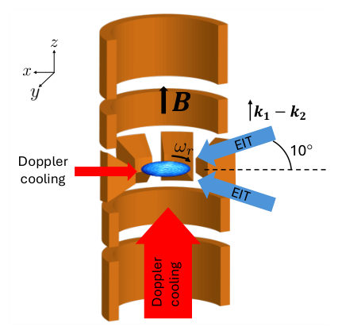 
FIG. 1: The NIST Penning trap is illustrated, with Doppler and EIT laser cooling beams shown by red and blue arrows, respectively. Voltages applied to the four cylindrically symmetric electrodes produce axial confine- ment of 9Be+ ions. The axial frequency of the trap is ωz = 2π × 1.59 MHz. Radial confinement is caused by the presence of a strong axial magnetic field B = Bz ˆz, where Bz = 4.4588 T. A periodic time-dependent poten- tial with frequency ωr applied to the central electrodes produces a rotating-wall force on the ion crystal which stabilizes its rotation frequency. The ions are first cooled using two Doppler beams, which provide planar and axial cooling, respectively. Next, two...

📷 Fig 2

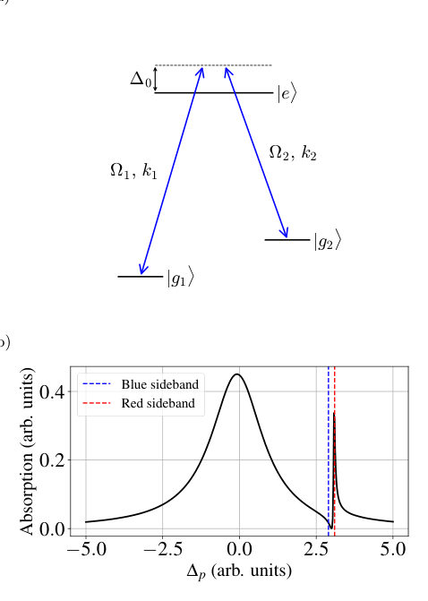 
FIG. 2: (a) Level structure utilized in EIT cooling. Two cooling lasers couple ground states |g1⟩and |g2⟩to an excited state |e⟩. The lasers are both blue-detuned from their respective transition frequencies, and are described by Rabi frequencies Ω1(2) and wavevectors ⃗k1(2). (b) The absorption spectrum of a weak probe is similar to a Fano profile, an example of which is plotted. The spectrum includes a zero when the probe detuning is equal to the cooling beam detuning (∆p = ∆0), followed by a nar- row peak at positive ∆p. When the motion-removing sideband transition associated with the crystal’s normal modes (denoted by a red, dashed vertical line) is located within the bandwidth of this...

📷 Fig 3

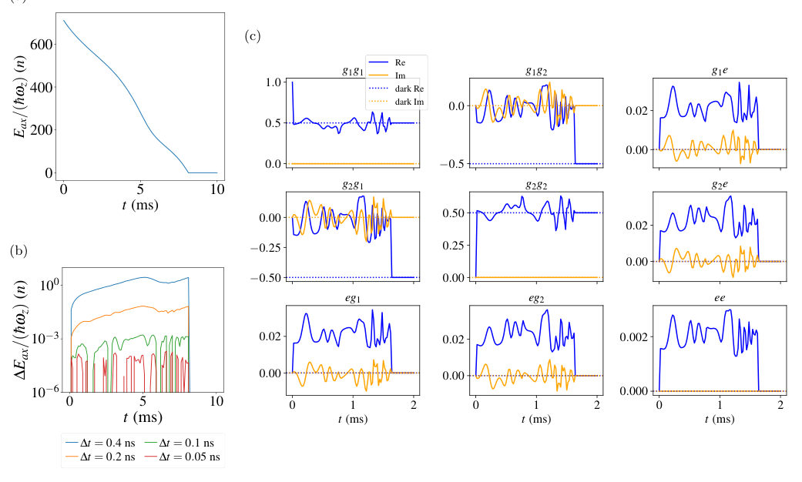 
FIG. 3: (a) The axial energy of a single trapped ion during cooling. The ion is initialized at the center of the trap with an axial velocity of 10 m/s (the thermal velocity corresponding to approximately 108 mK). Since our semiclassical model does not include momentum diffusion, the energy approaches zero, which is not physical. Most trap and laser parameters can be found in Table I. This simulation uses no rotating wall (i.e., δ = 0) and the laser beam widths are assumed to be infinite. The ion begins in state |g1⟩and the simulation time step is ∆t = 0.1 ns. (b) To test convergence with respect to the time step, we repeat the simulation with different values of ∆t. The energy difference...

📷 Fig 4

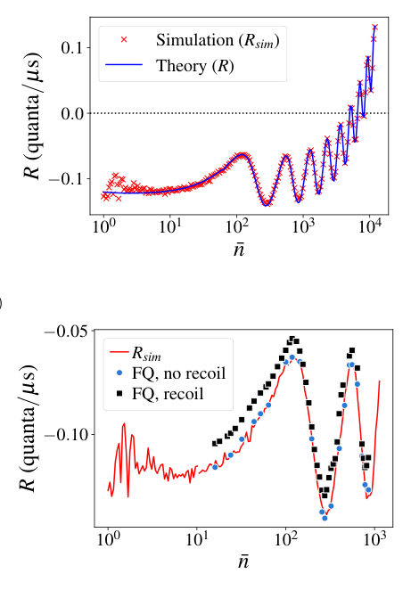 
FIG. 4: (a) The cooling rate of the axial COM mode for a single trapped ion, in the semiclassical approximation, is plotted as a function of occupation number. Most trap and laser beam parameters are given in Table I. In these simulations there is no rotating-wall potential and we use w1 = w2 = ∞. The theoretical values are computed us- ing the dynamic steady-state approach from [38]. Good agreement is observed between the simulated and theo- retical semiclassical cooling rates. For ¯n ≤10, the sim- ulated cooling rate is harder to estimate since the ion’s motion is cooled to near ¯n = 0 very quickly. The capture range of this cooling setup is several thousand motional quanta. (b) The FQ...

📷 Fig 5

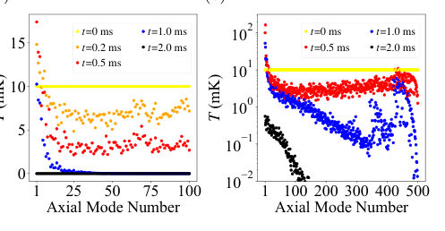 
FIG. 6: (a) The temperature of each axial mode in an N = 100 planar crystal is shown at several times during cooling. The plotted mode temperatures are averaged over 20 realizations of the simulation. At t = 0, all axial modes are initialized at T ∥ i = 10 mK. Resonant mode coupling asymmetrically transfers energy to the lowest- frequency modes, causing them to heat initially before cooling. (b) The analogous plot for the N = 500 ion crys- tal. In this case, the initial heating of the low-frequency modes is more pronounced (note the logarithmic scale of the vertical axis). For clarity, temperatures less than 0.1 mK are not shown.

**Summary.** This paper introduces a novel semiclassical molecular dynamics code to simulate Electromagnetically Induced Transparency (EIT) cooling in trapped-ion crystals. By coupling classical ion motion with internal quantum state evolution, the authors successfully model cooling in complex 2D and 3D geometries. This framework is a powerful tool for optimizing future quantum sensing and quantum information protocols.

**Why it may be interesting.** This work provides a powerful, advanced numerical tool for modeling sub-Doppler cooling techniques in complex, multi-ion quantum systems, directly impacting the feasibility of quantum sensing and quantum information experiments.

Detailed structure

**Main problem.** To develop and apply a semiclassical molecular dynamics simulation tool capable of modeling Electromagnetically Induced Transparency (EIT) cooling in ion crystals, extending beyond existing codes limited to Doppler cooling.

**Main result.** The framework successfully models efficient EIT cooling of axial modes in large 3D ion crystals, demonstrating that the mode spectra can be engineered to enable sympathetic cooling of low-frequency E x B modes.

**Method.** The authors implemented a novel semiclassical MD code that simultaneously evolves the ions' classical motion and their internal quantum states, allowing for the calculation of instantaneous EIT laser forces.

**Model / system.** The system involves trapped-ion crystals (2D and 3D) confined in a Penning trap. The cooling mechanism relies on EIT, which utilizes a $\Lambda$ level configuration, and the dynamics are governed by coupled classical equations of motion and quantum master equations.

**Key observables.** Instantaneous EIT laser forces, cooling rates, and the mode spectra of 3D crystals.

**Important parameters / regimes.** The simulation handles up to 500 ions, and the analysis focuses on sub-Doppler cooling regimes.

**Assumptions / limitations.** The model uses a semiclassical approximation, which is noted to be less accurate when spontaneous emission recoil becomes significant.

**Figures summary.** Figures illustrate the Penning trap setup with both Doppler and EIT beams, the $\Lambda$ level structure for EIT, and show the cooling dynamics and mode spectra for 2D and 3D crystals.

**Paper structure.** The paper first introduces the need for the new MD code, validates it by comparing single-ion cooling rates to quantum results, analyzes planar (2D) crystal cooling, and culminates in demonstrating efficient EIT cooling and mode engineering in 3D ellipsoidal crystals.

Abstract

Motional modes of trapped-ion crystals in Penning traps can now be cooled to near their ground states via electromagnetically induced transparency (EIT) cooling. Numerical simulations are valuable tools for interpreting EIT cooling results and optimizing experimental protocols, but existing molecular dynamics codes are limited to the simulation of Doppler cooling. In this work, we fill this gap by implementing a semiclassical model of EIT cooling in a novel MD code. By simultaneously evolving the ions' internal quantum states and classical motion, we are able to calculate the instantaneous EIT laser forces acting on the ions. We first validate our code by comparing the single-ion cooling rate to fully quantum simulation results. Next, we analyze cooling of the drumhead modes in planar ion crystals, quantifying the effects of planar ion motion and a finite laser beam width. Finally, we demonstrate efficient EIT cooling of the axial modes in 3D ellipsoidal crystals containing up to 500 ions. Such crystals are a promising platform for future quantum sensing experiments with enhanced sensitivity. We find that the mode spectra of 3D crystals can be engineered to enable sympathetic cooling of the low-frequency $\boldsymbol{E}\times\boldsymbol{B}$ modes. This numerical framework provides a powerful tool for modeling sub-Doppler cooling techniques and for optimizing future quantum sensing and quantum information experiments.

[↑ back to top](#top)

### [Charge Density Wave transient states induced by ultrashort hard X-ray pulses](http://arxiv.org/abs/2610.29860v1)

**Authors:** D. Ghoneim, E. Bellec, L. Ortega, V. L. R. Jacques, A. A Sinchenko, P. Wzietek, U. Boesenberg, K. Kazarian, J. Moeller, J. D. Moore, A. Rodriguez-Fernandez, R. Shayduk, A. Zozulya, A. Madsen, D. Le Bolloc'h  
**Type:** experiment · **Category:** strongly correlated electrons · **PDF:** <https://arxiv.org/pdf/2610.29860v1>  
**Analysis basis:** full PDF text, analyzed in chunks
**Topic relevance:** 🔥 `non-equilibrium universality` **4/5** · `Frenkel-Kontorova` **3/5** · `driven-dissipative phase transition` **3/5** · `Keldysh / 2PI / non-Gaussian methods` **2/5** · `methods for driven-dissipative` **2/5** · `scars & prethermalization` **2/5** · `correlated / nonlocal dissipation` **1/5** · `quantum measurements` **1/5**

📷 Fig 1

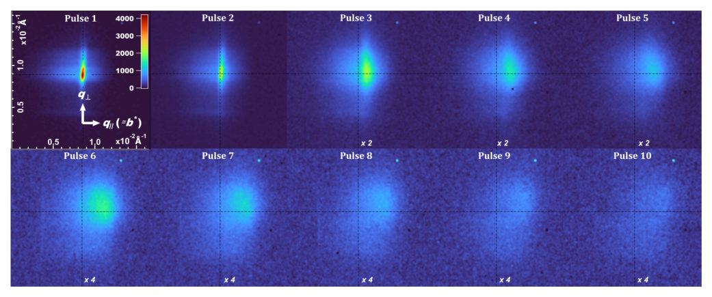 
FIG. 1. QCDW Q(0 1.24 0) satellite reflection associated to the CDW in NbSe3 versus pulse number within a train of pulses. The process is reproducible from one train to the next. Each image corresponds of the sum over the rocking curve and have been averaged over 6000 trains. The intensity range has been rescaled for each pulse for better visibility (indicated in white on each image). The image size is 128*128 pixels of 200µm*200µm size (AGIPD detector) with 1.3 10−4A−1 per pixel in horizontal and 1.3 10−4A−1 in vertical. The intensity is multiply by either 2 or 4 for a better visibility as indicated on each diffraction pattern.

📷 Fig 2

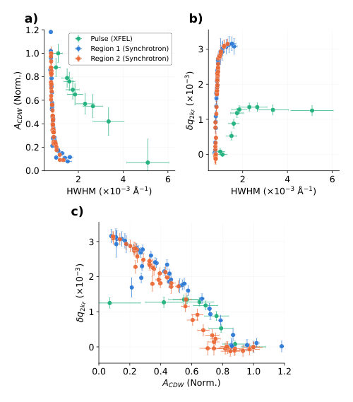 
FIG. 3. a-c): Correlations between the three CDW order pa- rameters shown in Fig.2. a) ACDW versus the HWHM. b) The 2kF shift δqCDW versus the HWHM. c) δqCDW versus ACDW . Error bars are propagated from each quantity’s fit uncertainty. As in Fig.2, blue and orange dots are the syn- chrotron measurements as a function of temperature (on the two sample regions), and green dots are the XFEL data as a function of pump-pulse number.

📷 Fig 3

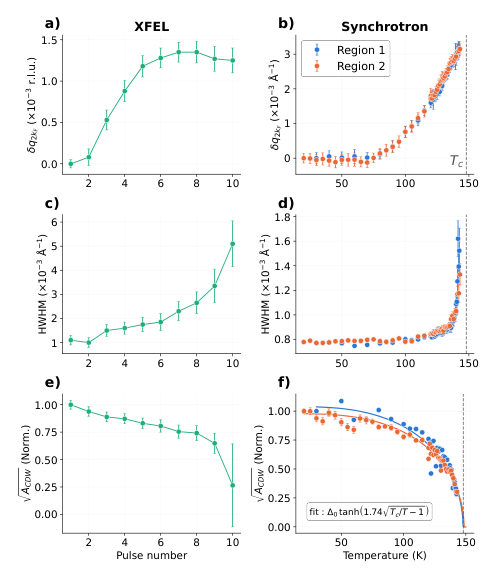 
FIG. 2. (a, c, e) XFEL Pulse-number dependence of the CDW satellite shift δqCDW along the longitudinal direction (≈b), the HWHM, and the square root of the CDW amplitude √

**Summary.** This work uses hard X-ray pump-probe techniques to study how Charge Density Wave (CDW) materials respond to extreme, non-equilibrium excitation. The findings reveal a unique, non-thermal dynamic pathway characterized by changes in the CDW order parameters over long timescales. This suggests that X-rays can drive the system into exotic states potentially involving charged topological defects.

**Why it may be interesting.** The study probes non-equilibrium many-body dynamics in a strongly correlated electronic state (CDW), which is highly relevant to understanding ultrafast energy dissipation and charge transport in correlated materials.

Detailed structure

**Main problem.** The study investigates the transient, non-equilibrium states induced in Charge Density Wave (CDW) systems when excited by ultrashort hard X-ray pulses, contrasting this with infrared laser excitation.

**Main result.** X-ray pumping drives the CDW system into a novel, reversible out-of-equilibrium state characterized by a non-thermal kinetic path, involving changes in the CDW wavevector, correlation lengths, and electronic gap over long recovery times.

**Method.** The research employs X-ray pump-probe experiments using hard X-ray beams (XFEL source) to probe the material dynamics, comparing results obtained from pulse number dependence versus temperature dependence.

**Model / system.** The physical system is a CDW material, specifically $	ext{NbSe}_3$. The dynamics are analyzed by tracking changes in the CDW order parameters, suggesting the formation of charged topological objects like solitons.

**Key observables.** CDW wavevector ($2k_F$), correlation lengths ($\xi$), electronic gap ($\Delta$), and the satellite reflection intensity/width ($	ext{HWHM}$).

**Important parameters / regimes.** X-ray pulse energy (6000 times more energetic than laser pulses), long recovery time ($450	ext{ns}$ to $0.01	ext{s}$), and temperature ($T$ vs. pulse number).

**Assumptions / limitations.** The non-thermal nature of the excitation is confirmed by observing limited deviation in the main Bragg peak, suggesting the dynamics are not dominated by simple thermal heating.

**Figures summary.** Figures compare the evolution of CDW order parameters ($	ext{ACDW}$, $\delta q_{	ext{CDW}}$, $	ext{HWHM}$) as a function of XFEL pulse number (green dots) versus temperature (blue/orange dots), highlighting the distinct non-thermal response.

**Paper structure.** The paper establishes the problem by contrasting X-ray vs. laser excitation, presents experimental diagnostics using XFEL/Synchrotron sources, details the observation of non-thermal kinetic paths, and proposes theoretical scenarios involving soliton doping to explain the observed changes in CDW order parameters.

Abstract

The interaction of quantum systems with ultrashort laser pulses may lead to transient states far from equilibrium. Among these, Charge Density Wave (CDW) systems offer very rich non-equilibrium physics when submitted to ultrashort optical excitations in the infrared regime. In this Letter, we show that CDW systems pumped by ultrashort x-ray pulses excite the system in very different way. The x-ray pump, 6000 times more energetic than a laser pulse, pumping and probing the whole bulk system simultaneously, drives CDW systems in a novel reversible out of equilibrium state. The successive CDW states observed in the NbSe$_3$ system with respect to the arrival of x-ray pulses follow a non-thermal kinetic path. It is characterized by a change in 2k$_F$ wavevector, correlation lengths and electronic gap, as well as a change of dimensionality, all of this takes place within a very long recovery time ranging from 450$ns$ to 0.01$s$. Several scenarios are proposed, including transient nucleation and recombination of charged topological objects.

[↑ back to top](#top)

### [Quantum Simulation of Non-Markovian Open Quantum Systems via Low-Rank Kernel Compression and Coupling Dilution](http://arxiv.org/abs/2610.29372v1)

**Authors:** Hengzhun Chen, Zhenning Cai  
**Type:** theory · **Category:** other · **PDF:** <https://arxiv.org/pdf/2610.29372v1>  
**Analysis basis:** full PDF text, analyzed in chunks
**Topic relevance:** 🔥 `methods for driven-dissipative` **4/5** · `Keldysh / 2PI / non-Gaussian methods` **3/5** · `correlated / nonlocal dissipation` **3/5** · `driven-dissipative phase transition` **3/5** · `non-equilibrium universality` **2/5** · `analog quantum simulation` **1/5** · `quantum measurements` **1/5**

📷 Fig 1

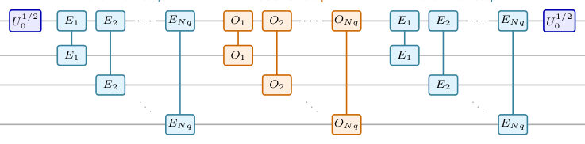 
Figure 1: Circuit of one midpoint–Strang step Wk, read from left to right. Each bath wire represents a register encoding one finite-level mode. Registers 1, 2, and Nq are shown, with intermediate registers omitted; the single index is ℓ= (n −1)q + r. Each connected pair of boxes denotes one joint operation on the system and the indicated bath register. The cyan Eℓblocks contain the even transitions for a half step, and the orange Oℓblocks contain the odd transitions for a full step. Blocks within each parity group commute, but share the system register, so parallel execution depends on the hardware architecture.

**Summary.** This paper presents a rigorous, error-controlled method for simulating open quantum systems whose dynamics are non-Markovian. It achieves this by approximating the environment's influence using low-rank kernel compression and introducing 'coupling dilution' to handle large bosonic excitations within a qubit framework. The result establishes polynomial resource scaling for the simulation depth and width.

**Why it may be interesting.** This work provides a concrete, resource-aware quantum algorithm for simulating complex, non-Markovian dynamics, which is a major frontier in quantum simulation for AMO physics.

Detailed structure

**Main problem.** The paper addresses the challenge of quantum simulating the dynamics of open quantum systems that exhibit non-Markovian behavior.

**Main result.** They establish an error-controlled framework that achieves polynomial circuit width and depth for the simulation, provided certain spectral and coupling regularity assumptions hold.

**Method.** The core method involves replacing the complex environment interaction with an effective bath constructed via low-rank kernel compression and employing 'coupling dilution' to manage high excitation numbers in qubit encoding.

**Model / system.** The system is a quantum system coupled linearly to a Gaussian environment (bath). The dynamics are governed by the bath's two-time correlation kernel, which dictates the reduced dynamics.

**Key observables.** Reduced-state error bounds ($\lVert 
ho_s(T) - 
ho_{approx}(T) 
Vert_{	ext{tr}}$), circuit width, and circuit depth.

**Important parameters / regimes.** Simulation time ($T$), inverse accuracy ($\epsilon$), rank of approximation ($N$), and the number of dilution copies ($q$).

**Assumptions / limitations.** The bath is Gaussian, the coupling is linear, and the simulation is restricted to a finite time interval. Key assumptions include spectral-decay and coupling-regularity for error bounds.

**Paper structure.** The paper builds from establishing the Gaussian bath equivalence principle via the correlation kernel, to constructing the finite-rank effective bath using spectral decomposition, addressing the excitation limitation via coupling dilution, and finally deriving resource bounds for qubit implementation.

Abstract

We present an error-controlled framework for the quantum simulation of non-Markovian open-system dynamics in Gaussian environments. For a system coupled linearly to a Gaussian environment with zero mean, the bath's influence on the reduced dynamics is completely determined by its two-time correlation kernel. This allows us to replace the microscopic environment with an equivalent bath that has the same kernel. On a finite simulation interval, a rank-$N$ approximation of the kernel yields an effective bath of $N$ bosonic modes with time-dependent couplings to the system. To encode these modes in qubits, we first truncate each mode to its lowest $d$ occupation levels. When stronger couplings lead to large occupations, we introduce coupling dilution, which replaces each mode with several more weakly coupled copies while preserving the bath correlation kernel. This distributes excitations across more modes and trades additional modes for smaller local dimensions. We derive explicit reduced-state error bounds and establish polynomial circuit width and depth in simulation time and inverse accuracy under stated spectral-decay and coupling-regularity assumptions, provided elementary unitaries admit polynomial-cost implementations.

[↑ back to top](#top)

### [Splitting Probability in Monitored Quantum Dynamics](http://arxiv.org/abs/2610.29547v1)

**Authors:** Prashant Singh, Sabine Tornow, David A Kessler, Eli Barkai  
**Type:** theory · **Category:** statistical mechanics · **PDF:** <https://arxiv.org/pdf/2610.29547v1>  
**Analysis basis:** full PDF text, analyzed in chunks
**Topic relevance:** 🔥 `quantum measurements` **4/5** · `methods for driven-dissipative` **2/5** · `Full counting statistics` **1/5** · `Keldysh / 2PI / non-Gaussian methods` **1/5** · `analog quantum simulation` **1/5** · `correlated / nonlocal dissipation` **1/5** · `driven-dissipative phase transition` **1/5** · `non-equilibrium universality` **1/5**

📷 Fig 1

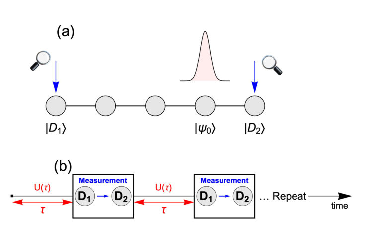 
FIG. 1. Panel (a) shows a chain of size N = 5 in which a system with |ψ0⟩= |4⟩(see the pink shaded region) evolves with the nearest-neighbor hopping Hamiltonian in Eq. (2). After every time interval τ, projective measurements are performed at |D1⟩= |1⟩and |D2⟩= |N⟩to check the system at these states. Panel (b) illustrates the splitting probability detection protocol. During the first τ interval, the system evolves unitarily with the operator U(τ) in Eq. (3). After this evolution, a projective measurement |D1⟩⟨D1| is performed at the first target state. If this detection is successful, the process terminates. If not, then the state of the system is projected onto the subspace complementary...

📷 Fig 2

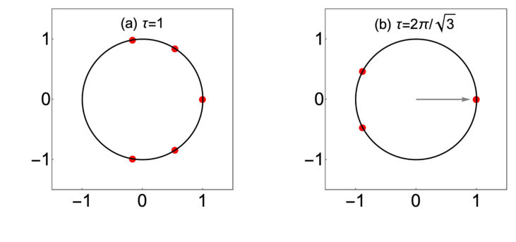 
FIG. 2. The nearest-neighbor hopping Hamiltonian in Eq. (54), with N = 5, has five eigenvlaues given in Eq. (55), namely {E1 = − √

📷 Fig 3

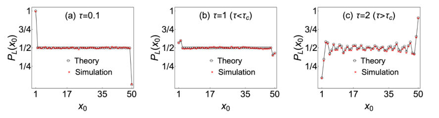 
FIG. 3. Splitting probability PL(x0) as a function of the initial position x0 for the nearest-neighbor tight-binding chain of size N = 50 in Eq. (2). Panel (a) shows the theoretical prediction for the Zeno limit in Eq. (68) together with numerical simulations for γ = 1 and τ = 0.1; see Appendix B for details on the numerical simulations. Panels (b,c) display simulation data of PL(x0) for τ = 1 and τ = 2, respectively, compared with the theoretical expression in Eq. (61). These values of the sampling time are chosen such that they lie below and above the critical value γτc = π/2 (≈1.57). As evident, PL(x0) for τ = 0.1 and τ = 1 remains essentially flat and equal to 1/2, except close to the...

📷 Fig 4

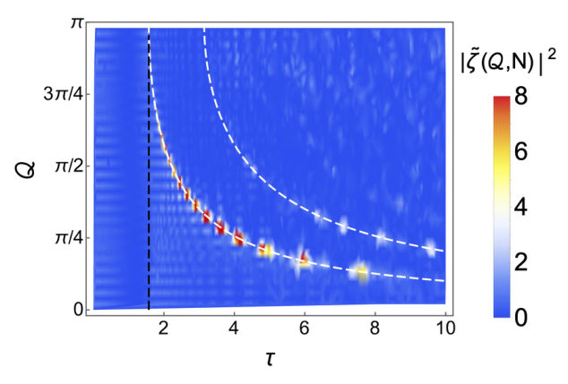 
FIG. 4. Heat map of the power spectrum eζ(Q, N) 2 for the nearest-neighbor hopping Hamiltonian, shown as a function of

📷 Fig 5

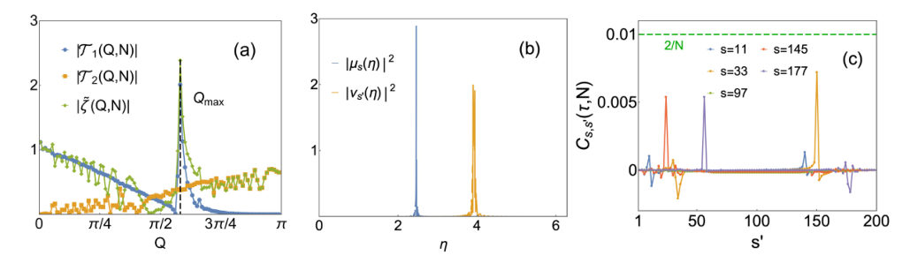 
FIG. 5. (a) The absolute value of the Fourier transform eζ(Q, N) in Eq. (76) is plotted as a function of Q = πj/(N + 1) for odd j, N = 200, γ = 1, and τ = 2, along with the two terms |T1(Q, N)| and |T2(Q, N)| in Eqs. (78) and (79). The maximum of |eζ(Q, N)| occurs at the same Q-value as the maximum of |T1(Q, N)|; denoted by Qmax(τ)(≈1.81) and depicted by the dashed line. We show in Eq. (86) that for large N, Qmax(τ) = 2 sin−1 (πr/2γτ), where r is a positive integer. (b) The functions |µs(η)|2

**Summary.** This paper develops a renewal framework to calculate splitting probabilities for quantum walks monitored by projective measurements at two targets. It reveals a critical sampling time $\tau_c$ that separates a regime of uniform probability ($1/2$) from a regime exhibiting position-dependent oscillations. The findings provide deep insights into measurement-induced dynamics and ergodicity breaking in quantum systems.

**Why it may be interesting.** This work directly addresses open quantum systems and measurement backaction, providing quantitative predictions for how monitoring affects quantum transport and localization phenomena, which is highly relevant to AMO physics.

Detailed structure

**Main problem.** The paper investigates the quantum analogue of the splitting probability, which quantifies the likelihood of a quantum trajectory reaching one target state before others under continuous monitoring.

**Main result.** The system exhibits a nonanalytic transition at a critical sampling time $\tau_c$, below which splitting probabilities approach $1/2$ and above which they develop oscillations dependent on the initial position.

**Method.** The authors construct a general renewal framework for the first-detection amplitude, utilizing generating functions and analyzing the problem via a quantum mapping for reflection-symmetric Hamiltonians.

**Model / system.** The model is a continuous-time quantum walk on a one-dimensional lattice chain subjected to projective measurements at two distinct target sites at regular intervals $\tau$. The dynamics are governed by a time-independent, Hermitian Hamiltonian, exemplified by nearest-neighbor hopping.

**Key observables.** Splitting probabilities ($P_L, P_R$), first-detection amplitudes, and oscillations in these probabilities as a function of initial position.

**Important parameters / regimes.** Sampling time ($\tau$), critical sampling time ($\tau_c = 2\pi/\Delta E$), and the initial position ($x_0$).

**Assumptions / limitations.** The analysis assumes a general renewal framework and extends to finite measurement sequences, which modifies the resonance features.

**Figures summary.** Figure 1(a) illustrates the setup on a small lattice ($N=5$) with measurements at endpoints. Figure 1(b) details the sequential measurement protocol involving unitary evolution and projections.

**Paper structure.** The paper develops the formalism by first establishing the renewal theory for the first-detection amplitude, deriving a quantum mapping for the dual-target problem, and then analyzing the resulting behavior in different sampling time regimes.

Abstract

We consider a continuous-time quantum walk stroboscopically subjected to projective measurements on two distinct targets with sampling time period $τ$. We construct a general renewal framework for the first-detection amplitude at each target, from which we obtain the associated splitting probabilities. For Hamiltonians with reflection symmetry, we further show that each dual-target first-detection amplitude can be viewed as an interference effect between a pair of single-target first-detection amplitudes. This formulation yields exact expressions for the splitting probabilities and gives special sampling times at which they undergo pointwise discontinuous jumps due to a form of ergodicity breaking associated with dark states. As an illustrative example, we apply the framework to a one-dimensional tight-binding lattice chain with nearest-neighbor hopping, and study the splitting probabilities as functions of the initial position and sampling time. Below a critical sampling time, $0<τ< τ_c$ where $τ_c = 2 π/ ΔE$ with $ΔE$ being the energy bandwidth, the splitting probabilities for large system sizes become equal to $1/2$, independent of the initial position, as long as this position does not coincide with target sites. Above the critical sampling time, $τ\geq τ_c$, the splitting probabilities deviate from $1/2$ and develop oscillations as a function of initial position. The wavenumber associated with these oscillations is $Q=2\sin^{-1}(rτ_c/τ)$, where $r$ is a positive integer. We also explore the effects of relative phase and spatial separation between different components of a coherent initial state on the splitting probabilities. Finally, we study how a finite number of measurements modifies the splitting probabilities and broadens the resonances at special sampling times.

[↑ back to top](#top)

### [Two particle interference: The Hanbury Brown Twiss and Hong Ou Mandel experiments](http://arxiv.org/abs/2610.30002v1)

**Authors:** Christoph I Westbrook  
**Type:** theory · **Category:** other · **PDF:** <https://arxiv.org/pdf/2610.30002v1>  
**Analysis basis:** full PDF text, analyzed in chunks
**Topic relevance:** 🔥 `interference shaping light` **4/5** · `analog quantum simulation` **3/5** · `quantum optics experiment` **3/5** · `Full counting statistics` **1/5** · `Keldysh / 2PI / non-Gaussian methods` **1/5**

📷 Fig 1

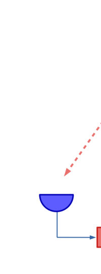 
Figure 1: Essential elements of an intensity interferometer. Two receivers shown as semi-circles, convert incoming radiation from a distant object into electrical currents and an electronic circuit, shown as a red square, multiplies the two currents and averages them over some time. At small detector sep- arations, the current fluctuations are correlated, but this correlation decays with increasing separation of the detectors. The characteristic distance of this decay allows one to measure the angular size of the source.

📷 Fig 2

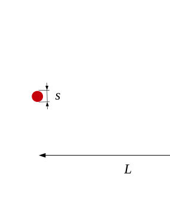 
Figure 2: Basic configuration of a stellar interferometer. A source of size s emits light which passes through two slits. A sufficiently small source produces fringes at the detection plane. The maximum distance d for which fringes are still visible yields an estimate for the source size. In the Michelson and Pease experiment the slits corresponded to mirrors which reflected the light towards a telescope mirror which in turn focused the light on an eyepiece.

📷 Fig 3

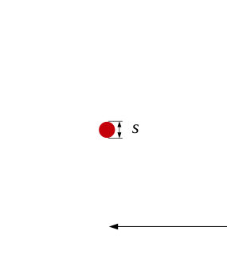 
Figure 3: Diagram showing the speckle at a detection plane produced by an extended light source of size s. The characteristic size of the speckles allows one to measure the angular size of the source.

📷 Fig 4

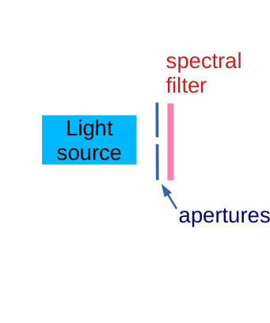 
Figure 4: Diagram of the Hanbury Brown and Twiss laboratory experiment. The image of one detector is superposed with the other. The detector and its aperture are then moved to vary the spatial separation.

📷 Fig 5

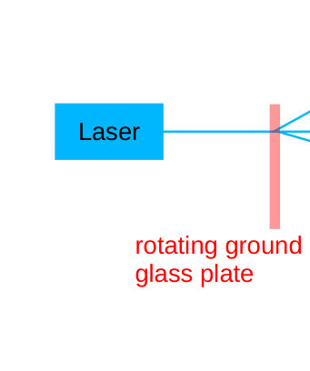 
Figure 5: Experiment to illustrate the difference between a laser and a thermal source. Two configurations are used. In the first, a weak laser beam directly illuminates the detector. In the second, a rotating, ground glass screen is placed in the laser beam, scattering the light in a random fashion creating a speckle pattern. The motion of the screen causes the speckle pattern to fluctuate. The detector then records the photon arrival times. The rate for detecting pairs of photons as a function of their temporal separation is shown in Fig. 6.

**Summary.** This paper reviews the physics of two-particle interference using seminal experiments like HBT and HOM. It develops the theoretical framework for measuring intensity correlations, showing how these measurements distinguish between quantum and classical light sources. The work is significant for its broad scope, connecting photon optics to atomic and fermionic quantum interference phenomena.

**Why it may be interesting.** This review is highly relevant as it bridges foundational quantum optics (photon correlations) with modern AMO techniques (atomic interference), providing a unified theoretical framework for studying quantum coherence in diverse physical systems.

Detailed structure

**Main problem.** The paper provides a pedagogical overview comparing two quantum optics experiments—Hanbury Brown Twiss (HBT) and Hong Ou Mandel (HOM)—to demonstrate the fundamental relationship between two-particle interference effects.

**Main result.** The analysis shows that these experiments quantify light intensity correlations, revealing key differences between quantum states (e.g., antibunching in single-photon sources) and classical expectations.

**Method.** The methodology involves deriving and analyzing the second-order correlation function, G^(2), using quantum field theory formalism and applying theorems like Isserlis' theorem.

**Model / system.** The study covers various physical platforms, including photons in optical interferometers, and extends the concepts to atomic systems (metastable helium atoms) and fermionic gases (trapped Li atoms).

**Key observables.** The primary observables are the second-order correlation function, G^(2)(d, tau), and the visibility/contrast of the interference dip/peak.

**Important parameters / regimes.** Key parameters include the separation distance (d), time delay (tau), and the source size (s) relative to the observation length (L).

**Assumptions / limitations.** Assumptions include the stationary nature of the source fields and the applicability of quantum field quantization methods.

**Figures summary.** Figures illustrate the setups for intensity interferometry (HBT), stellar interferometry, and the specific laboratory configurations for the HOM effect using both photons and trapped atoms.

**Paper structure.** The paper progresses by first establishing the classical and quantum foundations of intensity interferometry (HBT/Stellar Interferometry), then deriving the general correlation function G^(2), and finally applying these concepts to modern quantum systems like atoms and fermions (HOM effect).

Abstract

I discuss two important quantum optics experiments which depend on two particle interference. In the years since their first demonstration many interesting and instructive variants have appeared, including the use of atoms instead of photons as the interfering particles. This chapter gives a pedagogical overview of some of these results and argues that the two effects are closely related.

[↑ back to top](#top)

### [Two-stage Slowdown of Vacancy-mediated Diffusion in a Lattice Gas Model with Quenched Disorder and Spins](http://arxiv.org/abs/2610.29931v1)

**Authors:** Qiang Zhai  
**Type:** theory · **Category:** disordered systems and neural networks · **PDF:** <https://arxiv.org/pdf/2610.29931v1>  
**Analysis basis:** full PDF text, analyzed in chunks
**Topic relevance:** 🔥 `scars & prethermalization` **4/5** · `non-equilibrium universality` **3/5** · `analog quantum simulation` **2/5** · `methods for driven-dissipative` **2/5**

📷 Fig 1

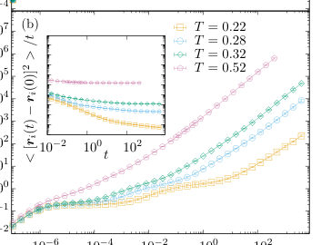 
Figure 1. The ensemble averaged mean-squared displacement for particles (a) and vacancies (b).A two-stage slowdown is seen for both particles (filled symbols) and vacancies (hollow symbols). The inset of (a) and (b) displays the ratio of MSD and time. The lines are smooth polynomial fit, serving as guides to the eyes.

📷 Fig 2

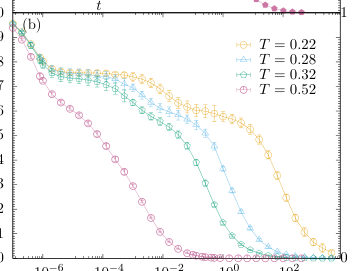 
Figure 2. The spatial overlap q(t) for particles (a) and vacan- cies (b). Inset of (a) is a magnified portion of q(t) at the early stage of relaxation.

📷 Fig 3

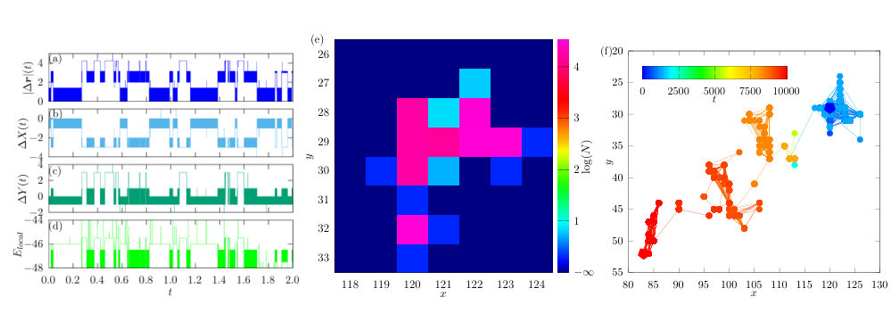 
Figure 3. The typical motion of a vacancy at T = 0.22, with ∆r(t) in (a), ∆X(t) in (b) and ∆Y (t) in (c). The visiting numbers N of this vacancy to each lattice site from t = 0 to t = 2 are visualized in (e), the energy temporal evolution of the local region displayed in (e) is given in (d). Trajectories of this vacancy is plotted up to t = 10000 in (f).

📷 Fig 4

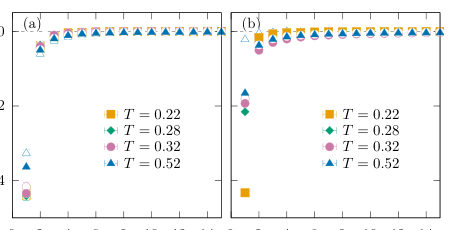 
Figure 4. The displacement correlation C(kτ)/C(0) defined by Eq. (4) for (a) τ = 2 × 10−6 and (b) τ = 1. The solid symbols indicates the anti-correlation of particles, and the hollow symbol is for vacancies.

📷 Fig 5

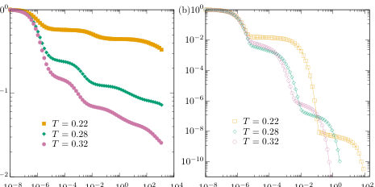 
Figure 5. The survival function S(tw) for particles (a) and vacancies (b). The maximum waiting time tw of vacancies is less than 10% of the total measurement time. The solid lines are guide to the eyes.

**Summary.** This work analyzes vacancy-mediated diffusion in a disordered lattice gas model, observing a characteristic two-stage slowdown in transport properties. This slowdown is linked to anti-correlations arising from sequential trapping and rare jumps within the disordered energy landscape. The findings provide a framework for understanding hierarchical dynamics in glassy systems.

**Why it may be interesting.** The concept of hierarchical dynamics and slow relaxation in disordered systems is highly relevant to understanding glassy dynamics in many-body quantum systems, connecting classical lattice models to complex quantum relaxation phenomena.

Detailed structure

**Main problem.** The study investigates the two-stage slowdown of vacancy-mediated diffusion in a lattice gas model subjected to quenched disorder and random spins.

**Main result.** The diffusion exhibits a two-stage slowdown characterized by plateaus in MSD and spatial overlap, attributed to anti-correlations at specific length scales, suggesting hierarchical dynamics.

**Method.** The study uses Monte Carlo simulations with Metropolis dynamics to track particle and vacancy movement in the disordered lattice gas.

**Model / system.** The system is a lattice gas model on a 2D square lattice with quenched random interactions ($J_{ij}$) and quenched spins ($s_{p_i}$). Particle hopping occurs when a nearest neighbor is a vacancy.

**Key observables.** Mean Squared Displacement (MSD), Spatial Overlap Function ($q(t)$), and Displacement Correlation Function ($C(k	au)$).

**Important parameters / regimes.** Low temperatures (e.g., $T=0.22$), particle density ($
ho=0.99$), and various time/length scales ($	au$, $k$).

**Assumptions / limitations.** The analysis assumes the system dynamics can be described by hopping rates derived from the Hamiltonian, and that the observed slowdown reflects underlying trapping mechanisms.

**Figures summary.** Figures show the two-stage slowdown in MSD and spatial overlap for both particles and vacancies, and the correlation function $C(k	au)$ confirms anti-correlations at different time lags.

**Paper structure.** The paper establishes the model and observables, presents evidence for the two-stage slowdown in MSD and $q(t)$, analyzes vacancy motion via trapping mechanisms (Type I and Type II), and concludes by discussing the implications for hierarchical dynamics.

Abstract

We present a lattice gas model with random interactions quenched in space and spins quenched to the particles. The vacancy-mediated diffusion is studied in equilibrium. A two-stage slowdown is witnessed in both the mean squared displacement and the spatial overlaps. We demonstrate that the plateaus are due to anti-correlation at the corresponding length scale. The anti-correlation diminishes quickly with increasing lag time. A broad and yet finite distribution of the survival function of vacancies suggests their normal diffusion at large time limit. Our model can serve as a new playground for understanding hierarchical dynamics in glassy-like dynamical systems.

[↑ back to top](#top)

### [High-fidelity and robust controlled-Z gates for superconducting transmon qubits. I. Intrinsic errors and decoherence](http://arxiv.org/abs/2610.30056v1)

**Authors:** Chia-Hsien Huang, Hsi-Sheng Goan  
**Type:** both · **Category:** quantum information and computing · **PDF:** <https://arxiv.org/pdf/2610.30056v1>  
**Analysis basis:** full PDF text, analyzed in chunks
**Topic relevance:** 🔥 `QC/QI experiment` **4/5** · `methods for driven-dissipative` **2/5** · `correlated / nonlocal dissipation` **1/5** · `driven-dissipative phase transition` **1/5** · `quantum measurements` **1/5**

📷 Fig 1

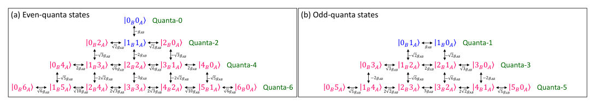 
FIG. 1. Decoupled (a) even-quanta and (b) odd-quanta states. Leakage pathways from computational basis states (blue) to non- computational states (pink) are shown. States |nBmA⟩within each row share the same total number of quanta q = nB + mA, labeled as Quanta-q (green) at the end of the row. The coupling strength between two states is indicated in black near the double-arrow connecting them.

📷 Fig 2

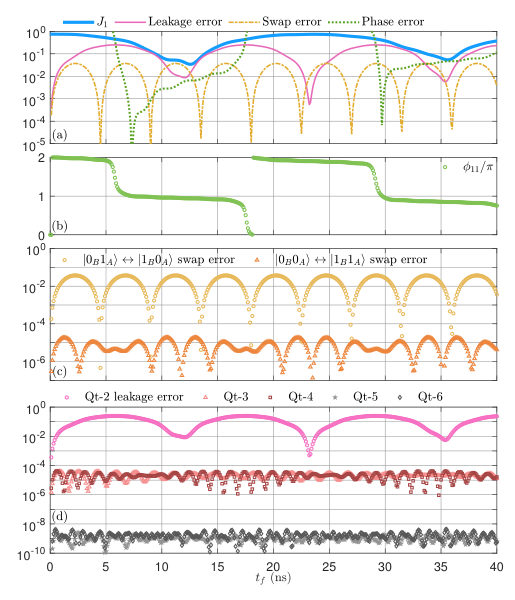 
FIG. 2. Intrinsic CZ gate errors for the propagator evolved freely under the drift Hamiltonian HI with fixed ∆A/B at δA = 0. (a) The ideal CZ gate infidelity J1 (bold blue solid line) and its constituent intrinsic errors, including the leakage error (thin pink solid line), the swap error (yellow dash-dotted line), and the phase error (green dotted line), as functions of the gate time tf from 0 to 40 ns. (b) The phase error is attributed to the deviation of the local phase ϕ11 (green circles) from the target coupling ϕAB = π. (c) The swap error comprises the |0B1A⟩↔|1B0A⟩swap error (yellow circles) and the |0B0A⟩↔ |1B1A⟩swap error (orange triangles). (d) The leakage error includes the Qt-2...

📷 Fig 3

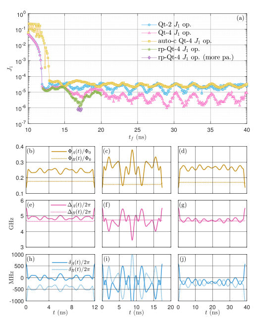 
FIG. 3. Optimization results. (a) Optimized J1 as a function of gate time tf obtained from different optimization schemes: the Qt-2 J1 optimization (blue-circle line), the Qt-4 J1 op- timization (pink-triangle line), the auto-c Qt-4 J1 optimiza- tion (yellow-square line), the rp-Qt-4 J1 optimization (green- pentagram line), and the rp-Qt-4 J1 optimization with an in- creased number of control parameters in the Fine-Tune-Pulse ΦFTP A (t) (purple-diamond line). (b–d) Optimized flux pulses ΦA(t)/Φ0 (solid yellow) and ΦB(t)/Φ0 (dashed yellow) as a function of time t for tf = 12 ns, 17.5 ns, and 39 ns, respec- tively, obtained from the Qt-4 J1 optimization. (e–g) Cor- responding qubit...

📷 Fig 4

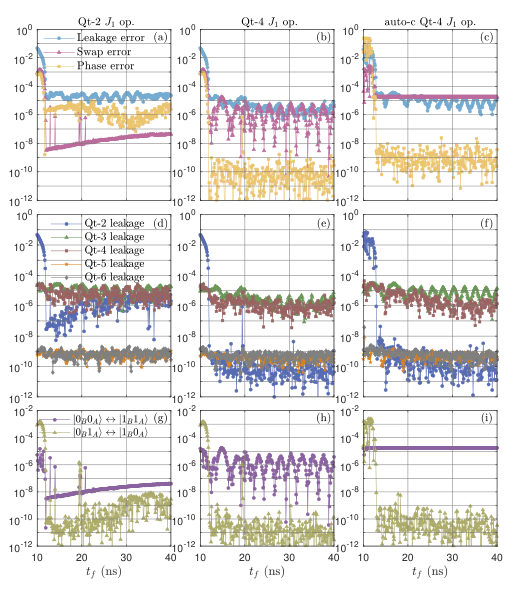 
FIG. 4. Error contributions to the optimized J1: The first column (panels (a), (d), and (g)) for the Qt-2 J1 optimization, the second column (panels (b), (e), and (h)) for the Qt-4 J1 optimization, and the third column (panels (c), (f), and (i)) for the auto-c Qt-4 J1 optimization. The first row (panels (a), (b), and (c)) shows the individual contributions to J1 from the leakage error (light-blue-circle line), the swap error (light- purple-triangle line), and the phase error (yellow-square line). The second row (panels (d), (e), and (f)) provides a breakdown of the leakage error into the contributions from the Qt-2, Qt- 3, Qt-4, Qt-5, and Qt-6 leakage errors, represented by dark-...

📷 Fig 5

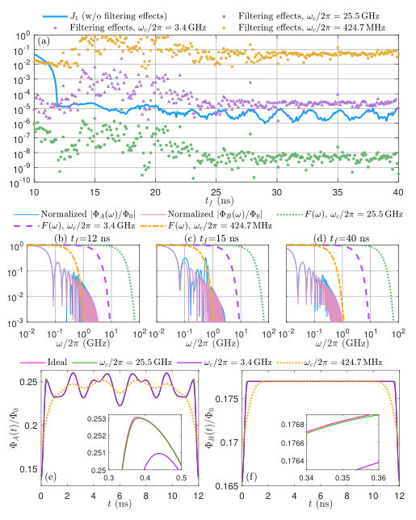 
FIG. 5. Filtering effects on the optimized CZ gates via the Qt-4 J1 optimization. Panel (a) shows the ideal J1 (bold blue line) obtained from the Qt-4 J1 optimization without filter- ing effects. The green circles, purple triangles, and yellow squares represent the filtering effects on the optimized sam- ples (bold blue line) from Tektronix AWGs, modeled by a Gaussian filter F(ω) = exp(−ω2/ω2 c) with cutoff frequencies ωc/2π = 25.5 GHz, 3.4 GHz, and 424.7 MHz, respectively. Fil- tering effects are quantified by the infidelity enhancement due to pulse distortion from the limited bandwidth of the AWGs. Panels (b), (c), and (d) show the spectra of the optimized samples from panel (a) for tf =...

**Summary.** This work presents a comprehensive optimal-control framework to design high-fidelity controlled-Z gates for superconducting transmon qubits. By systematically modeling intrinsic Hamiltonian errors and realistic decoherence (including fast and slow dephasing), the authors achieved fast gates with extremely low error rates. The results establish a robust design methodology that minimizes the need for constant recalibration as quantum processors scale.

**Why it may be interesting.** It provides a highly practical, physics-informed methodology for designing quantum gates by explicitly balancing coherent control errors against dissipative noise channels, which is a key concern in open quantum systems.

Detailed structure

**Main problem.** The paper addresses the critical challenge of developing quantum gates for superconducting qubits that are simultaneously high-fidelity, fast, and robust against environmental noise, which is crucial for scaling quantum processors.

**Main result.** They achieved 12-ns controlled-Z gates with intrinsic errors suppressed to the $2	imes10^{-5}$ level, demonstrating that gate performance can be maintained below $10^{-3}$ even with significant noise sources.

**Method.** The authors developed a unified optimal-control framework that systematically incorporates both intrinsic Hamiltonian errors and realistic decoherence mechanisms (energy relaxation and dephasing) into the gate design.

**Model / system.** The system uses directly coupled, frequency-tunable superconducting transmon qubits. The analysis involves modeling the system Hamiltonian and projecting the evolution onto the computational subspace while incorporating noise models calibrated against experimental measurements.

**Key observables.** Gate infidelity, intrinsic error suppression level, and noise tolerance margins.

**Important parameters / regimes.** Gate speed (12-ns), intrinsic error level ($2	imes10^{-5}$), transmon asymmetry parameter ($a_{EJ}$), and decoherence rates ($T_1, T_{\phi}$).

**Assumptions / limitations.** The framework assumes the direct-coupling architecture, and certain derivations rely on approximations regarding the smallness of leakage probabilities and the low-order nature of error contributions.

**Figures summary.** Figure 1 illustrates the decoupling of even-quanta and odd-quanta states, detailing leakage pathways from computational basis states to non-computational states.

**Paper structure.** The paper progresses from defining the need for robust gates, to developing the optimal-control framework that decomposes errors, to constructing realistic noise models, and finally presenting results showing how asymmetry and sweet-spot engineering balance speed, fidelity, and noise resilience.

Abstract

Fault-tolerant quantum computing requires quantum gates that combine short duration, high fidelity, and robustness to noise. As quantum processors scale, robustness becomes increasingly important because exhaustive characterization and frequent recalibration of individual gates become impractical. We present a comprehensive optimal-control framework for controlled-Z (CZ) gates between directly coupled, frequency-tunable transmons that systematically accounts for intrinsic Hamiltonian errors and realistic decoherence mechanisms, including energy relaxation and dephasing. Using smooth, single-shot flux pulses, we obtain 12-ns CZ gates---close to the theoretical speed limit of 11.6 ns---with intrinsic errors suppressed to the $2\times10^{-5}$ level. We construct dephasing noise models, calibrated against published experimental measurements, that capture fast dephasing from room-temperature control electronics and slow dephasing from $1/f$ flux noise. Using these models, we identify dephasing sweet spots that suppress sensitivity to dephasing noise. We further exploit transmon asymmetry as a design parameter to access distinct noise-resilient operating regimes. These results establish an experimentally applicable framework for balancing gate speed, fidelity, and noise robustness while reducing characterization and recalibration overhead.

[↑ back to top](#top)

### [A random sampling method to test the weak Eigenstate Thermalization Hypothesis](http://arxiv.org/abs/2610.30070v1)

**Authors:** Nicolaus A. Chlanda, John Keim, Isabel Martinez-Robles, Sarah E. Spielman, Thomas J. Carroll, Michael W. Noel  
**Type:** theory · **Category:** other · **PDF:** <https://arxiv.org/pdf/2610.30070v1>  
**Analysis basis:** full PDF text, analyzed in chunks
**Topic relevance:** 🔥 `analog quantum simulation` **4/5** · `Rydberg arrays` **3/5** · `scars & prethermalization` **1/5**

📷 Fig 1

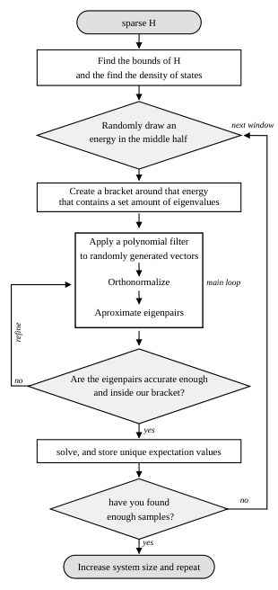 
Figure 1. A flowchart of the general method. For a sparse Hamiltonian H find the normalized density of states ρ(E) and begin sampling interior energies. Around each accepted en- ergy an adaptive bracket is created, in which we then create a set of random gaussian vectors. We now begin the main loop: apply a polynomial to vectors, orthonormalize, and solve for eigenpairs. If they are accurate enough, and inside our bracket we have created, their expectation values are stored. Once we have hit our desired number, we first compute the standard deviation of expectation values and continue to the next sys- tem size if available. Once we have tested enough systems, we then plot the standard...

📷 Fig 2

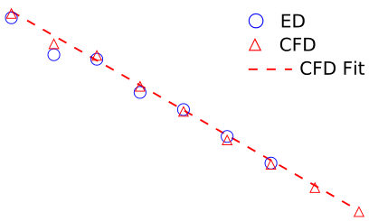 
Figure 3. Dependence of σ∆S on the of Hilbert-space di- mension D for the two-body sp p′s′ model. Blue circles are exact-diagonalization (ED) results for the available small- system sizes; red triangles are obtained with the CFD sam- pling method. The dashed lines is a power-law fit to the sampled results, consistent with a D−1/2 dependence.

📷 Fig 3

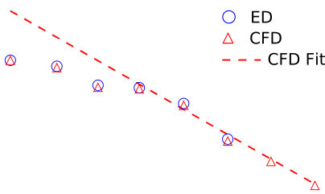 
Figure 4. Dependence of σ∆S on the of Hilbert-space di- mension D for the three-body sp p′s′ model. Blue circles are exact-diagonalization (ED) results for the available small- system sizes; red triangles are obtained with the CFD sam- pling method. The dashed lines is a power-law fit to the sampled results for nine atoms and greater, consistent with a D−1/2 dependence.

**Summary.** The authors introduce a scalable random sampling method to test the weak Eigenstate Thermalization Hypothesis (wETH) on large quantum systems. They apply this method to a Rydberg atom model featuring complex two- and three-body interactions. The results confirm that the system's eigenstate fluctuations decay as $D^{-1/2}$, validating the system's adherence to wETH even in regimes previously inaccessible to exact diagonalization.

**Why it may be interesting.** This work directly tackles the fundamental question of quantum thermalization in complex, interacting many-body systems relevant to cold atom and quantum simulation platforms, providing a scalable numerical tool for testing ETH.

Detailed structure

**Main problem.** The paper addresses the challenge of testing the weak Eigenstate Thermalization Hypothesis (wETH) for quantum systems whose Hamiltonians are too large for exact diagonalization.

**Main result.** The proposed random sampling method successfully demonstrated that the fluctuations in eigenstate expectation values decay with the expected $D^{-1/2}$ scaling, consistent with wETH.

**Method.** A novel random sampling algorithm combining Kernel Polynomial Method (KPM), Chebyshev Filter Diagonalization (CFD), and random vector projection is used to estimate expectation values for eigenstates.

**Model / system.** The study uses a Rydberg atom system placed in a linear array, modeled by a Hamiltonian incorporating both two-body and three-body dipole-dipole interactions tuned via the Stark effect.

**Key observables.** The primary observable is the variance ($\sigma^2_{\Delta S}$) of an expectation value ($\hat{S}$) calculated across sampled eigenstates.

**Important parameters / regimes.** The analysis tracks scaling with the Hilbert space dimension ($D$), comparing results across two-body and three-body interaction regimes.

**Assumptions / limitations.** The method assumes that the fraction of atypical eigenstates vanishes in the thermodynamic limit for wETH to hold, and it ignores the angular dependence of the dipole-dipole interaction.

**Figures summary.** Figure 1 details the sampling flowchart (KPM $
ightarrow$ CFD $
ightarrow$ Variance Plotting). Figures 3 and 4 show the calculated $\sigma\Delta S$ vs. $D$ for both two-body and three-body models, comparing ED and CFD results.

**Paper structure.** The paper introduces the sampling method, applies it to the Rydberg atom system with complex interactions, presents quantitative results showing $D^{-1/2}$ scaling, and compares computational feasibility against exact diagonalization limits.

Abstract

We introduce a random sampling method for testing the weak Eigenstate Thermalization Hypothesis (wETH) that is particularly useful for large, sparse Hamiltonians. We test the method on a well-studied Rydberg atom system that exhibits both two- and three-body dipole-dipole interactions. Our results show that our method allows for the study of system sizes significantly beyond the limits of exact diagonalization. We find that the fluctuations in eigenstate expectation values decay as the Hilbert space dimension $D^{-1/2}$, consistent with wETH and in agreement with previous numerical results.

[↑ back to top](#top)

### [Teaching quantum mechanics in secondary schools: A qubit-first learning path to Bell's inequalities](http://arxiv.org/abs/2610.29834v1)

**Authors:** Alberto Carlini, Andrea Lanza, Dalida Monti, Anna Soso, Elena Losero, Maddalena Mari, Matteo Oñate Orozco, Maria Bondani  
**Type:** both · **Category:** other · **PDF:** <https://arxiv.org/pdf/2610.29834v1>  
**Analysis basis:** full PDF text, analyzed in chunks
**Topic relevance:** 🔥 `quantum optics experiment` **4/5** · `interference shaping light` **1/5** · `quantum measurements` **1/5**

📷 Fig 1

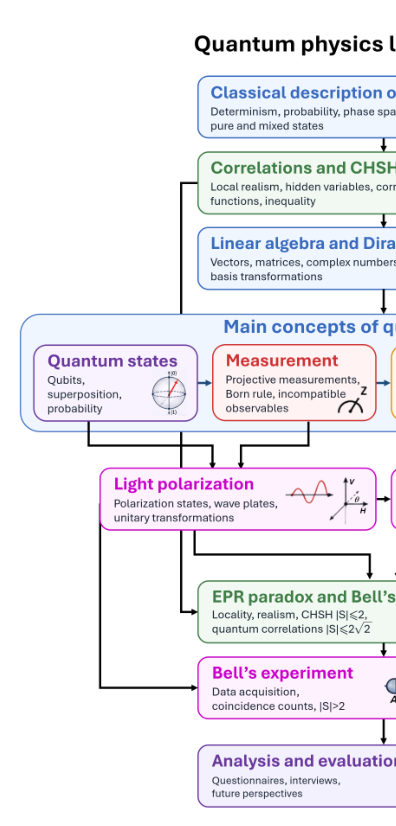 
Figure 1: Conceptual sequence.

📷 Fig 2

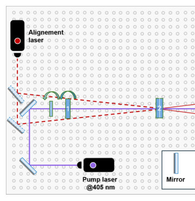 
Figure 2: Schematic of the experimental setup. λ/2: half-wave plate; BBO 1, BBO 2: β-Barium Borate crystals; SPAD: single photons avalanche detector; FPGA: field programmable gate array.

📷 Fig 3

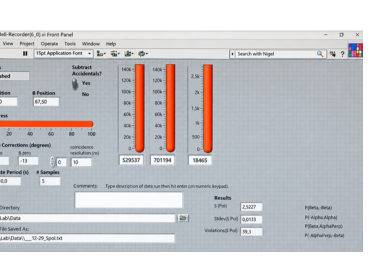 
Figure 3: Experimental results obtained with the apparatus in Genoa. Left: prelimi- nary measurements of correlations between the two detectors’ outputs as a function of the angle set on one of the polarizers. Right: typical screenshot of the LabView in- terface. The displyed result is particularly good ⟨Sexp⟩= 2.5227 ± 0.0133.

**Summary.** This paper introduces a novel, qubit-first curriculum to teach quantum mechanics to secondary school students, using light polarization as the physical model. It successfully integrates theory, simulations, and hands-on lab work, culminating in students performing an authentic Bell test. The framework proves that this concrete, progressive approach allows students to grasp deep quantum concepts like entanglement and Bell violations meaningfully.

**Why it may be interesting.** It provides a highly tangible, experimentally grounded pedagogical framework for teaching foundational quantum concepts, particularly entanglement and Bell tests, which is valuable for researchers developing educational tools or teaching quantum optics.

Detailed structure

**Main problem.** Teaching quantum mechanics at the secondary school level is challenging due to traditional approaches presenting theory as disconnected phenomena requiring extensive classical physics knowledge.

**Main result.** The proposed qubit-first curriculum, grounded in two-state formalism and supported by authentic lab work, significantly improves students' conceptual understanding and ability to link theory to experiment.

**Method.** The work details the design, implementation, and evaluation of a curriculum integrating theory, lab activities (using light polarization), simulations, and inquiry-based learning.

**Model / system.** The primary model is the two-state system (qubit), physically realized using the polarization states of single photons. The curriculum progresses from superposition to entanglement, culminating in the experimental violation of Bell's inequalities.

**Key observables.** Polarization states, coincidence counts, violation of Bell's inequalities (CHSH/Hardy formulations).

**Important parameters / regimes.** Two-dimensional Hilbert space restriction, unitary transformations implemented by wave plates, and the degree of entanglement.

**Assumptions / limitations.** The approach assumes that restricting the discussion to two-dimensional Hilbert spaces simplifies the formalism while retaining core quantum concepts.

**Figures summary.** The notes mention a conceptual sequence of learning progression (Figure 1) and a schematic of the experimental setup involving polarization optics, BBO crystals, and SPADs (Figure 2).

**Paper structure.** The paper outlines a pedagogical progression: starting with basic quantum postulates via qubits, moving through superposition and unitary evolution using optics, building up to composite systems (entanglement), and concluding with the experimental verification of Bell's inequalities.

Abstract

Teaching quantum mechanics at the secondary school level remains a major educational challenge. Traditional historical approaches often present the theory as a sequence of disconnected phenomena, requiring extensive prior knowledge of classical physics before students can appreciate the conceptual structure of quantum physics. In this work, we present the design, implementation, and evaluation of a curriculum based on the two state (qubit first) approach, in which the fundamental postulates of quantum mechanics are introduced through mathematically accessible two level systems and realized with light polarization. The curriculum integrates theoretical instruction, laboratory activities, a coherent progression grounded in the interactive simulations, and inquiry based learning into a coherent pathway that progresses from quantum states and superposition to entanglement and the experimental violation of Bell's inequalities. A distinctive feature of the project is the experimental realization of the violation of Bell's inequalities obtained in a newly established quantum optics laboratory in an Italian high school, where students performed, for the first time in Italy, an authentic Bell test using polarization-entangled photons. The same educational framework was adopted for in service teacher professional development courses. Learning outcomes were evaluated through mixed methods. Preliminary analysis indicates significant improvements in conceptual understanding, confidence in using mathematical formalism, and appreciation of the relationship between theory, experimentation, and the foundations of quantum mechanics. The proposed curriculum shows that two-state formalism and supported by real laboratory experiences enables secondary-school students to engage more meaningfully with both the conceptual foundations of quantum mechanics and their experimental verification.

[↑ back to top](#top)

### [Two quantum skyrmions form a magnon Josephson junction](http://arxiv.org/abs/2610.28854v1)

**Authors:** R. L. Silva  
**Type:** theory · **Category:** other · **PDF:** <https://arxiv.org/pdf/2610.28854v1>  
**Analysis basis:** full PDF text, analyzed in chunks
**Topic relevance:** 🔥 `analog quantum simulation` **4/5** · `methods for driven-dissipative` **2/5**

📷 Fig 1

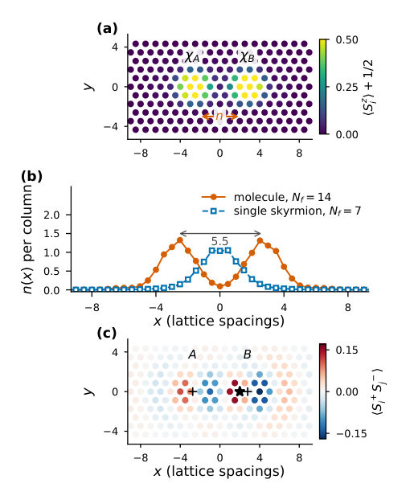 
FIG. 1. The free skyrmion molecule (K = 0.03, 261-site sta- dium, no pinning). (a) Flipped-spin density ⟨Sz i ⟩+ 1/2 in the Nf = 14 ground state: two skyrmions of seven flipped spins centered at x = −2.75 and +2.79. The number n of magnons transferred between them is conjugate to the rela- tive helicity θ = χA −χB. (b) Flipped spins per column for the molecule and for one skyrmion in the same stadium. (c) In-plane correlation ⟨S+ i S− j ⟩between every site i and a wall site j of skyrmion B (star); crosses mark the lobe centers. The correlation reaches 0.16 across the gap and follows the vortex pattern of skyrmion A.

📷 Fig 2

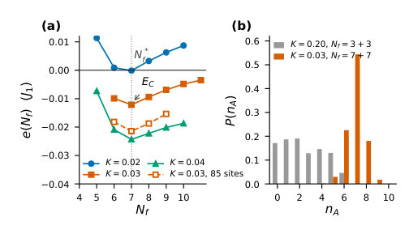 
FIG. 2. (a) Binding energy per flipped spin of one quantum skyrmion on a 55-site disc for three anisotropies and on an 85-site disc for K = 0.03. The minimum at N ∗ f = 7 defines the natural size and its curvature the charging energy EC. (b) Number of flipped spins in the left half of a stadium: for K = 0.20 and Nf = 3 + 3 (gray) the two skyrmions have coalesced; for K = 0.03 and Nf = 7 + 7 (color) the free molecule holds two skyrmions of seven.

📷 Fig 3

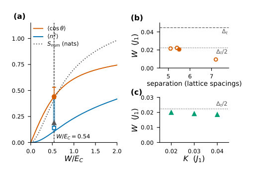 
FIG. 3. (a) Ground state of the rotor of Eq. (4): relative- helicity coherence ⟨cos θ⟩, magnon-number fluctuation ⟨n2⟩, and number entropy Snum versus W/EC. The measured co- herence (circle; bar: range over wall windows) fixes W/EC = 0.54 (dashed line). At that ratio, the shaded bar is the partition-dependent range of the measured magnon-number fluctuation, the open square the excess variance across the midpoint cut, and the triangle the measured excess of number entropy, a lower bound on Snum. (b) Josephson coupling W versus the separation of the two skyrmions at K = 0.03 (open circles, weakly pinned pairs; filled circle, free molecule); error bars span EC = 0.035–0.041J1. (c) W of the...

**Summary.** This paper demonstrates that two quantum skyrmions bind into a molecule that functions as a magnon Josephson junction. By using DMRG, the authors derive an effective Hamiltonian describing the junction's energy, finding that the coupling strength is determined by magnetic frustration. This work is significant because it links topological spin physics to controllable quantum circuit elements.

**Why it may be interesting.** The work connects topological spin textures (skyrmions) to fundamental quantum circuit elements (Josephson junctions), providing a solid theoretical framework for realizing superconducting-like quantum behavior in magnetic materials.

Detailed structure

**Main problem.** The study investigates the physical realization of a magnon Josephson junction formed by the binding of two quantum skyrmions in a frustrated magnet.

**Main result.** The bound pair acts as a Josephson junction described by $H_{rel} = E_C n^2 - W \cos 	heta$, with the coupling energy $W$ being set by the frustration ($J_2$) rather than the anisotropy ($K$).

**Method.** The research employs Density Matrix Renormalization Group (DMRG) calculations on the spin lattice to determine the effective Hamiltonian parameters.

**Model / system.** The system is a frustrated spin-1/2 magnet modeled by a Hamiltonian involving nearest-neighbor and next-nearest-neighbor interactions. The effective low-energy physics is mapped onto a Josephson junction Hamiltonian governing the relative helicity ($	heta$) and magnon number ($n$).

**Key observables.** Relative helicity coherence ($\langle \cos 	heta 
angle$), magnon-number fluctuations ($\langle n^2 
angle$), binding energy, charging energy ($E_C$), and Josephson energy ($W$).

**Important parameters / regimes.** The ratio $W/E_C \simeq 0.5$ places the junction in a crossover regime; the coupling $W$ is found to be $\simeq 0.02J_1$.

**Assumptions / limitations.** The analysis relies on mapping the complex spin dynamics onto a simplified rotor model for the relative helicity, with noted discrepancies between the rotor model and full DMRG results.

**Figures summary.** Figures illustrate the skyrmion structure, the dependence of binding energy on the number of flipped spins, and plots showing coherence ($\langle \cos 	heta 
angle$) and coupling ($W$) versus separation or $W/E_C$.

**Paper structure.** The paper first establishes the physical model and the effective Josephson junction Hamiltonian. It then uses DMRG to calculate key parameters like $E_C$ and $W$ by analyzing binding energies and coherence. Finally, it discusses the resulting crossover regime and the physical implications of the coupling strength.

Abstract

Two quantum skyrmions in a frustrated spin-$1/2$ magnet bind into a molecule, and the molecule acts as a magnon Josephson junction: the relative helicity $θ$ and the number $n$ of magnons transferred between them obey $H=E_Cn^2-W\cosθ$. DMRG on the $J_1$--$J_2$ triangular lattice gives $E_C$ as the curvature of the skyrmion energy at its natural size of seven flipped spins, and the measured helicity coherence fixes $W\simeq0.02J_1$, half the skyrmion--antiskyrmion tunnel splitting and independent of the anisotropy. Two helicity qubits side by side are thus strongly coupled by their own interaction.

[↑ back to top](#top)

### [Conservation in Every Quantum Measurement Outcome?](http://arxiv.org/abs/2610.29804v1)

**Authors:** E. Okon, D. Sudarsky, M. Wiedemann  
**Type:** theory · **Category:** other · **PDF:** <https://arxiv.org/pdf/2610.29804v1>  
**Analysis basis:** full PDF text, analyzed in chunks
**Topic relevance:** 🔥 `quantum measurements` **4/5** · `Full counting statistics` **1/5**

📷 Fig 1

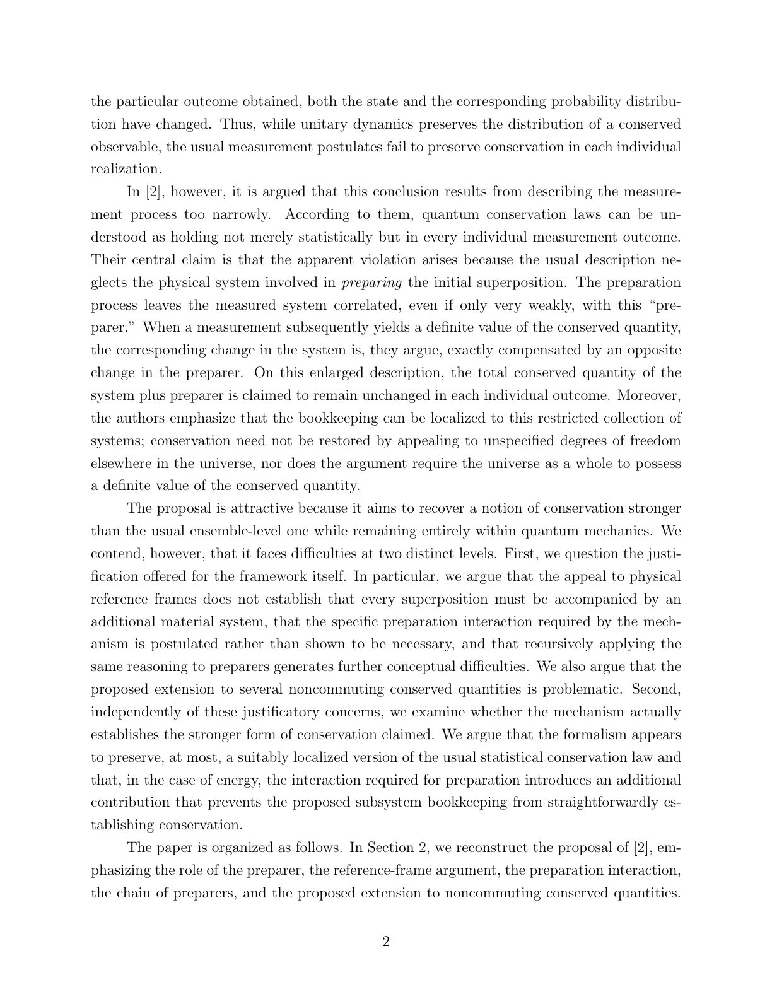 
Low-resolution page preview, page 2

📷 Fig 2

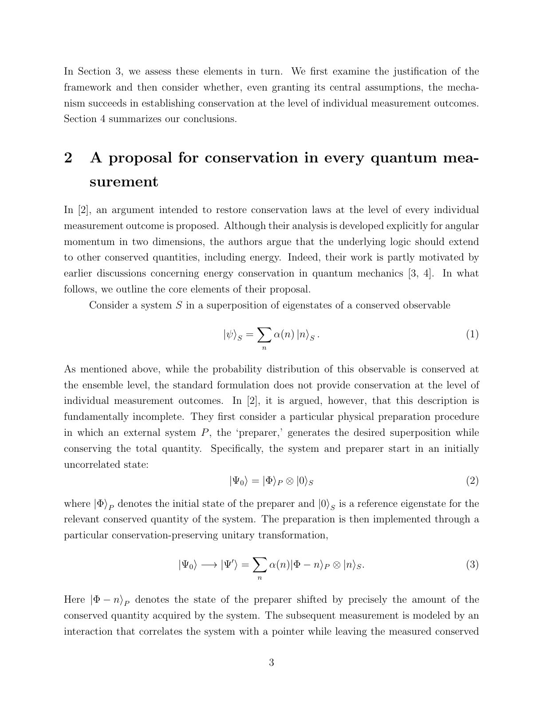 
Low-resolution page preview, page 3

📷 Fig 3

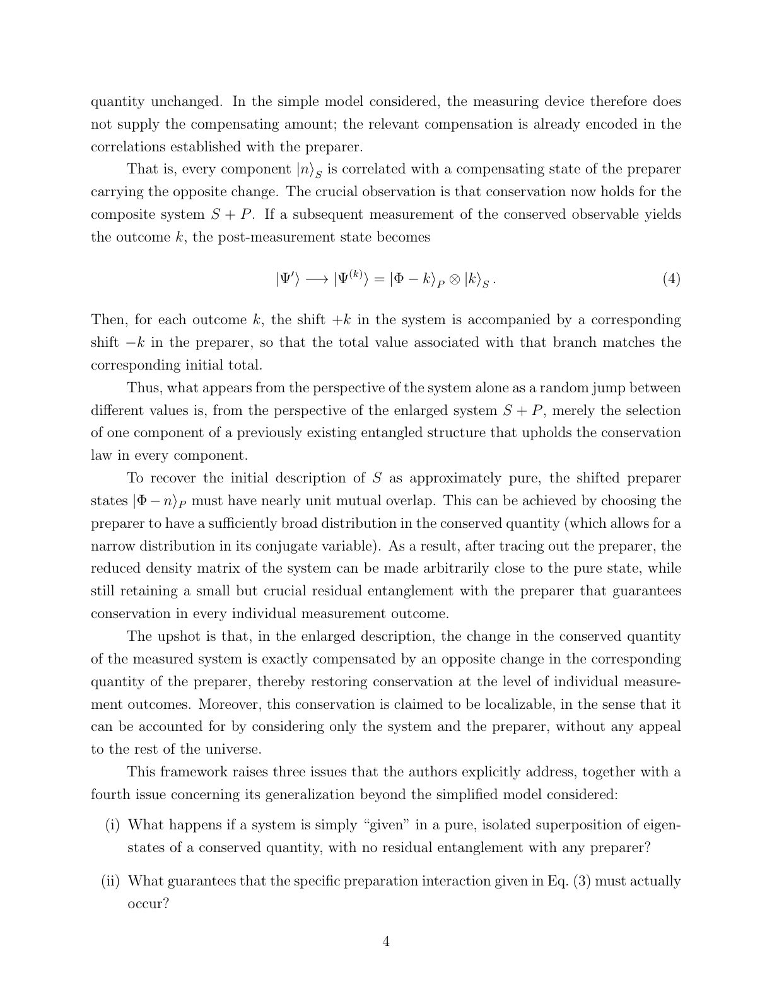 
Low-resolution page preview, page 4

📷 Fig 4

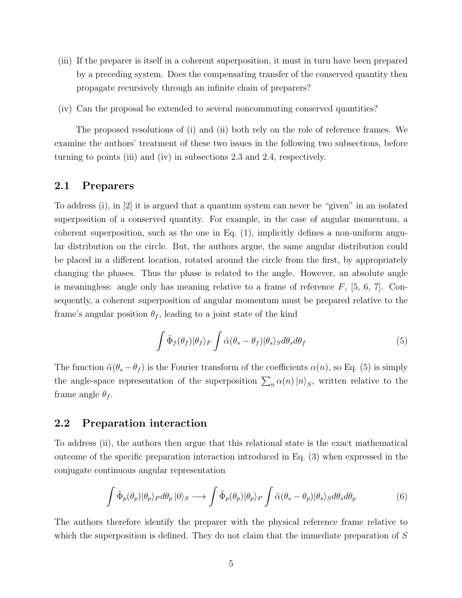 
Low-resolution page preview, page 5

📷 Fig 5

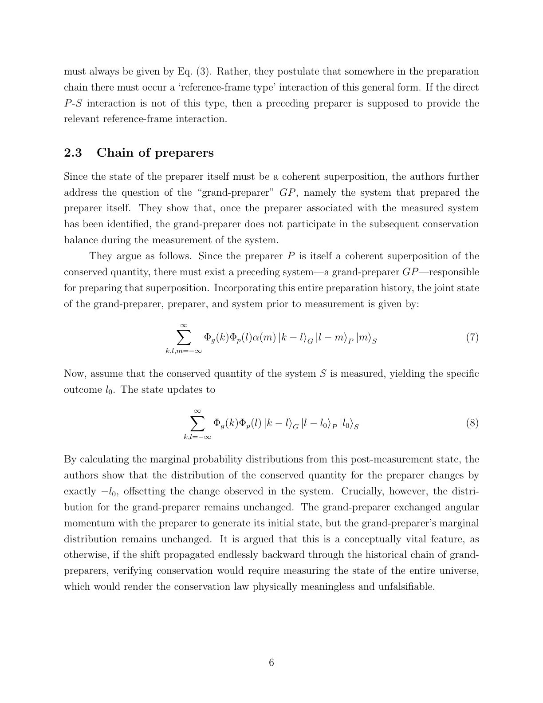 
Low-resolution page preview, page 6

**Summary.** This theoretical paper critically examines a proposal suggesting that quantum conservation laws are preserved at the individual measurement outcome level by correlating the measured system with a 'preparer' system. The authors demonstrate that while the mechanism can account for statistical compensation, it fails to establish a robust, non-statistical conservation law for general observables, particularly when multiple noncommuting quantities are involved.

**Why it may be interesting.** It tackles fundamental conceptual issues at the intersection of quantum measurement theory, conservation laws, and the role of reference frames, which is crucial for understanding open quantum systems dynamics.

Detailed structure

**Main problem.** The paper investigates whether conservation laws can be maintained at the level of individual quantum measurement outcomes, a regime where standard statistical conservation laws break down.

**Main result.** The proposed mechanism, which relies on correlating the measured system with a 'preparer' system, fails to establish true non-statistical conservation for general observables, especially when considering noncommuting quantities or the full Hamiltonian.

**Method.** The authors analyze the proposal by enlarging the quantum description to include a preparer system (S+P) and examining how conservation laws are maintained across measurement outcomes and preparation interactions.

**Model / system.** The model involves a quantum system (S) whose state is a superposition of eigenstates of a conserved quantity, which is prepared via a unitary interaction involving a correlated 'preparer' system (P).

**Key observables.** Conserved quantities ($\hat{O}$), expectation values, and the change in probability distributions for individual measurement outcomes.

**Important parameters / regimes.** The correlation strength between S and P, and the nature of the preparation interaction Hamiltonian ($H_{int}$).

**Assumptions / limitations.** The core assumption being tested is that the preparation process must be describable by a specific, compensating interaction involving a reference frame, which the authors ultimately challenge.

**Paper structure.** The paper systematically analyzes the proposal by first establishing the basic compensation mechanism for a single observable, then extending the analysis to chains of preparers, and finally showing failures when considering noncommuting observables or the full Hamiltonian.

Abstract

In quantum mechanics, conservation laws are usually understood only statistically and only in the context of unitary evolution: during such evolution, if an observable commutes with the Hamiltonian, its expectation value and Born-rule probability distribution remain unchanged. Individual measurement outcomes, however, disrupt even this weak form of statistical conservation. Recently, though, it has been argued that a stronger, non-statistical form of conservation, valid at the level of individual measurement outcomes, can be recovered. The proposal relies on the claim that any superposition of eigenstates of a conserved quantity must ultimately be prepared relative to another physical system, which serves as the relevant reference frame and remains correlated with the system being prepared. On this enlarged description, the change observed in the measured system is claimed to be exactly compensated by an opposite change in the preparer, thereby restoring conservation at the level of individual measurement outcomes. We analyze this proposal and argue that it faces significant conceptual difficulties. We show that the proposed mechanism is not adequately justified and, moreover, does not establish conservation in individual measurement outcomes as claimed.

[↑ back to top](#top)

### [Engineering Low-Latency, High-Throughput Quantum Decoders on NVIDIA GPUs](http://arxiv.org/abs/2610.28867v1)

**Authors:** Stefano Markidis, Luca Pennati, Ivy Peng  
**Type:** experiment · **Category:** quantum information and computing · **PDF:** <https://arxiv.org/pdf/2610.28867v1>  
**Analysis basis:** full PDF text, analyzed in chunks
**Topic relevance:** 🔥 `QC/QI experiment` **4/5** · `quantum measurements` **1/5**

📷 Fig 1

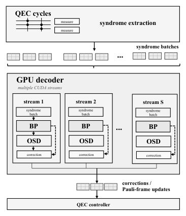 
Fig. 1. GPU decoding workflow in a QEC system.

📷 Fig 2

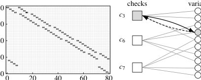 
Fig. 2. Sparse check matrix (a) and the corresponding Tanner subgraph (b). Each nonzero defines a check-variable edge.

📷 Fig 3

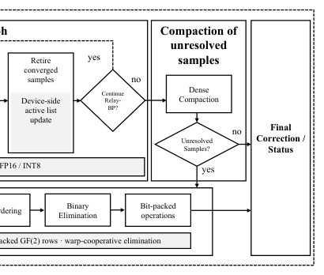 
Fig. 3. GPU workflow within one instantiated CUDA Graph.

📷 Fig 4

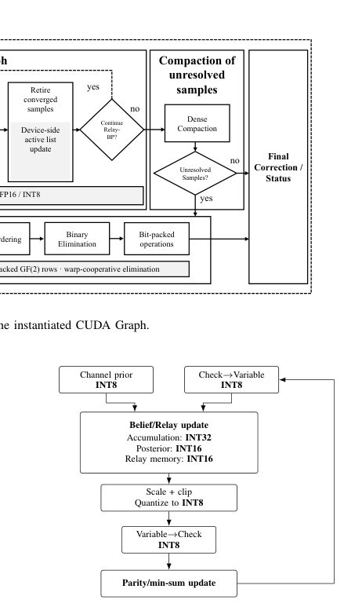 
Fig. 4. Relay-BP quantization with INT8 messages, INT32 accumulation, and INT16 posterior beliefs and Relay memory.

📷 Fig 5

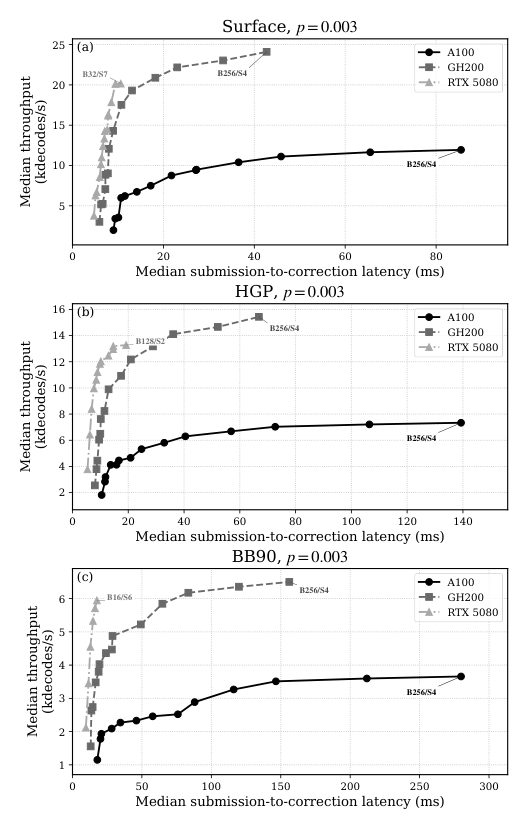 
Fig. 5. Latency-throughput Pareto frontiers at p = 0.003. Endpoint annota- tions give batch size B and stream count S at the highest-throughput point.

**Summary.** This paper presents a highly optimized, hardware-accelerated decoder for Quantum Error Correction (QEC) codes running on NVIDIA GPUs. By combining advanced algorithms like Belief Propagation with aggressive optimizations such as INT8 quantization and CUDA Graphs, the authors achieve significant performance gains. The results demonstrate that commodity GPUs can be engineered into viable, low-latency clusters for future fault-tolerant quantum computing systems.

**Why it may be interesting.** This work is highly relevant as it directly tackles the engineering bottleneck for fault-tolerant quantum computation by providing a roadmap for building scalable, high-speed classical control electronics for quantum processors.

Detailed structure

**Main problem.** The paper addresses the critical need for classical decoders for Quantum Error Correction (QEC) that can operate with extremely low latency and high throughput to keep pace with real-time quantum measurement data.

**Main result.** The combination of hardware optimizations, mixed-precision arithmetic (INT8), and concurrent processing allows commodity GPUs to achieve near state-of-the-art throughput while significantly reducing the median submission-to-correction latency.

**Method.** The authors implemented a decoder combining Relay Belief Propagation (Relay-BP) with Order-Zero Ordered Statistics (OSD-0) on NVIDIA GPUs, optimizing the entire pipeline using CUDA Graphs and advanced low-level kernel techniques.

**Model / system.** The work focuses on decoding syndromes generated by various QEC codes, including the surface, hypergraph product, and bivariate bicycle codes. The decoding process involves solving linear equations over GF(2) using message-passing algorithms.

**Key observables.** Amortized decoding time ($\mu s$/sample), logical error rate (LER), throughput, and submission-to-correction latency.

**Important parameters / regimes.** Error probability ($p \in \{0.001, 0.003, 0.005\}$), batch size ($B$), and the specific GPU architectures (A100, GH200, RTX 5080).

**Assumptions / limitations.** The analysis assumes that independent syndrome batches can be submitted back-to-back to concurrent decoder instances, and that mixed-precision arithmetic maintains accuracy.

**Figures summary.** Figures illustrate the GPU decoding workflow using CUDA Graphs, the structure of the QEC check matrix (Tanner subgraph), and performance trade-offs between latency and throughput based on batch size and stream count.

**Paper structure.** The paper details the algorithmic components (Relay-BP and OSD-0), followed by extensive hardware optimization techniques (CUDA Graphs, mixed precision, quantization), and concludes with comprehensive benchmarking across multiple QEC codes and GPU platforms.

Abstract

We design and optimize a quantum error correction (QEC) decoder for NVIDIA GPUs, combining Relay belief propagation, a state-of-the-art message-passing algorithm, with order-zero ordered statistics post-processing. Our implementation uses CUDA Graphs to control GPU execution, stops updates for converged samples, and collects unresolved samples in queues for post-processing. We optimize sparse traversal through coalesced message accesses, prefetching, and register reuse, and accelerate binary post-processing with warp-level collectives. In addition, mixed FP16-FP32 arithmetic and INT8 quantization reduce message storage and traffic while retaining accuracy using accumulators at higher precision. We evaluate surface, hypergraph product, and bivariate bicycle code workloads on NVIDIA A100 and GH200 data-center GPUs and a commodity RTX 5080. On the bivariate bicycle code at error probability 0.003, INT8 halves amortized decoding time relative to independently tuned FP32 with a negligible logical error rate increase on RTX 5080. With independent syndrome batches submitted back-to-back to concurrent decoder instances, RTX 5080 delivers 91% of GH200's highest measured throughput with an 8.9x shorter median submission-to-correction latency. The combination of performance optimization, mixed precision, INT8 quantization, and concurrent decoder instances opens a path toward QEC decoder clusters built from commodity GPUs.

[↑ back to top](#top)

### [From hard-core to soft-core bosons in a shell trap](http://arxiv.org/abs/2610.29440v1)

**Authors:** G. Costa, S. Prestipino, F. Cinti, M. Ciardi  
**Type:** both · **Category:** quantum gases · **PDF:** <https://arxiv.org/pdf/2610.29440v1>  
**Analysis basis:** full PDF text, analyzed in chunks
**Topic relevance:** 🔥 `analog quantum simulation` **4/5** · `methods for driven-dissipative` **1/5**

📷 Fig 1

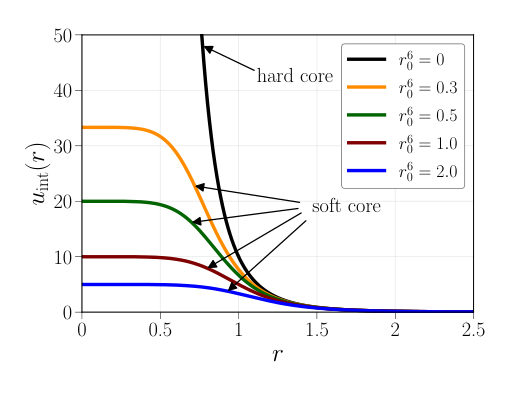 
Figure 1. Interaction potential (3) for various r0 values (in the legend). For r0 ̸= 0, the inflection point of uint(r) falls at r = (5/7)1/6r0 = 0.9454 . . . r0.

📷 Fig 2

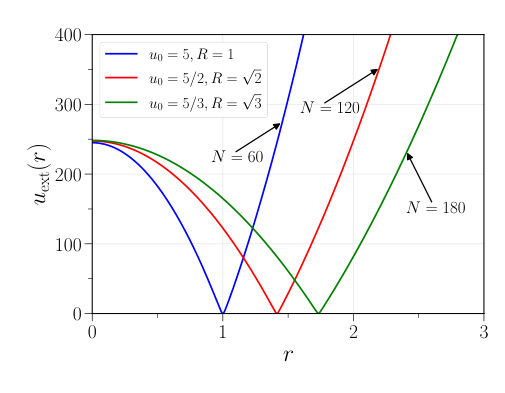 
Figure 2. Trapping potential for the three system sizes con- sidered in this paper. Notice the vertical scale.

📷 Fig 3

 
Figure 3. N = 60 bosons: Integrated radial density n(r), plotted for λ = 0.3 and a few values of the softness parameter r6 0.

📷 Fig 4

 
Figure 4. N = 60 bosons: Four typical bead configurations (projection maps). (a) Solid bilayer (red: particles in the inner layer; blue: particles in the outer layer); (b) Icosahedral cluster solid; (c) Octahedral cluster supersolid; and (d) Superfluid.

📷 Fig 5

 
Figure 5. N = 60 bosons: Phase diagram at T = 1. The color palette of the circles is as follows: blue →solid bilayer (2-Sol); red →superfluid bilayer (2-SF); yellow →superfluid (SF); light green →cluster solid; dark green →bilayer with clusters in the first layer and isolated particles in the second layer (2-C+Sol); purple →supersolid. Background colors and phase boundaries are a guide for the eye.

**Summary.** This paper uses advanced simulations and theoretical analysis to map the quantum phase diagram of bosons in a spherical trap as the interparticle interaction softens. By analyzing superfluidity, clustering, and symmetry via the Spherical Structure Factor, the authors demonstrate a rich spectrum of phases, notably confirming that supersolid behavior requires the presence of underlying cluster structures.

**Why it may be interesting.** This work provides a detailed, tunable platform to study the crossover between different quantum regimes (e.g., crystalline solids to superfluid/supersolids) in a geometrically constrained environment, which is highly relevant for understanding quantum matter in optical lattices or traps.

Detailed structure

**Main problem.** The study investigates how the equilibrium structure and superfluidity of spinless bosons trapped in a spherical shell change when the interparticle potential core is varied from hard-core to soft-core.

**Main result.** The research confirms that supersolid states only emerge when clusters are present, and these supersolid phases are restricted to a specific range of particle masses, regardless of the system size tested.

**Method.** The study employs Path Integral Monte Carlo (PIMC) simulations, supplemented by theoretical derivations relating correlation functions to the Spherical Structure Factor (SSF).

**Model / system.** The system consists of spinless bosons confined in a broad spherical shell, governed by a Hamiltonian incorporating an external trapping potential and a tunable interparticle potential. The model bridges the physics of Helium-like atoms (hard-core) and Rydberg-dressed atoms (soft-core).

**Key observables.** Superfluid fraction ($f_s$), radial distribution function ($g(r)$), Cycle Length Distribution ($P(L)$), and the Spherical Structure Factor ($S_l$).

**Important parameters / regimes.** Core stiffness (tuned by $r_0$), particle mass ($\lambda$), and system size ($N=60, 120, 180$).

**Assumptions / limitations.** The SSF derivation for clusters assumes Gaussian cluster centers at vertices of highly symmetric polyhedra (octahedron or icosahedron).

**Figures summary.** Figures illustrate the radial density profile changing with interaction softness, and the SSF is shown to match theoretical predictions for icosahedral and octahedral cluster arrangements.

**Paper structure.** The paper first establishes the physical model and simulation methods (PIMC) to map out the phase diagram based on interaction softness. It then develops the theoretical framework using spherical harmonics to calculate the SSF, confirming structural symmetries in the resulting phases.

Abstract

We study the low-temperature states of a system of spinless bosons trapped in a broad spherical shell. In our virtual (path-integral Monte Carlo) experiments, we specifically examine how the equilibrium structure and overall superfluidity of the system are affected by a change of the interparticle-potential core from hard to increasingly soft. In this manner we bridge the gap between the behaviors of two species of bosons: Helium-like atoms, which self-assemble into ordinary crystalline solids, and Rydberg-dressed atoms, which in simulation form cluster (super)solids. We also vary the particle mass, i.e., the quantumness of the system, so as to modify the relative stability of ``solid'' and fluid states. We thus find a whole spectrum of (finite-size) phases with a curved structure, including multilayer and cluster phases, as well as superfluids and single layer supersolids. In particular, we confirm that supersolids only occur in the presence of clusters. By considering three system sizes (from 60 to 180 particles), but rescaling the trap radius so that the density stays fixed, we verify that supersolid states only exist in the same range of particle masses. Our model serves as a platform to test how emergent properties are modified, in spherical geometry, in the crossover from atoms to dressed atoms.

[↑ back to top](#top)

### [Buffer-Qubit-Based Quantum Circuit Allocation Method Against Crosstalk Attacks](http://arxiv.org/abs/2610.29050v1)

**Authors:** Haruki Nakayama, Satoyuki Tsukano, Satoshi Kono, Keita Matsumoto, Toshio Mori, Takumi Oikawa, Ryo Uchida  
**Type:** experiment · **Category:** quantum information and computing · **PDF:** <https://arxiv.org/pdf/2610.29050v1>  
**Analysis basis:** full PDF text, analyzed in chunks
**Topic relevance:** 🔥 `QC/QI experiment` **4/5**

📷 Fig 1

 
Fig. 1: A schematic illustration of a crosstalk attack in QMP, depicting how an attacker circuit can affect victim circuits via crosstalk on an 8-qubit device topology.

📷 Fig 2

 
Figure 2 shows an overview of the proposed method. We extend the QMP method of OQTOPUS [8]. Specifically, we introduce a set Vb of physical qubits that should be reserved as buffer qubits. Multiple quantum circuits are then sequentially allocated on the same chip, subject to the constraints that physical qubits corresponding to vertices in Vb cannot be used for allocation. Since the construction of Vb depends on the range of crosstalk attack effects, it is determined from experiments on the real quantum computer presented in Section IV-A. The proposed method augments the Subgraph Isomorphism Problem (SIP) formulation used in the existing method with additional constraints, which prohibit...

📷 Fig 3

 
Fig. 2: Illustration of the proposed circuit allocation procedure. For each user circuit, (A) a pattern graph Gi u is built from the transpiled circuit, and (B) Gi u is matched to a subgraph of the target graph Gi c, subject to the constraint that vertices corresponding to buffer qubits in Vb (marked with ×) are excluded from the mapping. After each allocation, unused qubits that fall within the crosstalk-affected range of the allocated circuit are added to Vb, and the procedure is repeated for the next circuit. The specific construction of Vb depends on the range of crosstalk effects; in this example, qubits adjacent to the allocated ones are added to Vb as one instance of such a...

📷 Fig 4

 
Fig. 3: Overview of the experiment for evaluating the effect of crosstalk attacks. (a) Device topology and the allocation of each circuit. (b) Detailed view of the attacker circuit. (c) Illustration of the experimental procedure.

📷 Fig 5

 
Fig. 5: Quantum circuit allocation for a single batch, in which 30 colored qubits were allocated to user jobs and 34 grayed qubits were reserved as buffer qubits.

**Summary.** This paper introduces a buffer-qubit-based method to secure Quantum Multi-Programming (QMP) against crosstalk attacks on quantum processors. The technique dynamically reserves idle qubits around active circuits to suppress malicious interference. By implementing this in the OQTOPUS software and testing it on a real quantum device, the authors demonstrate a practical countermeasure for reliable quantum cloud services.

**Why it may be interesting.** This work directly addresses hardware-level security and resource management in quantum cloud computing, which is crucial for scaling quantum algorithms beyond idealized models.

Detailed structure

**Main problem.** Quantum Multi-Programming (QMP) is vulnerable to crosstalk attacks, where a malicious user disrupts other users' computations on a shared quantum chip.

**Main result.** The proposed buffer-qubit allocation method successfully mitigates crosstalk by reserving idle qubits around allocated circuits, which was validated on a real superconducting quantum device.

**Method.** The authors extended the OQTOPUS software by incorporating a buffer-qubit constraint into the circuit allocation process, formulated as a Subgraph Isomorphism Problem (SIP).

**Model / system.** The work is performed on a real superconducting quantum computer, simulating QMP for multiple users on a single chip.

**Key observables.** Energy relaxation ($T_1$) and dephasing ($T_2^*$) characteristics of qubits, particularly comparing measurements near an attacker circuit versus non-adjacent qubits.

**Important parameters / regimes.** Crosstalk effects are observed to be localized to qubits immediately adjacent to the attacker circuit.

**Assumptions / limitations.** The scheduler, transpiler, and allocator managed by the cloud service are assumed to be trusted, and the initial characterization of crosstalk effects determines the initial buffer set.

**Figures summary.** Figures illustrate the schematic of a crosstalk attack, the proposed allocation procedure using buffer qubits, and the experimental setup for evaluating the attack effects on the device topology.

**Paper structure.** The paper first identifies the QMP vulnerability to crosstalk, proposes the buffer-qubit allocation method integrated into OQTOPUS, presents experimental characterization of the attack effect on a real device, and finally validates the method's successful implementation.

Abstract

Quantum Multi-Programming (QMP) enables the simultaneous execution of quantum circuits from multiple users on a single quantum chip in cloud quantum computing services. However, QMP is vulnerable to crosstalk attacks, in which a malicious user deliberately induces crosstalk to disrupt other users' computations. As a countermeasure, prior work has proposed the use of buffer qubits, which remain idle and are allocated between quantum circuits to suppress the effect of crosstalk. Nevertheless, to the best of our knowledge, such countermeasures have not been publicly reported in production quantum cloud software. In this paper, we extend the QMP of OQTOPUS, open-source software that is already in production use for operating real quantum computers, with a buffer-qubit-based circuit allocation method. Experiments on a real device characterize the attack effect in terms of energy relaxation and dephasing, showing that observable degradation appears in dephasing characteristics of qubits adjacent to the attacker circuit. Based on this result, we release the proposed method as part of OQTOPUS and confirm that the buffer qubits are correctly reserved around the allocated circuits.

[↑ back to top](#top)

### [Meter-scale quantum interconnects between large quantum processors](http://arxiv.org/abs/2610.29986v1)

**Authors:** Neereja M. Sundaresan, Nicholas Cotaj, Yadav Prasad Kandel, Eric Lewandowski, Christian Robert Longton, Yves Martin, Jae-woong Nah, Kathryn Pooley, Martin Sandberg, Michael Scanlon, Chi Xiong, Emanuil Sashev Yanev, David Abraham, Abhinandan Antony, Vincent Arena, Nicholas Bornman, Khanh Dang, Oliver Dial, Christopher Guarino, Gabriel Haspil, Jared Hertzberg, Kentaro Heya, Swetha Kamlapurkar, Michael Karschner, George Keefe, Eric Liniger, Laura Luo, Thomas G. McConkey, David Olson, Jason Orcutt, Dmitry Ovchinnikov, Timothy Phung, Sankeerth Rajalingam, Michael Selvanayagam, William Shanks, Dongbing Shao, Abigail Shearrow, Adam Stabile, Jiri Stehlik, Joseph Suttle, Jeng-Bang Yau, Eric Zhang  
**Type:** experiment · **Category:** quantum information and computing · **PDF:** <https://arxiv.org/pdf/2610.29986v1>  
**Analysis basis:** full PDF text, analyzed in chunks
**Topic relevance:** 🔥 `QC/QI experiment` **4/5**

📷 Fig 1

 
FIG. 1. Two Nighthawk R1 test modules connected by four L-couplers. a,b) Rendering and photograph of the dual-module assembly. c,d) Rendering and photograph of the spring-loaded cable holder, which installs two L-coupler connections at a time. e) For development speed, only a subset of qubits around the L-couplers is wired and measured. Solid outlined boxes are lattice qubits; the dashed box is one L-coupler element, which the inset expands: a dedicated grounded, frequency-tunable L-qubit, an i2m coupler, and the connection to the cable. f) Representative measurement of qubit-cable coupling for one L-coupler versus external flux. See Methods for details.

📷 Fig 2

 
FIG. 2. Magnetic sensitivity of aluminum cables and char- acterization of cable-chip connections. a) Qi of a standalone aluminum coax against frequency, for a series of fields applied while the cable cooled through its superconducting transi- tion, shaded light to dark from zero to 14 G and labelled at the extremes. Purple open circles give the median Qi across the 4.5–7.5 GHz band at each field, read against the upper axis. Orange triangles are a single shielded cable on the route used in the dual-module assembly. b) Green circles and open squares are two nominally identical standalone cable-to-chip join testers. Blue circles are the four cable modes of the dual- module assembly, inferred...

📷 Fig 3

 
FIG. 3. State transfer and distant CZ on L-couplers. a) Relay-based state transfer error per L-coupler, measured in both directions with network benchmarking, with the mean as a bar. Open triangles are the coherence limit of the model in Methods, which takes the shorter measured T1 and the shorter T ∗ 2 of each L-qubit pair together with the measured L-coupler mode T1 and T ∗ 2 ; open diamonds are the same model with the L-qubits held at T1 = T ∗ 2 = 100 µs. b) Distant CZ error per gate, labelled by the outer lattice qubits the gate acts on with the mediating L-coupler in parentheses. The stacked bar is the summed constituent error budget for CZ111–237, beside its measured point. Inset: the...

**Summary.** This paper reports on the creation and testing of meter-scale quantum interconnects using superconducting qubits. By successfully implementing L-couplers between two large quantum processors, the authors demonstrated high-fidelity quantum state transfer and distant two-qubit gates. This work establishes a critical, practical pathway toward building modular, large-scale quantum computers.

**Why it may be interesting.** This work provides crucial experimental benchmarks for quantum networking, directly addressing the engineering bottleneck of connecting quantum modules, which is highly relevant for theorists modeling scalable quantum architectures.

Detailed structure

**Main problem.** The primary challenge addressed is developing reliable, long-distance quantum interconnects (L-couplers) necessary to scale quantum processors beyond single chip modules.

**Main result.** The researchers successfully demonstrated high-fidelity state transfer (99.00% mean) and distant CZ gates (94.75% mean) across four meter-scale L-couplers, proving a practical path for modular quantum computing.

**Method.** The experiment involves physically assembling superconducting qubit processors connected by custom L-couplers containing superconducting coax, and then measuring quantum gate fidelities and state transfer efficiencies.

**Model / system.** The system uses superconducting qubits (IBM Nighthawk R1) connected via L-couplers, which incorporate frequency-tunable L-qubits and RF-SQUID couplers, spanning superconducting aluminum coax over meter-scale distances.

**Key observables.** State transfer fidelity, distant CZ gate fidelity, Bell pair fidelity, and GHZ state fidelity.

**Important parameters / regimes.** Meter-scale distances, mean state transfer fidelity of 99.00%, and mean distant CZ fidelity of 94.75%.

**Assumptions / limitations.** The fidelity measurements are limited by readout error, and the performance relies on the successful physical integration of multiple components (qubits, couplers, and cables).

**Figures summary.** Figures illustrate the dual-module assembly with four L-couplers, showing the physical components and the measured performance metrics for state transfer and distant gates.

**Paper structure.** The paper progresses from identifying the need for interconnects, detailing the physical construction of the L-couplers, characterizing the link performance via state transfer and distant gates, and concluding with demonstrations of multi-pair entanglement generation.

Abstract

Modular quantum architecture requires long-distance quantum interconnects to stitch together individual processor modules. Such interconnects, long-distance couplers or L-couplers, must support coherent quantum operation over meter-scale distances and scale to multiple connections between any two modules. Here we demonstrate four L-couplers operating between two 120-qubit IBM Nighthawk R1 superconducting qubit processors. Each L-coupler joins two Nighthawk lattice qubits through two frequency-tunable L-qubits, two RF-SQUID based "i2m" couplers, and 80 cm of superconducting aluminum coax. Each cable installs perpendicular to the processor surface, to enable denser connections, and is joined to the chip by an indium-to-indium room temperature pressure bond made after both modules were mounted. L-coupler modes near 5 GHz, with internal quality factors of 0.86 to 1.09e6, carry relay-based state transfer at a mean network benchmarking fidelity of 99.00%, with a best link of 99.29 +/- 0.07%. We then realize distant CZ gates between lattice qubits in separate modules at a mean fidelity of 94.75%, with a best link of 96.42 +/- 0.28%, and use them to generate entangled states across the two processors, including a demonstration of simultaneous Bell pair generation using two adjacent L-couplers. These four high-fidelity L-couplers establish a practical path to scalable quantum interconnects for modular quantum computing.

[↑ back to top](#top)

### [Closing of density wake in concentrated colloidal suspensions: two regimes governed by compressibility, friction, and self-propulsion](http://arxiv.org/abs/2610.29801v1)

**Authors:** Guillaume Duprez, Gianmarco Spera, Benjamin Buhl, François Graner, Vincent Démery, Cécile Cottin-Bizonne, Hélène Delanoë-Ayari, Mathieu Leocmach  
**Type:** both · **Category:** statistical mechanics · **PDF:** <https://arxiv.org/pdf/2610.29801v1>  
**Analysis basis:** full PDF text, analyzed in chunks
**Topic relevance:** `Frenkel-Kontorova` **3/5** · `driven-dissipative phase transition` **3/5** · `non-equilibrium universality` **3/5** · `Keldysh / 2PI / non-Gaussian methods` **2/5** · `analog quantum simulation` **2/5** · `methods for driven-dissipative` **2/5** · `correlated / nonlocal dissipation` **1/5** · `quantum measurements` **1/5** · `scars & prethermalization` **1/5**

📷 Fig 1

 
FIG. 1. (a) Sketch of the experimental setup. Janus colloids form a monolayer that is sedimented by tilting the experimental setup by a small angle θ. A micromanipulator holds the obstacle that dips in the monolayer and is dragged at constant velocity along⃗x. (b) Detail of a dark-field microscopy image of the sedimented monolayer in the passive case. In-plane gravity ⃗g∗acts along⃗y. The orange arrow represents the velocity at which the obstacle is dragged (from left to right, in all figures). The obstacle in motion appears as a circular zone depleted in colloids. The density wake is visible as a low-density area behind the obstacle.

📷 Fig 2

 
FIG. 2. Experimental micrograph of the wake for two different ob- stacle radii: (a) R = 8.5µm and (b) R = 42µm, at roughly the same density (φ = 0.767±0.025 and 0.758±0.031), and the same veloc- ity Uobs = 5µm/s. The two pictures are scaled so that R appears the same to highlight the nonlinear dependence of wake length on obsta- cle size.

📷 Fig 3

 
FIG. 3. (a) Map of the packing fraction time-averaged in the frame of the obstacle in a passive case where Pe ≈200, see colour bar below. A Gaussian smoothing of size a/2 has been applied. The excluded zone is shown as a red circle of radius R. The white disk represents the obstacle of radius R −a. (b) Profiles along y at various x positions behind the obstacle indicated on (a) and (c) by vertical dashed lines of corresponding colours. A Gaussian smoothing of size a has been applied. (c) Profile along x that is y-averaged on |y| &lt; 2a, i.e. dotted black lines in (a) and (b). A baseline measured at rest has been removed. The horizontal black dotted line is the density at rest at the position...

📷 Fig 4

 
Figure 2 displays typical snapshots of a moving obstacle in a passive sediment. At all considered experimental condi- tions, we observe a density wake with an almost empty zone behind the obstacle. However, the length of this wake changes by about two orders of magnitude in units of the particle size.

📷 Fig 5

 
FIG. 4. (a) Experimental closing length as a function of packing frac- tion for two obstacle velocities in the passive case for small obstacles (8µm ≤R ≤10µm). (b) Same data for the closing time. (c) Closing time from simulations as a function of packing fraction for two ob- stacle velocities in the passive case. Solid black curve corresponds to γR2(1−φ)2. (d) Same data with the inverse scaling in Uobs. Dashed black line is an affine guide for the eye.

**Summary.** This work experimentally and numerically investigates how a density wake closes behind a moving object in dense colloidal suspensions. It establishes that the wake dynamics are fundamentally controlled by the suspension's compressibility, revealing distinct scaling laws for passive and active matter. The findings provide a framework to interpret the complex effects of self-propulsion in dense, non-equilibrium particle systems.

**Why it may be interesting.** While focused on classical soft matter, the concepts of non-equilibrium steady states, effective interactions due to activity, and density fluctuations in confined/driven systems are highly relevant to understanding many-body dynamics in quantum many-body systems.

Detailed structure

**Main problem.** The study investigates the closing of the density wake created when an obstacle moves through a dense, compressible colloidal suspension, addressing limitations of previous dilute or far-field theories.

**Main result.** The wake closing exhibits two distinct regimes governed by compressibility, and the influence of self-propulsion can be understood as an effective increase in the obstacle size within an active bath.

**Method.** The research combines experimental measurements using Janus colloids with numerical simulations and analytical derivations based on continuum models.

**Model / system.** The system is a 2D suspension of colloidal particles, which can be modeled as thermal (passive) or self-propelled (active) Brownian particles in a dense state.

**Key observables.** Density perturbation/wake shape, characteristic wake closing length ($\lambda$), and the density profile ($
ho$).

**Important parameters / regimes.** Packing fraction ($\phi$), compressibility factor ($Z$), self-propulsion velocity ($v_p$), and persistence time ($	au_r$).

**Assumptions / limitations.** The analysis relies on continuum descriptions, assuming the particle current is driven by pressure gradients against friction, and fitting the wake decay with an exponential function.

**Figures summary.** Figures show experimental setups, time-averaged density maps illustrating the wake, and quantitative plots demonstrating the non-monotonic dependence of wake length on density for both passive and active cases.

**Paper structure.** The paper first establishes the physical problem by reviewing the wake formation. It then analyzes the passive case, identifying two density regimes governed by compressibility. Finally, it extends this understanding to active suspensions, quantifying the role of self-propulsion.

Abstract

When an obstacle moves through a compressible medium, it creates a density perturbation. Theoretical arguments regarding the shape of this density wake in Brownian suspensions either suppose infinite dilution or describe only the far field. Here, we study via experiments and numerical simulations the closing of the density perturbation just behind a circular obstacle in dense 2D suspensions of particles that are thermal or self-propelled. In the thermal case, we show that the characteristic length of the wake is a non-monotonic function of density, decreasing then increasing. We rationalise the scalings of both regimes by analytical arguments that highlight the role of the compressibility factor of the suspension. Based on this new understanding of the passive case, we show that the influence of self-propulsion observed in experiments and simulations can be understood as if the obstacle is effectively larger in an active bath, with non-trivial and distinct roles of the self-propulsion velocity and of the persistence time.

[↑ back to top](#top)

### [Hydrodynamic description of correlation matrix eigenvalues in a finite temperature expanding free fermionic gas](http://arxiv.org/abs/2610.30062v1)

**Authors:** Atharva Naik, Madhumita Saha, David A. Huse, Manas Kulkarni, Abhishek Dhar  
**Type:** theory · **Category:** statistical mechanics · **PDF:** <https://arxiv.org/pdf/2610.30062v1>  
**Analysis basis:** full PDF text, analyzed in chunks
**Topic relevance:** `Full counting statistics` **3/5** · `Keldysh / 2PI / non-Gaussian methods` **3/5** · `methods for driven-dissipative` **3/5** · `correlated / nonlocal dissipation` **2/5** · `driven-dissipative phase transition` **2/5** · `non-equilibrium universality` **2/5** · `analog quantum simulation` **1/5** · `quantum measurements` **1/5** · `scars & prethermalization` **1/5**

📷 Fig 1

 
FIG. 1. |ϕα(x, t)|2 vs x for α = (−80, −π

📷 Fig 2

 
FIG. 2. Eigenvalue profile plotted at different times for (a) the system part of the correlation matrix and (b) the reservoir part of the correlation matrix. The symbols correspond to numerically obtained eigenvalues while the red dotted line are ones predicted by hydrodynamics. The conformal defect with gc = 0.4 was considered with other parameters, β = 1, µ = 2 and LS = 500.

📷 Fig 3

 
FIG. 3. Comparison between vN entropy and cumulants obtained using exact numerics and hydrodynamical equations. The red squares and the blue circles correspond to the results from exact microscopic and hydrodynamic, respectively, for the system part. Green triangles and orange crosses correspond to the results from exact microscopics and hydrodynamics, respectively, for the reservoir part. Here, LS = 50, β = 1, µ = 1 and gc = 0.4.

📷 Fig 4

 
FIG. 4. Difference between the exact vN entropy (numeri- cally computed) and the hydrodynamic entropy as a function of time for a setup with a conformal defect with different coupling strengths at β = ∞and LS = 500. A logarithmic growth is seen. For gc = 1/2 = g , the difference 1 6 log(t) [43], which is the well known result for entanglement growth in the defectless case. Inset: The prefactor of the log(t) growth is plotted as a function of defect strength gc.

**Summary.** This paper introduces a hydrodynamic framework to determine the eigenvalues of the correlation matrix for an expanding free fermionic gas. By solving the collisionless Boltzmann equation, the authors derive analytic expressions for the system and reservoir entropies. This method successfully reproduces known results for entanglement entropy, providing a semiclassical tool for analyzing non-equilibrium quantum dynamics.

**Why it may be interesting.** This work provides a powerful, analytically tractable hydrodynamic tool to study entanglement and thermalization dynamics in open quantum systems, which is highly relevant for understanding quantum information flow in realistic physical settings.

Detailed structure

**Main problem.** The paper develops a hydrodynamic description to calculate the eigenvalues of the microscopic correlation matrix for a free fermionic gas undergoing free expansion at non-zero temperature.

**Main result.** The hydrodynamic approach successfully predicts the time evolution of the von Neumann entropy and Full Counting Statistics for both the system and the reservoir, showing agreement with exact results for various defect types.

**Method.** The core method involves applying semiclassical hydrodynamics, solving the collisionless Boltzmann equation for the phase space density, and relating the resulting phase space density to the correlation matrix eigenvalues via the Yang-Yang formula.

**Model / system.** The system is a one-dimensional free fermionic gas modeled as a finite system coupled to a semi-infinite reservoir via a point defect. The dynamics are governed by the free fermionic Hamiltonian, and the analysis covers different defect types (conformal, hopping, density).

**Key observables.** Correlation matrix eigenvalues ($\xi_S, \xi_R$), von Neumann entropy ($S_D^{	ext{v}}$), and Full Counting Statistics (FCS).

**Important parameters / regimes.** Temperature ($eta$), time ($t$), and defect coupling strengths ($g_c$).

**Assumptions / limitations.** The derivation relies on a semiclassical approximation based on a wave-packet picture, and the leading-order hydrodynamic formula neglects small quantum fluctuations.

**Figures summary.** Figures compare numerical results against hydrodynamic predictions for eigenvalue profiles, von Neumann entropy, and FCS over time for various defect strengths and temperatures.

**Paper structure.** The paper builds from the initial problem of calculating correlation matrix eigenvalues to deriving the hydrodynamic equations from the phase space density evolution. It then applies this framework to calculate the entropy for different defect models, comparing the results systematically.

Abstract

A recent work considered the Page curve for entanglement entropy of a freely expanding one-dimensional Fermi gas starting from a finite box (the system) in a zero-temperature initial state that then expands in to a semi-infinite vacuum (the environment). For the case with a single defect at the system-environment junction, it was shown that the Yang-Yang entropy of the system computed from semiclassical hydrodynamics agrees with the microscopically computed entanglement entropy, yielding the Page curve. On the other hand, the environment Yang-Yang entropy showed a monotonic increase. Here, we propose a hydrodynamic description to obtain the eigenvalues of the microscopic correlation matrix for a nonzero temperature freely-expanding Fermi gas. For the system, the phase space density directly gives the correlation matrix eigenvalues and thus, via the Yang-Yang formula, yields the von-Neumann entropy. For the reservoir, a modification of the phase space density is required in the Yang-Yang formula, to incorporate coherences, in order to reproduce accurately the entropy. The hydrodynamic description of correlation matrix eigenvalues also leads to a Levitov-Lesovik type formula for the full-counting-statistics for a finite system in the transient regime. We provide a heuristic derivation of the correlation matrix eigenvalues based on a semiclassical wave-packet picture.

[↑ back to top](#top)

### [Dynamical Tunneling Blockade in Layer-Pseudospin Ferromagnets](http://arxiv.org/abs/2610.28760v1)

**Authors:** Lingxian Kong, Yuta Murakami, Ryuichi Shindou, Zhiyuan Sun  
**Type:** theory · **Category:** strongly correlated electrons · **PDF:** <https://arxiv.org/pdf/2610.28760v1>  
**Analysis basis:** full PDF text, analyzed in chunks
**Topic relevance:** `Keldysh / 2PI / non-Gaussian methods` **3/5** · `driven-dissipative phase transition` **3/5** · `methods for driven-dissipative` **3/5** · `non-equilibrium universality` **3/5** · `analog quantum simulation` **1/5** · `correlated / nonlocal dissipation` **1/5** · `quantum measurements` **1/5** · `scars & prethermalization` **1/5**

📷 Fig 1

 
FIG. 1. (a) Double-layer device with the two layers connected to leads at chemical potentials µ↑and µ↓and separated by a tunneling barrier of thickness d. The gate voltage VG applies an out-of-plane electric field. (b) The dc interlayer current density Idc (in units of IJ) as the bias voltage µ is swept upward for systems without val- ley degeneracy. Red circles are numerical results while green and blue curves are analytical results. The low-bias state has a static layer pseudospin n (black arrow in the left inset, the Bloch sphere of n with the north/south pole corresponding to the macroscopic state |↑⟩/|↓⟩and the dashed circle being the equator at nz = 0), while the high-bias state has a...

📷 Fig 2

 
FIG. 2. Time evolution of Θ toward the stable state with initial con- ditions Θ = π/2, θ = π/2, and ϕ = 0 at µ = 4c0/Γ. The blue curve is the numerical result, the red curve is the analytical result from Eq. (12), and the orange dashed horizontal line is the stable value Θ = π −ϵ in Eq. (13). The parameters are the same as those in Fig. 1(c).

📷 Fig 3

 
FIG. 4. (a) Tunneling blockade transitions for the generic tunneling matrix X = diag(1, 1 −ζ). Each curve plots the effective tunneling amplitude Z ≡|⟨1|X|2⟩| for a given ζ as a function of the bias volt- age during an upward sweep. (b) Same as (a) but for the dc interlayer current density Idc/IJ. Within numerical tolerance, both Z and the current become time independent after relaxation. The parameters c0, Γ and β are the same as those in Fig. 1(c).

📷 Fig 4

 
FIG. 3. The dc interlayer current as a function of µ for systems (a) without and (b) with valley degeneracy. The red circles and blue squares show upward and downward bias sweeps, respectively. The current density is expressed in units of IJ. The parameters are the same as those in Figs. 1(b) and 1(c).

📷 Fig 5

 
FIG. 1: Effective gauge potential at/∆versus bias µ/∆for X = diag(1, 1 −ζ) and ζ = 0, 0.25, 0.5, 0.75, 1. The upward sweeps use the same converged states and color convention as Fig. 4 of the main-text end matter, with c0/∆= 0.005, β = 0.1, and Γ = 0.2. For all curves, the gauge potential at becomes time independent after relaxation, within numerical tolerance.

**Summary.** This theoretical work analyzes how interlayer tunneling in layer-pseudospin ferromagnets behaves under an applied voltage bias. The key finding is that when valley degeneracy is present, high bias drives the system into a dynamical tunneling blockade. This blockade suppresses the DC current, providing a distinct signature compared to simpler, valley-less models.

**Why it may be interesting.** The interplay between spin/pseudospin dynamics (LLG) and charge transport (tunneling current) in a correlated electron system is highly relevant to understanding novel electronic states in 2D materials and topological systems.

Detailed structure

**Main problem.** The study investigates the non-equilibrium steady states of layer-pseudospin ferromagnets driven by an interlayer voltage bias, focusing on the role of valley degeneracy.

**Main result.** In the presence of valley degeneracy and high bias, the system undergoes a dynamical tunneling blockade, forcing the valley pseudospins into an antiparallel configuration, which sharply suppresses the DC tunneling current.

**Method.** The analysis employs the Landau-Lifshitz-Gilbert (LLG) equation for the layer-pseudospin, coupled with spinor equations and Green's function techniques to calculate current response functions.

**Model / system.** The system is a double-layer ferromagnet with narrow bands, modeled by layer-pseudospin and valley-pseudospin order parameters. The dynamics are governed by an energy functional including anisotropy, polarization, and Josephson tunneling terms.

**Key observables.** Interlayer tunneling current density ($I(t)$), DC tunneling current ($I_{dc}$), and the time-averaged valley overlap ($\langle Z 
angle$).

**Important parameters / regimes.** Interlayer voltage bias ($\mu$), valley anisotropy strength ($K$), and the tunneling amplitude ($c_0$).

**Assumptions / limitations.** The LLG equation is used for dynamics, and approximations involve separating slow evolution from fast oscillations, as well as using Green's function techniques for current calculation.

**Figures summary.** Figures illustrate the $I_{dc}$ vs. bias ($\mu$) characteristics for both valley-less and valley-degenerate cases, showing the transition to blockade in the latter. Other figures show the effective gauge potential and time-averaged valley overlap.

**Paper structure.** The paper progresses by first establishing the LLG dynamics for the layer-pseudospin, then incorporating valley degrees of freedom, and finally analyzing the high-bias regime to derive the condition and consequences of the dynamical tunneling blockade.

Abstract

Double-layer systems with narrow or flat electronic bands may exhibit spontaneous interlayer coherence, described by a layer-pseudospin ferromagnetic order parameter. In modern realizations of layer-pseudospin ferromagnets, the electrons carry additional valley degeneracies, endowing each layer with a valley-pseudospin degree of freedom. We study their nonequilibrium steady states driven by a static interlayer voltage bias in the presence of interlayer tunneling. While in the low-bias regime, the system is in a static state with parallel valley pseudospins between the two layers, we show that in the high-bias regime, the dynamical precession of the layer-pseudospin stabilizes the valley pseudospins in the antiparallel configuration, strongly suppressing the interlayer tunneling. This dynamical tunneling blockade leads to an absence of ac current and a sharp drop of the dc tunneling current to a tiny value, in stark contrast to conventional quantum Hall double layers.

[↑ back to top](#top)

### [Stochastic resonance in time-delayed bistable active particles](http://arxiv.org/abs/2610.29601v1)

**Authors:** Antonio A. Valido, Mattia Coccolo, Miguel A. F. Sanjuán  
**Type:** theory · **Category:** statistical mechanics · **PDF:** <https://arxiv.org/pdf/2610.29601v1>  
**Analysis basis:** full PDF text, analyzed in chunks
**Topic relevance:** `Keldysh / 2PI / non-Gaussian methods` **3/5** · `driven-dissipative phase transition` **3/5** · `methods for driven-dissipative` **3/5** · `non-equilibrium universality` **3/5** · `quantum measurements` **2/5** · `Frenkel-Kontorova` **1/5** · `correlated / nonlocal dissipation` **1/5**

📷 Fig 1

 
FIG. 1. SPA as a function of the normalized active-noise strength Dan. The upper row corresponds to the underdamped regime, µ ≃ p

📷 Fig 2

 
FIG. 2. (Left) Lowest non-vanishing eigenvalue as a function of the normalized active-noise strength Dan for different values of the active-noise correlation time with vanishing white-noise strength Dwn = 0 and time delay τ = 0. The inset shows the SPA returned by the purely white-noise case, which identifies with the passive bistable particle scenario. (Central) Lowest non-vanishing eigenvalue as a function of Dan for different values of the white-noise strength with fixed τan = 0.14mµ−1 and τ = 0. (Right) Similarly, Lowest non-vanishing eigenvalue for different values of the time delay with τan = 0 and Dwn = 0. We have fixed: Ω= 0.01 Hz, α = 2.3 kg/s2, γ = 0.2 kg/s2, β = 0.01 kg/(ms)2, µ...

📷 Fig 3

 
Figure 3 presents the SPA as a function of the active-noise strength for different values of the active-noise correlation time, the time delay, and the white-noise strength. In all cases, the characteristic non-monotonic dependence associated with stochastic resonance is observed, with the resonance peak occurring at intermediate values of the normalized active-noise strength,

📷 Fig 4

 
FIG. 3. SPA as a function of the normalized active-noise strength. The left panel illustrates the effect of the active-noise correlation time, with τanµ/m = 0.0014, 0.014, 0.14, τ = 0, and Dwn = 0. The center panel shows the effect of the white-noise strength, with Dwn/τan = 0.01, 0.1, 0.5, τan = 0.1, and τ = 0. The right panel illustrates the effect of the time delay, with γτ/µ ≃1.4 × 10−5, 0.071, 0.143, τan = 10−9, and Dwn = 0. The remaining parameters are Ω= 0.01 Hz, α = 2.3 kg s−2, γ = 0.2 kg s−2, β = 0.01 kg m−2 s−2, µ = 1.4 kg s−1, m = 1 kg, and F = 0.01 N. Error bars indicate the standard error of the mean (SEM) computed across independent simulation blocks. The thicker curves...

📷 Fig 5

 
FIG. 4. Lowest non-vanishing eigenvalue as a function of the normalized active-noise strength. The left panel illustrates the effect of the active-noise correlation time, with τanµ/m = 0.0014, 0.014, 0.14, τ = 0, and Dwn = 0. The center panel shows the effect of the white-noise strength, with Dwn/τan = 0.01, 0.1, 0.5, τan = 0.1, and τ = 0. The right panel illustrates the effect of the time delay, with γτ/µ ≃1.4 × 10−5, 0.071, 0.143, τan = 10−9, and Dwn = 0. The remaining parameters are Ω= 0.01 Hz, α = 2.3 kg s−2, γ = 0.2 kg s−2, β = 0.01 kg m−2 s−2, µ = 1.4 kg s−1, and m = 1 kg. The horizontal dashed line indicates the stochastic-resonance matching condition λac = 2Ω/π.

**Summary.** This work analyzes stochastic resonance in an active particle system subjected to time-delayed feedback and multiple noise sources. Using linear-response theory, the authors derive analytical predictions for the resonance behavior, revealing that active noise correlation time can enhance the effect, contrary to simpler models. The findings highlight the complex interplay between inertia, activity, and time delays in non-equilibrium physics.

**Why it may be interesting.** The inclusion of active noise and time-delayed feedback moves the study beyond standard passive, thermal systems, offering insights into non-equilibrium dynamics relevant to active matter and open quantum systems.

Detailed structure

**Main problem.** The paper investigates stochastic resonance (SR) in a complex, non-equilibrium system involving inertia, active fluctuations, time-delayed feedback, and environmental noise.

**Main result.** The study shows that active noise correlation time can enhance the SR response, while white noise weakens it; the analysis provides new insight into the combined role of inertia, activity, and time delay in non-equilibrium SR.

**Method.** The authors developed a perturbative theory using the WKB approximation combined with linear-response theory to derive analytical expressions for the escape rate and spectral power amplification.

**Model / system.** The system is an underdamped active particle (Ornstein--Uhlenbeck process) confined in a bistable potential that includes a time-delayed feedback term. The dynamics are driven by both non-thermal active noise and environmental white noise.

**Key observables.** Escape rate and Spectral Power Amplification (SPA).

**Important parameters / regimes.** Active noise correlation time ($	au_{an}$), environmental noise intensity ($D_{wn}$), and the time delay ($	au$).

**Assumptions / limitations.** The analysis is restricted to the active-noise-dominated regime and relies on perturbative approximations valid for short delays and weak noise intensities.

**Figures summary.** Not specified (Bibliography only in the provided notes).

**Paper structure.** The paper builds from defining the complex stochastic differential equations governing the particle's motion to developing the perturbative theory, deriving analytical expressions for observables like SPA, and finally comparing these theoretical predictions with numerical simulations.

Abstract

We investigate analytically and numerically stochastic resonance in an underdamped active (Ornstein--Uhlenbeck) particle confined in a bistable potential with time-delayed feedback and subjected to an additional (non-thermal) white-noise source. Restricting the analysis to the active-noise-dominated bistable regime, with sufficiently short delay and active-noise correlation times, we develop a perturbative theory that yields analytical expressions for both the escape rate and the spectral power amplification within the framework of linear-response theory, without invoking detailed balance. The analytical predictions are in qualitative agreement with direct numerical simulations throughout the perturbative regime. We show that a moderate increase in the active-noise correlation time can enhance the stochastic-resonance response, in marked contrast to previous results for overdamped passive systems driven by colored noise. Conversely, the addition of white noise weakens the resonant response and shifts its optimum toward lower active-noise intensities. Time-delayed feedback further alters the matching condition between the escape rate and the driving frequency while preserving the resonant mechanism. Beyond the perturbative regime, we find that finite-memory effects progressively broaden the resonance profile and substantially decrease its amplitude. Overall, these results provide new insight into the combined role of inertia, activity, environmental fluctuations, and time delayed feedback in stochastic resonance in nonequilibrium systems.

[↑ back to top](#top)

### [Mechanism of delayed elastic state absorption versus fatigue failure in cyclic shear of amorphous materials](http://arxiv.org/abs/2610.29615v1)

**Authors:** Samuel B. Walker, Suzanne M. Fielding  
**Type:** theory · **Category:** statistical mechanics · **PDF:** <https://arxiv.org/pdf/2610.29615v1>  
**Analysis basis:** full PDF text, analyzed in chunks
**Topic relevance:** `driven-dissipative phase transition` **3/5** · `non-equilibrium universality` **3/5** · `Keldysh / 2PI / non-Gaussian methods` **2/5** · `methods for driven-dissipative` **2/5** · `Frenkel-Kontorova` **1/5** · `analog quantum simulation` **1/5** · `correlated / nonlocal dissipation` **1/5** · `quantum measurements` **1/5** · `scars & prethermalization` **1/5**

📷 Fig 1

 
FIG. 2. Cycle number (averaged across random number seeds) at yielding or absorption in the plane of strain ampli- tude γ0 and annealing parameter l0. Smaller l0 corresponds to better annealed samples. Blue (resp. red) circles indicate absorption (resp. yielding), with the number of cycles to ab- sorption or yielding shown by the colourbars. The crosses show the locations of the curves in Fig. 1. lw = 0.02 and N = 1024.

📷 Fig 2

 
FIG. 1. Plastic activity vs cycle number for strain ampli- tudes γ0 = 0.730, 0.735 · · · 0.785, in curves from bottom to top. Each curve represents a single numerical simulation with one value of the random number seed. l0 = 0.22, lw = 0.02, N = 1024.

📷 Fig 3

 
FIG. 4. Absorbing regime. a) Fraction f of active elements versus cycle number C. Data for f is mean averaged over runs performed with different values of the random number seed. b) Survival function: probability of there being at least one active element vs cycle number. (c) Cycle number C∗ 5% at which the survival distribution in b) intersects the dashed line at S∗= 0.05, plotted versus the imposed strain amplitude γ0 for several values of the annealing parameter l0. Solid lines: simulations of the full elastoplastic model. Dashed lines: an- alytical predictions of Eqn. 6 (panel a), Eqn. 10 (panel b) and Eqn. 11 (panel c). Circles in c) show the location of the runs in a,b). lw = 0.02, N...

📷 Fig 4

 
FIG. 3. Cycle number C∗ 5% at absorption or yielding versus the imposed strain amplitude γ0 for several values of the an- nealing parameter l0. We define C∗ 5% as the cycle number at which the survival probability S(C) first falls below 0.05. Ver- tical dashed lines show the value of γ0, for each l0, at which the fraction of samples that proceed to an absorbing state and the fraction that fail are equal. lw = 0.02, N = 1024.

📷 Fig 5

 
FIG. 5. Cycle number C∗ 5% at which the survival distribution intersects 0.05, plotted versus a) the system size N 2 and b) the width lw of the Gaussian distribution of post-hop local strain values, for values of the imposed strain amplitude γ0 = 0.754, 0.760, 0.766, 0.772 · · · 0.826 in curves upwards in each panel. Solid lines: simulation of the full elastoplastic model. Dashed lines: analytical predictions from Eqn. 11. l0 = 0.075. lw = 0.02 in a). N = 1024 in b).

**Summary.** This work develops a mechanistic understanding of how amorphous materials fail under cyclic shear, distinguishing between slow elastic absorption and fatigue failure. By modeling the system using a lattice elastoplastic approach and mapping the dynamics to diffusion, the authors show that the same underlying mechanism—the accumulation of elements near the yield threshold—governs both failure modes. This provides a powerful theoretical framework for understanding plasticity in disordered solids.

**Why it may be interesting.** The concepts of non-equilibrium dynamics, threshold phenomena, and the transition between different steady states (absorbing vs. failure) are highly relevant to open quantum systems and non-equilibrium statistical mechanics.

Detailed structure

**Main problem.** The paper elucidates the mechanistic difference between delayed elastic state absorption and fatigue failure during cyclic shear in amorphous materials.

**Main result.** The slow accumulation of elements just below the local yielding threshold accounts for both the elastic absorption state (low strain) and the slow fatigue leading to failure (high strain).

**Method.** The study uses a lattice elastoplastic model, mapping the process to single element diffusion on a finite interval with two absorbing boundaries to derive analytical expressions for decay rates.

**Model / system.** The system is an amorphous material simulated using a lattice elastoplastic model subjected to cyclic shear. The model incorporates stress propagation via the 2D Eshelby stress propagator.

**Key observables.** Threshold shear amplitude ($\gamma_c$), plastic activity ($f$), survival function ($S(C)$), and the stress-strain slope ($d\sigma/d\gamma$).

**Important parameters / regimes.** Imposed strain amplitude ($\gamma_0$), sample annealing level ($l_0$), and the cycle number ($C$).

**Assumptions / limitations.** The analysis relies on mapping the process to single-particle diffusion in the weakly active regime, and assumes the stress propagation can be analyzed via a scalar approach.

**Figures summary.** Figures illustrate plastic activity decay over cycles, stress-strain curves comparing actual vs. fictitious strain amplitudes, and the spatial distribution of elemental strains showing accumulation near the yielding threshold.

**Paper structure.** The paper establishes the physical problem, develops the analytical mapping to diffusion, analyzes the two distinct regimes ($\gamma_0 < \gamma_c$ vs. $\gamma_0 > \gamma_c$), and compares analytical predictions with numerical simulations.

Abstract

We study cyclic shear in a lattice elastoplastic model of amorphous materials. The model displays a threshold shear amplitude $γ_{\rm c}$, which increases with sample annealing. For imposed amplitudes $γ_0\lesssimγ_{\rm c}$, it shows slow progression to an absorbing elastic state. For $γ_0\gtrsim γ_{\rm c}$, it shows slow fatigue and delayed material failure. Our key contribution is to elucidate a mechanistic understanding of this behaviour. We show that progression to an absorbing state maps to single element diffusion on a finite interval with two absorbing boundaries. We derive expressions for the decay rate of the fraction of active elements, and the survival distribution. The diffusing variable is the local elemental strain, which takes two jumps stroboscopically per cycle. Once the value at any site diffuses below its yielding threshold, the element behaves elastically. This leads to a gradual accumulation of strains just below threshold. For $γ_0\lesssim γ_{\rm c}$ this diffusive behaviour is preceded by many cycles in which cooperativity between elements via stress propagation is also important. For $γ_0 > γ_{\rm c}$, stress propagation dominates and precipitates failure. For $γ_0\gtrsim γ_{\rm c}$, the same accumulation of elements just below local threshold that led to an elastic state for $γ_0\lesssimγ_{\rm c}$ accounts for the fatigue that brings the system to the brink of failure. We evidence this via simulations in which the strain amplitude artificially exceeds $γ_0 $ in each half cycle, before reverting to the system's actual state at $\pmγ_0$ and resuming the next half cycle. During fatigue, the stress-strain slope $dσ/dγ$ evolves towards unity at $|γ|=γ_0^-$, signifying perfect elasticity within cycle, yet towards zero at $|γ|=γ_0^+$, precipitating failure.

[↑ back to top](#top)

### [Boundary exceptional point driven chiral switch of topological edge states](http://arxiv.org/abs/2610.29316v1)

**Authors:** Bikashkali Midya, Barsa Rani Sahu  
**Type:** theory · **Category:** other · **PDF:** <https://arxiv.org/pdf/2610.29316v1>  
**Analysis basis:** full PDF text, analyzed in chunks
**Topic relevance:** `analog quantum simulation` **3/5** · `driven-dissipative phase transition` **3/5** · `methods for driven-dissipative` **3/5** · `correlated / nonlocal dissipation` **2/5** · `non-equilibrium universality` **2/5** · `quantum measurements` **1/5**

📷 Fig 1

 
FIG. 1. Scheme of boundary-driven chiral switch of topological edge states in a finite non-Hermitian lattice. (a) Schematic representation of a finite SSH chain with alternating intra-cell hopping v and inter-cell hopping w. Localized non-Hermitian potentials Γ(t) and −Γ(t) are applied at the leftmost and rightmost sites, respectively, while leaving the bulk entirely Hermitian. (b) Diagram of the asymmetric state switching and returning induced by dynamically encircling the boundary EPs. Depending on the direction of parameter encirclement (chirality of the loop), an initial state localized at the left edge |L⟩or right edge |R⟩is either cleanly transferred to the opposite boundary or...

📷 Fig 2

 
FIG. 2. Energy spectrum, boundary EPs, and spatial field profiles of a finite non-Hermitian SSH lattice with 2N = 16, w/v = 1.8, δ = 0. (a) Real part Re[E], and (b) imaginary part Im[E] of the energy spectrum, obtained through exact numerical diagonalization, are plotted as a function of the dimensionless non-Hermitian strength γ/v. The bulk bands remain entirely real, and completely unperturbed by the localized non-Hermitian perturbations. Within the mid-gap region, the topological edge states undergo a localized phase transition. The two distinct boundary-induced EPs, where both eigenvalues and eigenvectors coalesce, are explicitly marked by ⋆. The edge states exhibit purely real energies...

📷 Fig 3

 
FIG. 3. Time-resolved dynamical chiral state transfer and return via EPs encirclement. Center column: closed parameter trajectories in the (γ/v, δ/v) plane enclosing the two boundary-induced EPs (marked by red stars). The black dots denote the starting points of the dynamic cycle, and the arrows indicate the loop chirality: ⟲(top) and ⟳(bottom). Left column: the dynamic evolution of the initial single-site excitation situated at the left edge j = 1, expressed as a function of the normalized time t/T. Under the ⟳protocol (top left), the mode smoothly transits across the bulk to completely re-localize at the opposite right boundary (j = 16). Under the ⟲protocol (bottom left), the population...

📷 Fig 4

 
FIG. 4. Nonadiabatic dynamical energy trajectories on edge-state eigenenergy Riemann surfaces. (a) Real part, and (b) imaginary part of the instantaneous midgap energy eigenvalues plotted as a function of γ/v and δ/v. The red (blue) surface represents gain (loss) sheet with positive (negative ) imaginary part; bulk eigenenergies are omitted for clarity. The intersecting, non-Hermitian Riemann sheets illustrate the characteristic branch-point singularity dictated by the boundary-induced EPs. The projection on the base plane explicitly marks the positions of the two coalescent exceptional points (red stars). The solid black curves on the Riemann surfaces track the dynamic evolution of the...

📷 Fig 5

 
FIG. 5. Pseudo color plot of the left-to-right topological edge state transfer fidelity as a function of the encircling time period T and the lattice size 2N. The color scale quantifies Pright(t = T), the transfer fidelity, ranging from 0 (low fidelity, blue) to 1 (perfect fidelity, red), calculated for a fixed ⟲loop radius r = 0.1v enclosing the EPs. The solid black line highlights the threshold boundary distinguishing the high-fidelity topological pumping regime from the state mixing regions. Notably, the threshold period scales linearly with the system size 2N, confirming the high scalability and long-range efficiency of the boundary-driven switching protocol across extended passive...

**Summary.** The paper theoretically investigates controlling topological edge states in a finite SSH chain by introducing non-Hermitian potentials only at the boundaries. By dynamically encircling the resulting exceptional points, the system achieves a robust, chiral state-transfer protocol. This method allows for directional pumping of edge excitations without perturbing the bulk energy spectrum, offering a blueprint for topological quantum switches.

**Why it may be interesting.** This work provides a concrete, controllable mechanism for topological state manipulation using boundary engineering, which is highly relevant for designing robust quantum devices in open quantum systems.

Detailed structure

**Main problem.** To establish a minimal, experimentally verifiable framework for a large-scale topological chiral switch using boundary non-Hermiticity while ensuring the bulk energy spectrum remains unperturbed.

**Main result.** Dynamically encircling boundary-induced exceptional points (EPs) facilitates a robust, chiral edge state-transfer protocol, allowing unidirectional state transfer between opposite edges.

**Method.** The study analytically derives EP coordinates and uses time-dependent Schrödinger equation simulations to track state populations during closed parameter loops.

**Model / system.** The system is a finite Su-Schrieffer-Heeger (SSH) chain lattice modeled by a Hamiltonian $H = H_{	ext{bulk}} + H_{	ext{boundary}}(t)$, where non-Hermiticity is confined to the boundaries.

**Key observables.** Normalized site populations ($P_{	ext{left}}, P_{	ext{right}}$), the dynamical energy $E(t)$, and the transfer fidelity.

**Important parameters / regimes.** The hopping amplitudes ($v, w$), the non-Hermitian gain/loss parameters ($\gamma(t)$), and the loop chirality ($\circlearrowright$ vs $\circlearrowleft$).

**Assumptions / limitations.** The non-Hermiticity is strictly confined to the boundaries, and the bulk Hamiltonian $H_{	ext{bulk}}$ is strictly Hermitian.

**Figures summary.** Figures illustrate the splitting of edge state energies ($E_+, E_-$), the time evolution of site populations during chiral switching, and the complex trajectory of the dynamical energy on Riemann surfaces.

**Paper structure.** The paper progresses from defining the non-Hermitian SSH model and deriving EP locations to simulating the state transfer protocol by dynamically encircling these EPs, demonstrating chiral control.

Abstract

We theoretically investigate the interplay of topology and localized non-Hermiticity in a finite Su-Schrieffer-Heeger chain characterized by non-Hermitian potentials at its boundaries. By tuning the boundary gain and loss parameters, we exploit the finite-size hybridization of two mid-gap topological edge states to analytically derive the exact coordinates of boundary-induced exceptional points (EPs), $Γ_{\rm EP}=\pm i v^{N}/w^{N-1}$, at which these states undergo coalescence. We demonstrate that dynamically encircling these boundary EPs facilitates a robust, chiral edge state-transfer protocol. Depending on the orientation of the encircling loop, this protocol allows a topological edge state localized at one boundary to be either transferred to the opposite edge with perfect fidelity or returned to its starting position through a double switching process. Importantly, since the non-Hermiticity remains strictly confined to the boundaries, this chiral transport occurs without affecting the energy spectrum of the bulk bands. These results establish a minimal framework for a large-scale topological chiral switch that is experimentally verifiable and capable of being controlled through boundary non-Hermitian driving.

[↑ back to top](#top)

### [Energy-fed commitment: a minimal model of random selection followed by reinforcement](http://arxiv.org/abs/2610.29670v1)

**Authors:** Haidar Issa Abbas  
**Type:** theory · **Category:** statistical mechanics · **PDF:** <https://arxiv.org/pdf/2610.29670v1>  
**Analysis basis:** full PDF text, analyzed in chunks
**Topic relevance:** `driven-dissipative phase transition` **3/5** · `non-equilibrium universality` **3/5** · `Keldysh / 2PI / non-Gaussian methods` **2/5** · `methods for driven-dissipative` **2/5** · `quantum measurements` **2/5** · `Frenkel-Kontorova` **1/5** · `scars & prethermalization` **1/5**

📷 Fig 1

 
Figure 1: Landscape and control mode. (a) Landscape UH of the quartic model; the alternative minimum and the saddle merge at λHc = 1/4 (dashed); the irreversibility threshold is xr = −1/2 (dotted). (b) Commitment under displacement, energy and force control with a matched first pulse (kBT = 0.01, λ = 0.6): simulation (symbols) and closure (6) (lines). (c) Energy injected per cycle (lines) and mean recovery heat (symbols), relative to the first cycle: rising under displacement control, constant under energy control, falling under force control.

📷 Fig 2

 
Figure 2: Numerical verification (kBT = 0.03, δ = 0.9, λ = 0.2 unless stated). (a) Reversal fraction per identical pulse with the ratchet and without it (λ = 0), binomial errors; open triangles, 95% upper bound where no reversal occurred; open squares, closure with the exact window hazard (10), no fit. (b) Mean commitment of survivors, simulation (± s.d.) and closure; dotted line, Hc. (c) Test reversal (δ = 0.9) after training at amplitudes 0.3 (green), 0.6 (orange) and 0.9 (blue) under three reinforcement rules (heat, injected energy, pulse count), against the accumulated recovery heat measured in each run; line, exact hazard. (d) The same test against the number of training pulses, heat...

📷 Fig 3

 
Figure 3: (a) Selection odds versus ramp rate at identical final control parameters, simulation of Eq. (14) and Eq. (15). (b) Exact window hazard p versus λH (kBT = 0.03, δ = 0.9) and the slope of the splitting bound of Proposition 1; dotted line, lock-in.

**Summary.** This work develops a minimal stochastic model to quantify how a system 'commits' to a state after an instability, making reversal exponentially difficult. The commitment grows based on the energy absorbed during perturbations, and this growth rate is shown to depend fundamentally on how the system is driven (e.g., displacement vs. force control). It provides quantitative predictions for structural memory in non-equilibrium physics.

**Why it may be interesting.** The concept of energy-fed memory or 'commitment' in non-equilibrium systems is highly relevant to understanding structural selection in complex physical systems, bridging concepts from statistical mechanics to irreversible processes.

Detailed structure

**Main problem.** The paper investigates a minimal stochastic model describing how a randomly selected state, following a symmetric instability, becomes progressively harder to reverse due to energy-fed reinforcement.

**Main result.** The commitment growth depends critically on the driving protocol (displacement, energy, or force control), leading to different rates of work absorption and exponential suppression of reversal.

**Method.** The analysis uses stochastic differential equations, Kramers' formula for transition rates, and master equation techniques to model the evolution of the commitment parameter.

**Model / system.** The system is modeled using a quartic potential well undergoing stochastic dynamics. Commitment ($H$) increases based on the energy released during structural recovery, acting as a stiffening parameter in the potential.

**Key observables.** Commitment ($H$), Reversal Rate ($k(H)$), Work Absorbed per cycle, Survival Probability ($S_N$), and Selection Odds ($\ln(P_R/P_L)$).

**Important parameters / regimes.** The coupling constant ($\lambda$), temperature ($k_B T$), and the control protocol (displacement, energy, force).

**Assumptions / limitations.** The model relies on a phenomenological closure where the energy released during recovery directly reinforces the chosen branch, and it assumes conservative dynamics between perturbations.

**Figures summary.** Figures illustrate the potential landscape evolution, the decay of reversal fractions under different reinforcement rules, and comparisons between simulation results and theoretical slow-passage estimates for selection odds.

**Paper structure.** The paper develops the stochastic model, analyzes the energy balance and control dependence of commitment growth, derives the reversal rate using Kramers' formula, and finally compares the predictions of the energy-fed model against alternative selection mechanisms.

Abstract

When a symmetric instability is crossed, fluctuations choose one of several equivalent branches. We study a minimal stochastic model of what can then make that choice progressively harder to undo. After selection, the stiffness of the selected state grows in proportion to the energy released each time the structure recovers from a perturbation; in this conservative model that energy equals, up to small and explicitly computed terms, the work absorbed from the perturbing agent. The model is a phenomenological closure with one coupling constant. That energy reinforces a branch already chosen, rather than choosing it, is an assumption of the model, which we state and do not derive. Its consequences are quantitative. The growth of commitment depends on how the structure is driven: geometric under displacement control, linear under energy control and sublinear under force control, so that committed states absorb more work per cycle under displacement control and less under force control. Reinforcement suppresses reversal exponentially; beyond a finite commitment the alternative minimum disappears and reversals become rare crossings of an irreversibility threshold. With unbounded reinforcement a choice is retained forever with positive probability under stated conditions; with saturating reinforcement retention is finite, with a lifetime that grows exponentially with the saturation level. Exact first-passage calculations agree with stochastic simulations; these verify the closure and its analysis but cannot test the physical postulate. We identify the experiments that could: protocols that separate absorbed energy from the number of perturbations, and driven steady states with nonzero housekeeping heat, in which heat and absorbed work differ.

[↑ back to top](#top)

### [Morphological instability and negative geometric friction from contact with active and driven particles](http://arxiv.org/abs/2610.29902v1)

**Authors:** Forouh Maleki, Christian Maes  
**Type:** theory · **Category:** statistical mechanics · **PDF:** <https://arxiv.org/pdf/2610.29902v1>  
**Analysis basis:** full PDF text, analyzed in chunks
**Topic relevance:** `Frenkel-Kontorova` **3/5** · `driven-dissipative phase transition` **3/5** · `non-equilibrium universality` **3/5** · `Keldysh / 2PI / non-Gaussian methods` **2/5** · `methods for driven-dissipative` **2/5** · `correlated / nonlocal dissipation` **1/5**

📷 Fig 1

 
FIG. 1. Cartoon of a surface with particles. The metric also enters their time-symmetric dynamical

📷 Fig 2

 
FIG. 2. A membrane as formed by breathing circles with radius Rℓ(t). The subscript denotes the

📷 Fig 3

 
FIG. 3. Normalized geometric friction for U(φ) = K cos φ. Solid: driven particles, νdri/νeq dri (the value at v0 = 0) versus x = ℓdiss/R. Dashed: run-and-tumble particles with constant α,

**Summary.** This paper develops a theoretical framework to quantify the geometric friction exerted by active and driven particles on their deformable environment. By analyzing the linear response to metric perturbations, the authors show that non-equilibrium driving can cause this friction to become negative. This negative friction signals a mechanical instability, suggesting a new mechanism by which active matter can actively reshape its surroundings.

**Why it may be interesting.** The concept of non-equilibrium forces inducing negative friction is highly relevant to understanding active matter systems, biological membranes, and soft matter physics, which often involve non-Markovian or non-equilibrium dynamics.

Detailed structure

**Main problem.** The paper investigates how active and driven particles interacting with a deformable substrate can induce a geometric friction that may become negative, leading to morphological instability.

**Main result.** Negative geometric friction arises when the system is driven far from equilibrium, suggesting that active matter can actively reshape its environment by softening its mechanical constraints.

**Method.** The analysis employs linear response theory to calculate the geometric friction ($
u$) by comparing the expected force on a deforming manifold versus a fixed one, utilizing adiabatic elimination for particle dynamics.

**Model / system.** The system models $N$ point particles moving on an evolving Riemannian manifold, exemplified by a breathing circle. Particle dynamics are treated in the overdamped limit, coupling particle motion to the metric evolution.

**Key observables.** Geometric friction ($
u(R)$), which characterizes the linear response of the medium to manifold motion; the sign of this friction.

**Important parameters / regimes.** Driving velocity ($v_0$), friction coefficient ($\mu$), temperature ($k_B T$), and dimensionless parameters like $a = eta R v_0 / \mu$ that determine the non-equilibrium regime.

**Assumptions / limitations.** The analysis assumes the adiabatic limit (slow geometric evolution) and focuses on weak coupling to the metric perturbation.

**Figures summary.** Figures illustrate the physical concept of particles reshaping the substrate metric and show the normalized geometric friction ($
u/
u_{ref}$) versus a dimensionless parameter, demonstrating the transition to negative friction for driven/active particles.

**Paper structure.** The paper develops the theory by first establishing the general framework for geometric response, then deriving the friction for specific models (driven thermal and run-and-tumble particles) using Fourier mode decomposition, and finally contrasting the equilibrium (positive) versus non-equilibrium (potentially negative) behavior.

Abstract

Overdamped particles on a deformable substrate induce a geometric friction through their response to metric perturbations. Nonequilibrium dynamics couples such a perturbation to kinetic effects, which can flip that friction negative, softening the substrate's rigidity and favoring invaginations and evaginations. A breathing circle, with local curvature radius as dynamical variable, is the main example. At equilibrium the friction reduces to an ordinary potential response and stays positive. Geometric response emerges as a new route by which active and driven matter reshape their environment.

[↑ back to top](#top)

### [Algebraic criteria for complete relaxation in autonomous and periodically driven open quantum systems](http://arxiv.org/abs/2610.29084v1)

**Authors:** Paul Menczel, Kay Brandner  
**Type:** theory · **Category:** statistical mechanics · **PDF:** <https://arxiv.org/pdf/2610.29084v1>  
**Analysis basis:** full PDF text, analyzed in chunks
**Topic relevance:** `driven-dissipative phase transition` **3/5** · `methods for driven-dissipative` **3/5** · `non-equilibrium universality` **2/5** · `Keldysh / 2PI / non-Gaussian methods` **1/5** · `analog quantum simulation` **1/5** · `correlated / nonlocal dissipation` **1/5** · `quantum measurements` **1/5** · `scars & prethermalization` **1/5**

📷 Fig 1

 
Figure 1. Interdependencies among the theorems, corollaries, and lemmas in our paper, grouped according to whether they apply to time-independent generators, periodic generators, or arbitrary time-dependent generators. Our main result is Theorem 6. Solid arrows indicate that a theorem or lemma is used in the proof of another result. Dashed blue arrows indicate that one result is a generalization of another.

**Summary.** This paper develops algebraic criteria to determine when an open quantum system, governed by the GKSL master equation, achieves 'complete relaxation' to a unique steady state. It provides simplified, verifiable conditions for both time-independent and periodically driven systems. The results are significant for understanding the long-time dynamics of quantum processes in physics.

**Why it may be interesting.** This work provides powerful, purely algebraic tools to diagnose the long-term behavior of complex open quantum systems, which is crucial for understanding thermalization, quantum computing decoherence, and quantum thermodynamics.

Detailed structure

**Main problem.** The paper aims to derive sufficient, elementary mathematical criteria that guarantee 'complete relaxation' in open quantum systems, meaning the system converges to a unique long-time state regardless of its initial conditions.

**Main result.** For periodically driven systems, a new criterion is established: complete relaxation is guaranteed if an algebraic condition on the Lindblad operators is met at any single instant within the driving period, provided the generator is continuous.

**Method.** The approach relies on analyzing the algebraic structure (using the concept of the algebra generated by operators) of the Lindblad operators and the Hamiltonian within the Gorini-Kossakowski-Sudarshan-Lindblad (GKSL) master equation framework.

**Model / system.** The study focuses on open quantum systems modeled by the GKSL master equation, applicable to both autonomous (time-independent) and periodically driven systems on finite-dimensional Hilbert spaces. The dynamics are governed by the time-dependent Lindblad generator.

**Key observables.** Complete relaxation (convergence to a unique long-time state), the spectral range of associated operators, and the algebraic structure of the Lindblad operators.

**Important parameters / regimes.** The driving period $T$ (for periodic systems), the Lindblad operators $A_\mu$, and the Hamiltonian $\hat{H}_t$.

**Assumptions / limitations.** The analysis is restricted to finite-dimensional Hilbert spaces. The criterion for periodic driving is sufficient, and the general time-dependent case requires analyzing the full dynamical map.

**Figures summary.** Figure 1 provides an overview illustrating the interdependencies between the derived theorems based on whether the generator is time-independent, periodic, or arbitrarily time-dependent.

**Paper structure.** The paper systematically develops criteria for relaxation, first addressing the autonomous case with algebraic conditions on the Lindblad operators. It then extends these results to the periodically driven case, yielding a simplified criterion, and finally discusses the more complex requirements for general time-dependent driving.

Abstract

We derive sufficient criteria that guarantee convergence of open quantum system dynamics to a unique long-time state independent of the initial conditions. We refer to this behavior as complete relaxation. Focusing on systems described by Gorini-Kossakowski-Sudarshan-Lindblad (GKSL) master equations on finite-dimensional Hilbert spaces, our approach uses only elementary mathematical arguments. For autonomous systems, we recover three previously derived relaxation criteria, which can be expressed as algebraic conditions on the Lindblad operators and the Hamiltonian entering the GKSL equation. For periodically driven systems, we obtain a new criterion involving a similar algebraic condition and a local continuity requirement on the time-dependent GKSL generator. This result implies an earlier criterion for complete relaxation formulated in Ref. [J. Phys. A 52, 43LT01 (2019)]. We also discuss implications of our approach for periodically modulated classical master equations, as well as extensions to driven systems without a periodicity constraint.

[↑ back to top](#top)

### [From Traveling Waves to Synthetic Gauge Fields: A Field-Free Route to Superconducting Diode Effect](http://arxiv.org/abs/2610.29865v1)

**Authors:** Latu Kalita, Koustav Roy, Bilal Tanatar, Saurabh Basu  
**Type:** theory · **Category:** other · **PDF:** <https://arxiv.org/pdf/2610.29865v1>  
**Analysis basis:** full PDF text, analyzed in chunks
**Topic relevance:** `analog quantum simulation` **3/5** · `driven-dissipative phase transition` **3/5** · `methods for driven-dissipative` **3/5** · `Keldysh / 2PI / non-Gaussian methods` **2/5** · `non-equilibrium universality` **2/5**

📷 Fig 1

 
FIG. 1. Schematic of the driven helical Shiba chain. Mag- netic adatoms with spins Sj rotating by ϕj = gj are exchange- coupled (J) to electrons hopping with amplitude t on top of an s-wave superconductor that induces pairing ∆eiqj with Cooper-pair momentum q. The chemical potential is modu- lated by a traveling wave of wavelength 2π/kd, which moves with phase velocity vϕ = ω/kd. The wave renders the two crit- ical currents unequal, I+ c ≠∣I− c ∣, without any magnetic field.

📷 Fig 2

 
FIG. 2. (a) Floquet quasienergy spectrum versus Cooper-pair momentum q at kd = 0, showing a zero-energy branch confined to the window [q− c , q+ c ], which is symmetric about q = 0. (b) Supercurrent I(q) for several kd. The response is near-linear inside the gapped window and the amplitude falls monotonically with kd. Inset: magnification about the origin showing I(0) ≠0, i.e., a finite equilibrium pair momentum q0, for every kd ≠nπ. (c) Current in the kd–q plane, displaying 2π periodicity in kd and the antisymmetry I(q, kd) = −I(−q, −kd). Throughout, t = 0.5, ∆= 0.7, g = π/2, V = 1.5, and here J = 2, µ = 2.5.

📷 Fig 3

 
FIG. 3. Rectification versus (a) chemical potential at J = 0.5 and (b) exchange coupling at µ = 2.5, for kd = 2π/3. The two panels obey opposite parities: R(µ) = −R(−µ), so the diode reverses with band filling and vanishes at half filling, whereas R(J) = R(−J), so reversing every adatom moment leaves it unchanged. Note that R remains finite as J →0.

📷 Fig 4

 
FIG. 4. (a),(b) Rectification versus drive wavevector for sev- eral µ at J = 0.5 and several J at µ = 2.5. The response is 2π-periodic with exact zeros at kd = nπ, and is extremal near kd = 2π/3 and 4π/3. Some parameter choices reach 40–50% while others stay below 10%. (c),(d) Floquet quasienergy spectra over the full zone versus µ at J = 0.5 and versus J at µ = 2.5; red marks localized branches. The large-R curves in (a) coincide with the π-mode windows of (c), and those in (b) with the π- and zero-mode windows of (d).

📷 Fig 5

 
FIG. 5. ((a) Rectification in the kd–ω plane at µ = 2.5, J = 0.5. Below ω ≃2 the sign alternates as single-photon resonances sweep the band; above it the sign is fixed by kd alone, deepening near kd = 2π/3 and 4π/3, and fading beyond ω ≃4 towards the static limit. (b),(c) R versus µ at kd = 2π/3 and 4π/3 for ω = 3, 3.5 and 4. The onset in µ shifts systematically with frequency, tracking the drive-tunable topological boundary.

**Summary.** This work demonstrates a field-free method to induce the superconducting diode effect in a Shiba chain by applying a traveling wave drive to the chemical potential. This drive generates a synthetic gauge flux, breaking time-reversal symmetry and enabling current rectification. The study shows that this effect is tunable, robust, and strongly enhanced in topologically non-trivial superconducting phases.

**Why it may be interesting.** The use of a time-periodic drive to engineer broken symmetries (synthetic gauge fields) is highly relevant to AMO physics and open quantum systems, providing a clean, tunable platform to study non-equilibrium quantum phenomena like diode effects.

Detailed structure

**Main problem.** The paper addresses the challenge of achieving the superconducting diode effect (SDE), which requires breaking both inversion and time-reversal symmetries, without relying on external magnetic fields.

**Main result.** A spatio-temporally driven chemical potential, acting as a synthetic gauge field, successfully breaks the necessary symmetries, leading to a tunable and controllable superconducting diode effect.

**Method.** The analysis employs Floquet theory and the Bogoliubov-de Gennes (BdG) formalism to study the time-periodic Hamiltonian and derive the supercurrent response.

**Model / system.** The model is a helical Shiba chain (magnetic adatoms on an s-wave superconductor) subjected to a time-periodic drive $\mu_j(t) = \mu + V\cos(\omega t + kdj)$.

**Key observables.** Superconducting diode effect (SDE) rectification factor ($R$), supercurrent $I(q)$, and the quasienergy spectrum.

**Important parameters / regimes.** Drive wavevector ($k_d$), frequency ($\omega$), chemical potential ($\mu$), and the exchange coupling ($J$).

**Assumptions / limitations.** The analysis often focuses on the low-temperature limit and assumes the applicability of Floquet theory for the driven system.

**Figures summary.** Figures illustrate the driven system, showing the quasienergy spectrum and the supercurrent $I(q)$ dependence on the drive wavevector $k_d$, demonstrating the displacement of the zero-current contour.

**Paper structure.** The paper establishes the need for symmetry breaking, introduces the traveling wave drive as the solution, analyzes the resulting supercurrent using Floquet theory, and quantifies the rectification factor, linking its magnitude to the system's topological phase.

Abstract

The superconducting diode effect requires the forward and reverse bias currents to differ, a scenario achieved via inversion and time-reversal symmetries broken together. The latter, and the more crucial one, is inevitably achieved by a magnetic field. Here, we show that a spatio-temporally driven chemical potential of the form, $μ_j(t)=μ+V\cos(ωt+\kd j)$, achieves both at once. Applied to a helical Shiba chain, the drive transmutes a traveling Peierls phase via generating an odd-in-momentum term, equivalent to an imaginary next-nearest-neighbour Haldane-like hopping in real space. Remarkably, the protocol is spin-blind, which renders the time-reversal breaking via a synthetic gauge flux rather than an effective Zeeman field. The rectification is odd in the drive wavevector, with exact zeros at $\kd=nπ$ and an analytical optimum at $\kd=2π/3$. It is however, even in the exchange coupling, $J$ and persists even at $J=0$. Furthermore, the rectification scales inversely with the pair-breaking gap, yielding approximately $50\%$ rectification in the topological phase and $10\%$ in the trivial phase. Symmetry breaking is thus drive-controlled, allowing it to be switched on, tuned, and reversed without an external magnetic field.

[↑ back to top](#top)

### [Quantum-Enhanced Matterwave Interferometry in a Ring Waveguide](http://arxiv.org/abs/2610.29562v1)

**Authors:** Sriganapathy Raghav, Utpal Roy  
**Type:** theory · **Category:** quantum gases · **PDF:** <https://arxiv.org/pdf/2610.29562v1>  
**Analysis basis:** full PDF text, analyzed in chunks
**Topic relevance:** `Keldysh / 2PI / non-Gaussian methods` **3/5** · `analog quantum simulation` **3/5** · `interference shaping light` **3/5** · `methods for driven-dissipative` **3/5** · `quantum measurements` **1/5**

📷 Fig 1

 
Figure 1: The probability density and the corresponding phase, for a non-interacting BEC, for fractional revival instances (a) t = 0, (b) t = Tr

📷 Fig 2

 
Figure 2: Survival function |A(t)|2 for different nonlinearities, gN = 0, 10, 20, 30, and 40. The non-interacting case, gN = 0, is shown as a filled plot in the background. The inset plot shows the dependence of the revival time Tr on nonlinearity, where the red-dashed line shows the revival time corresponding to a non-interacting BEC. Time is in the units of ω−1 x = 3.18 ms.

📷 Fig 3

 
Figure 3: Condensate fraction as a function of time for different nonlinearities: (a) gN = 10, (b) gN = 20, (c) gN = 30, (d) gN = 40, and (e) gN = 50. For each nonlinearity, the condensate fraction is shown for atom numbers N = 1000, 1500, 2000, 10000, 15000, 20000. The black-dashed line indicates a condensate fraction of 50%. Here, Tr denotes the revival time corresponding to the respective nonlinearity gN and therefore has a different value in each panel. Tr is given in units of ω−1 x = 3.18 ms.

📷 Fig 4

 
Figure 4: Phase coherence as a function of time for different nonlinearities: (a) gN = 10, (b) gN = 20, (c) gN = 30, (d) gN = 40, and (e) gN = 50. For each nonlinearity, c(t) is shown for atom numbers N = 1000, 1500, 2000, 10000, 15000, 20000. The black-dashed line indicates a phase coherence of 50%. Here, Tr denotes the revival time corresponding to the respective nonlinearity gN and therefore has a different value in each panel. Tr is given in units of ω−1 x = 3.18 ms.

📷 Fig 5

 
Figure 5: Comparison of the condensate fraction ¯λ and phase coherence c as a function of gN at (a) t = 0.425Tr and at (b) t = 0.5Tr for both small atom numbers N = 1000, 2000 and large atom numbers N = 10000, 20000. The condensate fraction ¯λ is represented by solid lines, while the phase coherence c is represented by dotted lines. Time is expressed in units of ω−1 x = 3.18 ms.

**Summary.** The authors propose a novel quantum-enhanced matter-wave interferometer using a BEC in a ring waveguide. They leverage the intrinsic fractional-revival dynamics combined with controlled interaction quenching to generate significant spin squeezing. This method provides a robust, all-matter-wave route for high-precision quantum sensing.

**Why it may be interesting.** This work directly addresses quantum metrology using ultracold atoms, showing how intrinsic quantum dynamics (FR) can replace external optical components while achieving squeezing below the Standard Quantum Limit.

Detailed structure

**Main problem.** Developing a quantum-enhanced matter-wave interferometry protocol that utilizes the intrinsic dynamics of a Bose-Einstein condensate (BEC) in a ring waveguide.

**Main result.** The proposed protocol achieves substantially stronger spin squeezing ($-14.57 \pm 0.27 	ext{ dB}$) by incorporating a controlled interaction quench after the initial fractional-revival beam-splitter operation.

**Method.** The analysis employs the Truncated Wigner Approximation (TWA) to model the nonlinear evolution and quantum fluctuations within the BEC.

**Model / system.** The system is a Bose-Einstein condensate confined to a ring waveguide. The dynamics are governed by the Gross-Pitaevskii equation, analyzed through the lens of fractional-revival (FR) dynamics.

**Key observables.** Spin squeezing (measured in dB), condensate fraction ($ar{\lambda}(t)$), and phase coherence ($c(t)$).

**Important parameters / regimes.** Interaction strength ($g$), revival time ($T_r$), and specific time points for phase control ($t=3T_r/8$).

**Assumptions / limitations.** The analysis relies on the Truncated Wigner Approximation (TWA) and, in one derivation, assumes negligible spatial overlap between modes during nonlinear evolution.

**Figures summary.** Figures illustrate the probability density and phase evolution during fractional revival, showing the shift of revival peaks with nonlinearity, and tracking the condensate fraction and phase coherence over time.

**Paper structure.** The paper first establishes the physical basis using BEC dynamics in a ring, detailing the role of fractional revival. It then develops a protocol involving phase control and controlled interaction quenching to generate spin squeezing, culminating in the demonstration of quantum-enhanced interferometry.

Abstract

We propose a quantum-enhanced matter-wave interferometry protocol based on fractional-revival dynamics of a Bose-Einstein condensate in a ring, combined with a controlled interaction quench. Using the Truncated Wigner Approximation, we show that nonlinear evolution to the quarter revival generates modest spin squeezing of $-2.03\pm0.28\;$dB, which subsequently degrades under further nonlinear evolution. In contrast, starting from a non-interacting condensate, a controlled interaction quench applied after the initial quarter-revival beam-splitter operation generates substantially stronger spin squeezing of $-14.57\pm0.27\;$dB. We further show that phase control at $t=3T_r/8$ rotates the squeezed quadrature onto the phase-sensitive direction $\hat{J}_y$, producing a phase-squeezed state at $t=T_r/2$. The subsequent quarter-revival evolution converts this phase-squeezed state into a number-squeezed state, enabling population-difference readout. The resulting sequence provides a route to quantum-enhanced interferometry using the intrinsic fractional-revival dynamics of a ring together with controlled interaction and phase operations.

[↑ back to top](#top)

### [Digital Quantum Simulation of Dynamics in Interacting Fields](http://arxiv.org/abs/2610.28993v1)

**Authors:** Zhiyao Li  
**Type:** both · **Category:** statistical mechanics · **PDF:** <https://arxiv.org/pdf/2610.28993v1>  
**Analysis basis:** full PDF text, analyzed in chunks
**Topic relevance:** `Keldysh / 2PI / non-Gaussian methods` **3/5** · `methods for driven-dissipative` **3/5** · `non-equilibrium universality` **3/5** · `analog quantum simulation` **2/5** · `quantum measurements` **1/5**

📷 Fig 1

 
Figure 2.1: The lattice layout for heavy-quark, light-quark and light anti-quark fields on a

📷 Fig 2

 
Figure 2.3: The ⟨ˆZj⟩as a function of the fermion site j, starting from the SC vacuum,

📷 Fig 3

 
Figure 2.4: A block diagram for the DDec of the variational wavefunction in the nQ = 1

📷 Fig 4

 
Figure 2.5: The ⟨ˆZj⟩as a function of fermion site j, from |SC; 3, 1, x = 0⟩, through the 8

📷 Fig 5

 
Figure 2.6: The mutual information (left panel, defined in Eq. (2.31)) and 4-tangle (right

**Summary.** This paper develops quantum simulation techniques to study the complex, non-equilibrium dynamics of strongly interacting quantum matter, such as the quark-gluon plasma. It establishes a scalable framework for simulating energy loss in SU(2) lattice gauge theory using current quantum hardware. Key innovations include the use of physics-informed circuits and the SeqHT truncation method to mitigate hardware noise and resource limitations.

**Why it may be interesting.** The focus on non-equilibrium dynamics, energy loss, and strongly coupled systems directly relates to open quantum systems and non-equilibrium statistical mechanics, providing concrete quantum simulation pathways for these regimes.

Detailed structure

**Main problem.** The paper addresses the classically intractable problem of simulating the real-time dynamics of non-equilibrium, strongly-interacting quantum systems, such as the quark-gluon plasma.

**Main result.** A scalable quantum framework is established for simulating energy loss and hadronization in 1+1-dimensional SU(2) lattice gauge theory, with techniques like SeqHT reducing circuit depth by ~30%.

**Method.** The authors translate classical lattice QCD methods into physics-informed quantum circuits, running time evolution on NISQ hardware and employing advanced truncation methods.

**Model / system.** The primary model is SU(2) lattice gauge theory, applied to simulate heavy quark energy loss in a background of light quarks. The work also involves the $\lambda\phi^4$ scalar field theory and the fully gauge-fixed SU(2) Hamiltonian.

**Key observables.** Charge distribution, energy loss, mutual information, 4-tangle, and the expectation values of Hamiltonian components over time.

**Important parameters / regimes.** The simulation operates in the non-perturbative regime of QCD, using specific lattice sizes (e.g., L=3, L=15) and requiring high precision ($10^{-3}$) for digitized gauge fields.

**Assumptions / limitations.** The work is limited by current NISQ hardware constraints (qubit count and circuit depth), necessitating the use of physics-aware truncation methods like SeqHT.

**Figures summary.** Figures illustrate the lattice setup for heavy/light quarks, the time evolution of observables like $\langle\hat{Z}_j
angle$, and the application of truncation techniques to reduce circuit depth.

**Paper structure.** The paper establishes a scalable framework by first translating classical lattice QCD into quantum circuits, then demonstrating time evolution simulations on hardware, and finally developing advanced truncation techniques (SeqHT) to manage resource overhead.

Abstract

Matter under extreme conditions behaves as a non-equilibrium, strongly-interacting quantum system. Such systems are in the non-perturbative regime of quantum chromodynamics (QCD), where their time evolution is classically intractable. Quantum computing offers a promising alternative, but present-day devices are limited in qubit count and circuit depth, so efficient formulations and algorithms are key to scaling toward experimentally relevant QCD simulations. A scalable framework is established for simulating energy loss and hadronization in 1+1-dimensional SU(2) lattice gauge theory, in which a heavy quark traverses a lattice of light quarks. Classical lattice QCD methods are translated into physics-informed circuits to prepare the interacting ground state. The evolution is run on IBM's quantum processor ibm_pittsburgh, where the charge distribution and energy loss are measured. A further study develops the quantum simulation of the fully gauge-fixed SU(2) Hamiltonian in a mixed basis, a formulation that is expected to remain efficient at all gauge couplings. Digitizing the continuous gauge fields with as few as three qubits per plaquette reproduces low-energy observables with $10^{-3}$ precision. Scaling to larger systems is limited by resource overhead, which motivates truncations that preserve the relevant observables. Sequency Hierarchy Truncation (SeqHT) exploits the hierarchy in basis-operator contributions. Demonstrated on the adiabatic preparation of the $λφ^4$ ground state on ibm_sherbrooke, SeqHT reduces circuit depth by ~30%, suppressing hardware noise in the extracted observables. All simulations in this dissertation are validated on quantum hardware against classical benchmarks. These studies advance quantum simulations of real-time QCD dynamics.

[↑ back to top](#top)

### [Low-field dephasing time of an optically polarized NV$^-$ spin bath beyond the P1 limit in diamond: a cluster-correlation-expansion and exact spin-bath study](http://arxiv.org/abs/2610.29279v1)

**Authors:** Chikara Shinei  
**Type:** theory · **Category:** other · **PDF:** <https://arxiv.org/pdf/2610.29279v1>  
**Analysis basis:** full PDF text, analyzed in chunks
**Topic relevance:** `QC/QI experiment` **3/5** · `Keldysh / 2PI / non-Gaussian methods` **2/5** · `methods for driven-dissipative` **2/5** · `analog quantum simulation` **1/5** · `correlated / nonlocal dissipation` **1/5** · `quantum measurements` **1/5**

📷 Fig 1

 
Fig. 1 | NV⁻ levels in a field along [111] and the induced moment of off-axis centres. a, Single-centre energy levels with mI = 0, referenced to mₛ = 0 at zero field (mₛ = ±1 at D = 2.87 GHz). Solid: on-axis orientation (mₛ = 0, +1, −1). Dashed: an off-axis orientation at 109.5°, its mₛ = 0-like level (black) and the upper and lower of the two remaining levels. Dotted vertical lines mark 25, 300 and 800 G. b, Moment of the off-axis mₛ = 0-like eigenstate: component along the field ⟨Sz⟩ (red) and magnitude |⟨S⟩| (dashed). It is −0.043, −0.46 and −0.81 at 25, 300 and 800 G, so a fully polarized bath is magnetically silent only at low field.

📷 Fig 2

 
Fig. 2 | Coherence decays at 10¹⁷ cm⁻³. a,c,e, Hahn echo at 25 G (a), 300 G (c) and 800 G (e). Solid lines include room- temperature T₁ = 6 ms; dashed and dotted lines omit it. The ¹⁴NV⁻ probe (dotted orange) shows the exchange plateau in a fully polarized bath, which rises with field. A ¹⁵NV⁻ probe (red) is off resonance with the bath and, without T₁, decays only at about 10 ms. b,d,f, Free induction decay at the same fields. The black dotted line is the ¹³C-only (50 ppm) reference; at 25 G it shows ESEEM. Horizontal grey lines mark 1/e. Legends below each column apply to all rows; at 25 G the P1 echo is computed with the nitrogen nucleus explicit (Methods).

📷 Fig 3

 
Fig. 3 | Concentration dependence of T₂* and T₂. a–c, T₂* at 25, 300 and 800 G. d–f, T₂ at the same fields. Filled symbols and solid lines include T₁ = 6 ms; open symbols omit it. The dotted line is the ¹³C limit and the dashed line 2T₁. A polarized bath means p = 1 for all orientations; “off-axis unpolarized” has p = 1 on axis and 1/3 off axis. At 25 G the P1 echo is computed with the nitrogen nucleus explicit (Methods).

📷 Fig 4

 
Fig. 4 | Dependence on the initial bath polarization at 10¹⁷ cm⁻³. a, T₂* of a ¹⁵NV⁻ probe against the population p of mₛ = 0 at 25 G (squares), 300 G (circles) and 800 G (diamonds). Horizontal lines are the P1 bath at each field (the 300 G and 800 G lines coincide). b, T₂ including T₁ = 6 ms. The polarization decays during the sequence, and p is its initial value. T₂ rises steeply only above p ≈ 0.9 and, at a given p, is longer at higher field, where the induced moments of the off-axis centres detune the minority flip-flops. The slightly higher value at p = 1/3 than at p = 0.5 (≤ 13 %) is within the spread of the configuration average and is not interpreted.

📷 Fig 5

 
Fig. 5 | Field dependence at 10¹⁷ cm⁻³. a, T₂* of a ¹⁵NV⁻ probe in a fully polarized and an unpolarized NV⁻ bath, of an ensemble measurement in a polarized bath, and of the P1 bath. b, Gain in T₂* from full polarization for the ¹⁵NV⁻ probe and for an ensemble measurement, with the magnitude of the off-axis mₛ = 0 moment |⟨Sz⟩| (dotted, right axis). c, Echo plateau of the exchange factor of a ¹⁴NV⁻ probe in a fully polarized bath at 2τ = 10 ms, without T₁: full model, without the static field of the off-axis centres, and without the ¹⁴N hyperfine. d, T₂ including T₁ = 6 ms for a ¹⁵NV⁻ probe in a bath with p = 1, p = 0.9 and p = 1/3, and for the P1 bath. The same off-axis moment that...

**Summary.** This theoretical study investigates how optically polarizing an NV- spin bath in diamond affects the dephasing time of a quantum sensor compared to a standard P1 bath. The authors find that polarization significantly extends coherence times at low magnetic fields, offering a pathway to surpass the intrinsic P1 limit. This advantage, however, is strongly dependent on the applied magnetic field.

**Why it may be interesting.** This work provides quantitative predictions for enhancing quantum coherence in solid-state quantum memories by engineering the local spin environment through optical pumping, which is highly relevant to quantum sensing and quantum information processing.

Detailed structure

**Main problem.** The study aims to determine if optically polarizing an NV- spin bath in diamond leads to slower dephasing of a sensor compared to a standard P1 spin bath of the same density.

**Main result.** At low magnetic fields (25 G), the polarized NV- bath significantly extends the dephasing time ($T_2^*$) compared to the P1 bath (up to six times longer). However, this advantage diminishes and reverses at higher fields (800 G).

**Method.** The research employs advanced theoretical techniques, including Cluster-Correlation-Expansion (CCE) calculations and an exact solver for probe-bath exchange, to model spin interactions.

**Model / system.** The system involves electron spins from Nitrogen-Vacancy ($	ext{NV}^-$) centers and substitutional Nitrogen ($	ext{P1}$) centers embedded in diamond. The interactions are modeled via dipolar coupling, and the bath state is controlled by optical polarization.

**Key observables.** Dephasing times ($T_2^*$ and $T_2$), the mean moment of bath centers along the field, and the exchange factor.

**Important parameters / regimes.** Magnetic field strength (25 G, 300 G, 800 G), bath polarization ($p$), and bath concentration ($10^{17} 	ext{ cm}^{-3}$).

**Assumptions / limitations.** The analysis relies on approximations like the Cluster-Correlation-Expansion (CCE) and Markov models for relaxation, though comparisons with exact solvers validate key results.

**Figures summary.** Figures illustrate the field dependence of the mean moment and the resulting $T_2^*$ gain from polarization relative to the P1 bath, showing the advantage at low fields.

**Paper structure.** The paper systematically compares the dephasing performance of the polarized $	ext{NV}^-$ bath versus the $	ext{P1}$ bath across varying magnetic fields, establishing the field dependence of the coherence time based on the bath's mean moment.

Abstract

Dense ensembles of nitrogen-vacancy (NV$^-$) centres in nitrogen-rich diamond dephase on the electron spins of the substitutional nitrogen (P1) centres. If the paramagnetic nitrogen is instead converted into NV$^-$ centres, the laser that initializes the sensor also pumps the bath into $m_s$ = 0, a state with no moment along its own axis. Using cluster-correlation-expansion (CCE) calculations, combined with an exact solver for probe-bath exchange and with no adjustable parameter, this paper asks whether such an optically polarized NV$^-$ bath dephases a sensor more slowly than a P1 bath of the same density. The answer is set by the field. In a field along [111], three quarters of the bath centres lie off the field axis, and the moment of their $m_s$ = 0 state along the field grows from 0.04 at 25 G to 0.46 at 300 G and 0.81 at 800 G. At 25 G the polarized bath is therefore nearly silent: at $10^{17}$ cm$^{-3}$ the dephasing time $T_2^*$ of a separately addressed $^{15}$NV$^-$ probe is 112 us, six times the 18.1 us of a P1 bath, and still 2.4 times at 90 % polarization; an ensemble measurement gains a factor of two. At 300 G the advantage over P1 shrinks to 1.4, and at 800 G the polarized bath dephases faster than P1. The field dependence of every bath, P1 included, follows the mean moment of its centres along the field. For the Hahn echo, exchange with on-axis bath centres and bath relaxation ($T_1$ = 6 ms) limit the gain to 1.2 times the P1 value at 25 G. Optical polarization of an NV$^-$ bath at low field therefore offers dephasing times beyond the P1 limit of nitrogen-rich diamond.

[↑ back to top](#top)

### [Phonon-assisted free-electron recoil control and mechanical sensing](http://arxiv.org/abs/2610.30124v1)

**Authors:** Sunjun Hwang, Lee Wei Wesley Wong, Liang Jie Wong, Leong Chuan Kwek  
**Type:** theory · **Category:** other · **PDF:** <https://arxiv.org/pdf/2610.30124v1>  
**Analysis basis:** full PDF text, analyzed in chunks
**Topic relevance:** `quantum measurements` **3/5** · `analog quantum simulation` **2/5** · `Keldysh / 2PI / non-Gaussian methods` **1/5** · `driven-dissipative phase transition` **1/5** · `interference shaping light` **1/5** · `methods for driven-dissipative` **1/5** · `quantum optics experiment` **1/5**

📷 Fig 1

 
Fig. 1 Mechanical control of free-electron coupling and recoil. a, A free electron travels through vacuum above an optically illuminated membrane supporting a transverse mechanical mode. (i), An optical carrier at frequency ωL scatters through interaction with a membrane phonon, gen- erating an evanescent optical sideband at ωL + Ωm with tangential wave number Km. (ii), The mechanically generated near field carries the large tangential wave number Km, supplying the momen- tum required to satisfy the electron–light phase-matching condition. (iii), The amplitude of this generated near field scales with the membrane displacement qM, allowing the strength of the phase- matched electron...

📷 Fig 2

 
Fig. 2 Optical preparation of high-order transverse mechanical modes. a, Two strate- gies for exciting the standing (m, n) = (50, 1) membrane mode. (i–iv), Focused-beam preparation: an intensity-modulated beam at Ωm (i) is localized near a mechanical antinode (ii), producing an oscillating radiation-pressure profile (iii) that predominantly drives one displacement region of the target mode (iv) and thereby reduces spatial cancellation. (v–viii), Two-beam preparation: coherent non-collinear beams with |ω1 −ω2| = Ωm (v) generate a traveling beat-intensity pattern (vi) and corresponding oscillating radiation pressure (vii). Matching KD = |k1x −k2x| to Km aligns this pres- sure pattern with the...

📷 Fig 3

 
Fig. 3 Momentum-selective free-electron readout of high-order mechanical modes. a, Contrasting spatial response of optical and electron readout. (i), A Gaussian optical probe averages regions of opposite mechanical displacement, producing spatial cancellation and a suppressed opti- cal response. (ii), For a phase-matched electron, the interaction phase compensates the alternating mechanical pattern so that contributions along the trajectory add coherently. Here W(x) denotes the optical near-field envelope sampled by the electron; red and blue regions indicate opposite mechanical displacements. Schematics are not to scale. b, Calculated readout of mechanical modes m = 45–65. (i), Gaussian...

📷 Fig 4

 
Fig. 4 Free-electron readout of localized mechanical perturbations. a, Proposed sensing geometry. (i), Successive electrons probe an optically illuminated membrane, with δte denoting the interval between arrivals. (ii), A localized external force perturbs the amplitude of a transverse mechanical mode and thereby modifies the mechanically generated optical near field. (iii), The resulting change in electron–field coupling modulates the electron momentum distribution, which is measured using energy-resolved electron detection. Momentum-dispersive electron optics required to resolve the electron recoil orders are omitted for clarity. Schematics are not to scale. b, Integrated SNR for an...

**Summary.** This theoretical study demonstrates that mechanical vibrations in an optomechanical membrane can be used to actively control the recoil of free electrons passing nearby. By analyzing the resulting electron recoil spectrum, the authors show that this method provides a superior signal-to-noise ratio for detecting localized external forces compared to traditional optical sensing techniques. This establishes a new paradigm for mechanically tunable free-electron optics.

**Why it may be interesting.** This work directly bridges mechanical actuation (phonons/vibrations) with quantum particle dynamics (free electrons) using cavity QED principles, providing a novel, mechanically reconfigurable platform for quantum sensing.

Detailed structure

**Main problem.** The paper investigates how mechanical vibrations can be utilized to actively control the dynamics of free electrons and enable highly sensitive localized force sensing.

**Main result.** Electron readout of localized stochastic forces can achieve a higher signal-to-noise ratio compared to standard Gaussian optical homodyne benchmarks under comparable detection rates.

**Method.** The authors developed a theoretical framework analyzing the phase-matched interaction between free electrons and cavity light, mediated by the momentum supplied by the transverse motion of an optomechanical membrane.

**Model / system.** The system involves a free electron passing over an illuminated, vibrating membrane. The membrane's motion generates high-momentum evanescent sidebands that enable phase-matched coupling with the electron beam.

**Key observables.** Electron recoil spectrum ($P_\ell$), which is governed by Bessel functions ($J_\ell^2(g_m)$), and the resulting signal-to-noise ratio (SNR) for force detection.

**Important parameters / regimes.** Mechanical displacement ($q_M$), mechanical mode ($m$), coupling magnitude ($g_m$), and the comparison between electron and optical readout rates.

**Assumptions / limitations.** The model uses a tension-dominated fixed-boundary approximation, and the coupling strength approximation is given for a Gaussian interaction envelope.

**Figures summary.** Figures illustrate the setup showing evanescent sideband generation and momentum supply; they also show the dependence of the electron coupling strength ($g_m$) on mechanical amplitude and the redistribution of electron recoil populations ($P_\ell$) as $q_M$ is varied.

**Paper structure.** The paper progresses by establishing the theoretical basis for mechanical control of electron-light interaction, detailing the resulting electron recoil spectrum, and culminating in a quantitative comparison showing the superior force sensitivity achieved via electron detection versus optical homodyne detection.

Abstract

Mechanical vibrations are fundamental to a wide range of physical phenomena and technologies, yet their ability to actively shape free-electron dynamics remains largely unexplored. Here we theoretically show how an optomechanical membrane provides a phonon-assisted optical interface for controlling free-electron recoil and sensing localized forces. Transverse membrane motion scatters cavity light into high-momentum evanescent sidebands that enable phase-matched interaction with electrons traveling in vacuum. Beyond supplying momentum for phase matching, the vibration amplitude controls the electron-light interaction strength and redistributes electron populations among recoil orders. External forces that perturb the vibration are thereby encoded in the electron recoil spectrum. Under the modeled conditions, electron readout of localized stochastic forces can yield a higher signal-to-noise ratio than a Gaussian optical homodyne benchmark at equal detected probe rates. These results provide a theoretical basis for mechanically reconfigurable free-electron optics and mode-selective mechanical sensing.

[↑ back to top](#top)

### [Methods for Deriving Nonlinear Kinetic Equations from the Dynamics of Quantum Systems](http://arxiv.org/abs/2610.28846v1)

**Authors:** V. I. Gerasimenko  
**Type:** theory · **Category:** statistical mechanics · **PDF:** <https://arxiv.org/pdf/2610.28846v1>  
**Analysis basis:** full PDF text, analyzed in chunks
**Topic relevance:** `Keldysh / 2PI / non-Gaussian methods` **3/5** · `analog quantum simulation` **3/5** · `methods for driven-dissipative` **3/5**

📷 Fig 1

 
Low-resolution page preview, page 2

📷 Fig 2

 
Low-resolution page preview, page 3

📷 Fig 3

 
Low-resolution page preview, page 4

📷 Fig 4

 
Low-resolution page preview, page 5

📷 Fig 5

 
Low-resolution page preview, page 6

**Summary.** This paper develops advanced mathematical methods to derive nonlinear kinetic equations for quantum many-body systems. It rigorously connects the evolution of quantum observables (Heisenberg picture) and the evolution of the state (von Neumann picture) using cluster expansions. The resulting kinetic equations, such as the quantum Vlasov equation, are non-Markovian and describe the system's dynamics in the mean-field limit.

**Why it may be interesting.** This work provides a rigorous mathematical framework for bridging the gap between microscopic quantum Hamiltonians and macroscopic, nonlinear kinetic descriptions, which is crucial for understanding non-equilibrium quantum dynamics in many-body systems.

Detailed structure

**Main problem.** The core problem is deriving nonlinear kinetic equations that govern the time evolution of quantum many-particle systems from their underlying microscopic quantum dynamics.

**Main result.** The paper establishes formalisms, including Vlasov and dual Vlasov hierarchies, showing that the evolution of observables can be consistently derived from both the state evolution (von Neumann equation) and the observable evolution (Heisenberg equation) in the mean-field limit.

**Method.** The methodology relies on advanced mathematical techniques such as cluster expansions, cumulant expansions, and analyzing the structure of operator groups (Heisenberg and von Neumann generators) to derive macroscopic kinetic equations.

**Model / system.** The analysis focuses on quantum many-particle systems described by a Hamiltonian involving kinetic energy and pair-interaction potentials, applicable to systems like Bose-Einstein condensates.

**Key observables.** The primary observables include the one-particle density operator, reduced density operators $	ext{f}_s(t, 1, \dots, s)$, and correlation operators ($	ext{g}_n$).

**Important parameters / regimes.** Key regimes include the mean-field limit and the analysis of non-Markovian dynamics.

**Assumptions / limitations.** Major assumptions include the boundedness of the interaction potential ($\Phi$) and the application of the mean-field approximation to derive the final kinetic equations.

**Paper structure.** The paper progresses by first detailing the formal evolution of observables via the Heisenberg equation, then introducing the state evolution via the von Neumann equation, and finally deriving the limiting kinetic equations (like the quantum Vlasov equation) using cluster expansions in the mean-field limit.

Abstract

The article outlines key topics related to deriving kinetic equations and, in general, to the relationship between the evolution equations governing quantum many-particle systems. The main issues being considered are the mathematical origin of quantum kinetic equations, novel methods for deriving kinetic equations from hierarchies of evolution equations for quantum systems, specifically focusing on kinetics within the framework of the evolution of observables, and the generalization of the quantum kinetic equation specified by non-separable initial states.

[↑ back to top](#top)

### [Superconducting parametric amplifiers based on arrays of unequal Josephson junction elements](http://arxiv.org/abs/2610.29901v1)

**Authors:** Boris Chesca, Tom Dixon, Narendra Acharya, Renuka D. Pothuraju, Jacob W. Dunstan, Connor D. Shelly, Oscar W. Kennedy  
**Type:** both · **Category:** other · **PDF:** <https://arxiv.org/pdf/2610.29901v1>  
**Analysis basis:** full PDF text, analyzed in chunks
**Topic relevance:** `driven-dissipative phase transition` **3/5** · `Keldysh / 2PI / non-Gaussian methods` **2/5** · `methods for driven-dissipative` **2/5** · `QC/QI experiment` **1/5** · `quantum optics experiment` **1/5**

📷 Fig 1

 
FIG. 1. (a) Schematics of an M = (1, 2) array of unequal SNAILs. The left and right-hand side SNAILs have additional built-in flux focusers leading to the general case where R = (1, R2) where in this geometry the middle SNAIL has R1 = 1 and then edge SNAILs R2 &gt; 1. (b) Optical micrograph and schematic of the reflection measurement setup. (c) Optical micrograph of an M = (1, 1, 1) unequal SNAIL array that is flux-biased differently across the array with flux focusing factors R = (1, R2, R3).

📷 Fig 2

 
FIG. 2. Arrays of nominally identical SNAILs versus ar- rays of unequal SNAILs. (a) Calculated ωa(ϕext)/2π and (b) |g3αp,eff(ϕext)|2 (in arbitrary units a.u.) based on Eqs. 4 and 8, respectively. In both panels solid lines are for a JPA based on an array of unequal SNAILs with M = (1, 2) and R = (1, 1.32) while dotted lines are for a JPA based on an array of M = 3 identical SNAILs (R = 1). In (b) the three-wave mixing ac- tive (inactive) SNAILs are schematically represented as green (red with superimposed X) squares. In the calculations the following values for the remaining relevant parameters were used: α = 0.25, and β = 0.46.

📷 Fig 3

 
FIG. 3. Calculated G(ω) using Eqs. 10a and 10b for two cases. The first case is for an array of unequal SNAILs with M = (1, 1, 1), R = (1, 1.32, 1.40) and modelled using an effective circuit shown in the inset of (a): the first and third SNAILs in the array operate as tuned parametric amplifiers, while the middle SNAIL operates as an LC resonator with a tunable inductance LM, or equivalently, tunable impedance ZLC; in (a) the blue curve is for ZLC = 1.2Zopt and the orange curve is for ZLC = Zopt, while the heatmap in (b) is for ZLC = 1.2Zopt. The second case is for an array of M = 3 nominally identical SNAILs (i.e., R = 1) and no LC resonator: see the green curve in (a) and heatmap in (c)....

📷 Fig 4

 
FIG. 5. (a, c) measured 2D heatmaps for gain G(ϕext, ω), with (b, d) extracted Gmax,ω(ϕext) and calculated |g3αp,eff|2(ϕext) based on Eq. 8 in arbitrary units (a.u.) for an array of unequal SNAILs with (a) M = (1, 1, 1) and (c) M = (3, 1, 1). The three-wave mixing active (inactive) SNAILs are schematically represented as green (red with superimposed X) squares, while the vertical arrows indicate the corresponding flux bias regions of applicability. In the calculations the following values for the relevant parameters were used: (b) R = (1, 1.32, 1.40), α=0.25, and β=0.46 and (d) R = (1, 1.43, 1.60), α=0.28 and β=3. These are precisely the same values used in the theory plots of Fig. 4.

📷 Fig 5

 
FIG. 4. Low-power, single-tone measurements of resonant frequency ωa versus normalized externally applied dc mag- netic flux ϕext of two JPAs based on arrays of unequal SNAILs. In blue are the absorption single-tone transmis- sion S21 heatmap measurements versus the corresponding B field coil current; white dotted lines are calculations of ωa(ϕext) based on Eq. 4 with the following parameters: (a) a device with M = (1, 1, 1),R = (1, 1.32, 1.40), α = 0.25, β = 0.46; (b) a device with M = (3, 1, 1), R = (1, 1.43, 1.60), α=0.28, β=3. In the measurements for each fixed coil current, the signal frequency is swept over several GHz.

**Summary.** This paper proposes a novel method for enhancing the bandwidth of superconducting parametric amplifiers by utilizing arrays composed of Josephson junctions with unequal physical properties. By exploiting the resulting quasi-non-periodic flux dependence, the impedance matching function is integrated into the device itself, achieving high gain over significantly broadened bandwidths without external matching circuits.

**Why it may be interesting.** This work is highly relevant to quantum optics and open quantum systems because it deals with enhancing the performance (bandwidth) of a quantum nonlinear device (the JPA) by engineering the underlying physical coupling mechanism (the junction array inhomogeneity) rather than relying on external classical components.

Detailed structure

**Main problem.** The paper addresses the challenge of achieving impedance matching in superconducting parametric amplifiers (JPAs) to increase their instantaneous bandwidth, moving beyond traditional static LC resonators.

**Main result.** Using arrays of unequal Josephson junction elements allows the impedance matching function to be integrated directly into the amplifier structure, yielding stable, broad bandwidths (e.g., 200 MHz bandwidth at 17 dB gain) without external matching circuits.

**Method.** The authors developed an analytical theory by modeling the system using a multi-dimensional potential energy function derived from arrays of unequal Josephson junctions, which was then analyzed semi-classically.

**Model / system.** The system consists of parametric amplifiers based on arrays of unequal Josephson junction elements (like SNAILs). The physics is governed by a complex potential energy function $U_{	ext{array}}$ that exhibits quasi-non-periodic flux dependence due to the unequal junction elements.

**Key observables.** Instantaneous bandwidth, amplifier gain ($>17$ dB), quasi-non-periodic flux dependence of inductance and gain, and effective three-wave mixing interaction strength ($\left|g_{3\alpha p,eff}
ight|^2$).

**Important parameters / regimes.** External magnetic flux ($\Phi_{	ext{ext}}$), Josephson junction parameters ($E_J, E_C$), and the flux-focusing ratios ($R_k$) characterizing the inequality of the junctions.

**Assumptions / limitations.** Approximations include neglecting geometric inductance ($eta_S \ll 1$) and assuming specific relationships between junction energies ($E_{J,k} \gg E_{C,J}$).

**Figures summary.** Figures illustrate schematics of the unequal junction arrays, heatmaps of the multi-dimensional potential confirming unsynchronized operation, and plots showing the flux dependence of the effective gain terms compared to identical junction arrays.

**Paper structure.** The paper builds from the fundamental Hamiltonian description of the array potential, develops the analytical theory for the non-linear inductance and gain coefficients, and culminates in demonstrating the superior bandwidth performance achieved by exploiting the quasi-non-periodic nature of unequal junctions.

Abstract

Impedance matching is a crucial feature of an amplifier used to increase its instantaneous bandwidth and is typically achieved using static LC resonators. Here we show an approach to impedance matching in parametric amplifiers using arrays of unequal Josephson-junction-based elements (rf/dc SQUIDs, SNAILs, etc). The elements act either as small-footprint flux-tunable inductors forming an impedance-matching circuit, or 'active' amplifier elements which result in amplifier gain. We develop an analytical theory describing these systems, predicting a quasi-non-periodic amplifier frequency and gain modulation with applied flux and the broadening of gain bandwidths. We demonstrate this in devices using arrays of flux-focused SNAILs where flux biasing varies across the array. We find instantaneous bandwidths of 200 MHz with $>$17 dB of gain centred at $\sim$5.4 GHz in a device without a static impedance matcher. This broadening of amplifier bandwidth is stable with $>$100 MHz bandwidth at 17 dB gain across $>$1.2 GHz tunable bandwidth. Our analytical model captures flux dependence and qualitatively reproduces gain-bandwidths giving confidence in our understanding of these systems and allowing operational figures of merit to be optimised in future devices.

[↑ back to top](#top)

### [A compact ultracold strontium experiment](http://arxiv.org/abs/2610.29540v1)

**Authors:** Mathieu Bertrand, Torben Pöpplau, Lucas Béguin, Romain Long, Jakob Reichel  
**Type:** experiment · **Category:** other · **PDF:** <https://arxiv.org/pdf/2610.29540v1>  
**Analysis basis:** full PDF text, analyzed in chunks
**Topic relevance:** `QC/QI experiment` **3/5** · `analog quantum simulation` **3/5** · `quantum measurements` **1/5** · `quantum optics experiment` **1/5**

📷 Fig 1

 
FIG. 1. (a) Global view of the vacuum system. The total length from the feedthrough to the glass cell is 40 cm. (b) Sectinal view showing the atomic beam path, with the six- way cross removed for clarity.

📷 Fig 2

 
FIG. 2. (a) CAD view of the oven. (b) In-situ view of the oven assembly in the sustaining flange. (Thermocouple not shown.) Low thermal conduction between the oven and the the flange is ensured by the reduced thickness of the holding plate and the nonmetallic screw sleeves and spacers.

📷 Fig 3

 
FIG. 3. (a) Finite-element simulation of the temperature dis- tribution of the oven assembly with a heating power of 15 W. (b) Electrical power consumption vs measured oven tempera- ture (circles). The solid line is the result of the simple model described in the text; dot-dashed lines indicate its individ- ual contributions as indicated in the legend. This calculation confirms that thermal radiation is the leading contribution in the relevant temperature range.

📷 Fig 4

 
FIG. 4. Glass cell glued to titanium flange. The cell is a low- cost catalog part intended for spectroscopy applications. The custom machined titanium flange has a coefficient of thermal expansion matching that of the glass, enabling bakeout with limited mechanical stress at the interface. The cell-flange joint is a low-outgassing epoxy glue.

📷 Fig 5

 
FIG. 6. Simplified schematic of the blue laser system. Half- wave plates have been omitted for simplicity. DM: dichroic mirror, PD: photodiode, MIR: mirror, ISO: optical isolator, PBS: polarizing beam splitter, LP: low-pass filter, SG: sig- nal generator, SP: RF splitter, MX: RF mixer, FC: fiber cou- pler, PM: polarization-maintaining fiber, AOM: acousto-optic modulator, EOM: electro-optic modulator.

**Summary.** This paper details the engineering and experimental realization of a compact, low-power apparatus for producing ultracold strontium atoms. By simplifying the vacuum system and optimizing the atomic beam path, the authors achieved high flux and successfully cooled the atoms through sequential Blue and Red Magneto-Optical Trapping (MOT) stages. This work advances the practical feasibility of using Sr atoms for quantum applications.

**Why it may be interesting.** The focus on engineering simplicity and reliability in an atomic source is crucial for realizing complex quantum simulations, as robust sources are often the limiting factor in quantum technology demonstrations.

Detailed structure

**Main problem.** To describe a compact and simplified experimental setup for the production of ultracold strontium atoms.

**Main result.** The authors successfully developed a compact vacuum system with low power consumption, enabling the production of ultracold strontium atoms suitable for subsequent quantum experiments.

**Method.** The experiment involves using a low-power oven and a coil-free Zeeman slower design to create a highly collimated atomic beam into a science cell.

**Model / system.** The system is an atomic beam apparatus for Strontium (Sr), featuring an oven, Zeeman slower, and a science cell. It utilizes blue and red MOT stages for cooling, operating on the $1	ext{S}_0 - 1	ext{P}_1$ transition and subsequent red transitions.

**Key observables.** Maximum atom number ($N_b \approx 1.5 	imes 10^7$ for Blue MOT; $N \approx 2 	imes 10^7$ after compression), final temperatures ($T \approx 2.4 	ext{ mK}$), and recapture fractions ($\approx 65\%$ for Red MOT).

**Important parameters / regimes.** Oven power consumption ($\approx 13.5 	ext{ W}$), collimated flux ($3 \cdot 10^{10} 	ext{ atoms}\cdot	ext{s}^{-1}	ext{cm}^{-2}$), and MOT coil currents/gradients.

**Assumptions / limitations.** The initial capillary angle is normal to the base surface, which is noted to reduce the atom flux compared to the desired $7^\circ$ angle.

**Figures summary.** Figures illustrate the global and sectional views of the compact vacuum system (Fig. 1), temperature distributions (Fig. 3(a)), and optimization curves for atom number and recapture fraction versus experimental parameters (Figs. 8, 9, 10).

**Paper structure.** The paper details the design improvements leading to a compact apparatus, characterizes the atomic beam properties, and then describes the sequential cooling stages: Blue MOT loading, compression, and Red MOT loading, culminating in final temperature measurements.

Abstract

We describe a compact and simplified experimental setup for the production of ultracold strontium atoms. Thanks to its low-power oven and coil-free Zeeman slower design, the vacuum system has an overall length of only 40cm including oven, Zeeman slower and all-glass science cell. The oven has a power consumption of 14W at 460°C and produces a collimated flux of 3 10^10at/(s cm^2) at this temperature. The laser system employs master-slave laser architecture throughout and requires neither second-harmonic generation nor tapered amplifiers, reducing cost and complexity. The system has been in continuous use for more than a year.

[↑ back to top](#top)

### [Generalized Coordinate Bethe Ansatz and Quantum Integrability of the Time-Dependent Massive Thirring Model](http://arxiv.org/abs/2610.29998v1)

**Authors:** Parameshwar R. Pasnoori  
**Type:** theory · **Category:** statistical mechanics · **PDF:** <https://arxiv.org/pdf/2610.29998v1>  
**Analysis basis:** full PDF text, analyzed in chunks
**Topic relevance:** `non-equilibrium universality` **3/5** · `Keldysh / 2PI / non-Gaussian methods` **2/5** · `analog quantum simulation` **1/5** · `driven-dissipative phase transition` **1/5** · `methods for driven-dissipative` **1/5**

📷 Fig 1

 
Figure 2. Schematic network of mathematical structures related to qKZ equations. One branch connects qKZ to DAHA/Macdonald theory, Ruijsenaars systems, and q-Whittaker functions, while a second proceeds through quantum-affine conformal blocks, q-Langlands duality, deformed W-algebra blocks, and q-Painlev´e τ-functions. The two branches meet naturally in the q-Toda/relativistic-Toda framework

**Summary.** This work presents a generalized coordinate Bethe ansatz for the massive Thirring model with a time-varying mass. By developing a framework based on a unique rapidity lattice, the authors solve for the exact time-dependent many-body wavefunction. This provides a new, coordinate-space realization of the time-dependent integrability-RG correspondence.

**Why it may be interesting.** The focus on time-dependent integrability and the connection to RG flow provides a powerful, non-equilibrium tool for analyzing quantum field theories, which has parallels in non-equilibrium dynamics studied in AMO and condensed matter.

Detailed structure

**Main problem.** The paper develops a generalized coordinate Bethe-ansatz framework to solve the massive Thirring model when the fermion mass is explicitly time-dependent.

**Main result.** The construction successfully yields the many-body wavefunction on a discrete rapidity lattice, establishing a novel coordinate route to the time-dependent integrability-RG correspondence.

**Method.** The method involves constructing the wavefunction using a generalized coordinate Bethe ansatz, leading to scalar analytic difference equations of Ruijsenaars type.

**Model / system.** The system is the massive Thirring model, characterized by a Hamiltonian containing a time-dependent fermion mass, $m_b(t)$. The analysis is performed on a circle of circumference L.

**Key observables.** The complete time-dependent many-body wavefunction, and the exponential evolution of the bare mass, $m_b(t) = m^*e^{\kappa t}$.

**Important parameters / regimes.** The time-dependent mass $m_b(t)$, the coupling constant $g_0$, and the rapidity lattice structure.

**Assumptions / limitations.** The construction is fundamentally different from chiral theories because the mass term couples right- and left-moving components directly in the one-particle sector, necessitating the rapidity lattice.

**Paper structure.** The paper builds the solution by first establishing the coordinate Bethe ansatz structure, deriving the two-particle S-matrix, and then using this to construct the full N-particle wavefunction on the rapidity lattice. It compares this to the static limit and relates the structure to known integrable formalisms.

Abstract

We develop a generalized coordinate Bethe-ansatz framework for the massive Thirring model with an explicitly time-dependent fermion mass. Unlike the generalized Bethe ansatz for chiral quantum field theories, where particle transport acts in internal spin spaces and leads to quantum Knizhnik-Zamolodchikov equations, the present construction acts directly on particle coordinates and physical rapidities. Its central new feature is a rapidity lattice. Because the time-dependent mass couples right- and left-moving components already in the one-particle sector, a fixed-rapidity block is not closed under spatial winding. Periodicity therefore requires all sectors generated by the finite shift $β\toβ-p$. Particle exchange relates amplitudes on this lattice through scalar analytic difference equations of Ruijsenaars type, whose solutions determine the complete time-dependent many-body wavefunction. Consistency of the coordinate construction also selects an exponential evolution of the bare mass, providing a new realization of the time dependent integrability-renormalization group correspondence. In the static limit, the rapidity-lattice construction reduces to the conventional massive-Thirring Bethe equations. Through the massive-Thirring/sine Gordon equivalence, the result also connects this exact quantum construction to the generalized space-time dependent Lax formalism.

[↑ back to top](#top)

### [Spin - resolved momentum distributions and vortex evolution in multiphoton pair production within a modified two-level model](http://arxiv.org/abs/2610.29334v1)

**Authors:** Qi-Rong Wang, Hong-Hao Fan, Musajan Kadir, Ying Wu, Bai-Song Xie  
**Type:** theory · **Category:** other · **PDF:** <https://arxiv.org/pdf/2610.29334v1>  
**Analysis basis:** full PDF text, analyzed in chunks
**Topic relevance:** `Keldysh / 2PI / non-Gaussian methods` **3/5** · `methods for driven-dissipative` **3/5** · `interference shaping light` **2/5**

📷 Fig 1

 
FIG. 1. Electric fields for LCP (a), RCP (b), and LP (c). The red and green solid curves denote the Ex

📷 Fig 2

 
FIG. 2. Spin-resolved momentum distributions fs,s′ and phase distributions ϕs,s′ for the spin configurations

📷 Fig 3

 
FIG. 3. Electric fields for LLCP at time delays of T = 0 (a), Tp (b), and 2Tp (c). The red and green solid

📷 Fig 4

 
FIG. 4. Spin-resolved momentum distributions fs,s′ and phase distributions ϕs,s′ for LLCP. Columns 1

📷 Fig 5

 
FIG. 5. Electric fields for RLCP at time delays of T = 0 (a), Tp (b), and 2Tp (c). The red and green solid

**Summary.** This theoretical work examines how the polarization and time delay of intense laser pulses control the topological properties, specifically quantized vortices, generated during multiphoton pair production. By using a modified two-level model, the authors show that these external parameters enable coherent control over the angular momentum structure of the created electron-positron pairs.

**Why it may be interesting.** The connection between external field geometry (polarization/time delay) and the topological structure (vortices) of quantum particle creation is highly relevant to non-perturbative quantum optics and strong-field physics.

Detailed structure

**Main problem.** The paper investigates the spin-resolved momentum distributions and the formation and evolution of phase vortices during multiphoton electron-positron pair production.

**Main result.** The polarization state (circular vs. linear) and the time delay between two pulses allow for coherent control over the topological structure (vortex topology) of the pair production process.

**Method.** The analysis uses a modified two-level model (mTLM) derived from the Dirac equation in the presence of a strong, time-dependent external electromagnetic field.

**Model / system.** The system is pair production in a strong external electric field, modeled by the Dirac equation solved via a two-level approximation. The model incorporates spinor inner-product terms neglected in simpler adiabatic treatments.

**Key observables.** Spin-resolved momentum distributions ($f_{s,s'}(\mathbf{p})$), topological charge ($l_{s,s'}$), and the phase distribution ($\phi_{s,s'}$).

**Important parameters / regimes.** Pulse polarization (LCP, RCP, LP), time delay ($T$), and the strength of the external field.

**Assumptions / limitations.** The external field is assumed to be spatially homogeneous, and the analysis often sets $p_z=0$ for primary results.

**Figures summary.** Figures illustrate the electric fields for various polarizations (LCP, RCP, LP) and show the resulting spin-resolved momentum and phase distributions for different pulse configurations and time delays.

**Paper structure.** The paper builds from the general Dirac equation formalism to derive the two-level evolution equations (mTLM). It then analyzes specific polarization cases (single pulse, two pulses) to demonstrate how polarization and time delay control the resulting topological features.

Abstract

We investigate spin-resolved momentum distributions and phase vortices in multiphoton electron-positron pair production within a modified two-level model. This model retains the diagonal spinor inner-product terms neglected in the adiabatic approximation, thereby inducing spin-resolved transverse asymmetries in the momentum distribution. For a circularly polarized pulse, the handedness determines the winding direction of the quantized vortices, whereas for a linearly polarized pulse, the phase distribution exhibits nodal lines rather than quantized vortices. For two time-delayed circularly polarized pulses, the time delay introduces a relative phase that governs the multiphoton interference, which in turn drives the vortex evolution in each spin configuration. These results demonstrate that pulse polarization and time delay enable coherent control over vortex topology in pair production.

[↑ back to top](#top)

### [Quenched disorder in polymerized membranes: from anomalous elasticity to a glassy phase](http://arxiv.org/abs/2610.29862v1)

**Authors:** D. Mouhanna  
**Type:** theory · **Category:** disordered systems and neural networks · **PDF:** <https://arxiv.org/pdf/2610.29862v1>  
**Analysis basis:** full PDF text, analyzed in chunks
**Topic relevance:** `non-equilibrium universality` **3/5** · `Keldysh / 2PI / non-Gaussian methods` **2/5** · `Frenkel-Kontorova` **1/5** · `driven-dissipative phase transition` **1/5**

📷 Fig 1

 
FIG. 1. Schematic RG topology of the quenched metric–curvature disorder problem. The dashed curve represents the critical separatrix, i.e. the stable manifold of the finite-temperature fixed point Pc; the arrows drawn along it indicate that RG trajectories on the separatrix flow toward Pc. The solid trajectories leaving Pc represent the flow along its relevant direction, toward either the thermal fixed point P4 or the disorder-dominated fixed point P5. The two sides of the separatrix define the thermal and glassy basins of attraction, respectively. The temperature and disorder axes are schematic, and the drawing does not represent the actual multidimensional coupling space.

**Summary.** This work reviews the theoretical understanding of polymerized membranes under quenched disorder, predicting a continuous wrinkling transition between a smooth, thermally stable phase and a glassy, disorder-dominated phase. Using advanced Renormalization Group techniques, the authors map three distinct physical regimes onto three corresponding fixed points ($P_4, P_c, P_5$). The strong quantitative agreement between these theoretical exponents and experimental measurements makes this a key theoretical benchmark for disordered soft matter physics.

**Why it may be interesting.** The study of phase transitions driven by quenched disorder, especially the identification of a continuous transition point ($P_c$) separating thermal and glassy regimes, is highly relevant to understanding disordered quantum many-body systems.

Detailed structure

**Main problem.** The paper investigates how quenched random disorder modifies the anomalous elasticity of polymerized membranes, potentially driving the system into a glassy phase.

**Main result.** A continuous wrinkling transition is predicted between a thermally dominated flat phase and a disorder-dominated glassy phase, characterized by a novel fixed point ($P_c$).

**Method.** The analysis employs advanced field-theoretical techniques, including perturbative and nonperturbative Renormalization Group (RG) methods.

**Model / system.** The system is a polymerized membrane (e.g., lipid membranes, graphene) whose elasticity is governed by bending rigidity and in-plane moduli, coupled to random metric and curvature disorder.

**Key observables.** Height fluctuation power spectrum exponent ($\gamma$), anomalous elastic moduli ($\kappa_{	ext{eff}}(q)$), and the existence of multiple RG fixed points ($P_4, P_c, P_5$).

**Important parameters / regimes.** Temperature, polymerization degree, and the strength of quenched disorder.

**Assumptions / limitations.** The analysis relies on mapping the physical system onto a field theory framework and using RG techniques to identify stable fixed points.

**Paper structure.** The paper reviews the theoretical framework, first establishing the disorder-free flat phase physics ($P_4$), then incorporating disorder to find the critical point ($P_c$), and finally characterizing the low-temperature, disorder-dominated glassy phase ($P_5$).

Abstract

Polymerized membranes are paradigmatic fluctuating systems in which geometry, elasticity, and statistical fluctuations combine to produce anomalous long-distance behavior. In the disorder-free flat phase, bending rigidity increases at long wavelengths while in-plane elastic moduli soften. Quenched random metric and curvature introduce competing thermal and disorder-induced fluctuations. We review perturbative and nonperturbative field-theoretical approaches to these systems, from pure membranes to their disordered counterparts. Early one-loop studies identified a disorder-free fixed point, $P_4$, and a zero-temperature disorder-dominated fixed point, $P_5$. A subsequent nonperturbative renormalization-group analysis revealed a third fixed point, $P_c$, at finite temperature and disorder, governing a continuous wrinkling transition between the thermally dominated flat phase and a disorder-dominated glassy phase. Higher-order perturbative calculations also recover a $P_c$-like fixed point, with anomalous dimensions remarkably close to the reexpanded nonperturbative predictions. This scenario connects naturally with the wrinkling transition observed in partially polymerized lipid membranes. The three experimental scaling regimes of height fluctuations can be associated with $P_4$, $P_c$, and $P_5$, with theoretical exponents showing good quantitative agreement with measurements, particularly at criticality. Finally, we discuss the status of the glassy scenario, the unresolved discrepancy between perturbative and nonperturbative fixed-point stability predictions, and possible extensions to defective graphene and related two-dimensional crystalline materials.

[↑ back to top](#top)

### [Quantum f-divergences from retrodiction: a unifying classical variational principle](http://arxiv.org/abs/2610.29696v1)

**Authors:** Francesco Buscemi  
**Type:** theory · **Category:** quantum information and computing · **PDF:** <https://arxiv.org/pdf/2610.29696v1>  
**Analysis basis:** full PDF text, analyzed in chunks
**Topic relevance:** `quantum measurements` **3/5** · `Keldysh / 2PI / non-Gaussian methods` **2/5**

📷 Fig 1

 
Figure 1: Admissible forward (a) and reverse (b) processes. The upper wire retains the preparation label, so both records have the order (i, j). Matching colours pair preparation and measurement by Petz transposition relative to γ; the identities below the circuits give the prescribed averages. Double lines carry classical labels and single lines quantum states.

**Summary.** This paper unifies the study of quantum f-divergences by showing they can all be derived from a single variational principle based on comparing forward and reverse process records. By introducing a tunable reference prior state, the authors demonstrate a continuous path (geodesic) connecting various established quantum divergences. This provides a powerful, operational tool for characterizing quantum information measures.

**Why it may be interesting.** This work provides a deep, operational variational framework for quantifying quantum distinguishability, which is fundamental to understanding quantum process characterization, resource theories, and information geometry in open quantum systems.

Detailed structure

**Main problem.** The paper seeks to determine if all quantum extensions of a classical f-divergence can be derived from a single, common operational variational principle.

**Main result.** Varying a reference prior state allows for a continuous interpolation between standard, maximal, and geodesic quantum f-divergences, providing a unified variational characterization.

**Method.** The authors generalize Matsumoto's reverse-test optimization by minimizing the classical f-divergence between forward and reverse 'prepare-and-measure' process records, subject to quantum average constraints.

**Model / system.** The analysis is performed on quantum states (density operators) in a finite dimension, modeling preparation and measurement processes using weighted Positive Operator-Valued Measure (POVM) resolutions.

**Key observables.** The minimum statistical distinguishability, quantified by the classical f-divergence $D_f(R\|F)$, and the resulting quasi-entropy $V_f(
ho, \sigma; \gamma)$.

**Important parameters / regimes.** The prescribed average states ($
ho, \sigma, \gamma$), the choice of reference state ($\gamma$), and the operator-convex function $f$ defining the divergence.

**Assumptions / limitations.** The analysis assumes faithful states in finite dimension and that the record retains complete information to avoid trivial zero minima.

**Figures summary.** Figure 1 illustrates the admissible forward and reverse processes, while Figure 2 shows the reduction from two preparation channels to a single reverse test structure.

**Paper structure.** The paper builds from defining the minimum f-divergence for records, showing how varying the reference state interpolates between different quantum divergences (standard, maximal, geodesic), and finally extending the framework to include intermediate quantum channels.

Abstract

The same classical f-divergence admits inequivalent extensions to quantum states. The question is whether these extensions can be obtained from a common operational variational principle. Here we generalize Matsumoto's reverse-test optimization by introducing a reference prior state. More explicitly, we minimize the statistical distinguishability between a forward and a reverse prepare-and-measure process, related by retrodiction through the chosen reference and subject to prescribed quantum averages. Distinguishability is quantified by the classical f-divergence between their complete records. For faithful states in finite dimension, we prove that the same spectral implementation attains the minimum simultaneously for every operator-convex f. Varying the reference allows us to interpolate between standard and maximal quantum f-divergences of the prescribed states, passing through the geodesic family. More precisely, a flat reference yields the standard quantum f-divergences, thereby giving the Nussbaum-Szkoła distributions a variational characterization as optimal records. Choosing either prescribed state as reference recovers maximal quantum f-divergences and Matsumoto's reverse tests, while power references realize the geodesic interpolation. In the relative-entropy case, this gives the passage from Umegaki to Belavkin-Staszewski relative entropy by changing the prior for retrodiction.

[↑ back to top](#top)

### [Stabilizing and detecting electron fractionalization in the Hofstadter-Hubbard model](http://arxiv.org/abs/2610.29916v1)

**Authors:** Jiahao Yang, Zeyu Han, Gang v. Chen  
**Type:** theory · **Category:** strongly correlated electrons · **PDF:** <https://arxiv.org/pdf/2610.29916v1>  
**Analysis basis:** full PDF text, analyzed in chunks
**Topic relevance:** `analog quantum simulation` **3/5** · `Keldysh / 2PI / non-Gaussian methods` **2/5**

📷 Fig 1

 
FIG. 1. Triangular-lattice Hofstadter–Hubbard model, mean-field phase diagrams, and representative bond configurations. (a) The external flux Φext △through the highlighted triangle. Aext ij denotes the bond Peierls phase. The arrows specify the circulation. (b) Phase diagram versus U/t for Φext △= π/2, π/4, and π/6. Blue, yellow, and green denote the Chern insulator (CI), U(1)2 chiral spin liquid (CSL), and valence-bond solid (VBS), respectively. The boundaries follow from energy comparisons among nonmagnetic mean-field states. (c) CSL with uniform kinetic-bond strength and nonzero spinon triangle flux. Circular arrows indicate loop orientation, not charge currents. (d) Plaquette VBS with a...

📷 Fig 2

 
Fig. 1(a). The Hamiltonian is given by

📷 Fig 3

 
FIG. 2. Electron removal spectral function Ae(k, ω) in the CSL at U/t = 4 for external flux per triangle (a) Φext △ = π/2 (left) and (b) Φext △ = π/6 (right). High-symmetry cuts follow Γ–X–M–Y –Γ within the respective two-site and six- site magnetic Brillouin zones (see insets). Both the weakly dispersing ridges and the broad continuum features signify a loss of quasiparticle coherence driven by the Mott transition.

📷 Fig 4

 
FIG. 3. Densities of states at external flux per triangle Φext △= π/2 (left column) and π/6 (right column) for spinons (a,b), rotors (c,d), and physical electrons (e,f). Solid and dashed curves correspond to the CSL at U/t = 4 and the CI at U/t = 1, respectively. The rotor panels contain only the CSL result, whose pole weights are positive on both sides of ω = 0. For the CSL, the electron DOS follows from the site- resolved convolution of the spinon and rotor spectra (Sec. SIII of the SM [56]), whereas for the CI only the coherent contri- bution ZNf(ω) is shown.

**Summary.** This theoretical study analyzes electron fractionalization in the Hofstadter-Hubbard model on a triangular lattice under an external magnetic flux. Using a slave-rotor mean-field approach, the authors show that the magnetic flux stabilizes a U(1)2 chiral spin liquid (CSL) phase. The key diagnostic tool is the electron spectral function, which reveals distinct convolution patterns in the CSL compared to other correlated phases.

**Why it may be interesting.** The explicit link between topological band structure (Chern insulators) and intrinsic topological order in the correlated regime, mediated by fractionalization, is highly relevant to understanding exotic quantum states in strongly correlated materials.

Detailed structure

**Main problem.** The paper investigates how noninteracting band topologies evolve under strong correlations, specifically focusing on electron fractionalization in the Mott insulating regime.

**Main result.** Increasing the orbital magnetic flux stabilizes and broadens the U(1)2 chiral spin liquid (CSL) phase, which is characterized by distinct spectral signatures derived from the convolution of spinon and chargon excitations.

**Method.** The study employs a self-consistent slave-rotor mean-field theory to decompose the electron operator into fractionalized spinon and rotor components.

**Model / system.** The system is the half-filled triangular-lattice Hofstadter-Hubbard model, analyzed in the presence of an external magnetic flux ($\Phi_{ext}$). The Hamiltonian is studied across various competing non-magnetic states like Chern Insulator (CI), CSL, and Valence-Bond Solid (VBS).

**Key observables.** Electron spectral function $A_e(k, \omega)$, local density of states $
ho_e(\omega)$, topological invariants (Chern number), and condensate weight ($Z$).

**Important parameters / regimes.** Orbital flux ($\Phi_{ext}^{	riangle}$), interaction strength ($U/t$), and filling factor (half-filled case).

**Assumptions / limitations.** The analysis relies on slave-rotor mean-field theory and neglects residual vertex corrections when calculating the electron propagator.

**Figures summary.** Figures illustrate mean-field phase diagrams mapping out CI, CSL, and VBS regions as a function of flux and interaction strength. Spectral functions show characteristic multi-peak structures in the CSL, contrasting with the coherent contribution in the CI.

**Paper structure.** The paper progresses by first establishing the model and the fractionalization ansatz, then calculating ground-state energies and phase diagrams comparing CI, CSL, and VBS. Finally, it analyzes the spectral properties by calculating the electron Green function as a convolution of spinon and rotor propagators to distinguish the phases.

Abstract

Motivated by the recent progress in correlated Chern insulator physics in moiré systems, we investigate the half-filled triangular-lattice Hofstadter--Hubbard model and its electron fractionalization. Among various competing non-magnetic states, increasing the orbital flux stabilizes and broadens the $\mathrm{U}(1)_2$ chiral spin liquid phase in the Mott regime. In this exotic regime, the electron is fractionalized into gapped spinons and gapped chargons, whose effective bands are linked to the orbital flux. The convolution of the narrow spinon bands with the gapped chargon excitations produces rich and discernible structures in the electron spectral function and the density of states. These results not only identify the orbital flux as a control parameter for the detailed patterns of electron fractionalization and the nature of the Mott transition, but also provide the key spectral characteristics for the angle-resolved photoemission and scanning tunneling studies of the relevant systems, linking the free-particle band topology to intrinsic topological order in the correlated regime.

[↑ back to top](#top)

### [CoDecoder: Make Quantum Decoders Up to 100x Faster and Even More Accurate](http://arxiv.org/abs/2610.28748v1)

**Authors:** Yicheng Guang, Yuliang Xiong, Xun Gao, Yueqi Chen  
**Type:** both · **Category:** quantum information and computing · **PDF:** <https://arxiv.org/pdf/2610.28748v1>  
**Analysis basis:** full PDF text, analyzed in chunks
**Topic relevance:** `QC/QI experiment` **3/5** · `quantum measurements` **1/5**

📷 Fig 1

 
FIG. 1. CoDecoder and a strong decoder as a composition, shown for one shot. ❶CoDecoder reads the shot’s detector bits and returns its decision y∗and a confidence. ❷The confidence is compared with the threshold τ. ❸If it reaches τ, CoDecoder’s decision is the answer. ❹Otherwise, the strong decoder decodes the shot from its original detector bits, which happens for a fraction q of all shots. The strong decoder is a black box. It can be a neural decoder such as Cascade on the GPU, or correlated matching or Relay-BP on the CPU. ❺A joint decision can combine CoDecoder’s class scores with the strong decoder’s logits on the routed shots where they differ (dashed).

📷 Fig 2

 
FIG. 2. Output-head geometry. (a) At d = 5, surface-code line j and the observable’s line (obs.) differ by the dark X stabilizers, whose detectors give δj. The cube shows the detector grid and stem footprint. (b) On the BB72 torus, translating a logical operator ℓa (black) by g = x2y (vermillion) wraps around the torus and changes its logical class. Arrows identify periodic edges.

📷 Fig 3

 
FIG. 3. Surface-code accuracy and decoding time at p = 0.6 %. Each panel plots logical error rate against composite time per shot on the Grace basis. Dotted lines intersect at CoDecoder + correlated PM. Open diamonds show CoDecoder alone (q = 0), coinciding with the composition at d = 11 and 13. Crosses mark Decoder Switching at its frozen routed fraction, and its curves vary this fraction from 1 % to the frozen value. BP-OSD points exceeding the time range are placed at the right edge. The 95 % Wilson intervals are smaller than the markers.

📷 Fig 4

 
FIG. 4. Block failure rate against composite time per shot on the BB codes, with 95 % Wilson intervals. CoDecoder and its compositions are vermillion, with hollow circles for CoDecoder alone, diamonds for CoDecoder + sector Relay-BP and squares for CoDecoder + full-DEM Relay-BP. The two Relay-BP decoders alone are blue, as every fallback is in the figures of this paper. CPU work is on the Grace basis and GPU work on the H100, timed in a registered timing session. Table IV lists every count and time.

📷 Fig 5

 
FIG. 5. Error complementarity versus CoDecoder’s confi- dence percentile (exploratory test shots). The ordinate is CoDecoder’s failure share among shots on which exactly one decoder fails, with Wilson 95 % intervals. Vertical lines mark routing thresholds and the grey line marks 50 %. Fallbacks are (a) correlated PM at d = 13 (solid) and 17 (dashed), and (b) our Cascade on BB72 at p = 0.2 % (solid) and 0.3 % (dashed).

**Summary.** This paper introduces CoDecoder, a neural network frontend designed to accelerate and improve the accuracy of quantum error decoding for fault-tolerant quantum computers. By intelligently composing its predictions with a slower, more robust fallback decoder, it achieves substantial speed-ups (up to 124x) and significant reductions in failure rates across various quantum codes. This work is crucial for making large-scale, reliable quantum computation feasible.

**Why it may be interesting.** It directly addresses the critical engineering bottleneck of scaling quantum computation by providing a pathway to faster, more reliable error correction decoding.

Detailed structure

**Main problem.** Developing quantum decoders that are both fast enough for real-time operation and accurate enough to maintain fault tolerance in quantum computers.

**Main result.** The proposed CoDecoder frontend significantly improves error correction by reducing failure rates by up to 50% and achieving speed-ups of up to 124-fold compared to existing methods.

**Method.** A novel composition technique where a small neural network frontend predicts the logical outcome for high-confidence shots, routing uncertain shots to a more robust, existing fallback decoder.

**Model / system.** The work is situated in the context of fault-tolerant quantum computation, utilizing stabilizer codes such as surface codes and bivariate-bicycle (BB) codes.

**Key observables.** Failure rate (reduction percentage), mean decoding time (speed-up factor), and the performance of joint decision-making on routed shots.

**Important parameters / regimes.** Code distance ($d=7-17$), noise probabilities, and the confidence threshold ($	au$) used for routing decisions.

**Assumptions / limitations.** The composition's success relies on the frontend making fewer errors than the fallback on retained shots, and the saved fallback work exceeding the frontend overhead.

**Figures summary.** Figures illustrate the composition process (CoDecoder reading bits and deciding whether to use its prediction or route to the fallback) and compare failure rates across different code types and decoders.

**Paper structure.** The paper introduces the problem of fast, accurate decoding, details the CoDecoder composition logic (frontend + fallback), presents quantitative results comparing performance against benchmarks like Cascade, and analyzes the gains from joint decision-making.

Abstract

Fault-tolerant quantum computers need fast and accurate error decoding. We present CoDecoder, a small neural frontend that composes with an existing decoder to improve accuracy and reduce mean decoding time. It predicts each shot's logical outcome, retains confident predictions and routes the remaining shots to the unchanged fallback. A logical-operator-aware output head scores shifted logical operators, combining equivalent logical lines on surface codes and deciding logical qubits jointly on bivariate-bicycle (BB) codes. Fused GPU inference and efficient routing reduce the overhead paid on every shot. In registered tests under circuit-level noise, composition reduces failures by 6.4-31.4% relative to correlated matching on surface codes of distance 7-17 and by 22-50% relative to full-DEM Relay-BP on two BB codes, with 2.3-124-fold speed-ups across these comparisons. With our re-implementations of the neural decoder Cascade, composition reduces decoding time in all four settings. A joint decision of both decoders on the routed shots keeps this speed and makes the composition more accurate than Cascade in all four, with 14-18% fewer failures on the [[72,12,6]] code. On the [[72,12,6]] BB code, a conventional head with independent logical outputs fails 3.8-5.0 times as often as our joint class score under matched training conditions. Per-shot analysis shows how composition gains accuracy. On retained shots, the frontend corrects more fallback errors than it introduces, even when it is less accurate overall.

[↑ back to top](#top)

### [Confirmation of complex non-collinear Fe(II) spin ordering in the iron oxychalcogenide La$_2$O$_2$Fe$_2$OSe$_2$ by broad range $^{139}$La-NQR](http://arxiv.org/abs/2610.29635v1)

**Authors:** Tillmann Weinhold, Jerin Abraham George, Cornelius Herrmann, Domenic Nowak, Rajib Sarkar, Felix Seewald, Rowena Wachtel, Sabine Wurmehl, Bernd Büchner, Hans-Henning Klauss  
**Type:** experiment · **Category:** strongly correlated electrons · **PDF:** <https://arxiv.org/pdf/2610.29635v1>  
**Analysis basis:** full PDF text, analyzed in chunks
**Topic relevance:** `quantum measurements` **3/5** · `analog quantum simulation` **1/5**

📷 Fig 1

 
FIG. 2: Magnetic structure of La2O2Fe2OSe2 as determined by G¨unther et al. [9] and McCabe et al. [16]. The atoms are colored as in Figure 1. Red arrows indicate the direction of iron moments below TN. Black arrows at the La sites indicate the direction of the dipolar magnetic field ⃗B at the La positions induced by the iron moments. Two different La sites are present in the ordered phase due to different magnetic field strength and direction. These La sites are labeled as La 1 and La 2, consistent with the labeling by G¨unther et al. [9] and Hussain et al. [17].

📷 Fig 2

 
FIG. 3: 139La NQR spectra of La2O2Fe2OSe2 at different temperatures. The base line of each spectrum is shifted by a factor that reflects the evolution of temperature. The dashed gray horizontal line marks the ordering temperature of TN ≈90 K. The open circles mark the peak positions of the NQR signals found by Hussain et al. [17]. The dashed bright orange and dark orange lines indicate the expected peak positions according to the model described in section IV. and introduced by G¨unther et al. [9] for site La 1 and La 2, respectively.

📷 Fig 3

 
FIG. 4: Simulation of the NQR resonance positions for the case of a magnetic field being (a) parallel to the main component of the EFG corresponding to site La 2 in Figure 2 and (b) perpendicular to the main component of the EFG corresponding to site La 1 in Figure 2. Parameters used are νQ = 3.147 MHz and γ139La = 6.06 MHz T−1. The relative intensities of the various resonance peaks (color-coded as in the vertical bars) have been approximated by calculating the peak intensities for 2000 random orientations of the rf excitation pulse. Dashed black lines indicate the strength of magnetic field expected at the specified temperature.

📷 Fig 4

 
FIG. 5: Local magnetic hyperfine field BHyp at the 57Fe position measured by M¨ossbauer spectroscopy. Black upwards facing triangles are data published by G¨unther et al. [9]. Grey downwards facing triangles are measured on the sample used in this work. The red line corresponds to a phenomenological order parameter function (see text).

**Summary.** This work uses zero-field $^{139}	ext{La-NQR}$ spectroscopy to confirm the complex non-collinear antiferromagnetic spin ordering in La2O2Fe2OSe2 below 90 K. By analyzing the temperature dependence of the NQR resonances, the authors confirm the magnetic structure deduced from other techniques, providing detailed spectroscopic evidence of the magnetic interactions in this correlated material.

**Why it may be interesting.** The use of NQR spectroscopy to probe subtle changes in the local electronic environment induced by complex magnetic ordering in a Mott insulator is highly relevant for understanding emergent quantum states in correlated materials.

Detailed structure

**Main problem.** To confirm the complex non-collinear Fe(II) spin ordering in the iron oxychalcogenide La2O2Fe2OSe2 using zero-field NQR measurements.

**Main result.** The measured NQR resonances are fully consistent with the proposed non-collinear magnetic structure, confirming the magnetic ordering below T_N. The analysis rules out significant changes in the electric field gradient at the La-site below T_N.

**Method.** Zero-field $^{139}	ext{La-NQR}$ measurements were performed across a broad temperature and frequency range, comparing results with previous Mössbauer and NMR data.

**Model / system.** The physical system is the transition metal oxychalcogenide La2O2Fe2OSe2, which exhibits spin-ice like antiferromagnetic ordering due to Fe2+ spin interactions. The analysis uses a Hamiltonian framework to model the interaction between the nuclear quadrupole moment and the local magnetic field.

**Key observables.** NQR resonance frequencies ($
u_Q, 2
u_Q, 3
u_Q$), Electric Field Gradient (EFG) at the La-position, and the magnetic saturation field.

**Important parameters / regimes.** Néel temperature (T_N ≈ 90 K); Temperature range (4.2-100 K); Frequency range (2.8-20 MHz).

**Assumptions / limitations.** The magnetic field at the La_1 site is assumed to be much smaller than the field at the La_2 site, and the temperature dependence of the hyperfine field is proportional to the magnetic field at the iron position.

**Figures summary.** Figure 1 shows the unit cell structure, and Figure 2 illustrates the deduced non-collinear magnetic structure, identifying two distinct La sites (La 1 and La 2).

**Paper structure.** The paper establishes the magnetic background and then presents the NQR measurements, showing consistency with the magnetic structure. It then uses detailed simulations based on the Hamiltonian to analyze the temperature dependence of the resonance peaks, confirming the magnetic field parameters at different La sites.

Abstract

The transition metal oxychalcogenide La$_2$O$_2$Fe$_2$OSe$_2$ exhibits a non-collinear spin-ice like antiferromagnetic ordering below $T_N \approx $ 90 K due to complex magnetic exchange interactions and axial single-ion anisotropy of Fe$^{2+}$ spins. The magnetic structure was deduced/determined from combined $^{57}$Fe Mössbauer spectroscopy and $^{139}$La-NMR on polycrystalline specimen. In this work, we present zero-field $^{139}$La-NQR investigations on polycrystalline La$_2$O$_2$Fe$_2$OSe$_2$ in a broad frequency and temperature range between 2.8 - 20 MHz and 4.2 - 100 K. The measured resonances at $ν_Q$, $2 \, ν_Q$, and $3 \, ν_Q$ are fully consistent with the previous NMR studies and also with the magnetic structure. A substantial modification of the electric field gradient at the La-position below $T_N$ is inconsistent with the current investigations.

[↑ back to top](#top)

### [AnyonWiki.org](http://arxiv.org/abs/2610.30081v1)

**Authors:** Colleen Delaney, Ralph Razzouk, Joost Slingerland, Gert Vercleyen  
**Type:** theory · **Category:** other · **PDF:** <https://arxiv.org/pdf/2610.30081v1>  
**Analysis basis:** full PDF text, analyzed in chunks
**Topic relevance:** `analog quantum simulation` **3/5**

📷 Fig 1

 
Figure 1: Venn diagram of the number of multiplicity-free fusion categories up to rank 7 with certain properties on the AnyonWiki. By definition, the ribbon fusion categories belong to the intersection of the braided and spherical squares. Each number indi- cates the number of fusion categories that lie in the connected region of the Venn diagram. There are thus, e.g., 0 fusion categories with no compatible extra struc- tures (since all the categories found admit a pivotal structure), 31 pivotal fusion categories with no compatible extra structures, 185 ribbon fusion categories that are neither modular nor unitary, 109 fusion categories that are modular and uni- tary, 229 fusion categories...

**Summary.** This paper introduces the AnyonWiki, an open-source project providing a comprehensive database of fusion rings and fusion categories. It serves as a crucial resource for classifying topological matter models, such as those exhibiting anyonic excitations. By standardizing and digitizing this complex data, the project significantly aids theoretical research in topological quantum field theories and condensed matter physics.

**Why it may be interesting.** The classification of anyons and topological phases is central to understanding exotic quantum matter, making the underlying mathematical framework highly relevant to condensed matter theory.

Detailed structure

**Main problem.** The project aims to create an accessible, verifiable, and usable resource for the complex algebraic and numerical data associated with fusion and unitary modular fusion categories.

**Main result.** The AnyonWikiDatabase currently catalogs over 25,000 fusion rings and includes classifications of multiplicity-free pivotal fusion categories up to rank 7.

**Method.** The data is managed in an open-source database structure (JSON files) and presented via a dedicated website, adhering to FAIR data principles for reproducibility.

**Model / system.** The underlying mathematical structures are fusion categories and fusion rings, which provide a framework for classifying anyons and defects in gapped topological phases of matter and TQFTs.

**Key observables.** Fusion coefficients, F-symbols, R-symbols, S-matrix, and Frobenius–Perron dimensions.

**Important parameters / regimes.** Rank of the fusion category (up to 10 for rings), and the specific algebraic properties (e.g., pivotal, braided, unitary) of the category.

**Assumptions / limitations.** The data structure is designed to be expandable, and contributions require linking data to a DOI or detailed software dictionary.

**Figures summary.** Figure 1 illustrates the count of fusion categories up to rank 7 possessing various structural properties (pivotal, braided, etc.), while Table 1 shows the count of available fusion rings by rank and multiplicity.

**Paper structure.** The article discusses the scientific motivation for the database, details the contents and structure of the AnyonWikiDatabase, and outlines contribution guidelines for maintaining data integrity.

Abstract

The AnyonWiki is an open-source project that provides full algebraic and numerical data of fusion and unitary modular fusion categories as a resource for the scientific community. It comes with a database, the AnyonWikiDatabase, that currently includes the classification of multiplicity-free pivotal (braided) fusion categories through rank 7 and more than 25000 fusion rings including the classification of multiplicity-free fusion rings through rank 10, with work in progress to expand. This data is available through AnyonWiki.org, a website that provides robust search and download functionality and presents each fusion ring and category via a dedicated webpage. In this short article we discuss the data available at AnyonWiki.org as well as the scientific and communal motivations for the design of its underlying AnyonWikiDatabase, which are centered around making the data accessible, independently verifiable, granularly citable, useful, and easy to work with.

[↑ back to top](#top)

### [Characterizing universal topological phases beyond spatial embedding](http://arxiv.org/abs/2610.29022v1)

**Authors:** Sunkyu Yu, Xianji Piao, Namkyoo Park  
**Type:** theory · **Category:** disordered systems and neural networks · **PDF:** <https://arxiv.org/pdf/2610.29022v1>  
**Analysis basis:** full PDF text, analyzed in chunks
**Topic relevance:** `analog quantum simulation` **3/5**

📷 Fig 1

 
Fig. 1. Conventional diagnostics cannot uniquely probe the topological phases of abstract

📷 Fig 2

 
Fig. 2. Topological phases beyond spatial embedding. a, The graph Laplacian G is built from

📷 Fig 3

 
Fig. 3. Topological phases of Watts-Strogatz networks. a-c, Embedding (left; bulk, purple; edge,

**Summary.** This paper develops a novel, embedding-independent framework to characterize topological phases of matter by deriving spatial coordinates directly from the graph Laplacian eigenstates of the system's Hamiltonian. By applying this method to complex networks, the authors show that topology can be robustly defined even when the physical embedding is arbitrary. This fundamentally shifts the focus of topological physics from geometry to the intrinsic structure of the Hamiltonian itself.

**Why it may be interesting.** This work provides a powerful, abstract mathematical tool for defining topological invariants based purely on connectivity and Hamiltonian structure, which is crucial for designing quantum systems on arbitrary or synthetic lattices.

Detailed structure

**Main problem.** Conventional topological phase characterizations depend on the physical spatial embedding, which prevents a unique characterization on abstract platforms defined only by their Hamiltonian.

**Main result.** The authors propose and demonstrate a Hamiltonian-derived embedding that successfully characterizes topological phases on complex networks, decoupling topology from prescribed physical geometry.

**Method.** They construct a spatial embedding using the lowest-order nontrivial eigenstates of the graph Laplacian, which groups sites based on strong coupling within the Hamiltonian structure.

**Model / system.** The work applies to topological phases in various lattices (Hofstadter, kagome, etc.) and extends the framework to complex networks, such as Watts-Strogatz small-world graphs.

**Key observables.** Local Chern index ($C_L$), local gap ($\mu_L$), and bulk-averaged topological indices ($\langle C_L 
angle$).

**Important parameters / regimes.** Rewiring probability ($p$) in small-world networks, magnetic flux ($\alpha$), and energy ($E$).

**Assumptions / limitations.** The Hamiltonian-derived embedding captures phases inherited from local Hamiltonians but may fail to reconstruct all possible topological phases in a complex network.

**Figures summary.** Figures compare topological diagnostics (like $C_L$) between original and derived embeddings for various lattices, and show the successful recovery of topological features in small-world networks at intermediate rewiring probabilities.

**Paper structure.** The paper first establishes the limitation of embedding-dependent diagnostics, then introduces the Hamiltonian-derived embedding via Laplacian eigenstates, demonstrating its success on canonical lattices, and finally testing its robustness and limitations on complex, engineered networks.

Abstract

Although Hamiltonians govern wave-matter interactions, conventional characterizations of topological phases of matter require more than the Hamiltonian alone, relying on global invariants defined on closed reciprocal-space manifolds or local commutation relations with position operators. This spatial dependence precludes a unique characterization of topological phases on an abstract platform, whose Hamiltonian can be defined independently of its spatial embedding. Here we establish a framework for characterizing universal topological phases, grounded in the invariance of topological features under arbitrary Hamiltonian-preserving deformations. We construct a Hamiltonian-based spatial embedding that groups a system's constituents according to their connectivity. This embedding, which reproduces the results of conventional topological diagnostics in established systems, enables a coherent extension of topological phases to complex networks using the Hamiltonian alone, further highlighting exceptional robustness in small-world networks. Our results reshape the conceptual foundations of topological physics by decoupling topological characterization from prescribed physical platforms.

[↑ back to top](#top)

### [Chirality, Klein duality, and the stability of Kitaev spin liquids on the star lattice](http://arxiv.org/abs/2610.29278v1)

**Authors:** Harsh Raj, Yasir Iqbal  
**Type:** theory · **Category:** strongly correlated electrons · **PDF:** <https://arxiv.org/pdf/2610.29278v1>  
**Analysis basis:** full PDF text, analyzed in chunks
**Topic relevance:** `analog quantum simulation` **3/5**

📷 Fig 1

 
FIG. 1. (a) Star lattice with the Kitaev coloring of Ref. [19]: every site has one x, one y, and one z bond, and every inter-triangle bond carries the color of the opposite edge of each of its triangles. Triangle edges carry the couplings Jt, Kt and inter-triangle bonds Je, Ke. The shaded unit cell is spanned by T1 and T2 from the sixfold rotation center C6 at the dodecagon center; the circled numbers are the sublattice labels µ = 1, . . . , 6 of the reference cell, and the dashed line is the mirror S : y →−y. (b) The four-unit-cell Klein pattern of the duality of Sec. VI: all spins of the cell (x, y) are rotated by 1, Rx, Ry, or Rz for (x, y) mod 2 = (0, 0), (1, 0), (0, 1), or (1, 1). The...

📷 Fig 2

 
FIG. 2. Kitaev limit for Kt, Ke &gt; 0, in units of |Kt|. (a) Majorana bands at Ke = Kt along Γ–K–M–Γ in the ground flux sector (triangle flux +π/2, dodecagon flux π), with the gap 0.9137 at K; the labels of the momenta depend on the gauge. (b) Single-Majorana gap as a function of Ke/Kt, with the asymptote (2/ √

📷 Fig 3

 
FIG. 3. (a) Phases of the KH model along the circle of Eq. (3): iDMRG and Majorana mean field of Ref. [19] (boundaries from Figs. 7 and 8 there, with an uncertainty of ±0.005π), the self-consistent mean field (MF) in the Kitaev representation of this work (Kitaev-rep. MF), and, hatched in the bottom row, the intervals in which the Gutzwiller-projected nearest-neighbor state with alternating triangle fluxes (class-D PSG ZC110110, the lowest flux sector of the Kitaev model on the 24-site torus; Sec. VIII) reproduces the 24-site ED energy to 0.25%, |J/K| ≤0.093 (FM) and |J/K| ≤0.0152 (AFM). The hatched intervals measure the accuracy of a variational state on 24 sites at an arbitrary threshold;...

📷 Fig 4

 
FIG. 4. Relative deviation of the energy of the Gutzwiller- projected nearest-neighbor state with alternating triangle fluxes (class-D PSG ZC110110, the lowest flux sector of the Kitaev model on this cluster) from the exact ground-state en- ergy on the 24-site 2 × 2 torus, as a function of J/K near the FM (ϕ ≈π/2) and AFM (ϕ ≈3π/2) Kitaev points; at J = 0 the projected state is exact. The deviation is positive (variational) and even in J/K, since ±J/K are dual angles. The dashed line marks the 0.25% threshold of the accuracy intervals hatched in Fig. 3.

📷 Fig 5

 
Figure 4 shows the relative deviation of the opti- mized projected energy from the exact one on 24 sites.

**Summary.** This theoretical work analyzes Kitaev spin liquids on the star lattice, demonstrating that the system must spontaneously break time-reversal symmetry to realize its chiral state. Using advanced group theory (PSGs) and perturbation theory, the authors map out the stability regimes and show how duality transformations constrain the possible quantum phases.

**Why it may be interesting.** The deep connection between lattice geometry (star lattice), topological order (Kitaev liquids), and fundamental symmetries (chirality, time-reversal) provides a rich theoretical playground for understanding emergent quantum phenomena relevant to strongly correlated materials.

Detailed structure

**Main problem.** The paper investigates the chirality, Klein duality, and stability of Kitaev spin liquids on the star lattice.

**Main result.** The analysis shows that the chiral nature of the spin liquid is robust, requiring time-reversal symmetry breaking, and that the system's physics is governed by the interplay between symmetry constraints and duality transformations.

**Method.** The study employs advanced theoretical tools including Density-Matrix Renormalization Group (DMRG), Projective Symmetry Groups (PSGs), and exact second-order perturbation theory.

**Model / system.** The system is the Kitaev spin liquid model on the star lattice, which is a periodic tricoordinated lattice derived from the honeycomb lattice. The Hamiltonian involves Kitaev and Heisenberg couplings, leading to both Abelian and non-Abelian topological phases.

**Key observables.** Chirality (spontaneous time-reversal symmetry breaking), topological order (Abelian vs. non-Abelian), and the energy response to Heisenberg coupling via vison creation.

**Important parameters / regimes.** The ratio of Kitaev to Heisenberg couplings, and the specific values of the couplings ($K, J_t, J_e$).

**Assumptions / limitations.** The analysis relies on the PSG framework, which classifies $Z_2$ PSGs, and the use of mean-field ansatzes, though perturbation theory helps locate asymmetries beyond these approximations.

**Figures summary.** The notes reference tables detailing parameters for various lattice configurations (ZCxxxxxx) and summarize the counting of U(1) PSGs across different symmetry sectors.

**Paper structure.** The paper progresses from defining the physical model and the role of chirality, to developing the PSG framework for symmetry constraints, analyzing the implications of Klein duality, and finally using perturbation theory to locate coupling asymmetries.

Abstract

The star lattice hosts the Yao-Kivelson chiral spin liquid, an exactly solvable Kitaev spin liquid that breaks time reversal spontaneously and is non-Abelian or Abelian depending on the ratio of its two couplings. A density-matrix renormalization group study found that an added Heisenberg exchange leaves it a wide stability window for ferromagnetic but only a narrow one for antiferromagnetic Kitaev coupling. Using projective symmetry groups (PSGs) of fermionic partons, we show that the chirality is not a peculiarity of the solvable point: whenever the $π$ spin rotations act on the partons as in the exact solution (spin-gauge locking), a time-reversal-symmetric mean-field state has no amplitude on the triangles, at any range, so a Kitaev-type spin liquid on this lattice must break time reversal. The Abelian and non-Abelian liquids of both signs share a single chiral PSG, within which their transition is a band inversion. The Klein duality, which reverses the Heisenberg coupling, permutes the PSGs and leaves exactly the locked ones unchanged; a $Z_2$ spin-liquid phase mapped onto itself is therefore locked and, if it spans a connected range of couplings, contains a Kitaev point. Unprojected mean-field theory in Kitaev's Majorana representation treats both signs alike. Exact second-order perturbation theory about the Kitaev points locates the asymmetry: the triangles respond identically for both signs, whereas on the bonds between triangles the two off-diagonal Heisenberg terms create the same four visons and interfere constructively for antiferromagnetic and almost destructively for ferromagnetic coupling, admixing a low-energy four-vison state $82$ times more strongly on the antiferromagnetic side. The PSG results rest on a classification of $352$ $Z_2$ PSGs with spin-orbit-coupled amplitudes, which also identifies the fermionic partners of the known Schwinger-boson spin liquids.

[↑ back to top](#top)

### [Evaluation of the quantum Fisher information for large systems via an ancilla](http://arxiv.org/abs/2610.29146v1)

**Authors:** Qi Liu, Xin-Yu Hao, Jing Liu  
**Type:** theory · **Category:** quantum information and computing · **PDF:** <https://arxiv.org/pdf/2610.29146v1>  
**Analysis basis:** full PDF text, analyzed in chunks
**Topic relevance:** `quantum measurements` **3/5**

📷 Fig 1

 
Figure 1. Demonstration of the evaluation protocol with an ancilla. Both the large system and ancilla are transformed by a unitary transformation, then the ancilla is measured to evaluate the QFI of the large system.

📷 Fig 2

 
Figure 2. The circuit schematic to evaluate the QFI for the GHZ state. (a) The measurement via a qubit ancilla; (b) The direct measurement on the large system. The light-blue regions represent the preparation processes of the GHZ state. The measurement icon refers to the projective measurement {|s0⟩⟨s0| , |s1⟩⟨s1|}⊗Ns.

📷 Fig 3

 
Figure 3. The difference between Pm i=1

**Summary.** This paper introduces an ancilla-based protocol to overcome the challenges of calculating the Quantum Fisher Information (QFI) in large quantum systems. By mapping the QFI onto a smaller ancilla, the authors establish theoretical conditions for achieving optimal estimation. The protocol is successfully demonstrated on the GHZ state, confirming its utility for quantum metrology.

**Why it may be interesting.** This work provides a concrete, theoretically rigorous framework for estimating fundamental quantum limits (QFI) in complex, large-scale quantum systems, which is crucial for quantum metrology applications.

Detailed structure

**Main problem.** The primary challenge addressed is the theoretical and practical difficulty of evaluating the Quantum Fisher Information (QFI) for large quantum systems.

**Main result.** The authors propose an ancilla-based protocol that can theoretically achieve the optimal QFI evaluation for certain systems, demonstrating its success on the GHZ state.

**Method.** The core method involves mapping the QFI evaluation of the large system onto a low-dimensional ancilla using unitary transformations and subsequent measurements.

**Model / system.** The analysis is general for quantum systems parameterized by $x$, but the protocol is demonstrated using the Greenberger-Horne-Zeilinger (GHZ) state in quantum circuits.

**Key observables.** Quantum Fisher Information (QFI), Classical Fisher Information (CFI), and Sub-QFI ($F_{	ext{sub}}$).

**Important parameters / regimes.** The relationship between the number of distinct values of $\partial_x \ln p_i$ ($m$) and the ancilla dimension ($n$) is critical for protocol feasibility.

**Assumptions / limitations.** The protocol assumes that the QFI can be 'well transferred' to the ancilla, and its optimality depends on the relationship between $m$ and $n$.

**Figures summary.** Figure 1 illustrates the general ancilla-based evaluation protocol flow. Figure 2 compares the ancilla-assisted QFI evaluation versus direct measurement for the GHZ state circuit.

**Paper structure.** The paper first establishes theoretical bounds and conditions (Theorems 1, 2, 3) for QFI evaluation. It then derives the correct upper bound for QFI in mixed states, compares sub-QFI to QFI, and finally applies the optimal protocol to the GHZ state example.

Abstract

Quantum Fisher information (QFI) is a fundamental quantity in quantum information and quantum mechanics, and evaluating it in various physical systems has become an important research topic. However, its evaluation in large systems still faces many challenges. Hereby we propose an ancilla-based protocol for evaluating the QFI of large systems and establish the conditions under which this protocol can ``perfectly'' evaluate the QFI in theory. As a demonstration, the protocol is applied to quantum circuits to evaluate the QFI of the Greenberger-Horne-Zeilinger state.

[↑ back to top](#top)

### [Optimization versus fair sampling in quantum annealing: An exactly characterized frustrated Ising benchmark](http://arxiv.org/abs/2610.29035v1)

**Authors:** Masaru Hitomi, Masayuki Ohzeki  
**Type:** both · **Category:** disordered systems and neural networks · **PDF:** <https://arxiv.org/pdf/2610.29035v1>  
**Analysis basis:** full PDF text, analyzed in chunks
**Topic relevance:** `analog quantum simulation` **3/5**

📷 Fig 1

 
FIG. 1. Schematic picture of representative ground states for the couplings in Eq. (7). Filled and open circles denote spins +1 and −1. Solid and dashed lines represent nearest- neighbor and maximally separated bonds, respectively. Red marks unsatisfied bonds. (a) N = 8: two antipodal nearest- neighbor defects, with all maximally separated bonds satis- fied. (b),(d) N = 9, 7: one nearest-neighbor defect, with five and three unsatisfied maximally separated bonds, respec- tively. (c) N = 10: a N´eel state satisfying all bonds.

📷 Fig 2

 
FIG. 2. Ground-state hit probability PG of the QPU as a function of the annealing time for representative system sizes in the four congruence classes of N modulo four: (a) N ≡0, (b) N ≡1, (c) N ≡2, and (d) N ≡3 (mod 4). The vertical dashed line at 0.1 µs marks the upper end of the fast-anneal range used here; the longer-time points correspond to standard annealing. The larger instances exhibit a pronounced increase in PG with increasing standard annealing time.

📷 Fig 3

 
FIG. 3. State-level total-variation distance dst TV from the uniform distribution over exact ground states for represen- tative instances. “SA” denotes simulated annealing on the embedded physical problem, “logical SA” denotes simulated annealing directly on the logical problem, and the QPU re- sults use a standard 20 µs anneal. A smaller value indicates a distribution closer to uniformity. The comparison shows that a protocol with a larger ground-state hit probability need not sample the degenerate ground-state manifold more uniformly.

📷 Fig 4

 
FIG. 4. Pause-annealing results for N = 83 with a 100 µs pause. (a) Ground-state hit probability PG, (b) state-level total- variation distance dst TV, and (c) sector-level total-variation distance dsec TV as functions of the pause location sp. The horizontal dashed lines denote the corresponding values for the standard 20 µs baseline acquired with the pause data. (d) Conditional probabilities of the 83 defect sectors for the standard anneal and the refined pause locations; each row is normalized over the exact ground-state samples in that data set. The pause produces a pronounced enhancement of PG near sp ≃0.4, while the conditional state and defect-sector distributions remain nonuniform.

**Summary.** This paper rigorously benchmarks quantum annealers using a frustrated Ising ring model to separate the concepts of optimization success from fair sampling. By analyzing the ground-state manifold, the authors demonstrate that a high probability of finding the ground state does not imply that the system samples all ground states uniformly. This finding provides a critical diagnostic tool for assessing quantum annealing hardware performance.

**Why it may be interesting.** This work provides a rigorous, exactly characterized benchmark for assessing the limitations of quantum annealers, which is crucial for understanding the practical utility of quantum computation in optimization problems.

Detailed structure

**Main problem.** The paper distinguishes between two distinct properties of quantum annealers: the ability to reach a degenerate ground-state manifold (optimization success) and the ability to sample that manifold uniformly (fair sampling).

**Main result.** Optimization success does not guarantee fair sampling; the processor can hit the ground state frequently while exhibiting significant, measurable bias in the distribution over those states.

**Method.** The authors use an exactly characterized frustrated Ising model on a ring structure, comparing quantum annealing results against classical simulated annealing on both embedded and logical problems.

**Model / system.** The system is an Ising ring with nearest-neighbor and additional couplings between maximally separated sites, described by a specific Hamiltonian. The ground-state manifold structure is analytically determined based on the ring size N modulo four.

**Key observables.** Ground-state hit probability ($P_G$), total-variation distance ($d_{TV}$) from uniformity, and conditional distributions over defect sectors.

**Important parameters / regimes.** The size of the ring ($N$), the nature of the couplings (antiferromagnetic), and the annealing schedule (including pauses).

**Assumptions / limitations.** The analysis relies on the exact analytical knowledge of the ground-state manifold for the specific Ising ring structure.

**Figures summary.** Figure 1 schematically illustrates the ground states and bonds (nearest-neighbor vs. maximally separated) for small N, while other figures compare $P_G$ and sampling bias across different annealing times.

**Paper structure.** The paper first establishes the physical model and the two distinct goals (optimization vs. sampling). It then derives the exact ground-state structure analytically based on N mod 4. Finally, it presents numerical results comparing QPU performance to classical methods, demonstrating the decoupling of the two goals.

Abstract

Reaching a degenerate ground-state manifold and sampling it uniformly are distinct properties of a quantum annealer. We quantify this distinction using an Ising ring with additional couplings between maximally separated sites. For antiferromagnetic benchmark couplings and $N \geq 5$, we derive the exact ground-state energy, degeneracy, and defect structure for each congruence class of $N$ modulo four. This classification separates ground-state hit probability from conditional sampling bias. We embed instances with up to 162 logical spins on a D-Wave Advantage processor using length-two chains and compare its output with simulated annealing on the embedded and logical problems. For a frustrated $N=83$ instance, the processor visits 164 of the 166 exact ground states, yet the conditional distributions over states and defect sectors remain nonuniform. For $N=160$, the processor has a larger ground-state hit probability than logical simulated annealing (0.869 versus 0.519), but also a larger total-variation distance from uniformity (0.317 versus 0.136). A pause during the anneal raises the ground-state hit probability from 0.42 to 0.86 without restoring uniform sampling. These results identify a relaxation window and demonstrate that optimization success and sampling quality need not improve together, providing an exactly characterized benchmark for open-system quantum annealing.

[↑ back to top](#top)

### [Quantum Belief Characterization: A Multi-Shot Notion of Equivalence](http://arxiv.org/abs/2610.29450v1)

**Authors:** Mingxuan Liu, Pavel Sekatski, Valerio Scarani  
**Type:** theory · **Category:** other · **PDF:** <https://arxiv.org/pdf/2610.29450v1>  
**Analysis basis:** full PDF text, analyzed in chunks
**Topic relevance:** `quantum measurements` **3/5**

📷 Fig 1

 
FIG. 1. Multi-shot equivalence of quantum beliefs. Starting from two extended beliefs β and γ on SR, the same admissible update sequence is applied. The beliefs are n-shot equivalent, β ∼n γ, when the final posterior marginals on S agree for any such sequence of length n.

📷 Fig 2

 
Figure 1 illustrates this definition: the relation β ∼n γ holds when applying the same admissible update sequence to the two extended beliefs always yields the same final posterior marginal on system S. The notion is strictly stronger than single-shot equivalence because it requires the equality of the marginals of final belief after arbitrary sequences of updates rather than after only one.

📷 Fig 3

 
FIG. 2. Mean trace distance between design posterior and Haar posterior. The plot shows the arithmetic means of trace distance, i.e., Dk(t) in Eq. (58), for k = 1, 2, 3, 4, 5.

**Summary.** This paper formalizes 'multi-shot equivalence' for quantum beliefs, which governs how beliefs should behave after multiple sequential updates. It establishes that for a specific class of beliefs, this multi-shot equivalence is mathematically equivalent to matching the $(n+1)$-th moments. This provides a powerful, quantifiable diagnostic tool for assessing the consistency of iterative quantum inference.

**Why it may be interesting.** While highly abstract, the rigorous mathematical framework for characterizing belief consistency across multiple measurements is relevant to quantum process tomography and sequential quantum estimation protocols.

Detailed structure

**Main problem.** The paper develops a formal, multi-shot notion of equivalence for quantum beliefs, extending the single-shot concept by analyzing iterative updates.

**Main result.** For candidate-state ensemble beliefs, multi-shot equivalence is shown to be equivalent to the equality of the $(n+1)$-th moments of the underlying belief structures.

**Method.** The analysis employs the quantum de Finetti representation and analyzes the consistency of iterative updates using moment matching and functional analysis techniques.

**Model / system.** The system involves quantum beliefs, represented by extended density operators on a system of interest ($S$) and a hidden reference system ($R$). The process models sequential, multi-shot updates based on quantum measurements.

**Key observables.** The final posterior marginal on the system $S$ after $n$ updates, and the $(n+1)$-th moments of the belief structure.

**Important parameters / regimes.** The number of shots, $n$, and the structure of the admissible update channels $(E, \sigma)$.

**Assumptions / limitations.** The physical interpretation of iterative updating requires assuming a source model (conditionally i.i.d. source) to simplify the equivalence condition.

**Figures summary.** Not specified.

**Paper structure.** The paper progresses from defining single-shot quantum belief equivalence to formulating the multi-shot update process. It then uses the quantum de Finetti representation to restrict the problem to candidate-state ensembles, culminating in the moment-matching criterion for equivalence.

Abstract

A recent formulation of quantum belief showed that quantum retrodiction depends not only on the reduced density operator of the system of interest, but also on correlations with a hidden reference system, which leads to the notion of quantum belief equivalence. In this paper we formulate a multi-shot problem, where the extended posterior obtained after one update is used again as the prior for the next update. We first define a formal notion of $n$-shot equivalence and derive several propositions for arbitrary extended beliefs. We then argue that the agent must also specify why the data obtained in different rounds concern the same underlying object. Through the quantum de Finetti representation, this narrows the one-copy belief to a special class: candidate-state ensemble belief. In that sector, we show that two beliefs are $n$-shot equivalent if and only if their $(n+1)$-th moments are equal. We also give a physical interpretation of this moment condition and illustrate it through the equivalence between Haar priors and projective-design priors at bounded update depth.

[↑ back to top](#top)

### [Turning Quantum Compiler Configuration Selection Upside Down: A Top-Down Paradigm](http://arxiv.org/abs/2610.29170v1)

**Authors:** Ming Zhong, Xiangyu Ren, Kangyu Zheng, Zhi Zeng, Shenggen Zheng, Shaohua Li, Zhiding Liang  
**Type:** both · **Category:** quantum information and computing · **PDF:** <https://arxiv.org/pdf/2610.29170v1>  
**Analysis basis:** full PDF text, analyzed in chunks
**Topic relevance:** `QC/QI experiment` **3/5**

📷 Fig 1

 
Figure 1: Workflow and motivation for quantum compiler configuration selection.

📷 Fig 2

 
Figure 2: The optimal configuration distribution.

📷 Fig 3

 
Figure 3: GPT-5.5-selected configurations.

📷 Fig 4

 
Figure 5: The quantum compiler configuration selection rule distillation workflow.

📷 Fig 5

 
Figure 6: The workflow of QCompass.

**Summary.** This paper tackles the complex problem of optimizing quantum compiler settings by proposing a top-down configuration selection paradigm. Instead of iteratively searching, the authors build a comprehensive benchmark and use LLMs to distill reusable rules governing optimal settings. This results in a fast, high-quality framework that significantly improves the process of mapping abstract circuits to physical hardware.

**Why it may be interesting.** This work directly addresses the practical challenges of compiling quantum algorithms for real hardware, which is crucial for any physicist working with quantum simulators or near-term quantum devices.

Detailed structure

**Main problem.** The core problem is selecting the optimal quantum compiler configuration, which requires coordinating decisions across hardware targets and compiler settings to maximize circuit execution fidelity.

**Main result.** The proposed top-down, rule-guided ML framework (QuTOP) achieves the best balance between high solution quality and fast selection latency compared to existing bottom-up or vanilla LLM approaches.

**Method.** The authors developed a top-down paradigm by exhaustively characterizing a benchmark (QuOptBench) and then using LLMs to extract transferable rules that guide a specialized ML predictor.

**Model / system.** The system involves quantum circuits compiled for noisy, error-prone quantum hardware, requiring configuration decisions over device backends and compiler options.

**Key observables.** Execution Fidelity (e.g., Hellinger fidelity), Estimated Fidelity (F_eff), and selection latency.

**Important parameters / regimes.** The configuration space, which is assumed to be manageable enough for offline exhaustive search.

**Assumptions / limitations.** The primary assumption is that the configuration space is small enough for offline oracle construction, and that the fidelity can be approximated by an estimated fidelity (F_eff).

**Figures summary.** Figure 1 illustrates the comparison between the limited two-stage bottom-up approach and the proposed top-down method. Table 1 summarizes the benchmarks in QuOptBench.

**Paper structure.** The paper contrasts the limitations of bottom-up (device-first) selection with the proposed top-down, rule-guided ML approach. It introduces the benchmark, evaluates LLMs, extracts rules, and finally presents the optimized QuTOP framework.

Abstract

Selecting an effective quantum compiler configuration requires coordinated decisions over both hardware targets and compiler settings, with the ultimate goal of improving circuit execution fidelity. Existing SOTA approaches typically decompose this problem into two sequential stages: a device is chosen first, after which compiler options are tuned on that device through RL-based search. This bottom-up strategy can be fundamentally limited by its initial device decision, since a poorly matched backend may constrain the best fidelity achievable regardless of how effectively later compiler options are optimized. In contrast to classical compiler tuning, where the search space is often prohibitively large, the configuration space of quantum compilers remains manageable enough to support exhaustive search. Consequently, rather than repeatedly searching from candidate configurations, one can derive reusable configuration knowledge from offline oracle results and apply it directly to new circuits.   In this paper, we introduce a top-down configuration-selection paradigm and build QuOPTBench, an exhaustively searched benchmark containing oracle configurations for 268 quantum circuits. We first study whether LLMs can directly infer suitable configurations and evaluate ten representative LLMs. The results reveal that vanilla LLMs remain far from the oracle. We then employ an LLM to extract transferable rules from sampled circuits governing configuration selection. Using these rules together with predictors trained on the enumerated configuration data of the sampled circuits, we design QuTOP, a rule-guided ML framework that performs fast configuration selection without iterative online search. Across our evaluation, the distilled rules consistently strengthen LLM-based selection, while QuTOP provides the strongest overall balance between solution quality and selection latency among the baselines.

[↑ back to top](#top)

### [Bounds on Attainable Rate Modulation in Fermi's Golden Rule](http://arxiv.org/abs/2610.29404v1)

**Authors:** Kaisei Ohata, Jun-Yu Dong, Yasutaka Kitahama, Akihito Ishizaki, Keisuke Goda  
**Type:** theory · **Category:** other · **PDF:** <https://arxiv.org/pdf/2610.29404v1>  
**Analysis basis:** full PDF text, analyzed in chunks
**Topic relevance:** `Tavis-Cummings & cavity-many-emitter` **2/5** · `Keldysh / 2PI / non-Gaussian methods` **1/5** · `analog quantum simulation` **1/5** · `correlated / nonlocal dissipation` **1/5** · `driven-dissipative phase transition` **1/5** · `methods for driven-dissipative` **1/5** · `quantum measurements` **1/5**

📷 Fig 1

 
FIG. 1. Bounds on cavity-induced rate modulation within the 𝑄, 𝑄!, 𝑄" interaction space. The lower and upper curves show the minimum and maximum relative rate modulations 𝜂 obtained from the generalized eigenvalue problem as a function of the normalized cavity frequency 𝑓= 𝜔#/𝜔$%. The shaded region between the bounds represents the full range of rate modulations accessible within the interaction space at each cavity frequency. Positive and negative values denote enhancement and suppression, respectively.

📷 Fig 2

 
FIG. 2. Dependence of rate modulation on interaction and cavity detuning. (a)–(c) Relative rate modulation 𝜂(𝛼, 𝛽; 𝑓) for 𝑋&amp;' = 𝑄+ 𝛼𝑄! + 𝛽𝑄" at 𝑓= 0.8,1.0, and 1.2, respectively. Red and blue indicate enhancement and suppression, respectively, while white indicates values near cancellation (𝜂≈0). Gray regions correspond to interactions excluded by the criterion 𝑅( &lt; 2. The yellow marker denotes (𝛼, 𝛽) = (−0.13,−0.093). (d) Detuning dependence of the fixed interaction marked in (a)–(c), 𝑋$ = 𝑄− 0.13𝑄! −0.093𝑄". The horizontal line denotes 𝜂= 0, which 𝑋$ crosses at 𝑓= 0.957 as its response changes continuously from enhancement to suppression.

**Summary.** This paper develops a theoretical framework to determine the full range of possible rate modulations for quantum transitions governed by Fermi's Golden Rule. By treating the rate as a quadratic form of the interaction, the authors derive rigorous upper and lower bounds on rate changes. This method is demonstrated using a cavity-coupled molecular vibration, showing that rate enhancement and suppression can be continuously controlled by tuning system parameters.

**Why it may be interesting.** This work directly addresses rate control in open quantum systems, which is fundamental to quantum optics and molecular physics. Determining the *range* of possible couplings is a powerful generalization beyond standard perturbation theory calculations.

Detailed structure

**Main problem.** The central objective is to determine the full range of achievable rate responses (enhancement or suppression) for quantum transitions governed by Fermi's Golden Rule, rather than just calculating the rate for a pre-specified interaction.

**Main result.** The authors derived rigorous bounds on rate modulation by treating the rate as a quadratic form of the interaction coefficients, demonstrating that both enhancement and suppression are continuously accessible by tuning system parameters like cavity detuning.

**Method.** The rate is formulated as a quadratic form of the interaction coefficients, allowing the use of generalized Rayleigh quotients to derive upper and lower bounds on the relative rate modulation.

**Model / system.** The study models energy transfer from an external donor (Gaussian spectrum) to an anharmonic molecular vibration coupled to an optical cavity. The system is analyzed using Hamiltonians for the coupled and uncoupled reference states.

**Key observables.** Relative rate modulation ($\eta$), which quantifies the enhancement or suppression of the transition rate.

**Important parameters / regimes.** Cavity detuning ($f$), interaction coefficients $(\alpha, eta)$, and the spectral properties of the donor and transition lines.

**Assumptions / limitations.** The analysis relies on expanding the physical quantity governing transfer in a low-order operator basis $\{Q, Q^\dagger, Q^=\}$ and treating the rate as a quadratic form.

**Figures summary.** Figures illustrate the derived bounds (min/max $\eta$) on rate modulation versus detuning, and show how a fixed interaction can continuously switch its response (sign change) by varying the cavity detuning.

**Paper structure.** The paper introduces the problem of rate control, formulates the rate as a quadratic function of interaction coefficients, derives the bounds using the generalized Rayleigh quotient, and applies this framework to the molecular-cavity energy transfer system.

Abstract

Controlling transition rates is a central objective across quantum optics, condensed-matter physics, and chemical physics, encompassing processes such as spontaneous emission, energy and charge transfer, spin relaxation, and chemical reactions. Although Fermi's golden rule provides a powerful framework for calculating such rates of weakly coupled transitions, conventional calculations require the interaction to be specified in advance; the range of rate responses attainable over a broader interaction space remains unknown. We formulate spectral-overlap golden-rule rates as quadratic forms of the interaction and derive rigorous bounds on rate modulation over a specified interaction space. As an example, application to energy transfer from a donor to a molecular vibration coupled to an optical cavity reveals that enhancement and suppression depend jointly on the interaction and cavity detuning, including continuous reversal of the rate response for a fixed interaction. The same approach may elucidate rate control for other golden-rule processes, including excitation-energy transfer, nonadiabatic electron transfer, nonradiative electronic transitions, vibrational and spin relaxation, and spontaneous emission.

[↑ back to top](#top)

### [Pure dephasing destroys two-photon amplitude, not nonlinear phase](http://arxiv.org/abs/2610.30098v1)

**Authors:** Matthew Kozma, Stephen Hughes  
**Type:** theory · **Category:** quantum information and computing · **PDF:** <https://arxiv.org/pdf/2610.30098v1>  
**Analysis basis:** full PDF text, analyzed in chunks
**Topic relevance:** `correlated / nonlocal dissipation` **2/5** · `Tavis-Cummings & cavity-many-emitter` **1/5** · `analog quantum simulation` **1/5** · `driven-dissipative phase transition` **1/5** · `interference shaping light` **1/5** · `methods for driven-dissipative` **1/5** · `quantum measurements` **1/5**

📷 Fig 1

 
Figure 1. (a) A two-level emitter chirally coupled to a waveg- uide, subject to pure dephasing at rate γϕ. A Fock pulse is split on a 50:50 beamsplitter into a noise-free reference arm b and a signal arm a containing the emitter; the arms are recombined and coincidences at times t1 and t2 give the in- terferometric correlator G(2) ba that measures the phase. (b),(c) One- and two-photon Fock pulses scatter into a coherent out- put carrying the π shift (drawn inverted) whose amplitude shrinks with γϕ, plus an incoherent remainder that carries the missing weight. Photon number is conserved at every γϕ; coherent amplitude is not.

📷 Fig 2

 
Figure 2. Collapse of the coherent amplitude: single-photon (a)–(c), two-photon (d). Throughout, lines are the closed-form results and symbols the independent Fock-state master equation (Fock ME) of the End Matter. (a) Transmission amplitude |t(ω)| and (b) phase θ(ω) from Eq. (1), for γϕ/γ = 0, 0.5, 0.9, 0.99, 2, with circles the N = 1 Fock ME (agreement better than 4 × 10−4); the dashed curve is the single above-threshold case γϕ = 2γ, where θ(ω0) has flipped to 0. θ(ω0) = π exactly for every γϕ &lt; γ. The slope at resonance, dθ/dω|ω0 = 2/(γ + γϕ) + 2/(γ −γϕ), diverges at γϕ = γ where |t(ω0)| vanishes—the π is then carried by an amplitude of zero. (c) |t(ω0)| against γϕ. (d) Coherent...

📷 Fig 3

 
Figure 3. The conditional phase across frequency and dephasing, and the unequal attenuation of the two channels. (a) Conditional phase along the two-photon diagonal, ϕcond(ω, ω), unwrapped through ±π, for γϕ/γ = 0 (solid), 0.25 (orange dashed), 0.5, 0.99 (dotted) and 2 (dashed, above threshold). At ω0 it is exactly 0 or π for any dephasing rate [38] and equals π at every rate examined; it is antisymmetric about π, so a symmetric resonant pulse returns π on averaging. Its width is set by the linear reference t(ω)2, which vanishes at ω0 as γϕ →γ; the sweep narrows to |γ −γϕ|/2, is undefined at γϕ = γ, and reverses above threshold. (b) Resonant two-photon transmission |f ′/f| at ω1 = ω2 = ω0...

📷 Fig 4

 
Figure 4. Panels (a)–(c) are N = 2, panel (d) is N = 1. (a) Equal-time two-photon amplitude |f ′(t, t)|: lines the closed form, Eq. (3), circles the Fock ME. (b) The conditional phase sits at π wherever the amplitude is appreciable, at every γϕ; the curves are offset only by the crossing time, γt = 2.93, 2.98, 3.05, 3.18, 3.43, 3.93 in order of increasing γϕ. The step on the leading edge is a sign change of a real quantity passing through zero, not a rotation. (c) Integrated pair number: the exact value N(N −1) = 2, reproduced as 2.013 at every γϕ, against the vacuum cut RR |E[f ′]|2, which falls short by up to 81%. (d) The single-photon counterpart: the fraction of the transmitted photon...

**Summary.** This theoretical study analyzes how pure dephasing affects the two-photon interaction mediated by an emitter coupled to a waveguide. The authors prove that dephasing attenuates the two-photon amplitude rather than simply rotating the nonlinear phase, which is crucial for quantum network fidelity. They also demonstrate that simple factorization methods fail when accounting for dephasing effects.

**Why it may be interesting.** This work directly addresses the decoherence limits of quantum light sources used in quantum computation, providing quantitative bounds on how environmental noise degrades non-linear quantum gates.

Detailed structure

**Main problem.** The paper investigates whether a $\pi$ conditional phase imprinted on a two-photon pulse by a chirally coupled emitter survives pure dephasing, a critical assumption for quantum photonic neural networks.

**Main result.** Pure dephasing destroys the amplitude carrying the nonlinear phase, rather than simply rotating the phase; furthermore, the standard factorization of two-photon correlators fails at first order in the dephasing rate.

**Method.** The authors derive the two-photon amplitude in closed form and validate it by comparing results against an independent Fock-state master equation and scattering theory.

**Model / system.** The system involves a two-level emitter chirally coupled to a waveguide, analyzed under the influence of pure dephasing ($\gamma_\phi$) alongside radiative decay ($\gamma$).

**Key observables.** Two-photon correlator $G^{(2)}_{ba}(t_1, t_2)$, conditional phase $\phi_{	ext{cond}}$, and the coherent two-photon amplitude.

**Important parameters / regimes.** The ratio of dephasing to radiative rate ($\gamma_\phi/\gamma$), with analysis performed in the regime $0.1 \le \gamma_\phi/\gamma \le 1$.

**Assumptions / limitations.** The analysis assumes the white-noise model for pure dephasing and notes that the standard factorization of correlators fails at first order in $\gamma_\phi$.

**Figures summary.** Figures illustrate the collapse of the coherent two-photon amplitude compared to the Fock ME, and show the conditional phase remaining pinned at $\pi$ across various dephasing rates.

**Paper structure.** The paper establishes the physical problem, derives the two-photon amplitude in closed form, validates this result against the Fock ME, and then analyzes the failure of standard factorization techniques.

Abstract

A two-level emitter chirally coupled to a waveguide imprints a $π$ conditional phase on a two-photon pulse, a key component assumed in quantum photonic neural network architectures, but whether it survives the pure dephasing of a solid-state emitter is unknown, since no two-photon scattering treatment includes it. We derive the dephased two-photon amplitude in closed form and validate it against an independent Fock-state master equation. The conditional phase is pinned at exactly $π$ at every dephasing rate examined: dephasing destroys the amplitude carrying the nonlinear phase rather than rotating it. The one- and two-photon channels are not attenuated equally, so dephasing does not simply scale the node down but reweights it between photon-number sectors---an error no phase setting can train away. The standard factorization of two-photon correlators, exact for arbitrary loss, fails at first order in $γ_φ$, discarding $16$--$81\%$ of pairs over $γ_φ/γ=0.1$--$1$.

[↑ back to top](#top)

### [Adapted Fröhlich-Pizzo Model for Horizon-Induced Decoherence](http://arxiv.org/abs/2610.29363v1)

**Authors:** Bik-Soon Sia  
**Type:** theory · **Category:** other · **PDF:** <https://arxiv.org/pdf/2610.29363v1>  
**Analysis basis:** full PDF text, analyzed in chunks
**Topic relevance:** `quantum measurements` **2/5** · `Keldysh / 2PI / non-Gaussian methods` **1/5** · `correlated / nonlocal dissipation` **1/5** · `driven-dissipative phase transition` **1/5** · `methods for driven-dissipative` **1/5**

📷 Fig 1

 
Figure 1: Schematic illustration of the horizon cuts and their associated wedge regions. (a) The bifurcation surface is denoted by B, and the green dot represents the codimension-two cross-section V = λ of the future horizon. The portion of the horizon to the future of this cut is denoted by Σ+ λ (red). The red and blue lines bound the right wedge Wλ and its causal complement W ′ λ, respectively. (b) Two horizon cuts with λ′ &gt; λ. The corresponding wedge regions are nested, Wλ′ ⊂Wλ, as are the future portions of the horizon, Σ+ λ′ ⊂Σ+ λ .

**Summary.** This theoretical paper adapts the Fröhlich-Pizzo model to study decoherence induced by a black hole horizon. By applying the Events-Trees-Histories framework, the authors show that while the asymptotic decoherence matches prior work, residual correlations suggest the underlying dynamics are non-Markovian. This implies the horizon geometry may fundamentally influence the algebraic structure of quantum events.

**Why it may be interesting.** The work bridges quantum foundations (ETH) with quantum gravity effects (horizon decoherence), suggesting that fundamental algebraic structures (like those governing quantum events) might be influenced by spacetime geometry.

Detailed structure

**Main problem.** The paper investigates the connection between the Events–Trees–Histories (ETH) approach to quantum mechanics and the phenomenon of horizon-induced decoherence near a Killing horizon.

**Main result.** The adapted Fröhlich-Pizzo model successfully reproduces the asymptotic decoherence predicted by DSW, but reveals residual vacuum correlations suggesting the underlying dynamics may retain non-Markovian features.

**Method.** The authors adapt the Fröhlich-Pizzo model using local algebras of a U(1) chiral current to analyze the reduced state of a charged particle interacting with the horizon degrees of freedom.

**Model / system.** The system involves a charged particle near a Killing horizon, modeled using an adaptation of the Fröhlich-Pizzo (FP) model. This framework is analyzed through the lens of the ETH approach, focusing on the structure of quantum events.

**Key observables.** Off-diagonal Gram coefficients, residual vacuum correlations, and the structure of the centralizer of the combined system.

**Important parameters / regimes.** Large holding time (T), the logarithm of the affine null coordinate along the horizon.

**Assumptions / limitations.** The analysis relies on adapting the FP model to handle the continuum nature of the horizon degrees of freedom, contrasting with the original discrete FP model.

**Paper structure.** The paper progresses by reviewing the ETH approach, the FP model, and the DSW decoherence mechanism before proposing and analyzing the adapted FP model to address the continuum horizon structure.

Abstract

The Fröhlich-Pizzo (FP) model is a quantum-mechanical model originally developed to describe the interaction between an atom and the electromagnetic field in the nonrelativistic limit $c\to\infty$. We show that an adaptation of the FP model based on the local algebras of a $U(1)$ chiral current captures essential features of the horizon-induced decoherence mechanism identified by Danielson, Satishchandran, and Wald (DSW) in the limit of large holding time $T$. Our analysis suggests that the effective dynamics of the system undergoing decoherence in the DSW setting retains non-Markovian features. Our approach also offers a glimpse into the possible role of quantum events in the dynamics underlying horizon-induced decoherence.

[↑ back to top](#top)

### [Inaccessibility of the Cosmological Singularity to Quantum Probes](http://arxiv.org/abs/2610.30071v1)

**Authors:** Vishnulal Cheriyodathillathu, Saurya Das, Soumen Basak, Tanmay Patil  
**Type:** theory · **Category:** other · **PDF:** <https://arxiv.org/pdf/2610.30071v1>  
**Analysis basis:** full PDF text, analyzed in chunks
**Topic relevance:** `Keldysh / 2PI / non-Gaussian methods` **2/5** · `quantum measurements` **2/5**

📷 Fig 1

 
Low-resolution page preview, page 2

📷 Fig 2

 
Low-resolution page preview, page 3

📷 Fig 3

 
Low-resolution page preview, page 4

📷 Fig 4

 
Low-resolution page preview, page 5

**Summary.** This work addresses the Big Bang singularity by treating quantum probes governed by a Klein-Gordon equation on an FLRW background. By analyzing the effective geometry experienced by the probe, the authors show that while the classical spacetime remains singular, the quantum probe cannot reach the singularity in any finite effective time. This suggests an operational resolution of the singularity.

**Why it may be interesting.** The concept of operational resolution of singularities via quantum field theory in curved spacetime is a fundamental theoretical tool, drawing parallels to how quantum effects regularize classical infinities in other physical contexts.

Detailed structure

**Main problem.** The paper investigates whether the classical Big Bang singularity in cosmology is physically accessible to quantum probes.

**Main result.** The classical singularity is operationally inaccessible to quantum probes because the effective geometry experienced by the probe renders curvature invariants finite and requires infinite effective proper time to reach the singularity.

**Method.** The authors analyze the dynamics of a quantum scalar field (Klein-Gordon probe) on a classical FLRW background using the Madelung-Bohm decomposition and examining the resulting conformally related effective metric.

**Model / system.** The system is the FLRW spacetime background, and the probe is modeled as a quantum scalar field $\Phi$ satisfying a curvature-coupled Klein-Gordon equation. The analysis focuses on the asymptotic behavior near $t 	o 0^+$.

**Key observables.** Curvature invariants (Ricci and Kretschmann scalars) in the effective geometry, and the proper time/affine parameter required to reach the singularity.

**Important parameters / regimes.** The coupling constants ($\xi, \eta$), the mass term ($m$), and the time evolution parameters derived from the asymptotic ansatz ($\Omega^2 \propto t^{-n}$).

**Assumptions / limitations.** The probe does not backreact on the geometry (fixed classical background), and the analysis is restricted to homogeneous probe states.

**Paper structure.** The paper establishes the quantum probe dynamics via the coupled Klein-Gordon equation, applies the Madelung-Bohm decomposition, analyzes the asymptotic behavior near the singularity using power-law ansatzes, and concludes by comparing the finite effective proper time to the infinite required time.

Abstract

We propose an operational resolution of the FLRW big bang singularity using quantum probes satisfying a curvature coupled Klein-Gordon equation. Applying the Madelung-Bohm decomposition of a Klein-Gordon field on a classical near-singularity FLRW background, we show that the induced conformal geometry renders curvature invariants finite and makes past directed causal geodesics complete. The classical big bang surface is therefore inaccessible to this class of quantum probes in finite effective proper time, while the underlying FLRW spacetime remains singular.

[↑ back to top](#top)

### [Lamb shift of rotational energy levels in quantum gravity](http://arxiv.org/abs/2610.28754v1)

**Authors:** Oliver Benz, Marius Krumm, Wolfgang Wieland  
**Type:** theory · **Category:** other · **PDF:** <https://arxiv.org/pdf/2610.28754v1>  
**Analysis basis:** full PDF text, analyzed in chunks
**Topic relevance:** `analog quantum simulation` **2/5** · `Keldysh / 2PI / non-Gaussian methods` **1/5** · `quantum measurements` **1/5**

📷 Fig 1

 
Figure 1: Left panel: A visual depiction of our physical setup. Our rotor consists of two spherical bodies, each having mass m, mass density ϱ, and radius R. The distance of the masses is D. All of these values are kept constant, and the background metric is flat. The grey waves represent virtual graviton fluctuations that induce the Lamb shift of the rotational energy levels. Right panel: The world tubes of the rotor masses are shown in grey, and rotate around the world line γ of the centre of mass. The hypersurfaces Σt represent the intersection of the world tubes with a t = const. time slice in the reference frame of the centre of mass trajectory. The four-vectors ua ± are the...

**Summary.** This paper investigates the gravitational Lamb shift experienced by a quantum rigid rotor due to coupling with virtual gravitons, offering a phenomenological pathway to test quantum gravity effects. By calculating this energy shift, the authors provide a concrete, albeit minute, prediction dependent on the rotor's physical size and mass density. This work bridges fundamental quantum gravity theory with potential, albeit highly challenging, precision measurements.

**Why it may be interesting.** While the core is quantum gravity, the methodology of modeling a complex quantum system (the rotor) whose energy levels are perturbed by an external field (gravity) shares conceptual links with how AMO physicists model interactions with external electromagnetic fields or vacuum fluctuations.

Detailed structure

**Main problem.** The primary challenge is reconciling quantum mechanics with general relativity to form a theory of quantum gravity, which is difficult to test directly due to the Planck scale energy requirements.

**Main result.** The authors derive a concrete, calculable gravitational Lamb shift for the rotational energy levels of a quantum rotor, providing a potential, albeit extremely small, test for quantum gravity effects.

**Method.** The study employs perturbative quantum field theory techniques, coupling the linearized metric perturbation (virtual gravitons) to the Hamiltonian of an anisotropic quantum rigid rotor.

**Model / system.** The model involves an anisotropic quantum rigid rotor, conceptually analogous to a heavy object composed of many constituents, allowing quantum gravitational effects to be amplified. The analysis uses a multipole expansion of the metric perturbation.

**Key observables.** The gravitational Lamb shift ($\Delta E_{	ext{ren}}^L$) of the rotor's energy eigenstates, and the effective rotational constant ($\epsilon_{	ext{eff}}^{	ext{rot}}$).

**Important parameters / regimes.** The rotor's spatial extension ($D$), the mass density ($\varrho$), and the ratio of these to critical length scales ($D_{	ext{crit}}$).

**Assumptions / limitations.** The analysis relies on linearized gravity, assumes the body is an irrotational fluid, and uses a multipole expansion keeping only the quadrupole term.

**Figures summary.** Figure 1 illustrates the physical setup: a rotor consisting of two spherical bodies separated by a distance D, showing the geometry and world tubes.

**Paper structure.** The paper progresses from establishing the general motivation (low-energy quantum gravity phenomenology) to deriving the effective action for the rotor, calculating the energy shift via renormalization, and finally presenting the resulting observable shift formula.

Abstract

One of the major challenges of modern foundational physics is the combination of quantum physics and general relativity into a theory of quantum gravity. A severe obstacle are the required extremely high energy scales for direct tests of quantum gravity effects. In recent years, attention has shifted towards near-future experimental predictions of effective or phenomenological models, such as gravitationally induced entanglement or interactions of linearized gravity with non-relativistic measurement devices. These developments motivate us to study the coupling between the quantized metric perturbation and an anisotropic quantum rigid rotor. The intuitive motivation for our study is that a sufficiently heavy rotor consists of a very large number of component systems. Although quantum gravitational effects are completely negligible at the scale of a single atom or molecule, the effects can get amplified by the sheer number of constituents. The resulting effective model describes the gravitational analogue of the angulon quasiparticle excitations discussed in condensed matter physics, suggesting a pathway for future analogue experiments. As a first concrete test of our model, we derive the gravitational Lamb shift for the energy eigenstates of the rotor, which become dressed by a cloud of virtual gravitons. Although the effect is very small, it could provide a concrete test for whether gravity is truly quantum.

[↑ back to top](#top)

### [Quantics tensor trains for multiloop functional renormalization group in multiorbital impurity models](http://arxiv.org/abs/2610.29341v1)

**Authors:** Hyun-Yong Lee, Naoki Kawashima  
**Type:** theory · **Category:** strongly correlated electrons · **PDF:** <https://arxiv.org/pdf/2610.29341v1>  
**Analysis basis:** full PDF text, analyzed in chunks
**Topic relevance:** `Keldysh / 2PI / non-Gaussian methods` **2/5** · `methods for driven-dissipative` **2/5**

📷 Fig 1

 
FIG. 1. Quantics representation and compressed frequency transformations. (a) Binary digits at the same significance form the local indices of a tensor train. (b) Contraction with the analytical carry matrix product operator changes the frequency coordinates, i.e., the frequency variables of a channel parametrization; 𝒙𝑗and 𝒚𝑗denote the binary digits at site 𝑗of the target and source coordinates, and virtual bonds combine tensor and carry indices. (c) Storage requirements for the two-loop QTT representation and for six dense vertex amplitudes on grids with 𝑁= 2𝑅points per frequency axis. Dense storage is an estimate, not peak memory or runtime.

📷 Fig 2

 
FIG. 2. Channel-resolved vertex near 𝑢= 1, 𝑅= 8 (𝑁= 256), and 𝑇/𝑈= 10−2. Columns show the parquet reference, one-loop, and two-loop results; rows show the ph, pp, and ph channels. Colors give Re 𝛾𝑟,𝐷/𝑈at zero bosonic transfer. The axes are fermionic Matsubara indices; central frequency windows are displayed.

📷 Fig 3

 
FIG. 3. Single-impurity dynamics. (a,b) Charge (d) and magnetic (m) susceptibilities at 𝑅= 12 (𝑁= 4096) as functions of the bosonic Matsubara frequency Ω, in the NRG normalization defined in Methods. (c) Self-energy residual R𝑛defined in Eq. (9), at 𝑅= 8 (𝑁= 256), plotted against the fermionic Matsubara frequency 𝜈𝑛; the four-loop result (stars) reproduces the NRG residual (open circles). Panels (a–c) use 𝑇/𝑈= 10−2. (d) Four-loop scattering rate as a function of real frequency 𝜔at 𝑇/𝑈= 10−3 and 𝑅= 10 (𝑁= 1024), after Padé continuation and subtraction of the constant 𝑐𝑇(open circles); the black line indicates quadratic dependence. Colors identify loop orders in (a–c).

📷 Fig 4

 
FIG. 4. Two-orbital Hund impurity at 𝐽/𝑈= 0.125 and 𝑅= 8 (𝑁= 256). (a) Spin, orbital-quadrupole, and charge interaction components along the flow; 𝑢increases as the regulator decreases at fixed 𝑈. (b) Dynamical spin, orbital-quadrupole, and charge responses near 𝑢= 1, normalized by their corresponding dressed bubble contributions; 𝑚is the bosonic Matsubara index. Line styles distinguish one, two, and three loops. The orbital interaction changes sign along the flow, while the responses retain the hierarchy spin, orbital quadrupole, and charge.

📷 Fig 5

 
FIG. 5. Electronic correlations and orbital response in an altermagnetic environment. (a) Host Fermi contours and 𝑥𝑧hybridization weight. (b) Hybridization widths Γ± = −Im Δ±(𝜔+ 𝑖0+) of the two spin–orbital groups as functions of real frequency 𝜔. (c) Self-energy difference averaged over the Matsubara frequencies 𝜈𝑛, 𝑛= 2, . . . , 8. (d) Spin polarization of the orbital-field response. Panels (c,d) show one- to four-loop results at 𝑅= 10 (𝑁= 1024), 𝑇/𝑈= 10−2, and Λ ≃0.5Δref for six Hund couplings. In (d), the full vertex produces increasing spin selectivity at every loop order, whereas the four-loop dressed bubble (gray) varies weakly with Hund coupling.

**Summary.** This paper introduces a novel computational technique using quantics tensor trains (QTT) to perform multiloop functional renormalization group (fRG) calculations for multiorbital impurity models. This method overcomes the severe memory limitations associated with calculating full frequency dependence. The results demonstrate how strong electronic correlations, particularly via Hund coupling, induce complex, distinct spin, orbital, and charge responses in these correlated electron systems.

**Why it may be interesting.** The development of the QTT method provides a powerful, memory-efficient tool for calculating frequency-dependent correlation functions in strongly correlated electron systems, which is highly relevant for understanding complex materials physics.

Detailed structure

**Main problem.** The primary challenge is calculating the full frequency dependence of electronic interactions in multiorbital systems, which is computationally prohibitive using standard methods.

**Main result.** The authors successfully apply the multiloop functional renormalization group (fRG) using the quantics tensor train (QTT) representation, revealing distinct spin, orbital, and charge responses in impurity models.

**Method.** The study employs the functional renormalization group (fRG) framework, specifically multiloop corrections, implemented via the novel quantics tensor train (QTT) representation to handle frequency dependence efficiently.

**Model / system.** The work focuses on multiorbital impurity models, often related to the Anderson impurity model, where electronic correlations are governed by interactions like the Hund coupling. The calculations involve flow equations for the self-energy and two-particle vertex functions.

**Key observables.** Self-energy ($\Sigma_\Lambda$), two-particle vertex ($\Gamma_\Lambda$), dynamical charge and magnetic susceptibilities ($\chi_d, \chi_m$), and spin/orbital responses.

**Important parameters / regimes.** Hund coupling ($J/U$), temperature ($T/U$), and the regulator cutoff ($\Lambda$).

**Assumptions / limitations.** The QTT formulation is presented as a numerical approximation to the underlying multiloop fRG equations, and the method retains the full three-frequency dependence without explicit high-frequency parametrization.

**Figures summary.** Figures illustrate the QTT representation for frequency transformations and compare storage requirements against dense vertex amplitudes. Supporting figures show the evolution of susceptibilities and self-energy differences as a function of Hund coupling and loop order.

**Paper structure.** The paper establishes the computational bottleneck of multiloop fRG, introduces the QTT method for efficient frequency handling, applies this to multiorbital impurity models, and presents detailed results on how spin, orbital, and charge responses are modified by Hund coupling and loop order.

Abstract

The full frequency dependence of electronic interactions is central to dynamical correlations, but its numerical cost restricts multiorbital calculations. We formulate the multiloop functional renormalization group directly in the quantics tensor train representation, retaining all three independent vertex frequencies over broad ranges without an explicit high-frequency parametrization. Analytical tensor operators perform frequency transformations and internal summations without dense vertex intermediates. Multiloop corrections improve agreement of vertices and responses with independent references and reproduce the low-energy numerical renormalization group self-energy. Lower-temperature calculations resolve a quadratic frequency contribution to the analytically continued scattering rate. A degenerate two-orbital impurity exhibits distinct spin, orbital, and charge responses at fixed Hund coupling. In a compensated altermagnetic environment, an orbital-level splitting induces a local spin response despite zero magnetization of the unperturbed impurity. Increasing Hund coupling suppresses the orbital response while increasing its spin polarization. Renormalized one-particle propagation alone does not reproduce this strong polarization dependence. These results extend compressed multiloop calculations to dynamical correlations in multiorbital environments.

[↑ back to top](#top)

### [Quantum Charge as a Particle/Antiparticle Label](http://arxiv.org/abs/2610.29791v1)

**Authors:** Alexander D. Popov  
**Type:** theory · **Category:** other · **PDF:** <https://arxiv.org/pdf/2610.29791v1>  
**Analysis basis:** full PDF text, analyzed in chunks
**Topic relevance:** `Keldysh / 2PI / non-Gaussian methods` **2/5** · `quantum measurements` **2/5**

📷 Fig 1

 
Low-resolution page preview, page 2

📷 Fig 2

 
Low-resolution page preview, page 3

📷 Fig 3

 
Low-resolution page preview, page 4

📷 Fig 4

 
Low-resolution page preview, page 5

📷 Fig 5

 
Low-resolution page preview, page 6

**Summary.** This theoretical paper reinterprets particle/antiparticle duality by grounding it in the symmetry structure of the Weyl-Heisenberg group. It shows that defining wave functions with intrinsic 'quantum charges' ($q_\pm$) and enforcing $	ext{U}(1)_v$-invariance is the mathematical requirement needed to eliminate paradoxes found in standard relativistic quantum theories.

**Why it may be interesting.** While not directly focused on AMO systems, the rigorous mathematical treatment of symmetry constraints and the separation of particle/antiparticle states based on fundamental group theory is highly relevant to understanding topological aspects of quantum matter and gauge theories.

Detailed structure

**Main problem.** The paper aims to fundamentally relate the concept of particles and antiparticles to the mathematical structure of the Weyl-Heisenberg group ($	ext{WH}_3$) and show that restoring a specific symmetry eliminates paradoxes in relativistic quantum theories.

**Main result.** The existence of distinct, unitarily inequivalent Hilbert spaces ($\mathcal{H}_+$ and $\mathcal{H}_-$), labeled by intrinsic 'quantum charges' ($q_+$ and $q_-$), is necessary to maintain $	ext{U}(1)_v$-invariance and resolve issues like the Klein paradox.

**Method.** The analysis uses advanced mathematical tools, including principal bundles, complex line bundles, and the representation theory of the Weyl-Heisenberg group, to impose symmetry constraints on quantum field descriptions.

**Model / system.** The model is a theoretical framework applied to relativistic quantum mechanics, specifically analyzing free scalar (Klein-Gordon) and spinor (Dirac) fields. The underlying mathematical structure is the $	ext{U}(1)_v$-bundle over the phase space $\mathbb{R}^6$.

**Key observables.** Quantum charges ($q_\pm$), electric charges ($e_\pm$), energy ($E$), and the wave functions ($\psi_+, \psi_-$) themselves.

**Important parameters / regimes.** The fundamental constants $\hbar$ and the symmetry charges $q_\pm = \pm 1/\hbar$. The analysis also considers the non-relativistic limit ($c 	o \infty$).

**Assumptions / limitations.** The core assumption is that the physical description must be invariant under the $	ext{U}(1)_v$ symmetry group to be physically consistent.

**Paper structure.** The paper builds from establishing the $	ext{WH}_3$ framework and the concept of intrinsic quantum charge ($q_\pm$) to analyzing how this structure dictates the form of relativistic wave equations (Klein-Gordon/Dirac). It then demonstrates that maintaining $	ext{U}(1)_v$-invariance separates particle and antiparticle descriptions, resolving paradoxes.

Abstract

We show that the concept of particles and antiparticles is related to the Weyl-Heisenberg group $W\!H_3$. Its generators are the position operators $\hat x^a$, the momentum operators $\hat p_a$, and the central element $Q_{\sf{v}}$, which defines a subgroup U(1)$_{\sf v}$ of $W\!H_3$. We show that the wave functions have a charge relative to the group U(1)$_{\sf{v}}$ equal to either $q_+=1/\hbar$ (particle $ψ_+$) or $q_-=-1/\hbar$ (antiparticle $ψ_-$). We call these eigenvalues of the operator $Q_{\sf{v}}$ quantum charges: $Q_{\sf{v}}ψ_\pm^{}=q_\pm^{}ψ_\pm^{}$. The wave functions $ψ_+$ and $ψ_-$ belong to the Hilbert spaces $\mathcal{H}_+$ and $\mathcal{H}_-$, on which unitarily inequivalent representations $π_\hbar$ and $π_{-\hbar}$ of the Weyl-Heisenberg group $W\!H_3$ are defined. These representations are related to each other by the antilinear charge conjugation operator $\hat C$, which maps $\mathcal{H}_+, q_+$ to $\mathcal{H}_-, q_-$. Charges $q_\pm^{}$ are intrinsic characteristics of the wave functions $ψ_\pm^{}$, similar to spin and electric charge. The wave function possesses one of these charges, $q_+$ or $q_-$, prior to the specification of any equations. We show that negative probabilities/energies and the Klein paradox in Klein-Gordon and Dirac theories are consequences of the violation of U(1)$_{\sf v}$-invariance in these theories. Restoring this invariance separates particle and antiparticles and eliminates all paradoxes at the level of first-quantized relativistic theories.

[↑ back to top](#top)

### [Resource Analysis of Quantum Optimization Algorithms via Variational Methods](http://arxiv.org/abs/2610.29919v1)

**Authors:** Vitor Dallabona, Lucas Friedrich, Jonas Maziero  
**Type:** theory · **Category:** quantum information and computing · **PDF:** <https://arxiv.org/pdf/2610.29919v1>  
**Analysis basis:** full PDF text, analyzed in chunks
**Topic relevance:** `Keldysh / 2PI / non-Gaussian methods` **2/5** · `quantum measurements` **2/5**

📷 Fig 1

 
Figure 1: Topology of the graph used as the computational instance of the Minimum Vertex Cover (MVC) problem. The graph has four vertices (|V | = 4) and four edges (|E| = 4), forming a triangle connected to a pendant vertex.

📷 Fig 2

 
Figure 2: Evolution of the Bures entanglement Eb and mean squared error (MSE) as functions of the QAOA circuit depth p. Entanglement initially increases, reaching a maximum at shallow depth, and subsequently decreases as the algo- rithm approaches convergence (MSE →0). The curves for N = 1, . . . , 4 correspond to different cardinalities of the learner circuit’s state. The hyperparameters used for all val- ues of N are l1 = 2 (number of layers in the parametrization of VC), l2 = 16 (number of layers in the parametrization of UC), l = 3 (number of layers in the parametrizations of UA and UB), learning rate η = 0.1, and 100 training epochs.

📷 Fig 3

 
Figure 3: Evolution of the Bures coherence Cb and mean squared error MSE as functions of the QAOA circuit depth p. The decrease in coherence indicates a reduction in the state’s coherence relative to the computational basis as the algorithm progresses toward a solution. The hyperparameters used in the resource-quantification procedure are l1 = 2 (number of layers in the parametrization of VA), l2 = 16 (number of layers in the parametrization of UB), learning rate η = 0.1, and 100 training epochs.

📷 Fig 4

 
Figure 4: Evolution of Eb and MSE across cricuit depth p for the FALQON algorithm. Compared to QAOA, FALQON exhibits a much lower peak entanglement and a smoother re- source trajectory. The general hyperparameters used for all values of N are given by: l1 = 2 (number of layers employed in the parametrization of VC); l2 = 16 (number of layers em- ployed in the parametrization of UC); l = 3 (number of layers employed in the parametrization of UA and UB); η = 0.1 (learning rate); and 80 Epochs.

📷 Fig 5

 
Figure 5: Evolution of Cb and MSE for the FALQON algo- rithm. The coherence smoothly and monotonically decays in direct correlation with the algorithmic error. The hyperpa- rameters used are given by: l1 = 4 (number of layers em- ployed in the parametrization of VA); l2 = 12 (number of layers employed in the parametrization of UB); η = 0.1; and 100 Epochs.

**Summary.** This work analyzes how quantum resources like entanglement and coherence change when Variational Quantum Algorithms (VQAs) solve optimization problems like Minimum Vertex Cover. By using a Bures metric framework, the authors compare different algorithmic strategies, finding distinct resource trajectories. This research provides critical insights into the resource requirements and physical behavior of quantum computation methods.

**Why it may be interesting.** The detailed tracking of entanglement and coherence provides a diagnostic tool for understanding the underlying quantum mechanics of optimization, which is crucial for designing robust quantum algorithms for NISQ devices.

Detailed structure

**Main problem.** The paper investigates how quantum resources, specifically entanglement and coherence, evolve during the execution of Variational Quantum Algorithms (VQAs) applied to combinatorial optimization problems.

**Main result.** The study reveals distinct resource trajectories for different optimization strategies (QAOA vs. FALQON), showing that resource accumulation and decay patterns are highly dependent on the chosen algorithm.

**Method.** A variational resource-quantification framework based on the Bures metric and Uhlmann's theorem is employed to estimate entanglement and coherence without full quantum state tomography.

**Model / system.** The primary model is the application of VQAs (QAOA, FALQON) to the Minimum Vertex Cover problem, which is mapped to an Ising/QUBO formulation. A secondary application involves VQE for $	ext{H}_2$ molecular dissociation.

**Key observables.** Bures entanglement ($	ext{E}_b$), Bures coherence ($	ext{C}_b$), Mean Squared Error ($	ext{MSE}$), and the cost function expectation value.

**Important parameters / regimes.** Circuit depth ($p$), variational parameters ($	heta$), and the relative strengths of Hamiltonian terms ($A$ and $B$ in the QUBO formulation).

**Assumptions / limitations.** The resource quantification method relies on optimizing an auxiliary circuit to estimate fidelity, avoiding full state tomography. The analysis assumes the applicability of the variational framework to capture resource dynamics.

**Figures summary.** Figures illustrate the evolution of entanglement and coherence versus optimization error/depth for MVC using QAOA and FALQON variants, and show resource changes during $	ext{H}_2$ dissociation using VQE.

**Paper structure.** The paper first introduces the VQA context and the resource quantification method. It then analyzes the resource evolution for MVC using QAOA and FALQON, comparing their trajectories. Finally, it applies the framework to quantum chemistry (VQE) for $	ext{H}_2$ to demonstrate resource dependence on the physical process.

Abstract

Variational Quantum Algorithms (VQAs) are promising approaches for solving combinatorial optimization problems on near-term quantum devices. However, the role played by quantum resources such as entanglement and coherence during the optimization process remains poorly understood. In this work, we investigate the evolution of these resources in two VQAs--the Quantum Approximate Optimization Algorithm (QAOA) and the Feedback-based Algorithm for Quantum Optimization (FALQON)--applied to the Minimum Vertex Cover problem. We employ a variational resource-quantification framework based on the Bures metric and Uhlmann's theorem, in which an auxiliary quantum circuit is optimized to identify the closest resource-free states. This approach allows us to quantify Bures entanglement and Bures coherence of the algorithmic states without requiring full quantum state tomography. For the considered problem instance, QAOA exhibits a pronounced accumulation of entanglement in its initial layers, followed by a progressive reduction as the algorithm converges toward the optimal solution. Its coherence likewise decreases overall with increasing circuit depth, although a finite residual value persists due to the degeneracy of the optimal-solution subspace. In contrast, FALQON exhibits a substantially lower entanglement peak, reached at larger circuit depth, followed by a decay as convergence proceeds. Its coherence decreases smoothly and monotonically together with the optimization error. These results reveal distinct quantum-resource trajectories associated with the two optimization strategies and illustrate how entanglement and coherence evolve as variational quantum states approach solutions of a classical combinatorial optimization problem.

[↑ back to top](#top)

### [Encoding a bosonic mode into qubits for simulating boson-matter interactions](http://arxiv.org/abs/2610.29762v1)

**Authors:** Maarten Stroeks, Jelena Mackeprang, Yaroslav Herasymenko, Barbara Terhal  
**Type:** both · **Category:** quantum information and computing · **PDF:** <https://arxiv.org/pdf/2610.29762v1>  
**Analysis basis:** full PDF text, analyzed in chunks
**Topic relevance:** `analog quantum simulation` **2/5** · `quantum measurements` **1/5**

📷 Fig 1

 
FIG. 1. Encoding error expressed as the infidelity of encoded displaced vacuum states w.r.t. the exact displaced vacuum state |α⟩. The infidelity w.r.t. the exact displaced vacuum state is approximated by 1 − ⟨ψE| ΨN′ b⟩ 2, where |ψE⟩is the encoded Nb-qubit displaced vacuum extended to N′ b ( &gt; Nb) qubits and | ΨN′ b⟩is the N′ b-qubit displaced vacuum state, where N′ b is

📷 Fig 2

 
FIG. 2. CNOT count required to achieve an error DE(α) − ˜DE(α) E ⩽10−3, with ˜DE(α) the circuit implementation of the encoded displacement DE(α) using a certain number CNOT gates, and ||·||E denoting the spectral norm on the en- coded subspace. We take |α| = 1 and the plotted CNOT counts are the worst-case CNOT counts over the phase of α. Here N = Nb for the unary Fock encoding, N = Nb + 1 for the Dicke encoding and N = 2Nb for the binary-x encoding, hence N can be understood as a cutoff. Note that we do not consider the error imposed by the encoding itself here.

📷 Fig 3

 
FIG. 3. Circuit depth and CNOT count required to achieve a given error ϵ∗on the displacement operator D(α) – for any α s.t. |α|2 = 15 – as a function of Nb. To simplify our analysis, we say that error ϵ∗is attained if the upper bound in Eq. (19) is smaller than ϵ∗. We take ϵ∗= 0.3. The vertical lines indicate the lowest Nb values with such small error ϵ∗. We simulate up to Nb = 10 for the binary quadrature encoding due to memory constraints.

📷 Fig 4

 
FIG. 4. Boson number ⟨a†a⟩(t) under the Dicke Hamiltonian H in Eq. (21), starting in the vacuum state for the bosonic mode and |1⟩⊗Na for the atom-qubits (with Na = 3). We take ω = ω0 here.

📷 Fig 5

 
FIG. 5. CNOT count required to achieve an error ϵ∗on the average boson number of a time-evolved vacuum state. In (a,b), we take g = 0.6 ∗gc (i.e., the normal phase), and ϵ∗= 0.3 (being 10% of maximum boson number over simulated time interval) and ϵ∗= 0.1. In (c), we have g = 3.1 ∗gc (i.e., the super-radiant phase), and ϵ∗= 2.2 (also being 10% of maximum boson number over simulated time interval). Throughout, we take Na = 3, and the total time interval 40/ω (with ω = ω0 = 1). The CNOT count includes the preparation of the (approximate) vacuum state for the binary quadrature encoding as discussed in Appendix B. We pick K = ⌈23/4∗Nb⌉, informed by Figure 9b in Appendix B. We simulate up to Nb...

**Summary.** This paper compares several methods for encoding a bosonic field into qubits to simulate boson-matter interactions. By analyzing space-time costs and noise resilience, the authors determine that the binary quadrature encoding is generally superior. The findings provide critical guidelines for mapping continuous quantum physics onto near-term quantum hardware architectures.

**Why it may be interesting.** This work directly addresses the crucial resource overhead associated with quantum simulation, providing quantitative metrics to guide the choice of encoding scheme for implementing continuous variable physics on discrete qubit hardware.

Detailed structure

**Main problem.** The paper investigates the trade-offs in encoding a continuous bosonic mode into a discrete qubit system to simulate complex boson-matter interactions.

**Main result.** The binary quadrature encoding is found to be the most favorable approach, offering a good balance between space efficiency and time efficiency, although the Dicke encoding yields shallower circuits at the cost of many qubits.

**Method.** The authors use classical simulations to compare various encoding schemes (Unary, Dicke, Binary Quadrature) by analyzing the space-time cost (qubits, circuit depth, CNOT count) and noise resilience for implementing key operations like displacement and Hamiltonian evolution.

**Model / system.** The system involves simulating interactions between a bosonic mode (infinite-dimensional Hilbert space) and a set of qubits representing matter degrees of freedom. The core challenge is mapping the bosonic operators ($\hat{a}, \hat{a}^\dagger$) onto qubit operators ($\hat{x}_E, \hat{p}_E$).

**Key observables.** Encoding error (infidelity), circuit depth, CNOT count, and Trotterization error ($\epsilon_T$).

**Important parameters / regimes.** Boson number ($m$), number of qubits ($N_b$), displacement parameter ($\alpha$), and simulation time ($t$).

**Assumptions / limitations.** The study relies on classical simulations for cost assessment, and the analysis of the commutator norm for the binary quadrature encoding is noted as potentially overly pessimistic.

**Figures summary.** Figures compare encoding error vs. $N_b$ for different encodings, and show circuit cost metrics (CNOT count, depth) for implementing time evolution under the Dicke Hamiltonian.

**Paper structure.** The paper systematically compares multiple encoding methods (Unary, Dicke, Binary Quadrature) by analyzing the cost of implementing fundamental operations like displacement and Hamiltonian evolution, culminating in a comparison of error scaling and circuit resources.

Abstract

We explore the space-time cost of encoding of a bosonic mode into a set of qubits via various encodings, and their resilience to noise. In particular, we compare the performance of the unary Fock state encoding, an unexplored encoding of Fock states into Dicke states (``Dicke'' encoding), and the binary quadrature encoding. We do so by considering a displacement as well as a simulation of a Dicke model, coupling a bosonic mode to a set of atoms represented as qubits. Using classical simulations, we assess the accuracy and optimized space-time costs in terms of number of qubits, circuit depth and CNOT count of a quantum simulation of the time dynamics using these encodings. Although our study is far from comprehensive, we find that the binary quadrature encoding is overall most favorable in terms of being very space-efficient and relatively time-efficient due to the use of the quantum Fourier transform. Our novel Dicke encoding leads to very shallow circuits, but pays in terms of using many more qubits. We probe the use of an H2-2 Quantinuum trapped-ion qubit device (56 qubits) for displacement and Dicke model simulation in the low boson-number regime, where we find that noise leads to visible deviations from ideal circuit dynamics.

[↑ back to top](#top)

### [Interacting quantum reference frames](http://arxiv.org/abs/2610.28732v1)

**Authors:** Leonardo Chataignier, Alexander R. H. Smith  
**Type:** theory · **Category:** other · **PDF:** <https://arxiv.org/pdf/2610.28732v1>  
**Analysis basis:** full PDF text, analyzed in chunks
**Topic relevance:** `quantum measurements` **2/5** · `Keldysh / 2PI / non-Gaussian methods` **1/5**

📷 Fig 1

 
FIG. 2. A pictorial representation of a complete, gauge- invariant relational Dirac observable FR(r; a) that describes a partial system observable with effect operators ES(a) for a ∈ΩA relative to a reference frame with partial orientation observable with effect densities ER(r) = |r⟩⟨r| for r ∈GR.

📷 Fig 2

 
FIG. 3. (Top) A pictorial representation of the joint state |ψBC|A(x)⟩of BC from the perspective of A. (Bottom) A plot of the purity µ := tr ( ρ2 C ) of the reduced state of C from the perspective of B as a measure of entanglement between A and C in the transformed state |ψAC|B(y)⟩of AC from the perspective of B for different values of d := z2 −z1/σ. The purity was computed numerically in Mathematica with a precision goal of two decimal places using the method “Mul- tidimensionalRule”.

**Summary.** This work develops a formalism for quantum reference frames in gauge theories, extending previous work to include interactions between the reference frame and the system. By proving the unitarity of the change-of-frame map, the authors provide a consistent, gauge-invariant description that avoids non-unitarity issues common in such setups. This is crucial for applying quantum mechanics to scenarios involving relative motion or time measurement.

**Why it may be interesting.** The core result on the unitarity of the change-of-frame map is highly relevant for any field dealing with relational observables or time evolution in curved/non-inertial backgrounds, as it provides a rigorous framework for treating interactions.

Detailed structure

**Main problem.** The paper addresses the formulation of quantum reference frames within the Dirac quantization of gauge theories, specifically tackling the challenge of interactions between the reference frame and the system while maintaining unitarity.

**Main result.** The change-of-frame map is proven to be unitary, even when the gauge group does not act as a simple tensor product, allowing for a consistent description of interacting reference frames.

**Method.** The authors use group averaging techniques analogous to the Faddeev-Popov procedure to define the physical inner product and generalize the Page-Wootters reduction map to handle conditional states.

**Model / system.** The system involves a kinematical Hilbert space $\mathcal{H}_{\rm kin}$ factorized into a reference frame sector ($H_R$) and a system sector ($H_S$), governed by a locally compact, unimodular gauge group $G$.

**Key observables.** Relational Dirac observables and the physical inner product, which is shown to be independent of the chosen frame orientation.

**Important parameters / regimes.** The gauge group $G$ must be unimodular; the formalism successfully yields a unitary Schrödinger equation for interacting temporal frames.

**Assumptions / limitations.** The gauge group $G$ is assumed to be locally compact and unimodular. The formalism builds upon the structure of gauge theories and the concept of group averaging.

**Paper structure.** The paper develops the formalism by first establishing the gauge-invariant physical Hilbert space via group averaging, then introducing the frame-dependent structure using coherent states, and finally proving the unitarity of the change-of-frame map to accommodate interactions.

Abstract

We formulate quantum reference frames within the Dirac quantization of gauge theories, where physical states are obtained from a kinematical Hilbert space $\mathcal{H}_{\rm kin}$ by group averaging. We assume the gauge group $G$ is unimodular, and we define a quantum reference frame as a system of coherent states associated with a group $G_R$ of frame orientations acting on a tensor factor of $\mathcal{H}_{\rm kin}$. In direct analogy with the Faddeev-Popov procedure in path integrals, we show that the physical inner product can be written in terms of a choice of frame orientation with an appropriate operator measure, but that the physical Hilbert space is independent of this choice of frame. This yields a generalization of the Page-Wootters reduction map used to define conditional states and conditional probabilities of measurement outcomes given a frame orientation. These probabilities correspond to the expectation values of relational Dirac observables obtained from generalizations of previously considered relativization maps. Our main result is that the map that implements a change of frame is unitary, even when $G$ does not act as a tensor-product representation across a factorization of $\mathcal{H}_{\rm kin}$. The formalism therefore accommodates interactions between reference frames and the systems described relative to them. We apply this formalism to temporal frames, showing that a unitary Schrödinger equation emerges for an interacting clock and system, and that a previously reported time-nonlocal Schrödinger equation is recovered in an appropriate limit. With this, problems of non-unitarity are avoided by the use of the gauge-fixing measure in the physical inner product. We also discuss the case of interacting spatial frames, where the known correspondence between coherence in one frame and entanglement in another is shown to depend on the coupling.

[↑ back to top](#top)

### [Lieb-Robinson bounds via the Combes-Thomas estimate](http://arxiv.org/abs/2610.28927v1)

**Authors:** Tali Braester, Haochen Luo, George Peykanu, Sergii Solomakha  
**Type:** theory · **Category:** statistical mechanics · **PDF:** <https://arxiv.org/pdf/2610.28927v1>  
**Analysis basis:** full PDF text, analyzed in chunks
**Topic relevance:** `analog quantum simulation` **2/5**

📷 Fig 1

 
Figure 1. A quantum spin system: a qubit C2 at each site, an interaction He on each edge e, an operator A supported at x and B at y. Shaded: the light cone {u : d(x, u) ≤32Dt} of Theorem 1.3, here of radius 2, in which A(t) is approximately supported.

📷 Fig 2

 
Figure 2. Numerical simulation of ∥[A(t), B]∥, via exact diagonalization, for the Heisenberg chain of Section 1.3. In the plot, values of ∥[A(t), B]∥ below 10−4 appear in the lightest shade. The green line is the light cone d(x, y) = 32Dt = 64t: according to (1.3), the right-hand side of (1.3) decays exponentially below it (i.e., outside the cone). This shows that our result is not optimal: the commutator norm can also be small above the line.

📷 Fig 3

 
Figure 3. Left: a graph G with D = 3; highlighted, the set N of edges sharing a vertex with e (dark). Right: its line graph L(G), each vertex drawn at the midpoint of the corresponding edge of G (gray). A shortest path from e0 ∋x to e1 ∋y has length d(e0, e1) = 4 = d(x, y) −1.

📷 Fig 4

 
Figure 4. The stadium contour Γρ.

**Summary.** This paper establishes Lieb-Robinson bounds for quantum spin systems by developing a novel proof technique. Instead of traditional path counting, the authors employ a spectral method based on the Combes-Thomas estimate. This provides a rigorous mathematical confirmation that quantum information spreads at a finite, predictable speed across the lattice.

**Why it may be interesting.** This work provides a powerful mathematical tool (the spectral approach) to prove fundamental bounds on quantum correlations, which is crucial for understanding thermalization and entanglement spreading in many-body systems.

Detailed structure

**Main problem.** The paper aims to rigorously determine the speed limit for information propagation in quantum spin systems, quantified by the Lieb-Robinson bounds.

**Main result.** The authors derive a new proof for the Lieb-Robinson bound, showing that the commutator norm decays exponentially outside a light cone defined by the graph distance.

**Method.** The core methodology replaces standard path-counting arguments with a novel spectral approach utilizing the Combes-Thomas estimate on resolvents of band matrices.

**Model / system.** The system under study is a quantum spin system defined on a connected graph G, governed by a local Hamiltonian H = sum H_e. The dynamics are analyzed via the time evolution of the commutator norm of local operators.

**Key observables.** The commutator norm, $\left\|[A(t), B]
ight\|$, which measures the correlation between operators separated by distance $d(x, y)$.

**Important parameters / regimes.** The maximal degree of the graph (D), the time $t$, and the graph distance $d(x, y)$.

**Assumptions / limitations.** The proof relies heavily on the applicability of the Combes-Thomas estimate and assumes the graph structure allows for the use of the line graph adjacency operator $\Delta$.

**Figures summary.** Figure 1 illustrates the physical setup and the resulting light cone. Figure 2 shows numerical verification of the bound for a spin chain. Figure 3 and 4 relate to the mathematical machinery involving the line graph and contour integrals.

**Paper structure.** The paper builds from the physical definition of the bound, develops a differential inequality for the commutator norm using time evolution identities, and finally applies the Combes-Thomas estimate to bound the resulting matrix exponential, yielding the final light-cone result.

Abstract

This paper studies quantum spin systems: networks of spins coupled by local interactions. The Lieb-Robinson bound predicts that in these systems, information propagates at an essentially finite speed. We produce a new proof of this result. Our approach relies on a spectral bound on entries of resolvents of band matrices, the Combes-Thomas estimate, rather than on the standard path-counting argument.

[↑ back to top](#top)

### [Local distinguishability of five quadripartite orthogonal product states](http://arxiv.org/abs/2610.29622v1)

**Authors:** Guang-Bao Xu, Jie Zhan, Yu-Guang Yang, Dong-Huan Jiang  
**Type:** theory · **Category:** quantum information and computing · **PDF:** <https://arxiv.org/pdf/2610.29622v1>  
**Analysis basis:** full PDF text, analyzed in chunks
**Topic relevance:** `quantum measurements` **2/5**

📷 Fig 1

 
FIG. 2: All feasible orthogonality graphs for category (7, 1, 1, 1).

📷 Fig 2

 
FIG. 3: All feasible orthogonality graphs for category (6, 2, 1, 1).

📷 Fig 3

 
FIG. 4: All feasible orthogonality graphs for category (5, 3, 1, 1).

📷 Fig 4

 
FIG. 5: All feasible orthogonality graphs for category (5, 2, 2, 1).

📷 Fig 5

 
FIG. 6: All feasible orthogonality graphs for category (4, 4, 1, 1).

**Summary.** This theoretical paper investigates the local distinguishability of five specific quadripartite orthogonal product states. By classifying the states based on their pairwise orthogonality patterns, the authors determine that most configurations (355 out of 371) can be perfectly distinguished using LOCC. This enriches the understanding of nonlocality in multipartite quantum systems.

**Why it may be interesting.** It deepens the theory of nonlocality for sets of OPSs by providing a comprehensive classification of when such states can be perfectly distinguished using only local measurements and classical communication.

Detailed structure

**Main problem.** The paper determines the local distinguishability of sets of five quadripartite orthogonal product states (OPSs).

**Main result.** The sets corresponding to 355 out of 371 possible orthogonality graphs can be perfectly distinguished by LOCC, while 16 specific cases cannot.

**Method.** The analysis involves classifying the states based on the vector of pairwise orthogonality relations and applying theorems (like Theorem 1 and Theorem 2) derived from local measurements to test for perfect distinguishability.

**Model / system.** The system consists of five quadripartite orthogonal product states $|\psi_i
angle = |\alpha_i
angle_1 |eta_i
angle_2 |\gamma_i
angle_3 |\delta_i
angle_4$ in a four-partite Hilbert space.

**Key observables.** The vector of the numbers of pairwise orthogonality relations, and the degree of a vertex in the associated orthogonality graph.

**Important parameters / regimes.** The structure of the orthogonality graph, characterized by the colors of the edges corresponding to the four subsystems.

**Assumptions / limitations.** The analysis relies on established results for bipartite and tripartite OPSs, and assumes that equivalent graphs obtained by permutations are omitted.

**Figures summary.** Figures illustrate feasible orthogonality graphs for specific categories, such as those related to (2, 2, 2) or (7, 1, 1, 1), detailing the structural analysis.

**Paper structure.** The paper systematically analyzes the classification of five OPSs using the orthogonality graph structure, applying theorems to prove distinguishability for most cases and identifying 16 exceptional cases where LOCC fails.

Abstract

The local distinguishability of five bipartite and tripartite orthogonal product states (OPSs) has been effectively resolved, while that of five quadripartite OPSs has not yet been effectively addressed. In this paper, we give the local distinguishability of five quadripartite OPSs, where any two of these five states are orthogonal on exactly one subsystem. Based on the vectors of the numbers of pairwise orthogonality relations, we classify different sets of five quadripartite OPSs into nine categories, which correspond to 371 distinct orthogonality graphs. We show that the sets of five quadripartite OPSs corresponding to 355 of the 371 cases can be perfectly distinguished by local operations and classical communication (LOCC), whereas the sets of five quadripartite OPSs for the remaining 16 cases cannot exactly distinguished by LOCC. Our results enrich the theory of nonlocality for sets of OPSs.

[↑ back to top](#top)

### [Readout Dependent Parameter Identifiability of Quantum Kernels](http://arxiv.org/abs/2610.29186v1)

**Authors:** Hyong Keun Park, Jahoon Jeong, Joonkyo Shim, Hyunsoo Yoon  
**Type:** theory · **Category:** quantum information and computing · **PDF:** <https://arxiv.org/pdf/2610.29186v1>  
**Analysis basis:** full PDF text, analyzed in chunks
**Topic relevance:** `quantum measurements` **2/5**

📷 Fig 1

 
Figure 1: Readout-dependent kernel equivalence, identifiable dimension, and recovery limits. (a) Different states and measured features can define the same Gaussian kernel when fη(x) = Qfθ(x) + τ with Q⊤MQ = M. The triangles illustrate an isotropic metric; an arbitrary output unitary need not preserve the kernel. (b) Schematic equivalence classes under equality on all input pairs. Under the assumptions of Theorem 1, equality of G = CT MC characterizes kernel equivalence, and its generic differential rank gives the local identifiable dimension. The curves do not specify the global topology of a particular family. (c) For the four-qubit Hubregtsen/local Z family, diagonal metrics give rank...

📷 Fig 2

 
Figure 2: An existing source circuit, not a newly selected favorable grammar. Gates are chronological from left to right; ϕq = arccos(xq). The marked early rotation is transported through two CNOTs and later overlapping data rotations, then discarded only under the specified readout and metric. The resulting common output rotation changes states and features, not the ideal kernel. The transport uses standard circuit identities; it does not establish that all more powerful symbolic optimizers would miss this factorization.

📷 Fig 3

 
Figure 3: Increment over fused boundary simplification for two-layer ChebyshevRx. Upper left: actual serial evaluator and batched tangent-work reductions, with unchanged adjoint reverse work and analytically counted shared-angle tasks. Upper right: paired cold-fit time-reduction medians and 25th–75th percentiles, from 75 pairs per size and backend (three datasets, five split seeds, five timing repetitions). Intervals are IQRs, not confidence intervals. The plot summarizes the distribution; extreme individual pairs are not shown, but remain in the saved data and Appendix B.4. All times include certification. The other ten circuit settings have no additional inactive symbol. Bottom: median...

**Summary.** This work rigorously analyzes when quantum kernels are uniquely determined by their measurement outcomes, establishing that kernel equivalence is equivalent to the equality of coefficient Gram matrices. It quantifies the limits of parameter identifiability for small quantum systems, showing how nonlinear feature expansions can recover lost information. The findings are vital for designing robust quantum measurement protocols.

**Why it may be interesting.** It provides rigorous mathematical tools (Gram matrices, rank analysis) to determine the fundamental limits of parameter estimation in quantum systems, which is crucial for designing robust quantum sensing protocols.

Detailed structure

**Main problem.** The paper characterizes the parameter identifiability of quantum kernels, determining which physical parameter distinctions survive readout measurements and how lost dependence can be recovered.

**Main result.** Kernel equivalence is shown to be equivalent to the equality of the coefficient Gram matrices, and the authors establish specific rank boundaries for small quantum systems using minimal nonlinear feature expansions.

**Method.** The analysis relies on characterizing the coefficient Gram matrix $G(	heta) = C(	heta)^T M C(	heta)$ to determine kernel equivalence and generic differential rank, comparing this to state geometry via the Quantum Fisher Information (QFI).

**Model / system.** The study uses quantum kernels derived from projected Gaussian kernels based on expectation values of Pauli observables ($	ext{Tr}[
ho_	heta(x) O_j]$) for quantum circuits.

**Key observables.** Coefficient Gram matrix $G(	heta)$, generic differential rank, kernel equivalence, and variance ratios in estimation protocols.

**Important parameters / regimes.** Circuit parameters ($	heta$), metric design (diagonal vs. dense), and the number of qubits (e.g., four-qubit family).

**Assumptions / limitations.** The analysis often relies on 'ideal-model' comparisons and assumes specific algebraic structures (e.g., finite Laurent polynomials) for decidability guarantees.

**Figures summary.** Figures illustrate connections between different state/feature representations yielding the same kernel, and show rank limits for the four-qubit family under various metric choices.

**Paper structure.** The paper develops from establishing the equivalence between kernel equality and Gram matrix equality (Theorem 1), to deriving conditions for coordinate inactivity, and finally presenting specific rank calculations and finite-shot comparison results for various quantum settings.

Abstract

A circuit parameter can change measured features without changing their projected Gaussian kernel. We characterize this lost dependence and distinguish recovery by metric design from nonlinear feature expansion. With analytic feature coefficients, a fixed finite data basis affinely independent on the input domain, a fixed positive definite metric, and fixed bandwidth, the coefficient Gram matrix determines all-input kernel equivalence, global coordinate inactivity, and generic differential rank. An exact four-qubit family exhibits a sharp boundary: diagonal metrics give rank two, dense metrics reach but cannot exceed three, and no fixed affine expansion crosses this ceiling. One appended nonlinear scalar coordinate suffices for rank four and is minimal when the original features are retained. A single pairwise product achieves this with an explicit nondiagonal metric; a scalar sum of two products achieves it with a diagonal metric. Both use existing ideal local means. Exact certificates establish ranks in 54 selected circuit/readout settings. Matched finite-shot comparisons show that minimal representation size need not give the best sensitivity among the tested designs. Under a factorized measurement distribution, conditional product estimation cannot increase variance at a fixed design. Execution audits further separate kernel identifiability from compiled cost.

[↑ back to top](#top)

### [Spin order and excitations in the collinear kagome antiferromagnet Y$_{0.5}$Fe$_3$Sn$_3$](http://arxiv.org/abs/2610.29708v1)

**Authors:** Jin Ding, Yang Liu, Feihao Pan, Yinghao Zhu, Yixi Su, Stanislav E. Nikitin, Ursula B. Hansen, Mechthild Enderle, Zhilun Lu, Linxuan Song, Yong-Chang Lau, Xiaoyan Ma, Enke Liu, Huiqian Luo  
**Type:** experiment · **Category:** strongly correlated electrons · **PDF:** <https://arxiv.org/pdf/2610.29708v1>  
**Analysis basis:** full PDF text, analyzed in chunks
**Topic relevance:** `analog quantum simulation` **2/5**

📷 Fig 1

 
FIG. 1: (a), (b) Collinear and noncollinear magnetic orders in a kagome lattice with in-plane and out-of-plane spin ori- entations. (c), (d) Crystal structure and possible antiferro- magnetic orders of Y0.5Fe3Sn3 with spin orientation either along the c axis or in the ab plane70. Here Y0.5Fe3Sn3 shows the YCo6Ge6-type structure composed of two HfFe6Ge6-type subunits, with one offset by c/2 relative to the other and half occupancy of Y and Sn atoms. (e) Single-crystal x-ray diffraction pattern showing (H, 0, 0) reflections. Inset: Typi- cal one-dimensional-like crystals sized about 1 × 4 × 0.5 mm 3. (f) X-ray Laue reflection pattern of a typical crystal at room temperature. The...

📷 Fig 2

 
FIG. 2: (a) Temperature dependence of the zero-field c-axis resistivity ρxx. (b), (c) Temperature dependence of the mag- netic susceptibility for B ∥c and B ∥ab (B = 0.1 T), respec- tively. The arrow marks the AF transition at TN = 551 K. (d) Field dependence of the magnetoresistance with current I ∥c and magnetic field B ∥ab. (e), (f) Field dependence of the magnetization at different temperatures with magnetic field B ∥ab and B ∥c, respectively. (g) Field dependence of total Hall resistivity ρyx with I ∥c and B ∥ab from T = 5 K to 180 K. (h) Field dependence of conventional anomalous Hall resistivity due to net magnetization (ρA yx ∝M) from T = 5 K to 180 K. (i) Field dependence of...

📷 Fig 3

 
FIG. 6: Polarized INS results at Q = (2, 0, 0.5) collected at IN20. (a), (c), (e) Temperature dependence of My and Mz at E = 3, 10, and 20 meV, and (b), (d), (f) corresponding χ′′ y and χ′′ z with Bose factor corrections. All solid lines are guides to the eye.

**Summary.** This experimental study characterizes the magnetic ordering and spin excitations in the kagome antiferromagnet Y0.5Fe3Sn3 using advanced neutron scattering techniques. The researchers report a collinear AF state and observe an unconventional anomalous Hall effect. They propose that this AHE arises from spin chirality generated by spin canting, establishing the material as a model system for chirality-driven transport effects.

**Why it may be interesting.** The connection drawn between lattice geometry (kagome), magnetic frustration, spin chirality, and transport phenomena (AHE) provides a rich platform for understanding emergent quantum phenomena in strongly correlated magnetic materials.

Detailed structure

**Main problem.** The study investigates the spin order and magnetic excitations in the kagome antiferromagnet Y0.5Fe3Sn3, with a focus on understanding the origin of an anomalous Hall effect (AHE) in a system with minimal net magnetization.

**Main result.** The material exhibits a collinear antiferromagnetic state with highly anisotropic spin excitations, and the unconventional AHE is attributed to a nonzero scalar spin chirality induced by field-driven spin canting.

**Method.** The research employs systematic neutron scattering (both elastic and inelastic) and polarized neutron measurements, complemented by transport measurements (Hall resistivity) under applied magnetic fields.

**Model / system.** The physical system is the kagome metal Y0.5Fe3Sn3, which orders into a collinear c-axis antiferromagnetic state below 551 K. The analysis focuses on the magnetic structure and the coupling between spin excitations and transport properties.

**Key observables.** Spin excitation dispersion (Y-shape, two-gap structure), spin anisotropy ($M_{ab}$ vs $M_c$), anomalous Hall resistivity ($\Delta
ho_{yx}$), and magnetic Bragg peak intensities.

**Important parameters / regimes.** Low temperatures (down to 1.5 K), magnetic field parallel to the ab-plane, and energy transfer up to 20 meV.

**Assumptions / limitations.** The unconventional AHE originates from a nonzero scalar spin chirality induced by field-driven spin canting, even when the bulk magnetization is small.

**Figures summary.** Figures show raw and extracted polarized neutron cross sections ($\sigma_{SF}, \sigma_{NSF}$) across various momentum transfers (Q) and energies (E) at different temperatures (1.5 K and 300 K), confirming magnetic Bragg peaks and characterizing spin excitation spectra.

**Paper structure.** The paper systematically presents magnetic structure confirmation via elastic scattering, details the spin excitation spectrum using inelastic scattering, analyzes the spin anisotropy using polarized measurements, and finally links these findings to the unconventional anomalous Hall effect observed in transport measurements.

Abstract

Kagome lattices host rich magnetic, topological, and transport phenomena owing to their geometric frustration and strong spin correlations. Here we present a systematic neutron scattering study of the kagome metal Y$_{0.5}$Fe$_3$Sn$_3$, which orders into a collinear $c$-axis antiferromagnetic (AF) state below $T_N =$ 551 K. An additional anomalous Hall effect (AHE) contribution beyond the conventional magnetization-scaling response is observed well below $T_N$ under an in-plane magnetic field $\mathbf{B} \parallel ab$. Elastic neutron scattering demonstrates that the Fe moments preserve their collinear $c$-axis AF alignment down to 1.5 K at zero field. Inelastic neutron scattering reveals a distinctive Y-shape spin excitation dispersion exhibiting a two-gap structure below 10 meV, likely arising from two nondegenerate spin-wave branches. Polarized neutron measurements further show that the low-temperature spin excitations are strongly anisotropic: the in-plane component $M_{ab}$ dominates while the $c$-axis component $M_c$ is nearly absent. Upon warming, $M_c$ gradually grows markedly but remains much weaker than $M_{ab}$ even at 300 K. We propose that the unconventional AHE originates from a nonzero scalar spin chirality induced by field-driven spin canting either in the static or dynamic configurations due to gapless excitations. These findings establish the collinear AF kagome metal Y$_{0.5}$Fe$_3$Sn$_3$ as a platform for chirality-driven AHE without spontaneous spin reorientation.

[↑ back to top](#top)

### [Stockmayer Fluid with a Shifted Dipole. III. Ion Solvation](http://arxiv.org/abs/2610.30094v1)

**Authors:** Ananya Venkatachalam, Pierre J. Walker, Samuel Varner, Bilin Zhuang, Zhen-Gang Wang  
**Type:** theory · **Category:** statistical mechanics · **PDF:** <https://arxiv.org/pdf/2610.30094v1>  
**Analysis basis:** full PDF text, analyzed in chunks
**Topic relevance:** `Keldysh / 2PI / non-Gaussian methods` **2/5**

📷 Fig 1

 
FIG. 1. Model of a shifted-dipole Stockmayer fluid (sd-SF). Com- pared to the regular Stockmayer fluid, the particle has a dipole µ shifted from the center by a distance d in the direction of the dipole (depicted as the blue arrow). The excluded-volume interaction be- tween the particles is described by a regular Lennard-Jones potential with characteristic length scale σ, and the electrostatic interaction is the dipole-dipole interaction between the shifted dipoles. Figure adapted and caption reproduced from Walker et al.29.

📷 Fig 2

 
FIG. 2. Schematic illustration of angular descriptors for the specific particle pair. The angles ϕ1 and ϕ2 denote the orientation of each dipole moment µ1 and µ2 relative to the dipole-displacement vector rd, while γ12 is the torsional angle between the two dipoles. The scalar center-to-center distance is r, and d represents the shift of each dipole from the particle center.

📷 Fig 3

 
FIG. 4. Coordination numbers of solvent particles around anions and cations as functions of dipole strength, obtained by integrating the corresponding radial distribution functions over the first solvation shell up to the mean first-shell cutoff rcut. Error bars represent 95% confidence intervals obtained by resampling block-averaged coordi- nation numbers.

📷 Fig 4

 
FIG. 3. Solvent center–ion radial distribution functions for anions and cations at µ∗= 1.0, 1.5, and 2.0. Solid curves correspond to d∗= 0.00, while dashed curves correspond to d∗= 0.15.

📷 Fig 5

 
FIG. 5. Circular representation of the ion–solvent angular-radial distribution functions. Radius denotes the ion–solvent-center separation rci/σ up to 2.5, and ϕ denotes the angle between the solvent dipole and the displacement vector from the solvent center to the ion (Fig. 2). Color denotes the logarithmically scaled, normalized probability density, so brighter regions correspond to more probable ion–solvent configurations. The schematics on the left illustrate the information contained in the ARDFs, depicting the preferred solvent orientation and the regions around a given ion where solvent particles are most likely to be found.

**Summary.** This work uses molecular dynamics and mean-field theory to study how shifting the dipole moment in a solvent fluid alters ion solvation. The key finding is that this geometric shift breaks symmetry, making anion solvation more favorable than cation solvation. This confirms that the precise location of molecular charges, rather than just their magnitude, dictates ion-specific interactions in polar media.

**Why it may be interesting.** The detailed analysis of how a simple geometric modification (dipole shift) leads to profound, directional asymmetries in solvation free energy and ion pairing is highly relevant for understanding local field effects in polar media, which underpins many quantum many-body simulations.

Detailed structure

**Main problem.** The study investigates how displacing the dipole moment of a solvent particle in a Stockmayer fluid affects ion-solvent structuring and the thermodynamics of ion solvation.

**Main result.** Dipole shifting breaks the symmetry, leading to anion solvation becoming more favorable and cation solvation less favorable, demonstrating that molecular charge geometry, not just bulk dielectric screening, governs ion-specific interactions.

**Method.** The research employs molecular dynamics simulations and mean-field theoretical approaches (like Hubbard-Stratonovich transformations) to calculate structural and thermodynamic properties.

**Model / system.** The system is a Stockmayer fluid solvent model where the dipole is geometrically shifted from the center of the Lennard-Jones particle. Ions are treated as point charges (cations and anions) interacting with this solvent.

**Key observables.** Radial and angular distribution functions, solvation free energies ($\Delta F$), and the potential of mean force (PMF) for ion-ion interactions.

**Important parameters / regimes.** Dipole magnitude ($\mu$), dipole displacement ($d$), and the comparison between centered ($d=0$) and shifted ($d>0$) dipoles.

**Assumptions / limitations.** The analysis assumes that the effects observed cannot be explained by bulk dielectric screening alone, emphasizing the role of local molecular geometry.

**Figures summary.** Figures illustrate the model setup, the radial polarization and running screened charge around neutral cavities and charged ions for both shifted and unshifted dipoles, and the resulting solvation free energies.

**Paper structure.** The paper progresses from defining the physical system and simulation methods (MD/Mean-Field) to calculating structural descriptors (RDF, ARDF) and finally determining the thermodynamic consequences (solvation free energy, ion-ion interaction changes) based on the dipole shift.

Abstract

Though ion solvation is well understood for the standard Stockmayer fluid, the effect of displacing the point dipole of a Stockmayer particle, a simple geometric modification, on ion-solvent structuring and solvation thermodynamics remains less understood. We use molecular dynamics simulations to describe how a dipole shift affects radial and orientational solvent structure around centered ions, how strongly the solvent distinguishes cations and anions, and how the solvent mediates ion-ion pairing. We show that, with a centered dipole, cations and anions have equal preferences for the local solvent environment. Shifting the dipole breaks the fore-aft symmetry of the local electrostatic field, leading to a stronger preference for a Stockmayer particle's dipole to orient towards an anion and a weaker preference to orient away from a cation. These structural asymmetries propagate to the solvation free energies: increasing dipole displacement makes anion solvation more favorable, while cation solvation becomes less favorable overall across dipole strengths. The same asymmetry also manifests in the effective ion-ion interaction-increasing the dipole shift reorganizes the local solvation environment, enhancing solvent shielding of short-range cation-anion contact while weakening screening at longer range. As a result, solvent-separated configurations become comparatively more favorable, whereas increasing dipole strength produces the opposite trend. Such effects cannot be explained by bulk dielectric screening alone, indicating that molecular charge geometry plays an important role in both single-ion solvation and solvent-mediated ion-ion interactions. This work demonstrates that dipole location, not only magnitude, provides a geometric control on ion-specific solvation and ion pairing in general polar fluids.

[↑ back to top](#top)

### [Theory of the intrinsic optical anomalous Hall responses in time-reversal symmetry breaking superconductors](http://arxiv.org/abs/2610.28786v1)

**Authors:** Jia-Long Zhang, Wen Huang  
**Type:** theory · **Category:** other · **PDF:** <https://arxiv.org/pdf/2610.28786v1>  
**Analysis basis:** full PDF text, analyzed in chunks
**Topic relevance:** `Keldysh / 2PI / non-Gaussian methods` **2/5**

📷 Fig 1

 
FIG. 2. Graphic representation of the virtual optical transi- tions between low-energy Bogoliubov quasiparticles for ana- lyzing the low-frequency optical Hall responses. The left panel [(a) and (c)] is for unitary pairing states, where the degenerate Bogoliubov bands are represented by slightly displaced solid and dashed curves. The right panel [(b) and (d)] is for nonuni- tary states. The Bogoliubov bands related by the particle-hole symmetry are labeled by i and ¯i, with i = 1, 2. The green and purple double arrows in (a) and (b) connect the pair of quasiparticle states related by particle-hole ( ˆC) and inversion (ˆI) symmetries, respectively. The red and blue dotted curves with arrows...

📷 Fig 2

 
FIG. 3. Frequency dependence of the imaginary part of the Hall conductivity as a function of ω/(∆1 + ∆2). Details of the model calculation are given in App. E. The red and blue curves correspond to the nonunitary (NU) and unitary (UN) superconducting states, respectively. The inset shows an en- larged view of the low-frequency regime of the Hall conduc- tivity. A resonance peak emerges near ω ≈∆1 + ∆2 in the nonunitary state, where ∆1 and ∆2 denote the gap size of the Bogoliubov bands as defined in App. E.

**Summary.** This theoretical work establishes quantum geometry as the unifying principle governing the intrinsic optical anomalous Hall response in superconductors with broken time-reversal symmetry. By analyzing microscopic tunneling processes, the authors rigorously distinguish the physical requirements for generating this Hall effect in unitary versus nonunitary superconducting states. This provides a crucial guide for experimentalists seeking to identify the pairing symmetry in novel superconducting materials.

**Why it may be interesting.** The work connects topological properties (Berry curvature, quantum geometry) to measurable transport phenomena (Hall effect) in unconventional superconductors, providing a powerful diagnostic tool for classifying exotic pairing symmetries.

Detailed structure

**Main problem.** The paper aims to develop a unified theory for the intrinsic optical anomalous Hall response in superconductors that exhibit time-reversal symmetry breaking (TRSB). It seeks to elucidate the microscopic ingredients and organizing principle behind this Hall response.

**Main result.** The intrinsic Hall response is established as a fundamentally quantum-geometric phenomenon, with interband pairing being a prerequisite for unitary TRSB states but not for nonunitary ones. A key symmetry rule distinguishes between unitary and nonunitary states regarding low-frequency resonances.

**Method.** The authors employ linear response theory, diagrammatic methods (analyzing single-electron and Cooper-pair tunneling processes), and develop an effective electron theory by integrating out hole degrees of freedom.

**Model / system.** The study focuses on TRSB multiband superconductors possessing inversion symmetry, analyzed using the Bogoliubov-de Gennes (BdG) Hamiltonian in the band-basis representation.

**Key observables.** Optical anomalous Hall conductivity ($\sigma_H(
u)$), which is probed by experiments like the polar Kerr effect.

**Important parameters / regimes.** Time-reversal symmetry breaking (TRSB), superconducting gap ($\Delta$), and the presence/absence of spin-orbit coupling (SOC).

**Assumptions / limitations.** The analysis relies on the band-basis representation and assumes the superconducting state possesses inversion symmetry.

**Figures summary.** Figures illustrate diagrammatic representations of the Hall conductivity calculation (Class A and B diagrams) and show the Bogoliubov band structure, highlighting the predicted low-frequency optical Hall resonance.

**Paper structure.** The paper progresses from establishing the formalism using linear response theory, through diagrammatic analysis of microscopic processes (single-electron vs. Cooper-pair tunneling), developing an effective theory, and finally applying symmetry analysis to predict observable resonances.

Abstract

Determining the symmetry of the Cooper pairing in superconductors is a central challenge in condensed matter physics. Time-reversal symmetry breaking (TRSB) is among the most distinctive symmetry-breaking pattern of a superconductor. An important subset of TRSB pairing states, including the topological $p_x+ip_y$ pairing, is expected to exhibit the optical anomalous Hall effect. However, the microscopic ingredients that enable the Hall response and their underlying organizing principle in clean superconductors remain unelucidated. Here, we develop a unified theory for TRSB multiband superconductors possessing inversion symmetry, and establish their intrinsic optical Hall response as fundamentally a quantum-geometric phenomenon. We distinguish unitary and nonunitary TRSB states. Diagrammatically, we identify two classes of processes: single-electron tunneling and Cooper-pair tunneling. Both involve at least one interband tunneling event driven by the interband velocity-which is closely tied to the interband Berry connection. We rigorously prove that interband pairing is a prerequisite for unitary states to generate intrinsic Hall response, whereas it is not absolutely needed for nonunitary states. In nonunitary states with intraband pairing alone, the Hall effect can arise through single-electron tunneling, provided spin-orbit coupling is present. An effective theory obtained by integrating out the hole degrees of freedom reproduces these results and shows how pairing may endow electrons with effective Berry curvature. Finally, through symmetry analysis, we show that intrinsic resonances near the superconducting gap edge are allowed in nonunitary states but forbidden in unitary states. Our work thus establishes quantum geometry as a unifying principle for the intrinsic Hall response in superconductors and provides a guide for distinguishing different candidate TRSB pairings.

[↑ back to top](#top)

### [Tunable flat bands from a parent chiral Hamiltonian](http://arxiv.org/abs/2610.28848v1)

**Authors:** Jun-Hyung Bae, Alexei Andreanov, Saurabh Maiti  
**Type:** theory · **Category:** other · **PDF:** <https://arxiv.org/pdf/2610.28848v1>  
**Analysis basis:** full PDF text, analyzed in chunks
**Topic relevance:** `analog quantum simulation` **2/5**

📷 Fig 1

 
FIG. 1: L¨owdin projection distorts bands in general. The band structure and iso-energy contours for (a) a two-band model (honeycomb with broken inversion) and (b) its projection at E0/t = 2 (shown in thick grey) onto the black subsystem. Observe that the projected band is distorted and scaled. The right panel shows iso-energy contours at two energies indicated by the dashed lines in the energy spectrum. Comparing (a) and (b) we see that contour at the energy of projection E0/t = 2 (dashed red coinciding with thick grey) remains unchanged, while the contour at any other energy is affected.

📷 Fig 2

 
FIG. 2: Projection preserves flat bands which are marked in red. Dispersive bands are plotted in blue (even if approximately flat). Arrows and attached labels indicate sublattice support of the eigenstates of the respective band, with S and L labeling smaller and larger subsystems, respectively. (a) the 5-component super-honeycomb lattice and its band structure, (b) the same lattice where one of its smaller subsystem components (black dots) is projected out, and (c) where all of the smaller subsystem (black and grey) are projected out at an energy away from the flat and, here chosen at E0/t = 1 (shown by a thick grey line). While the dispersive bands are distorted/scaled with respect to the...

📷 Fig 3

 
FIG. 3: Schematic illustration of the parameters d, dES, and dEL. d is the number of the redundant rows of HSL: 1 in the scheme because rows 1 and 3 are identical making one of them redundant. dES is number of the redundant rows of HSL corresponding to the energy block ES: rows 1, 2. Since these rows differ, dES=0. dEL is the number of redundant row-segments in HSL at energy EL. which is 2 here since the row-segment corresponding EL are 3 identical row-segments.

📷 Fig 4

 
FIG. 4: Band structure of perturbed sH lattice with perturbations in the HLL block. (a) HLL is the kagome-like - the flat band is preserved under projection. (b) HLL is Lieb-like - the flat band is broken under projection. Both perturbations have flat bands, but Kagom´e’s spectral decomposition involves eigenvectors that are linearly dependent on the rows of HSL sH resulting in the preservation of the flat band.

📷 Fig 5

 
FIG. 5: Band structures of the bipartite model with 7 atom per unit cell and its perturbed/projected versions. The grey lines indicate the energy, E0/t = −1, at which projections are performed. The number of flat bands and their energies are preserved during projection, as well as the touchings with dispersive bands. (a) Band structure of the bipartite version of H7 with 5 flat bands at E/t = 0 marked in red. (b) Band structure of H7, perturbed with HSL, Eq. (A5): Two of the five original flat bands become dispersive, two flat bands shift to E/t = 2 and one flat band shifts to E/t = 3. The touching of the L(2,5) flat band with the dispersive band at the X-point is explained in the text. (c)...

**Summary.** This paper presents a powerful theoretical framework to design flat band systems by utilizing Hilbert space projections from a parent bipartite Hamiltonian. This method is highly advantageous because it avoids the need for fine-tuning parameters or solving difficult inverse problems. The key result is a general, computable bound for the number of flat bands, providing unprecedented tunability in designing quantum materials with desired electronic properties.

**Why it may be interesting.** The robust, structural approach to generating flat bands bypasses the need for solving complex inverse eigenvalue problems, offering a powerful, general design tool for realizing exotic quantum phenomena in engineered materials.

Detailed structure

**Main problem.** Developing general, fine-tuning-free methods to construct and characterize tunable flat band systems in condensed matter models.

**Main result.** The authors show that flat bands can be robustly generated by performing Hilbert space projections from a parent bipartite system, and they derive a general bound to estimate the number of flat bands without solving the full spectrum.

**Method.** The core method involves using Löwdin projection techniques on a bipartite Hamiltonian, which allows the preservation of flat band structure even when the projection energy is varied or when the resulting Hamiltonian loses its bipartite nature.

**Model / system.** The study focuses on bipartite Hamiltonians, $H$, partitioned into smaller ($S$) and larger ($L$) subsystems. The analysis is applied to lattice models, such as the superhoneycomb lattice, to demonstrate the principle.

**Key observables.** The number of zero eigenvalues (nullity) at a specific energy, which quantifies the number of flat bands ($\phi$).

**Important parameters / regimes.** The relative sizes of the subsystems ($n$ and $m$), and the energy scale of the projection ($E_0$).

**Assumptions / limitations.** The method relies on the system being bipartite for the initial construction, and the general bound derivation assumes certain block-independence properties for equality to hold.

**Figures summary.** Figure 1 illustrates band distortion upon projection, while Figure 2 demonstrates that the projection procedure preserves flat bands (marked in red) even when projecting at energies away from the flat band energy.

**Paper structure.** The paper introduces the problem of flat band construction, details the projection method using bipartite Hamiltonian partitioning, derives general bounds for flat band counting using nullity arguments, and concludes by showing how perturbations can control the touching points and splitting of these bands.

Abstract

Systems with flat bands are interesting as they potentially host many exotic quantum phenomena that would be hard to observe in usual systems with dispersive bands. Multiple approaches were developed to construct flat band systems, with most of them requiring fine-tuning and/or solving a challenging inverse-eigenvalue problem. In this article we work with an idea that uses a parent bipartite system to generate a family of flat bands by means of Hilbert space projections. This method is largely free from fine-tuning constraints and allows us to identify conditions for a Hamiltonian to guarantee flat bands at desired energies, with desired degree of degeneracy. We also show that one can control the touching points of the flat band with dispersive bands at any desirable point in the Brillouin zone. In the process, we identify perturbations that preserve the flat bands or split them controllably. This approach provides easy tunability in designing flat band systems with desired properties.

[↑ back to top](#top)

### [From Qubit Tensorization to Gaussian Optimizers in Bosonic Systems](http://arxiv.org/abs/2610.28902v1)

**Authors:** Salman Beigi, Hami Mehrabi  
**Type:** theory · **Category:** quantum information and computing · **PDF:** <https://arxiv.org/pdf/2610.28902v1>  
**Analysis basis:** full PDF text, analyzed in chunks
**Topic relevance:** `Keldysh / 2PI / non-Gaussian methods` **1/5** · `analog quantum simulation` **1/5** · `correlated / nonlocal dissipation` **1/5** · `driven-dissipative phase transition` **1/5** · `methods for driven-dissipative` **1/5** · `non-equilibrium universality` **1/5** · `quantum measurements` **1/5**

📷 Fig 1

 
Low-resolution page preview, page 2

📷 Fig 2

 
Low-resolution page preview, page 3

📷 Fig 3

 
Low-resolution page preview, page 4

📷 Fig 4

 
Low-resolution page preview, page 5

📷 Fig 5

 
Low-resolution page preview, page 6

**Summary.** This paper introduces a rigorous mathematical framework to transfer sharp quantum inequalities from qubit systems to continuous bosonic quantum systems. By using pseudo-Weyl operators and analyzing the fluctuation limit, the authors prove key results regarding the tensorization of logarithmic Sobolev and entropy inequalities. This advances the understanding of fundamental resource bounds for Gaussian quantum channels relevant to quantum communication and quantum optics.

**Why it may be interesting.** This work provides powerful mathematical tools to analyze resource theories (like entropy) in continuous variable quantum systems (bosons) by mapping them onto discrete, well-understood qubit structures, which is crucial for quantum optics and quantum information theory.

Detailed structure

**Main problem.** The paper develops a method to derive sharp Gaussian optimality inequalities for bosonic quantum systems by leveraging known inequalities established for simpler qubit systems.

**Main result.** They establish transfer theorems that allow the tensorization of qubit inequalities, proving results like the sharp 2-logarithmic Sobolev inequality for the bosonic Ornstein-Uhlenbeck semigroup.

**Method.** The core method involves using qubits as quantum two-point spaces, lifting bosonic Weyl operators to pseudo-Weyl operators on large qubit systems, and controlling weighted norms and relative entropy in the fluctuation limit.

**Model / system.** The focus is on bosonic quantum systems, particularly those governed by Gaussian channels (e.g., additive noise, thermal attenuators). These are modeled by approximating bosonic modes using the collective fluctuations of many qubits.

**Key observables.** Minimum output entropy (CMOE), Logarithmic Sobolev inequalities, Quantum Relative Entropy $D(
ho\|\xi)$, and weighted Schatten norms.

**Important parameters / regimes.** The number of modes ($m$), the thermal environment parameters ($	au, \mu$), and the limit taken over the number of qubits ($M 	o \infty$).

**Assumptions / limitations.** The derivation relies on establishing precise transfer theorems that ensure the sharp constants from the qubit side are preserved when taking the thermodynamic limit to the bosonic side.

**Paper structure.** The paper builds from general principles by first establishing the mathematical machinery (Weyl lifting, transfer theorems) and then applying this framework to specific physical problems, such as the Ornstein-Uhlenbeck semigroup and minimum output entropy bounds for Gaussian channels.

Abstract

We develop a method for deriving Gaussian optimality results for bosonic quantum systems from inequalities for qubit systems. Inspired by Gross's derivation of the Gaussian logarithmic Sobolev inequality from an inequality on the two-point space, we use qubits as quantum two-point spaces and lift bosonic Weyl operators to pseudo-Weyl operators on large qubit systems. By controlling weighted norms and relative entropy in the fluctuation limit, we establish two transfer theorems that convert tensorized qubit inequalities into inequalities for bosonic Gaussian channels. As a first application, we prove that the sharp $2$-logarithmic Sobolev inequality for the bosonic Ornstein--Uhlenbeck semigroup tensorizes without loss in the constant. We also establish a sharp output entropy inequality for tensor powers of a class of qubit channels. This includes a quantum Mrs.~Gerber's lemma determining the minimum output entropy of tensor powers of the qubit depolarizing channel at fixed input entropy. Applying our relative entropy transfer theorem, we obtain multimode constrained minimum output entropy bounds for Gaussian additive-noise channels and thermal attenuators in the heating range.

[↑ back to top](#top)

### [Bias-Preserving Entanglement of Kerr-Cat Qubits with an ATS Coupler](http://arxiv.org/abs/2610.28749v1)

**Authors:** Kerem Yurtseven, Shantanu R. Jha, Apoorva Limaye, Risav Pokhrel, Muhammad Waqar Amin  
**Type:** theory · **Category:** quantum information and computing · **PDF:** <https://arxiv.org/pdf/2610.28749v1>  
**Analysis basis:** full PDF text, analyzed in chunks
**Topic relevance:** `QC/QI experiment` **1/5** · `correlated / nonlocal dissipation` **1/5** · `driven-dissipative phase transition` **1/5** · `methods for driven-dissipative` **1/5**

📷 Fig 1

 
Figure 1 – Bloch-sphere representation of the Kerr-cat logical subspace. The logical computational states lie at the ±Z poles, while the even and odd cat states lie at the ±X poles.

📷 Fig 2

 
Figure 2 – Schematic circuit diagram of the Resonator- ATS-Resonator architecture modeled in this study.

📷 Fig 3

 
Figure 3 – Infidelity of Equation 11 vs. KT, for fixed α2 = 2, β2 ∈{2, 4, 10} and fixed β2 = 2, α2 ∈{4, 10}. Numerical results, markers, are compared with the en- velope obtained from Equation 18, solid lines.

📷 Fig 4

 
Figure 4 – Simulation of the g3 interaction realized by driving the ATS at the difference frequency ωp = 2ωa −ωb. The system is initialized with Qubit A (Tar- get) in the two-photon state |2⟩and Qubit B (Control) in the vacuum state |0⟩. The plot displays the absolute error between the ideal theoretical evolution and the full circuit simulation. Physically, the interaction drives a transition |0⟩b |2⟩a →|1⟩b |0⟩a. Over 50 ns, the mean oc- cupation of mode A decreases by about 1 photon, while that of B increases by about 0.5, confirming the expected 2:1 exchange ratio. The upper panel shows the mode occupations, and the lower panel shows their absolute differences from the effective model.

📷 Fig 5

 
Figure 5 presents the simulation results. We initialize the target mode A in various Fock states |n⟩a and observe the trajectory of the control mode B in phase space. The simulated momentum displacement follows the predicted linear dependence on the target photon number.

**Summary.** This paper proposes using an Asymmetrically Threaded SQUID (ATS) parametric coupler to create high-fidelity, bias-preserving Controlled-X (CX) gates for Kerr-Cat qubits. By engineering photon-number asymmetry, the authors suppress error propagation from phase-flip to bit-flip errors, achieving high fidelity even in the presence of photon loss. This establishes the ATS coupler as a key component for scalable, fault-tolerant quantum computation architectures.

**Why it may be interesting.** This work is highly relevant to AMO/quantum optics as it tackles the practical engineering challenge of building robust quantum gates using superconducting circuit platforms (SQUIDs/Kerr-Cat qubits), requiring deep knowledge of open quantum systems and Hamiltonian engineering.

Detailed structure

**Main problem.** The paper addresses the challenge of implementing high-fidelity, bias-preserving entangling gates (CX gates) for Kerr-Cat qubits, which is crucial for fault-tolerant quantum computation.

**Main result.** They demonstrate a bias-preserving CX gate achieving 99.69% fidelity and show that the proposed ATS coupler significantly improves the noise bias compared to naive implementations.

**Method.** The work relies on numerical simulations of the full circuit Hamiltonian and detailed analysis of error propagation under single-photon loss, comparing theoretical derivations with time-domain simulations.

**Model / system.** The system uses Kerr-Cat qubits coupled via an Asymmetrically Threaded SQUID (ATS) parametric coupler. The dynamics are analyzed using the full circuit Hamiltonian and the Lindblad master equation to track error rates.

**Key observables.** Gate fidelity ($F$), noise bias ($\eta$), bit-flip error rate ($\Gamma_x$), and phase-flip error rate ($\Gamma_z$).

**Important parameters / regimes.** Gate duration of 50 ns, single-photon loss rate of 100 kHz, and the asymmetry parameters of the ATS coupler.

**Assumptions / limitations.** The analysis assumes single-photon loss is the dominant error mechanism and utilizes approximations like the Rotating Wave Approximation (RWA) and coherent state approximations.

**Figures summary.** Figures illustrate the Bloch-sphere representation of the logical subspace, the schematic circuit diagram of the resonator-ATS-resonator architecture, and comparisons between theoretical infidelity formulas and direct simulation results.

**Paper structure.** The paper progresses from establishing the need for bias-preserving gates, detailing the ATS coupler mechanism and achieving high fidelity, to analyzing error sources like single-photon loss, and finally characterizing residual nonlinearities and implementing drive corrections.

Abstract

Kerr-cat qubits offer a hardware-efficient route to fault-tolerant quantum computing by suppressing bit-flip errors exponentially, while phase-flip errors increase only linearly with the mean photon number. To maintain this protection, entangling operations must be bias-preserving, ensuring that phase-flip errors occurring during the gate do not propagate into bit-flip errors. In this paper, we propose an asymmetrically threaded SQUID (ATS) parametric coupler to implement high-fidelity, bias-preserving entangling gates between Kerr-cat qubits. By engineering a photon-number asymmetry between the control and target modes, we enable fast gate operations that suppress non-adiabatic leakage without complex pulse shaping. Through numerical simulations of the full circuit Hamiltonian, we demonstrate a bias-preserving CX gate achieving 99.69% fidelity in the absence of photon loss for a gate duration of 50 ns. Under a single-photon loss rate of 100 kHz, our protocol yields a noise bias of 9922, exceeding the noise bias of a naive non-bias-preserving CX implementation by approximately a factor of 570. These results support the ATS coupler as a valuable building block for concatenated cat-qubit architectures.

[↑ back to top](#top)

### [Convergence Analysis of the Quantum Blahut-Arimoto Algorithm and the Contraction Coefficient of Qubit Amplitude-Damping Channels](http://arxiv.org/abs/2610.29373v1)

**Authors:** Junke Han, Yonglong Li  
**Type:** theory · **Category:** quantum information and computing · **PDF:** <https://arxiv.org/pdf/2610.29373v1>  
**Analysis basis:** full PDF text, analyzed in chunks
**Topic relevance:** `correlated / nonlocal dissipation` **1/5** · `driven-dissipative phase transition` **1/5** · `methods for driven-dissipative` **1/5**

📷 Fig 1

 
Low-resolution page preview, page 2

📷 Fig 2

 
Low-resolution page preview, page 3

📷 Fig 3

 
Low-resolution page preview, page 4

📷 Fig 4

 
Low-resolution page preview, page 5

📷 Fig 5

 
Low-resolution page preview, page 6

**Summary.** This work analyzes the convergence properties of the quantum Blahut-Arimoto algorithm, a tool for calculating quantum channel capacities. By employing the BKM metric, the authors establish that convergence is governed by the relative-entropy contraction coefficient. They apply this theory to the qubit amplitude-damping channel, providing an explicit mathematical characterization of this key contraction parameter.

**Why it may be interesting.** The rigorous characterization of channel contraction coefficients using geometric tools like the BKM metric provides deep insights into the stability and information-theoretic limits of open quantum systems, which is crucial for quantum communication protocols.

Detailed structure

**Main problem.** The paper investigates the convergence rate of the quantum Blahut-Arimoto (BA) algorithm and derives an explicit characterization of the relative-entropy contraction coefficient for quantum channels.

**Main result.** It proves that the quantum BA algorithm converges exponentially for injective degradable channels under a condition related to the relative-entropy contraction coefficient being less than one. This coefficient is explicitly characterized for qubit amplitude-damping channels.

**Method.** The analysis employs Taylor expansion around the optimizer and utilizes the Bogoliubov-Kubo-Mori (BKM) metric on the Bloch ball to analyze the local geometry of the quantum relative entropy.

**Model / system.** The study focuses on general quantum channels, with a specific, detailed analysis performed on the qubit amplitude-damping (AD) channel, which models energy relaxation in qubits.

**Key observables.** Coherent information ($I_{	ext{coh}}$), relative-entropy contraction coefficient ($\eta(\Phi)$), and the BKM metric coefficients.

**Important parameters / regimes.** The contraction coefficient $\eta(\Phi)$ must be strictly less than one for guaranteed exponential convergence.

**Assumptions / limitations.** The analysis relies on the channel being degradable and uses local quadratic bounds derived from the Taylor expansion of the relative entropy divergence.

**Figures summary.** Not specified, but the analysis involves deriving ratios of second derivatives ($\Gamma(u)$) and proving matrix inequalities ($K \ge 0$) related to the channel structure.

**Paper structure.** The paper first establishes the convergence criteria using the BKM metric, then applies this framework to derive explicit formulas for the relative contraction coefficients of the AD channel, culminating in detailed mathematical proofs involving functional inequalities.

Abstract

In this work, we investigate the convergence rate of the quantum Blahut-Arimoto (BA) algorithm proposed for computing the coherent information of less noisy quantum channels. Previous work established exponential convergence under certain restrictive assumptions on the channel. Using a Taylor expansion around a positive definite optimizer, we show that, for an injective degradable channel whose degrading channel has a relative-entropy contraction coefficient strictly less than one, the algorithm converges at an exponential rate after sufficiently many iterations. We further verify this condition for qubit amplitude-damping (AD) channels in the relevant parameter regime.   In addition, by analyzing the Bogoliubov-Kubo-Mori (BKM) metric on the Bloch ball, we derive an explicit characterization of the relative-entropy contraction coefficient of qubit AD channels. The proposed approach is further extended to calculate the relative contraction coefficient and the relative expansion coefficient of two qubit AD channels.

[↑ back to top](#top)

### [Unambiguous determination of the THz conductivity in driven YBa$_2$Cu$_3$O$_{6+x}$](http://arxiv.org/abs/2610.29892v1)

**Authors:** K. Kaj, K. H. Martens, D. Choi, M. Buzzi, D. Nicoletti, Y. Liu, B. Keimer, A. Cavalleri  
**Type:** experiment · **Category:** strongly correlated electrons · **PDF:** <https://arxiv.org/pdf/2610.29892v1>  
**Analysis basis:** full PDF text, analyzed in chunks
**Topic relevance:** `Keldysh / 2PI / non-Gaussian methods` **1/5** · `methods for driven-dissipative` **1/5** · `quantum measurements` **1/5**

📷 Fig 1

 
Figure 1. (a) Schematic of the mid-IR pump, THz probe experiment on YBCO. (b) Representative reflected probe field, showing the equilibrium field 𝐸 (black) and photoinduced change 𝛥𝐸 (red). (c) Upper: Spatial profiles for c-axis polarized light, the THz probe field at 1 THz (black) penetrates substantially deeper than the mid-IR pump intensity (green). Lower: Corresponding profiles of the photoinduced THz optical change for the linear (blue) and square root (red) models. (d,e) Real and imaginary parts of the equilibrium (black) and photoinduced optical conductivity reconstructed with the linear (blue) and square-root (red) models.

📷 Fig 2

 
Figure 2. (a) Schematic of mid-IR pump–probe setup. CEP-stable pump and probe pulses are generated by difference- frequency mixing of the signal and idler outputs of two OPAs in separate GaSe crystals. The reflected probe is detected by electro-optic sampling (EOS) in a third GaSe crystal using a short gate pulse generated by a separate noncollinear OPA and compressed with a chirped-mirror pair. (b-e) Mid-IR optical properties of YBCO in equilibrium (black) and after photoexcitation (red) at 100 K with a pump fluence of 7.8 mJ/cm2. (b,c) Real and imaginary part of the dielectric function, (d) penetration depth, (e) reflectivity.

📷 Fig 3

 
Figure 3 shows the fluence dependence of the change in the penetration depth and reflectivity, averaged over each phonon resonance. The penetration depth decreases and the reflectivity increases monotonically with fluence. Both effects therefore grow in importance at high fluence and must be included in the reconstruction.

📷 Fig 4

 
Figure 3 Fluence dependence of the penetration depth and reflectivity changes, averaged over the 16.5 THz (blue) and 19.3 THz (red) phonon resonances.

📷 Fig 5

 
Figure 4(a) shows the total photoinduced conductivity change for the 19.3 THz pumping as a function of absorbed fluence, reconstructed with the equilibrium (blue) and photoexcited (red) pump parameters, with solid curves showing the power-law fits. Accounting for the photoinduced changes in the optical properties at the pump frequency, the reduced penetration depth leads to a larger reconstructed conductivity change at each incident fluence, while the increased reflectivity reduces the absorbed fluence. The dependence on absorbed fluence is therefore steeper and closer to linear. The same trend is observed for 16.5 THz pump, shown in Fig. 4(d). We also tested the saturation model proposed...

**Summary.** This work uses THz pump-probe spectroscopy on YBCO to study light-induced superconductivity. The key innovation is resolving ambiguities caused by the pump field's changing optical properties at high fluences. By self-consistently modeling the pump's reflection and penetration depth, the authors confirm the existence and quantify the superconducting state induced by the mid-IR pump.

**Why it may be interesting.** The rigorous treatment of pump-probe artifacts, especially the fluence dependence of the excitation field itself, is crucial for extracting reliable many-body dynamics signatures in strongly correlated materials.

Detailed structure

**Main problem.** To unambiguously determine the transient THz conductivity in YBa2Cu3O6+x by resolving ambiguities arising from the sublinear growth of the THz response with increasing mid-infrared pump fluence.

**Main result.** The sublinear growth of the signal is largely attributed to the enhanced reflection and reduced penetration depth of the pump field at high fluences, allowing for a quantitative confirmation of a light-induced superconducting state.

**Method.** Mid-infrared pump-THz probe time-domain spectroscopy, employing a self-consistent iterative procedure to account for the fluence dependence of the pump field's optical constants.

**Model / system.** The study investigates the photoinduced optical properties of YBa2Cu3O6+x, a high-temperature cuprate superconductor, using pump-probe techniques.

**Key observables.** Complex optical constants, THz conductivity (sigma), pump penetration depth, and pump reflectivity, all as functions of pump fluence.

**Important parameters / regimes.** Mid-infrared pump fluence, THz frequency range (15-20 THz), and temperature (100 K).

**Assumptions / limitations.** The analysis requires self-consistently measuring the pump field's optical response at high fluences, rather than assuming equilibrium values.

**Figures summary.** Figures illustrate the fluence dependence of pump penetration depth and reflectivity, and compare results from conventional linear-in-fluence analysis against the self-consistent reconstruction.

**Paper structure.** The paper progresses from identifying the ambiguity in initial measurements to proposing that the pump field's own optical changes (reflection/depth) must be included in the reconstruction, leading to a self-consistent quantitative determination of the photoinduced conductivity.

Abstract

Mid-infrared pump, THz probe experiments in YBa$_2$Cu$_3$O$_{6+x}$ yield evidence of a high-temperature transient state of the material with the optical properties of a superconductor. However, there are ambiguities in the extracted transient c-axis THz optical properties, primarily resulting from the sublinear growth of the THz response with increasing mid-infrared pump fluence. It was proposed that this effect may be related to saturation of the material's response, which would then perturb its spatial profile and lead one to overestimate the induced change in the transient optical properties. Yet, sublinear growth of the signal could also arise from other effects unrelated to saturation, for example from a change in reflectivity or deposition depth for the pump pulses. Here, we remove this ambiguity by experimentally measuring the fluence-dependent complex optical constants at the 15-20 THz frequencies of the pump. We show that the observed sublinear growth is to be attributed in large part to the enhanced reflection and reduced penetration depth of the pump field at high fluences. When taking into account these findings, we confirm the original interpretation of a light-induced superconducting state both qualitatively and quantitatively.

[↑ back to top](#top)

### [Ab Initio Approach for Quantum Magnets with Coupled Cluster and Transcorrelation](http://arxiv.org/abs/2610.29324v1)

**Authors:** Kristoffer Simula, Nikolay A. Bogdanov, Olle Gunnarsson, Daniel Kats, Ali Alavi  
**Type:** theory · **Category:** strongly correlated electrons · **PDF:** <https://arxiv.org/pdf/2610.29324v1>  
**Analysis basis:** full PDF text, analyzed in chunks
**Topic relevance:** `Keldysh / 2PI / non-Gaussian methods` **1/5** · `analog quantum simulation` **1/5**

📷 Fig 1

 
FIG. 1. Top row: the structures of the materials studied in this work. Middle row: the magnetic sublattices of the materials. Bottom row: the atomic embedding clusters used in the calculations. The embedding point-charge clouds at the atomic sites of the materials are depicted only in the proximity of the embedding clusters. Figure prepared with AI assistance and verified by the authors; see Acknowledgments.

📷 Fig 2

 
Figure 2 presents the Cu 3d𝑥2−𝑦2 and O 2p occupied orbitals for each system, solved with the aforementioned procedure in the TZ/DZ basis. Also the virtual Cu 4d𝑥2−𝑦2 and O 3p orbitals are presented, obtained by projecting the atomic orbitals of the Cu and O atoms into the virtual space. These orbitals, along with their degenerate counterparts, should all be included into the active space of a CASPT2 or NEVPT2 calculation, in order to get accurate magnetic couplings [18]. However, we claim that coupled cluster methods can couple these orbitals up to a sufficient degree to capture the important correlations. We can see in Fig. 2 that the systems with a 180◦bridging angle have very similar and...

📷 Fig 3

 
FIG. 2. Localized CASSCF orbitals in the magnetic-sublattice plane of each material: the magnetic 3𝑑and bridging-oxygen 2𝑝occupied orbitals, and their virtual-space breathing partners, obtained by pro- jecting the correspondingly oriented 4𝑑(3𝑝) atomic orbital onto the virtual space. Blue/orange: positive/negative amplitude on a sym- metric log scale; contour lines at ±0.02, 0.05, 0.1 a.u. Figure prepared with AI assistance and verified by the authors; see Acknowledgments.

📷 Fig 4

 
FIG. 3. a, The 4-site (ring) embedding clusters of La2CuO4 and NdNiO2, in the same representation as the embedded clusters of Fig. 1; the point-charge clouds are omitted. b, Localized CASSCF orbitals in the magnetic-sublattice plane of the 4-site clusters, ob- tained with the same procedure as in Fig. 2. Figure prepared with AI assistance and verified by the authors; see Acknowledgments.

📷 Fig 5

 
FIG. 4. Total energies and spin-coupling constant 𝐽1 from 2det-DCSD, without (non-TC CC: dashed lines, open symbols) and with the xTC-PP treatment (solid lines, filled symbols). a, Total energy of the singlet state: non-TC CC over the composite bases, with the full-TZ energy as the offset diamond beside TZ/DZ, continued to its CBS estimate (star), and xTC-PP at the DZ, TZ/DZ and QZ/DZ projections, as computed. b, Basis-set convergence of 𝐽1, with method and basis notation as in (a); the horizontal black line is the experimental value and the grey band its reported uncertainty; for NdNiO2 the black dashed line is the Hubbard-constrained 𝐽1 (see Supplement [47]). c, 2det-DCSD against...

**Summary.** This work presents an advanced *ab initio* method to calculate the magnetic exchange coupling ($J_1$) in various quantum magnets. By applying transcorrelated (TC) theory, the authors overcome the severe basis set limitations of standard coupled cluster approaches. The results establish TC as a highly accurate and computationally affordable tool for studying strongly correlated materials across different magnetic regimes.

**Why it may be interesting.** While focused on solid-state magnetism, the development and application of transcorrelated methods represent a powerful, generalizable theoretical tool for accurately treating strong electron correlation in complex quantum systems, which has relevance across many-body physics.

Detailed structure

**Main problem.** The primary challenge is accurately determining the nearest-neighbour exchange coupling ($J_1$) in quantum magnets, a calculation that demands high-level correlation treatments and large basis sets.

**Main result.** The authors demonstrate that transcorrelated (TC) methods can reproduce Complete Basis Set (CBS) estimates for $J_1$ with modest basis sets, achieving high accuracy at a low computational cost.

**Method.** The study employs embedded-cluster methodology using 2-determinant coupled cluster (2det-CC) and introduces and validates the transcorrelated (TC) approach for strongly correlated solid-state systems.

**Model / system.** The calculations are performed on five oxygen-bridged spin-1/2 quantum magnets ($	ext{Sr}_2	ext{CuO}_3$, $	ext{La}_2	ext{CuO}_4$, etc.) spanning geometries that induce a crossover from antiferromagnetic to ferromagnetic coupling.

**Key observables.** The nearest-neighbour exchange coupling ($J_1$) and the singlet-triplet gap ($	ext{E}_{	ext{ST}}$) in model systems.

**Important parameters / regimes.** Bridging angles ranging from $180^\circ$ to $94^\circ$; the need to extrapolate results to the Complete Basis Set (CBS) limit.

**Assumptions / limitations.** The primary approximations involve using 2-determinant coupled cluster (limited to single and double excitations) and the necessity of including 'orbital-breathing effects' to capture superexchange accurately.

**Figures summary.** Not specified, but the notes reference tables comparing $	ext{E}_{	ext{ST}}$ across different methods and figures illustrating the crystal structures and embedding clusters used.

**Paper structure.** The paper first establishes the difficulty of calculating $J_1$ using standard methods, then applies 2det-CC and introduces TC theory, demonstrating its superior accuracy and efficiency compared to standard CC methods when approaching the CBS limit.

Abstract

The nearest-neighbour exchange coupling $J_1$ is the simplest ingredient of model Hamiltonians used to understand magnetism in real materials. Nevertheless, its ab initio determination requires a high-level correlation treatment and a large basis for wave function expansion. Here we compute $J_1$ for five oxygen-bridged spin-1/2 quantum magnets --- Sr$_2$CuO$_3$, La$_2$CuO$_4$, NdNiO$_2$, ZnCu$_3$(OH)$_6$Cl$_2$, and Li$_2$CuO$_2$ --- spanning bridging angles from 180$^\circ$ to 94$^\circ$ and the crossover from antiferromagnetic to ferromagnetic coupling, using embedded-cluster methodology. To describe the open-shell singlets we use 2-determinant coupled cluster with single and double excitations, which recovers the orbital-breathing enhancement of superexchange from a minimal reference. Basis-set errors are found to be large: extrapolation to the complete basis-set (CBS) limit shifts $J_1$ by up to 50 meV from bases of double-$ζ$ quality. Transcorrelated Hamiltonians reproduce the CBS estimates with modest basis set sizes, yielding an excellent accuracy against experiment at highly affordable cost. These results are the first application of transcorrelated methods in strongly correlated solid-state systems, and establish transcorrelation as a powerful theory in computational research of materials.

[↑ back to top](#top)

### [Alignment of the amplitudes of stored states for solving the associative memory problem using quantum annealing](http://arxiv.org/abs/2610.29190v1)

**Authors:** Vladimir E. Zobov, Ivan S. Pichkovskiy  
**Type:** theory · **Category:** disordered systems and neural networks · **PDF:** <https://arxiv.org/pdf/2610.29190v1>  
**Analysis basis:** full PDF text, analyzed in chunks
**Topic relevance:** `analog quantum simulation` **1/5** · `quantum measurements` **1/5**

📷 Fig 1

 
Low-resolution page preview, page 2

📷 Fig 2

 
Low-resolution page preview, page 3

📷 Fig 3

 
Low-resolution page preview, page 4

📷 Fig 4

 
Low-resolution page preview, page 5

📷 Fig 5

 
Low-resolution page preview, page 6

**Summary.** This paper develops a theoretical method to improve quantum associative memory retrieval using quantum annealing. It introduces an auxiliary Hamiltonian to force the stored state amplitudes into an equal superposition. By combining numerical simulation with advanced perturbation theory, the authors derive explicit formulas for the final state probabilities, demonstrating the technique's applicability to multi-spin quantum systems.

**Why it may be interesting.** The use of quantum annealing to solve optimization problems, particularly by engineering the Hamiltonian to control state amplitudes, provides a theoretical framework relevant to understanding quantum machine learning models and complex quantum dynamics.

Detailed structure

**Main problem.** The paper addresses the challenge of solving the associative memory problem using quantum annealing by ensuring the amplitudes of stored quantum states are properly aligned.

**Main result.** The authors propose an auxiliary Hamiltonian to equalize the amplitudes, and they derive analytical formulas showing that the final state amplitudes can be accurately predicted using perturbation theory.

**Method.** The analysis employs time-dependent quantum mechanics, utilizing both numerical modeling and perturbation theory (PT) in the Fourier basis to track amplitude evolution.

**Model / system.** The model is a quantum artificial neural network implemented on a system of spins (qutrits, S=1), governed by a time-dependent Hamiltonian incorporating a memory term and an auxiliary Hamiltonian.

**Key observables.** The primary observables are the state amplitudes $a_{\mu}(t)$ and the final detection probabilities $|a_{\mu}(T)|^2$ for the stored patterns.

**Important parameters / regimes.** Key parameters include the annealing time $T$, the coupling strengths $\epsilon$ and $\Gamma$, and the small parameters used in the PT expansion, such as $t_x/T$.

**Assumptions / limitations.** The analysis relies heavily on perturbation theory, assuming that the dynamics can be separated into slowly varying and rapidly oscillating components, and that the transition time $t_d$ is appropriately small relative to $T$.

**Figures summary.** Figures compare the calculated detection probabilities (for 2 and 3 spins) derived from perturbation theory against results obtained from direct numerical simulations.

**Paper structure.** The paper first introduces the Hamiltonian and the goal of amplitude alignment. It then develops the theoretical framework using the Fourier basis and perturbation theory to derive effective Hamiltonians. Finally, it applies these methods to specific systems (2 and 3 spins) to calculate and compare detection probabilities with numerical results.

Abstract

The solution of combinatorial optimization problems by means of quantum annealing is based on the preparation of an equally superposition state. Such superposition is crucial to the associative memory problem of correctly recalling patterns. In this paper, we study the alignment of the amplitudes of stored states in memory using the proposed auxiliary Hamiltonian, which is switched off at the end of evolution. The results of the algorithm execution were obtained both by numerical modeling and by the perturbation theory method, which made it possible to obtain the dependences on physical parameters in explicit form. As examples, systems of two and three qutrits, represented by spins S=1, are considered. Since the Hamiltonian is expressed in a univer-sal form through projectors onto states stored in memory, it can be used for other quantum sys-tems (platforms).

[↑ back to top](#top)

### [Geometry-controlled zeros of resonant Kelvin-wave conversion in four spatial dimensions](http://arxiv.org/abs/2610.29218v1)

**Authors:** Wei-can Yang, Xiang-dong Xu, Cheng Li  
**Type:** theory · **Category:** quantum gases · **PDF:** <https://arxiv.org/pdf/2610.29218v1>  
**Analysis basis:** full PDF text, analyzed in chunks
**Topic relevance:** `Keldysh / 2PI / non-Gaussian methods` **1/5** · `correlated / nonlocal dissipation` **1/5**

📷 Fig 1

 
Figure 1: A zero of the finite nonlocal interaction at exact resonance. (a) The quartet (3) at λ = 2. For incoming wavevectors k1, k2, the reference wave number is q = |k2| and their ratio is λ = |k1|/|k2|. Reflec- tion across the line through the origin parallel to k1 + k2 preserves the paired wave-number magnitudes. Solid and dashed arrows denote incoming and outgoing waves; axes are tangent wavevector components divided by q. (b) The incompressible coefficient f(λ), with first zero λ∗≃1.469. Shading marks the matching interval I = [1.4, 1.5]. The wider-range inset also shows the second fluid zero λ∗∗≃8.613. The microscopic zero in Eq. (8) approaches the first root as q →0.

📷 Fig 2

 
Figure 3: Coherent mixing in the GP model. A is the common input amplitude; EA is the receiver increment with linear phase removed, divided by A3 [Eq. (9)]. (a) Shape A: q = 0.4, A = 0.02, 0.01. (b) A/B: q = 0.2, normalized by |g(R,h) GP |; colors distinguish shapes, circles/squares denote A = 0.01, 0.005. Both panels: solid Im, dotted Re; diamonds are two-amplitude estimates. Dashed static predictions use independent same-grid GP coefficients, −ig(R,h) GP t. Fixed pump/seed phases reveal opposite generated phases. These A/B quartets differ from those in Fig. 2; controls are in [25].

**Summary.** This paper investigates resonant energy conversion in Kelvin waves propagating along vortices in superfluids in four dimensions. By comparing the full Gross-Pitaevskii theory with non-local fluid dynamics, the authors pinpoint a specific geometry that forces the four-wave coupling coefficient to zero at a critical wave-number ratio ($\lambda^* \simeq 1.469$). This zero highlights a crucial nonlinear effect mediated by the surrounding fluid flow.

**Why it may be interesting.** This work provides a microscopic benchmark for vortex-wave theories, detailing how non-local fluid effects can suppress specific nonlinear coupling channels that are missed by simpler local tension models.

Detailed structure

**Main problem.** To identify a geometry that exposes information about resonant Kelvin-wave interactions, which is absent from the linear spectrum, in four spatial dimensions.

**Main result.** The analysis establishes a zero in the leading four-wave coupling coefficient at a critical wave-number ratio $\lambda^* \simeq 1.469$, isolating a nonlinear effect of the surrounding fluid flow.

**Method.** The authors compare the full Gross-Pitaevskii (GP) action with the non-local interaction derived from the surrounding fluid flow, using limit analysis ($q 	o 0$) to find matching conditions.

**Model / system.** The system involves Kelvin waves propagating along vortices in superfluids, modeled using the GP equation and analyzed in four spatial dimensions. The core physics revolves around resonant four-wave coupling mediated by the surrounding fluid.

**Key observables.** The coupling coefficient $g_{GP}(q, \lambda)$ and the finite nonlocal interaction coefficient $f(\lambda)$; the zero location $\lambda^* \simeq 1.469$.

**Important parameters / regimes.** Wave-number ratio $\lambda$, the small wave number $q$, and the critical ratio $\lambda^*$.

**Assumptions / limitations.** The analysis assumes the ability to match the complete Kelvin modes and intermediate responses between the GP and fluid actions, and that the zero found is for the leading four-wave coupling.

**Figures summary.** Figure 1 shows the quartet resonance structure and the finite coefficient $f(\lambda)$ with its first zero at $\lambda^* \simeq 1.469$. Figure 2 compares GP and fluid theories showing sign-change intervals, and Figure 3 illustrates coherent mixing in the GP model.

**Paper structure.** The paper proceeds by defining the local and non-local interactions, selecting a geometry that cancels local coupling, calculating the resulting nonlocal interaction via fluid theory, and finally matching this result to the full GP theory to locate the resonant zero.

Abstract

Kelvin waves carry energy along vortices, but their resonant interactions contain information that is absent from the linear spectrum. We identify a geometry that exposes this information on a vortex surface in four spatial dimensions. Perpendicular incoming waves cancel the complete local-area four-wave coupling, leaving the finite nonlocal interaction mediated by the surrounding fluid. This interaction restores conversion at generic wave-number ratios, yet changes sign and vanishes at a selected ratio while momentum and frequency remain exactly matched. Matching to Gross-Pitaevskii (GP) theory, including the microscopic core response, establishes a zero of the full coupling at every sufficiently small nonzero wave number, with ratio tending to $λ_*\simeq1.469$. Finite-grid GP coefficients exhibit a sign reversal for the same resonant quartets. Separate coherent-mixing calculations and weak-probe spectra connect the coupling sign to the generated-wave phase and the ordering of reflection-even and reflection-odd modes. The resulting suppression removes a leading channel for changing propagation directions without changing the paired wavelengths. These results isolate a nonlinear effect of the surrounding flow that local tension misses, providing a microscopic benchmark for vortex-wave theories and a starting point for studying angular redistribution beyond the Kelvin spectrum.

[↑ back to top](#top)

### [Mitigating Model Collapse through Dreaming Learning](http://arxiv.org/abs/2610.30009v1)

**Authors:** Matteo Benati, Alessandro Londei, Denise Lanzieri, Raffaello Mastromarino, Vittorio Loreto  
**Type:** theory · **Category:** disordered systems and neural networks · **PDF:** <https://arxiv.org/pdf/2610.30009v1>  
**Analysis basis:** full PDF text, analyzed in chunks
**Topic relevance:** `driven-dissipative phase transition` **1/5** · `non-equilibrium universality` **1/5**

📷 Fig 1

 
Figure 1: Eigenvalue magnitudes |λ2|, . . . , |λ5| of the reconstructed transition matrix across 5000 generations and 10 seeds, moving average (w=100), shaded region represents 25th to 75th percentile. Dashed lines mark the true spectrum of M0. Left: vanilla recursion. The subdominant eigenvalues climb toward 1 and the spectral gap narrows. Right: with Dreaming Learning (Td=1.5, α=0.8) the spectrum is flat in t. The dreaming spectrum stabilises below the true one, indicating a residual bias toward faster mixing that is controlled by Td and α.

📷 Fig 2

 
Figure 2: GPT-2 (124M) under the generate-and-retrain loop, with synthetic corpora sampled at Ts = 0.8. WikiText-2 validation perplexity against generation count, vanilla and dreaming (Td = 1.1, α = 0.5), over five seeds; shaded regions represent 25th to 75th percentile.

📷 Fig 3

 
Figure 3: DKL(p∥q) between the true and reconstructed stationary distributions after 5000 generations over 10 seeds. Left: varying Td at α = 0.8. Right: varying α at Td = 1.5. VANILLA denotes no dreaming term. Shaded regions represent 25th to 75th percentile.

📷 Fig 4

 
Figure 4: DKL between true and reconstructed stationary distributions after 5000 generations across the (Td, α) grid.

📷 Fig 5

 
Figure 5: Left, right: LSTM validation loss against generation count for vanilla and dreaming (Td=3) models at Ts=0.7 and Ts=1 over 10 seeds each. Shaded region represents 25th to 75th percentile.

**Summary.** This work analyzes model collapse in generative models, diagnosing the failure using the eigenvalue spectrum of the learned transition operator. The authors propose 'Dreaming Learning,' a regularization technique that stabilizes the model by incorporating high-temperature samples. This method successfully prevents the model from collapsing into a deterministic, low-diversity state, improving performance across various architectures.

**Why it may be interesting.** The spectral analysis provides a rigorous, structural diagnostic tool (eigenvalue spectrum) to characterize the failure modes of complex, high-dimensional generative models, linking information geometry to dynamical system stability.

Detailed structure

**Main problem.** The paper addresses model collapse, a phenomenon where generative models trained iteratively on their own synthetic data lose diversity and performance.

**Main result.** The proposed 'Dreaming Learning' regularization, which incorporates samples drawn at a higher temperature, successfully mitigates model collapse by stabilizing the learned transition operator's spectrum.

**Method.** The analysis uses spectral diagnostics by examining the eigenvalue spectrum of the learned transition operator in a controlled Markov setting, comparing vanilla self-training against the dreaming regularization.

**Model / system.** The study applies to generative models, including Markov chains, LSTMs, and GPT-2, trained via self-retraining loops on synthetic data.

**Key observables.** The subdominant eigenvalues of the transition operator, the spectral gap, and validation perplexity/KL divergence.

**Important parameters / regimes.** Sampling temperatures ($T_s < 1$ for collapse, $T_d > 1$ for dreaming), and the regularization strength ($\alpha$).

**Assumptions / limitations.** The analysis is initially framed in a controlled Markov setting, though results are extended to complex LLMs; it assumes the operator is recoverable.

**Figures summary.** Figure 1 shows that vanilla training causes eigenvalues to approach 1 (collapse), while Dreaming Learning keeps the spectrum flat. Figure 2 compares perplexity, showing Dreaming Learning yields better performance than vanilla recursion.

**Paper structure.** The paper first establishes the spectral signature of model collapse ($T_s < 1$) and then introduces Dreaming Learning ($T_d > 1$) as a regularization technique. It validates this mechanism using spectral analysis and empirical performance metrics across various model types.

Abstract

Training generative models on synthetic data causes loss of diversity and a decrease in performance, a phenomenon known as model collapse. We study this degeneration spectrally in a controlled Markov setting. The eigenvalue spectrum of the learned transition operator offers a direct view of the process, since the subdominant eigenvalues set how fast the chain mixes and therefore how much of the state space it continues to explore. We find that sampling at temperature $T_s < 1$ acts on the operator like repeated sharpening, pushing it toward a deterministic system: the subdominant eigenvalues approach the unit circle and the spectral gap narrows. When $T_s < 1$, even data accumulation does not appear to arrest this drift. We then analyze Dreaming Learning, a regulariser that, in parallel with regular training, adds a loss term on the model's own samples drawn at a raised temperature $T_d > 1$. Because high-temperature samples flatten the predicted distribution, training on them keeps the entries of the learned operator from becoming vanishingly small, which in turn keeps the eigenvalues bounded away from the unit circle. Measurements of the spectra over 5000 generations are consistent with this picture, and the mitigation effect persists in more complex settings such as LSTM language models and a 124M-parameter GPT-2.

[↑ back to top](#top)

### [On thermal Hall effect in boson systems](http://arxiv.org/abs/2610.29482v1)

**Authors:** Yu. V. Baramygina, D. N. Aristov  
**Type:** theory · **Category:** strongly correlated electrons · **PDF:** <https://arxiv.org/pdf/2610.29482v1>  
**Analysis basis:** full PDF text, analyzed in chunks
**Topic relevance:** `Keldysh / 2PI / non-Gaussian methods` **1/5** · `analog quantum simulation` **1/5**

📷 Fig 1

 
Low-resolution page preview, page 2

📷 Fig 2

 
Low-resolution page preview, page 3

📷 Fig 3

 
Low-resolution page preview, page 4

📷 Fig 4

 
Low-resolution page preview, page 5

📷 Fig 5

 
Low-resolution page preview, page 6

**Summary.** This theoretical work investigates the thermal Hall effect in boson systems relevant to skyrmion crystal magnets. By rederiving the thermal Hall conductivity, the authors highlight a finite, temperature-dependent residual contribution at low temperatures. This provides a potential experimental diagnostic tool to confirm topological transitions in these magnetic materials.

**Why it may be interesting.** The detailed analysis of topological effects (Berry curvature) and transport phenomena (THE) in magnetic insulators connects concepts from condensed matter theory to observable signatures in quantum materials.

Detailed structure

**Main problem.** The paper theoretically discusses the thermal Hall effect (THE) in boson systems, aiming to apply these findings to magnetically ordered insulators exhibiting a skyrmion lattice ground state.

**Main result.** The authors rederive formulas for the thermal Hall conductivity, finding a residual 1/T contribution at low temperatures due to anomalous terms in the magnon Hamiltonian, which resembles the Meissner effect.

**Method.** The analysis uses linear response theory applied to a perturbation in the magnon Hamiltonian, involving the calculation of matrix elements and the inclusion of zero-point fluctuations.

**Model / system.** The system modeled is a boson system, specifically considering magnon excitations over the ground state of a Skyrmion Crystal (SkX). The physics is governed by a Bogoliubov-de Gennes type Hamiltonian.

**Key observables.** Thermal Hall conductivity tensor (kappa_mu nu), Berry curvature (Omega^n_mu nu), and the thermal Hall effect (THE).

**Important parameters / regimes.** Low temperatures (T -> 0), magnetic field variation, and the presence of anomalous terms in the magnon Hamiltonian.

**Assumptions / limitations.** The analysis assumes the perturbation is adiabatically switched on and initially neglects finite width geometry and edge currents compared to previous works.

**Paper structure.** The paper systematically derives the thermal Hall conductivity using linear response theory, first establishing the general formula, then incorporating zero-point fluctuation corrections, and finally analyzing the low-temperature behavior and the role of anomalous terms.

Abstract

We theoretically discuss the thermal Hall effect (THE) in boson systems keeping in mind possible applications to magnetically ordered insulators with skyrmion lattice ground state. The magnon spectrum of such systems may undergo a topological transition upon the variation of magnetic field, and THE could be a tool to confirm this phenomenon. We rederive formulas, suitable for our purposes, and find expressions which have a different temperature dependence of THE as compared to previously reported results. Particularly, in presence of anomalous terms in magnon Hamiltonian the thermal Hall conductivity has a small but finite residual 1/T contribution. Such contribution may become sizable at very low temperatures and resembles Meissner effect in superconducting metals.

[↑ back to top](#top)

### [Photon Correlations Control Quantum Fisher Information in Coherent Multidimensional Spectroscopy](http://arxiv.org/abs/2610.29422v1)

**Authors:** Chenghong Huang, Yuta Fujihashi, Akihito Ishizaki  
**Type:** theory · **Category:** other · **PDF:** <https://arxiv.org/pdf/2610.29422v1>  
**Analysis basis:** full PDF text, analyzed in chunks
**Topic relevance:** `interference shaping light` **1/5** · `quantum measurements` **1/5**

📷 Fig 1

 
FIG. 1. Interaction-selected correlations and eigenvector quantum Fisher information for matched excitation sources at ¯n = 1. (a) Waiting-time dependence of Fvec for the downhill population-transfer rate k12 under coherent, two- mode squeezed vacuum (TMSV), and independent displaced squeezed excitation. All curves are normalized by the maxi- mum coherent state value. (b) Eigenvector QFI ratio Rvec for eight molecular parameters at τ2 = 100 fs. Symbols represent numerical results, lines indicate the leading-order prediction of Eqs. (18) and (21). The gray dotted line denotes the co- herent reference, Rvec = 1.

📷 Fig 2

 
FIG. 2. Normally ordered information law and total quantum Fisher information (QFI) bound for matched excitation sources at ¯n = 1 and τ2 = 100 fs. Red and green symbols represent two-mode squeezed vacuum (TMSV) and independent displaced squeezed excitation, respectively. The latter has nsq/n = 0.5. (a) Normally ordered QFI ratio RN as a function of the phase- encoded fraction sin2 χ for eight molecular parameters. Solid lines indicate Eq. (14), and symbols represent numerical results. (b) Total QFI ratio RQ versus the upper bound U defined in Eq. (26). The gray diagonal denotes RQ = U. (c) Relative reduction from the upper bound, 100(1 −RQ/U)%, for the same molecular parameters.

📷 Fig 3

 
Figure 3(a,b) shows the QFI decomposition at τ2 = 100 fs for two parameters with contrasting encoding char- acteristics: the predominantly amplitude-encoded trans- fer rate k12 and the more strongly phase-encoded elec- tronic coupling J. For both parameters, the fraction Fvec decreases and Fval increases with increasing squeez- ing. However, the total QFI responds differently. For the predominantly amplitude-encoded transfer rate k12 [Fig. 3(a)], the reduction of Fvec is accompanied by a cor- responding increase in Fval, leaving the total QFI nearly unchanged. For the more strongly phase-encoded elec- tronic coupling J [Fig. 3(b)], the increase in Fval is insuf- ficient to offset the loss...

📷 Fig 4

 
FIG. 3. Information redistribution under independent displaced squeezing at ¯n = 1 and τ2 = 100 fs. (a, b) Eigenvector and eigenvalue quantum Fisher information (QFI) contributions normalized by the total coherent reference QFI for (a) the population transfer rate k12 and (b) the electronic coupling J. Shaded regions indicate the two contributions; their sum gives the total QFI ratio RQ. Symbols denote the numerical results and dashed curves the leading-order predictions. The horizontal dotted line indicates the coherent reference, RQ = 1. (c) Eigenvector ratio Rvec for k12 and J. The solid curve represents the source only prediction of Eq. (21).

📷 Fig 5

 
FIG. 4. Brightness dependence of the normally ordered in- formation and total quantum Fisher information (QFI) for estimation of the population transfer rate at τ2 = 100 fs. Red and blue curves represent two-mode squeezed vacuum (TMSV) and coherent excitation, with matched mean pho- ton number ¯n = 2n. Solid curves with symbols show the total QFI FQ, while dashed curves represent the normally ordered information FN. All values are normalized by the coherent reference total QFI at ¯n = 1.

**Summary.** This theoretical work analyzes how quantum light correlations, specifically photon-number correlations and two-photon coherence, enhance the precision of molecular parameter estimation in multidimensional spectroscopy. By deriving information laws, the authors show that using two-mode squeezed vacuum significantly boosts the Quantum Fisher Information compared to standard coherent light. This guides experimentalists on selecting optimal quantum light sources for advanced spectroscopic measurements.

**Why it may be interesting.** This work provides concrete, quantitative criteria for designing quantum light sources to maximize parameter estimation precision in spectroscopic measurements, directly linking quantum optics to molecular dynamics.

Detailed structure

**Main problem.** The paper investigates how photon-number correlations and two-photon coherence, encoded in the excitation light, control the precision (Quantum Fisher Information, QFI) of molecular parameter estimation from the emitted rephasing signal.

**Main result.** Two-mode squeezed vacuum enhances both amplitude and phase sensitivities of the QFI relative to coherent excitation, while the total QFI cannot be determined solely from the coherent mean-field signal due to background population effects.

**Method.** The QFI is calculated using the Symmetric Logarithmic Derivative (SLD) approach in the weak-emission regime, deriving information laws that separate contributions from photon correlations and molecular coherence.

**Model / system.** The study models coherent multidimensional spectroscopy, focusing on the rephasing signal from molecular systems (like an exciton dimer) interacting with quantum light sources (coherent, TMSV, or squeezed vacuum).

**Key observables.** Quantum Fisher Information ($F_Q$), amplitude sensitivity (related to joint photon-number moment), and phase sensitivity (related to two-photon coherence).

**Important parameters / regimes.** Weak-emission regime, single Schmidt pair approximation, and the specific type of excitation source (e.g., TMSV vs. coherent).

**Assumptions / limitations.** The analysis relies on the single Schmidt pair approximation and the weak-emission expansion ($\epsilon 	o 0$).

**Figures summary.** Figures illustrate the waiting time dependence of the eigenvector QFI and the ratio of total QFI to its upper bound, comparing coherent, TMSV, and squeezed excitation sources.

**Paper structure.** The paper develops information laws for the QFI, derives expressions for the normally ordered information, and compares the enhancement factors achieved by different quantum light sources (TMSV vs. coherent) for estimating molecular parameters.

Abstract

Coherent multidimensional spectroscopy probes interactions and dynamics of molecular systems through nonlinear optical signals. Quantum light excitation has been explored as a means of controlling these signals, raising the question of how excitation-light correlations affect the precision of molecular parameter estimation from the emitted signal. In this work, we show that photon-number correlations and two-photon coherence play distinct roles in encoding molecular information in the emitted rephasing signal. In the weak-emission regime and within the single Schmidt pair approximation, we derive a normally ordered information law in which the joint photon-number moment and the squared magnitude of the two-photon coherence weight the amplitude and phase sensitivities of the molecular response, respectively. For matched temporal modes and mean photon numbers in each input mode, two-mode squeezed vacuum enhances both weights relative to coherent excitation, whereas independent displaced squeezing preserves the amplitude weight but reduces the phase weight. The background population and its parameter dependence also affect the total quantum Fisher information, which therefore cannot be inferred from the coherent mean-field signal alone. We derive a leading-order bound on its enhancement over coherent excitation when the background population is nonnegative and common to the compared sources. These findings provide criteria for selecting excitation sources according to how the target molecular parameter affects the amplitude and phase of the response.

[↑ back to top](#top)

### [Pushing beyond the memory barrier in propagation algorithms with randomization](http://arxiv.org/abs/2610.28845v1)

**Authors:** Manuel S. Rudolph, Ricard Puig, Slimane Thabet, Zoë Holmes  
**Type:** theory · **Category:** numerical methods · **PDF:** <https://arxiv.org/pdf/2610.28845v1>  
**Analysis basis:** full PDF text, analyzed in chunks
**Topic relevance:** `analog quantum simulation` **1/5** · `methods for driven-dissipative` **1/5**

📷 Fig 1

 
FIG. 1. Randomized propagation reproduces deter- ministic calculations that use up to two orders of mag- nitude more memory. The horizontal dashed lines show deterministic calculations and report their final memory us- age relative to the memory used in our randomized simulation. A carefully chosen bias allows the randomized calculation to reach the accuracy of deterministic calculations requiring one or two orders of magnitude more memory.

📷 Fig 2

 
FIG. 2. Schematic depiction of comb resampling and Monte Carlo Pauli propagation. Given a Pauli sum O = ∑ NO i=1 ciPi with arbitrary coefficients ci, their magnitudes ∣ci∣divided by the coefficient 1-norm W = ∑ NO i=1 ∣ci∣define a distribution that can be sampled to reduce the number of Pauli strings that are stored in memory from NO to approximately m. Comb resampling distributes W/∆teeth with spacing ∆over the distribution with a random offset in [0, ∆), and the number of teeth landing within each coefficient’s magnitude interval determines the number of times it is drawn with coefficient sign(ci)∆. During propagation, once we surpass M strings, we can resample to small or large sizes m,...

📷 Fig 3

 
FIG. 3. Estimator standard deviation as a function of the memory budget M after L = 3, 5, and 7 circuit layers. At L = 3 and L = 5, comb resampling with merging shows an apparent O(M −1) scaling, while path sampling, one-norm resampling, and comb resampling without merging remain closer to the usual O(M −1/2) behaviour. By L = 7 the engineered method still performs best, but its scaling advantage has begun to narrow as the coefficient distribution becomes more scrambled.

📷 Fig 4

 
Figure 3 and the above discussion concern the unbiased case. That is, one idea would be to continue with unbi- ased randomized propagation once conventional propa- gation hits the memory limit. However, we have found that injecting a controlled bias into the randomized prop- agation is absolutely central for achieving practical im- provements over state-of-the-art deterministic propaga- tion. In particular, if we do not truncate in-between the unbiased resampling events, the algorithm quickly accu- mulates a prohibitive variance. On the other hand, a carefully chosen threshold just below the target accuracy can delay this onset substantially. Interestingly, truncat- ing small coefficients...

📷 Fig 5

 
FIG. 4. Performance of Monte Carlo Pauli propaga- tion on a CPU node. For a Pauli-Z observable evolved un- der a Trotterized 6×6 TFIM Hamiltonian, we observe that our implementation in PauliPropagation.jl can apply a Pauli rotation and resample 109 Pauli strings in approximately 1 second using 64 threads. We achieve a speedup of approxi- mately 20× from 1 to 64 threads as we approach the limit set by the memory bandwidth of the node.

**Summary.** This paper introduces a novel randomized protocol to overcome the memory limitations inherent in Pauli propagation algorithms used for simulating quantum circuits. By implementing specialized resampling, merging, and controlled biasing, the method keeps the computational state within a fixed memory budget. This allows researchers to simulate deep quantum circuits with vastly reduced memory overhead while maintaining high accuracy.

**Why it may be interesting.** This work provides a crucial computational tool for simulating complex quantum dynamics that would otherwise be intractable due to memory constraints, directly impacting the feasibility of benchmarking quantum hardware.

Detailed structure

**Main problem.** Pauli propagation algorithms for simulating quantum circuits encounter a memory barrier due to the exponential growth of Pauli strings in deep circuits.

**Main result.** A randomized protocol combining resampling, merging, and controlled bias allows the simulation to reproduce deterministic results while requiring orders of magnitude less memory.

**Method.** The authors propose a randomized protocol that treats memory as a tunable hyperparameter, using specialized resampling schedules and controlled biasing to keep the Pauli sum within a fixed memory budget.

**Model / system.** The work focuses on simulating quantum circuits by tracking the Pauli basis expansion of observables, often applied to systems like the transverse-field Ising model.

**Key observables.** Memory Usage (number of Pauli strings), Statistical Error/Variance, Estimator Standard Deviation.

**Important parameters / regimes.** Memory Budget (M), Circuit Depth (L), Bias strength ($\epsilon_{	ext{rel}}$).

**Assumptions / limitations.** The success relies on the strong coupling between the sampling strategy, compression strength, and merging, and the ability to average results over many independent repetitions.

**Figures summary.** Figures illustrate that randomized propagation can match deterministic results using significantly less memory, and compare the scaling of estimator standard deviation for different resampling strategies.

**Paper structure.** The paper develops the randomized protocol, analyzes the scaling of the Mean Squared Error (MSE) using occupancy models, and compares the performance of various biasing and resampling techniques.

Abstract

Performant classical tools for simulating quantum circuits are important for benchmarking and supporting upcoming quantum devices. Pauli propagation offers promising capabilities, but deep circuits usually cause a rapid growth in the number of Pauli strings and can quickly exhaust the available memory. In this work, we introduce a randomized protocol that combines a specialized resampling schedule, merging, and a controlled amount of bias to keep the propagating Pauli sum within any prescribed memory budget. Additional computational resources can then be spent on embarrassingly parallel repetitions that systematically improve the estimate. Building on the open-source library PauliPropagation.jl, we show that 1) increasing memory of each simulation reduces the error systematically more than outside averaging, 2) resampling just enough to apply the next gate delays variance accumulation and gives better error-per-time trade-offs than more aggressive resampling, and 3) a small, controlled bias is crucial in cutting down variance and pushing far beyond unbiased randomization. The resulting framework can reproduce deterministic calculations while requiring several orders of magnitude less memory.

[↑ back to top](#top)

### [Hybridization-Induced Enhancement of the Thermoelectric Response in the Kagome Material CsCr$_6$Sb$_6$](http://arxiv.org/abs/2610.29366v1)

**Authors:** Hongye Zhang, Boqin Song, Aifeng Wang, Yisheng Chai, Xiaoyuan Zhou, Ying Zhu, Tianping Ying, Mingquan He  
**Type:** experiment · **Category:** strongly correlated electrons · **PDF:** <https://arxiv.org/pdf/2610.29366v1>  
**Analysis basis:** full PDF text, analyzed in chunks
**Topic relevance:** `analog quantum simulation` **1/5**

📷 Fig 1

 
FIG. 1. (a) Side view of the crystal structure of CsCr6Sb6. (b) Top view of the Cr double-kagome layer along the c axis. (c) Temperature dependence of the longitudinal electrical resistivity ρxx measured at zero magnetic field. The red curve is a fit to ρxx = ρ0 + AT + ρK, where the Kondo contribution ρK is described by the modified Hamann expression in Eq. (1). The upper-right inset shows the nearly linear temperature dependence of ρxx between 100 and 200 K. The lower-left inset highlights the −T 2 dependence of ρxx at low temperatures. (d) Hall resistivity ρyx as a function of magnetic field at selected temperatures. (e),(f) Temperature dependence of the apparent carrier density and...

📷 Fig 2

 
FIG. 2. (a) Temperature dependence of the Seebeck coefficient Sxx of CsCr6Sb6 measured at 0 and 9 T. The heat current JQ was applied within the ab plane, and the magnetic field was directed along the c axis. Blue circles show the calculated conventional diffusion contribution SN0 without correlation-induced mass renormalization. The inset shows the temperature derivative dSxx/dT. (b) Temperature dependence of the specific heat Cp. The inset shows the low-temperature specific heat plotted as Cp/T versus T 2. (c) Temperature dependence of the total thermal conductivity κxx (black solid circles), phonon thermal conductivity κph (blue open circles), and electronic thermal conductivity κel (red...

📷 Fig 3

 
FIG. 3. (a) Magnetic-field dependence of the Nernst signal Syx at selected temperatures. (b) Temperature dependence of Syx measured at 9 T. The semiclassical Ssc yx estimated from Eq. 4 using the temperature-dependent mobility and Fermi energy is shown for comparison. (c) Semiclassical scaling of ν/T with µ/EF for various materials [30, 31], where ν = Syx/B. The red solid line represents Eq. 4, while the purple star denotes CsCr6Sb6 at 20 K, using EF/kB ∼36 K. (d) Universal scaling of the Nernst coefficient according to Eq. 5 (red solid line), compared with various prototypical heavy-fermion compounds [30, 55–61].

**Summary.** This experimental work measures the thermoelectric response of the Kagome compound CsCr6Sb6, which exhibits flat bands due to hybridization. The measurements show that the Seebeck and Nernst signals are significantly enhanced by this hybridization, confirming the material's utility as a platform to study Kondo physics driven by flat bands.

**Why it may be interesting.** The strong correlation between hybridization, magnetic correlations, and transport properties in a geometrically frustrated lattice like the Kagome structure provides a rich playground for studying emergent quantum phenomena relevant to strongly correlated electron theory.

Detailed structure

**Main problem.** To investigate the hybridization-induced enhancement of the thermoelectric response in the Kagome material CsCr6Sb6.

**Main result.** The study reveals a hybridization-induced enhancement of the thermoelectric response, establishing CsCr6Sb6 as a promising Kagome platform for probing flat-band-derived Kondo physics via transport measurements.

**Method.** Charge and thermal transport measurements (resistivity, Seebeck coefficient, Nernst signal) were performed on single crystals using a Physical Property Measurement System (PPMS).

**Model / system.** The system is CsCr6Sb6, a Kagome Kondo material where electronic states near the Fermi level are governed by the hybridization between flat bands and dispersive itinerant bands.

**Key observables.** Seebeck coefficient (Sxx), Nernst signal (Syx), longitudinal resistivity (rho_xx), and thermal conductivity (kappa).

**Important parameters / regimes.** Characteristic temperatures include the Kondo temperature (T_K = 15 K), the coherence temperature (T_F ~ 70 K), and the observed extrema temperature (T_p ~ 20-25 K).

**Assumptions / limitations.** The analysis employs phenomenological models, such as decomposing resistivity into normal and Kondo contributions, and considering phonon drag contributions to the Seebeck effect.

**Figures summary.** Figures show the crystal structure, resistivity vs. temperature (with Kondo fitting), Hall resistivity vs. field/temperature, and measurements of the Seebeck and Nernst signals across various temperature ranges.

**Paper structure.** The paper presents experimental measurements of transport properties, analyzes the temperature dependence of the Seebeck and Nernst coefficients relative to characteristic energy scales (T_F, T_K), and discusses the implications of these findings for flat-band Kondo physics.

Abstract

Flat bands in kagome lattices provide a prominent route to strongly correlated electronic states. Here we report charge and thermal transport measurements on single crystals of CsCr$_6$Sb$_6$, a kagome Kondo system arising from the hybridization between flat and dispersive bands. The Seebeck coefficient and Nernst signal increase rapidly below $T_\mathrm{F}\sim70$ K, concomitant with the emergence of short-range antiferromagnetic correlations and flat-band resonance. The Nernst coefficient in the intermediate-temperature range of $\sim30-80$ K further follows the universal scaling reported for prototypical heavy-fermion compounds, consistent with the development of strongly renormalized quasiparticles associated with hybridization. Both the Seebeck and Nernst responses reach extrema at a lower temperature $T_\mathrm{p}\sim20-25$ K, where phonon drag and correlated quasiparticles may both contribute. These results reveal a hybridization-induced enhancement of the thermoelectric response and establish CsCr$_6$Sb$_6$ as a kagome platform for probing flat-band-derived Kondo physics through thermoelectric transport.

[↑ back to top](#top)

### [International atomic clock comparison achieving $5\times 10^{-18}$ uncertainty](http://arxiv.org/abs/2610.29980v1)

**Authors:** A. Tofful, M. Filzinger, T. Schmidt, A. Amy-Klein, E. Benkler, E. Cantin, C. Chardonnet, E. A. Curtis, H. Denker, B. Dutta, J. -O. Gaudron, W. Huang, J. Kronjäger, A. Kuhl, R. Le Targat, B. Lipphardt, O. Lopez, S. Mukherjee, A. L. Parke, B. Pointard, P. -E. Pottie, P. J. Regan, M. Risaro, M. Schioppo, M. Steinel, J. Tunesi, X. Zhang, R. M. Godun, N. Huntemann  
**Type:** experiment · **Category:** other · **PDF:** <https://arxiv.org/pdf/2610.29980v1>  
**Analysis basis:** full PDF text, analyzed in chunks
**Topic relevance:** `QC/QI experiment` **1/5**

📷 Fig 1

 
FIG. 1. Map indicating the locations of the two optical clocks at NPL, UK, and PTB, Germany, and their connection via a 2220 km long fiber link with three nodes in France at Lab- oratoire de Physique des Lasers (LPL), Laboratoire Temps Espace (LTE), and the University of Strasbourg (UoS). In- sets show the different geometries of the respective single-ion trap electrodes.

📷 Fig 2

 
FIG. 2. Frequency ratio measurements between νYb+ of the 2S1/2(F = 0) ↔2F7/2(F = 3) transition in 171Yb+ as real- ized independently at PTB and NPL. Each point represents an average over an individual day, and error bars correspond to the one-sigma statistical uncertainties, assuming white fre- quency noise. We find χ2 red ≈1.2. The red line corresponds to the average of all measurements, the pink shaded area depicts the statistical uncertainty of 1.6 × 10−18 and the grey shaded area corresponds to the overall uncertainty of 4.8 × 10−18.

📷 Fig 3

 
FIG. 3. Measurement instability as characterized by the over- lapping Allan deviation. The solid line indicates the 1/√τ- scaling expected for white frequency noise. An instability of 1.67 × 10−15/ p

📷 Fig 4

 
FIG. 4. (a) Distribution of the 1-second frequency-ratio samples (gray bars) with a Gaussian fit (red line); the lower panel shows the residuals (data −fit), red and blue marking bins where the data lie above and below the fit. (b) The same samples versus time of day (a random subsample of 30 000 of the 1.09 × 106 samples is shown), with the central 99.5 % envelope per hour (red); the shaded regions mark daytime (06:00–18:00 UTC) and nighttime. The distribution is broader during the day than at night by a factor of 1.24.

📷 Fig 5

 
FIG. 5. Influence of the non-Gaussian distribution on the statistical uncertainty, shown for the 1000 s averages of the data. (a) Distribution of consecutive 1000 s averages of the measured frequency-ratio samples (gray) with a Gaussian fit (red). The lower panel shows the residuals (data −fit). The averages retain an excess kurtosis of γ2 = 1.0(7), caused by the changes in variance of the fiber-link noise throughout the day. Their skewness of γ1 = −0.14(18) is consistent with zero, and their standard deviation of 5.14(14) × 10−17 agrees with the white-noise expectation of 1.67 × 10−15/ √

**Summary.** Researchers compared two state-of-the-art single-ion optical clocks over a long-distance fiber link, achieving an unprecedented frequency stability of $10^{-18}$. This milestone not only advances the goal of redefining the SI second but also allows for highly sensitive tests of fundamental physics, constraining potential violations of Lorentz invariance.

**Why it may be interesting.** This work represents the pinnacle of precision measurement in AMO physics, pushing the limits of timekeeping and providing stringent tests of fundamental symmetries using trapped ions.

Detailed structure

**Main problem.** To achieve the highest possible precision in international atomic clock comparisons and test fundamental physics symmetries like Lorentz invariance.

**Main result.** The comparison achieved a fractional frequency uncertainty of $1.0(4.8) 	imes 10^{-18}$, setting a new benchmark for international clock comparisons. They also significantly improved constraints on Lorentz violation parameters.

**Method.** Remote comparison of two single-ion optical clocks using a long-baseline optical fiber link, combined with rigorous systematic error analysis.

**Model / system.** The system involves two single-ion optical clocks based on the electric octupole (E3) transition in the ${}^{171}	ext{Yb}^+$ ion. The comparison is performed over a $2220 	ext{ km}$ fiber link, requiring careful correction for relativistic redshift differences.

**Key observables.** Fractional frequency difference ($
u_{	ext{PTB}}/
u_{	ext{NPL}}$), Allan deviation ($\sigma_y(	au)$), and modulation signals related to Lorentz violation ($\alpha$) and the Standard-Model Extension ($\xi - eta$).

**Important parameters / regimes.** Target uncertainty below $5 	imes 10^{-18}$; improved constraints on the Robertson-Mansouri-Sexl parameter $\alpha$ by a factor of $\sim 5$.

**Assumptions / limitations.** The measurement uncertainty is dominated by the relativistic redshift correction between the two sites. Statistical analysis assumes white-frequency-noise scaling for averaging.

**Figures summary.** Figures show the geographical setup, the time evolution of the frequency ratio measurements, and statistical analyses of the data distribution (e.g., skewness and kurtosis) to validate the noise model.

**Paper structure.** The paper details the experimental setup, presents the primary measurement of the frequency ratio, analyzes systematic corrections (especially relativistic effects), tests for fundamental symmetries (Lorentz violation), and concludes with statistical validation of the noise model.

Abstract

Two single-ion optical clocks, located in the United Kingdom and in Germany, are compared remotely via a 2220\,km long optical fiber link. Both clocks are based on the ${}^2S_{1/2} (F=0)\leftrightarrow {}^2F_{7/2} (F=3)$ electric octupole (E3) transition in $^{171}\text{Yb}^+$. Using more than $10^6$ seconds of measurement data, we determine a fractional frequency difference of $1.0(4.8)\times 10^{-18}$, demonstrating agreement of the independently developed systems. To our knowledge, this constitutes the first international clock comparison reaching a fractional uncertainty below $5\times 10^{-18}$, an important milestone towards an anticipated optical redefinition of the SI second. The measurement uncertainty is dominated by that of the relativistic redshift correction between the two sites, which includes time-varying gravity potential differences. We exploit the large baseline between the two clocks to search for violations of Lorentz invariance. In the absence of statistically significant modulations, we improve constraints on the Robertson-Mansouri-Sexl parameter $α$ by approximately a factor of five in the uncertainty, and provide limits on corresponding parameters within the Standard-Model Extension framework.

[↑ back to top](#top)

### [Intertwined complex orbital order and ferrimagnetism in honeycomb molybdate Fe$_2$Mo$_3$O$_8$](http://arxiv.org/abs/2610.29729v1)

**Authors:** Hong-Hao Song, Gang v. Chen  
**Type:** theory · **Category:** strongly correlated electrons · **PDF:** <https://arxiv.org/pdf/2610.29729v1>  
**Analysis basis:** full PDF text, analyzed in chunks
**Topic relevance:** `analog quantum simulation` **1/5**

📷 Fig 1

 
FIG. 1. Schematic representation of the single-electron 3d crystal field splitting for Fe2+ (3d6) ions at the tetrahedral and octahedral sites in Fe2Mo3O8 under a unified z ∥c-axis frame. At the tetrahedral site, one hole appears in the doubly- degenerate e1 state, leading to an orbital pseudospin τ = 1/2. Conversely, at the trigonal-elongated octahedral site, the local orbitals are quenched.

📷 Fig 2

 
FIG. 2. Hybrid magnon–phonon spectrum along Γ–M–K– Γ, with S = 2, τ = 1/2, (J, λ, Do, D) = (0.65, 5.35, 2.6, 0.1) meV, M = 55.845 u, a = 3.33419 ˚A, and ℏ2(k1, k2t, k2o)/M = (93, 24.4, 51.6) meV2. Color encodes the combined contribu- tions of magnon spin and phonon polarization, (sz n + ℓz n)/ℏ. Circles 1–6 mark anticrossings. Inset: crossing (5), solid and dashed curves show coupled and uncoupled modes. The inset uses local coordinates δs = s−s0 and E −Ec, where s0 is the position of minimum separation between the two hybridized bands and Ec is their mean energy at s0. All six anticrossings are shown in the Supplemental Material.

📷 Fig 3

 
FIG. 3. (a) Berry curvature of the six positive-energy bands in the first Brillouin zone, numbered in order of increasing energy. The parameters are those of Fig. 2. (b) Thermal Hall conductivity, with the low-temperature region enlarged in the inset.

**Summary.** This theoretical work models the magnetic and orbital physics of $	ext{Fe}_2	ext{Mo}_3	ext{O}_8$ by coupling spin, orbital, and lattice degrees of freedom. It predicts a ferrimagnetic ground state characterized by complex orbital order and predicts measurable signatures like a thermal Hall effect via magnon-phonon coupling.

**Why it may be interesting.** The explicit inclusion of lattice dynamics (phonons) coupled to electronic excitations (magnons) to generate topological features like the Berry curvature is highly relevant to modern condensed matter theory, bridging magnetism, orbital physics, and topological materials.

Detailed structure

**Main problem.** The paper investigates the complex interplay between orbital order and ferrimagnetism in the honeycomb molybdate $	ext{Fe}_2	ext{Mo}_3	ext{O}_8$. It seeks to understand how spin-orbit coupling and superexchange drive the magnetic and orbital ground states.

**Main result.** The system exhibits an anticollinear ferrimagnetic ground state coupled with a complex orbital order on the tetrahedral sites. This coupling leads to hybrid magnon-phonon excitations with nontrivial band topology and a finite thermal Hall effect.

**Method.** The authors developed a minimal Hamiltonian incorporating spin, orbital, and lattice degrees of freedom. They used Holstein-Primakoff expansions and diagonalized the resulting coupled bosonic Hamiltonian in momentum space.

**Model / system.** The system is $	ext{Fe}_2	ext{Mo}_3	ext{O}_8$, modeled by $H_{	ext{min}} = H_t + H_o + H_{	ext{ex}}$, which is extended to include phonon ($H_p$) and coupling ($H_D$) terms. The model captures the distinct electronic structures of the tetrahedral and octahedral sublattices.

**Key observables.** Anticollinear ferrimagnetic order, complex orbital order ($\langle	au_i
angle$), magnon-phonon excitation gaps, Berry curvature ($\Omega_n(\mathbf{k})$), and thermal Hall conductivity ($\kappa_{xy}$).

**Important parameters / regimes.** Exchange couplings ($J$), spin-orbit coupling ($\lambda$), and crystal field anisotropy ($D$).

**Assumptions / limitations.** The analysis relies on deriving the effective Hamiltonian by treating the system in the ordered orbital sector and using quadratic approximations for the coupled bosonic excitations.

**Figures summary.** Figures illustrate the $3d$ crystal field splitting, the schematic of the honeycomb structure, the resulting six magnon-phonon branches with anticrossings, and the calculated Berry curvature and Chern numbers.

**Paper structure.** The paper systematically builds the Hamiltonian by defining the spin/orbital terms ($H_t, H_o, H_{	ext{ex}}$), then coupling in lattice dynamics ($H_p$) and deriving the full magnon-phonon coupling ($H_D$). Finally, it diagonalizes the coupled system to calculate topological invariants and transport properties.

Abstract

Motivated by the recent experimental interest in honeycomb molybdates A$_2$Mo$_3$O$_8$, we return and develop the minimal models to capture the essential physics for Fe$_2$Mo$_3$O$_8$. It is pointed out that, the magnetism in these materials arises from the mutual induction between the spin-orbit coupling of the tetrahedral sublattice with active orbitals and the superexchange with the spins from the octahedral sublattice. Essentially, the superexchange between the tetrahedral and octahedral sublattices directly drives the ferrimagnetism, and the residual spin-orbit coupling on the tetrahedral sublattice induces the complex orbital order. The hybrid magnon-phonon excitations are further explored together with their resulting Berry curvatures and thermal Hall effect. We discuss the experimental relevance with Fe$_2$Mo$_3$O$_8$, and the framework can be extended to FeNiMo$_3$O$_8$, Ni$_2$Mo$_3$O$_8$ and other isostructural magnets.

[↑ back to top](#top)

### [Projective symmetry groups beyond spin-$1/2$: Classifying integer-spin quantum spin liquids](http://arxiv.org/abs/2610.30048v1)

**Authors:** Atanu Maity, Chunxiao Liu, Rhine Samajdar, Yasir Iqbal  
**Type:** theory · **Category:** strongly correlated electrons · **PDF:** <https://arxiv.org/pdf/2610.30048v1>  
**Analysis basis:** full PDF text, analyzed in chunks
**Topic relevance:** `analog quantum simulation` **1/5**

📷 Fig 1

 
FIG. 1. Invariant gauge groups (IGGs) of the link sector and the corresponding canonical link matrices in the fermionic spin-S construction. Arrows indicate which components of uij must be switched on to reduce the IGG. For half-odd- integer spin the hierarchy is SU(2) →U(1) →Z2; for integer spin the top group is O(2) ≃U(1) ⋊Z2 and the additional Z2×Z2 level appears. The integer p = (2S+1) mod 2 fixes the factors of i in the pairing components. A nonzero onsite field Λi = λiτ 3 further reduces U(1)⋊Z2 →U(1) and Z2×Z2 →Z2 (see text).

📷 Fig 2

 
FIG. 2. (a) Conventional cubic cell of the diamond lattice, composed of two FCC sublattices (blue and yellow sites). (b) The loops used to characterize the gauge fluxes of the Ans¨atze with amplitudes up to second-neighbor bonds: the hexagon (ϕh) and the two triangles (ϕt0, ϕt1), whose second-neighbor bonds are dashed; the base site (0, 0, 0, 0) is labeled ‘1’.

📷 Fig 3

 
FIG. 3. Mean-field energies per site of the second-neighbor hopping Ans¨atze of Table I for the spin-1 J1–J2 diamond-lattice Heisenberg model, for the three implementations of the constraint, labeled by the sublattice fillings Nf = (n0, n1); the symmetry- allowed staggered onsite terms of UA31 and UB31 are determined self-consistently. (a) Particle-hole-symmetric implementation, Nf = (3/2, 3/2). (b) Uniform particle representation, Nf = (1, 1); the hole representation, (2, 2), gives an identical diagram (with all second-neighbor amplitudes reversed in sign) because the two are related by the global gauge transformation τ 1. In this sector UA31 and UB31 are symmetric only where their...

📷 Fig 4

 
FIG. 4. Zero-temperature saddle points (β →∞) of the particle-hole-averaged representation [31] for the hopping Ans¨atze; ZA3110 coincides with UA31. (a) Mean-field energies per site, with the lowest state marked as in Fig. 3; the limit β →0 is Fig. 3(a). (b) Sublattice occupations n0 (solid) and n1 (dashed), nµ = ⟨ˆ Ni⟩for i in sublattice µ: UA31 and UB31 (staggered multiplier, n0 + n1 = 3), UA01 (uniform multiplier, n0 = n1), and UB01 (circles), which has n0 = n1 = 3/2 throughout.

📷 Fig 5

 
FIG. 5. Mean-field static structure factor S(q) of the lowest computed state in each regime, evaluated from the particle-hole bubble of the self-consistent states. (a)–(c) Nf = (3/2, 3/2): SA3 (J2/J1 &lt; 0.82), the coupled UB31 state at J2/J1 = 0.9, and the decoupled class-B state, UB31 = UB01 (J2/J1 ≳1.0). (e)–(g) Nf = (1, 2): ZA3110 ≡UA31 (1, 2) at J2/J1 = 0.5 and UB31 (1, 2) at J2/J1 = 1 and 2. The panels show the qz = 0 plane of the extended Brillouin zone, normalized for each state, ˜S = (S −Smin)/(Smax −Smin). (d), (h) S −Smin along the path Γ–H–N–Γ–P–H|P–N of the extended zone [H= (0, 0, 4π), N= (0, 2π, 2π), P= (2π, 2π, 2π)] for the three states of the row; colors follow Fig. 3.

**Summary.** This paper generalizes the Projective Symmetry Group (PSG) classification method to quantum spin liquids with integer spins ($S \ge 1$). It establishes new symmetry constraints and reveals a distinct gauge structure for these higher-spin systems. The work provides a powerful theoretical framework for classifying and understanding the ground states of novel magnetic materials.

**Why it may be interesting.** The generalization of symmetry classification tools (like PSG) to higher-spin systems is crucial for understanding exotic magnetic phases in real materials, bridging abstract theory with complex condensed matter physics.

Detailed structure

**Main problem.** The paper aims to extend the classification of symmetric quantum spin liquids (QSLs) beyond the well-studied spin-1/2 case to include systems with integer spins ($S=1, 2, \dots$).

**Main result.** A generalized Projective Symmetry Group (PSG) classification is formulated for arbitrary spin $S$, revealing a distinct hierarchy of invariant gauge groups for integer spins compared to half-odd-integer spins.

**Method.** The methodology involves formulating the PSG for fermionic partons of spin $S$ and applying mean-field theory to analyze the resulting symmetry constraints.

**Model / system.** The study focuses on quantum spin liquids described by spin-$S$ moments, analyzed using a fermionic parton representation and mean-field theory applied to lattice models like the spin-1 diamond lattice.

**Key observables.** The classification of PSGs, the gauge structure of the invariant gauge groups (e.g., U(1) $\ltimes$ Z2), and the existence of lattice-independent constraints (e.g., filling constraints for gapped U(1) states).

**Important parameters / regimes.** The spin quantum number $S$ (especially comparing $S=1/2$ to $S \ge 1$), and the ratio of exchange couplings in the $J_1$-$J_2$ Heisenberg model.

**Assumptions / limitations.** The analysis relies on the fermionic parton representation and mean-field decoupling of the spin-rotation-invariant link variables.

**Figures summary.** The notes mention a Table IV summarizing short-range $Z_2 	imes Z_2$ Ansätze and their descendants, and a Figure illustrating the dependence of self-duality on the $J_2/J_1$ ratio.

**Paper structure.** The paper develops the PSG formalism for arbitrary spin $S$, derives lattice-independent constraints for integer spins, applies the formalism to specific lattices (like the spin-1 diamond lattice), and analyzes the resulting mean-field ground states.

Abstract

Wen's projective symmetry group (PSG), introduced a quarter of a century ago, reduced the classification of symmetric quantum spin liquids to an algebraic problem and has guided the study of spin-$1/2$ models and materials ever since. Many current candidate materials and quantum simulators, however, have spin-$1$ or larger moments, and no comparable classification exists for them. We formulate the PSG for fermionic partons of arbitrary spin $S$. Integer and half-odd-integer spins already differ in their gauge structure. Half-odd-integer spins give the familiar $\mathrm{SU}(2)$, $\mathrm{U}(1)$, and $\mathbb{Z}_2$ invariant gauge groups, while integer spins give a different hierarchy that includes $\mathrm{U}(1)\rtimes\mathbb{Z}_2$ and $\mathbb{Z}_2\times\mathbb{Z}_2$; the latter has no spin-$1/2$ counterpart. Three lattice-independent results follow for integer spin. Singlet pairing of the partons is odd under site exchange. A lattice symmetry can exchange the particle and hole representations of the local constraint, which forces symmetry-related sites into opposite constraint sectors. And a time-reversal-symmetric $\mathrm{U}(1)$ state with the same constraint on every site can be gapped only if the number of sites per unit cell is a multiple of $2S+1$. We apply the formalism to the spin-$1$ diamond lattice, realized in frustrated A-site spinels, and find ten fully symmetric Ansätze up to second neighbors. In the $J_1$-$J_2$ Heisenberg model at the mean-field level, the ground state depends on how the constraint is imposed. With the particle and hole representations, the lowest states are fully gapped $\mathrm{U}(1)$ states whose two sublattices sit in opposite constraint sectors, and one of them is gauge equivalent to a paired Ansatz. The classification provides a starting point for integer-spin quantum spin liquids on other lattices and in other materials.

[↑ back to top](#top)

### [The Prevalence of Straight Shots in Control Space for Reaching Optimal Quantum Performance](http://arxiv.org/abs/2610.28852v1)

**Authors:** Yiyou Chen, Gabriele Herr, Herschel Rabitz  
**Type:** theory · **Category:** quantum information and computing · **PDF:** <https://arxiv.org/pdf/2610.28852v1>  
**Analysis basis:** full PDF text, analyzed in chunks
**Topic relevance:** `quantum measurements` **1/5**

📷 Fig 1

 
FIG. 1. A schematic illustration of an optimization landscape with two cases representing a steepest ascent climb (red) and a straight-shot monotonic control climb (blue), both reach- ing the optimal value of the objective. Note that the figure suggests, as has been numerically demonstrated [28], that the gradient climb from the initial blue dots likely would produce a monotonic optimal climb. The schematic shows only two controls, but in practice there will be many.

📷 Fig 2

 
FIG. 2. A dimensionality-reduced illustration of a bot- tom control trajectory on J = 0.01 produced by the ran- dom walk algorithm. The controls are projected onto a three-dimensional subspace with principal component anal- ysis (PCA) formed by the top three principal components PC1, PC2, PC3 of all controls on the trajectory explaining approximately 66%, 16%, 8% of the total variance, respec- tively. The trajectory over the bottom level set has an overall irregular shape with frequent abrupt changes in direction, due to random sampling of f(s′, t) in Eq. (18).

📷 Fig 3

 
FIG. 3. A histogram of the Euclidean distances traversed by the bottom controls produced by the random walk algo- rithm before finding the initial locations S′ producing optimal straight shots. The average distance is approximately 2.93 across 1000 runs, which is considerably higher compared to that obtained using STSA discussed in Section V B.

📷 Fig 4

 
FIG. 4. A flowchart showing the main components of STSA discussed in Section IV. The initial control is randomly generated from Eq. (26) and then moved down (up) to a predefined bottom level set, e.g., to reach J = 0.01, using steepest descent (ascent) discussed in Section IV A. STSA then iteratively morphs the resultant control on the bottom level set by means of the free function f(s′, t) in Eq. (25) until an initial optimal straight control shot is identified that permits monotonically climbing to the top level set, e.g., J = 0.99. At each iteration parameterized by s′, a corrective step is applied to ensure that the bottom control maintains J = 0.01 to an acceptable tolerance; the climb...

📷 Fig 5

 
FIG. 5. A dimensionality-reduced illustration of a bottom control trajectory produced by STSA. The controls are pro- jected onto a three-dimensional subspace with a basis consist- ing of the top three principal components PC1, PC2, PC3 of the entire control trajectory explaining approximately the to- tal variance, respectively are 79%, 19%, and 2%. Compared to the trajectory produced by random walk in Fig. 2, the trajectory produced by STSA has an overall smoother shape and experiences no abrupt changes in direction.

**Summary.** This paper introduces a novel Straight Shot Search Algorithm (STSA) to find optimal quantum control paths that do not rely on following the steepest ascent gradient. By generating thousands of such paths, the authors demonstrate the high prevalence of these 'straight shots' in the control landscape for various quantum objectives. This suggests a new, potentially more efficient avenue for designing optimal quantum operations.

**Why it may be interesting.** This work provides a powerful, non-gradient-based framework for quantum control, which is crucial for designing robust quantum gates and state preparation protocols, especially when the control landscape is complex or non-convex.

Detailed structure

**Main problem.** The paper addresses the challenge of finding optimal control sequences for quantum systems by exploring alternative paths through the control landscape, moving beyond standard gradient-based steepest ascent methods.

**Main result.** The authors introduce a non-stochastic straight-shot search algorithm (STSA) and demonstrate that optimal straight shots appear to be highly prevalent in control space, suggesting a fundamental structure to the optimization landscape.

**Method.** The core method involves defining and searching for 'straight shots'—paths that achieve optimality monotonically without following the steepest ascent gradient. This is achieved using the novel STSA algorithm.

**Model / system.** The study models quantum systems whose dynamics are governed by the Schrödinger equation under the influence of a time-dependent control field $\epsilon(t)$. The control objective can be maximizing state-to-state transition probability, observable expectation values, or unitary fidelity.

**Key observables.** State-to-state transition probability ($J_\psi$), expectation value of an observable ($	ext{Tr}(
ho(T)O)$), and unitary fidelity ($\|U(T, 0) - W\|^2_{	ext{fro}}$).

**Important parameters / regimes.** The control field $\epsilon(t)$ and the time evolution parameter $s$ used to parameterize the path.

**Assumptions / limitations.** The analysis assumes that straight shots are a valid and potentially dominant class of optimal paths, and the current STSA is computationally intensive, limiting its efficiency.

**Figures summary.** Figures schematically compare steepest ascent paths with straight-shot monotonic climbs, and subsequent figures show dimensionality-reduced views of control trajectories and histograms of path distances.

**Paper structure.** The paper first contrasts gradient-based optimization with straight shots, then details the mathematical definition and implementation of the STSA. It applies this method to generate thousands of paths for various objectives, culminating in statistical analysis of the path distribution and conjectures about the topology of these solutions.

Abstract

Gradient-based algorithms are often applied to identify an optimal control for maximizing a quantum objective functional by following a steepest ascent path to the top of the control landscape. In contrast, this paper explores straight shots through control space where movement along such a path corresponds to a less demanding monotonic complete climb up the landscape for the optimal objective value. Existing studies of control landscapes have revealed the presence of straight shots, but identifying them required computationally intensive stochastic methods. In this paper, we introduce a non-stochastic straight-shot search algorithm (STSA) that identifies a large class of straight shots. We apply STSA to numerically generate more than 10,000 distinct straight-shot optimization paths and analyze their statistical distribution for each of the objectives of (i) state-to-state transitions, (ii) general observables, and (iii) unitary transformation generation. The results show a decrease in the nearest-neighbor distances among straight shots as the sample size increases, suggesting their prevalence in control space. We further conjecture that the starting locations of the straight-shot pathways on a landscape level set may form connected neighborhoods, motivating future investigation into their underlying topological structure. The present paper focuses on the use of STSA for locating massive numbers of straight solutions. However, the STSA is not a high-efficiency algorithm in its present form, but the discovered prevalence of control straight shots leaves open future advances to accelerate the discovery of straight shots as optimal controls.

[↑ back to top](#top)

## Other papers (18)

*Papers from primary archives without highlighted authors or any topic match. Click to expand.*

Show other papers

### [Accurate Wichmann-Kroll vacuum polarization calculations with Gaussian basis set](http://arxiv.org/abs/2610.29603v1)

**Authors:** V. K. Ivanov, D. A. Glazov, A. V. Volotka  
**Type:** theory · **Category:** other · **PDF:** <https://arxiv.org/pdf/2610.29603v1>  
**Analysis basis:** full PDF text, analyzed in chunks

📷 Fig 1

 
Figure 1. Radial vacuum polarization charge density partial components, calculated using the Gaussian basis set of size N = 500. A vertical line denotes the nuclear radius.

📷 Fig 2

 
Figure 4. Diagrams contributing to the vacuum-polarization screening effect.

📷 Fig 3

 
Figure 2. The values of the EWK partial components as func- tions of β.

📷 Fig 4

 
Figure 3. The values of the EWK partial components as func- tions of β. The black dotted lines show the extrapolation, Eq. (20).

**Summary.** This paper develops a highly accurate computational method using large Gaussian basis sets to calculate the Wichmann-Kroll vacuum polarization correction in heavy, highly-charged ions. It demonstrates the convergence properties of this calculation and successfully applies the technique to estimate the vacuum polarization screening effect in lithium-like atoms. The work is a significant theoretical advance in high-precision atomic structure calculations.

**Why it may be interesting.** This work provides highly precise, advanced theoretical calculations for QED corrections in few-electron, highly-charged systems, which is fundamental for understanding atomic structure and is relevant to precision measurements in AMO physics.

Detailed structure

**Main problem.** The paper focuses on calculating the all-order Wichmann-Kroll vacuum polarization correction in highly-charged ions and investigating the vacuum polarization screening effect in lithium-like ions.

**Main result.** The use of a large Gaussian basis set (up to N=500) provides accurate results for the vacuum polarization correction, demonstrating that the difference between model corrections converges faster than the absolute value of the correction.

**Method.** The calculations employ a finite-basis-set method using a Gaussian basis set to solve the Dirac equation, requiring advanced basis extrapolation techniques to estimate convergence errors.

**Model / system.** The system involves hydrogen-like and lithium-like ions, governed by the Dirac equation. The calculations incorporate various nuclear charge distributions, including shell, sphere, and two-parameter Fermi models.

**Key observables.** The Wichmann-Kroll vacuum polarization energy correction (EWK) and the vacuum polarization screening energy shift ($\Delta E_{	ext{scr}}$).

**Important parameters / regimes.** Basis set size up to N=500, fine-structure constant alpha, and the atomic number Z (e.g., Z=92 for Uranium).

**Assumptions / limitations.** The primary assumptions involve the applicability of the Gaussian basis set and the necessity of basis extrapolation methods to estimate the error due to incomplete convergence.

**Figures summary.** Figures show the radial vacuum polarization density partial components versus a convergence parameter $\beta$, illustrating monotonic convergence; other figures compare EWK components using different extrapolation methods.

**Paper structure.** The paper systematically calculates the WK correction using increasing basis sizes, compares results across different nuclear models, and then applies the methodology to calculate the screening effect in lithium-like ions using extrapolation techniques.

Abstract

We apply a large Gaussian basis set of size up to $N = 500$ to calculate the all-order Wichmann-Kroll vacuum polarization correction in highly-charged ion. For a hydrogen-like system, this allows us to obtain an accurate correction value with a level of precision comparable to that of traditional methods. We demonstrate that values of effects that can be calculated as the difference between two quantities, such as the nuclear model correction, converge faster than the absolute value of the correction. We discuss the basis extrapolation methods and show their use in estimating the error due to incomplete convergence. Finally, we show an application of the Gaussian basis set to calculation of the vacuum polarization screening correction in lithium-like ions.

[↑ back to top](#top)

### [An entanglement band structure for general multiqubit states](http://arxiv.org/abs/2610.30040v1)

**Authors:** Chon-Fai Kam  
**Type:** theory · **Category:** quantum information and computing · **PDF:** <https://arxiv.org/pdf/2610.30040v1>  
**Analysis basis:** full PDF text, analyzed in chunks

📷 Fig 1

 
FIG. 1. Entanglement bands of the state Ψ0 of the Supplemental Material [22], with the fifth qubit projected and the split 12|34. (a) Real parts of the four bands along the great circle of real t, divided by 1 + t2. No exceptional point lies on this circle, so every crossing is one of real parts only. (b) Near an exceptional point t0, where two bands meet at w0, they form a square-root sheet, with t −t0 in units of the disc radius. (c) Around a loop enclosing all exceptional points the bands braid with 24 crossings of one sign, the (4, 8) torus link, shown after a radial rescaling that leaves the braid unchanged. (d) The 24 exceptional points on the Bloch sphere.

📷 Fig 2

 
FIG. 2. Real parts of the bands along real t, without the division by 1 + t2 of Fig. 1(a), for a generic five-qubit state and for the GHZ, W and Dicke states. The generic bands braid into one surface, while the curves of the named states fall apart into copies of the sphere.

**Summary.** This theoretical work develops an 'entanglement band structure' to classify general multiqubit quantum states. It shows that by projecting one qubit, the entanglement invariants form bands whose topology is encoded in a spectral curve $C$. This curve's genus and the behavior around exceptional points provide deep, geometric invariants for the state's entanglement class.

**Why it may be interesting.** The use of spectral curves and topological invariants (genus, Riemann surfaces) to classify quantum states provides a powerful, geometry-based tool for understanding entanglement beyond simple measures.

Detailed structure

**Main problem.** The paper aims to characterize the entanglement structure of general multiqubit states by extending Majorana's construction to analyze conditional states resulting from projecting only one qubit.

**Main result.** The entanglement invariants form 'entanglement bands' whose structure is governed by a spectral curve $C$ with a genus determined by the number of qubits, and these bands exhibit predictable topological behavior around exceptional points.

**Method.** The analysis involves defining entanglement invariants as eigenvalues of a non-Hermitian matrix $L(u)$ derived from the conditional state. The structure is then mapped onto a spectral curve $C$ in complex geometry.

**Model / system.** The system under study is general multiqubit states ($\Psi$), with specific focus on five-qubit systems. The analysis centers on the conditional state remaining after projecting one qubit onto a specific basis state.

**Key observables.** Entanglement invariants (eigenvalues of $L(u)$), Exceptional Points (EPs), the spectral curve $C$, and its genus ($g$).

**Important parameters / regimes.** The number of qubits ($N$), the projection direction on the Bloch sphere, and the topological winding number around EPs.

**Assumptions / limitations.** The analysis assumes the conditional state belongs to a generic family ($	ext{Gabcd}$) and relies on algebraic structures derived from the matrix $L(u)$.

**Figures summary.** Figures illustrate the entanglement bands over the Bloch sphere, the structure near an EP, the resulting braid structure forming a Riemann surface, and the locations of the EPs.

**Paper structure.** The paper develops the mathematical framework by defining the band structure via $L(u)$, analyzing its topological properties (Riemann surface, genus), and comparing the resulting spectral curve $C$ to known invariants of the state class.

Abstract

Majorana drew a symmetric multiqubit state as points on the Bloch sphere, antipodal to the zeros of its overlap with spin coherent states. Projecting only one qubit of a general state leaves the others in a state that varies with direction. Its entanglement invariants are eigenvalues of a non-Hermitian matrix and form bands over the sphere. Exceptional points appear, without gain or loss, where the entanglement family of the rest changes. Circling one exchanges two bands, so the bands form one Riemann surface. At five qubits it fixes the entanglement class up to finitely many choices.

[↑ back to top](#top)

### [Can Quantum Layers offer Performance and Security Advantages in Vision-Language Models?](http://arxiv.org/abs/2610.28964v1)

**Authors:** Md Khalid Syfullah, Alvi Ataur Khalil  
**Type:** both · **Category:** other · **PDF:** <https://arxiv.org/pdf/2610.28964v1>  
**Analysis basis:** full PDF text, analyzed in chunks

📷 Fig 1

 
Fig. 1. Overview and access level of the attack methods used in this work.

📷 Fig 2

 
Fig. 2. Proposed framework showing the LLaVA-OneVision-Qwen2-0.5B-SI backbone and quantum-layer insertion and replacement locations.

📷 Fig 3

 
Fig. 2 shows the proposed framework for quantum insertion and replacement in backbone VLM. The vision encoder uses Sigmoid Loss for Language-Image Pre-training (SigLIP), and the decoder uses root mean square normalization (RMSNorm).

📷 Fig 4

 
Fig. 3. Four quantum circuits used in this study. to every qubit, then uses CNOT gates whose connection range changes from layer to layer.

📷 Fig 5

 
Fig. 4. Accuracy (%) across quantum insertion training modes.

**Summary.** This paper explores the feasibility of enhancing Vision-Language Models (VLMs) by integrating quantum layers, using classical simulations of quantum circuits. The research found that quantum integration can boost accuracy or reduce model size depending on where the layer is placed. It provides a detailed map of where quantum components might offer benefits, though the gains are not universally guaranteed.

**Why it may be interesting.** While the focus is on AI, the methodology involves mapping quantum circuit structures (basic-ring, strongly entangling) onto deep learning architectures, which touches upon the concept of quantum information processing within complex computational models.

Detailed structure

**Main problem.** The study investigates whether integrating quantum layers into Vision-Language Models (VLMs) can yield performance or security advantages over purely classical architectures.

**Main result.** Quantum insertion can improve accuracy, and selective replacement can reduce trainable parameters, but these benefits are highly dependent on the layer's specific location within the VLM.

**Method.** The authors used classically simulated quantum circuits (4- and 8-qubit) to test both inserting and replacing classical components within a VLM backbone, while also evaluating adversarial robustness.

**Model / system.** The system is a Vision-Language Model (VLM), specifically using LLaVA-OneVision as the backbone, augmented with quantum-classical hybrid layers.

**Key observables.** Predictive accuracy (e.g., 80.7% on Visual Spatial Reasoning), reduction in trainable parameters (e.g., 13.07 million fewer), and adversarial robustness under six attack settings.

**Important parameters / regimes.** Qubit count (4- and 8-qubits), circuit type (basic-ring, strongly entangling), and insertion/replacement locations within the VLM structure.

**Assumptions / limitations.** The study relies on classical simulation of quantum layers, and the observed gains may not generalize to actual quantum hardware or different model architectures.

**Figures summary.** Figures illustrate the proposed framework showing quantum layer insertion and replacement locations in the VLM backbone, and detail the specific quantum circuits used (BR4, BR8, SE4, SE8).

**Paper structure.** The paper systematically tests quantum layer integration via insertion and replacement across multiple VLM components, comparing performance, computational cost, and robustness against various adversarial attacks.

Abstract

As quantum computing moves from the noisy intermediate-scale quantum (NISQ) era toward early fault-tolerant quantum computing (EFTQC), quantum-enhanced AI is shifting from a conceptual idea to experimental research. Quantum components are expected to extend the capabilities of existing AI systems, yet it remains unclear how such components will help within large multimodal models. In this study, we try to answer that question for vision-language models (VLMs) using classically simulated quantum layers. With LLaVA-OneVision as the backbone, we evaluate 4- and 8-qubit basic-ring and strongly entangling circuits at four insertion and four replacement locations. Insertion adds quantum layers to the classical model, while replacement substitutes them for classical components. Using the same setup, we compare performance and computational cost between classical and quantum-classical hybrid models. On the Visual Spatial Reasoning dataset, inserting a quantum layer after the visual projector reaches 80.7% development accuracy, 2.28 percentage-points above classical full fine-tuning. Replacing the final decoder feed-forward sublayer retains 79.22% accuracy with 13.07 million fewer trainable parameters. Quantum insertion can thus improve accuracy, and selective replacement can reduce parameters. These benefits depend strongly on where the quantum layer is inserted or which classical component it replaces: earlier replacements lower accuracy, and fewer parameters do not reliably shorten training or reduce computation. To assess potential security benefits, we evaluated the robustness of quantum-classical hybrid models under six attack settings. Overall, our study maps where quantum layers help and hurt within VLMs, offering a starting point for hybrid VLM design; whether these gains generalize remains open. The code is available at https://github.com/TITANS-Lab-Artifacts/QuantumVLM.

[↑ back to top](#top)

### [Fast Template Matching for Quantum Circuits Using Hypergraph](http://arxiv.org/abs/2610.29095v1)

**Authors:** Xin Hong, Jintao Yu, Runhong He, Shenggang Ying, Sanjiang Li, Mingsheng Ying  
**Type:** theory · **Category:** quantum information and computing · **PDF:** <https://arxiv.org/pdf/2610.29095v1>  
**Analysis basis:** full PDF text, analyzed in chunks

📷 Fig 1

 
Figure 1: Two equivalent quantum circuits consisting of 3 qubits and 5 gates. Both circuits implement the identity ma- trix.

📷 Fig 2

 
Figure 4: A quantum circuit with 3 qubits and 5 gates and its hypergraph representation. We omitted the labels 𝑣11 and 𝑣12 here.

📷 Fig 3

 
Figure 5: Average optimisation time for 6-qubit random cir- cuits (15 runs per point). Error bars show standard deviation.

**Summary.** This paper presents a novel Hypergraph (HG) representation for quantum circuits to improve template matching for optimization. By collapsing commuting gates into super-nodes while retaining local connectivity, the HG matcher significantly outperforms existing DAG-based methods. This breakthrough promises scalable and efficient circuit simplification for quantum algorithm execution.

**Why it may be interesting.** While focused on circuit optimization, the underlying graph theory and the need to efficiently represent complex, constrained relationships (like gate commutation) are relevant to modeling interactions in quantum many-body systems.

Detailed structure

**Main problem.** The paper addresses the challenge of efficiently optimizing quantum circuits through template matching while correctly accounting for gate commutativity.

**Main result.** The proposed Hypergraph (HG) matcher achieves massive speed-ups (up to 606x) over state-of-the-art DAG-based methods on both random and arithmetic benchmarks.

**Method.** It introduces a hypergraph representation that collapses commuting gates into super-nodes while preserving local connectivity, enabling a localized and efficient subgraph isomorphism search for matching.

**Model / system.** The system modeled is a quantum circuit, represented as an ordered sequence of quantum gates acting on multiple qubits. The optimization process aims to simplify this circuit structure.

**Key observables.** Optimization quality (gate count reduction), computational complexity, and execution time (speed-up factor).

**Important parameters / regimes.** Circuit size (number of qubits and gates), and the degree of gate commutation.

**Assumptions / limitations.** The HG representation is proven canonical only for circuits composed solely of multi-controlled single-target gates.

**Figures summary.** Figures illustrate the equivalence of circuits and their representation in the hypergraph format, while tables compare the speed-up and gate reduction achieved by the HG method versus existing DAG-based matchers.

**Paper structure.** The paper first identifies the limitations of DAG-based matching, then introduces the HG representation to solve the locality problem, details the HG construction and matching algorithm, and finally validates the approach with extensive experimental comparisons against state-of-the-art tools.

Abstract

Quantum circuit optimization is a key step toward the efficient execution of quantum algorithms. Template matching has emerged as one of the dominant approaches for simplifying quantum circuits, yet it confronts the intrinsic challenge of accommodating gate commutativity. The state-of-the-art template-matching algorithm relies on a directed acyclic graph (DAG) representation. While this DAG-based technique handles gate commutativity satisfactorily, it fails to preserve the local connectivity inherent to quantum circuits, thereby leading to relatively high matching complexity.   In this paper, we introduce a hypergraph representation (HG), a commutativity-aware representation that collapses commuting gates into a single super-node while retaining all local connectivity. This enables matches to be extended locally without revisiting the rest of the circuit, with incremental updates limited to the immediate neighborhood. Experimental results demonstrate that our HG matcher achieves 11--606x speed-up over the DAG-based implementation in Qiskit (Iten et al., 2022) on both random and arithmetic benchmarks, while maintaining the same optimization quality. The acceleration increases with circuit size, confirming that preserving locality and connectivity is the key to scalable quantum circuit optimisation.

[↑ back to top](#top)

### [Finite Classification of Transversal Diagonal Gates Beyond Stabilizer Codes](http://arxiv.org/abs/2610.29955v1)

**Authors:** Xi He, Chao Zhang, Shilin Huang, Bei Zeng  
**Type:** theory · **Category:** quantum information and computing · **PDF:** <https://arxiv.org/pdf/2610.29955v1>  
**Analysis basis:** full PDF text, analyzed in chunks

📷 Fig 1

 
Low-resolution page preview, page 2

📷 Fig 2

 
Low-resolution page preview, page 3

📷 Fig 3

 
Low-resolution page preview, page 4

📷 Fig 4

 
Low-resolution page preview, page 5

📷 Fig 5

 
Low-resolution page preview, page 6

**Summary.** This paper provides a complete, finite classification of transversal diagonal gates acting on quantum error-correcting codes. By developing and applying the SSLP framework, the authors prove that the physical order of these gates is bounded by code parameters. This advances the understanding of quantum computation by characterizing non-Clifford logical symmetries in codes beyond the standard stabilizer framework.

**Why it may be interesting.** This work provides a rigorous, systematic mathematical framework for classifying quantum gates beyond the standard stabilizer model, which is crucial for understanding the full computational power of quantum codes.

Detailed structure

**Main problem.** The paper aims to exhaustively classify transversal diagonal gates acting on exact qubit codes of distance at least two.

**Main result.** The classification is shown to be finite, and for $((6,2,3))$ codes, the method identifies 15 realizable symmetry classes supporting logical cyclic groups of orders 2, 3, and 5.

**Method.** It employs the subset-sum-linear-programming (SSLP) framework to separate discrete symmetry data from continuous code parameters, relying on the fact that the physical gate order is bounded by code parameters.

**Model / system.** The system under study is abstract quantum error-correcting codes (qubit codes) defined by their parameters $((n, K, d))$, analyzed using the Knill–Laflamme conditions.

**Key observables.** Projective logical action, physical gate order, and the existence of specific transversal diagonal symmetries (e.g., cyclic groups $C_2, C_3, C_5$).

**Important parameters / regimes.** Code parameters $((n, K, d))$, the minimum length $n=6$ for certain non-Clifford supporting codes, and the order $q$ of the physical gate.

**Assumptions / limitations.** The core assumption is that the projective logical action of a transversal diagonal gate can be realized by a physical gate of finite order, and this order is uniformly bounded by the code parameters.

**Figures summary.** The notes do not describe specific figures, but mention mathematical results derived from equations (115) through (125) concerning code classes and minimum lengths.

**Paper structure.** The structure moves from establishing the finite nature of the classification, detailing the SSLP methodology, applying this to specific code parameters like $((6,2,3))$, and concluding with the unique classification of the order-five sector.

Abstract

We establish that transversal diagonal gates on exact qubit codes of distance at least two can be exhaustively classified within a finite search space. Although code-preserving physical gates can have continuous phases, any projective logical action induced by a transversal diagonal gate can always be realized by a physical gate of finite order. Crucially, we prove that this physical order has an upper bound determined solely by the code parameters. This order bound enables the subset-sum-linear-programming (SSLP) framework introduced in arXiv:2504.20847 to exhaustively enumerate all candidate discrete symmetries, after which the Knill-Laflamme equations determine the remaining continuous code parameters. Applying this method to the nontrivial diagonal sector of exact $((6,2,3))$ codes, SSLP yields $66$ candidate symmetry classes, of which exactly $15$ are realizable, supporting full projective diagonal logical cyclic groups of orders $2$, $3$, and $5$. In particular, for order $5$, the code is unique up to local unitaries and qubit permutations, equivalent to the code constructed in arXiv:2504.20847. This code also attains the minimum length $n=6$ among exact $((n, 2, \ge 3))$ codes whose full projective transversal group cannot be conjugated into the projective Clifford group.

[↑ back to top](#top)

### [Injection is all you need: parallel universal logic in high-rate concatenated self-dual codes](http://arxiv.org/abs/2610.30087v1)

**Authors:** Joseph Sullivan, David Amaro, Michael A. Perlin  
**Type:** theory · **Category:** quantum information and computing · **PDF:** <https://arxiv.org/pdf/2610.30087v1>  
**Analysis basis:** full PDF text, analyzed in chunks

📷 Fig 1

 
FIG. 1. The injection architecture employs the concatenation of small-distance self-dual SWEL codes [12, 16] that encode k &gt; 1 logical qubits. These codes have a transversal physical implementation of S⊗k and H⊗k logical gates. (a) Compilation of any unitary with T-depth DT into DT layers of Clifford gates Ci and products T ⊗qi of T gates acting on subsets of the K logical qubits of the final concatenated block. At most 12DT resource states are required to inject all logical gates and simultaneously perform quantum error correction (QEC): 9 for each Clifford layer and 3 for each T layer. (b) Bruhat’s decomposition of any Clifford circuit into 9 Clifford gates of three types: CXG is a...

📷 Fig 2

 
FIG. 2. Generalized tree style concatenation yielding k1k2 level-2 qubits: n2 blocks of C1 provide the level-1 qubits which are encoded into k1 blocks of C2. In a given C1 block each of the k1 level-1 qubits is allocated to a distinct C2 block.

📷 Fig 3

 
FIG. 3. FT |H⟩⊗2 state prep circuit for J6, 2, 2K. The dashed line separates the encoding circuit from the Hadamard mea- surement gadget.

📷 Fig 4

 
FIG. 4. Flagged encoder for |H⟩⊗7 in the J15, 7, 3K code obeying Condition 1. Appending Hadamard and stabilizer measurement gadgets makes the circuit FT. Measured-out qubits are post-selected on. See Appendix C for details about the construction of this circuit.

📷 Fig 5

 
FIG. 5. Structure of the concatenated cultivation circuit for |H⟩⊗k1k2 2 . The input to the circuit is k2 |H⟩⊗k1 1 states, n2−k2 |0⟩⊗k1 1 states, and level-1 ancillas |anc⟩1 (as necessary).

**Summary.** This paper details a novel architecture for achieving fault-tolerant, universal quantum computation by 'injecting' required logical gates rather than building them into the code structure. It leverages concatenated self-dual CSS codes and introduces efficient protocols like Flag-at-Origin and concatenated cultivation to manage resource state preparation. The work significantly advances the understanding of resource overheads for large-scale quantum computation.

**Why it may be interesting.** This work provides a highly detailed, resource-aware blueprint for scaling fault-tolerant quantum computation, which is crucial for any theoretical physicist working on quantum computation or quantum information theory.

Detailed structure

**Main problem.** The primary goal is to achieve addressable and parallel universal fault-tolerant quantum logic using high-rate quantum error-correcting (QEC) codes, specifically overcoming the 'addressability problem.'

**Main result.** The authors propose an injection scheme using resource state consumption, demonstrating that any algorithm can be executed by consuming a polynomial number of resource states relative to its T-depth. They also show that concatenated cultivation offers significant spacetime reduction for magic state preparation.

**Method.** The method involves decomposing quantum circuits into Clifford and T gate components, then implementing gates by fault-tolerantly preparing and consuming logical resource states (like $|	ext{H}
angle^{\otimes k}$ and $|	ext{S}
angle^{\otimes k}$) via specialized gadgets (Flag-at-Origin, Steane-QEC/Knill-QEC teleportation).

**Model / system.** The system is based on quantum computation utilizing concatenated self-dual CSS codes, such as the H codes and Hamming codes, to encode logical qubits. The focus is on achieving fault tolerance for universal quantum computation.

**Key observables.** Resource state consumption ($\le 12D_T$ states for $D_T$-depth), logical error rate suppression ($O(p^{2\ell})$), and cost ratios (depth/qubit cost) comparing precompilation vs. other methods.

**Important parameters / regimes.** Concatenation level ($\ell$), physical error rate ($p$), and the number of logical qubits ($k$).

**Assumptions / limitations.** The method assumes the availability of global logical Hadamard ($	ext{H}^{\otimes k}$) and Phase ($	ext{S}^{\otimes k}$) gates (SWEL codes) to simplify the injection of Clifford gates.

**Figures summary.** Figures illustrate the injection architecture, showing how unitaries are compiled into Clifford and T layers, and how resource states are consumed. Tables provide quantitative comparisons of resource costs (depth, qubits) for different code types.

**Paper structure.** The paper builds from establishing the necessity of resource states for Clifford gates (Theorem 1), extending this to universal computation via T-gate injection (Theorem 2), detailing resource state preparation protocols (Flag-at-Origin, concatenated cultivation), and finally analyzing the compilation and scheduling of circuits using sifting procedures.

Abstract

We propose a quantum architecture that achieves addressable and parallel universal fault-tolerant logical in high-rate codes. The codes are obtained from the flexible concatenation of small-distance high-rate self-dual CSS codes. Addressable and parallel universal logic on the resulting $K$ logical qubits is injected by fault-tolerantly preparing and then consuming diverse logical $K$-qubit CSS stabilizer states and logical $\lvert H \rangle^{\otimes K}$ global magic states. Flag-at-origin is used to prepare the stabilizer resource states while a concatenated cultivation protocol prepares the global magic states. These resource states are consumed by Steane-QEC or Knill-QEC teleportation gadgets, which simultaneously perform quantum error correction. Any quantum algorithm with $T$-depth $D_T$ can be executed by consuming $12D_T$ or fewer resource states. We benchmark the fault-tolerant preparation of the resource states for several two-level concatenations of the $[[k+4,k,2]]$ H codes and the Hamming $[[15,7,3]]$ code. In particular, we find that the concatenated cultivation offers at least one order of magnitude spacetime reduction compared to cultivation in the surface code.

[↑ back to top](#top)

### [Interplay of disorder and phonons in two-dimensional transport](http://arxiv.org/abs/2610.29260v1)

**Authors:** Aryaman Babbar, Sankar Das Sarma  
**Type:** theory · **Category:** disordered systems and neural networks · **PDF:** <https://arxiv.org/pdf/2610.29260v1>  
**Analysis basis:** full PDF text, analyzed in chunks

📷 Fig 1

 
FIG. 1: Ratio of the mean free path to the Wigner-crystal lattice constant for bilayer MoSe2 as a function of the disorder ratio ni/n and the interaction parameter rS. The dashed line is rS = 37, the dotted line is the Ioffe-Regel-Mott condition ni/n = 4π/g, and the solid line is ℓMFP = aWC.

📷 Fig 2

 
FIG. 2: Resistivity versus temperature with charged-impurity and defect scattering only (no phonons), for (a) the lower and (b) the higher carrier densities of the experiment. Solid curves: Boltzmann theory. Dotted curves: experimental data [1]. The dashed horizontal line is the IRM resistivity of (11).

📷 Fig 3

 
FIG. 3: Same as Figure 2 with screened LA phonon scattering added, for (a) the lower and (b) the higher carrier densities.

📷 Fig 4

 
FIG. 4: Relative phonon contribution R(T) of (12) for screened LA phonons, for (a) the lower and (b) the higher carrier densities.

📷 Fig 5

 
FIG. 5: Resistivity minima on the two sides of the crossover. (a) Insulating side: experimental data of Ref. [1] (dots) at densities below nMIT, with the phenomenological form ρ(T) = AT e∆/T (solid curves). The minimum arises from the competition between activated carriers at low T and resistive scattering at higher T, and the fitted ∆decreases toward the crossover. (b) Metallic side: calculated Boltzmann resistivity, charged impurities and screened phonons only, plotted against T/TBG for a hypothetical system with TF ≪TBG (bilayer MoSe2 parameters with the sound velocity increased 12 times). The minimum arises from the crossover between the decreasing disorder-limited resistivity for T &gt;...

**Summary.** This work theoretically models the electrical resistivity of bilayer MoSe2 by considering scattering from charged impurities, defects, and phonons. It finds that in the metallic regime, the temperature dependence is dominated by disorder screening rather than phonons. The study also notes that a resistivity minimum can arise from different physical mechanisms on either side of the metal-insulator crossover.

**Why it may be interesting.** While focused on solid-state transport, the analysis of scattering rates and the interplay between disorder and temperature dependence touches upon concepts relevant to localization and transport in disordered quantum systems.

Detailed structure

**Main problem.** The paper investigates the temperature- and density-dependent resistivity of bilayer MoSe2 in the presence of various scattering mechanisms, particularly focusing on the Metal-Insulator Transition (MIT).

**Main result.** The temperature dependence of resistivity on the metallic side is primarily controlled by the temperature-dependent screening of charged disorder, with screened acoustic phonons providing only a small correction.

**Method.** The study employs the Boltzmann transport theory, treating screening via the Random Phase Approximation (RPA) to calculate the total scattering rate from charged impurities, short-range defects, and longitudinal acoustic phonons.

**Model / system.** The physical system is bilayer MoSe2, a 2D semiconductor. The model incorporates scattering from charged impurities, short-range defects, and LA phonons, calculating the total resistivity based on the energy-averaged transport time.

**Key observables.** Resistivity $\rho(T)$ as a function of Temperature $T$ and carrier density $n$; the existence and mechanism of a resistivity minimum.

**Important parameters / regimes.** Disorder parameters ($n_c, n_d$), phonon coupling constants ($D$), and characteristic temperature scales like the Fermi temperature ($T_F$).

**Assumptions / limitations.** The theory is a weak-disorder treatment valid in the metallic regime, neglecting localization corrections and assuming a parabolic band structure.

**Figures summary.** Figure 1 shows the ratio of mean free path to lattice constant versus disorder ratio and interaction parameter, illustrating theoretical limits.

**Paper structure.** The paper develops the theoretical framework using Boltzmann transport theory, calculates the total scattering rate, analyzes the temperature dependence of resistivity in different regimes (degenerate vs. non-degenerate), and discusses the implications of observing a resistivity minimum.

Abstract

We calculate the temperature- and density-dependent resistivity of bilayer MoSe$_2$ in the presence of charged impurities, short-range defects, and longitudinal acoustic phonons, using the Boltzmann transport theory with screening treated in the random phase approximation, and compare the results with recent transport measurements. The disorder parameters are taken from the experiment itself and the phonon parameters are taken from literature estimates for MoSe$_2$. We find that screened acoustic phonons are a small correction to the disorder-limited resistivity over the entire experimental temperature range, so that the temperature dependence of the measured resistivity on the metallic side is controlled by the temperature-dependent screening of charged disorder and by neutral defects. We also show that a resistivity minimum as a function of temperature can arise on both sides of the metal-insulator crossover through two different mechanisms: on the insulating side from the interplay between activated carriers and resistive scattering, and on the metallic side from the interplay between disorder and phonon scattering. The existence of a resistivity minimum by itself therefore does not identify the phase.

[↑ back to top](#top)

### [Local Clifford equivalence to CSS codes: Polynomial-time classification and conversion](http://arxiv.org/abs/2610.28737v1)

**Authors:** Mingyuan Wang, Stefan Krastanov  
**Type:** theory · **Category:** quantum information and computing · **PDF:** <https://arxiv.org/pdf/2610.28737v1>  
**Analysis basis:** full PDF text, analyzed in chunks

📷 Fig 1

 
Low-resolution page preview, page 2

📷 Fig 2

 
Low-resolution page preview, page 3

📷 Fig 3

 
Low-resolution page preview, page 4

📷 Fig 4

 
Low-resolution page preview, page 5

📷 Fig 5

 
Low-resolution page preview, page 6

**Summary.** This paper introduces a deterministic, polynomial-time algorithm to classify whether any given stabilizer code can be transformed into a structured CSS code via local Clifford operations. By reducing the problem to solving affine linear systems, the authors provide a complete framework for constructing the necessary transformations and the pure X and Z stabilizer checks. This advances the theoretical understanding of code structure and fault-tolerance in quantum computing.

**Why it may be interesting.** This work provides a powerful, general algorithmic tool for classifying and simplifying quantum error-correcting codes, which is foundational knowledge for anyone working on fault-tolerant quantum computation.

Detailed structure

**Main problem.** The paper addresses the algorithmic problem of determining if an arbitrary stabilizer code is locally Clifford-equivalent (LC-equivalent) to a structured Calderbank–Shor–Steane (CSS) code.

**Main result.** A deterministic polynomial-time algorithm is provided to decide this equivalence and, if true, construct the necessary single-qubit Clifford transformations and the pure X and Z stabilizer checks.

**Method.** The problem is reduced to checking the consistency of affine linear systems derived from local projector conditions, utilizing binary linear algebra over F_2.

**Model / system.** The study focuses on stabilizer codes, which are fundamental structures used in quantum error correction (QEC). CSS codes are a specific, structured subset of these codes that facilitate fault-tolerant operations.

**Key observables.** The binary Pauli labels of the stabilizer generators, the existence of local projectors, and the resulting pure X and pure Z check matrices ($H_X, H_Z$).

**Important parameters / regimes.** The complexity is bounded by $O(mn^2 + n^4)$ binary field operations for $m$ generators on $n$ qubits.

**Assumptions / limitations.** The core assumption is that the problem can be decomposed into checking consistency across independent components of the stabilizer structure.

**Figures summary.** The notes reference Lemma 2 characterizing the projector, Proposition 3 detailing the two-branch reduction, and Algorithm 1 providing the full pseudo-code for the decision and conversion process.

**Paper structure.** The paper systematically develops the mathematical characterization of LC-to-CSS equivalence, reduces it to solving affine linear systems, and presents a comprehensive algorithm for both decision and construction, including specific results for graph states.

Abstract

Calderbank--Shor--Steane (CSS) codes support decoding and fault-tolerant logical operations through separate pure $X$ and pure $Z$ stabilizer checks. Generator choices and single-qubit Clifford transformations can obscure this structure. We give a deterministic polynomial-time algorithm that decides whether an arbitrary stabilizer code is locally Clifford-equivalent to a CSS code and constructs the required transformation and CSS checks whenever such a form exists. For $m$ possibly redundant generator rows on $n$ qubits, the algorithm uses $O(mn^2+n^4)$ binary field operations. We reduce the problem to affine linear systems by characterizing local projectors that preserve the span of the binary stabilizer labels. The conversion preserves code parameters and check sparsity for quantum low-density parity-check (qLDPC) codes. We demonstrate CSS recovery and decoder reuse and resolve previously open LC-to-CSS classification questions for published code constructions. For graph states, LC-to-CSS equivalence corresponds to the existence of a bipartite graph in the local-complementation orbit. We derive a necessary-and-sufficient adjacency-matrix criterion for this property and construct such a graph whenever one exists. Our algorithm makes CSS decoding and fault-tolerant constructions accessible throughout the local Clifford equivalence classes of CSS codes.

[↑ back to top](#top)

### [Mamba Quantum Eigensolver (MQE): A Selective State Space Model for Scalable Ground State Simulations in Quantum Chemistry](http://arxiv.org/abs/2610.29779v1)

**Authors:** G. X. A. Petronilo, M. R. Araújo, Erico S. Teixeira, Clebson Cruz  
**Type:** theory · **Category:** quantum information and computing · **PDF:** <https://arxiv.org/pdf/2610.29779v1>  
**Analysis basis:** full PDF text, analyzed in chunks

📷 Fig 1

 
FIG. 1. Potential energy surface of the H2 molecule obtained with Mamba-QE and compared against the Full Configura- tion Interaction (FCI) and Hartree-Fock (HF) energy refer- ence. The proposed architecture accurately reproduces the bond dissociation curve across all evaluated internuclear dis- tances, achieving chemical accuracy throughout the sampled geometry range.

📷 Fig 2

 
FIG. 2. Training loss of the proposed Mamba-QE for the H2 molecule under the dynamic scheduling strategy. The dashed vertical line indicates the transition from the super- vised warm-up stage to the iterative refinement phase. After a rapid initial decrease, the loss exhibits periodic oscillations associated with successive policy update cycles while main- taining an overall downward trend, converging to values on the order of 10−5.

📷 Fig 3

 
FIG. 3. The absolute error from FCI. The chemical accuracy threshold (the blue dashed line) from H2 in compare with GPT-QE (the green dot), Hartree-Fock method (black dashed line) and Mamba-QE (orange box).

**Summary.** This paper introduces the Mamba Quantum Eigensolver (Mamba-QE), an advancement over existing generative quantum eigensolvers. By replacing the computationally expensive Transformer backbone with a linear-complexity Selective State Space Model (SSM), Mamba-QE achieves robust and scalable ground-state energy calculations. It successfully reproduces chemical accuracy for molecular systems while generalizing across entire potential energy surfaces.

**Why it may be interesting.** This work directly addresses the scalability bottleneck in quantum chemistry simulations by replacing a high-complexity attention mechanism with an efficient SSM, making quantum simulation of larger, more complex molecules feasible.

Detailed structure

**Main problem.** Predicting molecular electronic structure by solving the electronic Schrödinger equation is computationally challenging, especially for large molecules.

**Main result.** Mamba-QE achieves FCI-level accuracy for the H2 molecule across 16 geometries while maintaining linear computational complexity, significantly improving scalability over previous methods.

**Method.** The authors replace the quadratic-complexity Transformer backbone of the Generative Quantum Eigensolver (GQE) with a Selective State Space Model (SSM) to process operator sequences linearly.

**Model / system.** The method is applied to quantum chemistry simulations, aiming to find the ground state energy by generating quantum circuits that approximate the electronic Hamiltonian expectation value.

**Key observables.** Energy error below $3 	imes 10^{-6}$ Ha; zero variational violations; successful reproduction of Full Configuration Interaction (FCI) reference energies.

**Important parameters / regimes.** Linear $O(L)$ complexity vs. quadratic $O(L^2)$ complexity; distance-conditioning $\phi(R)$ for Potential Energy Surface (PES) mapping.

**Assumptions / limitations.** The $	ext{H}_2$ benchmark is too small to fully expose the runtime advantages of the linear complexity backbone.

**Figures summary.** Figure 1 compares the predicted PES of H2 across methods; Figure 3 compares the absolute error from FCI across methods, showing Mamba-QE's superior performance.

**Paper structure.** The paper identifies the limitations of VQE and GQE (Transformer bottleneck), proposes Mamba-QE using SSMs for linear complexity, and enhances it with distance-conditioning for PES mapping, detailing the training procedure and results.

Abstract

Predicting molecular electronic structure using Quantum Computing approaches is a challenge in Computational Chemistry. Traditional Variational Quantum Eigensolvers (VQEs) are typically hindered by optimization challenges. The alternative Generative Quantum Eigensolver (GQE) mitigates this by reformulating ground-state search as discrete sequence generation, but its Transformer backbone suffers from quadratic computational complexity, bottlenecking scalability for larger molecules. To address this, we introduce the Mamba Quantum Eigensolver (Mamba-QE), which replaces the Transformer with a Selective State Space Model (SSM) to process operator sequences with linear $\mathcal{O}(L)$ complexity. Additionally, we integrate a distance-conditioned mechanism enabling the direct prediction of complete potential energy surfaces (PES). Evaluated on the $H_2$ molecule, Mamba-QE reproduces Full Configuration Interaction (FCI) reference energies well within chemical accuracy, achieving an energy error below $3\times10^{-6}$ Ha across 16 geometries with zero variational violations. Mamba-QE maintains high expressive power while establishing a robust, scalable foundation for quantum simulations of complex molecular systems.

[↑ back to top](#top)

### [Phase Transitions in Learning Driven by Extremal Data](http://arxiv.org/abs/2610.29531v1)

**Authors:** Ethan Levien, Trevor GrandPre  
**Type:** theory · **Category:** disordered systems and neural networks · **PDF:** <https://arxiv.org/pdf/2610.29531v1>  
**Analysis basis:** full PDF text, analyzed in chunks

📷 Fig 1

 
FIG. 2. Training loss against epoch, for gradient descent from a grid of initial overlaps u0 (colorbar) at two bag sizes. (a) d = 22, n = 3 and (b) d = 150, n = 1808. Parameters are (λ0, ρ0) = (0.2, 1.7), α = 0.05, ρtrue = 1.2, q = 0.2, ℓ= 100, with learning rate 0.1.

📷 Fig 2

 
FIG. 1. Standard supervised learning maps each feature vec- tor xi to a label yi = x⊤ i β. In MIL, bags Xk of instances are mapped to a single label wk produced by an unobserved selection rule (e.g. the max). The goal is to learn β from (wk, Xk) pairs alone without ever observing which instance determined the label.

📷 Fig 3

 
FIG. 3. Gradient-descent trajectories with different u0 (col- orbar). The top row shows the dynamics in (u, λ) space with the H/L and R/N phase boundaries shown. The bottom pan- els show trajectories in (ρ, λ) space, with the H/L boundary shows. the dashed lines denote the invariant manifold de- fined by Eqs. 15 and 19. Parameters are (λ0, ρ0) = (0.2, 1.7), α = 0.05, ρtrue = 1.2, q = 0.2, ℓ= 100, run to flow time t = 15000 (learning rate 0.1).

📷 Fig 4

 
FIG. 4. Convergence of the finite-size training gradient to the asymptotic gradient-flow field. Empirical (˙λ, ˙u, ˙ρ) compared to the d →∞theory (dashed line). Parameters are (λ0, ρ0) = (0.2, 1.7), α = 0.05, ρtrue = 1.2, q = 0.2, ℓ= 100. The vertical line marks u⋆.

**Summary.** This work analyzes the learning dynamics in a multiple instance learning setting where the underlying process is extremal. By studying the gradient flow in the large-dimensional limit, the authors predict two distinct phase transitions: one related to random energy models and another related to memory retrieval. This connects modern deep learning optimization challenges to fundamental physics concepts of disordered systems.

**Why it may be interesting.** The connection between optimization failure (gradient breakdown) in complex machine learning models and established concepts from disordered systems (like REM) provides a powerful theoretical lens for understanding learning dynamics.

Detailed structure

**Main problem.** The paper investigates the conditions under which gradient descent successfully recovers the true underlying parameters in an extremal regression problem modeled as Multiple Instance Learning (MIL). A key challenge is handling the max-pooling nonlinearity, which leads to vanishing gradients.

**Main result.** The gradient dynamics exhibit two distinct phase transitions: an intrinsic freezing transition related to the Random Energy Model (REM) and a retrieval transition characteristic of Hopfield networks. The asymptotic behavior is governed by a critical sharpness parameter $\lambda^\star$.

**Method.** The analysis involves deriving the gradient flow equations in the joint limit of large bags ($n 	o \infty$) and high dimension ($d 	o \infty$) while analyzing the scaled free energy $\phi_\alpha(\lambda)$.

**Model / system.** The model is an extremal regression problem where bag labels are determined by $\max_j (x_j^	op eta_{	ext{true}})$, which is approximated by a softmax function controlled by a learnable sharpness parameter $\lambda$. The dynamics are analyzed using gradient flow ODEs.

**Key observables.** The normalized overlap $u = \langle b, eta_{	ext{true}} 
angle/d$, the sharpness parameter $\lambda$, and the asymptotic normalized bag output $\hat{w}_\lambda/d$.

**Important parameters / regimes.** The scaling parameter $\alpha = \ln n/d$, the critical temperature $\lambda^\star = \sqrt{2\alpha}$, and the initial overlap $u_0$.

**Assumptions / limitations.** The analysis relies on taking the almost sure limits of the loss functions and assuming the background population is i.i.d. Gaussian.

**Figures summary.** Figures compare finite-size empirical gradient trajectories to asymptotic predictions, illustrating the phase transitions in the $(\lambda-u)$ and $(
ho-\lambda)$ planes. Table I summarizes the asymptotic normalized bag output across four distinct operational phases.

**Paper structure.** The paper establishes the MIL framework, derives the asymptotic free energy $\phi_\alpha(\lambda)$ showing the freezing transition, and then develops coupled ODEs for the gradient flow ($\dot{\lambda}, \dot{u}, \dot{
ho}$) to map out the phase diagram across four regimes (H/L $	imes$ R/N).

Abstract

We study an extremal regression problem, an example of multiple instance learning (MIL), where the predictors are given as multisets, called bags. The bag elements (called instances) possess hidden labels which are pooled to produce an observed bag-level label. Max pooling is common in MIL applications, but gives rise to vanishing gradients. To handle this, modern MIL pipelines approximate the max with a softmax, treating the sharpness as a learnable parameter, denoted $λ$. When the max pooling model is the true data generating process, learning will be successful when $λ$ is increased during gradient descent, thereby driving the dynamics into regions of parameter space with vanishing gradients. To understand the conditions under which gradient descent breaks down, we study a minimal model and derive a low dimensional projection of the gradient flow in the joint limit of large bags $n$ and high dimension $d$ with $α=\ln n/d$ fixed. The flow has two distinct phase transitions: an intrinsic freezing transition related to the random energy model of disordered systems, and a retrieval transition occurring in modern Hopfield networks. Numerical simulation confirms both the phase diagram and the convergence of the finite-size training gradient to its predicted asymptotic form.

[↑ back to top](#top)

### [PQ-Vault: Provably Quantum-Safe Asset Custody for Unmodified Ethereum](http://arxiv.org/abs/2610.29230v1)

**Authors:** Hassan Khodaiemehr, Khadijeh Bagheri, Chen Feng  
**Type:** theory · **Category:** other · **PDF:** <https://arxiv.org/pdf/2610.29230v1>  
**Analysis basis:** full PDF text, analyzed in chunks

📷 Fig 1

 
Fig. 1. PQ-Vault architecture (QPoS-S: quantum-safe proof of stake). Badges C1–C4: contributions of Table 1; gas measured with Foundry (Section 9); grey: baseline avoided by C4.

📷 Fig 2

 
Fig. 2. Certificate size vs. number of validators (round-3 Dilithium2, Wp = ⌊0.3333 W⌋, 85% signed). Colors: stake distribution; solid: QROM rule; dotted: classical rule; black: all signatures.

📷 Fig 3

 
Figure 2 and Table 5 report certificates with real round- 3 Dilithium2 signatures. (1) Compactness. At fixed λ, q and Ws/Wp, krev does not depend on N, and the size O(krev(|pk| + |σ|) + hkrev log N) grows logarithmically in N while Ws/Wp stays bounded away from 1: from 0.36 MB at N = 28 to 0.80 MB at N = 216 (log-normal, QROM). Shipping all signatures costs 208 MB at N = 216, 260× more, a ratio growing as Θ(N/ log N). (2) Cost of quantum security. The QROM rule raises krev by 35% (143 to 193), but coins collide on heavy attestors, so distinct reveals grow less: the size overhead is 19–34% across all configurations (23–34% for log-normal stake), and verification time grows by 20– 58% for...

📷 Fig 4

 
Fig. 3. (a) Reveals required by the classical and QROM rules. (b) Security of classically parameterized certificates under the attack of Theorem 6 (Ws/Wp = 2.55, N = 216); dotted: level λ guaranteed by Theorem 5 under the QROM rule. (c) Target-slot capture under QPoS-S, with a fixed seed and with seeds steered across epochs (dotted: bound πcap of Theorem 13 for B = 0; diamonds: the simulated adversary of Section 9.6, which maximizes c rather than capture), and under the runner-up rule (lines: theory; other markers: 4 × 105 simulated trials each).

**Summary.** This paper designs PQ-Vault, a comprehensive custody system to safeguard Ethereum assets against future quantum computer attacks. It achieves this by implementing a quantum-safe sidechain that requires funds to move into a contract relying only on post-quantum cryptography. The system provides rigorous security proofs for certificate soundness and leader election fairness.

**Why it may be interesting.** While not directly about physical quantum systems, the rigorous application of quantum security models (QROM) and the need to secure digital infrastructure against quantum attacks is highly relevant to the theoretical foundations of quantum information science.

Detailed structure

**Main problem.** The core problem is protecting digital assets on the Ethereum blockchain from theft by quantum computers that can break current public-key cryptography (like ECDSA).

**Main result.** The authors propose PQ-Vault, a custody system that moves funds to a quantum-safe sidechain, providing provable security against quantum adversaries for asset release.

**Method.** The system combines a quantum-safe proof-of-stake sidechain, compact certificate generation, and an optimistic dispute protocol, relying on post-quantum cryptography primitives.

**Model / system.** The model is the unmodified Ethereum blockchain interacting with a specialized, quantum-safe sidechain (PQ-Vault). The security proof is analyzed within the Quantum Random Oracle Model (QROM).

**Key observables.** Certificate size (0.8 MB for 65,536 validators), verification time (20 ms), and the security guarantee level (restored to 128 bits).

**Important parameters / regimes.** The quantum threshold ($	au_Q$) determines when the system must switch from classical to quantum-safe primitives; validator count (65,536).

**Assumptions / limitations.** Assumptions include the integrity of the L1 consensus (A1) and the security of the chosen post-quantum primitives (ML-DSA).

**Figures summary.** The notes reference a conceptual flow (Figure 1) showing the L1 to PQ sidechain withdrawal path, and tables summarizing contributions and security property comparisons.

**Paper structure.** The paper builds by first establishing the necessity of quantum-safe custody (C1), then detailing the certificate soundness (C2), the leader election fairness (C3), and finally, the L1 acceptance mechanism using fraud proofs (C4).

Abstract

A quantum computer could recover the key of any Ethereum account whose public key appears on chain. We prove that no sidechain or bridge that leaves Ethereum's rules unchanged can protect such accounts: their funds must move into a contract whose release condition relies only on quantum-safe primitives. We design \emph{PQ-Vault}, a custody system for unmodified Ethereum combining this vault, a quantum-safe proof-of-stake sidechain whose checkpoints carry compact certificates, and an optimistic dispute protocol. We give the first security proof of compact certificates against quantum attackers and a matching attack: with classically chosen parameters, the guarantee falls from 128 to about 60 bits, and a simple rule restores it. We show that a common seed-update rule in hash-chain proof of stake lets an attacker steer chosen slots and profit from splitting its stake, and give an election whose steering gain and inclusion delay are provably bounded against quantum attackers. Since compressing certificates with a pairing-based SNARK breaks quantum security, we use fraud proofs that need a single signature check. For 65,536 validators, a certificate is 0.8 MB, 260 times smaller than all signatures, and verifies in about 20 ms; the vault accepts a checkpoint for about 420,000 gas.

[↑ back to top](#top)

### [QUBO-Based Conformer Selection with Quantum-Classical Hybrid Optimization for Multiconformer Ligand Modeling](http://arxiv.org/abs/2610.29058v1)

**Authors:** Jiyun Lee, Haeseong Kim, Junho Lee, Joonsuk Huh  
**Type:** both · **Category:** other · **PDF:** <https://arxiv.org/pdf/2610.29058v1>  
**Analysis basis:** full PDF text, analyzed in chunks

📷 Fig 1

 
FIG. 1. Overview of the two ligand-modeling workflows. Panels A–C show the matched upstream procedure. Both workflows start from the same experimental input and use the same qFit-ligand settings, but candidate generation and occupancy pre- estimation are run independently. Panel D shows the method-specific conformer-selection step. qFit-ligand uses continuous occupancies and hard MIQP constraints. Quantum-qFit uses discrete occupancy bits and finite QUBO penalties and is solved with a quantum–classical hybrid solver. Panel E shows the common downstream procedure. The selected ensembles undergo the same Phenix refinement of coordinates, ADPs, and occupancies, followed by removal of...

📷 Fig 2

 
FIG. 2. Paired comparison of the 83 X-ray ligand models. (A) Percentage of entries that changed in the favorable direction with Quantum-qFit. Favorable means higher RSCC, lower occupancy-weighted torsional strain, or higher EDIAm. The three bar shades represent all 83 entries, the 70 entries in which Quantum-qFit retained at most three final conformers, and the 28 entries with matched final conformer counts. Error bars show 95% Wilson confidence intervals. The dashed line marks 50%. (B–D) Each point represents one paired entry. The horizontal axis shows qFit-ligand and the vertical axis shows Quantum-qFit. The diagonal indicates equal values. Circles mark entries with more final conformers...

📷 Fig 3

 
FIG. 3. Final ligand conformer counts for the 83 paired X- ray entries. Counts were taken after refinement and low- occupancy pruning. Orange and blue bars show the mean counts for qFit-ligand and Quantum-qFit, respectively. Error bars show standard deviations. Each point represents one en- try. Points are jittered horizontally only to make overlapping values visible.

📷 Fig 4

 
FIG. 4. Distribution of refined occupancy across conformer ranks in the 83 X-ray entries. Occupancies were normalized to sum to one within each final model and then ordered from highest to lowest. Rank 1 is therefore the major conformer. Missing ranks were assigned zero before averaging across en- tries. Orange shades show qFit-ligand and blue shades show Quantum-qFit.

📷 Fig 5

 
FIG. 5. Structural comparison of the refined 7L0K ligand models in chain A. (A) Overlay of minor conformer B from qFit- ligand (orange), Quantum-qFit (blue), and the deposited structure (gray) after structural alignment. (B) Pairwise heavy-atom RMSDs after Kabsch alignment for conformers A and B from the three models. Smaller values indicate more similar ligand shapes after alignment. Because this fitting removes overall translation and rotation, these RMSDs do not measure how far the conformers are separated in the binding site. The corresponding A–B RMSDs calculated without alignment are discussed in the Results.

**Summary.** This work proposes using a QUBO formulation, solved via a quantum-classical hybrid solver, to select the most representative conformations of a ligand bound to a protein. By comparing this method against a standard MIQP approach using X-ray data, the authors show that the QUBO framework can yield superior structural agreement metrics. This advances the field by providing a quantum-inspired tool for complex conformational sampling in structural biology.

**Why it may be interesting.** The application of QUBO optimization to a complex, real-world problem in structural biology demonstrates a tangible use case for quantum-inspired optimization techniques beyond pure quantum simulation.

Detailed structure

**Main problem.** The paper addresses the challenge of multiconformer ligand modeling, which requires determining the optimal subset of candidate ligand conformations and assigning their respective occupancies.

**Main result.** The proposed QUBO-based quantum-classical hybrid optimization approach achieved higher ligand-region real-space correlation coefficients (RSCC) and lower torsional strain compared to the established MIQP-based workflow.

**Method.** The authors reformulated the conformer selection problem into a QUBO model and solved it using a quantum-classical hybrid solver, comparing its results against a standard MIQP workflow.

**Model / system.** The system involves ligands adopting multiple conformations within a protein binding site, analyzed using experimental X-ray diffraction data and cryo-EM maps.

**Key observables.** Real-space correlation coefficients (RSCC), occupancy-weighted torsional strain, and Molecular Electron Density for Individual Atoms score (EDIAm).

**Important parameters / regimes.** The comparison used 83 paired X-ray ligand entries, and the QUBO formulation involved finite penalties and discrete occupancy encoding.

**Assumptions / limitations.** The comparison does not fully separate the effects of occupancy discretization, finite-penalty encoding, or the choice of solver, and the QUBO penalty construction is not an exact encoding of the MIQP feasible set.

**Figures summary.** Figures compare the structural metrics (RSCC, strain) between the MIQP and QUBO workflows across multiple entries, and one figure shows the wall-clock time comparison for solving the QUBO problem size.

**Paper structure.** The paper first establishes the problem (multiconformer selection), details the two competing methods (MIQP vs. QUBO), presents the comparative analysis using multiple experimental datasets, and concludes by discussing the implications of the QUBO formulation.

Abstract

A ligand can adopt multiple conformations within the same binding site, and these conformations can interact differently with the surrounding protein. Multiconformer modeling must therefore determine which candidate conformations to retain and what occupancies to assign to them. An established automated approach uses mixed-integer quadratic programming (MIQP) with hard occupancy and conformer-count limits for this selection. Here, we reformulated conformer selection as a quadratic unconstrained binary optimization (QUBO) problem with finite penalties and discrete occupancies. We solved the QUBO using a quantum-classical hybrid solver. We compared this workflow with the MIQP-based qFit-ligand workflow across 83 paired X-ray ligand entries using the same experimental inputs and the same qFit-ligand processing protocol. For each entry, both final models were evaluated against the same composite-omit map generated from the common input structure before the two workflows diverged. Quantum-qFit produced higher ligand-region real-space correlation coefficients (RSCC) in 62 entries 74.7% and lower occupancy-weighted torsional strain in 66 entries 79.5%. Similar directional trends remained in the 28 entries with matched final conformer counts. The molecular Electron Density for Individual Atoms score (EDIAm) decreased in most entries. This result shows that higher regional map agreement did not necessarily correspond to stronger atom-level density support. Overall, the results show that the conformer-selection formulation can change which ligand states are represented from the same experimental data and provide a QUBO framework for studying multiconformer ligand selection.

[↑ back to top](#top)

### [Resonant Inverse Photoelectron Spectroscopy of Ce and U Oxides](http://arxiv.org/abs/2610.28857v1)

**Authors:** JG Tobin  
**Type:** both · **Category:** strongly correlated electrons · **PDF:** <https://arxiv.org/pdf/2610.28857v1>  
**Analysis basis:** full PDF text, analyzed in chunks

📷 Fig 1

 
Figure 2 Shown here is a synopsis of the results of the RIPES experiment upon uranium dioxide. A: An energy level diagram illustrating the direct and indirect processes. B: The U N5 RIPES and XES spectra. Note the two maxima in the RIPES and the corresponding doublet in the XES. See the text for further discussion. VB is valence band. CB is conduction band. CBM is conduction band minimum. KE is kinetic energy.

📷 Fig 2

 
Figure 4

📷 Fig 3

 
Figure 5

**Summary.** This work uses advanced soft x-ray spectroscopy (RIPES) to probe the electronic structure of $	ext{CeO}_2$ and $	ext{UO}_2$. The primary finding is that the resonant features in $	ext{CeO}_2$ are strongly linked to the $	ext{Ce } 5d$ electronic states. By combining experiment and theory, the paper advances the understanding of charge transfer and electronic correlations in these important materials.

**Why it may be interesting.** The investigation into core-level spectroscopy and the identification of specific orbital contributions ($5d$ states) to the electronic structure of highly correlated oxides like $	ext{CeO}_2$ is fundamental to understanding strongly correlated electron physics.

Detailed structure

**Main problem.** The study investigates the electronic structure and resonant transitions in cerium and uranium oxides, specifically focusing on the soft x-ray Resonant Inverse Photoelectron Spectroscopy (RIPES) at the Ce M5 and U N5 edges.

**Main result.** The analysis strongly suggests that the resonant features in $	ext{CeO}_2$ are driven by the $	ext{Ce } 5d$ states, showing a strong correlation between the RIPES signal and the $	ext{Ce } 5d$ unoccupied density of states.

**Method.** The research combines advanced experimental techniques like RIPES, X-ray Emission Spectroscopy (XES), and Bremsstrahlung Isochromat Spectroscopy (BIS) with first-principles calculations (e.g., FEFF simulations).

**Model / system.** The physical systems are cerium oxide ($	ext{CeO}_2$) and uranium dioxide ($	ext{UO}_2$). Theoretical modeling utilizes $	ext{CeO}_8$ clusters to approximate the local electronic environment of cerium in the oxide lattice.

**Key observables.** RIPES spectra (measuring electron kinetic energy), XES spectra, and the unoccupied density of states (UDOS) projected onto specific orbitals (e.g., $	ext{Ce } 5d$).

**Important parameters / regimes.** Soft x-ray energies ($	ext{h}
u \sim 800 	ext{ eV}$), and the identification of specific electronic transitions (e.g., two-electron vs. single-electron processes).

**Assumptions / limitations.** The analysis assumes that the observed resonant behavior can be explained by specific electronic transitions involving the $5d$ states, and that the final state in the process is shared between direct and indirect channels.

**Figures summary.** Figures illustrate the RIPES measurements for $	ext{CeO}_2$ and $	ext{UO}_2$, showing resonant peaks, and compare these experimental results with theoretical calculations of the unoccupied density of states.

**Paper structure.** The paper progresses by first presenting experimental observations on $	ext{UO}_2$ (suggesting two-electron events), then focusing on $	ext{CeO}_2$ to establish the $	ext{Ce } 5d$ involvement, and finally supporting this hypothesis through detailed comparison with theoretical calculations of the unoccupied density of states.

Abstract

The soft x-ray Resonant Inverse Photoelectron Spectroscopy (RIPES) of the M5 transition in cerium oxide and the N5 transition in uranium dioxide and supporting instrumentation is discussed. Further experimental evidence and analysis is presented to support the hypothesis that the Ce 5d states are intrinsic to the resonance process in cerium oxide. The strong connection with cerium dioxide is emphasized.

[↑ back to top](#top)

### [Short qudit triorthogonal codes from doubling](http://arxiv.org/abs/2610.29457v1)

**Authors:** Shiroman Prakash, K. L. Ramya  
**Type:** theory · **Category:** quantum information and computing · **PDF:** <https://arxiv.org/pdf/2610.29457v1>  
**Analysis basis:** full PDF text, analyzed in chunks

📷 Fig 1

 
Figure 3: Cost C of the cheapest sequence of at most five rounds reaching δout ≤10−x, for three input noise levels. Dashed: the Prakash–Saha codes [14]; solid: these together with [[15, 1, 3]]3, [[28, 1, 4]]3 and [[37, 1, 5]]3; dash-dotted: qubit codes. For δin = 0.02 the dashed and solid curves coincide. A missing segment means that the target is not reached within five rounds.

**Summary.** This paper introduces a novel 'doubling' construction method to create short, high-distance triorthogonal quantum error-correcting codes for qudits. By generalizing known techniques, the authors derive specific code parameters that outperform existing constructions. These codes are particularly valuable for reducing the resource cost in quantum state distillation protocols.

**Why it may be interesting.** This work provides concrete, mathematically rigorous constructions for high-performance quantum error-correcting codes tailored for qudits, which is crucial for scaling up quantum computation beyond qubits.

Detailed structure

**Main problem.** The paper focuses on constructing short qudit triorthogonal quantum error-correcting codes for qudits of odd prime dimension.

**Main result.** The authors developed a 'doubling' construction that yields several short codes, such as $[[28, 1, 4]]_3$, which are shorter than existing codes of comparable distance.

**Method.** The construction generalizes the doubling procedure by combining a triorthogonal seed code with a P-code (a code admitting a transversal phase gate), analyzed through algebraic and geometric moment vanishing conditions.

**Model / system.** The underlying model is the theory of qudit quantum error correction, specifically focusing on triorthogonal codes which incorporate a transversal third-level diagonal gate. The physical application is improving qutrit magic state distillation.

**Key observables.** Code parameters $[[n, k, d]]_p$ (length, dimension, distance), and the vanishing of multipole moments (up to octupole order) for the charge distribution representation.

**Important parameters / regimes.** Odd prime dimension $p$, and the code distance $d$. The construction yields distance $d = \min(d_P, d_T + 2)$.

**Assumptions / limitations.** The construction assumes the existence of a P-code $S$ and a seed $T$, and the geometric interpretation relates triorthogonality to the vanishing of multipole moments.

**Figures summary.** The notes mention numerous listings and matrices of constructed codes (P-codes, Seeds, Doubled codes) for various parameters, detailing the resulting code parameters.

**Paper structure.** The paper builds from defining the problem (triorthogonal codes) to introducing the core technique (doubling construction via Theorem 4), providing the mathematical framework (geometric interpretation via moments), and finally presenting specific, optimized code examples and bounds.

Abstract

We construct short triorthogonal codes for qudits of odd prime dimension by generalizing doubling, which combines a triorthogonal code with a code admitting a transversal phase gate, and raises the distance by up to two. This gives codes with parameters $[[28,1,4]]_3$, $[[37,1,5]]_3$, $[[72,1,6]]_3$, $[[118,1,8]]_3$, $[[33,1,5]]_5$ and $[[20,1,4]]_7$, each shorter than the cyclic, concatenated and Reed-Muller codes of the same distance, and a doubling construction of the $[[15,1,3]]_3$ code. When the columns of a generator matrix are regarded as charged points, triorthogonality becomes the vanishing of multipole moments up to octupole order, and doubling becomes a double layer of opposite charges; this picture explains why inputs with nontrivial coefficients can give shorter codes. We also show by exhaustive search that the shortest codes of distance three have length $11$ for $p=5$ and length $7$ for $p=7$. Combined with high-rate distance-two codes, the new codes reduce the cost of qutrit magic state distillation by up to an order of magnitude in regimes with high input noise.

[↑ back to top](#top)

### [The role of locality and weight sharing in convolutional neural networks](http://arxiv.org/abs/2610.30118v1)

**Authors:** Francesco Mori, Melanie Weber  
**Type:** theory · **Category:** disordered systems and neural networks · **PDF:** <https://arxiv.org/pdf/2610.30118v1>  
**Analysis basis:** full PDF text, analyzed in chunks

📷 Fig 1

 
Figure 1: Teacher and the two student architectures with P input positions. Colors indicate weight sharing. The teacher is a two-layer CNN with kernel size kt. The CNN student has kernel size ks and weight sharing. The LCN has the same receptive fields as the CNN but no weight sharing. Boundary conditions are cyclic. Here, P = 4, ks = 3, and kt = 2.

📷 Fig 2

 
Figure 2: Generalization errors εCNN g (α) of the CNN and εLCN g (Pα) of the LCN. Lines are the order- parameter ODEs and symbols mark simulations of a single SGD trajectory. Insets show the ODE curves without the time rescaling. (a) For independent positions (c = 0) the trajectories coincide. (b) In the presence of spatial correlations (c = 0.5) the rescaling fails and the LCN converges faster (see inset). Parameters: g = erf, kt = 2, ks = 3, P = 4, η = 1, σ = 0, T = 1, SGD at D = 1000.

📷 Fig 3

 
Figure 3: CNN students that match the teacher kernel size (ks = kt) learn with OD(D) samples, while students with ks &gt; kt take OD(D log D) samples. (a) Generalization error vs. training time α for three kernel sizes, obtained by integrating the ODEs (17) from the order parameters of a random initialization at dimension D. (b) Specialization time αspec (Eq. (25), with γth = 0.99) against the feature dimension D. Markers are averages over random initializations, each obtained by integrating the ODEs (17) from the order parameters of a random initialization at dimension D. Standard errors are smaller than the marker size. Lines are fits a + b ln D. Parameters: D = 1012

📷 Fig 4

 
Figure 4: Alignment γs of the CNN kernel with the solution s vs. training time α, for (a) ks = 3 and (b) ks = 4. The dotted line marks the specialization time αspec and the dashed line γs = 0. Insets: probability ps that solution s is selected, over 4096 random initial conditions (dashed line: uniform). All curves are solutions of the ODEs (17). Parameters: D = 1012, g = erf, kt = 1, P = 6, S = I, η = 0.5, T = 1, σ = 0.

📷 Fig 5

 
Figure 3 shows that for ks = kt the error quickly decreases to zero and the specialization time αspec is D-independent. For ks &gt; kt, the generalization error displays a long plateau and then drops abruptly to zero when the student specializes at αspec = OD(log D). Interestingly, this plateau phase is the result of a particular symmetry of the dynamics. Consider the transformation acting on the order parameters as

**Summary.** This theoretical paper analyzes the learning dynamics of CNNs versus LCNs in a teacher-student framework, quantifying the roles of locality and weight sharing. Using ODEs derived in the high-dimensional limit, it shows that while weight sharing provides a speedup for uncorrelated data, spatial correlations cause a complex crossover in performance, suggesting a transition point between the two network types.

**Why it may be interesting.** The rigorous mathematical framework connecting network architecture constraints (locality/weight sharing) to learning dynamics, especially through ODEs, provides a powerful theoretical tool applicable to understanding complex, high-dimensional physical systems modeled by neural networks.

Detailed structure

**Main problem.** The paper investigates how locality and weight sharing, key features of Convolutional Neural Networks (CNNs), separately influence the learning dynamics compared to locally connected networks (LCNs). It also examines how spatial correlations in the input data modify this advantage.

**Main result.** For uncorrelated inputs, weight sharing grants a significant speedup in learning. However, for correlated inputs, the LCN exhibits superior performance at early times, while the CNN maintains an advantage at late times, with a predictable transition point.

**Method.** The analysis employs a teacher-student model trained via online Stochastic Gradient Descent (SGD) and derives the learning dynamics exactly using Ordinary Differential Equations (ODEs) in the limit of infinite feature dimension (D).

**Model / system.** The model compares CNNs and LCNs learning to approximate a convolutional teacher network acting on $P$ input positions with feature dimension $D$. The learning process is governed by the evolution of order parameters derived from the SGD dynamics.

**Key observables.** Generalization error ($\epsilon_g$), asymptotic error ($\epsilon_\infty$), and the learning speedup factor.

**Important parameters / regimes.** Spatial correlation ($c$), training time ($\alpha$), kernel sizes ($k_s, k_t$), and feature dimension ($D 	o \infty$).

**Assumptions / limitations.** The analysis is rigorously derived in the thermodynamic limit ($D 	o \infty$) and relies on specific ansatzes for the order parameters.

**Figures summary.** Figures illustrate the generalization error ($\epsilon_g$) comparison between CNN and LCN under varying correlations ($c$) and training times ($\alpha$), showing the crossover behavior and the dependence of the noise floor on $c$.

**Paper structure.** The paper systematically derives ODEs for the learning dynamics of both network types, compares their performance in the uncorrelated limit ($c=0$), and then analyzes the impact of positive spatial correlations ($c>0$) on the asymptotic error and transient dynamics.

Abstract

The success of convolutional neural networks is often attributed to locality and weight sharing. However, how these two properties separately shape learning, and how their effects depend on the spatial correlations of natural images, remain poorly understood. We address these questions in a teacher-student model with a convolutional teacher acting on $P$ input positions with correlation $c$ between positions. We compare convolutional and locally connected students trained by online stochastic gradient descent, and derive ordinary differential equations that describe their dynamics exactly in the limit of large feature dimension $D$. For uncorrelated positions ($c = 0$), the two students follow the same learning trajectory, with the convolutional student learning exactly $P$ times faster. We also find that locality affects the sample complexity: a student that matches the kernel size of the teacher recovers it from $\mathcal{O}_{D}(D)$ samples, whereas $\mathcal{O}_{D}(D\log(D))$ samples are needed with a larger kernel. For $c > 0$, spatial correlations can reduce the advantage of weight sharing. The asymptotic error of the convolutional student grows with $c$, whereas that of the locally connected student is independent of $c$ and overall lower when evaluated at the same learning rate. When the learning rate is instead tuned to the training horizon, however, the locally connected student wins at early times and the convolutional student at late times, with a transition that we predict analytically.

[↑ back to top](#top)

### [The strengthened quantum Hamming bound of Yu, Lai, and Oh](http://arxiv.org/abs/2610.30088v1)

**Authors:** Valery, Grishin, Aryeh Lev Zabokritskiy  
**Type:** theory · **Category:** quantum information and computing · **PDF:** <https://arxiv.org/pdf/2610.30088v1>  
**Analysis basis:** full PDF text, analyzed in chunks

📷 Fig 1

 
Low-resolution page preview, page 2

📷 Fig 2

 
Low-resolution page preview, page 3

📷 Fig 3

 
Low-resolution page preview, page 4

📷 Fig 4

 
Low-resolution page preview, page 5

📷 Fig 5

 
Low-resolution page preview, page 6

**Summary.** This paper rigorously proves a strengthened quantum Hamming bound for quantum codes, extending the result to arbitrary exact quantum subspaces. It achieves this by developing sophisticated polynomial inequalities involving binomial expectations and analyzing associated quadratic forms. The work provides tighter theoretical limits on the performance of quantum error-correcting codes.

**Why it may be interesting.** The rigorous mathematical tightening of bounds on quantum codes is fundamental to understanding the limits of quantum information processing and error correction capabilities.

Detailed structure

**Main problem.** The paper proves the strengthened quantum Hamming bound of Yu, Lai, and Oh for arbitrary exact quantum subspaces, extending previous results from pure codes.

**Main result.** The conjecture is proven, establishing a general inequality $K S_{n,e}^{t,\sigma} \le p^n$ for quantum codes, and deriving a polynomial inequality $Kf(0)\le p^n\mathbb{E}f(X)$ for $p\ge3$.

**Method.** The proof employs advanced techniques involving polynomial inequalities, Krawtchouk transforms, and the analysis of quadratic forms derived from adjacent shifts to establish sharp bounds.

**Model / system.** The study concerns quantum error-correcting codes, specifically analyzing subspaces of $(\mathbb{C}^p)^{\otimes n}$ using algebraic and combinatorial methods.

**Key observables.** Code dimension ($K$), code length ($n$), local dimension ($p$), and the bound parameter $S_{n,e}^{t,\sigma}$.

**Important parameters / regimes.** Local dimension $p \ge 2$, distance $d$, and interpolation parameters $t \ge 1$ and $e \in \{0, \ldots, t\}$.

**Assumptions / limitations.** The proof relies on the existence of an optimal polynomial $f^*(x)$ that minimizes the expectation, and specific conditions on the polynomial $f$ (nonnegativity, degree).

**Paper structure.** The structure moves from proving the main bound (Theorem 2.1) to establishing a general polynomial inequality (Theorem 2.2), which is then supported by detailed analysis involving polynomial minimization, quadratic forms, and recursive relations derived from adjacent shifts.

Abstract

We prove a conjecture of Yu, Lai, and Oh: their rounded family of strengthened quantum Hamming bounds, which interpolates between Hamming-type bounds and the Singleton bound, holds for arbitrary exact quantum subspaces of dimension $K>1$. The result covers every integer local dimension $p\ge2$, every integer $t\ge1$, both distances $2t+1$ and $2t+2$, and every interpolation parameter $e\in\{0,\ldots,t\}$. Yu, Lai, and Oh proved these bounds for pure codes and for general codes of distance three or four; the case $e=0$ contains the ordinary quantum Hamming bound for general codes, recently proved by Zhang and Chen. More generally, for $p\ge3$, we prove the inequality $Kf(0)\le p^n\mathbb{E}f(X)$, where $X\sim\operatorname{Bin}(n,1-p^{-2})$, for every real polynomial $f$ of degree at most $D$, with $2\le D<d$, that is nonnegative on $\{0,\ldots,n\}$ and positive at zero; here $n$ and $d$ are the code length and distance.

[↑ back to top](#top)

### [Tight Bounds on the Randomized Communication Complexity of Vector-in-Subspace](http://arxiv.org/abs/2610.30052v1)

**Authors:** Chengu Wang  
**Type:** theory · **Category:** quantum information and computing · **PDF:** <https://arxiv.org/pdf/2610.30052v1>  
**Analysis basis:** full PDF text, analyzed in chunks

📷 Fig 1

 
Low-resolution page preview, page 2

📷 Fig 2

 
Low-resolution page preview, page 3

📷 Fig 3

 
Low-resolution page preview, page 4

📷 Fig 4

 
Low-resolution page preview, page 5

📷 Fig 5

 
Low-resolution page preview, page 6

**Summary.** This theoretical paper establishes the tight communication complexity for the Vector-in-Subspace problem, proving it is $\Theta(\sqrt{n})$. The work achieves this by employing sophisticated mathematical tools, including Gaussian moment bounds and spherical harmonic analysis. This result highlights a significant quantum advantage over classical communication protocols for a fundamental geometric problem.

**Why it may be interesting.** The result demonstrates a clear geometric example of an exponential quantum advantage over classical communication, which is a central theme in quantum information theory.

Detailed structure

**Main problem.** The paper determines the tight randomized communication complexity of the Vector-in-Subspace (VSPn) problem.

**Main result.** The randomized communication complexity is proven to be $\Theta(\sqrt{n})$, matching the known upper bound and improving previous lower bounds.

**Method.** The proof utilizes advanced techniques involving Gaussian moment bounds over complete rectangle partitions and spherical harmonic analysis.

**Model / system.** The VSPn problem involves Alice holding a unit vector $u \in \mathbb{R}^n$ and Bob holding an $n/2$-dimensional subspace $H$, requiring them to distinguish if $u$ lies in $H$ or its orthogonal complement $H^\perp$.

**Key observables.** Randomized communication complexity $	ext{R}_{1/3}(	ext{VSP}_n)$, quantum advantage (qubits used).

**Important parameters / regimes.** Dimension $n$, error probability ($1/3$), communication cost $d$.

**Assumptions / limitations.** The analysis relies on establishing Gaussian moment bounds and controlling signed conditional moments via Gaussian measure decomposition.

**Paper structure.** The paper builds upon the harmonic-analysis framework used in related work, establishing moment bounds through polynomial-moment induction and culminating in the $\Theta(\sqrt{n})$ bound for the communication complexity.

Abstract

We prove that the randomized communication complexity of Vector-in-Subspace in $\mathbb R^n$ with error at most $1/3$ is $Θ(\sqrt n)$. Alice holds a unit vector $u$ and Bob holds an $n/2$-dimensional subspace $H$; they must distinguish $u\in H$ from $u\in H^\perp$. An exact one-way quantum protocol uses $O(\log n)$ qubits, making the problem a geometric example of an exponential quantum advantage over interactive classical communication. Our lower bound matches Raz's $O(\sqrt n)$ upper bound, improves the $Ω(n^{1/3})$ lower bound of Klartag and Regev, and removes the total-rank restriction in Grupel's $Ω(\sqrt n)$ result.   The proof establishes a Gaussian moment bound over complete rectangle partitions. A complex Gaussian representation yields a vanishing even moment whose cancellation is preserved when averaging over the partition. We control the signed conditional moments around a real center by decomposing conditional Gaussian measures into fixed coordinates and sub-Gaussian components. Combining this estimate with spherical harmonic analysis gives the communication lower bound.

[↑ back to top](#top)

### [Valence-Driven Structural Transformation and Phase Coexistence in Chemically Substituted EuPd2Si2](http://arxiv.org/abs/2610.29180v1)

**Authors:** Masoud Mardani, Shivani Sharma, Saul H. Lapidus, Theo Siegrist  
**Type:** experiment · **Category:** strongly correlated electrons · **PDF:** <https://arxiv.org/pdf/2610.29180v1>  
**Analysis basis:** full PDF text, analyzed in chunks

📷 Fig 1

 
Figure 1: (a) Crystal structure of EuPd2Si2 projected approximately along the [110]-direction, highlighting interatomic distances. The figures in (b) and (c) are created by superimposing the structure of two tetragonal phases belonging to Eu2+Pd2Si2 and Eu3+ Pd2Si2 to visualize the changes in various bonds in different orientation. The dark color pink, grey and blue atoms are Eu, Pd and Si atoms respectively, belonging to Eu2+Pd2Si2 whereas the light color atoms belong to Eu3+Pd2Si2 phase.

📷 Fig 2

 
Figure 2: Rietveld refined synchrotron X-ray patterns taken at room temperature of (a) EPS, (b) EPS-Ge2.5% and (c) EPS-Ge5% using a two-phase model (Eu2+Pd2Si2+Pd2Si). The inset in each

📷 Fig 3

 
Figure 3: Magnetic susceptibility of (a,b) EPS and (c,d) EPS-Ge2.5% as a function of temperature (-vs-T) and magnetic field (M-vs-H). The inset in (a) and (c) presents the low temperature -vs- T data for respective samples.

📷 Fig 4

 
Figure 4: Heat capacity of EPS as a function of temperature. The latent heat around Tv is released/taken up over an extended temperature range.

📷 Fig 5

 
Figure 5: (a) Stacked reflection profiles of the (004) and (200) reflections at selected temperatures. (b) Temperature dependence of the full width at half maximum (FWHM), highlighting a gradual increase well above below Tv, with a sharp rise below 120 K. For temperatures where two peaks

**Summary.** This work uses synchrotron X-ray diffraction and magnetic measurements to study the valence transition in $	ext{EuPd}_2	ext{Si}_2$ and its Ge-substituted analogs. The key finding is that the transition involves structural phase coexistence between $	ext{Eu}^{2+}$ and $	ext{Eu}^{3+}$ phases. The study establishes a quantitative, inverse linear relationship between the lattice parameter and the transition temperature, providing a predictive framework for related materials.

**Why it may be interesting.** The strong coupling between electronic valence changes and measurable structural parameters (lattice constants, phase coexistence) provides a concrete example of how electronic correlations manifest macroscopically in the solid state.

Detailed structure

**Main problem.** The study investigates the origin and structural consequences of the temperature-induced europium valence instability in $	ext{EuPd}_2	ext{Si}_2$ and its chemically substituted variants.

**Main result.** The valence transition is confirmed to be associated with structural phase coexistence between $	ext{Eu}^{2+}$ and $	ext{Eu}^{3+}$ phases, suggesting a phase-segregated ground state rather than a homogeneous mixed-valence state.

**Method.** The research employed temperature-dependent synchrotron X-ray diffraction (XRD) and magnetic susceptibility measurements on polycrystalline samples.

**Model / system.** The system is the intermetallic compound $	ext{EuPd}_2	ext{Si}_2$ and its solid solutions formed by substituting Si with Ge ($	ext{EuPd}_2	ext{Si}_{2-x}	ext{Ge}_x$). The focus is on the interplay between electronic valence state ($	ext{Eu}^{2+}$ vs $	ext{Eu}^{3+}$) and lattice structure.

**Key observables.** Transition temperature ($T_v$), lattice parameters ($a, c$), XRD peak splitting/broadening, Full Width at Half Maximum (FWHM), and magnetic susceptibility ($\chi(T)$).

**Important parameters / regimes.** Temperature (T), Ge substitution concentration ($x$), and lattice parameter ($a$).

**Assumptions / limitations.** The structural changes observed at low temperatures are attributed to the valence instability rather than standard thermal contraction, and an empirical linear relationship between $T_v$ and lattice parameter is proposed.

**Figures summary.** Figures illustrate the crystal structure, the systematic shift of $T_v$ with Ge substitution, and the correlation between lattice parameters and $T_v$ via linear fitting.

**Paper structure.** The paper systematically analyzes the structural and magnetic data across different Ge concentrations, confirming phase coexistence via XRD peak splitting and establishing an empirical relationship between the lattice parameter and the transition temperature.

Abstract

EuPd2Si2 serves as an ideal system to probe the interplay between lattice dynamics and electronic instabilities through its tunable valence transition, responsive to temperature, pressure, and magnetic field. Here, we focus on investigating the origin of the temperature-induced europium valence instability in pristine EuPd2Si2, alloyed EuPd2Si1.95Ge0.05, and EuPd2Si1.9Ge0.1 and its correlation with structural responses. Compared with the parent compound EuPd2Si2 which exhibits the europium valence transition at Tv = 143 K, magnetic susceptibility measurements reveal a systematic shift in Tv with Ge substitution, decreasing to 87 K for EuPd2Si1.95Ge0.05. Temperature-dependent synchrotron X-ray diffraction confirms phase coexistence between Eu2+Pd2Si2-xGex and Eu3+Pd2Si2-xGex phases across the valence transition for all samples measured (x = 0, 0.05, 0.10). The pronounced increase in the full width at half maximum (FWHM) well above Tv reflects the gradual nature of the transformation and highlights the role of structural strain in stabilizing the coexisting phases, supporting the presence of a phase-segregated ground state, in contrast to a homogeneous intermediate-valence or mixed-valence state. The variation in Tv across different compositions correlates with changes in lattice parameters, highlighting the robust coupling between the structural and electronic degrees of freedom. The phase diagram suggests an inverse linear relationship between the lattice parameter and Tv, suggesting a possible predictive framework for estimating transition temperatures in other chemically substituted variants of this family.

[↑ back to top](#top)

## Secondary cond-mat archives

*Papers from  mes-hall, other, soft, supr-con. These archives are de-prioritized — they appear at the end regardless of relevance score.*

### Relevant in secondary archives (13)

### [Suppressing Majorana Hybridization in Atomically Assembled Cr Chains on Bi2Pd](http://arxiv.org/abs/2610.29446v1)

**Authors:** Jinkyung Kim, Piotr Kot, Ryo Ogawa, Atustaka Maeda, Andreas J. Heinrich, Nicolas Lorente, Deung-Jang Choi  
**Type:** both · **Category:** other · **PDF:** <https://arxiv.org/pdf/2610.29446v1>  
**Analysis basis:** full PDF text, analyzed in chunks
**Topic relevance:** `QC/QI experiment` **3/5** · `analog quantum simulation` **3/5** · `Keldysh / 2PI / non-Gaussian methods` **2/5** · `methods for driven-dissipative` **2/5** · `Frenkel-Kontorova` **1/5** · `driven-dissipative phase transition` **1/5** · `quantum measurements` **1/5**

📷 Fig 1

 
FIG. 1. (a) Schematic of the STM junction used to assemble and probe Cr spin chains on the superconducting β-Bi2Pd surface. The experiment combines atom-by-atom construc- tion with local tunnelling spectroscopy to follow the finite-size evolution of Shiba-chain end modes. (b) Atomic structure of the chains, with Cr adatoms aligned along the ⟨110⟩direction of the Bi-terminated surface. The surface consists of a top Bi layer, followed by Pd and Bi layers stacked along the z axis. (c–f) Constant-current STM images of Cr4, Cr5, Cr8, and Cr12 chains assembled atom by atom. STM parameters: V = 3 mV, I = 50 pA, scan area 5 × 5 nm2.

📷 Fig 2

 
FIG. 2. (a) Spatially resolved differential-conductance maps acquired along Crx chains with x = 4, 5, 8, 12, plotted as a function of position along the chain and applied bias. (b) Computed LDOS showing the same qualitative evolution with increasing chain length as in the experiment in (a): the in-gap YSR states approach zero energy for Cr4, the Shiba-band gap closes near Cr5, and a gap reopens for longer chains. In Cr12, the reopened gap is accompanied by zero-bias resonances localized near the two chain ends. This length-controlled closing and reopening of the gap marks the entrance into the confined Shiba-chain regime whose localization length is quantified in Fig. 4.

📷 Fig 3

 
Figure 4 addresses this point for the Cr12 chain. A constant-current profile over the chain is shown in Fig. 4(a), while Fig. 4(b) shows the corresponding zero- bias conductance profile along the same chain. The spec- tral weight is concentrated near the two ends and is strongly reduced in the central region, indicating com- pact end-localized modes. The calculation for an ideal chain of identical Cr atoms [Fig. 4(c)] gives nearly mirror- symmetric zero-energy profiles at the two ends. However, the experimental profile in (b) displays a clear imbalance between the two edge amplitudes.

📷 Fig 4

 
FIG. 3. (a) Calculated in-gap transverse spin component ⟨Sx⟩for Crx chains with x = 4, 5, 8, 12, plotted as a func- tion of position and energy. Short chains display alternat- ing transverse spin contrast induced by the strong surface spin–orbit coupling. For Cr8 and Cr12, the zero-energy spec- tral weight develops opposite-sign transverse spin features localized near the two chain ends, consistent with the for- mation of symmetry-related end modes. (b) The longitudi- nal spin component ⟨Sz⟩show predominantly ferromagnetic alignment, with spin-down and spin-up character associated with electron-like and hole-like branches, respectively. The continuous evolution of ⟨Sz⟩through zero energy...

📷 Fig 5

 
FIG. 4. (a) Constant-current STM topography along the Cr12 chain. Vertical dashed lines indicate the Cr atom posi- tions. (b) Zero-bias differential conductance dI/dV (V = 0) measured along the same chain, showing spectral weight lo- calized near the two ends and a reduced signal in the central region. (c) Calculated zero-energy LDOS for an ideal chain of identical Cr atoms, yielding nearly mirror-symmetric end profiles. (d) Calculated zero-energy LDOS including a weak linear variation of the local exchange coupling J.

**Summary.** This research reports on the assembly of magnetic Cr chains on a superconducting $	ext{Bi}_2	ext{Pd}$ surface to study Majorana zero modes. By combining STM measurements and advanced Green's function theory, the authors demonstrate that the hybridization of end modes is strongly suppressed, evidenced by a measurable, short localization length. This work advances the feasibility of using engineered superconducting heterostructures for topological quantum computation.

**Why it may be interesting.** This work provides a concrete, experimentally realized platform for studying topological superconductivity, directly addressing the critical issue of finite-size effects on Majorana modes, which is highly relevant to quantum computing hardware.

Detailed structure

**Main problem.** The primary goal is to demonstrate and theoretically explain the suppression of Majorana zero mode (MZM) hybridization in finite magnetic-atom chains assembled on a superconducting surface.

**Main result.** The experiment shows a chain-length-driven evolution of the in-gap spectrum, and calculations extract a short localization length ($\xi_M \approx 3$ sites), confirming the stability of zero-energy end modes.

**Method.** The study combines scanning tunneling spectroscopy (STM) measurements of the local density of states (LDOS) with theoretical modeling using Green's function calculations (Bogoliubov-de Gennes formalism).

**Model / system.** The system involves Cr magnetic atoms assembled into chains on the Bi-terminated surface of the superconductor $	ext{Bi}_2	ext{Pd}$. The physics is modeled using impurity Hamiltonians within the Nambu Green's function framework.

**Key observables.** In-gap spectrum evolution (YSR state closing/reopening), zero-bias conductance localized at chain ends, and the extracted Majorana localization length ($\xi_M$).

**Important parameters / regimes.** The localization length ($\xi_M \approx 10.5 	ext{ \AA}$ or $\sim 3$ sites), the superconducting gap ($\Delta_{	ext{topo}} \approx 204 \mu	ext{eV}$), and the Rashba coupling ($\alpha_R$).

**Assumptions / limitations.** The interpretation assumes that the observed zero-bias peaks are indeed Majorana-like end states, and theoretical calculations rely on the dilute-impurity framework.

**Figures summary.** Figures illustrate the length-controlled gap closing/reopening via $	ext{d}I/	ext{d}V$ maps, the concentration of zero-bias spectral weight at the ends, and spin-resolved LDOS showing spin texture evolution.

**Paper structure.** The paper follows a structure of presenting experimental observations (STM measurements of $	ext{d}I/	ext{d}V$ vs. chain length) which are then explained and quantified using detailed theoretical calculations (Green's functions, localization length extraction, and analysis of coupling variations).

Abstract

Magnetic-atom chains on superconductors can host Majorana zero modes, but in finite chains the two end modes generally hibridize and split away from zero energy. We show that Cr chains assembled atom-by-atom on the Bi-terminated surface of Bi2Pd enter a short-localization-length Shiba chain regime wthat strongly suppreesses this finite-size hybridization. Scanning tunneling spectroscopy reveals a chaing-leght-driven closing and reopening of the in-gap spectrum, followed by zero-bias modes localized at the chains ends. Green-function calculations reproduce the evolution and show an exchange of electorn-holec haracter across the transition. From the residual splitting we extract a localization length of about three atomic sites, explaining the stability of the zero-energy modes in experimentally accessible chains.

[↑ back to top](#top)

### [Room-temperature near-infrared optical readout of triplet spin states integrated in carbon nanotubes towards quantum sensing](http://arxiv.org/abs/2610.29447v1)

**Authors:** J. Alejandro de Sousa, Ilias Vandevenne, Jana Nikolić, Tuur Boonen, Etienne Goovaerts, Sofie Cambré  
**Type:** experiment · **Category:** other · **PDF:** <https://arxiv.org/pdf/2610.29447v1>  
**Analysis basis:** full PDF text, analyzed in chunks
**Topic relevance:** `QC/QI experiment` **3/5** · `quantum optics experiment` **3/5** · `analog quantum simulation` **2/5** · `quantum measurements` **2/5**

📷 Fig 1

 
Figure 1. Room-temperature ODMR of functionalized SWCNTs. (a) Schematic

📷 Fig 2

 
Figure 2. Dependence on defect density, halogen atom and laser power. (a) Normalized (to the 𝐸11

📷 Fig 3

 
Figure 3. Temperature-dependent ODMR contrasts (a) Schematics of a randomly oriented solution

📷 Fig 4

 
Figure 4. Angular-dependent ODMR spectra of in-plane aligned (6,5)-Br SWCNT films (a)

📷 Fig 5

 
Fig. 13 for individual angles), (e) angular-dependent room-temperature ODMR spectra and (f) low-

**Summary.** This paper reports on using engineered halogen-functionalized defects in single-wall carbon nanotubes (SWCNTs) as robust, room-temperature quantum spin qubits. By performing ODMR spectroscopy, the authors demonstrate optical control and readout of triplet spin states. This establishes SWCNTs as a promising, scalable solid-state platform for ambient quantum sensing.

**Why it may be interesting.** This work bridges solid-state defect physics, quantum optics, and sensing, providing a concrete, scalable solid-state platform for quantum information processing that operates outside cryogenic environments.

Detailed structure

**Main problem.** The central goal is to develop optically addressable electron-spin qubits that function robustly at room temperature and ambient conditions for advancing quantum sensing applications.

**Main result.** The researchers successfully demonstrated optical initialization and readout of triplet spin states in defect-functionalized SWCNTs at room temperature, showing potential for on-chip quantum sensing.

**Method.** The study combines Optically Detected Magnetic Resonance (ODMR) spectroscopy measurements with detailed theoretical simulations using a spin Hamiltonian package.

**Model / system.** The platform utilizes para-halophenyl quantum defects ($	ext{-Cl}$, $	ext{-Br}$, $	ext{-I}$) incorporated into (6,5) single-wall carbon nanotubes (SWCNTs) to trap triplet excitons. These defects provide a stable spin-photon interface operable under ambient conditions.

**Key observables.** ODMR contrast ($\Delta P_L / P_L$), microwave resonance dips, and temperature/power dependence of the spin signals.

**Important parameters / regimes.** Room temperature operation, near-infrared emission (biological window), and the spin Hamiltonian parameters ($g$-tensor, Zero-field splitting parameters $D, E$).

**Assumptions / limitations.** The negative ODMR contrast assignment relies on the assumption that $	ext{sp}^3$-defects yield states with their Z-axis parallel to the CNT axis; furthermore, room-temperature observations are considered 'conservative' due to potential laser-induced heating.

**Figures summary.** Figures illustrate ODMR spectra showing dependence on halogen substitution, defect density, magnetic field orientation, temperature, and external molecule concentration (e.g., TEMPO).

**Paper structure.** The paper progresses from establishing the physical platform and initial room-temperature measurements to detailed modeling using spin Hamiltonians, followed by systematic investigation of temperature, power, and external analyte interactions (like TEMPO).

Abstract

Optically addressable electron spin qubits that function at room temperature and under ambient conditions are essential for advancing quantum sensing. Solid state defect platforms offer robust spin-photon interfaces but lack precise defect positioning and electronic tunability. Molecular spin qubits enable bottom up chemical design yet suffer from limited photostability. Here, we introduce para-halophenyl (-Cl, -Br and -I) quantum defects in (6,5) single wall carbon nanotubes that trap triplet excitons with a spin-photon interface that is operable under ambient, room temperature conditions. These defects were shown to emit in the near infrared within the biological transparency window, and their placement on the nanotube surface provides nanoscale proximity to target environments. The deep optical traps formed by the defects yield exceptional photostability. Here, we demonstrate optical initialization and readout of these triplet states at room temperature, provide proof of principle sensing of paramagnetic molecules, and highlight potential for on chip detection. Together, these results establish SWCNT defects as a promising new platform for future quantum sensing.

[↑ back to top](#top)

### [Chiral near-fields at achiral plasmonic tips enable nanoscale valley polarimetry](http://arxiv.org/abs/2610.29972v1)

**Authors:** Jonggeun Hwang, Kijeong Park, Hyeongwoo Lee, Yeonjeong Koo, SeokJae Yoo, Long Ju, Kyoung-Duck Park  
**Type:** experiment · **Category:** other · **PDF:** <https://arxiv.org/pdf/2610.29972v1>  
**Analysis basis:** full PDF text, analyzed in chunks
**Topic relevance:** `interference shaping light` **3/5** · `quantum optics experiment` **2/5** · `quantum measurements` **1/5**

📷 Fig 1

 
FIG. 1. Illustration of c-TEPL spectroscopy and nanoscale valley polarization heterogeneity. (a) Schematic of c-TEPL, in which oblique circularly polarized excitation generates a helicity-preserving near-field at an achiral Au tip for valley-resolved PL detection. (b) Conceptual excitation-power dependence of the helicity-resolved PL contrast at θinc = 35◦and 90◦. (c) Strain-induced modification of intervalley scattering pathways in a TMD monolayer. γint denotes the intervalley scattering rate, γind the indirect intervalley scattering rate, Gσ−the generation rate of the K′ excitons, and γ+ and γ−the radiative recombination rates of valley-polarized excitons. (d) Schematic of valley-...

📷 Fig 2

 
FIG. 2. Experimental demonstration of c-TEPL-based nanoscale valley polarimetry. (a), (b) c-TEPL spectra measured under σ−and σ+ excitation, respectively. (c) c-TEPL spectra acquired under linearly polarized excitation. (d) Excitation intensity dependence of the near-field DOP magnitude (blue and red) and the far-field DOP (black). The error bars represent the standard deviation. (e), (f) Contour maps of gap- dependent TEPL spectra obtained under CPL and LPL excitation. (g) Gap-dependent DOP under two different excitation polarizations. The DOP increases sharply for CPL excitation at tip-sample distances below 10 nm, whereas LPL excitation produces strong PL enhancement without a...

📷 Fig 3

 
FIG. 3. Numerical simulation results for c-TEPL as a function of incidence angle. (a) Normalized near-field intensity, |E|2/|E0|2, in the xz-plane for θinc = 35◦. (b), (c) In-plane Stokes parameters S0,∥and S3,∥in the xy plane, respectively, evaluated 1 nm below the tip apex. (d) Spatial distributions of the Stokes parameter S3,∥in the same plane as (c) for θinc = 90◦. The dashed circle has a radius equal to the tip’s radius of curvature. All scale bars are 20 nm. (e) S3,∥for the near-field and far-field in the xy-plane as a function of θinc. The plotted near-field S3,∥values are taken at the maximum-S3,∥position (small white circle in (c)). (f) θinc-dependent in-plane and out-of-plane...

📷 Fig 4

 
FIG. 4. Nanoscale DOP imaging of a suspended TMD monolayer across a nanogap. (a), (b) c-TEPL images of the σ+ PL and σ−PL. The insets show spectra acquired at the marked positions. (c) Nanoscale DOP image, ρNF, obtained from (a) and (b). The black dashed lines indicate the boundaries of the nanogap. (d) Trion-to-exciton ratio (X-/X0) map, obtained from Lorentzian fits to the TEPL spectra. (e)-(g) Line profiles across the nanogap showing X-/X0, σ+ and σ−PL intensities, and DOP, respectively. The shaded area marks the nanogap region. (h) Far-field DOP map of the nanogap region measured by confocal PL microscopy. (i) Comparison of far-field DOP (black squares) and near-field DOP (green...

**Summary.** The paper introduces chiral tip-enhanced photoluminescence (c-TEPL) as a novel technique to measure valley polarization in 2D semiconductors. By controlling the angle of circularly polarized light incident on an achiral plasmonic tip, the researchers generate a localized, helicity-preserving near-field. This allows for nanoscale mapping of valley polarization, revealing strain-induced effects previously hidden by conventional, diffraction-limited measurements.

**Why it may be interesting.** This work provides a powerful, non-destructive optical tool to probe fundamental quantum properties (valley polarization) at the nanoscale, which is crucial for designing next-generation 2D electronic and photonic devices.

Detailed structure

**Main problem.** The primary challenge is achieving nanoscale valley polarimetry to locally resolve the degree and sign of valley polarization in atomically thin semiconductors, overcoming the limitations of diffraction-limited measurements.

**Main result.** The authors demonstrate that using chiral near-fields generated at achiral plasmonic tips enables valley polarimetry, successfully revealing nanoscale variations in valley polarization in strained MoS2.

**Method.** The core technique is Chiral Tip-Enhanced Photoluminescence (c-TEPL), which measures the difference in photoluminescence intensity when exciting with $\sigma^+$ versus $\sigma^-$ circularly polarized light.

**Model / system.** The study uses monolayer Transition Metal Dichalcogenides (TMDs) like WSe2 and MoS2, coupled with an achiral Au tip. The mechanism relies on controlling the incidence angle of circularly polarized light to generate a helicity-preserving near-field.

**Key observables.** Degree of Valley Polarization (DOP, $
ho$), PL spectra under $\sigma^+$ vs. $\sigma^-$ excitation, and spatial maps of the near-field Stokes parameters ($S_{0,\parallel}, S_{3,\parallel}$).

**Important parameters / regimes.** Incidence angle ($	heta_{inc} = 35^\circ$ is optimal), tip-sample separation ($\le 10$ nm), and the material's strain state.

**Assumptions / limitations.** The technique assumes that controlling the incidence angle of CPL light on an achiral tip is sufficient to generate the necessary chiral near-field for valley resolution.

**Figures summary.** Figures illustrate the c-TEPL setup, show the dependence of DOP on excitation polarization (CPL vs. LPL), and map the spatial distribution of DOP across a nanogap, comparing near-field results to far-field measurements.

**Paper structure.** The paper first establishes the necessity of the technique by showing the angle dependence of the near-field polarization. It then applies this technique to map valley polarization in WSe2, confirming helicity dependence. Finally, it applies the method to MoS2 to map strain-induced valley polarization variations across a nanogap.

Abstract

Optical helicity is central to chiral light-matter interactions, yet plasmonic confinement typically distorts it at the nanoscale. Here, we demonstrate nanoscale valley polarimetry using an achiral Au tip, where incidence-angle control of circularly polarized light creates a strongly localized, helicity-preserving near-field. Chiral tip-enhanced photoluminescence (c-TEPL) directly resolves and reverses local valley polarization in monolayer WSe2 and reveals nanoscale polarization variations in strained MoS2 hidden by diffraction-limited measurements.

[↑ back to top](#top)

### [Ubiquitous topological materials protected by hidden partial symmetries](http://arxiv.org/abs/2610.29028v1)

**Authors:** Lumen Eek, Xuelong Chen, Malte Röntgen, Wenlong Gao, Cristiane Morais Smith  
**Type:** both · **Category:** other · **PDF:** <https://arxiv.org/pdf/2610.29028v1>  
**Analysis basis:** full PDF text, analyzed in chunks
**Topic relevance:** `analog quantum simulation` **3/5**

📷 Fig 1

 
FIG. 1. Progression of symmetry concepts. a, Conventional mirror symmetry characterized

📷 Fig 2

 
FIG. 2. Edge states in one-dimensional (topological) insulators. a1–a3, Schematic unit

📷 Fig 3

 
FIG. 3. Topological circuit realization and characterization. a, Schematic illustration of the

**Summary.** This paper introduces the concept of 'partial latent symmetries,' allowing topological protection to be guaranteed by symmetry only at specific energy scales rather than globally. The authors demonstrate this concept using modified SSH and BBH models, showing that these weak symmetries can stabilize robust edge and corner states, which are experimentally verified in non-Hermitian circuits.

**Why it may be interesting.** This work provides a generalized framework for topological physics, suggesting that physical systems can exhibit topological protection under much weaker symmetry constraints than previously assumed, which is highly relevant for designing novel quantum materials and circuits.

Detailed structure

**Main problem.** The work addresses the limitation of traditional topological protection, which requires strong, global symmetries, by proposing a weaker concept: partial latent symmetries.

**Main result.** Topological effects, such as robust edge and corner states, can be realized using partial latent symmetries, leading to topological invariants that are only approximately quantized.

**Method.** The authors construct weak-symmetry versions of known models (like SSH and BBH) and analyze their properties using concepts like the Inverse Scattering Relation (ISR) and by testing robustness against disorder.

**Model / system.** The study applies to lattice models, including the Su-Schrieffer-Heeger (SSH) and Benalcazar-Bernevig-Hughes (BBH) models, extended to Hermitian and non-Hermitian variants. These are realized both computationally (tight-binding Hamiltonians) and experimentally using electric circuits.

**Key observables.** Edge states, corner-localized states, Zak phase (quantization), topological invariants (approximately quantized), and impedance spectra resonance.

**Important parameters / regimes.** Energy scales ($E$) at which symmetry is required, disorder strength ($D$), and hopping/potential parameters ($t, v, \Delta$).

**Assumptions / limitations.** The primary assumption is that partial latent symmetries can stabilize topological features, even if the corresponding invariants are only approximately quantized. The ISR requires pruning stub sites for well-defined calculations.

**Figures summary.** Figures illustrate the progression from conventional to partial latent symmetries (Fig. 1), compare edge states in symmetric vs. partial latent cases (Fig. 2), show 2D realizations and corner modes (Fig. 3), and finally demonstrate the robustness of these states against disorder (Figs. S12, S13).

**Paper structure.** The paper systematically introduces the concept of partial latent symmetry, applies it to 1D models (SSH), extends it to 2D models (BBH), and culminates in experimental realizations using non-Hermitian circuits to test robustness against disorder.

Abstract

Symmetries play a crucial role in protecting the topological phases of insulators, ensuring the robustness of their surface states against perturbations. Traditionally, these symmetries have to be obeyed by the system as a whole, which is a rather strong constraint. In this work, we demonstrate that topological effects can also be realized through a substantially weaker form of symmetry that we coin \emph{partial latent symmetries}. For these, invariance is required only at certain energy scales of an effective Hamiltonian, rather than for the object as a whole. Applying this idea, we construct weak-symmetry versions of the Su-Schrieffer-Heeger and Benalcazar-Bernevig-Hughes models. These weak-symmetry models behave in many aspects just like their conventional brethren---in particular, they host robust edge states---, though the corresponding topological invariants are only \emph{approximately} quantized. We conclude this work by experimentally realizing Hermitian and non-Hermitian versions of such approximate topological insulators and probe their edge states. Overall, given the ubiquity of symmetry in all areas of physics and engineering, we foresee our work to serve as a cornerstone for exploring how conventional, strong symmetry requirements can be replaced by weak-symmetry ones.

[↑ back to top](#top)

### [Collision Dynamics of Topologically Pumped Solitons](http://arxiv.org/abs/2610.29301v1)

**Authors:** Ning Mao, Guang-Can Guo, Xi-Wang Luo  
**Type:** theory · **Category:** other · **PDF:** <https://arxiv.org/pdf/2610.29301v1>  
**Analysis basis:** full PDF text, analyzed in chunks
**Topic relevance:** `analog quantum simulation` **2/5** · `driven-dissipative phase transition` **1/5** · `interference shaping light` **1/5** · `methods for driven-dissipative` **1/5** · `non-equilibrium universality` **1/5**

📷 Fig 1

 
FIG. 1. Collisions of scalar solitons undergoing Thouless pumping. (a) Linear band spectrum over one pumping pe- riod, obtained from Eq. (1) with g11 = g12 = 0. The num- bers indicate the Chern numbers of the corresponding bands. (b) Schematic profiles of the initially solitons ˜ψg(x) around x = −2 and ˜ψe(x) around x = 2.5, associated with the lowest (blue) and second (red) bands, respectively. (c)-(e) Evolu- tion of the density |ψ1(x, t)|2 with initial ground-soliton peak densities maxx | ˜ψg(x)|2 = 3, 3.35, and 5, respectively. The excited-soliton peak density is maxx | ˜ψe(x)|2 = 10, with cor- responding chemical potential µ = −18 in the first gap. The interaction is g11 = −1 in...

📷 Fig 2

 
FIG. 2. Collisions of solitons in different components with (a)–(c) attractive interaction, g12 = −5, and (d)–(f) repulsive interaction, g12 = 5. (a), (d) Schematic initial configurations, with the ground-state soliton in ψ1(x, 0) = ˜ψg(x) and the excited-state soliton in ψ2(x, 0) = ˜ψe(x). (b), (e) Density evolution of |ψ1|2; (c), (f) density evolution of |ψ2|2. We fix the intracomponent interaction strengths at g11 = g22 = −1 and the peak densities of the two solitons are maxx | ˜ψg(x)|2 = maxx | ˜ψe(x)|2 = 10. The lattice parameters and driving rate are the same as in Fig. 1.

📷 Fig 3

 
FIG. 3. Collision diagnostics for attractive and repulsive in- tercomponent interaction. (a) Core separation D and energy ratio η for attractive interaction. The small post-collision separation and large η are consistent with spatial and veloc- ity locking. (b), (c) Instantaneous first- and second-band weights (Pg and Pe) of the second component wave packet ψ2, for attractive and repulsive interaction, respectively. (d) Full-domain intercomponent interaction energy Eint for re- pulsive interaction. The rapid redistribution toward the first band in (c) occurs near the maximum of Eint.

📷 Fig 4

 
FIG. 4. Phase-controlled collisions between ground- and excited-band vector solitons. (a), (d) Initial configurations for ∆ϕ = 0 and ∆ϕ = π, respectively, with both wave packets present in each component. (b), (c) Density evolution of |ψ1|2

📷 Fig 5

 
FIG. 5. Localized populations and effective interaction energy in vector-soliton collisions. (a), (b) Localized populations Nj,n, corresponding to particle numbers within the tracked spatial windows, for ∆ϕ = 0 and π, respectively. Blue and red denote the ground- and excited-state trajectories, while solid and dashed lines denote components j = 1 and 2. The localized populations are not well defined during the collision interval. For ∆ϕ = 0, the surviving packet is tracked along the ground-state trajectory, with N1,e and N2,e approaching zero after the collision. For ∆ϕ = π, both outgoing pack- ets retain nonzero localized populations. (c) Effective overlap energy Eol versus separation D...

**Summary.** This paper explores how the collision dynamics of solitons are manipulated when the underlying system undergoes topological pumping. By analyzing single-component, intercomponent, and vector soliton collisions, the authors demonstrate that the final state—whether capture or re-separation—is dictated by precise control parameters like initial intensity imbalance and relative phase. This highlights the rich interplay between nonlinearity, topology, and quantum control in wave systems.

**Why it may be interesting.** This work bridges nonlinear wave physics (solitons) with topological concepts (Chern numbers) in a controlled, tunable manner, offering new control knobs (phase, interaction strength) for wave transport.

Detailed structure

**Main problem.** The paper investigates the complex dynamics of soliton collisions when the system is subjected to topological pumping mechanisms.

**Main result.** The collision outcome is highly controllable by initial conditions, specifically the relative initial intensities, the sign of the intercomponent interaction, and the internal relative phase for vector solitons.

**Method.** The study relies on numerical simulations of coupled nonlinear Schrödinger equations, employing advanced diagnostics like core tracking, energy ratio analysis, and overlap energy calculations.

**Model / system.** The model involves solitons in a driven bichromatic lattice, described by coupled nonlinear Schrödinger equations, exhibiting topological pumping linked to Chern numbers.

**Key observables.** Post-collision displacement (Q_out), core separation D(t), energy ratio eta(t), and overlap energy E_ol(D, Δθ).

**Important parameters / regimes.** Initial relative intensities, intercomponent interaction strength (attractive vs. repulsive), and the internal relative phase (Δθ) for vector solitons.

**Assumptions / limitations.** The analysis utilizes approximations such as treating cores as rigid wave packets for kinetic energy estimation.

**Figures summary.** Figures illustrate linear band spectra with Chern numbers, density evolution for different collision types (intra/inter), and phase-dependent collision outcomes for vector solitons.

**Paper structure.** The paper progresses from establishing the context of topological pumping to analyzing single-component collisions, then detailing intercomponent interactions based on attraction/repulsion, and finally focusing on the phase control in vector soliton collisions.

Abstract

Soliton pumping enables controlled transport of localized wave packets through the interplay between nonlinearity and band topology. Interactions between such wave packets provide an additional means to manipulate their localization and subsequent motion. Here, we investigate collisions of solitons in a driven bichromatic lattice, where solitons associated with bands of opposite Chern numbers are pumped toward one another. For intracomponent collisions, the soliton that dominates the collision survives as a localized outgoing wave packet, while the weaker one can lose its distinct localized identity. For intercomponent collisions, attractive interaction produces spatial locking, whereas repulsive interaction induces redistribution toward the lowest band and reverses the motion of the initially excited-band wave packet. Remarkably, for collisions between vector solitons with comparable initial intensities, the difference between their internal relative phases controls the collision outcome, favoring capture for in-phase preparation and re-separation for out-of-phase preparation. These results connect nonlinear scattering with subsequent topological pumping and identify initial intensity, intercomponent interaction, and relative phase as control parameters for manipulating localized transport within the same pumping protocol.

[↑ back to top](#top)

### [The Spectroscopic Atlas of Excitonic Complexes in hBN-Encapsulated S-TMD Monolayers: From Excitons to Oxcitons and Beyond](http://arxiv.org/abs/2610.29081v1)

**Authors:** Maciej R. Molas  
**Type:** both · **Category:** other · **PDF:** <https://arxiv.org/pdf/2610.29081v1>  
**Analysis basis:** full PDF text, analyzed in chunks
**Topic relevance:** `analog quantum simulation` **2/5** · `driven-dissipative phase transition` **1/5** · `quantum measurements` **1/5** · `quantum optics experiment` **1/5**

📷 Fig 1

 
FIG. 1. Electronic structure and optical selection rules of Mo- and W-based S-TMD MLs. (a) Top view of the crystal structure of an S-TMD ML, showing the hexagonal arrangement of the transition-metal and chalcogen atoms. (b) Hexagonal Brillouin zone showing the inequivalent K+ and K−valleys, the six Q valleys located along the Γ-K directions, and the high-symmetry Γ and M points. (c) Representative electronic band dispersion along the Γ-Q-K-M-Γ direction, including SO coupling. Relevant band-edge energy differences and the CB and VB spin splittings are indicated. Panel (c) is adapted from Ref. [45] under a Creative Commons Attribution 3.0 (CC BY 3.0) license. (d) Schematic band-edge...

📷 Fig 2

 
FIG. 2. Low-temperature photoluminescence (PL) spectra of hBN-encapsulated MoTe2, MoSe2, WSe2, MoS2, and WS2 MLs measured at T = 5 K using an excitation energy of Eexc = 2.41 eV. The spectra are normalized and vertically offset for clarity. Black arrows indicate the emission energy of the neutral A exciton in each material. The inset schemat- ically illustrates the hBN/S-TMD ML/hBN structure on a Si substrate. The spectra were measured by the author using samples prepared by Dr Karol Nogajewski and Dr Miroslav Bartoš.

📷 Fig 3

 
FIG. 3. Schematic representation of excitons and their Ry- dberg series in S-TMD MLs. (a) Schematic illustration of a Coulomb-bound e-h pair forming an exciton whose center of mass can move freely within the ML plane. (b) Calculated A-exciton wave function in ML MoS2: the upper panel shows its real-space distribution with the hole position fixed at the center, whereas the lower panel shows the corresponding dis- tribution in momentum space, with dominant contributions around the K± valleys. Panel (b) is adapted from Ref. [71] under a Creative Commons Attribution 4.0 (CC BY 4.0) li- cense. (c) Schematic single-particle band structure at the K+

📷 Fig 4

 
FIG. 4. Experimental observation and analysis of excitonic Rydberg states in hBN-encapsulated S-TMD MLs. (a) False-color map of the circularly polarized transmission spectra of a WS2 ML measured in magnetic fields up to 65 T, revealing the 1s, 2s, 3s, 4s, and 5s states of the neutral A-exciton Rydberg series. Panel (a) adapted from Ref. [25] under a Creative Commons Attribution 4.0 (CC BY 4.0) license. (b) Helicity-resolved (σ+ and σ−) PL spectra of an hBN-encapsulated WSe2 ML at selected magnetic fields up to 14 T, showing the field evolution of the 1s-5s excitonic states. (c) Corresponding false-color representation of the magneto-PL spectra, highlighting the progressively stronger...

📷 Fig 5

 
FIG. 5. Neutral dark excitons and their magneto-optical response in S-TMD MLs. (a) Schematic representation of an intravalley spin-forbidden exciton (D) and an intervalley momentum-dark exciton (I), in which the electron and hole occupy the same and opposite K valleys, respectively. (b) False-color magneto-PL map of an hBN-encapsulated WSe2 ML in a perpendicular magnetic field B⊥, showing the bright exciton XB and the lower-energy grey and dark excitons, XG and XD. (c) Selected PL spectra illustrating the magnetic-field evolution of the XG-XD doublet and its zero-field splitting δ ≈660 µeV. (d) Integrated PL intensities of XD and XG as a function of the in-plane magnetic field B∥,...

**Summary.** This review provides a comprehensive, spectroscopy-based guide to characterizing the complex hierarchy of excitonic complexes in hBN-encapsulated TMD monolayers. It emphasizes that reliable identification requires combining multiple experimental measurements—such as PL, absorption, and external field tuning—rather than just measuring transition energies. This framework is crucial for engineering and understanding quantum phenomena in 2D semiconductors.

**Why it may be interesting.** The detailed analysis of excitonic complexes, Rydberg states, and many-body physics in 2D materials provides a rich platform for studying strongly correlated electron physics and open quantum systems dynamics.

Detailed structure

**Main problem.** To establish a spectroscopy-oriented framework for understanding and identifying the complex hierarchy of excitonic complexes in hBN-encapsulated S-TMD monolayers.

**Main result.** The identification of these complex excitonic states requires combining multiple experimental observables (e.g., PL, absorption, gating, magnetic fields) rather than relying on transition energy alone.

**Method.** The review synthesizes knowledge from various spectroscopic techniques, including photoluminescence, absorption spectroscopy, and external field/temperature dependence measurements.

**Model / system.** The system is semiconducting transition-metal dichalcogenide (S-TMD) monolayers (e.g., MoS2, WS2) encapsulated by hexagonal boron nitride (hBN). The physics involves a rich hierarchy of many-body excitonic states (excitons, oxcitons, charged excitons) governed by strong Coulomb interactions.

**Key observables.** Bright/dark exciton energies, A-B exciton separation ($\Delta_{AB}$), Rydberg series spacing, and spectral response to external fields.

**Important parameters / regimes.** Low temperatures, electrostatic gating voltages, magnetic field strengths, and alloying compositions.

**Assumptions / limitations.** The primary assumption is that the optical response can be systematically organized around experimentally accessible spectroscopic fingerprints.

**Figures summary.** Figures illustrate the electronic structure, optical selection rules in the hexagonal Brillouin zone (K± valleys), and the energy splittings between different exciton types (A and B excitons).

**Paper structure.** The paper progresses by first establishing the physical system and the role of hBN encapsulation, then detailing the various types of excitonic complexes, and finally presenting a comprehensive guide based on combined experimental diagnostics.

Abstract

Hexagonal boron nitride (hBN) encapsulation has transformed the optical spectroscopy of semiconducting transition-metal dichalcogenide monolayers (MLs) by suppressing extrinsic disorder and enabling the resolution of an increasingly complex hierarchy of excitonic states. This Review provides a spectroscopy-oriented framework for understanding and identifying excitonic complexes in hBN-encapsulated Mo- and W-based MLs and their alloys. The discussion covers bright and dark excitons, Rydberg states, charged excitons, biexcitons, phonon-assisted replicas, and higher-order Fermi-sea many-body states, including hexcitons and oxcitons, with an emphasis on the experimental signatures that distinguish them. Particular attention is given to the combined use of photoluminescence and absorption-related spectroscopy, electrostatic gating, polarization analysis, excitation-power and temperature dependences, magnetic fields, and time-resolved measurements to establish microscopic assignments. The role of alloying as an additional degree of freedom for engineering the excitonic hierarchy, spin-valley configuration, and magneto-optical response is also highlighted. By organizing the rapidly expanding phenomenology around experimentally accessible fingerprints rather than individual material systems, this Review aims to provide a practical and broadly applicable guide for identifying, comparing, and engineering excitonic states in high-quality two-dimensional semiconductors.

[↑ back to top](#top)

### [Geometrization of continuum mechanics and nonequilibrium thermodynamics: Heat conduction](http://arxiv.org/abs/2610.29644v1)

**Authors:** Ilya Peshkov  
**Type:** theory · **Category:** statistical mechanics · **PDF:** <https://arxiv.org/pdf/2610.29644v1>  
**Analysis basis:** full PDF text, analyzed in chunks
**Topic relevance:** `Keldysh / 2PI / non-Gaussian methods` **2/5** · `correlated / nonlocal dissipation` **1/5** · `non-equilibrium universality` **1/5**

📷 Fig 1

 
Low-resolution page preview, page 2

📷 Fig 2

 
Low-resolution page preview, page 3

📷 Fig 3

 
Low-resolution page preview, page 4

📷 Fig 4

 
Low-resolution page preview, page 5

📷 Fig 5

 
Low-resolution page preview, page 6

**Summary.** This paper proposes a novel geometric framework for non-equilibrium heat conduction by employing differential forms and variational principles. It constructs a two-temperature model whose field equations mimic those of electromagnetism, providing a mathematically consistent extension beyond classical Fourier theory. The framework successfully recovers known theories like Guyer-Krumhansl while incorporating non-equilibrium effects via geometric terms.

**Why it may be interesting.** The rigorous geometric approach to non-equilibrium thermodynamics, particularly the connection between dissipation, curvature, and gauge theory, provides advanced mathematical tools applicable to open quantum systems and non-equilibrium dynamics.

Detailed structure

**Main problem.** To develop a rigorous geometric formulation for non-equilibrium heat conduction that overcomes the limitations of classical Fourier theory.

**Main result.** The model yields a non-equilibrium two-temperature description whose field equations resemble Maxwell's equations, and it correctly reduces to the Guyer-Krumhansl type theory in the relaxation limit.

**Method.** It combines the variational structure of Symmetric Hyperbolic Thermodynamically Compatible (SHTC) equations with the exterior calculus of differential forms.

**Model / system.** The system is heat conduction on a four-dimensional matter-time manifold, modeled using a thermal impulse one-form and a small-scale thermal impulse two-form to capture non-equilibrium effects.

**Key observables.** Thermal impulse one-form, small-scale thermal impulse, four-thermal vorticity, and the heat flux vector.

**Important parameters / regimes.** Relaxation time ($	au$), transverse and longitudinal length scales, and the two temperatures characterizing the system.

**Assumptions / limitations.** The theory requires abandoning the local-equilibrium hypothesis and working with hyperbolic PDEs, although it is built upon a variational principle.

**Paper structure.** The paper progresses by establishing the geometric framework, deriving the non-equilibrium two-temperature model with a Maxwell-like structure, demonstrating the recovery of the Guyer-Krumhansl theory in the asymptotic limit, and concluding with discussions on gauge theory and numerical methods.

Abstract

We propose a geometric formulation of non-equilibrium heat conduction. It combines the variational (Hamiltonian) structure of symmetric hyperbolic thermodynamically compatible (SHTC) equations with the exterior calculus of differential forms. The central object is the thermal impulse one-form on the four-dimensional matter-time manifold. Its time component is the temperature, and for reversible (ballistic) heat transport it is the exact differential of a scalar potential (i.e. it is holonomic). Non-equilibrium effects are described by a second one-form, the small-scale thermal impulse, which is not required to be exact. Its time component is a fluctuating temperature, and its exterior derivative, the four-thermal vorticity, satisfies a Bianchi-type kinematic identity. The variational principle together with this identity yields a non-equilibrium two-temperature model. Its field equations have the same structure as Maxwell's equations in a medium, with the thermal impulse field, the thermal vorticity field and a thermal Poynting vector contributing to the heat flux. Dissipation is introduced through relaxation terms that conserve the total energy and produce entropy. A formal asymptotic analysis shows that, in the relaxation limit, the model reduces to a Guyer-Krumhansl-type heat conduction with independent transverse and longitudinal length scales. The transverse nonlocal term comes from the spatial non-holonomy of the small-scale thermal impulse, while the longitudinal term comes from its non-holonomy in time, i.e. from the relaxation of the fluctuating temperature. We also discuss the gauge-theoretic interpretation of the model. Its kinematics is that of an abelian gauge theory, while the local gauge symmetry is explicitly broken by the existence of two temperatures. Finally, we discuss the consequences of the geometric structure for structure-preserving numerical methods.

[↑ back to top](#top)

### [Interaction-Induced Bloch Geometry and Transverse Thermoelectric Transport](http://arxiv.org/abs/2610.29486v1)

**Authors:** Heng-Yu Di, YuanDong Wang, Zhen-Gang Zhu, Gang Su  
**Type:** theory · **Category:** strongly correlated electrons · **PDF:** <https://arxiv.org/pdf/2610.29486v1>  
**Analysis basis:** full PDF text, analyzed in chunks
**Topic relevance:** `Keldysh / 2PI / non-Gaussian methods` **2/5** · `analog quantum simulation` **2/5**

📷 Fig 1

 
FIG. 1. Classification of self-consistent states and their order parameters at n = 1.5 and kBT/t = 0.01, without bare spin–orbit coupling or a Zeeman field. (a) The U–V map classified in a fixed spin basis by the z-component magnetization m = n↑−n↓ and chiral bond order: the chiral region has chiral bond order with m = 0, the ferromagnetic (FM) region has finite m without chiral bond order, the mixed region has both, and the remaining weak-coupling region is labeled paramagnetic metal (PM). The classification criteria are given in Appendix F. The curves in (a) schematically indicate the phase boundaries of the HF solutions. The remaining panels show the order parameters of the chiral,...

📷 Fig 2

 
Fig. 1(a) shows the U–V phase diagram. In the fixed spin basis, we classify the solutions using the z- component magnetization m and the relative phases of the spin-flip bond fields Cℓ= C↑↓,ℓ. Chiral bond or- der has at least one pair of nonzero bond fields with a relative phase different from 0 and π. The ferromagnetic (FM) state has m ̸= 0 without chiral bond order, whereas the chiral state has m = 0 and nontrivial relative bond

📷 Fig 3

 
FIG. 2. Anomalous thermoelectric response and band reconstruction along the fixed-V/t = 3 interaction scan at n = 1.5 and kBT/t = 0.01. (a) The anomalous transverse coefficient αxy a and its bare, coherence, and interaction-induced contributions. The total response coincides with the interaction-induced contribution. Red markers identify the four selected states. (b) Band spectrum of the chiral state (point 1). (c) Band spectrum of the FM state (point 4). (d) The direct band gap ∆dir/t across the Brillouin zone. (e) Band spectrum of the mixed state before the response sign reversal (point 2). (f) Band spectrum of the mixed state after the response sign reversal (point 3). The band spectra...

📷 Fig 4

 
FIG. 3. Interaction dependence of the Drude and quantum- metric thermoelectric contributions at n = 1.5, kBT/t = 0.01, fixed V/t = 3, and phenomenological broadening Γ/t = 0.1. (a) Longitudinal and (b) symmetric transverse Drude coeffi- cients multiplied by Γ/t. (c) Longitudinal and (d) symmetric transverse quantum-metric coefficients multiplied by t/Γ. In the figure labels, D and g denote the Drude and quantum- metric contributions, respectively.

📷 Fig 5

 
Fig. 2(d) shows the direct band gap, ∆dir = mink[Ek,+ −Ek,−]. The separation opens upon enter- ing the mixed state and closes again in the directionally equivalent, phase-aligned FM limit. The spectrum of the chiral state in Fig. 2(b) has a Dirac-like near-touching at K above the Fermi level. The spin directions of the Bloch

**Summary.** This theoretical work analyzes how electron-electron interactions modify the electronic band structure geometry, leading to changes in thermoelectric transport. Using the Hartree-Fock approximation and a density-matrix formalism, the authors decompose the anomalous response into contributions from the Drude, quantum-metric, and Berry-curvature terms. The results demonstrate that interactions generate measurable geometric properties that dictate the material's thermoelectric response.

**Why it may be interesting.** While focused on transport, the explicit treatment of interaction-induced geometric terms (Berry curvature, quantum metric) and the use of mean-field theory for correlated systems connects to understanding emergent quantum geometric effects in strongly interacting quantum materials.

Detailed structure

**Main problem.** The paper investigates how electron-electron interactions reconstruct Bloch wave functions, thereby altering the geometry of the electronic bands and the resulting transverse thermoelectric response.

**Main result.** Interactions generate Berry curvature and a quantum metric, which contribute distinct, quantifiable terms to the anomalous thermoelectric transport, which can be analyzed via symmetry constraints.

**Method.** The linear thermoelectric response is derived using the thermal length-gauge density-matrix approach within the Hartree-Fock (HF) approximation.

**Model / system.** The analysis uses a tight-binding model extended to include electron-electron interactions, specifically illustrated with self-consistent calculations on the triangular-lattice extended Hubbard model.

**Key observables.** Thermoelectric response tensor ($\alpha_{\mu
u}$), Drude contribution, quantum-metric contribution, and Berry-curvature contribution.

**Important parameters / regimes.** Broadening parameter ($\Gamma$), interaction strength ($V$), and symmetry constraints (spatial inversion, time-reversal).

**Assumptions / limitations.** The analysis employs the relaxation-time approximation (RTA) for broadening and relies on mean-field eigenstates derived from the HF approximation.

**Figures summary.** The notes mention symmetry constraints (Table I & II) and specific results from the triangular-lattice model (Appendix F), but no explicit figure descriptions are provided.

**Paper structure.** The paper proceeds by deriving the linear response using the density matrix approach, decomposing the response into intra- and interband parts, separating the interband response into symmetric and antisymmetric channels, and finally analyzing the contributions of the bare, coherence, and interaction-induced terms.

Abstract

Electron--electron interactions can reconstruct Bloch wave functions, changing their geometry and the associated thermoelectric response. We derive the linear thermoelectric response within the Hartree--Fock (HF) approximation using the thermal length-gauge density-matrix approach, resolving Drude, symmetric quantum-metric, and antisymmetric Berry-curvature contributions. In a noninteracting Bloch eigenbasis, we separate the reconstructed Berry connection into the noninteracting connection and an interaction connection. This gives bare, coherence, and interaction-connection contributions to the anomalous thermoelectric response. We determine the constraints imposed by spatial inversion, rotational, time-reversal, and combined symmetries on the three transport channels. In the relaxation-time approximation, the leading weak-broadening behavior is $Γ^{-1}$ for the Drude contribution, $Γ$ for the quantum-metric contribution, and $Γ^0$ for the Berry-curvature contribution. The interband scalings apply away from band degeneracies. Self-consistent calculations for the triangular-lattice extended Hubbard model illustrate how interactions generate Berry curvature and a quantum metric, change the symmetry of the system, and thereby contribute to transverse thermoelectric transport.

[↑ back to top](#top)

### [Phenotype-structured nonlocal aggregation models I: signal production and response](http://arxiv.org/abs/2610.29884v1)

**Authors:** Thomas Jun Jewell, Andrew L. Krause, Philip K. Maini, Eamonn A. Gaffney  
**Type:** theory · **Category:** statistical mechanics · **PDF:** <https://arxiv.org/pdf/2610.29884v1>  
**Analysis basis:** full PDF text, analyzed in chunks
**Topic relevance:** `Frenkel-Kontorova` **1/5** · `Keldysh / 2PI / non-Gaussian methods` **1/5** · `analog quantum simulation` **1/5** · `correlated / nonlocal dissipation` **1/5** · `driven-dissipative phase transition` **1/5** · `methods for driven-dissipative` **1/5** · `non-equilibrium universality` **1/5**

📷 Fig 1

 
Figure 1. Numerical simulations in the slow phenotypic switching regime (β = 0.0001). Simulations with β = 0 are visually indistinguishable (not shown). Each of the columns (a)–(d) corresponds to a different combination of increasing or decreasing response and signal functions. For each case, the top panel shows the late-time (t = 500) solution u(x, θ), with physical space x on the horizontal axis and phenotype θ on the vertical axis. In (a), all phenotypes above the green dashed horizontal line would form patterns in isolation. In (b), the green and red dashed horizontal lines mark the lower and upper thresholds, respectively, so that only phenotypes between the two thresholds would form...

📷 Fig 2

 
Figure 2. Numerical simulation illustrating out-of-phase aggregation when the response function changes sign. The response and signal functions are shown in the third panel, with B(θ) = 1 −3 cos(πθ), so that phenotypes with θ ≲0.392 have negative response, thereby repelling from all phenotypes, including themselves. The first panel shows the late-time (t = 500) solution u(x, θ), while the second compares the dispersion relation predicted by (4.3) and (4.6) with that inferred directly from the simulation using dynamic mode decomposition. In the first panel, phenotypes below the green dashed line would not form patterns in isolation, while those below the cyan dashed line are additionally...

📷 Fig 3

 
Figure 3. Results from simulations using the same parameters as Figure 1(a), but with the phenotype discretisation coarsened from N = 50 to N = 3, N = 4, N = 6, and N = 24. Gray horizontal lines delimit the different phenotype classes. Each heatmap in (a) shows the late-time (t = 500) solution u(x, θ). Differences in aggregate location arise only from different realisations of the random initial conditions, since the periodic system is translationally invariant and therefore has no preferred location. Panel (b) compares the dispersion relation predicted by (4.3) with that inferred directly from each simulation using dynamic mode decomposition. The close agreement between the theory and the...

📷 Fig 4

 
Figure 4. Numerical simulations in the fast phenotypic switching regime (β = 50). Each of the columns (a)–(d) corresponds to a different combination of increasing (1 −cos(πθ)) or decreasing (1 + cos(πθ)) response and signal functions, indicated by the icons below each column. For each case, the top panel shows the late-time (t = 500) solution u(x, θ), with physical space x on the horizontal axis and phenotype θ on the vertical axis. In (a), all phenotypes above the green dashed horizontal line would form patterns in isolation. In (b), the green and red dashed horizontal lines mark the lower and upper thresholds, respectively, so that only phenotypes between the two thresholds would form...

📷 Fig 5

 
Figure 5. Numerical simulation illustrating in-phase aggregation under fast phenotypic switching (β = 50) when the response function changes sign. The response and signal functions are shown in the third panel, with B(θ) = 1 −3 cos(πθ), so that phenotypes with θ ≲0.392 have negative response, thereby repelling from all phenotypes, including themselves. The first panel shows the late-time (t = 500) solution u(x, θ), while the second compares the dispersion relation predicted by (5.5) and (5.9) with that inferred directly from the simulation using dynamic mode decomposition. In the first panel, phenotypes below the green dashed line would not form patterns in isolation, while those below the...

**Summary.** This work develops nonlocal aggregation models incorporating phenotypic heterogeneity to study collective behavior in populations. By analyzing both discrete and continuous phenotype structures, the authors show that pattern formation depends critically on the correlation between signal production and response strength. The findings provide a general framework for understanding how internal variation drives emergent spatial organization.

**Why it may be interesting.** While the subject is biology/ecology, the mathematical framework involves non-equilibrium pattern formation, stability analysis, and diffusion/reaction-diffusion equations, which share mathematical techniques with complex many-body systems studied in statistical mechanics.

Detailed structure

**Main problem.** The paper investigates how phenotypic heterogeneity affects population aggregation and pattern formation in cellular or ecological systems.

**Main result.** Pattern formation is promoted when phenotypes that produce strong interaction signals also respond strongly to them, while specialization inhibits pattern formation.

**Method.** The authors develop and analyze both discrete (N-phenotype) and continuous phenotype formulations of nonlocal aggregation models.

**Model / system.** The model extends nonlocal aggregation equations to include a phenotype structure, allowing population density $u$ to depend on physical space $x$ and a phenotype variable $	heta$. The dynamics incorporate terms for spatial diffusion, nonlocal interaction, and phenotypic switching.

**Key observables.** Pattern formation (existence and stability), phenotype distribution within patterns, and the presence of spatio-temporal oscillations.

**Important parameters / regimes.** Phenotypic switching rates ($eta$ or $	ilde{eta}$), spatial interaction kernel ($K(s)$), and the structure of the phenotype interaction kernel ($A(	heta, 	heta')$).

**Assumptions / limitations.** The analysis assumes periodic boundary conditions for the physical domain and explores formal correspondences between discrete and continuous phenotype formulations.

**Paper structure.** The paper is structured as Part I, developing the mathematical framework by presenting both discrete and continuous formulations, analyzing pattern formation conditions, and demonstrating the mathematical relationship between the two approaches.

Abstract

Individuals within a cellular or ecological population can exhibit substantial variation in their traits or phenotype. Such heterogeneity can fundamentally alter population-level behaviour, including the ability to aggregate and form spatial patterns. We investigate these effects by extending nonlocal aggregation models, widely used to model cell--cell adhesion and collective animal movement, to incorporate phenotype structure. We characterise how heterogeneity and switching between phenotypes affect whether patterns form, how phenotypes are distributed within them, and whether they are stationary or exhibit spatio-temporal oscillations. We show that pattern formation is promoted when phenotypes that produce stronger interaction signals also respond more strongly to them, whereas specialisation towards either signal production or response inhibits pattern formation. Increasing rates of switching between phenotypes dampen these effects. Heterogeneity can also enable weakly interacting, and even repulsive, individuals to pattern as part of the collective. Furthermore, movement in phenotype and physical space can interact to restructure patterns and generate spatio-temporal oscillations. A further key message of this study is the value of considering both discrete $N$-phenotype and continuous phenotype formulations. We develop both in parallel, demonstrating formal correspondences, but also advantages to each framework in terms of mathematical analyses and interpretability.

[↑ back to top](#top)

### [Quantum Interference Enhanced Rectification in Mesoscopic Nanowires](http://arxiv.org/abs/2610.29484v1)

**Authors:** T. J. Osborne, B. Braunecker, H. F. Legg  
**Type:** theory · **Category:** other · **PDF:** <https://arxiv.org/pdf/2610.29484v1>  
**Analysis basis:** full PDF text, analyzed in chunks
**Topic relevance:** `Keldysh / 2PI / non-Gaussian methods` **1/5** · `interference shaping light` **1/5** · `methods for driven-dissipative` **1/5** · `quantum measurements` **1/5**

📷 Fig 1

 
FIG. 1. Minimal device for interference-enhanced rec- tification in mesoscopic nanowires. (a) Rashba nanowire along x in a magnetic field B in the xz plane, at an angle θ to the z axis. Two outer gates separated by d acquire bias- dependent strengths U0 ± ΓeV . The central red element is a magnetic scatterer in the 1D model or a bias-independent scalar gate in the quasi-1D model with two transverse sub- bands. (b) Schematic current–voltage characteristic of the device compared with that of the clean wire (gray), with dots at the operating bias ±V . (c,d) Mechanism at ±V . The gates bind a state in a closed channel (bound state), namely the second transverse subband (quasi-1D) or the upper...

📷 Fig 2

 
FIG. 2. Weak-scattering rectification and its Born- interference origin. (a) First-order scalar and magnetic backscattering paths in the 1D model for an electron incident from the left, which interfere destructively at +V and con- structively at −V , drawn for kEd ≈π/2 and M &lt; 0 &lt; U0; the taller outer gate is the stronger one. (b,c) Directional con- ductances and diode effectiveness ∆G/G0 [Eq. (8)] for the 1D model and (d) ∆G/G0 for the quasi-1D model with three weak scalar gates (see SM for details [59]), numerically exact (solid) and in the Born expansion to the indicated order (dotted, dashed). Both calculations use m∗= 0.014me, αR = 0.5 eV ˚A, T = 25 mK, and bias-dependent gates, ΓeV/U0...

📷 Fig 3

 
FIG. 3. Resonantly enhanced quasi-1D rectifier. (a) Transmission of the three-gate device at +V (blue), V = 0 (gray), and −V (red), with the bias window shaded and the exact zero at E0 for −V marked by the open circle. (b) Densities |ψ(x)|2 of the scattering states at E0 for incidence from the left in the lowest (open channel, black) and second subband (bound state, colored), relative to the uniform density |ψin|2 of the incident open-channel wave; markers as in (a). (c) Diode effectiveness ∆G/G0 [Eq. (8)] versus bias magnitude, with the diode efficiency η at the operating point (star). Inset: current–voltage characteristic of the device, with dots at ±V , and of the clean wire (dashed)....

**Summary.** This work demonstrates how to engineer highly nonreciprocal current flow in nanoscale nanowires using only coherent elastic scattering and gate potentials. By breaking specific symmetries, the authors achieve an order-unity diode response, which is crucial for building compact quantum signal control devices. The theoretical framework details the transition from simple 1D models to more complex quasi-1D systems to maximize this effect.

**Why it may be interesting.** The mechanism relies on controlling quantum interference and symmetry breaking in mesoscopic conductors, which is highly relevant to open quantum systems and quantum transport theory.

Detailed structure

**Main problem.** The paper addresses the need for nanoscale nonreciprocal elements for quantum technologies, as existing components are often too bulky.

**Main result.** Strong nonreciprocal current-voltage relations (diode response) can be achieved purely through coherent elastic scattering in mesoscopic Rashba nanowires by engineering specific symmetry breakings.

**Method.** The analysis uses the Landauer formula and scattering matrix formalism, deriving transmission probabilities in both weak and strong scattering regimes.

**Model / system.** The system is a mesoscopic Rashba nanowire with gate-defined scatterers, modeled in both 1D and quasi-1D settings, incorporating spin-orbit coupling and transverse subband mixing.

**Key observables.** Nonreciprocal conductance ($\Delta G/G_0$), diode efficiency ($\eta$), and transmission probability $T(E, V)$ for positive and negative bias polarities.

**Important parameters / regimes.** Gate potential changes ($\sim 1\%$), transverse coupling strength ($\lambda_\perp$), and the presence/absence of magnetic scatterers.

**Assumptions / limitations.** The analysis assumes a symmetric bias ($\mu_L = eV/2, \mu_R = -eV/2$) and relies on scattering theory approximations (e.g., Born expansion).

**Figures summary.** Figures illustrate the device setup, show interference paths leading to rectification, and compare $\Delta G/G_0$ vs. bias for optimized single-gate versus resonant three-gate devices.

**Paper structure.** The paper first establishes the symmetry constraints for reciprocity, then analyzes the weak-scattering regime via interference, and finally explores the strong-scattering regime using quasi-1D models that achieve high diode response via resonant enhancement.

Abstract

Nanoscale nonreciprocal elements are needed to control signal flow in scalable quantum technologies, but existing nonreciprocal components are often bulky. Here, we show that a strongly nonreciprocal current-voltage relation can arise entirely from coherent elastic scattering in a mesoscopic Rashba nanowire with gate-defined scatterers. We first identify the symmetry constraints that enforce reciprocal transmission in a phase coherent conductor even when inversion and time-reversal symmetry are broken. We then show how gates that are capacitively coupled to the leads, together with a magnetic scatterer or transverse subband mixing, can remove these constraints. In the weak-scattering regime, nonreciprocal conductance originates from interference between distinct backscattering paths. In the strong-scattering regime, nonreciprocity can be resonantly enhanced by the hybridization of the transmitting channel with bound states that arise from a higher transverse subband or spin-split band. In this regime, we find that a bias-induced change in the gate potentials of about one percent can produce an order-unity diode response, i.e., electrons are transmitted almost as in a clean wire for one bias polarity, whereas for the other polarity the current is strongly suppressed.

[↑ back to top](#top)

### [NTL amplification in a SuperCDMS-style detector fabricated from a University of South Dakota-grown germanium crystal](http://arxiv.org/abs/2610.29973v1)

**Authors:** Dongming Mei, Gerardo Gonzalez, William Baker, Mark Platt, Nader Mirabolfathi  
**Type:** experiment · **Category:** other · **PDF:** <https://arxiv.org/pdf/2610.29973v1>  
**Analysis basis:** full PDF text, analyzed in chunks
**Topic relevance:** `analog quantum simulation` **1/5** · `quantum measurements` **1/5**

📷 Fig 1

 
Figure 1. Detector configurations used in the test campaign. Detector 2 was 75 mm in diameter, 10 mm thick, and had a mass of 230 g. It carried four phonon channels on the instrumented face. Initial operation used a mechanically separated contact-free electrode. The successful final run used a continuous 600 nm Al electrode deposited on the opposite face with a modified Perkin Elmer 4400 sputter coater. The 1 𝜇Ci 241Am source was positioned above channel B at a source-to-detector distance of 26 mm. Photographs are not to a common scale.

📷 Fig 2

 
Figure 2. Amplitude spectra from the second detector in the contact-free configuration at 0 V, 5 V, 10 V, and 15 V. No systematic NTL-induced peak displacement was resolved. The absent fourth panel denotes channel C unavailable during this run and must not be interpreted as a zero-response measurement.

📷 Fig 3

 
Figure 3. One-second waveform segments illustrating the environmental-noise limitation. Compressor operation generated strong microphonic structure; with the compressor off, the baseline became substantially quieter, although narrow-band electrical pickup remained in at least one channel.

📷 Fig 4

 
Figure 4. Final-run low-pass-filter (LPF) amplitude spectra for channels B (left) and C (right) at 0 V, 5 V, 10 V, 15 V, 20 V, 30 V and 40 V. The curves overlaid on the channel-B histograms are the Gaussian fits used to obtain the quantitative peak positions reported in Table 3. The optimal filter was used only to estimate pulse timing and thereby provide an approximate search location for LPF amplitude extraction. Channel B shows clear voltage-dependent NTL amplification. The weak response in channel C is consistent with the 241Am source placement over channel B and local phonon collection.

📷 Fig 5

 
Figure 4 shows the final LPF-amplitude spectra from channels B and C and the Gaussian curves used in the quantitative peak extraction. The channel-B centroid values and statistical uncertainties listed in Table 3 are obtained from these LPF-amplitude distributions; the optimal filter was used only for pulse timing, as described in Sec. 2.5. Channel B exhibits a sequence of well-separated spectral maxima that move to larger pulse amplitude as the bias increases from 0 V to 40 V. The Gaussian centroid increases from (2.377 ± 0.006) 𝜇A at 0 V to (16.420 ± 0.029) 𝜇A at 40 V. The voltage-dependent displacement is much larger than the statistical centroid uncertainties at every bias setting,...

**Summary.** This experimental paper reports on the successful demonstration of Neganov-Trofimov-Luke (NTL) phonon amplification in a SuperCDMS-style detector made from University of South Dakota germanium. By applying a deposited aluminum bias contact, the researchers achieved a significant, voltage-dependent enhancement in the measurable phonon signal. This work validates the use of these specific crystal materials and fabrication techniques for next-generation, low-threshold dark matter and neutrino detectors.

**Why it may be interesting.** While the primary focus is particle astrophysics detection, the underlying physics involves charge transport and energy deposition in a solid-state semiconductor at cryogenic temperatures, which touches upon concepts relevant to quantum transport and energy dissipation in condensed matter systems.

Detailed structure

**Main problem.** The paper aims to demonstrate the feasibility of achieving Neganov-Trofimov-Luke (NTL) amplification in SuperCDMS-style cryogenic detectors using germanium crystals grown at the University of South Dakota.

**Main result.** Contacting the detector with a deposited aluminum bias film enabled clear, voltage-dependent NTL gain, showing an enhancement factor of approximately 8.9 between 0 V and 40 V bias.

**Method.** The experiment involved operating the detector at 10 mK, varying the bias voltage from 0 V to 40 V, and analyzing the resulting phonon signals using superconducting transition-edge sensors (TES).

**Model / system.** The physical system is a SuperCDMS-style four-channel athermal-phonon detector fabricated from USD-grown germanium. The underlying physics involves the NTL amplification mechanism, where the total phonon energy is enhanced by the applied bias voltage.

**Key observables.** Voltage-dependent NTL gain (e.g., energy increasing from 3.9 keV to 34.9 keV), and measured effective prompt- and NTL-phonon response coefficients.

**Important parameters / regimes.** Crystal impurity concentration ($\sim 10^{10} 	ext{ cm}^{-3}$), etch-pit density ($300–7000 	ext{ cm}^{-2}$), and operating temperature ($\sim 10 	ext{ mK}$).

**Assumptions / limitations.** The measured response coefficients exclude systematic uncertainties related to full calibration or TES response, and the results are considered a 'proof-of-principle' rather than a final qualification.

**Figures summary.** Figures illustrate detector configurations, amplitude spectra showing the lack of gain in contact-free runs, and LPF-amplitude histograms used for quantitative peak extraction across varying bias voltages.

**Paper structure.** The paper progresses by first establishing the need for NTL amplification for low-mass dark matter searches, detailing the experimental setup using USD-Ge crystals, showing the failure of initial contact-free tests, and finally presenting the successful, quantified NTL gain achieved after depositing a continuous aluminum bias contact.

Abstract

Neganov-Trofimov-Luke (NTL) amplification enables eV-sub-keV detection thresholds for low-mass dark-matter and coherent elastic neutrino-nucleus scattering experiments. We evaluated two University of South Dakota (USD)-grown germanium crystals fabricated as SuperCDMS-style four-channel athermal-phonon detectors and operated near 10 mK. The crystals had electrically active impurity concentrations near $10^10~\mathrm^-3$ and etch-pit densities of $300$-$7000~\mathrm^-2$. Contact-free biasing produced no resolvable amplification. However, after depositing a 600 nm aluminum bias contact, Detector~2 exhibited clear voltage-dependent NTL gain. The reconstructed channel-B energy increased from approximately 3.9 keV at 0 V to 34.9 keV at 40 V, corresponding to an 8.9-fold enhancement. Statistical centroid uncertainties were below 0.3%, while low-bias fits yielded effective prompt- and NTL-phonon response coefficients of $(6.77\pm0.82)%$ and $(4.77\pm0.20)%$, respectively, excluding systematic uncertainties. These results demonstrate the feasibility of USD-grown germanium for SuperCDMS-style high-voltage phonon detectors and highlight the importance of both crystal quality and contact fabrication in achieving NTL amplification.

[↑ back to top](#top)

### [Electric-field tunable spin texture in dual-gated HfS$_2$/graphene van der Waals heterostructures](http://arxiv.org/abs/2610.29739v1)

**Authors:** Haozhe Yang, Zhendong Chi, Eoin Dolan, Josep Ingla-Aynés, Beatriz Martín-García, Witold Skowroński, Marco Gobbi, Andrey Chuvilin, Luis E. Hueso, Fèlix Casanova  
**Type:** experiment · **Category:** other · **PDF:** <https://arxiv.org/pdf/2610.29739v1>  
**Analysis basis:** full PDF text, analyzed in chunks
**Topic relevance:** `quantum measurements` **1/5**

📷 Fig 1

 
Fig. 1 Structure and characterization of dual-gated HfO₂/HfS₂/graphene lateral spin valve devices. a, Schematic

📷 Fig 2

 
Fig. 2 Charge and spin transport in the pristine graphene. a, Sketch of the nonlocal spin valve measurement

📷 Fig 3

 
Fig. 3 Electric-field control of spin–charge interconversion in HfS₂/graphene. a, Measurement geometry for the

📷 Fig 4

 
Fig. 4 Dual-gate mapping of SHE and UREE in HfS₂/graphene. a, Gate dependence of the extracted SHE amplitude,

**Summary.** This work demonstrates the electrical tunability of spin-orbit functionalities in a HfS2/graphene van der Waals heterostructure. By applying a vertical electric field via dual gating, researchers can actively reconfigure the system's spin texture. This control allows for the experimental separation and tuning of different spin-charge conversion mechanisms, advancing the field of solid-state spintronics.

**Why it may be interesting.** The ability to electrically tune spin-orbit coupling effects in a solid-state heterostructure provides a clean, gate-controlled platform for studying spin-charge conversion, which is fundamental to advanced spintronics.

Detailed structure

**Main problem.** The study aims to control the spin texture and spin-charge interconversion (SCC) in spintronic devices by tuning the system's symmetry using an external electric field.

**Main result.** The vertical electric field can reconfigure the effective spin texture, allowing for the electrical tunability of spin-orbit functionalities by enhancing in-plane spin components with a Rashba-Edelstein-like character.

**Method.** Nonlocal spin precession measurements were performed on a dual-gated van der Waals heterostructure, allowing for independent control of carrier density and vertical electric field.

**Model / system.** The physical platform is a dual-gated HfS2/graphene van der Waals heterostructure. The analysis relies on understanding spin-charge interconversion components (Spin Hall, Rashba-Edelstein) governed by the applied electric field.

**Key observables.** Nonlocal resistance (R_NL), spin texture components (out-of-plane vs. in-plane), and the relative contributions of SHE and REE signals.

**Important parameters / regimes.** Vertical electric field (E_z), carrier density (controlled by dual gating), and magnetic field strength (for precession measurements).

**Assumptions / limitations.** The residual HfS2 acts as an insulator, confining transport to graphene; the analysis simplifies the top dielectric to HfO2.

**Figures summary.** Figures detail the device structure, nonlocal spin valve measurement setups for pristine graphene, and van der Pauw mapping showing charge neutrality points controlled by both gate voltages.

**Paper structure.** The paper establishes the physical platform and measurement techniques, demonstrates gate control over charge transport, and then uses nonlocal spin measurements to show how the vertical electric field tunes the spin-charge conversion mechanism from SHE-dominated to REE-enhanced.

Abstract

Spin-charge interconversion provides the essential link between spin information and electrical signals in spintronic devices. In spin-orbit coupled systems, spin-charge interconversion can contain multiple components associated with different spin-polarization directions, reflecting the underlying spin texture. Tuning this spin texture therefore provides a way to control not only the magnitude of spin-charge interconversion, but also the balance among its different components. Graphene-based van der Waals heterostructures provide an attractive platform for this purpose because interfacial spin-orbit coupling can host multiple spin-charge interconversion channels that couple to different spin-polarization directions. Here, we demonstrate electric-field control of spin texture in a dual-gated HfS$_2$/graphene van der Waals heterostructure, where independent control of carrier density and vertical electric field allows us to disentangle electrostatic doping from electric field-induced spin-orbit effects. Nonlocal spin precession measurements show that near zero vertical electric field, spin-charge interconversion is dominated by a spin Hall component with out-of-plane spins. Increasing the vertical electric field enhances additional in-plane spin components with Rashba-Edelstein-like character, including both parallel and perpendicular to the charge current contributions. These results provide experimental evidence that a vertical electric field can reconfigure the effective spin texture and control the corresponding spin-charge interconversion components, demonstrating electrical tunability of spin-orbit functionalities.

[↑ back to top](#top)

### [Superconductivity via repulsive interaction in the model with electrons and holes](http://arxiv.org/abs/2610.29583v1)

**Authors:** A. O. Sboychakov  
**Type:** theory · **Category:** strongly correlated electrons · **PDF:** <https://arxiv.org/pdf/2610.29583v1>  
**Analysis basis:** full PDF text, analyzed in chunks
**Topic relevance:** `Keldysh / 2PI / non-Gaussian methods` **1/5**

📷 Fig 1

 
FIG. 1: The electron spectrum, Eq. (4), calculated at E∗= E0, ∆0 = 0.5E0, a = a0, and p0 = π/(4a0). In doped sys- tem the chemical potential, laying in the range ∆0 &lt; µ &lt; p

📷 Fig 2

 
FIG. 2: Momentum dependence of the polarization operator calculated at µ/∆0 = 1.05. Other model parameters are: E∗= E0, ∆0 = E0, a = a0, and p0 = π/(4a0).

📷 Fig 3

 
FIG. 3: Momentum dependence of the screened Coulomb in- teraction calculated at α = α0. Other model parameters are the same as in Fig. 2.

📷 Fig 4

 
FIG. 4: The dependence of the transition temperature on the chemical potential calculated for three different values of ∆0. Model parameters are: E∗= E0, a = a0, p0 = π/(4a0), α = α0.

📷 Fig 5

 
FIG. 5: The dependence of the transition temperature on the parameter E∗calculated for three different values of ∆0. Cal- culations are performed at fixed ratio ε(µ)/∆0 = µ/∆0 −1 = 0.005. Other model parameters are: a = a0, p0 = π/(4a0), ǫ = 1.

**Summary.** This theoretical work models superconductivity in a 2D electron gas containing both electrons and holes. It demonstrates that the repulsive, screened Coulomb interaction can stabilize a spin-triplet p-wave superconducting state. The calculations predict a high critical temperature, making it relevant for understanding unconventional superconductivity in correlated materials.

**Why it may be interesting.** The mechanism relies on repulsive interactions (Kohn-Luttinger type) to induce unconventional superconductivity, which is a central topic in strongly correlated electron physics, relevant to high-Tc superconductors.

Detailed structure

**Main problem.** The study investigates the mechanism of superconductivity mediated by repulsive interactions in a model containing both electron-like and hole-like charge carriers.

**Main result.** The screened Coulomb interaction is sufficient to stabilize a superconducting state characterized by a spin-triplet p-wave order parameter, with a predicted transition temperature up to 150 Kelvin.

**Method.** The analysis employs a BCS-like approach using the Random Phase Approximation (RPA) to calculate the screened interaction and solve the self-consistency equation for the superconducting order parameter.

**Model / system.** The system is a toy model of a 2D electron gas featuring hybridized electron-like and hole-like charge carriers. The undoped state is insulating, and superconductivity emerges upon slight doping.

**Key observables.** Superconducting transition temperature ($T_c$), order parameter symmetry ($\Delta_p$), and the density of states ($
ho(\mu)$).

**Important parameters / regimes.** Model parameters include the hybridization gap ($\Delta_0$), chemical potential ($\mu$), and interaction strength ($V_0(q)$).

**Assumptions / limitations.** The Random Phase Approximation (RPA) is used for screening, and the calculation assumes specific forms for the order parameter symmetry ($\ell=1$ p-wave).

**Figures summary.** Figures illustrate the electron spectrum, the momentum dependence of the polarization operator, and the resulting screened Coulomb interaction, which stabilizes superconductivity.

**Paper structure.** The paper establishes the model, calculates the screened interaction via RPA, derives the self-consistency equation for the order parameter, and determines $T_c$ by finding the largest eigenvalue of the kernel.

Abstract

We study a toy model of the 2D electron gas including electron-like and hole-like charge carriers hybridized between each other. Electrons and holes can move either in different layers or in the same layer. Undoped system is an insulator. Slight doping brings extra charge carriers having large density of states. We show that the screened Coulomb interaction is enough to stabilize the superconductivity in the slightly doped system. The symmetry of the order parameter corresponds to the spin-triplet $p$-wave order. For realistic values of the model parameters the superconducting transition temperature can reach the value of $150$ kelvin.

[↑ back to top](#top)

### Other secondary papers (6)

Show other secondary papers

### [Effect of Annealing on Maze Domains in Topological Insulator - Magnetic Multilayer Heterostructures](http://arxiv.org/abs/2610.29694v1)

**Authors:** Benjamin A. Brereton, Soumyarup Hait, Christy J. Kinane, Francesco Maccherozzi, Ahmet Yagmur, Satoshi Sasaki, Thomas A. Moore, Sean Langridge, Christopher H. Marrows  
**Type:** experiment · **Category:** other · **PDF:** <https://arxiv.org/pdf/2610.29694v1>  
**Analysis basis:** full PDF text, analyzed in chunks

📷 Fig 1

 
Figure 1. Sample structure and magnetic characterisation. (a) Schematic of sample including an impression of the effect of TI terracing. Here the relative scale of the terrace heights has been exaggerated for clarity; (b) SQUID VSM M(H) hysteresis loops measured at room temperature in in-plane and out of plane geometries for as grown and 350 ◦C annealed samples. The magnetic moment/area value extracted from PNR slab model fittings in Fig. 3(b) is additionally shown as the large markers. Inset axes show normalised in-plane curves for both temperatures.

📷 Fig 2

 
Figure 2. Structural changes to samples due to annealing. (a) XRR curves taken after annealing at different temperatures. The Bi2Se3(003) XRD peak is marked. The curves are vertically offset for clarity; (b-c) 2 µm × 2 µm atomic force microscopy images of samples (b) as grown and (c) after 350 ◦C annealing.

📷 Fig 3

 
Figure 3. Polarised neutron reflectometry measurements after successive annealing steps at increasing temperature: (a) shows the spin asymmetry profiles for as-grown (20 ◦C ) and after a 350 ◦C anneal, including their respective fits corresponding to slab models for which the SLD profiles are shown in (b). Respective 2σ confidence ranges are shown. Shown in (c) are the intermediate temperature measurements with either 20 or 350 ◦C fits overlaid where they best describe the data.

📷 Fig 4

 
Figure 4. The effect of annealing on the observed domain structure: X-PEEM images on samples (a) before and (b) after a 200 ◦C anneal. The included scale bar in (a) represents 5 µm for both (a) and (b). In (b) skyrmion-like features are highlighted by yellow circles. (c-f) shows field evolution of the highlighted region in (b) under an increasing applied field resulting in isolated skyrmion nucleation; (g) shows the radial FFT intensity dependence for both (a) and (b) with fitted log-normal distributions. A scale bar for (c-f) is included representing 5 µm. (h) shows polar MOKE magnetometry under an out-of-plane applied field for both samples shown in (a) and (b). Here the corresponding...

**Summary.** This work demonstrates that optimizing the annealing temperature is crucial for maintaining the functionality of Topological Insulator/Magnetic Multilayer heterostructures. By using advanced techniques like PNR and XRD, the authors pinpoint an optimal annealing window ($\sim 200^\circ	ext{C}$) that enhances magnetic domain ordering and stabilizes skyrmions without causing detrimental structural damage to the underlying TI film.

**Why it may be interesting.** While focused on condensed matter magnetism, the precise control over interfacial properties via thermal annealing and the study of emergent topological magnetic textures (skyrmions) are highly relevant to developing quantum spintronic devices.

Detailed structure

**Main problem.** The study investigates how annealing temperature affects the magnetic domain ordering and structural integrity of Topological Insulator - Magnetic Multilayer Heterostructures.

**Main result.** Annealing at an intermediate temperature ($\sim 200^\circ	ext{C}$) optimizes magnetic domain ordering, enabling skyrmion nucleation, while high temperatures ($350^\circ	ext{C}$) cause significant structural deterioration of the TI film.

**Method.** The research employs a combination of *in-situ* annealing, Polarized Neutron Reflectometry (PNR) for depth-resolved magnetism, X-ray Diffraction (XRD) for crystallinity, and Atomic Force Microscopy (AFM) for surface topography.

**Model / system.** The physical system is a multilayer heterostructure combining a Topological Insulator ($	ext{Bi}_2	ext{Se}_3$) with chiral magnetic multilayers (e.g., $	ext{Pt}/	ext{CoB}/	ext{Ru}$). The analysis models the magnetic response using slab fitting techniques.

**Key observables.** Spin Asymmetry ($	ext{SA}$), saturation magnetization ($	ext{M}_s$), effective anisotropy field ($	ext{H}_k$), domain width, and XRD peak intensities/shifts.

**Important parameters / regimes.** Annealing temperatures ($200^\circ	ext{C}$ vs $350^\circ	ext{C}$), magnetic field range ($\pm 2 	ext{ T}$), and the structural loss percentage of Selenium ($	ext{Se}$).

**Assumptions / limitations.** The analysis assumes that changes in reflectivity are primarily magnetic in origin when fitting PNR data, and that structural degradation (Se loss) can be modeled using site-specific vacancy calculations.

**Figures summary.** Figures compare magnetic hysteresis loops and structural data (XRR/XRD) before and after annealing at different temperatures, showing the optimal balance between magnetic enhancement and structural preservation.

**Paper structure.** The paper systematically compares the magnetic and structural properties across a temperature gradient, using PNR and XRD to diagnose the physical mechanisms behind changes in magnetic ordering (domain size) versus material degradation (crystallinity loss).

Abstract

Combining topological insulators with chiral magnetic multilayers offers the opportunity to greatly enhance the spin-orbit torque (SOT) driven manipulation of hosted spin textures, however this also exposes devices to the often poor temperature stability of the commonly used, Bi$_2$X$_3$-based (X is a chalcogenic element), topological insulator films. In this work we demonstrate through in-situ-annealing and polarised neutron reflectometry that the multilayer at a Bi$_2$Se$_3$ interface remains magnetically robust up to a temperature of 350 $^{\circ}$C: even as the Bi$_2$Se$_3$ epilayer structurally deteriorates. Through x-ray photoemission electron microscopy, an intermediate annealing temperature of $\sim$ 200 $^{\circ}$C was found to improve the domain ordering of the multilayer, allowing for field-induced skyrmion nucleation, all whilst sustaining minimal damage to the topological insulator

[↑ back to top](#top)

### [Exotic vortex states and enhancement of orbital upper critical fields in an $s$-wave quasicrystalline superconductor](http://arxiv.org/abs/2610.29064v1)

**Authors:** Takumi Fukushima, Yuki Yamamoto, Nayuta Takemori, Shiro Sakai, Masanori Ichioka, Anuradha Jagannathan  
**Type:** theory · **Category:** other · **PDF:** <https://arxiv.org/pdf/2610.29064v1>  
**Analysis basis:** full PDF text, analyzed in chunks

📷 Fig 1

 
FIG. 1. (a) Portion of the AB tiling showing representative sites of the seven vertex types. (b) Perpendicular space col- ored based on the vertex type projected onto the correspond- ing position. The correspondence between the vertex types and colors is shown in panel (a).

📷 Fig 2

 
FIG. 2. Spatial distributions of the order parameter ∆i in real space [panels (a)-(d)] and perpendicular space [panels (e) and (f)] at T = 0.01 for ν = 0.5 [panels (a), (c), and (e)] and ν = 0.8 [panels (b), (d), and (f)] at Nϕ = 1. In the top panels, the color of the circles represents the phase arg(∆i), and the black boxes indicate the regions enlarged in the middle panels. The middle and bottom panels show the amplitude |∆i|.

📷 Fig 3

 
FIG. 3. Spatial distributions of the order parameter amplitude |∆i| in real space [panels (a)-(c)] and perpendicular space [panels (d)-(f)] at T = 0.01 for ν = 0.5. The left, middle, and right panels correspond to B ≈0.5Bc2 (Nϕ = 10), 0.7Bc2 (Nϕ = 15), and 0.9Bc2 (Nϕ = 20), respectively.

📷 Fig 4

 
FIG. 4. Spatial distributions of the order parameter amplitude |∆i| in real space [panels (a)-(c)] and perpendicular space [panels (d)-(f)] at T = 0.01 for ν = 0.8. The left, middle, and right panels correspond to B ≈0.5Bc2 (Nϕ = 65), 0.7Bc2 (Nϕ = 90), and 0.9Bc2 (Nϕ = 115), respectively.

📷 Fig 5

 
FIG. 5. Field dependence of the spatially averaged or- der parameter ¯∆for the square lattice (SL) and the Am- mann–Beenker (AB) approximant at the fillings ν = 0.5 and 0.8. The inset shows a representative vortex cluster in the plateau region of the AB approximant at ν = 0.8. The red plaquettes denote elementary plaquettes with winding num- ber Wp = 1.

**Summary.** This theoretical study investigates vortex physics in $s$-wave superconductors placed on quasicrystalline lattices. Using the BdG theory, the authors find that the local geometry dictates vortex placement, causing the superconducting order parameter to exhibit a plateau-like field dependence at specific fillings. This confirms that the unique superconducting response is intrinsically linked to the quasiperiodic structure rather than global boundary effects.

**Why it may be interesting.** This work provides a detailed theoretical understanding of how geometric frustration and quasiperiodicity fundamentally alter macroscopic superconducting properties like $B_{c2}$, offering insights into unconventional superconductivity beyond simple periodic lattices.

Detailed structure

**Main problem.** The study investigates how the intrinsic spatial inhomogeneity of quasicrystalline lattices affects the vortex states and the enhancement of the orbital upper critical field ($B_{c2}$) in $s$-wave superconductors.

**Main result.** Vortex organization is strongly dictated by the local geometry, leading to a plateau-like field dependence of the order parameter at specific fillings ($
u=0.8$) and an enhanced $B_{c2}$ that increases upon cooling.

**Method.** The analysis employs the Bogoliubov-de Gennes (BdG) mean-field theory to solve for the superconducting order parameter in the presence of a magnetic field.

**Model / system.** The system is an $s$-wave superconductor modeled on the Ammann-Beenker (AB) tiling, a paradigmatic 2D quasiperiodic structure. The Hamiltonian is analyzed using the BdG formalism, incorporating the magnetic field via the Peierls substitution.

**Key observables.** Spatially averaged order parameter ($ar{\Delta}$), vortex configuration, upper critical field ($B_{c2}$), and the fraction of strongly suppressed superconducting sites ($f(B; q)$).

**Important parameters / regimes.** Filling ($
u=0.8$), high-field regime ($0.5 B_{c2} \le B \le 0.9 B_{c2}$), and temperature ($T=0.01$).

**Assumptions / limitations.** The superconducting state is assumed to be $s$-wave, and the calculations utilize the BdG mean-field theory on finite approximants of the AB tiling.

**Figures summary.** Figures illustrate the spatial distribution of the order parameter and supercurrents at various magnetic fields, comparing results from periodic approximants versus open boundary conditions to confirm the local geometric origin of the effects.

**Paper structure.** The paper systematically analyzes the vortex state evolution by first establishing the model (BdG on AB tiling), then examining the field dependence of the order parameter ($ar{\Delta}$), and finally confirming the robustness of the observed plateau-like behavior and $B_{c2}$ enhancement across different boundary conditions.

Abstract

Quasicrystals possess long-range order without translational symmetry, giving rise to intrinsically inhomogeneous superconducting states. Using the Bogoliubov-de Gennes mean-field theory, we investigate vortex states in an $s$-wave quasicrystalline superconductor on the Ammann-Beenker tiling, with particular emphasis on the high-field regime. We find that the vortex configuration can differ qualitatively from the Abrikosov triangular lattice. In particular, at filling $ν=0.8$, vortices preferentially penetrate weak-pairing regions centered on sites with coordination number $8$, indicating that their spatial organization is strongly influenced by the local geometry. Furthermore, we observe an enhanced upper critical field. At $ν=0.8$, where the enhancement is particularly pronounced, the spatially averaged order parameter exhibits a plateau-like field dependence accompanied by the formation of vortex clusters. These clusters accommodate additional flux in locally weak superconducting regions, providing a microscopic interpretation of the plateau-like behavior. Moreover, the upper critical field increases upon cooling toward zero temperature without a clear sign of saturation.

[↑ back to top](#top)

### [Higher-order Angular Momentum Transport of Alteraxial Phonons in 2D Magnets](http://arxiv.org/abs/2610.29453v1)

**Authors:** Linxin Liu, Fuyi Wang, Huaiqiang Wang  
**Type:** theory · **Category:** statistical mechanics · **PDF:** <https://arxiv.org/pdf/2610.29453v1>  
**Analysis basis:** full PDF text, analyzed in chunks

📷 Fig 1

 
FIG. 1. Schematic illustration of phonon angular momentum (PAM) patterns in 2D magnets. Red and blue colors denote opposite signs of the out-of-plane (z) component of the PAM. In contrast to nonaxial phonons carrying no PAM, The axial phonons exhibit s-, p-, d-, f-, g-, and i-wave PAM patterns, with 0, 1, 2, 3, 4, and 6 symmetry-guaranteed zero-PAM nodal lines, respectively. Phonons with higher-order PAM patterns are termed alteraxial phonons.

📷 Fig 2

 
FIG. 3. (a) Schematic of the 2D Lieb lattice model with MPG 4′, hosting the d-wave PAM. The lattice consists of one nonmagnetic atom (C) and two C4zT -connected magnetic atoms (A and B) with opposite out-of-plane magnetic mo- ments. Red solid lines denote nearest-neighbor bonds, yellow dashed lines denote next-nearest-neighbor bonds between A and B, and green dashed lines denote bonds between adjacent C atoms. (b) Representative phonon bands, (c) PAM distri- butions around Γ, and (d) the first- and third-order longitudi- nal PAM response currents versus the in-plane temperature- gradient direction. Phonon frequencies are given in units of ω0 and are therefore dimensionless. Details of the...

📷 Fig 3

 
FIG. 2. (a) Schematic of the 2D lattice model hosting the f- wave PAM. The model consists of a honeycomb lattice with two inequivalent nonmagnetic atoms (denoted by A and B) and a triangular lattice of magnetic atoms (denoted by M). Solid lines denote nearest-neighbor bonds between A, B, and M atoms, and green dashed lines represent bonds between nearest-neighbor M atoms. For the paramagnetic case (MPG 3m.1′): (b) the second- and fourth-order longitudinal PAM response currents versus the in-plane temperature-gradient direction, (c) representative phonon bands, and (e) PAM dis- tributions around Γ. For the ferromagnetic case with out-of- plane moments (MPG 3m′): (d) representative phonon...

**Summary.** This work develops a comprehensive, symmetry-guided theory to analyze how higher-order angular momentum (PAM) is transported by alteraxial phonons in 2D magnets under a temperature gradient. By classifying phonon patterns based on symmetry, the authors derive strict selection rules that predict the order and angular dependence of the resulting nonlinear PAM current. This provides a powerful theoretical tool for detecting and utilizing these exotic lattice excitations in magnetic materials.

**Why it may be interesting.** The rigorous application of symmetry principles to constrain higher-order transport coefficients (like $\chi^{(N)}$) is a powerful tool applicable to understanding non-equilibrium dynamics in quantum many-body systems, linking lattice structure directly to measurable transport responses.

Detailed structure

**Main problem.** The paper aims to systematically classify and develop a theoretical framework for the higher-order angular momentum transport of alteraxial phonons in two-dimensional (2D) magnets.

**Main result.** It establishes a symmetry-guided framework that predicts distinct selection rules (parity and angular-harmonic) governing the nonlinear phonon angular momentum current response based on the phonon's multipolar texture.

**Method.** The theory uses symmetry analysis to classify phonon patterns and develops a nonlinear transport theory by expanding the phonon distribution function in powers of the temperature gradient.

**Model / system.** The system under study is two-dimensional (2D) magnets, focusing on long-wavelength axial phonons. The analysis is generalized but exemplified using effective lattice models realizing f-wave and d-wave PAM patterns.

**Key observables.** The angular dependence of the nonlinear Phonon Angular Momentum (PAM) current, which serves as a signature reflecting the underlying multipolar PAM texture.

**Important parameters / regimes.** Temperature gradient ($\mathbf{F} = -
abla_r T$), phonon wave patterns (s-, p-, d-, f-, g-, i-wave), and the order of the response ($N$).

**Assumptions / limitations.** The analysis assumes an isotropic in-plane phonon dispersion and uses the relaxation-time approximation for the Boltzmann transport equation.

**Figures summary.** Figure 1 schematically compares various PAM patterns (s- through i-wave) and their associated zero-PAM nodal lines. Figures 2 and 3 show schematic models and results for f-wave and d-wave PAM patterns, respectively.

**Paper structure.** The paper proceeds by first classifying 2D magnetic point groups based on symmetry, then developing the nonlinear PAM transport theory using the Boltzmann equation, and finally deriving and applying the parity and angular-harmonic selection rules to specific wave patterns.

Abstract

The coupling between lattice vibrations and magnetic order in two-dimensional (2D) magnets gives rise to a variety of physical phenomena, among which magnetic effects of axial phonons carrying phonon angular momentum (PAM) have attracted considerable interest. However, a systematic classification of axial phonons in 2D magnets that covers their multipolar patterns and the resulting transport manifestations remains largely unexplored. Here, based on symmetry analysis, we classify all 2D magnetic point groups by their long-wavelength PAM wave patterns. Beyond the s-wave axial phonon, we identify alteraxial phonons with p-, d-, f-, g-, and i-wave multipolar textures, characterized by 1, 2, 3, 4, and 6 zero-PAM nodal lines, respectively. We then develop a theory of nonlinear PAM transport driven by a temperature gradient and derive two selection rules: a parity selection rule that determines whether the response occurs at even or odd orders, and an angular-harmonic selection rule that fixes the lowest allowed order for each wave pattern. The multipolar PAM patterns and selection rules are exemplified by two effective lattice models realizing f-wave and d-wave PAM patterns, respectivley. The angular dependence of the nonlinear PAM current reflects the underlying multipolar PAM texture, offering a signature for experiments. Our results establish a symmetry-guided framework for detecting and utilizing higher-order PAM textures in 2D magnets.

[↑ back to top](#top)

### [Josephson effect in symmetry-mismatched van der Waals hybrid junctions of NbSe2-Bi2Sr2CaCu2O8+x and NbSe2-Bi2Sr2-xLaxCuO6+y](http://arxiv.org/abs/2610.29021v1)

**Authors:** Yuying Zhu, Ziye Liu, Hongtao Yan, Lin Zhao, Xingjiang Zhou, Qi-Kun Xue, Ding Zhang  
**Type:** both · **Category:** strongly correlated electrons · **PDF:** <https://arxiv.org/pdf/2610.29021v1>  
**Analysis basis:** full PDF text, analyzed in chunks

📷 Fig 1

 
Figure 1: Transport characteristics of NbSe2-Bi2212 and NbSe2-Bi2201 junctions. (a) Schematic drawing of the van der Waals stacking process for making the hybrid junction. (b) Scanning electron microscopy image of the NbSe2-Bi2201 junction B1 (false colored). Crystalline orientations (indicated by arrows) are estimated based on the straight edges of the flakes and their relative angles. (c)(d) Temperature dependent junction resistances of sample A1 (NbSe2-Bi2212) and B1 (NbSe2- Bi2201). Resistance values in the low temperature regions are amplified for clarity. Arrows mark the superconducting transition temperature of the junction. (e)(f) 𝐼-𝑉 characteristics across the junction of samples...

📷 Fig 2

 
Figure 2: Shapiro steps of both NbSe2-Bi2212 and NbSe2-Bi2201 junctions. (a) 𝐼- 𝑉 characteristics of sample A1 under microwave irradiation. Numbers in the panel indicate the microwave frequency and power. (b) Color-coded plot of the junction conductance as a function of microwave power and junction voltage. (c) 𝐼 -𝑉 characteristics of sample A2 under microwave irradiation with different microwave powers. (d) 𝐼 -𝑉 characteristics of sample B1 under microwave irradiation. (e) Voltage positions of the Shapiro steps in sample A1 as a function of microwave frequency. Dashed lines represent the theoretical formula: 𝑉𝑠= 𝑛ℎ𝑓/2𝑒 with 𝑛 being an integer.

📷 Fig 3

 
Figure 2 demonstrates the ac Josephson effect of the hybrid junctions. Under a

📷 Fig 4

 
Figure 3: Fraunhofer diffraction pattern of the NbSe2-Bi2212 Josephson junction. (a) 𝐼 -𝑉 characteristics of sample A3. (b) Colored plot of the junction resistance (𝑑𝑉/𝑑𝐼 ) as a function of the bias current and the perpendicular magnetic field. Inset illustrates the orientation of the magnetic field relative to the junction. (c) Colored plot of the junction resistance (𝑑𝑉/𝑑𝐼) as a function of the bias current and the in-plane magnetic field (schematically shown as the upper-left inset). Solid and dashed curves indicate the theoretically calculated Fraunhofer diffraction patterns assuming a uniform current distribution (solid) and non-uniform one (dashed shown as the upper-right inset)...

📷 Fig 5

 
Figure 4: Theoretical analysis of the hybrid junction. (a) Illustration of the Fermi- level crossing bands in the first Brillouin zones of Bi2212/Bi2201 and NbSe2, respectively. Zero twist angle corresponds to the situation that 𝑘𝑥1 is parallel to 𝑘𝑥2. (b) Theoretically calculated Josephson current as a function of the twist angle (normalized by the value at zero twist angle).

**Summary.** This work reports on the creation and characterization of novel Josephson junctions using van der Waals stacking of $	ext{NbSe}_2$ onto cuprate superconductors. By measuring critical currents, observing Shapiro steps, and analyzing magnetic responses, the authors demonstrate a high-quality platform for studying the interplay between different superconducting symmetries. This advances the understanding of interfacial quantum phenomena in high-temperature superconductors.

**Why it may be interesting.** The study directly probes superconducting pairing symmetries (e.g., $d$-wave nature of cuprates) at an interface, which is a key area of research in strongly correlated electron systems, and uses advanced junction physics to probe these symmetries.

Detailed structure

**Main problem.** Investigating the Josephson effect and emergent quantum phenomena in hybrid junctions formed by van der Waals stacking of $	ext{NbSe}_2$ onto cuprate superconductors ($	ext{Bi2212}$/$	ext{Bi2201}$).

**Main result.** The study successfully observed pronounced Josephson currents ($I_c R_n \sim 0.3 	ext{ mV}$) and confirmed the Josephson effect via Shapiro steps, establishing these junctions as a platform to study pairing symmetry.

**Method.** The research combines experimental transport measurements (I-V curves, magnetic field dependence) with theoretical modeling of Josephson coupling strength.

**Model / system.** The physical system is a Josephson junction formed by van der Waals stacking of $	ext{NbSe}_2$ (a conventional superconductor) onto high-temperature cuprate superconductors ($	ext{Bi2Sr2CaCu2O}_{8+x}$ or $	ext{Bi2Sr}_{2-x}	ext{La}_x	ext{CuO}_{6+y}$).

**Key observables.** Josephson critical current ($I_c$), Josephson coupling strength ($I_c R_n$), Shapiro steps, and Fraunhofer diffraction pattern.

**Important parameters / regimes.** Temperature (below 7 K), junction area, and superconducting pairing symmetries (e.g., $s$-wave vs. $d$-wave).

**Assumptions / limitations.** The theoretical analysis compares results with models considering coherent tunneling and order parameter mixing, though limitations exist in determining precise geometric parameters like twist angles.

**Figures summary.** Figures show the stacking process, temperature dependence of resistance, $I-V$ characteristics exhibiting Shapiro steps under microwave irradiation, and Fraunhofer diffraction patterns under in-plane magnetic fields.

**Paper structure.** The paper proceeds by fabricating the junctions, measuring transport properties (I-V, magnetic response), confirming the Josephson effect, and comparing these experimental findings with theoretical calculations that account for superconducting order parameter mixing.

Abstract

Coupling superconductors of different symmetries may lead to emergent quantum phenomena but experimental studies on heterojunctions made of lattice-mismatched crystals are scarce. Here, we fabricate Josephson junction by van der Waals stacking NbSe2 flakes on freshly cleaved surfaces of Bi2Sr2CaCu2O8+x or Bi2Sr2-xLaxCuO6+y. We obtain pronounced Josephson currents across the heterojunctions at temperatures below 7 K. The Josephson coupling strength, characterized by the product of the critical Josephson current I_c and the normal state resistance R_n, can reach about 0.3 mV, much exceeding the values previously reported in Pb-Bi2Sr2CaCu2O8+x or Nb-Bi2Sr2CaCu2O8+x junctions. Microwave irradiation induces integer Shapiro steps. We also observe the Fraunhofer diffraction pattern by applying an in-plane magnetic field. We compare our results with the theoretical calculations that take into account the coherent tunneling and the order parameter mixing. Our work demonstrates the hybrid junctions as a distinctive platform for addressing pairing symmetry and emergent quantum phenomena.

[↑ back to top](#top)

### [Magnetization and Josephson current coupling drives the Josephson diode effect in FeTe0.55Se0.45 van der Waals junctions](http://arxiv.org/abs/2610.29124v1)

**Authors:** Seung-Hyun Shin, Cheong-Eung Ahn, Chang-Won Choi, Taekoo Oh, Si-Young Choi, Genda Gu, Gil Young Cho, Gil-Ho Lee  
**Type:** both · **Category:** other · **PDF:** <https://arxiv.org/pdf/2610.29124v1>  
**Analysis basis:** full PDF text, analyzed in chunks

📷 Fig 1

 
Figure 1 | Fabrication and characterization of the FeTe0.55Se0.45 (FTS) van der Waals (vdW)

📷 Fig 2

 
Figure 2 | Josephson diode effect and magnetization-dependent current-phase relation (CPR) in

📷 Fig 3

 
Figure 3 | Hysteretic Fraunhofer patterns and magnetic resonance (MR)-induced voltage steps.

📷 Fig 4

 
Figure 3a shows differential-resistance (d𝑉𝑉/d𝐼𝐼) maps measured for opposite 𝐵𝐵x sweep directions. The

📷 Fig 5

 
Figure 4 | Shapiro-step response at 𝑩𝑩𝐱𝐱= 𝟕𝟕𝟕𝟕 𝐆𝐆 and numerical simulation. a, Microwave response

**Summary.** This research investigates the Josephson diode effect in vdW superconducting junctions using FeTe0.55Se0.45. By measuring nonreciprocal current switching and analyzing microwave responses, the authors prove that the JDE is driven by the coupling between the Josephson supercurrent and the interfacial magnetization. This establishes a platform for engineering nonreciprocal superconducting devices.

**Why it may be interesting.** The work provides a clear, transport-based pathway to link macroscopic superconducting nonreciprocity (JDE) directly to microscopic magnetic interactions at an interface, which is highly relevant for understanding superconducting spintronics and quantum devices.

Detailed structure

**Main problem.** The paper aims to establish the microscopic origin of the Josephson diode effect (JDE), which manifests as nonreciprocal charge transport in superconducting junctions.

**Main result.** The JDE is confirmed to originate from the interfacial coupling between the superconducting Josephson current and the interfacial magnetization dynamics in vdW junctions.

**Method.** The study combines low-temperature transport measurements (I-V curves, magnetic field dependence) with advanced numerical simulations coupling Landau-Lifshitz-Gilbert equations to the RCSJ model.

**Model / system.** The physical system is a van der Waals Josephson junction based on FeTe0.55Se0.45. The theoretical model incorporates an effective Josephson current-phase relation that depends on the system's magnetization state.

**Key observables.** Asymmetric switching currents ($|I_c^+| 
eq |I_c^-|$), hysteretic Fraunhofer patterns, magnetic-resonance-induced voltage steps ($\pm V_{MR}$), and asymmetric half-integer Shapiro steps.

**Important parameters / regimes.** The critical current values, the diode efficiency ($\eta$), the magnetic resonance frequency ($\approx 82 	ext{ GHz}$), and the effective phase-shift component ($\varphi_{0}^{	ext{eff}}$).

**Assumptions / limitations.** The analysis often assumes the system operates in the overdamped regime for Shapiro step analysis, and the model explicitly incorporates coupling mechanisms like Edelstein-type magnetoelectric coupling.

**Figures summary.** Figures illustrate the fabrication process and structural integrity; subsequent figures show $I-V$ characteristics demonstrating asymmetric switching currents, magnetic field dependence of these currents, and microwave response exhibiting half-integer Shapiro steps.

**Paper structure.** The paper progresses by first observing the nonreciprocal transport (JDE) in zero field, then mapping its dependence on an external magnetic field, and finally using detailed microwave and simulation analysis to pinpoint the underlying mechanism as magnetization-Josephson current coupling.

Abstract

The Josephson diode effect (JDE) reflects symmetry breaking in the current-phase relation (CPR) of Josephson junctions, yet establishing its microscopic origin is often challenging. We investigate the mechanism of the JDE in van der Waals Josephson junctions based on FeTe0.55Se0.45, a platform where superconductivity, topology, and magnetism may coexist at the interface. Our devices exhibit a robust zero-field diode response with asymmetric switching currents. Magnetic-field measurements reveal a hysteretic Fraunhofer pattern and magnetic-resonance-induced voltage feature, evidencing interfacial magnetism coupled to the Josephson current. Microwave response further shows half-integer Shapiro steps with asymmetric evolution, demonstrating contributions from both a second harmonic and a magnetization-induced phase shift in CPR. Numerical simulations combining magnetization dynamics and Josephson phase dynamics reproduce these features, confirming that the JDE originates from interfacial coupling between magnetization and Josephson current. This work provides a transport-based route to pinpoint the microscopic mechanism of the JDE, establishing a platform for exploring magnetically active interfacial superconductivity, and enables the design of nonreciprocal superconducting devices in clean, interface-engineered van der Waals systems.

[↑ back to top](#top)

### [Paramagnetic phase of MnTe$_2$: complete one phonon Raman spectrum](http://arxiv.org/abs/2610.28844v1)

**Authors:** Taras Palasyuk, Dominik Kurzydłowski, Ashutosh S. Wadge, Rajmund Bacewicz, Madhavi H. Dalsaniya, Michał Wierzbicki, Daniel Jastrzebski, Andrzej Wiśniewski, Wojciech Szuszkiewicz, Igor Antoniazzi, Bruno Camargo, Maciej R. Molas, Adam Babiński, Krzysztof Zberecki, Cezariusz Jastrzebski  
**Type:** both · **Category:** other · **PDF:** <https://arxiv.org/pdf/2610.28844v1>  
**Analysis basis:** full PDF text, analyzed in chunks

📷 Fig 1

 
Figure 1. (a) schemaƟc view of the unit cell of the pyrite structure MnTe2 with the (100) plane highlighted in blue and opƟcal microscope image of the probed crystal face (100) of sample showing the crystallographic axes and indicaƟng the angle between the polarizaƟon direcƟon of the incident light and the crystal Z axis. (b) Parallel (VV) and perpendicular (VH) experimental layouts used for measurements

📷 Fig 2

 
Figure 2. RepresentaƟve results of room temperature polarized Raman measurements of MnTe2 recorded with 633 nm (1.96 eV) laser line. (a), (b) contour plots corresponding to angular dependences of the Raman intensity spectra recorded at parallel and cross-polarizaƟon configuraƟons, respecƟvely. (c), (d) RepresentaƟve Raman spectra acquired at parallel and cross-polarizaƟon configuraƟons, respecƟvely. In Figure 2, representaƟve results of the polarizaƟon-resolved measurements are presented. The symmetries of all five Raman-acƟve phonon modes were unambiguously determined from the angular dependence of their scaƩering intensiƟes, as illustrated by contour and polar plots shown in Figure 2 and...

📷 Fig 3

 
Figure 3. Angular dependence plots for Eg, Ag, Tg(1), Tg(3) and Tg(2) phonon modes. Data acquired for parallel and perpendicular alignments of polarizer and analyzer are shown as blue and red plots, respecƟvely. Experimental data sets (solid circles) were fit by solid lines derived from analyƟcal expressions listed in Table 1.

📷 Fig 4

 
Figure 4. Raman scaƩering in MnTe2 excited by different wavelengths: (a) Polarized Raman spectra excited by 488 nm (2.54 eV) and 633 nm (1.96 eV) are presented as blue and red solid lines, respecƟvely. (b) Angular dependences of scaƩering intensity of Tg(2) mode ploƩed for 1.96 eV and 2.54 eV excitaƟon energy. Data shown in blue and red were collected for parallel and perpendicular measurement configuraƟon, respecƟvely. (c) Non- polarized spectra acquired with short- and long-wave excitaƟon are shown for comparison. As regards tellurium precipitates, Raman scaƩering is a very effecƟve tool to detect them owing to the high Raman cross-secƟon of c-Te. Using this method such precipitates were...

📷 Fig 5

 
Figure 5. Raman spectra of paramagneƟc MnTe2 at 293 K and 89 K (blue lines offset verƟcally for clarity). The low- frequency spectral range is shown in the inset. Lorentzian fits of the bands corresponding to Tg(1), Eg and Tg(3) modes are shown as green and red lines. Asterisks indicate signals from nitrogen used as a cooling agent.

**Summary.** This work presents a comprehensive spectroscopic analysis of the paramagnetic phase of MnTe2, using Raman scattering to map out its phonon spectrum. By combining polarization-resolved experiments with DFT calculations, the authors unambiguously identify multiple phonon modes and demonstrate that the lattice dynamics are largely unperturbed by the onset of magnetic ordering. This provides a detailed picture of the material's vibrational properties in a strongly correlated magnetic environment.

**Why it may be interesting.** The detailed study of lattice vibrations (phonons) in a magnetically ordered material like MnTe2 provides insight into magnetostriction and spin-phonon coupling, which are crucial topics in strongly correlated electron systems.

Detailed structure

**Main problem.** The study aims to present a complete first-order Raman spectrum of the paramagnetic phase of MnTe2 and resolve ambiguities regarding its phonon modes, while also investigating the interplay between lattice and spin excitations.

**Main result.** The authors successfully resolved a previously missing phonon mode and used DFT calculations to reproduce the spectrum, confirming the vibrational properties of the paramagnetic state.

**Method.** The research combines extensive experimental measurements (polarization-resolved, temperature-dependent, excitation-dependent Raman spectroscopy) with theoretical predictions from Density Functional Theory (DFT) calculations.

**Model / system.** The physical system is MnTe2, a material exhibiting unconventional magnetism with noncoplanar antiferromagnetic ordering below the Néel temperature. The study focuses on the lattice dynamics (phonons) in the paramagnetic phase.

**Key observables.** Five predicted phonon modes (A_g, E_g, and three T_g), phonon frequencies, polarization-dependent scattering intensities, and the $2A_g$ overtone signal.

**Important parameters / regimes.** Néel temperature (T_N ≈ 90 K), excitation energies (1.58 eV to 2.54 eV), and temperature range (80 K to 343 K).

**Assumptions / limitations.** The analysis relies on DFT calculations (using PBE/PBEsol functionals) to model the electronic structure and phonon dispersion, and assumes that the observed spectral features can be assigned to specific symmetry modes.

**Figures summary.** Figures illustrate polarization-resolved spectra, angular dependence plots comparing parallel and perpendicular polarizations, and comparisons of spectra taken with different excitation wavelengths.

**Paper structure.** The paper proceeds by establishing the experimental necessity of resolving all five phonon modes, detailing the polarization and temperature measurements, supporting the findings with DFT calculations, and finally discussing the implications for spin-lattice coupling.

Abstract

In this study we present a complete first-order Raman scattering spectrum of paramagnetic phase of MnTe$_2$- a material, where new type of spin texture induced by noncoplanar antiferromagnetic ordering below the Néel temperature ($T_N \approx 90$ K) gives rise to unconventional scenario of magnetism. Basic properties of all five phonon modes ($A_g$, $E_g$ and three $T_g$) predicted by the group theory have been successfully approached through polarization, excitation and temperature dependent measurements. In particular, the ever-missing phonon mode of $T_g$ symmetry has been unambiguously resolved in the room temperature Raman spectrum at approximately 107 cm$^{-1}$, just 1.5 cm$^{-1}$ higher in frequency compared to the $E_g$ mode. Density functional theory calculations reproduce the observed Raman-active phonon spectrum and support the assignment of all five first-order Raman modes, including the near-degeneracy of the $E_g$ and one of the $T_g$ vibrations. The calculations further reveal a dense manifold of low-energy antiferromagnetic spin configurations, separated from the ground state by only a few meV per formula unit. Furthermore, strong signals of inelastically scattered light from the paramagnetic (PM) phase of MnTe$_2$ were acquired with long wavelength excitations, i.e. 633 nm and 785 nm, revealing the $2A_g$ overtone at approx. 360 cm$^{-1}$. The enhanced absorption of the light in the near infrared range could be a putative reason behind the anomalous angular dependence of scattered intensity of the highest frequency $T_g$ phonon mode (183 cm$^{-1}$) measured in PM MnTe$_2$ with parallelly aligned polarizers. Finally, upon cooling just below the $T_N$, the measured properties of phonons remained basically unperturbed by the incipient long-range antiferromagnetic ordering.

[↑ back to top](#top)

