
# arxiv digest (quant-ph + cond-mat) — 2026-10-24

*110 papers · 16 relevant · 0 highlighted*

## 🔥 Most relevant (16)

*Every paper with at least one nonzero topic score, sorted by best-matching score. 🔥 marks scores ≥4/5. Click the title to jump to the full entry below; click [arXiv] to open the paper page. `(secondary)` marks papers from de-prioritized cond-mat archives.*

Show 16 relevant papers

- [Hierarchical Reduction of Invariant Subspaces: From Fragmentation to Many-Body Scars](#paper-2610.30597) [[arXiv]](http://arxiv.org/abs/2610.30597v1) — 🔥 `scars & prethermalization` **5/5** · `analog quantum simulation` **3/5**
- [Discrete time liquids](#paper-2610.30266) [[arXiv]](http://arxiv.org/abs/2610.30266v1) — 🔥 `driven-dissipative phase transition` **4/5** · `analog quantum simulation` **3/5** · `methods for driven-dissipative` **3/5** · `non-equilibrium universality` **3/5** · `Keldysh / 2PI / non-Gaussian methods` **2/5** · `Tavis-Cummings & cavity-many-emitter` **2/5** · `correlated / nonlocal dissipation` **2/5** · `quantum measurements` **1/5** · `scars & prethermalization` **1/5**
- [Charge-monitored Luttinger liquid](#paper-2610.30271) [[arXiv]](http://arxiv.org/abs/2610.30271v1) — 🔥 `Keldysh / 2PI / non-Gaussian methods` **4/5** · 🔥 `quantum measurements` **4/5** · `driven-dissipative phase transition` **3/5** · `non-equilibrium universality` **3/5** · `methods for driven-dissipative` **2/5** · `Full counting statistics` **1/5** · `analog quantum simulation` **1/5** · `correlated / nonlocal dissipation` **1/5**
- [Exceptional point structure and chiral state transfer in a rate-operator-engineered $\mathcal{PT}$-symmetric Bose-Hubbard dimer](#paper-2610.30836) [[arXiv]](http://arxiv.org/abs/2610.30836v1) — 🔥 `methods for driven-dissipative` **4/5** · `analog quantum simulation` **3/5** · `correlated / nonlocal dissipation` **3/5** · `driven-dissipative phase transition` **3/5** · `non-equilibrium universality` **2/5** · `quantum measurements` **2/5** · `Keldysh / 2PI / non-Gaussian methods` **1/5**
- [On the Structure of Quantum Finite-Level Systems: Decoherence-Free Subsystems, Quantum Nondemolition Variables, and Back-Action-Evading Measurements](#paper-2610.30616) [[arXiv]](http://arxiv.org/abs/2610.30616v1) — 🔥 `quantum measurements` **4/5** · `correlated / nonlocal dissipation` **3/5** · `driven-dissipative phase transition` **3/5** · `Keldysh / 2PI / non-Gaussian methods` **2/5** · `analog quantum simulation` **2/5** · `methods for driven-dissipative` **2/5** · `non-equilibrium universality` **2/5**
- [Continuous Measurement of Quantum Axion Dark Matter](#paper-2610.30250) [[arXiv]](http://arxiv.org/abs/2610.30250v1) — 🔥 `quantum measurements` **4/5** · `Full counting statistics` **3/5** · `Tavis-Cummings & cavity-many-emitter` **2/5** · `methods for driven-dissipative` **2/5** · `Keldysh / 2PI / non-Gaussian methods` **1/5** · `correlated / nonlocal dissipation` **1/5** · `driven-dissipative phase transition` **1/5**
- [Broadband emitter localization and prefabrication two-photon interference from InAs/InP quantum dots monolithically grown on an InGaAsP/InP distributed Bragg reflector](#paper-2610.30905) [[arXiv]](http://arxiv.org/abs/2610.30905v1) `(secondary)` — 🔥 `QC/QI experiment` **4/5** · 🔥 `quantum optics experiment` **4/5** · `interference shaping light` **3/5** · `analog quantum simulation` **1/5** · `quantum measurements` **1/5**
- [Local Dephasing Sustains Continuous Time Crystals in a Spin-1/2 Ensemble](#paper-2610.31230) [[arXiv]](http://arxiv.org/abs/2610.31230v1) — 🔥 `driven-dissipative phase transition` **4/5** · `methods for driven-dissipative` **3/5** · `non-equilibrium universality` **2/5** · `Keldysh / 2PI / non-Gaussian methods` **1/5** · `analog quantum simulation` **1/5** · `correlated / nonlocal dissipation` **1/5** · `quantum measurements` **1/5**
- [Entanglement certification of attosecond light fields with photoelectron interferometry](#paper-2610.31187) [[arXiv]](http://arxiv.org/abs/2610.31187v1) — 🔥 `interference shaping light` **4/5** · `quantum optics experiment` **3/5** · `quantum measurements` **2/5**
- [Nonlinear quantum noise polarization in macroscopic nonlinear QED](#paper-2610.31406) [[arXiv]](http://arxiv.org/abs/2610.31406v1) — 🔥 `Keldysh / 2PI / non-Gaussian methods` **4/5** · `methods for driven-dissipative` **2/5** · `correlated / nonlocal dissipation` **1/5** · `driven-dissipative phase transition` **1/5**
- [Predictive electronic feedback control for narrow-linewidth lasers](#paper-2610.31396) [[arXiv]](http://arxiv.org/abs/2610.31396v1) — 🔥 `quantum measurements` **4/5** · `quantum optics experiment` **3/5** · `superradiant laser` **1/5**
- [Delta-Doped GeV$^-$ in diamond with isotope resolvable optical spectra](#paper-2610.30375) [[arXiv]](http://arxiv.org/abs/2610.30375v1) — 🔥 `QC/QI experiment` **4/5** · `quantum measurements` **1/5** · `quantum optics experiment` **1/5**
- [Quantum Phases and Structural Transitions of Bosons in Bubble-Shaped Confinements](#paper-2610.30381) [[arXiv]](http://arxiv.org/abs/2610.30381v1) — 🔥 `analog quantum simulation` **4/5** · `methods for driven-dissipative` **2/5**
- [String Order in Quench Dynamics as a Probe of Quantum Phase Transitions](#paper-2610.30647) [[arXiv]](http://arxiv.org/abs/2610.30647v1) — 🔥 `non-equilibrium universality` **4/5** · `analog quantum simulation` **1/5** · `scars & prethermalization` **1/5**
- [A Personal History in Quantum Foundations: an Oral History Interview](#paper-2610.30998) [[arXiv]](http://arxiv.org/abs/2610.30998v1) — 🔥 `quantum measurements` **4/5**
- [What does quantum parameter estimation estimate? A no-go result for true quantity values](#paper-2610.31632) [[arXiv]](http://arxiv.org/abs/2610.31632v1) — 🔥 `quantum measurements` **4/5**

## All papers (83, sorted by relevance)

*Papers from quant-ph and your primary cond-mat archives (quant-gas, stat-mech, str-el, dis-nn). Highlighted papers (⭐) come first, then everything else sorted by topic-relevance score, highest first.*

### [Hierarchical Reduction of Invariant Subspaces: From Fragmentation to Many-Body Scars](http://arxiv.org/abs/2610.30597v1)

**Authors:** Chihiro Matsui  
**Type:** theory · **Category:** statistical mechanics · **PDF:** <https://arxiv.org/pdf/2610.30597v1>  
**Analysis basis:** full PDF text, analyzed in chunks
**Topic relevance:** 🔥 `scars & prethermalization` **5/5** · `analog quantum simulation` **3/5**

↔ Scroll figures horizontally

<figure class="paper-figure-card">
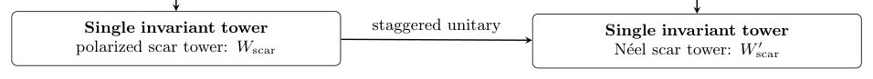
<figcaption class="paper-figure-caption"><b>Fig 1.</b> FIG. 1. Schematic hierarchy of invariant-subspace reduction and its staggered-unitary realization. Successive local deforma- tions reduce the invariant structure from IS fragmentation to the embedded spin-1/2 space Wemb and finally to a single scar tower. Local embedded dynamics couples states with different frozen IS labels and reorganizes them into representation sub- spaces. The staggered transformation relates the restricted embedded dynamics and the selected towers in the two realizations; full-Hilbert-space unitary equivalence is not assumed.</figcaption>
</figure>
<figure class="paper-figure-card">
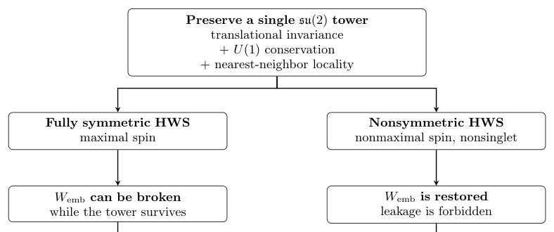
<figcaption class="paper-figure-caption"><b>Fig 2.</b> FIG. 2. Schematic illustration of the rigidity of the invariant-subspace reduction. A fully symmetric tower can remain invariant after Wemb is broken, whereas preserving a nonmaximal-spin, nonsinglet su(2) tower under the stated local constraints restores the entire embedded spin-1/2 space.</figcaption>
</figure>

**Summary.** This work develops a theoretical framework to understand how complex quantum systems, initially exhibiting fragmented Hilbert spaces, undergo a systematic reduction in complexity. By analyzing the role of embedded invariant subspaces, the authors show that these systems can be reduced to simple, robust structures known as quantum many-body scars. This provides a powerful algebraic tool for analyzing dynamics in strongly correlated quantum materials.

**Why it may be interesting.** The systematic mapping of complex, fragmented dynamics onto simpler, structured invariant subspaces (like scar towers) provides powerful theoretical tools for analyzing quasi-integrable quantum systems relevant to AMO and condensed matter physics.

Detailed structure

**Main problem.** The paper investigates the hierarchical reduction of invariant Hilbert-space structures, tracing a path from initial Hilbert-space fragmentation to partial solvability and finally to quantum many-body scars.

**Main result.** Local deformations can systematically reduce extensive irreducible-string fragmentation through an embedded invariant subspace to a single, robust scar tower, even without requiring the full Hamiltonians to be unitarily equivalent.

**Method.** The analysis employs representation theory and constructive correspondence to map the reduction hierarchy through unitary transformations within intermediate, embedded subspaces.

**Model / system.** The study focuses on spin chains, using the spin-1 XXC chain as a primary example, which exhibits Hilbert-space fragmentation due to local interactions.

**Key observables.** Irreducible-string fragmentation sectors, the embedded spin-1/2 invariant subspace ($W_{	ext{emb}}$), and the resulting scar tower structure.

**Important parameters / regimes.** The nature of local deformations, the relationship between interaction range ($r$) and block period ($p$), and the symmetry constraints ($	ext{U}(1)$ conservation).

**Assumptions / limitations.** The analysis relies on the existence of specific invariant subspaces and the ability to transfer reduction structures via unitary transformations within these embedded spaces.

**Figures summary.** Figure 1 schematically illustrates the reduction hierarchy: IS fragmentation $
ightarrow W_{	ext{emb}} 
ightarrow$ single scar tower, highlighting the role of staggered unitary transformations.

**Paper structure.** The paper progresses by first defining the fragmentation (IS sectors), then introducing the embedded invariant space ($W_{	ext{emb}}$) via local deformations, and finally demonstrating the reduction to a scar tower using unitary transformations within $W_{	ext{emb}}$.

Abstract

We investigate a hierarchy of invariant Hilbert-space structures connecting Hilbert-space fragmentation, partial solvability, and quantum many-body scars. For spin chains with fragmented spin-$1/2$ subspaces and their local deformations, we show, using the spin-$1$ $XXC$ chain as a representative example, how successive local deformations reduce extensive irreducible-string fragmentation through an implicitly embedded spin-$1/2$ invariant space and ultimately to a single scar tower, connecting the $XXC$, perturbed $XXC$, and spin-$1$ $XY$ scar models. Through the intermediate embedded space, local dynamics couples states from distinct frozen irreducible-string sectors and selects a new decomposition into representations, from which smaller invariant spaces can be retained. We also establish a rigidity constraint on isolating nonsymmetric towers and a constructive correspondence that transfers a reduction between locally realizable representations of the embedded dynamics. The latter demonstrates that the reduction hierarchy can be transferred through a unitary transformation within the embedded subspace, yielding an exact scar tower built on a Néel reference state without requiring unitary equivalence of the full Hamiltonians.

[↑ back to top](#top)

### [Discrete time liquids](http://arxiv.org/abs/2610.30266v1)

**Authors:** Zuo Wang, Paul M. Schindler, Marin Bukov, Marios H. Michael  
**Type:** theory · **Category:** statistical mechanics · **PDF:** <https://arxiv.org/pdf/2610.30266v1>  
**Analysis basis:** full PDF text, analyzed in chunks
**Topic relevance:** 🔥 `driven-dissipative phase transition` **4/5** · `analog quantum simulation` **3/5** · `methods for driven-dissipative` **3/5** · `non-equilibrium universality` **3/5** · `Keldysh / 2PI / non-Gaussian methods` **2/5** · `Tavis-Cummings & cavity-many-emitter` **2/5** · `correlated / nonlocal dissipation` **2/5** · `quantum measurements` **1/5** · `scars & prethermalization` **1/5**

↔ Scroll figures horizontally

<figure class="paper-figure-card">
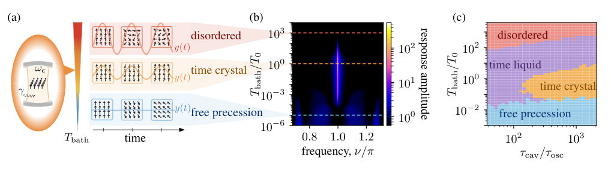
<figcaption class="paper-figure-caption"><b>Fig 1.</b> FIG. 1. Time liquid in a cavity. (a) Schematic of the setup and three regimes reached by increasing bath temperature. A spin lattice is coupled to a cavity mode of frequency 𝜔c = 2𝜋 𝜏osc and damping rate 𝛾= 2 𝜏cav , which is in contact with a thermal bath at temperature 𝑇bath (color bar). The thermal fluctuations of the oscillator coordinate 𝑦(𝑡) act on the spins as an effective drive. Each row illustrates the dynamics at the temperature of the corresponding dashed line in (b). At low temperature (blue), the effective drive 𝑦(𝑡) is too weak to disturb the spins, which precess freely. At intermediate temperature (orange), the spins lock to a sharp subharmonic response at half the cavity...</figcaption>
</figure>
<figure class="paper-figure-card">
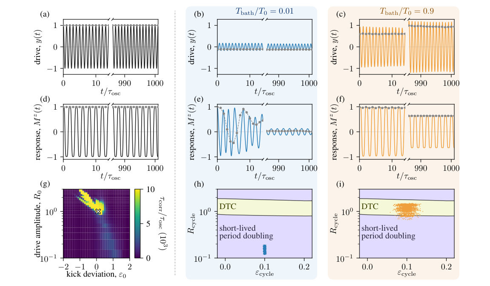
<figcaption class="paper-figure-caption"><b>Fig 2.</b> FIG. 2. Thermal fluctuations as an effective Floquet drive. Columns compare a deterministic reference drive (a,d,g), in which the oscillator is replaced by a sinusoid, with single realizations of the bath-driven dynamics at a small temperature 𝑇bath/𝑇0 = 0.01 (b,e,h, shaded in blue) and at a temperature inside the ordering window 𝑇bath/𝑇0 = 0.9 (c,f,i, shaded in orange). (a–c) Oscillator coordinate 𝑦(𝑡), which sets the instantaneous interaction and transverse field, with gray dots marking its stroboscopic values. The deterministic drive is a sinusoid of fixed amplitude (a), whereas the stochastic drive is a small (b) or a large (c) fluctuating signal. The bath temperature thus sets the...</figcaption>
</figure>
<figure class="paper-figure-card">
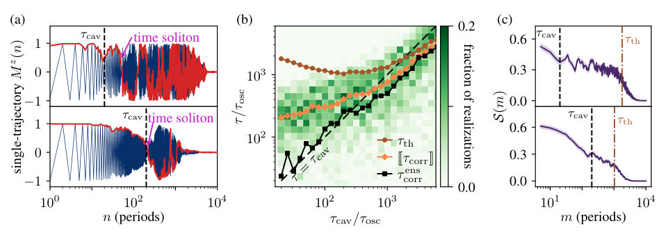
<figcaption class="paper-figure-caption"><b>Fig 3.</b> FIG. 3. Time-solitons and time liquid lifetime. (a) Single-trajectory stroboscopic magnetization 𝑀𝑧(𝑛𝜏osc) (blue) and its period-doubled component (−1)𝑛𝑀𝑧(𝑛𝜏osc) (red), at 𝜏cav/𝜏osc = 20 (top) and 200 (bottom). The dashed line marks 𝜏cav. The period-doubled component is repeatedly suppressed and revives with the opposite sign. Each such event is a time-soliton, the 𝜀𝑛= 𝜋event of Eq. (2). (b) Thermalization time 𝜏th (circles), noise averaged single-trajectory correlation time ⟦𝜏corr⟧(diamonds), and ensemble correlation time 𝜏ens corr (squares), as a function of the coherence time 𝜏cav. The heatmap gives the fraction of noise realizations per correlation time 𝜏corr at fixed 𝜏cav. The three...</figcaption>
</figure>
<figure class="paper-figure-card">
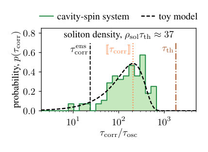
<figcaption class="paper-figure-caption"><b>Fig 4.</b> FIG. 4. Distribution of the single-trajectory correlation time. Probability 𝑝(𝜏corr) of the single-trajectory correlation time 𝜏corr of Eq. (6), for the cavity-spin system (green histogram) and for the toy model of Eqs. (9) and (10) (dashed line), at 𝜏cav/𝜏osc = 20. The toy parameters are not fitted: 𝜏th is the value measured on the lattice, and the soliton density 𝜌sol follows from the measured 𝜏ens corr, which gives 𝜌sol𝜏th ≈37 (top). The vertical lines mark 𝜏ens corr, ⟦𝜏corr⟧, and 𝜏th from the line cut at 𝜏cav/𝜏osc = 20 in Fig. 3(b). The toy model reproduces the probability distribution and thus captures the dynamics of the DTL in cavity-spin system. Parameters are as in Fig. 3. See text...</figcaption>
</figure>

**Summary.** This paper introduces the concept of a Discrete Time Liquid (DTL), a novel form of temporal order distinct from time crystals. It models a spin system driven by the thermal fluctuations of a cavity, showing that robust period-doubling can occur even when the drive is noisy and short-lived. The key mechanism involves topological defects called time-solitons, which destroy long-range coherence but stabilize the local period-doubled state.

**Why it may be interesting.** This work bridges the concepts of time crystals and liquid states in non-equilibrium systems, providing a mechanism (time-solitons) to sustain robust temporal order even when the driving field lacks long-range coherence, which is highly relevant for understanding driven quantum matter.

Detailed structure

**Main problem.** The paper investigates temporal many-body order beyond conventional time crystals, specifically focusing on order induced by noisy, finite-coherence external drives.

**Main result.** The authors identify a new state called the Discrete Time Liquid (DTL), characterized by local period-doubling dynamics but lacking long-range temporal coherence due to time-solitons.

**Method.** The study uses theoretical modeling, analyzing the system's response to an effective, noisy drive generated by a coupled cavity mode, and proposing a minimal stochastic-switching model.

**Model / system.** The system is a two-dimensional spin lattice coupled to a finite-temperature cavity mode. The dynamics are governed by a spin Hamiltonian coupled to the cavity's Langevin equation, creating an effective, noisy drive.

**Key observables.** Temporal order (period-doubling), temporal coherence, and the density of time-solitons.

**Important parameters / regimes.** Bath temperature ($T_{	ext{bath}}$), cavity coherence time ($	au_{	ext{cav}}$), and the ratio of correlation times ($\langle\langle	au_{corr}
angle
angle/	au_{th}$).

**Assumptions / limitations.** The analysis treats spins classically and relies on the effective drive generated by the cavity fluctuations, which is assumed to generate a Rayleigh distribution at high temperatures.

**Figures summary.** Figures illustrate the transition between free precession, time crystal, and time liquid regimes based on bath temperature, showing period doubling induced by thermal noise. Phase diagrams map out the system's behavior using multiple timescales.

**Paper structure.** The paper progresses by establishing the physical model (spin-cavity coupling), demonstrating the emergence of period doubling under noisy drives, identifying the time-soliton mechanism responsible for finite coherence, and finally proposing the DTL state and its implications for thermal equilibrium.

Abstract

Discrete time crystals exhibit robust subharmonic oscillations, spontaneously breaking the discrete time-translation symmetry of a periodic drive. Since their emergence, the question of whether other types of temporal many-body order can exist has attracted considerable attention. Here we identify discrete time liquids -- a new form of spatiotemporal order characterized by short-range temporal coherence as a result of time-solitons. We study a two-dimensional spin system coupled to a finite-temperature cavity, whose fluctuations provide a noisy, approximately periodic drive with only finite temporal coherence. Remarkably, the spins nevertheless form a metastable state with robust period-doubled dynamics over an extended parameter regime. Unlike a time crystal, this state has only finite temporal coherence: individual trajectories stochastically switch between the two symmetry-related temporal configurations of the period-doubled response. We identify these switches as time-solitons: topological defects in temporal order that preserve local period doubling while destroying long-range temporal coherence, thereby producing the time liquid state. We propose a minimal model which reproduces the distribution of temporal correlations of the many-body system, suggesting a general description of the time liquid as a time crystal with a finite density of time-solitons. Because these solitons can occur at arbitrary times, ensemble averaging restores continuous time-translation symmetry, raising the intriguing possibility that discrete time liquids can exist in thermal equilibrium.

[↑ back to top](#top)

### [Charge-monitored Luttinger liquid](http://arxiv.org/abs/2610.30271v1)

**Authors:** Victor Gurarie, Leo Radzihovsky  
**Type:** theory · **Category:** disordered systems and neural networks · **PDF:** <https://arxiv.org/pdf/2610.30271v1>  
**Analysis basis:** full PDF text, analyzed in chunks
**Topic relevance:** 🔥 `Keldysh / 2PI / non-Gaussian methods` **4/5** · 🔥 `quantum measurements` **4/5** · `driven-dissipative phase transition` **3/5** · `non-equilibrium universality` **3/5** · `methods for driven-dissipative` **2/5** · `Full counting statistics` **1/5** · `analog quantum simulation` **1/5** · `correlated / nonlocal dissipation` **1/5**

↔ Scroll figures horizontally

<figure class="paper-figure-card">
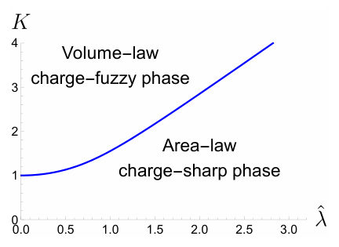
<figcaption class="paper-figure-caption"><b>Fig 1.</b> FIG. 1: Phase diagram of a monitored Luttinger liquid, as a function of Luttinger parameter K and dimensionless measurement rate ˆλ, with critical boundary Kc(ˆλ) separating the volume-law charge-fuzzy and the area-law charge-sharp phases.</figcaption>
</figure>

**Summary.** This theoretical work analyzes how continuous quantum measurements affect the ground state phases of one-dimensional interacting fermions (Luttinger liquids). By using advanced field theory techniques, the authors map out a phase diagram governed by the competition between measurement back-action and intrinsic particle tunneling. This reveals a universal phase transition boundary that distinguishes between charge-sharp and charge-fuzzy steady states.

**Why it may be interesting.** The use of Keldysh formalism and replica techniques to study non-equilibrium steady states driven by measurement is highly relevant to open quantum systems and quantum measurement theory.

Detailed structure

**Main problem.** The paper investigates the non-equilibrium phases of interacting fermionic Luttinger liquids subjected to weak, continuous measurements of their particle density.

**Main result.** The system exhibits a phase transition controlled by the competition between measurement-induced charge sharpening (area-law) and particle tunneling fluctuations (volume-law), with the boundary depending universally on the Luttinger parameter.

**Method.** The analysis employs the bosonization approach combined with the Keldysh functional integral formalism to handle non-unitary evolution induced by measurements.

**Model / system.** The model is an interacting fermionic Luttinger liquid (1D system) whose dynamics are modified by weak continuous measurements of particle density, analyzed using replica techniques.

**Key observables.** Scaling dimensions ($h_{	heta^{+-}}$, $h_{\phi^{+-}}$) of correlation functions, and the phase boundary $K_c(\hat{\lambda})$.

**Important parameters / regimes.** Luttinger parameter ($K$), dimensionless measurement rate ($\hat{\lambda}$), and the replica number ($R$).

**Assumptions / limitations.** The analysis is restricted to the low-energy regime where the bosonization approach is valid, and initial calculations rely on quadratic action approximations.

**Figures summary.** Figure 1 illustrates the phase diagram in the $K-\hat{\lambda}$ plane, showing the boundary separating the volume-law charge-fuzzy and the area-law charge-sharp phases.

**Paper structure.** The paper builds from deriving the full action incorporating measurement terms, calculating scaling dimensions for $	heta$ and $\phi$ fields in real space-time, and finally mapping the competition between these terms to define the phase boundary.

Abstract

We discuss phases of interacting fermionic Luttinger liquids without particle number conservation, such as those in proximity to a superconductor, subjected to weak continuous measurements of their particle density, in the regime where the bosonization approach is applicable. We show that the phases of these systems are controlled by the competition between measurements, which favor the area-law phase and particle tunneling in and out of the Luttinger liquid, which favors the volume-law phase. The volume-law phase in this system is always charge fuzzy. We show that within this framework, the phase boundary between the two phases is given by a universal dependence of the Luttinger parameter on the measurement rate. This behavior can be contrasted with the non-universal phase boundaries in more generic highly excited one dimensional systems whose behavior is no longer captured by the Luttinger liquid framework.

[↑ back to top](#top)

### [Exceptional point structure and chiral state transfer in a rate-operator-engineered $\mathcal{PT}$-symmetric Bose-Hubbard dimer](http://arxiv.org/abs/2610.30836v1)

**Authors:** Jaakko Luomala, Federico Settimo, Kimmo Luoma, Iiro Vilja, Jyrki Piilo  
**Type:** theory · **Category:** other · **PDF:** <https://arxiv.org/pdf/2610.30836v1>  
**Analysis basis:** full PDF text, analyzed in chunks
**Topic relevance:** 🔥 `methods for driven-dissipative` **4/5** · `analog quantum simulation` **3/5** · `correlated / nonlocal dissipation` **3/5** · `driven-dissipative phase transition` **3/5** · `non-equilibrium universality` **2/5** · `quantum measurements` **2/5** · `Keldysh / 2PI / non-Gaussian methods` **1/5**

↔ Scroll figures horizontally

<figure class="paper-figure-card">
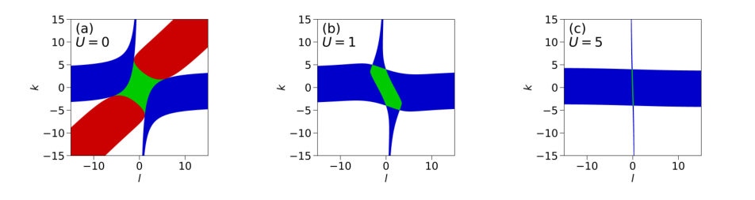
<figcaption class="paper-figure-caption"><b>Fig 1.</b> FIG. 1: Regions with four (green), two (blue) and no PT -symmetric eigenstates (white) of the non-Hermitian Hamiltonian (10). Red regions show where the effective Hamiltonian has two eigenvalue pairs with equal imaginary parts. On-site interaction strengths are in Figs. (a-c) U = 0, U = 1 and U = 5, respectively.</figcaption>
</figure>
<figure class="paper-figure-card">
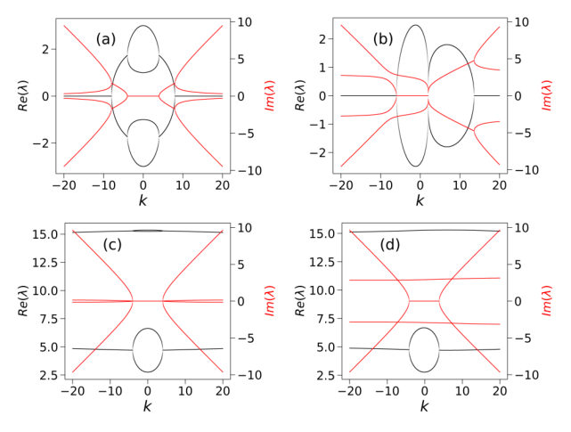
<figcaption class="paper-figure-caption"><b>Fig 2.</b> FIG. 2: Imaginary and real parts of the eigenvalues of the effective Hamiltonian (10) as a function of parameter k. (a): U = 0 and l = 0. (b): U = 0 and l = 6. (c): U = 5 and l = 0. (d): U = 5 and l = 6.</figcaption>
</figure>
<figure class="paper-figure-card">
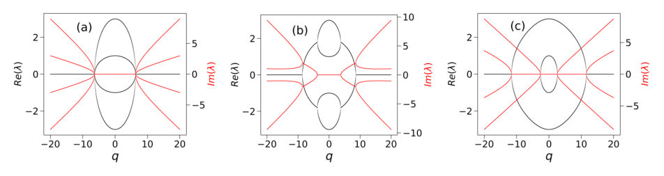
<figcaption class="paper-figure-caption"><b>Fig 3.</b> FIG. 3: Real and imaginary parts of the eigenvalues of the effective Hamiltonian of Eq. (10) (omitting the term proportional to the identity) with U = 0 parametrized by q in transformation Eq. (12) with φ ∈{0, 3π/8, 6π/8} in figures (a), (b) and (c), respectively.</figcaption>
</figure>
<figure class="paper-figure-card">

<figcaption class="paper-figure-caption"><b>Fig 4.</b> FIG. 4: Deterministic evolution of populations |αij(t)|2 generated by the non-Hermitian Hamiltonian of Eq. (19) with time-dependent transformations (18). The total time of the evolution is T = 100. Figures (a1, b1, c1) show the parameter trajectory in yellow. The starting point is at (l, k) = (0, 0). Figures (a2, b2, c2) show the evolution for counterclockwise trajectories and figs. (a3, b3, c3) for clockwise trajectories. All plots are with U = 0 and the initial state is the ground state of the Hermitian Hamiltonian. Vertical dashed lines correspond to the instants of times when an exceptional point is crossed.</figcaption>
</figure>
<figure class="paper-figure-card">
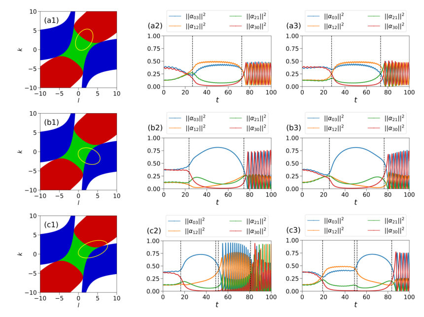
<figcaption class="paper-figure-caption"><b>Fig 5.</b> FIG. 5: Deterministic evolution of populations |αij(t)|2 generated by the non-Hermitian Hamiltonian of Eq. (19) with time-dependent transformations (18). The total time of the evolution is T = 100. Figures (a1, b1, c1) show the parameter trajectory in yellow. The starting point is at (l, k) = (0, 0). Figures (a2, b2, c2) show the evolution for counterclockwise trajectories and figs. (a3, b3, c3) for clockwise trajectories. All plots are with U = 0 and the initial state is the second excited state of the Hermitian Hamiltonian. Vertical dashed lines correspond to the instants of times when an exceptional point is crossed.</figcaption>
</figure>

**Summary.** This paper applies the Rate Operator Quantum Jumps formalism to analyze an open Bose-Hubbard dimer model, constructing a $\mathcal{PT}$-symmetric non-Hermitian Hamiltonian. The study maps out the parameter space containing exceptional points and demonstrates that traversing closed loops around these points induces chiral state transfer. This offers a powerful method for controlling quantum dynamics in open systems.

**Why it may be interesting.** This work provides a sophisticated theoretical framework for controlling open quantum systems by engineering non-Hermitian Hamiltonians, linking concepts like $\mathcal{PT}$-symmetry breaking, exceptional points, and non-adiabatic dynamics to physical observables like state transfer.

Detailed structure

**Main problem.** The study investigates the exceptional point structure and chiral state transfer in an open Bose-Hubbard dimer model engineered using rate-operator quantum jumps.

**Main result.** The research demonstrates that encircling specific exceptional points leads to chiral state transfer, and direction-dependent state transfer can be achieved even without crossing EPs using inhomogeneous interactions.

**Method.** The authors employ the Rate Operator Quantum Jumps (ROQJ) formalism to derive a $\mathcal{PT}$-symmetric non-Hermitian Hamiltonian from the system's master equation, followed by time-dependent analysis of parameter loops.

**Model / system.** The system is an open three-particle Bose-Hubbard dimer model subjected to environmental non-local dephasing. The dynamics are governed by a master equation, which is then mapped onto an effective non-Hermitian Hamiltonian via ROQJ.

**Key observables.** Exceptional Points (EPs), $\mathcal{PT}$-symmetry breaking/restoring regions, chiral state transfer, and direction-dependent state transfer.

**Important parameters / regimes.** On-site interaction strength ($U$), and transformation parameters ($k, l$).

**Assumptions / limitations.** The dynamics are modeled using the Markovian GKSL master equation, and the analysis relies on the pure state trajectories derived from ROQJ.

**Figures summary.** Figures illustrate phase diagrams showing the boundaries between unbroken and broken $\mathcal{PT}$-symmetry regions in the parameter space, and plots show the evolution of eigenvalues and state amplitudes as parameters are varied.

**Paper structure.** The paper first introduces the ROQJ method to construct the $\mathcal{PT}$-symmetric non-Hermitian Hamiltonian. It then characterizes the symmetry structure by mapping out the parameter space containing EPs. Finally, it uses time-dependent rate operator transformations to simulate state transfer dynamics around these critical points.

Abstract

The rate operator quantum jumps (ROQJ) is a general method to unravel a master equation describing the dynamics of an open quantum system into stochastic pure state trajectories. By post-selecting on no jumps occurring, one obtains a trajectory generated by a non-Hermitian Hamiltonian. The ROQJ allows for versatile modification of this non-Hermitian evolution, with each non-Hermitian Hamiltonian corresponding to a different continuous measurement scheme. We apply the ROQJ to modify the non-Hermitian dynamics of the open three-particle Bose-Hubbard dimer model under environmental non-local dephasing to construct a $PT$-symmetric non-Hermitian Hamiltonians with a general two parameter $PT$-symmetric imaginary diagonal part, which generalizes the well-known gain-loss Bose-Hubbard dimer. We characterize the symmetry structure of the spectrum for different on-site interaction strengths. For vanishing on-site interaction, we find the unbroken $PT$-symmetry region enclosed by order two exceptional lines of different character and four order four exceptional points, two of which are not found in the usual gain-loss Bose-Hubbard dimer. Additionally, we find regions with degenerate imaginary parts of the eigenvalues, also not found in the gain-loss Bose-Hubbard dimer. In this parameter space, we use time-dependent rate operator transformations to investigate state transfer under slowly varying parameter loops. Loops encircling an order four exceptional point exhibit chiral state transfer. Because the loops cross exceptional lines, the final states are superpositions of eigenstates. Chiral state transfer is also found with non-zero homogeneous on-site interaction when the loop crosses over broken $PT$-symmetry regions of different character. Using inhomogeneous on-site interactions, we find direction dependent state transfer between eigenstates without crossing or encircling exceptional points.

[↑ back to top](#top)

### [On the Structure of Quantum Finite-Level Systems: Decoherence-Free Subsystems, Quantum Nondemolition Variables, and Back-Action-Evading Measurements](http://arxiv.org/abs/2610.30616v1)

**Authors:** Jia Gu, Guofeng Zhang, Ian R. Petersen  
**Type:** theory · **Category:** other · **PDF:** <https://arxiv.org/pdf/2610.30616v1>  
**Analysis basis:** full PDF text, analyzed in chunks
**Topic relevance:** 🔥 `quantum measurements` **4/5** · `correlated / nonlocal dissipation` **3/5** · `driven-dissipative phase transition` **3/5** · `Keldysh / 2PI / non-Gaussian methods` **2/5** · `analog quantum simulation` **2/5** · `methods for driven-dissipative` **2/5** · `non-equilibrium universality` **2/5**

↔ Scroll figures horizontally

<figure class="paper-figure-card">
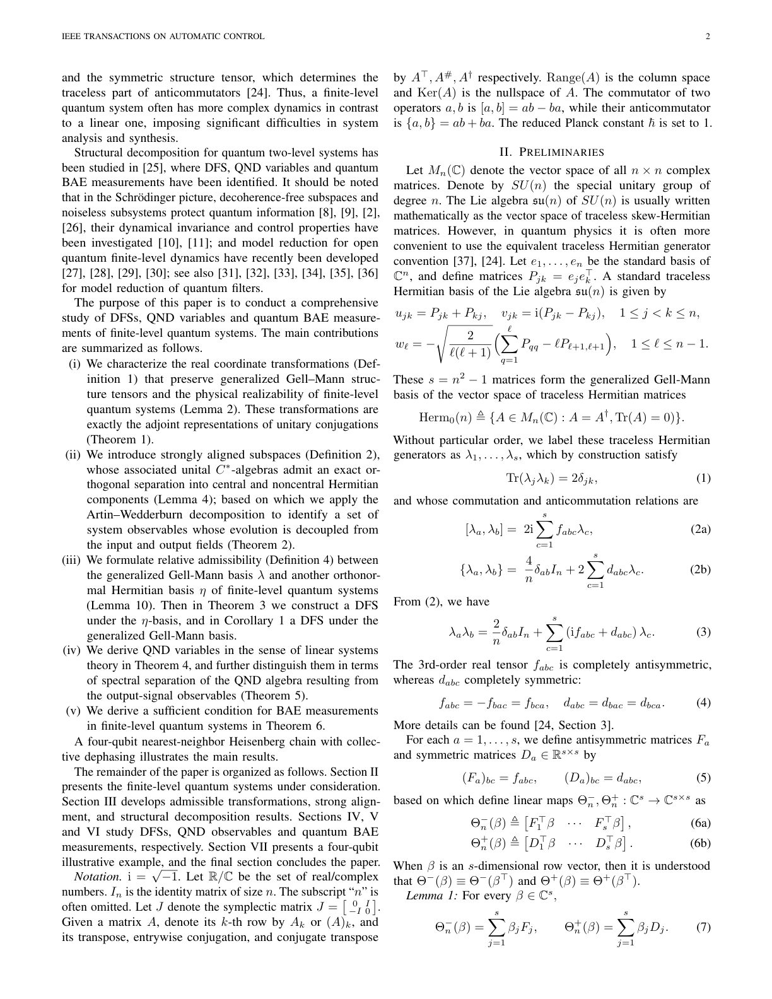
<figcaption class="paper-figure-caption"><b>Fig 1.</b> Low-resolution page preview, page 2</figcaption>
</figure>
<figure class="paper-figure-card">
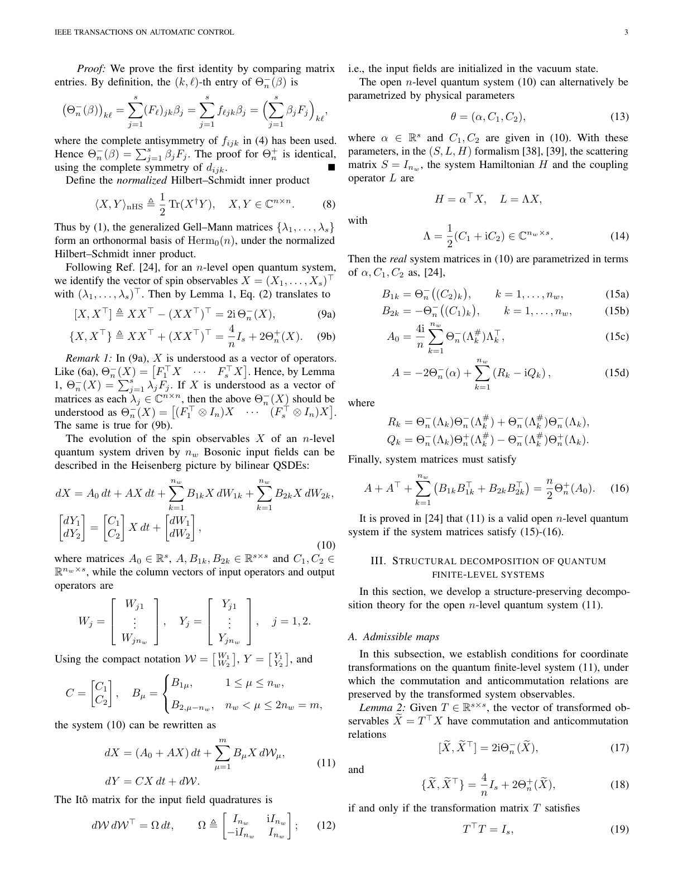
<figcaption class="paper-figure-caption"><b>Fig 2.</b> Low-resolution page preview, page 3</figcaption>
</figure>
<figure class="paper-figure-card">
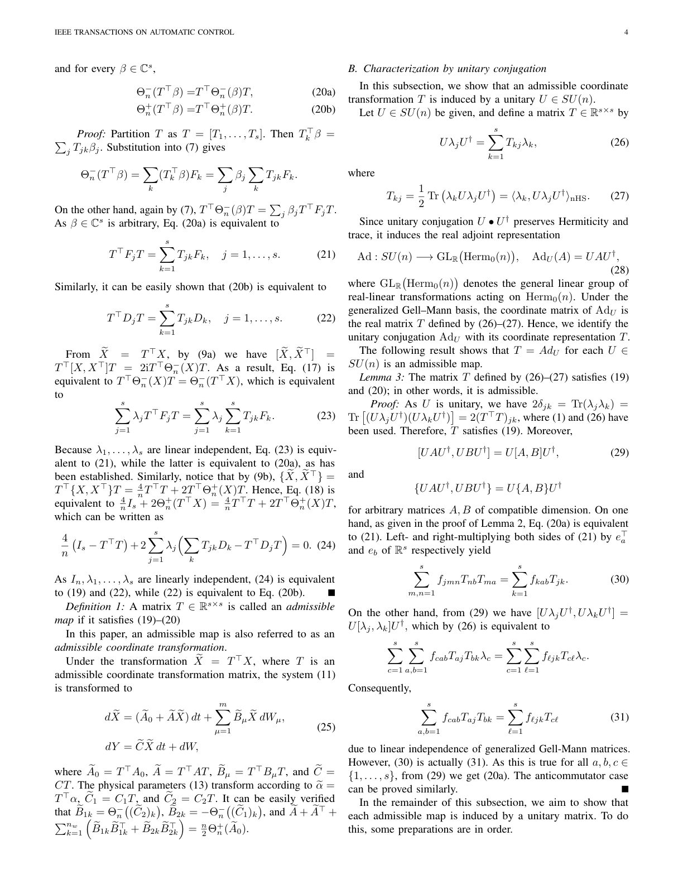
<figcaption class="paper-figure-caption"><b>Fig 3.</b> Low-resolution page preview, page 4</figcaption>
</figure>
<figure class="paper-figure-card">
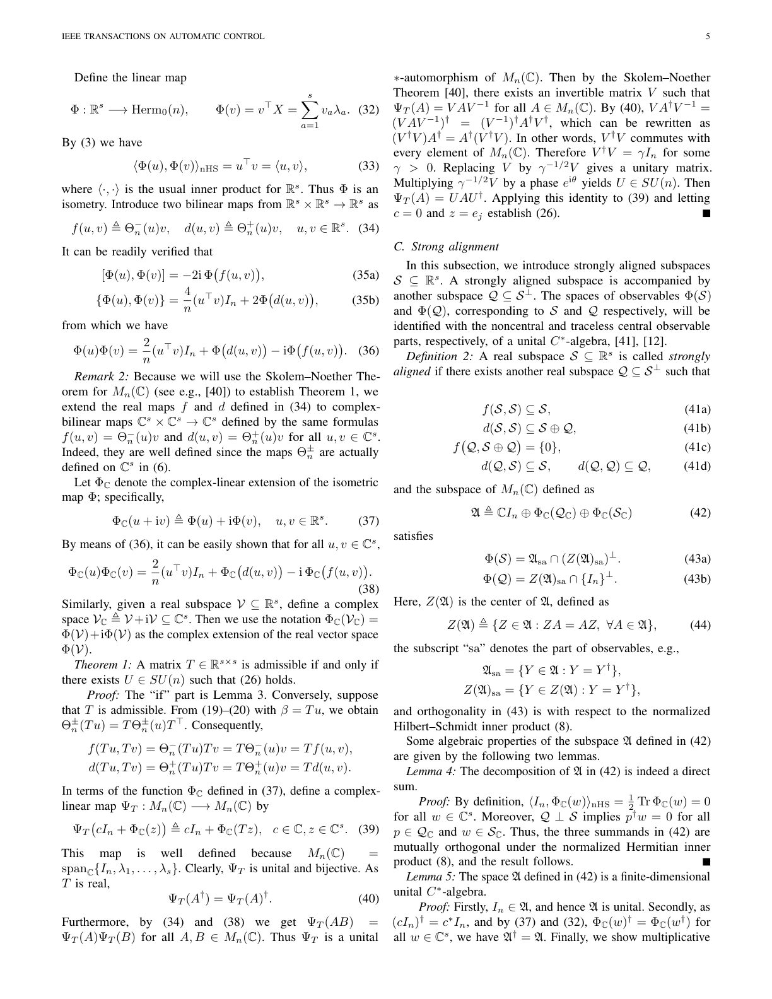
<figcaption class="paper-figure-caption"><b>Fig 4.</b> Low-resolution page preview, page 5</figcaption>
</figure>
<figure class="paper-figure-card">
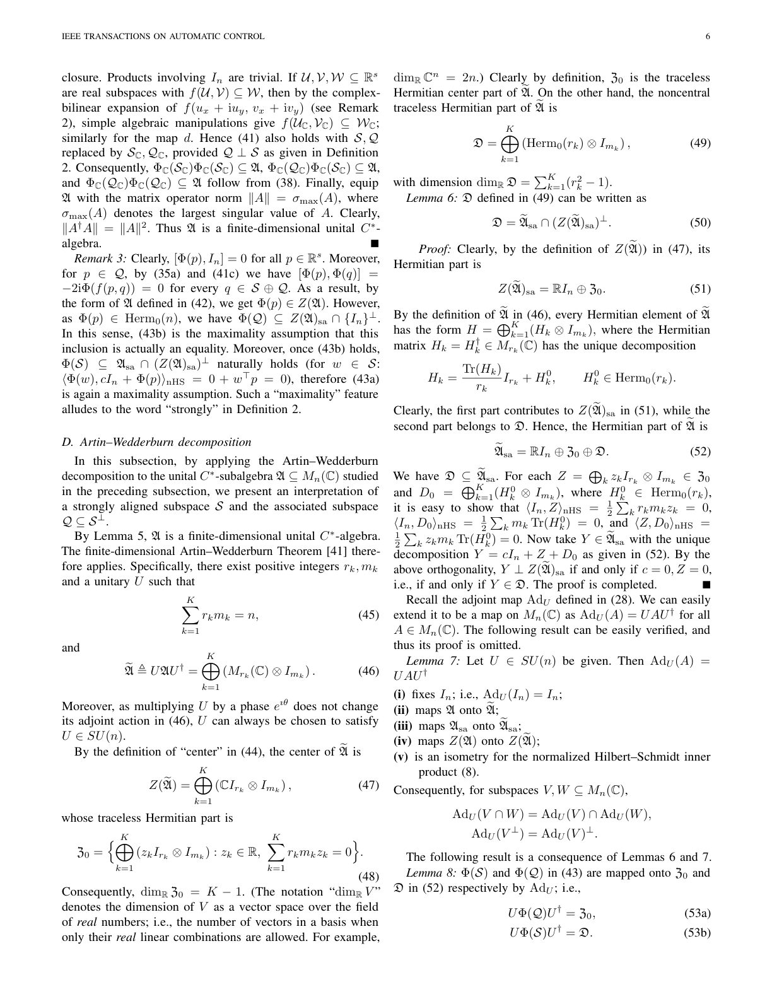
<figcaption class="paper-figure-caption"><b>Fig 5.</b> Low-resolution page preview, page 6</figcaption>
</figure>

**Summary.** This paper provides a comprehensive structural analysis of open quantum systems using the Heisenberg picture formalism. It develops mathematical criteria to identify Decoherence-Free Subsystems, necessary conditions for Quantum Nondemolition measurements, and sufficient conditions for Back-Action-Evading measurements. The framework is highly general, applying to finite-level systems modeled by bilinear quantum stochastic differential equations.

**Why it may be interesting.** This work provides a rigorous mathematical framework for understanding how structural properties (like conservation laws or immunity to noise) manifest in complex, open quantum systems, bridging quantum control theory with fundamental algebraic structure.

Detailed structure

**Main problem.** The paper conducts a structural analysis of quantum finite-level systems in the Heisenberg picture to characterize Decoherence-Free Subsystems (DFSs), Quantum Nondemolition (QND) variables, and Back-Action-Evading (BAE) measurements.

**Main result.** It establishes structural theorems characterizing admissible coordinate transformations via unitary conjugations and derives sufficient conditions for the existence of DFSs and BAE measurements within the bilinear QSDE framework.

**Method.** The analysis employs advanced mathematical techniques, including characterizing real coordinate transformations, utilizing linear systems theory, and applying algebraic decomposition methods (like Artin–Wedderburn) to the system's evolution equations.

**Model / system.** The model is an open quantum system described by bilinear Quantum Stochastic Differential Equations (QSDEs) acting on finite-level systems (qubits/qudits), exemplified by a four-qubit nearest-neighbor Heisenberg chain with collective dephasing.

**Key observables.** DFSs, QND observables, BAE output fields, and the generalized Gell-Mann basis operators $\{\lambda_a\}$.

**Important parameters / regimes.** The structure depends on the system size ($n$), the number of levels ($s$), and the coupling/dissipation parameters embedded in the QSDEs.

**Assumptions / limitations.** The dynamics are modeled by bilinear QSDEs, and the analysis relies on the properties of orthonormal Hermitian bases and the structure of the underlying algebra.

**Paper structure.** The paper proceeds by first characterizing structure-preserving transformations (admissible maps) via unitary conjugations, then using these to decompose the system into strongly aligned subspaces to identify DFSs, and finally applying linear systems theory to derive conditions for QND and BAE measurements.

Abstract

The purpose of this paper is to conduct a comprehensive structural analysis of quantum finite-level systems in the Heisenberg picture, where the evolution of system observables is modeled by bilinear quantum stochastic differential equations (QSDEs). Firstly, real coordinate transformations that preserve commutation and anticommutation relations are characterized, and relative admissibility between different orthonormal Hermitian bases is formulated. Secondly, strongly aligned subspaces are introduced, based on which decoherence-free subsystems (DFSs) are constructed in general orthonormal Hermitian basis as well as the generalized Gell-Mann basis. Thirdly, conditions for the existence of quantum nondemolition (QND) variables are given in terms of both linear systems theory and spectral separation by output-signal observables. Finally, a sufficient condition for quantum back-action-evading (BAE) measurements is established. A four-qubit nearest-neighbor Heisenberg chain with collective dephasing illustrates these structural properties of quantum finite-level systems.

[↑ back to top](#top)

### [Continuous Measurement of Quantum Axion Dark Matter](http://arxiv.org/abs/2610.30250v1)

**Authors:** Yunjia Bao, Dhong Yeon Cheong, Nicholas L. Rodd, Joey Takach, Lian-Tao Wang, Kevin Zhou  
**Type:** theory · **Category:** other · **PDF:** <https://arxiv.org/pdf/2610.30250v1>  
**Analysis basis:** full PDF text, analyzed in chunks
**Topic relevance:** 🔥 `quantum measurements` **4/5** · `Full counting statistics` **3/5** · `Tavis-Cummings & cavity-many-emitter` **2/5** · `methods for driven-dissipative` **2/5** · `Keldysh / 2PI / non-Gaussian methods` **1/5** · `correlated / nonlocal dissipation` **1/5** · `driven-dissipative phase transition` **1/5**

↔ Scroll figures horizontally

<figure class="paper-figure-card">
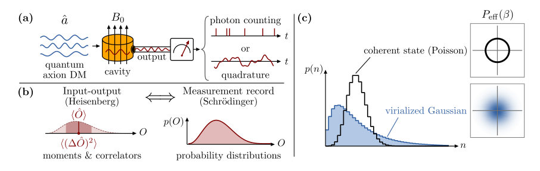
<figcaption class="paper-figure-caption"><b>Fig 1.</b> Figure 1. Overview of this work. (a) The axion-induced signal in a haloscope is continuously monitored at the end of a transmission line by a photon counting or quadrature measurement. Our formalism can track an arbitrary axion quantum state through the detection pipeline to its impact on either observable. (b) The setup can be equivalently described using the standard input-output formalism or the measurement record formalism. The former involves operators in Heisenberg picture, naturally yielding moments and correlators, whilst the latter tracks states in Schr¨odinger picture, yielding the joint probability distribution of the measurement record. (c) As an example, we derive new results...</figcaption>
</figure>
<figure class="paper-figure-card">
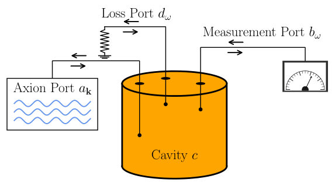
<figcaption class="paper-figure-caption"><b>Fig 2.</b> Figure 2. A schematic of the logic underpinning the input-output formalism: a single cavity mode c is coupled to the axion, measurement, and loss ports. The axion port provides the signal that drives the cavity, the measurement port carries the output signal that continuously monitors the cavity, and the loss port models additional dissipation in the cavity. In input-output theory, each is viewed as a transmission line into the cavity. Our depiction here is inspired by Ref. [58].</figcaption>
</figure>
<figure class="paper-figure-card">
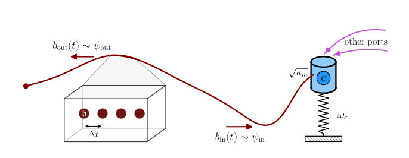
<figcaption class="paper-figure-caption"><b>Fig 3.</b> Figure 3. Toy model of a string (transmission line) coupled to a classical harmonic oscillator (cavity mode): the input field of an incoming waveform interacts with the oscillator, before producing an outgoing waveform that heads back down the line to be detected. Once the system is quantized, the line can be described by a series of discrete modes b as defined in Eq. (3.14).</figcaption>
</figure>
<figure class="paper-figure-card">
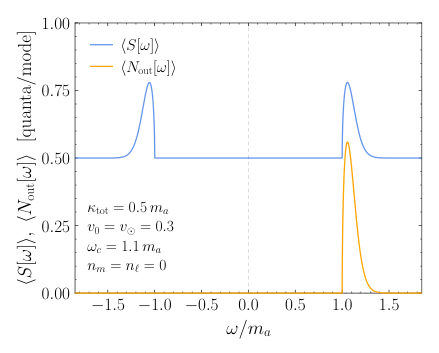
<figcaption class="paper-figure-caption"><b>Fig 4.</b> Figure 4. Schematic comparison of the expectation values of the quadrature PSD (blue) and the differential photon-number spectrum (orange) assuming the cavity is driven solely by the axion field, with no thermal noise. Though the PSD S[ω] is two-sided and has a noise floor due to vacuum fluctuations, its expectation value carries the same information as ⟨Nout[ω]⟩. Yet as we discuss in Sec. 3.4, the fluctuations of these observables can differ significantly.</figcaption>
</figure>
<figure class="paper-figure-card">
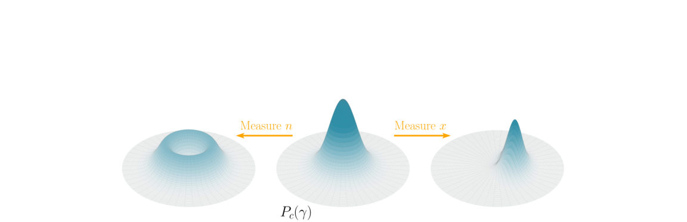
<figcaption class="paper-figure-caption"><b>Fig 5.</b> Figure 5. The impact on the cavity P-function if we projectively measure number (left) or quadrature (right) at the end of the transmission line, for a cavity initially in a thermal Gaussian state, and definite values for the number and quadrature outcomes. To emphasize the difference with respect to projective measurements of the cavity itself, we take θ = π/8, where the effect is strong, though in practice θ ≪1 and the posterior cavity state remains far closer to its initial form.</figcaption>
</figure>

**Summary.** This paper develops a rigorous, fully quantum-mechanical framework for analyzing the continuous measurement of axion dark matter in cavity haloscopes. By introducing a novel measurement-record formalism, the authors compute exact quantum statistics, demonstrating that the expected dark matter state is non-Poissonian and distinct from classical or simple quantum predictions.

**Why it may be interesting.** This work is highly relevant as it applies advanced quantum measurement theory (measurement-record formalism) to a concrete problem in quantum optics and particle astrophysics (axion detection), providing rigorous diagnostics for quantum state characterization.

Detailed structure

**Main problem.** The paper aims to provide a fully quantum-mechanical description of the continuous measurement process for wavelike axion dark matter.

**Main result.** The axion-induced number distribution is shown to be non-Poissonian, and quantum measurements can distinguish the expected virialized Gaussian state from coherent or Bose-Einstein condensate predictions.

**Method.** The authors develop and utilize a novel measurement-record formalism (Schrödinger picture) alongside the standard input-output formalism (Heisenberg picture) to track the joint probability distribution of measurement outcomes.

**Model / system.** The system involves axion dark matter interacting with a microwave cavity haloscope. The analysis treats the axion as a quantum field, coupling to the cavity's transmission-line modes.

**Key observables.** Number distribution, quadrature measurements, and the joint probability distribution of all measurement outcomes (the measurement record).

**Important parameters / regimes.** Axion coupling strengths, cavity quality factor, and the characteristic timescale for DM evolution ($	au_{DM}$).

**Assumptions / limitations.** The analysis assumes the virialized axion dark matter is in a Gaussian quantum state, and the measurement-record formalism is employed to overcome limitations of moment-based approaches.

**Figures summary.** Figure 1 illustrates the continuous monitoring process, comparing the input-output formalism to the measurement-record formalism, and showing that a coherent state yields Poisson statistics while a Gaussian state deviates significantly.

**Paper structure.** The paper builds the quantum description using the input-output formalism, introduces the novel measurement-record formalism for time-domain analysis, and applies this framework to compute exact number and quadrature statistics for axion-induced signals.

Abstract

We provide a fully quantum-mechanical description of the continuous measurement of wavelike dark matter. Our focus is cavity haloscopes, although our results inform a broad range of axion searches. We extend the input-output formalism by treating the axion as a quantum field, finding how its quantum state is imprinted onto higher-order moments of observables of the outgoing transmission-line modes. We further develop a novel measurement-record formalism, which computes the joint probability distribution of all measurement outcomes and is well suited to studying the axion in the time domain. With it, we compute the exact axion-induced number distribution for the first time, demonstrating that it is not Poisson. We argue that virialized axion dark matter is expected to be in a Gaussian quantum state, and show that number or quadrature measurements can distinguish this from the predictions of a coherent state or even a Bose-Einstein condensate. Finally, we show that intrinsically quantum effects, such as those from Fock or squeezed axion states, are far too weak to detect.

[↑ back to top](#top)

### [Local Dephasing Sustains Continuous Time Crystals in a Spin-1/2 Ensemble](http://arxiv.org/abs/2610.31230v1)

**Authors:** Zhen-huan Yang, Dan-Bo Zhang  
**Type:** theory · **Category:** other · **PDF:** <https://arxiv.org/pdf/2610.31230v1>  
**Analysis basis:** full PDF text, analyzed in chunks
**Topic relevance:** 🔥 `driven-dissipative phase transition` **4/5** · `methods for driven-dissipative` **3/5** · `non-equilibrium universality` **2/5** · `Keldysh / 2PI / non-Gaussian methods` **1/5** · `analog quantum simulation` **1/5** · `correlated / nonlocal dissipation` **1/5** · `quantum measurements` **1/5**

↔ Scroll figures horizontally

<figure class="paper-figure-card">
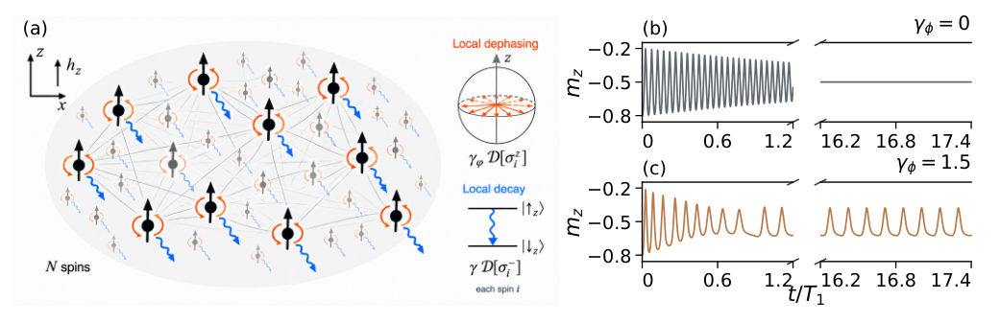
<figcaption class="paper-figure-caption"><b>Fig 1.</b> FIG. 1. Dephasing-controlled collective oscillations. (a) Fully connected ferromagnetic ensemble with independent local spin decay and pure dephasing. (b,c) Longitudinal magnetization at γϕ = 0 and 1.5, respectively, from the same initial Bloch vector m(0) ≈(0.39, 0.03, −0.80). Both use T1 = 1/Γ1 = 1, J ≈105.4, and hz ≈105.4; rates are in units of T −1 1 . Broken axes show t/T1 ∈[0, 1.2] and [16.2, 17.4], with identical vertical scales.</figcaption>
</figure>
<figure class="paper-figure-card">
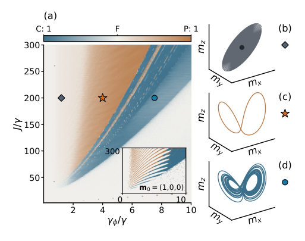
<figcaption class="paper-figure-caption"><b>Fig 2.</b> FIG. 2. Collective responses in the interaction–dephasing plane. (a) Response map for hz = J and fixed local de- cay γ, using 200 initial Bloch vectors per grid point. Hue indicates the more frequent response category, periodic (P) or chaotic (C), and intensity gives its fraction of all prepara- tions; F marks the stationary center and gray marks a nonzero P/C tie. The inset shows the response from the fixed initial Bloch vector m(0) = (1, 0, 0) over the same parameter ranges, with the same horizontal and vertical coordinates as the main map. Its blue, light-gray, and ochre regions denote C, F, and P responses, respectively. (b)–(d) Fixed-point, periodic, and chaotic trajectories from the...</figcaption>
</figure>
<figure class="paper-figure-card">
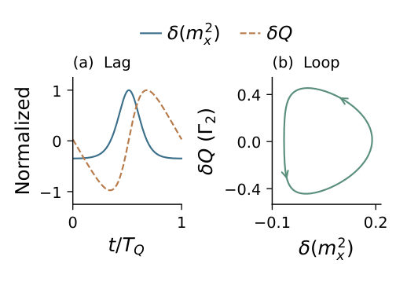
<figcaption class="paper-figure-caption"><b>Fig 3.</b> FIG. 3. Delayed mean-field energy feedback. (a) Centered m2 x and Q, each divided by its maximum absolute deviation, over one feedback period TQ = T/2. The energy response lags the transverse pair order. (b) The same orbit in centered (m2 x, Q) coordinates; arrows indicate increasing time. Because the lag makes Q different on the increasing and decreasing branches of m2 x, the trajectory encloses an oriented loop. The loop gives the cycle-integrated feedback contribution in Eq. (17). Parameters are J/Γ2 ≈31.6, hz/Γ2 ≈31.6, Γ1/Γ2 = 0.3, and γϕ/Γ2 = 0.425, with Ω/Γ2 ≈6.6.</figcaption>
</figure>
<figure class="paper-figure-card">
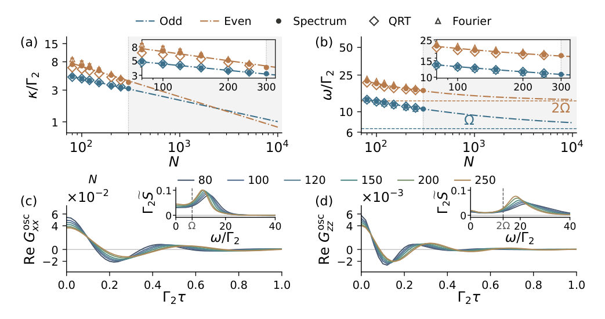
<figcaption class="paper-figure-caption"><b>Fig 4.</b> FIG. 4. Finite-size scaling of collective quantum oscillations. (a,b) Decay rates and frequencies of odd- and even-parity modes. Circles denote Liouvillian eigenvalues, diamonds QRT estimates, and triangles Fourier half-widths in (a) and peak positions in (b). Error bars show the range of estimates obtained using different fitting windows. Dash-dotted curves are fits with fixed large-N limits κ = 0 and ω = Ω, 2Ω; dashed lines mark the mean-field frequencies. Shading indicates extrapolation beyond N = 300, and insets enlarge the small-N region. (c,d) Real parts of the transverse and longitudinal oscillatory correlations, retaining their absolute per-spin amplitudes. Insets show symmetric...</figcaption>
</figure>
<figure class="paper-figure-card">
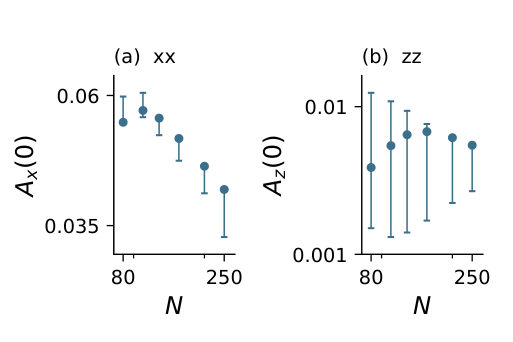
<figcaption class="paper-figure-caption"><b>Fig 5.</b> FIG. 5. Absolute oscillatory amplitudes. (a) Transverse and (b) longitudinal envelope amplitudes Aα(0) in Eq. (23). Cir- cles show the fitted amplitudes; error bars span the estimates obtained using different fitting windows. The amplitudes retain their absolute per-spin scale; the error bars quantify fitting-window sensitivity. Parameters are those of Fig. 3.</figcaption>
</figure>

**Summary.** This work demonstrates that local pure dephasing can sustain continuous time-crystalline order in a ferromagnetic spin ensemble. The mechanism relies on an exact energy identity showing that dephasing-induced energy relaxation creates a delayed feedback loop that balances damping. This establishes dephasing as a key resource for autonomous collective quantum motion.

**Why it may be interesting.** It provides a detailed theoretical mechanism showing how purely dissipative processes (dephasing) can act as a resource to maintain non-equilibrium, periodic collective motion in quantum many-body systems.

Detailed structure

**Main problem.** The paper investigates whether local pure dephasing can sustain continuous time-crystalline order in a quantum spin ensemble, contrasting this with mechanisms relying on population changes.

**Main result.** Local dephasing is shown to be necessary for persistent collective oscillations, as the resulting energy relaxation provides a delayed feedback mechanism that exactly compensates for transverse damping.

**Method.** The analysis uses mean-field theory, deriving Bloch equations and employing exact operator identities to analyze energy conservation and feedback mechanisms.

**Model / system.** The system is a homogeneous ensemble of spin-1/2 particles with all-to-all ferromagnetic interactions, governed by a master equation incorporating both decay ($\gamma$) and pure dephasing ($\gamma_\phi$).

**Key observables.** Magnetization components ($m_x, m_y, m_z$), Liouvillian spectra, stationary two-time correlations, and power spectra $S_{zz}(\omega)$.

**Important parameters / regimes.** The ratio of dephasing to decay ($\gamma_\phi/\gamma$), interaction strength ($J$), and system size ($N$).

**Assumptions / limitations.** The analysis initially relies on the homogeneous mean-field approximation, though it extends to quantum signatures and semiclassical trajectories.

**Figures summary.** Figures illustrate dephasing-controlled oscillations, response maps in the interaction–dephasing plane showing P/C regimes, and diagrams detailing the delayed energy feedback loop in the mean-field dynamics.

**Paper structure.** The paper progresses from establishing the physical model and mean-field equations, proving the necessity of dephasing for periodicity via energy identities, analyzing the delayed feedback mechanism, and finally examining quantum signatures and robustness against parameter noise.

Abstract

Local pure dephasing suppresses single-spin coherence, yet we show that it sustains continuous time-crystalline order in a fully connected ferromagnetic spin-$1/2$ ensemble with local decay. An exact operator identity reveals the mechanism: dephasing raises the interaction energy, while energy relaxation on a finite timescale converts this charging into delayed feedback. Within homogeneous mean-field theory, we prove that dephasing is necessary for periodic motion in this model and that feedback exactly balances transverse damping over each cycle. Beyond mean field, the identity fixes the relative amplitude and phase of energy and longitudinal magnetization in oscillatory Liouvillian modes. Liouvillian spectra and stationary two-time correlations characterize temporal order through decay rates that decrease algebraically with system size, frequencies approaching nonzero mean-field values, and comparable per-spin oscillatory weights. Semiclassical trajectories further reveal recurrent switching between a limit-cycle region and two symmetry-related stationary regions: fluctuations interrupt and reactivate collective oscillations, and oscillatory episodes provide an intermediate channel between stationary regions. These results establish local dephasing as a resource for autonomous collective motion and show how the resulting temporal order can participate in metastable dynamics.

[↑ back to top](#top)

### [Entanglement certification of attosecond light fields with photoelectron interferometry](http://arxiv.org/abs/2610.31187v1)

**Authors:** Philipp Stammer  
**Type:** both · **Category:** other · **PDF:** <https://arxiv.org/pdf/2610.31187v1>  
**Analysis basis:** full PDF text, analyzed in chunks
**Topic relevance:** 🔥 `interference shaping light` **4/5** · `quantum optics experiment` **3/5** · `quantum measurements` **2/5**

↔ Scroll figures horizontally

<figure class="paper-figure-card">
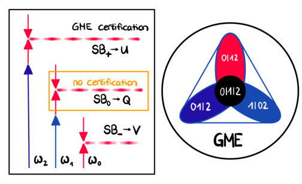
<figcaption class="paper-figure-caption"><b>Fig 1.</b> FIG. 1. Entanglement certification of light using quantum optical attosecond photoelectron interferometry. Left: Quan- tum optical RABBIT gives rise to field correlation functions (Q, U, V) from the measurement of photoelectron sideband (SB). While a single sideband is insufficient to certify entan- glement, the combination of the central sideband SB0 with an upper and lower band SB± provides access to various entan- glement certification bounds. Right: Schematic separability structure for the field modes (012). Genuine tripartite entan- glement certification excludes the convex hull of the three sets separable across the bipartitions (0|12), (1|02), and (01|2), in- cluding mixtures of...</figcaption>
</figure>
<figure class="paper-figure-card">
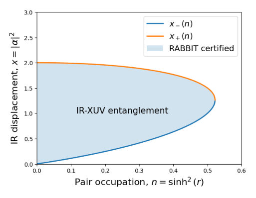
<figcaption class="paper-figure-caption"><b>Fig 2.</b> FIG. 2. Certification of IR-XUV entanglement. We con- sider the state shown in Eq. (14), given by a displaced two- mode squeezed state across the (01) modes, and an inde- pendent upper XUV mode (2). The shaded region satisfies |Q|2 &gt; UV, and certifies IR-XUV entanglement from the RAB- BIT moments. It is bounded by x−(n) &lt; x &lt; x+(n) for 0 &lt; n &lt; (4 √</figcaption>
</figure>
<figure class="paper-figure-card">
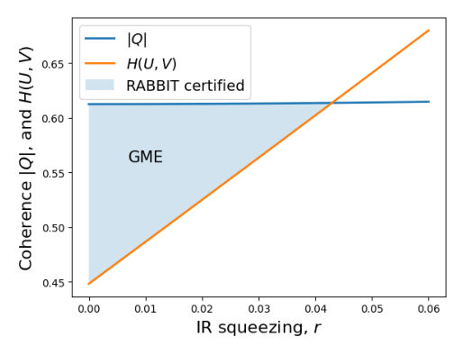
<figcaption class="paper-figure-caption"><b>Fig 3.</b> FIG. 3. Genuine multipartite entanglement certification. GME certification for the non-Gaussian family of states in Eq. (17) at p = 0.75 and finite moment U. Shading marks GME certified region |Q| &gt; H(U, V), occurring for 0 ≤r &lt; rc with rc ≃0.04294. The state remains genuinely tripartite entangled for all r since the squeezing is local.</figcaption>
</figure>

**Summary.** This paper details a novel method to certify entanglement in attosecond light fields using photoelectron interferometry. By mapping the measurement process to optical correlation functions, the authors derive specific mathematical witnesses that quantify entanglement between different frequency modes (IR vs. XUV). This establishes a powerful, general framework for verifying quantum correlations in attosecond light sources.

**Why it may be interesting.** This work is highly relevant to quantum optics and open quantum systems, as it provides a concrete, measurable protocol to verify non-classical quantum correlations (entanglement) in ultrafast light sources, which is a major frontier in quantum light sources.

Detailed structure

**Main problem.** The core challenge is developing experimentally accessible methods to certify entanglement in attosecond light fields generated via high-harmonic generation.

**Main result.** The authors establish attosecond photoelectron interferometry as a general framework, providing specific entanglement witnesses (like $|Q|^2 > UV$) that violate separability criteria for both bipartite and genuine multipartite entanglement.

**Method.** The methodology involves mapping photoelectron interferometry measurements to the calculation of optical correlation functions and constructing entanglement witnesses based on the positive semi-definiteness of moment matrices.

**Model / system.** The system under study is the quantum state of attosecond light fields spanning the infrared (IR) to extreme ultraviolet (XUV) spectrum, generated through high-harmonic generation (HHG). The experimental platform analyzed is photoelectron interferometry, specifically using the RABBIT process.

**Key observables.** Key observables include field correlation functions like $Q = \langle a_2^\dagger a_1 a_2^0 
angle$, and moments derived from sideband measurements, such as $U = \langle N_2 N_0 
angle$ and $V = \langle N_1 (N_0 + 1) 
angle$.

**Important parameters / regimes.** The analysis focuses on the entanglement criteria derived from the violation of bounds like $|Q|^2 > UV$ (for IR-XUV entanglement) and $|Q| > H(U, V)$ (for genuine multipartite entanglement).

**Assumptions / limitations.** The derived entanglement witnesses are sufficient but not proven to be optimal in all general cases, and the certification does not exclude certain types of factorizable states.

**Figures summary.** Figures illustrate the mapping from quantum optical RABBIT measurements to correlation functions $(Q, U, V)$ and compare the experimentally accessible entanglement regions against theoretical bounds for both bipartite and multipartite entanglement.

**Paper structure.** The paper progresses by first identifying the need for entanglement certification in attosecond fields. It then develops the mathematical framework by relating photoelectron interferometry to correlation functions, deriving specific separability witnesses for bipartite entanglement (IR-XUV), and finally extending this to a sufficient criterion for genuine multipartite entanglement among three modes.

Abstract

The emergence of entangled quantum optical states in high-harmonic generation raises a fundamental problem about its characterization, namely, \textit{how can entanglement of extreme-ultraviolet radiation be certified for attosecond light fields?} Here, we provide experimentally accessible separability tests, particularly showing that attosecond photoelectron interferometry provides a direct solution to this problem. This is achieved by a quantum optical treatment of mapping photoelectron interferometry to the measurement of optical correlation functions. This yields a negative-partial-transpose witness for infrared-XUV entanglement and a sufficient witness of genuine multipartite entanglement without auxiliary optical measurements. We evaluate both witnesses on explicit optical states and identify how the protocol can be extended to XUV-XUV entanglement certification. Hence, we establish attosecond photoelectron interferometry as a general framework for entanglement certification across a wide range of optical frequencies.

[↑ back to top](#top)

### [Nonlinear quantum noise polarization in macroscopic nonlinear QED](http://arxiv.org/abs/2610.31406v1)

**Authors:** Arman Kashef, Stefan Scheel, Marco Ornigotti  
**Type:** theory · **Category:** other · **PDF:** <https://arxiv.org/pdf/2610.31406v1>  
**Analysis basis:** full PDF text, analyzed in chunks
**Topic relevance:** 🔥 `Keldysh / 2PI / non-Gaussian methods` **4/5** · `methods for driven-dissipative` **2/5** · `correlated / nonlocal dissipation` **1/5** · `driven-dissipative phase transition` **1/5**

↔ Scroll figures horizontally

<figure class="paper-figure-card">
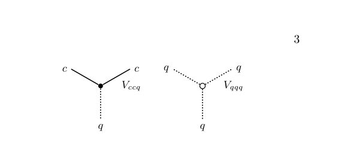
<figcaption class="paper-figure-caption"><b>Fig 1.</b> FIG. 1. Interaction vertices of the X3 theory.</figcaption>
</figure>

**Summary.** This paper develops a quantum theory for light in nonlinear, absorbing materials by extending the Huttner-Barnett model to include cubic self-interactions. Using the Schwinger-Keldysh path integral, the authors derive that the nonlinear response necessitates the emergence of non-Gaussian noise polarization. This provides a quantum-statistically consistent framework for nonlinear macroscopic QED.

**Why it may be interesting.** This work is highly relevant to quantum optics and open quantum systems, as it provides a rigorous, non-perturbative method for handling nonlinear dissipation and noise sources in quantum light-matter interactions.

Detailed structure

**Main problem.** The paper aims to construct a quantum theory of light propagating in nonlinear, absorbing media that remains consistent with the nonlinear fluctuation-dissipation theorem.

**Main result.** The theory successfully incorporates non-Gaussian noise polarization arising from cubic self-interactions, providing a quantum-statistically consistent framework for nonlinear macroscopic QED.

**Method.** The analysis heavily relies on the Schwinger-Keldysh path-integral formalism, employing auxiliary field transformations (using Airy functions) to decouple the cubic interaction term.

**Model / system.** The system is a quantum theory of light in a nonlinear medium, modeled by extending the Huttner-Barnett framework to include a cubic matter self-interaction ($\chi^{(3)}$).

**Key observables.** Noise polarization field, non-Gaussian noise spectrum, linear and nonlinear susceptibilities ($\chi^{(1)}, \chi^{(2)}$), and the noise correlation function $\langle P^{(1)}_{\xi}(\omega)P^{(1)}_{\xi}(\omega')
angle$.

**Important parameters / regimes.** The nonlinear coupling constant ($\lambda$), the bath spectral density, and the frequency ($\omega$).

**Assumptions / limitations.** The theory is assumed to be consistent with the nonlinear fluctuation-dissipation theorem, and the derivation involves treating the cubic term via an auxiliary field transformation using Airy functions.

**Figures summary.** Figure 1 illustrates the interaction vertices for the $\chi^{(3)}$ theory, showing terms like $V_{ccq}$ and $V_{qqq}$.

**Paper structure.** The paper builds from establishing the necessity of the nonlinear fluctuation-dissipation theorem, to applying the Keldysh formalism, and finally using an auxiliary field transformation based on Airy functions to decouple the cubic action and derive the noise statistics.

Abstract

We construct a quantum theory of light in nonlinearly responding materials with dispersion   and absorption and, in particular, show the emergence of non-Gaussian noise associated with   nonlinear absorption processes. Our theory is based on a path-integral formulation of the   microscopic Huttner-Barnett model including cubic matter self-interaction required for   $χ^{(2)}$ nonlinear processes. We show that the noise polarization emerges naturally from   a decoupling of the stochastic weights of the bath response which, in case of cubic   self-interactions, leads to a decoupling via Airy functions. As the theory is, by   construction, consistent with the nonlinear fluctuation-dissipation theorem, it constitutes   a viable quantum theory of light in nonlinear media.

[↑ back to top](#top)

### [Predictive electronic feedback control for narrow-linewidth lasers](http://arxiv.org/abs/2610.31396v1)

**Authors:** Jiatian Liu, Xuan Qi, Xiayang Fan, Shenchao Jin, Yuan Sun  
**Type:** experiment · **Category:** other · **PDF:** <https://arxiv.org/pdf/2610.31396v1>  
**Analysis basis:** full PDF text, analyzed in chunks
**Topic relevance:** 🔥 `quantum measurements` **4/5** · `quantum optics experiment` **3/5** · `superradiant laser` **1/5**

↔ Scroll figures horizontally

<figure class="paper-figure-card">
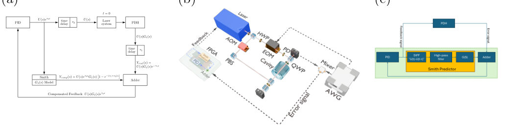
<figcaption class="paper-figure-caption"><b>Fig 1.</b> FIG. 1: Basic design, experimental setup and control system architecture. (a) Theoretical block diagram of the closed-loop control system incorporating a Smith predictor, illustrating the inherent system time delays (τ1 and τ2) and the mathematical signal flow for delay compensation. U(s) is the Laplace transform of the control signal U(t) defined on the time domain [0, ∞) for a prescribed starting time t = 0. (b) Schematic of the experimental setup, demonstrating the integration of the Smith predictor for evaluating and suppressing system phase noise. HWP, Half-Wave Plate. QWP, Quarter-Wave Plate. PBS, Polarizing Beamsplitter. EOM, Electro-Optic Modulator. AOM, Acousto-Optic Modulator....</figcaption>
</figure>
<figure class="paper-figure-card">
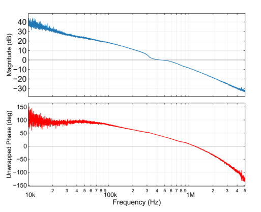
<figcaption class="paper-figure-caption"><b>Fig 2.</b> FIG. 2: Top: Open-loop magnitude response of the plant, |G(jω)|. The blue line represents the plant gain (dB) extracted from the closed-loop system, illustrating its inherent frequency attenuation characteristics. Bottom: Open-loop phase response of the plant, ∠G(jω). The red line denotes the unwrapped phase (deg), clearly demonstrating the linear phase lag induced by hardware time delay.</figcaption>
</figure>
<figure class="paper-figure-card">
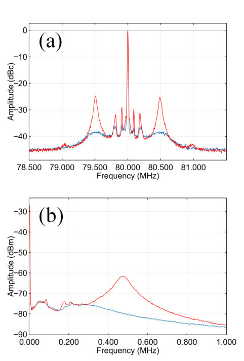
<figcaption class="paper-figure-caption"><b>Fig 3.</b> FIG. 3: Spectral analysis of the PDH locking system without (red traces) and with (blue traces) the proposed method using Smith predictor. (a) Beat-note signal spectrum centered at the 80 MHz carrier frequency. (b) Error signal spectrum in the locked state.</figcaption>
</figure>
<figure class="paper-figure-card">
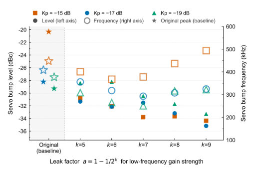
<figcaption class="paper-figure-caption"><b>Fig 4.</b> FIG. 4: Experimental performance versus key parameters. The left vertical axis denotes the servo-bump level and the right vertical axis its peak frequency. Filled and open markers correspond to the left and right vertical axes, respectively; stars denote the original peak positions.</figcaption>
</figure>
<figure class="paper-figure-card">
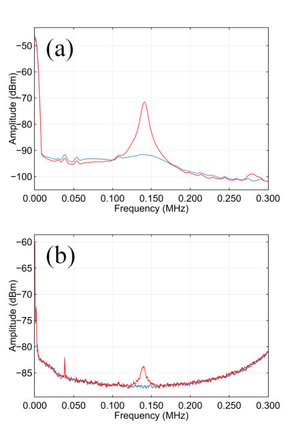
<figcaption class="paper-figure-caption"><b>Fig 5.</b> FIG. 5: Experimental results of the Rydberg atom quantum sensing. The red and blue traces correspond to the system operating without and with the proposed method of predictive electronic feedback control, respectively. (a) Spectra of error signals of the probe beam in the locked state. (b) Spectra of the transmission signal of probe laser via Rydberg EIT.</figcaption>
</figure>

**Summary.** This paper introduces a novel electronic control method using the Smith predictor to overcome phase noise ('servo bumps') caused by time delays in PDH laser stabilization. By implementing the predictor on an FPGA, the authors compensate for loop delays entirely in the electronics, significantly improving the stability and signal-to-noise ratio for quantum applications like atomic clocks and quantum sensing.

**Why it may be interesting.** This work provides a powerful, hardware-efficient control technique applicable to any delay-limited quantum optical measurement, directly improving the signal-to-noise ratio for quantum sensing applications.

Detailed structure

**Main problem.** The standard Pound-Drever-Hall (PDH) technique for stabilizing narrow-linewidth lasers suffers from excessive phase noise, known as 'servo bumps,' due to inherent time delays in the electronic feedback loop.

**Main result.** The proposed method successfully suppresses these servo bumps by compensating for the time delay entirely within the electronic feedback path, achieving significant noise reduction (e.g., 14 dB suppression) without adding extra optical components.

**Method.** The authors implement a Smith predictor, a classical control theory tool, digitally on an FPGA to model and compensate for the total time delay in the PDH feedback loop.

**Model / system.** The system involves stabilizing a narrow-linewidth laser frequency using the PDH technique, which is crucial for quantum coherent control and quantum information science. The core challenge is the time delay ($	au$) in the feedback loop.

**Key observables.** Phase noise spectra, servo bump magnitude (dB), locked-state error signal attenuation, and correlation coefficient in quantum sensing.

**Important parameters / regimes.** Time delays ($	au_1, 	au_2$), feedback bandwidth, and the residual error bound (e.g., 20 kHz cutoff).

**Assumptions / limitations.** The method assumes the system's delay properties remain invariant over time, and residual error is bounded by a high-pass filter.

**Figures summary.** Figures illustrate the theoretical block diagram of the Smith predictor integration, the experimental setup, and spectral comparisons showing the suppression of noise bumps with and without the predictor.

**Paper structure.** The paper introduces the problem of delay-induced noise in PDH locking, proposes the Smith predictor implementation on an FPGA, details the compensation mechanism, and validates the method through frequency response characterization and quantum sensing experiments.

Abstract

Narrow-linewidth lasers are essential for various key atom-laser interaction processes and optical setups in quantum coherent control, quantum precision measurement, and quantum information science. The Pound-Drever-Hall (PDH) technique is the standard method for the frequency-stabilization of narrow-linewidth lasers, but the inherent time delay in its feedback loop inevitably induces excessive phase noise, commonly known as servo bumps. Previous solutions primarily rely on additional optical components outside the electronic feedback control loop. Here, we propose and implement a generic method based on the Smith predictor to address the time-delay issue entirely within the electronic part of the PDH feedback control loop. We systematically demonstrate its capability to suppress phase noise and reduce servo bumps by adding only a single Field-Programmable Gate Array (FPGA) controller to the loop. This class of methods is demonstrated to be conceptually concise with minimal hardware overhead, effective in practice, and holds potential for a wide variety of future applications.

[↑ back to top](#top)

### [Delta-Doped GeV$^-$ in diamond with isotope resolvable optical spectra](http://arxiv.org/abs/2610.30375v1)

**Authors:** Ian N. Hammock, Kinfung Ngan, Antoni W. Wellisz, Keira Linder, Midrel Wilfried Ngandeu Ngambou, Jiefei Zhang, Xinghan Guo, Benjamin Pingault, Shuo Sun, David D. Awschalom, F. Joseph Heremans, Alexander A. High, Nazar Delegan  
**Type:** experiment · **Category:** quantum information and computing · **PDF:** <https://arxiv.org/pdf/2610.30375v1>  
**Analysis basis:** full PDF text, analyzed in chunks
**Topic relevance:** 🔥 `QC/QI experiment` **4/5** · `quantum measurements` **1/5** · `quantum optics experiment` **1/5**

↔ Scroll figures horizontally

<figure class="paper-figure-card">
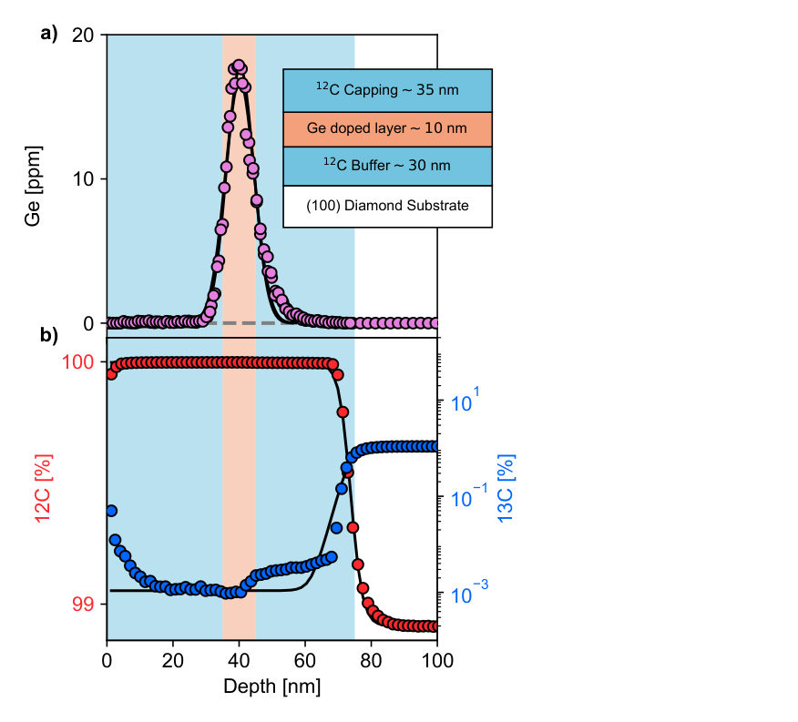
<figcaption class="paper-figure-caption"><b>Fig 1.</b> Figure 1: Secondary Ion Mass Spectroscopy (SIMS) of a) Germanium and b) Carbon Isotopes: 12 and 13 as a function of depth. Detection limit of Ge is given as the dashed line at 4 ppb. a inset) A schematic illustrating the diamond overgrowth stack with approximate thicknesses.</figcaption>
</figure>
<figure class="paper-figure-card">
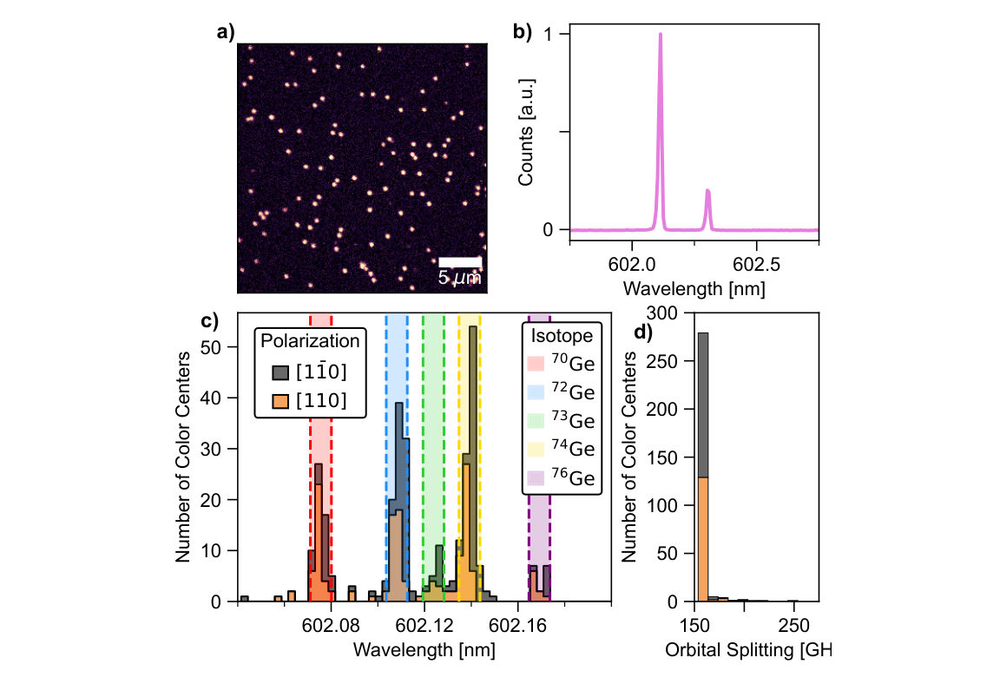
<figcaption class="paper-figure-caption"><b>Fig 2.</b> Figure 2: a) PL map of the diamond with a narrowband filter in place. b) Representative spectra of the GeV−. The left most peak is referred to as the ZPL, the distance between the two peaks is the orbital splitting. c) Distribution of GeV−ZPLs resolved by the spectrometer, distinguished by polarization. The two polarizations are stacked for clarity. Proposed isotopic grouping is overlayed. Group width is estimated by the 76Ge cluster and is 7.5 GHz wide d) Distribution of orbital splitting, distinguished by polarization.</figcaption>
</figure>
<figure class="paper-figure-card">
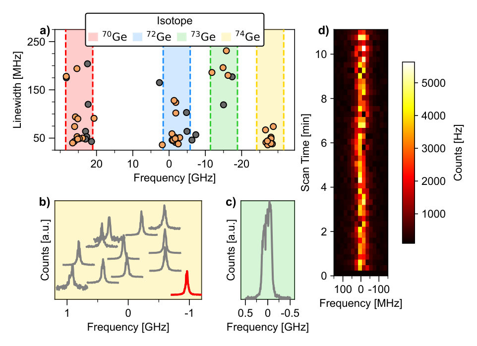
<figcaption class="paper-figure-caption"><b>Fig 3.</b> Figure 3: a) Distribution of GeV−ZPLs resolved by PLE, distinguished by polarization. Pro- posed istopic grouping is overlayed. The span of each grouping is 7.5 GHz and determined from the 76Ge Spectra. b) PLE scans of the 74Ge group. c) PLE scan of a 73Ge. d) 10 minute PLE scan of the highlighted color center in figure 3b, showcasing the optical stability under resonant excitation.</figcaption>
</figure>
<figure class="paper-figure-card">
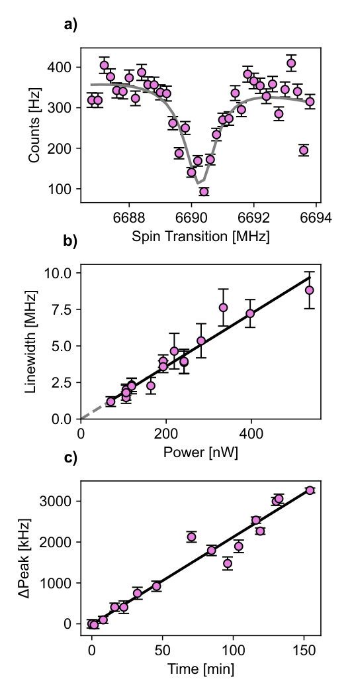
<figcaption class="paper-figure-caption"><b>Fig 4.</b> Figure 4: a) CPT dip for GeV−at our lowest power, 70 nW. Fitted line is given in grey. See SI for further fit details. b) Change of CPT linewidth with incident laser power. Fitted line is given in black, with the extrapolation to 0 power in grey. c) Change of the CPT resonance over time.</figcaption>
</figure>
<figure class="paper-figure-card">
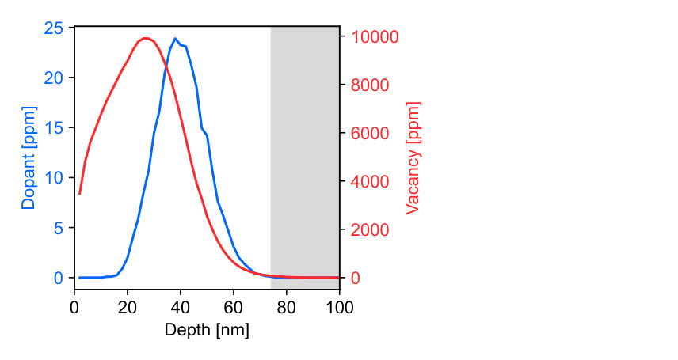
<figcaption class="paper-figure-caption"><b>Fig 5.</b> Figure 1: SRIM computation for 74Ge implanted into diamond at an angle of 7◦and 98 keV. The blue line is the dopant profile, and red line is the Vacancy profile. Profiles have been scaled to reflect a 1013 ions/cm2 dose.</figcaption>
</figure>

**Summary.** This paper reports on the creation of high-quality, delta-doped Germanium-Vacancy ($	ext{GeV}^-$) centers in diamond using controlled plasma deposition and irradiation. The authors achieved excellent spectral homogeneity and a measurable spin coherence time, confirming that the formation process is dominated by athermal mechanisms. This work establishes a scalable platform for solid-state quantum memory applications.

**Why it may be interesting.** This work directly addresses the engineering requirements for solid-state quantum memories and quantum interconnects by providing unprecedented control over defect placement and spectral purity in a solid-state host.

Detailed structure

**Main problem.** The primary challenge is improving the deterministic placement and reducing damage in Group-IV color centers (like $	ext{GeV}^-$) in diamond for use in quantum networking.

**Main result.** The authors successfully demonstrated the creation of a high-quality sheet of $	ext{GeV}^-$ centers with minimal strain, achieving a spin coherence time ($T_2^*$) lower bound of $730 	ext{ ns}$.

**Method.** The research combines advanced material growth techniques (MPCVD) for precise doping, followed by controlled electron irradiation and annealing to generate the color centers.

**Model / system.** The system is the $	ext{GeV}^-$ color center in diamond, which is engineered via delta-doping of Germanium. The formation process is modeled as predominantly athermal, involving direct displacement of a carbon atom neighboring a substitutional germanium site ($	ext{Ges}$).

**Key observables.** Spectral linewidths ($47 \pm 11 	ext{ MHz}$), spin coherence time ($T_2^*$), orbital splitting ($\approx 160 	ext{ GHz}$), and $	ext{GeV}^-$ sheet density ($0.12 	ext{ GeV}^-/\mu	ext{m}^2$).

**Important parameters / regimes.** Ge layer depth localization ($< 10 	ext{ nm}$), $	ext{GeV}^-$ yield ($\ge 90\%$), and the limiting factor for $T_2^*$ attributed to a paramagnetic defect.

**Assumptions / limitations.** The $	ext{GeV}^-$ creation is assumed to be driven by athermal processes, and the spin coherence limitation is attributed to an unknown paramagnetic defect.

**Figures summary.** Figures detail PL spectra showing isotopic clustering, orbital splitting histograms confirming low strain, and EPR spectra confirming the $g \approx 2$ resonance associated with even Ge isotopes.

**Paper structure.** The paper progresses from establishing the material platform via controlled doping (MPCVD) to generating the centers via irradiation, characterizing the resulting optical and spin properties (PLE, CPT, EPR), and finally discussing the physical mechanisms governing formation and decoherence.

Abstract

Group IV color centers in diamond -- silicon, germanium, tin, and lead-vacancy centers -- are a promising platform for quantum networking. Typical Group-IV creation utilizes ion implantation during diamond growth that leaves the color centers with a broad depth distribution and damage-induced strain inhomogeneity. Deterministic placement and damage reduction in Group IV generation are essential for improving this platform. In this letter, we report on the localization of germanium-vacancy (GeV$^-$) to a $<$ 10 nm layer via the timed injection of GeH$_4$ during microwave plasma chemical vapor deposition. In this layer we have realized 17 ppm of Ge and a strain-free environment for the GeV$^-$. Subsequent electron irradiation and annealing have generated a sheet density of 0.12 GeV$^-$/$μ$m$^2$. The minimal damage from color center generation mitigates spectral inhomogeneity and allows spectral resolution of isotopic clusters, with the best cluster having an inhomogeneous distribution of 2.14 GHz and an average linewidth of $47 \pm 11$ MHz. Our study gives insight into formation dynamics of GeV$^-$ in delta-doped systems and estimates our vacancy to GeV$^-$ yield to be $\geq$ 90%, establishing an athermal nearest-neighbor formation model. We further characterized the spin $T_2^*$ and set a lower bound of 730 ns, limited by a paramagnetic defect.

[↑ back to top](#top)

### [Quantum Phases and Structural Transitions of Bosons in Bubble-Shaped Confinements](http://arxiv.org/abs/2610.30381v1)

**Authors:** Fabio Cinti, Gabriele Costa, Giuseppe Pellicane, Santi Prestipino, Matteo Ciardi  
**Type:** both · **Category:** quantum gases · **PDF:** <https://arxiv.org/pdf/2610.30381v1>  
**Analysis basis:** full PDF text, analyzed in chunks
**Topic relevance:** 🔥 `analog quantum simulation` **4/5** · `methods for driven-dissipative` **2/5**

↔ Scroll figures horizontally

<figure class="paper-figure-card">
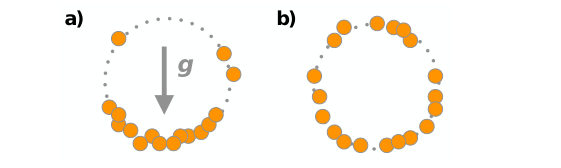
<figcaption class="paper-figure-caption"><b>Fig 1.</b> FIG. 2. (a) On Earth, gravity is comparable to the weak curvature of the trap and the atomic shell sags and collapses at the bottom. (b) In microgravity, the density remains uni- formly distributed in the shell.</figcaption>
</figure>
<figure class="paper-figure-card">
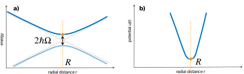
<figcaption class="paper-figure-caption"><b>Fig 2.</b> FIG. 1. Conceptual sketch of the bubble-trap mechanism. (a) The radio-frequency dressing of the bare magnetic quadrupole opens an avoided crossing of size 2ℏΩ; atoms adiabatically follow the populated upper branch. (b) The resulting effective radial potential uext(r), Eq. (2), with its minimum at r = R.</figcaption>
</figure>
<figure class="paper-figure-card">
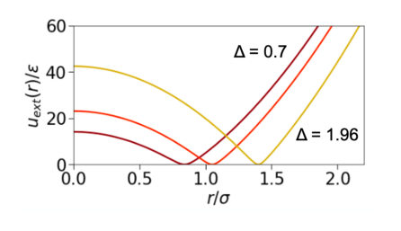
<figcaption class="paper-figure-caption"><b>Fig 3.</b> FIG. 3. Bubble-trap potential uext(r), Eq. (2), for three val- ues of the shell radius R and ∆at fixed Ω.</figcaption>
</figure>
<figure class="paper-figure-card">
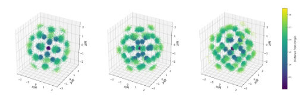
<figcaption class="paper-figure-caption"><b>Fig 4.</b> FIG. 5. Worldline snapshots for N = 1200, 1500 and 1800 (left to right), colored by distance from the trap center. A third, outer shell of clusters (green-yellow) nucleates beyond the two shells of the bilayer supersolid (dark purple and blue- green) as N is increased.</figcaption>
</figure>
<figure class="paper-figure-card">
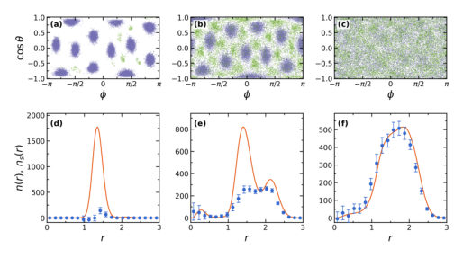
<figcaption class="paper-figure-caption"><b>Fig 5.</b> FIG. 4. Structural transition with increasing quantum fluctu- ations λ, for N = 600, R = 1.15, and T = 0.5. (a)–(c) World- line configurations projected onto the (φ, cos θ) plane, colored by shell (purple: inner shell; green: outer shell), from a single- shell cluster crystal (λ = 0.10) through a bilayer supersolid (λ = 0.35) to a uniform superfluid shell (λ = 0.40). (d)–(f) Corresponding integrated radial density n(r) (red) and super- fluid radial density ns(r) (blue circles), showing the growth of the superfluid component between and eventually across the shells.</figcaption>
</figure>

**Summary.** This paper uses Path Integral Monte Carlo simulations to study soft-core bosons in a bubble-shaped trap. The research demonstrates that increasing the number of bosons drives the system through multiple structural layering transitions, forming a third concentric layer. Crucially, it shows that even in this complex, multi-layer state, a measurable superfluid fraction remains, providing key insights for experimental quantum gas physics.

**Why it may be interesting.** This work provides concrete, quantitative guidance on how particle number dictates structural organization in curved quantum systems, which is highly relevant for experimental realization in trapped atomic gases.

Detailed structure

**Main problem.** The study investigates the structural properties and superfluid behavior of soft-core bosons confined within a curved, bubble-shaped trap, focusing on how particle number drives structural transitions.

**Main result.** Increasing the particle number ($N$) induces a sequence of layering transitions, leading to the emergence of a third concentric cluster layer, while a finite superfluid fraction persists in this multi-layer regime.

**Method.** The research employs Path Integral Monte Carlo (PIMC) simulations using the worm algorithm in continuous space to calculate finite-temperature equilibrium properties.

**Model / system.** The system consists of soft-core bosons interacting via a soft-core repulsive potential and confined by a bubble-shaped external potential $u_{	ext{ext}}(r)$. The study analyzes the system across varying particle numbers ($N$) and quantum fluctuation parameters ($\lambda$).

**Key observables.** Superfluid fraction ($f_s$), integrated radial density ($n(r)$), and the distribution of permutation cycles ($P(L)$).

**Important parameters / regimes.** Large particle numbers ($N \le 1800$), quantum fluctuation parameter ($\lambda$), and trap geometry parameters ($R, u_0, \Omega$).

**Assumptions / limitations.** The analysis assumes the soft-core potential allows multiple bosons to occupy the same cluster, and the work extends previous findings to a large-$N$ regime.

**Figures summary.** Figures illustrate the bubble-trap potential, compare trap potentials in different gravitational settings, show worldline snapshots demonstrating the transition from single-layer crystal to bilayer supersolid to uniform superfluid shell, and visualize the nucleation of a third outer shell as $N$ increases.

**Paper structure.** The paper progresses by defining the physical system and Hamiltonian, detailing the PIMC methodology, presenting results showing the evolution of phases (crystal $	o$ supersolid $	o$ superfluid) with quantum fluctuations ($\lambda$), and finally extending the analysis to large particle numbers ($N$) to observe multi-layer structure formation.

Abstract

We investigate the structural properties and superfluid behavior of soft-core bosons confined in a spherical bubble trap at large particle numbers ($N \le 1800$). Using Path Integral Monte Carlo simulations with worm algorithm sampling in continuous space, we show that increasing $N$ drives a sequence of layering transitions: beyond the established bilayer supersolid, a third concentric layer of clusters emerges at $N \approx 1800$. By analyzing the distribution of permutation cycles distribution, we demonstrate that a finite superfluid fraction ($f_s \approx 10\%$) persists even in this multi-layer regime. These findings clarify the role of particle number in driving layer formation on curved manifolds, offering a concrete guide for future experiments with bubble-trapped bosons.

[↑ back to top](#top)

### [String Order in Quench Dynamics as a Probe of Quantum Phase Transitions](http://arxiv.org/abs/2610.30647v1)

**Authors:** H. P. Zhang, Z. Song  
**Type:** theory · **Category:** strongly correlated electrons · **PDF:** <https://arxiv.org/pdf/2610.30647v1>  
**Analysis basis:** full PDF text, analyzed in chunks
**Topic relevance:** 🔥 `non-equilibrium universality` **4/5** · `analog quantum simulation` **1/5** · `scars & prethermalization` **1/5**

↔ Scroll figures horizontally

<figure class="paper-figure-card">
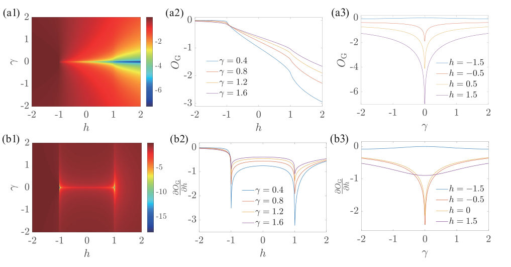
<figcaption class="paper-figure-caption"><b>Fig 1.</b> FIG. 1. Ground-state intensive string order OG and its transverse-field response in the anisotropic XY chain for N = 10 000. Panels (a1) and (b1) show color maps of OG and ∂OG/∂h, respectively, in the (h, γ) plane. Panels (a2) and (b2) show their field dependence at fixed anisotropies, while panels (a3) and (b3) show their anisotropy dependence at the fields specified in the respective legends. The order is strongly suppressed near γ = 0 for the displayed cuts with h &gt; −1, whereas its field derivative develops pronounced negative extrema at h = ±1 and near γ = 0 for |h| &lt; 1. These features connect the parameter-space maps to the one-dimensional cuts and reveal the critical lines through the...</figcaption>
</figure>
<figure class="paper-figure-card">
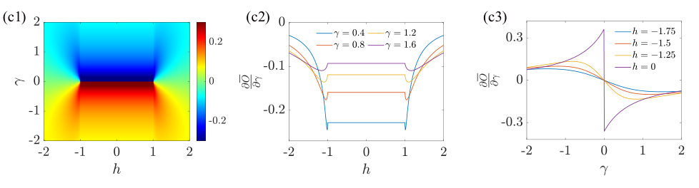
<figcaption class="paper-figure-caption"><b>Fig 2.</b> FIG. 2. Nonequilibrium intensive string order after a quench from the fully polarized state, for N = 10 000 and a time-averaging window T = 1000. Panels (a1)–(a3) show the averaged order O: (a1) is the (h, γ) map, and (a2) and (a3) give its field and anisotropy dependence, respectively, with fixed parameters specified in the legends. Panels (b1)–(b3) present the field derivative ∂O/∂h in the same three representations, and panels (c1)–(c3) present the anisotropy derivative ∂O/∂γ. The dashed lines at γ = 1.2 and h = 0 in (a1) specify the scans in Fig. 3(a,b); points A–D select the running averages in Fig. 3(c). The field- independent plateau for |h| &lt; 1 is bounded by an enhanced field...</figcaption>
</figure>
<figure class="paper-figure-card">
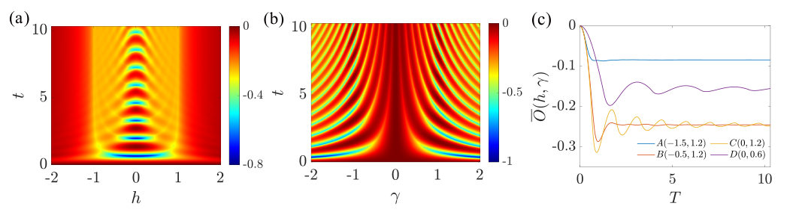
<figcaption class="paper-figure-caption"><b>Fig 3.</b> FIG. 3. Time evolution of the intensive string order O(t) after a quench from the fully polarized state, and the associated running time average O(T) = T −1 R T 0 O(t) dt, for a chain of N = 10 000 sites. Panels (a) and (b) show density plots of O(t) as the transverse field h and anisotropy γ are varied, at fixed γ = 1.2 and h = 0, respectively. The pronounced time-dependent bands show that the transient response depends strongly on the post-quench parameters; near γ = 0, the order is nearly time independent. Panel (c) compares the running averages at the four points A–D marked in Fig. 2(a1). Their initial relaxation and subsequent residual oscillations differ markedly, illustrating that...</figcaption>
</figure>

**Summary.** This theoretical work examines the anisotropic XY spin chain to probe quantum phase transitions using a global string order parameter. By analyzing both the ground state and the time evolution after a quench, the authors demonstrate that the string order reveals singular behavior precisely at the critical points. This method successfully connects measurable spin populations to the underlying topological structure of the quantum phase diagram.

**Why it may be interesting.** The use of string order and quench dynamics provides a powerful, non-local diagnostic tool to map out phase boundaries and detect topological structure in quantum many-body systems, which is highly relevant for understanding strongly correlated materials.

Detailed structure

**Main problem.** The study investigates using string order in quench dynamics as a sensitive probe to characterize quantum phase transitions (QPTs) in quantum spin chains.

**Main result.** The string order parameter exhibits singular field derivatives at critical lines in both equilibrium and quench dynamics, revealing a hidden nonlocal order underlying the model.

**Method.** The authors employ theoretical calculations involving the Jordan-Wigner transformation to map the spin Hamiltonian to fermionic operators, allowing for exact diagonalization in momentum sectors.

**Model / system.** The system analyzed is the anisotropic XY chain subjected to a transverse magnetic field, described by the Hamiltonian H = -sum(sigma_x^j sigma_x^{j+1} + gamma^2 sigma_y^j sigma_y^{j+1}) + sum(h*sigma_z^j).

**Key observables.** The intensive string order parameter (O) and its field derivatives ($\partial O / \partial h$, $\partial O / \partial \gamma$) are the primary diagnostics.

**Important parameters / regimes.** The key parameters are the transverse field strength ($h$) and the anisotropy parameter ($\gamma$), with critical regimes defined by $h=\pm 1$ and $\gamma=0$.

**Assumptions / limitations.** The analysis is performed in the thermodynamic limit (N -> infinity), and the string operator is defined as a global product.

**Figures summary.** Figure 1 maps the ground-state string order and its derivative in the (h, gamma) plane, confirming critical line structures. Figure 2 shows the quench dynamics response, revealing a plateau in the gapped region.

**Paper structure.** The paper first establishes the model and the string operator, then calculates the equilibrium string order ($O_G$) and its field derivative. Subsequently, it analyzes the non-equilibrium quench dynamics, calculating the long-time average order parameter ($O$) and its response to parameter changes.

Abstract

We study the anisotropic XY chain in a transverse field by introducing a global string order parameter and examining its equilibrium behavior and its quench dynamics from a fully polarized initial state. The corresponding string operator is defined as the product of local projected spin operators over the entire chain. The nonequilibrium order parameter is the long-time average of the logarithm of the string-operator expectation value per site after the quench.For the ground state, its field derivative is singular on the Ising critical lines; after the quench, the steady-state response also records the field boundaries and the anisotropy transition. We derive analytically the nonanalytic behavior of the order parameter at the quantum critical lines. Our results reveal a hidden nonlocal order underlying this paradigmatic model of conventional quantum phase transitions. They also connect measurable spin populations with equilibrium and dynamical topological structure.

[↑ back to top](#top)

### [A Personal History in Quantum Foundations: an Oral History Interview](http://arxiv.org/abs/2610.30998v1)

**Authors:** Guy Hetzroni, Yakir Aharonov  
**Type:** theory · **Category:** other · **PDF:** <https://arxiv.org/pdf/2610.30998v1>  
**Analysis basis:** full PDF text, analyzed in chunks
**Topic relevance:** 🔥 `quantum measurements` **4/5**

↔ Scroll figures horizontally

<figure class="paper-figure-card">
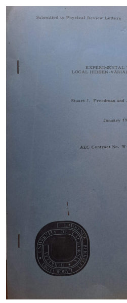
<figcaption class="paper-figure-caption"><b>Fig 1.</b> Fig. 1 The copy of the submitted draft of Freedman and Clauser (1972) that Clauser sent to Aharonov with the one dollar “For Bet” attached.</figcaption>
</figure>

**Summary.** This paper is an oral history interview detailing the conceptual evolution of quantum foundations, covering topics from the EPR paradox to modern weak measurements. It synthesizes complex theoretical developments, such as the two-state-vector formalism, to clarify how quantum mechanics describes reality beyond classical intuition. It is essential reading for understanding the theoretical underpinnings of quantum measurement and correlation.

**Why it may be interesting.** It provides deep historical context and advanced theoretical tools (like weak measurements and TSVF) crucial for understanding open quantum systems and measurement theory, which are foundational to AMO physics.

Detailed structure

**Main problem.** The paper reviews the conceptual development of quantum foundations, focusing on resolving paradoxes like the EPR paradox and understanding measurement processes.

**Main result.** It details advanced formalisms like the two-state-vector formalism and protective measurements, demonstrating how quantum correlations exceed classical limits.

**Method.** The discussion is historical and conceptual, synthesizing results from various theoretical calculations and thought experiments.

**Model / system.** The discussion covers general quantum mechanics principles, including positronium decay, quantum random walks, and the separation of physical attributes like spin from particle location.

**Key observables.** Polarization correlations of photons, energy/momentum measurements over short times, and weak values.

**Important parameters / regimes.** Time intervals ($\Delta t$), measurement strength, and the number of particles/holes in combinatorial examples.

**Assumptions / limitations.** The analysis often contrasts the Schrödinger picture with the Heisenberg picture to resolve conceptual contradictions in quantum description.

**Paper structure.** The structure follows a historical narrative, moving from early tests of quantum correlations (EPR, positronium decay) to modern formalisms (TSVF, protective measurements) and conceptual debates (Heisenberg vs. Schrödinger pictures).

Abstract

This oral history interview provides Yakir Aharonov's personal and conceptual recollections from the 1950s to the 2000s, focusing on his academic trajectory, some of his major contributions to quantum foundations, and his perspective on the development of the field. The interview traces Aharonov's academic career through the Technion, University of Bristol, Brandeis University, Yeshiva University, University of South Carolina, Tel Aviv University, George Mason University, and Chapman University. The interview also traces the development of Aharonov's work and collaborations on the EPR paradox, time-energy uncertainty relations, quantum measurement theory, quantum frames of reference, the two-state vector formalism, weak values, protective measurements, and several other contributions. It includes recollections of meetings and discussions with David Bohm, Niels Bohr, John Clauser, Paul Dirac, Rudolf Peierls, Aage Petersen, and Abner Shimony. Also mentioned: David Albert, Jeeva Anandan, Peter Bergmann, Gideon Carmi, Avshalom Elitzur, Dave Finkelstein, Vladimir Fock, Itzhak Kalugai, Ed Lerner, Joel Lebowitz, Stanley Mandelstam, Yuval Ne'eman, Sandu Popescu, Maurice Pryce, Daniel Rohrlich, Nathan Rosen, Joseph Safko, Paul Singer, Daniele Struppa, Leonard Susskind, Lev Vaidman, Chien-Shiung Wu.

[↑ back to top](#top)

### [What does quantum parameter estimation estimate? A no-go result for true quantity values](http://arxiv.org/abs/2610.31632v1)

**Authors:** Jacques L. Pienaar, Eran Tal, Asya Ciftci  
**Type:** theory · **Category:** other · **PDF:** <https://arxiv.org/pdf/2610.31632v1>  
**Analysis basis:** full PDF text, analyzed in chunks
**Topic relevance:** 🔥 `quantum measurements` **4/5**

↔ Scroll figures horizontally

<figure class="paper-figure-card">
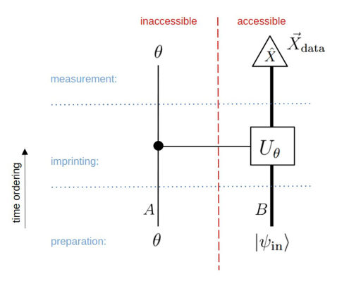
<figcaption class="paper-figure-caption"><b>Fig 1.</b> FIG. 1. Quantum parameter estimation represented as a classically-controlled quantum circuit. The order of processes runs up the page; thin wires represent classical systems, while thick wires represent quantum systems. The unknown param- eter θ is modeled as information stored in a classical register A, which serves as the classical control for a unitary process, Uθ, however the system comprising the register is not directly accessible to the experimenter. The probe system B, initial- ized in the state |ψin⟩B, is thereby subsequently ‘imprinted’ with the value of θ. By doing a measurement X on the probe, one seeks to infer θ.</figcaption>
</figure>
<figure class="paper-figure-card">

<figcaption class="paper-figure-caption"><b>Fig 2.</b> FIG. 2. Quantum parameter estimation represented as a quantum-controlled circuit. The assumed inaccessible physi- cal quantity of interest is now modeled quantum mechanically (thick wire); it becomes quantum entangled to the probe sys- tems via the “quantum controlled” process (control with thick wire). The output is an entangled state with no clearly defined value for the quantity. A hypothetical final measurement of the observable ˆθ, if performed, would produce a “true” pa- rameter value θ consistent with the measurement data ⃗Xdata from the probe systems.</figcaption>
</figure>

**Summary.** This theoretical paper challenges the foundational assumptions underlying quantum parameter estimation. It proves that if one accepts standard quantum predictions like entanglement and rejects hidden variables, the concept of estimating a pre-existing 'true value' is logically impossible. The work forces researchers to adopt a more nuanced, non-realist view of quantum measurement.

**Why it may be interesting.** It forces a deep confrontation between the mathematical formalism of quantum metrology and the philosophical interpretation of measurement, which is crucial for understanding the limits of quantum sensing.

Detailed structure

**Main problem.** The paper investigates the conceptual compatibility of quantum parameter estimation with the notion of a pre-existing, unique 'true' value for the estimated quantity.

**Main result.** A no-go theorem is proven showing that the assumptions required for a realist account of estimation are jointly incompatible with the completeness of the quantum state and the presence of entanglement.

**Method.** The authors generalize the estimation framework from assuming a classical parameter to treating the quantity as a quantum variable, then deriving the contradiction using formal assumptions.

**Model / system.** The analysis is highly abstract, comparing the standard model of parameter estimation ($	heta$) with a generalized model where the quantity is represented by a quantum observable ($\hat{	heta}$).

**Key observables.** The estimated quantity, the degree of decoherence, and the presence/absence of entanglement.

**Important parameters / regimes.** The distinction between a classical parameter ($	heta$) and a quantum variable ($\hat{	heta}$); the existence of entanglement.

**Assumptions / limitations.** The core assumptions analyzed are: 1) Uniqueness, 2) Pre-existing Value, 3) Independence (characterizing estimation); and 4) Completeness (no hidden variables), 5) Entanglement (standard quantum prediction).

**Paper structure.** The paper proceeds by defining the conceptual problem, generalizing the estimation framework, identifying the set of necessary assumptions, and finally proving the incompatibility (no-go theorem) between the realist assumptions and the quantum mechanical assumptions.

Abstract

We examine the conditions under which quantum parameter estimation is compatible with the concept of a ``true'' quantity value: a unique value of the estimated quantity that exists prior to and independently of measurement. While quantum parameter estimation typically assumes that the quantity to be estimated is a parameter, we argue that this assumption can be lifted, opening the way to a more general formulation of estimation that may apply even in situations where the quantity to be estimated is no longer a parameter, but instead a quantum variable susceptible to quantum fluctuations. We identify three assumptions that characterize the way estimation is often presented in the quantum metrology literature, namely, as a procedure for inferring an unknown ``true value", which is assumed to be unique and to exist prior to and independently of measurement. Using our more general framework, we prove a no-go theorem showing that the preceding assumptions are jointly incompatible with two further assumptions: the completeness of the quantum state (no `hidden variables'), and the presence of entanglement between the probe systems and the system under measurement. We note that the presence of such entanglement is a generic prediction of standard quantum theory. Consequently, if one is not willing to accept hidden variables, nor willing to modify standard quantum theory by introducing a new physical mechanism that destroys entanglement at some scale or regime, then a realist account of estimation is ultimately impossible.

[↑ back to top](#top)

### [Realization of a Superleak in a Quantum Gas](http://arxiv.org/abs/2610.31185v1)

**Authors:** Wan-Ling Yang, Shao-Bo Liu, Xiang Luo, Chao Yang, Hai-Lin Li, Yu-Zhou Yang, Yong-Kui Wang, Bing Yang  
**Type:** experiment · **Category:** quantum gases · **PDF:** <https://arxiv.org/pdf/2610.31185v1>  
**Analysis basis:** full PDF text, analyzed in chunks
**Topic relevance:** `analog quantum simulation` **3/5** · `driven-dissipative phase transition` **3/5** · `non-equilibrium universality` **3/5** · `scars & prethermalization` **3/5** · `methods for driven-dissipative` **2/5** · `quantum measurements` **2/5** · `Frenkel-Kontorova` **1/5** · `Keldysh / 2PI / non-Gaussian methods` **1/5** · `correlated / nonlocal dissipation` **1/5**

↔ Scroll figures horizontally

<figure class="paper-figure-card">

<figcaption class="paper-figure-caption"><b>Fig 1.</b> FIG. 1: Conceptual description of dynamical distinction between superfluid and normal transport. (a) Schematic of a superleak in superfluid helium, where microscopic channels allow superfluid flow while suppressing the normal component. (b) Transport in the quantum gas system. An energy bias ∆(t) drives particles through a weak link, with coherent superfluid tunneling and suppressed normal transport. (c) Experimental protocol. The energy offset is linearly ramped over a time τ, and site-resolved populations are measured by band-mapping and time-of-flight (TOF) imaging. (d) Transport in a double-well unit of the optical superlattice. After ramping ∆, the superfluid rapidly transfers into the...</figcaption>
</figure>
<figure class="paper-figure-card">

<figcaption class="paper-figure-caption"><b>Fig 2.</b> FIG. 2: Superfluid phase coherence and component-selective transport. (a) Superfluid transport via adiabatic ramping. The phase difference between odd and even sites is measured during transport. Data points show the experimental results with standard deviations, and solid lines are theoretical predictions. (b) Superfluid Josephson oscillation. Following a sudden quench, both the site population imbalance and relative phase exhibit coherent oscillations, in agreement with theoretical predictions. (c) Time-resolved transport dynamics. The atomic distribution of a condensate-thermal mixture is monitored during an energy- offset ramp with duration τ. (d) Site-resolved density evolution. The...</figcaption>
</figure>
<figure class="paper-figure-card">

<figcaption class="paper-figure-caption"><b>Fig 3.</b> FIG. 3: Scaling dynamics of superfluid and normal transport. (a) Scaled dynamics of superfluid transport. The evolution of the superfluid population imbalance is plotted as a function of the rescaled time. The tunneling rate J/h is varied from 18.4(3) Hz to 98.3(9) Hz. The dashed line indicates the critical Josephson timescale. (b) Scaled dynamics of normal transport. The evolution of the normal-component imbalance is plotted using the thermalization-related scaling parameter Γ. The solid line shows the theoretical simulation. (c) Comparison of the characteristic timescales. The extracted relaxation times are compared with the Josephson and thermalization timescales for the superfluid and...</figcaption>
</figure>
<figure class="paper-figure-card">

<figcaption class="paper-figure-caption"><b>Fig 4.</b> FIG. 4: Superleak and sustained coherent dynamics. (a) Purification method. Site-selective removal of atoms is achieved by lowering the transverse trap depth. Red and blue points denote the normalized atom numbers on the odd and even sites, respectively. At a transverse depth of ≃5.5 µK, atoms on the odd sites are effectively removed. (b) Cyclic purification. The long-lattice offset ∆is sinusoidally modulated with a period of 80 ms, with atoms on the odd sites selectively removed during each cycle. Blue points show the dynamics without purification. (c) Transport-induced excitations. The superfluid oscillation amplitude after 20 driving cycles decreases with the normalized driving frequency...</figcaption>
</figure>

**Summary.** The researchers engineered an optical superlattice to create a dynamical superleak in an ultracold quantum gas. By exploiting the vastly different transport rates between the superfluid and normal components, they developed a cyclic protocol to selectively filter out the normal component. This technique successfully purified the superfluid, allowing for the sustained observation of coherent Josephson oscillations over many cycles.

**Why it may be interesting.** This work provides an experimental realization of a quantum filter, which is highly relevant for understanding non-equilibrium quantum dynamics, quantum thermalization, and the manipulation of quantum coherence in many-body systems.

Detailed structure

**Main problem.** The primary challenge addressed is realizing a superleak in a quantum gas that can selectively transport the superfluid component while strongly suppressing the normal flow.

**Main result.** The authors successfully demonstrated a controllable atomic superleak by exploiting the dynamical difference between coherent Josephson transport (superfluid) and slow, thermodynamically limited response (normal component). This allowed for the purification of the superfluid component and the maintenance of coherent oscillations for many cycles.

**Method.** The superleak was realized dynamically using an optical superlattice potential and a cyclic protocol involving energy biasing and site-selective removal of atoms from the normal component.

**Model / system.** The system uses ultracold quantum gases (e.g., Rb atoms) confined in a 3D optical dipole trap engineered with a bichromatic optical superlattice. The dynamics are modeled by distinguishing between coherent Josephson transport and incoherent, thermalization-limited normal transport.

**Key observables.** Flow-rate contrast (superfluid/normal ratio $\approx 500$), sustained coherent oscillations (up to 100 cycles), and the increasing condensate fraction (purification efficiency).

**Important parameters / regimes.** Tunneling energy ($J$), energy offset ($\Delta(t)$), and the characteristic timescales separating coherent (ms) and thermal (hundreds of ms) dynamics.

**Assumptions / limitations.** The normal transport rate is assumed to scale with the thermalization rate ($\Gamma_{	ext{th}}$), and the superfluid dynamics are governed by Josephson coupling.

**Figures summary.** Figures illustrate the conceptual superleak setup, the component separation in time-of-flight images, the site-selective removal protocol, and the sustained coherent oscillations achieved through purification cycles.

**Paper structure.** The paper progresses from establishing the physical problem (superleak realization) to detailing the mechanism (dynamical selectivity via optical superlattice), demonstrating the quantitative contrast, and finally presenting the purification protocol that sustains coherent dynamics.

Abstract

Ultracold quantum gases offer a controllable and microscopically accessible platform for understanding and engineering superfluidity. Yet, realizing a superleak that selectively transports the superfluid while suppressing normal flow has remained elusive. Here, we harness an optical superlattice to realize such a superleak through dynamical selectivity. The superfluid undergoes coherent Josephson transport, whereas the normal component exhibits slow, thermodynamically limited response, resulting in a flow-rate contrast of 500(49). Exploiting this contrast, we demonstrate repeated filtering of the normal component and dynamical purification of the superfluid, while sustaining coherent driven oscillations for up to 100 cycles. Our results establish a controllable atomic superleak and open possibilities for manipulating transport and thermodynamics in quantum fluids.

[↑ back to top](#top)

### [Probing quasiperiodic spectral accessibility with a finite-rate quantum Otto cycle](http://arxiv.org/abs/2610.30555v1)

**Authors:** Shujie Cheng, Lucas C. Céleri, Norton G. de Almeida, Gao Xianlong, G. D. de Moraes Neto  
**Type:** theory · **Category:** statistical mechanics · **PDF:** <https://arxiv.org/pdf/2610.30555v1>  
**Analysis basis:** full PDF text, analyzed in chunks
**Topic relevance:** `driven-dissipative phase transition` **3/5** · `non-equilibrium universality` **3/5** · `Keldysh / 2PI / non-Gaussian methods` **2/5** · `analog quantum simulation` **2/5** · `methods for driven-dissipative` **2/5** · `quantum measurements` **2/5** · `Frenkel-Kontorova` **1/5** · `Full counting statistics` **1/5** · `correlated / nonlocal dissipation` **1/5** · `scars & prethermalization` **1/5**

↔ Scroll figures horizontally

<figure class="paper-figure-card">

<figcaption class="paper-figure-caption"><b>Fig 1.</b> FIG. 1. Working medium, static structure, and finite-time Otto protocol. (a) Schematic summary of the static phase structure of the diagonal-plus-off-diagonal quasiperiodic model following Refs. [4, 17]. The blue, pale-yellow, and red shaded regions denote the extended, critical, and localised regimes, respectively. The arrows at θ = π/4 mark the representative paths 0.4 →0.5, 0.294 →0.9, and 0.3593 →1.1. (b) The single-particle quasiperiodic chain is embedded in the four-corner Otto cycle. The central cartoon distinguishes onsite modulation from bond-dependent hopping. The work strokes A →B and C →D change r, while B →C and D →A are the cold and hot thermal contacts. (c) Control profile...</figcaption>
</figure>
<figure class="paper-figure-card">

<figcaption class="paper-figure-caption"><b>Fig 2.</b> FIG. 2. Finite-rate response of the representative paths. (a) Mean output work versus driving rate. The extended, near-critical, and crossing curves use their representative hot-bath settings Th/J = 1.0, 0.8, and 0.65, respectively. (b) Width ∆Th/J of the hot-bath temperature interval supporting engine operation. Faint dashed lines mark the strict energy-ordered widths. The open marker identifies the numerically resolved onset of window closure, with no engine window reappearing at higher evaluated rates. (c) Crossing-path distances from the strict energy-ordered and state-frozen population maps, together with the thermally weighted leakage ¯ℓ, shown on a logarithmic scale. The shaded band...</figcaption>
</figure>
<figure class="paper-figure-card">

<figcaption class="paper-figure-caption"><b>Fig 3.</b> Figure 2(a) shows that shortening the work stroke has little effect on the extended-side path over most of the displayed range, while the near-critical and crossing paths lose output much earlier. The three curves use different representative hot-bath temperatures, so they compare finite-rate sensitivity along the chosen paths. In common Th/J = 0.65, Tc/J = 0.1 and stroke dura- tion τ = 18.5167, the extended and near-critical paths give ⟨W⟩/J ≃0.0130 and 0.0465, while the crossing path is slightly work-consuming, ⟨W⟩/J ≃−6.99 × 10−4, and has the largest work width. The comparison of equal- excursions in Appendix B gives the same qualitative dis- tinction. These controls identify a...</figcaption>
</figure>
<figure class="paper-figure-card">

<figcaption class="paper-figure-caption"><b>Fig 4.</b> FIG. 3. Stochastic operation and branch redistribution for the crossing path. (a) Signed mean-to-width ratio ⟨W⟩/σW over the (Th/J, ν/J) plane. (b) Positive-work probability P(W &gt; 0) over the same parameter range. In panels (a,b), the solid contour marks the mean-work boundary ⟨W⟩= 0, while the dashed contour marks the majority-positive boundary P(W &gt; 0) = 1/2; contours interpolate between the computed driving rates as visual guides. (c) TPM cycle-work distribution at Th/J = 0.65 and ν/J = 0.04, with negative- and positive-work sectors shaded separately. The dotted line marks W = 0 and the dashed line the mean work. (d) Distribution of the total branch displacement K, conditioned on the...</figcaption>
</figure>
<figure class="paper-figure-card">

<figcaption class="paper-figure-caption"><b>Fig 5.</b> FIG. 4. Hamiltonian-path control and the thermal crossover. (a) Mean work at Th/J = 0.65, Tc/J = 0.1, and ν/J = 0.04 as the modulation angle θ changes the balance between diagonal and off-diagonal quasiperiodic modulation. The vertical dotted line marks the baseline path θ = π/4. (b) Signed mean-to-width ratio R = ⟨W⟩/σW and positive-work probability P+ = P(W &gt; 0) for the same scan. The horizontal reference lines mark R = 0 and P+ = 1/2. (c) Effective finite-window work-deficit slope peff and hot-state participation N (h) eff = 1/ P</figcaption>
</figure>

**Summary.** This paper introduces the use of a finite-rate quantum Otto cycle as a novel thermodynamic probe for quasiperiodic systems. By analyzing work fluctuations, the authors show that the system's energy accessibility during driving depends on dynamic pathways rather than static spectral features. This offers a fluctuation-resolved method complementary to standard spectroscopic techniques.

**Why it may be interesting.** The connection between non-equilibrium thermodynamics (Otto cycles) and spectral properties (quasiperiodicity) provides a powerful, measurable diagnostic tool for understanding energy flow in complex quantum systems.

Detailed structure

**Main problem.** To use a finite-rate quantum Otto cycle as a thermodynamic probe to investigate which parts of the spectrum in quasiperiodic systems become dynamically accessible and thermodynamically relevant during a driven transformation.

**Main result.** The work statistics are determined by the dynamic transition pathways across the spectrum, not just the static quasiperiodic regime, revealing a distributed hierarchy of active spectral regions.

**Method.** The authors analyze the quantum Otto cycle by treating the driving rate as a control parameter, examining work fluctuations, and comparing finite-rate dynamics to static limits.

**Model / system.** The study uses the generalized Aubry-André-Harper (AAH) chain, a model for quasiperiodic lattices, subjected to a quantum Otto cycle protocol involving hot and cold baths.

**Key observables.** Mean work, work fluctuations (full distribution), thermally weighted spectral susceptibility, and population map distances (Dad, Dsud).

**Important parameters / regimes.** Finite driving rate, reservoir temperatures ($T_c, T_h$), and the quasiperiodic modulation strength ($\alpha$).

**Assumptions / limitations.** The analysis focuses on single-particle dynamics and assumes the applicability of the Otto cycle framework to probe spectral accessibility.

**Figures summary.** The notes mention comparisons of work statistics across different protocols (e.g., crossing vs. static) and the development of diagnostic tools like population map distances.

**Paper structure.** The paper develops the theoretical framework by defining the finite-rate cycle, analyzing the work statistics and fluctuations, and then applying this diagnostic tool to the quasiperiodic AAH chain to map spectral accessibility.

Abstract

Quasiperiodic systems combine sharply different spectral and localisation regimes with a dense hierarchy of dynamical time scales. We show that a finite-rate quantum Otto cycle can use this structure as a thermodynamic probe, revealing which parts of the spectrum become dynamically accessible and thermodynamically relevant during a driven transformation. For a generalised Aubry-André-Harper chain, the resulting response is not determined by the static quasiperiodic regime alone: extended, near-critical, and crossing protocols do not exhibit universal ordering of work fluctuations. Instead, the statistics reflect transition pathways that are simultaneously dynamically coupled, thermally occupied, and energetically significant. The same spectral accessibility separates thermodynamic recovery from microscopic adiabatic recovery. Positive mean work can reappear while the population transfer dynamics remain strongly nonadiabatic because finite-rate population transfer is redistributed toward energetically less costly channels rather than suppressed. The full work distribution reveals a further separation, with a finite rate window in which positive-work cycles form a majority although the mean work remains negative. This behaviour persists in finite-size analysis. A thermally weighted spectral susceptibility connects these effects to a distributed hierarchy of dynamically active spectral regions rather than to a single minimum-gap bottleneck. Finite thermal contacts preserve this picture while introducing a second time scale and intercycle memory. Quantum Otto cycles can therefore provide a fluctuation-resolved thermodynamic probe of quasiperiodic spectral accessibility, complementary to direct spectroscopic and eigenstate-resolved diagnostics.

[↑ back to top](#top)

### [Memory--Transport Competition in Physical Two-Bath Quantum Reset Dynamics](http://arxiv.org/abs/2610.30457v1)

**Authors:** Jishad Kumar, Achilleas Lazarides, Tapio Ala-Nissila  
**Type:** theory · **Category:** statistical mechanics · **PDF:** <https://arxiv.org/pdf/2610.30457v1>  
**Analysis basis:** full PDF text, analyzed in chunks
**Topic relevance:** `driven-dissipative phase transition` **3/5** · `methods for driven-dissipative` **3/5** · `non-equilibrium universality` **3/5** · `Keldysh / 2PI / non-Gaussian methods` **2/5** · `analog quantum simulation` **1/5** · `correlated / nonlocal dissipation` **1/5** · `quantum measurements` **1/5** · `scars & prethermalization` **1/5**

↔ Scroll figures horizontally

<figure class="paper-figure-card">

<figcaption class="paper-figure-caption"><b>Fig 1.</b> FIG. 1. Stationary operating landscapes for the Gaussian partial-refresh protocol with NL = NR = 28 and the parameters of Eq. (33). From left to right: retained system–bath coherence Cmem, particle-current magnitude |JN|, and signed energy-transfer rate JE into the outgoing thermal ancillas. The black marker in each panel denotes the maximum on the displayed 41 × 41 parameter grid. All stationary covariances satisfy 0 ≤C ≤I. The parameter range is restricted to 0 ≤ηa ≤0.995; the nonrefreshing endpoint ηa = 1 is not included.</figcaption>
</figure>
<figure class="paper-figure-card">

<figcaption class="paper-figure-caption"><b>Fig 2.</b> FIG. 2. Stationary observables for the Gaussian partial-refresh protocol. Left: retained coherence, particle-current magnitude, and signed energy-transfer rate along ηL = ηR, each divided by its maximum along that cut to compare the locations of the extrema. Right: mode-resolved coherence weights |C0,ak|2 for the left and right reservoirs at the two-parameter current optimum (ηL, ηR) = (0.5224, 0.8955).</figcaption>
</figure>
<figure class="paper-figure-card">

<figcaption class="paper-figure-caption"><b>Fig 3.</b> FIG. 3. Bath-size dependence of the stationary observables for the Gaussian partial-refresh protocol. The retention parameters are held fixed at the respective Na = 28 grid maxima listed in Eq. (34). From left to right: retained coherence Cmem, particle- current magnitude |JN|, and signed energy-transfer rate JE. The legend in the left panel applies to all three panels.</figcaption>
</figure>
<figure class="paper-figure-card">

<figcaption class="paper-figure-caption"><b>Fig 4.</b> FIG. 4. High-retention behavior of the stationary coherence Cmem for several reservoir lengths NL = NR = Na, at fixed ηL = 0.42529. The coherence has a narrow maximum within 0.97 ≤ηR ≤1 that shifts toward full retention as Na increases. This maximum lies outside the range ηR ≤0.995 used for the operating landscape in Fig. 1.</figcaption>
</figure>
<figure class="paper-figure-card">

<figcaption class="paper-figure-caption"><b>Fig 5.</b> FIG. 5. Fermionic admissibility domain of the algebraic hard- block prescription. Yellow indicates post-reset fixed points satisfying both Schur-complement inequalities (37) and (38); dark indicates their violation. The cross marks a repre- sentative algebraic transport operating point that fails the fermionic admissibility test. The figure is computed from the corresponding affine algebraic map using NL = NR = 28.</figcaption>
</figure>

**Summary.** This paper analyzes quantum memory and transport in a fermionic system coupled to two baths undergoing periodic resets. It shows that coherence control is not an independent knob, and it derives a fundamental entropy balance equation governing the system's steady-state dynamics. This provides a rigorous theoretical framework for understanding energy and information exchange in open quantum systems.

**Why it may be interesting.** This work provides a rigorous, microscopic benchmark for open quantum systems, directly addressing the non-trivial interplay between coherence preservation and energy/particle flow in non-equilibrium steady states.

Detailed structure

**Main problem.** The paper investigates the fundamental competition between preserving quantum coherence (memory) and facilitating particle transport in quantum systems subjected to periodic environmental resets.

**Main result.** The authors establish that physical reset protocols are constrained by requirements like complete positivity, and they derive an exact entropy balance identity linking entropy production to mutual information and quantum relative entropy.

**Method.** The analysis employs exact, non-approximative methods using the one-particle density matrix (SPDM) evolution, solving discrete Lyapunov equations for the stationary state.

**Model / system.** The model is a fermionic system coupled to two structured baths (Left and Right reservoirs) undergoing periodic unitary evolution followed by a number-conserving thermal attenuation/refresh cycle.

**Key observables.** Coherence norm, particle throughput (through-current), signed energy transfer, entropy production, mutual information, and quantum relative entropy.

**Important parameters / regimes.** Attenuation parameters ($\eta_a$), temperature/chemical potential ($eta, \mu_a$), and the cycle period ($	au$).

**Assumptions / limitations.** The analysis relies on constructing a physically admissible, number-conserving two-bath protocol, distinguishing it from formal hard-reset prescriptions.

**Figures summary.** Not specified.

**Paper structure.** The paper builds from defining the dynamics via the SPDM evolution, deriving the stationary state via fixed-point equations, and culminating in the rigorous derivation and application of an exact entropy balance identity.

Abstract

Coherence preservation and environmental renewal offer competing ways of controlling quantum memory and transport. We show that a seemingly natural protocol which exactly replaces the bath occupations while preserving arbitrary system--bath coherences need not correspond to a physical fermionic state. We instead construct a two-reservoir protocol with independent, number-conserving thermal attenuators, for which complete positivity and fermionic admissibility hold by construction. Physical attenuation necessarily modifies bath populations as well as cross correlations; the coherence control is not an independent hard-reset knob. Quadratic dynamics reduces the stroboscopic problem to an exact matrix fixed-point equation without a weak-coupling or Markov approximation. Analytically, coherence retention enhances the leading short-cycle transfer rate, including the complete-erasure limit; no general endpoint-vanishing theorem exists. An exact stationary continuity theorem forces the through-current to vanish whenever either reservoir is left entirely unrefreshed, although no analogous theorem suppresses it at complete erasure. For biased structured reservoirs, exact finite-chain calculations display distinct coherence-, current-, and signed energy-transfer operating points; a resolved high-retention boundary layer exposes strong finite-size sensitivity of the coherence peak. The model provides a microscopic, fermion-admissible benchmark for the interplay of reservoir coherence, particle transport, and energetic exchange.

[↑ back to top](#top)

### [Learning Cole-Hopf Coordinates for Stochastic Growth Dynamics: the KPZ class](http://arxiv.org/abs/2610.30919v1)

**Authors:** Lorenzo Mensi, Simone Cuonzo, Maria Chiara Angelini, Sergio Chibbaro, Cyril Furtlehner, Alberto Rosso  
**Type:** theory · **Category:** statistical mechanics · **PDF:** <https://arxiv.org/pdf/2610.30919v1>  
**Analysis basis:** full PDF text, analyzed in chunks
**Topic relevance:** `methods for driven-dissipative` **3/5** · `non-equilibrium universality` **3/5** · `Keldysh / 2PI / non-Gaussian methods` **2/5** · `analog quantum simulation` **2/5** · `driven-dissipative phase transition` **2/5** · `quantum measurements` **2/5**

↔ Scroll figures horizontally

<figure class="paper-figure-card">

<figcaption class="paper-figure-caption"><b>Fig 1.</b> FIG. 1. Numerical KPZ trajectories generated from a flat initial condition. Left: height field</figcaption>
</figure>
<figure class="paper-figure-card">

<figcaption class="paper-figure-caption"><b>Fig 2.</b> FIG. 2. Schematic of the model. The observed field h(x, t) is mapped site by site to a latent</figcaption>
</figure>
<figure class="paper-figure-card">

<figcaption class="paper-figure-caption"><b>Fig 3.</b> FIG. 3. Training dynamics. The difference between the total loss L and the optimal loss Lbest is</figcaption>
</figure>
<figure class="paper-figure-card">

<figcaption class="paper-figure-caption"><b>Fig 4.</b> FIG. 4. KPZ statistics: generated model trajectories versus ground truth. (a) Ensemble-averaged</figcaption>
</figure>
<figure class="paper-figure-card">

<figcaption class="paper-figure-caption"><b>Fig 5.</b> Figure 4 shows that the learned model reproduces these KPZ statistics. The trend lines</figcaption>
</figure>

**Summary.** This work presents a novel, data-driven method to infer the underlying mathematical structure of complex nonlinear stochastic processes, using the KPZ equation as a prime example. By learning a change of variables that linearizes the dynamics, the authors recover the exact Cole-Hopf map and the associated linear stochastic operator directly from height profiles. This provides a powerful, interpretable tool for extracting fundamental physical laws from noisy observational data.

**Why it may be interesting.** While focused on classical statistical mechanics, the methodology—learning an underlying, simple, and interpretable governing equation from complex data—is highly relevant for modeling open quantum systems or non-equilibrium dynamics where the full Hamiltonian is unknown.

Detailed structure

**Main problem.** The central challenge is inferring the underlying effective stochastic differential equation governing a nonlinear process when only noisy, ensemble-averaged trajectory data is available.

**Main result.** The authors successfully demonstrated a data-driven framework that recovers the exact Cole-Hopf transformation and the associated linear stochastic operator for the KPZ equation, reproducing universal statistical signatures.

**Method.** They propose a framework combining a neural change of representation with a linear latent stochastic evolution, trained using a short-time moment-matching objective to ensure interpretability.

**Model / system.** The study focuses on the one-dimensional Kardar-Parisi-Zhang (KPZ) equation, a canonical model for stochastic interface growth, which is known to linearize via the Cole-Hopf transformation.

**Key observables.** Growth law $	ext{Var}(h_t) \sim t^{2eta}$ with $eta=1/3$, and the GOE Tracy-Widom height distribution.

**Important parameters / regimes.** The coupling constants ($\lambda, 
u$) and noise strength ($D$) of the KPZ equation are implicitly recovered.

**Assumptions / limitations.** The interpretable model assumes the latent dynamics are linear and that the change of variables is local in space; the training relies on matching short-time moment statistics.

**Figures summary.** Figures illustrate numerical KPZ trajectories showing characteristic roughening, and comparisons are made for spatial correlation functions ($G_t(\xi)$) to validate the recovered dynamics.

**Paper structure.** The paper introduces the problem of inferring SDEs from data, details the interpretable latent-SDE framework using moment matching, validates it on the KPZ equation by recovering the known Cole-Hopf map, and compares this to a more general, non-interpretable autoencoder approach.

Abstract

Inferring effective equations from observations of nonlinear stochastic processes is challenging because individual trajectories are noisy realizations, while the relevant physical information is encoded in ensemble statistics. We introduce a data-driven framework that learns a change of variables in which nonlinear stochastic dynamics become linear. The model combines a neural change of representation with a linear stochastic latent evolution and is trained through a short-time moment-matching objective, thereby avoiding trajectory \rev{simulation} during optimization. This construction yields an interpretable generative model: both the learned transformation and the latent evolution operators can be directly inspected.   We validate the method on the one-dimensional Kardar--Parisi--Zhang (KPZ) equation, a paradigmatic model of stochastic growth for which the Cole--Hopf transformation maps the nonlinear dynamics to the stochastic heat equation. From simulated height trajectories alone, the model recovers the local exponential Cole--Hopf map and the associated linear stochastic operator. Generated trajectories reproduce the main statistical signatures of the KPZ universality class, including the growth law $\mathrm{Var}(h^{t})\sim t^{2β}$ with $β=1/3$ and the GOE Tracy--Widom height distribution for flat initial conditions. These results show that interpretable stochastic equations can be inferred from data by learning representations in which the dynamics closes in a simple form. Furthermore the development of the physical informed learning permits to get insights on the physics of the dynamical process.

[↑ back to top](#top)

### [Graph-Recurrent Learning of Emergent Collective Dynamics](http://arxiv.org/abs/2610.31350v1)

**Authors:** Ali Rayat, Acacia Lee, Gia-Wei Chern  
**Type:** theory · **Category:** statistical mechanics · **PDF:** <https://arxiv.org/pdf/2610.31350v1>  
**Analysis basis:** full PDF text, analyzed in chunks
**Topic relevance:** `methods for driven-dissipative` **3/5** · `non-equilibrium universality` **3/5** · `Keldysh / 2PI / non-Gaussian methods` **2/5** · `analog quantum simulation` **2/5** · `driven-dissipative phase transition` **1/5** · `quantum measurements` **1/5** · `scars & prethermalization` **1/5**

↔ Scroll figures horizontally

<figure class="paper-figure-card">

<figcaption class="paper-figure-caption"><b>Fig 1.</b> FIG. 1. Schematic of the graph-recurrent update. The upper lattices represent successive physical configurations ϕ(t), and the lower lattices represent the corresponding site-resolved hidden states h(t). The labels t −1, t, and t + 1 denote successive prediction steps. Neighboring sites contribute to both the spatial representation of the physical field and the evolution of the hidden states. The colored arrows indicate the exchange of information between the physical and hidden states. The schematic shows the coupled evolution; the oper- ations within one time step are given in the text.</figcaption>
</figure>
<figure class="paper-figure-card">

<figcaption class="paper-figure-caption"><b>Fig 2.</b> FIG. 2. Normalized temporal autocorrelation A(τ) of the CDW order parameter, comparing GRNN predictions (green) with reference adiabatic dynamics computed using KPM (ma- genta). The GRNN closely reproduces the decay of temporal correlations over the full interval 0 ≤τ ≤400.</figcaption>
</figure>
<figure class="paper-figure-card">

<figcaption class="paper-figure-caption"><b>Fig 3.</b> FIG. 3. Equal-time CDW correlation function C(R, t) ver- sus scaled separation R = x/L(t) at t = 40, 80, 160, and 320, obtained from KPM reference dynamics (left) and GRNN pre- dictions (right). The GRNN captures the spatial correlation profiles, while the collapse of curves at different times in both panels demonstrates dynamical scaling.</figcaption>
</figure>
<figure class="paper-figure-card">

<figcaption class="paper-figure-caption"><b>Fig 4.</b> FIG. 4. Autoregressive GRNN simulation of CDW domain coarsening on a 200 × 200 lattice at t = 0, 80, and 6400. Color indicates the local order parameter ϕ on the scale shown at right, from −1 to 1. The initially disordered field evolves into domains of the two symmetry-related charge-ordered states.</figcaption>
</figure>
<figure class="paper-figure-card">

<figcaption class="paper-figure-caption"><b>Fig 5.</b> Fig. 2, the GRNN closely reproduces the KPM refer- ence results over the displayed time-lag range. While this agreement establishes the accuracy of local tempo- ral correlations, characterizing collective phase ordering also requires examining how correlations develop across the lattice. We therefore turn to the normalized equal-time spa- tial correlation function C(R, t), which probes the orga- nization of the CDW field into growing domains. Fig- ure 3 compares the KPM reference dynamics and GRNN predictions at several stages of the evolution, with the separation x rescaled by the instantaneous correlation length L(t), so that the horizontal axis is R = x/L(t). The results demonstrate two...</figcaption>
</figure>

**Summary.** This paper proposes a Graph-Recurrent Neural Network (GRNN) to model the complex, memory-dependent dynamics of collective order parameters in correlated electron systems. By learning the evolution directly from trajectories, the GRNN bypasses the need for explicit, closed-form equations of motion. The framework successfully reproduces the characteristic scaling and correlations observed during CDW domain coarsening in the Holstein model.

**Why it may be interesting.** The use of ML to model non-Markovian, emergent dynamics in condensed matter systems is highly relevant. It offers a powerful, data-driven alternative to solving complex, coupled differential equations, particularly useful for systems where the full microscopic Hamiltonian is intractable.

Detailed structure

**Main problem.** The paper addresses the challenge of developing efficient, data-driven methods to describe emergent collective dynamics in correlated electron systems where the observable evolution lacks a simple, closed, memoryless description.

**Main result.** The proposed Graph-Recurrent Neural Network (GRNN) successfully reproduces key dynamical features, such as temporal and spatial correlations and dynamical scaling, observed during charge-density-wave domain coarsening.

**Method.** A Graph-Recurrent Neural Network (GRNN) is introduced, which integrates gated recurrent memory with graph message passing to learn the time evolution directly from system trajectories without needing explicit microscopic equations of motion.

**Model / system.** The framework is demonstrated on the emergent dynamics of charge-density-wave (CDW) order within the semiclassical Holstein model, which describes correlated electron systems on a lattice.

**Key observables.** Temporal autocorrelation function $A(\tau)$, spatial correlation function $C(R, t)$, and the characteristic domain size $L(t)$.

**Important parameters / regimes.** The system involves parameters like hopping ($t_{nn}$), electron-lattice coupling ($g$), and elastic interactions ($\kappa$).

**Assumptions / limitations.** The method relies on the adiabatic approximation for the lattice dynamics and assumes the GRNN can encode the influence of unresolved microscopic degrees of freedom via its hidden state.

**Figures summary.** Figure 2 compares the GRNN prediction against the Kernel Polynomial Method (KPM) reference for the normalized temporal autocorrelation $A(\tau)$. Figure 3 compares spatial correlation functions $C(R, t)$ showing dynamical scaling. Figure 4 shows the simulation of CDW domain coarsening.

**Paper structure.** The paper introduces the GRNN framework, details its coupled evolution of physical ($\phi$) and hidden ($h$) states, and then applies it to the Holstein model. The results are validated by comparing predicted dynamics against established reference methods like KPM, and an ablation study confirms the necessity of spatial coupling in the recurrent structure.

Abstract

Collective ordering in correlated electron systems emerges from microscopic dynamics, yet the evolution of observable textures need not admit a closed, memoryless description. We introduce a graph-recurrent neural network (GRNN) framework that learns such emergent dynamics directly from trajectories without specifying microscopic equations of motion. The framework integrates gated recurrent memory with graph message passing: local hidden states encode information beyond the instantaneous observables, while spatial coupling allows this information to propagate between sites. The observable and hidden fields evolve jointly through a shared local rule, providing a scalable representation of dynamics with spatial interactions and temporal memory. We demonstrate this framework on the emergent dynamics of charge-density-wave order in the semiclassical Holstein model, successfully reproducing temporal and spatial correlations and dynamical scaling during domain coarsening. By learning finite-time evolution directly, the GRNN offers a route to efficient, data-driven descriptions of collective dynamics with unresolved microscopic degrees of freedom.

[↑ back to top](#top)

### [Nanopillar metasurfaces uniting high optical reflectivity with ultracoherent nanomechanics](http://arxiv.org/abs/2610.31452v1)

**Authors:** Alexander Jung, Anastasiia Ciers, Hannes Pfeifer, Albert Hansson, Johanna Örgård, Daniel Stachanow, Viktor A. Lilja, Philippe Tassin, Witlef Wieczorek  
**Type:** both · **Category:** other · **PDF:** <https://arxiv.org/pdf/2610.31452v1>  
**Analysis basis:** full PDF text, analyzed in chunks
**Topic relevance:** `interference shaping light` **3/5** · `quantum optics experiment` **3/5** · `analog quantum simulation` **2/5** · `driven-dissipative phase transition` **2/5** · `methods for driven-dissipative` **2/5** · `quantum measurements` **1/5**

↔ Scroll figures horizontally

<figure class="paper-figure-card">

<figcaption class="paper-figure-caption"><b>Fig 1.</b> FIG. 1. Highly reflective nanopillar PhC (nPhC) for a focused Gaussian beam. (a) Image of a fabricated nanopillar metasurface and scanning electron microscope (SEM) image of a 50 µm diameter nPhC placed in its center. (b) Illustration of a Gaussian beam with waist w0 focused onto an nPhC. The nPhC is made from amorphous silicon nanopillars (grey) on top of Si3N4 (red). (c) Magnetic field strength component Hz for the guided resonances F1 and F2 in the unit cell of the nPhC. The mode F1 has its magnetic field symmetric with regard to the zm mirror-plane (even mode and TE-like), while mode F2 has its magnetic field antisymmetric (odd mode and TM-like). (d) Reflectivity of an nPhC for a plane...</figcaption>
</figure>
<figure class="paper-figure-card">

<figcaption class="paper-figure-caption"><b>Fig 2.</b> FIG. 2. Reflectivity of fabricated nPhC devices for a Gaussian beam with a waist of 8 µm. (a) SEM image of a device with an nPhC of diameter DPhC = 200 µm and aPhC = 0.74 µm on a square Si3N4 membrane of length Lm = 300 µm. (b) Measured reflectivity spectrum for different radii rp of the nanopillar. Dashed lines mark the cuts for measurements of devices D1, D2, and D3. (c) RCWA simulations of the reflectivity. The dashed line shows the eigenfrequency of the F1 mode. (d,e,f) Measured (solid) and RCWA simulated (dashed) reflectivity (black), transmissivity (orange), and their sum (red) for devices D1, D2, and D3 with rp/aPhC extracted from SEM images as 0.394, 0.366, and 0.336, respectively.</figcaption>
</figure>
<figure class="paper-figure-card">

<figcaption class="paper-figure-caption"><b>Fig 3.</b> FIG. 3. High-precision reflectivity measurements of nPhCs using a fiber cavity. (a) Illustration of the fiber-cavity setup. A laser beam is phase-modulated at Ωmod and reflected off the fiber cavity, while the length of the cavity is swept through the cavity resonance. (b, c) Images of an assembled cavity between a fiber-mirror and device D4, which is an nPhC in the center of a density-modulated phononic crystal membrane. (d) Reflection response of the cavity of linewidth κ. (e) and (g) Finesse F in dependence of cavity length Lc for devices D2 with a 200 µm-nPhC and D4 with a 50 µm-nPhC, respectively. (f) and (h) Finesse F (circles) and reflectivity (stars) in dependence on the laser...</figcaption>
</figure>
<figure class="paper-figure-card">

<figcaption class="paper-figure-caption"><b>Fig 4.</b> FIG. 4. Ultracoherent nanomechanics integrated with an nPhC. (a) Optical image of the defect region of a density- modulated phononic crystal membrane. Insets show SEM images of the high-density regions. Top: nanopillar array arranged in a hexagonal lattice for the phononic crystal. Bot- tom: nanopillar array arranged in a square lattice forming the nPhC. (b) Band diagram for the hexagonal unit cell of the phononic crystal in the first Brillouin zone. Inset shows the hexagonal unit cell with the high density region in the cen- ter. (c) NPS of a phononic crystal membrane. A defect mode is visible in the bandgap (highlighted). The inset shows the simulated displacement of the defect mode. (d)...</figcaption>
</figure>

**Summary.** This paper presents a breakthrough in optomechanics by developing nanopillar metasurfaces that overcome the conflict between high optical reflectivity and thin mechanical membranes. By engineering the structure as a photonic crystal, they achieve near-perfect reflectivity while simultaneously creating an ultra-coherent mechanical resonator, enabling lightweight, room-temperature quantum optomechanical devices.

**Why it may be interesting.** This work directly addresses the engineering challenge of integrating high-performance optical cavities with high-quality mechanical resonators, which is a cornerstone problem in quantum optomechanics and cavity QED.

Detailed structure

**Main problem.** The primary challenge is overcoming the inherent trade-off in optomechanics where high optical reflectivity requires thick structures, while achieving ultracoherent nanomechanics demands thin membranes.

**Main result.** The authors successfully designed and demonstrated nanopillar metasurfaces that simultaneously achieve high optical reflectivity ($\sim 99.82\%$) and support an ultracoherent mechanical mode ($Q\cdot f$-product of $2\cdot 10^{14}	ext{Hz}$) at room temperature.

**Method.** The methodology involves patterning high-refractive-index nanopillars to form a photonic crystal (PhC) on a thin membrane, which is characterized using both optical (reflectivity/cavity) and mechanical (NPS/ring-down) measurements.

**Model / system.** The physical system is a high-refractive-index nanopillar metasurface patterned on a thin membrane, forming both a photonic crystal (for light) and a density-modulated phononic crystal (for mechanics). The performance is analyzed using QNM theory for optics and standard mechanical resonance characterization for mechanics.

**Key observables.** Optical reflectivity ($R \approx 99.82\%$), mechanical quality factor ($Q \cdot f$-product $\approx 2\cdot 10^{14}	ext{Hz}$), and the single-photon cooperativity ($C_q$).

**Important parameters / regimes.** Membrane thickness ($35	ext{ nm}$), nanopillar array period ($a_{	ext{PhC}} = 0.74\ \mu	ext{m}$), and room temperature ($300	ext{ K}$) operation.

**Assumptions / limitations.** The quantum control analysis relies on 'optimistic parameters' for future experiments, and the optical loss is attributed to material absorption in the a-Si nanopillars.

**Figures summary.** Figures illustrate the nPhC structure, the interaction of Gaussian beams, band diagrams showing guided resonances, SEM images of fabricated devices, and measurements of reflectivity spectra and mechanical noise power spectra.

**Paper structure.** The paper addresses the fundamental trade-off, introduces the nanopillar metasurface solution, details the optical characterization (reflectivity measurements), and then integrates this with mechanical characterization to demonstrate room-temperature quantum optomechanical functionality.

Abstract

Mechanically compliant mirrors are key components in cavity optomechanics. However, the requirements to achieve the best optical and mechanical performance are usually in direct competition. A high reflectivity for tightly focused beams entails thick reflectors, whereas ultracoherent flexural nanomechanics necessitates thin membranes. We eliminate this trade-off by introducing high-refractive-index nanopillar metasurfaces on top of a thin membrane. We pattern a 50 micrometer-diameter array of nanopillars to form a photonic crystal. The flat band behavior of guided resonances in the photonic crystal enables a reflectivity of 99.82(1)% for a tightly focused beam of 7 micrometer waist. The combination of two guided resonances creates a 100 nanometer-wide high-reflectivity band around 1550 nanometer. Simultaneously, the nanopillar patterning realizes a density-modulated phononic crystal that isolates an ultracoherent localized mechanical mode with a $Q\cdot f$-product of $2\cdot 10^{14}$Hz. The demonstrated nanopillar metasurfaces enable lightweight mirrors for room-temperature quantum optomechanics and for use as levitated mirrors or lightsails.

[↑ back to top](#top)

### [High-fidelity entanglement of two spectrally-distinct solid state emitters](http://arxiv.org/abs/2610.31283v1)

**Authors:** Daniel R. E. Hodgson, Pieter Kok  
**Type:** theory · **Category:** quantum information and computing · **PDF:** <https://arxiv.org/pdf/2610.31283v1>  
**Analysis basis:** full PDF text, analyzed in chunks
**Topic relevance:** `interference shaping light` **3/5** · `quantum measurements` **3/5** · `Keldysh / 2PI / non-Gaussian methods` **1/5** · `QC/QI experiment` **1/5** · `Tavis-Cummings & cavity-many-emitter` **1/5** · `analog quantum simulation` **1/5** · `methods for driven-dissipative` **1/5** · `quantum optics experiment` **1/5**

↔ Scroll figures horizontally

<figure class="paper-figure-card">

<figcaption class="paper-figure-caption"><b>Fig 1.</b> Figure 1. Two non-identical quantum emitters Ea and Eb with ‘L’ type energy configurations (shown) are embedded in separate arms of a waveguide Mach-Zehnder interferometer. A pair of entangled photons resonant with the emitters are generated through a χ(2) down conversion process and enter the interferometer simultaneously. The photons are detected by two frequency insensitive detectors Da and Db.</figcaption>
</figure>
<figure class="paper-figure-card">

<figcaption class="paper-figure-caption"><b>Fig 2.</b> Figure 2. The concurrence of the quantum emitters follow- ing a coincidence measurement at Da and Db. (a) Typical emission line data for two emitters, collected from quantum dots embedded in a glide plane waveguide. Panels (b-d) show the concurrence against the separation of photon fre- quencies (ωb −ωa)/Γa horizontally and the relative linewidth Γb/Γa vertically for relative photon widths of σ/Γa = 0.1 (b), σ/Γa = 0.5 (c) and σ/Γa = 1.0 (d). The red spots indicate the location of the generated concurrence when the protocol is carried out for two quantum emitters with the emission data provided in panel (a). All plots are made for on resonance scattering ωi = Ωi with βi = 0.9 and i = a, b.</figcaption>
</figure>
<figure class="paper-figure-card">

<figcaption class="paper-figure-caption"><b>Fig 3.</b> Figure 3. The concurrence of the quantum emitters following a coincidence measurement at Da and Db as a function of photon detuning (ωa −Ωa)/Γa horizontally and (ωb −Ωb)/Γa vertically. The frequency separation of the emitters is Ωb − Ωa = 50Γa and the scattering parameter is βa = βb = 0.9. Panels (a-c) show concurrence for relative photon widths of σ/Γa = 0.1, 0.5 and 1.0, respectively, with Γb = Γa. Panel (d) shows the concurrence for σ = Γa and Γb = 5Γa.</figcaption>
</figure>

**Summary.** This paper details a novel protocol to deterministically entangle two solid-state quantum emitters that are spectrally distinct. By leveraging pre-existing entangled photon pairs, the authors bypass the need for emitters to be optically identical, a major hurdle in quantum chip fabrication. They demonstrate high entanglement fidelity using theoretical modeling and numerical calculations.

**Why it may be interesting.** This work provides a crucial pathway for scaling quantum technologies by circumventing the need for perfect, identical fabrication of solid-state quantum emitters, which is a major bottleneck in quantum networking.

Detailed structure

**Main problem.** The primary challenge is overcoming the scalability limitations of current entanglement protocols for solid-state emitters, which require emitters to have identical spectral properties.

**Main result.** The authors present a method to deterministically entangle two spectrally-distinct solid-state emitters by utilizing readily available pairs of entangled photons, achieving high concurrence (C=0.95).

**Method.** The entanglement is achieved by using two-photon entangled states generated via SPDC to mediate the interaction, effectively erasing the which-path information regardless of the emitters' spectral mismatch.

**Model / system.** The system involves two solid-state quantum emitters (like quantum dots) coupled to an optical field within a waveguide Mach-Zehnder interferometer. The process is modeled using quantum field theory formalism and analyzed via POVMs corresponding to photon detection.

**Key observables.** Concurrence (C), which quantifies the degree of entanglement between the two solid-state emitters.

**Important parameters / regimes.** The method is robust even when the transition frequency separation ($\Omega_b - \Omega_a$) is much larger than the linewidths ($\Gamma_i$), and high concurrence is achieved with narrowband photon inputs.

**Assumptions / limitations.** The analysis assumes the use of two-photon entangled states from SPDC and models photon detection using specific Positive Operator-Valued Measures (POVMs).

**Figures summary.** Figures illustrate the setup in a Mach-Zehnder interferometer and show the calculated concurrence as a function of photon frequency separation and input photon bandwidth.

**Paper structure.** The paper develops the theory by first deriving the initial two-photon entangled state, then applying scattering operators for the interferometer, and finally calculating the reduced density matrix of the emitters based on the three possible photon detection outcomes.

Abstract

Solid state quantum emitters with electronic spin properties can be entangled using optical interferometric which-path erasure techniques that rely on identical frequencies and linewidths of the emitters. This promises a powerful, fast and scalable platform for quantum technologies. Using current protocols, a pair of emitters embedded in a waveguide interferometer can be deterministically prepared in a maximally entangled state. However, the amount of entanglement diminishes rapidly with increasing separation of the emission lines and variations in the linewidths of the emitters. Solid state emitters such as quantum dots are subject to intrinsic variations in the fabrication process. Therefore, manufacturing the required number of identical emitters on a chip is not scalable. In this Letter, we present a method that uses readily available pairs of entangled photons to entangle solid state emitters with large transition frequency separations and linewidth variations, circumventing the need to fabricate optically identical emitters. We demonstrate a concurrence of C = 0.95 for typical quantum dots using narrowband photon inputs.

[↑ back to top](#top)

### [Maxwell-Chern-Simons-Matter in AdS$_3$](http://arxiv.org/abs/2610.30260v1)

**Authors:** Dean Carmi, Riccardo Ciccone  
**Type:** theory · **Category:** strongly correlated electrons · **PDF:** <https://arxiv.org/pdf/2610.30260v1>  
**Analysis basis:** full PDF text, analyzed in chunks
**Topic relevance:** `Keldysh / 2PI / non-Gaussian methods` **3/5** · `analog quantum simulation` **2/5** · `driven-dissipative phase transition` **2/5** · `methods for driven-dissipative` **2/5** · `non-equilibrium universality` **2/5** · `quantum measurements` **1/5**

↔ Scroll figures horizontally

<figure class="paper-figure-card">

<figcaption class="paper-figure-caption"><b>Fig 1.</b> Figure 1: Scalar phase diagrams at h = 4π2. Blue and orange denote unHiggsed and Higgsed minima. Background colors identify the lower-energy minimum; hatching marks an additional minimum, with purple reserved for alternate quantization. Gray dashed curves bound existence regions. In AdS, the purple dashed half-line marks ∆ϕ = 1. Orange curves mark equal vacuum energies, teal lines continuous Higgsing, black dots their junctions, and red crosses the bulk tricritical theories.</figcaption>
</figure>
<figure class="paper-figure-card">

<figcaption class="paper-figure-caption"><b>Fig 2.</b> Figure 2: Scalar singlet spectrum in the unHiggsed phase at fixed ∆ϕ in standard quantization. Inter- sections of the bubble (black) with −1/ζuH give the boundary dimensions. Red marks ζuH = −8πβ, where the lightest singlet has ∆= 2; purple and teal denote negative and positive ζuH. Arrows indicate increasing ζuH; vertical guides mark the generalized-free values 2∆ϕ + 2n.</figcaption>
</figure>
<figure class="paper-figure-card">

<figcaption class="paper-figure-caption"><b>Fig 3.</b> Figure 3: Spin-one spectrum and spectral phase shifts in the unHiggsed scalar phase, at ∆ϕ = 9/8, α = 30, and κ = 2π/3. (a) Intersections of the bubble (black) with −(∆−1)2/α −sκ(∆−1)/(2π) give the corresponding dimensions. (b) The s = −1 resonance and its Breit–Wigner fit (3.37), with (∆res, Γ∆) ≈(10.96, 3.84). Vertical guides mark generalized-free dimensions.</figcaption>
</figure>
<figure class="paper-figure-card">

<figcaption class="paper-figure-caption"><b>Fig 4.</b> Figure 4: Scalar singlet spectrum and spectral phase shift in the Higgsed phase, at ζH = 3 and m2 ρ = 73. (a) Intersections of fH(ν) (black) with −2v2 −(ν2 + 1)/ζH (teal), at ν = −i(∆−1), give the boundary dimensions. (b) The radial-mode resonance, fitted by (3.37) with (∆res, Γ∆) ≈(9.58, 0.37). Vertical guides mark generalized-free values ∆= 4 + 2n.</figcaption>
</figure>
<figure class="paper-figure-card">

<figcaption class="paper-figure-caption"><b>Fig 5.</b> Figure 5: Spin-one spectra and spectral phase shifts in the Higgsed scalar phase, at α = 10, m = 4, and M 2 W = 127. (a) Intersections of the bubble (black) with −(∆−1)2/α −sκ(∆−1)/(2π) + 2v2 give the boundary dimensions. (b) Resonances in both helicities, with Breit–Wigner fits (3.37) at (∆+ res, Γ+ ∆) ≈ (10.37, 0.49) and (∆− res, Γ− ∆) ≈(14.37, 0.72). Vertical guides mark the generalized-free values ∆= 5 + 2n.</figcaption>
</figure>

**Summary.** This paper analyzes Maxwell-Chern-Simons theory in AdS$_3$ coupled to matter fields, using a large-N expansion approach. It determines the phase diagrams and calculates the boundary spectrum by analyzing the photon propagator. The work is significant for understanding how topological interactions and matter coupling affect the low-energy physics of such gauge theories.

**Why it may be interesting.** While focused on gauge theory, the techniques involving large-N expansions, boundary conditions, and the determination of critical points are highly relevant to understanding strongly correlated quantum matter systems.

Detailed structure

**Main problem.** The study investigates Maxwell-Chern-Simons theory in AdS$_3$ coupled to various matter fields (scalars or fermions) to map out its phase diagrams and determine the resulting boundary spectrum.

**Main result.** The analysis establishes that the protected chiral current persists in fermionic phases for non-zero effective Chern-Simons levels, and it provides large-N Boundary Conformal Field Theory data at bulk conformal points.

**Method.** The authors employ large-N expansions, derive the bulk propagator using Dirichlet boundary conditions, and resum matter insertions to find the photon propagator at leading order.

**Model / system.** The system is Maxwell-Chern-Simons theory in AdS$_3$, coupled to $N$ complex scalars (with sextic interactions) or Dirac fermions (with Gross-Neveu interactions). The analysis is performed in the large-$N$ limit.

**Key observables.** The spin-one boundary spectrum, the photon propagator, and the dimension-one chiral current.

**Important parameters / regimes.** The Chern-Simons level ($k$), the large-$N$ scaling parameters ($\kappa=k/N$, $\alpha=Ne^2$), and the effective Chern-Simons level ($k_{	ext{eff}}$).

**Assumptions / limitations.** The analysis is strictly performed at large $N$, and it is restricted to operators neutral under the topological symmetry $U(1)_{	ext{top}}$.

**Paper structure.** The paper proceeds by first deriving the bulk propagator, then coupling it to matter, analyzing the resulting phase diagrams, and finally extracting BCFT data at conformal points.

Abstract

We study Maxwell-Chern-Simons theory on AdS$_3$ coupled to $N$ complex scalars or Dirac fermions, including sextic and Gross-Neveu interactions, respectively. First, we derive the bulk Maxwell-Chern-Simons propagator, clarifying how Dirichlet boundary conditions fix the contributions of the massive and flat sectors. Upon coupling to the matter sector, we work at large $N$ with $κ=k/N$ and $α=Ne^2$ fixed, where $k$ is the Chern-Simons level. We determine the corresponding phase diagrams, and we resum matter insertions to obtain the photon propagator at leading order in large $N$, exactly in $α$ and $κ$. Its poles determine the spin-one boundary spectrum, split into two helicity sectors by the Chern-Simons interaction. With Dirichlet boundary conditions, the unHiggsed scalar phase contains a protected chiral current, which is lifted by Higgsing. In the fermionic phases, the current persists for nonzero effective Chern-Simons level, with helicity determined by the induced level shift. At bulk conformal points, we extract large-$N$ BCFT data for the critical and tricritical scalar theories, as well as for the regular fermion and Gross-Neveu theories.

[↑ back to top](#top)

### [Finite Systems in the Space of Projective Measurements](http://arxiv.org/abs/2610.31359v1)

**Authors:** Miguel Flores R., Carlos A. Muñoz  
**Type:** theory · **Category:** quantum information and computing · **PDF:** <https://arxiv.org/pdf/2610.31359v1>  
**Analysis basis:** full PDF text, analyzed in chunks
**Topic relevance:** `analog quantum simulation` **3/5** · `methods for driven-dissipative` **3/5** · `quantum measurements` **2/5** · `Keldysh / 2PI / non-Gaussian methods` **1/5** · `correlated / nonlocal dissipation` **1/5** · `driven-dissipative phase transition` **1/5**

↔ Scroll figures horizontally

<figure class="paper-figure-card">

<figcaption class="paper-figure-caption"><b>Fig 1.</b> Figure 2.1: Discrete Q functions for (a) the coherent state |ξ⟩in Eq. (2.7) and (b) the state |GHZ⟩= [|0 · · · 0⟩+ |1 · · · 1⟩]/ √</figcaption>
</figure>
<figure class="paper-figure-card">

<figcaption class="paper-figure-caption"><b>Fig 2.</b> Fig. 2.1 illustrates a disadvantage of studying quantum systems using quasidistributions in discrete space: the display contains an excessive amount of information. This becomes problematic as the particle number increases and collective properties are investigated.</figcaption>
</figure>
<figure class="paper-figure-card">

<figcaption class="paper-figure-caption"><b>Fig 3.</b> Figure 2.2: Projected ˜Q(m, n, k) functions for N = 18: (a) the coherent state in Eq. (2.6); (b) |GHZ⟩= [|0 · · · 0⟩+|1 · · · 1⟩]/ √</figcaption>
</figure>
<figure class="paper-figure-card">

<figcaption class="paper-figure-caption"><b>Fig 4.</b> Figure 4.1: GHZ projected distributions: (a) initial ˜QGHZ at t = 0; (b) approximate evolution at t = 0.6; and (c) exact evolution at t = 0.6, under the Hamiltonian in Eq. (4.2).</figcaption>
</figure>
<figure class="paper-figure-card">

<figcaption class="paper-figure-caption"><b>Fig 5.</b> Fig. 4.2, like Fig. 4.1, compares approximate and exact evolution of the projected Q function, here under Eq. (4.3). Again the two functions are very similar, confirming good performance for a permutation-invariant Hamiltonian and state. The information concentrations move toward the n axis, including a concentration containing more points of high density than at t = 0.</figcaption>
</figure>

**Summary.** This paper develops a method using projected quasidistributions to study the dynamics of large quantum systems, bypassing the need to track individual particle measurements. By approximating the star product, the authors can rewrite the Liouville equation in terms of collective observables. The method proves effective for systems with high symmetry but shows limitations when symmetries are broken.

**Why it may be interesting.** This work provides a powerful, symmetry-aware tool to simulate large quantum systems where individual measurements are intractable, making it highly relevant for understanding collective behavior in quantum computation and many-body physics.

Detailed structure

**Main problem.** The paper investigates the dynamics of quantum systems, particularly those approaching the macroscopic limit, by focusing on global properties through projected quasidistributions.

**Main result.** The proposed method accurately tracks dynamics for permutation-invariant states and Hamiltonians, showing small errors quantified by the Hellinger distance, though deviations appear for non-invariant cases.

**Method.** It constructs an approximate analog of the star product for the Q function, projecting the dynamics onto a space of collective measurements defined by Hamming weights.

**Model / system.** The study uses two-level systems (N-qubit systems) evolving under Hamiltonians, analyzing the evolution of the density matrix $\hat{\rho}$ via its projected quasidistribution $\tilde{Q}$.

**Key observables.** Projected Q function $\tilde{Q}(m, n, k)$, expectation values $\langle\hat{A}\rangle$, and the Hellinger distance used to quantify approximation error.

**Important parameters / regimes.** Particle number $N$, time $t$, and the nature of the Hamiltonian (permutation-invariant vs. non-invariant).

**Assumptions / limitations.** The core assumption is the necessity of approximating the star product for the Q function to analyze dynamics in the collective measurement space.

**Figures summary.** Figures compare approximate vs. exact projected distributions (e.g., for GHZ and coherent states) at various times, and show the Hellinger distance decay over time.

**Paper structure.** The paper develops the mathematical framework by defining the projected Q function, deriving the approximate evolution kernel $\Psi$, and finally comparing the resulting dynamics against exact evolution using the Hellinger distance.

Abstract

We investigate the dynamics of two-level systems using the quasidistribution $Q$ function projected onto the space of collective measurements. Particular attention is given to evolution under Hamiltonians that are invariant under particle permutations, for pure states that are either invariant or noninvariant under such permutations. This requires constructing an approximate analog of the star product between quasidistribution functions: the projected $Q$ function of a product of two operators is expressed approximately in terms of the individual operators' $Q$ and $P$ functions. We rewrite the Liouville equation to determine approximate state dynamics and compare the result with exact evolution using the Hellinger distance. Overall, the method performs well for permutation-invariant pure states and Hamiltonians, whereas deviations arise for arbitrary pure states and noninvariant Hamiltonians.

[↑ back to top](#top)

### [Optimal Search Strategies under Finite Resource Constraints: The Role of Environmental Memory and Directional Information in Informed and Blind Protocols](http://arxiv.org/abs/2610.31244v1)

**Authors:** Hugues Meyer  
**Type:** theory · **Category:** statistical mechanics · **PDF:** <https://arxiv.org/pdf/2610.31244v1>  
**Analysis basis:** full PDF text, analyzed in chunks
**Topic relevance:** `quantum measurements` **3/5** · `Keldysh / 2PI / non-Gaussian methods` **2/5** · `methods for driven-dissipative` **2/5** · `analog quantum simulation` **1/5** · `correlated / nonlocal dissipation` **1/5** · `driven-dissipative phase transition` **1/5** · `non-equilibrium universality` **1/5**

↔ Scroll figures horizontally

<figure class="paper-figure-card">

<figcaption class="paper-figure-caption"><b>Fig 1.</b> FIG. 1. External pulling strategies. (a) Optimal force profiles for the informed strategy, for various values of the work budget W. The piecewise linear shape is symmetric around the center of the domain and is demarcated by the threshold positions x− and x+, with x+ = L −x−, which is shown in the inset as a function of the available work budget W. (b) Optimal parameters for the blind strategies, i.e. the switching time τ and pulling force F, as a function of W. As W increases, the switching time tends to zero and the optimal force becomes asymptotically close to W/L. The inset shows the MFPT as a function of the pulling force for various values of the switching time, namely instantaneous...</figcaption>
</figure>
<figure class="paper-figure-card">

<figcaption class="paper-figure-caption"><b>Fig 2.</b> FIG. 2. Flag deposition strategies. (a) Sketch of the lattice model. The flag acts as partially reflecting objects which redirects the walker towards the target, i.e. greater x values. (b) The lattice model can be mapped in the continuous limit to a diffusive walk in a potential made of discontinuous, downward jumps at the locations of flags. In the blind deposition scheme, for p &lt; 1, the spatial ordering of flags does not necessarily follow the chronological order of depositions. (c) Optimal blind strategies in the totally reflecting case p = 1. The deposition intervals ∆k are almost constant as shown by the crosses which almost all lie on top of each other for a given N, and in the inset...</figcaption>
</figure>
<figure class="paper-figure-card">

<figcaption class="paper-figure-caption"><b>Fig 3.</b> FIG. 3. Autochemotactic strategies. (a) Sketch of the model, in the informed protocol. The searcher aims to deposit a predetermined amount on each lattice site. From its current site, it jumps to one of the neighbouring sites i±1 with probability ∝e−βci±1. Then, if it is the first time this new site is visited, the searcher deposits the amount ci+1. If not, it does not deposit anything. (b) Optimal cue profiles in the informed strategies, for various values of the normalized initial supply R = βR0. The larger R becomes, the flatter the profile is. The inset shows the optimal MFPT (solid line) with its large-R limit 3 ¯T0e−R/L/2. (c) t2ρ(t), where ρ(t) is the first-passage time distributions...</figcaption>
</figure>
<figure class="paper-figure-card">

<figcaption class="paper-figure-caption"><b>Fig 4.</b> FIG. 4. (a) Optimal force profiles for a randomly located target in the informed pulling protocol for various values of the work budget. The solid lines show the result obtained with functional optimization while the dotted lines are the optimal piecewise linear profile. The top inset shows the dependence of x± as a function of the work budget in both cases, while the bottom inset shows the optimal mean search time. (b) Ratio ¯¯Tbl/ ¯¯Tinf in the directional flag process for p = 1 for a randomly located target, as a function of the number of flags. It increases and reaches a plateau value at large N. (c) Optimal cue profiles in the informed auto-chemotactic process with a randomly located...</figcaption>
</figure>

**Summary.** This work develops a theoretical framework to optimize search efficiency for a diffusing particle when resources are limited. It rigorously compares 'informed' strategies, which use location-specific knowledge, against 'blind' strategies, which use time-based protocols. The findings show that utilizing environmental memory optimally requires spatially concentrated resource application, significantly outperforming blind resource expenditure.

**Why it may be interesting.** The concepts of environmental memory and resource-constrained dynamics are highly relevant to open quantum systems, where environmental coupling acts as a dissipative resource, and optimal control strategies are crucial for quantum state preparation or measurement.

Detailed structure

**Main problem.** The paper addresses how to optimize the efficiency of a stochastic search process when the search agent operates under a finite budget of resources.

**Main result.** Optimal resource allocation requires concentrating resource usage in narrow spatial regions when information about the search history is available (informed strategy), whereas blind strategies require a steady rate of resource expenditure over time.

**Method.** The authors analyze the Mean First Passage Time (MFPT) for various resource models (external force, directional flags, chemotactic cues) by solving the Fokker-Planck equation and applying variational principles.

**Model / system.** The model involves a one-dimensional diffusing agent searching for a fixed target, constrained by a finite resource budget (work $W$ or heat $Q$). Resource application can be informed (state-dependent) or blind (time-dependent).

**Key observables.** Mean First Passage Time (MFPT), optimal force profiles, and the ratio of MFPTs between informed and blind protocols.

**Important parameters / regimes.** Finite work budget ($W$), diffusion constant ($D$), and system length ($L$).

**Assumptions / limitations.** The analysis compares protocols based on whether the resource usage depends on the searcher's current/past position (informed) or follows a fixed time schedule (blind).

**Figures summary.** Figures illustrate optimal force profiles (piecewise linear) for external pulling strategies and compare MFPTs for informed versus blind protocols.

**Paper structure.** The paper systematically compares optimal search strategies under finite resources, first analyzing external pulling forces (Section III), then directional flags (Section IV), and finally generalizing to auto-chemotactic cues, contrasting informed vs. blind protocols throughout.

Abstract

Improving the efficiency of a stochastic search often requires to provide the searching agent with resources that modify its dynamics and help it explore space more quickly. Although such resources are often assumed to be unlimited and treated as a cost to mitigate, many realistic search processes operate under a finite resource budget, e.g. in processes with environmental memory in which the searcher deposits long-lasting cues along its path that it can interact with at later times to guide its further search. Here, we address the question of how to allocate a limited budget to maximize search efficiency by investigating a one-dimensional diffusing agent whose access to resources is constrained. We consider three resource models, namely an external force applied by an external controller to pull the searcher towards the target, directional flags deposited by the searcher along its path that redirect its motion towards the target, and self-generated chemorepulsive cues that act as a force field. For all these models, we find that resource usage should be concentrated in narrow regions of space when information about the searcher's current and past positions is available. In contrast, in blind strategies where a predefined time protocol is followed, resources should be used at a steady rate to ensure it to be used at most of its capacity by the time it reaches the target. We further show that blind strategies in non-Markovian processes with environmental memory are significantly less efficient due to the inherent fluctuations in the locations of deposited cues.

[↑ back to top](#top)

### [Active phase separation from concentration-dependent diffusion in chemical networks](http://arxiv.org/abs/2610.30958v1)

**Authors:** Giulia Pisegna, Ramin Golestanian  
**Type:** theory · **Category:** statistical mechanics · **PDF:** <https://arxiv.org/pdf/2610.30958v1>  
**Analysis basis:** full PDF text, analyzed in chunks
**Topic relevance:** `Keldysh / 2PI / non-Gaussian methods` **3/5** · `methods for driven-dissipative` **2/5** · `analog quantum simulation` **1/5** · `correlated / nonlocal dissipation` **1/5** · `driven-dissipative phase transition` **1/5** · `non-equilibrium universality` **1/5** · `quantum measurements` **1/5**

↔ Scroll figures horizontally

<figure class="paper-figure-card">

<figcaption class="paper-figure-caption"><b>Fig 1.</b> FIG. 1. Coarse-graining McRD leads to active field theories. The number of chemical species and associated conservation laws determines the emergent coarse-grained dy- namics. A two-species system with non-linear interconversion between substrate s and product p possesses a single con- served field and maps onto AMB+ dynamics, leading to ac- tive phase separation.</figcaption>
</figure>
<figure class="paper-figure-card">

<figcaption class="paper-figure-caption"><b>Fig 2.</b> FIG. 2. Stochastic numerical simulations. Top: snap- shots of the slow mode evolution of the RD and AMB+ trajectories starting from the same initial conditions. Bot- tom: coarsening length scale ℓ(t) in time, inset: static struc- ture factors normalized by their maximum value computed at t = 2×106. Parameters in common: N = 512, L = 64π, dt = 0.025. RD: k = 0.07, p0 = 0.5, Dss 0 = 0.1, Dpp 0 = 0.062, Dpp s = 0.12, Dss p = 0.216, Dn = 10−6, ϕ0 = −0.005. AMB+: r0 = −0.0040, τ0 = −0.3805, u0 = 12.6, K = 0.073, λ = −0.027, ζ = −0.205, κ = −1.62, Dn = 2 × 10−6, ϕ0 = −0.005. The latter parameter measure the distance from the nullcline. Note that, for this set of parameters, a homogeneous state...</figcaption>
</figure>

**Summary.** This paper develops a rigorous, bottom-up theoretical framework to connect microscopic stochastic reaction-diffusion processes to macroscopic active field theories. By systematically eliminating fast degrees of freedom, the authors derive the Active Model B+ (AMB+), showing that genuine non-equilibrium effects like phase separation require specific microscopic asymmetries in diffusion and coupling. This establishes a direct link between chemical network architecture and emergent large-scale collective dynamics.

**Why it may be interesting.** While focused on classical statistical mechanics, the methodology of deriving effective field theories from microscopic stochastic dynamics is highly relevant to open quantum systems and non-equilibrium quantum dynamics, providing a blueprint for coarse-graining quantum master equations.

Detailed structure

**Main problem.** To derive a direct, bottom-up link between the microscopic stochastic dynamics of chemical reaction-diffusion systems and the continuum description provided by active field theories.

**Main result.** The minimal microscopic ingredients generating non-equilibrium behavior, such as concentration-dependent diffusivities and asymmetric cross-diffusion, are identified as necessary for the emergence of active phase separation and arrested coarsening.

**Method.** The authors employ a systematic slow-mode reduction technique, involving gradient expansion and the adiabatic elimination of fast variables, to derive the effective continuum equations.

**Model / system.** The system is modeled by stochastic mass-conserving reaction-diffusion dynamics for interacting chemical species. The continuum limit is described by the Active Model B+ (AMB+) field theory.

**Key observables.** The slow mode ($\phi$) dynamics, which exhibit terms up to $
abla^4\phi$, and the non-equilibrium coefficient ($\zeta$).

**Important parameters / regimes.** Concentration-dependent diffusivities ($D_{ab}(u)$) and asymmetric chemotactic couplings.

**Assumptions / limitations.** The derivation relies on a quasi-stationary approximation to eliminate the fast mode ($\eta$) and involves truncating the gradient expansion at a certain order.

**Figures summary.** Figure 1 illustrates the coarse-graining process from the microscopic reaction-diffusion (McRD) model to the active field theory. Figure 2 shows qualitative agreement between the slow mode evolution ($\phi$) simulated using the microscopic model and the derived AMB+ model.

**Paper structure.** The paper systematically derives the effective field theory by performing a slow-mode reduction on the full stochastic dynamics, identifying the necessary microscopic asymmetries that generate the non-equilibrium terms in the final continuum equations.

Abstract

Active phase separation in living systems is ubiquitous, yet the microscopic origins of the non-equilibrium terms in active field theories remain largely unknown. Here, starting from stochastic mass-conserving reaction-diffusion dynamics of two interacting chemical species, we perform a systematic slow-mode reduction and derive the complete Active Model B+ field theory, with all phenomenological coefficients expressed in terms of microscopic parameters. We identify concentration-dependent diffusivities and asymmetric inter-species chemotactic couplings as the minimal microscopic ingredients generating the genuinely non-equilibrium coefficient responsible for microphase separation, cluster phases, and arrested coarsening. Our framework recovers the equilibrium limit consistently and is validated by stochastic numerical simulations. These results establish a direct, bottom-up link between the architecture of chemical reaction networks and the universality class of their emergent large-scale dynamics.

[↑ back to top](#top)

### [Fluctuation-free Quantum Battery Charging Enabled by Bell-like Entangled and Separable Charger States](http://arxiv.org/abs/2610.31242v1)

**Authors:** Longyan Gong, Jing Zhang, Yongtao Li  
**Type:** theory · **Category:** quantum information and computing · **PDF:** <https://arxiv.org/pdf/2610.31242v1>  
**Analysis basis:** full PDF text, analyzed in chunks
**Topic relevance:** `methods for driven-dissipative` **3/5** · `quantum measurements` **3/5** · `analog quantum simulation` **1/5** · `correlated / nonlocal dissipation` **1/5** · `driven-dissipative phase transition` **1/5** · `non-equilibrium universality` **1/5**

↔ Scroll figures horizontally

<figure class="paper-figure-card">

<figcaption class="paper-figure-caption"><b>Fig 1.</b> FIG. 3: (a) Two trajectories of stored energy En. (b) Trajectory-averaged stored energy ⟨En⟩versus collision steps n, with error bars for stored-energy fluctuations σ(En). Pa- rameters: ∆= 0.7 and g = 0.05; γ01 = π/3, γ10 = π/5, and γ11 = π/7; e00 = 0.35, e01 = 0.05, e10 = 0.10, and e11 = 0.5. The corresponding concurrence C = 0.8001.</figcaption>
</figure>
<figure class="paper-figure-card">

<figcaption class="paper-figure-caption"><b>Fig 2.</b> FIG. 4: (a) Two trajectories of stored energy En. (b) Trajectory-averaged stored energy ⟨En⟩versus collision steps n, with error bars for stored-energy fluctuations σ(En). Pa- rameters: ∆= 0.7 and g = 0.05; γ01 = π/3, γ10 = π/5, and γ11 = 8π/15; e00 = 0.08, e01 = 0.12, e10 = 0.32, and e11 = 0.48. The corresponding concurrence C = 0.</figcaption>
</figure>

**Summary.** This paper investigates how entanglement in the charger qubits affects the charging uniformity of a quantum battery. By analyzing the recurrence relation for stored energy, the authors demonstrate that only specific Bell-like entangled states ensure that energy fluctuations vanish, regardless of the system's internal phases. This provides a concrete theoretical framework for engineering quantum devices to overcome inherent quantum randomness.

**Why it may be interesting.** This work directly tackles open quantum systems dynamics, specifically energy transfer and coherence preservation in a controlled, non-equilibrium setting, which is highly relevant to quantum optics and quantum information applications.

Detailed structure

**Main problem.** The paper addresses the poorly understood role of entanglement in quantum battery (QB) charging and the fundamental challenge of achieving uniform charging despite intrinsic quantum randomness.

**Main result.** The authors found that for specific Bell-like entangled states, the charging dynamics are independent of the battery phase and exhibit vanishing energy fluctuations, establishing a design paradigm for uniform charging.

**Method.** The study uses theoretical derivation of recurrence relations for stored energy in a three-qubit system, supplemented by stochastic quantum trajectory simulations.

**Model / system.** The model is a three-qubit system in a cascaded collision frame: two qubits act as the charger and the third as the battery. The charging process involves unitary evolution followed by an adaptive measurement on the charger.

**Key observables.** Stored energy in the battery ($E_m$), stored-energy fluctuations ($\sigma(E_n)$), and the recurrence relation for stored energy ($E_{n+1}$).

**Important parameters / regimes.** Detuning ($\Delta$), effective Rabi frequency ($\Omega$), and the relative phases ($\gamma_n$) associated with the charging process.

**Assumptions / limitations.** The analysis focuses on off-resonant cases ($\Delta 
eq 0$) and assumes the ability to perform adaptive measurements to equalize expected stored energies across measurement branches.

**Figures summary.** Figures illustrate the average stored energy ($\langle E_n 
angle$) over collision steps for Bell-like-I and Bell-like-II states, confirming deterministic energy buildup and vanishing fluctuations. Other figures contrast these with entangled and separable states showing significant energy fluctuations.

**Paper structure.** The paper first establishes the physical model and the requirement for uniform charging via adaptive measurement. It then derives the recurrence relation for stored energy, analyzing its dependence on the battery phase. Finally, it compares the fluctuation behavior across different classes of charger states (Bell-like vs. others) to establish the engineering criterion for uniformity.

Abstract

The implication of entanglement in quantum battery charging remains poorly understood. In addition, intrinsic quantum randomness poses a fundamental challenge to charging uniformity across distinct trials. To address these issues, we study a three-qubit system within a cascaded collision frame, with two qubits acting as the charger and the third serving as the battery. After each collision, an adaptive measurement is performed on the charger, yielding four conditional post-measurement battery states with identical expected stored energy. For arbitrary fixed charger states, we derive analytical expressions for the recurrence relation of stored energy. We find that stored-energy fluctuations depend on whether the dynamics relies on the battery phase \(γ_n\). For two Bell-like families of entangled states, together with their computational basis states termed Bell-like separable states, the dynamics is \(γ_n\)-independent and fluctuations vanish, whereas for other entangled and separable states, fluctuations emerge. These insights establish a paradigm for engineering charger states to design uniform-charging quantum-battery architectures despite inherent quantum randomness.

[↑ back to top](#top)

### [Entropy-production cost limits hierarchical decision-making in homing pigeon flocks](http://arxiv.org/abs/2610.31126v1)

**Authors:** Bibaswan Ghosh, Vipul Rai, Harsh Soni, Nitin Kumar  
**Type:** theory · **Category:** statistical mechanics · **PDF:** <https://arxiv.org/pdf/2610.31126v1>  
**Analysis basis:** full PDF text, analyzed in chunks
**Topic relevance:** `non-equilibrium universality` **3/5** · `quantum measurements` **2/5** · `Keldysh / 2PI / non-Gaussian methods` **1/5** · `correlated / nonlocal dissipation` **1/5** · `driven-dissipative phase transition` **1/5** · `methods for driven-dissipative` **1/5**

↔ Scroll figures horizontally

<figure class="paper-figure-card">

<figcaption class="paper-figure-caption"><b>Fig 1.</b> FIG. 1. (a) Schematic of a two-dimensional active Brownian particle (ABP) moving at a constant speed v, with its ori- entation angle (θ) undergoing a random walk with diffusion constant Dr. (b) A pigeon flock modeled as an ABP, with its angular deviation from the home direction constrained within ±ϕm, facilitating homing. (c) Empirical data from ref. [18] showing homing trajectories become progressively straighter and more efficient with increasing flock size. Image adapted from [18]. (d) The dimensionless velocity autocorre- lation function exhibits an increasing saturation plateau with flock size, reflecting enhanced homing efficiency. Solid lines represent fits to Eq. 1. (e) Fitted...</figcaption>
</figure>
<figure class="paper-figure-card">

<figcaption class="paper-figure-caption"><b>Fig 2.</b> FIG. 2. (a) Each individual agent undergoes a self-correction (SC) event, resetting its angular deviation from ±˜ϕm to zero. (b) In a flock, an SC event in agent i can also trigger an induced correction (IC) event in agent j, resetting its angu- lar deviation from ±ϕ(t) to zero even when |ϕ(t)| &lt; |˜ϕm|. Solid and dashed curved arrows between birds represent non- reciprocal interactions. (c) Schematic of non-reciprocal com- munication, in which an SC event in one agent induces an IC event in the other with unequal probabilities (Pi ̸= Pj). (d) Egalitarian simulations (Pi = 1 for all i) fail to capture the observed dependence of ϕm on flock size N, whereas the trend is recovered by...</figcaption>
</figure>
<figure class="paper-figure-card">

<figcaption class="paper-figure-caption"><b>Fig 3.</b> FIG. 3. (a) Schematic illustrating how bird i induces a directional change in bird j after a characteristic time delay τ ∗ ij. (b) Representative pairwise directional cross-correlation functions, κij(τ). For a leader (i = 1), κij(τ) peaks at positive time delays for all other birds j, with enlarged symbols marking the corresponding τ ∗ ij values. Similar plots for a follower (i = 4) show negative τ ∗ ij values for all other birds. (c) Average delay times, τ ∗ i , for individual agents across different flock sizes N. The delay times remain bounded between well-defined maximum and minimum values (≈±0.25 s), exhibiting a trend qualitatively similar to that in Fig. 2(f). Solid lines represent...</figcaption>
</figure>
<figure class="paper-figure-card">

<figcaption class="paper-figure-caption"><b>Fig 4.</b> FIG. 4. (a) A pair of birds i &amp; j, communicating asymmetri- cally with i having greater influence than j. (b) A schematic representing the time-forward and time-reversed histories of IC events, with n→(n←) the number of events from i to j (from j to i); the time-reversed history is less probable. (c) Solid line shows the numerical fit of Eq. (5) to the empirical data points in the case where birds tend to keep ˙s constant (K = 0.004kB), successfully capturing the decreasing trend of η with N.</figcaption>
</figure>

**Summary.** This work models homing pigeon flocks to study how social hierarchy emerges in collective decision-making. It finds that as the flock gets larger, the decision-making becomes more egalitarian, which is explained by a thermodynamic constraint related to the cost of generating information entropy. This suggests that physical limits on information processing capacity govern social organization in living systems.

**Why it may be interesting.** The application of non-equilibrium thermodynamics (entropy production) to biological collective behavior provides a powerful, general physical principle that could be adapted to analyze open quantum systems or complex many-body dynamics where energy/information flow is crucial.

Detailed structure

**Main problem.** The paper investigates how physical constraints, specifically the information-entropy cost, limit the development and maintenance of social hierarchies in collective decision-making.

**Main result.** Hierarchy weakens as flock size increases, which is physically explained by the requirement to maintain a constant per-individual entropy production rate.

**Method.** The authors developed a trajectory-based framework and utilized thermodynamic principles to link non-reciprocal communication patterns (hierarchy) to information-entropy costs.

**Model / system.** The model uses homing pigeon flocks as a proxy for living collectives, simulating their navigation using Overdamped Active Brownian Particles (ABPs) in 2D.

**Key observables.** Hierarchy Index ($\eta$), Tolerance to Navigational Error ($\phi_m$), Entropy Production Rate ($\dot{S}$), and temporal cross-correlation of velocities ($k_{ij}(	au)$).

**Important parameters / regimes.** Flock size ($N$), Path Stochasticity ($\lambda$), and the constant per-individual entropy production rate.

**Assumptions / limitations.** The core argument assumes that the collective dynamics are constrained by the minimization or maintenance of a constant per-individual entropy production rate.

**Figures summary.** Figures illustrate the systematic decrease of $\phi_m$ and $\eta$ with increasing flock size, and show the scaling of the average self-correction rate ($\langle R_0 
angle$) with $N$ as $N^{-0.25}$.

**Paper structure.** The paper progresses from defining the problem of social hierarchy in collectives, developing a quantitative framework using ABP models and cross-correlation functions, establishing the link between hierarchy and non-reciprocal communication affinity ($\Omega_{ij}$), and finally grounding this link in a thermodynamic constraint via entropy production rates.

Abstract

Collective decision-making requires individuals to reconcile diverse, often conflicting opinions to reach a common course of action. However, within a group, they rarely exert equal influence, leading to non-reciprocal communication patterns manifested as leader-follower relationships and social hierarchies. Here, using homing pigeon flocks as a model system, we develop a trajectory-based framework to infer and quantify hierarchy within navigating living collectives. We find that while small flocks exhibit pronounced hierarchy, increasing flock size progressively weakens it, driving the collection toward more egalitarian decision-making. We provide a physical basis of this observation using a thermodynamic framework in which non-reciprocal communication between birds carries an information-entropy cost. Our calculations reveal that hierarchy weakening observed in larger flocks is a direct consequence of maintaining a constant per-individual entropy production rate across flock sizes. Together, these results suggest that constraints on information-processing capacity may play an important role in the collective dynamics of living organisms.

[↑ back to top](#top)

### [Fit-error corrected auxiliary master equation approach for low-temperature nonequilibrium dynamical mean-field theory](http://arxiv.org/abs/2610.30846v1)

**Authors:** Sebastian Alois Fuchs, Enrico Arrigoni, Tommaso Maria Mazzocchi  
**Type:** theory · **Category:** strongly correlated electrons · **PDF:** <https://arxiv.org/pdf/2610.30846v1>  
**Analysis basis:** full PDF text, analyzed in chunks
**Topic relevance:** `Keldysh / 2PI / non-Gaussian methods` **3/5** · `methods for driven-dissipative` **3/5** · `correlated / nonlocal dissipation` **1/5** · `driven-dissipative phase transition` **1/5** · `non-equilibrium universality` **1/5**

↔ Scroll figures horizontally

<figure class="paper-figure-card">

<figcaption class="paper-figure-caption"><b>Fig 1.</b> FIG. 1. Construction of the fit-error corrected SE, Sec. III. The physical hybridization ∆ph provided by the DMFT self- consistency, Eq. (6), is represented by the hybridization ∆aux of a finite auxiliary open system [Eq. (11)], which constitutes the input to the CI solver, giving ΣAMEA. KK-IPT is applied to both hybridizations; the ratio of the imaginary parts of the two KK-IPT retarded self-energies, Eq. (12), and the corre- sponding ratio of their Boltzmann ratios BΣ = FΣ/(1 −FΣ), Eq. (16), constitute the correction, which is applied to ΣAMEA and yields the ΣFEC that closes the DMFT loop. Since both KK-IPT solvers use the same approximation of the same func- tional, the correction...</figcaption>
</figure>
<figure class="paper-figure-card">

<figcaption class="paper-figure-caption"><b>Fig 2.</b> FIG. 2. Comparison of the solutions to the AIM obtained with plain AMEA, KK-IPT, and FEC-AMEA for the spin-polarized hybridization function of Eq. (20) with ω0 = Γ and εσ = −U/2, in equilibrium at bath temperature T (columns), for different interaction strengths U (rows). Only the majority species is shown because of the symmetry A↓(ω) = A↑(−ω). The spectral functions Aσ(ω) = −Im GR σ (ω)/π are obtained by inserting the SE of each solver into the impurity GF with the physical hybridization, Eq. (8), so as to compare the three schemes on the same footing. The occupation of the majority species reported in each panel is obtained with AMEA. The fit-error corrected AMEA curve is...</figcaption>
</figure>
<figure class="paper-figure-card">

<figcaption class="paper-figure-caption"><b>Fig 3.</b> FIG. 3. Effective temperature of the impurity SE, Eq. (19), divided by the reservoir temperature T, for plain AMEA, KK- IPT, and FEC-AMEA. The grey horizontal lines represent Teff = T. (a) shows Teff/T obtained from the logarithmic slope of the Boltzmann ratio BΣ at ω = 0, as a function of T for U = 2 (circles), 4 (squares), 6 (triangles), and 8 Γ (di- amonds). (b) Frequency-resolved Teff(ω) = −[∂ω ln BΣ(ω)]−1</figcaption>
</figure>
<figure class="paper-figure-card">

<figcaption class="paper-figure-caption"><b>Fig 4.</b> FIG. 4. (a) Impurity magnetization m = n↑−n↓as a func- tion of U at T = 0.02 Γ, for plain AMEA, KK-IPT evaluated with the physical and with the auxiliary hybridization and FEC-AMEA. Both KK-IPT solutions invert the magnetiza- tion between U/Γ = 4 and 5, while AMEA keeps n↑&gt; n↓ throughout.</figcaption>
</figure>
<figure class="paper-figure-card">

<figcaption class="paper-figure-caption"><b>Fig 5.</b> FIG. 5. Comparison of the converged DMFT solutions for the paramagnetic Hubbard model on the 2D square lattice at half filling, coupled to two reservoirs in the wide-band limit with Γbath = 0.01 t and temperature T = 0.05 t, obtained with plain AMEA, KK-IPT, and FEC-AMEA. Rows correspond to different values of U. The left half shows the equilibrium case, the right half a bias voltage V = t between the two reservoirs, µL/R = ±V/2. Shown are the local spectral function A(ω) = −Im GR loc(ω)/π, Eq. (5), and the distribution function of the SE FΣ(ω), Eq. (14), together with the average distribution function of the two reservoirs (thick grey line). The values of Teff, Eq. (19), are given in the...</figcaption>
</figure>

**Summary.** This paper presents a fit-error corrected auxiliary master equation approach for non-equilibrium DMFT, designed to overcome systematic errors arising from approximating the physical bath with a simpler auxiliary system. By correcting the self-energy using a ratio derived from an approximate solver, the method successfully removes artificial heating effects while maintaining the correct physics of strongly correlated phases like the Mott insulator.

**Why it may be interesting.** This work directly addresses the quantitative reliability of non-equilibrium impurity solvers, providing a rigorous correction scheme that improves convergence and physical accuracy in strongly correlated systems, which is crucial for understanding non-equilibrium quantum dynamics.

Detailed structure

**Main problem.** To accurately describe correlated electron systems driven into a non-equilibrium steady state by a current or bias, while separating intrinsic non-equilibrium effects from spurious Joule heating.

**Main result.** The proposed fit-error correction largely removes spurious heating artifacts from the standard AMEA approach, while successfully preserving the correct description of the Mott insulator regime.

**Method.** The method introduces a correction term to the self-energy by estimating the ratio of self-energies derived from the physical versus the auxiliary hybridization function, using an approximate solver like Kajueter-Kotliar iterated perturbation theory (KK-IPT).

**Model / system.** The theory is applied to the Anderson impurity model and, within Dynamical Mean-Field Theory (DMFT), to a Hubbard layer weakly coupled to two metallic reservoirs.

**Key observables.** Self-energy ($\Sigma$), spectral functions, and the effective temperature (diagnosing spurious heating).

**Important parameters / regimes.** Low temperatures ($T 	o 0$), strong local interactions ($U$), and the coupling strength ($\Gamma$).

**Assumptions / limitations.** The primary approximation is the use of the auxiliary master equation approach (AMEA), whose accuracy is limited by the fit to the physical hybridization function, which tends to overestimate temperature at low T.

**Figures summary.** Not specified.

**Paper structure.** The paper builds upon the background of steady-state DMFT and AMEA, introducing the fit-error correction mechanism to systematically improve the self-energy calculation and restore physical constraints like spectral moments.

Abstract

The auxiliary master equation approach (AMEA) is a nonperturbative impurity solver for steady-state nonequilibrium dynamical mean-field theory (DMFT). It replaces the physical hybridization function by that of a small auxiliary open quantum system, whose parameters are fitted to reproduce it, and then solves the resulting many-body problem essentially exactly. AMEA's accuracy is thus limited by the quality of this fit: since the fastest-varying part of the hybridization is set by the distribution function, whose Fermi edges sharpen at low temperature, the fit tends to overestimate the temperature, especially for weak reservoir coupling. For the auxiliary hybridization itself, however, AMEA's self-energy is essentially exact. We correct for the fit error by estimating, via an approximate solver applicable to arbitrary hybridization functions, the ratio between the self-energies of the physical and auxiliary hybridizations, and using it to extend AMEA's self-energy from the auxiliary to the physical case. This fit-error correction becomes exact whenever either the fit or the approximate solver is exact. We benchmark the scheme using the nonequilibrium Kajueter-Kotliar iterated perturbation theory (IPT), generalized here to spin-polarized solutions, as the approximate solver; other approximate solvers, such as the noncrossing approximation, can be used as well. Applied to an Anderson impurity model with a spin-polarized bath, and within DMFT to a Hubbard layer weakly coupled to two metallic reservoirs, the correction largely removes the spurious heating from the AMEA fit and from insufficient thermalization by the reservoirs, while preserving the correct description of the Mott insulator, which IPT alone cannot fully recover.

[↑ back to top](#top)

### [Quantum Fokker-Planck solvers as trainable generative models](http://arxiv.org/abs/2610.31330v1)

**Authors:** Tariq Mahassen, Marcin Jastrzebski, Oleksandr Kyriienko  
**Type:** theory · **Category:** statistical mechanics · **PDF:** <https://arxiv.org/pdf/2610.31330v1>  
**Analysis basis:** full PDF text, analyzed in chunks
**Topic relevance:** `methods for driven-dissipative` **3/5** · `Keldysh / 2PI / non-Gaussian methods` **1/5** · `analog quantum simulation` **1/5** · `correlated / nonlocal dissipation` **1/5** · `driven-dissipative phase transition` **1/5** · `non-equilibrium universality` **1/5** · `quantum measurements` **1/5**

↔ Scroll figures horizontally

<figure class="paper-figure-card">

<figcaption class="paper-figure-caption"><b>Fig 1.</b> FIG. 1. Overview of the proposed approach for physics-informed parameterization of quantum generative models and matching empirical distributions. A target physical model leads to stationary-state samples, which constitute a dataset. The trainable architecture uses a highly structured circuit with a small number of trainable parameters (indicated by α, β), which are naturally reuploaded multiple times throughout the QSVT sequence. The loss is evaluated to minimize the distance between generated and empirical distributions, effectively representing quantum model discovery.</figcaption>
</figure>
<figure class="paper-figure-card">

<figcaption class="paper-figure-caption"><b>Fig 2.</b> FIG. 2. Classical Fokker–Planck evolution (solid blue curves) vs imaginary-time evolution (ITE) (dashed red curves) for the distribution generated by the double-well potential V (x) = λ  x2 −a22 (dotted gray curve). Both start from the same narrow Gaussian at t0. At the intermediate times t1 and t2 the two distributions differ, since the dynamics are not equivalent away from stationarity. At late times (t∞) both relax to the same stationary distribution pss.</figcaption>
</figure>
<figure class="paper-figure-card">

<figcaption class="paper-figure-caption"><b>Fig 3.</b> FIG. 3. LCU block encoding UA of the discretized operator A. The ancilla register aA = (aA,1, aA,2) and |0⟩a2 prepare the LCU amplitudes through PREPA. Shift operators U+ and (eiπ)U−are implemented in the Fourier basis, giving S+−S−. Ancillary register aqsvt is used to perform QSVT to construct UV ′, a block encoding of the non-unitary potential V ′(x). The final PREP† A coherently uncomputes the LCU register, yielding A/αA in the all-zero ancilla block of UA.</figcaption>
</figure>
<figure class="paper-figure-card">

<figcaption class="paper-figure-caption"><b>Fig 4.</b> FIG. 4. QSVT implementation of the weighted cosine trans- formation. The block encodings Uχ and UH are alternated with their adjoints between projector-controlled phase oper- ations Φk. Each Φk acts on the phase ancilla p and sign an- cilla sgn, with projector Π = |0⟩⟨0|aχ ⊗|0⟩⟨0|aqsvt ⊗|0⟩⟨0|aA ⊗ |0⟩⟨0|aG. Conjugating the sign ancilla by Hadamard gates and post-selecting on sgn = 0 coherently extracts the real part, 1 2(eiϕkΠ + e−iϕkΠ), thereby implementing the desired cosine polynomial (see Fig. 12 for further details). Post-selection on aqsvt = 0 selects the QSVT success subspace (see Fig. 10). Finally, PREP† wj and post-selection of the PREP register pro- duce the weighted sum.</figcaption>
</figure>
<figure class="paper-figure-card">

<figcaption class="paper-figure-caption"><b>Fig 5.</b> FIG. 5. MMD2 landscape for a 9-qubit one-dimensional quar- tic model V (x) = θ1</figcaption>
</figure>

**Summary.** This paper introduces a quantum generative model that solves the stationary state of the Fokker-Planck equation by encoding the potential's parameters into a quantum circuit. By utilizing QSVT to simulate imaginary-time evolution, it allows for the efficient training of quantum circuits to reproduce complex, high-dimensional probability distributions found in statistical physics.

**Why it may be interesting.** This work provides a novel quantum machine learning tool for characterizing equilibrium states in complex physical systems, directly applicable to non-equilibrium statistical mechanics problems.

Detailed structure

**Main problem.** The paper develops quantum generative models to learn probability distributions by solving the stationary state of the Fokker-Planck equation.

**Main result.** The proposed framework successfully maps the stationary FP problem to a quantum state preparation problem, enabling training on complex, correlated distributions with efficient, physics-informed optimization.

**Method.** It uses Quantum Singular Value Transformation (QSVT) to implement the imaginary-time evolution operator, which projects the system onto the ground state corresponding to the stationary density.

**Model / system.** The model is based on an overdamped Langevin process governed by the Fokker-Planck equation. The stationary density is parameterized by a potential $V(\mathbf{x}; oldsymbol{	heta})$, making the model an exponential family distribution.

**Key observables.** The stationary probability density $p_{ss}(\mathbf{x})$ and the ability to recover parameters $oldsymbol{	heta}$ for multivariate distributions.

**Important parameters / regimes.** The trainable parameters are the coefficients $oldsymbol{	heta}$ defining the potential, which are independent of the grid resolution $N$.

**Assumptions / limitations.** The approach assumes the potential can be parameterized by a fixed dictionary (e.g., monomials) and relies on the equivalence between minimizing KL divergence and matching sufficient statistics.

**Figures summary.** Figures illustrate the flow from the physical model to the trainable quantum circuit, showing the comparison between classical and quantum evolution towards the stationary state, and detailing the QSVT implementation.

**Paper structure.** The paper first establishes the connection between the Langevin process, the FP equation, and the ground state problem. It then details the quantum implementation using Hermitianization, QSVT, and finally shows the training procedure using MMD loss to match empirical distributions.

Abstract

We develop and analyze generative models based on quantum solvers of stochastic differential equations. Unlike the common approach based on layered variational quantum circuits with parameterized rotations, we parameterize the potential of a Langevin process. The associated Fokker-Planck (FP) equations are Hermitianized and solved using a linear combination of cosine operators implemented through quantum singular value transformation. By encoding the square root of the stationary density, the model enables sampling through computational-basis measurements and is efficiently controlled by coefficients of the block-encoded diagonal potential. We train the proposed model to match empirical distributions within the family described by FP equations, demonstrating parameter recovery for multivariate probability distributions. Crucially, the model remains trainable at scale. Sample-efficient and convex optimization for in-distribution targets arises from a physics-informed inductive bias and holds regardless of the dimensionality of the problem. We provide circuit constructions and efficient block encodings of the main components of the algorithm and analyze resource requirements. Our approach frames quantum generative learning as quantum model discovery and provides a foundation for extending this framework to high-dimensional, strongly correlated scientific data.

[↑ back to top](#top)

### [Scale-free localization in pseudo-Hermitian quantum walk](http://arxiv.org/abs/2610.31067v1)

**Authors:** Haiting Zhang, Lei Xiao, Cui-Xian Guo, Quan Lin, Peng Xue  
**Type:** theory · **Category:** other · **PDF:** <https://arxiv.org/pdf/2610.31067v1>  
**Analysis basis:** full PDF text, analyzed in chunks
**Topic relevance:** `driven-dissipative phase transition` **3/5** · `non-equilibrium universality` **3/5** · `analog quantum simulation` **1/5** · `correlated / nonlocal dissipation` **1/5** · `methods for driven-dissipative` **1/5**

↔ Scroll figures horizontally

<figure class="paper-figure-card">

<figcaption class="paper-figure-caption"><b>Fig 1.</b> FIG. 1. (a) Phase diagram of the QW with L = 101. The maximal imaginary eigenvalue (ImE)max as a function of the coin parameters θ and the non-Hermitian strength γ. The red region is the PH-symmetry unbroken phase with ρcom = 0. The blue region is the PH-symmetry broken phase with ρcom = 1. The black solid line marks the phase boundary γc of the PH-symmetry breaking. The black dash-dotted line marks another phase boundary γb characterized by the emergence of bound states. (b) The real and imaginary parts of the eigenvalues are plotted in blue and red, respectively, as functions of γ for θ = π/6. The gray dashed and dash-dotted lines indicate the critical points γc = 1.32 and γb = 2.09 of...</figcaption>
</figure>
<figure class="paper-figure-card">

<figcaption class="paper-figure-caption"><b>Fig 2.</b> FIG. 3. (a) Rescaled averaged IPR as a function of γ with L = 201. (b) Rescaled averaged NPR as a function of γ with L = 201. In each panel, the purple dashed and dash- dotted lines mark the critical points γc = 1.32 and γb = 2.09, corresponding to the PH-symmetry breaking transition and the bound-state emergence transition, respectively.</figcaption>
</figure>
<figure class="paper-figure-card">

<figcaption class="paper-figure-caption"><b>Fig 3.</b> FIG. 2. Left panels: Rescaled normalized spatial profiles of eigenstates for different system sizes (a) γ = 1.8 (the largest imaginary part), (c) γ = 2.2 (the largest imaginary part), (e) γ = 2.2 (the third-largest imaginary part). The horizontal axis is normalized by L. Right panels: IPR as a function of 1/L corresponding to the left panels (b) scale-free LSs, (d) bound states, (f) scale-free LSs. The black dotted lines denote the linear fit.</figcaption>
</figure>
<figure class="paper-figure-card">

<figcaption class="paper-figure-caption"><b>Fig 4.</b> FIG. 4. (a) The real and imaginary parts of the 2D QW eigenvalues are plotted in blue and red, respectively, as functions of γ for θ = π/6. (b) IPR as a function of 1/L2 for scale-free LSs with the fifth-largest imaginary part. (c) Rescaled normalized spatial profiles of eigenstates for different system sizes. The horizontal axes are normalized by L. (d) Top views of the profiles shown in (c), plotted on a logarithmic scale.</figcaption>
</figure>

**Summary.** This paper studies scale-free localization in non-Hermitian quantum walks, demonstrating that a single defect induces this phenomenon in both 1D and 2D systems. The authors successfully map out two distinct phase transitions—one related to pseudo-Hermitian symmetry breaking and another marking bound state emergence—using advanced localization diagnostics like the Inverse Participation Ratio.

**Why it may be interesting.** This work directly addresses localization phenomena in non-Hermitian systems, which is a major area of interest in open quantum systems and topological physics, providing concrete diagnostic tools (like IPR scaling) to characterize novel localized states.

Detailed structure

**Main problem.** The paper investigates the phenomenon of scale-free localization in non-Hermitian quantum systems, particularly how it manifests alongside multiple phase transitions.

**Main result.** A single non-Hermitian defect induces scale-free localization in both 1D and 2D quantum walks, and the critical points for both the pseudo-Hermitian symmetry breaking and bound state emergence are identified.

**Method.** The analysis uses spectral analysis, calculating the Inverse Participation Ratio (IPR) to quantify localization, and identifying phase transitions via singularities in averaged IPR measures.

**Model / system.** The model is a quantum walk (QW) system, initially in 1D and extended to 2D, incorporating a single non-Hermitian defect via on-site gain and loss terms.

**Key observables.** Scale-free localization (linear scaling of IPR with $1/L$ in 1D, $1/L^2$ in 2D), Pseudo-Hermitian (PH) symmetry breaking, and the emergence of bound states.

**Important parameters / regimes.** The non-Hermiticity strength ($\gamma$) is the primary tuning parameter, with critical points identified at $\gamma_c \approx 1.32$ and $\gamma_b \approx 2.09$ (in 1D).

**Assumptions / limitations.** The analysis assumes the applicability of localization measures like IPR to distinguish between scale-free states and bound states, and that the system can be modeled by a split-step QW.

**Figures summary.** Figures illustrate the phase diagram showing the boundaries for the two transitions ($\gamma_c, \gamma_b$), and compare spatial profiles and IPR scaling for scale-free states versus bound states in 1D QWs.

**Paper structure.** The paper first analyzes the 1D QW, detailing the two phase transitions ($\gamma_c$ and $\gamma_b$) using localization diagnostics. It then extends the findings to 2D QWs, confirming the universality of the scale-free localization effect.

Abstract

Scale-free localization is a distinctive phenomenon in non-Hermitian systems, where specific eigenstates, known as scale-free localized states (LSs), possess localization lengths that scale linearly with the system size. Here, we show that a single non-Hermitian defect in one-dimensional quantum walks (QWs) induces scale-free localization. Driven by non-Hermiticity, the QW system undergoes a pseudo-Hermitian (PH) phase transition and the PH symmetry breaking is accompanied by the emergence of scale-free localization. As non-Hermiticity is further increased, the system undergoes a second phase transition, marked by the emergence of two pairs of bound states. Crucially, we identify the critical points of both transitions using localization properties. Furthermore, we extend our investigation to two-dimensional QWs, where a single non-Hermitian defect also induces scale-free localization, thereby demonstrating the universality of this phenomenon. Our work provides a valuable perspective for further exploring defect physics and a type of novel LS in non-Hermitian quantum systems.

[↑ back to top](#top)

### [Scalable Neural Wave Functions via Information Mixing and Hierarchical Network Architectures](http://arxiv.org/abs/2610.30257v1)

**Authors:** Faith Oyedemi, Stefanie Czischek  
**Type:** theory · **Category:** disordered systems and neural networks · **PDF:** <https://arxiv.org/pdf/2610.30257v1>  
**Analysis basis:** full PDF text, analyzed in chunks
**Topic relevance:** `Rydberg arrays` **3/5** · `analog quantum simulation` **3/5** · `methods for driven-dissipative` **2/5**

↔ Scroll figures horizontally

<figure class="paper-figure-card">

<figcaption class="paper-figure-caption"><b>Fig 1.</b> Figure 1. Categorization of ANN architectures used throughout this work. (a) All ANN architectures operate in an autoregres- sive manner. A sequence of quantum particles is defined in a two-dimensional array using row-major ordering. The state σi of a particle is used as individual input to the ANN, which outputs a probability distribution p (σi+1 |σ≤i ) from which the state σi+1 of the next particle in the sequence is sampled. The condition on previous sequence elements is naturally encoded in the ANN architectures and can capture correlations in quantum systems. (b) The MLP mixer model uses feed-forward operations to mix information across the input system. Receiving a sequence of patches...</figcaption>
</figure>
<figure class="paper-figure-card">

<figcaption class="paper-figure-caption"><b>Fig 2.</b> Figure 2. Search for TFIM ground states in an 8 × 8-site lat- tice at h = 1.0. The nine different ANN architectures (differ- ent colors) are variationally trained to represent the ground state. The main plot shows the evolution of the absolute energy-density error |⟨E⟩−Eexact| /N for all ANN architec- tures during training for 15,000 iterations where we compare to the exact ground state energy density obtained via tensor network simulations [52]. The inset shows the corresponding energy density ⟨E⟩/N, where all data points start to overlap quickly with the exact energy indicated by a black horizon- tal line. Data points correspond to averages of the preceding 1000 training iterations....</figcaption>
</figure>
<figure class="paper-figure-card">

<figcaption class="paper-figure-caption"><b>Fig 3.</b> Figure 3. Search for ground states of 8 × 8 Rydberg atom ar- rays in the checkerboard phase at δ = 2. The training behav- ior over 20,000 iterations is benchmarked on energy values ob- tained via quantum Monte Carlo simulations [55] for the nine considered ANN architectures (different colors). The main plot shows the absolute energy-density error |⟨E⟩−EQMC| /N as a function of the training iterations, while the inset shows the corresponding energy density values ⟨E⟩/N. Data points correspond to averages over the 1000 preceding training it- erations. Hierarchical ANN architectures use initial input patches of 4 × 4 atoms. All ANN architectures quickly con- verge to accurate ground state...</figcaption>
</figure>
<figure class="paper-figure-card">

<figcaption class="paper-figure-caption"><b>Fig 4.</b> Figure 4. Median absolute energy-density error as a func- tion of compute resources for the two-dimensional TFIM Hamiltonian. We evaluate the absolute energy-density error |⟨E⟩−Eexact| /N at three points in the phase diagram (h = 1, h = 3.044, h = 5) after 15,000 training iterations for the different network architectures. Each data point shows the median of the energy density error evaluated over the three points in the phase diagram and five independent training runs as a function of the computational efficiency evaluated as FLOPs in a single forward pass. Panel (a) shows results for a system of 4 × 4 sites, while panel (b) considers a system of 8 × 8 sites. Solid data points denote the...</figcaption>
</figure>
<figure class="paper-figure-card">

<figcaption class="paper-figure-caption"><b>Fig 5.</b> Figure 5. Median absolute energy-density error as a function of compute resources for Rydberg atom arrays. We compare the median of the absolute energy-density error |⟨E⟩−EQMC| /N after 20,000 training iterations for N = 4 × 4, N = 8 × 8, and N = 16 × 16 and after 25,000 training iterations for N = 24 × 24, evaluated over three points in the phase diagram (δ = 0.4, δ = 1.2, δ = 2) for the different considered ANN architectures (different colors). Each median is furthermore calculated over five independent training runs and plotted as a function of the required FLOPs per forward pass. Individual panels show results for arrays of 4 × 4 atoms [panel (a)], 8 × 8 atoms [panel (b)], 16 × 16 atoms...</figcaption>
</figure>

**Summary.** This paper tackles the computational intractability of simulating large quantum many-body systems by employing neural network wave function ansätze. The authors introduce an MLP mixer architecture designed to efficiently capture long-range quantum correlations. They demonstrate that this new model, especially when combined hierarchically with Transformers, achieves state-of-the-art performance on systems like Rydberg arrays and the TFIM.

**Why it may be interesting.** It directly addresses the scalability bottleneck in simulating complex quantum matter by proposing a computationally efficient yet powerful neural network ansatz for wave function representation.

Detailed structure

**Main problem.** The central challenge is numerically simulating quantum many-body systems due to the exponential growth of the Hilbert space.

**Main result.** The proposed MLP mixer architecture performs competitively with state-of-the-art models and, when hierarchically combined with Transformers, outperforms them for large-scale quantum systems.

**Method.** The authors use parameterized wave functions derived from various Artificial Neural Network (ANN) ansätze to approximate the ground state.

**Model / system.** The work benchmarks on two-dimensional quantum many-body systems, specifically the transverse-field Ising model (TFIM) and arrays of Rydberg atoms on square lattices.

**Key observables.** Representational accuracy, computational efficiency (FLOPs), and the absolute energy-density error compared to exact/QMC results.

**Important parameters / regimes.** System sizes up to $24 	imes 24$ lattices, and physical parameters like coupling strengths ($J, h, \Omega, \delta$).

**Assumptions / limitations.** The primary assumption is that the wave function can be accurately represented by a structured ANN ansatz, and the MLP mixer is proposed to balance long-range correlation capture with low computational cost.

**Figures summary.** Figures categorize various ANN architectures (autoregressive, MLP mixer) and show the evolution of energy error for different models across varying lattice sizes.

**Paper structure.** The paper introduces the problem, compares existing ANN architectures (RNN, Transformer), proposes the MLP mixer, benchmarks its performance against state-of-the-art models on TFIM and Rydberg systems, and concludes with a hierarchical combination strategy.

Abstract

Numerically simulating quantum many-body systems is one of the central challenges in modern physics, as the exponential growth of the Hilbert space with system size renders large-scale exact solutions intractable. Over the past decade, generative artificial neural networks have emerged as powerful wave function ansätze that have powered advances in finding ground state representations, reconstructing quantum states from data, and modeling dynamics in quantum many-body systems. While recurrent neural networks (RNNs) are computationally efficient, the recurrent nature can limit their capacity to capture long-range correlations. Transformer models with their underlying self-attention mechanism excel at capturing these long-range correlations, but incur increased computational requirements, restricting applications to small physical systems. In this work, we address these limitations by exploring the multi-layer perceptron (MLP) mixer model as a wave function ansatz. By mixing information globally and locally through the system via a computationally lightweight mixing strategy, this architecture promises to combine the ability to capture long-range correlations with low computational costs. We benchmark the model on finding ground state representations of two-dimensional quantum many-body systems in various phases of matter and investigate the behavior of representational accuracy and computational efficiency for different physical system sizes. By comparing its performance to RNNs and transformer models with single-site and patched input definitions, we demonstrate that the MLP mixer architecture performs competitively with state-of-the-art network models. We further show that a hierarchical combination of this model with the transformer model outperforms other state-of-the-art architectures for large-scale quantum systems, opening new avenues for investigating quantum phases of matter.

[↑ back to top](#top)

### [Charge Density Waves and In-Gap States in Coupled Chains and Moiré Superlattices](http://arxiv.org/abs/2610.30281v1)

**Authors:** Muhammad Akram, Onur Erten  
**Type:** theory · **Category:** strongly correlated electrons · **PDF:** <https://arxiv.org/pdf/2610.30281v1>  
**Analysis basis:** full PDF text, analyzed in chunks
**Topic relevance:** `Frenkel-Kontorova` **3/5** · `analog quantum simulation` **3/5** · `methods for driven-dissipative` **1/5**

↔ Scroll figures horizontally

<figure class="paper-figure-card">

<figcaption class="paper-figure-caption"><b>Fig 1.</b> Figure 1: Emergent charge density wave (CDW) phases in lattice-matched chains. (a) Illustration of the model highlighting intrachain tunneling t0, interchain tunneling t⊥, lattice distortions ui, and in-plane displacement ∆xij = x1 i −x2 j between the atoms i and j in the two chains. (b) Ground-state phase diagram in the (t⊥/t0, α/t0) plane, revealing a wide range of CDW phases, including the staggered-dimer and trimer phases. (c) Energy spectrum E(k) of coupled chains with nearest-neighbor interchain tunneling, in the absence of dimerization. The characteristic wave vectors q1, q2, and q3 = q1 + q2 are defined from the corresponding Fermi points, as indicated. (d) Evolution of the...</figcaption>
</figure>
<figure class="paper-figure-card">

<figcaption class="paper-figure-caption"><b>Fig 2.</b> Figure 2: Band structure and real-space (open-boundary) energy spectrum for staggered- dimer and trimer phases. (a,b) Staggered-dimer at t⊥/t0 = 0.5, α = 1, showing bulk bands and localized edge in-gap states at the opposite boundaries (red and green). (c,d) Trimer (λ3) at t⊥/t0 = 1, α = 1, with edge states localized at opposite boundaries (green and red circles).</figcaption>
</figure>
<figure class="paper-figure-card">

<figcaption class="paper-figure-caption"><b>Fig 3.</b> Figure 3: Emergent charge density wave (CDW) phases in mismatched coupled chains. (a) Phase diagram of the CDW phases as a function of the interchain tunneling t⊥/t0 and moir´e period λm/a, showing supermoir´e phases with emergent periodicities L = 2λm, 4λm, and 2λm. Here, Dm denotes the defect density within a moir´e unit of length λm. (b) Supermoir´e phase with L = 2λm and Dm = 0 at t⊥/t0 = 0.25 and λm = 21a. (c) Supermoir´e phase with L = 4λm and Dm = 0.5 at t⊥/t0 = 0.3 and λm = 26a. (d) Supermoir´e phase with L = 2λm and Dm = 1 at t⊥/t0 = 0.4 and λm = 31a. In (b-d), the top panels show the site displacements relative to the mean lattice position, while the bottom panels show the...</figcaption>
</figure>
<figure class="paper-figure-card">

<figcaption class="paper-figure-caption"><b>Fig 4.</b> Figure 4: Electronic band structure and real-space probability density profiles of super-moir´e CDW phases in mismatched coupled chains. (a) Band structure of the L = 2λm super-moir´e phase at t⊥/t0 = 0.25 and λm = 31a. The spectrum is gapped, with red markers indicating states near the band edges corresponding to modes localized at defect sites. (b) Band structure of the L = 4λm super-moir´e phase at t⊥/t0 = 0.3 and λm = 31a, also showing a gapped spectrum with states near the band edges exhibiting similar spatial localization. (c) Spatial profile of the L = 2λm super-moir´e phase. (d, e) Probability density of representative states (62 and 63), showing localization at the defect position...</figcaption>
</figure>
<figure class="paper-figure-card">

<figcaption class="paper-figure-caption"><b>Fig 5.</b> Figure 1: Evolution of the energy gap as a function of interchain tunneling t⊥/t0 for the staggered- and AA-stacked dimer phases at α/t0 = 0.8.</figcaption>
</figure>

**Summary.** This work explores Charge Density Wave formation in coupled quantum chains, extending the model to Moiré superlattices. It demonstrates that interchain coupling and lattice mismatch act as critical control parameters, stabilizing various CDW phases. These phases host localized, symmetry-protected in-gap electronic states whose properties are dictated by the underlying moiré periodicity.

**Why it may be interesting.** The explicit connection between structural periodicity (Moiré superlattice) and the emergence of topologically protected, localized electronic states via CDW formation is highly relevant to understanding correlated electron physics in engineered quantum materials.

Detailed structure

**Main problem.** The study investigates Charge Density Waves (CDWs) and the nature of localized in-gap electronic states arising from the interplay between electron-phonon coupling and lattice distortions in coupled chains.

**Main result.** The system exhibits a sequence of CDW phases (e.g., staggered-dimer, trimer) whose structure is tunable by interchain tunneling and lattice mismatch, leading to localized states in supermoiré superlattices.

**Method.** The analysis employs theoretical modeling using the Su-Schrieffer-Heeger Hamiltonian, solved via Monte Carlo simulations and electronic structure diagonalization to map out phase diagrams and band structures.

**Model / system.** The model consists of coupled Su-Schrieffer-Heeger (SSH) chains, analyzed in both lattice-matched and lattice-mismatched Moiré superlattice geometries. The Hamiltonian includes terms for intrachain distortion and interchain hopping.

**Key observables.** CDW phases (staggered-dimer, trimer), topological invariants (inversion invariant, winding number), energy gap size, and the spatial localization of in-gap electronic states.

**Important parameters / regimes.** Interchain tunneling ($t_{\perp}$), electron-phonon coupling ($\alpha$), and the lattice mismatch parameter ($\lambda_m$) which defines the Moiré length scale.

**Assumptions / limitations.** Phonons are treated as classical variables, and the interchain tunneling decay is modeled exponentially based on the displacement field.

**Figures summary.** Figures illustrate phase diagrams showing CDW stability vs. coupling parameters, band structures revealing gap opening, and real-space probability densities confirming the localization of in-gap states within the supermoiré unit cell.

**Paper structure.** The paper systematically analyzes the CDW phases in simple coupled chains, then extends the analysis to the more complex, tunable regime of Moiré superlattices, detailing how lattice mismatch reconstructs the CDW order and dictates the nature of the localized electronic states.

Abstract

Charge density waves (CDWs) arise from the interplay between electrons and lattice distortions and are a hallmark of low-dimensional systems. Here we study coupled Su-Schrieffer-Heeger chains, both lattice-matched ladders and lattice-mismatched moiré superlattices, and find a rich set of CDW phases together with symmetry-protected bound states. In lattice-matched chains, the competition between electron-phonon coupling and interchain tunneling drives a sequence of CDW phases, including staggered dimers, trimers, and incommensurate states. These phases are generally gapped and host bound states protected by crystalline symmetries rather than chiral symmetry, and are therefore not pinned to zero energy. Lattice mismatch further reconstructs these phases into long-period supermoiré CDWs, with an ordered array of defects, pinned to the moiré length scale, that host localized electronic states. Interchain tunneling and lattice mismatch thus emerge as natural control parameters for CDW order and bound states in one-dimensional chains.

[↑ back to top](#top)

### [Distributed dual-comb spectroscopy](http://arxiv.org/abs/2610.30462v1)

**Authors:** Haowei Shi, Kartikeya Arora, Zheshen Zhang, Quntao Zhuang  
**Type:** theory · **Category:** other · **PDF:** <https://arxiv.org/pdf/2610.30462v1>  
**Analysis basis:** full PDF text, analyzed in chunks
**Topic relevance:** `interference shaping light` **3/5** · `quantum measurements` **3/5** · `quantum optics experiment` **1/5**

↔ Scroll figures horizontally

<figure class="paper-figure-card">

<figcaption class="paper-figure-caption"><b>Fig 1.</b> Figure 1. (a) Dual comb spectroscopy with a heterodyne receiver; (b) Quantum comb interferometry (QCI) based on a Mach-Zehnder interferometer; (c) Distributed QCI for K samples, where the K inputs are entangled via a beamsplitter at input sides A and B, respectively.</figcaption>
</figure>
<figure class="paper-figure-card">

<figcaption class="paper-figure-caption"><b>Fig 2.</b> Figure 2. K-sample gas-gradient sensing, illustrated for K = 4. (a) Identical local cells sample the gas field at xℓ= x0 + ℓ∆x along x, while each optical path has a fixed length dcell along z ⊥x. Each distributed DCS node returns the local field transmissivity τ (ℓ). (b) Weak-gradient model and normalized optimal weights. The total-power optimum uses only the endpoints, whereas uniform per-sample power gives the least-squares slope. Blue and red indicate positive and negative estimator weights, respectively.</figcaption>
</figure>
<figure class="paper-figure-card">

<figcaption class="paper-figure-caption"><b>Fig 3.</b> Figure 3. Distribution tradeoff for multiple gases. (a) One example of the setting: gas 1 is a diffuse background, whose average we take as a reference, while gas 2 escapes from a leaking tank and we want its gradient in order to locate the leak. The same treatment applies to any pair of linear functionals θ(g) = P</figcaption>
</figure>
<figure class="paper-figure-card">

<figcaption class="paper-figure-caption"><b>Fig 4.</b> Figure 4. (a) Dual comb spectroscopy with a division re- ceiver; (b) QCI yielding the ratios ˆrs and ˆrr; (c) Distributed QCI for K samples</figcaption>
</figure>
<figure class="paper-figure-card">

<figcaption class="paper-figure-caption"><b>Fig 5.</b> Figure 5. (a) Quantum comb interferometry (QCI) based on a Mach-Zehnder interferometer, without heterodyne detec- tion; (b) Distributed QCI for K samples, with the K outputs combined by a beamsplitter before the heterodyne detection.</figcaption>
</figure>

**Summary.** This paper introduces distributed dual-comb spectroscopy, a quantum-enhanced sensing technique that uses a single distributed squeezed frequency comb across multiple interferometers. It theoretically demonstrates that this approach significantly improves the signal-to-noise ratio for measuring global spectroscopic properties compared to classical or independently sourced quantum methods. The work establishes a scalable quantum route for broadband, multi-site sensing.

**Why it may be interesting.** This work provides a detailed quantum-enhanced measurement protocol for distributed sensing, which is highly relevant to quantum optics and open quantum systems, particularly in developing scalable quantum sensors.

Detailed structure

**Main problem.** The paper aims to improve the extraction of global spectroscopic information across broadband frequency ranges by simultaneously exploiting spatial and spectral entanglement in distributed sensing.

**Main result.** The proposed distributed quantum spectroscopy scheme achieves enhanced signal-to-noise performance using only a single distributed quantum resource, outperforming spatially separable quantum strategies.

**Method.** The analysis uses quantum optical techniques involving two-mode squeezed frequency combs distributed across a network of Mach-Zehnder interferometers (MZIs) to model and estimate weighted-average absorption features.

**Model / system.** The physical platform is distributed dual-comb spectroscopy (DCS) utilizing a network of MZIs interrogating multiple, spatially separated samples ($K$). The core quantum resource is a single two-mode squeezed frequency comb distributed via a passive beam-splitter array.

**Key observables.** Mean and noise terms for the detected signal ($\hat{d}_m$ and $\Delta\hat{d}_m$), and the estimator $\hat{	heta}$ for the weighted average of absorption features.

**Important parameters / regimes.** The number of samples ($K$), the quantum squeezing level, and the relative weights ($w(\ell)$) assigned to different spatial locations.

**Assumptions / limitations.** The analysis often assumes the weak absorption limit ($	au \simeq 1$) for simplicity, and treats the local oscillator comb semi-classically.

**Figures summary.** Figure 1 illustrates the DCS setup with heterodyne and quantum comb interferometry. Figure 2 shows the setup for $K$-sample gas-gradient sensing, and Figure 3 illustrates the setup for estimating averages of multiple gases.

**Paper structure.** The paper develops the theoretical framework by modeling the quantum light interaction in the MZI, deriving the mean and noise for the estimator, and then optimizing the power allocation and readout scheme (comparing heterodyne vs. division detection) to minimize the variance for estimating global parameters.

Abstract

We propose distributed dual-comb spectroscopy, a quantum-enhanced sensing architecture that simultaneously exploits spatial- and spectral-domain entanglement to improve the extraction of global spectroscopic information across broadband frequency ranges. Our scheme consists of a network of Mach-Zehnder interferometers interrogating spatially separated samples, each driven by a classical frequency comb at the bright port. A single two-mode squeezed frequency comb is distributed through a passive beam-splitter array into $K$ entangled combs, establishing multipartite correlations across sensors while preserving intrinsic spectral entanglement. The protocol is compatible with both heterodyne detection and division detection, and enables parallel estimation of weighted-average absorption features over multiple frequency components. Compared with spatially separable quantum strategies requiring $K$ independently engineered nonclassical comb sources, our approach achieves enhanced signal-to-noise performance using only a single quantum resource distributed across the network. These results establish a scalable route toward broadband distributed quantum spectroscopy with simultaneous spatial and spectral advantage.

[↑ back to top](#top)

### [Mode-Selective Micromotion Compensation via Coherent Excitation of a Ground-State-Cooled Motional Mode](http://arxiv.org/abs/2610.30614v1)

**Authors:** Tetsu Kinase, Ippei Nakamura, Atsushi Noguchi  
**Type:** experiment · **Category:** other · **PDF:** <https://arxiv.org/pdf/2610.30614v1>  
**Analysis basis:** full PDF text, analyzed in chunks
**Topic relevance:** `QC/QI experiment` **3/5** · `quantum measurements` **3/5** · `quantum optics experiment` **1/5**

↔ Scroll figures horizontally

<figure class="paper-figure-card">

<figcaption class="paper-figure-caption"><b>Fig 1.</b> FIG. 1. Principle of the displacement-sensitive drive. Red and blue electrodes denote RF and DC electrodes, respectively. An auxiliary voltage applied to the RF electrodes generates a force proportional to the ion displacement from the field null and drives the selected secular mode.</figcaption>
</figure>
<figure class="paper-figure-card">

<figcaption class="paper-figure-caption"><b>Fig 2.</b> FIG. 2. (a) Trap electrode geometry. The monolithic chip has a metallized slit forming the RF electrode surfaces, seg- mented DC electrodes, and ground electrodes above and be- low the trapping region. (b) Simulated trapping pseudopo- tential. The color scale gives the pseudopotential in eV, and the lines show the electric-field lines.</figcaption>
</figure>
<figure class="paper-figure-card">

<figcaption class="paper-figure-caption"><b>Fig 3.</b> FIG. 3. (a) Blue-sideband Rabi oscillations following an off-resonant drive at ωd = 2π × 1080 kHz (blue circles) and a near- resonant drive at ωd = 2π×1126 kHz (red circles). Sinusoidal fits give ηxΩ0|α| = 2π×52 kHz and 2π×139 kHz, respectively. (b) Spin-excitation probability versus drive frequency and blue-sideband pulse duration. (c) Effective Rabi frequencies extracted from (b), with a fit to the Gaussian frequency response in Eq. (3).</figcaption>
</figure>
<figure class="paper-figure-card">

<figcaption class="paper-figure-caption"><b>Fig 4.</b> FIG. 4. (a) Phase space trajectory during the motional echo sequence for a resonant drive. The two phase-inverted drive pulses cancel each other, returning the motional state close to its initial state. (b) Phase-space trajectory for an off-resonant drive. Phase accumulation during the free-evolution interval results in an incomplete cancellation and a residual coherent displacement. (c) Measured spin-excitation probability versus detuning, with an empirical Gaussian-dip fit to the central minimum.</figcaption>
</figure>
<figure class="paper-figure-card">

<figcaption class="paper-figure-caption"><b>Fig 5.</b> FIG. 5. (a) Micromotion compensation measurement in the regime of large displacement from the RF null. Red dots represent the estimated blue-sideband Rabi frequencies af- ter electric drive and blue dots represent the estimated blue- sideband Rabi frequencies without electric drive. (b) Micro- motion compensation measurement in the regime of small dis- placement from the RF null. The blue dots represent the esti- mated coherent-state amplitudes after the electric drive, and the red line represents a fit to Eq. (6).</figcaption>
</figure>

**Summary.** This paper presents a novel, highly precise method for compensating excess micromotion in trapped-ion quantum computing platforms. By coupling the ion's displacement to the coherent excitation of a ground-state-cooled motional mode, the authors can measure the residual electric field with subnanometer precision. This approach is particularly valuable because it maintains compatibility with quantum-enhanced sensing protocols using nonclassical motional states.

**Why it may be interesting.** This work provides a quantum-enhanced diagnostic tool for trapped-ion systems, showing how to measure environmental noise (micromotion) in a way that is inherently compatible with advanced quantum protocols using nonclassical motional states.

Detailed structure

**Main problem.** Excess micromotion, caused by stray DC electric fields in trapped-ion Paul traps, degrades control fidelity, and conventional sensing methods fail to probe displacement via the ground-state-cooled motional mode.

**Main result.** The authors developed a method to compensate micromotion by converting ion displacement into a coherent motional excitation, achieving a compensation field determination with a $1\sigma$ uncertainty of $8 	ext{ mV/m}$.

**Method.** The technique uses an auxiliary RF drive to convert the static ion displacement into a measurable coherent motional excitation, which is then detected by monitoring the qubit's blue-sideband Rabi frequency.

**Model / system.** The experiment uses a single $^{88}	ext{Sr}^+$ ion trapped in a linear Paul trap. The motional state is cooled near the ground state, and the qubit is controlled via the 674 nm electric-quadrupole transition.

**Key observables.** The coherent-state amplitude $|\alpha|$ of the motional mode, and the blue-sideband Rabi frequency.

**Important parameters / regimes.** Optimal compensation field determined with $1\sigma$ uncertainty of $8 	ext{ mV/m}$; displacement uncertainty of $\delta x_d \approx 170 	ext{ pm}$.

**Assumptions / limitations.** The analysis relies on fitting Rabi oscillations to extract $|\alpha|$, and the method is shown to be compatible with nonclassical motional states like Fock and squeezed states.

**Figures summary.** Figures illustrate the principle of the displacement-sensitive drive, the trap geometry, the pseudopotential, and show measurements of the blue-sideband Rabi frequency versus compensation voltage.

**Paper structure.** The paper introduces the problem of micromotion, details the proposed coherent-state-based compensation method, presents the theoretical modeling using phonon-distribution and Rabi oscillation fitting, and concludes by demonstrating the high precision achieved.

Abstract

Excess micromotion induced by stray DC electric fields limits the control fidelity of trapped-ion experiments. Various techniques have been developed to detect and compensate ion displacements from the RF null by monitoring modulated fluorescence, ion positions, or micromotion sidebands. Although these approaches are effective, they do not probe the displacement through a ground-state-cooled motional mode and therefore offer limited compatibility with quantum-enhanced sensing protocols. Here, we demonstrate a micromotion compensation method based on the driven coherent amplitude of a ground-state-cooled motional mode. In this approach, the ion displacement is converted into a coherent motional excitation by an auxiliary RF drive and detected through the qubit. We determine the optimal compensation field with a $1σ$ statistical uncertainty of 8 mV/m. The method is naturally compatible with quantum-enhanced sensing protocols employing nonclassical motional states, including Fock, squeezed, and Schrödinger-cat states, providing a pathway toward quantum-enhanced micromotion compensation.

[↑ back to top](#top)

### [Reset-Enhanced Dissipative Quantum Metrology](http://arxiv.org/abs/2610.31249v1)

**Authors:** Silan Li, Qingjun Tong, Ruicheng Bao  
**Type:** theory · **Category:** other · **PDF:** <https://arxiv.org/pdf/2610.31249v1>  
**Analysis basis:** full PDF text, analyzed in chunks
**Topic relevance:** `methods for driven-dissipative` **3/5** · `quantum measurements` **2/5** · `correlated / nonlocal dissipation` **1/5** · `driven-dissipative phase transition` **1/5**

↔ Scroll figures horizontally

<figure class="paper-figure-card">

<figcaption class="paper-figure-caption"><b>Fig 1.</b> FIG. 1. Analytic thermal-qubit case studies for reset- enhanced thermometry and time metrology. (a) Steady-state thermometric gain log10[F ss(β; s)/F ss(β; 0)]. The green solid curve gives the optimal reset rate ropt/γ, the white dashed curve marks the unit-gain boundary, and the red vertical line indicates the theoretical boundary βω = ln(2+ √</figcaption>
</figure>
<figure class="paper-figure-card">

<figcaption class="paper-figure-caption"><b>Fig 2.</b> FIG. 2. Coherent qubit frequency metrology. (a) Frequency- metrology gain map log10[F (r) ω (t)/F (0) ω (t)]. The white con- tour marks unit gain and the green solid curve is the opti- mal reset rate r. (b) Quantum fraction F quantum ω /Fω. (c) Line cuts at representative reset rates. (d) Bloch-vector de- composition Fω = F classical ω + F quantum ω at fixed t = 1. At t = 1 the optimum is r ≈1.73, with F (r) ω /F (0) ω ≈6.96 and F (r)quantum ω /F (r) ω ≈0.91. Here“classical” and “quantum” de- note the density-matrix eigenvalue and eigenvector contribu- tions, respectively, not the two explicit terms in Eq. (20). Parameters: γ = ω = kB = ℏ= 1 and ρ0 = ( 0.9 0.075 0.075 0.1 ).</figcaption>
</figure>

**Summary.** This theoretical paper demonstrates that introducing a simple reset channel into an open quantum system can serve as a minimal dissipative resource to enhance quantum metrological precision. The authors derive a general identity linking the QFI to the reset rate, showing that the benefit differs significantly between estimating static parameters versus estimating elapsed time. This establishes reset as a versatile tool for quantum sensing.

**Why it may be interesting.** This work provides a powerful, general theoretical tool—the reset channel—to engineer enhanced sensing capabilities in realistic, dissipative quantum systems, which is highly relevant to quantum optics and quantum sensing.

Detailed structure

**Main problem.** The paper addresses the lack of a general mechanism to enhance quantum metrological precision (QFI) in open quantum systems, considering both steady-state and transient dynamics.

**Main result.** Adding a simple reset channel acts as a minimal dissipative control that enhances metrological precision without altering the intrinsic Hamiltonian or requiring continuous coherent driving.

**Method.** The authors derive a unified quantum-Fisher-information (QFI) reset-rate response identity and analyze the QFI by expanding the system state and QFI in powers of the reset rate 'r'.

**Model / system.** The system is an open quantum probe, modeled by a Lindbladian master equation, which is augmented by a reset channel term: $\dot{
ho} = \mathcal{L}_	heta(
ho) + r(
ho_\delta - 
ho)$. Specific examples include thermal qubits.

**Key observables.** Quantum Fisher Information (QFI), $F[
ho(t)]$, which quantifies the ultimate precision bound for parameter estimation.

**Important parameters / regimes.** Reset rate ($r$), system parameters ($\omega, eta$), and time ($t$). The analysis distinguishes between static-parameter estimation and elapsed-time estimation.

**Assumptions / limitations.** The analysis relies on local small-reset expansions, meaning the derived enhancement conditions are local and do not guarantee global optimality.

**Figures summary.** Figures illustrate how reset improves thermometry only in certain temperature windows, and show that time estimation benefits immediately from reset-induced drift, while static estimation benefits only at subleading time orders.

**Paper structure.** The paper establishes the general QFI response identity, then applies it to specific estimation tasks: static parameter estimation (thermometry), elapsed-time estimation, and frequency estimation, highlighting the distinct physical mechanisms of enhancement for each.

Abstract

Quantum metrology is ultimately shaped not only by measurements, but also by the dissipative dynamics that prepare and maintain the probe. Nevertheless, a general mechanism for enhancing both steady-state and transient precision in open quantum systems has been lacking. Here we show that adding a simple reset channel provides such a mechanism: reset acts as a minimal dissipative control that can enhance metrological precision without modifying the intrinsic Hamiltonian or applying continuous coherent driving. We derive a unified quantum-Fisher-information (QFI) reset-rate response identity, showing how reset enhances steady-state and transient estimation while revealing a sharp transient distinction. For static-parameter estimation in diagonal dynamics, reset leaves the leading short-time QFI unchanged; for the separate task of elapsed-time estimation, it generates an immediate drift contribution that can scale quadratically with the reset rate in the short-time limit. For frequency estimation, the enhancement is instead dominated by a genuinely quantum eigenvector contribution. These results establish reset as a simple dissipative resource for open-system quantum metrology.

[↑ back to top](#top)

### [Screening strongly correlated materials in solid oxide cells with quantum simulation](http://arxiv.org/abs/2610.31591v1)

**Authors:** Ouns El Harzli, Jelle Bor, Linde Wester, Leonid Zhukov, Hanl Park, Jean-François Bobier, Matt Langione, Antonino Marco Saitta, Jonathan Owens, Richard Hart, Yudong Cao, François Jamet  
**Type:** theory · **Category:** strongly correlated electrons · **PDF:** <https://arxiv.org/pdf/2610.31591v1>  
**Analysis basis:** full PDF text, analyzed in chunks
**Topic relevance:** `Keldysh / 2PI / non-Gaussian methods` **3/5** · `methods for driven-dissipative` **2/5** · `analog quantum simulation` **1/5**

↔ Scroll figures horizontally

<figure class="paper-figure-card">

<figcaption class="paper-figure-caption"><b>Fig 1.</b> Figure 1: Schematic of a SOFC running on air and a fuel that contains H2. At the cath- ode, O2 + 4e−→2O2−; the O2−ions cross the solid ceramic electrolyte to the anode, where H2 + O2−→H2O + 2e−. Since the electrolyte blocks electrons, they must flow through the external circuit, generating current; net reaction: 2H2 + O2 →2H2O. Running it in reverse, i.e. applying an external voltage instead of drawing current, the same cell operates as a SOEC, splitting H2O back into H2 and O2.</figcaption>
</figure>
<figure class="paper-figure-card">

<figcaption class="paper-figure-caption"><b>Fig 2.</b> Figure 2: End-to-end workflow for quantum-enabled screening of strongly correlated oxygen- electrode materials. Candidate electrode/electrolyte interfaces are first constructed and treated with periodic DFT for all candidates (Tier T0). For the shortlist, a GW-based embedding (GW+DMFT or SEET) maps the strongly correlated local degrees of freedom onto Anderson impurity models (Tier T1), which constitute the quantum-computing subproblem. The resulting interacting Green’s functions and self-energies are embedded back into the lattice to calculate mi- croscopic materials observables, including oxygen-vacancy formation energies, migration barriers, and electronic conductivity. These observables...</figcaption>
</figure>
<figure class="paper-figure-card">

<figcaption class="paper-figure-caption"><b>Fig 3.</b> Figure 3: Ideal bulk crystal structures used as the starting point for the atomistic models. Left: cubic perovskite ABO3 (Pm¯3m), with A cations at the cube corners, the B cation at the body center, and oxygen atoms at the face centers. Right: cubic fluorite CeO2 (Fm¯3m), with Ce cations forming a face-centered-cubic sublattice and oxygen atoms occupying the tetrahedral sites. The actual LSCF and GDC structures are obtained from these parent lattices by introducing the appropriate cation substitutions and oxygen non-stoichiometry, followed by structural relaxation.</figcaption>
</figure>
<figure class="paper-figure-card">

<figcaption class="paper-figure-caption"><b>Fig 4.</b> Figure 4: Illustration of the construction of an electrode/electrolyte interface supercell from the parent perovskite and fluorite structures. The example shows a (001)-oriented, AO-terminated per- ovskite interfaced with a Ce-terminated (001) fluorite structure. In an application to LSCF/GDC, the in-plane surface cells are first made commensurate through an appropriate choice of supercell, relative rotation, and small lattice strain. The terminating planes and their lateral registry are then chosen, an initial interface separation is specified, and the complete atomic structure is re- laxed with DFT. The resulting relaxed supercell provides the atomistic input for the subsequent...</figcaption>
</figure>

**Summary.** This paper develops a comprehensive framework to screen new oxygen electrode materials for solid oxide cells by integrating quantum simulation into the materials design workflow. It addresses the challenge of strongly correlated electrons at interfaces by using advanced embedding techniques (GW+DMFT/SEET) that require quantum solvers. The ultimate goal is to bridge fundamental quantum calculations to tangible, large-scale engineering and economic predictions.

**Why it may be interesting.** The detailed mapping of a complex, industrially relevant many-body problem (solid-state electrochemistry) onto a quantum simulation workflow provides a concrete use case for quantum computation in condensed matter theory.

Detailed structure

**Main problem.** Predictive design of oxygen electrodes for solid oxide cells (SOFCs/SOECs) is limited by accurately modeling strongly correlated electronic behavior at interfaces.

**Main result.** The authors propose an end-to-end framework that links industrial performance metrics to quantum simulation requirements for screening new materials.

**Method.** The framework uses a combination of DFT for initial screening, diagrammatic GW-based embedding (GW+DMFT or SEET) to handle correlations, and quantum impurity solvers to calculate necessary Green's functions.

**Model / system.** The system is the electrode/electrolyte interface in solid oxide cells, modeled using perovskite and fluorite structures. The electronic problem is mapped onto correlated impurity models solvable via quantum simulation.

**Key observables.** Oxygen-vacancy formation energies, vacancy migration barriers, electronic conductivity, and macroscopic metrics like area-specific resistance (ASR).

**Important parameters / regimes.** Intermediate temperatures, correlated transition-metal d-states, and the scaling of quantum Hamiltonian simulation resources.

**Assumptions / limitations.** The framework assumes that quantum computers can efficiently solve the correlated impurity problems, overcoming classical computational bottlenecks associated with growing active spaces.

**Figures summary.** Figures illustrate the SOFC/SOEC structure, the end-to-end workflow from industrial problem to quantum simulation, and the systematic construction of the electrode/electrolyte interface supercell.

**Paper structure.** The paper progresses by defining the industrial materials screening problem, mapping it to quantum-amenable impurity models, calculating microscopic observables (vacancy energetics, conductivity), and finally connecting these to macroscopic engineering metrics and economic value.

Abstract

We develop an end-to-end framework for assessing a quantum-computing application in industrial materials science: the screening of strongly correlated oxygen-electrode materials for SOFCs and SOECs. We formulate the materials problem in terms of interface observables including oxygen-vacancy formation energies, vacancy migration barriers, and electronic conductivity. We describe how these observables can be obtained using a diagrammatic GW-based embedding, either GW+DMFT or self-energy embedding theory (SEET), applied to a DFT-screened shortlist. The atomistic electrode/electrolyte interface defines the electronic structure problem from which the correlated impurity models are constructed. Quantum impurity solvers would provide the finite-temperature impurity Green's functions required by the embedding. The computational challenges that classical solvers may encounter as the interacting active space grows, together with the polynomial scaling of quantum Hamiltonian simulation for efficiently represented discretized models, open an opportunity for quantum advantage. We identify the benchmarks needed to assess this opportunity through convergence of vacancy and migration energetics and comparison with the best applicable classical solvers. We provide illustrative logical qubit counts and identify the thermal state preparation, simulation, measurement, and repeated-solve costs needed for a complete resource assessment. We connect microscopic observables to macroscopic engineering metrics using a continuum model for mixed ionic--electronic conducting oxygen electrodes that couples oxygen surface exchange, solid-state oxygen transport, electrode microstructure, and finite electrode thickness. Finally, we estimate the potential worldwide business value of improved electrode materials under SOFC and SOEC deployment scenarios informed by public technical targets and electrolyser deployment data.

[↑ back to top](#top)

### [Breathing and quadrupole modes in squeezed Bose-Bose liquid drops](http://arxiv.org/abs/2610.31581v1)

**Authors:** Marko Korda, Leandra Vranješ Markić, Jordi Boronat  
**Type:** theory · **Category:** quantum gases · **PDF:** <https://arxiv.org/pdf/2610.31581v1>  
**Analysis basis:** full PDF text, analyzed in chunks
**Topic relevance:** `analog quantum simulation` **3/5** · `Keldysh / 2PI / non-Gaussian methods` **1/5** · `methods for driven-dissipative` **1/5**

↔ Scroll figures horizontally

<figure class="paper-figure-card">

<figcaption class="paper-figure-caption"><b>Fig 1.</b> FIG. 1. Frequency intensity distribution as a function of the squeezing parameter f for N = 106 droplet excited using the 3D monopole operator V0 = λ(x2+y2+z2), where λ = 10−13. The sum rules (red triangles) are used to approximate the weighted average frequency, |µ|/¯h (pink dashed line) is acting as a stability threshold, and trap frequency is shown using the full orange line. The length of the harmonic oscillator used to squeeze the droplet is aho = f · 0.639 µm, and the magnetic field is B=56.230 G (δa = −6.53a0).</figcaption>
</figure>
<figure class="paper-figure-card">

<figcaption class="paper-figure-caption"><b>Fig 2.</b> FIG. 2. Comparison between ρ2 and z2 oscillations (left fig- ures), and comparison between ρ2 and z2 frequency ampli- tudes (right figures) for different values of the squeezing pa- rameter f, for the droplet in Fig.1.</figcaption>
</figure>
<figure class="paper-figure-card">

<figcaption class="paper-figure-caption"><b>Fig 3.</b> FIG. 3. Spacial anisotropy (blue line) and oscillation anisotropy (green line) as a function of the squeezing parame- ter f, for the droplet in Fig.1. The red dashed line at κ = 1 is an anisotropy ratio of the spherical droplet as the reference. The droplets for f = 1.0, f = 4.0, and f = 8.0 are drawn to illustrate the squeezing strength.</figcaption>
</figure>
<figure class="paper-figure-card">

<figcaption class="paper-figure-caption"><b>Fig 4.</b> FIG. 4. Frequency intensity distribution as a function of the squeezing parameter f for N = 106 droplet excited using the 3D quadrupole operator V2 = λ(2x2 −y2 −z2), where λ = 10−13. The sum rules (red triangles) are used to approxi- mate the weighted average frequency, |µ|/¯h (pink dashed line) is acting as a stability threshold, and trap frequency is shown using the full orange line. The length of the harmonic oscil- lator used to squeeze the droplet is aho = f · 0.639 µm, and the magnetic field is B=56.230 G (δa = −6.53a0).</figcaption>
</figure>
<figure class="paper-figure-card">

<figcaption class="paper-figure-caption"><b>Fig 5.</b> FIG. 5. Time evolution of the monopole moment oscillations ⟨Q0(t)⟩(left) obtained by the QMC energy functional, and the corresponding frequency spectrum (right) obtained by the Fourier transform. In the right figures, the vertical red dashed lines correspond to the frequency E1/¯h obtained by the sum rule in Eq. (12), and the vertical red solid lines correspond to the frequency |µ|/¯h. The squeezing parameter is f = 0.25, and B=56.230 G (δa = −6.53a0).</figcaption>
</figure>

**Summary.** This paper theoretically investigates the collective oscillation modes (breathing and quadrupole) in squeezed Bose-Bose liquid droplets using advanced Quantum Monte Carlo density functionals. Key findings demonstrate how external squeezing modifies mode coupling and reduces the minimum particle count required for stable oscillations. It is crucial for understanding the dynamics of quantum matter under anisotropic confinement.

**Why it may be interesting.** This work provides detailed insights into collective excitations in highly controllable quantum systems like ultracold atomic droplets, bridging the gap between mean-field descriptions and full quantum many-body treatments.

Detailed structure

**Main problem.** The study investigates the lowest excitation modes (breathing and quadrupole) of squeezed Bose-Bose liquid drops and how these modes change with external confinement and interaction strength.

**Main result.** The research shows that squeezing causes mode coupling and instability in the breathing mode, while the critical number of particles needed for stable oscillations is reduced compared to unsqueezed cases.

**Method.** The authors use Density Functional Theory (DFT) built from first-principles Quantum Monte Carlo (QMC) calculations to analyze the time evolution of density moments.

**Model / system.** The system is a binary ultradilute Bose-Bose liquid drop (e.g., $^{39}	ext{K}$) confined harmonically in one direction, allowing for the study of crossover from 3D to 2D behavior.

**Key observables.** Monopole moment ($\langle Q_0(t) 
angle$) and quadrupole moment ($\langle Q_2(t) 
angle$) oscillation frequencies, anisotropy ratios ($\kappa_s, \kappa_a$), and the critical particle number for stable oscillations.

**Important parameters / regimes.** Squeezing parameter ($f$), droplet size ($N$), interaction strengths ($\alpha, eta, \gamma$), and the external harmonic confinement potential.

**Assumptions / limitations.** The analysis relies on linear response theory for small perturbations, and comparisons are made between QMC functionals and Mean-Field + LHY approximations.

**Figures summary.** Figures illustrate the frequency intensity distribution vs. squeezing parameter, time evolution of moments for different squeezing strengths, and mode frequencies versus atom number for various confinement regimes.

**Paper structure.** The paper progresses by establishing the theoretical framework using QMC-derived functionals, analyzing the mode coupling and instability as squeezing increases, and finally comparing the results across different confinement regimes and theoretical approximations.

Abstract

We investigate the lowest excitation modes of binary $^{39}$K ultradilute droplets confined harmonically in one direction, which reduces the critical number of particles needed to sustain a self-bound state. Using the density functional built from first-principles quantum Monte Carlo calculations (QMC), which incorporates the effects of finite range interactions, we study the crossover of the oscillation modes from three to two dimensions. For weak squeezing, we observe the coupling between breathing and quadrupole modes, resulting from the breaking of spherical symmetry. Increasing the squeezing, the higher-frequency mode corresponding to three-dimensional breathing mode becomes unstable. For squeezings stronger and comparable to experiments, we analyze the dependence of the excitation modes on the droplet size for several interactions and show the reduction of the number of particles needed to sustain stable oscillations. The differences between the results obtained with the QMC functional and the extended Gross-Pitaevskii theory are increased with respect to the case of previously studied spherical droplets.

[↑ back to top](#top)

### [Qubits Are Not Enough: Deflation and Measurement Limits in Variational Quantum Modal Analysis](http://arxiv.org/abs/2610.31393v1)

**Authors:** Bikalpa Gautam, Akil Raj Subedi  
**Type:** both · **Category:** quantum information and computing · **PDF:** <https://arxiv.org/pdf/2610.31393v1>  
**Analysis basis:** full PDF text, analyzed in chunks
**Topic relevance:** `quantum measurements` **3/5** · `analog quantum simulation` **2/5**

↔ Scroll figures horizontally

<figure class="paper-figure-card">

<figcaption class="paper-figure-caption"><b>Fig 1.</b> Fig. 1. End-to-end pipeline. A finite-element model (M, K) is mass-normalized by the Cholesky map A = L−1KL−T , spectrally padded and Pauli- decomposed, solved by a variational eigensolver (VQE/VQD) with residual control, and finally converted into modal-validation and damage indicators. Each stage is analyzed for correctness, cost, and measurement precision separately. Red labels mark the dominant bottleneck stages; their asymptotic costs are quantified in Table I.</figcaption>
</figure>
<figure class="paper-figure-card">

<figcaption class="paper-figure-caption"><b>Fig 2.</b> Fig. 2. Exact deflation sweep for target modes 2–4 on Benchmark C, computed from the exact padded spectrum with no sampling. The target becomes the ground state only after the penalty exceeds the spectral threshold in equation (22).</figcaption>
</figure>
<figure class="paper-figure-card">

<figcaption class="paper-figure-caption"><b>Fig 3.</b> Fig. 2 shows that target-state overlap switches from zero to one at β/βmin = 1, up to the equality case where the ground state is degenerate. This numerical result verifies the theorem and replaces arbitrary tuning with a checkable spectral threshold.</figcaption>
</figure>
<figure class="paper-figure-card">

<figcaption class="paper-figure-caption"><b>Fig 4.</b> Fig. 3. Density of the mass-whitened operator for the fixed-base chain family of Test B, evaluated exactly with no sampling, at the relative entry cut τ = 10−12 of equation (12). Consistent mass introduces substantially more long-range coupling than lumped mass in the tested chains.</figcaption>
</figure>
<figure class="paper-figure-card">

<figcaption class="paper-figure-caption"><b>Fig 5.</b> Fig. 4. Nonzero Pauli-term count versus structural DOFs for the chain family of Test B, computed exactly at the absolute coefficient cut 10−10; the consistent- mass count is sensitive to that cut, as Section VIII quantifies. The N2 line is a reference, not a fitted asymptotic law.</figcaption>
</figure>

**Summary.** This paper rigorously evaluates the feasibility of using Variational Quantum Eigensolvers for structural modal analysis. It develops advanced mathematical techniques, including Cholesky mapping and spectral padding, to translate classical structural problems into quantum Hamiltonians. The key finding is that the practical limitations are dominated by measurement noise and resource scaling, suggesting that current quantum approaches do not yield an established speedup over classical methods.

**Why it may be interesting.** While focused on structural mechanics, the rigorous development of quantum resource quantification, error bounding (e.g., Davis-Kahan bound), and the comparison of different computational bottlenecks (Pauli growth vs. shot noise) provides valuable methodology transferable to complex open quantum systems.

Detailed structure

**Main problem.** The paper evaluates the practical limitations of using Variational Quantum Eigensolvers (VQE) for solving large-scale structural modal analysis problems, arguing that qubit count is not the primary bottleneck.

**Main result.** The primary constraint limiting quantum modal analysis is finite-shot measurement uncertainty, not the number of qubits, and the authors claim no inherent quantum speedup is established in this regime.

**Method.** They develop an end-to-end framework involving Cholesky transformations, spectral padding, and a rigorous deflation penalty condition to map the classical generalized eigenproblem onto a quantum Hamiltonian.

**Model / system.** The system is a structural dynamics problem modeled by mass ($\mathbf{M}$) and stiffness ($\mathbf{K}$) matrices derived from finite-element analysis, which is mapped to a symmetric mass-orthonormal Hamiltonian for quantum simulation.

**Key observables.** First-mode frequency root-mean-square error, transformed-operator density, and the success of localizing stiffness loss in damaged modes.

**Important parameters / regimes.** The analysis focuses on resource costs like Pauli term count, finite-shot uncertainty (e.g., $10^5$ shots), and the required precision for deflation thresholds.

**Assumptions / limitations.** The authors assume the validity of the mass-orthonormal Cholesky mapping and the use of two-scale spectral normalization to bound the physical spectrum.

**Figures summary.** Figure 1 summarizes the entire pipeline, showing the flow from the finite-element model through Cholesky mapping, spectral padding, Pauli decomposition, and finally to modal validation or damage indicators.

**Paper structure.** The paper follows a structured evaluation framework: first, establishing the necessary mathematical mappings (Cholesky, spectral normalization); second, developing rigorous theoretical tools (deflation thresholds); and third, performing comprehensive numerical studies across multiple error sources (mapping, ansatz, shot noise) to quantify resource bottlenecks.

Abstract

Amplitude encoding stores an N-degree-of-freedom structural mode using ceiling(log2 N) qubits. This article develops an evaluation framework for variational quantum eigensolvers in finite-element structural dynamics. A Cholesky transformation maps the generalized eigenproblem to a symmetric mass-orthonormal Hamiltonian, ensuring Euclidean quantum-state orthogonality equals structural mass orthogonality. For higher modes, the deflation penalty condition is sharpened to a necessary-and-sufficient threshold, with a Davis-Kahan bound quantifying effects of approximate projectors. Numerical studies separate mapping correctness, ansatz expressibility, preprocessing, Pauli growth, finite-shot uncertainty, and damage localization. For 128-DOF chains, consistent-mass whitening increases transformed-operator density from 0.023 to 0.308 and Pauli terms from 576 to 2950. Exact state-vector experiments show qubit count and circuit expressibility are distinct. At 10^5 shots per Pauli term, first-mode frequency RMS error is 2.45%. In an oracle-state study, 10% stiffness loss is localized in 84.5% of trials. Results sharpen the deflation condition, quantify resource bottlenecks, and claim no speedup.

[↑ back to top](#top)

### [Unrestricted Binary Tree State for the Fermionic Hubbard Model](http://arxiv.org/abs/2610.30399v1)

**Authors:** Mahroo Mirabdolhagh Hazaveh, Armin Khamoshi, Fei Gao, Thomas M. Henderson, Gustavo E. Scuseria  
**Type:** theory · **Category:** strongly correlated electrons · **PDF:** <https://arxiv.org/pdf/2610.30399v1>  
**Analysis basis:** full PDF text, analyzed in chunks
**Topic relevance:** `analog quantum simulation` **3/5** · `Keldysh / 2PI / non-Gaussian methods` **2/5**

↔ Scroll figures horizontally

<figure class="paper-figure-card">

<figcaption class="paper-figure-caption"><b>Fig 1.</b> FIG. 1. Coulson–Fischer point for BTS and Hartree–Fock as a function of one-dimensional Hubbard lattice size.</figcaption>
</figure>
<figure class="paper-figure-card">

<figcaption class="paper-figure-caption"><b>Fig 2.</b> FIG. 2. Total energy errors relative to FCI for half-filled Hubbard lattices with open boundary conditions: (a) 6×1, (b) 16×1, (c) 2 × 3, and (d) 4 × 4. The pCCD calculations use frozen UBTS-optimized orbitals. The legend in panel (d) applies to all panels.</figcaption>
</figure>
<figure class="paper-figure-card">

<figcaption class="paper-figure-caption"><b>Fig 3.</b> FIG. 4. Frozen-orbital UDOCI error obtained using UBTS- optimized orbitals for repulsive half-filled one-dimensional Hubbard chains with open boundary condition.</figcaption>
</figure>
<figure class="paper-figure-card">

<figcaption class="paper-figure-caption"><b>Fig 4.</b> FIG. 3. Percentage of FCI correlation energy recovered by UBTS for repulsive half-filled one-dimensional Hubbard chains with open boundary conditions. The percentage is de- fined relative to UHF and FCI according to Eq. (22).</figcaption>
</figure>
<figure class="paper-figure-card">

<figcaption class="paper-figure-caption"><b>Fig 5.</b> FIG. 5. Site-basis opposite-spin density correlation function for the 10×1 half-filled periodic Hubbard chain. All methods are evaluated using the same UBTS-optimized orbitals. The top panel compares DOCI, BTS, and pCCD, while the bottom panel shows the deviation from DOCI.</figcaption>
</figure>

**Summary.** This paper introduces the Unrestricted Binary Tree State (UBTS) as a powerful, variational wave function ansatz for the Hubbard model. By allowing independent optimization of spin-up and spin-down orbitals, UBTS significantly improves upon previous methods like AGP. It demonstrates that UBTS accurately captures strong correlations, particularly in the repulsive regime, making it a reliable theoretical tool for studying correlated materials.

**Why it may be interesting.** While focused on Hubbard models, the development of advanced, flexible correlated pair ansatze like BTS provides methodological insights applicable to other strongly correlated quantum systems where accurate wave function representation is paramount.

Detailed structure

**Main problem.** The paper aims to develop a highly flexible and accurate variational wave function ansatz for strongly correlated electron systems, specifically addressing the limitations of existing methods like AGP and pCCD.

**Main result.** The Unrestricted Binary Tree State (UBTS) provides a superior, variational description for the repulsive Hubbard model, closely matching the optimized Double Occupancy Coupled Cluster (DOCI) results and accurately reproducing key correlation functions.

**Method.** The authors employ the Binary Tree State (BTS) ansatz, generalized from the Antisymmetrized Geminal Power (AGP), and optimize it using unrestricted orbital rotations to capture spin-symmetry breaking effects.

**Model / system.** The study focuses on the half-filled Fermionic Hubbard Model, governed by the single-band Hubbard Hamiltonian, analyzed in both 1D and 2D lattices.

**Key observables.** Total energy relative to FCI, percentage of FCI correlation energy recovered, and the opposite-spin density correlation function $C_{\uparrow\downarrow}(r)$.

**Important parameters / regimes.** The ratio of onsite repulsion to hopping ($U/t$), particularly in the repulsive regime ($U/t$ large).

**Assumptions / limitations.** The analysis is restricted to the seniority-zero subspace of the rotated Hubbard Hamiltonian, and the comparison relies on the variational nature of the BTS ansatz.

**Figures summary.** Figures compare energy errors relative to FCI, show the recovery of correlation energy by UBTS in 1D chains, and plot the opposite-spin density correlation function $C_{\uparrow\downarrow}(r)$ for different methods.

**Paper structure.** The paper introduces the BTS ansatz, details the restricted vs. unrestricted orbital optimization, compares the resulting energies and correlation functions against DOCI and pCCD, and concludes by establishing UBTS as a reliable variational reference.

Abstract

Binary tree states have been introduced as compact correlated pair wave functions that improve upon the antisymmetrized geminal power by adding variational flexibility. Here, we extend the binary tree state to the fermionic half-filled Hubbard model using restricted and unrestricted orbitals. Although the ansatz is seniority zero in its optimized pairing basis, its expansion in the original Hubbard site basis can contain nonzero site- seniority character, while unrestricted orbital optimization provides additional flexibility through independent spin-up and spin-down orbitals. This provides a mechanism for a paired ansatz to describe the singly occupied configurations that dominate the repulsive Hubbard model at large U/t. We find that unrestricted BTS closely approaches optimized DOCI in the repulsive regime, substantially improves upon AGP, and reproduces DOCI density correlations more accurately than pCCD

[↑ back to top](#top)

### [ArcTN: Efficient Tensor-Network Contraction Planning for Quantum Circuit Simulation](http://arxiv.org/abs/2610.31554v1)

**Authors:** Zhengyi Liu, Li Liu, Songtao Liu, Xianglong Liu, Xiangzhen Zhou, Mingyu Huang, Dingchao Gao, Shenggang Ying, Ji Guan, Bolong Chen  
**Type:** theory · **Category:** numerical methods · **PDF:** <https://arxiv.org/pdf/2610.31554v1>  
**Analysis basis:** full PDF text, analyzed in chunks
**Topic relevance:** `methods for driven-dissipative` **3/5** · `analog quantum simulation` **1/5**

↔ Scroll figures horizontally

<figure class="paper-figure-card">

<figcaption class="paper-figure-caption"><b>Fig 1.</b> Fig. 1. A quantum circuit and its tensor-network representation.</figcaption>
</figure>
<figure class="paper-figure-card">

<figcaption class="paper-figure-caption"><b>Fig 2.</b> Fig. 3. The ArcTN workflow. Upstream software constructs the tensor network from a circuit and a simulation task. ArcTN searches for a contraction order, optionally slices the network, and executes the contraction on its native CPU executor or an external array backend.</figcaption>
</figure>
<figure class="paper-figure-card">

<figcaption class="paper-figure-caption"><b>Fig 3.</b> Fig. 4. Planning time (horizontal axis) and FLOPs (vertical axis) averaged over all 30 instances. Points in the bottom left indicate better performance.</figcaption>
</figure>

**Summary.** This paper introduces ArcTN, a novel framework for optimizing the contraction order of tensor networks used to simulate quantum circuits. It balances the trade-off between minimizing computational cost (FLOPs) and keeping the planning time low. The results show that ArcTN significantly outperforms existing methods, making large-scale quantum simulation more feasible.

**Why it may be interesting.** This work provides a highly optimized numerical tool for simulating quantum circuits, which is crucial for researchers modeling complex quantum dynamics or testing quantum algorithms.

Detailed structure

**Main problem.** The core challenge is efficiently planning the contraction order for tensor networks representing quantum circuits to minimize computational cost while managing planning time and intermediate tensor sizes.

**Main result.** The proposed ArcTN framework, particularly its 'Heavy' preset, significantly reduces FLOPs and planning time compared to existing state-of-the-art methods on various quantum circuit benchmarks.

**Method.** ArcTN is a contraction-order optimization framework that uses randomized-greedy construction, subtree reconfiguration, and parallel tempering, incorporating Fixed and Dynamic slicing to manage memory constraints.

**Model / system.** The system models quantum circuits simulated via tensor networks (TNs). The process involves finding an optimal sequence of binary contractions to compute quantities like state vectors or expectation values.

**Key observables.** FLOPs (computational cost), Planning Time, Maximum Intermediate Tensor Size, and the resulting Contraction Order.

**Important parameters / regimes.** The optimization is governed by balancing computational cost, planning overhead, and tensor size limits ($M_{limit}$).

**Assumptions / limitations.** The cost model $F(P)$ counts operand labels before elimination, and the total process memory must account for input, live, and output storage.

**Figures summary.** Figures illustrate the quantum circuit to tensor-network mapping and the overall ArcTN workflow, showing the planning and execution stages.

**Paper structure.** The paper introduces the problem of efficient TN contraction planning, details the ArcTN framework with Light/Heavy presets and slicing techniques, and validates its performance against multiple established benchmarks (QC32, MQT Bench).

Abstract

Tensor-network simulation of quantum circuits depends on contraction orders with low computational cost and small intermediate tensors, found without excessive planning time. We present ArcTN, a contraction-order optimization framework with two search presets. Light keeps planning overhead low, and Heavy spends more effort on refinement. Both combine randomized-greedy construction, subtree reconfiguration, and parallel tempering with stage-specific stopping rules. ArcTN also provides Fixed and Dynamic slicing to meet tensor-size limits and executes the returned orders. On the 30 QC32 quantum-circuit networks completed by all eight compared configurations, Light reduces FLOPs by 61.32% and plans 1.62$\times$ faster than Cotengra Auto/CMA-ES, and Heavy reduces FLOPs by 43.83% and plans 7.21$\times$ faster than Cotengra AutoHQ/Optuna. Heavy also needs 11.85% fewer FLOPs than OMECO TreeSA-8 and plans 1.33$\times$ faster. Dynamic slicing meets the size limits in all 90 runs on 18 scalar-output networks and reduces total sliced FLOPs by 31.99% relative to Fixed slicing, at the cost of longer planning. With a common NumPy executor, Heavy has the lowest combined planning and execution time among five configurations on the runs that all of them completed. On 672 networks built from 320 MQT Bench circuits, Heavy obtains the lowest geometric-mean FLOPs on the 142 large networks while planning 3.1$\times$ and 31$\times$ faster than Cotengra AutoHQ and Hyper128.

[↑ back to top](#top)

### [Nonlinear Canonical Transformations for Studying Spin-1/2 Hamiltonians](http://arxiv.org/abs/2610.30403v1)

**Authors:** Swarnamoy Ghosh, Thomas M. Henderson, Gustavo E. Scuseria  
**Type:** theory · **Category:** strongly correlated electrons · **PDF:** <https://arxiv.org/pdf/2610.30403v1>  
**Analysis basis:** full PDF text, analyzed in chunks
**Topic relevance:** `analog quantum simulation` **3/5** · `Keldysh / 2PI / non-Gaussian methods` **1/5**

↔ Scroll figures horizontally

<figure class="paper-figure-card">

<figcaption class="paper-figure-caption"><b>Fig 1.</b> FIG. 1: Labeling schemes for 2D lattices. Two labeling schemes for the same finite 2 × n lattice, Left: the 2 × n labeling for n = 6. Right: the n × 2 labeling for n = 6.</figcaption>
</figure>
<figure class="paper-figure-card">

<figcaption class="paper-figure-caption"><b>Fig 2.</b> FIG. 2: Total energies and energy errors for the six-site J1–J2 Hamiltonian with open boundary conditions. Left panel: total energies. Right panel: energy errors relative to the exact result.</figcaption>
</figure>
<figure class="paper-figure-card">

<figcaption class="paper-figure-caption"><b>Fig 3.</b> FIG. 3: Energy errors per site for the n × 2 and 2 × n SFS-transformed J1–J2 Hamiltonian relative to exact diagonalization. All SFS curves shown correspond to the Π ◦JW transformation; the other SFS variants yield identical sBCS energies for this isotropic Hamiltonian. Left panel: open boundary conditions. Right panel: periodic boundary conditions.</figcaption>
</figure>
<figure class="paper-figure-card">

<figcaption class="paper-figure-caption"><b>Fig 4.</b> Figure 2 shows the total energies and energy errors for the 6-site SFS-transformed J1 −J2 Hamiltonian with open boundary conditions (OBC). We can immediately see that all the SFS-transformed sBCS energies are iden- tical. That it makes no difference whether we use Π or ΠR follows from the global su(2) symmetry; since the interaction is isotropic, a global rotation of the spin co- ordinate axes leaves the Hamiltonian unchanged. That Π ◦JW and JW ◦Π are identical is less obvious, but in some sense these transformations are duals of one another and we have observed previously that in spin to fermion mappings, they provide identical results for isotropic spin Hamiltonians34.</figcaption>
</figure>
<figure class="paper-figure-card">

<figcaption class="paper-figure-caption"><b>Fig 5.</b> FIG. 4: Spin–spin correlation functions for the 4 × 4 square-lattice J1–J2 model with periodic boundary conditions. Panels (a)–(c) show the radial correlations at J2 = 0.2, 0.5, and 0.8, respectively. Panel (d) shows the direction-resolved correlations in the stripe regime at J2 = 0.8. SFS mean field corresponds to Π ◦JW transformation.</figcaption>
</figure>

**Summary.** This paper introduces a nonlinear canonical transformation (SFS) to simplify the study of strongly correlated spin Hamiltonians. By mapping the spin problem into an equivalent fermionic representation, the authors show that mean-field approximations yield substantially improved accuracy for models like the XXZ chain. This suggests that such exact transformations can serve as powerful preconditioners for advanced many-body calculations.

**Why it may be interesting.** The development of systematic, exact transformations that precondition mean-field approximations is highly valuable for tackling strongly correlated models where standard mean-field approaches fail.

Detailed structure

**Main problem.** Conventional coupled-cluster methods struggle with strongly correlated quantum systems, such as frustrated spin lattices, due to multireference character and symmetry breaking.

**Main result.** A nonlinear spin-fermion-spin (SFS) transformation maps the Hamiltonian into a form where mean-field theory significantly reduces the energy error compared to standard methods, improving accuracy for models like XXZ.

**Method.** The authors introduce the SFS transformation, which combines Jordan-Wigner and parity transformations to map spin operators to fermionic ones, allowing the Hamiltonian to be treated via mean-field theory.

**Model / system.** The study focuses on spin-1/2 Hamiltonians, using the XXZ and J1-J2 models as benchmarks. The core technique involves transforming the spin representation into an equivalent fermionic representation.

**Key observables.** Energy error reduction when comparing mean-field results between the transformed and untransformed representations.

**Important parameters / regimes.** The dimensionality (1D vs 2D) and the specific spin model parameters (e.g., XXZ anisotropy).

**Assumptions / limitations.** The mean-field ansatz is assumed to be a product state (sBCS), and the transformation is assumed to be exact, preserving the spectrum.

**Figures summary.** The notes detail the algebraic structure of the transformations, showing how Pauli operators map to fermionic products, and analyze the computational scaling of the resulting mean-field evaluation.

**Paper structure.** The paper first establishes the problem with correlated systems, then introduces the SFS transformation via JW and parity mappings, demonstrates its application to benchmark models (XXZ), and finally analyzes the computational scaling of the resulting mean-field theory.

Abstract

Strongly correlated quantum systems, including frustrated spin lattices, remain challenging for conventional coupled-cluster methods because their ground states often exhibit strong multireference character and symmetry breaking. Although multireference and symmetry-projected coupled-cluster theories are promising, they are not yet black-box methods and require system-specific development. The XXZ and $J_1$-$J_2$ spin models provide demanding benchmarks. Spin-BCS-based coupled-cluster methods may require high excitation ranks to recover the exact ground-state physics in strongly correlated regimes. We introduce a nonlinear spin-fermion-spin (SFS) transformation designed to map a strongly correlated spin Hamiltonian into a new spin Hamiltonian whose ground state is more accurately described at the mean-field level. For a representative SFS transformation, we identify a compact Clifford circuit that maps transformed product states to circuit-dressed, generally entangled states in the original representation. The transformed Hamiltonian can then be treated using broken-symmetry mean-field theory and post-mean-field methods. Benchmarks for the XXZ and $J_1$-$J_2$ Hamiltonians show that spin mean-field theory in the transformed representation reduces the energy error relative to conventional spin-BCS mean field. The spin-BCS-based coupled-cluster calculations for the one-dimensional XXZ model provide substantially improved accuracy relative to the corresponding untransformed methods. In 2D, the accuracy of the transformed mean-field solutions depends on the site ordering and boundary conditions, as nonlocal strings can appear. These results show that exact transformations of operator representations can serve as many-body preconditioners for mean-field and low-rank coupled-cluster approximations to strongly correlated spin systems.

[↑ back to top](#top)

### [Photon localization: Local measurements, localized states, and causality](http://arxiv.org/abs/2610.30473v1)

**Authors:** Jan Gulla, Johannes Skaar  
**Type:** theory · **Category:** other · **PDF:** <https://arxiv.org/pdf/2610.30473v1>  
**Analysis basis:** full PDF text, analyzed in chunks
**Topic relevance:** `quantum measurements` **3/5** · `Keldysh / 2PI / non-Gaussian methods` **1/5**

↔ Scroll figures horizontally

<figure class="paper-figure-card">

<figcaption class="paper-figure-caption"><b>Fig 1.</b> Figure 1 Potentially circular definition of strictly localized states and local measurements.</figcaption>
</figure>
<figure class="paper-figure-card">

<figcaption class="paper-figure-caption"><b>Fig 2.</b> Figure 3 A Sorkin-type scenario with three local measurements in extended regions D1, D2, and D3. The regions D1 and D3 are spacelike separated, whereas D2 partially overlaps with the lightcones of both D1 and D3.</figcaption>
</figure>
<figure class="paper-figure-card">

<figcaption class="paper-figure-caption"><b>Fig 3.</b> Figure 6 Visualization of the localization region (155). At any time t, the set O determines the current spatial localization region V (t). In this case, O is the lightcone of V (0). (a) Spacetime diagram of O. (b) 2D illustration of the spatial localization region V (t) for some different times t.</figcaption>
</figure>
<figure class="paper-figure-card">

<figcaption class="paper-figure-caption"><b>Fig 4.</b> Figure 7 A quantum circuit model of a physical process with a source W located in some spacetime region D that produces a state |ψ⟩of the field ϕ(x), followed by a measurement of ϕ(x) in some region Q.</figcaption>
</figure>
<figure class="paper-figure-card">

<figcaption class="paper-figure-caption"><b>Fig 5.</b> Figure 8 Let D for simplicity be a bounded spacetime diamond. Denote its lightcone by J(D). The complement of the lightcone J(D)C is equal to the spacelike region D′ of D.</figcaption>
</figure>

**Summary.** This paper reviews the rigorous definition of particle localization for photons within Quantum Field Theory, arguing that localization must be understood through the lens of local measurements and relativistic causality. It demonstrates that while single photons cannot be strictly localized, the formalism provides tools to understand how localized information can propagate, critically analyzing the limitations of common approximations used in quantum optics.

**Why it may be interesting.** This work is highly relevant to quantum optics and open quantum systems because it tackles the foundational limitations of describing single particles (photons) in a relativistic quantum setting, which dictates how quantum information can be reliably transmitted and measured.

Detailed structure

**Main problem.** The paper addresses the fundamental theoretical challenge of defining and understanding what it means for a relativistic particle, specifically a photon, to be localized within the framework of Quantum Field Theory (QFT). It ties this definition directly to the constraints imposed by relativistic causality and measurable local outcomes.

**Main result.** Strictly localized single-photon states are argued to be impossible in QFT due to constraints like the Reeh-Schlieder theorem, although coherent states can exhibit effective time localization. The paper establishes that localized information propagation must be carefully defined through local measurements.

**Method.** The analysis involves reviewing formalisms using local operator algebras, comparing expectation values of local observables (like $\langle:E^2(t): 
angle$) for different quantum states (single-photon vs. coherent), and contrasting exact QFT treatments with common approximations like the narrow-bandwidth limit.

**Model / system.** The primary system is the electromagnetic field (photons) in Minkowski spacetime, analyzed using frequency-mode annihilation and creation operators. The theoretical framework is Quantum Field Theory, with specific focus on the mathematical structure of local observables.

**Key observables.** Expectation value of the normal-ordered electric field squared ($\langle:E^2(t): 
angle$), and the existence/behavior of strictly localized states.

**Important parameters / regimes.** Relativistic causality, the bandwidth of the light pulse (narrow vs. broadband), and the structure of the local operator algebra.

**Assumptions / limitations.** The analysis critiques the standard quantum optics assumption of using the narrow-bandwidth approximation, arguing that the full, broadband spectrum must be retained to satisfy causality constraints.

**Paper structure.** The review is structured to first establish the problem (localization vs. causality), review the necessary theoretical background (local observables, Reeh-Schlieder theorem), develop the formalism for local measurements, define strictly localized states, and finally apply these concepts to photonic examples.

Abstract

We review what it means for a relativistic particle to be localized and argue that the most useful approach is through local measurement. This perspective ties localization directly to relativistic causality and measurable outcomes in spacetime. Strict localization in quantum field theory is formalized by states that give the same expectation value as vacuum for all local observables outside some spacetime region. With this formalism, single photons cannot be strictly localized, but coherent states can. The structure and interpretation of local observables and local operator algebras are discussed in connection with the Reeh-Schlieder theorem. Since probabilities of local measurement outcomes cannot vanish in vacuum, particle detection events must be phrased carefully. Key characteristics of strictly localized states are surveyed alongside concrete strategies for constructing them. The relationship between localization, causality, and on-demand sources is analyzed, finding that strictly localized states can represent localized, propagating information in quantum field theory. Explicit examples of localized photonic states are presented with an emphasis on quantum optics, including states that approximate single photons and (entangled) Bell states.

[↑ back to top](#top)

### [Time-reversal-based quantum metrology in a central-spin architecture: from SATIN to butterfly echo](http://arxiv.org/abs/2610.30686v1)

**Authors:** Aditya Kumar, Sayan Choudhury  
**Type:** theory · **Category:** other · **PDF:** <https://arxiv.org/pdf/2610.30686v1>  
**Analysis basis:** full PDF text, analyzed in chunks
**Topic relevance:** `analog quantum simulation` **3/5** · `quantum measurements` **1/5**

↔ Scroll figures horizontally

<figure class="paper-figure-card">

<figcaption class="paper-figure-caption"><b>Fig 1.</b> Figure 1: The star-graph topology of the central spin model: a single ancilla spin Sc with energy gap Ω couples uniformly to N bath spins σj via XX interactions with strength ˜g, requiring only N physical bonds with no direct bath-bath coupling.</figcaption>
</figure>
<figure class="paper-figure-card">

<figcaption class="paper-figure-caption"><b>Fig 2.</b> Figure 2: SATIN echo protocol implemented using the full central-spin Hamiltonian. (1) The bath is initialized in a coherent spin state (CSS), with the central spin in its lowest-energy state. (2) Forward evolution under the full Hamiltonian generates the entangled probe state; in the dispersive regime, this evolution is described approximately by the effective OAT Hamiltonian H(b) eff (Eq. (3)). (3) The unknown phase ϕ is encoded. (4) Time reversal under the full Hamiltonian returns the bath to its initial CSS at ϕ = 0, while a nonzero phase produces a displacement of ⟨Jy⟩proportional to ϕ. The effective-OAT prediction for the signal is given by Eq. (5).</figcaption>
</figure>
<figure class="paper-figure-card">

<figcaption class="paper-figure-caption"><b>Fig 3.</b> Figure 3: Butterfly echo protocol implemented using the central-spin model. (1) The central spin is initialized in its lowest-energy state and the bath in the fully polarized Dicke state |I, I⟩b. (2) K = 8 random bath rotations are used to conjugate successive evolutions under the full central-spin Hamiltonian. In the dispersive regime, these steps approximate the random-axis OAT circuit and scramble the probe into an approximately Haar-random state. (3) An unknown rotation Rˆn(θ) about an arbitrary axis ˆn encodes the signal. (4) The inverse sequence of full CSM unitaries is applied using the same recorded random axes. (5) The bath returns to full polarization at zero encoded phase, while...</figcaption>
</figure>
<figure class="paper-figure-card">

<figcaption class="paper-figure-caption"><b>Fig 4.</b> Figure 4: Standard echo (SATIN) protocol via the central spin model, Scen = 0.5, ˜g = 2. (a) Metrological gain G vs time t for Ω= 1000 and N ∈{100, 200, 300, 400, 500, 800, 1000}. Bell-shaped curves show the characteristic SATIN gain profile; the dashed lines indicate the squeezed-state parity-readout benchmark HL −3 dB, while the ideal SATIN collective-readout ceiling is HL −4.34 dB; the residual deficit relative to the ideal SATIN ceiling and its growth at large N are discussed in Sec. III A. Coloured dotted lines: individual Heisenberg limits 10 log10 N. Grey dashed: SQL (0 dB). (b) Peak gain vs N for Ω∈{100, 300, 500, 1000, 2000}. The fitted slopes range from 7.2 dB/decade at Ω= 300 to...</figcaption>
</figure>
<figure class="paper-figure-card">

<figcaption class="paper-figure-caption"><b>Fig 5.</b> Figure 5: Butterfly echo protocol via the central spin model, Scen = 0.5, ˜g = 2, K = 8. Shaded bands: ±1σ over 50 random circuit realisations. (a) Gain G vs pulse duration τ for Ω= 1000 and N ∈{50, 100, 300, 500, 1000}. Each curve rises to a stable plateau at the echo Haar limit 10 log10(N/4) (Eq. (11), coloured dotted lines), in contrast to the bell-shaped profile of Fig. 4(a). Grey dashed: SQL. (b) Peak plateau gain vs N for Ω∈{100, 500, 1000, 2000}. All four Ωvalues collapse onto the Haar limit (dashed), with fitted slopes 9.8-10.1 dB/decade; the small residual gap from the Haar limit for Ω= 100 at large N reflects the dispersive approximation error (Table II). (c) Plateau onset τopt vs...</figcaption>
</figure>

**Summary.** This paper analyzes quantum-enhanced sensing using the Central Spin Model, implementing time-reversal-based echo protocols like SATIN and the butterfly echo. It demonstrates that this architecture achieves Heisenberg-limited scaling for sensing, with the butterfly echo offering superior robustness by being axis-agnostic. The central spin size acts as a control knob to optimize the measurement timescale without sacrificing the ultimate metrological ceiling.

**Why it may be interesting.** This work directly addresses quantum sensing using controllable spin architectures (CSM), which is highly relevant to experimental platforms like cavity QED and NMR quantum processors, providing concrete scaling laws for achieving Heisenberg scaling.

Detailed structure

**Main problem.** The paper investigates achieving quantum-enhanced metrology beyond the Standard Quantum Limit using time-reversal-based echo protocols.

**Main result.** The central-spin architecture allows for both SATIN and butterfly echo protocols to achieve Heisenberg-scaled sensing, with the butterfly echo providing robust, axis-agnostic sensing.

**Method.** The authors analyze the dynamics using time-reversal symmetry to implement echo protocols, comparing the performance of the SATIN and butterfly echo schemes.

**Model / system.** The system is the Central Spin Model (CSM), featuring a single ancilla spin mediating interactions between $N$ bath spins via a star-graph topology. The Hamiltonian is analyzed in the dispersive regime, leading to an effective Hamiltonian resembling the One-Axis Twisting (OAT) model.

**Key observables.** Fisher Information ($F_Q$), phase variance ($\Delta\phi$), and the achievable metrological gain relative to the Heisenberg Limit (HL).

**Important parameters / regimes.** Central spin magnitude ($S_{
m cen}$), number of bath spins ($N$), and the detuning parameter ($\Omega$).

**Assumptions / limitations.** The analysis relies on the time-reversal echo closure holding exactly, and approximations are made in the dispersive regime, though the core echo mechanism is shown to be exact.

**Figures summary.** Figures illustrate the gain dynamics of the echo protocols versus the number of random scrambling pulses ($K$) and the dependence of the optimal time on system parameters, confirming convergence to the Haar limit.

**Paper structure.** The paper first introduces the CSM and the goal of quantum metrology. It then details the SATIN protocol, followed by the more robust butterfly echo protocol. The analysis concludes by discussing the role of the central spin magnitude as a speed knob and the scaling limits.

Abstract

We investigate quantum-enhanced time-reversal-based metrology using the central spin model, in which a single ancilla spin of magnitude $S_{\rm cen}$ mediates interactions between $N$ bath spins through a star-graph topology. We demonstrate that the SATIN (Signal Amplification Through Time-reversal Interaction) echo protocol can be implemented in this setup to achieve a Fisher information of $N^2/e$ with the collective $\langle J_y\rangle$ readout, corresponding to a $4.34\,\mathrm{dB}$ offset from the Heisenberg limit. Furthermore, we establish that this platform provides a pathway to perform the butterfly echo protocol by conjugating each evolution step with a random collective bath rotation, thereby achieving axis-agnostic Heisenberg-scaled sensing. Crucially, with a small $N-$independent number of random steps, the butterfly echo reaches a Fisher information of $N^2/4$ ($6\,\mathrm{dB}$ below the Heisenberg limit) for any unknown encoding axis, with the plateau gain tracking the Haar limit. Finally, we demonstrate that the central-spin magnitude $S_{\rm cen}$ provides a powerful knob to reduce the optimal protocol timescale without altering the metrological ceiling or the circuit depth required to reach isotropy. The proposed scheme is relevant to cavity QED and NMR quantum processors, where the central spin architecture arises naturally.

[↑ back to top](#top)

### [$π$-Flux Tuning of Quantum Paramagnetism in the Triangular-Lattice Hubbard Model](http://arxiv.org/abs/2610.30290v1)

**Authors:** Zhaochen Liu, Andreas Feuerpfeil, Ronny Thomale  
**Type:** theory · **Category:** strongly correlated electrons · **PDF:** <https://arxiv.org/pdf/2610.30290v1>  
**Analysis basis:** full PDF text, analyzed in chunks
**Topic relevance:** `analog quantum simulation` **3/5**

↔ Scroll figures horizontally

<figure class="paper-figure-card">

<figcaption class="paper-figure-caption"><b>Fig 1.</b> FIG. 1. Geometry and band structure of the π-tHM. (a) Red and blue bonds denote si,j = −1 and si,j = 1 in Eq. 1, respectively. We define a cylindrical geometry by wrapping along the primitive vector a2. (b) The two bands touch at a pair of Dirac points, marked by crosses. The solid (dashed) outlines denote the original (reduced) Brillouin zone.</figcaption>
</figure>
<figure class="paper-figure-card">

<figcaption class="paper-figure-caption"><b>Fig 2.</b> FIG. 2. (a) Signed exchange ratios Ji/J1 from the fourth- order strong-coupling expansion on a symmetric logarithmic scale. Solid (dashed) curves denote the zero-(π)-flux model. (b) Classical energies of candidate orders relative to the 120◦</figcaption>
</figure>
<figure class="paper-figure-card">

<figcaption class="paper-figure-caption"><b>Fig 3.</b> FIG. 3. iDMRG comparison of magnetic and chiral order in the zero- and π-flux models at bond dimension D = 8800. (a) The spin structure factor S(K) develops rapidly near U/t ≃10 in 0-tHM and near U/t ≃12 in the π-tHM, marking the onset of 120◦N´eel correlations. (b) 0-tHM displays finite scalar chirality successively dropping to zero towards the 120◦N´eel in the Ky = 0, π channels, whereas throughout no resolvable chirality appears in π-tHM.</figcaption>
</figure>
<figure class="paper-figure-card">

<figcaption class="paper-figure-caption"><b>Fig 4.</b> FIG. 4. Momentum-resolved entanglement spectra in the charge-neutral sectors of the 0-tHM at bond dimension D = 8800. The top row displays U/t = 8 in the (a) Ky = 0 and (b) Ky = π sectors. The dashed guides and integers mark the low-lying 1, 1, 2, 3 counting consistent with a CSL. The bottom row displays the N´eel regime at U/t = 14 in the (c) Ky = 0 and (d) Ky = π sectors. The chiral branch is absent, and panel (d) exhibits a fourfold-degenerate lowest entanglement level. Green, purple, and gray points denote Sz = 0, Sz = ±1, and |Sz| &gt; 1, respectively. Additional spectra are presented in the SM [57].</figcaption>
</figure>
<figure class="paper-figure-card">

<figcaption class="paper-figure-caption"><b>Fig 5.</b> FIG. 5. Momentum-resolved entanglement spectra in the charge-neutral sectors of the π-tHM at bond dimension D = 8800. The top row displays U/t = 8 for (a) PBC and (b) APBC. PBC discretizations misses the Dirac points and yields a nondegenerate lowest level, while APBC crosses the Dirac points and produces an irregular finite-bond-dimension spec- trum hinting at artificial stripe magnetization [57]. The bot- tom row displays the N´eel regime at U/t = 14 under (c) PBC and (d) APBC. Both boundary conditions exhibit a fourfold- degenerate lowest entanglement level, as in 0-tHM. Green, purple, and gray points denote Sz = 0, Sz = ±1, and |Sz| &gt; 1, respectively. Additional spectra are presented in...</figcaption>
</figure>

**Summary.** This work investigates how threading a staggered $\pi$-flux through a triangular-lattice Hubbard model fundamentally alters its quantum magnetic ground state compared to the zero-flux case. By analyzing the sign of the ring-exchange coupling and using advanced numerical methods like iDMRG, the authors demonstrate that flux tuning provides a clear mechanism to suppress chiral spin liquid behavior in favor of different magnetic orders.

**Why it may be interesting.** The explicit comparison of how geometric frustration (via flux) tunes the nature of quantum correlations (chiral vs. non-chiral) is highly relevant for understanding exotic magnetic phases in strongly correlated materials.

Detailed structure

**Main problem.** The study compares the quantum paramagnetic regimes of two time-reversal-symmetric triangular-lattice Hubbard models (zero-flux vs. staggered $\pi$-flux) to understand how flux tuning affects the stabilization of chiral versus non-chiral quantum states.

**Main result.** The sign of the ring-exchange coupling ($J_4$) acts as an efficient discriminator: positive $J_4$ promotes chiral spin liquid behavior in the zero-flux model, while negative $J_4$ disfavors chirality in the $\pi$-flux model.

**Method.** The research combines strong-coupling expansions with advanced numerical techniques, including infinite Density Matrix Renormalization Group (iDMRG) calculations and classical energy minimization for various ordered states.

**Model / system.** The system is the Hubbard model on a triangular lattice, analyzed at half filling. The model is compared in its zero-flux and staggered $\pi$-flux configurations, which are treated via effective spin Hamiltonians.

**Key observables.** Scalar chirality, spin structure factor $S(\mathbf{K})$, entanglement spectrum, and classical energies of candidate magnetic orders (Néel, tetrahedral).

**Important parameters / regimes.** The coupling ratio $U/t$, and the flux parameter ($\Phi=0$ vs. $\Phi=\pi$).

**Assumptions / limitations.** The analysis relies on projecting out charge degrees of freedom to obtain an effective spin model, and comparisons are made between different boundary conditions (PBC vs. APBC) in DMRG calculations.

**Figures summary.** Figures illustrate the band structure of the $\pi$-flux model, the evolution of exchange couplings and classical ordered state energies vs. $U/t$, and momentum-resolved entanglement spectra showing transitions between chiral and magnetic regimes.

**Paper structure.** The paper systematically compares the two flux models by analyzing their effective spin interactions, calculating the stability of various ordered states using mean-field theory, and finally probing the quantum ground state using iDMRG and entanglement spectrum analysis.

Abstract

We compare two time-reversal-symmetric triangular-lattice Hubbard models at half filling: the zero-flux model and a staggered $π$-flux model with zero and $π$ flux through oppositely oriented triangles. Although both reduce to the same Heisenberg model at leading order in the strong-coupling limit, their distinct charge fluctuation profiles yield different quantum paramagnetic regimes. Combining a strong-coupling expansion with infinite density matrix renormalization group (iDMRG) calculations, we find that the positive ring-exchange of the zero-flux model promotes spontaneous chirality, consistent with its notion of a chiral spin liquid at intermediate coupling. In the staggered-$π$-flux model, whose noninteracting limit is a Dirac semimetal, the ring exchange changes sign and disfavors chiral order and we find no resolvable scalar chirality. This renders flux-tuned ring-exchange an efficient discriminator between chiral and non-chiral quantum paramagnets at finite coupling.

[↑ back to top](#top)

### [Pure states are optimal for total energy-constrained quantum channel discrimination](http://arxiv.org/abs/2610.30295v1)

**Authors:** Christos N. Gagatsos  
**Type:** theory · **Category:** quantum information and computing · **PDF:** <https://arxiv.org/pdf/2610.30295v1>  
**Analysis basis:** full PDF text, analyzed in chunks
**Topic relevance:** `quantum measurements` **3/5**

↔ Scroll figures horizontally

<figure class="paper-figure-card">

<figcaption class="paper-figure-caption"><b>Fig 1.</b> Low-resolution page preview, page 2</figcaption>
</figure>
<figure class="paper-figure-card">

<figcaption class="paper-figure-caption"><b>Fig 2.</b> Low-resolution page preview, page 3</figcaption>
</figure>
<figure class="paper-figure-card">

<figcaption class="paper-figure-caption"><b>Fig 3.</b> Low-resolution page preview, page 4</figcaption>
</figure>

**Summary.** This paper proves that when discriminating between two quantum channels acting on bosonic modes under a fixed mean photon number constraint, the optimal probe state must be pure. The proof utilizes a novel decomposition of mixed states into pure components, extending prior mathematical results to infinite-dimensional systems. This establishes a powerful theoretical limit on measurement performance in quantum communication.

**Why it may be interesting.** This work provides a fundamental theoretical result about optimal measurement strategies in quantum optics and quantum information, showing that purity is sufficient for optimal discrimination under energy constraints.

Detailed structure

**Main problem.** The paper addresses determining the optimal probe state for discriminating between two quantum channels acting on bosonic modes, subject to a fixed mean photon number constraint.

**Main result.** It is proven that pure probe states are optimal for this discrimination task, meaning any mixed probe can be matched in performance by a pure probe with the same mean photon number.

**Method.** The proof relies on decomposing any state with a fixed mean photon number into a mixture of pure states, extending a known rank-one decomposition to infinite-rank density operators.

**Model / system.** The system involves bosonic modes subjected to two quantum channels ($\mathcal{N}_1$ and $\mathcal{N}_2$). The probe state $
ho$ is constrained by its total mean photon number $	ext{Tr}[\hat{n}
ho] = ar{n}$.

**Key observables.** Quantum Chernoff exponent ($\xi_Q$), single-shot error probability ($P_e$), and the mean photon number ($ar{n}$).

**Important parameters / regimes.** The fixed mean photon number $ar{n}$ acts as the primary constraint parameter.

**Assumptions / limitations.** The result holds for arbitrary quantum channels and any figure of merit derived from the Chernoff quantities. A key assumption is the validity of the state decomposition lemma.

**Paper structure.** The paper establishes the problem setup, proves a crucial decomposition lemma for states with fixed mean photon number, and then uses this lemma along with properties of the Chernoff quantities to prove the optimality of pure states.

Abstract

We consider the discrimination of two quantum channels acting on bosonic modes, with a probe state of fixed mean photon number and no ancilla. We prove that pure probes are optimal: for every mixed probe there is a pure probe with exactly the same mean photon number that performs at least as well. The result holds for arbitrary channels and for every figure of merit built from the Chernoff quantities $\Tr[ρ_1^sρ_2^{1-s}]$, including the quantum Chernoff exponent, as well as for the single-shot error probability. The proof relies on a decomposition of any state of mean photon number $\nb$ into pure states of mean photon number exactly $\nb$, which extends a matrix rank-one decomposition of Huang and Zhang to density operators of infinite rank.

[↑ back to top](#top)

### [Sign-problem-free Bosonic Auxiliary Field Quantum Monte Carlo](http://arxiv.org/abs/2610.31541v1)

**Authors:** Yin-Kai Yu, Zhong-Chao Wei, Zi-Xiang Li  
**Type:** theory · **Category:** numerical methods · **PDF:** <https://arxiv.org/pdf/2610.31541v1>  
**Analysis basis:** full PDF text, analyzed in chunks
**Topic relevance:** `analog quantum simulation` **3/5**

↔ Scroll figures horizontally

<figure class="paper-figure-card">

<figcaption class="paper-figure-caption"><b>Fig 1.</b> FIG. 1. Schematic illustration of sign-problem-free regimes in bosonic QMC. Frustrated and unfrustrated lattices occupy the left and right regions. The upper region satisfies the time-reversal symmetry (TRS) or reflection positivity (RP) criterion for the HS-decoupled Hamiltonian. BAFQMC is sign-free throughout this region, while world-line QMC (WLQMC) and stochastic-series-expansion QMC (SSE) are sign-free in the right region. The upper-left quadrant marks the new sign-free regime unlocked by this work, illustrated by frustrated nearest-neighbor hopping (𝑡&gt; 0) on a triangular lattice. By tracing out bosons at fixed auxiliary fields, BAFQMC shifts the basis for positivity from local matrix...</figcaption>
</figure>
<figure class="paper-figure-card">

<figcaption class="paper-figure-caption"><b>Fig 2.</b> FIG. 2. BAFQMC versus exact diagonalization (ED) on a frustrated triangular lattice. Results for Eq. (6) on a periodic 3 × 3 lattice with 𝑡= 1 and inverse temperature 𝛽= 4. The simulations use ˆ𝐻−𝜇Í 𝑖( ˆ𝑛𝑏,𝑖+ ˆ𝑛𝑐,𝑖), where 𝜇is the chemical potential. (a–d) Interaction scan at Δ = 0 and 𝜇= −3.5. (e–h) Pairing scan at 𝑈1 = 1 and 𝜇= −5. The columns show the density per site 𝜌, negative energy −𝐸= −⟨ˆ𝐻⟩, and superfluid and density-wave structure factors 𝑆SF(𝐾) and 𝑆DW(𝐾) at a Brillouin-zone corner 𝐾. Red points are ED results; blue open circles are BAFQMC means with standard-error bars.</figcaption>
</figure>
<figure class="paper-figure-card">

<figcaption class="paper-figure-caption"><b>Fig 3.</b> Figure 2 compares BAFQMC with finite-temperature exact diagonalization (ED) on a 3 × 3 triangular lattice with periodic boundary conditions. We set 𝑈2 = 0 and scan 𝑈1 at Δ = 0, then scan Δ at 𝑈1 = 1. The BAFQMC results coincide with ED within statistical errors for the density, energy, and both structure factors. Similar agreement for the attractive 𝑈2 interaction is shown in Sec. VII of the SM [126]. These benchmarks establish the reliability of BAFQMC.</figcaption>
</figure>

**Summary.** This paper introduces the Bosonic Auxiliary Field Quantum Monte Carlo (BAFQMC) method, providing rigorous mathematical proofs that the sign problem can be circumvented if the system Hamiltonian respects time-reversal symmetry or reflection positivity. By establishing these unifying symmetry principles, the method allows for unbiased, numerically exact simulations of highly frustrated bosonic quantum materials previously inaccessible to QMC techniques.

**Why it may be interesting.** This work provides a powerful, symmetry-based theoretical tool to overcome a major computational bottleneck (the sign problem) in simulating complex bosonic quantum matter, directly impacting the study of exotic phases in ultracold atomic systems.

Detailed structure

**Main problem.** The sign problem in Quantum Monte Carlo simulations fundamentally limits the study of interacting bosonic systems, especially those with geometric frustration.

**Main result.** The authors developed the Bosonic Auxiliary Field Quantum Monte Carlo (BAFQMC) method and proved that time-reversal symmetry (TRS) or reflection positivity (RP) provide general sufficient conditions to eliminate the sign problem.

**Method.** The core method is BAFQMC, which uses a Hubbard-Stratonovich transformation to decouple interactions, allowing the simulation to proceed by sampling auxiliary fields and evaluating the bosonic trace exactly.

**Model / system.** The work applies to interacting bosonic systems, exemplified by the two-flavor Bose-Hubbard model on a triangular lattice, which is a highly frustrated system.

**Key observables.** Superfluid coherence, staggered circulation, pair correlations, and energy/density structure factors.

**Important parameters / regimes.** Frustrated lattices (e.g., triangular, kagome), temperature (T=0 and finite T), and interaction/hopping ratios.

**Assumptions / limitations.** The primary assumption is that the Hamiltonian structure must possess sufficient symmetry (TRS or RP) to guarantee positive weight functions for the QMC simulation.

**Figures summary.** Figures illustrate the sign-free regimes, showing BAFQMC operating where conventional methods fail on frustrated lattices, and compare BAFQMC results against exact diagonalization benchmarks.

**Paper structure.** The paper first establishes the general theoretical framework by proving the TRS/RP criteria for sign-free QMC. It then applies this framework to specific physical models, such as the Bose-Hubbard model on the triangular lattice, demonstrating its utility for studying different pairing and superfluid phases.

Abstract

The sign problem poses a fundamental barrier to numerically exact quantum Monte Carlo simulations, severely hindering our understanding of quantum many-body physics across disciplines ranging from condensed matter to particle and nuclear physics. Geometrical frustration makes this barrier especially acute for interacting bosons. Here, we develop a bosonic auxiliary-field quantum Monte Carlo (BAFQMC) method and rigorously prove that time-reversal symmetry and reflection positivity each provide a general sufficient condition for sign-problem-free simulations. Crucially, under either criterion, BAFQMC evades the sign problem even on frustrated lattices where conventional world-line and stochastic-series-expansion methods fail. Benchmarking our approach on a two-flavor Bose-Hubbard model on the triangular lattice yields excellent quantitative agreement with finite-temperature exact diagonalization. By establishing unifying principles to solve the sign problem in BAFQMC, our work substantially expands the reach of unbiased, numerically exact simulations for frustrated bosonic matter.

[↑ back to top](#top)

### [Mixed State Deep Thermalization under Generic Quantum Errors](http://arxiv.org/abs/2610.31580v1)

**Authors:** Xie-Hang Yu, Pavel Kos  
**Type:** theory · **Category:** statistical mechanics · **PDF:** <https://arxiv.org/pdf/2610.31580v1>  
**Analysis basis:** full PDF text, analyzed in chunks
**Topic relevance:** `methods for driven-dissipative` **2/5** · `Keldysh / 2PI / non-Gaussian methods` **1/5** · `analog quantum simulation` **1/5** · `correlated / nonlocal dissipation` **1/5** · `driven-dissipative phase transition` **1/5** · `non-equilibrium universality` **1/5** · `scars & prethermalization` **1/5**

↔ Scroll figures horizontally

<figure class="paper-figure-card">

<figcaption class="paper-figure-caption"><b>Fig 1.</b> FIG. 1. Spatial contraction of the folded k-replica dual-unitary network, which gives rise to the ensemble raw moments ρ(k) NA. Green blocks represent (U ⊗U ∗)⊗k; orange circles denote replicated maximally entangled-basis measurement tensors, with the retained outcome shared across replicas and summed over; and the red segment denotes N ⊗k. Contraction proceeds from right to left through BR and BL. Blue dashed lines mark the raw tensors ρ(k) b , ρ(k) a , and ρ(k) f before the channel, after the channel, and after the second measured region, respectively. The vertical arrow shows the original circuit-time direction.</figcaption>
</figure>
<figure class="paper-figure-card">

<figcaption class="paper-figure-caption"><b>Fig 2.</b> FIG. 2. Replica construction with r = k + q copies, shown in order from the lower left to the upper right, where q ≥0 is an integer. Each replica represents one copy of the con- ditional states eρNA(α), with ket and bra indices shown sep- arately in pale red and pale purple. The first k copies keep their retained-region indices open. In the other q copies, loops connect corresponding ket and bra indices to take the trace in Eq. (20). All copies share the same outcome α.</figcaption>
</figure>
<figure class="paper-figure-card">

<figcaption class="paper-figure-caption"><b>Fig 3.</b> FIG. 3. Folded k-replica dual-unitary circuit with dilute local channels. Green gates, orange measurement tensors, and blue dashed raw cuts follow the conventions of Fig. 1; each red segment labeled Nj denotes N ⊗k j . Reading from right to left, the</figcaption>
</figure>
<figure class="paper-figure-card">

<figcaption class="paper-figure-caption"><b>Fig 4.</b> FIG. 5. Numerical moment distances from the CIE at d = 2 and NA = 2. Rows show random dual-unitary circuits, local Haar circuits, and kicked Ising dynamics; columns show the partial reset, random-unitary, and generic random Kraus channels. Circles, squares, and triangles denote k = 2, 3, 4, respectively. The evolution consists of 80 even–odd layer pairs for the random circuits and 80 periods for kicked Ising, with the channel applied halfway. In both random circuit cases, we show means of the distance ∆(k) 2 over 25 realizations, with error bars indicating the standard deviation. The kicked Ising dynamics use the evolution in Eq. (85). Black dashed lines show the scaling D−1/2 B ∝2−NB/2. In...</figcaption>
</figure>

**Summary.** This work addresses deep thermalization in noisy quantum systems by showing that the limiting state is not determined by the unitary dynamics but solely by the error channel's Choi state. The resulting universal ensemble is the Correlated Wishart Ensemble (CIE). This establishes a crucial link between quantum errors and the universal statistical mechanics of the steady state.

**Why it may be interesting.** It directly extends the concept of deep thermalization from pure states to realistic, noisy quantum dynamics, providing a concrete, universal description of the steady state governed by environmental coupling.

Detailed structure

**Main problem.** The paper investigates whether deep thermalization persists in quantum systems when local quantum errors (noise) are present, and characterizes the resulting universal limiting distribution.

**Main result.** The late-time mixed-state projected ensemble is completely determined by the normalized Choi state of the error channel and is universal, independent of the microscopic unitary dynamics.

**Method.** The analysis involves characterizing the Mixed-State Projected Ensemble (MSPE) using moment calculations, employing replica continuation techniques, and establishing analytical bounds for error terms.

**Model / system.** The system is a many-body quantum system undergoing unitary evolution interspersed with local quantum error channels (CPTP maps). The analysis focuses on the evolution of the projected state ensemble.

**Key observables.** Mixed-State Projected Ensemble (MSPE), normalized Choi state (M), Correlated Wishart Ensemble (CIE), and the normalized Schatten distance ($\Delta^{(k)}_\xi$).

**Important parameters / regimes.** The local dimension ($d$), the number of error channels, and the scrambling time scale are key parameters; the result is shown to be independent of microscopic details.

**Assumptions / limitations.** The analysis assumes sufficient scrambling and relies on techniques like replica continuation and bounding error terms using convexity arguments.

**Figures summary.** Figures illustrate the spatial contraction of the folded k-replica dual-unitary network and the replica construction process used for moment calculations.

**Paper structure.** The paper progresses by first defining the problem in the presence of noise, then deriving the limiting ensemble (CIE) based on the Choi state, and finally establishing rigorous analytical bounds on the convergence rate and error terms.

Abstract

Pure-state deep thermalization predicts that, after sufficient scrambling, projected ensembles approach universal distributions that contain information beyond the reduced density matrix. In realistic quantum systems, however, noise is unavoidable and the projected states are generally mixed. Whether mixed-state deep thermalization admits an analogous universal limiting distribution has remained unclear. Here we answer this question for quantum dynamics containing local quantum channels, i.e., errors. We show that the late-time mixed-state projected ensemble is completely determined by the normalized Choi state of the error channel and is universal, independent of the microscopic details of the underlying unitary dynamics. We establish this result analytically for dual-unitary circuits, global Haar-random dynamics, and local Haar-random circuits at large local dimension, and verify it numerically in qubit circuits and kicked Ising dynamics. In a solvable setting, we further find exponentially fast convergence to the limiting ensemble. Our results extend deep thermalization to noisy quantum dynamics and establish a direct correspondence between quantum errors and universal random mixed-state ensembles.

[↑ back to top](#top)

### [Orbital-coherence memory in electrical transport and its self-consistent Maxwell response](http://arxiv.org/abs/2610.31390v1)

**Authors:** Pengfei Zhu  
**Type:** theory · **Category:** statistical mechanics · **PDF:** <https://arxiv.org/pdf/2610.31390v1>  
**Analysis basis:** full PDF text, analyzed in chunks
**Topic relevance:** `Keldysh / 2PI / non-Gaussian methods` **2/5** · `methods for driven-dissipative` **2/5** · `correlated / nonlocal dissipation` **1/5** · `driven-dissipative phase transition` **1/5** · `non-equilibrium universality` **1/5** · `quantum measurements` **1/5**

↔ Scroll figures horizontally

<figure class="paper-figure-card">

<figcaption class="paper-figure-caption"><b>Fig 1.</b> Figure 1. ...</figcaption>
</figure>
<figure class="paper-figure-card">

<figcaption class="paper-figure-caption"><b>Fig 2.</b> Figure 2. ...</figcaption>
</figure>
<figure class="paper-figure-card">

<figcaption class="paper-figure-caption"><b>Fig 3.</b> Figure 3. ...</figcaption>
</figure>
<figure class="paper-figure-card">

<figcaption class="paper-figure-caption"><b>Fig 4.</b> Figure 4. ...</figcaption>
</figure>
<figure class="paper-figure-card">

<figcaption class="paper-figure-caption"><b>Fig 5.</b> Figure 5. ...</figcaption>
</figure>

**Summary.** This theoretical work models electrical transport in a two-orbital system, focusing on how internal electronic coherence creates a memory effect that feeds back onto the current. By coupling this dynamics to Maxwell's equations, the authors derive the frequency-dependent conductivity, while rigorously cautioning that the resulting macroscopic description does not uniquely prove a specific quantum mechanism.

**Why it may be interesting.** The detailed treatment of memory effects and the separation of constitutive response from electromagnetic modes provides a rigorous framework for modeling non-equilibrium quantum transport, which is relevant for understanding energy dissipation in nanoscale devices.

Detailed structure

**Main problem.** The paper investigates how internal electronic coherence influences electrical transport, developing a reduced description of the feedback mechanism and its coupling to self-consistent Maxwell equations.

**Main result.** The model predicts a passive three-state response with an exponentially damped oscillatory memory, and establishes a conditional link between orbital dynamics, transport memory, and electromagnetic observables.

**Method.** The authors employ linear response theory, projection techniques, and moment closure approximations to derive reduced equations of motion for the coupled system.

**Model / system.** The system is a two-orbital conducting model (e.g., s-p_x doublet) whose dynamics are governed by a Hamiltonian, leading to coupled equations of motion that are extended to include self-consistent Maxwell responses.

**Key observables.** Conductivity $\sigma(\omega)$, complex-conductivity $M_c(s)$, DC conductivity $\sigma_{DC}$, longitudinal ($\sigma_L$) and transverse ($\sigma_T$) conductivities.

**Important parameters / regimes.** Bare splitting ($\Omega_0$), hybridization ($g$), and damping rates ($\gamma_m, \gamma_c$).

**Assumptions / limitations.** The analysis relies on an explicitly stated moment closure and collision ansatz, which are approximations, and the model's predictions are shown not to be unique to a quantum mechanism.

**Figures summary.** Figures illustrate the Hamiltonian, the definition of orbital polarization, the normal form coordinates with the constraint $g^2 + \Omega^2 = \Omega_0^2$, and the final reduced equations of motion.

**Paper structure.** The paper progresses from defining the microscopic Hamiltonian and deriving initial equations of motion, through applying moment closure and reducing the system to a normal form, then extending the analysis to include self-consistent Maxwell coupling and analyzing the resulting frequency-dependent transport properties.

Abstract

An internal electronic coherence changes electrical transport only when it feeds back on the physical current. We develop a reduced description of this feedback and distinguish its exact consequences from the assumptions required for a microscopic realization. An opposite-parity two-orbital Hamiltonian identifies a current-coupled orbital force. Under an explicitly stated moment closure and collision ansatz, it yields a passive three-state response with an exponentially damped oscillatory memory. The resulting conductivity redistributes a fixed optical weight and predicts a nonmonotonic dependence of dc conduction on coherence damping at fixed remaining parameters. The orbital reduction constrains the coupling and internal frequency through a shared bare splitting, providing a test beyond unconstrained spectral fitting. A charge-conserving spatial extension couples to Maxwell equations through a positive energy balance and separates the constitutive response from longitudinal collective and transverse electromagnetic modes. We formulate complex-conductivity and transmission tests, including the limits of parameter identification over a finite bandwidth. The model supplies a conditional connection between orbital dynamics, transport memory, and electromagnetic observables; conductivity alone does not establish a uniquely quantum mechanism, and a material-specific collision calculation and closure-error assessment remain necessary.

[↑ back to top](#top)

### [All-photonic millimeter-wave and terahertz signal core at room and cryogenic temperatures](http://arxiv.org/abs/2610.30857v1)

**Authors:** Jiawen Liu, Chengli Wang, Aleksei Gaier, Tianyi Zhang, Gabriel Jülg, Yazan Lampert, André Garcia Primo, Alessandro Tomasino, Hua Li, Xin Ou, Ileana-Cristina Benea-Chelmus  
**Type:** experiment · **Category:** other · **PDF:** <https://arxiv.org/pdf/2610.30857v1>  
**Analysis basis:** full PDF text, analyzed in chunks
**Topic relevance:** `analog quantum simulation` **2/5** · `quantum optics experiment` **2/5** · `QC/QI experiment` **1/5** · `driven-dissipative phase transition` **1/5** · `interference shaping light` **1/5**

↔ Scroll figures horizontally

<figure class="paper-figure-card">

<figcaption class="paper-figure-caption"><b>Fig 1.</b> Fig. 1. Photonic signal core for mmWave-THz frequencies. a. Conventional electronic signal chain using separate components for signal generation, transfer, and detection. b. Conceptual comparison of the spectral coverage accessible using conventional electronic and all-photonic systems. c. Photonic signal-core architecture integrating a generator, an on-chip interconnect and a detector on a single chip. The architecture provides resonant field enhancement and optical control of the amplitude, phase and frequency of the mmWave-THz signal. d. Optical micrograph (main panel) and false-color scanning electron micrographs (insets) of the fabricated signal core. The architecture comprises...</figcaption>
</figure>
<figure class="paper-figure-card">

<figcaption class="paper-figure-caption"><b>Fig 2.</b> Fig. 2. Coupled mmWave-THz CPS structures. a. Schematic of the coupled CPS cavities with internal electro-optic drive and readout. Each CPS is described by a power-attenuation coefficient α, an inter-cavity field-coupling coefficient κ, and field-reflection coefficients r1 and r2 at the indicated boundaries. b. Calculated amplitude-transfer factor |Eout det/EDFG| for representative combinations of coupling coeffi- cients κ and round-trip attenuation factor αrt, showing resonant enhancement and attenuation regimes. c. Amplitude-transfer factor Eout det/EDFG as a function of κ and αrt. Blue and red regions denote attenuation  Eout det/EDFG &lt; 1  and resonant enhancement  Eout det/EDFG &gt; 1...</figcaption>
</figure>
<figure class="paper-figure-card">

<figcaption class="paper-figure-caption"><b>Fig 3.</b> Fig. 3. Monolithic mmWave-THz generation, on-chip transfer and detection. a. Schematic of the room-temperature experimental setup for mmWave-THz generation and detection. EDFA, erbium-doped fiber amplifier; DUT, device under test; OSA, optical spectrum analyzer. Blue lines denote optical-fiber connections. b. Representative optical spectra measured after the generator (red) and detector (blue) at Ω/2π = 360 GHz. Sidebands at ω3 ± Ωarise from electro-optic upconversion of the mmWave-THz field generated and transferred on chip. Spectral features at the generator output are attributed to combined χ(2)</figcaption>
</figure>
<figure class="paper-figure-card">

<figcaption class="paper-figure-caption"><b>Fig 4.</b> Fig. 4. Programmable control of a mmWave-THz field at 360 GHz a. Schematic of the ex- perimental setup for amplitude and phase control. An arbitrary waveform generator (AWG) drives an off-chip intensity modulator (IM) or phase modulator (PM), and the detector sideband is measured by heterodyne detection. EDFA, erbium-doped fiber amplifier; LNA, low-noise amplifier; HD, heterodyne detection; FC, fiber coupler. Optical and electrical paths are shown in blue and yellow, respectively. b. Temporal envelope of the heterodyne signal under square-wave intensity modulation at fIM = 5 and 20 MHz with a 50% duty cycle. Traces are cropped to four modulation periods for clarity. c. Rising and falling...</figcaption>
</figure>
<figure class="paper-figure-card">

<figcaption class="paper-figure-caption"><b>Fig 5.</b> Fig. 5. Cryogenic operation of the signal core. a. Cryogenic measurement configuration and fiber interfaces to the photonic chip. A permanently bonded two-channel fiber array couples the optical pumps into the generator module, with a fiber-to-chip coupling efficiency of 22%. A second fiber array, mounted on a cryogenic piezoelectric positioner, couples probe light into the detector module with an efficiency of 5%, limited by the restricted angular adjustability of the positioner. The chip is mounted on the still plate of a dilution refrigerator and operated at approximately 4 K. b. Loaded optical quality factors (top) and free spectral ranges (bottom) of the epoxy-packaged generator...</figcaption>
</figure>

**Summary.** This paper presents an all-photonic signal core built on a monolithic lithium tantalate chip to address signal transmission limitations in the millimeter-wave and terahertz regimes. By integrating generation, modulation, and detection functions entirely on-chip using optical links, the system achieves high performance up to 2.5 THz, even when cooled to 4 K. This establishes a compact, low-loss platform for next-generation high-frequency quantum and classical applications.

**Why it may be interesting.** This work provides a highly integrated, chip-scale platform for high-frequency signal processing that bypasses electrical interconnect limitations, which is crucial for quantum sensing and quantum networking components operating at cryogenic temperatures.

Detailed structure

**Main problem.** The primary challenge is overcoming the limitations of conventional electrical signal chains above 100 GHz for mmWave and THz applications due to inherent losses and noise.

**Main result.** The authors demonstrated an all-photonic signal core on a monolithic LiTaO3 chip capable of generating, modulating, routing, and detecting signals from 100 GHz to 2.5 THz using only fiber-based optical links.

**Method.** The system utilizes bidirectional coherent electro-optic conversion within a chip architecture that integrates high-frequency functional modules using micro-coplanar striplines.

**Model / system.** The physical platform is a monolithic lithium tantalate photonic chip acting as a signal core. It employs resonant enhancement via triply resonant converters to couple optical pumps to the microwave/THz signal, enabling end-to-end operation.

**Key observables.** Single-photon electro-optic coupling rates (e.g., 10 kHz), peak drive-power-normalized photon-flux conversion efficiencies (1.0%/mW for generation), and stable operation down to 4 K.

**Important parameters / regimes.** Operating frequency range (100 GHz to 2.5 THz), cryogenic temperature (4 K), and high field-enhancement factors (up to 121.8 for sidebands).

**Assumptions / limitations.** The performance is governed by a trade-off between resonant coupling enhancement and signal loss, and the system relies on maintaining multiple spectral alignments (triply resonant condition).

**Figures summary.** Figures illustrate the comparison between electronic and photonic signal chains, the fabricated chip structure, and optical characterization showing loaded quality factors and spectral features.

**Paper structure.** The paper details the architecture, focusing on the resonant enhancement mechanism using DFG and electro-optic modulation. It presents measurements validating the performance at both room and cryogenic temperatures, analyzing power flow and coupling coefficients.

Abstract

Millimeter-wave and terahertz technologies offer new opportunities for high-capacity communications, sensing, and quantum systems, but electronic signal chains above 100 GHz are limited by weak sources, noisy receivers, and lossy interconnects. Photonic approaches mitigate these constraints by enabling chip-scale high-frequency components, yet existing implementations generally retain lossy off-chip electrical or free-space links, hindering dense and compact integration for cryogenic or space-constrained settings. Here, we show a monolithic lithium tantalate photonic chip, termed a signal core, which generates, modulates, routes, and detects continuous-wave signals at discrete frequencies between 100 GHz and 2.5 THz. The architecture integrates high-frequency functional modules on chip and uses exclusively fiber-based optical interfaces. Bidirectional coherent electro-optic conversion enables signal generation, detection, and nanosecond-scale amplitude and phase modulation, while micro-coplanar striplines interconnect the modules into an end-to-end signal chain on a single chip. Our modules achieve single-photon electro-optic coupling rates of g_0/2π=10 kHz and peak drive-power-normalized photon-flux conversion efficiencies of 1.0%/mW for generation and 0.5%/mW for detection. It also operates at 4 K in a dilution refrigerator through the same fiber-only optical links. Together, these capabilities establish an all-photonic platform for millimeter-wave-to-terahertz systems and offer a broadly applicable architecture for applications constrained by electrical-interconnect loss, heat load, and footprint.

[↑ back to top](#top)

### [Vacancy-driven topological transition of a Chern insulator](http://arxiv.org/abs/2610.30241v1)

**Authors:** Peize Ding, Raquel Queiroz  
**Type:** theory · **Category:** disordered systems and neural networks · **PDF:** <https://arxiv.org/pdf/2610.30241v1>  
**Analysis basis:** full PDF text, analyzed in chunks
**Topic relevance:** `Keldysh / 2PI / non-Gaussian methods` **2/5** · `methods for driven-dissipative` **2/5** · `analog quantum simulation` **1/5** · `quantum measurements` **1/5**

↔ Scroll figures horizontally

<figure class="paper-figure-card">

<figcaption class="paper-figure-caption"><b>Fig 1.</b> FIG. 1. Schematic real-space picture for a vacancy- disordered Chern insulator: black dots mark vacancies, light- blue circles denote the bound ring states, and the orange boundary mode is the parent chiral edge state. (a) Dilute vacancies support isolated ring states, and the edge mode per- sists. (b) Overlapping ring states hybridize into a connected cluster with a chiral boundary mode. (c) A spanning cluster reconnects the chiral modes into separate loops rather than a mode encircling the full sample. Hybridization of the ring states produces an impurity band. In the periodic vacancy lattice, its inversion contributes ∆C = −1, opposite to the parent bulk’s C = +1, leaving a topologically...</figcaption>
</figure>
<figure class="paper-figure-card">

<figcaption class="paper-figure-caption"><b>Fig 2.</b> FIG. 2. (a) Energy solutions SW (blue region) as a function of vacancy concentration W; the gray region denotes the bulk continuum. At Wc ≈0.120 the bands of h′(ϵ = 0) touch at ϵ = 0, signaling the topological phase transition. (b) Spec- trum and Berry curvature Ωof h′(ϵ = 0) in the mini-Brillouin zone of the ring-state lattice as a function of W. Near Wc (black) the spectrum exhibits a gapped Dirac cone whose mass changes sign, producing a relative Berry-flux transfer of −2π at Γ in the effective low-energy description. Param- eters: m = 3.5, t = 2, v = 0.8, for which ∆≃0.462 and ϵb ≃0.337.</figcaption>
</figure>
<figure class="paper-figure-card">

<figcaption class="paper-figure-caption"><b>Fig 3.</b> FIG. 3. Random defect-band transition (t = 2, v = 0.8). (a) Phase boundary in the (W, σu) plane located by the topo- logical Hamiltonian method for m = 3.5, with σ2 u = ⟨|δ|2⟩. Red and green show the numerical disorder-averaged self- energy Σnum and SCBA; the dotted line denotes the heuristic density-and-second-moment matching σu = 1/ √</figcaption>
</figure>

**Summary.** This work microscopically describes how vacancies induce a topological phase transition in a Chern insulator. By analyzing the hybridization of in-gap ring states, the authors predict that increasing disorder causes a band inversion, leading to the collapse of the bulk Chern number. The transition point is robustly determined using multiple advanced theoretical techniques, including SCBA and multifractal scaling.

**Why it may be interesting.** The study provides a detailed, quantitative link between structural disorder (vacancies) and the destruction of topological order, using advanced diagnostic tools like local Chern markers and multifractal analysis applicable to disordered quantum systems.

Detailed structure

**Main problem.** The paper develops a microscopic theory to understand how strong disorder, specifically introduced via vacancies, drives a topological phase transition in a Chern insulator.

**Main result.** The topological transition is marked by the band touching at a critical vacancy concentration ($W_c$), causing a band inversion that changes the system's Chern number from $C=1$ to $C=0$.

**Method.** The study employs Green's function formalism, analyzing the system in both periodic and disordered limits using the Self-Consistent Born Approximation (SCBA), Transfer Matrix (TM) scaling, and multifractal analysis.

**Model / system.** The system is a Chern insulator, prototyped by the QWZ model, whose low-energy physics is described by hybridized in-gap ring states formed due to vacancies acting as impurities.

**Key observables.** Chern number ($C$), local Chern marker, current textures, localization length ($\Lambda/N_y$), and multifractal scaling exponents ($	ilde{	au}_q$).

**Important parameters / regimes.** Vacancy concentration ($W$), critical concentration ($W_c$), and the clean system mass parameter ($m$).

**Assumptions / limitations.** The analysis treats weak positional disorder using SCBA and studies strong disorder using transfer-matrix and multifractal scaling methods.

**Figures summary.** Figures illustrate the schematic transition from isolated ring states to a trivial state, show the evolution of Berry curvature across the transition, and present localization length scans and multifractal scaling plots to determine $W_c$ and critical exponents.

**Paper structure.** The paper progresses from establishing the microscopic Hamiltonian and the role of ring states in the topological phase, to analyzing the transition in a periodic lattice, and finally extending the analysis to weak and strong positional disorder using advanced scaling techniques.

Abstract

We develop a microscopic description of the strong-disorder transition in a Chern insulator using the in-gap ring states bound to individual vacancies. Using Green's function formalism, we construct an energy-dependent Hamiltonian describing their hybridization. In a commensurate periodic vacancy lattice, a Dirac inversion of the zero-energy vacancy kernel accounts for the change in the occupied-state Chern number of the full system. We treat weak positional disorder using the self-consistent Born approximation and numerical disorder averaging, and study independently distributed vacancies using transfer-matrix and multifractal scaling. The local Chern marker and current textures track the transition in real space. Together, these results highlight the role that nonperturbative ring states have as microscopic degrees of freedom through which strong disorder destroys the Chern phase.

[↑ back to top](#top)

### [Non-adiabatic Optimisation via Localisation-Delocalisation Transitions](http://arxiv.org/abs/2610.30301v1)

**Authors:** Ryan Smith, Sabrina Yue Wang, Filippo Maria Gambetta, Raul A. Santos  
**Type:** theory · **Category:** disordered systems and neural networks · **PDF:** <https://arxiv.org/pdf/2610.30301v1>  
**Analysis basis:** full PDF text, analyzed in chunks
**Topic relevance:** `analog quantum simulation` **2/5** · `Keldysh / 2PI / non-Gaussian methods` **1/5** · `methods for driven-dissipative` **1/5** · `quantum measurements` **1/5**

↔ Scroll figures horizontally

<figure class="paper-figure-card">

<figcaption class="paper-figure-caption"><b>Fig 1.</b> Figure 1. (a): Approximate phase diagram of the SK model of eq. (21) for small system sizes achievable using exact diago- nalization (ED) for N = 12, showing the first three steps of the quench protocol for χ = 0.25 (dotted), χ = 0.5 (dashed), and χ = 1 (solid). The blue line is the approximate critical line that separates the many-body localized phase from the thermal delocalized phase that the cyclic algorithm must traverse to be successful. (b): Pictorial demonstration of the steps of FRIO. We initialise the direction of the longitudinal fields according to the reference state, followed by a series of three quenches which traverses the triangular path of the phase diagram according to...</figcaption>
</figure>
<figure class="paper-figure-card">

<figcaption class="paper-figure-caption"><b>Fig 2.</b> Figure 2. Evolution of the spectral weight s(E, t) = P</figcaption>
</figure>
<figure class="paper-figure-card">

<figcaption class="paper-figure-caption"><b>Fig 3.</b> Figure 3. Marginal IPR dynamics for parameter testing experiments using SK type graphs. (a): The short-time dynamics of the rescaled IPR for a 4-qubit marginal performed at χ = 0.25 and multiple system sizes given by the colour bar. (b)-(c): The same as (a) but instead for χ = 0.5 and χ = 1, respectively. In all panels, ⟨IPR4⟩th = 1/24, the expected thermal value of the 4-qubit subsystem. Inset: Time average of the late-time IPR dynamics shifted by ⟨IPR4⟩th as a function of system size taken between t = 30 and t = 50. All simulations were performed using ED with Bz = 1 and we average over 100 reference states and 10 SK graph instances.</figcaption>
</figure>
<figure class="paper-figure-card">

<figcaption class="paper-figure-caption"><b>Fig 4.</b> Figure 4. Fraction of the number of shots that successfully measure the ground state for an instances of SK graphs using continuous FRIO. We choose multiple values of χ that lie close to the MBL transition point and in the thermal regime. For each graph instance we randomly select 50 starting reference states and allocate 1000 shots to the FRIO protocol. All simulations have been performed for graphs with N between 6 and 15 nodes and averaged over 10 graph instances, with the semi-transparent shaded areas representing the statistical error. We also set Bz = 1.</figcaption>
</figure>
<figure class="paper-figure-card">

<figcaption class="paper-figure-caption"><b>Fig 5.</b> Figure 5. Fraction of the number of shots that successfully solve the max-cut problem for an instance of an SK graph using digitised FRIO and a QAOA circuit of the same depth of Trotter layers. Panels (a)-(c) use a first-order Trotter decomposition with M = 1, 2, 3 Trotter steps for χ = 0.25, 0.5, 1 which is compared to a QAOA circuit of depth p = 3, 6, 9. Panels (d)-(f) use a second-order Trotter decomposition with M = 1, 2, 3 Trotter steps and are compared to a QAOA circuit of depth p = 4, 7, 10. For the cyclic optimisation algorithm we randomly select 50 starting reference states and allocate 1000 shots to the cyclic optimisation protocol. For QAOA we take 5 × 104 samples for each graph...</figcaption>
</figure>

**Summary.** This work introduces FRIO, a quantum optimization algorithm designed to overcome the limitations of adiabatic quantum annealing when approaching Many-Body Localization transitions. By analyzing the system's dynamics through an effective Fokker-Planck equation, the authors show that the required annealing time can be drastically reduced to O(1). The results suggest FRIO outperforms standard QAOA for finding the ground state of spin-glass models.

**Why it may be interesting.** The focus on non-adiabatic dynamics, localization transitions, and the comparison to established quantum algorithms (QAOA) provides deep insights into the fundamental limitations and potential speedups of quantum computation for hard optimization problems.

Detailed structure

**Main problem.** The paper addresses the challenge of efficiently solving classical optimization problems, specifically finding the ground state of spin-glass models, using quantum computation.

**Main result.** A novel algorithm, FRIO, is proposed that can traverse the localization-delocalization transition, achieving an annealing time scaling of O(1) compared to previous polynomial scaling.

**Method.** The authors analyze the continuous reverse quantum annealing process by interpreting its success probability via an effective Fokker-Planck equation and developing a discrete Trotterized protocol.

**Model / system.** The primary model is the disordered spin-glass system, exemplified by the Sherrington-Kirkpatrick (SK) model, which serves as a paradigm for Many-Body Localization (MBL). The evolution is governed by time-dependent Hamiltonians involving longitudinal and transverse fields.

**Key observables.** Success probability of the algorithm, spectral weight $s(E, t)$, Inverse Participation Ratio (IPR), and the success ratio for finite-size scaling.

**Important parameters / regimes.** System size $N$, annealing time $t_f$, initial energy density $\epsilon$, and Trotterization steps $M$.

**Assumptions / limitations.** The analysis relies on interpreting the dynamics through an effective Fokker-Planck equation and approximating the continuous evolution using Trotter steps for near-term devices.

**Figures summary.** Figures illustrate the SK model phase diagram via level statistics (Poissonian vs. GOE), show IPR dynamics in different bases, and plot the success ratio vs. system size for various Trotter orders.

**Paper structure.** The paper first establishes the problem in quantum optimization on spin glasses, develops the FRIO protocol by analyzing the non-adiabatic crossing of the MBL transition, provides a theoretical framework using Fokker-Planck equations, and concludes with numerical comparisons against QAOA and finite-size scaling analyses.

Abstract

The promise of efficiently solving classical optimisation problems on quantum computers is tantalizing. As many such problems can be mapped to approximating the ground state of spin-glasses, paradigmatic models for studying many-body localisation, it is natural to ask if some of the intuition coming from quantum statistical mechanics can help guide the construction of novel quantum optimisation algorithms. In this work, we discuss how continuous reverse quantum annealing crossing a many-body localisation transition can be accelerated by considering the density of Landau-Zener crossings as the system is quenched. We provide an interpretation of this behaviour in terms of an effective Fokker-Planck equation for the success probability of the algorithm. This interpretation suggests an improvement in the required annealing time as a function of the system size $N$, which goes from $\mathcal{O}({\rm poly}(N))$ to $\mathcal{O}(1)$ for reference states with non-vanishing energy density. We show that the continuous dynamics can be Trotterised with a number of steps that remains modest as system size increases, making it appealing for near-term devices. For the resulting circuit implementation, we provide a quantitative strategy for determining the parameters of the time-dependent Hamiltonian. We compare the performance of our digitised algorithm, which we call FRIO, against that of the QAOA for finding the ground state of spin-glass problems, in particular the SK model. The numerical results suggest that with suitably selected circuit parameters which can be efficiently found using thermalizing dynamics, FRIO almost always outperforms the conventional QAOA ansatz with pre-optimized angles.

[↑ back to top](#top)

### [Extreme competition between stripes and superconductivity in the hole-doped Hubbard model](http://arxiv.org/abs/2610.30321v1)

**Authors:** Ao Chen, Johnnie Gray, Si-Jing Du, Garnet Kin-Lic Chan  
**Type:** theory · **Category:** strongly correlated electrons · **PDF:** <https://arxiv.org/pdf/2610.30321v1>  
**Analysis basis:** full PDF text, analyzed in chunks
**Topic relevance:** `analog quantum simulation` **2/5** · `methods for driven-dissipative` **2/5**

↔ Scroll figures horizontally

<figure class="paper-figure-card">

<figcaption class="paper-figure-caption"><b>Fig 1.</b> FIG. 1. Low-energy competing states of the Hubbard model and illustrative biases of each variational wavefunction. (a) The Hubbard model with nearest-neighbor hopping t, next-nearest-neighbor hopping t′, and on-site repulsion U, along with three common candidate ground states at 1/8 hole doping. Recent studies report the stripe (including SDW, CDW, and their coexistence) at t′ = 0 [11–15, 20–22] and t′ = −0.2 [19–22], the stripe + SC at t′ = −0.2 [15, 18], and the uniform d-wave SC at t′ = 0 [13]. (b) The structure that carries the fermionic correlations in each ansatz (left) and, schematically, the relative variational energies of the three ansatzes for the three states in (a) (right).</figcaption>
</figure>
<figure class="paper-figure-card">

<figcaption class="paper-figure-caption"><b>Fig 2.</b> FIG. 2. NN-fPEPS ansatz and optimization loop. (a) A neural network (middle, much deeper in practice) maps the configuration n (bottom) to the local tensors T [i](n) of the fPEPS (top), whose higher-order tensor renormalization group (HOTRG) contraction gives ψNN-fPEPS(n). The backflow states replace the fPEPS by the Pfaffian or determinant [Eqs. (5) and (6)]. (b) Monte Carlo sampling of the NQS ψθ(n) yields E and ∇E, from which the optimization updates the variational parameters θ. Zoomed-in boxes show other important computational components: custom GPU kernels, symmetry projection of the states, the adaptive moment stochastic reconfiguration (AdamSR) optimizer combining momentum with the...</figcaption>
</figure>
<figure class="paper-figure-card">

<figcaption class="paper-figure-caption"><b>Fig 3.</b> FIG. 3. Energies and orders of the symmetry-projected states in the pure Hubbard model at t′ = 0 and 1/8 doping with PBC. (a) Variational energy per site E/N against the system size. For reference, we include the variational energies of the determinant backflow ACE (red) and SCALE in Ref. [21], obtained without symmetry projection, and the hidden fermion Pfaffian state (HFPS) in Ref. [15]. We also show an estimated exact energy obtained by extrapolation of a pure fPEPS calculation with PBC (SM Sec. VI [34]). (b) Pair-pair correlation function Cp(|r|) as defined in Eq. (2) on the 16 × 16 lattice. For the determinant backflow state, open circles show |Cp| where Cp &lt; 0, and the normal-state...</figcaption>
</figure>
<figure class="paper-figure-card">

<figcaption class="paper-figure-caption"><b>Fig 4.</b> FIG. 4. Energies and orders of the symmetry-projected states in the t–t′ Hubbard model, the same as Fig. 3 but with t′ = −0.2 (1/8 doping). The BCS backflow data are extracted from Ref. [26]. In (c), the CP-AFQMC result is from Ref. [18], and the stripe order of the BCS backflow state is fitted in 1/L2.</figcaption>
</figure>

**Summary.** This paper investigates the complex ground state of the hole-doped Hubbard model, which is crucial for understanding high-temperature superconductivity. By employing advanced neural tensor network simulations, the authors demonstrate that the system does not favor a single ordered state but rather exists in a regime of extreme competition between superconducting pairing and charge/spin stripe formation. This work significantly advances the numerical understanding of strongly correlated electron physics.

**Why it may be interesting.** The advanced use of neural tensor networks (NN-fPEPS) to tackle strongly correlated electron models represents a cutting-edge application of machine learning to condensed matter physics, providing highly accurate benchmarks for complex quantum systems.

Detailed structure

**Main problem.** To resolve the uncertainty regarding the ground state order (superconductivity vs. stripes) in the hole-doped Hubbard model, which is highly sensitive to computational methods.

**Main result.** The work suggests a picture of extreme competition between stripe order and superconductivity, revealing a near degeneracy among several competing low-energy states at 1/8 doping.

**Method.** The authors employed state-of-the-art neural tensor network and neural backflow state simulations, achieving high variational accuracy on large lattices.

**Model / system.** The study focuses on the two-dimensional Hubbard model, a minimal model for cuprate high-temperature superconductors, analyzed at $1/8$ hole doping and including next-nearest-neighbor hopping.

**Key observables.** d-wave pairing order parameter ($\Delta_{2SC}$), stripe order parameter ($M_{2str}$), and energy per site ($E/N$).

**Important parameters / regimes.** Hole doping of $1/8$, next-nearest-neighbor hopping ($t'$), and the Hubbard interaction ($U$).

**Assumptions / limitations.** The authors extrapolate results to the thermodynamic limit using linear or quadratic fits, and the use of backflow states is noted to bias the state toward superconductivity.

**Figures summary.** Figures compare the energies and order parameters ($\Delta_{2SC}$ vs $M_{2str}$) for different candidate states (stripe, SC, mixed) at various doping levels and hopping parameters.

**Paper structure.** The paper systematically compares results from multiple variational wavefunctions (BCS, Pfaffian, NN-fPEPS) by calculating key order parameters and extrapolating energies to estimate the true ground state, culminating in a discussion of the competition between orders.

Abstract

The two-dimensional Hubbard model was originally proposed as the minimal model of uniform $d$-wave superconductivity in the cuprate high-temperature superconductors, but recent calculations with relevant parameters in a realistic doping regime have often found other ground states. Further, uncertainty remains over such results due to the intrinsic bias of different computational methods. Here we address this uncertainty through state-of-the-art neural tensor network and neural backflow state simulations, enabled by large-scale GPU computation, that together reach an unprecedented variational accuracy on lattices with up to 1024 sites. At $1/8$ doping in the pure Hubbard model, as well as with next-nearest-neighbor hopping relevant to the hole-doped cuprates, we reveal a near degeneracy among a low-energy uniform $d$-wave state, superconducting stripes, and non-superconducting stripe states on the milli-$t$ energy scale. Our work rebalances the narrative that the Hubbard model supports a single dominant order in relevant parameter regimes towards a picture of extreme competition between stripes and superconductivity.

[↑ back to top](#top)

### [Nature of the bosonic edge phase in a double quantum spin Hall insulator](http://arxiv.org/abs/2610.30251v1)

**Authors:** Andreas Feuerpfeil, Ronny Thomale, Trithep Devakul, Nicolas Regnault, Julian May-Mann  
**Type:** theory · **Category:** strongly correlated electrons · **PDF:** <https://arxiv.org/pdf/2610.30251v1>  
**Analysis basis:** full PDF text, analyzed in chunks
**Topic relevance:** `methods for driven-dissipative` **2/5** · `Keldysh / 2PI / non-Gaussian methods` **1/5** · `analog quantum simulation` **1/5**

↔ Scroll figures horizontally

<figure class="paper-figure-card">

<figcaption class="paper-figure-caption"><b>Fig 1.</b> FIG. 1. Topological edge mode analysis in DMRG. For a single chiral edge mode, the lowest Landau level wave functions are defined on a cylinder (a) subject to a confining potential (b). Without interactions, the states on the left are filled (solid rings), the states on the right are empty (dashed rings), and states at the edge have a chiral dispersion. The DQSHI consists of two copies of this cylinder and their time- reversed counterparts. To analyze the effects of interactions at the edge, the cylinder is expressed as a matrix product state (c). DMRG is then performed on the finite middle segment (orange) only, with the exterior segments (blue) held fixed.</figcaption>
</figure>
<figure class="paper-figure-card">

<figcaption class="paper-figure-caption"><b>Fig 2.</b> FIG. 3. Local density at the edge. The spatially resolved electron density ν(x), summed over all four spin and band flavors, measured across the DQSHI edge for Ly = 20πℓ/3 (Ne = 160) and interaction strengths U0/αℓ= 0.0 and U0/αℓ= 1.0, shown over the full edge region (a), and zoomed in near x = 0 (b). The density approaches the vacuum value of ν = 0 as x approaches Lx = 12ℓ, and the bulk value of ν = 4 as x approaches −Lx.</figcaption>
</figure>
<figure class="paper-figure-card">

<figcaption class="paper-figure-caption"><b>Fig 3.</b> FIG. 2. Excitation gaps for the interacting DQSHI edge. The gaps for single-fermion excitations (a) and fermion-pair excitations (b) as a function of the dimension- less interaction strength U0/αℓ, extrapolated to the thermo- dynamic limit. Error bars are obtained as the propagated errors from the least-squares fit. The solid line is a fit of Egap(1, 1/2) to ∆0 exp(−κ αℓ/U0) over 0 &lt; U0/αℓ≤0.75. The inset of (a) shows Egap(1, 1/2) on a logarithmic scale as a function of αℓ/U0, where the exponential form appears as a straight line. The inset of (b) magnifies the fermion- pair gaps, which scatter around zero within 0.04 αℓ. Negative fermion-pair gaps are due to the Ly →∞extrapolation, and all...</figcaption>
</figure>
<figure class="paper-figure-card">

<figcaption class="paper-figure-caption"><b>Fig 4.</b> FIG. 4. Benchmark of segment DMRG against ED. Absolute difference between the single-fermion gaps obtained with ED and segment DMRG as a function of the kinetic- energy cutoff of the ED. We consider Ne = 64 electrons in a half-filled segment at U0/αℓ= 1. For ED, the Hilbert space of the segment is truncated by a kinetic-energy cutoff, i.e., the maximum number of orbitals by which electrons can move away from the filled half of the segment. The Hilbert space dimension for the largest cutoff is 2.6 × 106.</figcaption>
</figure>
<figure class="paper-figure-card">

<figcaption class="paper-figure-caption"><b>Fig 5.</b> FIG. 5. Extrapolation of the edge gaps to the thermodynamic limit. Gaps ∆E/αℓas a function of 1/Ly for (a)–(t) U0/αℓ= 0.05 to 1 in steps of 0.05. Colors denote the charge and spin sectors of the excitation, labeled by (∆Ne, ∆Sz). Markers show the segment DMRG data and lines the fits selected according to the protocol described in Appendix B. We consider circumferences from Ly ≈8.4 to 18.8ℓ, corresponding to Ne = 64 to 144 electrons.</figcaption>
</figure>

**Summary.** This work theoretically and numerically confirms the existence of a bosonic edge phase in a DQSHI when interactions are strong. By using segment DMRG, the authors calculate the gap structure, showing that single-fermion excitations gap out while pair excitations remain gapless. This provides a key signature for realizing topological edge physics in materials like twisted TMDs.

**Why it may be interesting.** The study tackles strongly correlated topological edge states, which are crucial for understanding dissipationless transport in novel 2D materials like moiré TMDs.

Detailed structure

**Main problem.** The paper investigates the interaction-driven transition of the edge state in a Double Quantum Spin Hall Insulator (DQSHI) from a fermionic to a bosonic edge phase.

**Main result.** Numerical simulations confirm the existence of the bosonic edge phase, characterized by a gap opening for single fermions while fermion pairs remain gapless.

**Method.** The study combines field-theoretic bosonization analysis with advanced numerical simulations using Segment DMRG on an infinite cylinder geometry.

**Model / system.** The system is a DQSHI edge, modeled using a Hamiltonian derived from the lowest Landau level, incorporating both single-particle and interaction terms (e.g., double spin-flip interaction).

**Key observables.** Single-fermion gap, fermion-pair gap, and the predicted Fano factor (F=2) for the bosonic phase.

**Important parameters / regimes.** Interaction strength ($U_0/\alpha\ell$), system size parameters ($L_y$), and the Luttinger liquid parameters ($K_s$).

**Assumptions / limitations.** The analysis requires embedding the edge in a 2D cylinder due to mixed anomalies, and the DMRG setup assumes interactions are weak compared to $\alpha L_x$.

**Figures summary.** Figure 1 illustrates the DMRG setup on a cylinder. Figure 5 shows the extrapolation of calculated edge gaps ($\Delta E/\alpha\ell$) as a function of inverse system size ($1/L_y$).

**Paper structure.** The paper progresses from field-theoretic predictions to setting up the microscopic model, employing segment DMRG on a cylinder to calculate gaps, and finally extrapolating finite-size results to the thermodynamic limit.

Abstract

Field-theoretic analysis has predicted that the edge of a double quantum spin Hall insulator (DQSHI) can undergo an interaction-driven transition from a phase with fermionic edge modes into one with only bosonic modes. All single-fermion edge excitations are gapped in this bosonic edge phase, but fermion pairs remain gapless, leading to distinct experimental signatures. We numerically simulate the interacting DQSHI edge and verify the existence of the bosonic edge phase. This calculation requires an explicit bulk embedding of the DQSHI edge, due to its mixed anomaly between charge and $S^z$ conservation. We hence employ segment DMRG on an infinite two-dimensional cylinder, where the DQSHI bulk is modeled in terms of two copies of the spin-up lowest Landau level, combined with their time-reversed counterparts. We find that interactions can open a single-fermion gap at the DQSHI edge while fermion pairs remain gapless, matching the predictions for the bosonic edge phase. We find the scaling of the single-fermion gap with interaction strength to be consistent with field-theoretic calculations, and discuss the relevance of the bosonic edge phase to twisted homobilayers of WSe$_2$ and MoTe$_2$. We elaborate on the methodological extension of the segment geometry used here to other topological phases with edge anomalies.

[↑ back to top](#top)

### [Reentrant $d=2+1$ Superfluidity at High Temperature](http://arxiv.org/abs/2610.30236v1)

**Authors:** Subham Dutta Chowdhury, Joan Elias Miro  
**Type:** theory · **Category:** statistical mechanics · **PDF:** <https://arxiv.org/pdf/2610.30236v1>  
**Analysis basis:** full PDF text, analyzed in chunks
**Topic relevance:** `Keldysh / 2PI / non-Gaussian methods` **2/5** · `analog quantum simulation` **1/5** · `methods for driven-dissipative` **1/5**

↔ Scroll figures horizontally

<figure class="paper-figure-card">

<figcaption class="paper-figure-caption"><b>Fig 1.</b> FIG. 1. We plot an analytic example, δrep U(1)+CFT(t) = −2</figcaption>
</figure>

**Summary.** This work develops a theoretical framework for a 2+1 dimensional superfluid model coupled to a CFT, demonstrating that the system can maintain superfluid order (BKT phase) even at very high temperatures. By constructing and analyzing a reduced 2D effective field theory, the authors determine the phase boundary by matching their continuum results to known lattice critical points.

**Why it may be interesting.** The investigation of high-temperature superfluidity via CFT coupling provides a powerful theoretical tool for understanding exotic phase transitions in quantum matter, relevant to both condensed matter and quantum field theory.

Detailed structure

**Main problem.** The paper investigates constructing a UV-complete model in 2+1 dimensions that sustains a Berezinskii-Kosterlitz-Thouless (BKT) ordered phase even at arbitrarily high temperatures, challenging typical expectations of thermal disorder.

**Main result.** The analysis shows that the system can exhibit a reentrant BKT superfluidity sequence at high temperatures, driven by the asymptotic dominance of the CFT contribution in the effective field theory.

**Method.** The approach involves deriving a two-dimensional Euclidean effective field theory by separating scales and integrating out static screening modes, followed by matching this theory to lattice Monte Carlo results.

**Model / system.** The model is a complex scalar field $\chi$ in $d=2+1$ dimensions coupled to a Conformal Field Theory (CFT) via a portal interaction. The analysis also references lattice models of the XY model and the general framework of superfluid phase transitions.

**Key observables.** Phase stiffness ($K$), correlation decay (algebraic vs. exponential), and the critical surface $R_c$ that separates different superfluid regimes.

**Important parameters / regimes.** The portal coupling $h$, the CFT operator dimension $\Delta$, and the temperature $T$. The critical value $R_c = -0.821(10)$ is crucial.

**Assumptions / limitations.** Assumes small couplings ($\lambda \ll 1$) and that the analysis is controlled in the window $1 < \Delta < 3/2$ to ensure vacuum stability and controlled backreaction.

**Figures summary.** Figures illustrate representative trajectories in the phase diagram ($\delta_{	ext{rep}}U(1)+	ext{CFT}(t)$ vs. $\log(T/m)$), showing the crossing of the critical surface $\delta(T)=0$ which marks the transition between superfluid phases.

**Paper structure.** The paper builds from defining the UV-complete model and its effective action, through the scale separation and derivation of the 2D effective theory, to determining the phase boundary by matching continuum theory results to established lattice Monte Carlo critical values.

Abstract

We present a UV-complete model with a global $U(1)$ symmetry in $d=2+1$ dimensions that exhibits a Berezinskii-Kosterlitz-Thouless (BKT) ordered phase at arbitrarily high temperatures. A careful separation of scales yields a two-dimensional Euclidean effective field theory whose construction remains perturbatively controlled even when its soft modes become strongly coupled. We determine the BKT phase boundary by carefully matching this theory to existing lattice Monte Carlo results. The high-temperature phase supports gapless static modes and algebraically decaying correlations even as $T\to\infty$.

[↑ back to top](#top)

### [Symmetry-Preserving Local Representation for Short-Range Interaction in Complex Materials](http://arxiv.org/abs/2610.30726v1)

**Authors:** Hao Cheng, Tong Yang, Hao Wu, Haokai Hong, Zhongrui Wang, Shu Ping Lau, Wanyu Lin, Kay Chen Tan, Ming Yang  
**Type:** theory · **Category:** disordered systems and neural networks · **PDF:** <https://arxiv.org/pdf/2610.30726v1>  
**Analysis basis:** full PDF text, analyzed in chunks
**Topic relevance:** `methods for driven-dissipative` **2/5** · `analog quantum simulation` **1/5** · `quantum measurements` **1/5**

↔ Scroll figures horizontally

<figure class="paper-figure-card">

<figcaption class="paper-figure-caption"><b>Fig 1.</b> FIG. 1. Symmetry-preserving localized graph representation. (a) Topological boundary passivation using pseudo- nodes (shaded) to restore the coordination environment of truncated boundary atoms. (b) Enforcing translational invariance by mapping periodic images back to the primitive cell using multiplicity weights, folding extended boundary conditions into a compact local basis.</figcaption>
</figure>
<figure class="paper-figure-card">

<figcaption class="paper-figure-caption"><b>Fig 2.</b> FIG. 2. Prediction fidelity of the symmetry-preserving local representation across diverse physical regimes. (a-d) Mean absolute errors (MAEs) and GPU video memory (VRAM) consumption for adsorption/formation energy predictions spanning highly disordered alloys (HEA), point defects (2D-impurity), diverse catalytic surfaces (OC20), and weak van der Waals frameworks (ODAC23). (e-f) MAEs and cosine similarities for conservative atomic forces, probing structural disorder (HEA) and complex interfacial solvation dynamics (OC25). To ensure a fair comparison, identical local graph sizes were maintained for both the baseline and CG-NET models across all evaluations. In all panels, performance is...</figcaption>
</figure>
<figure class="paper-figure-card">

<figcaption class="paper-figure-caption"><b>Fig 3.</b> FIG. 3. Data-driven extraction of short-range ligand effects and reactivity trends in the AgAuAlCuPt high-entropy alloy. (a) Principal component analysis (PCA) of the topologically passivated latent space, revealing the spontaneous segregation of element-specific thermodynamic domains for *CO adsorption. The inset validates this representation against ab initio adsorption energy distributions. (b–f) Latent-space mapping of the localized coordination environments for the five distinct metallic active sites (triangles) and their surrounding neighborhood (circles). The spatial metric in this latent representation, d(site, all), inherently quantifies the cumulative electronic perturbation from...</figcaption>
</figure>
<figure class="paper-figure-card">

<figcaption class="paper-figure-caption"><b>Fig 4.</b> FIG. 4. Capturing coverage-dependent many-body interactions across varying coverage regimes. (a) Schematic illustrating the phase-space extrapolation: models trained exclusively on an intermediate adsorbate coverage (3×3 HEA supercells) are evaluated on highly dense (2×2) and sparse (4×4) interacting regimes. (b–e) Predictive performance of the symmetry-preserving local representation (CG-NET) compared to a conventional full-crystal counterpart UMA-S model under varying lateral coverages.</figcaption>
</figure>

**Summary.** This paper presents a novel, symmetry-preserving local representation framework, CG-NET, for modeling interactions in disordered materials like high-entropy alloys. By combining topological boundary passivation with symmetry-weighted sampling, it overcomes the limitations of traditional methods that struggle with both local disorder and periodic boundary conditions. This results in a highly efficient and physically transparent tool for deciphering complex many-body interactions in condensed matter systems.

**Why it may be interesting.** While focused on condensed matter ML, the rigorous enforcement of physical symmetries (translational invariance, local topology) mirrors the constraints often necessary when modeling quantum systems on finite or complex geometries.

Detailed structure

**Main problem.** Modeling short-range interactions in highly disordered materials is challenging due to the immense configuration space and the disruption of local symmetry in traditional theoretical models.

**Main result.** The proposed framework significantly reduces computational complexity while accurately capturing complex physical phenomena like coverage-dependent many-body interactions and nonlinear ligand effects.

**Method.** The authors introduce a Cluster Graph Neural Network (CG-NET) that enforces symmetry preservation and topological continuity using boundary passivation and multiplicity weights.

**Model / system.** The framework is applied to complex condensed matter systems, specifically high-entropy alloys (HEAs), and is designed to handle disordered materials and interfaces.

**Key observables.** Adsorption energy, Formation energy, Conservative atomic forces, and the spatial dependence of nonlinear ligand effects.

**Important parameters / regimes.** The method achieves order-of-magnitude reduction in computational complexity and significantly reduces required graphical edges (77%-92% reduction).

**Assumptions / limitations.** The method assumes that physical behavior can be captured by local environments augmented with deterministic, non-learnable boundary corrections (pseudo-nodes).

**Figures summary.** Figures illustrate the method components, including topological boundary passivation and translational invariance enforcement. Other figures compare prediction fidelity (MAE) and VRAM usage across various datasets.

**Paper structure.** The paper introduces the CG-NET framework, details the techniques for boundary passivation and symmetry enforcement, validates its performance across diverse materials (HEA, OC20, etc.), and demonstrates its ability to extract physical insights like ligand effects from the latent space.

Abstract

Modeling short-range interactions in highly disordered materials remains challenging due to the immense configuration space and the disruption of local symmetry in truncated theoretical models. Here, we propose a symmetry-preserving local representation framework that strictly enforces topological continuity and translational invariance via boundary passivation. Applied to high-entropy alloys, this approach autonomously unravels the nonlinear ligand effects modulating local reactivity and accurately captures coverage-dependent many-body interactions without explicit periodic expansion. By resolving the conflict between localized chemical environments and extended periodic boundaries, this framework not only reduces computational complexity by an order of magnitude but also provides a physically transparent paradigm for deciphering short-range order in complex condensed matter systems.

[↑ back to top](#top)

### [Finite-width altermagnetic quantum rings: angular-channel hybridization and Aharonov--Bohm physics](http://arxiv.org/abs/2610.30536v1)

**Authors:** Edilberto O. Silva  
**Type:** theory · **Category:** other · **PDF:** <https://arxiv.org/pdf/2610.30536v1>  
**Analysis basis:** full PDF text, analyzed in chunks
**Topic relevance:** `analog quantum simulation` **2/5** · `interference shaping light` **1/5**

↔ Scroll figures horizontally

<figure class="paper-figure-card">

<figcaption class="paper-figure-caption"><b>Fig 1.</b> FIG. 1. Low-energy Aharonov–Bohm spectrum for κ = 4.5 and B = 0. (a) Conventional Tan–Inkson ring, β = 0. (b) Altermagnetic ring with β = 0.20. Blue solid and orange dashed curves denote the even- and odd-m parity sectors, respectively. Crossings between channels connected by ∆m = ±2 are converted into anticrossings, whereas crossings between opposite angular- parity sectors remain symmetry protected. Panels (c) and (d), obtained from a 401-point local scan over −0.06 ≤ϕAB ≤0.06, resolve the two smaller same-parity gaps at ϕAB = 0: 1.533 × 10−3ℏω0 in the even sector and 1.564 × 10−3ℏω0 in the odd sector. Energies are shown in units of ℏω0.</figcaption>
</figure>
<figure class="paper-figure-card">

<figcaption class="paper-figure-caption"><b>Fig 2.</b> FIG. 2. Near-Fermi spectral reconstruction at κ = 50 and ϕAB = 0.25. Panels (a) and (b) show representative ∆m = 2 crossings for Ne = 1400 and 1800 at weak altermagnetic coupling β = 0.005. The conventional bare branches, the projected 2×2 model, the full-spectrum spectral weight, and adiabatically tracked branches are shown together. Panels (c) and (d) display the corresponding full spectra at β = 0.20, where the selected pair is embedded in a dense manifold, and the response becomes strongly multilevel. The plotted energy is measured relative to the local mean of the selected bare pair, ¯Epair(b) = [E(0) n,m(b) + E(0) n,m+2(b)]/2; at b = bc this reference coincides with the bare crossing...</figcaption>
</figure>
<figure class="paper-figure-card">

<figcaption class="paper-figure-caption"><b>Fig 3.</b> FIG. 3. Zero-temperature persistent charge current for Ne = 4, κ = 4.5, and B = 0. The conventional Tan–Inkson open shell has a zero-flux current discontinuity. The altermagnetic m = −1 ↔+1 anticrossing removes the cusp in the many- body energy and converts the jump into a continuous flux response.</figcaption>
</figure>
<figure class="paper-figure-card">

<figcaption class="paper-figure-caption"><b>Fig 4.</b> FIG. 4. Many-electron conventional Tan–Inkson benchmark at κ = 50, ϕAB = 0, and T = 0. Panels (a) and (b) show the Fermi edge for Ne = 1400 and 1800, respectively, determined from the Heaviside particle-number constraint. Panels (c) and (d) show the exact orbital magnetization from Eq. (111), normalized per electron. Vertical dashed lines mark the successive depopulation of the highest occupied radial subband. The large oscillatory cycles track these depopulation events, whereas the finer structure at lower field is produced by discrete angular-level rearrangements within an unchanged set of radial subbands.</figcaption>
</figure>
<figure class="paper-figure-card">

<figcaption class="paper-figure-caption"><b>Fig 5.</b> Figure 5 shows the Fermi edge and the local magnetic response alongside the exact β = 0 Tan–Inkson reference. The two many-body energy series (β = 0 and 0.20) are differentiated with the same five-point local polynomial stencil on the ∆b = 0.001 grid, avoiding artificial differ- ences introduced by comparing a smoothed curve to an unfiltered derivative. Since the spectrum exhibits rapid occupation rearrangements, the plotted magnetization represents a finite-grid response estimate: at a cusp it averages nearby one-sided slopes and should not be inter- preted as the unique pointwise derivative. Away from a cusp, the expectation-value form of the derivative is pro- vided by Hellmann–Feynman...</figcaption>
</figure>

**Summary.** This theoretical work examines how a d-wave altermagnetic interaction modifies the electronic spectrum and persistent current in a quantum ring under external magnetic fields. By analyzing angular channel hybridization, the authors demonstrate unique spectral features and confirm the existence of a charge current without a persistent spin current. This research is significant for understanding spin-charge coupling in artificial magnetic structures.

**Why it may be interesting.** The combination of magnetic field control (AB flux) with intrinsic magnetic order (altermagnetism) in a mesoscopic geometry provides a rich platform for studying topological and spin-related quantum effects, bridging condensed matter magnetism and quantum confinement physics.

Detailed structure

**Main problem.** The study investigates the spectral, magnetic, and persistent current properties of a finite-width quantum ring subjected to a quadratic d-wave altermagnetic term, a perpendicular magnetic field, and tunable Aharonov-Bohm flux.

**Main result.** The altermagnetic interaction mixes angular channels while preserving parity, leading to exactly isospectral spin blocks in the ideal circular model. The system supports an equilibrium charge current but no persistent spin current.

**Method.** The analysis uses an effective-mass description solving the single-particle Hamiltonian, examining channel hybridization and comparing results to known phenomena like dHvA oscillations.

**Model / system.** The system is a finite-width, 2D quantum ring in an altermagnetic material, modeled by a Hamiltonian combining the Tan–Inkson confinement potential and the d-wave altermagnetic term. The study intentionally omits electron-electron interactions and SOC.

**Key observables.** Spectral changes (anticrossings, Fermi edge reconstruction), magnetic response, and persistent current over a full AB flux period.

**Important parameters / regimes.** The dimensionless altermagnetic coupling parameter ($eta$) and the Aharonov-Bohm flux ($\Phi_{AB}$), as well as the perpendicular magnetic field ($B$).

**Assumptions / limitations.** The analysis is restricted to the single-particle level, and the perfect circular geometry is assumed for key symmetry results.

**Paper structure.** The paper builds from the general Hamiltonian incorporating the altermagnetic term, analyzes the hybridization of angular channels, and calculates key observables like the persistent current and magnetic response under varying magnetic fluxes.

Abstract

We study a finite-width two-dimensional quantum ring with a quadratic $d$-wave altermagnetic term, Tan--Inkson confinement, a perpendicular magnetic field, and independently tunable Aharonov--Bohm (AB) flux. The altermagnetic interaction mixes $m$ and $m\pm2$ angular channels while preserving their parity. Circular symmetry renders the crystal orientation spectrally irrelevant and makes the two spin blocks exactly isospectral. The resulting same-parity anticrossings are resolved at low filling, and multichannel mixing is found near the Fermi level of highly occupied rings. Independent converged calculations for $N_e=1400$ and $1800$ establish the reconstructed Fermi edge and magnetic response in a finite field window and the persistent current over a full AB flux period. The analytic conventional reference separates radial-subband depopulation (dHvA-type cycles) from finer finite-ring shell oscillations; we do not assign a global Fourier spectrum to unverified altermagnetic field scans. The few-electron thermal response is obtained from an exact fixed-particle-number canonical partition function, avoiding finite-system errors of a fixed-mean-number approximation. The circular model supports an equilibrium charge current but no persistent spin current.

[↑ back to top](#top)

### [Cluster property and entanglement in the superconducting state](http://arxiv.org/abs/2610.30581v1)

**Authors:** Katsuhiko Higuchi, Masahiko Higuchi  
**Type:** theory · **Category:** quantum gases · **PDF:** <https://arxiv.org/pdf/2610.30581v1>  
**Analysis basis:** full PDF text, analyzed in chunks
**Topic relevance:** `Keldysh / 2PI / non-Gaussian methods` **2/5**

↔ Scroll figures horizontally

<figure class="paper-figure-card">

<figcaption class="paper-figure-caption"><b>Fig 1.</b> Fig. 1: Schematic explanation for the superconducting systems.</figcaption>
</figure>

**Summary.** This work rigorously establishes the conditions under which the cluster property holds in a superconducting state, thereby validating the standard derivation of the superconducting order parameter. It demonstrates that while the OPSS derivation is consistent with the cluster property, the underlying physics exhibits measurable entanglement between constituent particles. This provides a deep theoretical understanding of quantum correlations in superconductors.

**Why it may be interesting.** The explicit link between the cluster property, entanglement, and the superconducting order parameter provides a rigorous theoretical framework for understanding quantum correlations in superconducting materials, which is highly relevant to condensed matter theory.

Detailed structure

**Main problem.** The paper determines the necessary conditions for the cluster property to hold within the superconducting state and resolves historical concerns regarding particle-number fluctuations.

**Main result.** The cluster property holds for the Order Parameter of the Superconducting State (OPSS) derivation, confirming the validity of the OPSS while showing that entanglement increases as the deviation from the cluster property conditions grows.

**Method.** The analysis uses quantum many-body theory, examining expectation values of field operators and the two-particle reduced density matrix (RDM2) in the superconducting state.

**Model / system.** The system is a superconductor, modeled using field operators for superconducting electrons and analyzed in the context of BCS theory and the concept of 'maximum geminals'.

**Key observables.** Order Parameter of the Superconducting State (OPSS), Entanglement Entropy, expectation values of field operators ($\langle \hat{\psi}(x)\hat{\psi}(x') 
angle$).

**Important parameters / regimes.** Gap parameter ($\Delta$), attractive interaction energy ($\mathcal{V}$), and the relative distance ($
ho$) between components.

**Assumptions / limitations.** The derivation relies on establishing conditions for the cluster property, which is shown to hold for the OPSS derivation but is broken between constituent particles, leading to entanglement.

**Figures summary.** The notes do not provide a summary of figures, but they detail mathematical derivations related to RDM2 spectral decomposition and entanglement entropy scaling.

**Paper structure.** The paper proceeds by first establishing general conditions for the cluster property in composite systems, then applies these concepts to the superconducting state using field operators and RDM2 analysis to derive the OPSS and quantify entanglement.

Abstract

We present the conditions for satisfying the cluster property in the superconducting state. Using these conditions, we show that the cluster property employed when deriving the order parameter of the superconducting state (OPSS) holds true, and that the OPSS is given by ${}_S\langle Ψ| \hatψ(x)\hatψ(x') | Ψ\rangle_S$, where $|Ψ\rangle_S$ is the superconducting state, and where $\hatψ(x)$ is the field operator of superconducting electrons. This provides a resolution to the long-standing concern raised by Leggett et al.\ regarding particle-number fluctuation in the superconducting state. In addition, by considering the entanglement between two particles composed of the maximum geminal of the BCS ground state [J.\ Phys. Commun. 5, 095003 (2021)], it is confirmed that the larger the deviation from the conditions for satisfying the cluster property becomes, the greater the magnitude of the entanglement becomes. This shows not only the effectiveness of the conditions for satisfying the cluster property but also the justification of the OPSS that has been commonly used.

[↑ back to top](#top)

### [Demand-Driven Routing Space for Lattice-Surgery Compilation](http://arxiv.org/abs/2610.30747v1)

**Authors:** Hanyu Wang, Wan-Hsuan Lin, Zihan Chen, Eddy Z. Zhang, Jason Cong  
**Type:** theory · **Category:** quantum information and computing · **PDF:** <https://arxiv.org/pdf/2610.30747v1>  
**Analysis basis:** full PDF text, analyzed in chunks
**Topic relevance:** `QC/QI experiment` **2/5**

↔ Scroll figures horizontally

<figure class="paper-figure-card">

<figcaption class="paper-figure-caption"><b>Fig 1.</b> Figure 1. Motivating example: static, conservative layout (b) and static, on-demand layout (c).</figcaption>
</figure>
<figure class="paper-figure-card">

<figcaption class="paper-figure-caption"><b>Fig 2.</b> Figure 2. Reversible lanes (a) and our method with dynamic routing space (b).</figcaption>
</figure>
<figure class="paper-figure-card">

<figcaption class="paper-figure-caption"><b>Fig 3.</b> Figure 4. Distance-3 patches represented by tiles in two orienta- tions [64].</figcaption>
</figure>
<figure class="paper-figure-card">

<figcaption class="paper-figure-caption"><b>Fig 4.</b> Figure 3. (a) CX and (b) T with its injection circuit share (c) the same CX surgery [67], with patch layouts in (d,e). Gray corrections are 𝑈1 = X𝑚1, 𝑈2 = Z𝑚2, and 𝑈3 = X𝑚3, where 𝑚𝑖= 0 denotes +1 parity.</figcaption>
</figure>
<figure class="paper-figure-card">

<figcaption class="paper-figure-caption"><b>Fig 5.</b> Figure 5. Two different lane spacings in (b) and (c) for the same virtual floorplan in (a). The transition from (b) to (c) moves the middle qubit column one tile left, giving 𝛿𝑠= 1.</figcaption>
</figure>

**Summary.** This work presents a novel, co-designed compiler and dynamic architecture for lattice-surgery compilation in fault-tolerant quantum computing. By allowing the physical routing space to adapt to the circuit's real-time demands, it significantly reduces the required space-time volume and dramatically accelerates compilation times compared to static methods. This advances the feasibility of implementing complex quantum algorithms on physical hardware.

**Why it may be interesting.** While focused on superconducting/surface code architectures, the core concept of dynamically optimizing resource allocation (space vs. time) based on computational demand is highly relevant to resource-constrained quantum hardware design.

Detailed structure

**Main problem.** The paper addresses the challenge of minimizing the space-time volume required for compiling quantum circuits using lattice-surgery compilation techniques.

**Main result.** The proposed dynamic architecture and compiler reduce the space-time volume by 55.6% and compile circuits 75.5 times faster than existing static layout methods.

**Method.** It introduces a co-designed compiler and architecture that dynamically allocates routing space based on the circuit's immediate demand, allowing physical qubit spacing to change between execution stages while maintaining a fixed virtual floorplan.

**Model / system.** The system models quantum computation on a grid of surface-code tiles, where compilation involves routing interactions (lattice surgeries) between logical qubits.

**Key observables.** Space-Time Volume (Area * Steps), compilation speedup, and reduction in required physical qubits.

**Important parameters / regimes.** Circuit demand, virtual qubit floorplan, stage connectivity, and routing budgets ($\Delta H, \Delta W$).

**Assumptions / limitations.** The model assumes a patch-layer abstraction and omits overhead costs like Clifford implementation or frame management.

**Figures summary.** Figures illustrate comparisons between static vs. dynamic layouts, showing space shifting between stages, and detail the compiler's workflow from floorplan initialization to step commitment.

**Paper structure.** The paper details the problem of static layout inefficiency, proposes the dynamic architecture, outlines the compiler's coordination of placement, scheduling, and routing, and validates the method against benchmarks.

Abstract

Lattice-surgery compilation places logical qubits on a grid of surface-code tiles and routes their interactions. Sparse static layouts limit routing contention but reserve space that often remains idle. Reducing this reservation requires balancing area savings against additional gate serialization and qubit movement. In this paper, we present a co-designed dynamic architecture and compiler that allocates routing space according to circuit demand. The architecture preserves a fixed virtual qubit floorplan while allowing its physical spacing to change between execution stages. The compiler coordinates placement, scheduling, and routing to implement lattice surgeries using fewer physical qubits. Across our application benchmarks, our method reduces space-time volume by 55.6% in geometric mean and compiles 75.5 times faster than the evaluated DasCot configuration. A circuit-synthesis case study shows how our compiler exposes optimization tradeoffs.

[↑ back to top](#top)

### [Normal-Form Characterization of Adaptivity and Entanglement in Pauli-Based Computation](http://arxiv.org/abs/2610.30315v1)

**Authors:** Filipa C. R. Peres, Selman Ipek, Daniel Lovsted, Joshua Nevin, Anne Broadbent  
**Type:** theory · **Category:** quantum information and computing · **PDF:** <https://arxiv.org/pdf/2610.30315v1>  
**Analysis basis:** full PDF text, analyzed in chunks
**Topic relevance:** `quantum measurements` **2/5**

↔ Scroll figures horizontally

<figure class="paper-figure-card">

<figcaption class="paper-figure-caption"><b>Fig 1.</b> FIG. 1. (a) PBC binary tree. The reference branch (in black) can be determined efficiently; the NF provides a rule for obtaining any other node in the tree from the same-level node of the reference branch (orange arrows, marked with stars). (b) NF PBC tree. The NF allows us to identify measurements that belong to the same adaptive layer. (c) Fault-tolerant architecture design. The adaptive structure implies that not all magic states are needed at once (cf. Fig. 4), while the entanglement structure helps establish a suitable strategy for distributed computation. In circuit drawings, boxes with rounded (resp. sharp) edges denote measurements (resp. unitary gates). (d) Naive ahead-of-time...</figcaption>
</figure>
<figure class="paper-figure-card">

<figcaption class="paper-figure-caption"><b>Fig 2.</b> FIG. 3. Distributing a Pauli measurement across two processors. Provided there is preshared entanglement be- tween the two QPUs in the form of Bell pairs, each measure- ment in a PBC can be distributed, with the corresponding outcome obtained as m = ma ⊕mb. When mc ⊕md = 1 , a Pauli correction needs to be applied (see SM E).</figcaption>
</figure>
<figure class="paper-figure-card">

<figcaption class="paper-figure-caption"><b>Fig 3.</b> FIG. 5. Performance of our AOT PBC compiler for RQCs. We take the RQCs analyzed in Refs. [6, 7]. The x-axis reports the T count of the original circuits input to the compilers. The naive and enhanced AOT PBC compilers consistently outperform the JIT compiler, leading to circuits with fewer qubits (left) and CNOT gates (right). Uncertainty bars correspond to 2 standard deviations.</figcaption>
</figure>
<figure class="paper-figure-card">

<figcaption class="paper-figure-caption"><b>Fig 4.</b> FIG. 4. PBC features associated with a suite of RQCs. The circuits were generated as described in Ref. [6], acting on a 7 × 7 qubit grid, with a varying T count, t = {10, . . . , 200}, and 100 circuits for each t. As t increases, so does the average adaptive depth (left). For PBCs with larger adaptive depth, the fraction of magic qubits that need to be supplied at each layer is lower (right). Uncertainty bars correspond to 2 stan- dard deviations.</figcaption>
</figure>

**Summary.** This paper develops a Normal Form (NF) to mathematically characterize Pauli-Based Computation (PBC), showing its deep connection to one-way quantum computing. The key contribution is an advanced Ahead-of-Time (AOT) compilation scheme that drastically reduces resource overheads like CNOT gates and quantum memory for random quantum circuits. This work provides powerful theoretical tools for optimizing quantum circuit implementation.

**Why it may be interesting.** While focused on computation, the rigorous mathematical characterization of resource requirements (like magic states) and the development of efficient compilation techniques are fundamental theoretical tools applicable to understanding resource constraints in any quantum physical system.

Detailed structure

**Main problem.** To provide a normal form (NF) that completely characterizes the adaptive and entanglement structures of Pauli-based computation (PBC).

**Main result.** The NF unifies PBC with one-way quantum computing (1WQC) and enables ahead-of-time (AOT) circuit compilation that significantly reduces CNOT gate count and quantum memory compared to state-of-the-art methods.

**Method.** The authors derive a normal form by relating Pauli observables across different computational branches and constructing a bijection between PBC and 1WQC outcome records.

**Model / system.** The study focuses on Pauli-based computation (PBC), a measurement-based model of quantum computation sampling from universal Clifford+T circuits. It establishes a structural duality between PBC and one-way quantum computing (1WQC).

**Key observables.** CNOT gate count, quantum memory size, quantum depth, and the rate of magic-state injection.

**Important parameters / regimes.** The number of qubits ($t$), the complexity of the random quantum circuits (RQCs), and the structure of the Clifford unitaries ($W_a$).

**Assumptions / limitations.** The enhanced AOT strategy relies on finding Clifford unitaries that commute with subsequent adaptive corrections, and the analysis assumes the applicability of the Pauli measurement framework.

**Figures summary.** Figures illustrate the PBC binary tree vs. NF tree, the distribution of Pauli measurements across processors, and performance comparisons showing AOT compilation significantly outperforms JIT compilation in reducing CNOT gates and quantum depth.

**Paper structure.** The paper first introduces the NF to characterize PBC's structure, establishing its duality with 1WQC. It then develops enhanced AOT compilation strategies using specific Clifford unitaries to map measurements to the computational basis, culminating in performance comparisons against existing compilers.

Abstract

Pauli-based computation (PBC) is a measurement-based model of quantum computation that samples from output distributions of universal Clifford+$T$ circuits. Here, we provide a normal form (NF) that completely characterizes its adaptive and entanglement structures. These insights unify PBC with one-way quantum computing as dual or `time-reversed' counterparts. We use the NF to advance strategies for distributed computation and investigate magic-state injection rates. We also demonstrate an exponential improvement in the detection of unnecessary magic-state qubits, allowing their efficient removal. Our NF further enables ahead-of-time circuit compilation using PBC, reducing CNOT gate count and quantum memory of random quantum circuits on average by 50% and 40%, respectively, beating other state-of-the-art compilers.

[↑ back to top](#top)

### [One-shot entanglement generation and distillation via Petz recovery and binary hypothesis testing](http://arxiv.org/abs/2610.31501v1)

**Authors:** Matthew Can, Mark M. Wilde  
**Type:** theory · **Category:** quantum information and computing · **PDF:** <https://arxiv.org/pdf/2610.31501v1>  
**Analysis basis:** full PDF text, analyzed in chunks
**Topic relevance:** `quantum measurements` **2/5**

↔ Scroll figures horizontally

<figure class="paper-figure-card">

<figcaption class="paper-figure-caption"><b>Fig 1.</b> Figure 1: Three tasks with the same final target Φ𝑚 𝐿b𝐿. Time flows from left to right; the upper output belongs to Alice and the lower output to Bob. Solid arrows carry quantum systems and the dashed arrow carries a classical outcome. In entanglement generation and entanglement transmission, the two initial systems are both local to Alice. Only in entanglement distillation is the input initially shared. The definitions and infidelity criteria appear in Section 2.2.</figcaption>
</figure>
<figure class="paper-figure-card">

<figcaption class="paper-figure-caption"><b>Fig 2.</b> Figure 2: The main idea of the proof of Theorem 3.1. In the first panel, the plane represents a selected subspace ran 𝑄𝑗of Alice’s space 𝐴. Conditioned on this outcome, the retained state is the normalized, nonzero projection |𝜓𝑗⟩∝𝑄𝑗|𝜓⟩, not a measured basis label. Petz decoding gives an explicit physical recovery. Cheng’s trace inequality is applied before the random code is averaged, so the averaged upper bound on the error depends linearly on a comparison operator instead of an inverse operator. The final binary test need not be implemented by Alice and Bob. Here 𝜌= 𝜌𝐴𝐵and Γ𝐺is the code-dependent comparison operator defined in (3.9). Figure 3 gives a detailed proof guide.</figcaption>
</figure>
<figure class="paper-figure-card">

<figcaption class="paper-figure-caption"><b>Fig 3.</b> Figure 2 summarizes the central proof idea: select a quantum subspace, write the Petz fidelity as a trace, apply Cheng’s trace inequality while the code is fixed, and only then take the Haar average. The detailed proof in Section 3 follows this same order.</figcaption>
</figure>
<figure class="paper-figure-card">

<figcaption class="paper-figure-caption"><b>Fig 4.</b> Figure 3: A guide to the proof, with the two subspace constructions shown separately. The small diagrams illustrate 𝑑= 6, 𝑚= 2 on the left and two cyclic windows for 𝑑= 5, 𝑚= 3 on the right. Each green block on the left is a retained two-dimensional subspace; the bars on the right mark two overlapping three-dimensional subspaces without crossing the basis labels. No individual basis state is measured. Only the right-hand route requires the isometric-embedding inequality. Both routes reach the same fixed-code guarantee and the same Haar average. In the right-hand comparison-operator formula, 𝐽𝐺is tensored with 𝐼𝐵. Here 𝑒𝐺= e(𝜌𝐴𝐵, Γ𝐺 𝐴𝐵−𝜌𝐴𝐵).</figcaption>
</figure>
<figure class="paper-figure-card">

<figcaption class="paper-figure-caption"><b>Fig 5.</b> Figure 4: Cyclic windows remove the divisibility restriction. A marked entry belongs to the indicated subspace. Wrapping the window around the last column gives equal coverage of every basis vector. The measurement outcome identifies a selected subspace, while its output remains a three-dimensional quantum system.</figcaption>
</figure>

**Summary.** This paper develops rigorous theoretical bounds for quantifying entanglement sharing over noisy quantum channels. It achieves this by mapping the problem onto the framework of binary quantum hypothesis testing, utilizing Cheng's trace inequality. The results provide explicit, resource-efficient rates for entanglement generation and transmission, offering a powerful tool for quantum communication theory.

**Why it may be interesting.** While focused on abstract QI theory, the rigorous bounding techniques involving error analysis and information measures are foundational for understanding noise resilience in any physical quantum system.

Detailed structure

**Main problem.** The paper quantifies the achievable rate of entanglement sharing between distant, noisy laboratories, relating this fundamental resource to the statistical problem of distinguishing between two quantum hypotheses.

**Main result.** It establishes direct, explicit bounds for entanglement generation, distillation, and transmission using hypothesis-testing coherent information, providing a clear link between distinguishability and finite-resource quantum communication rates.

**Method.** The analysis heavily relies on applying Cheng's trace inequality to bound the infidelity of a Petz decoder, connecting the problem to the cost of binary hypothesis testing over quantum channels.

**Model / system.** The study analyzes abstract quantum information tasks: entanglement generation, one-way distillation, and entanglement transmission, modeled using quantum channels and codes.

**Key observables.** Infidelity ($\epsilon$), achievable entanglement rate (via hypothesis-testing coherent information), and the binary testing cost $e(X,Y)$.

**Important parameters / regimes.** Target dimension ($m$), error tolerance ($\epsilon$), and the number of copies ($n$).

**Assumptions / limitations.** The analysis assumes the use of Petz recovery decoders and makes specific mathematical derivations regarding the second moment of random subspaces.

**Figures summary.** Figure 1 illustrates the three core tasks (generation, transmission, distillation). Figure 2 summarizes the central proof idea: selecting a subspace, using Petz fidelity as a trace, and applying Cheng's inequality.

**Paper structure.** The paper progresses by first relating the entanglement problem to hypothesis testing, deriving one-shot bounds using trace inequalities, and then proving an error-preserving conversion between generation and transmission codes, culminating in asymptotic rate calculations.

Abstract

How much entanglement can two distant laboratories share when their connection is noisy? We relate this question to deciding which of two quantum hypotheses is present. Our one-shot bounds apply to entanglement generation over a quantum channel and to one-way entanglement distillation from a shared state. We use Cheng's trace inequality to bound the infidelity of a Petz decoder in terms of a binary hypothesis testing cost. Applying the inequality before averaging over codes reduces the error analysis to computing a second moment of random subspaces. The proof covers every integer target dimension and treats rank-deficient states explicitly. A corollary expresses the achievable entanglement through hypothesis-testing coherent information, with a single logarithmic error slack and exact integer rounding. We also prove an error-preserving conversion from entanglement generation codes to entanglement transmission codes: the target dimension decreases by only a constant factor at fixed error, and the decoder is the original decoder followed by local processing. Consequently, for both entanglement generation and entanglement transmission, arbitrary pure reference-input states yield the same coherent-information rate, second-order Gaussian correction at the original error tolerance, and explicit achievable logarithmic remainder. For commuting testing hypotheses, the logarithmic remainder improves to a constant. These results give a direct route from binary distinguishability to explicit recovery guarantees and finite-resource quantum communication rates.

[↑ back to top](#top)

### [Transversal syndrome extraction: A unifying construction for measuring the error syndromes of any stabilizer code](http://arxiv.org/abs/2610.30279v1)

**Authors:** Miles D. Gorman  
**Type:** theory · **Category:** quantum information and computing · **PDF:** <https://arxiv.org/pdf/2610.30279v1>  
**Analysis basis:** full PDF text, analyzed in chunks
**Topic relevance:** `quantum measurements` **2/5**

↔ Scroll figures horizontally

<figure class="paper-figure-card">

<figcaption class="paper-figure-caption"><b>Fig 1.</b> Figure 1: Schematic comparing resource trade-offs among several syndrome extraction methods. Each point represents a method’s circuit depth and width for a fixed stabilizer code. Adapted from [16].</figcaption>
</figure>
<figure class="paper-figure-card">

<figcaption class="paper-figure-caption"><b>Fig 2.</b> Figure 2: Circuit diagrams for (a) Shor syndrome extraction; (b) Steane syndrome extraction, Knill syndrome extraction, and our proposed procedure, up to circuit identities, the deletion of certain ancilla qubits, and the choice of ancilla state |ay; and (c) a more general version of our procedure, again up to deleting certain ancilla qubits. In all cases, ˜ψ D</figcaption>
</figure>
<figure class="paper-figure-card">

<figcaption class="paper-figure-caption"><b>Fig 3.</b> Figure 3: Costs of Shor, Steane, and our syndrome extraction circuits for the codes described in Appendix H. As an example, our procedure can measure the complete syndrome of the J8, 2, 3K code with a depth-4 circuit, up to the final single-qubit measurements, using at most 12 ancilla qubits at any time. All costs exclude ancilla preparation and redundant syndrome measurements, as both are subject to optimizations beyond the scope of this work.</figcaption>
</figure>
<figure class="paper-figure-card">

<figcaption class="paper-figure-caption"><b>Fig 4.</b> Figure 4: Performance of Shor, Steane, and our syndrome extraction circuits for the J8, 2, 3K code. Each curve corresponds to one of the five (D, A) points for this code in Figure 3. The x-axis shows the physical error rate, and the y-axis shows the proportion of Monte Carlo runs in which the error remaining after the procedure was uncorrectable. Error bars show 95% confidence intervals, and lines connect the data points to guide the eye. The simulations use circuit-level depolarizing noise and measurement errors, with ideal state preparation followed by independent single-qubit depolarizing noise on each prepared qubit; further simulation details are provided in Appendix H.</figcaption>
</figure>
<figure class="paper-figure-card">

<figcaption class="paper-figure-caption"><b>Fig 5.</b> Figure 5: Circuit implementing our syndrome extraction procedure for the five-qubit code, with SpMq “ tX1Z2Z3X4, X2Z3Z4X5u. The input state ˜ψ D</figcaption>
</figure>

**Summary.** This paper introduces a general and configurable method for fault-tolerant syndrome extraction for any stabilizer code. It unifies existing protocols like Shor and Steane by providing a tunable trade-off between the circuit's depth and its width. This is a significant theoretical advance for building scalable quantum error correction circuits.

**Why it may be interesting.** While focused on abstract quantum error correction, the resource optimization techniques (depth vs. width trade-off) are highly relevant for designing physical quantum circuits using platforms like trapped ions or superconducting qubits.

Detailed structure

**Main problem.** Existing general protocols for fault-tolerant syndrome extraction in stabilizer-code-based quantum error correction suffer from high costs in either circuit depth or width.

**Main result.** The authors propose a unified, configurable construction that allows for a tunable trade-off between circuit depth and width for syndrome extraction applicable to any stabilizer code.

**Method.** The method utilizes the stabilizer formalism and a matrix representation to decompose Pauli operators into X and Z components, allowing for the generalization of existing protocols like Shor and Steane extraction.

**Model / system.** The work focuses on stabilizer codes, defined by a stabilizer group S acting on qubits, and the process of measuring the error syndrome to detect and correct errors.

**Key observables.** The syndrome measurement outcome vector ($s \in \mathbb{Z}_2^m$), and the resource trade-off between circuit depth and width.

**Important parameters / regimes.** Code distance ($d$), error correction capability ($t$), and the specific structure of the stabilizer generators ($S, L$).

**Assumptions / limitations.** The analysis relies on the Pauli propagation framework and the ability to maintain the validity of the stabilizer state throughout the measurement procedure.

**Figures summary.** Figure 1 schematically compares resource trade-offs (depth vs. width) among different syndrome extraction methods. Figure 2 illustrates circuit diagrams for Shor, Steane, and the proposed generalized procedure.

**Paper structure.** The paper reviews existing methods, introduces the general framework using Pauli decomposition, details the generalized procedure for syndrome extraction, and proves its validity by showing the preservation of stabilizer commutation and independence across all steps.

Abstract

Fault-tolerant syndrome extraction is fundamental to stabilizer-code-based quantum error correction, yet existing general protocols incur substantial costs in either circuit depth or width. In this work, we design ancilla stabilizer states for a general transversal circuit to construct a family of fault-tolerant syndrome-extraction gadgets that interpolate between Shor and Steane syndrome extraction for any stabilizer code. The result is a configurable trade-off between circuit depth and width.

[↑ back to top](#top)

### [Size-independent Logarithmic Sobolev Inequalities for Quantum Gibbs Samplers](http://arxiv.org/abs/2610.31571v1)

**Authors:** Hongrui Chen, Zhiyan Ding, Jianfeng Lu  
**Type:** theory · **Category:** statistical mechanics · **PDF:** <https://arxiv.org/pdf/2610.31571v1>  
**Analysis basis:** full PDF text, analyzed in chunks
**Topic relevance:** `analog quantum simulation` **1/5** · `correlated / nonlocal dissipation` **1/5** · `driven-dissipative phase transition` **1/5** · `methods for driven-dissipative` **1/5** · `non-equilibrium universality` **1/5** · `scars & prethermalization` **1/5**

↔ Scroll figures horizontally

<figure class="paper-figure-card">

<figcaption class="paper-figure-caption"><b>Fig 1.</b> Figure 1. Transporting the product-state inequality along a unitary path (Proposition 4.1). Here Es = ⟨Ys|(−Lσs)|Ys⟩and Cβ = (C0 + βCS)eβCE.</figcaption>
</figure>
<figure class="paper-figure-card">

<figcaption class="paper-figure-caption"><b>Fig 2.</b> Figure 2. Conditions for controlled variation of energy and entropy along the flow of Proposition 5.3, under the hypotheses of Lemma 6.2 and Proposition 6.5, with the same exponent p0 in the quasi-local norms.</figcaption>
</figure>

**Summary.** This paper develops a novel mathematical framework to prove size-independent Logarithmic Sobolev Inequalities for quantum Gibbs samplers. By transporting an L2 LSI along a unitary path from infinite temperature, the authors derive bounds for the relative entropy, which are essential for proving rapid mixing times in quantum spin systems. This advances the theoretical understanding of thermalization dynamics in quantum many-body systems.

**Why it may be interesting.** This work provides a powerful, general mathematical tool for proving rapid mixing bounds in quantum many-body systems, which is crucial for understanding thermalization and quantum dynamics in condensed matter physics.

Detailed structure

**Main problem.** The central goal is to establish size-independent Logarithmic Sobolev Inequalities (LSI) and Modified Logarithmic Sobolev Inequalities (MLSI) for quantum Gibbs samplers.

**Main result.** The authors propose a general framework that achieves size-independent bounds for both L2 LSI and MLSI for quantum Gibbs samplers in specific regimes (e.g., 1D at any temperature, or higher dimensions at high temperature).

**Method.** The core technique involves transporting an L2 LSI from an infinite-temperature product state to the target Gibbs state along a temperature-dependent unitary path, analogous to classical transport maps.

**Model / system.** The study focuses on quantum Gibbs samplers whose Lindblad generators satisfy Kubo-Martin-Schwinger (KMS) detailed balance, applied to quantum spin chains (both 1D and finite-range systems).

**Key observables.** L2 relative entropy, sandwiched Rényi-2 divergence, and the relative entropy itself, which are used to diagnose the rate of convergence.

**Important parameters / regimes.** The analysis depends on the inverse temperature ($eta$), the spatial dimension ($d$), and the system size ($n$), with the key result being the independence of the bounds on $n$.

**Assumptions / limitations.** The generator $L$ must be primitive and KMS-symmetric. The method relies on the existence of a unitary path connecting the infinite-temperature state to the Gibbs state.

**Paper structure.** The paper develops the framework by first establishing the L2 LSI via unitary path transport, then using a tensor-power argument to transfer this bound to the relative entropy (MLSI). Subsequent sections apply this framework to prove the inequalities for specific physical regimes (1D and high-temperature).

Abstract

We propose a new method for proving $L^2$ and modified logarithmic Sobolev inequalities with constants independent of system size for quantum Gibbs samplers whose Lindblad generators satisfy Kubo-Martin-Schwinger (KMS) detailed balance. We first establish the $L^2$ logarithmic Sobolev inequality by transporting it along a temperature-dependent path from the infinite-temperature product state to the target Gibbs state while maintaining a size-independent decay rate for the sandwiched Rényi-2 divergence. A tensor-power argument, combined with the quantum asymptotic equipartition property, then transfers this decay bound to relative entropy, yielding the modified logarithmic Sobolev inequality. This approach provides a general framework for proving size-independent logarithmic Sobolev inequalities for quantum Gibbs samplers. We apply it to two regimes: one-dimensional quantum spin chains at every finite temperature, and finite-range quantum spin systems at sufficiently high temperature in any fixed dimension.

[↑ back to top](#top)

### [Dynamics of random recurrent neural networks: colored noise and sublinear activations](http://arxiv.org/abs/2610.31575v1)

**Authors:** German Mato, Facundo Rigatuso, Gonzalo Torroba  
**Type:** theory · **Category:** disordered systems and neural networks · **PDF:** <https://arxiv.org/pdf/2610.31575v1>  
**Analysis basis:** full PDF text, analyzed in chunks
**Topic relevance:** `Keldysh / 2PI / non-Gaussian methods` **1/5** · `correlated / nonlocal dissipation` **1/5** · `driven-dissipative phase transition` **1/5** · `methods for driven-dissipative` **1/5** · `non-equilibrium universality` **1/5**

↔ Scroll figures horizontally

<figure class="paper-figure-card">

<figcaption class="paper-figure-caption"><b>Fig 1.</b> Figure 1: Normalized preactivation autocorrelation Cϕ(t)/Cϕ(0) for N = 4000, τ = 1, β = 0.6, τn = 0.5, Dξ = 40, and λ = 1, 2 and 3. The panels show p = 0, 0.4 and 0.8. Solid curves are measured in the simulations; dashed curves are reconstructed from the large-N correlation equation using the measured Cf(t).</figcaption>
</figure>
<figure class="paper-figure-card">

<figcaption class="paper-figure-caption"><b>Fig 2.</b> Figure 2: Unnormalized preactivation autocorrelation Cϕ(t) measured in the simulations (solid curves) and predicted by matching the short-time solution to the long-time Mehler expansion through k = 3 (dashed curves), without measured input. The parameters are N = 4000, p = 0.2,τ = 1, β = 0.6, τn = 0.5, Dξ = 40, and λ = 1.4, 2.4 and 3.4 from left to right. Each panel reports the predicted and measured variance q, the predicted intrinsic correlation time 1/κ, and the matching time t∗.</figcaption>
</figure>
<figure class="paper-figure-card">

<figcaption class="paper-figure-caption"><b>Fig 3.</b> Figure 3 shows how the two dynamical thresholds are extracted at τn = 0.5 and Dξ = 40, for p = 0, 0.4 and 0.8. The upper panels plot λ2Cf′(0)−1, evaluated using Cf′(0) measured in the simulations; its zero defines λc,1 according to Eq. (3.22). The lower panels show the largest Lyapunov exponent measured by the Benettin procedure, together with the theoretical result from the ground-state energy of Eq. (3.38), ΛL = (√1 −E0 −1)/τ, obtained using the simulated Cf′(t) in the Schrödinger potential. The close agreement tests the large-N relation between perturbation growth and the stationary derivative correlator.</figcaption>
</figure>
<figure class="paper-figure-card">

<figcaption class="paper-figure-caption"><b>Fig 4.</b> Figure 4 extends this comparison to noise correlation times τn = 0.5, 1, 2 and 10. Here the integrated noise strength is held fixed, D0 = Dξτn = 20. Two properties are clear. First, both thresholds decrease as p increases, and the interval λc,1 &lt; λ &lt; λc,2 narrows. For</figcaption>
</figure>
<figure class="paper-figure-card">

<figcaption class="paper-figure-caption"><b>Fig 5.</b> Figure 3: Determination of the local-instability and chaos thresholds for N = 4000,τ = 1, β = 0.6, τn = 0.5, Dξ = 40, and p = 0, 0.4 and 0.8 from left to right. The upper panels show λ2Cf ′(0) −1 = λ2⟨(f ′)2⟩q −1, whose zero defines λc,1. The lower panels compare the largest Lyapunov exponent from simulations (symbols) with the prediction from the effective Schrödinger problem (dashed curves); its zero defines λc,2. Vertical dotted and dash-dotted lines mark λc,1 and λc,2, respectively.</figcaption>
</figure>

**Summary.** This paper theoretically analyzes the dynamics of random recurrent neural networks subjected to colored noise and sublinear activations. Using large N methods, the authors distinguish between local instability and chaos, finding that internal noise critically limits the network's correlation time at the edge of chaos. This work advances the understanding of stability boundaries in complex, disordered dynamical systems.

**Why it may be interesting.** The study provides a framework for understanding how noise and disorder interact to define stability boundaries in complex, non-equilibrium dynamical systems, which shares conceptual links with many-body localization and glassy dynamics.

Detailed structure

**Main problem.** The study investigates the complex dynamics of recurrent neural networks (RNNs) characterized by random couplings, sublinear activation functions, and the influence of temporally correlated noise.

**Main result.** The analysis distinguishes two thresholds—local linear instability and chaos—showing that internal noise with finite correlation time cuts off the divergence of the intrinsic correlation time at the edge of chaos.

**Method.** The research employs large N methods (mean-field theory) to derive self-consistent equations for correlation functions, complemented by chaos diagnostics like the largest Lyapunov exponent.

**Model / system.** The model is an RNN governed by a Langevin equation involving quenched random couplings (W_ij), a sublinear activation function f(phi), and dynamical colored noise (xi_i(t)).

**Key observables.** Largest Lyapunov exponent, intrinsic correlation time (tau_corr), and frequency-dependent participation dimension.

**Important parameters / regimes.** Noise correlation time, integrated noise strength (D_0), and the coupling strength parameter (lambda).

**Assumptions / limitations.** The analysis relies on the large-N limit and assumes the use of a smooth family of sublinear activation functions.

**Figures summary.** Figures illustrate the disappearance of separated activity lobes and show the nonmonotonic dependence of the leading Principal Component variance fraction (F_1) on network size (N) for various activation exponents (p).

**Paper structure.** The paper develops theoretical results using large N methods to analyze the dynamics, contrasting the behavior under internal noise versus static input, and concludes with quantitative predictions for correlation time scaling and dimensionality.

Abstract

We study the dynamics of recurrent neural networks with random couplings, sublinear odd activation functions, and temporally correlated noise. Using large N methods, we determine stationary correlations and distinguish the loss of local linear stability from the onset of chaos, characterized by a positive largest Lyapunov exponent. These thresholds delimit an intermediate regime in which local instability coexists with asymptotic stability under a common noise history. Their separation depends on both the noise correlation time and the asymptotic growth of the activation function. We show that internal noise with any finite correlation time cuts off the divergence of the network's intrinsic correlation time tau_corr at the edge of chaos; it exhibits a critical scaling tau_{corr,max} propto 1/sqrt{D_0}, where D_0 is the integrated noise strength. Static random input instead produces coincident thresholds and a divergent correlation time. We also calculate the frequency-dependent participation dimension from a four-point correlation function. Its zero-frequency value is inversely proportional to the fourth power of the network correlation time, predicting a smooth minimum at the weak-noise chaos threshold. Numerical simulations support the large-network predictions and reveal appreciable finite-size effects.

[↑ back to top](#top)

### [Occupancy Driven Phase Transitions in Gapped Systems](http://arxiv.org/abs/2610.31564v1)

**Authors:** Ian Madden, Alex Kociubinski, Wouter Montfrooij  
**Type:** theory · **Category:** statistical mechanics · **PDF:** <https://arxiv.org/pdf/2610.31564v1>  
**Analysis basis:** full PDF text, analyzed in chunks
**Topic relevance:** `Keldysh / 2PI / non-Gaussian methods` **1/5** · `analog quantum simulation` **1/5** · `driven-dissipative phase transition` **1/5** · `non-equilibrium universality` **1/5**

↔ Scroll figures horizontally

<figure class="paper-figure-card">

<figcaption class="paper-figure-caption"><b>Fig 1.</b> FIG. 1. Left panel: the reduced temperature (solid line) and gap (dashed line) versus occupancy. The arrow points to the maximum of t(n). Right: The free energy [eqn (4)] displays a minimum (solid curve with symbols) and a maximum (dotted) for each temperature. The dashed curve is the incorrect free energy curve based on E(n) = n∆(n). Also shown is the gap as a function of T (solid line: free energy minimum; dotted curve: maximum). α= 2.5 was used for this figure.</figcaption>
</figure>
<figure class="paper-figure-card">

<figcaption class="paper-figure-caption"><b>Fig 2.</b> FIG. 2. Figure adapted from Ref. [25]. Top panel: Entropy versus temperature for URu2Si2 [∆S= S-S(T=1 K)] and 4He (∆S= S), made to coincide at the ordering temperature. Bot- tom panel: The (scaled) damping rates of the roton minimum and the incommensurate gap minimum [24] in URu2Si2. The temperature evolution of both systems is essentially identical.</figcaption>
</figure>
<figure class="paper-figure-card">

<figcaption class="paper-figure-caption"><b>Fig 3.</b> FIG. 3. T(n) for superfluid helium versus Γ(T) = ∆0αnrot(T) using the analytically determined number of roton excitations from eqn (12) as input (dotted) and for eqn (12) including the energy shift δϵ = ∆0βnrot(T) (solid curve). The measured Γ(T) [20] are displayed as filled symbols, while the arrow in- dicates Tλ. Note the similar approach of all three curves, rep- resenting the termination of the self-consistent solution (cal- culations) and the process of the actual roton excitation be- coming an ordinary density fluctuation. The square indicates the point where the roton density equals the fluid density.</figcaption>
</figure>

**Summary.** This paper proposes a mechanism for phase transitions in gapped quantum systems driven not by symmetry breaking, but by the thermal excitation population itself. By analyzing the free energy landscape, the authors show that an instability occurs when the excitation density reaches a critical point, leading to a specific heat divergence. This framework successfully models transitions in superfluid Helium and suggests it applies to exotic materials like $	ext{URu}_2	ext{Si}_2$.

**Why it may be interesting.** This work provides a general, non-standard mechanism for phase transitions that bypasses the need for traditional order parameters, which is highly relevant for understanding complex quantum materials like $	ext{URu}_2	ext{Si}_2$ that exhibit 'hidden order.'

Detailed structure

**Main problem.** The paper investigates the mechanism of 'occupancy driven phase transitions' in gapped quantum systems, where the energy gap itself is modified by the density of thermal excitations.

**Main result.** The transition is marked by a divergence in the specific heat, which can occur without the necessity of an order parameter or the complete closure of the energy gap.

**Method.** The analysis involves deriving the free energy as a function of excitation occupancy and identifying thermodynamic instabilities by examining the curvature of this free energy.

**Model / system.** The study uses a general framework applicable to gapped systems, illustrated by a simple two-level model, superfluid Helium-4 ($	ext{}^4	ext{He}$), and the material $	ext{URu}_2	ext{Si}_2$. The gap $\Delta(T)$ is modeled to depend on the thermal occupancy $n(T)$.

**Key observables.** Divergence in specific heat ($C$), the free energy curvature ($\partial^2 F / \partial n^2$), and the excitation population $n(T)$.

**Important parameters / regimes.** Critical occupancy ($n_c$), temperature ($T$), and the coupling constants governing the gap dependence on occupancy.

**Assumptions / limitations.** The primary assumption is that the system's energy gap is dynamically dependent on the population of thermal excitations, leading to a thermodynamic instability when the free energy minimum becomes unstable.

**Figures summary.** Figure 1 illustrates the fold instability in the free energy landscape. Figure 3 compares theoretical predictions for the damping rate ($\Gamma(T)$) in $	ext{}^4	ext{He}$ using different theoretical terms (damping only vs. damping + energy shift) against experimental data.

**Paper structure.** The paper first establishes the general thermodynamic framework for occupancy-driven transitions using a two-level model. It then applies this framework to $	ext{}^4	ext{He}$ superfluidity, showing how including an energy shift term refines the prediction to match the known lambda transition. Finally, it argues that the hidden order transition in $	ext{URu}_2	ext{Si}_2$ falls into this same category of transition.

Abstract

Systems characterized by an energy gap between the ground state and excited states support a growing number of thermal excitations upon raising the temperature. Provided these excitations interact with each other, their number affects the size of the energy gap akin to a harmonic oscillator where the oscillation frequency is damping dependent. Here we show that once a critical number of excitations is reached, the excitation population becomes thermodynamically unstable and the system transitions between two states. This transition is marked by a divergence in the specific heat, which does not have to be accompanied by an order parameter, nor by the full closure of the gap. We illustrate the thermodynamics using a simple two level system and superfluid $^4$He as examples, and we argue that the hidden order transition in URu$_2$Si$_2$ is an example of such an occupancy driven transition in the absence of an order parameter.

[↑ back to top](#top)

### [Krylov Complexity and Entropy of Composite Quantum Systems](http://arxiv.org/abs/2610.31394v1)

**Authors:** Jeff Murugan, Victor Van Aswegen, Hendrik J R Van Zyl  
**Type:** theory · **Category:** statistical mechanics · **PDF:** <https://arxiv.org/pdf/2610.31394v1>  
**Analysis basis:** full PDF text, analyzed in chunks
**Topic relevance:** `analog quantum simulation` **1/5** · `non-equilibrium universality` **1/5** · `scars & prethermalization` **1/5**

↔ Scroll figures horizontally

<figure class="paper-figure-card">

<figcaption class="paper-figure-caption"><b>Fig 1.</b> Figure 1: Excess Krylov complexity per site for the Kitaev chain with µ = J = ∆= 1 and several system sizes. The approximate collapse of the curves demonstrates the extensive scaling of the excess complexity beyond the strict early-time regime.</figcaption>
</figure>
<figure class="paper-figure-card">

<figcaption class="paper-figure-caption"><b>Fig 2.</b> Figure 2: Difference between the entropy of the combined Lanczos chain and the product Krylov entropy, ∆S K = S comb K −S prod K , per site for the Kitaev chain with µ = J = ∆= 1. The negative entropy difference at early and intermediate times reflects the compression of subsystem-resolved Krylov information by the combined Lanczos construction. Its increasing magnitude with system size is consistent with the L log L enhancement of the leading short-time contribu- tion.</figcaption>
</figure>

**Summary.** This paper develops and applies Krylov complexity and Krylov entropy to quantify how the dynamics of a composite quantum system deviates from the simple sum of its parts. It establishes that this excess non-additivity is precisely controlled by the weighted variance of the subsystem Lanczos coefficients. These measures offer complementary theoretical probes for understanding collective dynamics and synchronization in many-body quantum systems.

**Why it may be interesting.** This work provides powerful, quantifiable tools (complexity and entropy measures) to diagnose non-equilibrium dynamics and the emergence of collective behavior in large quantum systems, which is central to understanding many-body physics.

Detailed structure

**Main problem.** The paper investigates the non-additive behavior of quantum dynamics in composite systems by analyzing excess complexity and Krylov entropy.

**Main result.** Excess complexity and Krylov entropy are shown to be controlled by the weighted variance of subsystem Lanczos coefficients, providing complementary measures of dynamical heterogeneity and the deviation from synchronous evolution.

**Method.** The analysis uses early-time expansions of Krylov complexity and entropy, relating them to the Lanczos coefficients derived from the system's Hamiltonian.

**Model / system.** The study uses general composite quantum systems, with the Kitaev chain serving as a detailed test case analyzed in momentum space.

**Key observables.** Krylov Complexity ($C(t)$), Excess Complexity ($\Delta C(t)$), Krylov Entropy ($S_K(t)$), and the entropy difference ($\Delta S_K(t)$).

**Important parameters / regimes.** Time ($t$), system size ($L$), and the weighted variance of Lanczos coefficients ($	ext{Var}_w(a_{1,i})$).

**Assumptions / limitations.** The analysis relies on early-time expansions and specific algebraic structures (like the Heisenberg-Weyl algebra) to derive explicit formulas for the leading order terms.

**Figures summary.** Figure 1 shows extensive scaling of excess complexity per site for the Kitaev chain; Figure 2 compares combined and product Krylov entropies, showing a negative deficit ($\Delta S_K < 0$).

**Paper structure.** The paper progresses by defining the diagnostics (complexity/entropy), deriving the leading order behavior using Lanczos coefficients, and then comparing the excess terms ($\Delta C(t)$ and $\Delta S_K(t)$) to show they are governed by the same variance term.

Abstract

We investigate the behaviour of Krylov complexity as the number of degrees of freedom of a quantum system increases. Specifically, we show that for tensor products of commuting subsystems, the leading excess complexity is controlled by a weighted variance of the subsystem Lanczos coefficients. This provides a quantitative measure of dynamical heterogeneity and a precise characterization of synchronous evolution. We also show that Krylov entropy is able to disambiguate the information associated with subsystems composition from that generated by dynamical mismatch, and that the same Lanczos variance controls the leading mismatch contribution to both complexity and the entropy. Our results establish excess complexity and Krylov entropy as complementary probes of the emergence of collective dynamics in large quantum systems.

[↑ back to top](#top)

### [Symmetry-Preserving and Scalable Variational Circuits for the Lattice Gross-Neveu Model](http://arxiv.org/abs/2610.30270v1)

**Authors:** Vivan Bhatt, Zhongtian Dong, Kyoungchul Kong, Kwangmin Yu  
**Type:** theory · **Category:** quantum information and computing · **PDF:** <https://arxiv.org/pdf/2610.30270v1>  
**Analysis basis:** full PDF text, analyzed in chunks
**Topic relevance:** `Keldysh / 2PI / non-Gaussian methods` **1/5** · `analog quantum simulation` **1/5** · `quantum measurements` **1/5**

↔ Scroll figures horizontally

<figure class="paper-figure-card">

<figcaption class="paper-figure-caption"><b>Fig 1.</b> FIG. 1. Example circuit for the flavor-number-conserving ansatz, with Nf = 2 and LD = 2. For the total-number- conserving ansatz, the D blocks that act on off-diagonal qubit pairs are also replaced by the B blocks that redistribute occu- pation across different flavors while preserving the total num- ber.</figcaption>
</figure>
<figure class="paper-figure-card">

<figcaption class="paper-figure-caption"><b>Fig 2.</b> FIG. 2. Ground-state energy convergence for 8-qubit flavor- number-conserving ansatz with m = 0, g2 = 1.0, Nf = 2, LD = 2, and open boundary conditions.</figcaption>
</figure>
<figure class="paper-figure-card">

<figcaption class="paper-figure-caption"><b>Fig 3.</b> FIG. 3. Ground-state fidelity convergence for 8-qubit flavor- number-conserving ansatz with m = 0, g2 = 1.0, Nf = 2, LD = 2, and open boundary conditions.</figcaption>
</figure>
<figure class="paper-figure-card">

<figcaption class="paper-figure-caption"><b>Fig 4.</b> FIG. 4. Squared overlap of VQE first excited state with the target VQE ground state minimized via the loss function with m = 0, g2 = 1.0, a = 1, LD = 2, Nf = 2, open boundary conditions, and λ = 10 applied to the deflation terms.</figcaption>
</figure>
<figure class="paper-figure-card">

<figcaption class="paper-figure-caption"><b>Fig 5.</b> FIG. 5. Squared overlap of VQE first excited state with the exact first excited state with m = 0, g2 = 1.0, a = 1, LD = 2, Nf = 2, open boundary conditions, and λ = 10 applied to the deflation terms.</figcaption>
</figure>

**Summary.** This work develops and tests advanced, symmetry-preserving variational quantum circuits to simulate the ground and excited states of the lattice Gross-Neveu model. By employing an adaptive VQE approach (SC-ADAPT-VQE) and enforcing flavor conservation, the authors achieve high accuracy in energy estimations. This research advances the feasibility of using quantum computation to solve complex, strongly interacting quantum field theories.

**Why it may be interesting.** The rigorous focus on symmetry-preserving quantum circuit design and the application to a well-known interacting field theory like the Gross-Neveu model demonstrates a sophisticated intersection of quantum computation theory and condensed matter physics.

Detailed structure

**Main problem.** The paper addresses the variational preparation of ground states and sector-resolved excited states for the (1+1)-dimensional lattice Gross-Neveu model.

**Main result.** The authors achieved low relative energy errors ($\approx 10^{-5}$ to $2 	imes 10^{-3}$) using symmetry-preserving variational circuits, with MPS evaluations extending simulations to large qubit numbers.

**Method.** They employ advanced quantum algorithms, specifically a problem-specific scalable-circuit adaptive variational quantum eigensolver (SC-ADAPT-VQE), combined with fixed-ansatz circuits that enforce specific symmetries (total or flavor number conservation).

**Model / system.** The system is the (1+1)-dimensional lattice Gross-Neveu model, which describes relativistic fermion flavors coupled by a four-fermion interaction. The Hamiltonian is analyzed using staggered fermions and various hopping conventions.

**Key observables.** Relative energy errors compared against reference results from exact diagonalization and DMRG, and projector fidelities for assessing degenerate eigenspaces.

**Important parameters / regimes.** The number of flavors ($N_f$), the lattice size ($L_D$), and the coupling constants ($g_2$, bare mass $m$) are key parameters studied across different regimes.

**Assumptions / limitations.** The primary limitations noted include the unestablished performance at arbitrary volumes and the assumption that the fixed order of operators is maintained during the circuit construction.

**Figures summary.** No specific figure summaries were extracted, but the notes reference TABLE XVI, which reports representative raw-score SC-ADAPT selection sequences for $N_f = 2, L_D = 4$.

**Paper structure.** The paper details the theoretical framework of the lattice model, constructs symmetry-preserving variational circuits (fixed and adaptive), benchmarks these circuits using classical and quantum methods, and reports quantitative energy error results across various system sizes and flavor numbers.

Abstract

We study variational preparation of ground states and sector-resolved excited states in the $(1+1)$-dimensional lattice Gross-Neveu model. We construct fixed circuits preserving either total fermion number or every flavor number, and a problem-specific scalable-circuit adaptive variational quantum eigensolver (SC-ADAPT-VQE). Classical circuit benchmarks cover massless and massive systems through 30 qubits, using exact-diagonalization and tensor-network reference results. Imposing flavor-number conservation improves the achieved energies in the completed two-flavor comparisons. Selected massive fixed-ansatz benchmarks with one to four flavors have relative energy errors of approximately $1 \times 10^{-5}$ - $2 \times 10^{-4}$, smaller than the quoted literature errors where available, although discretizations and computational resources differ. The adaptive pool combines translated bulk and boundary-sensitive generators with an interaction-sensitive cross-flavor family. Selected massive SC-ADAPT benchmarks with one to three flavors have relative energy errors below $2.1 \times 10^{-3}$. For one flavor, matrix-product-state evaluations extend the transferred circuits to 60-400 qubits without target-side operator selection or parameter optimization, giving energy deviations of approximately $0.35\%$ - $1.76\%$ from density-matrix renormalization-group reference values at maximum bond dimension 256. At fixed flavor number, range caps, and append count, the adaptive construction has a precompilation local-factor count linear in volume and a volume-independent shared-parameter count; fixed-accuracy performance at arbitrary volumes remains unestablished. Sequential deflation also prepares low-lying states within a fixed flavor-number sector, with projector fidelities providing a basis-independent assessment of degenerate target eigenspaces.

[↑ back to top](#top)

### [Twisted scattering from Chern-Simons theory](http://arxiv.org/abs/2610.30232v1)

**Authors:** Guillermo Arias-Tamargo, Philip Boyle Smith, Rishi Mouland, Max Velásquez Cotini Hutt  
**Type:** theory · **Category:** strongly correlated electrons · **PDF:** <https://arxiv.org/pdf/2610.30232v1>  
**Analysis basis:** full PDF text, analyzed in chunks
**Topic relevance:** `Keldysh / 2PI / non-Gaussian methods` **1/5** · `analog quantum simulation` **1/5** · `quantum measurements` **1/5**

↔ Scroll figures horizontally

<figure class="paper-figure-card">

<figcaption class="paper-figure-caption"><b>Fig 1.</b> Figure 1: The hierarchy of difficulties of symmetries G.</figcaption>
</figure>
<figure class="paper-figure-card">

<figcaption class="paper-figure-caption"><b>Fig 2.</b> Figure 2: TQFT construction of the G-preserving defect N.</figcaption>
</figure>
<figure class="paper-figure-card">

<figcaption class="paper-figure-caption"><b>Fig 3.</b> Figure 3: Twisted scattering occurs when an anyon ending on |AL⟩can no longer end on |AR⟩. The twist line monodromy can be probed by braiding anyons.</figcaption>
</figure>

**Summary.** This paper develops a general framework to study how continuous symmetries are preserved when quantum field theories are placed on a boundary. By using Chern-Simons theory, the authors construct topological defects whose properties, such as the resulting 'twist lines,' are analyzed using advanced algebraic structures. This work is crucial for understanding symmetry protection in strongly correlated and topological matter systems.

**Why it may be interesting.** The deep connection between topological defects, symmetry protection, and non-invertible symmetries provides powerful theoretical tools for understanding boundary physics in condensed matter systems, particularly those exhibiting topological order.

Detailed structure

**Main problem.** The paper addresses the theoretical problem of defining boundary conditions for quantum field theories (QFTs) on manifolds with boundaries while preserving continuous symmetries without anomalies.

**Main result.** The authors provide a general construction for topological defects preserving symmetries using Chern-Simons theory, showing that the resulting twist lines can be intrinsically non-invertible for non-abelian symmetries.

**Method.** The methodology involves analyzing Dirac fermions via a 3D Chern-Simons formulation, utilizing concepts from topological quantum field theory (TQFT), and employing algebraic tools like bimodule categories to characterize the defects.

**Model / system.** The study focuses on 2D Dirac fermions and Weyl fermions, relating the boundary physics to topological defects (analogous to 't Hooft lines) in chiral gauge theories, with specific examples including the 3450 model and $SU(2) 	imes SU(4) 	imes U(1)^2$ symmetries.

**Key observables.** Twist lines, boundary central charge, and the $	ext{mod-}2$ valued SPT class of the folded boundary state.

**Important parameters / regimes.** The symmetry group $G$, the number of fermions $N$, and the relationship between the rank of $G$ and $N$.

**Assumptions / limitations.** The analysis relies on the assumption that the bottom boundaries are topological and uses advanced mathematical machinery involving super-modular tensor categories.

**Figures summary.** Figure 1 illustrates the hierarchy of difficulties for symmetries (equal-rank vs. conformally-embedded). Figure 2 shows the TQFT construction of the defect, and Figure 3 illustrates the process of twisted scattering.

**Paper structure.** The paper builds from a general framework using Chern-Simons theory to construct defects, details the mathematical machinery using bimodule categories to characterize the defects, and applies this to specific abelian and non-abelian symmetry examples.

Abstract

We consider boundary conditions of two-dimensional Dirac fermions which preserve a non-anomalous continuous symmetry which acts differently on the left- and right-movers. Such boundaries are equivalent to topological defects of Weyl fermions preserving the symmetry. We give a general construction of such defects for conformally-embedded symmetries using Chern-Simons theory. They always exist and can be realised as half-space gauging defects for some finite categorical symmetry. Using this technology, we compute the twist lines to which fermions become attached upon scattering through the defect, the boundary central charge of the corresponding folded boundary state, and its mod-2 valued SPT class. As applications, we first consider abelian symmetries and find agreement with known results in the literature. We then study a novel example where an $SU(2) \times SU(4) \times U(1)^2$ symmetry is preserved. In contrast to the abelian case, the twist lines are intrinsically non-invertible and belong to either a $\text{TY}(\mathbb{Z}_3 \times \mathbb{Z}_3)$ or $\text{Rep}(\mathbb{S}_3) \times \mathbb{Z}_3$ symmetry depending on whether scattering is to the left or the right.

[↑ back to top](#top)

### [Impact of localized $4f$ magnetism on Berry curvature and the intrinsic anomalous Hall effect in CeRu$_2$Si$_2$](http://arxiv.org/abs/2610.30684v1)

**Authors:** Takehiro Kobayashi, Shunsuke Hirai, Ibuki Terada, Michi-To Suzuki  
**Type:** theory · **Category:** strongly correlated electrons · **PDF:** <https://arxiv.org/pdf/2610.30684v1>  
**Analysis basis:** full PDF text, analyzed in chunks
**Topic relevance:** `Keldysh / 2PI / non-Gaussian methods` **1/5** · `analog quantum simulation` **1/5**

↔ Scroll figures horizontally

<figure class="paper-figure-card">

<figcaption class="paper-figure-caption"><b>Fig 1.</b> FIG. 1. jz-resolved DOS for the j = 5/2 orbitals in the LDA+U calculations. The | j = 5/2, jz = +5/2⟩orbital is used as the initial occupation. The Fermi level is set to 0 eV.</figcaption>
</figure>
<figure class="paper-figure-card">

<figcaption class="paper-figure-caption"><b>Fig 2.</b> FIG. 2. jz-resolved DOS for each initially occupied state, |j = 5/2, jz = +1/2⟩, |j = 5/2, jz = +3/2⟩and |j = 5/2, jz = +5/2⟩, at U = 5 eV.</figcaption>
</figure>
<figure class="paper-figure-card">

<figcaption class="paper-figure-caption"><b>Fig 3.</b> FIG. 3. (a) Top: band structure of ferromagnetic CeRu2Si2 at U = 5 eV (left) and atomic-orbital-resolved DOS (right). Bottom: first Brillouin zone of CeRu2Si2. (b) Enlarged view of the band struc- ture in top panel near the Fermi level. The red arrows highlight small exchange splitting of the conduction bands associated with the local- ized Ce-4 f magnetism.</figcaption>
</figure>
<figure class="paper-figure-card">

<figcaption class="paper-figure-caption"><b>Fig 4.</b> FIG. 4. U-dependence of the AHC for different |5/2, jz⟩occupied states.</figcaption>
</figure>
<figure class="paper-figure-card">

<figcaption class="paper-figure-caption"><b>Fig 5.</b> FIG. 5. U-dependence of the magnetic moment of Ce-4 f electron for different occupied |5/2, jz⟩states.</figcaption>
</figure>

**Summary.** This theoretical study examines the role of localized $4f$ magnetism in determining the intrinsic anomalous Hall effect in $	ext{CeRu}_2	ext{Si}_2$. Using $	ext{LDA}+U$ calculations, the authors demonstrate that the AHE persists even when the $4f$ electrons are localized away from the Fermi level. This suggests that localized magnetic moments can still significantly influence transport properties via exchange splitting in conduction bands.

**Why it may be interesting.** While focused on condensed matter magnetism, the mechanism—where localized moments induce Berry curvature in non-magnetic bands—is a general concept in strongly correlated systems that could inform theories of topological materials relevant to AMO physics.

Detailed structure

**Main problem.** The study investigates how the magnetism arising from localized $4f$ electrons influences the intrinsic anomalous Hall effect (AHE) in $f$-electron materials.

**Main result.** The intrinsic AHE remains finite even when the $4f$ states become localized and do not directly contribute to the Fermi surface, indicating that localized magnetism still influences conduction electrons.

**Method.** The intrinsic anomalous Hall conductivity ($\sigma_{	ext{AHC}}^{xy}$) is calculated using first-principles LDA+$U$ methods combined with the Wannier interpolation technique.

**Model / system.** The research focuses on the compound $	ext{CeRu}_2	ext{Si}_2$, a Ce-based material exhibiting localized $4f$ magnetism. The calculations employ the $	ext{LDA}+U$ approximation to model the strong electronic correlations.

**Key observables.** Intrinsic Anomalous Hall Conductivity ($	ext{AHC}$), $j_z$-resolved Density of States ($	ext{DOS}$), and the magnetic moment ($\mu_z$).

**Important parameters / regimes.** The interaction parameter $U$ is crucial, allowing the study to compare itinerant (small-$U$) and localized (large-$U$) regimes.

**Assumptions / limitations.** The calculations rely on the $	ext{LDA}+U$ approximation and the use of the Wannier interpolation method for calculating $	ext{AHC}$.

**Figures summary.** Figures illustrate the $U$-dependence of $	ext{AHC}$ for different initial $4f$ occupations, showing the persistence of a finite $	ext{AHC}$ in the localized limit, alongside band structure plots highlighting exchange splitting.

**Paper structure.** The paper systematically analyzes the $	ext{AHC}$ by varying the Hubbard $U$ parameter, comparing the behavior when $4f$ states are itinerant versus when they are strongly localized, while tracking the resulting magnetic splitting in conduction bands.

Abstract

The intrinsic anomalous Hall effect (AHE), originating from Berry curvature, has been extensively studied in $f$-electron systems, including Ce-based compounds. However, how the magnetism of localized $f$ electrons affect the intrinsic AHE remains unclear. Here, we investigate this issue in CeRu$_2$Si$_2$ by calculating the intrinsic anomalous Hall conductivity (AHC) for several occupied Ce-$4f$ states using first-principles LDA+$U$ calculations combined with Wannier interpolation method. We find that the intrinsic AHC remains finite even when the Ce-$4f$ states are localized and do not contribute directly to the Fermi surface, and that its magnitude depends on which Ce-$4f$ state is occupied. We show that localized $4f$-electron magnetism induces exchange splitting in the conduction bands, generating Berry curvature in specific regions near the Fermi surface. This mechanism enables conduction bands that are derived from nonmagnetic orbitals and form the Fermi surface to contribute to the intrinsic AHE, suggesting a route to realizing large intrinsic AHE in $f$-electron materials.

[↑ back to top](#top)

### [Noise redistribution by stabilizer codes: an organizing view of concatenated three-qubit codes](http://arxiv.org/abs/2610.31007v1)

**Authors:** Long Huang  
**Type:** theory · **Category:** quantum information and computing · **PDF:** <https://arxiv.org/pdf/2610.31007v1>  
**Analysis basis:** full PDF text, analyzed in chunks
**Topic relevance:** `correlated / nonlocal dissipation` **1/5** · `quantum measurements` **1/5**

↔ Scroll figures horizontally

<figure class="paper-figure-card">

<figcaption class="paper-figure-caption"><b>Fig 1.</b> Low-resolution page preview, page 2</figcaption>
</figure>
<figure class="paper-figure-card">

<figcaption class="paper-figure-caption"><b>Fig 2.</b> Low-resolution page preview, page 3</figcaption>
</figure>
<figure class="paper-figure-card">

<figcaption class="paper-figure-caption"><b>Fig 3.</b> Low-resolution page preview, page 4</figcaption>
</figure>
<figure class="paper-figure-card">

<figcaption class="paper-figure-caption"><b>Fig 4.</b> Low-resolution page preview, page 5</figcaption>
</figure>
<figure class="paper-figure-card">

<figcaption class="paper-figure-caption"><b>Fig 5.</b> Low-resolution page preview, page 6</figcaption>
</figure>

**Summary.** This paper presents a novel, organizing framework showing that syndrome measurement in stabilizer codes acts as a deterministic noise redistributor, projecting physical noise onto a structured, block-diagonal logical channel. By viewing concatenation as the iteration of this process, the authors derive specific fidelity scaling laws for amplitude damping. This provides a powerful conceptual tool for analyzing noise resilience in quantum computation.

**Why it may be interesting.** The concept of noise redistribution via code geometry is a powerful, abstract tool that can be applied to analyze noise in complex quantum systems, providing insights beyond standard error-correction bounds.

Detailed structure

**Main problem.** To develop a general, organizing framework for understanding how concatenated quantum error correction (QEC) reshapes the noise channel via syndrome projection.

**Main result.** The framework shows that syndrome measurement projects the physical noise onto a block-diagonal logical channel, and concatenation can be viewed as the iteration of this noise redistribution step, yielding specific fidelity scaling laws.

**Method.** The authors use the syndrome projection of stabilizer codes to map the physical noise channel to an effective logical channel, treating concatenation as an iterative application of this noise reshaping rule.

**Model / system.** The study focuses on stabilizer codes, specifically using the two smallest three-qubit codes (bit-flip and phase-flip) as explicit examples. The framework is applied to model amplitude damping noise.

**Key observables.** Ideal-recovery fidelity ($f_l$), logical Pauli probabilities, and the critical damping parameter ($\gamma_c$).

**Important parameters / regimes.** The damping parameter $\gamma$, the number of concatenation levels ($l$), and the noise type (e.g., amplitude damping).

**Assumptions / limitations.** The quantitative results for thresholds assume independent Pauli noise and ideal recovery operations (not fault-tolerant thresholds).

**Paper structure.** The paper introduces the general concept (II.1) that syndrome projection leads to block-diagonal noise. It then details the deterministic concatenation rule (III.3) based on the dominant logical error, applying this to amplitude damping to derive the specific protocol and fidelity scaling.

Abstract

We present an organizing framework for concatenated quantum error correction based on the observation that the syndrome projection of a stabilizer code reshapes the noise channel in a code-determined manner. For any stabilizer code, one level of QEC maps the physical noise to a block-diagonal logical channel whose diagonal Pauli weights are fixed by the code geometry. Coherences between different syndrome classes vanish, and no physical Pauli twirl is required to reach this block-diagonal form. Concatenation can then be viewed as the iteration of the same redistribution step: the dominant logical error after one level selects the code used at the next. We instantiate the framework with the two smallest stabilizer codes, the bit-flip and phase-flip codes, and apply it to amplitude damping. The redistribution rules give the concatenation protocol $C_2(\hatσ_y) C_1(\hatσ_x)$, whose ideal-recovery fidelity scales as $f_l=1-\mathcal O(γ^2)$. Solving the crossover condition $F_l>F_{l-1}$ in the ideal-gate limit yields a critical damping parameter $γ_c\approx0.30$; in terms of the initial channel fidelity, $f=1-1.72755γ^2$. Under the same ideal-recovery assumption, we compare the overall gate accuracy rate with that of the five-qubit code. The scope of the framework, in particular for coherent and correlated noise, is stated explicitly.

[↑ back to top](#top)

### [Quantum Constrained Hamiltonian Descent](http://arxiv.org/abs/2610.31170v1)

**Authors:** Yoshihiko Abe, Ryo Nagai  
**Type:** theory · **Category:** other · **PDF:** <https://arxiv.org/pdf/2610.31170v1>  
**Analysis basis:** full PDF text, analyzed in chunks
**Topic relevance:** `analog quantum simulation` **1/5** · `quantum measurements` **1/5**

↔ Scroll figures horizontally

<figure class="paper-figure-card">

<figcaption class="paper-figure-caption"><b>Fig 1.</b> Figure 1: Schematic picture of QCHD. Left (QCHD): the wave function evolves toward the minimum of the potential V within the constraint manifold Md (light blue). Right (QRHD): the same motion described in local coordinates q on Md corresponds to QRHD [AN26].</figcaption>
</figure>
<figure class="paper-figure-card">

<figcaption class="paper-figure-caption"><b>Fig 2.</b> Figure 2: Schematic picture for our geometric setting. The ambient space RN has Cartesian coordinates {xi}N i=1 and the flat metric δij. The constraint manifold Md is the zero set of the con- straint functions {fA(x)}M A=1. This subspace is parametrized by local coordinates {qα}d=N−M α=1 and carries the induced metric gαβ. The projector Mij in Eq. (2.14) maps vectors of RN onto the tangent space of Md.</figcaption>
</figure>
<figure class="paper-figure-card">

<figcaption class="paper-figure-caption"><b>Fig 3.</b> Figure 3: Spherical constraint with a quadratic potential (Sec. 5.2). Left: time evolution of the probability density |ψ|2. The top row is QCHD and the second to fifth rows are QHD+Penalty with κ = 1, 2, 5, 10; the columns are t = 0, 2, 4, 6, 8, 10. The t = 0 panels show the heat map of the potential V in the background and the initial density as the opacity of the dark overlay; the white dashed line is the constraint circle and the stars are the minima of V |Md. In the t &gt; 0 panels the shading is |ψ|2 normalized to the maximum of each panel, and the dashed line (white in the QCHD row, red in the QHD+Penalty rows) is the constraint circle. The color bars are shown at the upper right. Right:...</figcaption>
</figure>
<figure class="paper-figure-card">

<figcaption class="paper-figure-caption"><b>Fig 4.</b> Fig. 3 shows the evolution of the probability density. QCHD stays on the circle and concen- trates on the two minima by t = 8. QHD+Penalty first spreads inside and outside the circle (the released normal motion), is recaptured the faster the larger κ, and gathers around the minima by t = 10 for κ ≥5. In the Pareto plot (ε = 3 × 10−2), tε is 4.45 for QCHD and 11.51, 10.80, 9.54, and 8.45 for QHD+Penalty with κ = 1, 2, 5, 10: it decreases monotonically with κ, but even at κ = 10 QHD+Penalty takes 1.9 times longer than QCHD. The constraint violation at tref = 10 decreases from 2.5 × 10−2 (κ = 1) to 4.0 × 10−3 (κ = 10). In the range κ ≤10 examined here, QCHD thus converges faster than...</figcaption>
</figure>
<figure class="paper-figure-card">

<figcaption class="paper-figure-caption"><b>Fig 5.</b> Figure 4: Spherical constraint with the Ackley potential (Sec. 5.3). The layout is the same as in Fig. 3, with the columns t = 0, 1, 2, 4, 6, 8. In the background of the t = 0 panels, the blue band along the diagonal is the low-V valley (the global minimum is at the origin). In the Pareto plot on the right, the horizontal axis is the constraint violation ⟨(r −R)2⟩at t = 8 and the vertical axis is the failure probability 1 −Psucc(t = 8). Only the failure probability of QCHD is shown as a horizontal line.</figcaption>
</figure>

**Summary.** This paper introduces Quantum Constrained Hamiltonian Descent (QCHD), a novel quantum framework for optimization under constraints that avoids artificial penalty terms. By constructing an intrinsic Hamiltonian on the constraint manifold, QCHD is shown to provide faster and more robust convergence to global minima compared to standard penalty-based quantum approaches. This advances the theoretical tools for quantum optimization in geometrically constrained physical systems.

**Why it may be interesting.** The development of constraint-preserving quantum dynamics is crucial for applying quantum simulation techniques to physical systems where parameters are inherently restricted to specific manifolds (e.g., rigid body motion, constrained field theories).

Detailed structure

**Main problem.** The paper develops a continuous-time quantum framework to solve optimization problems subject to smooth equality constraints, aiming to improve upon standard gradient descent methods.

**Main result.** The proposed Quantum Constrained Hamiltonian Descent (QCHD) method, which uses an intrinsic Hamiltonian on the constraint manifold, shows faster optimization and better concentration near global minima compared to penalty-based methods.

**Method.** The authors utilize Dirac's formalism to construct an intrinsic quantum Hamiltonian incorporating a Laplace–Beltrami operator on the constraint manifold, avoiding explicit penalty terms.

**Model / system.** The model involves a quantum particle whose parameters must satisfy $f_A(\mathbf{x}) = 0$ while minimizing a cost function $V(\mathbf{x})$. The dynamics are simulated by evolving the Schrödinger equation using the derived constrained Hamiltonian.

**Key observables.** Optimization speed, concentration near global minima, constraint violation ($\langle d^2 
angle$), and probability of success ($P_{	ext{succ}}$).

**Important parameters / regimes.** Penalty strength ($\kappa$), initial state width ($\sigma_r$), and the geometry of the constraints (circular, elliptical, etc.).

**Assumptions / limitations.** The primary assumption is that the intrinsic quantization (QCHD) provides a superior description to the strong-penalty limit of QHD+Penalty, which introduces embedding-dependent terms.

**Figures summary.** Figure 1 schematically compares QCHD evolution within the constraint manifold versus local coordinate motion for QHD. Table 3 summarizes accuracy checks across various grid and time step refinements.

**Paper structure.** The paper reviews constrained quantum mechanics, defines the QCHD framework, relates it to the penalty method, compares them numerically on various geometries, and concludes.

Abstract

We propose Quantum Constrained Hamiltonian Descent (QCHD), a continuous-time quantum framework for optimization under smooth equality constraints. The unconstrained counterpart, Quantum Hamiltonian Descent (QHD), minimizes a cost function by simulating the Schrödinger dynamics of a particle in the potential given by the cost function. Applying Dirac's formalism to the classical dynamics with constraints, we construct an intrinsic quantum Hamiltonian with a Laplace--Beltrami operator on the constraint manifold in a kinetic term. Its evolution preserves the constraints exactly without penalty terms and is expected to solve quantum-dynamically the constrained optimization problem. We analyze its relation to Quantum Hamiltonian Descent supplemented by a strong penalty term. For a squared-distance penalty, the effective tangential dynamics acquires an extrinsic-curvature potential and, in nontrivial normal-rotation sectors, a coupling to the normal-bundle connection. These embedding-dependent terms remain in the strong-penalty limit, generally yielding quantum dynamics different from QCHD. Numerical comparisons for circular, elliptical, and two simultaneous constraints show faster optimization and improved concentration near global minima for the initial states and finite penalty strengths considered.

[↑ back to top](#top)

### [Site and bond percolation thresholds of all $k$-uniform tilings with $k\le 10$](http://arxiv.org/abs/2610.31190v1)

**Authors:** Maksim Elisov  
**Type:** theory · **Category:** statistical mechanics · **PDF:** <https://arxiv.org/pdf/2610.31190v1>  
**Analysis basis:** full PDF text, analyzed in chunks
**Topic relevance:** `analog quantum simulation` **1/5** · `methods for driven-dissipative` **1/5**

↔ Scroll figures horizontally

<figure class="paper-figure-card">

<figcaption class="paper-figure-caption"><b>Fig 1.</b> FIG. 1. Examples of k-uniform tilings; the dashed parallelograms are unit cells. (a) A three-uniform tiling with vertex types 2 5(3.42.6) + 2</figcaption>
</figure>
<figure class="paper-figure-card">

<figcaption class="paper-figure-caption"><b>Fig 2.</b> FIG. 2. (a) Deviation of our thresholds from the 22 Archimedean reference values (exact values and Refs. [16–18, 32]) in units of the combined standard error. Filled symbols: the two thresholds that are exact on every finite torus by self-matching or self-duality, psite c (36) and pbond c (44); they test the statistical errors only. The shaded band is ±1σ. (b) Finite-size estimates pN of Eq. (2) minus the reference value for eight Archimedean thresholds, as a function of the torus size; the vertical axis is linear for |pN −pc| &lt; 5 × 10−6 and logarithmic beyond. Only the square-lattice site threshold (connected symbols) shows a visible correction.</figcaption>
</figure>
<figure class="paper-figure-card">

<figcaption class="paper-figure-caption"><b>Fig 3.</b> FIG. 3. (a) Site versus bond threshold for all 23 396 tilings with k ≤10, colored by the mean degree ¯z; circles mark the Archimedean lattices. (b) Site (blue) and bond (red) thresholds versus ¯z, with the Galam–Mauger formula [40] evaluated at q = ¯z (dashed) and the rule pbond c = 2/¯z [39] (dotted). The vertical streaks, e.g., at ¯z = 4 and 5, are tilings with a single vertex degree.</figcaption>
</figure>
<figure class="paper-figure-card">

<figcaption class="paper-figure-caption"><b>Fig 4.</b> FIG. 4. Distribution of the errors of empirical estimates over the 23 153 hold-out tilings with k ≥5: (a) site, (b) bond. Black: linear rule, Eq. (7), fitted on k ≤4; blue: Euler-characteristic estimate p∗of Ref. [34]; red: Galam–Mauger formula [40] at q = ¯z (a few values below −0.08 are not shown).</figcaption>
</figure>
<figure class="paper-figure-card">

<figcaption class="paper-figure-caption"><b>Fig 5.</b> FIG. 5. (a), (b) The staggered and eclipsed tilings of the slip family with h = 2 rows of squares between the strips of hexagons and triangles; both have the composition 4 7(3.42.6) + 2</figcaption>
</figure>

**Summary.** This work calculates the site and bond percolation thresholds for a vast set of 23,396 regular polygon tilings. Using advanced Monte Carlo simulations on tori, the authors establish precise critical probabilities, confirming consistency with known lattice results and providing new data for complex quasi-periodic structures.

**Why it may be interesting.** While focused on classical percolation, the rigorous statistical mechanics techniques (Monte Carlo, critical exponents, transfer matrices) are foundational to understanding phase transitions in quantum many-body systems.

Detailed structure

**Main problem.** The paper aims to determine the site and bond percolation thresholds for all 23,396 k-uniform tilings of the plane for k up to 10.

**Main result.** The authors provide calculated thresholds for these tilings, showing high precision for k<=4 and demonstrating how vertex-type fractions predict thresholds for higher k.

**Method.** The primary method involves Monte Carlo simulations on tori using the critical-polynomial criterion, which compares the probabilities of no wrapping versus cross-wrapping clusters.

**Model / system.** The system under study is the plane tiled by regular polygons, specifically focusing on k-uniform tilings. These tilings are analyzed using percolation theory concepts.

**Key observables.** Site and bond percolation thresholds (p_c), probabilities of cluster wrapping (P_0(p) and P_+(p)).

**Important parameters / regimes.** The number of polygons k (up to 10), the size of the torus (N_s), and the percolation probability p.

**Assumptions / limitations.** The critical criterion relies on the equality of probabilities of no wrapping and cross-wrapping cluster, and the analysis assumes the critical model on a torus approaches isotropic critical percolation.

**Figures summary.** Figures illustrate examples of k-uniform tilings (k=3, 9, 10) and compare calculated thresholds against known Archimedean reference values.

**Paper structure.** The paper details the methodology using Monte Carlo simulations on tori, presents the results for k<=4 reproducing known values, and discusses the extrapolation and analysis for k>=5 based on vertex-type fractions.

Abstract

We determine the site and bond percolation thresholds of all 23,396 $k$-uniform tilings of the plane by regular polygons with $k\le 10$, the complete set according to the known enumeration. We use Monte Carlo simulation on tori and the condition that no wrapping and a cross-wrapping cluster are equally probable, the Monte Carlo form of the critical-polynomial criterion, which needs no knowledge of the large-scale anisotropy that most of these lattices have. The 486 thresholds with $k\le4$ have uncertainties of a few units in the sixth decimal and reproduce the 22 Archimedean reference values (rms deviation 0.71 standard errors) and unpublished bond thresholds of the 20 two-uniform lattices ($χ^2=19.5$ for 20 values); the others have median statistical uncertainties of $2\times10^{-5}$ ($k\le7$) to $7\times10^{-5}$ ($k\ge8$) and no detectable finite-size bias. The vertex-type fractions alone fix the thresholds for $k\ge5$ to about $2\times10^{-3}$ (linear rule fitted on $k\le4$), while tilings with equal composition differ by up to $6\times10^{-3}$ (site) and $2\times10^{-2}$ (bond). In the range of domain sizes covered, descriptors of radius one account for more than half of this difference, and stackings of identical strips have thresholds linear in the fraction of each boundary type. For tilings that differ only by the registry of strips separated by $h$ rows of squares, the bond threshold difference decreases by a factor of 6-8 per row, comparable to the leading momentum-$π$ eigenvalue of the square-band transfer matrix.

[↑ back to top](#top)

### [The Impact of Markovian Errors on Random Circuits](http://arxiv.org/abs/2610.31500v1)

**Authors:** Anthony M. Polloreno, Timothy Proctor, Robin Blume-Kohout  
**Type:** theory · **Category:** quantum information and computing · **PDF:** <https://arxiv.org/pdf/2610.31500v1>  
**Analysis basis:** full PDF text, analyzed in chunks
**Topic relevance:** `correlated / nonlocal dissipation` **1/5** · `methods for driven-dissipative` **1/5**

↔ Scroll figures horizontally

<figure class="paper-figure-card">

<figcaption class="paper-figure-caption"><b>Fig 1.</b> FIG. 1: How one-qubit Clifford RB error rates depend on compi- lation for four coherent native-gate error models. Filled histograms use the exact compiled-Clifford L matrix, while dashed step curves and markers use the quadratic formula derived in Sec. VI and Ap- pendix B. Each distribution shows re/ ¯mκ for 2000 random compi- lations of the 24 single-qubit Cliffords into native Xπ/2 and Yπ/2 se- quences of length at most five, where ¯mκ is the compilation’s mean native-gate count. We normalize re by ¯mκ because it is useful for comparison; this does not imply that the normalized value is a for- mal native-gate error rate. The vertical line is the common lead- ing native-gate entanglement...</figcaption>
</figure>
<figure class="paper-figure-card">

<figcaption class="paper-figure-caption"><b>Fig 2.</b> FIG. 2: Direct RB error rate re versus p = ΩX for the same four coherent error models shown in Fig. 1, but with all amplitudes re- duced by a factor of five: |θX| = |θY| = 0.02 for the first three mod- els and ϕ = √</figcaption>
</figure>
<figure class="paper-figure-card">

<figcaption class="paper-figure-caption"><b>Fig 3.</b> Figure 1 shows that the normalized rates vary signifi- cantly across compilations. Although all four models have the same leading-order native-gate entanglement infidelity, the opposite-sign over/under-rotation model and the pure-tilt model generate significantly different histograms, while the equal-over/equal-under quadratic estimates coincide and their exact distributions differ at higher order. Unambiguously, the Clifford RB error rate is not a weighted average of native- gate infidelities. It is sensitive to finer, gauge-invariant struc- ture in the coherent error model, and that sensitivity is filtered through the compilation. We are therefore motivated to ask what property of the...</figcaption>
</figure>
<figure class="paper-figure-card">

<figcaption class="paper-figure-caption"><b>Fig 4.</b> FIG. 3: Ordered eigenvalues of the reduced FOGI quadratic form QDRB(p) in Eq. (73), shown on a logarithmic vertical scale and trun- cated to p ∈[0.01, 0.99]. The largest coefficient diverges as the ideal moment gap closes at either endpoint, showing that the fixed- p perturbative expansion is nonuniform. The exact RB rate remains bounded, and the other two coefficients vanish because their modes require both gates.</figcaption>
</figure>
<figure class="paper-figure-card">

<figcaption class="paper-figure-caption"><b>Fig 5.</b> Figure 3 shows the ordered eigenvalues of QDRB(p) on a logarithmic vertical scale. As p →0 or 1, the largest coeffi- cient diverges while the other two vanish. This describes the nonuniform conditioning of the local quadratic expansion as the ideal mixing gap closes; it should not be interpreted as a divergent exact error rate.</figcaption>
</figure>

**Summary.** This paper develops a theoretical framework to correctly interpret the error rate measured by Randomized Benchmarking (RB) when noise is complex and gate-dependent. By modeling noise using small Markovian generators, the authors show that the error rate decomposes into distinct, physically meaningful contributions (linear from Pauli noise, quadratic from Hamiltonian noise). This allows experimentalists to extract elementary error parameters from a single measured decay rate.

**Why it may be interesting.** This work provides a rigorous theoretical framework for interpreting experimental quantum characterization tools like RB, linking abstract decay parameters to physically measurable, gauge-invariant error components relevant for designing fault-tolerant quantum computation.

Detailed structure

**Main problem.** The primary challenge is interpreting the error rate measured by Randomized Benchmarking (RB) when the underlying noise is gate-dependent, as the naive average infidelity fails to capture the true error structure.

**Main result.** The analysis shows that Pauli-stochastic errors contribute linearly to the RB decay parameter, while Hamiltonian errors contribute through a gauge-invariant quadratic form. These results allow RB decay rates to be expressed as interpretable functions of elementary error rates.

**Method.** The authors perturb the RB decay matrix by modeling noisy gates using small, gate-local Markovian error generators and employing First-Order Gauge-Invariant (FOGI) coordinates to maintain physical interpretability.

**Model / system.** The study analyzes quantum processors characterized by specific gate sets (e.g., $\{X\pi/2, Y\pi/2\}$) subjected to small, gate-local Markovian noise, modeled via Lindbladian error generators.

**Key observables.** The RB decay parameter ($r$), the quadratic form $Q^{(2)}_{	ext{CRB}}$, and the error rate $D_{	ext{CRB}}$.

**Important parameters / regimes.** The small error regime (perturbative expansion), the sampling distribution parameters ($\Omega_X$), and the structure of the error generators (Hamiltonian, Pauli-stochastic, etc.).

**Assumptions / limitations.** The analysis is restricted to the perturbative regime of small gate-local Markovian noise, and the error process is assumed to be Markovian.

**Figures summary.** Figures illustrate how the measured RB error rates depend non-trivially on the sampling distribution and the specific error model, showing deviations from simple weighted-infidelity heuristics.

**Paper structure.** The paper develops the theory by first analyzing the structure of the error generators, deriving the linear and quadratic contributions to the decay parameter, and finally applying this framework to specific gate sets to derive explicit, gauge-invariant error formulas.

Abstract

Randomized benchmarking (RB) returns a single decay parameter or gate error rate, but when the noise is gate-dependent that parameter is notoriously difficult to interpret. We study RB and related random-circuit benchmarks under small gate-local Markovian noise by factorizing each noisy gate into its ideal action followed by the exponential of a small error generator and then perturbing the RB $\mathscr{L}$ matrix, which models the RB decay. For any low-error gate set that satisfies the requirements of RB (it is a sequence-asymptotic unitary 2-design), we show that Pauli-stochastic error rates contribute linearly to the RB decay parameter, while Hamiltonian error rates contribute through a gauge-invariant quadratic form. Pauli-correlation and active generators are absent from the linear term and enter only at higher order. For the single-qubit native gate set $\{X_{π/2},Y_{π/2}\}$ we derive this quadratic form explicitly in terms of three first-order gauge-invariant (FOGI) coordinates: the two intrinsic over-rotations and one relational axis-tilt error. The resulting formula explains the dependence of DRB on the sampling distribution and the compilation dependence of CRB. These results turn RB decay rates into interpretable functions of experimentally meaningful elementary error rates.

[↑ back to top](#top)

### [Can Entanglement-Induced Feature-Map Designs Improve Projected Quantum Kernels?](http://arxiv.org/abs/2610.31260v1)

**Authors:** Ravi Kumar Jha, Hsuan-Yin Lin, Eirik Rosnes  
**Type:** theory · **Category:** quantum information and computing · **PDF:** <https://arxiv.org/pdf/2610.31260v1>  
**Analysis basis:** full PDF text, analyzed in chunks
**Topic relevance:** `quantum measurements` **1/5**

↔ Scroll figures horizontally

<figure class="paper-figure-card">

<figcaption class="paper-figure-caption"><b>Fig 1.</b> Fig. 1. An illustration of the complex class separation of IoT data using PCA.</figcaption>
</figure>
<figure class="paper-figure-card">

<figcaption class="paper-figure-caption"><b>Fig 2.</b> Fig. 3. Schematic diagram of the distinct feature maps used for PQKs: (a) Rot(X), a single qubit RX rotation, inspired the designing of (e) Rot(X)en, Rot(X) with a specific pair of entanglement; (b) Rot(X, Y, Z), RX, RY, RZ rotations; (c) IQP, standard design, for simplicity, only an n = 3 qubits circuit is shown; (d) Rot(X, Y, Z)+CNOT, Rot(X, Y, Z) with circular entanglement, conceptually formed (f) Rot(X, Y, Z)en, with a specific pair of entanglement.</figcaption>
</figure>
<figure class="paper-figure-card">

<figcaption class="paper-figure-caption"><b>Fig 3.</b> Fig. 4. Sensitivity analysis of PQK and RBF hyperparameter tuning.</figcaption>
</figure>

**Summary.** This work investigates Projected Quantum Kernels (PQKs) for machine learning, aiming to prove that the inherent structure of the quantum feature map, particularly those incorporating entanglement, dictates the true representational power. By comparing tuned versus untuned models, the authors demonstrate that carefully designed entanglement topologies provide a stronger, native inductive bias for data separation than what can be achieved through classical hyperparameter optimization alone.

**Why it may be interesting.** It directly addresses the practical application of quantum circuits in machine learning, showing how the *structure* of the quantum circuit (entanglement topology) can encode physical information that surpasses what is achievable merely by optimizing classical parameters.

Detailed structure

**Main problem.** To improve Projected Quantum Kernels (PQKs) by exposing their native inductive bias, moving beyond reliance on extensive classical hyperparameter tuning.

**Main result.** Novel quantum feature maps leveraging two-qubit entanglement can yield structurally better PQKs, suggesting that superior quantum architectural design provides improvements arising from quantum-mechanical properties rather than classical tuning.

**Method.** The study compares the performance of PQKs using various quantum feature maps against an RBF baseline, analyzing the impact of tuning hyperparameters ($\gamma$ and $\xi$) on classification accuracy for IoT data.

**Model / system.** The system uses Quantum Machine Learning (QML) employing Projected Quantum Kernels (PQKs) to classify IoT data. The process involves encoding classical inputs into quantum states via feature maps and projecting them into a classical feature space via Pauli observable measurements.

**Key observables.** Accuracy, F1-score, Matthews Correlation Coefficient (MCC), and the kernel values $\kappa_{PQK}(x, x')$.

**Important parameters / regimes.** Kernel hyperparameter $\gamma$, SVM regularization parameter $\xi$, and the structure of the quantum feature map (e.g., single-qubit vs. two-qubit entanglement).

**Assumptions / limitations.** PQKs mitigate the exponential dimensionality issue of standard quantum kernels by projecting into a lower-dimensional space, but the study assumes that structural design can reveal inherent quantum advantages.

**Figures summary.** Figures illustrate the PQK architecture (mapping $
ightarrow$ quantum space $
ightarrow$ measurement $
ightarrow$ classical space) and compare performance metrics (Table II) across different feature maps and tuning regimes.

**Paper structure.** The paper introduces the PQK framework, details the methodology involving various entanglement-based feature maps, compares performance against classical baselines (RF, RBF), and analyzes the sensitivity of the results to classical hyperparameter tuning.

Abstract

Projected quantum kernels (PQKs) have emerged as a notable approach to circumvent the hardness of machine learning tasks arising from the exponential dimensionality of the quantum Hilbert space. However, recent PQK studies often rely heavily on extensive classical hyperparameter tuning of the radial basis function (RBF) kernel parameter and the support vector machine regularization parameter. The extensive tuning can mask the true representational power of the underlying PQKs induced by quantum feature maps, which has not been explored in detail. Thus, this work aims to expose the structural capabilities of PQKs by isolating and evaluating their native inductive bias through comparisons between untuned and tuned PQKs against the RBF baseline. Furthermore, we propose novel quantum feature maps that leverage two-qubit entanglement to capture multivariate correlations in IoT data. The results show that extensive tuning can lead to competitive performance architectures, while our proposed entanglement topologies exhibit a significantly stronger native inductive bias. This reveals that superior quantum architectural design can yield structurally better PQKs with improvements arising from quantum-mechanical properties rather than from classical hyperparameter tuning.

[↑ back to top](#top)

### [ConQEC: Concolic Testing for Quantum Error-Correcting Code Implementations](http://arxiv.org/abs/2610.31443v1)

**Authors:** Zihao Li, Ji Guan, Mingsheng Ying  
**Type:** both · **Category:** quantum information and computing · **PDF:** <https://arxiv.org/pdf/2610.31443v1>  
**Analysis basis:** full PDF text, analyzed in chunks
**Topic relevance:** `QC/QI experiment` **1/5**

↔ Scroll figures horizontally

<figure class="paper-figure-card">

<figcaption class="paper-figure-caption"><b>Fig 1.</b> Fig. 2. Repair-path bug in the three-bit repetition code. For fault X@q0, both programs reach syndrome (1, 0); the first divergence is decoder, where the reference selects X@q0 and the buggy implementation selects X@q1.</figcaption>
</figure>
<figure class="paper-figure-card">

<figcaption class="paper-figure-caption"><b>Fig 2.</b> Figure 2 shows the example as a small syndrome schematic and paired pseudocode. Reading Figure 2 from top to bottom, encodeRep3 is the encoding stage. We write P@qi for applying Pauli operator P at physical qubit qi. The Pauli- X operator is the quantum analogue of a NOT gate: the kets |0⟩and |1⟩denote the two standard basis states of a qubit, corresponding to classical 0 and 1, and X swaps them. Thus X@q0 in the fault stage denotes a bit-flip fault on q0. A syndrome is the pattern of check outcomes used to diagnose the fault. Here, each syndrome bit says whether one neighboring-qubit parity check is violated; the pair (s0, s1) is analogous to check bits in a classical error-correcting...</figcaption>
</figure>
<figure class="paper-figure-card">

<figcaption class="paper-figure-caption"><b>Fig 3.</b> Fig. 3. ConQEC workflow: symbolic repair-path constraints propose Pauli faults, and paired replay turns them into semantic coverage and FSDR bug witnesses.</figcaption>
</figure>
<figure class="paper-figure-card">

<figcaption class="paper-figure-caption"><b>Fig 4.</b> Fig. 4. RQ2 semantic-coverage profile on the repetition-code scale ladder. The x-axis is the test budget B on a log2 scale, including the clean seed. Columns vary n = 10, 100, 1000; rows report measurement-outcome, stabilizer-condition, pair-mask, and transition-sequence coverage. Random fault testing is averaged over 30 seeds with 95% confidence intervals. Pair-mask is shown separately as a representative hard sublayer of stabilizer-condition coverage.</figcaption>
</figure>
<figure class="paper-figure-card">

<figcaption class="paper-figure-caption"><b>Fig 5.</b> Figure 4 compares the methods under all three criteria, with pair-mask reported separately as a representative hard sublayer. On measurement-outcome coverage, random testing remains competitive: valid weight-2 samples quickly exercise both Boolean outcomes for many exposed checks. By the ends of the plotted campaigns, ConQEC reaches full stabilizer- condition coverage at all three scales, while random testing falls behind as n grows. Transition-sequence coverage shows a similar separation at larger n. To examine the stabilizer-condition results more closely, the figure reports pair-mask separately. Each check is counted once when paired replay confirms faults on both support qubits (µc(F) =...</figcaption>
</figure>

**Summary.** This paper introduces ConQEC, a novel concolic testing framework designed to rigorously test Quantum Error-Correcting Code (QECC) implementations. It moves beyond simple failure detection by generating concrete faults and providing a detailed, localized diagnostic witness (FSDR) pinpointing the exact stage of failure in the error-correction pipeline. This approach scales to thousands of qubits by using symbolic constraints over the discrete repair path rather than full quantum state simulation.

**Why it may be interesting.** While focused on software verification, the scalability demonstrated for large-scale quantum systems and the rigorous diagnostic output (pinpointing the exact failure stage) are highly relevant for debugging complex quantum hardware control stacks.

Detailed structure

**Main problem.** Developing a scalable testing workflow for Quantum Error-Correcting Code (QECC) implementations that can pinpoint the exact stage where a repair path fails, rather than just detecting a final logical error.

**Main result.** The ConQEC framework successfully detects seeded bugs in large-scale QECC artifacts (thousands of qubits) and provides a detailed, replay-valid Fault–Syndrome–Decoder–Recovery (FSDR) witness for localization.

**Method.** It employs concolic testing by combining concrete Pauli fault replay with symbolic constraint solving over the QECC repair path stages (fault, syndrome, decoder, recovery).

**Model / system.** The system under test is a QECC implementation, modeled as a hybrid software-control pipeline that processes injected Pauli faults to restore logical quantum information.

**Key observables.** Fault-Syndrome-Decoder-Recovery (FSDR) diagnostics, Pair-Mask Coverage, and the earliest divergent stage ($\delta$) in the repair path.

**Important parameters / regimes.** The framework scales to thousands of qubits, overcoming the exponential state space limitations of amplitude-level quantum testing.

**Assumptions / limitations.** The method assumes the ability to define compact, symbolic constraints over the discrete stages of the QECC repair path, and requires access to a reference contract for comparison.

**Figures summary.** Figures illustrate the basic QECC correction process (Encode $
ightarrow$ Fault $
ightarrow$ Syndrome $
ightarrow$ Decode $
ightarrow$ Recover $
ightarrow$ Restore), and show comparisons of coverage metrics between ConQEC and random testing across increasing qubit numbers.

**Paper structure.** The paper introduces the problem of QECC testing, details the ConQEC concolic framework by defining the symbolic constraints over the FSDR path, demonstrates its application to generate fault-localizing witnesses, and validates its scalability on large-scale and public artifacts.

Abstract

Quantum error-correcting code (QECC) implementations are hybrid software-control systems: measured syndromes drive decoder dispatch, recovery actions, and logical checks. Existing QECC verification techniques can prove formal obligations, and general quantum testing can expose final failures, but developers still lack a scalable testing workflow that generates concrete faults and explains where a QECC repair path first diverges. This paper presents ConQEC, to our knowledge the first concolic testing framework for QECC implementations. By combining concrete (Pauli) fault replay with symbolic repair-path constraints, ConQEC generates tests that expose not only final logical failures but also fault--syndrome--decoder--recovery (FSDR) diagnostics: the injected fault, observed syndrome, decoder decision, recovery action, oracle result, and earliest divergent stage. Its symbolic encoding of Pauli faults, syndrome predicates, decoder and recovery relations, and oracle checks enables this diagnostic workflow to scale beyond exponentially increasing amplitude-level quantum-state reasoning. We implemented ConQEC and evaluated it on generated source-level QECC families and public QECC artifacts with up to thousands of qubits. ConQEC detects the seeded bug in every experimental case and reports a replay-valid, fault-localizing FSDR witness for each.

[↑ back to top](#top)

### [Defect flows from functional relations in the asymptotic semiring](http://arxiv.org/abs/2610.30242v1)

**Authors:** Federico Ambrosino, Anatoly Konechny, Ingo Runkel, Gérard M. T. Watts  
**Type:** theory · **Category:** other · **PDF:** <https://arxiv.org/pdf/2610.30242v1>  
**Analysis basis:** full PDF text, analyzed in chunks
**Topic relevance:** `analog quantum simulation` **1/5**

↔ Scroll figures horizontally

<figure class="paper-figure-card">

<figcaption class="paper-figure-caption"><b>Fig 1.</b> Figure 1: The functions as(θ) and the value of D∞ s (θ) of the solution Xs in M(4, 9) plotted against θ. The vertical lines in the plots indicate the angles θ∗ s of the anti-Stokes rays. Note that X2 and X7 only have a single anti-Stokes ray at θ = ±π, while X3, . . . , X6 have two anti-Stokes rays.</figcaption>
</figure>
<figure class="paper-figure-card">

<figcaption class="paper-figure-caption"><b>Fig 2.</b> Figure 2: The functions as(θ) and the value of D∞ s (θ) of the solution Xs in M(5, 9) plotted against θ. Compared to Figure 1, now X2, X7 also feature two anti-Stokes rays.</figcaption>
</figure>
<figure class="paper-figure-card">

<figcaption class="paper-figure-caption"><b>Fig 3.</b> Figure 3: String diagram computation showing (2.42) componentwise.</figcaption>
</figure>
<figure class="paper-figure-card">

<figcaption class="paper-figure-caption"><b>Fig 4.</b> Figure 4: Asymptotic defects/exponents and Hirota equation for s = 2, . . . , 7 in M(4, 9). In the Hirota plots we give the asymptotic exponentials of the left hand side (solid light blue) and right hand side (maximum of the dashed red line and the dashed gray zero) of the Hirota equation. Write xs(θ) for the asymptotic exponent of Xs. For s = 4, 5 and |θ| &lt; 2π</figcaption>
</figure>
<figure class="paper-figure-card">

<figcaption class="paper-figure-caption"><b>Fig 5.</b> Figure 5: Asymptotic defects/exponents in M(5, 12).</figcaption>
</figure>

**Summary.** This theoretical paper investigates how the algebraic structure governing topological defects in 2D CFTs constrains their evolution under a renormalization group flow. By mapping the defect fusion rules into a specialized 'asymptotic semiring,' the authors derive exact functional relations that predict the stable, infrared endpoint of the defect flow. This provides a powerful algebraic tool for analyzing quantum field theory dynamics.

**Why it may be interesting.** While highly abstract, the concept of using algebraic structures (semirings) to constrain the long-distance behavior of quantum field theories is relevant to understanding stability and fixed points in any interacting quantum system, including those modeled by AMO physics.

Detailed structure

**Main problem.** The paper aims to use the algebraic structure of translation invariant defects (TIDs) to constrain or predict the final topological defect reached during a renormalization group (RG) flow in 2D CFTs.

**Main result.** The RG flow is shown to define a semiring homomorphism from the fusion rule semiring of TIDs to an 'asymptotic semiring,' which imposes functional relations that fix the flow endpoints.

**Method.** The approach involves constructing the asymptotic semiring and mapping the defect fusion rules onto it via a homomorphism, allowing algebraic constraints to replace solving differential/integral flow equations.

**Model / system.** The study is set in two-dimensional Conformal Field Theories (CFTs), specifically analyzing the RG flow of topological defects perturbed by a relevant holomorphic defect field, often exemplified by Virasoro minimal models.

**Key observables.** The asymptotic defect operators $D_\infty(	heta)$ and the associated real parameters $a(	heta)$ that define the elements of the asymptotic semiring.

**Important parameters / regimes.** The conformal weight $h$ of the perturbing field ($\psi$), and the CFT parameters defining the minimal models, such as $(p, q)$ for $M(p, q)$.

**Assumptions / limitations.** The analysis assumes $\alpha$-asymptotics for the perturbed defects and relies on the convergence of iterated integrals of the perturbing field.

**Figures summary.** Figures illustrate the solutions $D_\infty^s(	heta)$ and $a_s(	heta)$ for specific minimal models, highlighting the dependence on the angle $	heta$ and the number of anti-Stokes rays.

**Paper structure.** The paper develops the mathematical framework by defining the asymptotic semiring, establishing the semiring homomorphism from the defect fusion rules, and then applying this machinery to specific examples like the Lee-Yang CFT and general minimal models to derive constraints on the flow endpoints.

Abstract

We study perturbations of topological defects by a relevant holomorphic defect field in two-dimensional conformal field theory. This produces translation invariant defects and these necessarily flow to topological defects in the infrared. Translation invariant defects form a monoidal category which extends the fusion category of topological defects. We argue that the renormalisation group flow defines a semiring homomorphism from the semiring of translation invariant defects to an "asymptotic semiring" which we construct from topological defects. The semiring homomorphism preserves functional relations, and we illustrate in the example of Virasoro minimal models that the resulting relations in the asymptotic semiring constrain the defect flow endpoints. The companion paper [1] contains a detailed study of such defect flows in several minimal models, both numerically and analytically.

[↑ back to top](#top)

### [FVQKD: A Formal Verification of Quantum Key Distribution Security in Rocq](http://arxiv.org/abs/2610.30645v1)

**Authors:** Ruixuan Deng, Zhengfeng Ji, Jiayu Zhang, Li Zhou  
**Type:** theory · **Category:** quantum information and computing · **PDF:** <https://arxiv.org/pdf/2610.30645v1>  
**Analysis basis:** full PDF text, analyzed in chunks
**Topic relevance:** `quantum measurements` **1/5**

↔ Scroll figures horizontally

<figure class="paper-figure-card">

<figcaption class="paper-figure-caption"><b>Fig 1.</b> Fig. 1. BB84 finite-key budget (schematic; bar lengths are illustrative). Sifting leaves N = n+k matching-basis rounds: k Z-basis rounds estimate the QBER λ, and n X-basis rounds form the raw keys X, X′. Error correction reveals leakEC + ⌈log2 1/εc⌉bits; privacy amplification produces the ℓ-bit εs-secret key S. Hatching denotes terms deducted in (1), not literal key substrings.</figcaption>
</figure>
<figure class="paper-figure-card">

<figcaption class="paper-figure-caption"><b>Fig 2.</b> Fig. 3. Module dependency graph. The structure mirrors the proof sketch of Section III-C: eur and lhl are mutually independent; inside qkd, bb84 depends on the lower proof modules, and example depends on both the protocol language in protocol and the BB84 theorem layer in bb84.</figcaption>
</figure>
<figure class="paper-figure-card">

<figcaption class="paper-figure-caption"><b>Fig 3.</b> Fig. 4. Proof-dependency graph for the BB84 security proof. Each box names a source-paper theorem, lemma, or proof topic together with the corresponding Rocq declaration name(s). Node prefixes identify the source literature: bb84 is Tomamichel–Lim–Gisin–Renner’s finite-key BB84 proof [10], eur is Tomamichel–Renner’s smooth entropic uncertainty relation [95], and ent is Tomamichel’s entropy framework/thesis [65]; the source-paper prefix and TeX label are separated by a slash. An arrow A→B means A supports the proof of B. Every arrow is a dependency in the Rocq proofs; lighter arrows cross between branches of the proof tree. The top layer identifies bb84_secure as the combined theorem of...</figcaption>
</figure>

**Summary.** This paper introduces FVQKD, a novel framework for formally verifying the security of Quantum Key Distribution (QKD) protocols using the Rocq proof assistant. It achieves the first end-to-end, machine-checked proof of security for BB84, grounding the information-theoretic security bound in formal semantics. This work significantly advances the reliability of quantum cryptography by replacing manual proofs with rigorous, machine-checkable mathematics.

**Why it may be interesting.** While focused on QKD, the rigorous formalization of quantum information theory, including the mechanization of entropy bounds and uncertainty relations, provides foundational tools applicable to verifying security in other quantum information protocols.

Detailed structure

**Main problem.** The primary goal is to establish a trustworthy, systematic, and machine-checked foundation for Quantum Key Distribution (QKD) security proofs, overcoming the limitations of hand-checked arguments.

**Main result.** The authors present FVQKD, the first end-to-end formal verification of a QKD security proof, providing a machine-checked proof of composable, finite-key security for the BB84 protocol.

**Method.** The work employs formal verification using the Rocq library to mechanize the entire proof infrastructure, relying on advanced tools like the smooth entropy framework and the Quantum Leftover Hash Lemma.

**Model / system.** The system modeled is Quantum Key Distribution (QKD), using the BB84 protocol as the case study. Security is derived from fundamental quantum mechanics principles, not computational assumptions.

**Key observables.** Composable, finite-key $\epsilon$-security statement; information-theoretic security bounds; positive-pass probability and mismatch probabilities.

**Important parameters / regimes.** The proof relies on specific parameters for hashing and security bounds, such as $\epsilon = 2^{-34}$ and key lengths derived from optimized witnesses.

**Assumptions / limitations.** The security proof assumes the existence of a certified ideal device and relies on the formalization of the mathematical security bound itself, rather than just protocol message flows.

**Figures summary.** Table I compares FVQKD against prior work across five criteria (UQA, Comp., FK, Model, E2E), claiming superiority in achieving all five. Table VI details the expansion of various constructors and structural classes.

**Paper structure.** The paper is structured by first establishing quantum foundations, then detailing the composable security model and finite-key bound, followed by protocol modeling, the proof architecture, and finally, the detailed proof engineering and verification findings.

Abstract

Quantum key distribution (QKD), whose security is derived from quantum mechanics rather than computational assumptions, is moving into standardization and commercial deployment. Yet its security guarantees rest on technically delicate proofs checked by hand. Formal verification closes this gap, establishing a two-factor assurance: unconditional security from physical principles, and machine-checked proofs against reasoning errors. We present FVQKD, a Rocq library for machine-checking QKD security proofs. Its first result is a complete, end-to-end machine-checked proof of composable, finite-key security for BB84. The mechanization reconstructs the complete proof infrastructure from first principles, including the smooth entropy framework, the entropic uncertainty relation, and the Quantum Leftover Hash Lemma. It uncovers necessary side conditions that the published argument leaves unstated, one of which reveals a missing proof branch, and it grounds the information-theoretic bound in a formal semantics of protocol execution, which the pen-and-paper analysis lacks. The proof is entirely admit-free, relying only on the Rocq kernel and standard foundational axioms. To our knowledge, this is the first end-to-end formal verification of a QKD security proof. Built on MathComp, MathComp-Analysis, and CoqQ, the development provides quantum-information infrastructure designed for reuse across broader QKD variants and quantum cryptography applications.

[↑ back to top](#top)

### [High-fidelity and robust controlled-Z gates for superconducting transmon qubits. II. System-parameter uncertainties and overall errors](http://arxiv.org/abs/2610.30681v1)

**Authors:** Chia-Hsien Huang, Hsi-Sheng Goan  
**Type:** theory · **Category:** quantum information and computing · **PDF:** <https://arxiv.org/pdf/2610.30681v1>  
**Analysis basis:** full PDF text, analyzed in chunks
**Topic relevance:** `QC/QI experiment` **1/5**

↔ Scroll figures horizontally

<figure class="paper-figure-card">

<figcaption class="paper-figure-caption"><b>Fig 1.</b> FIG. 1. Schematic illustration of the enlargement of the ro- bustness window against noise and system-parameter uncer- tainties. The vertical axis represents the noise standard de- viation, σnoise, and the horizontal axis represents the system- parameter uncertainty, βuty. Gate operations corresponding to parameter combinations (βuty, σnoise) within the green region bounded by the solid green curve have infidelities below the prescribed threshold of 10−3, whereas those outside the solid green curve (pink region) exceed the threshold. Robust con- trol by engineering gate operations less sensitive to parameter variations and noise fluctuations can broaden the robustness window by expanding...</figcaption>
</figure>
<figure class="paper-figure-card">

<figcaption class="paper-figure-caption"><b>Fig 2.</b> FIG. 2. Error contributions arising from the fixed uncertain- ties βω0,A/2π = 1 MHz (a) and βαA/2π = 1 MHz (b) for optimized CZ gates with gate time tf = 12 ns and interac- tion frequency ωi,A/2π ranging from ∼1 to ∼5 GHz. The ideal gate infidelity J1 is evaluated using the ideal Hamilto- nian HI, whereas the realistic gate infidelities I1 and I2 are evaluated using H = HI + Hω0,A in (a) and H = HI + HαA in (b). The single-qubit-Z gate UZ applied after the two-qubit interaction is calibrated using the ideal single-qubit phases for J1 and I1, and the realistic single-qubit phases for I2. The infidelity difference I1 −J1 (pink circles) contains both the single-qubit phase and detuning errors,...</figcaption>
</figure>
<figure class="paper-figure-card">

<figcaption class="paper-figure-caption"><b>Fig 3.</b> FIG. 3. Coupling error suppression. (a) Simulated J2,gAB for βgAB = 2π × 1 MHz using the Pull-Back-Pulse ΦA/B(t) = ΦPBP A/B(t) with a fixed gate time tf = 12 ns and detuning δA/2π varied from −1000 to 500 MHz. (b) Simulated J2,gAB for βgAB = 2π × 1 MHz using ΦA/B(t) = ΦPBP A/B(t) with fixed detunings δA/2π = 0 MHz (purple solid), 200 MHz (purple dash-dotted), and 400 MHz (purple dotted), while varying the gate time tf from 12 to 30 ns. Also shown are the optimized J2,gAB (green circles, βgAB = 2π × 1 MHz) and the optimized J1 (blue triangles) obtained from the optimization based on the cost function J1 + J2,gAB. (c)–(e) Optimized detunings δA(t) (blue solid) and δB(t) (blue dotted) for gate...</figcaption>
</figure>
<figure class="paper-figure-card">

<figcaption class="paper-figure-caption"><b>Fig 4.</b> FIG. 4. Robustness against coupling-constant uncertainty βgAB. (a) Gate infidelity I, excluding noise contributions, as a function of the coupling-constant uncertainty βgAB/2π, over the ranges −10 to −0.1 MHz (left) and 0.1 to 10 MHz (right). Results are presented for optimized CZ gates with gate times tf = 12 ns (blue circles), 20 ns (yellow triangles), 24 ns (green squares), and 30 ns (pink diamonds), implemented on symmet- ric transmons with aEJ = 1.0. (b) Ensemble-averaged gate infidelity ⟨I⟩, obtained from 1000 realizations of flux noise βϕ,A/B(t) with T1 = 30 µs, as a function of βgAB/2π over the interval −4 to 4 MHz. Results are shown for optimized CZ gates with tf = 12 ns (blue...</figcaption>
</figure>
<figure class="paper-figure-card">

<figcaption class="paper-figure-caption"><b>Fig 5.</b> FIG. 5. Detuning error suppression. (a) Detuning errors J2,δA with βδA/2π = 1 MHz (yellow-circle line) and J2,δB with βδB/2π = 1 MHz (purple-triangle line) for the Pull-Back-Pulse ΦA/B(t) = ΦPBP A/B(t) with tf = 12 ns, plotted as functions of the detuning δA varied from −2π × 1000 MHz to 2π × 500 MHz. (b) Optimized detuning errors J2,δA (pink circles) and J2,δB (green squares), together with the ideal gate infidelity J1 (blue triangles), for CZ gates with tf = 12, 20, 24, and 30 ns, ob- tained by minimizing the cost function J1 +J2,δA +J2,δB. The initial detunings and interaction frequencies are δA/B/2π = −214/ −212 MHz and ωi,A/B/2π = 5.0/5.0 GHz, respectively. (c)–(e) Optimized detunings...</figcaption>
</figure>

**Summary.** This paper presents an advanced optimal control framework to design highly robust controlled-Z gates for superconducting transmon qubits. It tackles the challenge of system-parameter uncertainties by implementing distinct error suppression techniques for coupling and detuning errors. The resulting methods offer a practical path to achieving high fidelity gates that are less sensitive to hardware imperfections and require less frequent recalibration.

**Why it may be interesting.** This work is highly relevant as it provides actionable, quantitative guidelines for building fault-tolerant quantum hardware by explicitly managing parameter uncertainty, a major bottleneck in scaling superconducting quantum processors.

Detailed structure

**Main problem.** The paper addresses the critical challenge of designing controlled-Z (CZ) gates for superconducting transmon qubits that maintain high fidelity despite inherent system-parameter uncertainties and environmental noise.

**Main result.** The authors developed a framework combining dynamical decoupling for coupling errors and operating near a symmetric-detuning point for detuning errors, achieving gate fidelities below $10^{-3}$ while tolerating significant parameter variations.

**Method.** The methodology extends optimal control theory to incorporate parameter uncertainty Hamiltonians, classifying errors into off-diagonal (coupling) and diagonal (detuning) perturbations, and deriving specific suppression mechanisms for each.

**Model / system.** The physical system is superconducting transmon qubits. The analysis involves modeling the CZ gate operation and quantifying errors arising from uncertainties in coupling strength, anharmonicities, and qubit frequencies within the Hamiltonian.

**Key observables.** Gate infidelity (target $< 10^{-3}$), coupling error reduction ($6.21 	imes 10^{-7}$ for 30-ns gate), and tolerance to parameter uncertainties (e.g., $2\pi 	imes 4$ MHz for coupling).

**Important parameters / regimes.** Gate duration (e.g., 24-ns, 30-ns), uncertainty magnitudes ($eta_{gAB}, \sigma_\delta$), and the operating regime near the symmetric-detuning point.

**Assumptions / limitations.** Assumptions include treating uncertainties as normally distributed with zero mean, and using approximations based on the strong coupling limit for error derivations.

**Figures summary.** Figure 1 illustrates how robust control expands the parameter space region of low infidelity, while Figure 2 compares error contributions for optimized CZ gates at specific durations.

**Paper structure.** The paper builds upon a companion study (Part I) by systematically incorporating parameter uncertainties. It analyzes coupling and detuning errors separately, deriving specific suppression techniques (dynamical decoupling vs. symmetric-detuning point), and finally optimizes performance across multiple hardware improvement stages.

Abstract

In the companion paper (Part I), we developed an optimal-control framework to suppress intrinsic and decoherence-induced errors in controlled-Z (CZ) gates between directly coupled, frequency-tunable transmons. Here, we extend this framework to incorporate uncertainties in coupling strength, anharmonicities, and zero-flux qubit frequencies, enabling the design of high-fidelity gates robust against noise and parameter uncertainties. We classify these uncertainties by whether they perturb the off-diagonal coupling strengths or the diagonal detunings of the Hamiltonian, and we identify distinct suppression mechanisms for each class. Coupling errors are mitigated through dynamical decoupling induced by strong detuning modulation. For a 30-ns gate, this strategy reduces the coupling error to $6.21\times10^{-7}$ and tolerates coupling-strength uncertainties up to $2π\times4$ MHz while keeping total gate infidelity below $10^{-3}$. Detuning errors are minimized near a symmetric-detuning operating point that balances the two dominant leakage-mediated interactions. A 24-ns gate operated near this point tolerates individual uncertainties of up to $2π\times5$ MHz in each relevant diagonal parameter under the same infidelity threshold. We further optimize gate performance under realistic conditions where intrinsic errors, decoherence, and parameter uncertainties coexist across six representative stages of progressively improving hardware performance. The resulting stage-specific controls achieve lower infidelity and greater robustness. Together with the companion study (Part I), this framework offers a practical approach to balance speed, fidelity, and robustness while reducing the need for exhaustive characterization and frequent recalibration in large-scale superconducting quantum processors.

[↑ back to top](#top)

### [Interaction-enhanced antiferromagnetic correlations in a Kondo ladder with a gapped band structure](http://arxiv.org/abs/2610.31142v1)

**Authors:** Tatsuya Kaneko, Ritsuki Hirabayashi, Yutaka Akagi  
**Type:** theory · **Category:** strongly correlated electrons · **PDF:** <https://arxiv.org/pdf/2610.31142v1>  
**Analysis basis:** full PDF text, analyzed in chunks
**Topic relevance:** `analog quantum simulation` **1/5**

↔ Scroll figures horizontally

<figure class="paper-figure-card">

<figcaption class="paper-figure-caption"><b>Fig 1.</b> FIG. 1. (a) Schematic of the two-leg Kondo–Hubbard ladder at half filling. (b) Noninteracting (U = 0 and JK = 0) band structure of the two-leg ladder near the Fermi level for several values of t⊥/t∥. The Fermi level at half filling is set to EF = 0.</figcaption>
</figure>
<figure class="paper-figure-card">

<figcaption class="paper-figure-caption"><b>Fig 2.</b> FIG. 3. Local magnetization Sz l (j) = ⟨ˆSz j,l⟩for JK/t∥= −0.5 and t⊥/t∥= 2.1 with a pinning field applied to the edge sites.</figcaption>
</figure>
<figure class="paper-figure-card">

<figcaption class="paper-figure-caption"><b>Fig 3.</b> FIG. 2. (a) Spin correlation function Fll′(r) for JK/t∥= −0.5, where t⊥/t∥= 2.1 and U/t∥= 1. (b) F11(r) for various t⊥ values, where U/t∥= 1. (c) F11(r) for various U values, where t⊥/t∥= 2.1. (d) eF11(π) and (e) ξ as functions of U, where t⊥/t∥= 2.1.</figcaption>
</figure>
<figure class="paper-figure-card">

<figcaption class="paper-figure-caption"><b>Fig 4.</b> FIG. 4. Local magnetization Sz l (j) = ⟨ˆSz j,l⟩for JK/t∥= −0.5 with a pinning field applied to the edge sites. (a) Sz 1(j) for various t⊥values, where U/t∥= 1. (b) Sz 1(j) for various U values, where t⊥/t∥= 2.1. (c) t⊥dependence and (d) U dependence of |Sz 1(jc)| at the center of the chain, jc = Lx/2.</figcaption>
</figure>
<figure class="paper-figure-card">

<figcaption class="paper-figure-caption"><b>Fig 5.</b> FIG. 5. Spin correlation function Fll′(r) for (a) JK/t∥= 0.2 and (b) JK/t∥= 0.5, where t⊥/t∥= 2.1 and U/t∥= 1. (c) F11(r) for various U values, where JK/t∥= 0.2 and t⊥/t∥= 2.1. (d) eF11(π) and (e) ξ as functions of U, where JK/t∥= 0.2 and t⊥/t∥= 2.1.</figcaption>
</figure>

**Summary.** This theoretical study uses DMRG on a Kondo ladder model to examine magnetic correlations in the presence of an on-site Coulomb interaction (U). The authors find that U enhances antiferromagnetic correlations even when the noninteracting electronic structure is gapped, suggesting that electron-electron interactions can drive magnetic instabilities independently of conventional Fermi surface mechanisms.

**Why it may be interesting.** The finding that electron-electron interactions can induce magnetic instabilities in a gapped system, bypassing the need for Fermi surface nesting, provides a novel theoretical mechanism for understanding magnetism in strongly correlated materials.

Detailed structure

**Main problem.** The study investigates how electron-electron interactions enhance antiferromagnetic correlations between localized spins in a Kondo ladder system, particularly when the noninteracting electronic structure is gapped.

**Main result.** A moderate on-site Coulomb interaction (U) enhances AFM correlations for both ferromagnetic and antiferromagnetic Kondo couplings, suggesting an interaction-driven route to magnetic instabilities even when the underlying noninteracting structure is gapped.

**Method.** The Density-Matrix Renormalization Group (DMRG) method was employed to calculate spin correlation functions and local magnetizations.

**Model / system.** The model is a two-leg Kondo-Hubbard ladder described by a Hamiltonian including hopping terms, an on-site Coulomb interaction (U), and a Kondo coupling (J_K). The analysis focuses on regimes where the noninteracting system has a narrow indirect band gap.

**Key observables.** Spin correlation function ($F_{ll'}(r)$), correlation length ($\xi$), and local magnetization ($\langle \hat{S}_{z,l}^{(j)} 
angle$) induced by a pinning field.

**Important parameters / regimes.** Hubbard interaction strength ($U/t_{\parallel}$), ratio of hopping parameters ($t_{\perp}/t_{\parallel}$), and Kondo coupling strength ($J_K/t_{\parallel}$).

**Assumptions / limitations.** The analysis is performed at half-filling, and the study contrasts the gapped regime (where RKKY theory fails) with semimetallic regimes.

**Figures summary.** Figures illustrate the noninteracting band structure, the dependence of the correlation length ($\xi$) on $U$, and the spatial profile of the staggered local magnetization induced by a pinning field.

**Paper structure.** The paper first establishes the model and the context of gapped systems where conventional magnetic theories fail. It then uses DMRG to calculate spin correlations, demonstrating that interaction strength $U$ drives the enhancement of AFM correlations. Finally, it links this enhancement to electronic structure changes, such as the redistribution of kinetic energy.

Abstract

We investigate magnetic correlations in the two-leg Kondo-Hubbard ladder using the density-matrix renormalization group method. We focus on a parameter regime in which the noninteracting electronic system has a narrow indirect band gap. In this regime, there is no Fermi surface, and the conventional Fermi-surface-based Ruderman-Kittel-Kasuya-Yosida picture is not directly applicable; magnetic correlations between localized spins become weaker as the noninteracting band gap increases. We find that a moderate on-site Coulomb interaction enhances the antiferromagnetic correlations between localized spins. This enhancement, which is also seen in the staggered magnetization induced by a pinning field at the edges, occurs for both ferromagnetic and antiferromagnetic Kondo couplings. Our results show that electron-electron interactions can enhance magnetic correlations between localized spins even when the underlying noninteracting electronic structure is gapped, suggesting an interaction-driven route to magnetic instabilities in narrow-gap Kondo-lattice systems.

[↑ back to top](#top)

### [Norm-Aware Product Formulas for Hamiltonian Simulations](http://arxiv.org/abs/2610.31070v1)

**Authors:** Carlos A. Piñeiro Moreno, Pascal Krause, Annika Bande  
**Type:** theory · **Category:** quantum information and computing · **PDF:** <https://arxiv.org/pdf/2610.31070v1>  
**Analysis basis:** full PDF text, analyzed in chunks
**Topic relevance:** `analog quantum simulation` **1/5**

↔ Scroll figures horizontally

<figure class="paper-figure-card">

<figcaption class="paper-figure-caption"><b>Fig 1.</b> FIG. 1: Results for the 3 × 3 open-boundary two-dimensional spin- 1</figcaption>
</figure>
<figure class="paper-figure-card">

<figcaption class="paper-figure-caption"><b>Fig 2.</b> FIG. 2: Propagator error ∥U −˜U∥F as a function of the time step ∆t = N −1 on a log–log scale, for the 3 × 3 open-boundary two-dimensional spin- 1</figcaption>
</figure>
<figure class="paper-figure-card">

<figcaption class="paper-figure-caption"><b>Fig 3.</b> FIG. 3: Mean state error ∥(U −˜U) |ψ⟩∥displaced for the molecules ordered by increasing Norb. Solid and dashed lines denote first- and second-order product formulas, respectively. Error bars indicate one standard deviation over ten random initial states.</figcaption>
</figure>
<figure class="paper-figure-card">

<figcaption class="paper-figure-caption"><b>Fig 4.</b> FIG. 4: (Color online) Building block for a product formula with a Hamiltonian expressed in the DF framework. The gates are orbital rotations ˆU1,2 (orange) and diagonal (Z-type) exponentials e−ita ˆ Z (green).</figcaption>
</figure>
<figure class="paper-figure-card">

<figcaption class="paper-figure-caption"><b>Fig 5.</b> FIG. 5: (a) Power-law exponent S (αS) as a function of the one single time step t (local error) for the different integration methods. Solid lines correspond to first-order methods and dashed lines to second-order methods. The lighter curves in the background indicate a wider range for the fitting. (b) Local exponent d log ∥U −˜U∥F /d log α as a function of α for a single time step t = 10−3; the shaded region marks the fit window α ∈[0.02, 0.1] used in (a).</figcaption>
</figure>

**Summary.** This paper develops advanced, norm-aware product formulas to accurately simulate quantum time evolution, aiming to surpass the accuracy limitations of standard splitting methods. By optimizing parameters based on the Hamiltonian structure, the authors achieve superior error scaling, making quantum simulations more feasible on near-term quantum hardware.

**Why it may be interesting.** This work provides concrete, mathematically rigorous techniques for improving the time-stepping accuracy of quantum simulations, which is foundational for implementing quantum algorithms and simulating complex quantum dynamics.

Detailed structure

**Main problem.** The paper addresses the challenge of efficiently approximating the unitary time-evolution operator $U(t) = e^{-iHt}$ for quantum simulation on future quantum computers.

**Main result.** The authors propose and analyze generalized product formulas that achieve superior error suppression, maintaining the structure of previous methods while improving the scaling of the leading error term.

**Method.** The core method involves deriving and optimizing product formulas, such as the Partial-Strang (PS) decomposition, which exploit the structure of the Hamiltonian $H = H_0 + \alpha H^{(1)}$ to suppress errors beyond standard Lie-Trotter-Suzuki splitting.

**Model / system.** The simulations are applied to general quantum systems described by a Hamiltonian decomposed into components, $H = H_0 + \alpha H^{(1)}$, applicable to various qubit architectures.

**Key observables.** The primary observable is the local approximation error, $\left\|U - 	ilde{U}(t)
ight\|_F$, and its scaling exponent $S$ with respect to the small parameter $\alpha$.

**Important parameters / regimes.** The small coupling strength $\alpha$, the total evolution time $t$, and the optimal parameter $	ilde{\lambda} = rac{1}{2} - rac{\sqrt{3}}{6}$ are crucial parameters.

**Assumptions / limitations.** The analysis relies on the small $\alpha$ limit, and the error bounds derived are local (valid for short time $t$).

**Figures summary.** Figures illustrate the local error vs. $\alpha$ and the evolution of the local scaling exponent $S$ for different product formulas, demonstrating the universality of the optimal parameter $	ilde{\lambda}$.

**Paper structure.** The paper builds from theoretical derivations of product formulas (including optimal parameter fitting) to detailed analysis of error scaling, culminating in benchmarking these formulas across various physical models.

Abstract

With the target of efficiently solving the quantum-mechanical Schrödinger equation on future quantum computers, first- and second-order product formulas for the time-evolution operator are proposed, designed to exploit hierarchies in the operator norms of the individual Hamiltonian components. Inspired by the THRIFT product formula, these decomposition schemes achieve a suppression of the leading error term by a factor of alpha<1 with respect to the standard Lie--Trotter--Suzuki splitting of the same order, where alpha quantifies the norm ratio between the dominant and subdominant parts of the Hamiltonian. Unlike THRIFT, the proposed formulas retain the general product-formula structure, making them applicable to Hamiltonians whose terms act on an arbitrary number of qubits. The advantages of this approach are demonstrated through numerical experiments on engineered two-dimensional spin-1/2 XY model systems and isolated molecules within the double-factorization framework.

[↑ back to top](#top)

### [On the Role of Problem Structure in Single-Layer QAOA](http://arxiv.org/abs/2610.30511v1)

**Authors:** Guilherme Adamatti Bridi, Franklin de Lima Marquezino, Andris Ambainis  
**Type:** theory · **Category:** quantum information and computing · **PDF:** <https://arxiv.org/pdf/2610.30511v1>  
**Analysis basis:** full PDF text, analyzed in chunks
**Topic relevance:** `quantum measurements` **1/5**

↔ Scroll figures horizontally

<figure class="paper-figure-card">

<figcaption class="paper-figure-caption"><b>Fig 1.</b> Low-resolution page preview, page 2</figcaption>
</figure>
<figure class="paper-figure-card">

<figcaption class="paper-figure-caption"><b>Fig 2.</b> Low-resolution page preview, page 3</figcaption>
</figure>
<figure class="paper-figure-card">

<figcaption class="paper-figure-caption"><b>Fig 3.</b> Low-resolution page preview, page 4</figcaption>
</figure>
<figure class="paper-figure-card">

<figcaption class="paper-figure-caption"><b>Fig 4.</b> Low-resolution page preview, page 5</figcaption>
</figure>
<figure class="paper-figure-card">

<figcaption class="paper-figure-caption"><b>Fig 5.</b> Low-resolution page preview, page 6</figcaption>
</figure>

**Summary.** This work provides a precise mathematical definition for 'problem structure' in the context of QAOA, showing it is encoded in a joint probability distribution derived from the computational basis. The authors establish that the algorithm's performance scaling can be analyzed by examining the parameter-averaged probability, which is expressed as an inner product of structural and mixer dynamics. This offers a powerful tool to diagnose the structural limitations governing quantum optimization.

**Why it may be interesting.** It provides a rigorous mathematical framework to quantify how the underlying structure of an optimization problem dictates the achievable performance bounds of quantum algorithms like QAOA, which is crucial for understanding the limits of quantum computation.

Detailed structure

**Main problem.** The paper aims to mathematically characterize the vague concept of 'problem structure' as it influences the performance of the Quantum Approximate Optimization Algorithm (QAOA).

**Main result.** Problem structure is precisely encoded in a joint probability distribution derived from the coarsest partition of the computational basis, allowing for the characterization of amplitude amplification scaling via parameter-averaged probabilities.

**Method.** The authors derive structural bounds and exact expressions for the parameter-averaged probability by relating it to a matrix inner product involving the joint structural distribution and the mixer dynamics.

**Model / system.** The analysis focuses on QAOA applied to optimization problems defined by a problem Hamiltonian ($H_C$) and a mixing Hamiltonian ($H_M$) acting on a computational basis Hilbert space.

**Key observables.** Joint probability distribution ($P^{pzq}_{j,k}$), parameter-averaged measurement probability, structural overlap ($xG_{pzq}^P, M_{pzq}YHS$), and amplitude amplification scaling.

**Important parameters / regimes.** QAOA depth ($p$), variational parameters ($eta_q, \gamma_q$), and the structural parameters defining the coarsest partition.

**Assumptions / limitations.** The analysis relies on suitable polynomial boundedness assumptions and asymptotic scaling relations for structural overlap.

**Paper structure.** The paper progresses by first defining the mathematical object for problem structure (the joint probability distribution), then establishing bounds relating average and optimal probabilities, and finally deriving an exact matrix inner product representation to analyze structural mechanisms governing amplification.

Abstract

Problem structure is regarded as a key factor influencing the performance of the Quantum Approximate Optimization Algorithm (QAOA), yet it remains an informal notion without a precise mathematical characterization. In this work, we address this issue by identifying a mathematical object that captures problem structure as seen from the perspective of the target state amplitude in single-layer QAOA. Specifically, we show that this structure is encoded in a joint probability distribution induced by the unique coarsest partition of the computational basis, determined by problem cost values and mixer-dependent walk counts. The statistical dependence between these classes provides a means of quantifying the available problem structure and identifying necessary conditions for exponential amplification. To assess the extent to which this structure can translate into algorithmic performance, we establish a mean-max non-separation bound relating the parameter-averaged probability of measuring the target configuration to its variational maximum. For NPO-PB problems with polynomially many distinct mixer eigenvalues, these probabilities exhibit the same scaling up to polynomial factors. This allows us to characterize the exponential scaling of optimal amplitude amplification by analyzing the parameter-averaged probability without explicitly optimizing the variational parameters. We then derive an exact expression for the parameter-averaged probability as a matrix inner product involving two objects that separately encode the joint structural distribution and the mixer dynamics. This representation provides a framework for identifying the structural mechanisms governing the amplification of the target-state probability or its exponential suppression relative to the mixer capacity. We demonstrate these mechanisms through analytically tractable examples involving transverse field and Grover mixers.

[↑ back to top](#top)

### [Onsager Algebras and Lattice Fermions](http://arxiv.org/abs/2610.31653v1)

**Authors:** Ioanna Kourkoulou, David Tong  
**Type:** theory · **Category:** strongly correlated electrons · **PDF:** <https://arxiv.org/pdf/2610.31653v1>  
**Analysis basis:** full PDF text, analyzed in chunks
**Topic relevance:** `analog quantum simulation` **1/5**

↔ Scroll figures horizontally

<figure class="paper-figure-card">

<figcaption class="paper-figure-caption"><b>Fig 1.</b> Low-resolution page preview, page 2</figcaption>
</figure>
<figure class="paper-figure-card">

<figcaption class="paper-figure-caption"><b>Fig 2.</b> Low-resolution page preview, page 3</figcaption>
</figure>
<figure class="paper-figure-card">

<figcaption class="paper-figure-caption"><b>Fig 3.</b> Low-resolution page preview, page 4</figcaption>
</figure>
<figure class="paper-figure-card">

<figcaption class="paper-figure-caption"><b>Fig 4.</b> Low-resolution page preview, page 5</figcaption>
</figure>
<figure class="paper-figure-card">

<figcaption class="paper-figure-caption"><b>Fig 5.</b> Low-resolution page preview, page 6</figcaption>
</figure>

**Summary.** This work rigorously determines the exact Onsager algebra for various lattice fermion models, including staggered, Wilson, and overlap fermions. The key finding is that this lattice algebra correctly captures the full chiral symmetry expected in the continuum limit. This provides a powerful tool for understanding how microscopic lattice symmetries dictate macroscopic quantum symmetries in condensed matter systems.

**Why it may be interesting.** The deep connection between lattice symmetries (Onsager algebra) and continuum symmetries (chiral symmetry) is fundamental to understanding low-energy effective theories in condensed matter physics, which is relevant to strongly correlated systems.

Detailed structure

**Main problem.** The paper investigates the exact Onsager algebra associated with free lattice fermions using staggered, Wilson, and overlap formulations in both Hamiltonian and Euclidean settings.

**Main result.** The Onsager algebra is shown to emanate the full chiral symmetry of the low-energy continuum theory, reducing to $U(2N)$ for $N$ massless Dirac fermions.

**Method.** The analysis involves studying lattice symmetries by working in momentum space, deriving conserved charges, and taking the continuum/infrared limit.

**Model / system.** The system models free lattice fermions (staggered, Wilson, overlap) in $d=3+1$ and $d=4+0$ dimensions. Hamiltonians are provided for staggered fermions, and the analysis uses spinor representations in momentum space.

**Key observables.** The Onsager algebra generators, the chiral symmetry group ($U(2N)$), and the conserved charges ($Q_s, A_s, B_s$).

**Important parameters / regimes.** The number of massless Dirac fermions ($N$), the lattice spacing ($a$), and the dimensionality ($d=3+1$ or $d=4+0$).

**Assumptions / limitations.** The results are strictly derived for free fermions, and the analysis relies on taking the low-energy/infrared limit.

**Figures summary.** Not specified.

**Paper structure.** The paper progresses by first defining the lattice models and Hamiltonians, then analyzing the symmetries and conserved charges in momentum space, and finally comparing the resulting Onsager algebra structure across different fermion types and dimensions.

Abstract

We study the exact Onsager algebra of free lattice fermions in staggered, Wilson, and overlap incarnations, working in both Hamiltonian and Euclidean formulations in four spacetime dimensions. In each case, we show that the exact lattice algebra emanates the full chiral symmetry of the low-energy theory: if there are $N$ massless Dirac fermions in the continuum, the Onsager algebra reduces to a $U(2N)$ chiral symmetry. The details of which generators are quantised or ultra-local differ between formulations. There is also a trade-off between the locality of generators and the maximum compact subgroup of the Onsager algebra.

[↑ back to top](#top)

### [Problem-aware sampling for bias and variance reduction in randomised Hamiltonian simulation](http://arxiv.org/abs/2610.31515v1)

**Authors:** Brian Coyle, Jonathan H. Fetherolf, Antonio Márquez Romero, Stefano Scali, Giuseppe Buonaiuto, Josh Kirsopp  
**Type:** theory · **Category:** quantum information and computing · **PDF:** <https://arxiv.org/pdf/2610.31515v1>  
**Analysis basis:** full PDF text, analyzed in chunks
**Topic relevance:** `analog quantum simulation` **1/5**

↔ Scroll figures horizontally

<figure class="paper-figure-card">

<figcaption class="paper-figure-caption"><b>Fig 1.</b> Figure 1. StateDRIFT. (a) Vanilla qDRIFT samples according to a distribution q which is proportional to the weight of the Hamiltonian terms |cj|. StateDRIFT computes state- and observable-dependent quantities, γj, βj, φH,j, φj,H and Φj, and reweights the distribution according to them to (b) reduce the bias and/or variance. The bias is given by BN between the sampled qDRIFT channel, K, and the true channel UT . As a result, the circuit depths required to achieve a certain accuracy ε can be significantly lower than vanilla qDRIFT, with up to 11.4× fewer two-qubit gates in our largest margin example. (c) StateDRIFT uses truncated formulae to 4th order in dt, e.g. B(4) N for the bias, which...</figcaption>
</figure>
<figure class="paper-figure-card">

<figcaption class="paper-figure-caption"><b>Fig 2.</b> Figure 2. Toy example: two-site transverse-field Ising quench H = 3Z0Z1 + X0 + X1, estimating ⟨O(T)⟩with one qDRIFT step at T = 0.2. Insets: qDRIFT prob- ability allocations over the three terms (vanilla qDRIFT blue, StateDRIFT teal throughout). Main panels: each estimator as a band about its mean of width √</figcaption>
</figure>
<figure class="paper-figure-card">

<figcaption class="paper-figure-caption"><b>Fig 3.</b> Figure 3. Joint improvement across the interpolating family. Ratios to the vanilla qDRIFT baseline for the XY chain H = P</figcaption>
</figure>
<figure class="paper-figure-card">

<figcaption class="paper-figure-caption"><b>Fig 4.</b> Figure 4. StateDRIFT joint bias and variance re- duction for lattice quenches (βj ̸= 0) on a time- evolved observable ⟨O(T)⟩, for a single qDRIFT step (N = 1). We evolve each initial state of the form Nn i=1  cos ai</figcaption>
</figure>
<figure class="paper-figure-card">

<figcaption class="paper-figure-caption"><b>Fig 5.</b> Figure 5. StateDRIFT on time-evolved lattice models. Ratio of StateDRIFT to vanilla qDRIFT for (a) the mean-squared error at M = 1000, (b) the bias |BN| and (c) the variance VN (lower is better), against depth N = 8, 16 and 32 at fixed T = 0.1. We test on the transverse-field Ising, Heisenberg, XY and Kitaev chains and the 2×2 Fermi–Hubbard model at n = 8 qubits, with O = Z0, over 12 random product states for each model.</figcaption>
</figure>

**Summary.** This paper introduces StateDRIFT, an advanced technique for randomized quantum simulation that optimizes the sampling distribution used in Hamiltonian simulation algorithms. By incorporating knowledge of the initial state and the target observable, StateDRIFT significantly reduces both the bias and variance of the estimator. This results in a dramatic reduction in the required quantum circuit depth for simulating molecular dynamics, making complex simulations more feasible on near-term quantum hardware.

**Why it may be interesting.** This work directly addresses the resource scaling bottleneck in quantum simulation algorithms, providing a concrete, state-aware optimization that translates into massive reductions in required quantum circuit depth for molecular dynamics.

Detailed structure

**Main problem.** The core problem is reducing the bias and variance in estimating time-evolved expectation values, $\langle O(T) 
angle$, computed via randomized quantum simulation algorithms.

**Main result.** The proposed StateDRIFT method significantly reduces the required circuit depth (e.g., reducing two-qubit gates for $	ext{BeH}_2$ from 11,201 to 983) by optimizing the sampling distribution based on initial state and target observable knowledge.

**Method.** StateDRIFT optimizes the sampling distribution at each simulation step by solving an optimization problem targeting the minimization of estimator bias and variance, utilizing information from the initial state and observable.

**Model / system.** The method is applied to quantum systems undergoing time evolution governed by a Hamiltonian $H = \sum c_j P_j$, simulating short-time dynamics of molecules like $	ext{BeH}_2$ and lattice models using qubits.

**Key observables.** Bias ($B_N$), Variance ($V_N$), and the required circuit depth (measured in two-qubit gates) to achieve a target accuracy $\epsilon$.

**Important parameters / regimes.** The time $T$, the number of simulation steps $N$, and the coefficients $c_j$ of the Hamiltonian terms.

**Assumptions / limitations.** The method relies on Taylor expansions for error analysis and introduces a heuristic validity metric, $R^{(4)}_{	ext{val}}$, because the exact theoretical bound is intractable.

**Figures summary.** Figures compare the sampling weights ($q_j$) and the required gate counts ($N^\star$) between vanilla qDRIFT and StateDRIFT for various molecules, demonstrating substantial resource savings.

**Paper structure.** The paper develops the theory by analyzing the error decomposition (Bias and Variance) of the randomized estimator, proposes the StateDRIFT optimization framework, derives necessary conditions and heuristic validity metrics, and validates the approach on several molecular systems.

Abstract

Randomised quantum simulation algorithms such as qDRIFT reduce circuit depth by replacing deterministic product formulas with stochastic compilations, but achieving high accuracy can require many steps. In vanilla qDRIFT, Hamiltonian terms are sampled with probabilities proportional to their coefficient magnitudes. We propose StateDRIFT, a variant of qDRIFT which optimises its sampling distribution to estimate time-evolved quantities using knowledge of the initial state and target observable, with a provable truncation bound that keeps qDRIFT's guarantees. The distribution at each depth is chosen by solving an optimisation problem targeting bias and/or variance. StateDRIFT can significantly reduce the bias and variance of estimators, and hence circuit depth, which we test on short-time dynamics of lattice models and molecules under Jordan-Wigner up to 18 qubits. For example, with BeH2 StateDRIFT can reduce the number of two-qubit gates required to achieve a given accuracy from 11,201 to 983. StateDRIFT involves measuring observables and commutators on the initial state, so we propose two practical ways to estimate these: classical surrogates such as tensor networks, and classical shadows, which recover most or all of the saving from exact oracles in the systems tested.

[↑ back to top](#top)

## Other papers (12)

*Papers from primary archives without highlighted authors or any topic match. Click to expand.*

Show other papers

### [A sharp gradient-corrected Lieb--Thirring inequality in one dimension with applications to density functional theory](http://arxiv.org/abs/2610.30887v1)

**Authors:** Thiago Carvalho Corso, Louis Garrigue  
**Type:** theory · **Category:** strongly correlated electrons · **PDF:** <https://arxiv.org/pdf/2610.30887v1>  
**Analysis basis:** full PDF text, analyzed in chunks

↔ Scroll figures horizontally

<figure class="paper-figure-card">

<figcaption class="paper-figure-caption"><b>Fig 1.</b> Figure 1. Plot of density profiles and corresponding Kohn-Sham poten- tials (for N = 3) in the equality manifold in the torus case.</figcaption>
</figure>

**Summary.** This paper develops sharp, gradient-corrected Lieb-Thirring inequalities in one dimension and applies them to rigorously analyze the Thomas-Fermi-von Weizsäcker (TFW) approximation in DFT. The main achievement is establishing precise error bounds that show the TFW approximation is exact on specific optimal density manifolds, confirming the convergence rate of the Kohn-Sham potential in the high-density limit.

**Why it may be interesting.** This work provides highly rigorous mathematical justifications for approximations used in DFT, which is a cornerstone theory for understanding electronic structure in materials and molecules, connecting fundamental inequalities to practical computational methods.

Detailed structure

**Main problem.** To derive sharp, gradient-corrected Lieb-Thirring inequalities in one dimension and apply these results to rigorously analyze the Thomas-Fermi-von Weizsäcker (TFW) approximation in Density Functional Theory (DFT).

**Main result.** The paper establishes sharp inequalities and derives non-asymptotic error bounds showing that the TFW approximation is exact on the Poincaré density manifold, leading to an optimal $N^{-2}$ convergence rate for the Kohn-Sham potential in the high-density limit.

**Method.** The work uses advanced mathematical techniques involving functional analysis, spectral theory (Lieb-Thirring inequalities), and rigorous error estimation based on Poincaré deficits.

**Model / system.** The study concerns the electronic structure of quantum systems modeled by DFT in one dimension, using density profiles ($
ho$) and single-particle density matrices ($\gamma$). The analysis compares the exact kinetic energy functional with the TFW approximation.

**Key observables.** Kinetic energy functional ($T[\gamma]$), gradient correction term ($G(
ho)$), Poincaré deficit ($\delta_P(
ho)$), and the difference between the Kohn-Sham and TFW potentials.

**Important parameters / regimes.** Number of particles ($N$), dimensionality (one dimension, $\mathbb{R}$ or Torus $\mathbb{T}$), and the distance of the density profile from the Poincaré manifold.

**Assumptions / limitations.** The analysis relies on establishing sharp inequalities and assuming the existence of specific optimizing density profiles that define the Poincaré manifold.

**Figures summary.** Not specified in the provided notes, but Figure 1 is mentioned to show density profiles and Kohn-Sham potentials for $N=3$ in the torus case.

**Paper structure.** The paper progresses by first proving sharp, gradient-corrected Lieb-Thirring inequalities in 1D (on $\mathbb{R}$ and $\mathbb{T}$). It then applies these results to derive rigorous, non-asymptotic error bounds for the TFW approximation, culminating in the proof of the optimal $N^{-2}$ convergence rate for the Kohn-Sham potential.

Abstract

We first prove a sharp Lieb-Thirring inequality with semi-classical constant and gradient correction in one dimension. In the periodic setting, the corresponding inequality also includes a parity dependent shell-correction term, which appears to be new. Moreover, we also characterize the optimizers of these inequalities. In particular, the optimizing density profiles form a two-dimensional manifold, which we call here the Poincaré density manifold.   We then apply these results to study the Thomas--Fermi--von Weizsäcker (TFW) approximation of the kinetic energy in Density Functional Theory. More precisely, we first obtain an explicit and non-asymptotic bound on the global and local error made by the TFW approximation. These bounds are controlled by the distance of the normalized density profile from the Poincaré density manifold times the number of particles. In particular, these bounds show that the TFW approximation is exact on the Poincaré manifold. We then show that, in the periodic setting, the distance between the Kohn-Sham potential and the inverse TFW potential in the natural dual Sobolev space can also be controlled by explicit density dependent constants times the distance to the Poincaré manifold. As a corollary, we prove that for a fixed density profile, the Kohn-Sham potential converges towards the inverse Thomas--Fermi potential in the high-density limit $N \rightarrow \infty$ with asymptotic rate of order $N^{-2}$. This rate is shown to be optimal.

[↑ back to top](#top)

### [A simple proof of unitary parallelization via port-based teleportation](http://arxiv.org/abs/2610.30761v1)

**Authors:** Anurag Anshu, Quynh T. Nguyen  
**Type:** theory · **Category:** quantum information and computing · **PDF:** <https://arxiv.org/pdf/2610.30761v1>  
**Analysis basis:** full PDF text, analyzed in chunks

↔ Scroll figures horizontally

<figure class="paper-figure-card">

<figcaption class="paper-figure-caption"><b>Fig 1.</b> Figure 1: PBT replaces Bob’s outcome-dependent Pauli correction Wa,b by port selection: Tr̸=k discards all ports except Bk.</figcaption>
</figure>
<figure class="paper-figure-card">

<figcaption class="paper-figure-caption"><b>Fig 2.</b> Figure 2: The reflection Rf approximately maps |Ψ⟩to |Ω⟩. The added wires represent the enlarged dimensions of C and A1, . . . , AN. The flag selects Bob’s output port.</figcaption>
</figure>
<figure class="paper-figure-card">

<figcaption class="paper-figure-caption"><b>Fig 3.</b> Figure 3: Circuit for Rf. Here |φ⟩is a state of Alice’s enlarged registers CA1 · · · AN (see Figure 2). The phase is +1 when N − D−1 2  + kN −kM &gt; 0 and −1 otherwise. The eigenvalue extraction is implemented with random SWAP tests.</figcaption>
</figure>

**Summary.** This paper presents an elementary circuit construction for Port-based teleportation (PBT), a quantum communication protocol. By efficiently implementing the necessary reflection operator, the authors prove a simple and direct circuit-depth proof that any $n$-qubit unitary operation can be realized with polynomial depth. This advances the understanding of quantum circuit complexity.

**Why it may be interesting.** This work provides a fundamental circuit-level understanding of quantum parallelism, directly impacting the theoretical limits of quantum computation depth for universal gates.

Detailed structure

**Main problem.** To provide a simple, elementary circuit proof that all $n$-qubit unitaries can be parallelized to polynomial depth.

**Main result.** The authors show that Port-based teleportation (PBT) can be implemented with polylogarithmic depth, leading to the conclusion that arbitrary $n$-qubit unitaries can be synthesized with depth $	ext{poly}(n, \log(1/\epsilon))$.

**Method.** The proof connects PBT to the implementation of a reflection operator $R_f$, which is constructed by decomposing an operator $S_f$ into a sum of swap operators and estimating necessary eigenvalues using random SWAP tests.

**Model / system.** The work analyzes Port-based teleportation (PBT), a quantum teleportation variant using $N$ shared EPR states, and relies on implementing complex quantum operations like reflections and permutations using elementary quantum circuits.

**Key observables.** Diamond-norm error ($\delta$), circuit depth ($	ext{polylog}(N, d)$), and the ability to realize arbitrary $n$-qubit unitaries.

**Important parameters / regimes.** Number of shared states ($N$), qudit dimension ($d$), and the desired error tolerance ($\epsilon$ or $\delta$).

**Assumptions / limitations.** The derivation assumes the availability of efficient quantum circuits for arithmetic operations, permutation calculations, and eigenvalue estimation via random SWAP tests.

**Figures summary.** Figure 1 contrasts PBT with standard teleportation. Figure 2 illustrates the state mapping via the reflection $R_f$. Figure 3 details the circuit for $R_f$, showing the sequence of eigenvalue extraction and uncomputation.

**Paper structure.** The paper first establishes the connection between PBT and the reflection operator $R_f$. It then focuses on decomposing $S_f$ into swaps and implementing $R_f$ using polylogarithmic depth techniques (including eigenvalue estimation). Finally, it applies this to prove the general unitary parallelization result.

Abstract

Port-based teleportation (PBT) is a variant of quantum teleportation that does not require corrections on the teleported state: starting with $N$ shared EPR states, Alice can teleport a qudit to Bob by performing a measurement on her system and informing Bob which of his $N$ `ports' to retrieve the state, up to infidelity decaying with $N$. Existing quantum circuits of PBT rely on representation theory tools and the mixed Schur transform. In this note, we report an elementary efficient circuit for PBT, which has depth $\operatorname{polylog}(N,d)$. As a corollary, this gives a simple proof that all $n$-qubit unitaries can be parallelized to $\operatorname{poly}(n)$ depth, recovering a recent result due to Nehoran--Slote--Yuen and OpenAI.

[↑ back to top](#top)

### [Anisotropic thermoelectric transport in the Sr2RuO4-Ru eutectic system](http://arxiv.org/abs/2610.30547v1)

**Authors:** Takeru Ito, Shogo Yoshida, Hiroshi Yaguchi, Ryuji Okazaki  
**Type:** both · **Category:** strongly correlated electrons · **PDF:** <https://arxiv.org/pdf/2610.30547v1>  
**Analysis basis:** full PDF text, analyzed in chunks

↔ Scroll figures horizontally

<figure class="paper-figure-card">

<figcaption class="paper-figure-caption"><b>Fig 1.</b> FIG. 1. (a) Crystal structure of Sr2RuO4 visualized using VESTA [33]. (b) Photograph of the crystal surface of the Sr2RuO4-Ru eutec- tic sample. The bright regions indicate the embedded Ru lamellae. In the measured crystal, the Ru lamellae were oriented along the [100] (or equivalent [010]) direction of the Sr2RuO4 crystals. The x direc- tion refers to the direction perpendicular to the long axis of the Ru lamellae, while the y direction refers to the direction parallel to it, as is also illustrated in the inset of (e). (c,d) Photograph of the measure- ment setup for (c) ∇T||x and (d) ∇T||y. Two thermocouples (TCs) are attached on the side of the single crystal to measure the temper- ature...</figcaption>
</figure>
<figure class="paper-figure-card">

<figcaption class="paper-figure-caption"><b>Fig 2.</b> FIG. 2. (a) Energy dependence of the calculated partial density of states (PDOS) from the γ band of Sr2RuO4 for a set of uniform strain ε[100]. (b,c) Calculated Fermi surfaces under (b) ε[100] = 0 and (c) −0.62%. (d,e) Calculated thermopower divided by temperature S/T for (d) ε[100] = 0 and (e) −0.62%. The black and red symbols indi- cate the thermopower calculated for the [100] and [010] directions, respectively.</figcaption>
</figure>
<figure class="paper-figure-card">

<figcaption class="paper-figure-caption"><b>Fig 3.</b> FIG. 3. (a,b) Contour plot of (a) ε[100] and (b) ε[010] calculated with the finite element method (FEM). A rectangular Ru inclusion was embedded in the center of the Sr2RuO4 matrix. (c) Distribution of ε[100] and ε[010] in (a,b) and the corresponding linear fit (solid line). Histograms of ε[100] and ε[010] are also plotted.</figcaption>
</figure>
<figure class="paper-figure-card">

<figcaption class="paper-figure-caption"><b>Fig 4.</b> FIG. 5. Photograph of the setup to measure the thermopower of the pure Sr2RuO4 crystal for (a) [100] (a-axis) and (b) [010] (b-axis) directions.</figcaption>
</figure>
<figure class="paper-figure-card">

<figcaption class="paper-figure-caption"><b>Fig 5.</b> FIG. 6. Transport coefficients [(a) thermopower divided by tempera- ture, Sii/T (i = x, y), and (b) electrical conductivity, σii] calculated for several values of ε[100]. The electrical conductivity are almost temperature-independent since the constant relaxation time approxi- mation is employed.</figcaption>
</figure>

**Summary.** This work investigates the anisotropic thermoelectric transport in a $	ext{Sr}_2	ext{RuO}_4$-Ru eutectic system. By combining experimental thermopower measurements with sophisticated DFT and FEM simulations, the authors demonstrate that the observed anisotropy is strongly governed by strain gradients arising from the lattice mismatch between the two components. This highlights strain as a critical tuning parameter for the electronic structure and transport properties of correlated oxides.

**Why it may be interesting.** The study links macroscopic transport properties (thermoelectric response) directly to microscopic structural details (interfacial strain) in a correlated material system, providing a strain-sensitive probe for understanding superconducting mechanisms.

Detailed structure

**Main problem.** To understand the origin of the enhanced superconducting onset temperature in the $	ext{Sr}_2	ext{RuO}_4$-Ru eutectic system by investigating its anisotropic thermoelectric response in the normal state.

**Main result.** The pronounced anisotropy in thermopower is attributed to strain-induced modifications of the $	ext{Sr}_2	ext{RuO}_4$ electronic structure near the interfaces, which is best captured by modeling the inhomogeneous strain field from the eutectic structure.

**Method.** The study combines in-plane thermoelectric measurements (thermopower) with advanced computational modeling, including DFT calculations and Finite-Element Modeling (FEM) to simulate local strain distributions.

**Model / system.** The physical system is the $	ext{Sr}_2	ext{RuO}_4$-Ru eutectic, where metallic Ru inclusions are embedded in the $	ext{Sr}_2	ext{RuO}_4$ matrix. The analysis models the strain mismatch and its effect on electronic transport coefficients.

**Key observables.** In-plane thermopower ($S$) measured parallel and perpendicular to the Ru lamellae, and the resulting thermopower anisotropy ($S_{yy}/S_{xx}$).

**Important parameters / regimes.** Temperature (especially near the 3-K phase), strain components ($\varepsilon[100]$, $\varepsilon[010]$), and the geometry/area fraction of the Ru inclusions.

**Assumptions / limitations.** The analysis assumes that the strain field generated by thermal expansion mismatch is the dominant source of anisotropy, although contributions from phase mixing and 3D connectivity are noted as possible limitations.

**Figures summary.** Figures show temperature dependence of measured thermopower vs. calculations under uniform strain, and FEM contour plots illustrating the inhomogeneous strain field generated by the Ru inclusions, comparing calculated anisotropy ratios to experiment.

**Paper structure.** The paper proceeds by first presenting experimental measurements of anisotropic thermopower in the eutectic system. It then develops theoretical models, starting with uniform strain calculations, progressing to complex FEM simulations incorporating inhomogeneous strain fields, and finally comparing the resulting anisotropic transport coefficients to the experimental data.

Abstract

The Sr2RuO4-Ru eutectic system, in which metallic Ru inclusions are embedded in a Sr2RuO4 matrix, exhibits an enhanced superconducting onset temperature of about 3 K, known as the 3-K phase. Here we investigate the in-plane thermoelectric response of this eutectic system in the normal state and find a pronounced anisotropy in the thermopower for thermal gradients applied parallel and perpendicular to the Ru lamellae. To clarify its origin, we combine thermopower measurements with electronic-structure-based transport calculations and finite-element modeling of the local strain distribution generated by the thermal-expansion mismatch between Sr2RuO4 and Ru. The calculations show that uniaxial compression of Sr2RuO4 produces a sizable thermopower anisotropy through modification of the Fermi surfaces. When an idealized spatially inhomogeneous strain field around the Ru lamellae is included, the observed sign and qualitative magnitude of the anisotropy are reproduced more closely than in a simple unstrained two-component model. These results are consistent with a substantial contribution from strain-induced changes in the Sr2RuO4 electronic structure near the interfaces, although contributions from interfacial phase mixing and three-dimensional transport connectivity cannot be excluded.

[↑ back to top](#top)

### [Atomic limits of empirical measures of interacting particle systems with self-duality](http://arxiv.org/abs/2610.31319v1)

**Authors:** Mario Ayala, Nicolas Dirr, Johannes Zimmer  
**Type:** theory · **Category:** statistical mechanics · **PDF:** <https://arxiv.org/pdf/2610.31319v1>  
**Analysis basis:** full PDF text, analyzed in chunks

↔ Scroll figures horizontally

<figure class="paper-figure-card">

<figcaption class="paper-figure-caption"><b>Fig 1.</b> Low-resolution page preview, page 2</figcaption>
</figure>
<figure class="paper-figure-card">

<figcaption class="paper-figure-caption"><b>Fig 2.</b> Low-resolution page preview, page 3</figcaption>
</figure>
<figure class="paper-figure-card">

<figcaption class="paper-figure-caption"><b>Fig 3.</b> Low-resolution page preview, page 4</figcaption>
</figure>
<figure class="paper-figure-card">

<figcaption class="paper-figure-caption"><b>Fig 4.</b> Low-resolution page preview, page 5</figcaption>
</figure>
<figure class="paper-figure-card">

<figcaption class="paper-figure-caption"><b>Fig 5.</b> Low-resolution page preview, page 6</figcaption>
</figure>

**Summary.** This work analyzes the long-time behavior of interacting particle systems (like exclusion processes) in a fixed-particle limit. The authors prove that the empirical measure converges to a simple, non-interacting Gaussian process, showing that particle interactions only contribute through vanishing near-collision terms at this specific scaling. This result unifies the mathematical description of several key models under a single, simple limiting process.

**Why it may be interesting.** The vanishing of interaction effects in the fixed-$k$ limit provides a powerful, non-trivial result contrasting with standard mean-field or hydrodynamic descriptions of interacting quantum/classical systems.

Detailed structure

**Main problem.** The paper investigates the fixed-particle limit of empirical measures for a unified family of conservative interacting particle systems.

**Main result.** The limit measure converges to an atomic empirical measure carried by $k$ independent diffusions, demonstrating that interaction effects vanish in this fixed-$k$ scaling regime.

**Method.** The proof combines the use of self-duality identities, consistency arguments reducing the problem to two particles, and Green-function estimates to show the vanishing of interaction terms.

**Model / system.** The study covers a self-dual family of symmetric conservative dynamics on the lattice $\mathbb{Z}^d$: Independent Random Walkers (IRW), the Symmetric Exclusion Process (SEP), and the Symmetric Inclusion Process (SIP).

**Key observables.** The normalized empirical measure $\mu^{(n)}_k(t) = \frac{1}{k} \sum_{i=1}^k \delta_{y^{(n)}_{k,i}(t)}$ is the primary observable.

**Important parameters / regimes.** The analysis focuses on the fixed number of particles ($k$) limit, contrasting with the standard hydrodynamic limit (which involves density scaling).

**Assumptions / limitations.** The proof relies on the rigidity theorem of Konarovskyi, Lehmann, and von Reissner, and assumes the jump kernel has finite range.

**Paper structure.** The paper introduces the processes and self-duality (Section 2), formalizes the Dean-Kawasaki martingale problem (Section 3), and states the main convergence theorem (Section 4).

Abstract

We study the fixed-particle limit of empirical measures for a unified self-dual family of conservative particle systems on $\mathbb{Z}^d$: independent random walkers, the symmetric exclusion process, and the symmetric inclusion process. For a fixed number of particles $k$, under diffusive space-time scaling parametrised by $n$, we prove that as $n\to\infty$ the normalised empirical measure converges in $D([0,T],\mathcal{M}_1(\mathbb{R}^d))$ to an atomic empirical measure carried by $k$ independent diffusions, with constant covariance determined by the microscopic jump kernel.   Equivalently, the limit is the unique atomic solution of the Dean-Kawasaki martingale problem with mass quantisation $1/k$. In particular, exclusion and inclusion have the same fixed-$k$ atomic limit as independent walkers: the interaction contributes only through microscopic near-collisions, whose rescaled occupation time vanishes. The proof combines self-duality, consistency-based reduction to two particles, and Green-function estimates for finite perturbations of symmetric random walks.

[↑ back to top](#top)

### [Automating quantum circuit optimization with AI agents](http://arxiv.org/abs/2610.31352v1)

**Authors:** Marcos Crichigno, Steve Flammia  
**Type:** theory · **Category:** quantum information and computing · **PDF:** <https://arxiv.org/pdf/2610.31352v1>  
**Analysis basis:** full PDF text, analyzed in chunks

↔ Scroll figures horizontally

<figure class="paper-figure-card">

<figcaption class="paper-figure-caption"><b>Fig 1.</b> Figure 1: Verified autoresearch with automatically constructed challenges. a, The verified autoresearch loop. An agent proposes a candidate program, and a frozen evaluator, consisting of a verifier and a scorer, either rejects it or returns a verified score; the agent retains the best candidate. b, The challenge-construction system. In stage 1 an agent, in dialogue with the user, formulates the problem as a contract, which the user approves, and builds the verifier, the scorer and reference solutions. These must pass the validation gate (green) before the user signs off and the evaluator is frozen and fingerprinted. In stage 2 the challenge is opened to competing agents, each running the...</figcaption>
</figure>
<figure class="paper-figure-card">

<figcaption class="paper-figure-caption"><b>Fig 2.</b> Figure 2: Results on the three challenges. a–c, Verified score of each agent submission at the largest instance of each challenge, in order of registration. The grey square (ref.) is the best reference construction scored by the same evaluator: the ternary-tree encoding in snake ordering (a), the swap network (b) and nested-subset chaining (c). Filled markers are new records and open markers are verified submissions that did not improve on the record at this instance. Dashed lines are references. a, Total Pauli weight of the encoded Hamiltonian on the 15 × 15 square lattice. Circles are submissions that target the total weight; diamonds are submissions that target the maximum weight,...</figcaption>
</figure>

**Summary.** This paper presents a novel, general framework using AI agents to solve hard optimization problems in quantum circuit compilation, ensuring all results are mathematically certified. By applying this method to tasks like fermion encoding and unitary synthesis, the authors achieve significant performance improvements over state-of-the-art methods. This work opens the door for automated, trustworthy discovery across quantum algorithm design.

**Why it may be interesting.** The rigorous, certified nature of the optimization process, which builds upon established quantum simulation techniques, provides a powerful, general tool for designing complex quantum circuits.

Detailed structure

**Main problem.** The paper addresses the hard optimization problems inherent in compiling quantum algorithms for real hardware, which determines if an algorithm can scale.

**Main result.** The proposed AI agent framework substantially improved circuit optimization across three tasks—fermion-to-qubit encoding, Hamiltonian layout, and unitary synthesis—by up to 73% compared to prior methods.

**Method.** It introduces a general method using AI agents within a verifiable autoresearch loop, featuring a frozen, exact verifier to certify every proposed improvement.

**Model / system.** The work applies to quantum circuits, specifically optimizing encodings for quantum simulation (fermion-to-qubit) and finding minimal gate sequences for unitary synthesis using CNOT and Rz gates.

**Key observables.** Pauli weight (for encoding), SWAP count (for layout), and CNOT count (for synthesis).

**Important parameters / regimes.** The size of the system (e.g., lattice size $L$ or number of qubits $n \le 4$).

**Assumptions / limitations.** The method assumes that the optimization problem's solutions can be verified exactly and efficiently by a classical verifier.

**Figures summary.** Figure 1 illustrates the two components: the verified autoresearch loop and the challenge-construction system. Figure 2 summarizes results across the three compilation challenges. Other figures detail circuit walks and polynomial rewriting.

**Paper structure.** The paper first introduces the general framework (autoresearch loop + verifier). It then applies this framework to three specific compilation problems: fermion-to-qubit encoding, Hamiltonian layout, and unitary synthesis, detailing the optimization targets and results for each.

Abstract

Compiling quantum algorithms for real devices involves hard optimization problems that can decide whether an algorithm runs at scale. We present a general method for solving such problems with AI agents, with every result certified. It builds on autoresearch loops, in which agents iteratively improve programs against a fixed evaluator and which have recently improved quantum cryptanalysis circuits, and adds two elements: a frozen, exact verifier certifies every result, and this verifier, together with the challenge around it, is built by an agent that formulates the problem with a researcher and validates the verifier against a solved case, deliberately broken solutions and published results before any solution exists. The method applies to any optimization problem whose solutions can be verified exactly and efficiently. We apply it to three compilation problems in quantum simulation, namely fermion-to-qubit encoding, Hamiltonian layout and unitary synthesis. In each, the agents improved substantially on published or standard constructions, reducing the cost being optimized by up to 73% at the largest sizes tested and outperforming a state-of-the-art optimizer for fermion-to-qubit encodings. Every submission is a program accompanied by its agent's notes, so the ideas behind each improvement are recorded in human-readable form; later agents built on them, and we describe them here. These results open the way to automated, certified discovery across quantum circuit design and beyond.

[↑ back to top](#top)

### [Coherence and imaginarity of qubit states under vanishing Bargmann invariants](http://arxiv.org/abs/2610.30618v1)

**Authors:** Hao-Fan Wang, Lin Chen  
**Type:** theory · **Category:** quantum information and computing · **PDF:** <https://arxiv.org/pdf/2610.30618v1>  
**Analysis basis:** full PDF text, analyzed in chunks

↔ Scroll figures horizontally

<figure class="paper-figure-card">

<figcaption class="paper-figure-caption"><b>Fig 1.</b> Low-resolution page preview, page 2</figcaption>
</figure>
<figure class="paper-figure-card">

<figcaption class="paper-figure-caption"><b>Fig 2.</b> Low-resolution page preview, page 3</figcaption>
</figure>
<figure class="paper-figure-card">

<figcaption class="paper-figure-caption"><b>Fig 3.</b> Low-resolution page preview, page 4</figcaption>
</figure>
<figure class="paper-figure-card">

<figcaption class="paper-figure-caption"><b>Fig 4.</b> Low-resolution page preview, page 5</figcaption>
</figure>
<figure class="paper-figure-card">

<figcaption class="paper-figure-caption"><b>Fig 5.</b> Low-resolution page preview, page 6</figcaption>
</figure>

**Summary.** This theoretical paper establishes strong equivalences between set coherence, set imaginarity, and the presence of orthogonal pairs among a set of single-qubit states. These equivalences hold specifically when higher-order Bargmann invariants vanish. The findings provide a powerful diagnostic tool, linking abstract algebraic constraints on state products to fundamental geometric properties of the state set.

**Why it may be interesting.** This work provides powerful, necessary and sufficient conditions (based on simple geometric properties like orthogonality) for complex quantum resource measures (coherence/imaginarity) to vanish, which is crucial for understanding quantum state characterization.

Detailed structure

**Main problem.** The paper investigates the deep mathematical relationship between set coherence, set imaginarity, and the existence of orthogonal pairs among a set of single-qubit states.

**Main result.** Under the vanishing of higher-order Bargmann invariants, the set coherence and set imaginarity of the qubit states are equivalent to the existence of at least one pair of orthogonal states within the set.

**Method.** The analysis employs algebraic techniques involving the cyclicity of the trace, the Bloch vector representation, and inductive proofs based on the vanishing of multivariate traces (Bargmann invariants).

**Model / system.** The system under study consists of an $n$-tuple of single-qubit density operators ($
ho_i \in D(\mathbb{C}^2)$). The properties are analyzed using constraints derived from higher-order traces of these operators.

**Key observables.** Set coherence, set imaginarity, pairwise orthogonality ($	ext{Tr}(
ho_i
ho_j) = 0$), and higher-order Bargmann invariants ($\Delta_w(\vec{
ho})$).

**Important parameters / regimes.** The number of states $n$ (analyzed for $n \ge 4$), and the condition that maximally mixed states are excluded for imaginarity results.

**Assumptions / limitations.** The results rely heavily on the vanishing of specific higher-order traces (Bargmann invariants) and, for some theorems, the assumption that $	ext{Tr}(
ho_k^2) > 1/2$.

**Paper structure.** The paper develops results by first establishing equivalences for set coherence (related to commutativity) and then for set imaginarity (related to real representations), culminating in a combined corollary showing the equivalence of all three conditions under the vanishing invariant constraints.

Abstract

Set coherence and set imaginarity are two important quantum resources defined by sets of states. We investigate tuples of qubit states under vanishing higher-order Bargmann invariants and show that their set coherence and set imaginarity are each related to whether they contain a pair of orthogonal states. Specifically, when the relevant higher-order Bargmann invariants vanish, the tuple contains a pair of orthogonal states if and only if removing some state makes the remaining tuple incoherent. Moreover, when maximally mixed states are excluded, the same vanishing conditions imply that the tuple is imaginarity-free if and only if it contains a pair of orthogonal states. As a consequence, under these conditions, a tuple of single-qubit states has imaginarity precisely when every tuple obtained by deleting one of its states is coherent.

[↑ back to top](#top)

### [Dealing with low-weight errors that lead BP OSD to fail](http://arxiv.org/abs/2610.30305v1)

**Authors:** Giacomo Fregona, Matthias C. Löbl, Benjamin J. Brown, Michael J. Kastoryano, Stefano Paesani  
**Type:** theory · **Category:** quantum information and computing · **PDF:** <https://arxiv.org/pdf/2610.30305v1>  
**Analysis basis:** full PDF text, analyzed in chunks

↔ Scroll figures horizontally

<figure class="paper-figure-card">

<figcaption class="paper-figure-caption"><b>Fig 1.</b> FIG. 1. Symmetric soft-information induced by reflections, BB code with parameters [[72, 12, 6]] from ref. [2]. The image represents the soft information produced by parallel BP at iterations t = 5, 10, 15 in decoding a chosen weigh-3 error (dashed circles). Qubit (dots) and checks (squares) representation and ordering is analogous to fig. 1 from ref. [2]. BP’s soft decision is represented by the qubit colors. The soft decision is symmetric with respect to a reflection along the diagonal axis.</figcaption>
</figure>
<figure class="paper-figure-card">

<figcaption class="paper-figure-caption"><b>Fig 2.</b> FIG. 2. Cause of decoding failure for errors of weight w = 3, 4. The vertical bars (log scale) represent the counts obtained from exhaustive simulations. Colors indicate the identified causes of failure, stacked from smallest to largest.</figcaption>
</figure>
<figure class="paper-figure-card">

<figcaption class="paper-figure-caption"><b>Fig 3.</b> FIG. 3. Three examples of errors that highlight the dif- ference between reflections and symmetric stabilizers, code BB72, where σ corresponds to a reflection along the diagonal axis (gray line). a) An error (black dots) contained in the support of an X-check (red), whose syndrome is not invariant under the action of the reflection σ. We did not abserve fail- ures of this type in our experiments, despite they are predicted by the symmetric stabilizer formalism. b) An error contained in the support of an X-check, with syndrome invariant under σ. c) An error contained in the support of a weight-6 logical- X operator of the code. The syndrome is invariant under σ. All the logical failures...</figcaption>
</figure>
<figure class="paper-figure-card">

<figcaption class="paper-figure-caption"><b>Fig 4.</b> FIG. 4. Weight of BP’s hard decision and effectiveness of OSD in decoding a reflection error, code BB144 code. The graph shows the weight of the hard decision as a function of the iteration counter t. The marker colors denote success or failure of the OSD post-processing when BP is halted at the corresponding iteration (T = t). Green markers represent successful decoding using OSD 0. Blue markers denote failure of OSD 0 but success of OSD CS 60. Red markers indicate failure of both OSD 0 and OSD CS 60.</figcaption>
</figure>
<figure class="paper-figure-card">

<figcaption class="paper-figure-caption"><b>Fig 5.</b> FIG. 5. Decoder performance comparison across different BB codes at physical error rate p = 10−4. Solid (dashed) lines correspond to BP-based decoders including (excluding) OSD post-processing. For reference, the graph includes the Minimum-Sum variant of BP OSD [4] (purple). The upper er- ror bars indicate bounds on the contribution of higher-weight errors, as described in eq. (9). Results for BB288 are not reported because the bound is insufficiently tight to allow meaningful conclusions.</figcaption>
</figure>

**Summary.** This paper analyzes why the widely used BP OSD decoder fails for quantum error correcting codes at low error rates. The failure is traced to global symmetries in the code's decoding graph, which cause the iterative BP process to fail on low-weight errors. The authors propose specific modifications to the BP update rules to overcome these symmetry-induced limitations, significantly improving the logical error rate.

**Why it may be interesting.** The work directly addresses the practical limitations of state-of-the-art quantum error correction decoding algorithms, providing insights into fundamental failure mechanisms (symmetries) that limit achievable error rates.

Detailed structure

**Main problem.** The paper investigates the failure modes of the Belief Propagation combined with Ordered Statistics Decoding (BP OSD) decoder when applied to Quantum Low Density Parity Check (QLDPC) codes.

**Main result.** Failure occurs due to low-weight errors stemming from global symmetries (reflections) in the decoding graph, which prevent parallel BP convergence, leading to error floors.

**Method.** The authors perform theoretical analysis and exhaustive numerical simulations, proposing modifications to the BP update rules to mitigate these symmetry-induced failures.

**Model / system.** The study focuses on Quantum CSS codes, specifically using Bivariate Bicycle (BB) codes, which are defined by their underlying algebraic structure and associated Tanner graphs.

**Key observables.** Logical error rate (LER) as a function of physical error rate, and the weight of the error configurations causing failure.

**Important parameters / regimes.** Low physical error rates (e.g., $p=10^{-4}$), code parameters ($l, m$), and the error weight relative to $d/2$.

**Assumptions / limitations.** BP OSD is used as the primary decoding tool, which is itself an approximation of the optimal Minimum Likelihood Decoder (MLC).

**Figures summary.** Figure 5 compares the logical error rates of various BP-based decoders (with and without OSD post-processing) across different BB codes, highlighting performance degradation due to symmetries.

**Paper structure.** The paper first reviews the theoretical background of QLDPC codes and BP decoding, then analyzes the failure mechanism related to graph symmetries (reflections) in specific code families like BB codes, and finally proposes and tests modified BP update rules to improve performance.

Abstract

Belief Propagation combined with Ordered Statistics Decoding (BP OSD) is an open-source decoding tool used widely within the community due to its versatility and ease of application to Quantum Low Density Parity Check (QLDPC) codes. However, the degeneracy of quantum codes has been observed to degrade the performance of BP OSD, particularly leading to error floors for low physical error rates. Here, we investigate the low-weight error configurations responsible for such failures in Bivariate Bicycle codes. We show that, at code capacity, BP OSD fails on errors whose weight is significantly smaller than d/2, arising from global symmetries of the decoding graph that prevent the convergence of parallel BP. Furthermore, our analysis reveals new pitfalls that can arise when analysing the performance of BP OSD in the rare events regime, such as loss of ergodicity in splitting methods and numerical instabilities in the decoder. We show how to mitigate these failure mechanisms by modifying the BP update rules and the decoder implementation, leading to substantial improvement in logical error rate.

[↑ back to top](#top)

### [Emergent altermagnetism in (LaVO$_3$)$_n$/(LaNiO$_3$)$_m$ superlattices from interfacial charge transfer and octahedral tilts](http://arxiv.org/abs/2610.30371v1)

**Authors:** Gustavo H. Cassemiro, Walber H. Brito  
**Type:** theory · **Category:** strongly correlated electrons · **PDF:** <https://arxiv.org/pdf/2610.30371v1>  
**Analysis basis:** full PDF text, analyzed in chunks

↔ Scroll figures horizontally

<figure class="paper-figure-card">

<figcaption class="paper-figure-caption"><b>Fig 1.</b> FIG. 1: Relaxed crystalline structures of the studied (LVO)n/(LNO)m superlattices. Schematic view of the (a) (LVO)1/(LNO)1 (space group P21/c), (b) (LVO)2/(LNO)2 (space group Pc), and (c) (LVO)2/(LNO)4 (space group Pc) superlattices. The supercells are delimited by black solid lines, and the basis vectors a (red), b (green) and c (blue) are indicated by red, green, and blue arrows, respectively. The green, orange, purple, and red spheres represent La, V, Ni, and O atoms, respectively.</figcaption>
</figure>
<figure class="paper-figure-card">

<figcaption class="paper-figure-caption"><b>Fig 2.</b> FIG. 2: C-AFM configurations of the (LVO)n/(LNO)m superlattices. Schematic view of the relaxed C-type antiferromagnetic structures of the (a) (LVO)1/(LNO)1, (b) (LVO)2/(LNO)2, and (c) (LVO)2/(LNO)4 superlattices. The supercells are delimited by black solid lines, and the basis vectors a, b and c are indicated by arrows. The orange, purple, and red spheres represent V, Ni, and O atoms, respectively. The La atoms were removed for better visualization. Local magnetic moments are represented by arrows on the transition metal sites.</figcaption>
</figure>
<figure class="paper-figure-card">

<figcaption class="paper-figure-caption"><b>Fig 3.</b> FIG. 3: Electronic structure of the constituent bulk materials. (a) Spin-polarized projected density of states (PDOS) for isolated bulk LaVO3 (top) and LaNiO3 (bottom), aligned by their oxygen 2p band centers. The black vertical dashed line indicates the Fermi energy (EF ). (b) Schematic illustration of the corresponding bulk band alignments. According to the model of Ref. [18], the pronounced energy offset between the oxygen 2p band centers drives a spontaneous interfacial electron transfer from the V-3d states to the Ni-3d-O 2p states upon heterostructure formation to equalize the electronic chemical potential.</figcaption>
</figure>
<figure class="paper-figure-card">

<figcaption class="paper-figure-caption"><b>Fig 4.</b> FIG. 4: Layer resolved charge transfer and induced local magnetic moments in the superlattices. Layer-resolved d electron occupancy nd (only t2g for V, bottom axis, blue circles) and magnetic moment magnitude |m| (top axis, pink triangles) for the (a) (LaVO3)1/(LaNiO3)1, (b) (LaVO3)2/(LaNiO3)2, and (c) (LaVO3)2/(LaNiO3)4 superlattices. Vertical lines denote bulk reference values for LaVO3 (orange) and LaNiO3 (purple).</figcaption>
</figure>
<figure class="paper-figure-card">

<figcaption class="paper-figure-caption"><b>Fig 5.</b> FIG. 5: Spin-resolved electronic band structure of the (LVO)1/(LNO)1 superlattice. (a) Calculated DFT+U band structure for the C- AFM ground state. Spin-degenerate bands are colored in gray, while the spin splitting character are colored in red and blue for spin-up and spin-down, respectively, revealing the altermagnetic spin-splitting character. The top three valence bands and first conduction band are denoted by B1, B2, B3 and B4, respectively. (b) Momentum-resolved magnitude of the non-relativistic spin splitting ∆E(k) for each denoted band.</figcaption>
</figure>

**Summary.** This theoretical study demonstrates that altermagnetism can be engineered in $(	ext{LaVO}_3)_n/(	ext{LaNiO}_3)_m$ superlattices. The mechanism hinges on interfacial charge transfer, which stabilizes a specific magnetic order, and the resulting spin splitting is dictated by the crystal's nonsymmorphic structural symmetries. This establishes charge transfer as a key design principle for next-generation magnetic materials.

**Why it may be interesting.** The concept of engineered magnetism via interfacial charge transfer and symmetry constraints provides a powerful theoretical design principle for realizing exotic quantum magnetic states in artificial heterostructures.

Detailed structure

**Main problem.** The paper investigates the emergence of altermagnetism in oxide superlattices by elucidating the role of interfacial charge transfer and octahedral tilts.

**Main result.** Altermagnetism is predicted to emerge due to the interplay of charge transfer (driving V$^{4+}$ and Ni$^{2+}$ states) and structural symmetries, resulting in a momentum-dependent d-wave spin splitting.

**Method.** First-principles calculations using DFT+U, combined with symmetry analysis and Wannier function modeling to determine the form factor of the spin splitting.

**Model / system.** The study focuses on $(	ext{LaVO}_3)_n/(	ext{LaNiO}_3)_m$ superlattices, modeling the electronic structure and magnetic ordering within the context of correlated transition metal oxides.

**Key observables.** Momentum-dependent spin splitting ($\Delta E(\mathbf{k})$), magnetic ground state (C-AFM), and charge transfer magnitude ($\Delta \epsilon_p$).

**Important parameters / regimes.** The spin splitting reaches $\sim 118 	ext{ meV}$ in the ultrathin $(	ext{LVO})_1/(	ext{LNO})_1$ superlattice.

**Assumptions / limitations.** The calculations rely on the DFT+U approximation for correlation effects, and the analysis of the spin splitting uses a second-order Taylor expansion near the $\Gamma$ point.

**Figures summary.** Figures illustrate relaxed crystal structures, magnetic stability comparisons, projected density of states showing charge transfer, and band structures confirming the momentum-dependent splitting.

**Paper structure.** The work proceeds by first establishing the structural and magnetic ground state (C-AFM) via energy minimization, then quantifying the charge transfer mechanism, and finally using symmetry analysis to derive the specific d-wave form factor for the momentum-dependent spin splitting.

Abstract

Using first-principles calculations, we show that altermagnetism emerges in (LaVO$_3$)$_n$/(LaNiO$_3$)$_m$ superlattices, with $(n,m) = (1,1), (2,2)$ and $(2,4)$, from the interplay of interfacial charge transfer and octahedral tilts. Charge transfer drives the system towards the V$^{4+}$ and Ni$^{2+}$ configuration, turning the otherwise paramagnetic nickelate layers into a magnetically active sublattice. The resulting $C$-type antiferromagnetic order, combined with $a^-b^+c^-$ or $a^-b^-c^-$ octahedral tilts, links opposite-spin sublattices only through nonsymmorphic operations, yielding a $d$-wave spin splitting without spin-orbit coupling. Within DFT+U, the splitting reaches 118 meV in the insulating (LVO)$_1$/(LNO)$_1$ superlattice, about twice that calculated for bulk LaVO$_3$, and decreases as the nickelate layers become thicker. Our findings indicate that this splitting is hosted by both the V and Ni sublattices, with nearly half of its weight on oxygen $2p$ states through $p$-$d$ covalency. Interfacial charge transfer thus emerges as a \textit{design} principle for engineering altermagnetism in oxide heterostructures.

[↑ back to top](#top)

### [Localization Contrast As a Fundamental Limit of Radiative Quantum Efficiency](http://arxiv.org/abs/2610.30741v1)

**Authors:** Arsineh Apelian, Tanay Tak, Xuance Jiang, Tsung-Yin Tsai, James S. Speck, Vojtech Vlcek  
**Type:** theory · **Category:** disordered systems and neural networks · **PDF:** <https://arxiv.org/pdf/2610.30741v1>  
**Analysis basis:** full PDF text, analyzed in chunks

↔ Scroll figures horizontally

<figure class="paper-figure-card">

<figcaption class="paper-figure-caption"><b>Fig 1.</b> FIG. 1: Configurationally averaged localization ratio ⟨PRVBM/PRCBM⟩as a function of In composition for InxGa1−xN (black) and InxGa1−xAs (blue). The ratio decreases with In content in InGaN, indicating that the valence edge localizes relative to the conduction edge but is constant in InGaAs over the range sampled. Error bars are standard deviations over 15 random configurations per composition for InGaN and 5 for InGaAs.</figcaption>
</figure>
<figure class="paper-figure-card">

<figcaption class="paper-figure-caption"><b>Fig 2.</b> Figure 1 shows the resulting configurationally aver- aged localization ratio ⟨PRVBM/PRCBM⟩. Our results demonstrate that alloy disorder reduces the PR of both band edges relative to pristine GaN, but acts far more strongly on the valence edge. At 13.5% In, the PRVBM and PRCBM are reduced by 55% and 19%, respectively, while at 22% In the reductions increase to 63% and 22%. The localization ratio (black curve) therefore decreases substantially with In content. A natural question is whether this behavior is common to other widely used III–V alloys or is instead a distinc- tive feature of the nitrides. We choose InGaAs as a III–V semiconductor reference because it preserves the same In/Ga...</figcaption>
</figure>
<figure class="paper-figure-card">

<figcaption class="paper-figure-caption"><b>Fig 3.</b> FIG. 2: Configurationally averaged total radiative strength, Srad = P</figcaption>
</figure>
<figure class="paper-figure-card">

<figcaption class="paper-figure-caption"><b>Fig 4.</b> FIG. 3: Configurationally averaged microscopic Auger strength, normalized to its pristine GaN value, as a func- tion of In composition. Circles (solid line) and squares (dashed line) denote bare and screened results, respec- tively. At 22% In, the bare Auger strength is enhanced by more than five orders of magnitude relative to pristine GaN, while the screened strength remains more than four orders above the same reference.</figcaption>
</figure>
<figure class="paper-figure-card">

<figcaption class="paper-figure-caption"><b>Fig 5.</b> FIG. 4: Reciprocal-space analysis of the Auger exchange contribution, with Q ≡|Q|. (top) Magnitude |Φvc|(Q) of the Coulomb potential generated by the VBM–CBM orbital-pair amplitude, where Φvc(Q) = (4π/Q2)ρvc(Q). Alloy disorder introduces additional finite-Q structure, including contributions below the first pristine reciprocal- lattice shell G(1) prim, which are strongly weighted by the Coulomb kernel. (bottom) Magnitude of the exchange integrand, where Vex(Q) = ρmh(−Q)Φvc(Q). These ad- ditional momentum-transfer channels contribute to the Auger exchange process underlying Vexchange, however, contributions with different phases can partially cancel in the final sum over Q.</figcaption>
</figure>

**Summary.** This paper demonstrates that disorder in semiconductor alloys like InGaN creates a 'localization contrast' between valence and conduction bands. This contrast suppresses the desirable radiative recombination pathway but, counterintuitively, dramatically enhances the non-radiative Auger recombination pathway. The findings establish localization contrast as a key mechanism controlling optical and carrier-carrier interactions in disordered semiconductors.

**Why it may be interesting.** The work provides a quantitative, microscopic link between structural disorder (localization contrast) and the competition between fundamental optical processes (radiative vs. Auger), which is crucial for understanding efficiency droop in modern optoelectronic devices.

Detailed structure

**Main problem.** The paper investigates how the 'localization contrast'—the differing degrees of localization between valence and conduction band states due to disorder—affects competing carrier recombination channels in semiconductors.

**Main result.** Localization contrast suppresses radiative recombination by reducing the interband optical momentum matrix element, but it dramatically enhances Auger recombination by breaking translational symmetry and generating low-Q components.

**Method.** The study uses first-principles calculations on random supercells to calculate recombination rates via momentum and Coulomb matrix elements, quantifying localization using the Participation Ratio (PR).

**Model / system.** The system modeled is random In_xGa_{1-x}N alloys, relevant for LEDs. The analysis compares radiative recombination (governed by the momentum matrix element) against Auger-Meitner recombination (governed by Coulomb interactions).

**Key observables.** Localization Contrast ($\langle 	ext{PR}_{	ext{VBM}} / 	ext{PR}_{	ext{CBM}} 
angle$), Radiative Strength ($\langle S_{	ext{rad}} 
angle$), and Auger Recombination Strength ($\langle S_{	ext{Auger}} 
angle$).

**Important parameters / regimes.** In content ($x$), disorder strength, and the ratio of localization between VBM and CBM.

**Assumptions / limitations.** The analysis relies on mean-field treatments using single-particle orbitals and assumes that the contrasting response of the momentum and Coulomb operators to disorder dictates the recombination efficiency.

**Figures summary.** Figure 1 compares the localization contrast ratio in InGaN (decreasing) versus InGaAs (constant). Figure 2 shows the reduction in radiative strength with In content, while Figure 3 and 4 detail the large enhancement of Auger strength due to disorder.

**Paper structure.** The paper first establishes the concept of localization contrast in InGaN. It then analyzes the effect of this contrast on radiative recombination, showing suppression. Subsequently, it analyzes Auger recombination, demonstrating that disorder enhances this channel far more significantly than the radiative channel.

Abstract

Disorder can localize valence- and conduction-band states to different degrees, yet whether such localization contrast has observable consequences remains poorly understood. Here, we show that localization contrast strongly impacts competing carrier-recombination channels. We illustrate this behavior in random In$_x$Ga$_{1-x}$N alloys. Increasing the In content from $x=13.5\%$ to $x=22\%$ progressively localizes the valence-band maximum state while leaving the conduction-band minimum state comparatively delocalized. This contrasting localization decreases the interband optical momentum matrix element underlying radiative recombination. For Auger-Meitner recombination, however, localization alone does not determine the coupling; atomic-scale disorder also breaks primitive-cell translational symmetry and modifies the momentum-space and phase structure of the states. This generates additional low-$Q$ components and enhances the Auger coupling by more than five orders of magnitude relative to pristine GaN. Thus, we provide a microscopic explanation for the competing trends in radiative and Auger recombination. More broadly, our results establish localization contrast as a mechanism through which disorder can control optical and carrier-carrier interactions in semiconductors.

[↑ back to top](#top)

### [Monodromy Defects of 3D Wilson-Fisher Criticality on the Fuzzy Sphere](http://arxiv.org/abs/2610.31269v1)

**Authors:** Yin Tang, W. Zhu  
**Type:** theory · **Category:** statistical mechanics · **PDF:** <https://arxiv.org/pdf/2610.31269v1>  
**Analysis basis:** full PDF text, analyzed in chunks

↔ Scroll figures horizontally

<figure class="paper-figure-card">

<figcaption class="paper-figure-caption"><b>Fig 1.</b> FIG. 1. (a) A monodromy defect D𝑔is the boundary of the topological surface 𝑈𝑔. (b) In radial quantization a straight defect through the origin pierces each time slice 𝑆2 at the two poles, and 𝑈𝑔intersects it along a meridian, across which the 𝑔-odd fields change sign. Twist 𝑔-odd fermion is realized by an Aharonov–Bohm 𝜋-flux through the poles of two-sphere, which shifts the orbitals of these fermions to half-integer 𝑚(Sec. III A).</figcaption>
</figure>
<figure class="paper-figure-card">

<figcaption class="paper-figure-caption"><b>Fig 2.</b> FIG. 2. Ising Z2 twist defect. (a) Defect spectrum versus transverse spin 𝐿𝑧at 𝑁𝑚= 17 ( blue: Z2-odd, orange: Z2-even; open circles: one-loop perturbative values). (b) Finite-size scaling of the defect spectrum versus 1/√𝑁𝑚(filled circles: displacement normalization; open squares: bulk velocity normalization). Dashed lines are fits to the four largest sizes for both normalizations, and the values from one-loop perturbation are labeled by stars. Finite-size scaling of (c) bulk-to-defect OPE and (d) defect-defect OPE coefficients. In (c) and (d) the reference values are open markers in the colour of the corresponding data: downward triangles for Monte Carlo (MC) [23] and upward triangles for...</figcaption>
</figure>
<figure class="paper-figure-card">

<figcaption class="paper-figure-caption"><b>Fig 3.</b> FIG. 3. O(2) 𝜋-monodromy defect. (a) Defect spectrum where each defect operator carries U(1) charge 𝑄and transverse spin 𝐿𝑧∈Z/2. Open circles are results from one-loop. Finite-size scaling of (b) defect spectrum, (c) bulk-to-defect OPEs and (d) defect-defect OPE coefficients. Reference values are from one-loop calculation (stars in (b)), free theory (squares in (c)) and GFF (diamonds in (d)).</figcaption>
</figure>
<figure class="paper-figure-card">

<figcaption class="paper-figure-caption"><b>Fig 4.</b> FIG. 4. Defect spectra of the three O(3) monodromy defects. (Top): Spectra versus transverse spin 𝐿𝑧∈Z/2 at 𝑁𝑚= 11 for (a) the centre twist 𝑔= −I (colour: total spin 𝑆), (b) 𝑅𝑧(𝜋) (colour: 𝑆𝑧; grey: 𝑃3-odd) and (c) the reflection 𝜙3 →−𝜙3 (colour: 𝑆𝑧). 𝑇(1) is the identical-mode quintet [𝜓1/2𝜓1/2]𝑇at 𝐿𝑧= 1, (2, 𝐿𝑧) the lowest 𝑆𝑧= 2 operator of transverse spin 𝐿𝑧, 𝜓(3) 𝑠 the twisted modes of 𝜙3 and ˆ𝜙(𝑠) the modes of the untwisted doublet. The results from one-loop perturbation are shown as open circles. (Bottom): finite-size scaling of the corresponding spectra for (d) the centre twist, (e) 𝑅𝑧(𝜋) and (f) the reflection. The dotted line in (e) and (f) is the bulk value of Δ𝜙, below which the...</figcaption>
</figure>
<figure class="paper-figure-card">

<figcaption class="paper-figure-caption"><b>Fig 5.</b> FIG. 5. (Left) (a) Anomalous part 𝜂𝑠= ˆΔ𝑠−𝑠−Δ𝜙of the twisted single-mode towers for the five Z2 monodromy defects, at transverse spin 𝑠= 1/2 and 𝑠= 3/2 (blue: fuzzy-sphere extrapolations with their uncertainties; orange: one loop, Eq. (3)). The defects are ordered by the one-loop attraction 𝜇tw ∝(𝑛tw + 2)/(𝑀+ 8), which the data follow at 𝑠= 1/2. At 𝑠= 3/2 the anomalous parts shrink as 1/|𝑠|, and the one-loop spread across the five defects (0.015) is below the extrapolation uncertainty of 𝜓3/2 (0.02–0.03); the data are consistent with one loop but cannot resolve the ordering there. (b) Interaction energies of two-mode defect operators, ˆΔ[12] −ˆΔ1 −ˆΔ2 (for the derivative operator [ ˆ𝜙𝜕ˆ𝜙]...</figcaption>
</figure>

**Summary.** This paper develops a systematic, non-perturbative method using the fuzzy-sphere regularization to study monodromy line defects in 3D critical systems. By threading a specific Aharonov-Bohm flux, the authors calculate the defect spectrum for various CFTs, concluding that these defects are stable against symmetry-preserving relevant perturbations.

**Why it may be interesting.** The work provides a systematic, non-perturbative method to study defect stability and interactions in critical systems, which is highly relevant for understanding phase transitions in condensed matter systems.

Detailed structure

**Main problem.** The primary goal is to characterize the interacting dynamics of monodromy (twist) line defects, which are non-trivial conformal defects in 3D critical systems.

**Main result.** The study found no relevant scalar perturbation among the low-lying defect primaries that preserves all symmetries, suggesting these monodromy defects are stable against symmetry-preserving relevant perturbations.

**Method.** The authors use the fuzzy-sphere regularization to model the defect boundary conditions by threading a symmetry-selective Aharonov-Bohm flux, allowing for the extraction of the defect spectrum and OPE coefficients.

**Model / system.** The analysis is applied to 3D Wilson-Fisher Criticality, specifically examining the $\mathbb{Z}_2$ twist of the 3D Ising CFT, the $\pi$-twist of the 3D O(2) CFT, and three inequivalent monodromies of O(3).

**Key observables.** Low-lying defect spectrum, bulk-to-defect and defect-defect operator product expansion (OPE) coefficients, and scaling dimensions ($\hat{\Delta}$).

**Important parameters / regimes.** The symmetry flux threading the poles of the fuzzy sphere acts as a tunable knob for the regularization.

**Assumptions / limitations.** The fuzzy-sphere regularization is assumed to provide an exact realization of the required monodromy boundary conditions.

**Figures summary.** Figures illustrate the defect geometry (e.g., $D_g$ as a boundary of $U_g$) and the intersection of the topological surface with a time slice along a meridian.

**Paper structure.** The paper first introduces the physical problem of characterizing defect dynamics, then details the fuzzy-sphere construction using Aharonov-Bohm flux, and finally applies this framework to calculate and analyze the defect spectrum and stability for specific CFTs (Ising, O(2), O(3)).

Abstract

Monodromy (twist) line defects arise as the boundaries of topological symmetry surfaces, which are among the simplest non-trivial conformal defects with direct realizations as magnetic vortex in quantum magnets, as Wilson and t Hooft lines of gauge theories, and as the replica twist operators in quantum information theory. However, their interacting dynamics remains difficult to characterize non-perturbatively. Here we design a way to realize the monodromy boundary conditions in the fuzzy-sphere regularization by threading a symmetry-selective Aharonov-Bohm flux through the two poles of the sphere. We apply this construction to the $\mathbb{Z}_2$ twist of the 3D Ising conformal field theory (CFT), $π$-twist of the 3D O(2) CFT and three inequivalent monodromies of O(3) (centre twist, z-axis $π$-twist and the reflection). For each defect, we extract the low-lying defect spectrum together with bulk-to-defect and defect-defect operator product expansion coefficients, which characterize the operators living on the defect line, their mutual interactions, and how they couple to the surrounding critical bulk. Among the low-lying defect primaries resolved in our spectra, we find no relevant scalar perturbation that preserves all the symmetries of the corresponding defect. The relevant deformations identified in our calculations break at least one preserved symmetry, providing evidence that these monodromy defects are stable against symmetry-preserving relevant perturbations. These results establish a systematic set of non-perturbative conformal data for monodromy defects beyond the Ising twist. Our construction therefore turns the symmetry flux into a tunable knob of the fuzzy-sphere regularization, opening a route to exploring the response of critical matter to distinct defects.

[↑ back to top](#top)

### [The limits of magic-state distillation](http://arxiv.org/abs/2610.31115v1)

**Authors:** Llorenç Balada Gaggioli, Jakub Mareček  
**Type:** theory · **Category:** quantum information and computing · **PDF:** <https://arxiv.org/pdf/2610.31115v1>  
**Analysis basis:** full PDF text, analyzed in chunks

↔ Scroll figures horizontally

<figure class="paper-figure-card">

<figcaption class="paper-figure-caption"><b>Fig 1.</b> FIG. 1. Distillation protocols as stabilizer codes. A protocol takes n noisy T states ρT (p), each faulty (Z|T⟩in place of |T⟩) with probability p, and outputs a target state τ. A fault pattern e ∈Fn 2 marks the faulty inputs, and the corresponding pure inputs ϕe = Ze|T⟩⊗n are orthonormal. A pattern is harmless if, on that input, the protocol outputs exactly τ whenever it accepts, and harmful otherwise. The protocol has suppression order d, meaning an output error O(pd), when it accepts the fault-free input and all patterns with fewer than d faults are harmless. (a) Any protocol, whatever its Clifford gates, Pauli measurements, feedforward and postselection (top), can be replaced by one of...</figcaption>
</figure>
<figure class="paper-figure-card">

<figcaption class="paper-figure-caption"><b>Fig 2.</b> Figure 1 illustrates this in panels (a) and (b). Camp- bell and Browne showed that the fidelity of any single- output protocol is bounded by that of a code projec- tion [24]; our proof (Sec. S2) refines the protocol in the same way, for all fault patterns at once. Since damages are nonnegative, every branch is harmless on H, and each Kraus operator is a code projection followed by a Clif- ford isometry [25]. We call Eq. (2) collapse: every toler- ated input is projected onto one code vector or is rejected (ΠC|ϕe⟩= 0). With the Gram matrix Gef = ⟨ϕe|ΠC|ϕf⟩, and given that ΠC|ϕ0⟩encodes τ, collapse is the set of polynomial conditions G00 &gt; 0 and G00Gee = |G0e|2 for e ∈H; rejected patterns...</figcaption>
</figure>

**Summary.** This work rigorously analyzes the resource cost of magic-state distillation, a critical component of fault-tolerant quantum computing. By proving that complex protocols are reducible to simple code projections, the authors establish tight lower and upper bounds on the number of noisy inputs required. The results provide concrete, optimal factory sizes for distilling key non-Clifford resources like the T state.

**Why it may be interesting.** While focused on abstract quantum computation, the rigorous mathematical bounding of resource costs (like magic states) is foundational to understanding the feasibility limits of quantum simulation and computation.

Detailed structure

**Main problem.** The paper determines the minimum number of noisy magic states required to distill a target state with a specified error suppression order in fault-tolerant quantum computation.

**Main result.** It establishes that for quadratic distillation of a T state, exactly nine inputs are needed, and the eight-input CCZ factory is optimal for this case.

**Method.** The authors use theoretical reductions showing that any protocol is equivalent to a projection onto a single stabilizer code, combined with exhaustive searches and combinatorial methods.

**Model / system.** The context is fault-tolerant quantum computing, specifically the resource cost associated with generating non-Clifford magic states (like T states) needed for universal quantum computation.

**Key observables.** Minimum required inputs ($n_{\min}$), suppression order ($d$), and the fidelity/error rate of the distilled state.

**Important parameters / regimes.** The error rate ($p$), the suppression order ($d$), and the target state type ($	au$, e.g., T, CCZ).

**Assumptions / limitations.** The analysis assumes ideal Clifford operations and focuses on protocols that tolerate input faults up to a certain order.

**Figures summary.** Figures illustrate distillation protocols as stabilizer codes, mapping fault patterns relative to code projections, and tables compare minimum required inputs across various targets and orders.

**Paper structure.** The paper progresses by first establishing theoretical limitations on protocols, then performing explicit searches and constructions for specific targets (T, CCZ), and finally deriving general lower bounds based on code theory.

Abstract

Magic-state factories are a major cost of fault-tolerant quantum computing, yet how few noisy inputs they need is known only for restricted protocols. We show that, for tolerating input faults, any stabilizer protocol, however adaptive, postselected or multistage, is no better than a projection onto one stabilizer code, and that for rational targets a fault pattern is harmful exactly when its complement is. Searches over all codes show that quadratic distillation of one T state needs exactly nine inputs and that the eight-input CCZ factory is optimal. At order $d$, one T state needs $n\geq2d$.

[↑ back to top](#top)

### [The often overlooked role of sound in liquid thermal transport](http://arxiv.org/abs/2610.31127v1)

**Authors:** Kamran Behnia  
**Type:** theory · **Category:** statistical mechanics · **PDF:** <https://arxiv.org/pdf/2610.31127v1>  
**Analysis basis:** full PDF text, analyzed in chunks

↔ Scroll figures horizontally

<figure class="paper-figure-card">

<figcaption class="paper-figure-caption"><b>Fig 1.</b> FIG. 1. a) Structure factor, S(Q), in liquid argon. b) Radial distribution function, g(r), the Fourier transform of S(Q). The oscillations imply that the presence or absence of an atom at r = 0 alters the probability of the presence of another atom at r ̸= 0. This leads to collective phenomena absent in gases.</figcaption>
</figure>
<figure class="paper-figure-card">

<figcaption class="paper-figure-caption"><b>Fig 2.</b> FIG. 2. a) Thermal conductivity of water, ice and water vapor in a semi-logarithmic plot. b) Same data in a log-log plot.</figcaption>
</figure>
<figure class="paper-figure-card">

<figcaption class="paper-figure-caption"><b>Fig 3.</b> Figure 2a shows the temperature dependence of ther- mal conductivity, κ, of H2O at ambient pressure. The thermal conductivity of ice was reported by Slack [34]. The data for liquid and vapor states are those available on the NIST website [35]. The two panels represent the same data in semi-logarithmic and logarithmic scales to make the distinction between the three phases clear. First- order phase transitions lead to sharp drops at 273 K and at 373 K. In the solid state, κ has a non-monotonic tempera-</figcaption>
</figure>
<figure class="paper-figure-card">

<figcaption class="paper-figure-caption"><b>Fig 4.</b> FIG. 3. Thermal diffusivity, D, of the three phases of H2O. It has been derived from thermal conductivity, κ(T), shown in the previous figure, and Cp(T), the specific heat per unit of mass at constant pressure, using D = κ Cpρ. Here, ρ is the mass density.</figcaption>
</figure>
<figure class="paper-figure-card">

<figcaption class="paper-figure-caption"><b>Fig 5.</b> FIG. 4. Supercritical H2O at a pressure of 40 MPa. Even in the absence of true phase transition, its thermal diffusivity (red empty circles, extracted from thermal conductivity and specific heat at constant pressure [35] displays a minimum. The product of intermolecular distance, d = n−1/3, extracted from particle density [35], and the sound velocity [35] (black line) tracks the temperature dependence of thermal diffusivity and near the minimum, the difference between them is less than 15 percent.</figcaption>
</figure>

**Summary.** This paper re-examines the Bridgman formula, which links thermal conductivity in liquids to the sound velocity, arguing that this relationship is conceptually significant but underappreciated. It develops a theoretical framework showing that heat transport in liquids is dominated by collective, sound-like excitations, providing a unified view across gas, liquid, and solid phases, including quantum liquids.

**Why it may be interesting.** The connection drawn between macroscopic transport coefficients ($\kappa$) and fundamental hydrodynamic equations, particularly the role of sound waves, provides a powerful, unifying theoretical lens applicable to many-body dynamics in dense quantum systems.

Detailed structure

**Main problem.** The paper reviews the often overlooked role of sound in liquid thermal transport, revisiting the empirical Bridgman formula and its conceptual implications.

**Main result.** The Bridgman formula provides a surprisingly good estimate for the thermal diffusivity in liquids, suggesting that heat transport is governed by collective, sound-like excitations even across phase transitions.

**Method.** The analysis combines derivations from hydrodynamic Euler equations, comparison with solid-state phonon theory, and modeling of quantum liquid behavior.

**Model / system.** The study focuses on the thermal transport ($\kappa$ and $D$) in various states of matter, including simple liquids (like Argon), supercritical water, and quantum liquids ($	ext{He}^3$, $	ext{He}^4$).

**Key observables.** Thermal conductivity ($\kappa$), sound velocity ($v_s$), thermal diffusivity ($D$), and the structure factor $S(Q)$.

**Important parameters / regimes.** Temperature ($T$), particle density ($n$), and the ratio of sound velocity to characteristic length scale ($v_s/d$).

**Assumptions / limitations.** The derivation assumes local thermal equilibrium is restored after an acoustic transit, and it compares the liquid behavior to the Mott-Ioffe-Regel limit.

**Figures summary.** Figures illustrate the structure factor $S(Q)$ and radial distribution function $g(r)$ for liquid argon, and show the temperature dependence of thermal diffusivity $D$ for water across solid, liquid, and supercritical phases.

**Paper structure.** The paper progresses by establishing the empirical Bridgman formula, deriving its origin from hydrodynamics, comparing it to solid/gas transport mechanisms, and finally applying the framework to quantum liquids to model the crossover between particle and collective transport.

Abstract

Formulated a hundred years ago, the Bridgman formula for thermal conductivity of liquids postulates a proportionality between sound velocity and thermal conductivity. This designates phonons as heat carriers in a liquid. Its empirical success has been under-appreciated and its conceptual implications overlooked. It is not mentioned in well-known condensed-matter textbook. Here, we review its origin, its links to hydrodynamic Euler equations and to the fundamental paradox surrounding the parabolic heat equation and its fate across the quantum-classical crossover.

[↑ back to top](#top)

## Secondary cond-mat archives

*Papers from cond-mat.mtrl-sci, mes-hall, other, soft, supr-con. These archives are de-prioritized — they appear at the end regardless of relevance score.*

### Relevant in secondary archives (9)

### [Broadband emitter localization and prefabrication two-photon interference from InAs/InP quantum dots monolithically grown on an InGaAsP/InP distributed Bragg reflector](http://arxiv.org/abs/2610.30905v1)

**Authors:** Paweł Mrowiński, Jan Śmigiel, Mikołaj Badura, Beata Ściana, Wojciech Kijaszek, Emilia Zięba-Ostój, Paweł Holewa, Marcin Syperek  
**Type:** experiment · **Category:** quantum information and computing · **PDF:** <https://arxiv.org/pdf/2610.30905v1>  
**Analysis basis:** full PDF text, analyzed in chunks
**Topic relevance:** 🔥 `QC/QI experiment` **4/5** · 🔥 `quantum optics experiment` **4/5** · `interference shaping light` **3/5** · `analog quantum simulation` **1/5** · `quantum measurements` **1/5**

↔ Scroll figures horizontally

<figure class="paper-figure-card">

<figcaption class="paper-figure-caption"><b>Fig 1.</b> Figure 1. (a) Schematic layout of the planar sample composed of InGaAsP/InP DBR below the InAs/InP QD layer and</figcaption>
</figure>
<figure class="paper-figure-card">

<figcaption class="paper-figure-caption"><b>Fig 2.</b> Figure 3 (a) Schematic of wide-field photoluminescence (WFPL) setup. (b) WFPL image after continuous-wave laser</figcaption>
</figure>
<figure class="paper-figure-card">

<figcaption class="paper-figure-caption"><b>Fig 3.</b> Figure 4. (a) µPL spectra observed for a single QD within a spectral filter 1550/12 nm. Inset: polarization- resolved</figcaption>
</figure>

**Summary.** This paper reports on the creation of a monolithic, telecom C-band single-photon source using InAs/InP quantum dots grown on a DBR structure. Key achievements include demonstrating high single-photon purity and significant two-photon interference visibility without the need for optical cavities. This platform is presented as a crucial step toward deterministic, high-quality nanophotonic quantum devices.

**Why it may be interesting.** This work directly addresses the hardware requirements for quantum networking by providing a solid-state, telecom-band source with high coherence and integration potential, which is central to photonic quantum information processing.

Detailed structure

**Main problem.** Developing a scalable, monolithic solid-state single-photon generator operating in the telecom C-band for quantum photonics applications.

**Main result.** The authors demonstrated a platform achieving high single-photon purity (up to 94.7%) and measurable two-photon interference visibility (51% in 2 ns) in an unprocessed planar structure.

**Method.** The study combines epitaxial growth techniques (InAs/InP QDs on InGaAsP/InP DBR) with advanced optical characterization, including wide-field photoluminescence imaging and Hong-Ou-Mandel (HOM) interference measurements.

**Model / system.** The physical system is a monolithic structure comprising low-density InAs/InP quantum dots embedded within an InGaAsP/InP Distributed Bragg Reflector (DBR) on a native III-V wafer.

**Key observables.** Two-photon interference visibility (HOM), single-photon emission purity ($g^{(2)}(0)$), upward light-extraction efficiency, and statistical centroid-localization precision.

**Important parameters / regimes.** Telecom C-band (1549.5 nm), 3 nm localization precision, 51% raw TPI visibility, and $\approx 13\%$ simulated extraction efficiency.

**Assumptions / limitations.** The coherence measurements are performed on an unprocessed planar structure, which is noted to be a limitation compared to cavity-embedded emitters.

**Figures summary.** Figures illustrate the sample layout, AFM/SEM images confirming QD morphology and DBR interfaces, and plots showing the time dependence of the two-photon interference visibility.

**Paper structure.** The work progresses from structural characterization (AFM/SEM) and optical simulation (DBR efficiency) to demonstrating single-photon quality ($g^{(2)}(0)$) and finally quantifying the two-photon coherence via HOM interference.

Abstract

We demonstrate a monolithic telecom C-band single-photon platform based on low-density InAs/InP quantum dots grown on an InGaAsP/InP distributed Bragg reflector, with simulated upward light-extraction efficiency exceeding 10% within the 40 nm spectral band. Enhanced light extraction is crucial for wide-field photoluminescence imaging, enabling approximately 3 nm statistical centroid-localization precision of QD emitters due to improved signal-to-noise ratio. The identified charged exciton emitting at 1549.5 nm exhibits single-photon emission purity up to 94.7%, validated by a raw peak-area integration under pulsed quasi-resonant excitation. Under these conditions, photons emitted sequentially from the unprocessed planar structure reveal a raw two-photon interference visibility of 51% of the photon wave packet within the 2 ns time window and 41% over a 4 ns integration window, all without Purcell enhancement typical for cavity-embedded emitters. Combining broadband extraction, high photon coherence, and emitter preselection on a native III-V wafer, this architecture paves the way for marker-based deterministic fabrication of high-quality monolithic nanophotonic devices.

[↑ back to top](#top)

### [Chiral Cavity Vacua as Local Generators and Probes of Non-Abelian Kitaev Topology](http://arxiv.org/abs/2610.30502v1)

**Authors:** Yu Zhang  
**Type:** theory · **Category:** other · **PDF:** <https://arxiv.org/pdf/2610.30502v1>  
**Analysis basis:** full PDF text, analyzed in chunks
**Topic relevance:** `analog quantum simulation` **3/5** · `correlated / nonlocal dissipation` **3/5** · `driven-dissipative phase transition` **3/5** · `Keldysh / 2PI / non-Gaussian methods` **2/5** · `Tavis-Cummings & cavity-many-emitter` **2/5** · `methods for driven-dissipative` **2/5** · `non-equilibrium universality` **1/5** · `quantum measurements` **1/5** · `quantum optics experiment` **1/5**

↔ Scroll figures horizontally

<figure class="paper-figure-card">

<figcaption class="paper-figure-caption"><b>Fig 1.</b> FIG. 1. Cavity-written local Ising topology and normalized- mode participation. (a) A localized gyrotropic vacuum gener- ates the helicity-odd commutator i[Px, Py], which becomes the Kitaev three-spin mass O3 and opens a non-Abelian island inside the illuminated region. Reversing the cavity helicity reverses the Majorana Chern number and chiral boundary propagation. (b) The local mass from one extended normal- ized mode vanishes as A−1, while a localized mode retains a finite mass in its footprint and an array at fixed areal density produces an intensive bulk scale. The vertical offsets are illus- trative. The scaling with area is the physical content.</figcaption>
</figure>
<figure class="paper-figure-card">

<figcaption class="paper-figure-caption"><b>Fig 2.</b> FIG. 3. Exact generation–detection reciprocity. (a) Helicity- resolved two-Majorana absorption has a threshold at the cavity- induced gap. (b) The cumulative CD spectrum saturates at ⟨i[Px, Py]⟩. (c) Over a mass scan, the integrated dichroism agrees with − √</figcaption>
</figure>
<figure class="paper-figure-card">

<figcaption class="paper-figure-caption"><b>Fig 3.</b> FIG. 2. Exact non-Abelian topology. (a) The cavity term gaps the two Majorana cones. (b) Brillouin-zone minimization agrees with ∆M = 6 √</figcaption>
</figure>
<figure class="paper-figure-card">

<figcaption class="paper-figure-caption"><b>Fig 4.</b> FIG. 4. Spatial programming of Ising topology. (a) A localized mass profile inside a trivial anisotropic background creates a non-Abelian island whose local Chern marker approaches −1. (b) The lowest-magnitude finite-size state is a chiral ring localized at the island boundary. (c) A smooth νM = −1| + 1 helicity wall supports two co-propagating Majorana modes. (d) The marker follows the cavity participation profile from topological interior to trivial exterior.</figcaption>
</figure>

**Summary.** This theoretical work shows how coupling a Kitaev model to a chiral cavity vacuum generates a non-Abelian topological mass term. By analyzing spectral properties via circular dichroism, the authors distinguish between local topological islands and the conditions necessary to achieve a true, bulk, cavity-induced topological state.

**Why it may be interesting.** This work bridges concepts from topological phases (Kitaev model) with cavity QED/open quantum systems, providing a concrete mechanism (vacuum polarization) to engineer topological order, which is highly relevant for AMO physics.

Detailed structure

**Main problem.** The paper investigates whether a stationary chiral vacuum can generate the specific mass required for the non-Abelian Kitaev phase, and whether this induced mass is an intensive bulk property or merely a finite-size/local effect.

**Main result.** The chiral vacuum generates the Kitaev three-spin mass via a helicity-odd commutator, demonstrating that localized modes create finite non-Abelian islands, while bulk mass requires a finite local density of chiral modes.

**Method.** The analysis uses virtual-photon elimination and calculates a diagnostic sum rule derived from circular dichroism ($\Delta A$), which exactly measures the generated chiral interaction $\langle i[P_x, P_y] 
angle$.

**Model / system.** The system is based on the Kitaev honeycomb model coupled to a cavity photon field, analyzed using effective Hamiltonians derived via second-order projection and incorporating the dipole self-energy (DSE).

**Key observables.** The helicity-odd commutator $\langle i[P_x, P_y] 
angle$, the gap $\Delta_M$, the Chern number $C_{	ext{occ}}$, and the local/bulk mass generation.

**Important parameters / regimes.** The cavity coupling strength ($\kappa_{cav}$), the hopping parameters ($J_x, J_y, J_z$), and the ratio of energy scales defining the controlled hierarchy.

**Assumptions / limitations.** The analysis relies on a controlled hierarchy of energy scales (e.g., $\lVert T 
Vert, \hbar\omega_c, \lVert H_s 
Vert \ll \Delta_{	ext{ch}}$) and treats the vacuum term and probe absorption using different denominators.

**Figures summary.** Figures compare the scaling of local mass for localized vs. extended modes, show the gap opening and reversal of Majorana Chern numbers based on cavity helicity, and illustrate the spatial programming of Ising topology.

**Paper structure.** The paper develops the theory by deriving the effective Hamiltonian from the full microscopic model, establishing the diagnostic sum rule via circular dichroism, and then analyzing the implications for local versus bulk topological mass generation.

Abstract

We show how a gyrotropic cavity vacuum generates, probes, and spatially programs non-Abelian topology in the Kitaev honeycomb model. Gauge-consistent virtual-photon elimination produces a universal helicity-odd interaction $\mathrm{i}[P_x,P_y]$ alongside same-order even dressing. For the leading bond polarization, this commutator is exactly the Kitaev three-spin mass. Mode normalization imposes a thermodynamic constraint: one extended normalized mode gives a local mass that vanishes with sample area, whereas a localized mode writes a finite topological island and a finite mode density enables a bulk mass. The exact Majorana solution yields helicity-reversed Chern gaps and edge propagation, while integrated circular dichroism exactly measures the mass generator, $\langle\mathrm{i}[P_x,P_y]\rangle=-\sqrt3p^2\langle O_3\rangle$. Real-space calculations reveal a non-Abelian island and a helicity wall with two co-propagating Majorana modes. Uniform helicity reversal is a Dirac-mass quench with $n_{\rm ex}\proptoτ_Q^{-1}$, whereas moving a wall localizes the gap closing. The equilibrium vacuum kernel contains sum-frequency rather than resonant denominators. These results establish distinct criteria for local and bulk cavity-induced topology.

[↑ back to top](#top)

### [Spin polarization in a chiral ladder: elastic and inelastic environments](http://arxiv.org/abs/2610.30419v1)

**Authors:** D. T. Verrilli H., Jorge Cardenas-Gamboa, Mayra Peralta, Claudia Felser, José H. Garcia, Solmar Varela, Nelson Bolívar  
**Type:** theory · **Category:** other · **PDF:** <https://arxiv.org/pdf/2610.30419v1>  
**Analysis basis:** full PDF text, analyzed in chunks
**Topic relevance:** `Keldysh / 2PI / non-Gaussian methods` **3/5** · `correlated / nonlocal dissipation` **3/5** · `methods for driven-dissipative` **3/5** · `driven-dissipative phase transition` **2/5** · `non-equilibrium universality` **2/5** · `quantum measurements` **2/5** · `scars & prethermalization` **2/5** · `analog quantum simulation` **1/5**

↔ Scroll figures horizontally

<figure class="paper-figure-card">

<figcaption class="paper-figure-caption"><b>Fig 1.</b> FIG. 1. (a) The two-leg chiral ladder. The diagram uses β0 = β and shows the reference handedness, ∆ϕ = 40◦and β = 180◦. Both legs contact independent orbital modes of each nonmagnetic reservoir. (b) Environmental coupling for one rung. A single probe pn couples to all four states (A ↑, A ↓, B ↑, B ↓) with halfwidth gp and a common spin-independent distribution.</figcaption>
</figure>
<figure class="paper-figure-card">

<figcaption class="paper-figure-caption"><b>Fig 2.</b> FIG. 2. Spectral spin transport. (a) The reference kernel T z(E) (red) overlaps −T z(−E) (gray dashed), verifying its odd parity on the plotted grid. (b) The mirror-control kernel vanishes. (c) Kernels for both enantiomers and reversed propagation of the reference helix. (d) Normalized spectral polarization. Blue and orange shading mark the centered [−2, 2] meV and displaced [−1.5, 2.5] meV windows, respectively; their overlap mixes the colors. The interval [−1.5, 1.5] meV cancels from the displaced-window spin integral, leaving [1.5, 2.5] meV.</figcaption>
</figure>
<figure class="paper-figure-card">

<figcaption class="paper-figure-caption"><b>Fig 3.</b> FIG. 3. Charge-transmission controls at N = M = 10. The reference ladder (red), zero-SOC case (blue dashed), and de- coupled legs (magenta dotted) all transmit charge. The black dashed line is the four-channel bound T 0 = 4; orange shading marks the displaced window [−1.5, 2.5] meV.</figcaption>
</figure>
<figure class="paper-figure-card">

<figcaption class="paper-figure-caption"><b>Fig 4.</b> FIG. 4. Integrated polarization versus (a) window center at ∆µ = 4 meV, (b) relative strand angle at EF = 0.5 meV, and (c) bias energy for both enantiomers at EF = 0.5 meV. Dotted vertical lines in (a,b) mark the reference EF = 0.5 meV and β = 180◦. All remaining parameters are those of the reference device.</figcaption>
</figure>
<figure class="paper-figure-card">

<figcaption class="paper-figure-caption"><b>Fig 5.</b> FIG. 5. Environmental comparison at equal bias: (a) spin-current magnitude relative to its coherent value, (b) normalized polarization, (c) charge, and (d) elastic-probe spin-current ratio in linear response and at finite bias. Panel (a) uses a logarithmic vertical scale. Multiplying a linear-response kernel by ∆µ is an approximation, not a finite-window integral. Only the loss-only curve omits reinjection.</figcaption>
</figure>

**Summary.** This work examines spin transport in a chiral ladder structure, focusing on how the measurement environment affects the measured spin polarization. By comparing results from purely elastic probes versus thermalized probes, the authors show that energy redistribution mechanisms can lift spectral symmetries that otherwise force the spin current to zero at zero bias. This highlights the critical need to precisely define the reservoir coupling when interpreting spin-filtering effects in mesoscopic devices.

**Why it may be interesting.** The explicit comparison between coherent, elastic, and thermalized transport regimes provides deep insight into how non-equilibrium energy relaxation mechanisms can fundamentally alter measured quantum transport properties, which is crucial for understanding open quantum systems.

Detailed structure

**Main problem.** The study investigates how the choice of transport window and environmental coupling (elastic vs. thermalized) dictates the spin polarization transmitted through a chiral ladder structure.

**Main result.** The spin signal is highly sensitive to the environmental coupling prescription, as thermalized probes can lift zero-bias cancellations observed in the purely coherent or elastic-probe limits.

**Method.** The analysis uses Green's function techniques and scattering matrix formalism to calculate charge and spin currents under various environmental coupling assumptions.

**Model / system.** The model is a minimal two-leg chiral ladder incorporating time-reversal-invariant helical spin-orbit coupling and nonmagnetic contacts. The Hamiltonian is analyzed by separating coherent and spin-orbit coupling terms.

**Key observables.** Spin polarization ($P_{int} = I_z / I_0$), charge current ($I_0$), and spin current ($I_z$) calculated for different probe types.

**Important parameters / regimes.** Finite bias voltage, energy window center, coupling strengths ($g_p$), and system length ($N$).

**Assumptions / limitations.** The analysis distinguishes between loss-only, elastic, and thermalized probe environments, noting that the latter introduces energy redistribution effects.

**Figures summary.** Figures illustrate the odd nature of the spin kernel, the comparison of polarization across different controls (e.g., zero-SOC, decoupled legs), and the dependence of polarization on the window center and bias energy.

**Paper structure.** The paper develops the theory by defining the Hamiltonian and current calculations, then systematically compares results obtained using different environmental coupling prescriptions (elastic vs. thermalized) to map out the conditions required for spin filtering.

Abstract

We study how the transport window and environmental reinjection determine the spin polarization transmitted through a minimal two-leg chiral ladder. The model contains time-reversal-invariant helical spin--orbit coupling, spin-independent interchain hopping, and nonmagnetic contacts with two orbital modes per lead. Sublattice symmetry makes the coherent spin-transmission kernel exactly odd in energy. A window centered on the symmetry point therefore gives zero integrated spin current, whereas a displaced window selects an uncanceled spectral interval. The resulting polarization reverses between enantiomers and vanishes in the decoupled-chain, zero-spin--orbit, and equivalent-strand limits of this model. We compare uniform absorption, energy-resolved elastic probes, and thermalized voltage probes at the same finite bias, including reinjection whenever probes are present. Charge conservation alone does not prohibit enhancement of the integrated spin signal: the elastic-probe response can increase at finite bias even where its linear-response counterpart decreases. Thermalized probes can also lift the centered-window zero that elastic probes preserve. Absorption and reinjection also change the transmitted charge, so enhancement of spin current and enhancement of normalized polarization must be distinguished. Static onsite disorder produces sample-dependent fluctuations; its signed ensemble mean is reported with uncertainty and is not forced to vanish in a displaced window. These results identify the energy interval and reservoir prescription that must be controlled when interpreting dephasing trends in minimal models relevant to chirality-induced spin selectivity.

[↑ back to top](#top)

### [Kinetic-inductance Parametric Amplification in Superconducting Hybrid Magnonics](http://arxiv.org/abs/2610.30322v1)

**Authors:** Pratap Kumar Pal, Moojune Song, Jinho Lim, Juliang Li, Serhii Kruhlov, Ralu Divan, Ulrich Welp, Clarence Chang, Kab-Jin Kim, Valentine Novosad, Axel Hoffmann, Yi Li  
**Type:** experiment · **Category:** other · **PDF:** <https://arxiv.org/pdf/2610.30322v1>  
**Analysis basis:** full PDF text, analyzed in chunks
**Topic relevance:** `driven-dissipative phase transition` **3/5** · `QC/QI experiment` **1/5** · `analog quantum simulation` **1/5** · `correlated / nonlocal dissipation` **1/5** · `methods for driven-dissipative` **1/5** · `non-equilibrium universality` **1/5** · `quantum measurements` **1/5** · `quantum optics experiment` **1/5**

↔ Scroll figures horizontally

<figure class="paper-figure-card">

<figcaption class="paper-figure-caption"><b>Fig 1.</b> Figure 1 (a) Schematic of the device structure and the 4-wave mixing (4WM) mechanism consisting of the pump and probe excitation using two signal generators from the antenna port. The magnetic field has been applied at a direction parallel to both the resonator and antenna plane. (b) VNA transmission measurement data between excitation and detection ports of the superconducting hybrid magnonic resonator showing magnon-photon mode anti-crossing.</figcaption>
</figure>
<figure class="paper-figure-card">

<figcaption class="paper-figure-caption"><b>Fig 2.</b> Figure 2 (a) Illustrates the 4WM mechanism schematic, where the pump transfers its energies to amplify the signal/probe frequency and generates an additional idler frequency at equal spacing. (b) Clearly shows the observed gain due to the parametric amplification phenomenon. (c)-(f) The observed mixing conditions are shown in figures (d),(e), and non- mixing conditions at (c),(f). Figures (g) and (h) show two raw SA data obtained at two specific conditions in white dashed lines in (e) and (c), respectively. The color map for these four 2d plots are shown at the top. (i) Two-tone VNA measurement of the detuned superconducting resonator as a function of pump frequency at H = 0 kOe at Ppump =...</figcaption>
</figure>
<figure class="paper-figure-card">

<figcaption class="paper-figure-caption"><b>Fig 3.</b> Figure 3 (a) Two-tone VNA measurement of the superconducting hybrid magnonic resonator as a function of pump frequency at H = -1.3021 kOe which is close to the magnon–photon degeneracy condition. The pump power is fixed as Ppump = -22 dBm. The black dashed vertical lines indicates positions where the SA measurements were carried out and shown in (b-e), which consists of four focused regions exhibiting nonlinear frequency pulling, labelled as A, A′, B, and B′. Figures A(1), A’(2), B(3) and B’(4) shows the peak</figcaption>
</figure>
<figure class="paper-figure-card">

<figcaption class="paper-figure-caption"><b>Fig 4.</b> Figure 4 (a) SA spectra as a function of frequency for different fpump and constant Ppump = - 16 dBm with probe OFF condition. SA spectra as a function of frequency measured at fpump= 4.317 GHz (grey shaded region) at different pump powers (Ppump), for probe OFF condition in (b) and (c) probe ON at 4.3342 GHz (blue shaded region). and fprobe= 4.3342 GHz for different pump powers. # denotes additional peaks arising due to the self-oscillation at probe-ON conditions compared to the * peaks at probe-OFF conditions. The VNA measurement has been shown in grey plots to show where we pumped.</figcaption>
</figure>

**Summary.** This paper demonstrates parametric amplification in a novel superconducting hybrid magnonic system combining a nonlinear nanowire resonator with a YIG sphere. By utilizing four-wave mixing, the authors achieve measurable gain and show that the magnon-photon coupling allows for magnetic tuning of the amplification frequency. This establishes the platform as a versatile tool for nonlinear microwave signal processing.

**Why it may be interesting.** This work provides an experimental realization of tunable nonlinear microwave amplification using magnonics, which is highly relevant for developing quantum sensors and quantum microwave circuits by coupling superconducting electronics to magnetic excitations.

Detailed structure

**Main problem.** The research aims to demonstrate and characterize kinetic-inductance-mediated parametric amplification in a hybrid magnonic system for sensitive, tunable microwave signal processing.

**Main result.** The system successfully exhibits parametric amplification, achieving up to 7 dB gain in the magnon-detuned regime, and shows that magnon-photon coupling allows for magnetic tuning of the amplification's spectral position.

**Method.** Measurements involve using a superconducting hybrid magnonic resonator coupled to a YIG sphere, employing four-wave mixing (4WM) pumping and scanning spectroscopy (SA) techniques.

**Model / system.** The physical platform is a hybrid magnonic system consisting of a nonlinear NbN nanowire resonator strongly coupled to a YIG sphere. The nonlinearity arises from the kinetic inductance of the superconducting nanowire.

**Key observables.** Gain (in dB), frequency shift ($\sim 20 	ext{ MHz}$), and the observation of comb-like sidebands in the self-oscillatory regime.

**Important parameters / regimes.** Pump power ($P_{	ext{pump}}$), external biasing magnetic field ($H$), and the coupling strength ($g$).

**Assumptions / limitations.** The analysis relies on the 4WM mechanism and the ability to tune the system near the magnon-photon degeneracy point; quantitative analysis of self-oscillation requires assumptions about intrinsic nonlinearity and damping rate.

**Figures summary.** Figures illustrate the device setup, VNA spectra showing magnon-photon mode anti-crossing, SA heatmaps demonstrating 4WM and frequency pulling, and spectra confirming the transition to self-oscillation.

**Paper structure.** The paper progresses by first demonstrating the basic 4WM mechanism, then characterizing the gain in the magnon-detuned regime, followed by analyzing the effect of magnon-photon coupling, and finally exploring the rich dynamics in the self-oscillatory regime at high pump powers.

Abstract

Parametric amplification enables sensitive microwave detection and signal processing by amplifying weak signals with minimal added noise. Here, we demonstrate kinetic inductance mediated parametric amplification in a hybrid magnonic system comprising a nonlinear NbN nanowire resonator strongly coupled to a yttrium iron garnet sphere. The resonator exhibits four wave mixing and nonlinear frequency pulling, enabling parametric amplification both away from and within the magnon-photon strong coupling regime. In the magnon detuned regime, we observe 7 dB gain, while coupling to the YIG magnon shifts the parametric amplification response by ~20 MHz and yields 3.4 dB gain in the hybrid mode. Thus, magnon photon coupling provides a route to magnetically tune the spectral position of kinetic inductance parametric amplification. At higher pump powers, the system transitions to a self oscillatory regime featuring comb-like sidebands and probe activated nonlinear mode mixing. These results establish hybrid magnonics as a platform for tunable nonlinear microwave amplification and dynamics.

[↑ back to top](#top)

### [Thouless Pumping of One-Dimensional Dark Solitons and Domain Walls](http://arxiv.org/abs/2610.30550v1)

**Authors:** Fangwei Ye, Aidar H. Ryazhapov, Yaroslav V. Kartashov, Vladimir V. Konotop  
**Type:** theory · **Category:** other · **PDF:** <https://arxiv.org/pdf/2610.30550v1>  
**Analysis basis:** full PDF text, analyzed in chunks
**Topic relevance:** `analog quantum simulation` **3/5** · `Frenkel-Kontorova` **2/5** · `Keldysh / 2PI / non-Gaussian methods` **1/5** · `driven-dissipative phase transition` **1/5** · `interference shaping light` **1/5** · `methods for driven-dissipative` **1/5** · `non-equilibrium universality` **1/5**

↔ Scroll figures horizontally

<figure class="paper-figure-card">

<figcaption class="paper-figure-caption"><b>Fig 1.</b> Figure 1: Modulated unstaggered background in a defocusing medium at b = 9.0 (belonging to the first finite gap in spectrum of R) (a) and staggered background in a focusing medium at b = 11.5 (belonging to the semi-infinite gap in spectrum of R). Black lines show exact solutions, while red lines show the reconstructed background from Wannier functions from the first band. Dashed violet line schematically shows the profile of the lattice R at z = 0. In all cases p1,2 = 8, d1 = 1, d2 = 2.</figcaption>
</figure>
<figure class="paper-figure-card">

<figcaption class="paper-figure-caption"><b>Fig 2.</b> Figure 2: Amplitude of dark soliton (open circles) and domain wall (red triangles) vs propagation constant b in defocusing (a) and focusing (d) media, obtained for z = 0. Gray areas correspond to allowed bands. Inside the forbidden gap, the families of dark solitons and domain walls are practically non-distinguishable on the scale of the figures. Profiles of unstaggered dark soliton (b) and domain wall (c) with b = 9 in a defocusing medium. Profiles of staggered dark soliton (e), and domain wall (f) with b = 11.5 in a focusing medium. Dashed violet line schematically shows the profile of the lattice R at z = 0. In all cases p1,2 = 8, d1 = 1, d2 = 2.</figcaption>
</figure>
<figure class="paper-figure-card">

<figcaption class="paper-figure-caption"><b>Fig 3.</b> Figure 3: Stable Thouless pumping of unstaggered dark soliton with b = 8.0 (a) and domain wall with b = 9.0 (b) in defocusing medium, and of staggered dark soliton (c) and domain wall (d) with b = 11.5 in focusing medium. Unstable pumping leading to decay of (e) unstaggered dark soliton with b = 9.3 in defocusing medium and (f) staggered domain wall with b = 10.9 in focusing medium. Top row shows dynamics of |Ψ| in the (x, z) plane, bottom row shows displacement of center of mass δxc vs distance z. Three pumping cycles are shown in panels (a)-(d) with stable dynamics, and only one cycle is shown in panels (e),(f) showing unstable pumping. Sliding velocity of sublattices is α = 0.001.</figcaption>
</figure>
<figure class="paper-figure-card">

<figcaption class="paper-figure-caption"><b>Fig 4.</b> Figure 4: Displacement of the center of solution over one pumping cycle versus propagation constant b for unstaggered dark soliton (a) and domain wall (b) at p1,2 = 8 in defocusing medium. White regions show domain of stable pumping, gray regions—of unstable pumping. Vertical blue dashed lines show borders of the first finite gap.</figcaption>
</figure>
<figure class="paper-figure-card">

<figcaption class="paper-figure-caption"><b>Fig 5.</b> Figure 5: Stable pumping domains on the (p1,2, b) plane for unstaggered dark solitons (a) and domain walls (b) in defocusing medium, and for staggered dark solitons (c) and domain walls (d) in focusing medium. Stable pumping occurs between open and solid blue dots. Gray regions show allowed bands at z = 0. Stars show the border of soliton existence domain. In all cases sliding velocity α = 0.001.</figcaption>
</figure>

**Summary.** This theoretical study predicts and analyzes the quantized transport of dark solitons and domain walls within dynamically changing optical lattices. By extending the concept of Thouless pumping to dark excitations, the authors map out the parameter regimes where stable, topologically protected transport can occur in both focusing and defocusing nonlinear media.

**Why it may be interesting.** This work directly bridges nonlinear wave physics (solitons) with topological concepts (Thouless pumping), providing a detailed theoretical framework for observing quantized effects in optical systems, which is highly relevant to quantum optics and nonlinear dynamics.

Detailed structure

**Main problem.** The paper investigates the quantized transport, known as Thouless Pumping, of one-dimensional dark solitons and domain walls.

**Main result.** Quantized topological transport can be observed for both dark solitons and domain walls in mutually sliding optical lattices, extending the concept from bright to dark soliton states.

**Method.** The analysis uses perturbation theory in the adiabatic limit, expanding solutions in slow variables, and analyzing the center of mass shift over pumping cycles.

**Model / system.** The system is modeled by the nonlinear Schrödinger equation describing light propagation in a periodic potential created by two mutually sliding optical lattices. The excitations studied are dark solitons and domain walls.

**Key observables.** Quantized topological transport (quantized shift in center of mass, $\delta x_c$), stability of pumping, and the background amplitude/propagation constant ($b$).

**Important parameters / regimes.** The nonlinearity ($\chi$), the lattice depths, the propagation constant ($b$), and the adiabatic parameter ($\alpha$).

**Assumptions / limitations.** The analysis is restricted to the adiabatic limit ($\alpha \ll 1$), and the Wannier function expansion is assumed accurate.

**Figures summary.** Figures illustrate examples of modulated backgrounds (unstaggered/staggered) and show the evolution of the center of mass shift ($\delta x_c$) for both stable and unstable pumping regimes for solitons and domain walls.

**Paper structure.** The paper establishes the physical model using the NSE, analyzes the background structure (unstaggered vs. staggered), develops the adiabatic perturbation theory, and finally presents the results showing the quantized transport and identifying the stable parameter regimes.

Abstract

We predict that quantized transport of dark solitons and domain walls can be observed in mutually sliding optical lattices in both focusing and defocusing nonlinear materials. Two different classes of underlying periodic backgrounds are considered here -- unstaggered and staggered -- which are accurately represented, respectively, by the in-phase and out-of-phase trains of Wannier functions. The nonlinear excitations formed on top of these backgrounds -- dark solitons and domain walls -- are sustained by defocusing or focusing Kerr nonlinearities of the optical medium. Despite non-zero asymptotics, dark solitons and domain walls can still undergo quantized topological transport in dynamically changing refractive index landscape when they and background on which they are constructed are dynamically stable. The extended intervals of propagation constants (and, correspondingly, of the background amplitude) and lattice depths, where stable quantized transport occurs, are identified for both dark solitons and domain walls. Outside these intervals, the quantized transport regime is found to be unstable. Our results extend the concept of nonlinear topological transport from bright to dark soliton states.

[↑ back to top](#top)

### [Modulation theory of Y- and X-wave Kadomtsev--Petviashvili solitons](http://arxiv.org/abs/2610.31425v1)

**Authors:** Jerry Wang, Mark A. Hoefer  
**Type:** theory · **Category:** other · **PDF:** <https://arxiv.org/pdf/2610.31425v1>  
**Analysis basis:** full PDF text, analyzed in chunks
**Topic relevance:** `Keldysh / 2PI / non-Gaussian methods` **2/5** · `methods for driven-dissipative` **2/5** · `analog quantum simulation` **1/5** · `non-equilibrium universality` **1/5** · `quantum measurements` **1/5** · `scars & prethermalization` **1/5**

↔ Scroll figures horizontally

<figure class="paper-figure-card">

<figcaption class="paper-figure-caption"><b>Fig 1.</b> Fig. 1 Example KP line soliton solution with q = 1</figcaption>
</figure>
<figure class="paper-figure-card">

<figcaption class="paper-figure-caption"><b>Fig 2.</b> Fig. 2 In this figure, (a) shows the M = 3, N = 2 case while (b) shows the M = 3, N = 1 case. In both cases, (k1, k2, k3) = (−1, 0, 1).</figcaption>
</figure>
<figure class="paper-figure-card">

<figcaption class="paper-figure-caption"><b>Fig 3.</b> Fig. 3 The circled number denotes leg j, while the [km, kn] represents the two dominant leg param- eters on that leg.</figcaption>
</figure>
<figure class="paper-figure-card">

<figcaption class="paper-figure-caption"><b>Fig 4.</b> Fig. 4 Example O-type soliton exhibiting a “head-on” collision between two line solitons. The maximum of the solution is greater than the sum of the incoming soliton amplitudes.</figcaption>
</figure>
<figure class="paper-figure-card">

<figcaption class="paper-figure-caption"><b>Fig 5.</b> Fig. 5 Example P-type solitons exhibiting an “overtaking” interaction between two line solitons. The interaction region exhibits amplitudes that are smaller than the sum of the incoming soliton amplitudes.</figcaption>
</figure>

**Summary.** This paper applies modulation theory to study the complex dynamics of multi-soliton solutions of the KP II equation. It rigorously analyzes how these solitons interact, predicting phenomena like spontaneous leg creation and the occurrence of gradient catastrophe. The findings confirm the robustness of the Y-shaped vertex structure in this physical model.

**Why it may be interesting.** While focused on classical nonlinear PDEs, the mathematical techniques—such as analyzing the breakdown of smooth solutions (gradient catastrophe) and the stability of multi-component structures—are highly relevant to understanding complex dynamics in quantum field theories or non-equilibrium quantum systems.

Detailed structure

**Main problem.** The paper investigates the long-wavelength evolution and stability of multi-soliton solutions (Y- and X-waves) governed by the Kadomtsev-Petviashvili II (KP) equation.

**Main result.** The analysis characterizes the dynamics, showing that the Y-soliton vertex can undergo spontaneous leg deletion and creation via gradient catastrophe, while the X-soliton system decouples into simpler, independent modulation systems.

**Method.** The primary method is modulation theory, which reformulates the nonlinear PDE into an initial-boundary value problem for amplitude and slope perturbations, followed by linearization and analysis using the method of characteristics.

**Model / system.** The system is the KP II equation, which models wave propagation in two dimensions. The analysis focuses on the asymptotic behavior of 2-soliton solutions, particularly the resonant Y-shaped vertex where three soliton legs coalesce.

**Key observables.** Amplitude and slope perturbations of soliton legs, vertex velocity, and the time/conditions for gradient catastrophe.

**Important parameters / regimes.** The zero dispersion limit ($\epsilon 	o 0$), and the relative ordering of characteristic parameters ($K_1 < K_2 < K_3$).

**Assumptions / limitations.** The analysis relies on the modulation approximation (small perturbations $\epsilon \ll 1$) and treating the soliton vertex as a moving free boundary.

**Figures summary.** Figures illustrate examples of Y-soliton and X-soliton structures, and later figures compare analytical predictions of modulation parameters against direct numerical simulations.

**Paper structure.** The paper progresses from establishing the general modulation framework for Y- and X-solitons, to proving the well-posedness of the linearized system, characterizing specific wave types (rarefaction waves), and finally analyzing the nonlinear dynamics, including the conditions for gradient catastrophe.

Abstract

The evolution of long wavelength perturbations of traveling wave 2-soliton solutions of the Kadomtsev-Petviashvili II (KP) equation are investigated using modulation theory. An initial-boundary value problem for a system of hyperbolic conservation laws is formulated for amplitude and slope perturbations to soliton legs of the resonant (Y-shaped) and X-shaped KP traveling wave solutions. The vertex where individuated soliton legs coalesce is modeled as a moving free boundary where information between the soliton legs can pass. The linearized hyperbolic system is proven to be well-posed under suitable initial conditions and is solved exactly. In the case of the resonant Y-shaped soliton, all admissible simple (rarefaction) waves of the nonlinear system are characterized. Specific perturbations of Y-waves can lead to the dimensionality of the modulated solution changing, corresponding to a physical geometric change to the multi-soliton pattern. Spontaneous leg deletion and leg creation can occur. The conditions under which the Y-wave modulation system can experience gradient catastrophe are given. Gradient catastrophe is regularized by the formation of a new leg, with an augmented modulation system proposed to describe the growth of the new leg. On the other hand, the X-wave system can be reduced to two independent line soliton modulation systems. These findings reinforce the prevalence and generality of resonant Y-shaped vertices in the KP II system and applications.The theoretical modulation predictions are supported by direct numerical simulations of KP II, which show good agreement with the analysis.

[↑ back to top](#top)

### [Spin-Dependent Transport in One-Dimensional Mercury- and Silver-Mediated DNA Nanowires](http://arxiv.org/abs/2610.31508v1)

**Authors:** Arpan De, William Livernois, Simon Vecchioni, Yoel P. Ohayon, M. P. Anantram  
**Type:** theory · **Category:** other · **PDF:** <https://arxiv.org/pdf/2610.31508v1>  
**Analysis basis:** full PDF text, analyzed in chunks
**Topic relevance:** `Keldysh / 2PI / non-Gaussian methods` **2/5** · `methods for driven-dissipative` **2/5** · `analog quantum simulation` **1/5** · `quantum measurements` **1/5**

↔ Scroll figures horizontally

<figure class="paper-figure-card">

<figcaption class="paper-figure-caption"><b>Fig 1.</b> Figure 1: (a) (top) Schematic of the 13-bp metallo-DNA nanowire, comprising 13 homogenous metalated base pairs. DNA atoms are shown in gray, while coordinated metals are depicted in orange. (bottom) The allowed energy eigenvalues of (T:Hg2+:T)13 nanowire and its non-metalated counterpart (T:T)13 are shown in red and black lines respectively. Panel (b) shows the density of states (DOS) as a function of energy for (T:Hg2+:T)13. The black line corresponds to non-metalated nanowire, (T:T)13, while the red line represents metalated-nanowire, (T:Hg2+:T)13. The partial density of states (PDOS) of the thirteen metal atoms ((Hg2+)13) in the metallo-DNA nanowire is highlighted in gray. Panel (c)...</figcaption>
</figure>
<figure class="paper-figure-card">

<figcaption class="paper-figure-caption"><b>Fig 2.</b> Figure 2: Linear-response conductance of metallo-DNA nanowires - (a, b) (T:Hg2+:T)13 and (c, d) (C:Ag+:C)13. The left and right columns correspond to the LUMO and HOMO transport channels, respectively. In each panel, the colored curves represent the metal-coordinated systems obtained from two-component relativistic calculations, while the black curves denote the corresponding canonical DNA counterparts (T:T)13 and (C:C)13. Metal coordination results in enhanced LUMO transport while HOMO conduction is suppressed. Here, the conductance (𝐺) is in units of 𝑞2/ℎ. The corresponding figures on the log scale are provided in Figure S5. In the main text, (T:Hg2+:T)13 and (C:Ag+:C)13 have also been...</figcaption>
</figure>
<figure class="paper-figure-card">

<figcaption class="paper-figure-caption"><b>Fig 3.</b> Figure 3: (a) (top panel) Schematic illustrating the computational setup for spin-resolved conductance. A metallo- DNA nanowire is connected to two ferromagnetic (FM) contacts. The left and right contacts couple to the terminal base pairs through spin-dependent broadening Γ𝐿/𝑅</figcaption>
</figure>

**Summary.** This work demonstrates that coordinating heavy metals like Mercury and Silver into DNA nanowires creates robust, highly conductive molecular wires. By incorporating relativistic effects, the study shows that the choice of metal dictates the spin transport properties, enabling efficient spin conversion with $	ext{Hg}^{2+}$ while suppressing it with $	ext{Ag}^{+}$. This highlights the potential for bio-templated quantum interconnects.

**Why it may be interesting.** The explicit calculation of spin-dependent transport using relativistic effects in a bio-molecular scaffold is highly relevant to open quantum systems, as it models charge transport through a complex, structured quantum medium.

Detailed structure

**Main problem.** The study investigates how heavy metal coordination fundamentally alters the electronic structure and governs spin-dependent charge transport in DNA nanowires.

**Main result.** The choice of metal ($	ext{Hg}^{2+}$ vs. $	ext{Ag}^{+}$) is decisive, leading to pronounced spin-flip conductance with $	ext{Hg}^{2+}$ but weak scattering with $	ext{Ag}^{+}$, demonstrating metal control over spin physics.

**Method.** The research employs *ab-initio* Density Functional Theory (DFT) calculations within the Generalized Kohn-Sham (GKS) framework, incorporating fully-relativistic pseudopotentials to model spin-orbit coupling.

**Model / system.** The system is a quasi-one-dimensional conductor formed by metallo-DNA nanowires, specifically those coordinated with $	ext{Ag}^+$ or $	ext{Hg}^{2+}$ ions bridging base pairs.

**Key observables.** Spin-flip conductance, spin-conserving conductance, conduction bandwidth (approaching 1 eV), and spin-orbit coupling effects.

**Important parameters / regimes.** The coordination metal ($	ext{Hg}^{2+}$ or $	ext{Ag}^{+}$), the strength of spin-orbit coupling relative to hopping, and the molecular length ($L$).

**Assumptions / limitations.** The effective SO splitting is assumed comparable to the next-nearest-neighbor hopping strength, and the analysis uses the GKS framework solved in a non-orthogonal basis.

**Figures summary.** Figures likely show the comparison of spin-dependent transport characteristics and conductance decay as a function of nanowire length.

**Paper structure.** The paper establishes the physical system (metallo-DNA), details the theoretical framework (GKS, relativistic calculations), presents the key results comparing $	ext{Hg}^{2+}$ and $	ext{Ag}^{+}$ transport, and concludes by emphasizing the metal's role in engineering spin properties.

Abstract

Metallo-DNA nanowires serve as a versatile, programmable scaffold for molecular-scale electronics. In this work, we demonstrate that periodic heavy-metal coordination fundamentally reshapes the electronic landscape of DNA, generating dispersive, metal-centered conduction bands rather than isolated localized states. Driven by enhanced inter-layer coupling, where second nearest-neighbor hopping plays a crucial role: the conduction bandwidth can approach 1 eV, more than double that of canonical DNA. These broad bands suggest enhanced robustness of transport against structural fluctuations. As a result of relativistic effects, in these quasi-one-dimensional materials, spin-orbit (SO) coupling enhances band dispersion and governs spin-dependent transport. We predict that although ligand hybridization reduces atomic SO splitting, the effective SO splitting in these nanowires is comparable to the next-nearest-neighbor hopping strength, which results in considerable spin mixing. We find that Hg2+-coordinated nanowire exhibit pronounced spin-flip conductance comparable to spin-conserving conductance across the LUMO manifold. This efficient spin conversion remains robust over extended molecular lengths and is accompanied by a set of highly delocalized unoccupied states with oscillating nodal structures, readily accessible under low-bias transport measurements. In contrast, the Ag+-coordinated nanowires exhibit weak spin-flip scattering that is more than an order of magnitude smaller than spin-preserving transport. This duality establishes the choice of coordination metal as a decisive parameter to govern metal-metal interaction, electron delocalization, and spin-dependent transport. Overall, our findings demonstrate how relativistic effects and quantum confinement intersect in these bio-templated, quasi-one-dimensional molecular conductors.

[↑ back to top](#top)

### [Macroscopic Nuclear Resonance Energy Transfer Mediated by Coherent Magnons](http://arxiv.org/abs/2610.31507v1)

**Authors:** Ryan Weed  
**Type:** theory · **Category:** other · **PDF:** <https://arxiv.org/pdf/2610.31507v1>  
**Analysis basis:** full PDF text, analyzed in chunks
**Topic relevance:** `Keldysh / 2PI / non-Gaussian methods` **1/5** · `analog quantum simulation` **1/5** · `correlated / nonlocal dissipation` **1/5** · `driven-dissipative phase transition` **1/5** · `methods for driven-dissipative` **1/5** · `non-equilibrium universality` **1/5** · `quantum measurements` **1/5**

↔ Scroll figures horizontally

<figure class="paper-figure-card">

<figcaption class="paper-figure-caption"><b>Fig 1.</b> FIG. 1. Calibrated three-zone nuclear energy-level and quantum pathway diagram for Ferromagnetic Resonance (FMR)-driven Magnon Resonance Energy Transfer (Magnon-RET) across a unified excitation energy scale (E = 0 to 26 MeV). (I) Donor (D2 →4He): |D2⟩(5D1 M1 and DNP-aligned 3P1 M2) pairs at ∆Mc2 = 23.85 MeV tunnel through the screened barrier V (r)−Ue (e−G) to |4He⟩(0+). Spontaneous tunnel decay (ℏγtunnel = 5.95 MeV) of the virtual |4He∗(3+1)⟩state (24.25 MeV) breaks destructive interference (|1 −η| ≈0.1) while emitting trace 2.45 MeV neutrons (Γ3+1/Γtransfer ∼10−7). (II) Magnon Bath (ℏωM): Collective coupling ∆Umag drives the Suhl-clamped k = 0 Kittel bath (EM,eff), whose rapid exchange...</figcaption>
</figure>
<figure class="paper-figure-card">

<figcaption class="paper-figure-caption"><b>Fig 2.</b> FIG. 2. Volumetric frequency scaling and Kittel elec- trodynamics of Magnon-RET fusion for a Suhl-clamped Pd0.8Ni0.2Dx (Pd3vacD4) target (µ0Ms = 0.18 T, ∆H = 10 mT, hcrit = 2.3 mT, µr,eff = 103, uSuhl = 2.10 × 106 J/m3, Umag = 3.4 × 10−27 eV, |1 −η| = 0.1). (a) Transfer rate Γtransfer (left axis) and prompt thermal power Pth (right axis) vs. FMR frequency fM, following Γtransfer(fM) ∝f −10.82 M [1 + (fcrit/fM)6]−3.8 (fcrit = 0.62 GHz). Filled circles mark Ka, X (9.5 GHz, 83 kHz), S (2.45 GHz, 0.74 W), and L (915 MHz, 31.7 kW) waveguide bands; dashed blue line marks scientific breakeven (Qsci = Pth/PRF = 1 at PRF = 1 kW). (b) In- plane Kittel bias field BDC(fM) (solid green) and single-layer...</figcaption>
</figure>
<figure class="paper-figure-card">

<figcaption class="paper-figure-caption"><b>Fig 3.</b> FIG. 4. Self-consistent Golden Rule convolution at EM,eff = 8.4 J (fM = 915 MHz, |∆Umag|2 = 8.70 × 10−11 eV2, β = 0.72 MeV−1), showing the bare multi-transition rate Γ(0) transfer(E) (solid blue, left axis), the Gaussian magnon diffu- sion distribution fϵM (ϵM, τ) centered at ∆Mc2 = 23.85 MeV with σϵM = 11.5 MeV (dash-dotted green, right axis), and the convolution integrand Γ(0) transferfϵM (dashed red, left axis).</figcaption>
</figure>
<figure class="paper-figure-card">

<figcaption class="paper-figure-caption"><b>Fig 4.</b> FIG. 3. Phase-space contour map of log10[Γtransfer (s−1)] vs. transverse RF drive field hRF and coherent target volume Veff (nD2 = 1.89 × 1027 m−3, nRec = 2.50 × 1028 m−3). Be- low the Suhl threshold (hRF &lt; hcrit = 2.3 mT), Γtransfer ∝ V 3.67 eff h5.33 RF ; above hcrit, parametric k ̸= 0 scattering clamps hclamped = min(hRF, hcrit), plateauing the iso-rate contours (log10 Γtransfer = 5, 8, 12, 16) and mandating volumetric scal- ing along Veff.</figcaption>
</figure>

**Summary.** This theoretical paper models macroscopic Nuclear Resonance Energy Transfer (RET) in metal deuterides using coherent magnons instead of phonons. By incorporating FMR-driven Overhauser polarization, the model overcomes previous physical limitations, leading to a derived scaling law that predicts specific high-energy particle emissions and reconciles several observed fusion anomalies.

**Why it may be interesting.** The work provides a highly detailed, quantum-mechanical framework for energy transfer in condensed matter systems, linking magnetic excitations (magnons) to nuclear reaction rates, which has parallels in open quantum systems dynamics.

Detailed structure

**Main problem.** The paper addresses the discrepancy between the predicted and observed rates of Nuclear Resonance Energy Transfer (RET) in metal deuterides, particularly in the context of solid-state fusion.

**Main result.** The authors derive a Suhl-clamped FMR scaling law, predicting specific high-energy breakup neutrons (e.g., 14.2 MeV for Pd-106) and reconciling multiple fusion anomalies.

**Method.** The study extends the generalized nuclear Dicke model by replacing phonon mediation with coherent magnon mediation driven by Ferromagnetic Resonance (FMR).

**Model / system.** The system involves a Donor ($	ext{D}_2 	o {}^4	ext{He}$), a Coherent Magnon Bath ($\hbar\omega_M$), and a Heavy Acceptor ($	ext{Pd}/	ext{Ni}$), modeled using a Hamiltonian incorporating hyperfine-amplified M1 and M2 couplings.

**Key observables.** Predicted breakup neutron energies (14.2 MeV, 11.4 MeV), alpha particle energy (19.9 MeV), and the transfer rate scaling $\Gamma_{	ext{transfer}}(f_M) \propto f_M^{-10.82}$.

**Important parameters / regimes.** Suhl limit ($h_{	ext{crit}}$), critical frequency ($f_{	ext{crit}}$), and the effective magnetic energy density ($u_{	ext{Suhl}}$).

**Assumptions / limitations.** The primary assumption is that coherent magnon excitation via FMR and Overhauser DNP overcomes limitations imposed by phonon mediation, such as mass dilution and thermal spin cancellation.

**Figures summary.** Figures illustrate the three-zone quantum pathway for Magnon-RET, detailing the coupling between the donor, magnon bath, and heavy acceptor.

**Paper structure.** The paper progresses by first identifying the limitations of phonon-mediated RET, then introducing the magnon-mediated model via FMR, deriving the necessary scaling laws, and finally applying this framework to reconcile multiple experimental anomalies.

Abstract

Phonon-mediated nuclear Resonance Energy Transfer (RET) in metal deuterides is severely constrained by inertial rest-mass dilution, lattice fracture limits, and thermal nuclear spin cancellation. Extending the generalized nuclear Dicke model to Ferromagnetic Resonance (FMR) magnons eliminates mass dilution via hyperfine-amplified M1 coupling while unlocking relativistic Dirac M2 coupling via Overhauser spin polarization. We derive a Suhl-clamped FMR scaling law predicting 14.2 MeV (Pd-106) and 11.4 MeV (Ni-58) breakup neutrons, 19.9 MeV alpha particles, and reconciled sub-keV fusion anomalies.

[↑ back to top](#top)

### [Nonlinear and Chaotic Dynamics of Two Dipolar-Coupled Anisotropic Spins under Periodic Excitation](http://arxiv.org/abs/2610.30414v1)

**Authors:** Manish Anand  
**Type:** theory · **Category:** other · **PDF:** <https://arxiv.org/pdf/2610.30414v1>  
**Analysis basis:** full PDF text, analyzed in chunks
**Topic relevance:** `analog quantum simulation` **1/5** · `driven-dissipative phase transition` **1/5** · `non-equilibrium universality` **1/5**

↔ Scroll figures horizontally

<figure class="paper-figure-card">

<figcaption class="paper-figure-caption"><b>Fig 1.</b> FIG. 1. Schematic representation of two identical anisotropic magnetic spins separated along the x axis and coupled through dipolar interaction of strength D. The easy axes are along z, while the transverse periodic excitation has components hx sin(ωτ) and hy sin(ωτ) in the x–y plane.</figcaption>
</figure>
<figure class="paper-figure-card">

<figcaption class="paper-figure-caption"><b>Fig 2.</b> FIG. 2. Poincar´e-sampled bifurcation diagrams and corresponding Lyapunov-exponent analysis as a function of dipolar coupling D for representative transverse driving amplitudes. The bifurcation diagrams are constructed from m1x, mSx and mAx, while the lower panels show λ1, λ2, λS1, and λA1.</figcaption>
</figure>
<figure class="paper-figure-card">

<figcaption class="paper-figure-caption"><b>Fig 3.</b> FIG. 3. Bifurcation diagrams based on local maxima of the magnetization response as a function of dipolar coupling D for representative driving amplitudes.</figcaption>
</figure>
<figure class="paper-figure-card">

<figcaption class="paper-figure-caption"><b>Fig 4.</b> FIG. 4. Poincar´e-sampled bifurcation diagrams and corresponding Lyapunov-exponent analysis as a function of transverse driving amplitude hx for representative dipolar coupling strength D keeping hy fixed. The bifurcation diagrams are constructed from m1x, mSx and mAx, while the lower panels show λ1, λ2, λS1, and λA1.</figcaption>
</figure>
<figure class="paper-figure-card">

<figcaption class="paper-figure-caption"><b>Fig 5.</b> FIG. 5. Poincar´e-sampled bifurcation diagrams and corresponding Lyapunov-exponent analysis as a function of transverse driving amplitude hy for representative dipolar coupling strength D keeping hx fixed. The bifurcation diagrams are constructed from m1x, mSx and mAx, while the lower panels show λ1, λ2, λS1, and λA1.</figcaption>
</figure>

**Summary.** This paper analyzes the complex, non-linear dynamics of two interacting magnetic spins driven by an external oscillating field. By employing advanced chaos diagnostics, the authors map out parameter regimes exhibiting hyperchaotic behavior. The work establishes a unified understanding of how dipolar coupling and anisotropy jointly control the system's stability and response.

**Why it may be interesting.** The study provides a detailed, quantitative framework for understanding how external driving and internal interactions (dipolar coupling) can induce complex, high-dimensional chaotic behavior in minimal magnetic systems, which has parallels in driven quantum oscillators.

Detailed structure

**Main problem.** The study investigates the non-linear and chaotic dynamics of two dipolar-coupled anisotropic spins subjected to periodic transverse excitation.

**Main result.** The dynamics exhibit a non-monotonic reorganization of dynamical regimes, with evidence of hyperchaotic dynamics in specific parameter regions.

**Method.** The authors use numerical solutions of the coupled Landau-Lifshitz-Gilbert equations, supplemented by advanced diagnostics like Lyapunov exponents, bifurcation diagrams, and Ferromagnetic Resonance (FMR) calculations.

**Model / system.** The model consists of two identical anisotropic macrospins coupled by a dipolar interaction and driven by a time-periodic transverse field. The dynamics are governed by the coupled Landau-Lifshitz-Gilbert (LLG) equations.

**Key observables.** Lyapunov exponents, bifurcation diagrams, Fourier spectra, and the separation of dynamics into symmetric and antisymmetric collective coordinates.

**Important parameters / regimes.** Dipolar coupling strength, transverse driving amplitudes ($h_x, h_y$), and uniaxial anisotropy strength ($K$).

**Assumptions / limitations.** The analysis relies on solving the LLG equation numerically and comparing results with analytical linearizations, noting limitations beyond the collinear reference state.

**Figures summary.** Figures summarize 2D maps of Lyapunov exponents across parameter planes (e.g., $D-h_x$), and show FMR responses and 3D magnetization trajectories for varying coupling strengths.

**Paper structure.** The paper systematically analyzes the system's response by varying coupling strength and driving amplitudes, using multiple diagnostic tools (LEs, spectra, FMR) to characterize transitions between stable, quasi-periodic, and chaotic regimes.

Abstract

We investigate the non-linear magnetization dynamics of two identical anisotropic macrospins coupled by dipolar interaction and subjected to periodic transverse excitation. The coupled Landau- Lifshitz-Gilbert equations are solved numerically using a fourth-order Runge-Kutta method. By combining bifurcation diagrams, local-maxima analysis, Lyapunov exponents, and two-dimensional stability maps, we characterize how dipolar coupling, transverse driving amplitudes, and uniaxial anisotropy govern the long-time dynamics. The results reveal a non-monotonic reorganization of dynamical regimes, with alternating intervals of enhanced and suppressed instability. Analysis of symmetric and antisymmetric coordinates distinguishes the collective and relative spin responses, while Fourier spectra and three-dimensional trajectories provide complementary frequency-domain and geometrical characterizations. Simultaneous positivity of the two largest Lyapunov exponents identifies parameter regions consistent with hyperchaotic dynamics. Finally, analytical linearization and ferromagnetic-resonance calculations reveal the distinct coupling dependence of the collectivemode frequencies and clarify the limitations of the linearized description beyond the stability thresholds of the collinear reference state. These findings establish a unified framework for understanding the interplay of dipolar coupling, anisotropy, and periodic excitation in the non-linear dynamics of a minimal interacting-spin system.

[↑ back to top](#top)

### Other secondary papers (6)

Show other secondary papers

### [Contact Renormalization of One-Mode Electron Correlation: Validation in Four- and Ten-Electron Systems](http://arxiv.org/abs/2610.31031v1)

**Authors:** Itai Panas  
**Type:** theory · **Category:** strongly correlated electrons · **PDF:** <https://arxiv.org/pdf/2610.31031v1>  
**Analysis basis:** full PDF text, analyzed in chunks

↔ Scroll figures horizontally

<figure class="paper-figure-card">

<figcaption class="paper-figure-caption"><b>Fig 1.</b> FIG. 1. (a) Be-like 1𝑠22𝑠2 one-pair floor at RHF/6-311G(s-only), using the adopted common local-𝑍return for the combined core sector 𝐶𝐶+ 𝐶𝑉, compared with the 𝑁= 4 Chakravorty–Davidson estimates[3]. Alternative core-sector diagnostics are retained in the Supplemental Material and are not shown here. (b) Retained ten-electron comparison. Negative positions label CH4, NH3, H2O, and HF, and the atomic branch is the Ne-like ionic sequence with the three unchanged theory curves. The reference points are O’Neill–Gill[7] and Chakravorty–Davidson[3].</figcaption>
</figure>

**Summary.** This theoretical work addresses how much information from the Hartree-Fock description is needed to predict the full correlation energy in complex quantum systems. By developing a source-return construction, the authors successfully reproduce known correlation trends across Be-like and Ne-like atoms. This validates a key physical separation principle in calculating electron correlation effects.

**Why it may be interesting.** The rigorous testing of correlation energy trends across a sequence of chemically diverse atoms and molecules provides a powerful, parameter-free validation of theoretical separation principles in many-body electronic structure theory.

Detailed structure

**Main problem.** The paper investigates whether the stationary Hartree-Fock information carrier contains sufficient information to determine the scalar correlation energy, despite the system's internal response being strongly multimode.

**Main result.** The proposed source-return construction successfully reproduces established molecular and ionic correlation trends with quantitative accuracy, validating a physical separation between the source strength and the return restriction.

**Method.** The authors employ a source–return construction to calculate the correlation energy, modeling the one-mode return using a shifted-square-root law and testing its consistency across different atomic and molecular sequences.

**Model / system.** The study analyzes many-electron eigenstates, focusing on Be-like (one-valence-pair) and ten-electron (Ne-like) systems, including molecules like CH4 and ions spanning from Ne to Ar8+.

**Key observables.** Correlation energy (Ec), source tensor (I_bare^ij), and the one-pair floor constant (D_0).

**Important parameters / regimes.** The relative return parameter (beta_model) and the comparison between 'fresh basis' and 'archived baseline' calculations.

**Assumptions / limitations.** The numerical agreement validates a physical separation between source strength and return restriction, rather than being the objective itself; the method assumes the mean field is sufficient for the scalar energy determination.

**Figures summary.** Figure 1 compares Be-like one-pair floor results and retained ten-electron comparisons; Table II provides representative atomic points for various correlation energy calculations.

**Paper structure.** The paper develops the source-return construction, first establishing the one-pair boundary using Be-like systems, and then extending the validation to larger ten-electron ionic series by testing consistency across different reference points.

Abstract

A stationary many-electron eigenstate has one dynamical phase although its internal response can be strongly multimode. We ask whether the stationary Hartree--Fock information carrier contains enough information to determine the scalar correlation energy through one effective return. In regularized Hartree--Fock, Gaussian primitive products fix a minimum-information relative-coordinate mode before any one-mode reduction; virial completion defines the correlation source, while exact contact measures the additional return restriction created by neighboring occupied pairs. The Be-like $1s^22s^2$ sequence establishes the one-valence-pair boundary: with no neighboring occupied valence pair, the source returns through the universal floor $D_0=\sqrt{1+δ^2}$. Ten-electron molecules and Ne-like ions then test how finite-pair contact dresses that return. The same parameter-free source--return construction reproduces the established molecular and ionic correlation trends with quantitative accuracy. The numerical agreement therefore serves as validation of a physical separation between source strength and return restriction, rather than as the objective by itself.

[↑ back to top](#top)

### [Coulomb-Driven Electronic Textures in Lightly Hole-Doped Cuprates](http://arxiv.org/abs/2610.30766v1)

**Authors:** Wei-Wei Yang, Yang Shen, Yuxin Wang, Pengfei Li, Mingpu Qin, Kun Jiang  
**Type:** theory · **Category:** strongly correlated electrons · **PDF:** <https://arxiv.org/pdf/2610.30766v1>  
**Analysis basis:** full PDF text, analyzed in chunks

↔ Scroll figures horizontally

<figure class="paper-figure-card">

<figcaption class="paper-figure-caption"><b>Fig 1.</b> FIG. 1. Schematic representations and tunneling spectroscopy of doped CCOC. (a) Schematic diagram for the 1-hole doping scenario on the pristine Mott insulator, where the hole is uniformly distributed within the O p-orbitals around the doped Na ions in CCOC. (b) The schematic scanning tunneling spectroscopy density of states in lightly Na doped cuprates Ca2CuO2Cl2. The blue curve shows the spectrum far from the Na dopant. The black and red curves corre- spond to the Na-centered symmetric state (a) and the Cu-centered four-lobe clover state (c), respectively. Both exhibit a bound state within the charge-transfer gap at Eb ∼0.6–0.7 eV[13]. (c) Schematic diagram 2-hole doping scenario on the...</figcaption>
</figure>
<figure class="paper-figure-card">

<figcaption class="paper-figure-caption"><b>Fig 2.</b> FIG. 2. Potential Configurations and Corresponding Energies for a Two-Hole Doping Scenario.(a) We explore various configurations of two doped Na ions at increasing distances from one another, specifi- cally at distances of r = √</figcaption>
</figure>
<figure class="paper-figure-card">

<figcaption class="paper-figure-caption"><b>Fig 3.</b> FIG. 3. Ground-state distributions and local spectra for a system comprising 6 × 4 CuO2 unit cells, calculated using the MPS-based Lanczos method. (a) The spin and hole distribution for the ground state with 2 extra hole doping. The doped holes mainly reside on the eight oxygen sites surrounding the two Cu centers marked by the dashed ovals, where the local oxygen onsite energies are lowered. (b) The local density of states (LDOS), ρ(ω), at the Cu site indicated by the black arrow in (a) is plotted for the two-hole-doped ground state as a function of energy, ω. The filled (open) markers represent result for processes adding one electron (hole) to the two-hole doping ground state. For...</figcaption>
</figure>
<figure class="paper-figure-card">

<figcaption class="paper-figure-caption"><b>Fig 4.</b> FIG. 4. STM result ρ(ω) for a system consisted of 6 × 4 CuO2 unit cells from MPS-based Lanczos method. Local density of states for the in-gap bound state identified in Fig3. (b) with blue arrow are shown both without (a) and with (b) the inclusion of the tunneling matrix effect. The white dot pattern signifies the positions of Cu sites in CCOC, analogous to Cl atom locations. In (a), the DOS map assumes direct coupling of the STM probe to Cu or O atoms. Notably, in (b), the STM map evaluated above the Cu sites displays a stripe pattern with an approximate width of 4a0.</figcaption>
</figure>

**Summary.** This work theoretically models the electronic structure of lightly doped cuprates, showing that Coulomb repulsion drives the localized holes into an asymmetric 'dipole' arrangement. This arrangement minimizes the total energy and provides a microscopic explanation for the characteristic $4a_0 	imes 2a_0$ electronic patterns observed via scanning tunneling microscopy.

**Why it may be interesting.** The focus on Coulomb interactions driving specific, measurable spatial electronic textures ($4a_0$ periodicity) is highly relevant to understanding emergent order in strongly correlated quantum materials.

Detailed structure

**Main problem.** The study investigates the complex interplay between dopants and localized Zhang-Rice singlets in lightly hole-doped cuprates, aiming to explain the origin of characteristic electronic textures observed experimentally.

**Main result.** The system minimizes its total electronic energy by forming an asymmetric 'dipole' configuration, which provides a microscopic mechanism for the observed $4a_0 	imes 2a_0$ electronic structure.

**Method.** The authors employed the MPS-based Lanczos method and utilized a Hatree-Fock approach within the Emery model framework to calculate total energies and local density of states.

**Model / system.** The physical system is lightly hole-doped cuprates, modeled using concepts derived from the Emery model, focusing on the interaction between dopants and localized Zhang-Rice singlets.

**Key observables.** In-gap bound states ($	ext{E}_b \sim 0.6	ext{–}0.7 	ext{ eV}$), the total energy ($E_{	ext{total}}$), and the characteristic $4a_0 	imes 2a_0$ internal structure observed in STM.

**Important parameters / regimes.** Low doping concentrations (single/two holes), poorly screened Coulomb potential, and the inclusion of tunneling matrix-element effects.

**Assumptions / limitations.** The calculations neglect the kinetic energy ($E_{	ext{kin}}$) and rely on the Hatree-Fock approximation for the electronic interactions.

**Figures summary.** Figures illustrate STM results showing the transition from symmetric to 'four-lobe' clover patterns upon doping, and energy comparisons showing the dipole configuration yields the lowest total energy.

**Paper structure.** The paper progresses by establishing the physical model (dopants interacting with ZR singlets), calculating the total energy for various configurations to find the ground state, and finally using advanced methods (Lanczos, tunneling DOS) to derive the characteristic spatial electronic texture.

Abstract

Motivated by recent experiments on Ca$_2$CuO$_2$Cl$_2$, we present a comprehensive study of the interplay between dopants and localized Zhang-Rice singlets in lightly hole-doped cuprates. Owing to the poorly screened Coulomb potential, the interactions between dopants and localized Zhang-Rice singlets favor asymmetric electronic configurations characterized by effective electric "dipoles". Using the MPS-based Lanczos method, we show that these localized holes give rise to in-gap bound states within the charge-transfer gap. When tunneling matrix-element effects are included, the bound states exhibit a characteristic $4a_0 \times 2a_0$ internal structure, consistent with experimental observations. Our results suggest that Coulomb interactions between dopants and localized Zhang-Rice singlets, together with tunneling matrix-element effects, provide a microscopic mechanism for the observed $4a_0$ electronic structures.

[↑ back to top](#top)

### [Ferroelastic Reversal Magnon Thermal Hall Effect in a Fully Compensated Ferrimagnet](http://arxiv.org/abs/2610.30733v1)

**Authors:** Yingxi Bai, Zihan Chen, Chengwang Niu, Ming Yang  
**Type:** theory · **Category:** other · **PDF:** <https://arxiv.org/pdf/2610.30733v1>  
**Analysis basis:** full PDF text, analyzed in chunks

↔ Scroll figures horizontally

<figure class="paper-figure-card">

<figcaption class="paper-figure-caption"><b>Fig 1.</b> FIG. 1. (a) Sketch of the Heisenberg-DM model for the two or- thogonal ferroelastic variants. The magnetic sublattices are labeled A and B, while J1 and Jαµ (α = A, B and µ = x, y) denote the NN and direction-dependent NNN Heisenberg exchange interac- tions, respectively. The primed parameters refer to the exchange in- teractions after ferroelastic switching. (b) Temperature dependence magnon thermal Hall conductivity of the Heisenebrg-DM model for the fFIMx, altermagnet (AM), and fFIMy states. (c-e) Handedness- resolved magnonic band structures of the Heisenebrg-DM model for the three magnetic states. Right- and left-handed magnons are de- noted by red and blue lines, respectively. (f-h)...</figcaption>
</figure>
<figure class="paper-figure-card">

<figcaption class="paper-figure-caption"><b>Fig 2.</b> FIG. 2. Schematic illustration of the magnetic-configuration evolu- tion and accompanying spin-group symmetry reconstruction during ferroelastic switching. The two fFIM states are mapped onto each other by spin-space operation [C2 ∥C4z], and the corresponding spin groups are indicated below each configuration. Red and blue blocks denote opposite spin sublattices. Here, C2 denotes a twofold spin rotation about an axis perpendicular to the spin axis, H denotes a halving subgroup of the crystallographic Laue group, A denotes a real-space rotation or mirror operation (C or M).</figcaption>
</figure>
<figure class="paper-figure-card">

<figcaption class="paper-figure-caption"><b>Fig 3.</b> FIG. 3. (a) Top and side views of the V2SSe monolayer, and the corresponding first Brillouin zone used for the band-structure calcu- lations. (b) Energy pathway for ferroelastic switching as a function of step number in the nudged elastic band calculations. Insets show the corresponding magnetic configurations and crystal structures. (c) Evolution of the average magnetic moment and heat capacity per V atom. (d-f) Spin-resolved electronic band structures of fFIMx, AM, and fFIMy, respectively. (g) Spin-resolved integrated densities of states of fFIMx state. (h,i) Energy dependence of the orbital Hall conductivities for longitudinal driving fields along the x and y direc- tions, respectively....</figcaption>
</figure>
<figure class="paper-figure-card">

<figcaption class="paper-figure-caption"><b>Fig 4.</b> FIG. 4. (a-c) Magnonic band structures of V2SSe monolayer for the fFIMx, AM, and fFIMy states. Right- and left-handed magnons are denoted by red and blue lines, respectively. (d) Momentum-space distribution of magnon band structures near E = 130 meV for the fFIMx (right-handed) and fFIMy (left-handed) states. The plotted points satisfy |ε −130 meV| ≤0.5 meV. (e) Temperature depen- dence magnon thermal Hall conductivity V2SSe monolayer for the three magnetic states. (f) The distribution of momentum resolved thermal Hall conductivity κxy M (k) of V2SSe monolayer at 150 K in whole Brillouin zone.</figcaption>
</figure>
<figure class="paper-figure-card">

<figcaption class="paper-figure-caption"><b>Fig 5.</b> FIG. 5. Magneto-optical fingerprints of the ferroelastic magnetic states. Photon-energy dependence of (a) the Kerr rotation angle θK, (b) the Kerr ellipticity ηK, (c) the Faraday rotation angle θF , and (d) the Faraday ellipticity ηF for the AM, fFIMx, and fFIMy phases.</figcaption>
</figure>

**Summary.** This work establishes ferroelastic switching as a powerful, non-volatile control mechanism for manipulating the magnon thermal Hall effect in fully compensated ferrimagnets. By exploiting symmetry changes, the authors show that the transverse heat transport can be reversed without altering the net magnetization. This mechanism is predicted to be realized in materials like monolayer V2SSe, opening avenues for advanced magnonic devices.

**Why it may be interesting.** The ability to non-volatilely switch a topological response (like the thermal Hall effect) using a structural/lattice degree of freedom (ferroelasticity) is highly relevant for developing next-generation spintronic and magnonics devices.

Detailed structure

**Main problem.** The primary challenge addressed is achieving reversible and nonvolatile control over the magnon thermal Hall response in magnetic systems that possess zero net magnetization.

**Main result.** The study demonstrates that ferroelastic switching can reverse the sign of the magnon thermal Hall effect ($\kappa_{xy}$) in fully compensated ferrimagnets while maintaining zero net magnetization.

**Method.** The research combines theoretical modeling using a Heisenberg-Dzyaloshinskii-Moriya Hamiltonian with first-principles calculations (Green's function, NEB) to predict material behavior.

**Model / system.** The system under study is a fully compensated ferrimagnet, exemplified by monolayer V2SSe. The theoretical framework involves a minimal Heisenberg-Dzyaloshinskii-Moriya model applied to a 2D lattice, incorporating ferroelastic switching as the control mechanism.

**Key observables.** Magnon Thermal Hall Conductivity ($\kappa_{xy}^M$), Orbital Hall Conductivity ($\sigma_{Lz}$), and Magneto-optical spectra (Kerr/Faraday).

**Important parameters / regimes.** The control mechanism relies on the symmetry operation [C2 || C4z] relating two orthogonal ferrimagnetic variants.

**Assumptions / limitations.** Model calculations often assume $A_z = 0$, and thermal Hall calculations are limited to temperatures below 200 K.

**Figures summary.** Figures illustrate the Heisenberg-DM model, the temperature dependence of $\kappa_{xy}$ across different magnetic phases, chirality-resolved band structures, and the evolution of magnetic configuration during ferroelastic switching.

**Paper structure.** The paper establishes the theoretical framework using a minimal Hamiltonian, analyzes the effect of ferroelastic switching on magnon bands and Berry curvature, and validates the findings using first-principles calculations on a candidate material, V2SSe.

Abstract

Magnons offer a charge-neutral channel for spin and heat transport, yet reversible and nonvolatile control of their thermal Hall response poses a fundamental challenge in systems with zero net magnetization. Here, we establish ferroelastic switching as an effective route to manipulate magnonic transverse responses in fully compensated ferrimagnets. A minimal Heisenberg-Dzyaloshinskii-Moriya model reveals that ferroelastic switching can re-orientate the lattice anisotropy, which reconstructs the chirality-resolved magnon bands and Berry curvature distribution. Consequently, the two orthogonal fully compensated ferrimagnetic variants related by [C2||C4z] exhibit magnon thermal Hall responses with opposite signs, whereas the response vanishes in the intermediate altermagnetic phase. First-principles calculations further identify monolayer V2SSe as a promising material candidate for realizing the proposed ferroelastic control of transverse magnon transport. Remarkably, ferroelastic switching drives a dual magnonic-electronic band reconstruction, enabling nonvolatile reversal of the magnon thermal Hall effect while producing anisotropic orbital Hall responses and distinct magneto-optical spectra as complementary transport and optical fingerprints. Our findings establish ferroelasticity as an effective route to nonvolatile magnon control and multichannel state identification in zero net magnetization systems.

[↑ back to top](#top)

### [Field-free superconducting diode and tunable vortex dynamics in NbN/FePt stripe-domain heterostructures](http://arxiv.org/abs/2610.30556v1)

**Authors:** Juan C. Zapata, Emilio De Biasi, Martin Sirena, Jeehoon Kim, Nestor Haberkorn  
**Type:** both · **Category:** other · **PDF:** <https://arxiv.org/pdf/2610.30556v1>  
**Analysis basis:** full PDF text, analyzed in chunks

↔ Scroll figures horizontally

<figure class="paper-figure-card">

<figcaption class="paper-figure-caption"><b>Fig 1.</b> FIG. 1. X-ray diffraction (XRD) patterns of NbN/FePt and NbN/I/FePt heterostructures showing NbN(111) and FePt(111) reflections.</figcaption>
</figure>
<figure class="paper-figure-card">

<figcaption class="paper-figure-caption"><b>Fig 2.</b> FIG. 2. Morphological and magnetic characterization of the NbN/I/FePt surface. (a) AFM height image (1 × 1 µm2) with RMS roughness of 0.3 nm. (b) MFM phase image (1 × 1 µm2) highlighting nanoscale stripe domains with 50 nm lateral width and 100 nm peak-to-peak periodicity.</figcaption>
</figure>
<figure class="paper-figure-card">

<figcaption class="paper-figure-caption"><b>Fig 3.</b> FIG. 3. Micromagnetic configuration and calculated FePt stray field for remanence along −x, obtained by relaxing a nearly saturated state with Gaussian dispersion σ = 0.2. (a) Nor- malized perpendicular magnetization mz at the mid-thickness of the 4096 × 1024 × 50 nm3 simulated strip. Dark and light stripes correspond to positive and negative perpendicular magnetization components, respectively. Red and blue paths follow local field maxima and minima. Dotted paths lie in a regular region [profiles in (c)], whereas solid paths cross the bifurcation near x ≈1200 nm [profiles in (d)]. The dashed line marks the transverse cut at x ≈500 nm. (b) Transverse field profile with ∆s ≈114 nm and...</figcaption>
</figure>
<figure class="paper-figure-card">

<figcaption class="paper-figure-caption"><b>Fig 4.</b> FIG. 4. Low-temperature transport and magnetic characteriza- tion. (a) Normalized resistance vs. temperature for NbN/FePt and NbN/I/FePt. The inset shows a typical microbridge ge- ometry indicating voltage (V) and current (I) terminals. (b) Magnetic hysteresis loops at 20 K with the field applied paral- lel to the substrate plane.</figcaption>
</figure>
<figure class="paper-figure-card">

<figcaption class="paper-figure-caption"><b>Fig 5.</b> Figure 5 combines MFM observations of patterned mi- crobridges with schematic representations of the remanent magnetic landscape and its proposed influence on vortex dynamics. Figures 5a–c show MFM phase images ob- tained after applying and removing a saturating in-plane magnetic field along different directions [24, 25, 27]. The darker central regions correspond to the microbridges, where well-defined stripe domains are preserved after pat- terning. By changing the direction of the preparation</figcaption>
</figure>

**Summary.** This paper reports on the creation of superconducting diodes in NbN heterostructures using ferromagnetic FePt layers patterned into magnetic stripes. By analyzing the current-voltage characteristics, the authors show that the superconducting nonreciprocity is magnetically controlled, depending on stripe orientation. This work provides a reconfigurable method to manipulate vortex dynamics and superconducting properties using patterned magnetic materials.

**Why it may be interesting.** The controlled interplay between magnetic texture and superconducting transport offers a novel platform for engineering quantum phenomena, relevant to understanding dissipation and non-equilibrium dynamics in superconducting circuits.

Detailed structure

**Main problem.** The research aims to control superconducting nonreciprocity and flux-flow stability in NbN-based heterostructures by leveraging the remanent magnetic fields generated by stripe-domain ferromagnetic overlayers.

**Main result.** The study demonstrates that the superconducting diode effect is strongly dependent on the orientation of the magnetic stripes, and this nonreciprocity can be maintained or tuned by incorporating an AlN spacer layer.

**Method.** The work combines electrical transport measurements (I-V curves) to probe nonreciprocity with micromagnetic simulations to model the underlying vortex dynamics influenced by stray fields.

**Model / system.** The physical system is NbN/FePt and NbN/AlN/FePt heterostructures, where the superconducting properties are coupled to the magnetic stray fields from the patterned FePt layer.

**Key observables.** Superconducting diode efficiency (nonreciprocity), vortex transport asymmetry, flux-flow instability velocity, and critical temperature ($T_c$).

**Important parameters / regimes.** Stripe domain periodicity ($\approx 100 	ext{ nm}$), spacer thickness (AlN), applied magnetic field strength ($\le 1 	ext{ T}$), and current polarity.

**Assumptions / limitations.** The nonreciprocity is attributed to asymmetric vortex transport governed by the magnetic stray field landscape, and the AlN spacer successfully decouples electronic proximity effects while preserving magnetic coupling.

**Figures summary.** The notes suggest figures comparing I-V curves for different stripe orientations and spacer conditions, and potentially showing simulated stray field profiles.

**Paper structure.** The paper progresses by establishing the physical platform (heterostructures), characterizing the magnetic structure (MFM/XRD), measuring the superconducting response (diode effect), and finally interpreting the results through vortex dynamics models.

Abstract

We demonstrate reconfigurable, field-free superconducting diode behavior in NbN/FePt and NbN/AlN/FePt heterostructures with remanent stripe domains in the FePt layer. NbN films 10 nm thick are capped either directly with FePt or through a thin AlN spacer, which reduces electronic proximity effects while preserving magnetic coupling through stray fields. At zero applied magnetic field, the superconducting diode efficiency reaches approximately 50--60% in NbN/FePt when the stripes are perpendicular to the current and is strongly reduced when they are parallel. The diode effect persists in NbN/AlN/FePt with efficiencies reaching approximately 35--40%, supporting a magnetic origin of the nonreciprocity. We interpret the response as asymmetric vortex transport in the remanent magnetic landscape, with preferential edge vorticity and a Lorentz force that favors inward flux injection or outward motion depending on current polarity. Under applied perpendicular magnetic fields, the interplay between the external field and the magnetic stray fields modifies the flux-flow instability and the apparent instability velocity inferred from transport, with values below those reported for bare NbN films. These results show that stripe-domain ferromagnetic overlayers provide a reconfigurable route to control superconducting nonreciprocity and flux-flow stability in NbN-based heterostructures.

[↑ back to top](#top)

### [Orientation-selective microwave heating of laser-graphitized diamond at 2.45 GHz](http://arxiv.org/abs/2610.30453v1)

**Authors:** Massimiliano Zamengo, Meguya Ryu, Haoran Mu, Hsin-Hui Huang, Nguyen Hoai An Le, Tomas Katkus, Darius Gailevičius, Junko Morikawa, Saulius Juodkazis  
**Type:** both · **Category:** other · **PDF:** <https://arxiv.org/pdf/2610.30453v1>  
**Analysis basis:** full PDF text, analyzed in chunks

↔ Scroll figures horizontally

<figure class="paper-figure-card">

<figcaption class="paper-figure-caption"><b>Fig 1.</b> FIG. 1. (a) Fs-laser (1030 nm/200 fs) inscription starting from the back-side face, with optical images of the N-doped HPHT diamond and its inscribed graphitised regions. Writing parameters are collected in Table A1 of Appendix A1. (b) Microwave cavity oven (low-depth version) used for imaging the IR emissivity of the laser-structured regions; the loop antenna injects the microwave field into the sample chamber. The E-field is perpendicular to the top plane of the chamber, i.e. on the axis of the cylindrical chamber. The 50-µm-thick black Kapton tape slice (a) and laser-inscribed 0.1 × 0.1 × 0.1 mm3 micro-volumes (b) are for a laser-driven heater function of the thermal wave experiments38...</figcaption>
</figure>
<figure class="paper-figure-card">

<figcaption class="paper-figure-caption"><b>Fig 2.</b> FIG. 2. (a) Transmittance T, reflectance R and absorptance A = 1 −R −T of a laser-untreated HPHT 100 ppm N-doped diamond, 4×4×2 mm3; T and R were measured directly. (b) IR spectra of pristine and laser-inscribed (inset photo) samples. The one-phonon feature near 1343 cm−1 is attributed to the N0 s local mode of high-concentration substitutional nitrogen. Spectrometer calibration is given in Appendix A3, Fig. A3.</figcaption>
</figure>
<figure class="paper-figure-card">

<figcaption class="paper-figure-caption"><b>Fig 3.</b> Figure 3(a) shows the indicated radiative temperature of the diamond as the launched power Pin was ramped in 5–10 W steps from 5 W to 90 W, with the concentric grating aligned with the cavity electric field</figcaption>
</figure>
<figure class="paper-figure-card">

<figcaption class="paper-figure-caption"><b>Fig 4.</b> FIG. 3. (a) Pyrometer-measured radiative temperature on the sample top surface inside the quartz tube. (b) The corresponding resonant-frequency change during annealing. Power steps were 5–10 W, with the abrupt transition at 90 W. When the microwave E-field was perpendicular to the depth axis of the inscribed cylindrical structure, no heating was detected (below the 40◦C floor of measurable temperature rise). Insets show photographs of the same sample before the experiment and after surface oxidation. Indicated temperatures should be read together with Appendix A4.</figcaption>
</figure>
<figure class="paper-figure-card">

<figcaption class="paper-figure-caption"><b>Fig 5.</b> Figure 3(b) shows the cavity resonance tracked simultaneously. The resonant frequency rises monotonically through the stepped ramp, by ∆f ≈1.7 MHz in total, mirroring the temperature staircase step for step, and then reverses at the onset of the abrupt excursion. The reversal coincides with the rise in reflected power. Frequency alone carries mainly reactive information — it responds to the sample permittivity and conductivity, but equally to thermal expansion of the cavity, displacement of the sample or its support, changes in coupling through the tuner, and oxidation-induced changes of sample geometry — while loss information resides in Q, which was not recorded synchronously. The...</figcaption>
</figure>

**Summary.** This work demonstrates that by using femtosecond lasers to write graphitic structures into bulk diamond, one can create a material that strongly absorbs microwave energy at 2.45 GHz. Crucially, this absorption is highly dependent on the orientation of the written structure relative to the microwave electric field, enabling precise, tunable microwave engineering in transparent solids.

**Why it may be interesting.** The precise control over microwave absorption via structural engineering (laser writing) in a transparent host material like diamond is highly relevant for developing novel quantum microwave components or sensing platforms.

Detailed structure

**Main problem.** The study investigates how laser-inscribed graphitic structures in diamond can be used to achieve highly controllable and orientation-selective microwave absorption and heating at 2.45 GHz.

**Main result.** Strong microwave absorption and subsequent high-temperature heating are only observed when the inscribed structure's depth axis is aligned perpendicular to the cavity electric field, demonstrating strong anisotropy.

**Method.** The research combines femtosecond laser inscription to create conductive $	ext{sp}^2$ architectures in bulk diamond, followed by microwave heating measurements in a resonant cavity.

**Model / system.** The system is an N-doped HPHT diamond crystal modified by laser-written graphitic gratings. The physics is modeled using effective loss factors ($\varepsilon''_{	ext{eff}}$) incorporating both dipolar and Ohmic dissipation, with orientation dependence parameterized by a screening factor $S$.

**Key observables.** Microwave absorption (measured via $T, R, A$), radiative temperature, resonant frequency ($\Delta f$), and quality factor ($Q$).

**Important parameters / regimes.** Microwave frequency (2.45 GHz), laser wavelength (1030 nm), structure depth ($\sim 1.8 	ext{ mm}$), and input power ($P_{	ext{in}}$ up to $100 	ext{ W}$).

**Assumptions / limitations.** The analysis relies on modeling the interface as a metal-semiconductor contact and assumes the validity of radiative pyrometry, while acknowledging the difficulty in separating temperature change from emissivity change.

**Figures summary.** Figures show the laser inscription geometry, the microwave cavity setup, temperature evolution during heating (showing plateaus and abrupt jumps), and spectral mapping of graphitic features.

**Paper structure.** The paper progresses from establishing the fundamental lack of absorption in pristine diamond to demonstrating strong, orientation-dependent absorption using laser-written structures. It details the thermal response under varying power and concludes with theoretical modeling of the absorption mechanism.

Abstract

Pristine diamond couples negligibly to a 2.45 GHz field. We show that femtosecond-laser inscription of a buried graphitic (sp2) architecture makes a 4 x 4 x 2 mm^3 N-doped (100 ppm) high-pressure high- temperature (HPHT) crystal absorb strongly, and that the absorption is switched by the orientation of the inscribed structure relative to the cavity electric field. With the 1.8 mm depth of a concentric grating along E, stepped power gave a smooth staircase to an indicated ~500C at 80 W followed, at 90 W, by an abrupt excursion to an indicated ~900C with surface roughening and terraced oxidation. Rotating the same sample so that the grating diameter lay along E, and an unmodified crystal in either orientation, gave no signal above the ~40C floor. We account for this by the depolarisation factors L of the sub-wavelength tracks, collapsed into one screening parameter S = Lσ/(ωε0εh), here, σ conductivity, ω - cyclic frequency, εh,0 - permittivity of host and vacuum, respectively. The model turns element length, diameter and writing regime into design variables for microwave absorption in a transparent host.

[↑ back to top](#top)

### [Piezo-Kerr effect in altermagnets and noncollinear antiferromagnets](http://arxiv.org/abs/2610.30929v1)

**Authors:** Yuqi Liu, Qiu-Shi Huang, Xinfeng Chen, Yilin Han, Run-Wu Zhang, Zhi-Ming Yu, Yugui Yao  
**Type:** theory · **Category:** other · **PDF:** <https://arxiv.org/pdf/2610.30929v1>  
**Analysis basis:** full PDF text, analyzed in chunks

↔ Scroll figures horizontally

<figure class="paper-figure-card">

<figcaption class="paper-figure-caption"><b>Fig 1.</b> FIG. 1. Schematic of the piezo-Kerr effect. Specific strain combinations activate a linear Kerr response forbidden in the unstrained state. Reversing the matched strain channel re- verses the sign of the induced Kerr response. The matched strains in the schematic are εxx and εyy.</figcaption>
</figure>
<figure class="paper-figure-card">

<figcaption class="paper-figure-caption"><b>Fig 2.</b> FIG. 2. (a) Crystal structure and magnetic configuration of bulk MnTe2. Arrows denote magnetic moments. (b) Band structure of MnTe2 with SOC and without strain. (c) Kerr rotation θz under different shear strains εxy. (d) Strain de- pendence of θz at a photon energy of ℏω = 1.70 eV.</figcaption>
</figure>
<figure class="paper-figure-card">

<figcaption class="paper-figure-caption"><b>Fig 3.</b> FIG. 3. (a) Crystal structure and magnetic configuration of bulk CoF2. Arrows denote magnetic moments. (b) Band structure with SOC and without strain. (c) Kerr rotation θz under uniaxial compression along x and y directions. (d) Strain dependence of θz at a photon energy of ℏω = 5.05 eV.</figcaption>
</figure>
<figure class="paper-figure-card">

<figcaption class="paper-figure-caption"><b>Fig 4.</b> FIG. 4. (a) Crystal structure and magnetic configuration of monolayer Cr2Se2O. Arrows denote magnetic moments. (b) Band structure with SOC and without strain. (c) Kerr rota- tion θz under uniaxial tension along x and y directions. (d) Strain dependence of θz at a photon energy of ℏω = 1.44 eV.</figcaption>
</figure>

**Summary.** This work develops a general theoretical framework using group theory to predict the piezo-Kerr effect in antiferromagnets. By matching the symmetry representations of strain and the Kerr response, the authors identify materials where strain can activate a previously forbidden optical response. Calculations confirm that moderate strain induces large, switchable Kerr rotations, offering a robust method for controlling magnetism optically.

**Why it may be interesting.** While not directly about quantum information, the detailed symmetry analysis and the ability to engineer a measurable optical response (Kerr effect) using mechanical strain provides a powerful, symmetry-dictated control mechanism relevant to spintronics and magnetoelectric coupling in quantum materials.

Detailed structure

**Main problem.** The paper aims to establish a general, symmetry-based route to achieve large and switchable magneto-optical Kerr responses in compensated magnets (altermagnets and noncollinear antiferromagnets) by activating responses forbidden in the unstrained state.

**Main result.** They identified 16 magnetic point groups where strain can induce a measurable Kerr effect, and first-principles calculations on materials like MnTe2 and Cr2Te2O confirm large, sign-reversing Kerr rotations upon applying moderate strain.

**Method.** The study employs the 'representation-matching principle' from group theory to determine symmetry-allowed linear couplings between strain components and the Kerr response tensor, validated by first-principles DFT calculations.

**Model / system.** The focus is on altermagnets and noncollinear antiferromagnets exhibiting symmetry-enforced vanishing net magnetization. The analysis uses the magnetic point group symmetry to constrain the coupling $	heta_i \propto \sum \Lambda_{i,jk} \epsilon_{jk}$.

**Key observables.** Kerr rotation ($	heta_z$), spin splitting, and the strain-induced change in $	heta_z$ (reaching tens to hundreds of millidegrees).

**Important parameters / regimes.** Strain magnitude (0.5–3%), photon energy ($\hbar\omega$), and the irreducible representations (IRRs) of the Magnetic Point Group (MPG).

**Assumptions / limitations.** The analysis relies on the linear coupling approximation ($	heta_i \propto \epsilon_{jk}$) and the symmetry constraints derived from the MPG.

**Figures summary.** Figures illustrate the crystal structures, band structures (showing spin splitting under strain), and the calculated dependence of the Kerr rotation ($	heta_z$) on applied uniaxial strain for various materials.

**Paper structure.** The paper proceeds by establishing the theoretical framework using representation theory to identify symmetry-allowed couplings, enumerating the relevant magnetic point groups, and then applying these principles via first-principles DFT calculations to predict and confirm the large, switchable piezo-Kerr effect in specific material classes.

Abstract

Symmetry is usually viewed as a constraint on physical responses, but it can also be used to design the fields that control them. Here, we adopt the representation-matching principle used to identify conjugate fields of order parameters and apply it to response tensors. A linear coupling, the key ingredient for sign-switching control, is symmetry-allowed when a component (or a combination of components) of the control field and the selected response component share the same irreducible representation of the magnetic point group (MPG) of the system. Applied to the magneto-optical Kerr effect, this principle yields a piezo-Kerr effect, in which specific strain combinations activate a Kerr response forbidden in the unstrained state. Enumerating all 122 MPGs, we identify 16 groups in which the unstrained Kerr response is forbidden while a linear strain-induced contribution is allowed. These groups are realized by altermagnets and noncollinear antiferromagnets with symmetry-enforced vanishing net magnetization. The active strain channels and the associated first-order sign reversals follow directly from symmetry. First-principles calculations for bulk MnTe$_{2}$ and CoF$_{2}$, and Cr$_{2}$Se$_{2}$O and Cr$_{2}$Te$_{2}$O monolayers confirm these predictions. In these materials, the Kerr rotation vanishes without strain, whereas 0.5-3% strain produces rotations ranging from tens to hundreds of millidegrees, and reversing the matched strain channel reverses the Kerr sign. These results establish a general route to large and switchable Kerr responses emerging from symmetry-forbidden states in compensated magnets.

[↑ back to top](#top)

