
# arxiv digest (quant-ph + cond-mat) — 2026-10-28

*206 papers · 16 relevant · 1 highlighted · [2 Weizmann](weizmann.html)*

## 🔥 Most relevant (16)

*Every paper with at least one nonzero topic score, sorted by best-matching score. 🔥 marks scores ≥4/5. Click the title to jump to the full entry below; click [arXiv] to open the paper page. `(secondary)` marks papers from de-prioritized cond-mat archives.*

Show 16 relevant papers

- [Observation of measurement-induced localization phenomena in a solid-state spin system](#paper-2610.34262) [[arXiv]](http://arxiv.org/abs/2610.34262v1) — 🔥 `quantum measurements` **5/5** · `QC/QI experiment` **3/5** · `driven-dissipative phase transition` **3/5** · `analog quantum simulation` **2/5** · `correlated / nonlocal dissipation` **2/5** · `non-equilibrium universality` **2/5** · `methods for driven-dissipative` **1/5** · `scars & prethermalization` **1/5**
- [Multistability and Critical Frustrated Superradiance in Open Anisotropic Quantum Rabi Trimer](#paper-2610.35445) [[arXiv]](http://arxiv.org/abs/2610.35445v1) — 🔥 `Tavis-Cummings & cavity-many-emitter` **4/5** · 🔥 `driven-dissipative phase transition` **4/5** · `analog quantum simulation` **3/5** · `correlated / nonlocal dissipation` **3/5** · `methods for driven-dissipative` **3/5** · `non-equilibrium universality` **3/5** · `Dicke superradiance` **2/5** · `Keldysh / 2PI / non-Gaussian methods` **2/5** · `superradiant laser` **2/5**
- ⭐ [Equilibrium propagation in non-equilibrium quantum systems](#paper-2610.35585) [[arXiv]](http://arxiv.org/abs/2610.35585v1) — 🔥 `driven-dissipative phase transition` **4/5** · 🔥 `methods for driven-dissipative` **4/5** · `Keldysh / 2PI / non-Gaussian methods` **3/5** · `analog quantum simulation` **3/5** · `correlated / nonlocal dissipation` **3/5** · `non-equilibrium universality` **3/5** · `quantum measurements` **1/5**
- [Scattering and Schmid-Bulgadaev Transition in Qubits Based on Josephson Junction Chains](#paper-2610.33814) [[arXiv]](http://arxiv.org/abs/2610.33814v1) `(secondary)` — 🔥 `Keldysh / 2PI / non-Gaussian methods` **4/5** · `driven-dissipative phase transition` **3/5** · `QC/QI experiment` **2/5** · `methods for driven-dissipative` **2/5** · `non-equilibrium universality` **2/5** · `Frenkel-Kontorova` **1/5** · `correlated / nonlocal dissipation` **1/5** · `quantum measurements` **1/5**
- [Variational Quantum Optimization of Noisy Polarization Qubit Experiments](#paper-2610.33290) [[arXiv]](http://arxiv.org/abs/2610.33290v1) — 🔥 `quantum optics experiment` **4/5** · `QC/QI experiment` **3/5** · `interference shaping light` **2/5** · `methods for driven-dissipative` **2/5** · `quantum measurements` **2/5** · `analog quantum simulation` **1/5** · `correlated / nonlocal dissipation` **1/5** · `driven-dissipative phase transition` **1/5**
- [Direct tests of conformal symmetry with Rydberg atoms: assessment and proposals](#paper-2610.33156) [[arXiv]](http://arxiv.org/abs/2610.33156v1) — 🔥 `Rydberg arrays` **4/5** · `analog quantum simulation` **3/5** · `QC/QI experiment` **1/5** · `quantum measurements` **1/5**
- [Measurement-dependent reduction of open dynamics in the quantum phase estimation algorithm: the visible subspace and the damped Fejér kernel](#paper-2610.35332) [[arXiv]](http://arxiv.org/abs/2610.35332v1) — 🔥 `quantum measurements` **4/5** · `Full counting statistics` **1/5** · `Keldysh / 2PI / non-Gaussian methods` **1/5** · `correlated / nonlocal dissipation` **1/5** · `driven-dissipative phase transition` **1/5** · `methods for driven-dissipative` **1/5**
- [Hidden Fisher Information in Many-Body Quantum Sensors](#paper-2610.33893) [[arXiv]](http://arxiv.org/abs/2610.33893v1) — 🔥 `quantum measurements` **4/5** · `analog quantum simulation` **3/5**
- [Real-Time Correlation of Relaxation, Dephasing, and Two-level System Dynamics in Transmon Qubits](#paper-2610.34485) [[arXiv]](http://arxiv.org/abs/2610.34485v1) — 🔥 `QC/QI experiment` **4/5** · `correlated / nonlocal dissipation` **1/5** · `quantum measurements` **1/5** · `quantum optics experiment` **1/5**
- [Dynamic helimagnetism via charged spin current](#paper-2610.34927) [[arXiv]](http://arxiv.org/abs/2610.34927v1) — 🔥 `Keldysh / 2PI / non-Gaussian methods` **4/5** · `methods for driven-dissipative` **2/5**
- [Induced Bell-CHSH observables in the Fewster-Verch measurement scheme](#paper-2610.33773) [[arXiv]](http://arxiv.org/abs/2610.33773v1) — 🔥 `quantum measurements` **4/5** · `Keldysh / 2PI / non-Gaussian methods` **1/5** · `analog quantum simulation` **1/5**
- [Banach-Cesaro positive operator-valued measure](#paper-2610.33821) [[arXiv]](http://arxiv.org/abs/2610.33821v1) — 🔥 `quantum measurements` **4/5** · `analog quantum simulation` **1/5**
- [A Control Line Multiplexing Framework for Scalable Quantum Computing](#paper-2610.35227) [[arXiv]](http://arxiv.org/abs/2610.35227v1) — 🔥 `QC/QI experiment` **4/5**
- [Did the Gran Sasso Experiment Rule Out the Diósi-Penrose Theory? Musing on the 2021 Result and the Present Experimental Status](#paper-2610.35608) [[arXiv]](http://arxiv.org/abs/2610.35608v1) — 🔥 `quantum measurements` **4/5**
- [Rank-one Factored Gradient Descent without Restricted Isometry: Application to Quantum Pure State Tomography on Multi-Qubits](#paper-2610.34696) [[arXiv]](http://arxiv.org/abs/2610.34696v1) — 🔥 `quantum measurements` **4/5**
- [Task-Directed Spectral Design for Local Quantum Tomography](#paper-2610.33723) [[arXiv]](http://arxiv.org/abs/2610.33723v1) — 🔥 `quantum measurements` **4/5**

## ⭐ Highlighted (1)

*Papers by authors on your watch list. Click the title to jump to the full entry below; click [arXiv] to open the paper page.*

Show 1 highlighted papers

- ⭐ [Equilibrium propagation in non-equilibrium quantum systems](#paper-2610.35585) [[arXiv]](http://arxiv.org/abs/2610.35585v1) — Aashish A. Clerk

## All papers (129, sorted by relevance)

*Papers from quant-ph and your primary cond-mat archives (quant-gas, stat-mech, str-el, dis-nn). Highlighted papers (⭐) come first, then everything else sorted by topic-relevance score, highest first.*

### ⭐ [Equilibrium propagation in non-equilibrium quantum systems](http://arxiv.org/abs/2610.35585v1)

**Highlighted author(s):** Aashish A. Clerk  
**Authors:** Aditya Gandotra, David D. Noachtar, Aashish A. Clerk  
**Type:** theory · **Category:** statistical mechanics · **PDF:** <https://arxiv.org/pdf/2610.35585v1>  
**Analysis basis:** full PDF text, analyzed in chunks
**Topic relevance:** 🔥 `driven-dissipative phase transition` **4/5** · 🔥 `methods for driven-dissipative` **4/5** · `Keldysh / 2PI / non-Gaussian methods` **3/5** · `analog quantum simulation` **3/5** · `correlated / nonlocal dissipation` **3/5** · `non-equilibrium universality` **3/5** · `quantum measurements` **1/5**

↔ Scroll figures horizontally

<figure class="paper-figure-card">
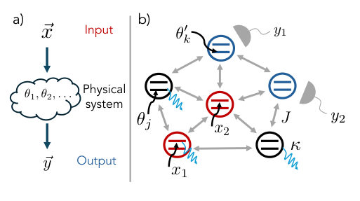
<figcaption class="paper-figure-caption"><b>Fig 1.</b> FIG. 1. (a) A generic physical learning setup, where sys- tem parameters θj are trained so that the system reproduces a target input-output function from a set of parameters ⃗x to measured quantities ⃗y. (b) Implementation in a driven- dissipative system of interacting qubits. Internal parameters θj and inputs xk are drive amplitudes; the qubits interact with strength J and are subject to decay at rate κ.</figcaption>
</figure>
<figure class="paper-figure-card">
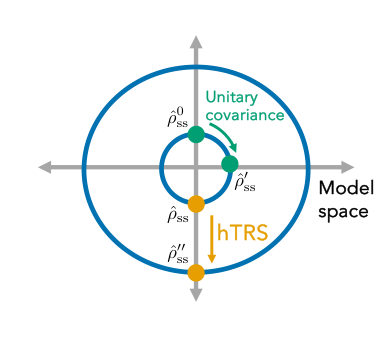
<figcaption class="paper-figure-caption"><b>Fig 2.</b> FIG. 2. Schematic of the space of drive parameters for a driven-dissipative quantum system. A circle of a fixed radius schematically represents the set of models whose steady states are related by a unitary transformation, i.e. ˆρ′ ss = ˆU ˆρ0 ss ˆU † for some unitary ˆU. When the system has hTRS, this gauge covariance is effectively ‘complexified’: we can write down an explicit relation between steady states that lie on circles of different radii, i.e. for drives anywhere in the parameter space of the model. This non-trivial extension of the unitary covariance is the main content of Theorems 1 and 2.</figcaption>
</figure>
<figure class="paper-figure-card">
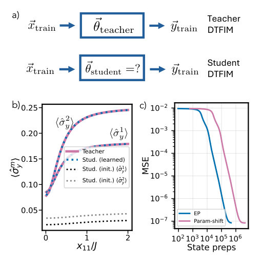
<figcaption class="paper-figure-caption"><b>Fig 3.</b> FIG. 3. (a) Schematic depicting teacher-student learning, where a ‘student’ system with drives ⃗θstudent is used to learn the input-output relation generated by an identical ‘teacher’ system (with some initially unknown drives ⃗θteacher). (b) Input-output relations for teacher-student learning with a N = 11 spin DTFIM model (c.f. Eq. (25)) with one in- put spin and three output spins (Mout = 3). The input is the spin 11 drive amplitude x11, and the outputs are ⃗y = (⟨ˆσ1 y⟩, ⟨ˆσ2 y⟩, ⟨ˆσ3 y⟩); only two are plotted. Solid pink curves correspond to the target input-output relation defined by the teacher. The drive amplitudes ⃗θstudent (for spins 1 to 10) are trained either by EP (Sec. II A 2)...</figcaption>
</figure>
<figure class="paper-figure-card">
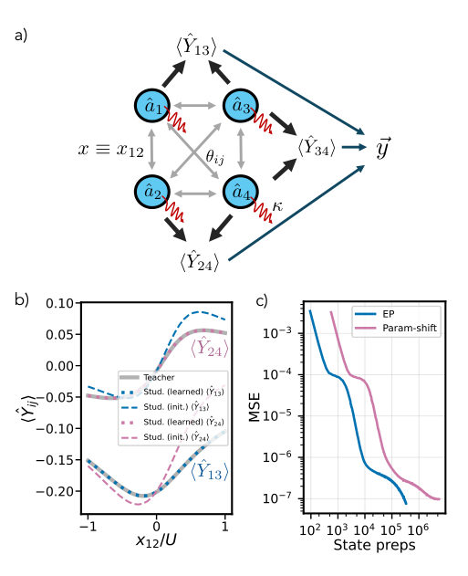
<figcaption class="paper-figure-caption"><b>Fig 4.</b> FIG. 4. (a) Schematic depicting the encoding of an input- output relation in a dissipative, pair-driven bosonic lattice (here with N = 4 modes). We show a setup with one input parameter and three output observables. The single input x ≡x12 and training parameters θij (gray arrows) are driving amplitudes (matrix elements of M). The three outputs are the observables ⃗y ≡(⟨ˆY13⟩, ⟨ˆY34⟩, ⟨ˆY24⟩). There are 10 tuneable couplings in the system, and all but the input are trainable pa- rameters, θij. (b) Input-output relations for teacher-student training in the four mode bosonic model depicted in (a). We plot two of the three outputs. Solid gray curves correspond to the target relation set by the...</figcaption>
</figure>
<figure class="paper-figure-card">
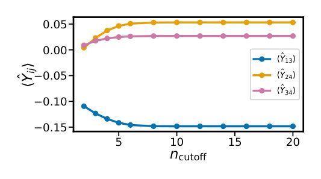
<figcaption class="paper-figure-caption"><b>Fig 5.</b> FIG. 5. Output observables for the N = 4 bosonic model with parameters corresponding to the teacher system (for x12/U = 0.5). For each photon cutoff, we use a bond dimension χ = Nnc + 1.</figcaption>
</figure>

**Summary.** This paper extends the Equilibrium Propagation (EP) training algorithm to non-equilibrium quantum systems, overcoming the computational bottleneck of repeated ground state calculations. By exploiting a hidden time-reversal symmetry in driven-dissipative systems, the authors establish new susceptibility relations that allow for efficient gradient calculation. This breakthrough enables the use of machine learning principles to characterize complex, open quantum dynamics.

**Why it may be interesting.** This is highly relevant as it provides a powerful, scalable machine learning tool (EP) for characterizing and training models based on open, non-equilibrium quantum dynamics, which is a major frontier in AMO and quantum optics.

Detailed structure

**Main problem.** The paper addresses the challenge of extending the Equilibrium Propagation (EP) training algorithm, used for self-learning physical systems, from equilibrium to non-equilibrium quantum settings.

**Main result.** EP can be successfully extended to driven-dissipative quantum systems by leveraging a quantum detailed balance symmetry that holds in the non-equilibrium steady state, circumventing the need for repeated ground state calculations.

**Method.** The authors derive new non-equilibrium static susceptibility relations based on a 'hidden time-reversal symmetry' (hTRS) to enable the efficient gradient calculation required for the training process.

**Model / system.** The work analyzes driven-dissipative quantum systems, specifically examining a driven-dissipative transverse-field Ising model and a parametrically-driven bosonic lattice.

**Key observables.** The primary diagnostic is the existence of specific susceptibility symmetries in the steady state, which allows for the extraction of gradients necessary for training.

**Important parameters / regimes.** The analysis focuses on the trainability of the system, defined by the efficiency of gradient descent, rather than the expressivity of the learned function.

**Assumptions / limitations.** The core assumption is that a quantum detailed balance symmetry, derived from hTRS, can be found in the non-equilibrium steady state, allowing the EP procedure to function.

**Figures summary.** Figure 1 illustrates the general setup of a physical learning task in a driven-dissipative system. Figure 2 schematically shows how hTRS complexifies the gauge covariance, enabling relations between steady states.

**Paper structure.** The paper first introduces the limitations of EP in equilibrium systems. It then proposes the extension to driven-dissipative systems, deriving the necessary non-equilibrium susceptibility relations. Finally, it analyzes this new training paradigm using two experimentally relevant models.

Abstract

Equilibrium propagation (EP) is a powerful training algorithm for self-learning physical systems that is widely used for a variety of machine learning inspired tasks. It relies on the existence of an energy function that depends on tunable training parameters, and can be extended to apply to many-body quantum systems in equilibrium. A key challenge however is the need to repeatedly relax to the system ground state after each parameter update. We show here a route for circumventing this problem by extending EP to many-body driven-dissipative quantum systems, where the dynamics naturally relaxes to a parameter-dependent non-equilibrium steady state. Despite the lack of a free energy, we find that for a class of open systems, a quantum detailed balance symmetry still allows for an efficient EP strategy. This relies crucially on a new class of non-equilibrium static susceptibility relations that we derive in detail. We analyze examples of our new non-equilibrium training paradigm for two experimentally-relevant models: a driven-dissipative transverse field Ising model, and a parametrically-driven bosonic lattice.

[↑ back to top](#top)

### [Observation of measurement-induced localization phenomena in a solid-state spin system](http://arxiv.org/abs/2610.34262v1)

**Authors:** Haolin Zhang, Shaoyi Xu, Zihang Zheng, Mengqi Wang, Mingzhe Liu, Zhiyuan Zhao, Ya Wang, Tianyu Xie, Fazhan Shi  
**Type:** experiment · **Category:** disordered systems and neural networks · **PDF:** <https://arxiv.org/pdf/2610.34262v1>  
**Analysis basis:** full PDF text, analyzed in chunks
**Topic relevance:** 🔥 `quantum measurements` **5/5** · `QC/QI experiment` **3/5** · `driven-dissipative phase transition` **3/5** · `analog quantum simulation` **2/5** · `correlated / nonlocal dissipation` **2/5** · `non-equilibrium universality` **2/5** · `methods for driven-dissipative` **1/5** · `scars & prethermalization` **1/5**

↔ Scroll figures horizontally

<figure class="paper-figure-card">
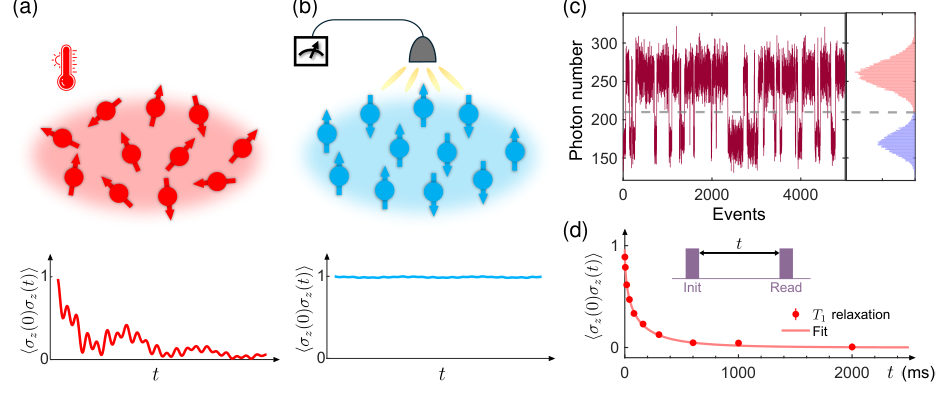
<figcaption class="paper-figure-caption"><b>Fig 1.</b> FIG. 1. Spin localization induced and monitored by external measurements. (a) Schematic of</figcaption>
</figure>
<figure class="paper-figure-card">
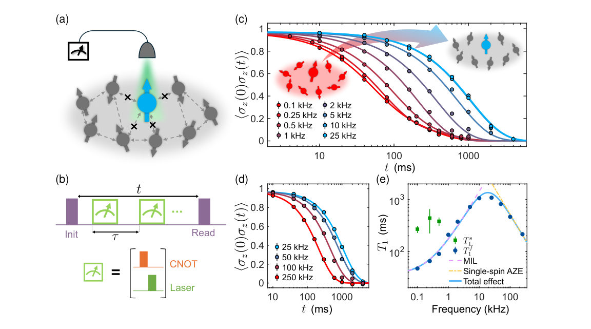
<figcaption class="paper-figure-caption"><b>Fig 2.</b> FIG. 2. Projective measurements on one 13C spin. (a) Schematic of the single-spin localiza-</figcaption>
</figure>
<figure class="paper-figure-card">
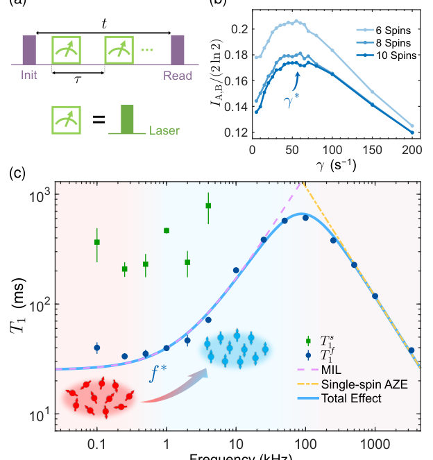
<figcaption class="paper-figure-caption"><b>Fig 3.</b> FIG. 3. Global weak measurements on the 13C spin network. (a) Sequence to perform global weak</figcaption>
</figure>
<figure class="paper-figure-card">
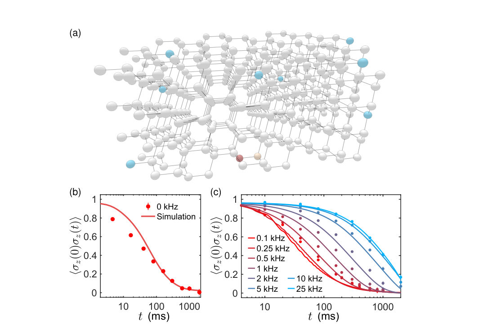
<figcaption class="paper-figure-caption"><b>Fig 4.</b> FIG. 4. Simulation of the 13C spin dynamics. (a) The configuration of eight 13C spins used</figcaption>
</figure>

**Summary.** This paper reports the experimental observation of measurement-induced localization (MIL) in a solid-state $^{13}	ext{C}$ nuclear spin system embedded in diamond. By applying controlled projective and weak measurements, the researchers demonstrated that the system's dynamics transition from a chaotic, volume-law regime to a localized, area-law regime. This work validates the theoretical understanding of measurement's role in controlling many-body quantum phases.

**Why it may be interesting.** This work provides a direct experimental realization of a theoretical concept (MIL) in a solid-state platform, offering crucial insights into how measurement back-action can fundamentally alter many-body quantum dynamics, which is highly relevant to open quantum systems.

Detailed structure

**Main problem.** The primary goal is to experimentally observe and demonstrate measurement-induced localization (MIL) in a solid-state spin system, contrasting with the difficulty of realizing such fully localized phases.

**Main result.** The authors successfully observed MIL by showing that increasing the measurement frequency (via projective or weak measurements) substantially prolongs the spin autocorrelation time, driving the system into a localized regime.

**Method.** The experiment uses an interacting solid-state $^{13}	ext{C}$ nuclear spin system in diamond, read out via an adjacent NV center, and measures the spin autocorrelation function under varying measurement strengths.

**Model / system.** The system is an interacting $^{13}	ext{C}$ nuclear spin network governed by a dipolar Hamiltonian, evolving towards a volume-law chaotic phase. Measurements are implemented either projectively on a single spin or globally weakly on the entire system.

**Key observables.** Spin autocorrelation function ($\langle\sigma_z(0)\sigma_z(t)
angle$), which shows prolonged decay times indicating localization.

**Important parameters / regimes.** Measurement frequency (or strength $\gamma$), which controls the transition between chaotic and localized dynamics.

**Assumptions / limitations.** The system is well-isolated, allowing the physical many-body Hamiltonian to govern dynamics between measurement interventions.

**Figures summary.** Figures illustrate the transition from volume-law chaotic evolution to localized behavior under measurement, and show the baseline decay curves and the effect of measurement frequency on autocorrelation time.

**Paper structure.** The paper establishes the theoretical context of MIL, details the physical setup using the diamond spin system, presents the measurement protocols (projective vs. weak), and finally reports the observation of prolonged autocorrelation times as evidence for measurement-induced localization.

Abstract

Quantum measurement can profoundly impact the dynamics of many-body systems, for instance, inducing phase transitions from volume-law chaotic phases to area-law localized phases. While chaotic phases emerge naturally in generic many-body systems, the experimental realization of a fully localized phase driven by measurement remains challenging, primarily owing to the stringent requirement of near-perfect isolation of the system from environmental dissipation. Here we experimentally observe measurement-induced localization phenomena in an interacting $^{13}\mathrm{C}$ nuclear spin system in diamond. In contrast to previous circuit-model-based experiments, our well-isolated system evolves under a physical many-body Hamiltonian with measurements intervening at intervals. By implementing either projective measurements on a single spin or global weak measurements on the entire system, we observe substantially prolonged spin autocorrelation times as the measurement frequency increases. Our results, combined with numerical simulations, provide evidence that quantum measurement can drive a many-body system into a localized regime, and lay the groundwork for future experimental investigations into measurement-induced many-body dynamics and related entanglement phenomena.

[↑ back to top](#top)

### [Multistability and Critical Frustrated Superradiance in Open Anisotropic Quantum Rabi Trimer](http://arxiv.org/abs/2610.35445v1)

**Authors:** Ya-Ping Ni, Yi-Ge Wu, Jie-Qiao Liao, Jin-Feng Huang  
**Type:** theory · **Category:** other · **PDF:** <https://arxiv.org/pdf/2610.35445v1>  
**Analysis basis:** full PDF text, analyzed in chunks
**Topic relevance:** 🔥 `Tavis-Cummings & cavity-many-emitter` **4/5** · 🔥 `driven-dissipative phase transition` **4/5** · `analog quantum simulation` **3/5** · `correlated / nonlocal dissipation` **3/5** · `methods for driven-dissipative` **3/5** · `non-equilibrium universality` **3/5** · `Dicke superradiance` **2/5** · `Keldysh / 2PI / non-Gaussian methods` **2/5** · `superradiant laser` **2/5**

↔ Scroll figures horizontally

<figure class="paper-figure-card">
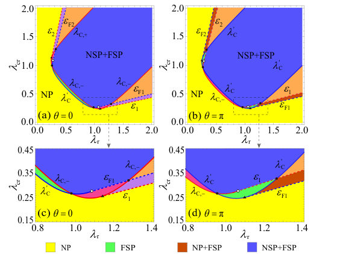
<figcaption class="paper-figure-caption"><b>Fig 1.</b> FIG. 1. (Color online) Phase diagram for (a,c) θ = 0 and (b,d) θ = π. Panels (c) and (d) are magnified views of the black dashed-boxed regions in (a) and (b), respectively, identifying six distinct phases, multiple quadruple points, and a triple point. The red dashed lines denote the critical anisotropy parameters ε1 and ε2, tangent to the red solid line. The blue dashed lines εF1 and εF2, which separate distinct superradiant phases, are tangent to the blue solid line. Here we set J/ωc = 0.05, κ/ωc = 0.5.</figcaption>
</figure>
<figure class="paper-figure-card">
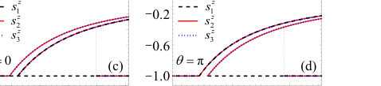
<figcaption class="paper-figure-caption"><b>Fig 2.</b> FIG. 3. (Color online) Optical coherence |αn| and spin ex- pectation values sz n as functions of the scaled coupling λ at θ = 0 and θ = π. Here we set J/ωc = 0.05, κ/ωc = 0.1, and ε = 4.</figcaption>
</figure>
<figure class="paper-figure-card">
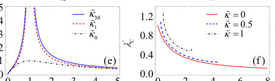
<figcaption class="paper-figure-caption"><b>Fig 3.</b> FIG. 2. (Color online) Phase diagrams in the (¯κ, λ) plane for (a,b) θ = 0 and (c,d) θ = π, with (a,c) ε = 1 and (b,d) ε = 4. Colored regions denote distinct quantum phases. Red dashed/dot-dashed curves denote λC,−/λC,+, while blue dashed curves denote λ′ C. The black dot marks the four-phase coexistence point at ¯κ = ¯κ0; blue (red) dotted lines locate at critical decay rates ¯κ = ¯κM (¯κ = ¯κ1). (e) Scaled critical decay rates ¯κj = κj/ωc (j = M, 1, 0) vs anisotropy ε at θ = π. (f) Critical coupling λ′ C vs ε for κ/ωc = 0, 0.5, and 1 at θ = π. We set J/ωc = 0.05.</figcaption>
</figure>
<figure class="paper-figure-card">
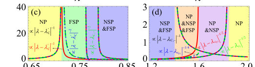
<figcaption class="paper-figure-caption"><b>Fig 4.</b> FIG. 4. (Color online) Average photon number ⟨a† nan⟩as a function of the scaled coupling λ at θ = 0 along (a) the red dashed line (ε = ε1) crossing the tricritical point, (b) the blue dashed line (ε = εF1) crossing two quadruple points, (c) and (d) the line λcr = 0.4 in Fig. 1(a), respectively. Here we set J/ωc = 0.05 and κ/ωc = 0.5.</figcaption>
</figure>

**Summary.** This paper analyzes the complex, non-equilibrium phase diagram of an open anisotropic quantum Rabi trimer. It reveals the existence of multiple stable phases, including a unique frustrated superradiant phase stabilized by dissipation. The findings offer new insights into controlling quantum dynamics in cavity QED systems using anisotropy and dissipation.

**Why it may be interesting.** This work is highly relevant for AMO physicists as it explores complex, non-equilibrium quantum phase transitions in cavity QED systems, providing tools for quantum state engineering.

Detailed structure

**Main problem.** The study investigates the nonequilibrium steady states and critical phenomena exhibited by an open anisotropic quantum Rabi trimer.

**Main result.** The system exhibits abundant multistable phases, and the frustrated superradiant phase (FSP) can be stabilized by both positive and negative photon hopping, a unique feature of open systems.

**Method.** The research combines semiclassical mean-field analysis with full quantum mechanical treatments to map out the system's phase diagram.

**Model / system.** The model is an open anisotropic quantum Rabi trimer, consisting of three ring-coupled cavity-QED cells, governed by a Lindblad master equation accounting for cavity dissipation.

**Key observables.** Order parameters include cavity-field coherence and atomic spin polarization; critical exponents ($eta_n$) characterize quantum phase transitions.

**Important parameters / regimes.** Key parameters include the anisotropy parameter ($\epsilon$), cavity dissipation rate ($\kappa$), and the photon hopping phase ($	heta$).

**Assumptions / limitations.** The analysis contrasts open system dynamics with closed models and incorporates quantum fluctuations beyond semiclassical approximations.

**Figures summary.** Figures illustrate phase diagrams in the $(ar{\kappa}, \lambda)$ plane showing phase boundaries, and show the dependence of order parameters on anisotropy ($\epsilon$) and dissipation ($\kappa$).

**Paper structure.** The paper systematically maps the nonequilibrium phase diagram, analyzes the stability of superradiant phases (NSP and FSP) against dissipation, and determines critical exponents by incorporating quantum fluctuations.

Abstract

We study the nonequilibrium steady states of an open anisotropic quantum Rabi trimer. Combining semiclassical and quantum mechanical treatments, we map out the system's phase diagram and elucidate the critical phenomena induced by anisotropic light-matter coupling, cavity dissipation, and complex photon hopping, which give rise to abundant multistable phases. Counterintuitively, the frustrated superradiant phase (FSP) can be stabilized by both positive and negative photon hopping, a feature absent in closed Rabi and Dicke trimers. We further uncover two independent dissipation thresholds for the normal superradiant phase and the FSP. Unlike isotropic open quantum Rabi trimers, both phases are suppressed once the dissipation exceeds their respective critical values. The rotating and counter-rotating interaction terms exhibit mutually reciprocal effects on the quantum phase transitions. By analyzing universal scaling behaviors with quantum fluctuations incorporated, we reveal an unprecedented finite-fluctuation critical exponent for the FSP. Moreover, the critical exponents of individual phases are coupling-strength dependent. The multistability and FSP can be tuned by anisotropy and dissipation. Our results broaden the scope of nonequilibrium quantum phase physics in few-body systems and hold promising applications for quantum state engineering and cavity/circuit quantum electrodynamics.

[↑ back to top](#top)

### [Variational Quantum Optimization of Noisy Polarization Qubit Experiments](http://arxiv.org/abs/2610.33290v1)

**Authors:** Timur Javid, Brian Doolittle, Colin P. Lualdi, Brittany Conner, Michael Vayninger, Eric Chitambar, Paul G. Kwiat  
**Type:** both · **Category:** quantum information and computing · **PDF:** <https://arxiv.org/pdf/2610.33290v1>  
**Analysis basis:** full PDF text, analyzed in chunks
**Topic relevance:** 🔥 `quantum optics experiment` **4/5** · `QC/QI experiment` **3/5** · `interference shaping light` **2/5** · `methods for driven-dissipative` **2/5** · `quantum measurements` **2/5** · `analog quantum simulation` **1/5** · `correlated / nonlocal dissipation` **1/5** · `driven-dissipative phase transition` **1/5**

↔ Scroll figures horizontally

<figure class="paper-figure-card">
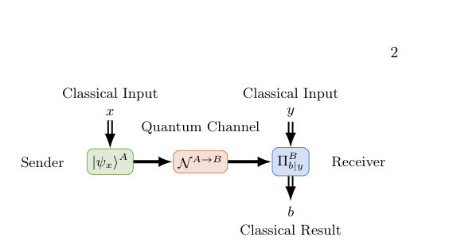
<figcaption class="paper-figure-caption"><b>Fig 1.</b> Figure 1. Prepare-and-Measure Scenario. A qubit is communicated from a sender device (Alice) to a receiver de- vice (Bob) through an optical fiber with an unknown trans- formation N A→B. The classical input x ∈X specifies the state preparation |ψx⟩and y ∈Y conditions the projective measurement ΠB b|y that returns a classical output b ∈B.</figcaption>
</figure>
<figure class="paper-figure-card">
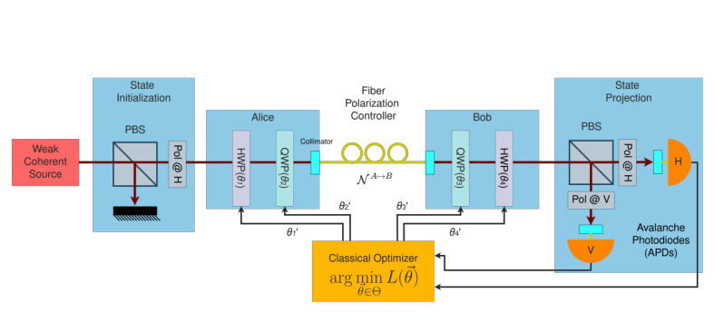
<figcaption class="paper-figure-caption"><b>Fig 2.</b> Figure 2. Optical Experimental Setup for Variational Quantum Optimization. A simple polarization-encoded qubit prepare-and-measure experiment, utilizing optical waveplates mounted on motorized rotation stages for state preparation and measurements, and controlled by a classical optimizer. See Section II B for a full description of the system.</figcaption>
</figure>
<figure class="paper-figure-card">
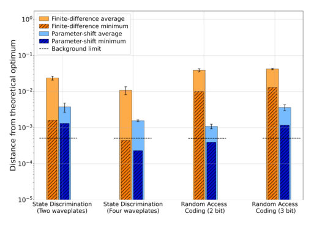
<figcaption class="paper-figure-caption"><b>Fig 3.</b> Figure 4. Optimization average and minimum costs. Note that the costs are scaled by the maximum cost per pro- tocol in this figure to allow direct comparison. For each dif- ferentiation method and protocol, we took 40 trials with 60 optimization steps each, with each trial starting the optimiza- tion with random parameters.</figcaption>
</figure>
<figure class="paper-figure-card">
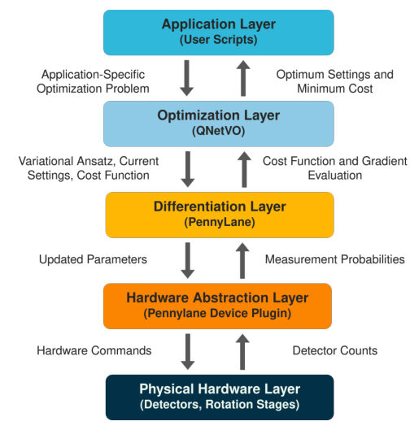
<figcaption class="paper-figure-caption"><b>Fig 4.</b> Figure 3. Variational Quantum Optimization Stack. The software used in this project can be organized into a se- ries of layers that abstract the physical system to a hardware- agnostic control interface. The physical layer consists of our experimental apparatus, including its hardware devices and quantum states. The hardware abstraction layer maps the hardware control parameters into differentiable unitary op- erators. In the differentiation layer, gradients are evaluated on our experimental apparatus for a specified cost function, variational ansatz, and hardware settings. In the optimization layer, variational ansatze and cost functions are constructed and optimization control logic is...</figcaption>
</figure>
<figure class="paper-figure-card">
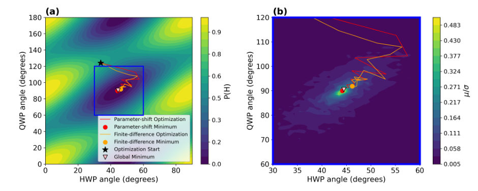
<figcaption class="paper-figure-caption"><b>Fig 5.</b> Figure 5. P(H) as a function of Alice’s waveplates. (a) A contour plot of measurement probability on the transmitted port of our measurement apparatus as a function of preparation waveplate angles with plotted optimization paths. The contour provides some intuition for the two-state discrimination problem with two waveplates: the optimizer will find both the minimum and the maximum in this landscape as these points are maximally different from each other. In the “four waveplate” case, this landscape becomes four-dimensional. (b) A section of the landscape in (a), showing the coefficient of variation σ/µ, where σ is the standard deviation and µ is the mean photon counts at each point. At...</figcaption>
</figure>

**Summary.** This work demonstrates the use of Variational Quantum Optimization (VQO) to compensate for noise and imperfections in quantum communication protocols using polarization qubits. By optimizing preparation and measurement settings on an optical testbed, the authors show that VQO can effectively maintain high fidelity for tasks like state discrimination and Random Access Codes. This offers a robust, hardware-efficient method for realizing quantum networking in noisy environments.

**Why it may be interesting.** It provides a practical, data-driven framework (VQO) for mitigating realistic noise sources in photonic quantum communication, which is highly relevant for experimental quantum optics and quantum networking research.

Detailed structure

**Main problem.** The paper addresses the challenge of maintaining quantum information integrity in noisy quantum network nodes, particularly in optical fiber links.

**Main result.** Variational Quantum Optimization (VQO) successfully optimizes prepare-and-measure protocols, achieving polarization compensation comparable to conventional methods while analyzing the impact of hardware noise.

**Method.** The authors employ VQO, a hybrid quantum-classical optimization technique, to maximize success probabilities for state discrimination and Random Access Codes (RACs) by tuning hardware parameters.

**Model / system.** The system uses polarization-encoded qubits transmitted through an optical testbed simulating a quantum channel (CPTP map) susceptible to noise like birefringence. The protocol involves an encoder (Alice) and a decoder (Bob) using waveplates.

**Key observables.** Success probability for state discrimination ($P_{SD}^{	ext{Success}}$) and Random Access Codes ($P_{RAC}^{	ext{Success}}$), and the resulting average state fidelity.

**Important parameters / regimes.** Waveplate rotation angles ($\vec{	heta}$), noise parameters ($\omega$), and the number of encoded bits ($n$).

**Assumptions / limitations.** The VQO methodology is designed to be hardware-agnostic, optimizing over controllable elements rather than assuming perfect channel knowledge.

**Figures summary.** Figures illustrate the prepare-and-measure scenario setup, detailing the optical components (waveplates, PBS) used for the VQO demonstration.

**Paper structure.** The paper progresses from defining the general noisy channel problem to applying VQO for state discrimination and RACs, comparing gradient estimation methods, and finally analyzing hardware limitations and proposing global optimization extensions.

Abstract

Quantum networking enables advanced communication protocols, distributed quantum computing, and enhanced sensing. These applications are often hindered by current realizations of quantum network nodes, which utilize noisy and imperfect hardware. Here, we apply variational optimization to counteract the effects of such imperfections. We parameterize network protocols for use with variational methods and then use these methods to optimize simple prepare-and-measure protocols on an optical testbed as a proof-of-principle demonstration. We demonstrate automated polarization compensation, achieving results comparable to conventional methods. We also analyze the effects of hardware imperfections and dark counts on the performance of our optimizations. We compare the performance of various gradient estimation methods and propose natural extensions, including further improvements through the use of global optimization and hybrid gradient estimation methods, as well as the application of variational optimization to nodes deployed on fiber networks.

[↑ back to top](#top)

### [Direct tests of conformal symmetry with Rydberg atoms: assessment and proposals](http://arxiv.org/abs/2610.33156v1)

**Authors:** Junchen Rong, Slava Rychkov  
**Type:** both · **Category:** other · **PDF:** <https://arxiv.org/pdf/2610.33156v1>  
**Analysis basis:** full PDF text, analyzed in chunks
**Topic relevance:** 🔥 `Rydberg arrays` **4/5** · `analog quantum simulation` **3/5** · `QC/QI experiment` **1/5** · `quantum measurements` **1/5**

↔ Scroll figures horizontally

<figure class="paper-figure-card">
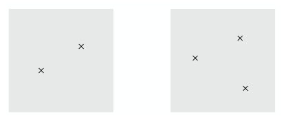
<figcaption class="paper-figure-caption"><b>Fig 1.</b> Figure 1. Direct tests in infinite space: 2pt functions (left) test but scale symmetry, while 3pt functions (right) do test conformality but are hard to measure.</figcaption>
</figure>
<figure class="paper-figure-card">
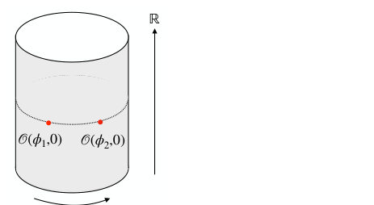
<figcaption class="paper-figure-caption"><b>Fig 2.</b> Figure 2. A direct test of conformality in finite volume, using the equal time CFT 2pt function on the cylinder S1 × R.</figcaption>
</figure>
<figure class="paper-figure-card">
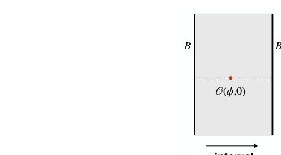
<figcaption class="paper-figure-caption"><b>Fig 3.</b> Figure 3. A direct test of conformality in finite volume, using the CFT 1pt function on the strip [0, π]×R.</figcaption>
</figure>
<figure class="paper-figure-card">
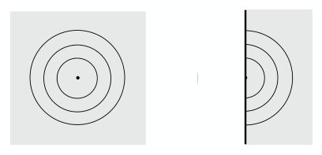
<figcaption class="paper-figure-caption"><b>Fig 4.</b> Figure 4. Justification of OSC. Cylinder, resp. strip, can be conformally mapped onto the plane (left), resp. half-plane (right), with constant time sections mapped to constant radius (semi)circles.</figcaption>
</figure>
<figure class="paper-figure-card">
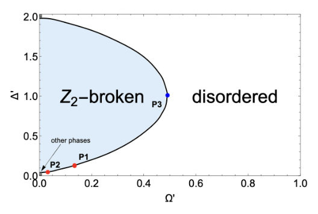
<figcaption class="paper-figure-caption"><b>Fig 5.</b> Figure 6. A part of the phase diagram of the model (3.1) showing the Ising phase transition between the Z2-broken “density wave” phase and the disordered phase. We do not show in detail the two tiny gray regions which house further phases [28, 51]. The two red points corresponds to the points studied in [29] (P1) and [30] (P2), see Table 1. Below we will focus on point P1 as well as the blue point P3 corresponding to ∆′ = ζ(6), Ω′ ≈0.488.</figcaption>
</figure>

**Summary.** This work outlines a method to directly test conformal symmetry by measuring two-point correlation functions in arrays of Rydberg atoms arranged on a circle. The authors optimize the experimental control pulses to maximize fidelity, concluding that this fundamental test of quantum field theory is achievable with current atomic quantum simulation technology.

**Why it may be interesting.** It bridges fundamental theoretical concepts (CFT) with cutting-edge experimental capabilities (Rydberg atoms), providing a concrete, measurable goal for quantum simulation in AMO physics.

Detailed structure

**Main problem.** The paper proposes a direct experimental test of conformal symmetry using physical quantum systems.

**Main result.** It concludes that a direct experimental test of conformal symmetry is feasible using current Rydberg-atom technology.

**Method.** The authors propose measuring equal-time two-point correlation functions on a circular arrangement of atoms and optimizing the adiabatic ramp profile for state preparation.

**Model / system.** The physical platform is Rydberg-atom arrays arranged on a circle (1D setup with periodic boundary conditions). The theoretical framework is Conformal Field Theory (CFT).

**Key observables.** Equal-time two-point correlation functions ($\langle O(\phi_1, 0)O(\phi_2, 0)
angle_{	ext{cyl}}$) and the fidelity ($F$) of the state preparation.

**Important parameters / regimes.** Rabi frequency ($\Omega$), detuning ($\Delta$), and the finite volume size ($N$ or circumference).

**Assumptions / limitations.** The analysis assumes adiabatic preparation of the critical state and accounts for decoherence effects in the measurements.

**Figures summary.** Figures illustrate the geometry for testing conformality on a cylinder ($S^1 	imes \mathbb{R}$) and show the fidelity ($F$) of optimized ramp profiles.

**Paper structure.** The paper establishes the theoretical basis for direct CFT testing using finite-volume correlators, details the experimental proposal using Rydberg atoms, and optimizes the necessary quantum control pulses (ramps) to achieve high fidelity.

Abstract

We propose a direct test of conformal symmetry using Rydberg-atom arrays. By arranging the atoms on a circle and measuring equal-time two-point correlation functions, the characteristic functional form predicted by conformal field theory can be tested directly. We estimate the number of experimental snapshots required to resolve this behavior with sufficient statistical precision. We further optimize the time-dependent ramp profile of the Rabi frequency~$Ω$ and detuning~$Δ$ used to prepare the target critical state adiabatically. The optimized profile achieves higher fidelity over much shorter evolution times than those employed in previous experiments. Taken together, these results suggest that a direct experimental test of conformal symmetry is feasible with current Rydberg-atom technology.

[↑ back to top](#top)

### [Measurement-dependent reduction of open dynamics in the quantum phase estimation algorithm: the visible subspace and the damped Fejér kernel](http://arxiv.org/abs/2610.35332v1)

**Authors:** Marina O. Gordeichuk, Oleg M. Kiselev  
**Type:** theory · **Category:** quantum information and computing · **PDF:** <https://arxiv.org/pdf/2610.35332v1>  
**Analysis basis:** full PDF text, analyzed in chunks
**Topic relevance:** 🔥 `quantum measurements` **4/5** · `Full counting statistics` **1/5** · `Keldysh / 2PI / non-Gaussian methods` **1/5** · `correlated / nonlocal dissipation` **1/5** · `driven-dissipative phase transition` **1/5** · `methods for driven-dissipative` **1/5**

↔ Scroll figures horizontally

<figure class="paper-figure-card">
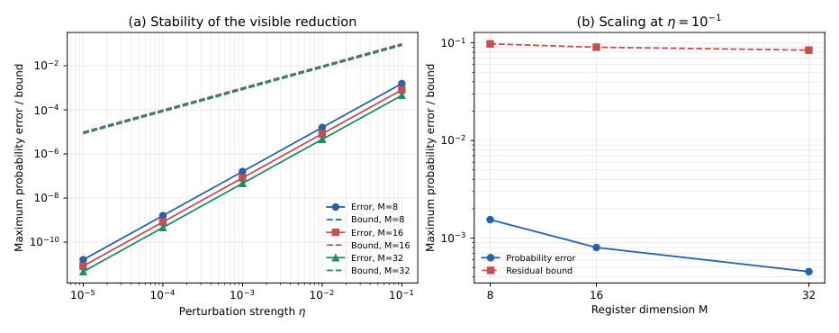
<figcaption class="paper-figure-caption"><b>Fig 1.</b> Figure 1: Stability of the visible reduction under a non-Toeplitz perturbation of the generator of strength η. (a) Maximal error of the outcome probabilities (solid lines) and the a posteriori bound (dashed lines) against η on logarithmic scales, for counting registers of M = 8 (circles), 16 (squares) and 32 (triangles) levels. The error decreases quadratically with η, whereas the bound is linear. (b) The same two quantities at η = 10−1 against the register size M: probability error (circles, solid line) and bound (squares, dashed line). The perturbation destroys the exact Toeplitz reduction, and the norm of the residual controls its accuracy.</figcaption>
</figure>

**Summary.** This work characterizes the minimal observable subspace necessary to predict the output distribution of the QPE algorithm under open dynamics. It uses advanced mathematical tools like Krylov theory and finite-time Gramians to derive dimension bounds and analyze the stability of the reduction. The findings are significant for understanding measurement limitations in quantum computation.

**Why it may be interesting.** It provides a rigorous mathematical framework for quantifying how much information about the system's evolution is actually accessible through a specific measurement (the POVM), which is crucial for understanding measurement back-action in quantum computation.

Detailed structure

**Main problem.** The paper determines the minimal set of observables required to predict the entire output distribution of the Quantum Phase Estimation (QPE) algorithm when the system undergoes open quantum dynamics.

**Main result.** The dimension of this 'visible subspace' is bounded between $M$ and $M^2-M+1$, and the dynamics are characterized by a damped Fejér kernel in solvable models.

**Method.** The analysis builds on Krylov theory of reduction, explicitly computing the structure of the visible subspace ($K_E$) using the full POVM and analyzing the resulting dynamics via the restricted generator $A_E$.

**Model / system.** The system is the QPE algorithm applied to open quantum dynamics, modeled using a GKLS master equation approach with a counting register of size $M=2^n$. The dynamics are governed by an adjoint generator $G$.

**Key observables.** Outcome probabilities $p_k(t)$, the visible subspace $K_{QPE}$, and the finite-time Gramian $G_T$.

**Important parameters / regimes.** The register dimension $M$, the time $t$, and the perturbation strength $\eta$.

**Assumptions / limitations.** The analysis relies on the full QPE POVM $\{E_k\}$ and uses finite-time Gramians and *a posteriori* residual estimates for approximate reduction.

**Figures summary.** Figures compare the actual probability error ($\epsilon_p$) against the *a posteriori* bound for non-Toeplitz perturbations, showing the error scales quadratically ($\epsilon_p = O(\eta^2)$) while the bound scales linearly ($O(|\eta|)$).

**Paper structure.** The paper progresses by defining the visible subspace using Krylov theory, deriving the exact determination of probabilities from the restricted generator $A_E$, and then applying this framework to the specific QPE setting, including stability analysis under perturbations.

Abstract

For the quantum phase estimation (QPE) algorithm we study the minimal space of observables that is sufficient to predict the entire output distribution under open dynamics of the counting register. Building on the general Krylov theory of reduction, we compute the structure of this space explicitly for the full Fourier measurement. The outcome probabilities are determined by cyclic sums of the state matrix. If the adjoint generator is diagonal on the matrix units, the spectral classes inside the residue classes of the index difference modulo the register dimension $M$ give a constructive basis, an exact dimension formula, and attainable bounds: the dimension of the visible space lies between $M$ and $M^2-M+1$. The class includes independent qubit dephasing, and an analytically solvable reference model of Gorini--Kossakowski--Lindblad--Sudarshan (GKLS) type yields a damped Fejér kernel; two random-unitary channels with the same Ramsey contrast show that higher harmonics are distinguishable in the QPE distribution. For approximate reduction we use a finite-time Gramian and an a posteriori residual estimate, with a quadratic error order for a reducing unperturbed subspace and a compatible initial state. Numerical calculations check the consistency of the representations and the behaviour of the error under non-Toeplitz perturbations.

[↑ back to top](#top)

### [Hidden Fisher Information in Many-Body Quantum Sensors](http://arxiv.org/abs/2610.33893v1)

**Authors:** Atta ur Rahman, Muhammad Noman, Samira Elghaayda, Saeed Haddadi  
**Type:** theory · **Category:** quantum information and computing · **PDF:** <https://arxiv.org/pdf/2610.33893v1>  
**Analysis basis:** full PDF text, analyzed in chunks
**Topic relevance:** 🔥 `quantum measurements` **4/5** · `analog quantum simulation` **3/5**

↔ Scroll figures horizontally

<figure class="paper-figure-card">
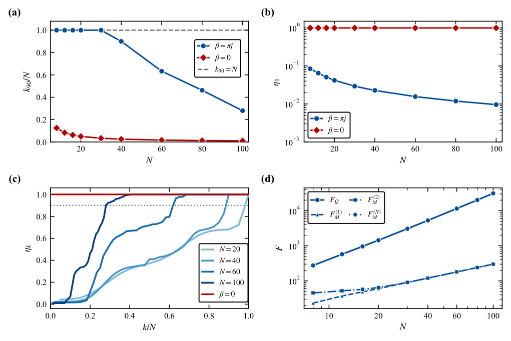
<figcaption class="paper-figure-caption"><b>Fig 1.</b> FIG. 1. Large-N moment-readout hierarchy for the kicked-top sensor. (a) Normalized readout depth k90/N. The linear protocol, β = 0, requires only the lowest moment degree, whereas the resonant nonlinear protocol, β = πj, retains a much larger readout depth over the simulated range. (b) First-moment accessibility η1 = F (1) M /FQ. For the nonlinear protocol, η1 falls to the percent level by N = 100, while the linear protocol remains near unity. (c) Cumulative accessibility ηk = F (k) M /FQ versus scaled moment degree k/N for N = 20, 40, 60, and 100 in the nonlinear protocol; the β = 0 curve at N = 100 is shown as a low-complexity reference. The dotted line marks ηk = 0.9. (d) Absolute...</figcaption>
</figure>
<figure class="paper-figure-card">
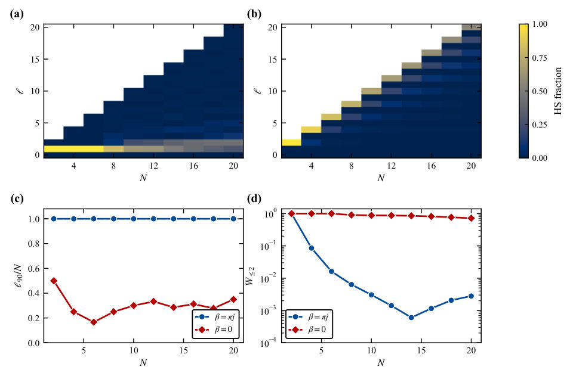
<figcaption class="paper-figure-caption"><b>Fig 2.</b> FIG. 2. The optimal SLD readout is transferred to high tensor rank. Rank-resolved SLD diagnostics for one weakly damped Floquet step with γ = 10−3 and N ≤20. (a) Hilbert–Schmidt rank fraction wℓ(Lα) for the linear protocol, β = 0. (b) The same quantity for the resonant nonlinear protocol, β = πj. The weight shifts toward the upper edge of the allowed tensor- rank range. (c) Normalized 90%-weight rank ℓ90/N. In the nonlinear protocol, capturing 90% of the SLD weight requires the maximal available rank throughout the displayed range, whereas the linear protocol remains concentrated at substantially lower rank. (d) Low-rank SLD weight W≤2. The nonlinear protocol suppresses the low-rank...</figcaption>
</figure>
<figure class="paper-figure-card">

<figcaption class="paper-figure-caption"><b>Fig 3.</b> FIG. 3. Detuning scan of the nonlinear readout barrier. The scaled nonlinear strength r = β/(πj) is scanned around the resonant strong-shear point. The scan shows that low-degree accessibility is suppressed throughout a broad nonlinear regime while the full-degree endpoint remains recovered.</figcaption>
</figure>
<figure class="paper-figure-card">
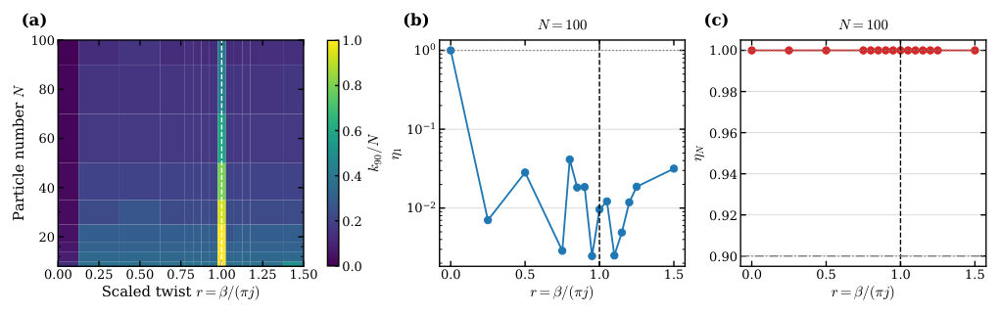
<figcaption class="paper-figure-caption"><b>Fig 4.</b> Figure 4 shows the normalized readout complexity k90/N as a function of detuning for several smaller system sizes. This representation complements the large-N heat-map scan in Fig. 3 by resolving individual finite-size curves near the resonant strong-shear point.</figcaption>
</figure>
<figure class="paper-figure-card">
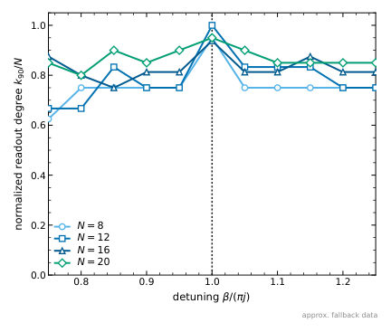
<figcaption class="paper-figure-caption"><b>Fig 5.</b> FIG. 4. Finite-size detuning curves. Normalized readout complexity k90/N as a function of detuning for the smaller system sizes used to resolve the strong-shear window. The vertical guide marks β/(πj) = 1.</figcaption>
</figure>

**Summary.** This theoretical paper introduces the moment Fisher hierarchy to quantify how much of the ultimate quantum sensing precision (QFI) is lost because the optimal measurement requires complex, high-rank observables. By analyzing a collective spin sensor, the authors demonstrate that nonlinear dynamics effectively 'hides' this information in high-rank tensor sectors, establishing a concrete, measurable readout-complexity bottleneck for quantum metrology.

**Why it may be interesting.** This work provides a rigorous, quantitative framework for understanding measurement limitations in quantum metrology, showing that the physical mechanism (nonlinear shear) dictates a specific, high-order readout requirement, which is crucial for designing practical quantum sensors.

Detailed structure

**Main problem.** The paper addresses the distinction between the ultimate sensitivity limit set by Quantum Fisher Information (QFI) and the practical limitation imposed by the complexity of the required quantum measurement readout.

**Main result.** Nonlinear dynamics can preserve high QFI but transfer the optimal readout direction into high-rank tensor sectors, making it inaccessible to low-order collective spin measurements, thus creating a measurable readout-complexity bottleneck.

**Method.** The authors introduce the moment Fisher hierarchy ($F_M^{(k)}$) and the readout-complexity scale ($k_{90}$) to quantify the fraction of QFI accessible via low-order collective moments.

**Model / system.** The study analyzes a many-body quantum sensor modeled by $N$ spin-1/2 particles evolving under a kicked collective spin Hamiltonian, specifically examining the transition between linear and resonant nonlinear protocols.

**Key observables.** Quantum Fisher Information (QFI), Moment Fisher Hierarchy ($F_M^{(k)}$), Readout-complexity scale ($k_{90}$), and the weight of the Symmetric Logarithmic Derivative (SLD) in different tensor ranks.

**Important parameters / regimes.** System size ($N$), kick strength ($eta$), and the degree of the moment expansion ($k$).

**Assumptions / limitations.** The analysis relies on the assumption that the moment hierarchy provides a diagnostic measure of measurement resource requirements, and that weak damping does not fundamentally alter the high-rank structure of the optimal readout.

**Figures summary.** Figures illustrate the finite-size scaling of the required readout degree ($k_{90}/N$) and show the migration of the parameter tangent's weight towards high tensor ranks in the resonant nonlinear regime.

**Paper structure.** The paper builds an argument by first defining the moment hierarchy to bridge QFI and measurement complexity. It then applies this to a kicked spin model, contrasting linear and nonlinear dynamics to demonstrate how the latter hides information in high-rank sectors, which is confirmed by analyzing the SLD structure and robustness against weak damping.

Abstract

Quantum Fisher information (QFI) determines the ultimate precision of a quantum sensor after optimization over all allowed measurements, but it does not quantify how difficult the optimal readout is to implement. We introduce a moment Fisher hierarchy $F_M^{(k)}$, which measures the fraction of QFI accessible to collective spin moments up to degree $k$, together with a readout-complexity scale $k_{90}$ defined by the minimum degree required to recover $90\%$ of the QFI. Applying this framework to a nonlinear collective-spin sensor, we show that many-body dynamics can preserve large QFI while transferring the optimal readout into high-rank $SU(2)$ tensor sectors inaccessible to low-order collective observables. For system sizes up to $N=100$, first moments access only $\sim 10^{-2}$ of the available QFI, while the degree required to recover $90\%$ of it grows to $k_{90}\simeq 28$. A rank-resolved analysis of the symmetric logarithmic derivative (SLD) under weak damping shows that the nonlinear protocol pushes the optimal readout toward the highest available tensor ranks while strongly depleting its low-rank weight. These results identify nonlinear tangent-space shear as the mechanism behind a finite-size readout-complexity bottleneck in many-body quantum metrology.

[↑ back to top](#top)

### [Real-Time Correlation of Relaxation, Dephasing, and Two-level System Dynamics in Transmon Qubits](http://arxiv.org/abs/2610.34485v1)

**Authors:** Ambrose Yang, Alexander M. Young, Paal H. Prestegaard, Atharv Joshi, Matthew S. Ai, Q. Rumman Rahman, Faranak Bahrami, Matthew P. Bland, Jui-Lin Niu, Ourania-Maria Glezakou-Elbert, Ray D. Chang, Jocelyn Liu, Zhengyi Lu, Robert J. Cava, Nathalie P. de Leon, Andrew A. Houck  
**Type:** experiment · **Category:** quantum information and computing · **PDF:** <https://arxiv.org/pdf/2610.34485v1>  
**Analysis basis:** full PDF text, analyzed in chunks
**Topic relevance:** 🔥 `QC/QI experiment` **4/5** · `correlated / nonlocal dissipation` **1/5** · `quantum measurements` **1/5** · `quantum optics experiment` **1/5**

↔ Scroll figures horizontally

<figure class="paper-figure-card">
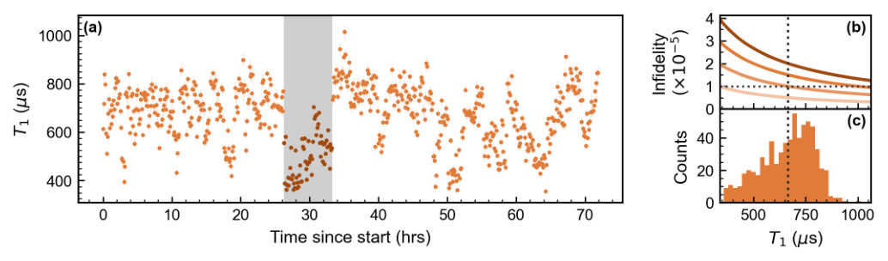
<figcaption class="paper-figure-caption"><b>Fig 1.</b> FIG. 1. Excursions in Qubit 𝑇1: (a) Temporal fluctuations in qubit 𝑇1 from dataset 3, measured repeatedly over 72 hours. Points in the gray shaded region show an excursion lasting 7 hours where the 𝑇1 is notably reduced from its steady-state value. (b) Theoretical single-qubit gate fidelities following [14] assuming 𝑇1 relaxation is the dominant source of gate errors for a 10 ns, 20 ns, 30 ns, and 40 ns 𝜋/2-pulse (light to dark orange). The horizontal dotted line denotes the 99.999% gate fidelity threshold, and the vertical dotted line indicates the 𝑇1 time required to reach this threshold assuming a 20 ns 𝜋/2-pulse. (c) Histogram of 𝑇1 values from (a). Threshold from (b) intersects at 𝑇1 =...</figcaption>
</figure>
<figure class="paper-figure-card">
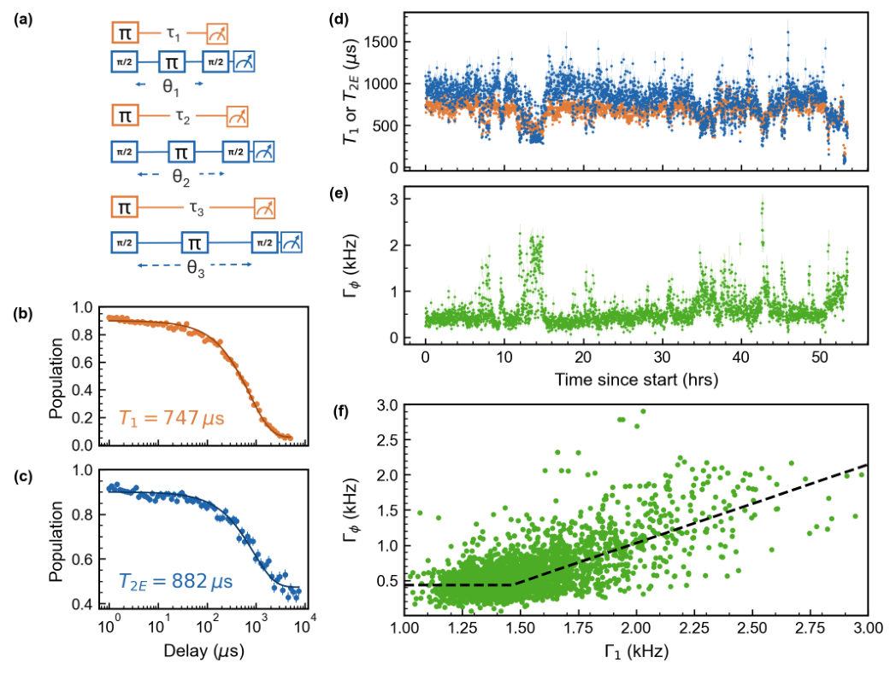
<figcaption class="paper-figure-caption"><b>Fig 2.</b> FIG. 2. Correlated relaxation and dephasing: (a) Shot-to-shot interleaving of a 𝑇1 (orange pulse sequence) and 𝑇2E (blue pulse sequence) measurement. Each round consists of a single shot measurement at each delay time (𝜏1, 𝜏2, . . . , 𝜏𝑛) and (𝜃1, 𝜃2, . . . , 𝜃𝑛) for𝑇1 and𝑇2E respectively. (b, c) Qubit populations extracted by averaging across 500 rounds. Population versus delay time is fitted to an exponential decay to extract 𝑇1 and 𝑇2E. (d) Repeated shot-to-shot interleaved measurement of 𝑇1 and 𝑇2E over 54 hours from dataset 1, which show 𝑇1 and 𝑇2E excursions that last for multiple minutes to hours. The y-axis range is upper-bounded by 1.7 ms to more clearly show trends in the data....</figcaption>
</figure>
<figure class="paper-figure-card">
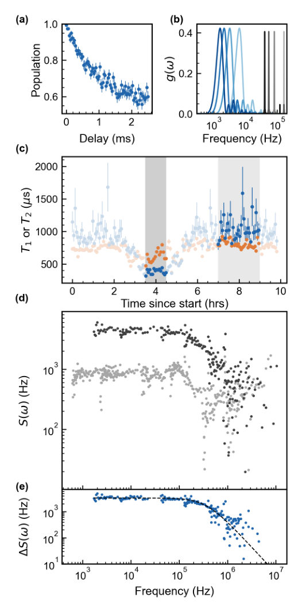
<figcaption class="paper-figure-caption"><b>Fig 3.</b> FIG. 3. Noise spectroscopy: (a) Sample decay trace showing the qubit population as a function of the total delay time 𝜏for 𝑁= 3 𝜋-pulses. Each point on the decay curve can be used to estimate the noise spectral density at a different frequency (Appendix E). (b) Filter function 𝑔𝑁(𝜔, 𝜏) for CPMG pulse sequence with 𝑁= 3 𝜋-pulses for 𝜏= 0.25, 0.5, 0.75 and 1 ms (lighter to darker blue). Filter function for 𝑁= 81 𝜋-pulses for the same 𝜏values (lighter to darker gray). (c) Repeated shot-to-shot interleaved measurement of 𝑇1 (orange) and 𝑇2 (blue) measured with an 𝑁= 3 CPMG sequence over 10 hours from dataset 2. The dark gray shaded data points from 𝑡= 3.5 to 4.5 hours are inside an excursion....</figcaption>
</figure>
<figure class="paper-figure-card">
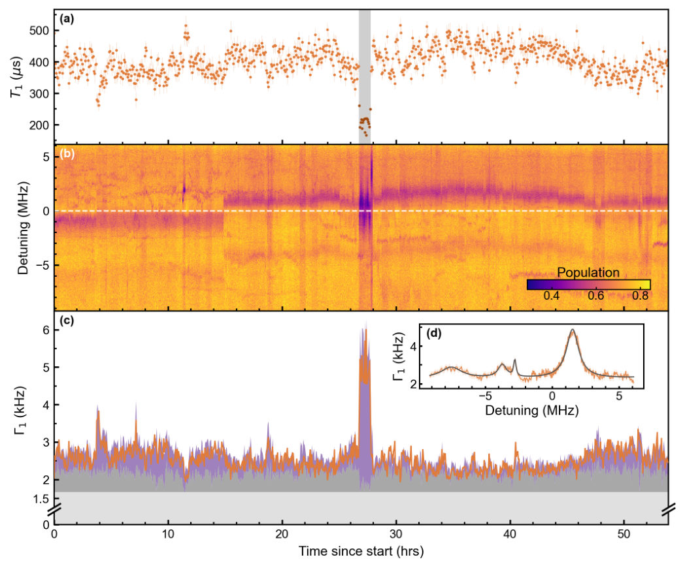
<figcaption class="paper-figure-caption"><b>Fig 4.</b> FIG. 4. TLS spectroscopy: (a) Measurement of 𝑇1 over 54 hours from interleaved 𝑇1 and AC Stark pulse sequences from dataset 7. A clear excursion (gray shaded region) is visible around hour 27. (b) Qubit excited state population at 𝜏= 100 𝜇s at various qubit frequencies over the same time window as (a). Purple bands represent frequencies with reduced population due to a resonant strongly coupled TLS. Excursion in (b) at hour 27 coincides with the spectral diffusion of a TLS into the qubit frequency (white dashed line). (c) Measured Γ1(𝑡) (orange) and fitted ˆΓ1( 𝑓= 0, 𝑡), which is the sum of three terms: TLS contribution Í 𝑖Γ(𝑖) 1, TLS( 𝑓= 0, 𝑡) (purple), time-dependent broadband...</figcaption>
</figure>

**Summary.** This research investigates performance degradation in superconducting transmon qubits caused by transient noise fluctuations. By combining interleaved measurements and TLS spectroscopy, the authors demonstrate that these performance dips are caused by individual, strongly-coupled defects (TLSs) resonating with the qubit frequency. This work establishes a powerful diagnostic tool for understanding and mitigating solid-state noise in quantum computing hardware.

**Why it may be interesting.** This work provides a detailed experimental methodology for characterizing and diagnosing specific, transient noise sources (TLSs) that limit coherence in solid-state quantum hardware, which is crucial for building reliable quantum processors.

Detailed structure

**Main problem.** The paper addresses the temporal fluctuations (excursions) in qubit relaxation ($T_1$) and coherence ($T_2$) times in superconducting qubits, which degrade gate fidelity.

**Main result.** These performance excursions are strongly correlated with the spectral diffusion of individual, strongly-coupled Two-Level Systems (TLSs) that enter resonance with the qubit frequency.

**Method.** The authors used interleaved lifetime/coherence measurements, noise spectroscopy (CPMG), and TLS spectroscopy to correlate noise sources with qubit decay rates.

**Model / system.** The physical system is a Transmon qubit fabricated on a Ta-on-Si substrate. The noise is modeled by contributions from broadband losses and discrete, strongly-coupled TLS defects.

**Key observables.** Relaxation rate ($\Gamma_1$), dephasing rate ($\Gamma_\phi$), and the noise spectral density $S(\omega)$.

**Important parameters / regimes.** Excursion timescales (minutes to hours); TLS coupling strengths; correlation coefficients (e.g., $
ho=0.51$ for $\Gamma_1$ vs $\Gamma_\phi$).

**Assumptions / limitations.** The analysis assumes that the observed noise is dominated by TLS defects, which are modeled using Lorentzian spectral densities.

**Figures summary.** Figures show temporal traces of $T_1$ and gate fidelities exhibiting fluctuations, and scatter plots demonstrating the correlation between $\Gamma_1$ and $\Gamma_\phi$ during these excursions.

**Paper structure.** The paper progresses from observing the problem (fluctuating $T_1/T_2$) to developing a measurement protocol (interleaved measurements) and finally attributing the fluctuations to specific noise sources (TLS spectral diffusion).

Abstract

Materials improvements in transmon qubits have yielded remarkable advances in qubit lifetimes (T1)and coherence times (T2). However, state-of-the-art superconducting qubits experience temporal fluctuations in their performance, which limit gate fidelities and quantum processor performance. We observe correlated increases in qubit relaxation and dephasing rates that last for minutes to hours, which we call T1 and T2 excursions. Using interleaved lifetime and coherence time measurements, noise spectroscopy, and two-level-system (TLS) spectroscopy, we find that these excursions are caused by single or few strongly-coupled TLS defects that spectrally diffuse into resonance with the qubit frequency. Our measurement protocol provides a powerful tool for understanding the noise sources that cause temporal fluctuations in superconducting qubit performance.

[↑ back to top](#top)

### [Dynamic helimagnetism via charged spin current](http://arxiv.org/abs/2610.34927v1)

**Authors:** Masaru Onoda  
**Type:** theory · **Category:** strongly correlated electrons · **PDF:** <https://arxiv.org/pdf/2610.34927v1>  
**Analysis basis:** full PDF text, analyzed in chunks
**Topic relevance:** 🔥 `Keldysh / 2PI / non-Gaussian methods` **4/5** · `methods for driven-dissipative` **2/5**

↔ Scroll figures horizontally

<figure class="paper-figure-card">
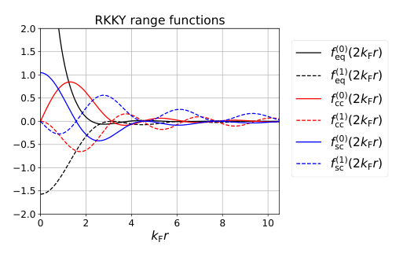
<figcaption class="paper-figure-caption"><b>Fig 1.</b> FIG. 1: RKKY range functions f(0) eq (2kFr), f (0) cc (2kFr), and f (0) sc (2kFr) (solid lines) and f (1) eq (2kFr), f (1) cc (2kFr), and f (1) sc (2kFr) (dashed lines), plotted as functions of kFr. All of them decay with increasing distance. The function f (0) eq (2kFr) of the RKKY interaction and the functions f (n) cc (2kFr) change sign repeatedly, whereas f (1) eq (2kFr) and f (n) sc (2kFr) keep a nearly fixed sign at large kFr.</figcaption>
</figure>
<figure class="paper-figure-card">
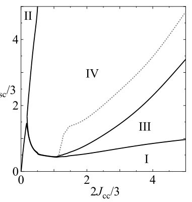
<figcaption class="paper-figure-caption"><b>Fig 2.</b> FIG. 2: Phase diagram of the dynamics of the two-spin system, adapted from Ref. [58] and plotted in the dimensionless currents 2Jcc/3 and 2Jsc/3 of the present work (equal to the normalized currents Jn and Js of Ref. [58]), for two spins separated by r = a0 with kFa0 = 1 and ˜γ2 = (3/2)2 × 0.05 = 0.1125. Regions I–IV correspond to a static collinear configuration, two types of periodic motion, and chaotic or complicated motion, respectively; the dotted line in region IV marks a relatively clear change in the type of motion (Sec. VI C). See Ref. [58] for details.</figcaption>
</figure>
<figure class="paper-figure-card">
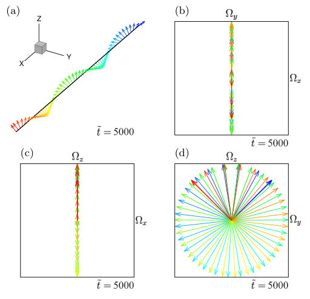
<figcaption class="paper-figure-caption"><b>Fig 3.</b> FIG. 3: Snapshots at ˜t = 5000 of a spin chain consisting of 60 spins equally spaced along the x direction, for ˜γ2 = 0.100, Jcc = 0.000, Jsc = 1.000, nc = ex, and ns = ex. (a) Bird’s-eye view of the entire spin chain. (b) Normalized x and y components of the spins. (c) Normalized x and z components of the spins. (d) Normalized y and z components of the spins.</figcaption>
</figure>
<figure class="paper-figure-card">
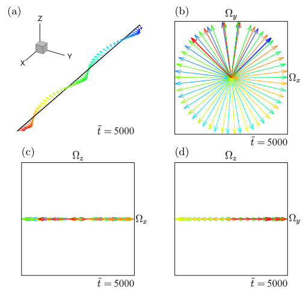
<figcaption class="paper-figure-caption"><b>Fig 4.</b> FIG. 4: Snapshots at ˜t = 5000 of a spin chain consisting of 60 spins equally spaced along the x direction, for ˜γ2 = 0.100, Jcc = 0.000, Jsc = 1.000, nc = ex, and ns = ez. (a) Bird’s-eye view of the entire spin chain. (b) Normalized x and y components of the spins. (c) Normalized x and z components of the spins. (d) Normalized y and z components of the spins.</figcaption>
</figure>
<figure class="paper-figure-card">
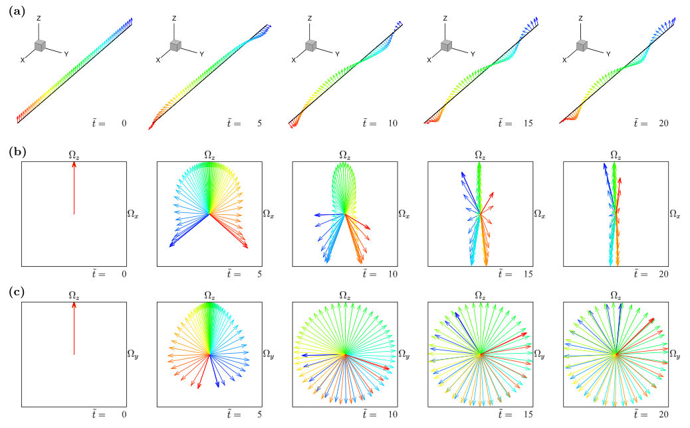
<figcaption class="paper-figure-caption"><b>Fig 5.</b> FIG. 5: Initial time evolution of a spin chain consisting of 60 spins equally spaced along the x direction, for ˜γ2 = 0.100, Jcc = 0.025, Jsc = 1.000, nc = ex, and ns = ex. Columns show snapshots at dimensionless times ˜t = 0, 5, 10, 15, 20 (left to right). (a) Bird’s-eye view of the entire spin chain. (b) Normalized x and z components of the spins. (c) Normalized y and z components of the spins.</figcaption>
</figure>

**Summary.** This theoretical work models how localized magnetic spins behave when coupled to conduction electrons carrying both charge and spin currents. It derives equations of motion showing that current flow can stabilize two types of helical magnetic order: a static type and a dynamic, precessing type. The findings demonstrate that these magnetic properties are continuously tunable by controlling the current amplitudes.

**Why it may be interesting.** The explicit derivation of spin dynamics from current-coupled localized spins, using advanced quantum field techniques like CTPGF, provides a rich theoretical framework for understanding current-controlled magnetic textures relevant to open quantum systems.

Detailed structure

**Main problem.** The study investigates dynamic helimagnetism stabilized and controlled by the interplay of both charge and pure spin currents in localized spins coupled to conduction electrons.

**Main result.** The model predicts two distinct current-driven helical phases: a static helix from pure spin current, and a coherently precessing helix when a small charge-current component is added.

**Method.** The authors derive effective equations of motion from the s-d exchange Hamiltonian using the Closed-Time-Path Green's Function formalism, followed by analytical and numerical solutions.

**Model / system.** The system consists of classical, localized spins coupled to conduction electrons via an s-d exchange Hamiltonian, applied to a periodically arranged one-dimensional spin chain.

**Key observables.** Precession angular frequency (ω), canting ratio (Δ), and helical wavenumber (q_helix).

**Important parameters / regimes.** Current amplitudes (charge and spin), which continuously tune the helical pitch, frequency, and canting ratio.

**Assumptions / limitations.** The model assumes point-like exchange coupling and neglects shape anisotropy and dipolar coupling of the magnets.

**Figures summary.** Not specified by the notes, but the paper involves analytical determination and numerical testing of the derived equations of motion.

**Paper structure.** The paper follows a structure detailing the model derivation (using CTPGF), approximations, deriving effective equations of motion (including spin torques and current-induced DM terms), and concluding with analytical and numerical testing of the predictions.

Abstract

We present a theoretical and numerical study of classical, localized spins coupled to conduction electrons that carry both charge and spin currents, deriving the effective equations of motion from the s-d exchange Hamiltonian. Applied to a periodically arranged one-dimensional spin chain, these equations yield two current-driven helical phases: a static helix stabilized by a pure spin current alone, and a coherently precessing helix that appears once a small charge-current component is added. For a given helical wavenumber, the precession angular frequency $ω$ and the canting ratio $Δ$ toward the hard axis follow analytically from the equations of motion, while the wavenumber $q_{\rm helix}$ of the precessing helix is selected by a heuristically constructed effective Lagrangian. Direct numerical integration of the same equations of motion reproduces all three observables wherever it yields a coherent helix. The helix chirality is set by a long-range, current-generated Dzyaloshinskii-Moriya (DM)-type coupling rather than an intrinsic DM interaction, so materials without bulk or interfacial DM interactions could also host current-controlled helical order. Because the helical pitch, precession frequency, and canting ratio are all continuously tunable by the current amplitudes, these helices could serve as probes of spin currents.

[↑ back to top](#top)

### [Induced Bell-CHSH observables in the Fewster-Verch measurement scheme](http://arxiv.org/abs/2610.33773v1)

**Authors:** M. S. Guimaraes, I. Roditi, S. P. Sorella  
**Type:** theory · **Category:** quantum information and computing · **PDF:** <https://arxiv.org/pdf/2610.33773v1>  
**Analysis basis:** full PDF text, analyzed in chunks
**Topic relevance:** 🔥 `quantum measurements` **4/5** · `Keldysh / 2PI / non-Gaussian methods` **1/5** · `analog quantum simulation` **1/5**

↔ Scroll figures horizontally

<figure class="paper-figure-card">
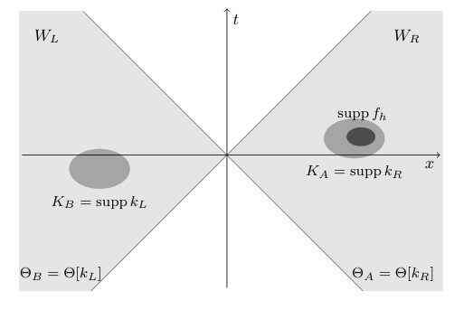
<figcaption class="paper-figure-caption"><b>Fig 1.</b> FIG. 1. Spacetime arrangement of the Alice–Bob configuration. The coupling profiles kR and kL have compact supports KA ⊂ WR and KB ⊂WL (shaded ellipses) inside the spacelike separated right and left wedges. By the exact factorization fh = k bλ,h the observable induced by a probe observable read out after Alice’s coupling admits a smearing representative supported entirely within KA (dark region). Since KA and KB are causally disjoint, the scattering automorphisms commute, Θ = ΘA◦ΘB = ΘB ◦ΘA, and each acts trivially on observables localized in the other wedge.</figcaption>
</figure>

**Summary.** This paper constructs explicit, operator-level observables for testing Bell-CHSH inequalities using the Fewster-Verch measurement scheme in quantum field theory. By coupling free Majorana fields to local probes, the authors demonstrate that the induced observables can saturate the Tsirelson bound. This work bridges the gap between abstract existence theorems and concrete, measurable quantum correlations.

**Why it may be interesting.** It provides a concrete, operational realization of fundamental quantum information concepts (Bell tests) within the rigorous framework of quantum field theory measurements, which is highly relevant for understanding measurement limitations in complex systems.

Detailed structure

**Main problem.** To provide an explicit, operator-level realization of Bell-CHSH observables, moving beyond structural existence theorems in quantum field theory.

**Main result.** The authors constructed explicit dichotomic Bell observables for free Majorana fields, showing that the CHSH expectation can saturate the Tsirelson bound in a vacuum-prepared state.

**Method.** The analysis uses the Fewster-Verch measurement framework, deriving induced observables from local couplings to quantum field probes.

**Model / system.** The system involves free Majorana fields in 1+1 dimensions, coupled locally via an interaction term. The generalization extends this construction to coupled scalar fields.

**Key observables.** Induced dichotomic Bell observables, the CHSH expectation value, and corrected Hermitian probe bilinears.

**Important parameters / regimes.** The coupling profile $k(x)$, the dimension $1+1$, and the attainability hypotheses for saturation.

**Assumptions / limitations.** The results rely on explicit attainability hypotheses for saturating the Tsirelson bound, and the construction is based on the Fewster-Verch measurement scheme.

**Paper structure.** The paper first establishes the general framework using the Fewster-Verch scheme for Majorana fields, deriving factorization properties. It then develops the explicit construction for the observables and demonstrates the saturation of the Tsirelson bound. The methodology is later extended to bosonic systems.

Abstract

The Summers-Werner theorem shows that the vacuum of a relativistic quantum field theory violates the Bell-CHSH inequality maximally on complementary wedges, but it is an existence statement: it exhibits neither the observables nor an apparatus that measures them. We give an explicit operator-level realization within the Fewster-Verch measurement framework, obtaining dichotomic Bell observables of a free Majorana field in $1+1$ dimensions as observables induced by local couplings to Majorana probes. The induced system smearing factorizes exactly as $f_h=k\,b_{λ,h}$, so its support is controlled by the compactly supported coupling profile $k$; dichotomy is imposed by calibrating and normalizing the induced smearings rather than required of the probe observable; and a probe-only normal ordering yields the product of Alice's and Bob's induced bilinears, which the non-multiplicative induced map alone does not provide. Under explicit attainability hypotheses the induced observables saturate the Tsirelson bound in a state prepared from the vacuum. The construction extends to coupled scalar fields.

[↑ back to top](#top)

### [Banach-Cesaro positive operator-valued measure](http://arxiv.org/abs/2610.33821v1)

**Authors:** Sviatoslav V. Dzhenzher  
**Type:** theory · **Category:** other · **PDF:** <https://arxiv.org/pdf/2610.33821v1>  
**Analysis basis:** full PDF text, analyzed in chunks
**Topic relevance:** 🔥 `quantum measurements` **4/5** · `analog quantum simulation` **1/5**

↔ Scroll figures horizontally

<figure class="paper-figure-card">
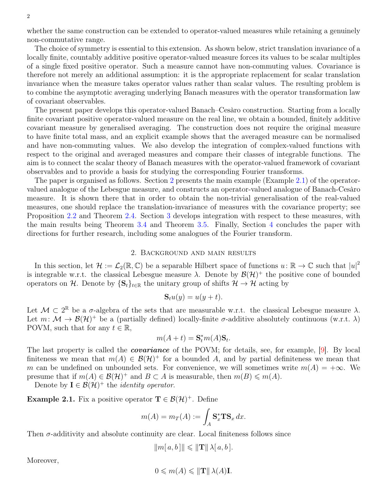
<figcaption class="paper-figure-caption"><b>Fig 1.</b> Low-resolution page preview, page 2</figcaption>
</figure>
<figure class="paper-figure-card">
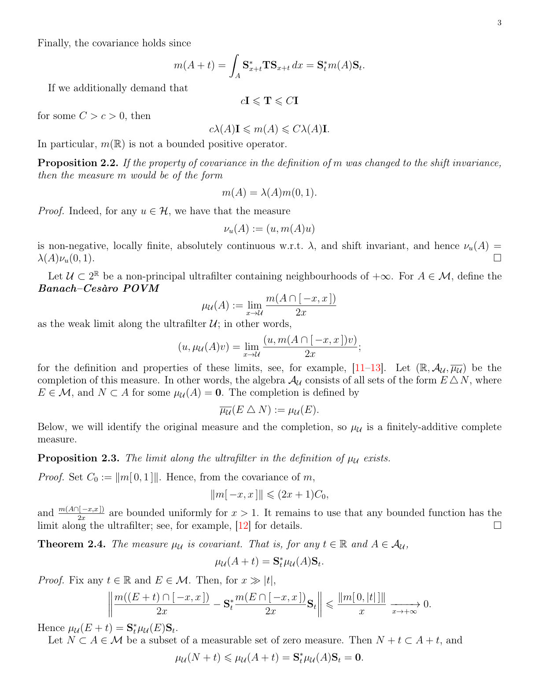
<figcaption class="paper-figure-caption"><b>Fig 2.</b> Low-resolution page preview, page 3</figcaption>
</figure>
<figure class="paper-figure-card">
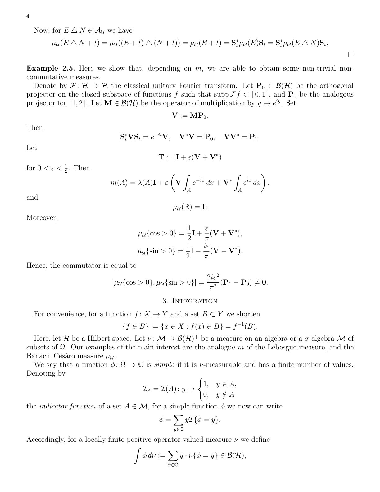
<figcaption class="paper-figure-caption"><b>Fig 3.</b> Low-resolution page preview, page 4</figcaption>
</figure>
<figure class="paper-figure-card">
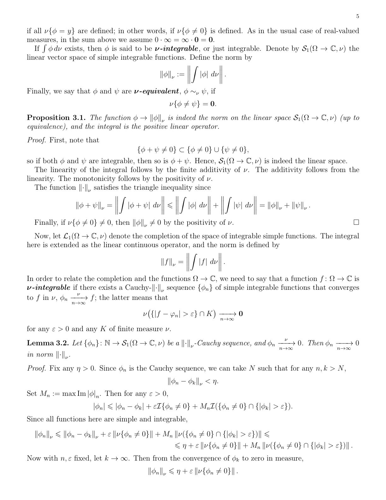
<figcaption class="paper-figure-caption"><b>Fig 4.</b> Low-resolution page preview, page 5</figcaption>
</figure>
<figure class="paper-figure-card">
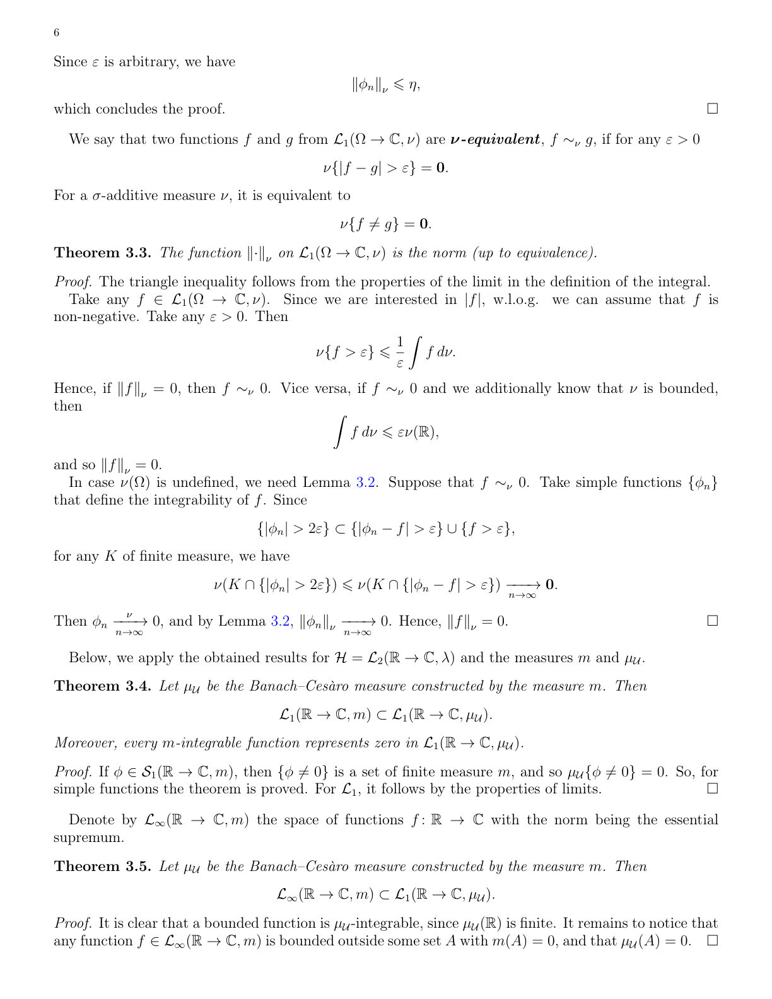
<figcaption class="paper-figure-caption"><b>Fig 5.</b> Low-resolution page preview, page 6</figcaption>
</figure>

**Summary.** This paper develops a mathematical theory for handling Banach-Cesàro positive operator-valued measures (POVMs) in a non-commutative setting. It extends classical measure theory to accommodate averaged quantum measurements, allowing for non-commuting observables while maintaining mathematical rigor. This is vital for analyzing open quantum systems where measurements are complex and non-ideal.

**Why it may be interesting.** This work provides a powerful mathematical tool for handling non-commutative observables arising from physical measurements (POVMs) that are subject to averaging or non-ideal dynamics, which is crucial for modeling open quantum systems.

Detailed structure

**Main problem.** The paper constructs and develops a rigorous integration theory for Banach-Cesàro positive operator-valued measures (POVMs) on the real line, extending scalar Banach measure theory to the non-commutative operator setting.

**Main result.** It successfully defines the integral and associated $L^1$ space for these averaged POVMs, demonstrating that the resulting structure allows for non-commuting averaged operator values while maintaining total mass normalization.

**Method.** The core method involves applying generalized Banach-Cesàro asymptotic averaging to locally finite covariant POVMs and then defining the integral via completion of simple functions using the continuous operator norm.

**Model / system.** The mathematical framework is built around POVMs, which are used to model quantum measurements beyond ideal projections, particularly in the context of open quantum systems and random quantum channels.

**Key observables.** The operator-valued Fourier transform and the commutator of averaged POVM values, $[\mu_U\{\cos > 0\}, \mu_U\{\sin > 0\}] 
eq 0$.

**Important parameters / regimes.** The averaging process is governed by a non-principal ultrafilter $U$, and the analysis involves the continuous operator norm.

**Assumptions / limitations.** The work extends the standard requirement of countable additivity for POVMs to a finitely additive structure motivated by averaging processes.

**Figures summary.** Not specified.

**Paper structure.** The paper first introduces the construction of the averaged measure $\mu_U$ using ultrafilters, then develops the integration theory by defining the norm on simple functions, and finally analyzes the properties of the resulting operator-valued Fourier transform.

Abstract

We construct a family of bounded, finitely additive, covariant positive operator-valued measures (POVMs) on the real line by applying generalised Banach-Cesaro asymptotic averaging to locally finite covariant POVMs. In contrast to the strictly shift-invariant case, where countably additive operator measures are restricted to scalar multiples of a single fixed operator, the introduced covariant setting allows for non-commuting averaged operator values while successfully normalising the total mass. We develop an integration theory for complex-valued functions by taking the completion of simple integrable functions with respect to the continuous operator norm induced by the positive integral of their absolute values. The integration spaces for the original and the averaged measures are shown to possess distinct null classes. Finally, we introduce the operator-valued Fourier transform on these integration spaces and analyze the core algebraic constraints imposed by the covariance property on the exponential multipliers.

[↑ back to top](#top)

### [A Control Line Multiplexing Framework for Scalable Quantum Computing](http://arxiv.org/abs/2610.35227v1)

**Authors:** Dayu Li, Naibin Zhou, Zhiyuan Chen, Zihua Chen, Yu Xu, Yuan Li, Daojin Fan, Wenhao Chu, Xiawei Chen, Hui Deng, Jiacheng Gui, Linyin Hong, Bo Fan, Weiping Lin, Haonan Zou, Haoxin Lou, Xintao Zhao, Sirui Cao, Ying Chong, Qingling Zhu, Chen Wang, Yisen Hu, Kaili Zhang, Feifan Su, Haibin Zhang, Jianghan Yin, Yajie Du, Yinan Jiang, Haoping Luo, Weifeng Yang, Jiafei Wang, Jin Lin, Futian Liang, Hao Rong, Kai Yan, Ming Gong, Jinjin Li, Maliang Liu, Cheng-Zhi Peng, Shaowei Li, Xiaobo Zhu, Jian-Wei Pan  
**Type:** both · **Category:** quantum information and computing · **PDF:** <https://arxiv.org/pdf/2610.35227v1>  
**Analysis basis:** full PDF text, analyzed in chunks
**Topic relevance:** 🔥 `QC/QI experiment` **4/5**

↔ Scroll figures horizontally

<figure class="paper-figure-card">
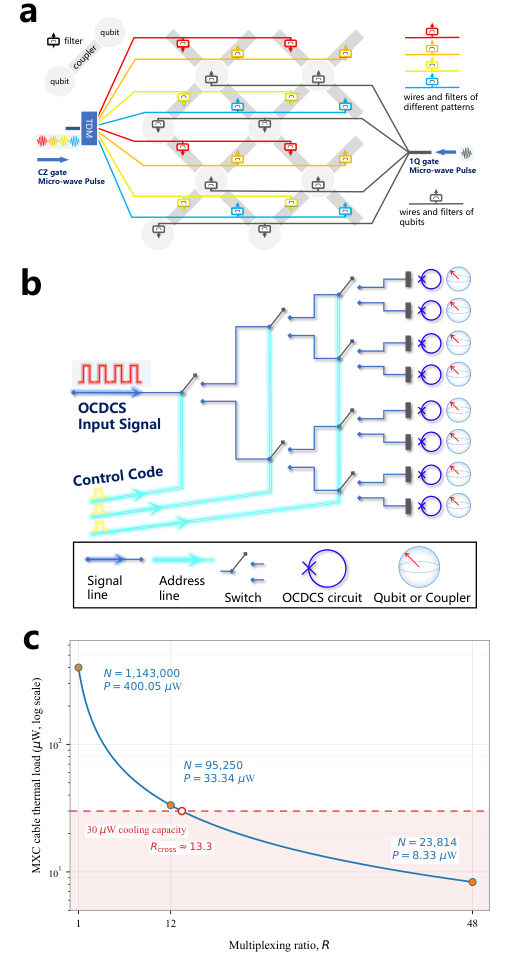
<figcaption class="paper-figure-caption"><b>Fig 1.</b> FIG. 1. (a) The schematic diagram of control-line mul- tiplexing qubit system. This diagram shows a 2d-periodic scalable structure. The colors of the wires and filters of the couplers mark the patterns of the couplers. The patterns are divided according to the surface code [53]. Only couplers in the same pattern need to perform parallel CZ gates. (b) The OCDCS system with switch array [2]. (c) Estimated passive MXC cable thermal load versus the control-line mul- tiplexing ratio R. Assuming 381,000 physical qubits, three dedicated control lines per qubit and the public NbTi FPC reference value of 350 pW/channel [54], the solid curve follows PMXC = 400.05/R µW. Markers show R = 1, 12 and 48;...</figcaption>
</figure>
<figure class="paper-figure-card">
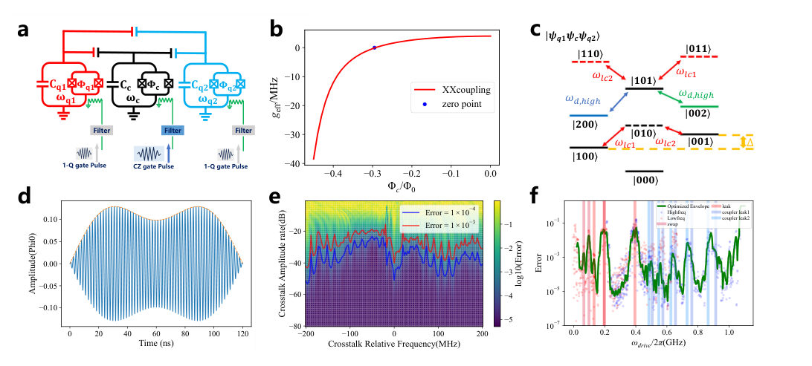
<figcaption class="paper-figure-caption"><b>Fig 2.</b> FIG. 2. (a) Equivalent circuit of the qubit-coupler-qubit structure in FDM diagram. Coupling strength is tuned via the flux bias Φc[55]. (b) Equivalent coupling strength vs. coupler flux bias. Blue circles indicate the coupling zero point. (c) MP- CZ gate schematic. ωd,high and ωd,low denote the driving frequencies of high- and low-frequency MP-CZ gates, respectively. (d) Driving waveform applied to the coupler flux bias. (e) With MP-CZ gate frequency as zero, x-axis: crosstalk waveform frequency; y-axis: crosstalk-to-MP-CZ amplitude ratio. The color represents the mixed signal error rate, including the original gate error (≈1 × 10−5) and the crosstalk-induced error. (f) Fidelity dependence...</figcaption>
</figure>
<figure class="paper-figure-card">
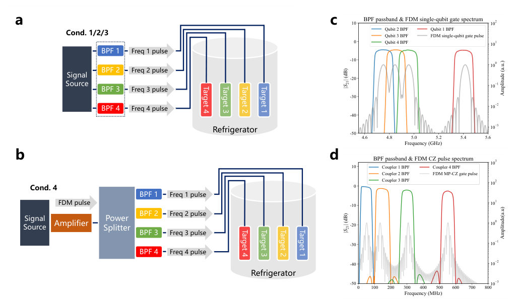
<figcaption class="paper-figure-caption"><b>Fig 3.</b> FIG. 3. (a) Experimental system for Cond. 1/2/3. Cond. 1 has no BPF in the dotted box area. (b) Experimental system for Cond. 4, the final configuration. Both MP-CZ and single-qubit gate experiments follow this configuration. For single-qubit experiments, the signal source is a 5.1 GHz microwave source and a 2 GSa/s AWG sideband; “target” denotes “qubit”. For MP- CZ experiments, the signal source is a 2 GSa/s AWG; “target” denotes “coupler”. (c) Filter passband and FDM pulse spectrum for FDM single-qubit gates. Right y-axis: FDM single-qubit pulse spectrum; left y-axis: four band-pass filter passbands. BPF denotes band-pass filter. (d) Filter passbands and FDM pulse spectrum for FDM CZ...</figcaption>
</figure>
<figure class="paper-figure-card">
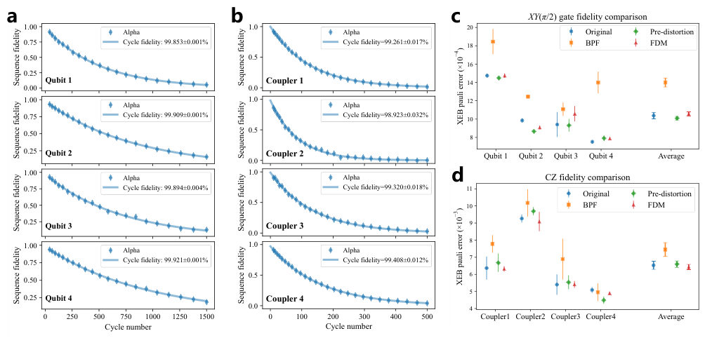
<figcaption class="paper-figure-caption"><b>Fig 4.</b> FIG. 4. (a) XEB results of FDM single-qubit gates. The per-cycle XEB fidelities of Qubits 1–4 are 99.853±0.001%, 99.909±0.001%, 99.894±0.004% and 99.921±0.001%. The average single-qubit gate fidelity is 99.894±0.002%. (b) XEB re- sults of the FDM MP-CZ gates. The per-cycle XEB fidelities of Couplers 1–4 are 99.26±0.02%, 98.92±0.03%, 99.32±0.02% and 99.41±0.01%. MP-CZ fidelities are corrected by the product of the two participating XY (π/2) fidelities in Supplemen- tary Table S1; the coupler–qubit mapping is given in Supplementary Section VII. The MP-CZ fidelities of Couplers 1–4 are 99.37±0.02%, 99.06±0.03%, 99.48±0.02% and 99.51±0.01%. The average CZ fidelity is 99.35±0.01%. (c) shows the...</figcaption>
</figure>

**Summary.** This paper introduces a Frequency-Division Multiplexing (FDM) framework to overcome the physical wiring limitations of scaling superconducting quantum computers. By encoding multiple gate operations onto shared, frequency-multiplexed microwave pulses, the required control-line count is drastically reduced. The work experimentally validates this approach, showing high-fidelity gate operations in a multiplexed environment.

**Why it may be interesting.** This work directly addresses the engineering bottleneck of scaling superconducting quantum processors by proposing a fundamental architectural shift in control electronics, which is crucial for realizing large-scale quantum computation.

Detailed structure

**Main problem.** Scaling fault-tolerant superconducting quantum computers faces severe limitations due to the wiring density and cooling-power budget when using dedicated control lines for millions of qubits.

**Main result.** The proposed Frequency-Division Multiplexing (FDM) framework successfully demonstrates gate operations while maintaining low error rates, significantly reducing the required control-line count by orders of magnitude.

**Method.** The authors propose a hybrid multiplexing framework where all gate operations are encoded onto polychromatic microwave pulses and spectrally routed using band-pass filters.

**Model / system.** The system is based on superconducting transmon qubits coupled via tunable couplers, analyzed using a three-mode QCQ model. The control mechanism leverages frequency-division multiplexing to share a common control bus.

**Key observables.** Average gate errors for parallel FDM CZ and XY gates, sequence fidelity (XEB, SPB, Leakage), and the thermal load on the mixing-chamber.

**Important parameters / regimes.** Multiplexing ratios (e.g., 1:4 demonstration), required control-line reduction (up to 1/48), and the frequency separation ($\Delta$) between multiplexed channels.

**Assumptions / limitations.** The scheme assumes the feasibility of an all-microwave architecture for two-qubit gates and relies on the effectiveness of band-pass filtering and waveform pre-distortion to mitigate crosstalk.

**Figures summary.** Figures illustrate the scalable control architecture, the thermal load reduction vs. multiplexing ratio, and the spectral components of the microwave pulses used for gate control.

**Paper structure.** The paper first identifies the scaling bottleneck, then proposes the FDM multiplexing framework, details the gate implementation (MP-CZ gates), provides simulation results showing error rates, and concludes by demonstrating the feasibility of the scalable control scheme.

Abstract

Universal fault-tolerant superconducting quantum computers are expected to require millions of physical qubits; yet extending the prevailing dedicated-control-line paradigm to this scale would exceed the wiring density and cooling-power budget of dilution refrigerators. Microwave frequency-division multiplexing (FDM) revolutionized classical communications by enabling many independent channels to share common transmission infrastructure. Translating this principle to superconducting quantum control, however, requires an all-microwave architecture and experimental validation of frequency-multiplexed gate control. Recent work in quantum error correction has demonstrated microwave-based readout, single-qubit gates and leakage suppression, whereas two-qubit gates remain predominantly driven by unipolar pulses and thus constitute the missing element of an all-microwave architecture. Here, we propose a periodically extensible hybrid multiplexing framework in which all gate operations are frequency-division multiplexed using polychromatic microwave pulses and band-pass filters, thereby reducing the required control-line count by one to two orders of magnitude. In a 1:4 demonstration, we achieve average errors of $(6.4\pm0.2)\times10^{-3}$ for parallel FDM CZ gates and $(10.6\pm0.2)\times10^{-4}$ for parallel FDM $XY(π/2)$ gates, without statistically significant multiplexing-induced degradation. Together with on-chip DC sources, this FDM-based gate-control scheme completes the last missing module in a scalable multiplexed-control architecture toward universal fault-tolerant quantum computing.

[↑ back to top](#top)

### [Did the Gran Sasso Experiment Rule Out the Diósi-Penrose Theory? Musing on the 2021 Result and the Present Experimental Status](http://arxiv.org/abs/2610.35608v1)

**Authors:** Catalina Curceanu, Nicola Bortolotti, Lajos Diósi, Simone Manti, Kristian Piscicchia  
**Type:** both · **Category:** other · **PDF:** <https://arxiv.org/pdf/2610.35608v1>  
**Analysis basis:** full PDF text, analyzed in chunks
**Topic relevance:** 🔥 `quantum measurements` **4/5**

↔ Scroll figures horizontally

<figure class="paper-figure-card">
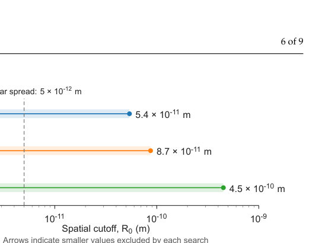
<figcaption class="paper-figure-caption"><b>Fig 1.</b> Figure 1. Lower bounds on the spatial cutoff R0 for the standard Markovian, white-noise DP dy- namics, expressed in the Diósi convention. Filled circles show Gran Sasso (2021; 95% posterior probability), Majorana (2022, corrected in 2023; 95% confidence level) and XENONnT (2026; 95% confidence level) [1,14–16].</figcaption>
</figure>

**Summary.** This paper reviews the experimental status of the Diósi-Penrose theory of spontaneous wave function collapse using results from low-background detectors. While the 2021 Gran Sasso result provided an initial exclusion, the authors clarify that modern, stronger bounds only constrain the specific Markovian dynamics used, leaving other collapse theories potentially untouched.

**Why it may be interesting.** It is highly relevant as it discusses fundamental issues in quantum foundations—the measurement problem—by interpreting cutting-edge experimental constraints on spontaneous collapse models.

Detailed structure

**Main problem.** The paper addresses whether the Gran Sasso experiment successfully ruled out the Diósi-Penrose (DP) theory of spontaneous wave-function collapse.

**Main result.** The 2021 result excluded the parameter-free version of the theory under specific assumptions, but subsequent, stronger bounds from experiments like XENONnT only constrain the Markovian dynamics, not the entire theoretical framework.

**Method.** The authors analyze experimental constraints by comparing measured low-background radiation counts against theoretical predictions derived from the DP model.

**Model / system.** The model is the Diósi-Penrose theory, which posits spontaneous collapse governed by a stochastic dynamics dependent on a spatial cutoff parameter, $R_0$. Experiments utilize low-background detectors at facilities like Gran Sasso and XENONnT.

**Key observables.** The primary observable is the absence of a statistically significant excess spontaneous radiation signal in the energy range of 1.0–3.8 MeV (Gran Sasso) or 1–140 keV (XENONnT).

**Important parameters / regimes.** The key parameter is the spatial cutoff $R_0$, with current world-leading bounds exceeding $4.5 	imes 10^{-10}$ m.

**Assumptions / limitations.** The exclusion is strictly limited to the Markovian, white-noise dynamics of the DP model and does not constrain colored-noise or other modified gravity collapse theories.

**Figures summary.** Figure 1 compares the lower bounds on $R_0$ derived from Gran Sasso, Majorana, and XENONnT experiments, illustrating the tightening experimental constraints.

**Paper structure.** The paper reconstructs the scope of the 2021 Gran Sasso result, updates this understanding with the latest XENONnT bounds, and clarifies the precise theoretical limitations of the exclusion.

Abstract

In 2021, a low-background experiment at the Gran Sasso National Laboratory searched for spontaneous radiation predicted by the standard Markovian Diósi-Penrose (DP) dynamics and obtained the new bound $R_0 > 5.4 \times 10^{-11}\,\mathrm{m}$ at $95\%$ probability for the short-length cutoff parameter. For germanium at the experimental temperature, the parameter-free prescription identifying $R_0$ with the spatial quantum spread of a nucleus gives $R_0 \simeq 5 \times 10^{-12}\,\mathrm{m}$. That particular combination, Diósi's stochastic dynamics and the Penrose-motivated mass-density resolution, was therefore excluded. Subsequent searches strengthened the cutoff bound. The Majorana Demonstrator improved it in 2022, and XENONnT has now obtained the world-leading limits $R_0 > 4.9 \times 10^{-10}\,\mathrm{m}$ at $90\%$ confidence level and $R_0 > 4.5 \times 10^{-10}\,\mathrm{m}$ at $95\%$ confidence level. These advances reinforce the 2021 exclusion but do not alter its logical scope: they \emph{parametrically constrain} the Markovian, effectively white-noise DP dynamics, not Penrose's (and Diósi's) lifetime criterion independently of a dynamics, and not all colored-noise, dissipative, or otherwise modified gravity-related spontaneous collapse theories. We reconstruct what Gran Sasso did and did not rule out and place that conclusion in the present experimental context.

[↑ back to top](#top)

### [Rank-one Factored Gradient Descent without Restricted Isometry: Application to Quantum Pure State Tomography on Multi-Qubits](http://arxiv.org/abs/2610.34696v1)

**Authors:** Takahiro Kajisa  
**Type:** theory · **Category:** quantum information and computing · **PDF:** <https://arxiv.org/pdf/2610.34696v1>  
**Analysis basis:** full PDF text, analyzed in chunks
**Topic relevance:** 🔥 `quantum measurements` **4/5**

↔ Scroll figures horizontally

<figure class="paper-figure-card">
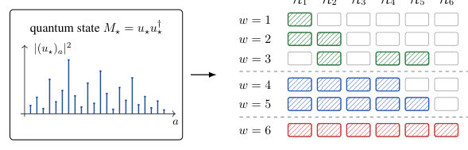
<figcaption class="paper-figure-caption"><b>Fig 1.</b> Figure 1: Partial-weight Pauli measurements. Each row is one observable σt; the shaded boxes mark the sites on which the string acts nontrivially, and the weight w(t) is the number of such sites. Measuring an observable of weight w requires reading out w sites jointly, so the acquisition rate decays exponentially as ηw, where η ∈(0, 1) is the per-site detection efficiency. Accumulating high-weight statistics therefore takes a long time, during which the apparatus drifts and the state itself changes—the samples cease to be i.i.d. and a systematic bias enters. The coherence that distinguishes the family ψφ of Counterexample 1.1 appears only in the w = n string, which falls outside the usable...</figcaption>
</figure>
<figure class="paper-figure-card">
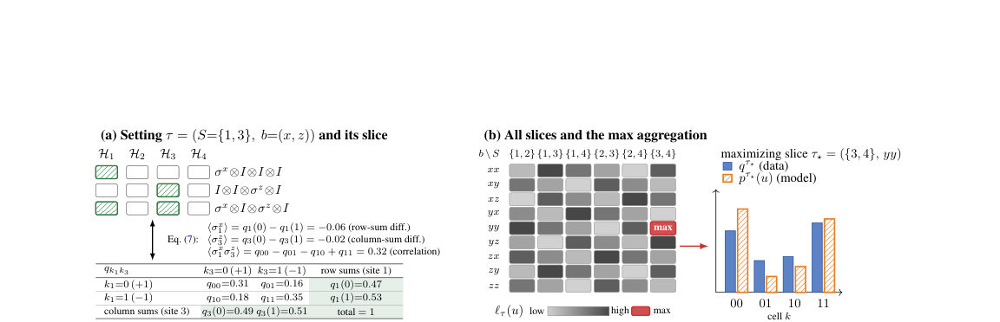
<figcaption class="paper-figure-caption"><b>Fig 2.</b> Figure 2: Structure of a slice. (a) The commuting family (slice) read out at once in the setting τ = ({1, 3}, (x, z)) and the data of that setting. Data accumulate as an empirical distribution qτ over cells (a cell k is the tuple of readout bits of the sites in the block); the interior of the contingency table is the weight- 2 record and the margins are its marginalization, i.e. the weight-1 data. Each string expectation is a signed sum of counts, expectations and counts being interconvertible by (7). (b) The settings form a (basis b) × (block S) grid, of size 9 × 6 = 54 for n = 4, N = 2; the max-sliced loss picks the slice τ⋆(red) at which the total variation ℓτ(u) (shading) between the...</figcaption>
</figure>
<figure class="paper-figure-card">

<figcaption class="paper-figure-caption"><b>Fig 3.</b> Figure 3: The support condition and the order of the mass flow. Blue is the data qτ and orange hatching the model pτ(u). Cells are split by the sign of the residual δk = pk −qk into surplus P, zero Z and deficient D, and what can be moved at first order is exactly a zero-sum flow on the support (pk &gt; 0) of the model. (a) When the support condition fails, a deficient cell carries mass, so the flow moving ε from a surplus cell to it is realizable and the loss decreases strictly: the point is not stationary. (b-1) Under the support condition the deficient cell is empty, no first-order inflow into it is possible, and only transfers inside the support remain, none of which decreases the loss in...</figcaption>
</figure>

**Summary.** This paper develops a robust optimization technique for Quantum State Tomography when measurements are imperfect and limited to low-weight Pauli observables. By replacing the standard $\ell_2$ loss with a max-sliced total-variation loss, the authors prove that the optimization landscape is free of spurious local minima. This provides a theoretically sound method for reconstructing unknown quantum states from noisy, partial experimental data.

**Why it may be interesting.** This work provides a mathematically rigorous framework for state reconstruction in realistic quantum hardware settings where measurement limitations (like low detection efficiency) invalidate standard theoretical assumptions (like RIP).

Detailed structure

**Main problem.** The paper addresses the challenge of performing Quantum Pure State Tomography (QST) when measurements are limited to partial-weight Pauli observables, causing standard optimization techniques to fail.

**Main result.** By introducing a max-sliced total-variation loss function, the authors prove that the optimization landscape is free of spurious local minima, ensuring that the global minimum corresponds to the true quantum state up to a global phase, provided the measurement map is injective.

**Method.** The core method involves reformulating the loss function using a max-sliced total-variation metric, followed by advanced nonsmooth optimization analysis using Clarke subdifferentials and directional derivatives.

**Model / system.** The system is an $n$-qubit quantum state $
ho$, which is recovered by estimating the state vector $u$ from measurement outcomes. The measurements are modeled by partial-weight Pauli observables, which are physically constrained.

**Key observables.** The primary observable is the state $
ho$ (or pure state vector $u$). The diagnostic is the loss function $L(u) = \max_{	au} \| p_	au(u) - q_	au \|_1$, where $p_	au$ is the predicted probability distribution and $q_	au$ is the true distribution.

**Important parameters / regimes.** The number of qubits ($n$), the weight of the Pauli measurements, and the detection efficiency ($\eta$).

**Assumptions / limitations.** The analysis assumes the measurement map is injective on generic pure states and that the loss function can be analyzed via its maximum over slices, which is necessary for the nonsmooth analysis.

**Figures summary.** Figure 1 illustrates that partial-weight Pauli measurements lead to an acquisition rate that decays exponentially with weight, causing systematic bias. Figure 2 illustrates the structure of a single measurement slice for a specific Pauli setting.

**Paper structure.** The paper first establishes the failure of standard methods due to partial measurements. It then develops the max-sliced total-variation loss. The bulk of the work involves rigorous nonsmooth analysis (using directional derivatives and support conditions) to prove that the resulting optimization landscape is well-behaved, culminating in the proof that local minima are absent.

Abstract

Factored gradient descent (FGD) is a scalable nonconvex method for low-rank positive semidefinite matrix recovery, in which the rank and positivity constraints are satisfied automatically by the factorization. Most of the existing theory that certifies benignity of its loss landscape, however, relies on a restricted isometry property (RIP) of the measurement map. In quantum state tomography, one of its applications, the measurements that can be acquired with stable statistics are limited by detection efficiency and drift to Pauli observables of low weight; we first show that under such partial-weight Pauli measurements RIP fails in the worst possible way. We then bundle the mutually commuting observables setting by setting, pushing the state forward to the probability distribution of each setting, and introduce a max-sliced total-variation loss. On the stratum where the setting attaining the maximum is unique there is no spurious local minimum, and provided only that the measurement map is injective on generic pure states, the global minimum is the truth up to a phase. Finally we verify these claims numerically on four qubits and compare against FGD with the ordinary loss.

[↑ back to top](#top)

### [Task-Directed Spectral Design for Local Quantum Tomography](http://arxiv.org/abs/2610.33723v1)

**Authors:** Guy Hay, Nir Sharon  
**Type:** both · **Category:** quantum information and computing · **PDF:** <https://arxiv.org/pdf/2610.33723v1>  
**Analysis basis:** full PDF text, analyzed in chunks
**Topic relevance:** 🔥 `quantum measurements` **4/5**

↔ Scroll figures horizontally

<figure class="paper-figure-card">

<figcaption class="paper-figure-caption"><b>Fig 1.</b> Fig. 1. Mean raw Schmidt-spectrum MSE versus target-copy budget. Adaptive points use the best observed T recorded in Table 4; Greedy spectral is independent of T. Vertical scales are logarithmic, and error bars are Monte Carlo standard errors.</figcaption>
</figure>
<figure class="paper-figure-card">

<figcaption class="paper-figure-caption"><b>Fig 2.</b> Fig. 2. Mean raw full-state infidelity versus localization radius. Adaptive curves use each method’s best observed T from Table 7. Both axes are logarithmic and error bars are Monte Carlo standard errors.</figcaption>
</figure>

**Summary.** This work proposes a novel, fixed-batch protocol for local quantum tomography that targets only the necessary information for a specific task. By optimizing measurement probes based on a combination of geometric fidelity and task sensitivity, the method achieves state-of-the-art performance with significantly lower experimental overhead than adaptive techniques. This advances the practical feasibility of quantum state characterization in resource-constrained quantum computing settings.

**Why it may be interesting.** The development of fixed, non-adaptive protocols that outperform adaptive ones is crucial for scaling quantum experiments, especially when feedback loops are costly or impossible to implement.

Detailed structure

**Main problem.** The paper addresses the challenge of performing quantum tomography by estimating only a low-dimensional function of the quantum state, rather than the full state, to improve efficiency.

**Main result.** A fixed-batch, task-directed measurement design was shown to achieve lower mean task error and significantly lower acquisition cost compared to adaptive methods in numerical experiments.

**Method.** The authors derive optimal measurement directions using a generalized eigenproblem involving the pullback Fubini-Study metric and a task-specific metric, leading to a fixed, non-adaptive probe library.

**Model / system.** The study focuses on pure-state quantum systems parameterized by a differentiable model on a projective Hilbert space, analyzed using local coordinates.

**Key observables.** Mean task error, mean infidelity, task loss, and acquisition cost ratios.

**Important parameters / regimes.** The measurement budget ($B$), the localization radius ($R$), and the dimensionality of the system ($d$).

**Assumptions / limitations.** The analysis assumes a known parametric model, a credible center, and relies on the large-budget condition and the localization assumption.

**Figures summary.** Tables compare task MSE and full-state infidelity across various dimensions, budgets, and measurement strategies, showing the fixed spectral design outperforms adaptive methods.

**Paper structure.** The paper progresses from defining the geometric constraints (local invariance, localization radius) to formulating a Bayesian optimization problem, which is then approximated locally using Fisher information to determine the optimal fixed probe set and shot allocation.

Abstract

Many tomography tasks require only a low-dimensional function of the state. We study local pure-state tomography under projective-fidelity access when a parametric model, a credible center, and a differentiable downstream task are known before acquisition. The pullback Fubini--Study metric and the task metric define coordinate-invariant generalized eigendirections, which we realize as a fixed library of geodesic fidelity probes. We prove two optimality results: the probe aligned with a task coordinate is its unique variance-minimizing location up to orientation, and, when prior and measurement information are diagonal in this basis, a diminishing-return greedy rule exactly minimizes the integer-budget local task-variance surrogate over the spectral library. Under common per-shot information and the stated large-budget condition, the absolute and relative gaps to arbitrary probe directions are respectively \(O(B^{-3})\) and \(O(B^{-2})\). A closed-form local estimator is followed by a task-metric localization projection that cannot increase quadratic task loss when localization holds. In six-qubit numerical experiments, the Schmidt-spectrum design activates only one or two settings and has lower mean task error than the post hoc best adaptive results across all tested dimensions and copy budgets. For full-state tomography, it likewise has lower mean infidelity throughout the tested local regime. The fixed batch uses no feedback loops and far fewer settings; under the illustrative latency model, its acquisition cost is roughly three to four orders of magnitude lower than that of the adaptive methods.

[↑ back to top](#top)

### [Twist-controlled imaginary-time Mpemba effect in quantum spin systems](http://arxiv.org/abs/2610.35784v1)

**Authors:** Zhi-Yao Ning, Zi-Xiang Li, Naoki Kawashima  
**Type:** both · **Category:** other · **PDF:** <https://arxiv.org/pdf/2610.35784v1>  
**Analysis basis:** full PDF text, analyzed in chunks
**Topic relevance:** `analog quantum simulation` **3/5** · `correlated / nonlocal dissipation` **3/5** · `driven-dissipative phase transition` **3/5** · `methods for driven-dissipative` **3/5** · `non-equilibrium universality` **3/5** · `scars & prethermalization` **3/5** · `Keldysh / 2PI / non-Gaussian methods` **2/5** · `quantum measurements` **1/5**

↔ Scroll figures horizontally

<figure class="paper-figure-card">

<figcaption class="paper-figure-caption"><b>Fig 1.</b> FIG. 1. Twisted states preparation and imaginary-time evolution in compact boson with K = 3/4 and α = 1/2. (a) Target-normalized weights r(m) ℓ for different m at integer grades ℓ. Bars above zero show the corresponding state’s weight at ℓ= m; bars below show the other states’ weights at each grade. Lower-left inset: twist profiles fm(x) for m = 1, 2. (b) Excess energy and (c) target infidelity; lower-left insets isolate mc = 1, mh = 2. Dotted lines in the insets mark the analytically determined crossing times τE/L = ln 2/(2πv) and τI/L = ln 2/(4πv). (d) (mh, mc) = (2, 1), restoring the slow harmonic to the hot state delays both crossings, which diverge logarithmically as γ →1−.</figcaption>
</figure>
<figure class="paper-figure-card">

<figcaption class="paper-figure-caption"><b>Fig 2.</b> FIG. 2. ITME in the critical XXZ chain. (a) Normalized energy (orange) and infidelity (blue) differences at ∆= 1/2, from periodic MPS at L = 40. Inset: crossing times versus inverse size (squares); dotted lines show the compact-boson limits. (b) Crossing times versus anisotropy. Solid curves are the compact-boson formula of Eq. (6) with Bethe-ansatz velocity; open circles, open triangles, and filled squares denote ED, QMC, and MPS, respectively, for four representative anisotropies. MPS and QMC markers are slightly displaced horizontally for visibility.</figcaption>
</figure>
<figure class="paper-figure-card">

<figcaption class="paper-figure-caption"><b>Fig 3.</b> FIG. 3. Beyond the linear compact boson, calculated by MPS at α = 1/2. Solid and dashed curves denote hot mh = 2 and cold mc = 1 trajectories; filled squares mark the crossings respectively. (a) Excess energy and (b) target infidelity in the N´eel phase at L = 32. Filled squares mark resolved crossings at ∆= 1.2, 2, while no resolved crossing for ∆= 4 up to numerical resolution. (c) Energy crossing at ∆= −1 in the half-filled n = L/2, L = 16 sector. Inset: τEJ/L2 for half- filled results and the distinct one-magnon (n = 1) sequence. (d) Excess-energy crossings on 16 × 2 (orange) and 6 × 3 (blue) ladders at ∆= 1/2, periodic along x and open along y.</figcaption>
</figure>
<figure class="paper-figure-card">

<figcaption class="paper-figure-caption"><b>Fig 4.</b> FIG. 4. A circuit realization by variational quantum imaginary- time evolution (VQITE). (a) A diagrammatic illustration of the VQITE circuit. (b) At L = 12, ∆= α = 1/2, normalized differences from the MPS reference (lines) and D = 6, Ma = 2 VQITE (open markers). Inset: signed percentage errors of the crossing times at depths D, where δτ = τVQITE −τexact. (c) Slow-mode admixture γ = 0.5 at the same parameters, com- paring the exact reference (lines) and VQITE (open markers). The legend in (c) applies to both lower panels. Orange and blue denote energy and infidelity, respectively; squares and dotted guides mark the reference crossing times.</figcaption>
</figure>

**Summary.** This work establishes a strictly controllable paradigm for observing the imaginary-time Mpemba effect in quantum spin systems using spatially modulated local rotations (twists). By showing that the effect is driven by spectral weight redistribution rather than just energy, the authors provide exact analytical predictions and validate these findings using both advanced numerical methods and quantum circuit simulations.

**Why it may be interesting.** The controlled nature of the ITME, particularly its dependence on spectral weight rather than just energy, provides a novel, tunable mechanism for understanding non-equilibrium dynamics in strongly correlated quantum materials.

Detailed structure

**Main problem.** The paper aims to construct and study a controllable imaginary-time Mpemba effect (ITME) in quantum spin systems, isolating spectral weight redistribution as the key driver of anomalous relaxation.

**Main result.** The ITME is shown to be controllable by manipulating the population of slow-decaying modes, and this mechanism is validated across analytical, numerical, and quantum circuit simulations.

**Method.** The study employs a combination of analytical compact-boson descriptions, advanced numerical techniques like DMRG/MPS, and direct simulation using Variational Quantum Imaginary-Time Evolution (VQITE) circuits.

**Model / system.** The primary model is the quantum spin-1/2 XXZ chain, analyzed in various regimes (e.g., Luttinger liquid, ladders). The dynamics are governed by imaginary-time evolution, often involving local rotations (twists) to control mode excitation.

**Key observables.** Excess energy ($\epsilon_m(	au)$), target infidelity ($	ext{Im}$), and the crossing times ($	au_E, 	au_I$) where the 'hot' and 'cold' state dynamics reverse.

**Important parameters / regimes.** Anisotropy parameter ($\Delta$), system size ($L$), and the slow-mode occupation parameter ($\gamma$).

**Assumptions / limitations.** Initial analyses rely on the compact-boson description, which is valid for certain ranges of $\Delta$. The VQITE approach assumes the ability to map the evolution onto a parameterized quantum circuit.

**Figures summary.** Figures illustrate the weight distribution and energy/infidelity evolution showing the ITME reversal, and demonstrate the dependence of crossing times on the slow-mode admixture ($\gamma$).

**Paper structure.** The paper progresses from establishing the theoretical framework using the compact-boson model to deriving analytical crossing times, validating this mechanism on interacting XXZ chains using MPS/QMC, and finally demonstrating hardware feasibility via VQITE simulations.

Abstract

We construct a controllable imaginary-time Mpemba effect in quantum spin systems using spatially modulated local rotations without changing initial bipartite entanglement spectra and correlation magnitudes. This feature unambiguously isolates the redistribution of spectral weights as the sole driver of the anomalous relaxation. Using the compact-boson description, we reveal that these twists act as precise mode selectors: higher-harmonic twists exclusively populate high-energy standing waves, structurally bypassing slow-decaying infrared modes to accelerate convergence. We derive exact analytical crossing times for these reversals and demonstrate that intentionally reintroducing the slow-mode population systematically delays the ITME. This exact mechanism is validated beyond the fixed-point theory via calculations on interacting XXZ chains and ladders. Furthermore, a twelve-qubit simulation of variational quantum imaginary-time evolution reproduces the reversals and their controlled delay, providing a concrete route to realize this protocol in realistic quantum circuits. Ultimately, these results provide a strictly controllable and exact starting point for realizing and investigating the imaginary-time Mpemba effect, establishing a foundational paradigm to harness anomalous non-equilibrium relaxation in quantum ground-state preparations.

[↑ back to top](#top)

### [Resonant Multiphoton Conversion Mediated by a Shared Vibration in Cavity QED](http://arxiv.org/abs/2610.34249v1)

**Authors:** Yu-Mu Liu, Qiu-Yun Yang, Na Wang, Ming-Lei Guo, Hong-Fu Wang  
**Type:** theory · **Category:** other · **PDF:** <https://arxiv.org/pdf/2610.34249v1>  
**Analysis basis:** full PDF text, analyzed in chunks
**Topic relevance:** `Tavis-Cummings & cavity-many-emitter` **3/5** · `analog quantum simulation` **3/5** · `Keldysh / 2PI / non-Gaussian methods` **2/5** · `correlated / nonlocal dissipation` **2/5** · `driven-dissipative phase transition` **2/5** · `interference shaping light` **2/5** · `methods for driven-dissipative` **2/5** · `Full counting statistics` **1/5** · `non-equilibrium universality` **1/5** · `quantum measurements` **1/5**

↔ Scroll figures horizontally

<figure class="paper-figure-card">

<figcaption class="paper-figure-caption"><b>Fig 1.</b> FIG. 1. Schematic of the system. A single-mode cavity ˆa, coherently driven with amplitude Ω, cou-</figcaption>
</figure>
<figure class="paper-figure-card">

<figcaption class="paper-figure-caption"><b>Fig 2.</b> FIG. 2. (a) Delayed correlation g(2) s (τ) for s = ±1 at ∆a = χ and ∆x = 2.8χ, corresponding to</figcaption>
</figure>
<figure class="paper-figure-card">

<figcaption class="paper-figure-caption"><b>Fig 3.</b> Figure 2(b) shows how this difference appears in the photon statistics along the screened</figcaption>
</figure>
<figure class="paper-figure-card">

<figcaption class="paper-figure-caption"><b>Fig 4.</b> FIG. 3. Level schemes of the three-excitation manifold and conversion paths from |300⟩to |021⟩.</figcaption>
</figure>
<figure class="paper-figure-card">

<figcaption class="paper-figure-caption"><b>Fig 5.</b> FIG. 4. (a) Three-photon correlation g(3)(0) versus the deviation δx of the emitter detuning from</figcaption>
</figure>

**Summary.** This theoretical study explores how a shared mechanical vibration can mediate and control coherent multiphoton photon conversion in a cavity QED setup. By analyzing the system's response to different vibrational displacement ratios, the authors show that this shared coupling is crucial for constructive interference. The results provide a detailed understanding of how engineered coupling can suppress higher-order photon correlations while identifying the limiting role of emitter dephasing.

**Why it may be interesting.** This work is highly relevant to AMO physics and open quantum systems, as it provides a detailed mechanism for controlling quantum light-matter interactions (multiphoton conversion) using engineered mechanical coupling, while also quantifying the role of environmental decoherence.

Detailed structure

**Main problem.** The paper investigates how a shared mechanical vibration can mediate resonant multiphoton conversion in a cavity QED system and how this mechanism controls the resulting quantum noise response.

**Main result.** The shared vibration enables coherent multiphoton conversion, which is highly dependent on the relative displacement ratio of the two emitter subensembles. Furthermore, the shared vibration protects the resonant state from direct dephasing, making emitter dephasing the dominant constraint.

**Method.** The analysis uses a combination of Hamiltonian modeling, polaron transformations, and solving coupled rate equations to calculate photon correlation functions.

**Model / system.** The system consists of a single-mode cavity coupled to two near-degenerate subensembles of two-level emitters, all interacting with a common high-frequency vibrational mode. The dynamics are governed by a Hamiltonian incorporating vibration-mediated cross-interactions.

**Key observables.** Photon correlation functions, specifically $g^{(2)}(0)$ and $g^{(3)}(0)$, are used to diagnose the conversion order and noise suppression.

**Important parameters / regimes.** The displacement ratio ($r$), the relative sign of couplings ($s = 	ext{sgn}(g_1g_2)$), and various dephasing rates ($\Gamma_{021}, \Gamma_v$) are critical parameters.

**Assumptions / limitations.** The analysis utilizes the weak-driving limit for correlation calculations and employs polaron transformations to incorporate the shared vibrational coordinate.

**Figures summary.** Figure 1 schematically illustrates the coupling of the cavity and two emitter subensembles to the shared vibration, showing how the displacement $Q$ differs for different coupling configurations.

**Paper structure.** The paper builds from establishing the Hamiltonian and the concept of displacement neutrality, moves to analyzing the configuration dependence via two-photon correlations, and concludes by analyzing the filling of the three-photon correlation dip due to various dephasing mechanisms.

Abstract

We show that a vibration shared by two emitter subensembles can jointly establish multiphoton resonance and constructive interference among the virtual exchange pathways responsible for coherent conversion. For opposite displacements with an integer magnitude ratio $r\geq2$, the displacements induced by $r$ excitations in the less displaced subensemble and one in the other cancel exactly, a condition we call displacement neutrality. When the emitter and cavity frequencies match, the resulting composite is resonant with $r+1$ cavity photons, while the vibration-mediated cross interaction makes the conversion pathways add constructively, establishing a direct relation between the displacement ratio and the conversion order. In contrast, independent vibrations can be tuned to the same resonance, but their conversion pathways cancel at leading order, demonstrating that energy resonance alone does not guarantee coherent conversion. For $r=2$, this conversion suppresses three-photon coincidences while leaving the two-photon statistics nearly Poissonian. In the weak-driving limit, interference can also screen the two-photon correlations at all delays from the relative direction of the displacements, whereas the three-photon statistics remain sensitive to it. Because both resonant states leave the vibration undisplaced, their coherence is protected from direct dephasing by the shared vibration, leaving emitter dephasing as the tighter constraint. These results identify relative vibrational displacements as a means of controlling coherent multiphoton conversion and its noise response.

[↑ back to top](#top)

### [OpenFerro: a unified framework for mesoscale ferroic dynamics and enhanced sampling](http://arxiv.org/abs/2610.33335v1)

**Authors:** Pinchen Xie  
**Type:** theory · **Category:** statistical mechanics · **PDF:** <https://arxiv.org/pdf/2610.33335v1>  
**Analysis basis:** full PDF text, analyzed in chunks
**Topic relevance:** `Keldysh / 2PI / non-Gaussian methods` **3/5** · `methods for driven-dissipative` **3/5** · `analog quantum simulation` **2/5** · `driven-dissipative phase transition` **2/5** · `non-equilibrium universality` **2/5** · `quantum measurements` **2/5** · `Frenkel-Kontorova` **1/5** · `correlated / nonlocal dissipation` **1/5** · `scars & prethermalization` **1/5**

↔ Scroll figures horizontally

<figure class="paper-figure-card">

<figcaption class="paper-figure-caption"><b>Fig 1.</b> Fig. 1 | Software architecture of OpenFerro. Built- in interactions and custom energy functions (left) enter a common automatic-differentiation and just-in-time compila- tion pipeline to generate the force engine. The custom func- tions can couple local modes u, spins m, and strain η. Lat- tice fields are distributed across GPUs (right), while simula- tion protocols (bottom) select structural optimization, NVE, NVT, NPT, or enhanced sampling. Material-specific energy functions remain independent of the simulation core.</figcaption>
</figure>
<figure class="paper-figure-card">

<figcaption class="paper-figure-caption"><b>Fig 2.</b> Fig. 2 | Thermodynamics of polar, magnetic, and coupled spin-lattice models. (a) Spontaneous polarization com- ponents P1, P2, and P3 (top) and homogeneous strain components (bottom) versus temperature during cooling of BaTiO3. Polarization components are sorted by magnitude; normal and shear strain components are sorted separately. (b) Normalized magnetization M/Ms versus temperature during heating of the bcc-Fe Heisenberg model. The dashed vertical line marks the experimental Curie temperature, 1043 K. (c) In-plane and out-of-plane first-neighbor exchange couplings, Jip 1 and Jop 1 , versus normalized soft-mode amplitude u/ueq (top), and normalized magnetization M/Ms (middle) and magnetic...</figcaption>
</figure>
<figure class="paper-figure-card">

<figcaption class="paper-figure-caption"><b>Fig 3.</b> Fig. 3 | Throughput and single-node scaling of BaTiO3 NPT dynamics. (a) Largest timed systems found by the memory-constrained size search (blue, left axis) and throughput at those sizes (orange, right axis). One cell-step advances all retained fields of one unit cell by a complete integration step. (b) Peak allocator memory per GPU and (c) parallel efficiency for L = 120, 240, 360, 480, and 600. Both panels use a logarithmic system-size axis. Parallel efficiency is the single-GPU step time divided by the GPU count and parallel step time. Timings are medians of three 100-step measurements after compilation and warmup, excluding trajectory output.</figcaption>
</figure>
<figure class="paper-figure-card">

<figcaption class="paper-figure-caption"><b>Fig 4.</b> Figure 3(a) shows the capacity and corresponding throughput. Capacity increases from 6483 = 272.1 million unit cells on one GPU to 8403 = 592.7 mil- lion on four, while throughput increases from 0.520 to 0.955 billion cell-steps per second. The largest system spans 331.6 nm along each axis and represents 3 bil- lion atoms through the retained lattice fields. A com- plete integration step takes 0.620 s. At the smaller size of 4803 = 110.6 million cells (not shown in panel (a)), four GPUs reach 1.00 billion cell-steps per second. This higher throughput for smaller systems arises from the FFT-based Ewald cost, which scales as N log N. Ex- trapolating the kernel timing yields 1.57 ns of...</figcaption>
</figure>
<figure class="paper-figure-card">

<figcaption class="paper-figure-caption"><b>Fig 5.</b> Fig. 4 | Polarization texture in a PbTiO3/SrTiO3 superlattice. (a) (PbTiO3)12/(SrTiO3)12 superlattice after cooling to 10 K. The slab is 2000 × 2000 cells laterally, about 0.8 µm on a side, and 24 cells thick. PbTiO3 forms the polar layers and SrTiO3 the weakly polarized layers. Dashed lines mark the window enlarged in (b)-(d). (b) Out-of-plane local dipole component pz in the middle of the PbTiO3 block, inside a 40 × 40 window. The pattern is a labyrinth of 180◦domains, and the arrows are the in-plane local dipoles at each cell. (c) The same window at the PbTiO3/SrTiO3 interface, where |pz| is smaller. (d) The x-z cut through the center of the window. The z coordinate is shifted so the...</figcaption>
</figure>

**Summary.** This paper presents OpenFerro, a novel, unified computational framework designed to simulate ferroic materials by coupling structural, magnetic, and lattice dynamics. By integrating automatic differentiation and enhanced sampling, it bridges the gap between atomistic simulations and continuum models, enabling the study of complex phase transitions and domain dynamics at unprecedented scales.

**Why it may be interesting.** While focused on condensed matter, the use of automatic differentiation and coupling multiple coupled, non-linear dynamical fields ($\mathbf{u}, \mathbf{m}, \mathbf{\eta}$) in a unified, scalable framework is highly relevant to modeling complex open quantum systems where multiple interacting subsystems must be tracked.

Detailed structure

**Main problem.** The core challenge is developing a computational framework to accurately model ferroic materials by connecting microscopic fluctuations to collective dynamics across mesoscopic length and time scales.

**Main result.** The OpenFerro framework successfully simulates complex ferroic phenomena, such as domain motion and polarization free-energy reconstruction, at atomistic resolution across mesoscopic scales.

**Method.** The authors introduce OpenFerro, a unified lattice-field dynamics framework that combines flexible Hamiltonians, automatic differentiation, parallel execution, and enhanced sampling techniques.

**Model / system.** The framework is applied to ferroic materials like $	ext{BaTiO}_3$ and $	ext{PbTiO}_3/	ext{SrTiO}_3$ superlattices, allowing the simulation of coupled dynamics between structural displacements ($\mathbf{u}$), magnetic moments ($\mathbf{m}$), and strain ($\mathbf{\eta}$).

**Key observables.** Polarization textures, domain patterns, polarization free-energy surface, local dipole, and strain.

**Important parameters / regimes.** Mesoscopic scales (e.g., $0.8 \mu	ext{m}$ lateral size), unit-cell resolution, and temperature/pressure regimes for phase transition mapping.

**Assumptions / limitations.** The framework assumes that interactions can be defined as independent, modular, and differentiable Python functions, and that the effective Hamiltonians are sufficient to capture the physics.

**Figures summary.** Figure 1 illustrates the software architecture pipeline from Hamiltonians to simulation protocols. Figure 2 shows temperature dependence for polarization and magnetization in various ferroic systems.

**Paper structure.** The paper details the unified framework (OpenFerro) combining multiple physical degrees of freedom ($\mathbf{u}, \mathbf{m}, \mathbf{\eta}$) and computational tools (AD, GPU parallelism). It then demonstrates its capability across various systems ($	ext{BaTiO}_3$, bcc Fe, $	ext{SrMnO}_3$) and techniques (NPT, enhanced sampling) to map out phase diagrams and free-energy landscapes.

Abstract

Modeling ferroic materials requires connecting microscopic fluctuations to collective dynamics over mesoscales. We introduce OpenFerro, a unified lattice-field dynamics framework that combines flexible Hamiltonians, automatic differentiation, parallel execution, and enhanced sampling. The same framework can simulate ferroelectric domain motion, magnetic disordering, and coupled spin-lattice thermodynamics. On four graphics processors, a bulk BaTiO$_3$ benchmark with long-range dipolar interaction reaches $840^3$ unit cells, representing 3 billion atoms through the retained lattice variables. We simulate polarization textures in a PbTiO$_3$/SrTiO$_3$ superlattice spanning $0.8~μ\mathrm{m}$ laterally and a BaTiO$_3$ nanoparticle 200~nm in diameter, retaining unit-cell resolution. We also demonstrate enhanced-sampling simulations that reconstruct the polarization free-energy surface of bulk BaTiO$_3$ without a prescribed polynomial form. With moderate computational resources, OpenFerro achieves atomistic-resolution simulations at mesoscopic scales traditionally studied with continuum models.

[↑ back to top](#top)

### [Complete entropy contraction from conditional hyperboundedness](http://arxiv.org/abs/2610.35863v1)

**Authors:** Li Gao, Lijun Wang  
**Type:** theory · **Category:** statistical mechanics · **PDF:** <https://arxiv.org/pdf/2610.35863v1>  
**Analysis basis:** full PDF text, analyzed in chunks
**Topic relevance:** `correlated / nonlocal dissipation` **3/5** · `driven-dissipative phase transition` **3/5** · `non-equilibrium universality` **3/5** · `Keldysh / 2PI / non-Gaussian methods` **2/5** · `methods for driven-dissipative` **2/5** · `scars & prethermalization` **2/5** · `quantum measurements` **1/5**

↔ Scroll figures horizontally

<figure class="paper-figure-card">

<figcaption class="paper-figure-caption"><b>Fig 1.</b> Low-resolution page preview, page 2</figcaption>
</figure>
<figure class="paper-figure-card">

<figcaption class="paper-figure-caption"><b>Fig 2.</b> Low-resolution page preview, page 3</figcaption>
</figure>
<figure class="paper-figure-card">

<figcaption class="paper-figure-caption"><b>Fig 3.</b> Low-resolution page preview, page 4</figcaption>
</figure>
<figure class="paper-figure-card">

<figcaption class="paper-figure-caption"><b>Fig 4.</b> Low-resolution page preview, page 5</figcaption>
</figure>
<figure class="paper-figure-card">

<figcaption class="paper-figure-caption"><b>Fig 5.</b> Low-resolution page preview, page 6</figcaption>
</figure>

**Summary.** This paper develops advanced mathematical tools to prove strong entropy contraction for quantum dynamical processes. By combining the concept of conditional hyperboundedness with spectral gap estimates, the authors derive explicit exponential decay rates for the relative entropy. This is significant for understanding the rate of approach to thermal equilibrium in complex quantum systems.

**Why it may be interesting.** This work provides rigorous, quantitative bounds on how fast quantum information dissipates towards equilibrium, which is crucial for understanding thermalization and mixing in open quantum systems.

Detailed structure

**Main problem.** The paper aims to establish strong entropy contraction inequalities for quantum channels and quantum Markov semigroups, especially when standard assumptions like full positivity are violated.

**Main result.** It derives explicit rates for relative entropy contraction, showing that conditional hyperboundedness combined with a spectral gap implies an exponential decay rate for the distance from equilibrium.

**Method.** The core method combines analytic techniques, such as bounding norms using GNS seminorms and applying asymptotic expansions derived from small-time behavior, to derive entropy inequalities.

**Model / system.** The study focuses on finite-dimensional quantum channels ($\Phi$) and quantum Markov semigroups ($T_t$) acting on operators in $B(H)$. The analysis involves projections onto fixed-point subalgebras via conditional expectations ($E$).

**Key observables.** Relative entropy ($D(
ho\|\sigma)$), entropy production ($I(
ho)$), and the contraction rate $\alpha$.

**Important parameters / regimes.** The contraction rate $\alpha$ depends explicitly on the GNS gap ($\lambda$), the hyperboundedness constant ($M$), and the time/parameter ($t_0$ or $t$).

**Assumptions / limitations.** The results rely on the existence of a faithful invariant state and the assumption of conditional hyperboundedness and a spectral gap condition.

**Paper structure.** The structure progresses from establishing basic contraction bounds for single channels (Theorem 1.1) to analyzing the exponential decay for semigroups (Theorem 1.2), culminating in the complete version for joint states.

Abstract

For finite-dimensional quantum channels compatible with a faithful conditional expectation, we show that conditional hyperboundedness and strict GNS contraction together yield a relative entropy contraction. For KMS-symmetric quantum Markov semigroups, a conditional $2\to q$ hyperboundedness at time $t_0>0$ combined with a GNS gap $λ>0$ implies a modified logarithmic Sobolev constant \[ α=\frac{λ(1-2/q)}   {12(λt_0+\log M+1-2/q)},\] where $M$ is the hyperboundedness constant. As a consequence, completely bounded hyperboundedness over auxiliary systems gives complete versions of entropy contraction with the same rates.

[↑ back to top](#top)

### [Information-thermodynamic principles unveil the response of complex networks to perturbations](http://arxiv.org/abs/2610.35667v1)

**Authors:** Andrea Filippo Beretta, Manlio De Domenico  
**Type:** theory · **Category:** statistical mechanics · **PDF:** <https://arxiv.org/pdf/2610.35667v1>  
**Analysis basis:** full PDF text, analyzed in chunks
**Topic relevance:** `driven-dissipative phase transition` **3/5** · `non-equilibrium universality` **3/5** · `Keldysh / 2PI / non-Gaussian methods` **2/5** · `correlated / nonlocal dissipation` **2/5** · `methods for driven-dissipative` **2/5** · `quantum measurements` **2/5** · `analog quantum simulation` **1/5** · `scars & prethermalization` **1/5**

↔ Scroll figures horizontally

<figure class="paper-figure-card">

<figcaption class="paper-figure-caption"><b>Fig 1.</b> FIG. 1. Beyond diffusion: nonlinear dynamics systematically alters the evolution of the entropy rate. (a) The same network can display different entropy production rate profiles under different dynamics. The figure shows the temporal distance |∆t| between the peaks of | ˙S| for Laplacian diffusion and biochemical dynamics (B) in Erd˝os–R´enyi, Barab´asi–Albert, and stochastic block model networks with average degree ⟨k⟩∼8 and N = 100, over 100 realizations each. All the networks exhibit distributions not centered at zero, indicating a clear difference between diffusive and non-diffusive dynamics. (b) The C. elegans nervous system network [35] is used to compare the evolution of normalized...</figcaption>
</figure>
<figure class="paper-figure-card">

<figcaption class="paper-figure-caption"><b>Fig 2.</b> FIG. 2. Time evolution of the informational potential U(t) and of the free energy difference ∆F(t) for various dynam- ical processes on empirical networks and their synthetic model counterparts. The informational potential U(t) quantifies the average tendency to amplify or curb perturbations, while ∆F(t) = F −Fγ measures the distance between a nonlinear system response and its instantaneous diffusive counterpart. We compare these quantities on empirical networks with aver- ages over 100 configuration model (CM) and Erd˝os–R´enyi (ER) realizations. Noisy voter dynamics (NV) on a dolphin social network (a) has a time-independent, non-symmetric operator J: since U(t) depends only on its...</figcaption>
</figure>

**Summary.** This work introduces an information-thermodynamic framework to analyze how complex networks react to external perturbations. By developing a density-matrix evolution governed by a least-dissipation principle, the authors show that nonlinear dynamics can exhibit an increase in response entropy, violating standard diffusive constraints. This provides a generalized tool to quantify functional diversity beyond simple linear approximations.

**Why it may be interesting.** The connection between information theory (entropy, free energy) and non-equilibrium dynamics in complex systems provides powerful tools for analyzing open quantum systems and many-body dynamics where dissipation and non-Markovian effects are crucial.

Detailed structure

**Main problem.** The paper addresses how complex networks respond to perturbations, aiming to develop a thermodynamic framework that moves beyond the limitations of standard diffusive descriptions.

**Main result.** The framework shows that nonlinear dynamics can lead to an increase in response entropy ($\dot{S} > 0$), a phenomenon impossible under standard diffusive assumptions ($\dot{S} \le 0$).

**Method.** It develops an information-thermodynamic approach using density matrices, deriving the evolution as a gradient flow with respect to the Bures metric based on an informational least-dissipation principle.

**Model / system.** The system modeled is a complex network whose dynamics are described by a density operator $
ho(t)$ evolving via a flow equation derived from the network's adjacency matrix $A$ and non-linear dynamics.

**Key observables.** Response entropy ($\dot{S}$), network density matrix ($
ho(t)$), and the departure from the diffusive reference quantified by the Kullback-Leibler divergence ($D_{KL}(
ho||\gamma)$).

**Important parameters / regimes.** The degree of non-linearity in the network dynamics, and the coupling strength $R$ relative to a critical threshold $R_c$.

**Assumptions / limitations.** The analysis relies on deriving the dynamics from an informational least-dissipation principle and utilizing the Bures metric to establish the gradient flow structure.

**Figures summary.** Figure 1 compares entropy production rate profiles ($\dot{S}$) for Laplacian diffusion versus biochemical dynamics across various network types, showing distinct temporal profiles.

**Paper structure.** The paper progresses from establishing the limitations of standard diffusion ($\dot{S} \le 0$) to developing the density-matrix-based information thermodynamics. It then derives the flow equation using the least-dissipation principle, showing the dynamics follow a gradient flow with respect to the Bures metric.

Abstract

Understanding how complex networks respond to perturbations is key to uncovering their functional organization. We show that, for a maximum-entropy perturbation prior, standard diffusion cannot increase response entropy, a measure of the diversity of the system's response. To overcome this limitation, we develop a density-matrix-based information thermodynamics of perturbation responses along arbitrary dynamical trajectories. We show that this framework is grounded in an information-theoretic principle of least dissipation and introduces a generalized free energy that quantifies deviations from an instantaneous diffusive reference. We then illustrate the formalism using nonlinear complex networks, revealing regimes of enhanced response diversity that cannot be captured by standard diffusive descriptions.

[↑ back to top](#top)

### [Quantized-resonance description of a quantum emitter dynamics in a lossy multimode cavity](http://arxiv.org/abs/2610.35184v1)

**Authors:** Lucas Weitzel  
**Type:** theory · **Category:** other · **PDF:** <https://arxiv.org/pdf/2610.35184v1>  
**Analysis basis:** full PDF text, analyzed in chunks
**Topic relevance:** `Tavis-Cummings & cavity-many-emitter` **3/5** · `methods for driven-dissipative` **3/5** · `analog quantum simulation` **2/5** · `correlated / nonlocal dissipation` **2/5** · `driven-dissipative phase transition` **2/5** · `Keldysh / 2PI / non-Gaussian methods` **1/5** · `interference shaping light` **1/5** · `non-equilibrium universality` **1/5** · `quantum measurements` **1/5**

↔ Scroll figures horizontally

<figure class="paper-figure-card">

<figcaption class="paper-figure-caption"><b>Fig 1.</b> FIG. 1: Sketch of the cavity system. The horizontal axis indicates the position coordinate x, while nR and nB are the slab’s and the surroundings’ refractive indices, respectively. A two-level system with transition frequency ωa, highlighted by the dashed circle, is located at position xa, as indicated by the red dotted line.</figcaption>
</figure>
<figure class="paper-figure-card">

<figcaption class="paper-figure-caption"><b>Fig 2.</b> FIG. 2: Temporal evolution of the excited state population Pe(t) of the TLS with d2 eg = 10−4ℏϵ0c and located at xa/L = 0. The solid green and orange lines indicate, respectively, the computation via the gPM approach using a single and 45 modes. The dashed blue line show the result obtained via the benchmark model. The inset show, in logarithmic scale, the absolute value of the difference between the calculations via the gPM and benchmark approaches, following the same color labels.</figcaption>
</figure>
<figure class="paper-figure-card">

<figcaption class="paper-figure-caption"><b>Fig 3.</b> FIG. 3: Temporal evolution of the excited state population Pe(t) of the TLS with d2 eg = 10−2ℏϵ0c and located at xa/L = 0. The color labels and the plots in the inset are analogous to those used in Fig. 2.</figcaption>
</figure>
<figure class="paper-figure-card">

<figcaption class="paper-figure-caption"><b>Fig 4.</b> FIG. 4: Temporal evolution of the excited state population Pe(t) of the TLS with d2 eg = 1.2ℏϵ0c and located at xa/L = 0. The color labels are analogous to those used in Fig. 2. The inset depicts a enlarged version of the current plot around tc/L = 3.5, highlighting the first peak of Pe(t).</figcaption>
</figure>
<figure class="paper-figure-card">

<figcaption class="paper-figure-caption"><b>Fig 5.</b> FIG. 5: Excited state population Pe(t), as a function of time t, and for different positions x of the TLS. We set d2 eg = 1.2 ℏϵ0c. The plots in (a) and (b) show the computations performed via the benchmark and gPM models, respectively, where 45 modes were employed in the latter. In these plots, we highlight with red dashed lines two positions: x/L = 0.25 and x/L ≈0.5. The plots (c) and (d) correspond, respectively, to the cross-section of the color plots along the aforementioned lines, where the dashed blue and solid orange lines correspond to the sections of (a) and (b), respectively. Finally, the insets are enlarged version of the corresponding plots.</figcaption>
</figure>

**Summary.** This paper develops and applies a generalized pseudomode (gPM) formalism to model quantum emitters in lossy, multimode cavities. It shows that accurately describing the system's dynamics requires including multiple cavity modes, and the resulting population dynamics exhibit strong dependencies on both the coupling strength and the emitter's physical location. This advances the theoretical understanding of open quantum systems in structured photonic environments.

**Why it may be interesting.** This work is highly relevant as it tackles the non-trivial extension of cQED theory into the multimode regime, providing a robust theoretical framework (gPM) to describe complex, non-Markovian dynamics that are crucial for understanding quantum light-matter interactions in realistic, lossy cavities.

Detailed structure

**Main problem.** The paper addresses the challenge of accurately modeling the dynamics of a quantum emitter coupled to a lossy, multimode cavity in the strong coupling regime of cavity quantum electrodynamics (cQED).

**Main result.** It demonstrates that capturing the essential multimode signatures requires incorporating an increasing number of cavity modes as the light-matter coupling strength increases, and that the dynamics exhibit a strong dependence on the emitter's position within the cavity.

**Method.** The authors utilize the generalized pseudomode (gPM) approach, which replaces the continuous field spectrum with a discrete set of effective cavity modes to solve the system's master equation.

**Model / system.** The system consists of a two-level quantum emitter (TLS) placed in a one-dimensional, lossy resonator cavity. The dynamics are modeled using the von Neumann equation benchmarked against the gPM master equation, which incorporates cavity losses and coupling to multiple resonant field modes.

**Key observables.** Excited state population $P_e(t)$, which shows transitions from simple exponential decay (weak coupling) to damped oscillations (strong coupling) and complex pulsed behavior (multimode strong coupling).

**Important parameters / regimes.** Light-matter coupling strength ($d_{eg}^2$), atom's position ($x_a/L$), and the number of cavity modes ($N$).

**Assumptions / limitations.** The gPM approach is an approximation valid in the limit of infinite modes, and the analysis often relies on the Rotating Wave Approximation (RWA) or specific asymptotic limits ($	au\Gamma \gg 1$).

**Figures summary.** Figures illustrate the time evolution of the excited state population $P_e(t)$ under different coupling regimes: single-mode weak coupling (exponential decay), single-mode strong coupling (damped oscillations), and multimode strong coupling (pulsed peaks).

**Paper structure.** The paper establishes the physical model and the benchmark continuum approach, then introduces and applies the gPM formalism. It systematically investigates the dynamics by varying the coupling strength and the emitter's position, comparing results across different coupling regimes.

Abstract

In the multimode regime of cavity quantum electrodynamics (cQED), light-matter coupling can be strong enough such as to allows a quantum emitter to couple with multiple resonant field modes. This regime leaves distinctive signatures in the behavior of both the field and the emitter, which are already accessible by modern experimental techniques. To model such effects in lossy cavities, effective discrete-mode approaches have been widely employed, despite their accuracy beyond two modes remaining rarely benchmarked. In this work, we demonstrate the necessity of employing multiple modes to describe the multimode signatures by analyzing the dynamics of an atom in a one-dimensional lossy resonator. The atom's dynamics is simulated using the formalism developed in Weitzel et al. (2026) (arXiv:2512.18478), where a resonance quantization prescription is provided. We investigate its dependency with respect to two different parameters: the light-matter coupling strength and the atom's position. In the former case, we find that the minimal number of modes necessary to capture the essential features of the atom's dynamics increases with the coupling strength. In the latter, we further observe that the multimode regime leads to a strong position-dependency of the atom's dynamics. In all cases, we discuss the physical interpretation of our results and further discuss about how the employed formalism can be used to recover physically relevant quantities.

[↑ back to top](#top)

### [Modulation and protection of entanglement in a two-qubit system via two interacting oscillator control](http://arxiv.org/abs/2610.34899v1)

**Authors:** Pablo Carlos López Vázquez, Andrés García, Josué Romero  
**Type:** theory · **Category:** quantum information and computing · **PDF:** <https://arxiv.org/pdf/2610.34899v1>  
**Analysis basis:** full PDF text, analyzed in chunks
**Topic relevance:** `analog quantum simulation` **3/5** · `correlated / nonlocal dissipation` **3/5** · `Tavis-Cummings & cavity-many-emitter` **2/5** · `driven-dissipative phase transition` **2/5** · `methods for driven-dissipative` **2/5** · `Keldysh / 2PI / non-Gaussian methods` **1/5** · `non-equilibrium universality` **1/5** · `quantum measurements` **1/5**

↔ Scroll figures horizontally

<figure class="paper-figure-card">

<figcaption class="paper-figure-caption"><b>Fig 1.</b> FIG. 1. Schematic representation of the composite system con- sisting of two qubits coupled to two interacting harmonic oscilla- tors. Each qubit interacts with its corresponding oscillator through a local dephasing interaction, while the oscillators are coupled through tunable position–position and momentum–momentum inter- actions. Panel (a) illustrates a configuration where no dissipation is present and the qubits are initially prepared in a maximally entan- gled Bell state. Panel (b) depicts the configuration investigated in the entanglement-protection analysis, where the qubits are initially pre- pared in a maximally entangled Bell state and the oscillator subsys- tem is subject to...</figcaption>
</figure>
<figure class="paper-figure-card">

<figcaption class="paper-figure-caption"><b>Fig 2.</b> FIG. 2. Time evolution of the two-qubit concurrence C (t) for representative oscillator interaction parameters (α,β) belonging to the dynamical regions P0, P1a–P1b, P2a–P2b, and P3a–P3d identified in Fig. 6. The results are shown for ∆1 = ∆2 = 1, g1 = g2 = 0.1,0.5, and Ω= 1,2. The uncoupled-oscillator configuration, α = β = 0, is included in each panel as a reference. The interaction parameters used for each dynamical region are specified as follows: Top left four panels correspond to P1a and P1b; i.e., complex eigenvalues with dominant real part and for the particular cases (a): α = − √</figcaption>
</figure>
<figure class="paper-figure-card">

<figcaption class="paper-figure-caption"><b>Fig 3.</b> Figure 3 illustrates this control mechanism. The left panel summarizes the different concurrence behaviors ob- served across the (α,β) parameter space. The regions labeled O.R. correspond to oscillatory concurrence with repeated re- vivals, whereas D. identifies configurations exhibiting pre-</figcaption>
</figure>
<figure class="paper-figure-card">

<figcaption class="paper-figure-caption"><b>Fig 4.</b> FIG. 3. Control of two-qubit entanglement dynamics through the oscillator interaction parameters. The left panel classifies the ob- served concurrence behavior in the (α,β) parameter space: O.R. de- notes oscillatory dynamics with entanglement revivals, D. denotes predominantly decaying concurrence, and O.T. identifies configura- tions exhibiting oscillatory or decaying behavior depending on Ω. The right panel illustrates the change in concurrence dynamics as the interaction parameters are varied between regions with entanglement revivals and regions dominated by concurrence decay.</figcaption>
</figure>
<figure class="paper-figure-card">

<figcaption class="paper-figure-caption"><b>Fig 5.</b> FIG. 4. Time evolution of the two-qubit concurrence C (t) in the presence of local thermal dissipation. The panels correspond to different oscillator frequency ratios Ω= 1,2 and qubit–oscillator coupling strengths g1 = g2 = 0.1,0.5. The black curve represents the uncoupled-oscillator configuration P0, (α,β) = (0,0). The re- maining curves correspond to the representative interaction param- eters P1a: (− √</figcaption>
</figure>

**Summary.** This theoretical paper explores how engineered interactions between auxiliary harmonic oscillators can be used to control and protect entanglement in a two-qubit system. By analyzing the stability of the coupled bosonic modes, the authors demonstrate that specific coupling configurations can counteract entanglement decay, even when environmental dissipation is present. The methodology relies on advanced techniques like the characteristic-function representation for solving open quantum system dynamics.

**Why it may be interesting.** This work is highly relevant as it provides a concrete, engineered mechanism—using bosonic modes—to actively control and protect quantum information (entanglement) against environmental decoherence, a central theme in quantum information science.

Detailed structure

**Main problem.** The paper investigates methods to control and protect entanglement in a two-qubit system by engineering interactions with auxiliary harmonic oscillators.

**Main result.** The study establishes a direct link between the dynamical stability of the auxiliary bosonic modes and the controllability of the two-qubit entanglement, showing that specific couplings can preserve entanglement even under dissipation.

**Method.** The dynamics are analyzed using the characteristic-function representation to obtain analytical solutions for the composite system, covering both coherent and dissipative evolution.

**Model / system.** The system consists of two qubits coupled to two interacting harmonic oscillators. The Hamiltonian includes qubit terms, oscillator terms, coupling terms, and tunable oscillator interaction terms ($\alpha \hat{x}_a \hat{x}_b + eta \hat{p}_a \hat{p}_b$). Dissipation is modeled using both local and global master equations.

**Key observables.** Two-qubit concurrence (entanglement), and the dynamical stability properties (eigenvalues) of the coupled oscillators.

**Important parameters / regimes.** Tunable coupling strengths ($\alpha, eta$), oscillator frequencies ($\omega_a, \omega_b$), and the ratio $\Omega = \omega_b/\omega_a$.

**Assumptions / limitations.** The analysis relies on the quadratic nature of the oscillator Hamiltonian and the use of the Born and Markov approximations for the master equation derivation.

**Figures summary.** Figure 1 schematically illustrates the system setup for no dissipation, local dissipation, and global dissipation.

**Paper structure.** The paper progresses from defining the full Hamiltonian and system model to deriving the dynamics using the characteristic-function representation. It then analyzes the impact of different dissipation models (local vs. global) and classifies the parameter space based on oscillator stability regimes to predict entanglement evolution.

Abstract

We investigate the control and protection of two-qubit entanglement through engineered interactions between two auxiliary harmonic oscillators. Each qubit is coupled to a local oscillator via a dephasing interaction, while the oscillators interact through independently tunable position-position and momentum-momentum couplings. Employing the characteristic-function representation, we obtain analytical solutions for the composite-system dynamics and examine how the stability properties of the coupled oscillators determine the evolution of two-qubit concurrence. Our analysis reveals distinct dynamical regimes exhibiting entanglement revivals, suppression, or decay, and identifies configurations in which oscillator interactions effectively reduce entanglement degradation. We further investigate the influence of thermal dissipation using local and global master-equation descriptions, demonstrating that suitable oscillator couplings can preserve substantial two-qubit entanglement under the dissipative conditions considered. These results establish a connection between the dynamical stability of auxiliary bosonic modes and the controllability of entanglement in discrete-variable quantum systems, providing a potential strategy for entanglement protection through engineered oscillator interactions.

[↑ back to top](#top)

### [Estimation of covariance matrix for Stokes-like measurement under phase-space deformation](http://arxiv.org/abs/2610.34176v1)

**Authors:** Pinaki Patra  
**Type:** both · **Category:** other · **PDF:** <https://arxiv.org/pdf/2610.34176v1>  
**Analysis basis:** full PDF text, analyzed in chunks
**Topic relevance:** `interference shaping light` **3/5** · `quantum measurements` **3/5** · `quantum optics experiment` **3/5** · `Keldysh / 2PI / non-Gaussian methods` **1/5** · `analog quantum simulation` **1/5** · `correlated / nonlocal dissipation` **1/5** · `driven-dissipative phase transition` **1/5** · `methods for driven-dissipative` **1/5**

↔ Scroll figures horizontally

<figure class="paper-figure-card">

<figcaption class="paper-figure-caption"><b>Fig 1.</b> FIG. 1. Optomechanical interaction and Stokes-like measurement. An input optical beam</figcaption>
</figure>

**Summary.** This paper proposes an experimental method to detect phase-space noncommutativity in an oscillator by coupling it to an optical cavity. By performing Stokes-like measurements on the output light, the authors can extract modified normal-mode frequencies. These frequencies are then used to estimate the noncommutative parameters ($	heta$ and $\eta$), establishing a novel optomechanical test for non-canonical quantum dynamics.

**Why it may be interesting.** This work bridges abstract mathematical concepts (noncommutative geometry) with concrete, measurable quantum optics experiments (optomechanics), providing a tangible pathway to test fundamental physics beyond standard quantum mechanics.

Detailed structure

**Main problem.** The paper investigates how phase-space noncommutativity in an anisotropic oscillator can be experimentally detected using an optomechanical setup.

**Main result.** The optical response, measured via Stokes-like interferometry, provides a theoretical link to estimate the noncommutative parameters ($	heta$ and $\eta$) by determining the modified normal-mode frequencies.

**Method.** The authors derive the covariance matrix for the output optical field and formulate an interferometric detection scheme using phase-controlled reference beams.

**Model / system.** The system involves an anisotropic oscillator whose dynamics are governed by a noncommutative phase-space algebra, coupled to a coherent optical probe in an optomechanical interaction.

**Key observables.** Optical coherence attenuation ($A_M$), nonlinear Kerr phase ($\Phi_K$), and the estimated covariance matrix for the output field.

**Important parameters / regimes.** Noncommutative parameters ($	heta$ and $\eta$), mechanical normal-mode frequencies ($\lambda_j$), and coupling strengths ($g$).

**Assumptions / limitations.** The mechanical oscillator state is approximated by a Gaussian state (low temperature, below 4 Kelvin), and the measurement relies on an ideal optomechanical interaction.

**Paper structure.** The paper moves from establishing the noncommutative Hamiltonian and its transformation to canonical variables, deriving the covariance matrix, and finally applying this framework to an optomechanical measurement protocol using Stokes-like measurements to extract the deformation parameters.

Abstract

We investigate the signatures of phase-space noncommutativity in an anisotropic oscillator and propose an optomechanical protocol to experimentally characterize it through Stokes-like measurements of an optical field. Starting from a deformed phase-space algebra characterized by the position-position and momentum-momentum noncommutativity parameters $θ$ and $η$, we employ the Darboux transformation to construct an equivalent Hamiltonian in canonical variables. The resulting effective dynamics exhibits correlations between the oscillator degrees of freedom. We derive the corresponding covariance matrix and examine how the noncommutative parameters enter the mechanical dynamics and the optical response.   By coupling the oscillator to a coherent optical probe, we obtain analytical expressions for the time-dependent optical coherence attenuation and the nonlinear Kerr phase. We then formulate an interferometric detection scheme through Stokes-like measurements, in which the outgoing optical field is combined with a phase-controlled reference beam at a balanced beam splitter, and the resulting photocurrents are measured using photodetectors. The optical response provides access to the modified normal-mode frequencies, which enables us to estimate experimental values of $θ$ and $η$. Our results establish a theoretical connection between NC-space dynamics, Gaussian-state correlations, and experimentally accessible optical observables, suggesting an optomechanical route toward testing signatures of phase-space noncommutativity.

[↑ back to top](#top)

### [Parametrically Enhanced Ergotropy and Charging Power in a Three-Mode Bosonic Quantum Battery](http://arxiv.org/abs/2610.35734v1)

**Authors:** Mustapha Tarboun, Mohamed Amazioug  
**Type:** theory · **Category:** other · **PDF:** <https://arxiv.org/pdf/2610.35734v1>  
**Analysis basis:** full PDF text, analyzed in chunks
**Topic relevance:** `driven-dissipative phase transition` **3/5** · `methods for driven-dissipative` **3/5** · `analog quantum simulation` **2/5** · `non-equilibrium universality` **2/5** · `Keldysh / 2PI / non-Gaussian methods` **1/5** · `Tavis-Cummings & cavity-many-emitter` **1/5** · `correlated / nonlocal dissipation` **1/5** · `quantum measurements` **1/5**

↔ Scroll figures horizontally

<figure class="paper-figure-card">

<figcaption class="paper-figure-caption"><b>Fig 1.</b> FIG. 1: (a) Schematic representation of the system battery under consideration. (b) The system utilizes a degenerate OPA process where, mediated by second-order nonlinearity χ(2), a single pump photon of frequency ωp is converted into two cavity photons of frequency ω1 (signal and Idler with same frequency ω1). This process is governed by the resonance relation ωp = 2ω1.</figcaption>
</figure>
<figure class="paper-figure-card">

<figcaption class="paper-figure-caption"><b>Fig 2.</b> FIG. 2: Dynamical evolution of the charging of the quantum battery. (a,b) Stored energies of the charger and battery, Ech and EB, without (λ = 0) (a) and with the OPA (λ/κ = 1) (b), respectively. (c,d) Corresponding energy ratios ξ13 = EB/Ech. The other parameters are the same as in the table I.</figcaption>
</figure>
<figure class="paper-figure-card">

<figcaption class="paper-figure-caption"><b>Fig 3.</b> FIG. 3: Plot of stationary charging characteristics against the OPA gain λ and the coupling parameters g. (a1, a2) Stationary charger and battery energies for g = 0 (black curve), 3κ (red curve), and 5κ (blue curve). (b1, b2) Corresponding stationary charger and battery for θ = −π/2 (black curve), 0 (red curve), and +π/2 (blue curve). (c) Stationary energy ratio ξ13 in the (λ/κ, g/κ) plane. (d) Stationary energy ratio in the (λ/κ, θ/π) plane. The other parameters are the same as in the table I.</figcaption>
</figure>
<figure class="paper-figure-card">

<figcaption class="paper-figure-caption"><b>Fig 4.</b> FIG. 4: Contour plot of the stationary ratio ξ13 as a function the OPA phase ϕ/π and in panel (c) coupling strength g/κ and in panel (d) the phase θ/π. The parameters are fixed to the reference values in Table I.</figcaption>
</figure>
<figure class="paper-figure-card">

<figcaption class="paper-figure-caption"><b>Fig 5.</b> FIG. 5: (a) Stationary energy ratio ξ13 in the (λ/κ, ∆/κ) plane with κ2 = 50κ. (b) Stationary energy ratio ξ13 in the (κ2/κ, g/κ) plane. Other parameters are fixed to the reference values in Table I.</figcaption>
</figure>

**Summary.** The authors propose a theoretical scheme to boost the performance of a quantum battery by integrating a degenerate optical parametric amplifier (OPA). By modeling the three-mode system using the Lindblad master equation, they demonstrate that active parametric driving significantly increases the stored energy and extractable work. This research highlights how engineered quantum sources can enhance energy transfer efficiency in quantum devices.

**Why it may be interesting.** This work is highly relevant as it combines quantum optics (OPA, cavity QED) with open quantum system dynamics (Lindblad equation) to model energy storage, a key area in quantum information science and quantum thermodynamics.

Detailed structure

**Main problem.** The primary goal is to theoretically enhance the ergotropy (extractable work) and charging power of a quantum battery system.

**Main result.** Active parametric driving using a degenerate OPA achieves a multi-order-of-magnitude boost in stored energy and charging power while maintaining nonreciprocal energy trapping.

**Method.** The analysis uses a strictly open-quantum-system framework derived from the Lindblad master equation to track expectation values and dynamics.

**Model / system.** The system is a three-mode bosonic quantum battery: a coherently driven charger cavity, a strongly dissipative auxiliary mediator cavity, and an energy-storage battery cavity. An OPA is integrated into the charger cavity to act as an active energy source.

**Key observables.** Stored energy ($E_B, E_{ch}$), peak charging power ($P_B$), Ergotropy ($W_B$), and the energy ratio ($\xi_{13}$).

**Important parameters / regimes.** OPA gain ($\lambda$), pump phase, coupling phases, and pure dephasing rates ($\gamma_p$).

**Assumptions / limitations.** The dynamics are modeled using the Lindblad master equation, and the analysis accounts for fluctuations introduced by the two-photon pumping process.

**Figures summary.** Figures illustrate the schematic system setup, the OPA process, and show how increasing OPA gain enhances charging power and ergotropy, while pure dephasing degrades these metrics.

**Paper structure.** The paper establishes the physical model, derives the dynamics via the Lindblad master equation, analyzes the effect of parametric driving on energy transfer and work extraction, and finally assesses the robustness against decoherence mechanisms like pure dephasing.

Abstract

Quantum batteries are quantum systems that potentially serve as fuel for other quantum devices by receiving and supplying energy. In this work, we propose a theoretical scheme to enhance ergotropy and charging power of quantum Battery in the system under consideration through squeezed light. Moreover, The system comprises a coherently driven charger cavity, a strongly dissipative auxiliary cavity acting as a mediator, and an energy--storage battery cavity. Quantum nonreciprocity and directional energy flow are established via destructive quantum interference between the direct coupling path and the loss--engineered indirect path. A degenerate optical parametric amplifier integrated into the charger cavity acts as an active, phase--sensitive energy source that injects two--photon quantum excitations and anomalous correlations. Using a strictly open--quantum--system framework derived directly from the Lindblad master equation, we obtain the full expectation--value dynamics and stationary states. We show that active parametric driving drastically increases the stored energy and peak charging power while maintaining nonreciprocal energy trapping in the battery. We achieve a multi-order-of-magnitude boost in the battery's stored energy, charging power, and ergotropy. We also analyze the effects of pure dephasing on the charging power, ergotropy, and extractable work quality.. Although two--photon pumping introduces photon--number fluctuations that slightly lower the fractional ergotropy ratio ${\cal W}_{\rm B}/{\cal E}_{\rm B}$, the absolute extractable work remains substantially elevated compared to unassisted configurations.

[↑ back to top](#top)

### [Trajectory Functionals in the Thermodynamics of Radiation-Induced Damage in Structural Materials](http://arxiv.org/abs/2610.34983v1)

**Authors:** V. V. Ryazanov  
**Type:** theory · **Category:** statistical mechanics · **PDF:** <https://arxiv.org/pdf/2610.34983v1>  
**Analysis basis:** full PDF text, analyzed in chunks
**Topic relevance:** `Keldysh / 2PI / non-Gaussian methods` **3/5** · `methods for driven-dissipative` **3/5** · `quantum measurements` **3/5** · `correlated / nonlocal dissipation` **2/5** · `non-equilibrium universality` **2/5** · `driven-dissipative phase transition` **1/5**

↔ Scroll figures horizontally

<figure class="paper-figure-card">

<figcaption class="paper-figure-caption"><b>Fig 1.</b> Fig. 2. Φj: Kinetic curve of change in the macroscopic damage potential of the material mesostructure along the layers of dimensionless time j, reflecting the stages of incubation accumulation and pre-fracture of the irradiated sample. The curve perfectly starts from point 0.06 (influence of boundary absorption) and begins to smoothly, non-linearly bend upwards like a dome, reaching a value of 0.35. This is the stage of active diffusion accumulation of defects. The lower incubation &quot;tail&quot; of the S-shaped curve is passed in the first 50 steps, and now the system is at the stage of avalanche-like semi-Markov growth of damage, striving for its macroscopic limit. The parameters of numerical...</figcaption>
</figure>
<figure class="paper-figure-card">

<figcaption class="paper-figure-caption"><b>Fig 2.</b> Fig. 3b). Spatial distribution of the Mean dose to failure &lt;Fx&gt;/1.74×10^4 dpa of the WWER-1000/1200 E110 cladding computed via the numerical Feynman–Kac path integration.</figcaption>
</figure>

**Summary.** This theoretical paper develops a sophisticated kinetic framework to model radiation-induced structural degradation in nuclear materials. It maps complex, stochastic defect trajectories onto a macroscopic damage potential using advanced tools from non-equilibrium statistical mechanics. The resulting model successfully predicts the characteristic S-shaped failure curve and highlights critical boundary vulnerabilities.

**Why it may be interesting.** The rigorous application of path integrals and non-equilibrium statistical mechanics (like the Doob transform) to model irreversible, history-dependent degradation processes provides advanced tools applicable to open quantum systems far from equilibrium.

Detailed structure

**Main problem.** The paper addresses the structural degradation of materials due to radiation damage by linking microscopic defect path dynamics to macroscopic damage potential.

**Main result.** The analysis predicts a characteristic sigmoidal, S-shaped degradation trajectory, showing an abrupt, localized reduction in operational lifespan near material boundaries.

**Method.** It employs a novel non-local kinetic framework utilizing the Feynman-Kac formalism, generalized Doob's h-transform, and semi-Markov renewal transport theory.

**Model / system.** The system modeled is WWER-1000/1200 fuel claddings subjected to intense neutron irradiation, treated via a two-level hierarchical description.

**Key observables.** The integrated damage potential ($\Phi$), the conditional survival probability ($h(x, t)$), and the mean lifetime ($	au_{	ext{avg}}$).

**Important parameters / regimes.** Radiation dose (dpa), structural commutator terms, and the critical absorbing macro-barrier ($x_c$).

**Assumptions / limitations.** The approach assumes the failure of classical models to capture non-linear stochasticity and relies on the mathematical closure provided by the generalized Zubarev nonequilibrium statistical operator.

**Figures summary.** Figures illustrate the spatial-temporal evolution of the survival probability $h(x, t)$ across different degradation stages and plot the macroscopic damage potential $\Phi_j$ exhibiting the characteristic S-shaped curve.

**Paper structure.** The paper develops a framework by first establishing the stochastic process, then deriving the non-local semi-Markov transport operator (adjoint Doob equation), and finally applying this to model the three distinct stages of material failure kinetics.

Abstract

This paper delivers a novel self-consistent non-local kinetic framework based on dose-dependent semi-Markov renewal transport and the generalized Doob's h-transform to evaluate the structural degradation of WWER-1000/1200 fuel claddings. By leveraging the Feynman-Kac formalism, we map the continuous microscopic defect path trajectories generated by the Liouville operator directly onto the evolution of the macroscopically integrated damage potential. The framework accounts for long-range memory effects in the degradation kinetics via a non-vanishing structural commutator of the path Liouville operator and Zwanzig-Mori projection operators, which mathematically links the spatial restrictions of microscopic sinks to energetic path penalties. Spatial profiling of the cladding's mean lifetime, demonstrates a distinct sigmoidal, S-shaped degradation trajectory encompassing distinct incubation, linear growth, and avalanche breakdown stages. The numerical results reveal an abrupt, localized reduction in the operational lifespan near the cladding boundaries. This marginal vulnerability is shown to be a direct physical consequence of boundary stress field singularities at the fuel cladding interface and localized embrittlement. The developed path integral architecture provides a strict thermodynamic link between non-equilibrium fluctuations and the global Griffiths macro-barrier, offering a robust predictive tool for high-burnup nuclear fuel safety assessments.

[↑ back to top](#top)

### [Dephasing-powered open quantum-dot battery](http://arxiv.org/abs/2610.33408v1)

**Authors:** Alok Nath Singh, Rafael Sánchez, Andrew N. Jordan  
**Type:** theory · **Category:** statistical mechanics · **PDF:** <https://arxiv.org/pdf/2610.33408v1>  
**Analysis basis:** full PDF text, analyzed in chunks
**Topic relevance:** `driven-dissipative phase transition` **3/5** · `methods for driven-dissipative` **3/5** · `non-equilibrium universality` **3/5** · `Keldysh / 2PI / non-Gaussian methods` **1/5** · `correlated / nonlocal dissipation` **1/5** · `quantum measurements` **1/5** · `scars & prethermalization` **1/5**

↔ Scroll figures horizontally

<figure class="paper-figure-card">

<figcaption class="paper-figure-caption"><b>Fig 1.</b> Figure 1. Dephasing-powered open quantum battery consist- ing of a triple-quantum-dot chain. (a) The rightmost dot is coupled to an electron reservoir at temperature T and chemi- cal potential µ with a tunneling strength Γ. The leftmost dot is detuned by ∆, while the other two have a common energy ε. A nearby dephasing source is coupled to it with strength γ and serves as the sole charging resource. (b) Schematic representation of the quantum dot levels (solid lines) and the hybridized eigenenergies Eg, Ee, and Ed (dashed lines).</figcaption>
</figure>
<figure class="paper-figure-card">

<figcaption class="paper-figure-caption"><b>Fig 2.</b> Figure 2. Charging dynamics of the dephasing-powered quantum battery for ∆= 100Ω, Γ = 0.1Ω, kBT = Ω, µ = ε, and γ = 10Ω. (a) Populations of the empty state and the three single-electron energy eigenstates. (b) Internal energy E = Tr( ˆH0ˆρ), passive-state energy Epassive, and ergotropy W. Dephasing drives the system into a highly excited nonequilib- rium steady state while maintaining a large extractable-work component. (c) Ergotropic efficiency W/E, which approaches ≈73% in the steady state.</figcaption>
</figure>
<figure class="paper-figure-card">

<figcaption class="paper-figure-caption"><b>Fig 3.</b> Figure 3. Steady-state battery performance as a function of barrier detuning ∆, for different cases of dephasing strength γ. The remaining parameters are fixed at Γ = 0.1Ω, kBT = Ω, and µ = ε, with dephasing acting on the barrier dot. Panel (a): steady-state internal energy Ess/Ω. The stored energy increases mainly with ∆, reflecting the increasing energy of the populated barrier-like state, while its dependence on γ is much weaker. Panel (b): ergotropic efficiency Wss/Ess. The efficiency remains high over a broad parameter range, indicating that the dephasing-induced active state is robust against changes in ∆and γ.</figcaption>
</figure>
<figure class="paper-figure-card">

<figcaption class="paper-figure-caption"><b>Fig 4.</b> Figure 4. Ergotropic charging time as a function of dephasing strength for several barrier detunings. Increasing the dephas- ing strength substantially reduces the charging time, showing that γ provides a kinetic control knob for the battery. Larger detuning slows the charging process because the high-energy barrier state is more weakly hybridized with the low-energy states. Parameters: Γ = 0.1Ω, kBT = Ω, and µ = ε.</figcaption>
</figure>
<figure class="paper-figure-card">

<figcaption class="paper-figure-caption"><b>Fig 5.</b> Figure 5. Stability of the charged quantum battery after the dephasing source is switched off. (a) Internal energy E, passive energy Epassive, and ergotropy W in the absence of phonon relaxation, demonstrating strongly suppressed relax- ation through the thermal reservoir. (b) Ergotropy retention in the presence of phonon-induced relaxation for different val- ues of κph. In each case, phonon relaxation is included during both charging and storage, and the battery is initially charged to 95% of its corresponding steady-state ergotropy. Other pa- rameters are the same as in Fig. 2.</figcaption>
</figure>

**Summary.** This paper demonstrates that local dephasing can autonomously charge an open quantum dot battery by populating a high-energy, weakly coupled state. The stored energy, quantified by ergotropy, can then be efficiently extracted through either coherent unitary protocols or by coupling the system to an external electronic load. This establishes dephasing as a viable, controllable resource for quantum energy storage.

**Why it may be interesting.** This work directly addresses non-equilibrium thermodynamics and energy harvesting in mesoscopic quantum systems, providing a concrete physical realization of quantum batteries driven by environmental noise (dephasing).

Detailed structure

**Main problem.** The paper proposes and analyzes a mechanism for creating and extracting energy from an open quantum battery powered autonomously by local dephasing.

**Main result.** Local dephasing acts as an autonomous resource to charge the battery into a non-equilibrium steady state, and the stored energy can be recovered via unitary modulation or by coupling to an external load.

**Method.** The dynamics are modeled using an open quantum system approach, solved via a Lindblad master equation in the eigenbasis of the quantum dot chain.

**Model / system.** The system is a triple-quantum-dot (TQD) chain coupled to a thermal reservoir and subjected to local dephasing ($\gamma$). The model operates in the strong-Coulomb blockade and high-detuning limits.

**Key observables.** Ergotropic efficiency, stored energy (ergotropy), charging time, and the steady-state populations of the quantum dots.

**Important parameters / regimes.** Local dephasing rate ($\gamma$), detuning ($\Delta$), hopping ($\Omega$), and reservoir temperature ($T$).

**Assumptions / limitations.** The analysis relies on the high-detuning limit ($\Delta \gg \Omega$) and assumes the dephasing source is the charging resource.

**Figures summary.** Figures illustrate the TQD setup, energy level schematics, charging dynamics showing population transfer, and the evolution of stored work ($W$) relative to passive energy ($E_{passive}$).

**Paper structure.** The paper first establishes the physical model (TQD, reservoir, dephasing). It then analyzes the steady-state charging process, demonstrating energy storage. Finally, it details two distinct protocols for energy extraction: a unitary cycle and coupling to an electronic load.

Abstract

We propose a simple realization of an open quantum battery powered by local dephasing. The setup consists of a triple-quantum-dot chain coupled at one end to a thermal reservoir, with the dot at the opposite end strongly detuned to form a high-energy storage element. Local dephasing populates this highly excited state and autonomously drives the system into a nonequilibrium steady state with high ergotropic efficiency. We find a limit where the ergotropic efficiency approaches unity, while the ergotropy itself approaches one-third of the energy detuning. We characterize the battery through its energy-storage performance, charging time, and stability, showing that the charged state remains long-lived after the dephasing source is switched off. We then demonstrate two complementary protocols for extracting the stored energy. First, nearly all the available ergotropy can be recovered through a simple cyclic unitary protocol involving only modulation of the detuned-dot gate. Second, coupling the detuned dot to an electronic load allows the extraction of electrochemical work exceeding the initial ergotropy, thereby accessing part of the battery's passive energy. Our results establish local dephasing as an autonomous resource for charging open quantum batteries and demonstrate simple routes for extracting the resulting stored energy in experimentally accessible mesoscopic platforms.

[↑ back to top](#top)

### [Generative AI in Turbulence: Foundations, Applications, Validations and Benchmarks](http://arxiv.org/abs/2610.35123v1)

**Authors:** Luca Biferale, Michele Buzzicotti  
**Type:** theory · **Category:** statistical mechanics · **PDF:** <https://arxiv.org/pdf/2610.35123v1>  
**Analysis basis:** full PDF text, analyzed in chunks
**Topic relevance:** `non-equilibrium universality` **3/5** · `Keldysh / 2PI / non-Gaussian methods` **2/5** · `analog quantum simulation` **2/5** · `methods for driven-dissipative` **2/5** · `correlated / nonlocal dissipation` **1/5** · `driven-dissipative phase transition` **1/5** · `quantum measurements` **1/5** · `scars & prethermalization` **1/5**

↔ Scroll figures horizontally

<figure class="paper-figure-card">

<figcaption class="paper-figure-caption"><b>Fig 1.</b> Figure 1. Top left: Artistic reinterpretation of the results presented in (Mayer et al. 2010) where an elephant contour is coded in a set of four complex parameters, the real part of the 5th parameter is the “wiggle” parameter, a demonstration of von Neumann’s statement cited in the main text. Top right: picture obtained from a Generative AI algorithm. Bottom table: comparison of three epistemologies: physical laws (rationalist, theory-driven), animal brains (strong innate priors and efficient learning), and deep neural networks (data-driven, highly empirical). While physics relies on compact theories and biological brains on structured priors, modern ML learns primarily from large datasets...</figcaption>
</figure>
<figure class="paper-figure-card">

<figcaption class="paper-figure-caption"><b>Fig 2.</b> Figure 2. The Big-4. #1: Scale separation and effective dimensionality. 3D Homogeneous and Isotropic Turbulence (HIT), is characterized by two properties. First, the development of power-law spectra, E(k) ∼k−5/3+δ, within two cutoffs wavenumber: kf, the infrared scale where energy is injected, and kν, the ultraviolet scale where energy is dissipated (Frisch 1995; Pope 2001). In between, the inertial terms, given by self advection vi∂ivj and pressure stress, ∂ip, are leading and a power law distribution of energy per wavenumber is observed, with a slope close to the Kolmogorov prediction 5/3. Statistical stationary imposes a balance between the energy injection, ϵin and the energy...</figcaption>
</figure>
<figure class="paper-figure-card">

<figcaption class="paper-figure-caption"><b>Fig 3.</b> Figure 3. The Big-4 #1 (continued): Three different zoomed (×10) rendering of the vortex tube structure observed at scales within the inertial range of 3D HIT turbulence (Fig. 2), representing the nested hierarchy of fluctuations characterising 3D turbulence. Frames extracted from (Johns Hopkins Turbulence Databases 2026), permission kindly provided by C. Meneveau, see also B¨urger et al. (2013). It is unknown how to fully characterize the distribution of these huge number of dof, and it is an unresolved problem to develop reliable Reduce Order Models (ROM) that fully describe the intricate set of sub-grid-scale fluctuations, see also the other 3 Big-4 properties described in Figs. 4-6. A...</figcaption>
</figure>
<figure class="paper-figure-card">

<figcaption class="paper-figure-caption"><b>Fig 4.</b> Figure 4. The Big-4. #2: Big-tails, intermittency, extreme and rare events, non-perturbative and non-Gaussian fluctuations. Left: 3D Eulerian and Lagrangian turbulence is characterized by strong deviations from Gaussianity and the presence of anomalous scaling Alexakis &amp; Biferale (2018). The most striking properties being the development of fat tails (fater and fater by increasing Reynolds) as shown by the standardized PDF of the flow acceleration on the left panel, where extreme intense fluctuations up to 50-60 standard deviations can be easily detected. In the figure, red data comes from a DNS of HIT at 10243 resolution points. The black curve corresponds to the prediction obtained by a...</figcaption>
</figure>
<figure class="paper-figure-card">

<figcaption class="paper-figure-caption"><b>Fig 5.</b> Figure 5. The Big-4. #3: Rough velocity profiles, loss of regularity and Multifractal fluctuations. Eulerian velocity profile (one component): pictorical description of one-dimensional cut of the 3D HIT configuration shown in Fig (3), with two consecutive zooms. The presence of power-law Fourier spectra is connected to fractional Brownian-like profiles in the real space. Velocity increments in the inertial range of scales, between the IR and UV cutoffs, 1/kν ≪rll1/kf, do show anomalous power-law behavior in fully developed 3D turbulence (Frisch 1995). Actual understanding supports a multifractal picture, i.e. the existence of a set of quasi-singularities characterizing the local scaling...</figcaption>
</figure>

**Summary.** This paper surveys the emerging field of using Generative AI, especially diffusion models, to tackle complex problems in turbulence. It argues that because turbulence is so multiscale and stochastic, standard AI validation metrics are inadequate. The authors stress the critical need for new, physics-informed benchmarks that test fundamental fluid properties.

**Why it may be interesting.** While focused on classical fluid dynamics, the core challenge—modeling complex, non-equilibrium, multiscale systems with inherent stochasticity—shares conceptual overlap with open quantum systems and non-equilibrium statistical mechanics.

Detailed structure

**Main problem.** Applying Generative AI to complex, multiscale, and stochastic physical systems like turbulence, where incomplete observations lead to multiple plausible solutions.

**Main result.** The paper establishes that validation for AI models in turbulence must move beyond simple metrics like visual realism to address fundamental physical properties such as energy transfer, structure functions, and conservation laws.

**Method.** It reviews and discusses the application of generative AI techniques, particularly diffusion models and score-based methods, for tasks like stochastic closures and probabilistic reconstruction in fluid dynamics.

**Model / system.** The focus is on fully developed, three-dimensional (3D) turbulence, characterized by multiscale dynamics, intermittency, and intrinsic stochasticity, which is far from equilibrium.

**Key observables.** Energy transfer, structure functions, anomalous scaling, probability-density-function tails, coherent structures, and conservation laws.

**Important parameters / regimes.** Reynolds numbers, forcing mechanisms, and observation conditions that govern the turbulent regime.

**Assumptions / limitations.** The primary assumption is that generative AI can model the underlying probability distribution of the flow field, but the authors caution that standard AI metrics are insufficient for physical fidelity.

**Figures summary.** Figure 1 compares three epistemologies (physical laws, animal brains, deep neural networks); Figure 2 describes 3D HIT spectra; Figure 3 shows nested vortex structures in 3D HIT.

**Paper structure.** The paper is structured as a bridge between AI and turbulence communities, first defining the physical challenges of turbulence, then detailing generative AI applications, and concluding with a strong call for a standardized, physics-aware benchmark ecosystem.

Abstract

Generative AI offers new approaches to turbulence problems in which incomplete observations or unresolved d.o.f. admit multiple physically plausible solutions. Potential applications include stochastic closures, super-resolution, data assimilation, uncertainty quantification, and the generation of Eulerian and Lagrangian flow ensembles. However, turbulence is not a conventional image-generation problem. Its multiscale dynamics, intermittency, extreme events, rough velocity fields and intrinsically stochastic transport make visual realism, pointwise error, and low-order spectral agreement insufficient measures of physical fidelity. We examine where generative AI provide novel capabilities with emphasis on diffusion models, score-based methods, and related probability-transport formulations. We discuss their use in unconditional generation, probabilistic reconstruction, reduced-order modeling, temporal evolution, and mesh-free representations. We argue that validation must address turbulence properties: energy transfer, structure functions, anomalous scaling, pdf tails, coherent structures, conservation laws, temporal consistency, ensemble diversity and generalization. Finally, we discuss potential limitations in validation, baseline, data availability and reproducibility, and the need for a benchmark ecosystem combining open data, standardized challenges, hidden tests, physics-aware metrics, and documented failures. This paper serves as a bridge between two communities. For AI practitioners, we provide a fair and accessible introduction to turbulence, essential for appreciating the challenges posed by the field and for assessing the physical relevance of generative models. For turbulent practitioners, we provide an introduction to the key technological aspects of Generative AI, clarifying what these tools actually do, and where their potential and current limitations lie.

[↑ back to top](#top)

### [Quantum state revivals, time quasicrystals, and entanglement steering in a Fibonacci-driven central-spin model](http://arxiv.org/abs/2610.35555v1)

**Authors:** Anushka Agrawal, Adithya A. Vasista, Tanay Nag, Sayan Choudhury  
**Type:** theory · **Category:** statistical mechanics · **PDF:** <https://arxiv.org/pdf/2610.35555v1>  
**Analysis basis:** full PDF text, analyzed in chunks
**Topic relevance:** `analog quantum simulation` **3/5** · `driven-dissipative phase transition` **3/5** · `non-equilibrium universality` **3/5** · `methods for driven-dissipative` **2/5** · `scars & prethermalization` **2/5**

↔ Scroll figures horizontally

<figure class="paper-figure-card">

<figcaption class="paper-figure-caption"><b>Fig 1.</b> FIG. 2. Time quasicrystal: (a) The time evolution of the satellite spin magnetization, ⟨Sz s⟩under a perfect π-pulse (θ = π). (b) The Fourier spectrum of the magnetization oscil- lations reveal that the response is shifted sharply from that of the drive. (c) The quasiperiodic magnetization oscillations at θ = π corresponds to period-3 oscillations in Fibonacci time. (d) The time quasi-crystal (TQC) fraction, fTQC [Eq. (3)], obtained from the Fourier response up to 4000 drive periods for Nsat = 200. The system hosts a finite parameter regime where fTQC ≈1 over a finite parameter window, indicating the existence of a long-lived π−pulse-proximate TQC regime.</figcaption>
</figure>
<figure class="paper-figure-card">

<figcaption class="paper-figure-caption"><b>Fig 2.</b> FIG. 1. Model and Phase diagram: (a) Schematic il- lustration of the central spin model. (b) Time-averaged en- tanglement entropy (SvN), evaluated up to 2000 drive peri- ods for Nsat = 200. The system does not exhibit any en- tanglement growth when θ = nπ ∀λ and λ = 2nπ ∀θ. Fur- thermore, non-ergodic behavior with an intermediate value of SvN (0 &lt; SvN &lt; 1) is observed for Clifford points (λ = (2n + 1)π, θ = (2m + 1)π/2). Most of the remaining parame- ter space is characterized by SvN ∼1, consistent with chaotic dynamics. Here n, m ∈Z</figcaption>
</figure>
<figure class="paper-figure-card">

<figcaption class="paper-figure-caption"><b>Fig 3.</b> FIG. 3. Clifford-point dynamics (λ = π, θ = π/2): (a1)-(a2) The satellite-spin magnetization at long times ⟨Sz s(t)⟩for even (Nsat = 200, solid red) and odd (Nsat = 201, dashed blue) in the interval t ∈[3900, 4000] and at Fibonacci times respectively. The system exhibits quasiperiodic oscillations with a pattern that depends only on the parity of Nsat. This leads to oscillations in Fibonacci times with a characteristic period of 12 and 18 respectively for odd and even Nsat. (a3)-(a4) The Fourier spectrum |⟨Sz s(ω)⟩| highlighting the distinct sub-harmonic resonant frequencies distinguishing the two parities. (a5)- (a6) The entanglement entropy, SvN takes only two values during the dynamics...</figcaption>
</figure>
<figure class="paper-figure-card">

<figcaption class="paper-figure-caption"><b>Fig 4.</b> FIG. 4. Entanglement dynamics at the Clifford points: Time evolution of the entanglement entropy ⟨SvN⟩(black dashed line) and the variances of the satellite spin magne- tization at 4∆S2 x,y,z/N 2 sat (red circles, blue squares and green stars) at the Clifford point θ = π/2, λ = π for Nsat = 200 and 201. For even Nsat, the variance, 4∆S2 α/N 2 sat = 1, whenever SvN = 1, indicating the formation of Bell-cat states. For odd Nsat, 4∆S2 α/N 2 sat = 1 for both SvN = 1 and 0, signalling the generation of both Bell-cat and spin-cat states.</figcaption>
</figure>
<figure class="paper-figure-card">

<figcaption class="paper-figure-caption"><b>Fig 5.</b> FIG. 1. Fourier spectra of the satellite-spin magnetization, |⟨Sz s(ω)⟩|, when λ = 2π for decreasing transverse drive strengths θ = 5π/6, 3π/4, 2π/3, π/2, π/4, π/6. The spectra for a perfect π-pulse (θ = π) are overlaid in red as a reference. The response shifts with changing θ.</figcaption>
</figure>

**Summary.** This paper investigates a Fibonacci-driven central-spin model to find non-equilibrium quantum phases like Time Quasicrystals (TQCs). By tuning parameters, the authors show how to suppress entanglement while maintaining long-lived, quasiperiodic oscillations. These controlled dynamics allow the system to generate highly entangled states useful for quantum metrology.

**Why it may be interesting.** This work directly addresses non-equilibrium dynamics and the engineering of exotic quantum phases (TQCs) using quasiperiodic driving, which is a major topic in modern AMO and condensed matter theory.

Detailed structure

**Main problem.** The research aims to explore non-equilibrium phases of matter beyond the standard Floquet paradigm by realizing perfect quantum revivals and Time Quasicrystals (TQCs).

**Main result.** The model exhibits robust TQC regimes and can generate entangled states like Bell-cat and spin-cat states at specific parameter points (Clifford points), enabling Heisenberg-limited metrology.

**Method.** The authors use analytical demonstrations, stroboscopic time evolution analysis, and the calculation of entanglement entropy and magnetization oscillations.

**Model / system.** The system is a Fibonacci-driven central-spin model featuring Ising interactions between a central spin and multiple satellite spins, driven by quasiperiodic unitaries.

**Key observables.** Entanglement entropy ($S_{vN}$), satellite spin magnetization oscillations ($\langle S_{s}^z(t) 
angle$), and the TQC fraction ($f_{TQC}$).

**Important parameters / regimes.** The interaction strength ($\lambda$), the transverse driving field ($	heta$), and the Fibonacci driving sequence are key parameters.

**Assumptions / limitations.** The analysis relies on the stroboscopic evolution of the system under specific unitary driving sequences.

**Figures summary.** Figures illustrate the Fourier spectra of magnetization and entanglement entropy at Clifford points, showing characteristic periodic oscillations (e.g., period-6 for entanglement).

**Paper structure.** The paper progresses by first establishing the model, then analyzing non-entangling regimes ($\lambda=2m\pi$), followed by detailed analysis at specific parameter points like $	heta=\pi$ and the Clifford points, culminating in metrological applications.

Abstract

Motivated by the search for non-equilibrium phases of matter beyond the Floquet paradigm, we propose a route to realize perfect revivals and time quasicrystals (TQCs) in a Fibonacci-driven central-spin model with Ising interactions between the central and satellite spins in the absence of disorder. We analytically demonstrate that when the interaction strength, $λ$ is tuned to $2 m π$, no entanglement is generated between the central and satellite spins at stroboscopic times, independent of the strength of the transverse driving field and the drive sequence. This leads to indefinitely long-lived quasiperiodic oscillations in satellite spin magnetization. Furthermore, for initial states with a definite bath magnetization, no entanglement is generated when the transverse driving field, $θ$ is tuned to $π$ for any value of $ λ$, and the satellite spin magnetization oscillations exhibit period-3 revivals at Fibonacci times. Examining the robustness of these oscillations away from this fine-tuned limit, we identify a parameter regime where the quasiperiodic response does not decay over the timescales probed, giving rise to a long-lived $π$-pulse-proximate TQC regime. We further show that at special Clifford points, the system exhibits perfect quasiperiodic oscillations of the satellite spin magnetization, with a parity-dependent Fourier response. This response persists over the timescales probed, even away from the Clifford points for an even number of satellite spins, leading to the formation of a Clifford-proximate TQC. Finally, we demonstrate that at this Clifford points, the system is steered along an entangled trajectory, leading to the dynamical generation of Bell-cat and spin-cat states. These states exhibit magnetization of collective spin fluctuates quadratically with the number of satellite spins, thereby enabling Heisenberg-limited metrology.

[↑ back to top](#top)

### [Path integral control in the complex plane](http://arxiv.org/abs/2610.34483v1)

**Authors:** Aarón Villanueva  
**Type:** theory · **Category:** quantum information and computing · **PDF:** <https://arxiv.org/pdf/2610.34483v1>  
**Analysis basis:** full PDF text, analyzed in chunks
**Topic relevance:** `Keldysh / 2PI / non-Gaussian methods` **3/5** · `methods for driven-dissipative` **3/5** · `quantum measurements` **3/5** · `correlated / nonlocal dissipation` **1/5** · `driven-dissipative phase transition` **1/5**

↔ Scroll figures horizontally

<figure class="paper-figure-card">

<figcaption class="paper-figure-caption"><b>Fig 1.</b> FIG. 1. Cross-entropy preparation of Φ+ with general- ized amplitude damping. Top: Lindblad fidelity along the learned trajectory, with the four piecewise-constant controls inset. Bottom: computational-basis populations of ¯ρ(t).</figcaption>
</figure>

**Summary.** This paper extends path integral control theory into the complex plane to develop a generalized framework for quantum optimal control. By minimizing the cross-entropy divergence, it derives explicit, optimal feedback and open-loop control laws for quantum systems. This method is particularly valuable for modeling complex open quantum systems with asymmetric dissipation rates.

**Why it may be interesting.** This work provides a powerful, mathematically rigorous framework for designing optimal quantum controls that naturally handles complex dynamics and asymmetric dissipation, which is crucial for modern quantum simulation and computation.

Detailed structure

**Main problem.** The paper extends path integral control theory, traditionally used for real-valued stochastic processes, to the complex plane to facilitate quantum optimal control.

**Main result.** The complex formulation provides a compact and structurally natural treatment for quantum systems, particularly those involving paired non-Hermitian jump channels with unequal dissipation rates.

**Method.** It employs a variational approach minimizing the cross-entropy (CE) divergence, which is derived from a change of measure defined on the complex driving noise space.

**Model / system.** The theory is applied to quantum systems governed by stochastic Schrödinger equations (SSE) and Lindblad master equations, covering single-qubit and two-qubit models with generalized amplitude damping.

**Key observables.** Cross-entropy-optimal feedback and open-loop control formulas, Lindblad fidelity, and the minimum cost related to the KL divergence.

**Important parameters / regimes.** Unequal positive dissipation rates, complex Wiener processes, and the structure of the control-noise matching condition.

**Assumptions / limitations.** The derivation relies on the assumption that the infimum cost is attained and that the noise structure is restricted to circularly symmetric Gaussian distributions.

**Figures summary.** Figure 1 illustrates the cross-entropy preparation of a specific quantum state using generalized amplitude damping, showing the evolution of Lindblad fidelity.

**Paper structure.** The paper progresses from general path integral control theory to the complex extension, deriving variational forms for the reverse KL divergence, and then applying this formalism to solve for CE-optimal feedback and open-loop controls for specific quantum dynamics.

Abstract

Path integral control is a stochastic optimal control framework that computes optimal policies as weighted averages over state trajectories. It was recently shown that, combined with stochastic quantum trajectories, the path integral control approach constitutes a promising alternative for quantum optimal control. In this work, we propose an extension of path integral control to the complex plane using circular complex Wiener processes. The change of measure is defined on the driving noise space under an exact control-noise matching condition, which also accommodates rank-deficient state diffusions. Applied to stochastic Schrödinger equations, the resulting formalism gives a compact treatment of paired non-Hermitian jump channels with unequal positive dissipation rates and yields cross-entropy-optimal feedback and open-loop control formulas.

[↑ back to top](#top)

### [Sublinear thermal state and ground state preparation for free fermions via system-bath interaction](http://arxiv.org/abs/2610.35370v1)

**Authors:** Zhiyan Ding, Lin Lin, Ke Wang  
**Type:** theory · **Category:** statistical mechanics · **PDF:** <https://arxiv.org/pdf/2610.35370v1>  
**Analysis basis:** full PDF text, analyzed in chunks
**Topic relevance:** `methods for driven-dissipative` **3/5** · `Keldysh / 2PI / non-Gaussian methods` **2/5** · `analog quantum simulation` **1/5** · `correlated / nonlocal dissipation` **1/5** · `driven-dissipative phase transition` **1/5** · `non-equilibrium universality` **1/5** · `quantum measurements` **1/5** · `scars & prethermalization` **1/5**

↔ Scroll figures horizontally

<figure class="paper-figure-card">

<figcaption class="paper-figure-caption"><b>Fig 1.</b> Low-resolution page preview, page 2</figcaption>
</figure>
<figure class="paper-figure-card">

<figcaption class="paper-figure-caption"><b>Fig 2.</b> Low-resolution page preview, page 3</figcaption>
</figure>
<figure class="paper-figure-card">

<figcaption class="paper-figure-caption"><b>Fig 3.</b> Low-resolution page preview, page 4</figcaption>
</figure>
<figure class="paper-figure-card">

<figcaption class="paper-figure-caption"><b>Fig 4.</b> Low-resolution page preview, page 5</figcaption>
</figure>
<figure class="paper-figure-card">

<figcaption class="paper-figure-caption"><b>Fig 5.</b> Low-resolution page preview, page 6</figcaption>
</figure>

**Summary.** This paper develops novel dissipative quantum algorithms to prepare thermal and ground states for free fermions with simulation times that scale sublinearly with system size. By engineering specific system-bath interactions, the authors break the previously established linear time barrier, providing significant theoretical advances for quantum simulation in statistical mechanics.

**Why it may be interesting.** This work directly addresses the computational cost of simulating thermalization and equilibrium states, which is a central theme in non-equilibrium statistical mechanics and quantum simulation.

Detailed structure

**Main problem.** The primary goal is to overcome the theoretical barrier of linear system-size ($N$) dependence in the total simulation time required for preparing thermal and ground states of free fermions using dissipative quantum dynamics.

**Main result.** The authors achieve sublinear simulation time, $	ilde{O}(\sqrt{N}/\epsilon)$, for thermal state preparation and near-optimal polylogarithmic time for ground state preparation, establishing new complexity bounds.

**Method.** The work employs engineered system-bath interactions, utilizing a bath whose size scales with the system size, and rigorously derives complexity bounds using quantum channel analysis and lower-bound techniques.

**Model / system.** The model is free fermions described by a quadratic Hamiltonian, coupled to an engineered bath. The dynamics are governed by an iterative quantum channel $
ho_{n+1} = \Phi_\alpha(
ho_n)$ designed to drive the system towards the target thermal or ground state.

**Key observables.** Trace-norm error ($\epsilon$), total Hamiltonian simulation time ($T_{	ext{total}}$), and the fidelity of the prepared state relative to the target Gibbs state ($\sigma_eta$).

**Important parameters / regimes.** System size ($N$), inverse temperature ($eta$), coupling strength ($\alpha$), and the spectral gap ($\Delta$) of the system.

**Assumptions / limitations.** The analysis relies on the free fermion nature of the system and involves approximations (like the Dyson series expansion) and the assumption of specific bath correlation properties to derive the bounds.

**Figures summary.** Not specified in the provided notes.

**Paper structure.** The paper progresses by first establishing the necessity of overcoming the $\Omega(N)$ barrier, then developing the sublinear preparation protocol for thermal states (Theorem 1), followed by the near-optimal protocol for ground states (Theorem 2), and finally establishing matching lower bounds (Theorem 4) to confirm the optimality of the derived upper bounds.

Abstract

Dissipative algorithms for preparing thermal and ground states typically require a total Hamiltonian simulation time that grows at least linearly with system size $N$, even when their mixing time grows only polylogarithmically. We achieve sublinear simulation time for free fermions by engineering local interactions with a bath whose size grows in proportion to the system size. Starting from arbitrary initial states, our thermal state preparation algorithm achieves trace-norm error $ε$ in total simulation time $\widetilde{O}(\sqrt{N}/ε)$ at fixed inverse temperature and bounded single-particle bandwidth, while ground state preparation of gapped systems requires only $\mathrm{polylog}(N/ε)$ time. We further establish lower bounds for thermal state preparation within the bath protocols considered, identifying two obstacles to faster preparation, namely fourth-order deviations from the target thermal state and fluctuations induced by a random frequency shared by all bath qubits. Our results demonstrate that the linear simulation time barrier in dissipative state preparation can be overcome and clarify the bath and filter-design constraints that govern further complexity improvements.

[↑ back to top](#top)

### [Interplay Between Network Heterogeneity and Activation Thresholds in Global Cascades](http://arxiv.org/abs/2610.33927v1)

**Authors:** Aidan Meador-Woodruff, Gourab Ghoshal  
**Type:** theory · **Category:** statistical mechanics · **PDF:** <https://arxiv.org/pdf/2610.33927v1>  
**Analysis basis:** full PDF text, analyzed in chunks
**Topic relevance:** `non-equilibrium universality` **3/5** · `analog quantum simulation` **2/5** · `driven-dissipative phase transition` **2/5** · `Keldysh / 2PI / non-Gaussian methods` **1/5** · `methods for driven-dissipative` **1/5** · `scars & prethermalization` **1/5**

↔ Scroll figures horizontally

<figure class="paper-figure-card">

<figcaption class="paper-figure-caption"><b>Fig 1.</b> Figure 1. Contours of the vulnerable-cluster condition κ = 1 in the (z, ¯ϕ) plane for four combinations of degree and threshold distributions: (a) zeta degrees and Pareto thresholds, (b) zeta degrees and truncated Gaussian thresholds, (c) Poisson degrees and Pareto thresholds, and (d) Poisson degrees and truncated Gaussian thresholds. Pareto threshold exponents are γth = 2.05, 2.10, 2.25, 3.00; the truncated Gaussian has underlying scale parameter σ = 0.1. The vertical lines in the upper panels mark γd = 2.5 and the structural percolation threshold γ∗ d ≈3.479. The contours separate regions satisfying the infinitesimal-seed vulnerable-cluster condition κ &gt; 1 from those that do not. The...</figcaption>
</figure>
<figure class="paper-figure-card">

<figcaption class="paper-figure-caption"><b>Fig 2.</b> Figure 2. Examples of the beta and beta-binomial distributions at varying levels of heterogeneity. (a) shows beta threshold distributions with parameters Beta(1, 20), Beta(2, 20), Beta(5, 20), and the symmetric Beta(20, 20). These are the unscaled distributions; the cascade calculations use rescaled beta distributions with fixed mean ¯ϕ. (b) shows beta-binomial degree distributions with mean degree ⟨k⟩= 5 for αd = 0.25, 1, 5, 1000 with βd = 5, 20, 95, 105, illustrating the progression from strongly skewed to increasingly concentrated degree distributions.</figcaption>
</figure>
<figure class="paper-figure-card">

<figcaption class="paper-figure-caption"><b>Fig 3.</b> Figure 3. Contours of the vulnerable-cluster condition κ = 1 in the (z, αth) plane for Erdős–Rényi networks at differ- ent mean thresholds ¯ϕ. The dotted horizontal line marks αth = 1, separating regimes of increasing and decreasing vulnerable branching in the large-connectivity limit. The colored contours delimit parameter regions satisfying κ &gt; 1 and illustrate the dependence of finite-connectivity cascade windows on the mean activation threshold. The condition κ &gt; 1 establishes the possibility of extensive propagation from infinitesimal seeds, but does not specify the probabil- ity or final size of a cascade.</figcaption>
</figure>
<figure class="paper-figure-card">

<figcaption class="paper-figure-caption"><b>Fig 4.</b> Figure 4. Cascade parameter κ as a function of mean degree z for beta-binomial degree distributions with different values of αd, fixed βd = 20, and constant activation threshold ¯ϕ = 0.25. Mean connectivity is varied through the maximum degree n, with z = nαd/(αd + βd). The dashed black curve shows the Poisson-network reference, while the horizontal line κ = 1 marks the vulnerable-cluster onset condition. For the parameters shown, decreasing αd reduces the range of connectivity over which κ &gt; 1.</figcaption>
</figure>
<figure class="paper-figure-card">

<figcaption class="paper-figure-caption"><b>Fig 5.</b> Figure 5. Competition between threshold and degree heterogeneity in the doubly tunable model. Degrees follow the beta- binomial distribution with αd = 0.75 and βd = 3, while thresholds follow the rescaled beta distribution with βth = 3 and mean ¯ϕ = 0.2. The boundary between the two asymptotic decay mechanisms is αth = αd + 2 = 2.75. (a) Cascade parameter κ versus mean degree z for αth = 1.5, 2.3, 2.75, 3.2, 4.0. Solid curves are exact finite-n sums, and dashed curves are the leading analytical asymptotes, including their prefactors, with near perfect overlap for αth = 3.2 and 4. The dotted horizontal line marks κ = 1. (b) Effective logarithmic slopes d ln κ/d ln z calculated from the exact...</figcaption>
</figure>

**Summary.** This work analyzes the conditions for global cascade propagation in complex networks by modeling the interaction between network structure and individual activation thresholds. Using the Watts threshold model, the authors derive critical boundaries that dictate whether cascades are enhanced or suppressed as network connectivity increases. The findings provide a detailed understanding of how the interplay between structural and dynamic heterogeneity governs collective behavior.

**Why it may be interesting.** While focused on classical network dynamics, the mathematical techniques involving critical exponents, phase transitions (percolation thresholds $\kappa=1$), and asymptotic scaling laws are highly relevant to understanding non-equilibrium dynamics in quantum many-body systems.

Detailed structure

**Main problem.** The paper investigates how the interplay between network heterogeneity (degree distribution) and activation threshold heterogeneity determines the onset and suppression of global cascades in complex networks.

**Main result.** The cascade parameter exhibits distinct asymptotic behaviors depending on whether the threshold distribution or the degree distribution dominates the large-connectivity limit, leading to different scaling laws for global propagation.

**Method.** The analysis uses the Watts threshold model and employs systematic variations of heterogeneity using Beta and Beta-binomial distributions, focusing on asymptotic analysis of the branching parameter $\kappa$.

**Model / system.** The model is a complex network subjected to a threshold activation process, analyzed in the infinitesimal seed limit. Heterogeneity is controlled by assuming Beta-distributed activation thresholds and Beta-binomial degree distributions.

**Key observables.** The branching parameter $\kappa$, which must exceed 1 for global cascades to occur, and the asymptotic scaling of $\kappa$ with network connectivity ($z$).

**Important parameters / regimes.** The shape parameters of the threshold ($\alpha_{th}$) and degree distributions ($\alpha_d, \beta_d$), and the mean threshold $\bar{\phi}$.

**Assumptions / limitations.** The network is assumed to be uncorrelated, locally tree-like, and the analysis is restricted to the infinitesimal-seed limit, ignoring degree correlations.

**Figures summary.** Figures illustrate $\kappa=1$ contours in parameter planes (e.g., $(z, \bar{\phi})$ or $(z, \alpha_{th})$) for various network and threshold combinations, showing the critical boundaries.

**Paper structure.** The paper systematically analyzes the cascade parameter $\kappa$ by varying the distributions governing node thresholds and network degrees. It identifies two distinct boundaries governing large-connectivity behavior, leading to different asymptotic scaling regimes.

Abstract

The onset of global cascades in complex networks depends on both the distribution of activation thresholds and the underlying network topology. Here we investigate how these two sources of heterogeneity interact within the Watts threshold model, using beta-distributed activation thresholds and beta-binomial degree distributions to systematically vary their respective properties. Analyzing the onset of cascades from infinitesimal seeds, we identify two distinct boundaries governing the large-connectivity behavior of vulnerable branching. The first separates regimes in which increasing connectivity enhances or suppresses propagation, depending on the abundance of individuals with low activation thresholds. The second distinguishes two mechanisms of suppression: one controlled by the scarcity of low-threshold individuals and the other by the diminishing abundance of low-degree nodes as connectivity increases. At the boundary between these mechanisms, their competing contributions produce a logarithmic correction to the asymptotic scaling. Our results demonstrate how the interplay between network structure and individual activation thresholds determines the conditions for extensive propagation.

[↑ back to top](#top)

### [Distributional statistics of nonequilibrium](http://arxiv.org/abs/2610.33383v1)

**Authors:** Harrison Hartle, Aanjaneya Kumar, David H. Wolpert  
**Type:** theory · **Category:** statistical mechanics · **PDF:** <https://arxiv.org/pdf/2610.33383v1>  
**Analysis basis:** full PDF text, analyzed in chunks
**Topic relevance:** `non-equilibrium universality` **3/5** · `Keldysh / 2PI / non-Gaussian methods` **2/5** · `analog quantum simulation` **1/5** · `driven-dissipative phase transition` **1/5** · `methods for driven-dissipative` **1/5** · `quantum measurements` **1/5**

↔ Scroll figures horizontally

<figure class="paper-figure-card">

<figcaption class="paper-figure-caption"><b>Fig 1.</b> FIG. 1. Hyperensembles that maximize S(P) subject to constraints on average energy E(p) and Shannon entropy S(p) of p ∼P. Each panel depicts the form of P(p) alongside samples p ∼P in the unit simplex of distributions over X = {1, 2, 3} with energies ϵx = x. We consider two forms of constraint on average energy E(p), either setting its hyperensemble expectation to E (middle column), or setting its exact value to E∗(right column). We also consider an expectation constraint on Shannon entropy (middle row) yielding P(p) ∝eαS(p) with Lagrange multiplier α; this includes the entropic prior Pα, Crooks’s hyperensemble Pα,γ and the entropic-energetic hyperensemble PE∗,α. The limit α = 0 (upper row)...</figcaption>
</figure>
<figure class="paper-figure-card">

<figcaption class="paper-figure-caption"><b>Fig 2.</b> FIG. 2. The hit-and-run algorithm HR(∆E∗) to sample hy- perensemble PE∗; details are covered in Appendix C.</figcaption>
</figure>
<figure class="paper-figure-card">

<figcaption class="paper-figure-caption"><b>Fig 3.</b> FIG. 3. Kullback-Leibler divergences ⟨D(p||πβ)⟩P , and D(⟨p⟩P ||πβ) for both energy-constrained hyperensembles, PE∗and Pγ, under parameter matchings of Sec. III C 1. Dis- played is the case of n = 3 with ϵx = x, with means computed from 105 steps of MCMC sampling (Appendices C, F). Dashed curves: mean KL divergence to πβ for random distributions; dotted curves: KL divergence of the mean distribution to πβ. Associated theoretical values at β = 0 (Appendix G) are dis- played to the left of the curves.</figcaption>
</figure>
<figure class="paper-figure-card">

<figcaption class="paper-figure-caption"><b>Fig 4.</b> FIG. 4. Mean Shannon entropy S versus E∗for ran- dom probability distributions from the hyperensemble PE∗,α (Sec. III B 1) at several values of α, with n = 5 and ener- gies ϵx = x. The value of S for α ≫0 is near Smax(E∗), the Boltzmann-Gibbs value; for α ≪0 it is near Smin(E∗) (Eq. (36)), varying non-monotonically with E∗. The mean entropy is computed from 2 × 105 steps of MCMC sampling (Appendices C, F).</figcaption>
</figure>
<figure class="paper-figure-card">

<figcaption class="paper-figure-caption"><b>Fig 5.</b> FIG. 5. Random samples and the mean distribution from the fβ0,k-superstatistics model and the associated mixed-PE∗hy- perensemble (Sec. IV A 1), for the case of n = 3 with energies ϵx = x. The left three visualizations are at β0 = 1 and k = 10 (upper) k = 102 (middle) and k = 103 (lower). The region of the unit simplex displayed corresponds to β ≥0 or equiv- alently E∗≤E = 2. Insets display the region around πβ0. Lower right: KL divergence, on average, and of the mean dis- tribution, to πβ0, in both models. For superstatistics, both converge to zero as a function of the concentration parameter k →∞. For the mixture hyperensemble, both converge to their values in PE∗with E∗= E(πβ0) (see Sec....</figcaption>
</figure>

**Summary.** This paper develops a general hyperensemble framework to model uncertainty over probability distributions constrained by physical quantities like energy or entropy. It generalizes existing methods by using maximum entropy principles at the hyperensemble level. The framework predicts equilibrium states and allows for the rigorous description of tunable, non-equilibrium statistical regimes.

**Why it may be interesting.** The rigorous mathematical treatment of epistemic uncertainty in statistical mechanics, especially the generalization of the ensemble concept to a hyperensemble, provides powerful tools for modeling non-equilibrium steady states beyond standard equilibrium assumptions.

Detailed structure

**Main problem.** The paper establishes a general reference modeling framework for determining the probability density over possible probability distributions (a hyperensemble) when only constraints on physical quantities are known.

**Main result.** The framework shows that imposing constraints on average energy uniquely determines the Boltzmann-Gibbs equilibrium, while allowing for tunable nonequilibrium regimes by constraining Shannon entropy.

**Method.** The core method involves maximizing the differential entropy of the hyperensemble subject to various constraints (e.g., fixed average energy or fixed entropy), following Jaynesian model selection logic.

**Model / system.** The model concerns probability distributions $p$ over a finite set of microstates $X$, where the uncertainty is modeled by a prior probability density $P(p)$ over the unit simplex $\Delta(X)$.

**Key observables.** Shannon entropy $S(p)$, average energy $E(p)$, and the Kullback-Leibler divergence $D(p||\pi_eta)$.

**Important parameters / regimes.** The inverse temperature parameter $eta$, and the constraint parameters $\gamma$ (for energy) and $\alpha$ (for entropy).

**Assumptions / limitations.** The framework assumes the ability to define and sample from the hyperensemble $P(p)$ based on imposed constraints, which are treated as exact or expected values.

**Figures summary.** Figures illustrate the mathematical forms of various hyperensembles ($P(p)$) based on energy and entropy constraints, and show the limiting behavior of divergence measures in extreme temperature regimes.

**Paper structure.** The paper develops the general framework by defining the hyperensemble $P(p)$, deriving the mathematical forms for energy-constrained and entropy-constrained ensembles, and then analyzing the physical predictions and limiting behaviors (e.g., $eta 	o 0$ and $eta 	o \infty$).

Abstract

We establish a reference modeling framework for random probability distributions subject to constraints. Generalizing the hyperensemble approach of Crooks, we formulate Jaynesian priors of maximal uncertainty over the unit simplex of categorical distributions. This framework is entirely general, but we primarily investigate models with constraints on physically relevant quantities, namely, average energy and Shannon entropy. A constraint on the exact value of average energy uniquely determines a Boltzmann-Gibbs equilibrium, but also defines a hyperplanar subset of the probability simplex consisting of all distributions with that value of average energy. The associated hyperensemble has a uniform probability density across all such distributions, regardless of distance to equilibrium. Such reference models make predictions of generic nonequilibrium properties such as the mean and modal microstate distributions and the expected free energy of a random distribution, which we examine analytically and via exact sampling algorithms. Moreover, introducing constraints on Shannon entropy permits parametric access to tunably nonequilibrium regimes. The approach follows conventional Jaynesian modeling logic and is compatible with standard Bayesian inference, and reduces to Boltzmann-Gibbs statistics when Shannon entropy is maximized. We examine the physical predictions of this scheme, and demonstrate its wide compatibility with other approaches to nonequilibrium modeling. We illustrate the framework in three scenarios: (i) comparison to superstatistics quasi-equilibrium modeling, (ii) generation of random nonequilibrium steady states, and (iii) Bayesian inference under a prior hyperensemble. We highlight numerous prospects for theoretical extensions and empirical application.

[↑ back to top](#top)

### [Dynamic Pseudogap Model: Analytic Results vs Monte Carlo Numerics](http://arxiv.org/abs/2610.33436v1)

**Authors:** Michael V. Sadovskii  
**Type:** theory · **Category:** disordered systems and neural networks · **PDF:** <https://arxiv.org/pdf/2610.33436v1>  
**Analysis basis:** full PDF text, analyzed in chunks
**Topic relevance:** `methods for driven-dissipative` **3/5** · `Keldysh / 2PI / non-Gaussian methods` **2/5** · `analog quantum simulation` **1/5** · `correlated / nonlocal dissipation` **1/5** · `driven-dissipative phase transition` **1/5** · `non-equilibrium universality` **1/5**

↔ Scroll figures horizontally

<figure class="paper-figure-card">

<figcaption class="paper-figure-caption"><b>Fig 1.</b> FIG. 1. Spectral density: consistency checks. (a) Commensurate case, ξ = 0, ω0 = 0.5, γ = 0.02: the series is exact. (b) Incommensurate case, same parameters: small deviations from the non-Abelian term. (c) Weak coupling ∆= 0.3, ξ = 0.3, ω0 = 1, γ = 0.05: MC (grey), series (red), second-order perturbation theory (green dotted). (d) Static check (ω0 = 0, incommensurate, ξ = 0.2, γ = 0.1): MC against the continued fraction.</figcaption>
</figure>
<figure class="paper-figure-card">

<figcaption class="paper-figure-caption"><b>Fig 2.</b> FIG. 2. Spectral density: commensurate case, ω0 = 0.1.</figcaption>
</figure>
<figure class="paper-figure-card">

<figcaption class="paper-figure-caption"><b>Fig 3.</b> FIG. 3. Spectral density: commensurate case, ω0 = 0.5. Dashed green lines show here and below the data obtained from double series with no Γeffsubtraction in ∆nm.</figcaption>
</figure>
<figure class="paper-figure-card">

<figcaption class="paper-figure-caption"><b>Fig 4.</b> FIG. 4. Spectral density: incommensurate case.</figcaption>
</figure>
<figure class="paper-figure-card">

<figcaption class="paper-figure-caption"><b>Fig 5.</b> FIG. 5. Spectral density: incommensurate case, γ dependence and static check.</figcaption>
</figure>

**Summary.** This work rigorously compares analytic predictions for the spectral density in a dynamic pseudogap model against exact Monte Carlo simulations. By analyzing different fluctuation regimes, the authors map out the precise limits of validity for various theoretical approximations. The findings confirm the physical picture of pseudogap formation while establishing the necessary conditions for the reliability of analytical methods.

**Why it may be interesting.** The rigorous comparison between analytical approximations and exact numerical solutions in a strongly fluctuating, disordered environment provides crucial insight into the breakdown points of standard theoretical tools for correlated electron systems.

Detailed structure

**Main problem.** The paper compares analytic theoretical results for the spectral density of an electron in a dynamic pseudogap model against exact Monte Carlo (MC) numerical solutions.

**Main result.** Analytic expressions show satisfactory agreement with MC numerics within their respective limits, confirming the qualitative picture of dynamic pseudogap formation, though the MC approach reveals limitations in the analytic approximations.

**Method.** The study employs both analytical techniques (double Poisson series, continued fraction) and numerical simulations (Monte Carlo) to calculate the electron Green's function and spectral density.

**Model / system.** The model describes an electron scattered by random time-dependent Gaussian fluctuations (representing charge or spin density waves) characterized by a nesting vector Q, oscillation frequency $\omega_0$, and damping $\gamma$.

**Key observables.** Spectral density $A(\omega)$, Density of States (DOS), and the main quasiparticle-like peak parameters (position, height, FWHM).

**Important parameters / regimes.** Fluctuation parameters ($\omega_0, \gamma$), momentum/spatial parameter ($\xi$), and the coherence rate $\Gamma_{	ext{eff}}$.

**Assumptions / limitations.** The analytic approach relies on approximations like neglecting Magnus-type corrections and assuming specific regimes (coherent vs. quasistatic).

**Figures summary.** Figures compare the spectral density and DOS from the series expansion against MC results across various parameter regimes, highlighting points of agreement and divergence.

**Paper structure.** The paper systematically compares the results from the double Poisson series (coherent regime) and the continued fraction solution (quasistatic limit) against the benchmark MC solution, analyzing the crossover region and identifying the parameter space where each method is valid.

Abstract

Recently proposed dynamic pseudogap model analytical results for spectral density of an electron scattered by random time-dependent Gaussian field representing fluctuations with finite nesting vector ${\bf Q}$, characteristic oscillation frequency $ω_0$ and damping $γ$, leading to pseudogap formation, are compared with exact numerical solution by Monte Carlo (MC) approach. We consider both commensurate (real) and incommensurate (complex) fluctuations, for a wide range of parameters of the model. Electron Green's function is approximated either by a double Poisson series with history-dependent Bogoliubov gaps or by exact static continued fraction solution. In the coherent regime double-series representation provides description of dynamic sideband formation in the spectral density. As coherence is progressively lost, the theory crosses over to the quasistatic fluctuating-gap regime described by the exact continued-fraction solution. The exact MC solution overcomes the limitations of analytic approach, such as neglect of Magnus-type corrections in commuting approximation, and establish the limits of analytic approach, as well as confirming the exactness of continued fraction solution in static limit. In general, analytic expressions demonstrate rather satisfactory agreement with exact MC numerics within their limits, confirming the overall qualitative physical picture of dynamic pseudogap formation.

[↑ back to top](#top)

### [Extremal and global-time statistics of sluggish random walks with stochastic resetting](http://arxiv.org/abs/2610.34568v1)

**Authors:** Theophilus Dwamena Frimpong  
**Type:** theory · **Category:** statistical mechanics · **PDF:** <https://arxiv.org/pdf/2610.34568v1>  
**Analysis basis:** full PDF text, analyzed in chunks
**Topic relevance:** `non-equilibrium universality` **3/5** · `Keldysh / 2PI / non-Gaussian methods` **2/5** · `methods for driven-dissipative` **2/5** · `correlated / nonlocal dissipation` **1/5** · `driven-dissipative phase transition` **1/5**

↔ Scroll figures horizontally

<figure class="paper-figure-card">

<figcaption class="paper-figure-caption"><b>Fig 1.</b> Figure 1: Distribution of the maximum MT of the sluggish random walk with Poissonian resetting. (A)–(C) Probability density pr(M, T) at r = 1 and weak (rT = 0.3), intermediate (rT = 3) and frequent (rT = 30) resetting, for sluggishness parameters α = {0, 0.5, 1.5} (see legend). (D) Collapse of the distribution function Prob[MT &lt; M] at rT = 3 as a function of rµM, for rates r = {0.25, 1, 4} (see legend). Symbols are obtained from numerical simulations started at the origin, with N = 106 simulated trajectories per curve, generated in 10 independent blocks, with error bars given by the standard error across blocks, and lines are given by the numerical inversion of Eq. (21) (at r = 1 in (D)).</figcaption>
</figure>
<figure class="paper-figure-card">

<figcaption class="paper-figure-caption"><b>Fig 2.</b> Figure 2: Moments and Gumbel limit of the maximum MT at r = 1. (A) Mean and (B) standard deviation of MT as functions of rT, and (C) distribution function of the centered variable ζmax −aT at rT = 103, for α = 0, 0.5 and 1.5 (see legend). Symbols are obtained from N = 106 simulated trajectories per point, generated in 10 independent blocks, with error bars given by the standard error across blocks. Solid lines are given by the numerical inversion of Eq. (30) and of its second-moment analogue in (A) and (B), and by the standard Gumbel law in (C). Dotted lines show the reset-free growth CµT µ, Eq. (31), and dashed lines the large-rT law X  (aT + γE)/√r  in (A) and the Gumbel width, Eq....</figcaption>
</figure>
<figure class="paper-figure-card">

<figcaption class="paper-figure-caption"><b>Fig 3.</b> Figure 3: Large deviations of the maximum MT at r = 1. (A) Rate −T −1 ln Prob[y(MT) &gt; wT] for α = 1.5 at T = {10, 20, 40} (see legend), from the numerical inversion of Eq. (21) in extended precision, approaching the rate function Φ(w), Eq. (35) (dashed line). The dotted vertical line marks wc = 2√r. (B) The same rate at T = 40 for α = {0, 0.5, 1.5} (see legend).</figcaption>
</figure>
<figure class="paper-figure-card">

<figcaption class="paper-figure-caption"><b>Fig 4.</b> Figure 4: Distribution of the time of the maximum, T p(tM|T), as a function of tM/T at weak (rT = 0.3, (A)), intermediate (rT = 3, (B)) and frequent (rT = 30, (C)) resetting, for sluggishness parameters α = {0, 0.5, 1.5} (see legend). Symbols are averages over 20 equal bins of N = 106 simulated trajectories, generated in 10 independent blocks, with error bars given by the standard error across blocks. In the two outermost bins, where the density diverges, the horizontal bars show the exact bin averages obtained by integrating the density over the bin. Solid lines are given by Eq. (41) in the time domain. Dotted lines show the reset-free law (r →0) of the same color, which is the arcsine law...</figcaption>
</figure>
<figure class="paper-figure-card">

<figcaption class="paper-figure-caption"><b>Fig 5.</b> Figure 5: Boundary layers of the time of the maximum at rT = 103, for sluggishness parameters α = {0, 0.5, 1.5} (see legend). (A) Left layer: T p(tM|T) near tM = 0 as a function of tM in units of 1/r. (B) Right layer: T p(tM|T) near tM = T as a function of ρ = r(T −tM). Symbols are binned averages of N = 106 simulated trajectories, generated in 10 independent blocks, with error bars given by the standard error across blocks. Solid lines are given by the exact law, and dashed lines show the climbing-time form, Eq. (47), in (A) and κ(ρ), Eq. (46), in (B).</figcaption>
</figure>

**Summary.** This paper analyzes the extreme statistics of a sluggish random walk whose movement is hindered by position-dependent diffusivity and periodically reset to the origin. By mapping the process to a Bessel process, the authors derive that the maximum value follows Gumbel statistics at long times. The results provide exact scaling laws for the maximum and global times, extending known results from simple Brownian motion to more complex, non-uniform diffusion regimes.

**Why it may be interesting.** The techniques developed for analyzing extreme value statistics in non-Markovian, non-stationary processes (like sluggish walks) under external driving (resetting) are highly relevant for understanding non-equilibrium dynamics in complex quantum systems.

Detailed structure

**Main problem.** The study focuses on determining the extremal and global-time statistics of a one-dimensional sluggish random walk subjected to stochastic resetting at the origin.

**Main result.** The maximum of the process follows the Gumbel law at long times, and the typical maximum scales as a power of the logarithm of the window length, regardless of the diffusivity decay parameter $\alpha$.

**Method.** The analysis employs renewal theory after mapping the sluggish walk to a signed Bessel process, utilizing Laplace transforms and pole identification in the complex plane for long-time asymptotics.

**Model / system.** The model is a one-dimensional random walk where the diffusivity decays as a power law $D(x) = |x|^{-\alpha}$, coupled with Poissonian resetting to the origin. This leads to a PDE solved via mapping to a signed Bessel process.

**Key observables.** Maximum value ($M_T$), time of maximum ($t_M$), and last-passage time through the origin ($t_l$).

**Important parameters / regimes.** Diffusivity decay exponent $\alpha$, resetting rate $r$, and observation window length $T$.

**Assumptions / limitations.** The analysis assumes a Poissonian resetting process and utilizes the continuum limit PDE formulation for the walk.

**Figures summary.** Not specified, but the notes reference Figure 2 for comparison with simulations.

**Paper structure.** The paper proceeds by mapping the sluggish walk to a Bessel process, deriving the Laplace transform of the maximum distribution using renewal theory, and analyzing the long-time limits for the maximum, time of maximum, and last-passage time.

Abstract

We study the extremal and global-time statistics of a one-dimensional sluggish random walk, whose diffusivity decays as a power law of the distance from the origin, under Poissonian resetting to the origin. A change of variable maps the process onto a signed Bessel process, so that renewal theory applies. We obtain the exact Laplace transform of the distribution of the maximum over a finite window. At long times the centered maximum of the transformed process follows the Gumbel law, and in physical space the typical maximum grows as a power of the logarithm of the window length. The far-tail rate function does not depend on $α$ in the Bessel variable, so the second-order dynamical transition known for Brownian resetting, between maxima produced by a single anomalously long inter-reset interval and maxima produced by an interval occupying essentially the whole window, holds for every $α$. The time of the maximum is uniformly distributed in the bulk of the window, with boundary layers that shift its mean above the midpoint logarithmically in the window length. The last-passage time through the origin has an exact density, and the time elapsed since it converges to a Gamma law. Reflection symmetry makes the occupation time of the positive half-line and the last-passage time uncorrelated. The results reduce to the Brownian case and agree with simulations.

[↑ back to top](#top)

### [From Single Spins to Ensembles: A Calibrated Symbolic Regression Pipeline for NV Spectroscopy](http://arxiv.org/abs/2610.35016v1)

**Authors:** Evan Zhang, Zhenghang Zhi, Zewei Wang, Zeheng Wang  
**Type:** both · **Category:** disordered systems and neural networks · **PDF:** <https://arxiv.org/pdf/2610.35016v1>  
**Analysis basis:** full PDF text, analyzed in chunks
**Topic relevance:** `QC/QI experiment` **3/5** · `methods for driven-dissipative` **3/5** · `analog quantum simulation` **1/5** · `quantum measurements` **1/5** · `quantum optics experiment` **1/5**

↔ Scroll figures horizontally

<figure class="paper-figure-card">

<figcaption class="paper-figure-caption"><b>Fig 1.</b> FIG. 1. Single-center structure and ensemble spectral composition. (a) Scripted rendering of an ideal diamond lattice with substitutional nitrogen (N), its nearest-neighbor vacancy (V), carbon atoms (C), and the NV symmetry axis along a ⟨111⟩ direction. The open cage denotes the vacant lattice site. (b) A schematic diamond fragment containing NV centers along the four tetrahedral orientations illustrates how local environments and orientation enter the ensemble description. (c) Ground-state spin-level diagram showing the zero-field splitting D and the local Zeeman, transverse-splitting, and hyperfine contributions. (d) Selected local operators, site parameters, and orientation transforms...</figcaption>
</figure>
<figure class="paper-figure-card">

<figcaption class="paper-figure-caption"><b>Fig 2.</b> FIG. 2. Calibrated pathway from single NV centers to ensemble spectra. (a) Constrained symbolic regression selects operator expressions and fits continuous coefficients; the resulting local expressions are frozen before calibrated composition. (b) Source-specific supports and nuclear coefficients are inherited, while target shifts, disorder, mixture, and readout are calibrated. This separation retains the single-center model structure across different specimens. (c) Spectral observations in each experimental task and all three simulated conditions per seed. Center A contains 27 CW and 60 pulsed points; center B contains 31 CW and 179 pulsed points. Experimental prediction uses four cyclic...</figcaption>
</figure>
<figure class="paper-figure-card">

<figcaption class="paper-figure-caption"><b>Fig 3.</b> FIG. 3. Experimental ensemble calibration at zero and finite field. (a,b) All 38 zero-field observations, four-fold held predictions from corrected and uncorrected composition, and their residuals. Both procedures refit linewidth and identical optical readout terms on the target training points. (c) Matched fold and pooled RMSEs; correction reduces the pooled error from 0.008835 to 0.003872, or 56.2%. (d) Full-data target supports for three search seeds, showing the selected parents and four available corrections. (e,f) All 260 finite-field observations, held predictions, and matched fold errors with the field magnitude fixed at the reported 5.17 mT or fitted as an effective parameter....</figcaption>
</figure>
<figure class="paper-figure-card">

<figcaption class="paper-figure-caption"><b>Fig 4.</b> FIG. 4. Fabrication of single and ensemble waveguide-integrated nitrogen-vacancy centres in diamond. Two parallel laser- written modification tracks separated by 13 μm define the waveguide region. Top row: In low-nitrogen type-IIa diamond, additional localized laser exposure creates vacancies near the waveguide centre; Different thermal annealing exposure varied the quantity of isolated NV centres formed. Bottom row: In high-nitrogen type-Ib diamond, vacancies generated by laser exposure diffuse during annealing and are captured by substitutional nitrogen, producing an NV ensemble within the waveguide core. Orange markers represent nitrogen, open circles denote vacancies, and magenta...</figcaption>
</figure>
<figure class="paper-figure-card">

<figcaption class="paper-figure-caption"><b>Fig 5.</b> FIG. 5. Whole-field prediction and individual spectral composition in the QuTiP ensemble. (a) All 321 observations at the withheld 5.17 mT field for seed 11, with corrected and uncorrected predictions. (b) Held-field residuals for seeds 11, 23, and 37; shading denotes ±1 noise standard deviation (0.000200 normalized PL). (c) Paired held-field RMSEs and the noise scale. (d) Fitted parameters divided by generator inputs. (e) D-offset distributions for all 128 sites per seed. (f) Maximum QuTiP–NumPy response differences; retained local and pair Hamiltonian differences are zero. (g) Calculated local responses r for all 128 saved seed-11 sites, grouped by orientation in blocks of 32. (h) The...</figcaption>
</figure>

**Summary.** This paper introduces a symbolic regression pipeline to bridge the gap between single-spin physics and ensemble spectroscopy in NV centers. By treating the ensemble spectrum as a weighted sum of local responses, the method calibrates for disorder and local variations. This allows researchers to interpret the collective line shape by understanding the underlying contributions from individual, locally distinct spins.

**Why it may be interesting.** This work provides a powerful, data-driven framework for extracting underlying physical Hamiltonians from complex, noisy ensemble measurements, which is highly relevant for characterizing disordered quantum materials.

Detailed structure

**Main problem.** The core challenge is connecting the local spin physics observed in single Nitrogen-Vacancy (NV) centers to the complex, collective spectral response measured from an ensemble of centers experiencing varied local environments.

**Main result.** The developed pipeline significantly improves the prediction accuracy of the ensemble spectrum, achieving up to a 56.2% reduction in the zero-field held-frequency RMSE compared to uncorrected models.

**Method.** The authors developed a symbolic-regression pipeline that uses constrained search to derive single-center spin Hamiltonians and then calibrates these source models to account for ensemble-specific shifts and disorder.

**Model / system.** The system is NV centers in diamond, whose collective behavior is modeled as a weighted sum of individual local spectral responses derived from an effective ground-state spin Hamiltonian. The model incorporates local disorder, orientation, and optical response.

**Key observables.** Zero-field and finite-field ensemble held-frequency root-mean-square error (RMSE); individual spectral contributions; ODMR spectra.

**Important parameters / regimes.** Applied magnetic fields (e.g., 0, 3, 5.17 mT); spectral shifts and disorder parameters; source hyperfine couplings.

**Assumptions / limitations.** The ensemble spectrum is assumed to be a weighted sum of individual local spectra, allowing the separation of local operator determination from sample-specific calibration.

**Figures summary.** Figures illustrate the NV structure and spin levels, the calibrated pathway showing symbolic regression and source inheritance, and comparisons of RMSE reduction across different field conditions.

**Paper structure.** The paper progresses by defining the physical problem (local to ensemble), detailing the symbolic regression methodology (constrained search, coefficient fitting), presenting the calibration procedure (accounting for shifts/disorder), and validating the results using both public data and controlled QuTiP simulations.

Abstract

Characterizing nitrogen-vacancy (NV) ensembles requires connecting their collective spectra to individual centers that experience different local environments. We develop a symbolic-regression pipeline that carries single-center spin structure into a calibrated ensemble model by generating individual spectral responses and combining them with explicit weights. A constrained search selects Hermitian operator terms from single-center optically detected magnetic resonance spectra, fits their coefficients, and retains the selected expressions as source models for the ensemble. Ensemble calibration then accounts for resonance shifts, local disorder, orientation, and optical response while keeping the individual spectral contributions accessible. On public single-center and ensemble data, the zero-field ensemble held-frequency root-mean-square error decreases from 0.008835 to 0.003872 in normalized photoluminescence, a 56.2% improvement over matched uncorrected composition. In controlled QuTiP ensembles of 128 sites spanning four NV orientations, models calibrated at 0 and 3 mT predict an independently held-out 5.17 mT spectrum with errors of 0.000207-0.000228 across three random seeds, comparable to the 0.000200 noise standard deviation. Resolving the simulated response into its individual-center contributions shows how local spectral diversity combines into the ensemble line shape. By retaining the source Hamiltonians while calibrating sample-dependent spectral differences, the pipeline connects local spin physics to collective optical readout and makes the contributions to an ensemble line shape available for physical interpretation.

[↑ back to top](#top)

### [Multipartite dynamics beyond bipartite entanglement equilibration](http://arxiv.org/abs/2610.35377v1)

**Authors:** Yan Liu, Ya-Wen Sun, Ren-Jie Ying, Jun-Yuan Zeng  
**Type:** theory · **Category:** statistical mechanics · **PDF:** <https://arxiv.org/pdf/2610.35377v1>  
**Analysis basis:** full PDF text, analyzed in chunks
**Topic relevance:** `scars & prethermalization` **3/5** · `Keldysh / 2PI / non-Gaussian methods` **1/5** · `analog quantum simulation` **1/5** · `correlated / nonlocal dissipation` **1/5** · `driven-dissipative phase transition` **1/5** · `methods for driven-dissipative` **1/5** · `non-equilibrium universality` **1/5**

↔ Scroll figures horizontally

<figure class="paper-figure-card">

<figcaption class="paper-figure-caption"><b>Fig 1.</b> Figure 1. Multipartite dynamics during an exact marginal plateau in the periodic SDKI chain (N = 18, ℓ= 6, h = 0.15). (a) Maximum Frobenius deviation D(t) = maxX=A,B,C ∥ρX(t) −I64/64∥F; dashed line marks the 10−12</figcaption>
</figure>
<figure class="paper-figure-card">

<figcaption class="paper-figure-caption"><b>Fig 2.</b> Figure 2. Ordinary entropy and multipartite dynamics in two code-based models. Dark blue and reddish brown curves denote S1,av = 1</figcaption>
</figure>

**Summary.** This work establishes a fundamental distinction between the equilibration of bipartite entanglement and the evolution of higher-order multipartite correlations. By analyzing systems like kicked-Ising chains and error-correcting codes, the authors show that these two aspects of quantum information dynamics can proceed on entirely different timescales. This suggests that entanglement measures are insufficient to characterize the full complexity of quantum thermalization.

**Why it may be interesting.** It provides a rigorous theoretical framework for distinguishing between different physical mechanisms governing quantum thermalization, which is crucial for understanding open quantum systems dynamics.

Detailed structure

**Main problem.** The paper investigates whether multipartite correlation structure can continue to evolve and probe distinct physical dynamics even after bipartite entanglement measures appear to have reached equilibrium.

**Main result.** Bipartite entanglement and multipartite correlation structure can evolve independently, demonstrated by observing that multipartite invariants continue to change while reduced density matrices plateau in specific models.

**Method.** The authors use theoretical analysis and numerical simulations on engineered quantum systems, employing specialized multi-entropy invariants and analyzing time evolution across different coupling regimes.

**Model / system.** The study analyzes several models: the self-dual kicked-Ising (SDKI) chain, Haar-random circuits, and a quantum error-correcting code coupled to a locally scrambling bath.

**Key observables.** Complete Schmidt spectra, local-unitary (LU) invariants (e.g., $G$), and various entropy measures ($S_n, G$).

**Important parameters / regimes.** Coupling strengths ($\lambda$), system size ($N$), and time evolution windows ($t$).

**Assumptions / limitations.** The analysis relies on specific model constructions (SDKI, QEC) and uses approximations like the conditional-frame approximation for certain calculations.

**Figures summary.** Figures illustrate the plateauing of bipartite states (SDKI) while multipartite invariants vary, and show the evolution of correlations in the code-bath system.

**Paper structure.** The paper progresses from general observations of entanglement equilibration to specific, controlled demonstrations using SDKI dynamics, and finally to advanced analysis of protected logical dynamics in QEC codes coupled to baths.

Abstract

Entanglement equilibration need not mark the end of quantum-information dynamics in quantum thermalization. We show that the complete Schmidt spectra of a fixed tripartition can become stationary while its multipartite correlation structure, distinguished by local-unitary invariants, continues to evolve. This separation occurs exactly within a finite window in self-dual kicked-Ising dynamics and asymptotically in Haar-random circuits. We further demonstrate an independently tunable timescale for multipartite dynamics using quantum-error-correcting codes. When coupled to a locally scrambling bath, ordinary entanglement approaches equilibrium through rapid local scrambling, while weak logical--bath coupling drives a slower reorganization of multipartite correlations. These results reveal a deeper distinction than the ordering of equilibration times: bipartite entanglement and multipartite correlation structure can probe distinct physical channels of quantum-information dynamics, rather than merely different stages of the same relaxation process.

[↑ back to top](#top)

### [Physical Adjoint Learning in Wave Systems with Asymmetric Couplings](http://arxiv.org/abs/2610.34815v1)

**Authors:** Lucas J. Fernández-Alcázar, John Guillamon, Krishna Joshi, Tsampikos Kottos  
**Type:** theory · **Category:** disordered systems and neural networks · **PDF:** <https://arxiv.org/pdf/2610.34815v1>  
**Analysis basis:** full PDF text, analyzed in chunks
**Topic relevance:** `methods for driven-dissipative` **3/5** · `Keldysh / 2PI / non-Gaussian methods` **1/5** · `analog quantum simulation` **1/5** · `correlated / nonlocal dissipation` **1/5** · `driven-dissipative phase transition` **1/5** · `interference shaping light` **1/5** · `quantum measurements` **1/5**

↔ Scroll figures horizontally

<figure class="paper-figure-card">

<figcaption class="paper-figure-caption"><b>Fig 1.</b> FIG. 1. In-situ adjoint optimization in asymmetric wave systems. (a) Schematic of a network with asymmetric directional couplings, Vij ̸= Vji, and a partially unknown re- gion (shaded). While the forward field ϕ = Gb is physically accessible, the adjoint field λ = GT bλ involves the transposed dynamics, which cannot generally be realized through direct excitation of the original nonreciprocal system. (b) Proposed in-situ adjoint protocol exploiting a similarity transformation between the forward and transposed operators. The adjoint field is reconstructed from a physically realizable forward ex- periment on the original device, using appropriately trans- formed sources and measured fields,...</figcaption>
</figure>
<figure class="paper-figure-card">

<figcaption class="paper-figure-caption"><b>Fig 2.</b> FIG. 2. Broadband transmittance. (a) Schematic of the one-dimensional asymmetric tight-binding lattice with nonre- ciprocal couplings Vnm ̸= Vmn and external coupling γe. The onsite potentials ωn are optimized in the presence of weak random loss γn ∈[0, 0.001]. (b) Optimized transmittance (green) and reflectance (red). Dotted curves show optimiza- tion at ω0 = 0, while dashed and solid curves include first- and second-order spectral derivatives, respectively, producing a broader and flatter transmission window. (c,d) Eigenvalues of the auxiliary Hamiltonian associated with the reflection- less condition. Two eigenvalues approach each other near ω0, showing that the broadband state is close...</figcaption>
</figure>
<figure class="paper-figure-card">

<figcaption class="paper-figure-caption"><b>Fig 3.</b> FIG. 4. Broadband isolation under the cycle consis- tency condition. (a) Schematic of the coupled asymmetric- ring structure satisfying the cycle condition, with directional couplings tR and tL, tunable onsite potentials ωj, uniform loss γ, and external coupling γe. (b) Optimized transmis- sion spectra showing broadband nonreciprocal transport, with T −≫T + around the target frequency. The inset shows the corresponding reflection spectra. (c) Evolution of the objec- tive function during optimization. The inset shows the opti- mized onsite potential profile. (d, e) Same as in (b, c), but with control restricted to the onsite potentials of the last ring. Although the optimized transmission is...</figcaption>
</figure>
<figure class="paper-figure-card">

<figcaption class="paper-figure-caption"><b>Fig 4.</b> FIG. 5. Programmable coherent wavefront shaping in asymmetric tree networks. (a) Schematic of the asymmetric tree network with tunable onsite potentials and directional couplings. (b–d) Wavefront shaping toward a triangular target intensity profile and a linear phase varying from −π/2 to π/2: (b) optimized intensity distribution throughout the network, and comparison of the optimized and target (c) output intensity and (d) phase profiles. (e–g) Multi-focus wavefront shaping at three target positions nm = (5, 15, 27) with prescribed phases θm = (0, π/2, π): (e) optimized intensity distribution throughout the network, and comparison of the optimized and target (f) output intensity and (g)...</figcaption>
</figure>
<figure class="paper-figure-card">

<figcaption class="paper-figure-caption"><b>Fig 5.</b> FIG. 6. Spatially selective sensing in a Hatano–Nelson chain. (a) Schematic of the sensing configuration, with a lo- cal perturbation applied at the target site m (violet arrow). (b) Optimized spatial sensitivity χj as a function of the per- turbed site j, showing a strong response at the target site marked by the dashed line. The inset shows the optimized onsite potential profile ωj. (c) Evolution of the objective function during optimization. (d) Target sensitivity χm as a function of iteration. The inset shows the weighted off-target contribution, P</figcaption>
</figure>

**Summary.** This paper introduces a novel in-situ adjoint optimization framework for wave systems with asymmetric couplings, overcoming the limitation of standard methods that require system reciprocity. By using similarity transformations and accessible forward measurements, the authors enable physical gradient computation for self-optimization in complex, nonreciprocal hardware. This allows for the design of advanced wave devices, such as those exhibiting programmable wavefront shaping, purely through physical experimentation.

**Why it may be interesting.** This work provides a powerful, model-free optimization tool for physical wave systems, directly applicable to designing complex photonic or acoustic devices without needing full numerical characterization of the adjoint dynamics.

Detailed structure

**Main problem.** Developing self-optimizing physical systems that learn directly from external stimuli, especially in nonreciprocal wave systems where standard adjoint methods fail.

**Main result.** The authors propose an in-situ adjoint optimization framework that reconstructs the adjoint field using similarity transformations and forward experiments, enabling physical gradient-based learning.

**Method.** The framework extends adjoint methods to nonreciprocal systems by utilizing computationally low-cost similarity transformations between forward and transposed operators to reconstruct the adjoint field.

**Model / system.** The study focuses on wave systems, including 1D tight-binding chains and coupled ring resonators, characterized by asymmetric (nonreciprocal) couplings.

**Key observables.** Transmittances ($T_n$), spectral derivatives (slope and curvature), and the reconstructed adjoint field ($\lambda$).

**Important parameters / regimes.** Asymmetric coupling strengths, onsite potentials ($\omega_n$), and penalty weights ($\alpha, eta$) for spectral optimization.

**Assumptions / limitations.** The method relies on establishing experimental accessibility conditions for the similarity transformation, and in some cases, assumes the transformation must hold for all independent parameter tunings.

**Figures summary.** Figure 2 compares optimized transmission spectra using different objective functions ($g_0, g_1, g_2$), showing that higher-order penalties yield flatter, broader transmission windows.

**Paper structure.** The paper progresses from establishing the general need for in-situ adjoint methods in nonreciprocal systems, to applying this framework to optimize broadband transmission in 1D lattices using spectral penalties, and finally analyzing the mathematical constraints on the similarity transformations required for parameter tuning.

Abstract

Developing self-optimizing physical systems that learn directly from their response to external stimuli offers a promising route toward adaptive and intelligent machines. A key ingredient is the ability to evaluate optimization gradients within the physical hardware, bypassing the need for accurate numerical models. In wave systems, \textit{in-situ} adjoint methods provide this capability by exploiting reciprocity to physically realize the adjoint dynamics. However, this approach generally breaks down in nonreciprocal systems, where the adjoint field cannot be directly accessed through the original device. Here, we develop an \textit{in-situ} adjoint optimization framework that extends physical gradient computation to wave systems with asymmetric couplings through computationally low-cost similarity transformations between the forward and transposed operators. We utilize available degrees of freedom like tailored injected excitations, targeted measurements, and tunable parameters, to enable adjoint field reconstruction through forward experiments on the same physical platform. We demonstrate the versatility of the protocol through broadband transmission and isolation, coherent perfect absorption, programmable wavefront shaping, and spatially selective sensing. Our results provide a route to self-optimization in complex nonreciprocal wave systems through efficient physical gradient-based learning. The number of experiments required by the protocol does not increase with the number of optimization parameters, and the method remains applicable even when parts of the system are completely inaccessible.

[↑ back to top](#top)

### [Trial-space co-design for quantum simulation on noisy hardware](http://arxiv.org/abs/2610.33246v1)

**Authors:** Bo peng, Vibin Abraham, Himadri Pathak  
**Type:** both · **Category:** strongly correlated electrons · **PDF:** <https://arxiv.org/pdf/2610.33246v1>  
**Analysis basis:** full PDF text, analyzed in chunks
**Topic relevance:** `QC/QI experiment` **3/5** · `analog quantum simulation` **3/5** · `methods for driven-dissipative` **2/5** · `quantum measurements` **1/5**

↔ Scroll figures horizontally

<figure class="paper-figure-card">

<figcaption class="paper-figure-caption"><b>Fig 1.</b> FIG. 1. Trial-space co-design uses structured response and platform information for noisy projected quantum simulations. From left to right, the target Hamiltonian, initial state, and an accessible structured response define a response- shaped candidate orbit. Closed evolution changes phases while preserving component weights, whereas the response can also reweight those components and expose target-relevant directions. The jump/no-jump record illustrates one monitored-response implementation of this candidate-generation step. Candidates are then screened separately for task relevance and operational support. Here B is the current trial space and r(z | B) measures the missing target...</figcaption>
</figure>
<figure class="paper-figure-card">

<figcaption class="paper-figure-caption"><b>Fig 2.</b> FIG. 2. Local charge response reshapes the Hubbard trial space. The six-site, half-filled model has U/t = 16. Candidates use Eq. (2) with Rloc from Eq. (4) and require no target eigensystem. a, Coefficients of the lowest-energy projected states at matched trial-space size m = 16. Horizontal position gives candidate time, vertical position gives |cj|, and teal ticks mark the available time grid. Crosses and plus signs distinguish response strengths µ = 1 and 2. The common t = 0 state is independent of µ. The projected energies are −0.9239 for closed evolution and −1.0597 for local response, compared with exact energy −1.0604. The nonorthogonal coordinates satisfy c†Sc = 1, so |cj|2 are not...</figcaption>
</figure>
<figure class="paper-figure-card">

<figcaption class="paper-figure-caption"><b>Fig 3.</b> FIG. 3. System-dependent response designs extend the trial-space construction across physical problems. The top row shows the TFIM at h/J = 0.5, 1.0, 1.5, and the bottom row shows N2 at R = 1.2, 2.0, 3.0 Å. a,d, Magnitudes of the Ritz coefficients in the selected coordinates, with c†Sc = 1. b,e, Target weight missing from successive prefixes of the selected trial space. c,f, Corresponding projected-energy error in units of J for TFIM and Hartree for N2. The target is the lowest input-supported eigenstate; for stretched N2 at R = 3.0 Å, this is eigenstate index three rather than the absolute ground state. All calculations use m = 12. TFIM candidates use Eq. (5), whereas N2 uses the...</figcaption>
</figure>
<figure class="paper-figure-card">

<figcaption class="paper-figure-caption"><b>Fig 4.</b> Figure 3 shows how the selected coordinates build the trial spaces. For TFIM, the preferred response strength and time window change substantially across the three field regimes, reflecting the different local excitations that control the low-energy physics. Despite these different choices, the selected m = 12 spaces reach fidelities be- tween 0.9972 and 0.99986 and small projected-energy er- rors across all three cases. Matched closed-evolution con- trols show that the response-informed construction pro-</figcaption>
</figure>
<figure class="paper-figure-card">

<figcaption class="paper-figure-caption"><b>Fig 5.</b> FIG. 4. Platform-aware trial-space construction and measured four-qubit accuracy. a, Physical paths used during the seven analyzed acquisition days. Orange marks the path used on Day 1 and teal the path used on Days 2–7. Labels inside the circles are physical-qubit indices, numbers above the links are median (CZ)-error percentages, and numbers below the circles are median readout-error percentages. b, Modeled response support and coherence exposure across the candidate-time dictionary. c, Coefficients of the six-coordinate problem-informed trial space. d,e, Missing target weight and projected-energy error for the exact-matrix reference, uniform-time control, and problem-informed policy....</figcaption>
</figure>

**Summary.** This paper introduces 'trial-space co-design,' a novel methodology for quantum simulation on noisy hardware. It integrates knowledge of the target physics (e.g., Hubbard model dynamics) and the specific device limitations into the basis construction process. The technique successfully guides the simulation toward physically relevant states, achieving substantial error reductions over standard methods, thereby offering a practical interface between theory and hardware.

**Why it may be interesting.** It provides a concrete, actionable framework for bridging the gap between complex theoretical quantum simulations (like those for strongly correlated materials) and the inherent noise and connectivity constraints of near-term quantum hardware.

Detailed structure

**Main problem.** Developing a quantum simulation technique for noisy hardware that incorporates physical problem knowledge and device limitations early in the design process, termed 'trial-space co-design.'

**Main result.** The co-design approach significantly reduces projected-energy error (up to 200-fold in one test) compared to standard methods by guiding the simulation basis toward physically relevant, yet hardware-implementable, directions.

**Method.** The method constructs a compact simulation basis by iteratively selecting states guided by a structured, state-dependent response operator derived from the physical problem, alongside constraints from the actual quantum hardware.

**Model / system.** The work is tested on general quantum simulations, including the Hubbard model (six-site periodic) and the transverse-field Ising model (TFIM). The hardware tests use a four-site TFIM on a superconducting quantum processor.

**Key observables.** Projected-energy error, Missing Fraction ($\epsilon_{span}$), and the contrast $\Delta_d$ (ratio of task-specific to control-specific error).

**Important parameters / regimes.** Hubbard coupling ratio ($U/t=16$), coherence times ($T_1, T_2$), and the structured response strength ($\mu$).

**Assumptions / limitations.** The method assumes that the useful information can be extracted from the reproducible structure of the response or platform information, and that the gain is limited by numerical distinguishability.

**Figures summary.** Figures illustrate the workflow integrating structured response and platform information to build a co-designed trial space, and compare the performance of local-response versus closed-time evolution for the Hubbard model.

**Paper structure.** The paper first introduces the co-design principle, applies it theoretically to the Hubbard model showing massive error reduction, and then validates the concept through extensive, multi-day experiments on a real superconducting quantum processor using the TFIM.

Abstract

Quantum simulations on noisy hardware are often designed as if the machine were ideal, with device limitations considered only after the basis and measurement plan have been chosen. We instead use information about the physical problem and the device at an earlier stage, to decide which states and evolution times should form a compact simulation basis. Because the target problem remains unchanged, the method adapts only the representation used to solve it. Tests on many-body and molecular models show that this approach can reveal useful directions that ordinary time evolution misses, while also exposing an important limitation: some of these directions can become too similar to estimate reliably. Realistic device data further show that hardware response can change the preferred states and evolution times before execution. Across seven acquisition days, a four-qubit experiment shows a median 54\% reduction in projected-energy error from problem-informed time choices relative to uniform sampling under matched hardware conditions. These results provide a proof of principle for simulation-basis design as a practical interface between quantum algorithms and the hardware that executes them.

[↑ back to top](#top)

### [Anomalous Mobility Enhancement in Restricted Geometries](http://arxiv.org/abs/2610.35324v1)

**Authors:** Yuval Zippin, Stanislav Burov  
**Type:** theory · **Category:** statistical mechanics · **PDF:** <https://arxiv.org/pdf/2610.35324v1>  
**Analysis basis:** full PDF text, analyzed in chunks
**Topic relevance:** `non-equilibrium universality` **3/5** · `Keldysh / 2PI / non-Gaussian methods` **1/5** · `analog quantum simulation` **1/5** · `driven-dissipative phase transition` **1/5** · `methods for driven-dissipative` **1/5** · `scars & prethermalization` **1/5**

↔ Scroll figures horizontally

<figure class="paper-figure-card">

<figcaption class="paper-figure-caption"><b>Fig 1.</b> FIG. 1. Mean longitudinal displacement ⟨x∥(t)⟩versus the applied force F∥for three-dimensional channels of different transverse widths w. Symbols ( , ) represent simulation results, while dashed and dotted lines ( , ) are the an- alytical predictions of Eq. (32), without fitting parameters. Squares correspond to the simple cubic lattice, with w = 2 ( ) and w = 4 ( ), while hexagons correspond to the simple hexagonal lattice, with w = 2 ( ) and w = 3 ( ). The dash- dotted line indicates the predicted scaling F α ∥. Parameters: R = 105, t = 1019, α = 0.3, and A = 1.</figcaption>
</figure>
<figure class="paper-figure-card">

<figcaption class="paper-figure-caption"><b>Fig 2.</b> FIG. 2. Mean longitudinal displacement ⟨x∥(t)⟩versus the number of sites in the transverse cross-section Ωfor three- dimensional channels under different applied forces F∥. Sym- bols ( , ) represent simulation results, while dashed and dot- ted lines ( , ) are the analytical predictions of Eq. (32), without fitting parameters. Squares correspond to the simple cubic lattice, with F∥= 10−3 ( ) and F∥= 5 × 10−5 ( ), while hexagons correspond to the simple hexagonal lattice, with F∥= 3 × 10−4 ( ) and F∥= 10−5 ( ). The dash- dotted line indicates the predicted scaling Ω−(1−α). Parame- ters: R = 105, t = 1019, α = 0.3, and A = 1.</figcaption>
</figure>
<figure class="paper-figure-card">

<figcaption class="paper-figure-caption"><b>Fig 3.</b> FIG. 3. Mean longitudinal displacement ⟨x∥(t)⟩versus the transverse width w for two anisotropic lattices. Symbols ( ,</figcaption>
</figure>
<figure class="paper-figure-card">

<figcaption class="paper-figure-caption"><b>Fig 4.</b> FIG. 4. Normalized anomalous mobility Aαµ/a1+α ∥ as a func- tion of the disorder exponent α for three-dimensional chan- nels of different transverse widths w. Symbols ( , ) repre- sent simulation results, while dashed and dotted lines ( , ) are the analytical predictions obtained from Eq. (38), without fitting parameters. Squares correspond to the simple cubic lattice, with w = 4 ( ) and w = 8 ( ), while hexagons correspond to the simple hexagonal lattice, with w = 3 ( ) and w = 5 ( ). Parameters: R = 105, t = 1019, F∥= 10−3, and A = 1.</figcaption>
</figure>
<figure class="paper-figure-card">

<figcaption class="paper-figure-caption"><b>Fig 5.</b> FIG. 5. Mean longitudinal displacement ⟨x∥(t)⟩versus the transverse width w for channels with reflecting boundary con- ditions. Symbols ( , ) represent simulation results, while dashed and dotted lines ( , ) are the analytical predic- tions of Eq. (32), derived for periodic boundary conditions, without fitting parameters. Diamonds correspond to a two- dimensional square lattice, with F∥= 2 × 10−2 ( ), while triangles correspond to a three-dimensional simple cubic lat- tice, with F∥= 5 × 10−3 ( ). A jump that would cross a wall is rejected, and the particle remains at its current site for an additional dwell time τr. The dash-dotted and dash- double-dotted lines indicate the predicted...</figcaption>
</figure>

**Summary.** This theoretical paper analyzes driven transport in disordered media confined to narrow channels using the Quenched Trap Model. It derives an analytical scaling law demonstrating that anomalous mobility is paradoxically enhanced as the channel cross-section shrinks. The work is significant for understanding how geometric constraints modify non-equilibrium dynamics in disordered quantum systems.

**Why it may be interesting.** The study of anomalous transport and aging in disordered media is highly relevant to understanding non-equilibrium dynamics in complex quantum systems, such as those modeled by spin glasses or disordered quantum magnets.

Detailed structure

**Main problem.** The paper investigates how geometrical confinement affects anomalous transport in disordered media, specifically challenging the intuition that increased confinement always slows down particle motion.

**Main result.** The analysis derives a scaling law showing that anomalous mobility is enhanced (increases) as the transverse cross-section of the channel decreases, contrary to simple expectations.

**Method.** The authors use analytical derivations involving the quenched trap model (QTM) and employ double subordination techniques in the Laplace domain to calculate the disorder-averaged propagator and mean displacement.

**Model / system.** The system is a particle undergoing a biased random walk on a lattice subject to quenched disorder, modeled by power-law distributed trapping times. The geometry is restricted to channels infinite in one direction but finite in the others.

**Key observables.** Mean longitudinal displacement $\langle x_{\parallel}(t) 
angle$, anomalous mobility ($\mu$), and the return probability ($Q_0$).

**Important parameters / regimes.** The glassy regime parameter $\alpha = T/T_g < 1$, the effective longitudinal force $F_\parallel$, and the transverse cross-section size $\Omega$.

**Assumptions / limitations.** The analysis assumes the motion occurs on a $d$-dimensional Bravais lattice and initially relies on periodic transverse boundary conditions, though results are shown to be robust for reflecting boundaries.

**Figures summary.** Figure 5 compares simulated mean longitudinal displacement vs. transverse width for reflecting boundaries against analytical predictions derived for periodic boundary conditions.

**Paper structure.** The paper progresses by introducing the QTM, calculating the return probability, deriving the mobility dependence on disorder parameters, and concluding with a discussion of the results and generalizations to various lattice geometries.

Abstract

We investigate the effect of geometrical confinement on driven transport in anomalous media within the framework of the quenched trap model. The particle performs a biased random walk on a lattice, where quenched disorder introduces power-law distributed trapping times. We consider channels that are infinite along one direction and have a finite cross-section in the remaining $d-1$ directions. In the glassy regime, where $α=T/T_g<1$, we derive an analytical expression for the mean longitudinal displacement in the long-time and weak-force limits. We find the scaling $\langle x_\parallel(t)\rangle \propto F_\parallel^αt^αΩ^{-(1-α)}$, where $F_\parallel>0$ is the effective longitudinal force and $Ω$ is the number of sites in a transverse cross-section. Thus, the anomalous mobility is enhanced for narrower channels. Our analytical result applies to general Bravais lattices in $d$ dimensions with periodic transverse boundary conditions. Numerical simulations confirm the analytical predictions for different lattice geometries and show quantitative agreement even for channels with reflecting boundary conditions.

[↑ back to top](#top)

### [Multimode continuous-variable quantum key distribution with CMOS-compatible photonic-electronic integration](http://arxiv.org/abs/2610.35410v1)

**Authors:** Yiming Bian, Sarah Bastiaens, Saeed Hakimi, Huy Quang Nguyen, Aboobackkar Sidhique, Cédric Bruynsteen, Govind J. Wanjalkar, Ali Al Hadi Amhaz, Jasper Jans, Axl Bomhals, Ulrik L. Andersen, Tobias Gehring, Xin Yin, Adnan A. E. Hajomer  
**Type:** both · **Category:** quantum information and computing · **PDF:** <https://arxiv.org/pdf/2610.35410v1>  
**Analysis basis:** full PDF text, analyzed in chunks
**Topic relevance:** `QC/QI experiment` **3/5** · `quantum optics experiment` **3/5** · `interference shaping light` **1/5** · `quantum measurements` **1/5**

↔ Scroll figures horizontally

<figure class="paper-figure-card">

<figcaption class="paper-figure-caption"><b>Fig 1.</b> Fig. 1. Multimode security framework, dual-polarization CV-QKD protocol and finite-size key rates. a, Entanglement-based scheme of an N-to-N Gaussian-modulated coherent-state (GMCS) CV-QKD network. Grouping the links by receiver mode Bj yields one N-to-1 subnetwork per receiver mode, in which all sources contributing to Bj are retained. b, Dual-polarization (DP) CV-QKD with digital polarization recovery. Alice prepares independent GMCS signals in the orthogonal H- and V-polarized modes. Eve’s channel is decomposed as E = Upol ◦Enc, where Upol is the unitary polarization rotation and Enc is the non-compensable component. Bob digitally applies U −1 pol to the heterodyne outcomes. c,...</figcaption>
</figure>
<figure class="paper-figure-card">

<figcaption class="paper-figure-caption"><b>Fig 2.</b> Fig. 2. Integrated dual-polarization CV-QKD system over a field fiber. a, Transmitter and receiver architecture with the receiver digital signal processing (DSP) chain. b, Microscope photo of the transmitter PIC. c, Microscope photo of the receiver PIC and EIC. d, Route of the 10-km field-deployed fiber link. © Apple Maps—2026. e, Frequency responses of the four modulation channels of the transmitter chip. f, Noise power spectral densities of the two receiver channels. Tx/Rx, transmitter/receiver; EIC, electronic integrated circuit; IQ, in-phase and quadrature; EOPS, electro-optic phase shifter; VOA, variable optical attenuator; MPD, monitor photodiode; GC/EC, grating/edge coupler; PBC/PBS,...</figcaption>
</figure>
<figure class="paper-figure-card">

<figcaption class="paper-figure-caption"><b>Fig 3.</b> Fig. 3. Joint parameter estimation and finite-size key rates in the field implementation. a–d, Key-rate maps within the joint trans- mittance confidence ellipses for the x and p quadratures of Pol-H (a,b) and Pol-V (c,d) in measurement round 1. Crosses indicate point estimates; orange circles mark the lowest-rate candidate found by jointly optimizing the four coupling coefficients of each po- larization to maximize Eve’s Holevo information. Each map is a two-dimensional slice with the other quadrature’s transmittances fixed at the selected values and excess noises at their upper confidence bounds. Colors show K −Kwc, relative to the correspond- ing worst-case finite-size key rate. e,f,...</figcaption>
</figure>

**Summary.** This paper presents a CMOS-compatible, multimode architecture for continuous-variable Quantum Key Distribution (QKD) using polarization multiplexing. By developing a rigorous security analysis that accounts for mode crosstalk, the authors demonstrate a significant improvement in both secure distance and key rate compared to traditional single-mode estimates. This establishes a pathway for building scalable, mass-producible quantum-secured communication networks.

**Why it may be interesting.** This work directly tackles the engineering and theoretical hurdles of scaling quantum communication, providing concrete metrics and hardware blueprints for practical quantum networks, which is highly relevant to quantum information science.

Detailed structure

**Main problem.** The paper addresses the challenge of developing scalable, high-throughput Quantum Key Distribution (QKD) networks by integrating multiple communication modes and accounting for mode coupling.

**Main result.** The proposed CMOS-compatible multimode architecture significantly extends the secure transmission distance (from 39 km to 84 km) and increases the key rate (by 12%) compared to single-mode analyses, proving a viable route for mass-produced quantum networks.

**Method.** The authors combine theoretical security analysis (multimode security framework) with practical hardware implementation (CMOS-compatible silicon photonics) and digital signal processing (pilot-assisted unitary recovery).

**Model / system.** The system is a dual-polarization (DP) continuous-variable QKD protocol implemented using silicon-photonic transmitters/receivers co-integrated with 28-nm CMOS transimpedance amplifiers.

**Key observables.** Shot-noise clearances (>20 dB), secure distance (up to 84 km), and mean total finite-size secret-key rate (6.69 Mbit/s over 10 km).

**Important parameters / regimes.** Residual crosstalk ($\eta_{cross} = 2\%$), modulation variances ($	ext{VMH}, 	ext{VMV}$), and the number of modes ($N$).

**Assumptions / limitations.** The security analysis must consistently account for the unitary transformation applied during digital recovery, and single-mode analyses are shown to be overly conservative when mode coupling is present.

**Figures summary.** Figures illustrate the multimode security framework, the DP CV-QKD setup, and key rate comparisons. Supporting figures detail the integrated system architecture, sideband suppression measurements, and noise spectra.

**Paper structure.** The paper progresses from establishing the need for scalable multimode QKD, detailing the theoretical multimode security analysis that accounts for crosstalk, presenting the integrated hardware architecture, and finally quantifying the performance gains over single-mode approaches.

Abstract

Multiplexing and photonic-electronic integration offer a route to scalable and high-throughput quantum key distribution (QKD) networks through parallel transmission and compact hardware suited to volume manufacturing. Realizing this route requires multichannel transmitters and receivers, and a security analysis accounting for mode coupling. Here we present a CMOS-compatible photonic-electronic multimode continuous-variable QKD architecture, using polarization multiplexing as a two-mode example. Silicon-photonic transmitter and receiver chips prepare and detect two polarization modes in parallel. The receiver is co-integrated with a dual-channel 28-nm CMOS transimpedance amplifier, providing shot-noise clearances exceeding 20 dB in both channels. Pilot-assisted unitary digital recovery removes the need for active optical polarization control, while a multimode security analysis accounts for the mode crosstalk. At 2 percent residual crosstalk, the multimode analysis extends the simulated secure distance from 39 to 84 km, near the crosstalk-free limit of 89 km. Over 10 km of deployed fibre, the mean total finite-size secret-key rate estimate is 6.69 Mbit/s, 12 percent above the single-mode analysis from the same digitally recovered data. These results establish a route to scalable multimode quantum-secured networks built on technology suited to mass production.

[↑ back to top](#top)

### [Bargmann-invariant witness of the graviton commutator](http://arxiv.org/abs/2610.35253v1)

**Authors:** Hiroki Matsui  
**Type:** theory · **Category:** other · **PDF:** <https://arxiv.org/pdf/2610.35253v1>  
**Analysis basis:** full PDF text, analyzed in chunks
**Topic relevance:** `interference shaping light` **3/5** · `quantum measurements` **2/5** · `Keldysh / 2PI / non-Gaussian methods` **1/5** · `analog quantum simulation` **1/5**

↔ Scroll figures horizontally

<figure class="paper-figure-card">

<figcaption class="paper-figure-caption"><b>Fig 1.</b> FIG. 1. (a) Two closed interferometers A and B with differ- ence sources X and Y ; B lies in the causal future of A, so on- shell gravitons (wavy line) connect them. (b) The four joint branches in graviton phase space. The witness (7) traverses the cycle (00) →(10) →(11) →(01) and equals twice the enclosed symplectic area, B = (X|GPJ|Y ) = 2 Im⟨αY , αX⟩; in every branchwise-definite model B = 0.</figcaption>
</figure>
<figure class="paper-figure-card">

<figcaption class="paper-figure-caption"><b>Fig 2.</b> FIG. 2. Quantumness budget in the plane of which-path de- coherence Γ ≡√ΓXΓY and witness |B| (radians). Hatched: excluded by Eq. (11), drawn for VX = VY = e−Γ and VX±Y = VXVY ; the gray line |B| = 4Γ is its weak-coupling form, Eq. (12). Every branchwise-definite model C lies on the axis B = 0, whatever its decoherence. Quantum predictions saturate the budget at leading order: a ground-state bosonic mode kicked in orthogonal quadratures (trapped-ion analog) gives |B| = 2|αX||αY | = 4Γ exactly (blue), and the gravita- tional model (14) gives 0.91 × 4Γ for parallel axes at δ = 0.62 (vermilion; Γ ≲10−60 for proposed experiments, Sec. S5). Thermal or relic backgrounds and hybrid...</figcaption>
</figure>

**Summary.** This work proposes using the phase of a Bargmann invariant in matter-wave interferometers as a quantum gravity witness. The phase isolates a commutator term that is predicted to be non-zero by quantum theory but must vanish in any classical or semiclassical model. This offers a pathway to test quantum gravity effects using current or near-future interferometry techniques.

**Why it may be interesting.** It provides a concrete, measurable, and theoretically robust observable ($B$) derived from fundamental quantum principles (commutators) to test quantum gravity effects using an interferometric platform, linking quantum field theory to experimental signatures.

Detailed structure

**Main problem.** To identify a quantum gravity signature in matter-wave interferometry that cannot be explained by classical or branchwise-definite gravitational field models.

**Main result.** The Bargmann invariant phase, which isolates the graviton commutator term, provides a quantum signature that must be non-zero if quantum gravity effects are present, as it vanishes in all classically simulable models.

**Method.** The analysis uses the coherence factor of matter-wave interferometers coupled to linearized gravity, comparing the full quantum result against semiclassical approximations.

**Model / system.** The system involves matter-wave interferometers with sources in spatial superposition, coupled linearly to linearized gravity. The evolution is analyzed via the matter coherence factor, which is decomposed into conservative, fluctuation, and commutator phases.

**Key observables.** The Bargmann invariant phase $B = \arg(
ho_{00,10} 
ho_{10,11} 
ho_{11,01} 
ho_{01,00})$, and the quantumness budget $|\langle [U, V] 
angle|$.

**Important parameters / regimes.** The commutator term $(X|GPJ|Y)$, which is independent of the graviton state and Newtonian interactions.

**Assumptions / limitations.** The derivation assumes sources are additive and relies on the comparison between the full quantum evolution and models restricted to branchwise-definite dynamics.

**Figures summary.** Figure 1 illustrates the witness $B$ traversing a cycle in graviton phase space, showing $B=0$ for all branchwise-definite models. Figure 2 plots the quantumness budget, showing the quantum prediction saturates the bound, while classical models lie on $B=0$.

**Paper structure.** The paper develops the coherence factorization, derives the commutator term via the Bargmann invariant, establishes the quantumness budget inequality, and compares the quantum prediction against classical limits.

Abstract

We identify the phase of a Bargmann invariant of two matter-wave interferometers as a quantum gravity signature that cannot be reproduced by any branchwise-definite classical gravitational field. For matter coupled linearly to linearized gravity, the interferometric coherence factorizes exactly into a conservative Newtonian phase, the characteristic functional of the graviton state, and a commutator phase. For Wigner-positive graviton states, the first two are classically reproducible; therefore, decoherence alone cannot certify that gravity is quantized. The Bargmann phase isolates the commutator, which is independent of the graviton state and of all Newtonian interactions and is bounded by which-path decoherence. For gravity, this radiation-reaction effect is sixty orders of magnitude below experimental reach, but trapped-ion analogs can test it at order unity.

[↑ back to top](#top)

### [Heisenberg-Scaling Quantum Metrology of Electron-Photon Coupling via Multi-Electron PINEM](http://arxiv.org/abs/2610.34919v1)

**Authors:** Zihang Zou, Feng-Xiao Sun, Yunquan Liu, Qiongyi He  
**Type:** theory · **Category:** other · **PDF:** <https://arxiv.org/pdf/2610.34919v1>  
**Analysis basis:** full PDF text, analyzed in chunks
**Topic relevance:** `quantum measurements` **3/5** · `Keldysh / 2PI / non-Gaussian methods` **1/5** · `Tavis-Cummings & cavity-many-emitter` **1/5** · `analog quantum simulation` **1/5** · `interference shaping light` **1/5**

↔ Scroll figures horizontally

<figure class="paper-figure-card">

<figcaption class="paper-figure-caption"><b>Fig 1.</b> FIG. 1. Experimental apparatus for multi-electron PINEM metrology. A train of Ne electrons emitted from an electron gun is prepared in identical coherent comb states by cascaded interactions with classical light fields and free-space propaga- tion (FSP) with the method developed in Ref. [52]. The pre- pared electrons subsequently interact, through the PINEM coupling gs, with two orthogonally squeezed states, S(r)|0⟩ and S(−r)|0⟩. Homodyne detection is applied to the output modes therefore provides independent estimates the real and imaginary parts of the coupling strength gs.</figcaption>
</figure>
<figure class="paper-figure-card">

<figcaption class="paper-figure-caption"><b>Fig 2.</b> FIG. 2. Sensitivity scaling with photon number for the con- ventional and our schemes, compared in the single-electron regime with gs = 0.5. The sensitivity χ−2 of each scheme is plotted against the average photon number Nph for a conven- tional scheme determined by a coherent field of amplitude α (Nph = |α|2, blue) and for our scheme Nph determined by squeezing parameter r (Nph = sinh2 r, red). The sensitiv- ity of the conventional scheme is bounded by the envelope Env(χ−2) = 16 πgs p</figcaption>
</figure>
<figure class="paper-figure-card">

<figcaption class="paper-figure-caption"><b>Fig 3.</b> FIG. 3. Degradation of the normalized homodyne sensitivity χ−2/N 2 e induced by imperfect electron-state preparation, with the squeezing parameter of the optical mode fixed at r = 1.0. (a) Dependence on the electron number Ne at a fixed phase- distribution width σ = 0.5. (b) Dependence on σ at a fixed electron number Ne = 20. The accumulated phase fluctua- tions introduce a classical noise contribution that grows with Ne and with σ, destroying the ideal χ−2 ∝N 2 e scaling and reducing the metrological advantage.</figcaption>
</figure>
<figure class="paper-figure-card">

<figcaption class="paper-figure-caption"><b>Fig 4.</b> FIG. 4. Recovery of Heisenberg scaling using an auxiliary op- tical mode. (a) The experimental apparatus of the recovery scheme. For the case of estimating Re(gs), the prepared elec- trons interact with the signal and the auxiliary modes with initial state S(r) |0⟩and S(ra) |0⟩. Then homodyne detection is performed to the two modes respectively. (b) The com- parison of ∆2Xs between the schemes with and without the auxiliary mode, where ∆2 cos ϕ = 0.436, gs = ga = 0.2 and r = ra = 0. For the scheme without the auxiliary mode, the ∆2Xs increases linearly with the electron number. However, for the scheme with auxiliary mode, the ∆2Xs has an upper bound related to the squeezing parameter of the...</figcaption>
</figure>

**Summary.** The paper investigates quantum-enhanced metrology for measuring electron-photon coupling in multi-electron PINEM. It demonstrates that by utilizing squeezed light and an auxiliary measurement mode, the estimation precision can reach the Heisenberg limit scaling with electron number. This establishes multi-electron coherence as a key resource for high-precision nanoscale measurements.

**Why it may be interesting.** This work directly addresses quantum metrology in a complex, open quantum system involving light-matter interaction at the nanoscale, providing concrete pathways to surpass the standard quantum limit using collective quantum resources.

Detailed structure

**Main problem.** To determine the fundamental precision limit for estimating the electron-photon coupling strength in multi-electron near-field electron microscopy (PINEM) and achieve quantum-enhanced metrology.

**Main result.** The scheme achieves Heisenberg scaling ($\propto N_e^2$) in the estimation precision, surpassing conventional sensing limits, and this scaling can be recovered even with imperfect electron preparation using an auxiliary optical mode.

**Method.** The analysis uses the Quantum Fisher Information (QFI) derived from the system's unitary evolution operator, employing squeezed-light probing and homodyne detection in conjunction with conditional measurements.

**Model / system.** The system involves multi-electron quantum optics interacting with an optical field via a PINEM interaction Hamiltonian. The platform utilizes an electron ensemble and incorporates concepts from quantum estimation theory.

**Key observables.** Quantum Fisher Information (QFI), estimation sensitivity ($\chi^{-2}$), quadrature variance ($\Delta^2 X_s$), and the coupling strength $g_s$.

**Important parameters / regimes.** Electron number ($N_e$), average photon number ($N_{ph}$), squeezing parameter ($r$), and the degree of inter-electron coherence.

**Assumptions / limitations.** The analysis often assumes ideal comb states or utilizes Gaussian approximations for the electron phase distribution; the recovery mechanism relies on the auxiliary mode acting as a syndrome channel.

**Figures summary.** Figures illustrate the experimental apparatus, compare the scaling of sensitivity ($\chi^{-2}$) for conventional versus proposed schemes against $N_{ph}$, and show the recovery of ideal scaling using an auxiliary mode.

**Paper structure.** The paper progresses by first establishing the QFI limit for the multi-electron system, then proposing an experimentally accessible scheme using squeezed light, analyzing the degradation due to phase noise, and finally introducing an auxiliary mode and conditional measurements to recover the optimal Heisenberg scaling.

Abstract

Free-electron quantum optics has recently emerged as a promising platform for coherent electron-light interactions, yet its potential for quantum-enhanced metrology remains largely unexplored. Here, we investigate the fundamental precision limit of coupling-strength estimation in multi-electron photon-induced near-field electron microscopy (PINEM), demonstrating that the quantum Fisher information scales quadratically with electron number. We then propose an experimentally accessible scheme combining squeezed-light probing and optical homodyne detection that attains Heisenberg scaling with respect to electron number, provided the electrons exhibit nonzero inter-electron coherence, while surpassing conventional PINEM sensing in photon-number enhancement as well. We further analyze the effect of imperfect electron preparation, showing that electron phase noise is converted into a fluctuating optical displacement and eventually limits the precision. To overcome this limitation, an auxiliary optical mode coupled to the same electron ensemble measures the displacement noise in the signal mode, allowing its conditional suppression and recovery of the Heisenberg scaling. Our work establishes multi-electron coherence as a resource for free-electron quantum metrology and opens the route to precision measurements of nanoscale electron-light interactions.

[↑ back to top](#top)

### [Resource-Optimal Screening for Two-Tier Quantum System Characterization](http://arxiv.org/abs/2610.34003v1)

**Authors:** Yi-Ting Chen, Aniket S. Dalvi, Nils Quetschlich  
**Type:** theory · **Category:** quantum information and computing · **PDF:** <https://arxiv.org/pdf/2610.34003v1>  
**Analysis basis:** full PDF text, analyzed in chunks
**Topic relevance:** `quantum measurements` **3/5** · `QC/QI experiment` **2/5** · `methods for driven-dissipative` **2/5**

↔ Scroll figures horizontally

<figure class="paper-figure-card">

<figcaption class="paper-figure-caption"><b>Fig 1.</b> Fig. 1: Overview of the two-tier characterization strategy. (a) Two-tier screening architecture. A lightweight OED-optimized Tier-2 screening probe runs at every benchmarking interval. Only when statistically significant drift is detected does it trigger the expensive Tier-1 full characterization, with screening cost much lower than full characterization. (b) Saving η(σ) of the sense-and-characterize strategy relative to always-characterize, as a function of drift rate σ.</figcaption>
</figure>
<figure class="paper-figure-card">

<figcaption class="paper-figure-caption"><b>Fig 2.</b> Fig. 2: Expected t-value of the screening probe (Eq. (8)) as a function of Clifford sequence length Ng, for base fidelities λ from 0.95 to 0.99. Peak positions match the closed-form optimum of Eq. (9). Parameters: Ns = 100 shots, Nc = 1 circuit, drift ∆λ = 10−3 (representative of daily drift on current hardware), SPAM fidelity a = 1 (to isolate the effect of λ), and depolarization floor c = 0.25 for the two-qubit case.</figcaption>
</figure>
<figure class="paper-figure-card">

<figcaption class="paper-figure-caption"><b>Fig 3.</b> Fig. 3: Detection performance of the optimally designed screening probe. (a) Accuracy of the optimal parameters and random parameters in numerical simulation. The experiment assumes λQC = 0.98 and aQC = 0.99. The evaluation of the accuracy assumes the spec is a normal distribution with mean 0.98 and std 10−3. The critical value is tα = 2. The cost budget is set to both time and monetary cost. The gray area around the gray curve is the std over 40 sets of random parameters. (b) Balanced accuracy of the screening probe on QPUs as a function of effective gate count. Each data point is the average over 10 Clifford sequence experiments, each run with 2000 shots. (c) True positive detection rate...</figcaption>
</figure>
<figure class="paper-figure-card">

<figcaption class="paper-figure-caption"><b>Fig 4.</b> Fig. 4: Absolute fidelity difference between circuits compiled by different compilers as a function of effective gate count. Each data point is the numerically simulated fidelity difference of a single circuit. The solid line is the fit of Eq. (12).</figcaption>
</figure>
<figure class="paper-figure-card">

<figcaption class="paper-figure-caption"><b>Fig 5.</b> Fig. 5: Absolute Hellinger fidelity difference between Tket- compiled and Qiskit-compiled circuits from QPU experiments. The dashed line indicates twice the standard error estimated by noise simulation. The largest differences concentrate in the 40–160 effective gate range, validating the optimal circuit-size model.</figcaption>
</figure>

**Summary.** This paper proposes a resource-optimal, two-tier benchmarking strategy for monitoring hardware drift in QPUs. By using a lightweight screening probe that only triggers expensive full tests when necessary, it drastically reduces resource overhead compared to standard methods. The framework is theoretically general, providing concrete, hardware-independent guidelines for reliable quantum hardware characterization.

**Why it may be interesting.** This work provides a rigorous, resource-aware framework for diagnosing hardware degradation in NISQ devices, which is crucial for any theoretical work involving open quantum systems or error characterization.

Detailed structure

**Main problem.** Developing a resource-optimal method to characterize hardware drift in Quantum Processing Units (QPUs) without consuming excessive QPU time.

**Main result.** The proposed two-tier screening strategy significantly outperforms standard benchmarking protocols, achieving a detection rate improvement of over 4x for gate-quality verification at the same resource cost.

**Method.** The authors combine a risk-based, two-tier testing architecture with optimal experiment design (OED) principles to design lightweight screening probes.

**Model / system.** The system is a QPU undergoing hardware drift, modeled using an exponential fidelity decay assumption. The framework is generalized using an Effective Gate Count (EGC) to make the analysis hardware-independent.

**Key observables.** Detection rate, fidelity, success probability ($ar{Y}$), and the derived optimal circuit size.

**Important parameters / regimes.** Drift rate ($\sigma$), detection threshold ($\delta$), and resource constraints (time/cost).

**Assumptions / limitations.** The analysis assumes an exponential fidelity model for deriving closed-form optimal circuit sizes.

**Figures summary.** Figure 1(a) illustrates the two-tier screening architecture (lightweight probe triggering full characterization), and Figure 1(b) shows the resource saving efficiency ($\eta$) versus the drift rate ($\sigma$).

**Paper structure.** The paper introduces the two-tier architecture, derives the optimal probe design by maximizing Fisher information under resource constraints, and applies this framework to two specific applications: gate-quality verification and compiler benchmarking.

Abstract

Quantum processing units (QPUs) require frequent benchmarking to track hardware drift, yet standard protocols such as randomized benchmarking are resource-intensive and compete with application workloads for scarce QPU time. We present a resource-optimal screening strategy that combines a two-tier, risk-based testing architecture with optimal experiment design: a lightweight screening probe runs regularly and triggers expensive full characterization only when statistically significant change is detected, while the probe itself is designed to maximize detection sensitivity under explicit resource constraints. For an exponential fidelity model, we derive closed-form optimal circuit sizes and introduce an effective gate count that renders the analysis hardware-independent. We instantiate the strategy for two applications. For gate-quality verification, we show that optimally designed screening probes outperform randomized benchmarking with optimal experimental design (OED) by more than 4$\times$ in detection rate at equal resource cost. For compiler benchmarking, we formalize compiler comparison as a paired hypothesis test and derive the optimal circuit size for distinguishing compilation strategies. Despite their different observables and test statistics, both applications yield structurally the same closed-form expression for the optimal probe circuit size as a function of gate fidelity, illustrating the generality of the framework. Numerical and hardware experiments on QPUs (Rigetti Ankaa-3, IQM Garnet, IQM Emerald) confirm the theoretical predictions, with observed optimal circuit sizes matching the derived values across all devices.

[↑ back to top](#top)

### [A General Framework for Leggett--Garg Violation in Neutrino Oscillations and Matter Effects](http://arxiv.org/abs/2610.34832v1)

**Authors:** M. M. Ettefaghi, H. Hajipour  
**Type:** theory · **Category:** other · **PDF:** <https://arxiv.org/pdf/2610.34832v1>  
**Analysis basis:** full PDF text, analyzed in chunks
**Topic relevance:** `quantum measurements` **3/5** · `Keldysh / 2PI / non-Gaussian methods` **2/5** · `methods for driven-dissipative` **1/5**

↔ Scroll figures horizontally

<figure class="paper-figure-card">

<figcaption class="paper-figure-caption"><b>Fig 1.</b> Figure 1: The LGI parameter K4 in vacuum (V = 0) as a function of the scaling variable L/E, for the baseline configuration given in Eq. (35). The curve is plotted for atmospheric neutrinos undergoing 2 →3 flavor transitions, with ∆m2 = 2.45 × 10−3 eV2 and θ = 49.02◦. The green horizontal lines mark the classical bounds K4 = ±2, while the purple horizontal lines mark the extrema of the quantum prediction, Kmax 4 = ±2.8; regions where the curve passes beyond the classical bounds indicate a violation of the LGI.</figcaption>
</figure>
<figure class="paper-figure-card">

<figcaption class="paper-figure-caption"><b>Fig 2.</b> Figure 2: The LGI parameter K4 versus baseline length L for the solar-splitting parameter sector (top row) and the atmospheric-scale sector (bottom row), using the baseline pattern in Eq. (35). Blue denotes vacuum and orange denotes constant-density matter. The top- left panel uses the formal 1–2 terrestrial-matter resonance energy, 0.07 GeV, which is not accessible to solar-origin neutrinos; it is shown only to compare the parameter sector in the idealized model. The off-resonance panels show that the matter–vacuum difference is smaller for the selected parameters, although residual phase-dependent differences remain. Green lines mark the classical bounds K4 = ±2, and purple lines indicate...</figcaption>
</figure>
<figure class="paper-figure-card">

<figcaption class="paper-figure-caption"><b>Fig 3.</b> Figure 3: The LGI parameter K4 as a function of neutrino energy E at fixed baseline lengths, for the baseline configuration given in Eq. (35). (Left panel) Atmospheric neutrinos with L = 9580 km. (Right panel) Solar neutrinos with L = 1258 km. In both panels, the blue curve shows the vacuum result (V = 0), the other curve shows the matter result (V ̸= 0), and the vertical dashed line marks the corresponding resonance energy. The green horizontal lines mark the classical bounds K4 = ±2, while the purple horizontal lines mark the extrema of the quantum prediction, Kmax 4 = ±2.8.</figcaption>
</figure>

**Summary.** This theoretical work examines whether neutrino oscillations violate the Leggett-Garg inequality, a test of macrorealism. By using the pseudo-density matrix formalism, the authors show that matter effects significantly alter these temporal quantum correlations, especially near the MSW resonance. This suggests that future long-baseline neutrino experiments could potentially probe fundamental quantum principles using matter interactions.

**Why it may be interesting.** The application of quantum foundations concepts (LGI violation) to particle physics phenomenology (neutrino oscillations) provides a novel theoretical link between quantum foundations and high-energy astrophysics, relevant for understanding coherence in complex quantum systems.

Detailed structure

**Main problem.** The paper investigates the violation of the Leggett-Garg inequality (LGI) in the context of neutrino oscillations to test fundamental assumptions like macrorealism and noninvasive measurability.

**Main result.** Matter effects, particularly near the MSW resonance, are shown to modify temporal quantum correlations, providing a mechanism to potentially amplify LGI violation in neutrino experiments.

**Method.** The authors employ the pseudo-density matrix (PDM) formalism to calculate the four-time LGI parameter ($K_4$) for two-flavor neutrino oscillations.

**Model / system.** The system is two-flavor neutrino oscillations, modeled using the PDM formalism which allows for the study of temporal correlations without assuming noninvasive measurement. The Hamiltonian incorporates vacuum and constant-density matter potential terms.

**Key observables.** The primary observable is the four-time LGI parameter, $K_4$, which is compared against the classical bound of $\pm 2$.

**Important parameters / regimes.** Key parameters include the neutrino energy ($E$), baseline lengths ($L$), and the matter potential ($V_e$), with special attention paid to the MSW resonance region.

**Assumptions / limitations.** The analysis relies on the stationarity assumption for constructing temporal correlators and uses a constant-density approximation for matter effects, which is a simplification of realistic Earth propagation.

**Figures summary.** Figures illustrate $K_4$ dependence on $L/E$ in vacuum, comparing results to classical bounds, and show marked departures between vacuum and matter predictions near the MSW resonance.

**Paper structure.** The paper develops the formalism using the PDM for temporal correlations, calculates the specific $K_4$ parameter, and then numerically evaluates this quantity for both vacuum and matter scenarios, highlighting the resonance enhancement.

Abstract

The Leggett--Garg inequality (LGI) constrains temporal correlations under the assumptions of macrorealism and noninvasive measurability. We study the four-time quantity \(K_4\) for two-flavor neutrino oscillations using a pseudo-density matrix (PDM) under static conditions, instead of non-invasive measurement. With this approach, it becomes possible to examine a Horodecki-type criterion for the temporal Pauli-correlation tensor. The Horodecki criterion had been proven for CHSH inequality (R. Horodecki et al. Phys. Lett. \textbf{A200}, 340), For any unitary qubit evolution, the corresponding scalar is \(M_R=2\). Although, this result characterizes the correlation tensor and the optimized temporal construction, it does not imply that a fixed flavor observable violates the LGI at every neutrino energy or baseline. We therefore evaluate \(K_4\) explicitly for flavor measurements in matter of constant density. The numerical examples illustrate how matter effects modify the temporal correlations, with a pronounced matter--vacuum separation near the MSW resonance for the chosen parameters and generally smaller differences in the selected off-resonance cases. This finding motivates further investigation of matter-induced temporal correlations in atmospheric neutrinos and their potential relevance to future studies with long-baseline and atmospheric-neutrino experiments, including DUNE and Hyper-Kamiokande.

[↑ back to top](#top)

### [Path-Distinguishability Gaps at Fixed Visibility in Noisy Qubit Interferometers](http://arxiv.org/abs/2610.33632v1)

**Authors:** Mohd Asad Siddiqui  
**Type:** theory · **Category:** quantum information and computing · **PDF:** <https://arxiv.org/pdf/2610.33632v1>  
**Analysis basis:** full PDF text, analyzed in chunks
**Topic relevance:** `interference shaping light` **3/5** · `quantum measurements` **3/5**

↔ Scroll figures horizontally

<figure class="paper-figure-card">

<figcaption class="paper-figure-caption"><b>Fig 1.</b> FIG. 1. Geometry of a distinguishability gap at fixed visibility for the channel in Eq. (36), with a balanced pure quanton state, a relative π rotation of the marker about z, and Ψ = id. (a) The xy = 0 input cross section. At V = 0.2, the planes xz = ±V/b0 intersect the Bloch ball in two disks; the colored segments show their intersections with the plotted plane. (b) The corresponding prepared-marker sections in the ry = 0 plane lie at rz = ±0.2. The complete output disks are used to determine the distinguishability intervals. (c) Exact attainable bands I−(V ) and I+(V ), with the inaccessible interval shaded amber wherever the bands are separated. At the dotted slice, the gap width is ∆D...</figcaption>
</figure>
<figure class="paper-figure-card">

<figcaption class="paper-figure-caption"><b>Fig 2.</b> FIG. 2. Fixed-visibility distinguishability sections for two preparation channels with identical displacement t = 0.291 ex and visibility V = 0.418|xz|. (a) The tilted-channel bands from Fig. 1(c) are shown again to permit a direct comparison with the control channel; the inaccessible region is shaded amber. (b) Removing the axial–transverse coupling while retaining the same displacement makes the two signed intervals coincide. Both channels are CPTP. Dotted lines indicate V = 0.2.</figcaption>
</figure>
<figure class="paper-figure-card">

<figcaption class="paper-figure-caption"><b>Fig 3.</b> FIG. 3. Gap formation under the time-independent Lindblad evolution with parameters in Eq. (52). (a) Exact gap width ∆D(τ, ζ), where ζ = V/Vmax(τ). The white dashed curve marks the gap-formation threshold, the horizontal line denotes ζ = 1/2, and the diamond indicates the optimal duration along that slice. (b) Gap width at fixed fractional visibility ζ = 1/2, with the threshold at τc/τ0 ≃0.568 and a maximum ∆D ≃0.1444 at τopt/τ0 ≃1.096. (c) Complete attainable region at the optimal duration, with the gap at V ≃0.1922 indicated. The optimization is performed at fixed fractional rather than fixed absolute visibility.</figcaption>
</figure>
<figure class="paper-figure-card">

<figcaption class="paper-figure-caption"><b>Fig 4.</b> Figure 3 shows the gap-formation boundary, the ζ = 1/2 slice, and the attainable region at the optimal duration. Other fractional-visibility slices are treated in Supplemen- tal Sec. SV B. If both τ and 0 ≤ζ ≤1 are optimized, the largest separation for these parameters is 0.47392250 . . . at τ/τ0 = 0.52814607 . . . and ζ = 1. At that boundary each input disk collapses to a point: this is a maximum separation of two attainable values, not a gap between positive-width bands (Supplemental Sec. SV C).</figcaption>
</figure>

**Summary.** This theoretical paper investigates the relationship between path distinguishability and visibility in noisy qubit interferometers. It demonstrates that even when the standard duality inequality is satisfied, fixing the visibility can result in a gap in the measurable distinguishability values. This gap is a signature of the measurement process losing phase information and requires specific non-unital noise channels to manifest.

**Why it may be interesting.** This work provides a deep, quantitative understanding of fundamental quantum limits in interferometry, showing that phase-insensitive measurements (like standard visibility) can mask underlying physical constraints, leading to non-trivial gaps in measurable quantities.

Detailed structure

**Main problem.** The paper characterizes the complete attainable region for path distinguishability ($D$) at a fixed fringe visibility ($V$) in noisy two-path quantum interferometers, specifically investigating the existence of 'gaps' in the attainable $D$ values.

**Main result.** At fixed visibility, the optimal distinguishabilities can form at most two separated closed intervals, creating a gap; this gap requires non-unital marker preparation for balanced source conditions.

**Method.** The analysis uses Bloch sphere representations and geometric constraints derived from the Helstrom measurement theory to map the relationship between $V$ and $D$ as the marker input state is varied.

**Model / system.** The system is a two-path quantum interferometer involving a path-dependent quantum system ($Q$) and a qubit marker ($M$). The dynamics are governed by fixed source preparation, path-dependent interactions, and subsequent local noise channels.

**Key observables.** Visibility ($V$), Path Distinguishability ($D$), and the complex fringe amplitude ($\Gamma$).

**Important parameters / regimes.** Fixed fractional visibility ($\zeta$), preparation geometry ($\mathbf{r}$), and the nature of the marker preparation channel ($\Phi$).

**Assumptions / limitations.** The analysis fixes the source, preparation channel, interaction, and subsequent local channels while varying the marker input state. The gap is a property of the fixed-visibility slice, not the entire region.

**Figures summary.** Figure 1 illustrates the geometry of the distinguishability gap, showing the intersection of planes with the Bloch ball, and the resulting two separated attainable bands $I_-(V)$ and $I_+(V)$ with the inaccessible gap shaded amber.

**Paper structure.** The paper first establishes the physical model and observables, then derives the geometric constraints for the attainable region $R(V, D)$. It proves that fixing $V$ can lead to disconnected $D$ intervals (the gap), contrasting this with the connected interval obtained by fixing the complex amplitude $\Gamma$. Finally, it provides explicit criteria for the gap's existence.

Abstract

The wave--particle duality relation bounds visibility and path distinguishability but does not determine their attainable values in a fixed noisy interferometer. We characterize the complete attainable region for a two-path interferometer with a qubit marker, varying the marker input while fixing the source, preparation channel, path-dependent interaction, and subsequent marker channel. At each feasible fringe visibility, the Helstrom-optimal distinguishabilities form at most two closed intervals, which can be separated by a gap. The intervals arise from opposite axial marker polarizations with the same fringe-amplitude modulus. Fixing the complex fringe amplitude instead gives a connected interval; for balanced original-path discrimination, a gap requires nonunital marker preparation. For a balanced pure source, relative $π$ rotations, and no subsequent marker noise, we obtain a necessary and sufficient geometric criterion for a gap under some rotation axis perpendicular to the preparation displacement. Explicit channels and a time-independent Lindblad realization show how the gap depends on preparation geometry and evolution, with exact onset and optimization formulas at fixed fractional visibility. We also give sufficient bounds for excluding distinguishability intervals under calibrated finite-resolution errors.

[↑ back to top](#top)

### [Quantum computation of energy level degeneracy and thermodynamical properties of spin systems](http://arxiv.org/abs/2610.35660v1)

**Authors:** V. M. Tkachuk, M. I. Samar  
**Type:** both · **Category:** statistical mechanics · **PDF:** <https://arxiv.org/pdf/2610.35660v1>  
**Analysis basis:** full PDF text, analyzed in chunks
**Topic relevance:** `analog quantum simulation` **3/5** · `quantum measurements` **3/5**

↔ Scroll figures horizontally

<figure class="paper-figure-card">

<figcaption class="paper-figure-caption"><b>Fig 1.</b> Figure 1: Quantum circuit implementing the single-ancilla interferometric protocol for extract- ing the normalized complex partition function Z(it)/2N.</figcaption>
</figure>
<figure class="paper-figure-card">

<figcaption class="paper-figure-caption"><b>Fig 2.</b> Figure 3: Ancilla expectation values as functions of evolution time. Exact results are compared with experimental data from ibm kingston.</figcaption>
</figure>
<figure class="paper-figure-card">

<figcaption class="paper-figure-caption"><b>Fig 3.</b> Figure 4: Energy-level degeneracies of the five-spin open-envelope model. (a) Raw Fourier reconstruction from ibm kingston compared with the exact spectrum. (b) Retained coefficients after removing |graw| &lt; 1, their normalized values gnorm, constrained degeneracies gconstr, and exact values.</figcaption>
</figure>
<figure class="paper-figure-card">

<figcaption class="paper-figure-caption"><b>Fig 4.</b> Figure 5: Finite Kagome clusters with N = 6, 12, 24, and 36 spins, constructed from six-site building blocks. Periodic boundary conditions are implemented by identifying the boundary vertices indicated by the arrows. The cluster dimensions Lx × Ly are given in units of the six-site block.</figcaption>
</figure>
<figure class="paper-figure-card">

<figcaption class="paper-figure-caption"><b>Fig 5.</b> Figure 6: Results for the six-spin Kagome cluster. (a) Ancilla expectation value ⟨σx 0⟩and (b) ⟨σy 0⟩obtained from unmitigated and readout-mitigated, symmetrized ibm kingston data, together with the exact results. (c) Degeneracy spectrum reconstructed from the mitigated data, compared with the post-processed and exact spectra. (d) Reconstructed degeneracies obtained from the unmitigated and mitigated data. The normalized values gnorm are obtained by applying the 3σ statistical threshold and rescaling the remaining spectral contributions to satisfy P</figcaption>
</figure>

**Summary.** This work proposes a hybrid quantum-classical method to determine the energy spectrum and thermodynamic properties of spin systems by measuring the partition function using a single ancilla qubit. The technique leverages the inverse DFT to reconstruct degeneracies, showing that while hardware noise limits perfect spectral reconstruction, the overall thermodynamic behavior remains reliably measurable. This provides a pathway to simulate complex quantum materials on near-term quantum hardware.

**Why it may be interesting.** It demonstrates a powerful quantum measurement technique to probe bulk thermodynamic properties of interacting quantum many-body systems, which is a core problem in condensed matter theory.

Detailed structure

**Main problem.** The paper aims to reconstruct the energy-level degeneracies and calculate the thermodynamic properties of complex spin systems.

**Main result.** The hybrid quantum-classical method successfully recovers the overall temperature dependence of thermodynamic quantities like heat capacity, even when hardware noise limits the exact reconstruction of individual energy degeneracies.

**Method.** It uses a single ancilla qubit to measure the complex partition function $Z(it)$ at imaginary inverse temperatures, followed by an inverse Discrete Fourier Transform (DFT) to estimate the spectral weights.

**Model / system.** The study focuses on spin systems governed by an Ising-type Hamiltonian, benchmarked on frustrated antiferromagnets on periodic Kagome graphs (up to 36 spins).

**Key observables.** Partition function $Z(eta)$, energy-level degeneracies ($g_k$), and heat capacity $C(eta)$.

**Important parameters / regimes.** Imaginary inverse temperature ($eta = it$), system size ($N=36$), and the spectral spacing ($\Delta E$).

**Assumptions / limitations.** The DFT reconstruction is exact only in the absence of noise, and the results rely on post-processing steps like thresholding and renormalization to enforce physical constraints.

**Figures summary.** Figures compare ancilla expectation values, reconstructed spectral weights, and calculated heat capacities against exact theoretical results for small and large Kagome clusters.

**Paper structure.** The paper progresses from defining the thermodynamic link to the partition function, detailing the quantum protocol using the ancilla qubit, and finally applying the DFT reconstruction technique to calculate thermodynamic observables for increasingly large spin systems.

Abstract

We propose a hybrid quantum-classical method for reconstructing energy-level degeneracies and thermodynamic properties of spin systems. A single ancilla qubit is used to measure the partition function at imaginary inverse temperatures. For spectra lying on a known equally spaced energy grid, the inverse discrete Fourier transform allows exact reconstruction of degeneracies in the absence of noise, without spectral leakage. The quantum circuits are optimized using commuting interactions and Eulerian ordering. We demonstrate the method for frustrated Ising antiferromagnets on periodic Kagome graphs with up to 36 spins, using the ibm_kingston quantum processor. Despite substantial circuit depth and hardware noise, the reconstructed spectra retain their dominant features, and the calculated heat capacities reproduce the main temperature dependence of the exact results.   Keywords: partition function, imaginary temperature, Ising model, heat capacity, ancilla qubit, quantum computing.

[↑ back to top](#top)

### [Quantum neuroplastic learning for time-series processing](http://arxiv.org/abs/2610.34055v1)

**Authors:** Mostafizur Rahaman Laskar  
**Type:** both · **Category:** disordered systems and neural networks · **PDF:** <https://arxiv.org/pdf/2610.34055v1>  
**Analysis basis:** full PDF text, analyzed in chunks
**Topic relevance:** `QC/QI experiment` **3/5** · `analog quantum simulation` **1/5** · `methods for driven-dissipative` **1/5** · `quantum measurements` **1/5**

↔ Scroll figures horizontally

<figure class="paper-figure-card">

<figcaption class="paper-figure-caption"><b>Fig 1.</b> Fig. 1 Quantum neuroplastic learning. a, Experience forms, strengthens and eliminates connections in neural circuits; synaptic tags and eligibility traces mark candidate changes, and later signals decide which are consolidated. b, QNL applies this principle to the physical configuration θ of a quantum reservoir. In each block, K local edits (adding, removing or reweighting a coupler, or changing a local field, gate angle or evolution time) are nominated with probabilities set by eligibility traces, and the current and candidate configurations are evaluated on the same Nstr fresh input streams. The best edit is admitted when a nominal lower confidence bound (LCB) on its paired loss reduction...</figcaption>
</figure>
<figure class="paper-figure-card">

<figcaption class="paper-figure-caption"><b>Fig 2.</b> Fig. 2 Plastic reorganization of monitored erase-and-write reservoirs. Five-qubit reservoirs with the restarting protocol (RSP) and online protocols with intermediate (OLP-int, θ = π/4) and weak (OLP-weak, θ = 0.9π/2) dephasing monitoring, before (purple, dashed, open symbols) and after QNL (teal, solid, filled symbols). Separate learning runs from the same base reservoir optimize short-term memory (STM; τ = 0–20), long-term memory (LTM; τ = 15–30) and NARMA processing (n = 2–10). a,b, STM capacity Cτ and summed STM capacity. c,d, Capacity profile of the reservoirs trained for LTM (grey band, objective) and LTM capacity P30 τ=15 Cτ. e,f, NARMA capacity Cn and its mean over n = 2–10....</figcaption>
</figure>
<figure class="paper-figure-card">

<figcaption class="paper-figure-caption"><b>Fig 3.</b> Fig. 3 Adaptation continues across task switches. Sequences of 16 tasks drawn from four STM windows and three NARMA orders without immediate repetition; after each switch, QNL continues from the configuration reached on the previous task. a, Paired plasticity Πk (Supplementary Eq. (S5)); the dashed line (Πk = 0) corresponds to a fixed reservoir. Lines and bands, mean ± s.d. over n = 6 sequences. b, Capacity after the switch, 1 −L, averaged over the 16 tasks of each sequence, for fixed reservoirs (purple) and QNL (teal). Boxes, mean ± s.d.; bars, 95% Student-t confidence interval.</figcaption>
</figure>
<figure class="paper-figure-card">

<figcaption class="paper-figure-caption"><b>Fig 4.</b> Fig. 4 QNL on top of NISQRC (Hamiltonian ansatz). Channel equalization with the (2 + 4)-qubit NISQRC of ref. [49]: random instances from the authors’ parameter distribution (NISQRC; labelled ‘Hu et al.’ in the legend), the same distribution tuned by random search with the same number of candidates (tuned), and NISQRC after QNL (+QNL). Both learning methods use S = 105-shot features at 20 dB. a, Testing error rate versus signal-to-noise ratio for exact probabilities (S →∞, solid) and S = 105 (dashed); dash-dotted, logistic regression on the received signal u(n). b,c, Error rate at 20 dB for S →∞and S = 105. Boxes, mean ± s.d. over n = 8 realizations; bars, approximate 95% confidence interval.</figcaption>
</figure>
<figure class="paper-figure-card">

<figcaption class="paper-figure-caption"><b>Fig 5.</b> Fig. 5 Frozen configurations on an IBM superconducting processor. Channel equalization at 20 dB (100 messages of 20 symbols) on ibm fez for the circuit-ansatz NISQRC instance of ref. [49] (NISQRC), the same ansatz tuned by random search with 160 candidates (NISQRC, tuned) and the QNL configuration (NISQRC+QNL), all fixed in the same noise- aware simulator before execution. Each circuit runs six disjoint seven-qubit chains, and the method-to-chain assignment rotates between circuits so that every method uses every chain for 16–17 messages. a, Testing error rate versus shots per circuit S; error bars, s.d. over 20 random train/test partitions; dash-dotted, logistic regression on u(n). b,...</figcaption>
</figure>

**Summary.** This paper introduces Quantum Neuroplastic Learning (QNL), a method that allows the physical structure of a quantum reservoir to adapt its couplings during training, mimicking biological synaptic plasticity. By implementing this structural learning, QNL significantly boosts the memory capacity and performance of quantum machine learning models. The results demonstrate superior error rate reductions on superconducting quantum hardware compared to fixed-parameter approaches.

**Why it may be interesting.** The integration of structural plasticity concepts, borrowed from neuroscience, into quantum machine learning models provides a powerful, biologically inspired mechanism for improving quantum computation robustness and adaptability.

Detailed structure

**Main problem.** The paper addresses the need for a learning principle in quantum reservoir computing (QRC) that allows the physical structure of the quantum reservoir to adapt dynamically, mimicking biological neuroplasticity.

**Main result.** Quantum Neuroplastic Learning (QNL) significantly enhances the memory capacity and long-term recall of the reservoir, achieving substantial error rate reductions (e.g., 9.7% to 2.2% in channel equalization) on real quantum hardware compared to fixed configurations.

**Method.** QNL proposes reorganizing the reservoir couplings ($	heta$) using local, discrete edits guided by eligibility traces, admitting an edit only if its predicted loss reduction exceeds a complexity cost.

**Model / system.** The system is a quantum reservoir computer, modeled using superconducting qubits (e.g., on the ibm fez processor) governed by various Hamiltonians (e.g., transverse-field Ising or circuit ansatz). The process involves training the reservoir structure ($	heta$) alongside the classical readout weights ($w$).

**Key observables.** Memory capacity ($C_	au$), symbol error rate (SER) for channel equalization, and Test Root-Mean-Square Error (RMSE) for time-series forecasting.

**Important parameters / regimes.** Complexity cost ($\alpha$), measurement budget ($N_{shots}$), Signal-to-Noise Ratio (SNR), and the specific quantum hardware platform (ibm fez).

**Assumptions / limitations.** The readout weights ($w$) are refitted for every evaluated configuration, and the cost is paid in additional evaluations during the learning process.

**Figures summary.** Figures illustrate the biological analogy of plasticity (synaptic tags) and its mapping to the physical configuration updates ($	heta$) in QNL. Other figures compare capacity and error rates across different learning protocols and hardware platforms.

**Paper structure.** The paper introduces QNL as a structural plasticity mechanism for QRC, details the update rules using eligibility traces, and then evaluates this method across multiple tasks (memory, forecasting, equalization) using both simulation and actual superconducting quantum hardware.

Abstract

Quantum machine learning uses quantum states and dynamics to represent and process data. In quantum reservoir computing, the physical system is typically fixed and a classical readout is trained. Inspired by the formation, strengthening and pruning of synapses during biological learning, we propose quantum neuroplastic learning (QNL), which reorganizes the couplings among the qubits of a quantum reservoir, much as experience rewires connections among neurons. Eligibility traces guide local edits to couplings, fields, gate angles and evolution time, and an edit is retained when a statistical bound on its improvement exceeds a complexity cost. We evaluate QNL under restarting and online monitored protocols on short- and long-term memory, nonlinear autoregressive processing and forecasting, and channel equalization tasks. In simulation, QNL enhances memory capacity, develops long-term recall and sustains adaptation across multiple tasks, with the largest benefit for tasks that require extended memory. On the IBM superconducting processor \texttt{ibm\_fez}, with six seven-qubit reservoirs running in parallel on 42 qubits (1.28 million shots in total), configurations learned in simulation and frozen before execution reduced the channel-equalization symbol error rate from 9.7\% to 2.2\% and achieved a lower error rate than a matched-budget tuned baseline.

[↑ back to top](#top)

### [Quantum-Relativistic Anomalous Proper Time](http://arxiv.org/abs/2610.33220v1)

**Authors:** Pablo L. Saldanha, Nelson Yokomizo  
**Type:** both · **Category:** other · **PDF:** <https://arxiv.org/pdf/2610.33220v1>  
**Analysis basis:** full PDF text, analyzed in chunks
**Topic relevance:** `interference shaping light` **3/5** · `quantum measurements` **3/5**

↔ Scroll figures horizontally

<figure class="paper-figure-card">

<figcaption class="paper-figure-caption"><b>Fig 1.</b> FIG. 1. Scheme to obtain an anomalous proper time for the probe quantum system. A source massive quantum particle has two possible paths in a 1D Mach-Zehnder interferome- ter. If the source mass propagates along path A, closer to the origin, a clock in the probe system runs slower than if the source mass propagates along path B, farther away. The clock pointer then becomes entangled with the position of the source mass in the superposition state depicted in the figure. A post-selection of the source mass at the exit of the interfer- ometer can generate an effective elapsed proper time for the probe system outside what is permitted by general relativity.</figcaption>
</figure>
<figure class="paper-figure-card">

<figcaption class="paper-figure-caption"><b>Fig 2.</b> FIG. 2. Anomalous effective proper times. The effective proper time τef from Eq. (7), normalized by τB, is shown as a function of β, for τA = τB/2 and α = p</figcaption>
</figure>
<figure class="paper-figure-card">

<figcaption class="paper-figure-caption"><b>Fig 3.</b> FIG. 3. Proposed scheme to verify an anomalous proper time. A quantum particle with a internal degree of freedom work- ing as a clock propagates in a Mach-Zehnder interferometer under Earth’s gravitational field g. BS1 and BS2 are beam splitters. Since the proper time for the particle internal de- gree of freedom runs faster for a higher gravitational poten- tial, the clock pointer will be entangled with the particle path, in the superposition state depicted in the figure. Depending on the particular exit the particle leaves the interferometer, the elapsed proper time for the clock may be outside what is permitted by general relativity, what could be experimentally verified.</figcaption>
</figure>

**Summary.** This paper explores what happens if proper time itself is subject to quantum superposition. By analyzing an interferometer setup, the authors predict that the measured effective proper time can take anomalous values, even becoming negative. This offers a novel, potentially observable test for quantum gravity effects using high-precision atomic interferometry.

**Why it may be interesting.** This work directly bridges quantum mechanics and general relativity by proposing an observable signature—an anomalous proper time—that would confirm quantum gravitational effects beyond standard Newtonian approximations.

Detailed structure

**Main problem.** The paper investigates the consequences of assuming that gravity and proper time obey the quantum superposition principle, leading to potentially anomalous time evolution.

**Main result.** The effective elapsed proper time ($\tau_{ef}$) can assume values outside the classically allowed range, potentially becoming negative, suggesting a non-classical interaction between quantum mechanics and general relativity.

**Method.** The analysis uses quantum mechanical formalism (Schrödinger equation) applied to a source particle in a superposition state to calculate the effective proper time experienced by a nearby probe system.

**Model / system.** The primary model involves a source particle in a Mach-Zehnder interferometer setup interacting with a probe system whose proper time evolution is measured in Earth's gravitational field. The Hamiltonian is treated in the weak field limit.

**Key observables.** The effective elapsed proper time ($\tau_{ef}$), and the resulting interference phase shift ($\theta_{ef}$).

**Important parameters / regimes.** The relative difference in proper times ($\tau_B - \tau_A$) and the precision achievable by atomic clocks ($\sim 10^{-19}$).

**Assumptions / limitations.** The analysis relies on the weak field approximation and assumes that decoherence can be managed to observe the predicted quantum interference effects.

**Figures summary.** Figure 1 illustrates the interferometer scheme for observing $\tau_{ef}$. Figure 2 shows $\tau_{ef}$ deviating from classical bounds based on superposition coefficients. Figure 3 proposes an alternative scheme using atomic clocks in Earth's field.

**Paper structure.** The paper develops the theoretical framework by analyzing the effective proper time ($\tau_{ef}$) derived from the superposition of paths, comparing different experimental schemes (source superposition vs. clock superposition), and concluding with the feasibility and implications of observing this anomalous time evolution.

Abstract

We investigate surprising consequences of the hypothesis that gravity and proper time obey the quantum superposition principle. We show that, for a massive body prepared in a superposition of two positions and post-selected in a suitable final state, the elapsed proper time in another region of space can assume an anomalous effective value lying outside the range allowed by classical general relativity. Remarkably, the effective elapsed proper time can even become negative, corresponding to an effective evolution backward in time. We also propose an experiment to observe an anomalous effective proper time associated with the internal degrees of freedom of a quantum particle in an interferometer under Earth's gravitational field. The proposed experiment is, in principle, feasible with current technology, and its realization could provide the first experimental evidence of an interplay between quantum mechanics and general relativity beyond the effects of the Newtonian potential in flat spacetime.

[↑ back to top](#top)

### [Virtual defect mediated quantum melting in supersolids](http://arxiv.org/abs/2610.34299v1)

**Authors:** Lazaros Tsaloukidis, Matheus Grossklags, Luca Salasnich, Alejandro Mendoza-Coto  
**Type:** theory · **Category:** statistical mechanics · **PDF:** <https://arxiv.org/pdf/2610.34299v1>  
**Analysis basis:** full PDF text, analyzed in chunks
**Topic relevance:** `analog quantum simulation` **3/5** · `Frenkel-Kontorova` **2/5** · `Keldysh / 2PI / non-Gaussian methods` **1/5**

↔ Scroll figures horizontally

<figure class="paper-figure-card">

<figcaption class="paper-figure-caption"><b>Fig 1.</b> Figure 1. (a) Schematic experimental implementation of a soft-core bosonic gas on an optical lattice. The external potential stabilizes a long-range ordered supersolid phase. (b) Ground-state phase diagram for a system with effective pair potential Veff(x) = v0/  1+(x/Rc)6 on a commensurate substrate with amplitude U0mR2 c/ℏ2 = 0.01 and wave vector qRc = 3.93, similar to the roton instability wave vector (q0Rc ≈3.93411). Superfluid–1 phase corresponds to a modulated superfluid state with a single characteristic length scale and quasi-long-range positional order (c) Optimal soliton–antisoliton defect trajectory in dimensionless space-time coordinates for nRc = 1.3 and v0mR2 c/ℏ2 = 17. The...</figcaption>
</figure>
<figure class="paper-figure-card">

<figcaption class="paper-figure-caption"><b>Fig 2.</b> Figure 2. (a) Leading supersolid amplitude c1 calculated within the mean-field approximation (dashed blue curve) and corrected according to RG calculations (solid orange curve) as a function of dimensionless density nRc. (b) Superfluid frac- tion fs associated to the mean-field (dashed blue curve) and renormalized (solid orange curve) density profile as a function of dimensionless density nRc. For both figures, we consider v0mR2 c/ℏ2 = 17 and U0mR2 c/ℏ2 = 0.01, while the position of the critical point is signaled with CP.</figcaption>
</figure>

**Summary.** This work analyzes the quantum melting of supersolids, arguing that the transition is governed by virtual topological defects rather than mean-field structural changes. Using Renormalization Group theory on an effective quantum sine-Gordon model, the authors predict a Kosterlitz-Thouless transition. This provides a crucial, fluctuation-corrected understanding of how superfluidity breaks down in these exotic quantum materials.

**Why it may be interesting.** It provides a rigorous, fluctuation-driven mechanism for a phase transition in a quantum many-body system, contrasting sharply with simpler mean-field predictions, which is highly relevant for understanding exotic quantum phases in cold atom setups.

Detailed structure

**Main problem.** The paper investigates the quantum melting transition of supersolids, proposing that the transition is mediated by the proliferation of virtual topological defects rather than solely by mean-field structural energy minimization.

**Main result.** The transition is predicted to be a Kosterlitz–Thouless (KT) transition driven by virtual soliton–antisoliton pairs, a mechanism fundamentally beyond the mean-field description.

**Method.** The authors employ Renormalization Group (RG) techniques applied to an effective action derived from the system's Hamiltonian, leading to coupled flow equations for system parameters.

**Model / system.** The system is a soft-core quasi-one-dimensional supersolid gas stabilized by a shallow external periodic lattice potential. The physics is modeled using an effective action that reduces to a quantum sine-Gordon model.

**Key observables.** Superfluid fraction ($\langle f_s 
angle$), density modulation amplitudes ($\langle c_j 
angle$), and the correlation length ($\xi(	au)$) exhibiting KT critical behavior.

**Important parameters / regimes.** The lattice potential strength ($U_0$), the density modulation wave vector ($q$), and the RG flow parameters ($a(l), \kappa_u(l)$).

**Assumptions / limitations.** The analysis relies on deriving an effective action by integrating out fluctuation fields and performing a perturbative RG treatment, which is assumed to capture the essential KT physics.

**Figures summary.** Figures illustrate phase diagrams showing the continuous virtual defect-mediated transition, and compare mean-field versus RG-corrected predictions for superfluid fraction and density modulation.

**Paper structure.** The paper progresses from establishing the mean-field framework to deriving the effective action for positional fluctuations, and finally applying RG analysis to determine the critical exponents and the nature of the KT transition.

Abstract

The current understanding of supersolid melting is largely based on mean-field theories predicting that such transitions arise from a structural energy minimization mechanism. Here, we show that soft-core quasi-one-dimensional supersolids stabilized by a shallow external lattice can instead melt at zero temperature into a superfluid phase with quasi-long-range positional order through the proliferation of virtual soliton--antisoliton pairs, leading to a Kosterlitz--Thouless transition. We derive the corresponding Renormalization Group equations from first principles and use them to determine the critical properties of the system. Remarkably, the proliferation of topological defects near criticality strongly renormalizes both the density modulation and the superfluidity behavior. The transition described is intrinsically a beyond mean-field effect, since the external lattice produces only a smooth crossover between weakly and strongly modulated states at the mean-field level.

[↑ back to top](#top)

### [Deep-Microscopic Photonic Bandstructure of a Two-Dimensional Honeycomb Lattice](http://arxiv.org/abs/2610.33709v1)

**Authors:** Pronoy Das, Sathwik Bharadwaj, Wenbo Sun, Zubin Jacob  
**Type:** theory · **Category:** other · **PDF:** <https://arxiv.org/pdf/2610.33709v1>  
**Analysis basis:** full PDF text, analyzed in chunks
**Topic relevance:** `interference shaping light` **3/5** · `analog quantum simulation` **2/5**

↔ Scroll figures horizontally

<figure class="paper-figure-card">

<figcaption class="paper-figure-caption"><b>Fig 1.</b> Low-resolution page preview, page 2</figcaption>
</figure>
<figure class="paper-figure-card">

<figcaption class="paper-figure-caption"><b>Fig 2.</b> Low-resolution page preview, page 3</figcaption>
</figure>
<figure class="paper-figure-card">

<figcaption class="paper-figure-caption"><b>Fig 3.</b> Low-resolution page preview, page 4</figcaption>
</figure>
<figure class="paper-figure-card">

<figcaption class="paper-figure-caption"><b>Fig 4.</b> Low-resolution page preview, page 5</figcaption>
</figure>
<figure class="paper-figure-card">

<figcaption class="paper-figure-caption"><b>Fig 5.</b> Low-resolution page preview, page 6</figcaption>
</figure>

**Summary.** This paper develops a deep-microscopic quantum theory for light propagation in 2D periodic materials, moving beyond classical approximations. By quantizing the Maxwell Hamiltonian, the authors derive the full photonic bandstructure for a honeycomb lattice. This framework unifies the study of light's quantum properties with those of electrons and phonons, enabling the study of topology and quantum fluctuations in photonic systems.

**Why it may be interesting.** This work provides a unified quantum framework for light propagation in structured materials, treating photons on the same quantum mechanical level as matter excitations, which is highly relevant for quantum optics and topological photonics.

Detailed structure

**Main problem.** The paper addresses the failure of macroscopic models to capture the full spatial dispersion of light in materials, necessitating a deep-microscopic, lattice-resolved description.

**Main result.** They derive a deep-microscopic nonlocal theory for the photon, yielding a full spatial dispersion relation and real-space Bloch field textures for a 2D honeycomb lattice.

**Method.** The approach involves formulating the problem using the Maxwell Hamiltonian, applying canonical quantization, and solving the resulting generalized eigenvalue problem for the photonic bandstructure.

**Model / system.** The system is a two-dimensional (2D) honeycomb lattice, modeled using a tight-binding approach for the underlying electronic structure. The theory extends photon quantization to the same microscopic footing as electrons or phonons.

**Key observables.** Photonic bandstructure ($\omega(\mathbf{q})$), real-space Bloch field textures, and the full spatial dispersion relation.

**Important parameters / regimes.** Lattice parameters, hopping terms ($t, t_2$), Haldane gap parameters, and the frequency-dependent dielectric tensor elements.

**Assumptions / limitations.** The theory relies on extending the Maxwell Hamiltonian to a quantum operator framework and utilizes techniques like the auxiliary variable method to solve the frequency-dependent eigenvalue problem.

**Figures summary.** Not specified by the notes, but the process involves plotting the bandstructure $	ext{Re}[\omega(q)]$ vs. position along the high-symmetry path.

**Paper structure.** The paper systematically moves from classical covariant electrodynamics to the Hamiltonian formulation, quantization, and finally to solving the generalized eigenvalue problem for the photonic bandstructure in the 2D lattice.

Abstract

Conventional descriptions of light in materials rely on macroscopic models that average the optical response over the microscopic lattice structures. These models are deployed in the semi-classical limit, where the collective local response over many lattice sites is adequate. However, they fail to capture the full spatial dispersion, which requires a lattice-resolved description of light. We address this limitation by formulating a deep-microscopic nonlocal theory of the photon based on the Maxwell Hamiltonian and its characteristic equation. The solution reveals the full spatial dispersion in the form of deep-microscopic photonic bandstructure, and corresponding real-space Bloch field textures. We demonstrate our theory for a two-dimensional (2D) tight-binding model of a gapped honeycomb lattice. Our framework thus extends photons to the same microscopic footing as electrons or phonons, providing a unified route to studying topology, dissipation, and quantum fluctuations of light in dispersive materials.

[↑ back to top](#top)

### [QQLink: A Declarative Framework for Multi-QPU Quantum Workflow Orchestration](http://arxiv.org/abs/2610.34486v1)

**Authors:** Vicente Leyton Ortega, Narasinga Rao Miniskar, Thomas Naughton, Travis S. Humble  
**Type:** both · **Category:** quantum information and computing · **PDF:** <https://arxiv.org/pdf/2610.34486v1>  
**Analysis basis:** full PDF text, analyzed in chunks
**Topic relevance:** `quantum measurements` **3/5** · `QC/QI experiment` **2/5**

↔ Scroll figures horizontally

<figure class="paper-figure-card">

<figcaption class="paper-figure-caption"><b>Fig 1.</b> Fig. 1. Same-chip execution of a cross-node conditional. One QPU (qubit lattice) hosts two virtual QPUs, VQPU-1 (Alice) and VQPU-2 (Bob), as disjoint sectors (dashed). Two kinds of link cross the sector boundary. The q-channel (purple) is the quantum path between 𝑞𝐴and 𝑞𝐵that realizes a Bell pair or a cross-virtual CNOT; on a partitioned chip it is a native two-qubit gate routed through intermediate qubits, which is the co-located path of the channel-selection policy. Dark qubits are allocated; the three between 𝑞𝐴and 𝑞𝐵are claimed by routing and belong to neither sector. The c-channel (orange) is classical feedforward, in which the outcome 𝑚of a measurement on Alice’s sector conditions a...</figcaption>
</figure>
<figure class="paper-figure-card">

<figcaption class="paper-figure-caption"><b>Fig 2.</b> Fig. 2. The two-layer model on the running example (Script 1). Orange carries classical information, cyan carries quantum information, and purple marks an entanglement link. The top panel shows the application layer with the two WorkflowCircuits, Alice (𝑞0, 𝑞1) and Bob (𝑞0), drawn on the qubits they will occupy (grey qubits are unallocated) and listed as the backend-free instruction streams the developer wrote. The EntanglementLink ℓties Alice’s 𝑞1 to Bob’s 𝑞0. Alice’s measurements return MeasureRef handles 𝑚0, 𝑚1 (meters); Bob’s two if_then conditionals reference them across the circuit boundary and are drawn as the 𝑋and 𝑍corrections applied to Bob’s 𝑞0, the c-channel of Fig. 1. No backend...</figcaption>
</figure>
<figure class="paper-figure-card">

<figcaption class="paper-figure-caption"><b>Fig 3.</b> Fig. 3. Three-qubit register teleportation (Script 2) as authored and as planned. (a) The multi-QPU circuit on the nine allocated qubits, with Alice’s data qubits 𝑎0–𝑎2 and Bell halves 𝑎3–𝑎5 (VQPU-1), Bob’s 𝑏0–𝑏2 (VQPU-2). The three Bell pairs (blue CNOTs) are the only gates that cross the sector boundary; each of Alice’s measurement outcomes drives one correction on Bob through a classical wire (orange). The corrections are drawn in the order the planner emits them. (b) The execution plan as a DAG produced by Algorithm 1. Alice’s single unit produces six labeled outcomes; each of Bob’s six units depends on it through a cross-circuit edge (orange, dashed) from pass 2. The footprint analysis...</figcaption>
</figure>
<figure class="paper-figure-card">

<figcaption class="paper-figure-caption"><b>Fig 4.</b> Fig. 4. Software architecture of QQLink. Bands are Python packages. The application layer records backend- free instruction streams; the platform layer plans them into an ExecutionPlan; the WorkflowExecutor binds each unit to a runtime backend and drives the pre-existing message-driven runtime and its four subsystems; all execution reaches hardware or simulators through one Backend contract. Black arrows are the path a program takes from authoring to execution; grey arrows are delegation inside the runtime (the four subsystems join one bus into the Backend contract). Dashed arrows mark the compatibility bridge between the legacy API and the workflow path; dashed leaders on the right mark...</figcaption>
</figure>
<figure class="paper-figure-card">

<figcaption class="paper-figure-caption"><b>Fig 5.</b> Fig. 5. Planning resources for 𝑛-qubit teleportation. Execution units grow as 2𝑛+1 and cross-circuit edges as 2𝑛; both are exact over the sweep, so plan size is linear in the number of teleported qubits, while the critical path is three units throughout.</figcaption>
</figure>

**Summary.** This paper introduces QQLink, a declarative framework designed to orchestrate complex quantum workflows spanning multiple Quantum Processing Units (QPUs). It solves the challenge of coordinating operations dependent on measurement results across different nodes by building a dependency graph. The framework is validated through rigorous simulation and hardware testing, establishing a robust abstraction for future distributed quantum computing architectures.

**Why it may be interesting.** It provides a high-level, declarative programming model for quantum computation that explicitly handles the non-trivial classical feedforward required in distributed quantum algorithms, which is crucial for scaling beyond single-chip devices.

Detailed structure

**Main problem.** The paper addresses the challenge of programming and orchestrating complex quantum protocols that require conditional operations based on measurement outcomes across multiple, distributed Quantum Processing Units (QPUs).

**Main result.** QQLink provides a declarative, backend-agnostic framework that successfully models and plans these multi-QPU workflows, demonstrating correctness on simulators and matching gate counts on partitioned hardware.

**Method.** The authors developed QQLink, a programming layer using workflow nodes and deferred measurement references to automatically derive a provably acyclic dependency graph for cross-node coordination.

**Model / system.** The system involves distributed quantum computation across multiple QPUs, which can be simulated or mapped onto partitioned hardware like IBM Heron processors. The framework abstracts the workflow logic from the physical execution substrate.

**Key observables.** Output-state infidelities (at most $5	imes10^{-12}$ on simulation), successful execution of complex protocols (e.g., Grover, Toffoli), and matching gate/conditional-block counts against hand-written circuits.

**Important parameters / regimes.** The planning time scales linearly with the total size of the instructions' qubit footprints; hardware noise and coherence limits are noted as key physical constraints.

**Assumptions / limitations.** The framework assumes the program is written deterministically in one thread, and while it models distributed protocols, the hardware demonstrations are limited to same-chip, virtual-QPU execution.

**Figures summary.** Figures illustrate the physical paths for cross-node conditional operations, showing both quantum (q-channel) and classical (c-channel) communication paths between virtual QPUs.

**Paper structure.** The paper introduces the need for workflow semantics in multi-QPU quantum computing, presents the QQLink framework with its core abstractions (MeasureRef, wait_for), details the planning and execution mechanisms, and validates the framework through simulation and hardware testing across various complex quantum algorithms.

Abstract

Distributed quantum protocols require measurement outcomes produced at one node to control operations at another. We present QQLink, a programming and orchestration layer that expresses these dependencies in a single program, using workflow nodes, deferred measurement references, and declared entanglement, and derives the cross-node coordination automatically. Its planner constructs a provably acyclic dependency graph in time linear in the total size of the instructions' qubit footprints. The same programs execute through simulator backends or are lowered to dynamic circuits on partitioned quantum hardware. We evaluate seven protocol workflows. Exhaustive feedforward-branch tests on the simulator runtime path, over tomographically complete input sets, yield output-state infidelities of at most $5\times10^{-12}$ and no incorrect classical outputs, and replaying every plan in random topological orders leaves each final state unchanged. Separate executor processes run the plans with delayed messages, with the joint quantum state held by a centralized simulation service. Every run with the full plan is correct, and removing required cross-node dependencies causes protocol failures. The lowered circuits match hand-written implementations of the same construction in two-qubit gate and conditional-block counts. Runs on two IBM Heron processors, each partitioned into virtual QPUs, demonstrate same-chip execution in two sessions a week apart. The runs also show large variation between sessions and losses beyond what calibration-derived noise models predict. Coherence-sensitive checks do not establish coherent Toffoli operation or preservation of the intended repetition-code superposition. These results support QQLink's workflow semantics on the tested execution paths and identify limits of the current hardware realization; execution across physically networked QPUs remains future work.

[↑ back to top](#top)

### [Theory of the $1/9$ Magnetization Plateau of the Spin-$1/2$ Kagome Heisenberg Antiferromagnet](http://arxiv.org/abs/2610.34439v1)

**Authors:** Pratyay Ghosh, Frédéric Mila  
**Type:** theory · **Category:** strongly correlated electrons · **PDF:** <https://arxiv.org/pdf/2610.34439v1>  
**Analysis basis:** full PDF text, analyzed in chunks
**Topic relevance:** `analog quantum simulation` **3/5** · `methods for driven-dissipative` **2/5**

↔ Scroll figures horizontally

<figure class="paper-figure-card">

<figcaption class="paper-figure-caption"><b>Fig 1.</b> FIG. 1. The tensor network with a 27-site unit cell used in the iPEPS calculations. The network forms a honeycomb geome- try, with tensors connected by virtual bonds depicted by thick blue lines. The infinite environment surrounding the unit cells is addressed using the hexagonal CTMRG scheme [49–52]. (b) The schematic illustrates the construction of the hexago- nal CTMRG environment, which consists of three corner ten- sors C and six edge tensors T surrounding the central region. These tensors have auxiliary bonds of dimension χ.</figcaption>
</figure>
<figure class="paper-figure-card">

<figcaption class="paper-figure-caption"><b>Fig 2.</b> FIG. 2. (a) Magnetization, m/ms, as a function of h for D = 8, 9, 10. Within the 27-site ansatz, the magnetization increases continuously from h = 0, and the 1/9 plateau is stabilized for h ∈(0.2, 0.46). This is followed by a continuous increase toward the 1/3 plateau, with a weak feature observed near m/ms = 5/27. (b) Energy per site, e(m) = e(m, h)−hm, of the 1/9 plateau state as a function of bond dimension D. Solid lines represent large-D algebraic extrapolations, and conservative error bars denote the estimated uncertainty based on the largest-D energy and a linear extrapolation of the last three data points. Horizontal lines indicate previous RVB [31] and NQS [33] results. The D ≥12...</figcaption>
</figure>
<figure class="paper-figure-card">

<figcaption class="paper-figure-caption"><b>Fig 3.</b> Figure 2(a) presents magnetization curves derived from the 27-site ansatz for various bond dimensions D as a function of h. The magnetization increases continuously from zero at zero field and attains the 1/9 plateau at h ≃0.2. This plateau persists up to h ≃0.46, after which the magnetization rises toward the 1/3 plateau, with a subtle feature near m/ms = 5/27. Figure 2(b) displays the energy e(m) = e(m, h) −hm of the m/ms = 1/9 state as a function of D. At D ≥12, the calculated energy is already lower than those obtained from both RVB wave-function ansatz [31] and NQS [33]. Extrap- olation to large D yields an even lower value [see also Tab. I]. In contrast, previously reported energies...</figcaption>
</figure>
<figure class="paper-figure-card">

<figcaption class="paper-figure-caption"><b>Fig 4.</b> FIG. 3. Structure of the 1/9 plateau state as determined by (a) the 27-site unit-cell tensor network ansatz with bond dimension D = 15 at a magnetic field h = 0.4, and (b) the 9-site CMFT analysis. The size and color of each circle represent the local magnetization mz, while the thickness and color of each bond correspond to the spin correlation Cij. For panel (a), the relevant color scales are provided. In panel (b), blue and red indicate negative and positive values, respectively. The 27-site magnetic unit cells are delineated by dashed lines. Both states exhibit three inequivalent centers of threefold rotation, indicated by filled symbols. The complete pattern is generated by a 9-site...</figcaption>
</figure>

**Summary.** This work theoretically characterizes the 1/9 magnetization plateau in the Kagome Heisenberg Antiferromagnet, proposing a Spin-Density-Wave (SDW) state with a 27-site unit cell. Using iPEPS and CMFT, the authors demonstrate that this plateau breaks the system's sixfold rotational symmetry, a key distinction from other magnetization plateaus. The findings advance the understanding of quantum magnetism in highly frustrated lattices.

**Why it may be interesting.** The detailed analysis of symmetry breaking in quantum magnetic materials using tensor networks provides a rigorous theoretical framework for understanding exotic quantum phases in frustrated lattice models.

Detailed structure

**Main problem.** The paper investigates the microscopic nature and symmetry properties of the low-field 1/9 magnetization plateau in the spin-1/2 Kagome Heisenberg Antiferromagnet.

**Main result.** The 1/9 plateau is identified as a Spin-Density-Wave (SDW) state characterized by a 27-site unit cell, which spontaneously breaks the system's sixfold rotational symmetry down to threefold symmetry.

**Method.** The study employs advanced quantum many-body techniques, including Infinite Projected Entangled-Pair States (iPEPS) and Cluster Mean-Field Theory (CMFT), supplemented by Exact Diagonalization (ED) on finite clusters.

**Model / system.** The system is the spin-1/2 Kagome Heisenberg Antiferromagnet, modeled by a Hamiltonian subjected to an external magnetic field (Zeeman term). The analysis focuses on the magnetization curve $m/m_s$ as a function of the field $h$.

**Key observables.** Magnetization ($m/m_s$), variational energy per site $e(m)$, local magnetizations, and nearest-neighbor spin-spin correlations.

**Important parameters / regimes.** The magnetic field $h$ (specifically in the range $h \in (0.2, 0.46)$ for the plateau), and the bond dimension $D$ used in the tensor network calculations.

**Assumptions / limitations.** The primary approximations involve using the iPEPS ansatz with a simple update scheme and exploiting the approximate threefold rotational symmetry to reduce the unit cell size for computational feasibility.

**Figures summary.** Figures illustrate the magnetization plateau region, the convergence of variational energy with bond dimension, and real-space patterns of local magnetizations and correlations confirming the SDW structure.

**Paper structure.** The paper progresses by establishing the physical problem, applying iPEPS/CMFT to find the 27-site SDW structure, and then contrasting this symmetry breaking pattern with the higher-magnetization plateaus which retain higher symmetry.

Abstract

We investigate the $1/9$ magnetization plateau of the spin-$1/2$ kagome Heisenberg antiferromagnet using infinite projected entangled-pair states and identify a spin-density-wave state with a $27$-site unit cell and a lower variational energy than previous approaches. In contrast to higher-magnetization plateaus, which are well described by localized magnons on nonoverlapping hexagons and preserve a sixfold rotational symmetry, the $1/9$ plateau only keeps a threefold rotational symmmetry and consists of a tiling by three types of $9$-site clusters related by $\pm2π/3$ rotations. These conclusions are supported by a complementary cluster mean-field theory which correctly preserves the symmetry of the higher plateaus but leads to the same spontaneous symmetry breaking for the $1/9$ plateau with a qualitatively similar pattern of nine different local magnetizations.

[↑ back to top](#top)

### [V-Representability Beyond Singular Times in Time-Dependent Density Functional Theory: The Hubbard Dimer Case](http://arxiv.org/abs/2610.33837v1)

**Authors:** Éric Cancès, Théo Duez  
**Type:** theory · **Category:** strongly correlated electrons · **PDF:** <https://arxiv.org/pdf/2610.33837v1>  
**Analysis basis:** full PDF text, analyzed in chunks
**Topic relevance:** `analog quantum simulation` **3/5** · `Keldysh / 2PI / non-Gaussian methods` **2/5**

↔ Scroll figures horizontally

<figure class="paper-figure-card">

<figcaption class="paper-figure-caption"><b>Fig 1.</b> Figure 1: Bloch-sphere representation of the Slater states of the two-particle spin-singlet Hubbard model. The coordinates x1, x2, and x3 are respectively related to the kinetic energy, the current, and the density imbalance. The north and South Poles correspond to complete localization of the two electrons on sites 1 and 2, respectively, while the equator corresponds to states such that ρ1 = ρ2 = 1.</figcaption>
</figure>
<figure class="paper-figure-card">

<figcaption class="paper-figure-caption"><b>Fig 2.</b> Figure 2: Bloch-sphere representation of the singular states: the red great circle Cs = {x1 = 0}, characterized by a vanishing kinetic energy, is the set of singular states for the VP dynamics. The two poles P±, which belong to Cs, are the singular states for the GP and GPc dynamics.</figcaption>
</figure>
<figure class="paper-figure-card">

<figcaption class="paper-figure-caption"><b>Fig 3.</b> Figure 3: Geometric picture of the GPc reconstruction. The density constraint y3 = ρ1(t) −1 fixes the latitude of XGPc vc (t): the trajectory lies on the horizontal circle (green) of radius rρ(t) = p</figcaption>
</figure>
<figure class="paper-figure-card">

<figcaption class="paper-figure-caption"><b>Fig 4.</b> Figure 4: Branching of the VP-trajectories reproducing an interacting density. The trajectory XVP(t) reaches the great circle Cs (in red, the Bloch representation of Ks) at a singular time t∗∈Su. After t∗, the two continuations XVP ± , with x1 &gt; 0 and x1 &lt; 0, reproduce the same density.</figcaption>
</figure>
<figure class="paper-figure-card">

<figcaption class="paper-figure-caption"><b>Fig 5.</b> Figure 5: Branching of the GP-trajectories (vc = 0) reproducing an interacting density at a pole. The trajectory XGP(t) reaches the North Pole P+ at time tz, where the longitude is ill defined. At time tz + ϵ, 0 &lt; ϵ ≪1, any longitude defines a trajectory reproducing the same density on the time interval (tz, t′ z), where t′ z is the next singular time. For instance, the trajectories XGP,1, XGP,2 and XGP,3 correspond to three values of the free parameter aℓ+1 of Theorem 4.1.</figcaption>
</figure>

**Summary.** This paper rigorously examines the global V-representability of TDDFT for the Hubbard dimer model, a minimal model for correlated electrons. It proves that the non-interacting dynamics can be successfully continued across 'singular times' where standard theoretical tools fail. This advances the theoretical understanding of how TDDFT describes complex quantum dynamics in strongly correlated systems.

**Why it may be interesting.** This work directly tackles the fundamental theoretical limitations of TDDFT, particularly concerning the continuation of dynamics across singularities, which is a major hurdle in simulating strongly correlated materials.

Detailed structure

**Main problem.** The paper investigates the global V-representability problem in Time-Dependent Density Functional Theory (TDDFT) for the Hubbard dimer model, specifically focusing on dynamics beyond singular times.

**Main result.** The authors prove global-in-time V-representability for both conventional and geometric formulations of TDDFT, showing that singular times do not obstruct the continuation of non-interacting dynamics.

**Method.** The analysis involves comparing the time evolution derived from the interacting Hubbard Hamiltonian with the dynamics predicted by non-interacting Kohn-Sham equations, utilizing both variational and geometric formulations of TDDFT.

**Model / system.** The system is the two-particle Hubbard dimer model in the spin-singlet sector. The dynamics are governed by a time-dependent Hamiltonian, and the analysis is restricted to the low-dimensional subspace representing the two-particle spin-singlet Slater states.

**Key observables.** The time-dependent density ($
ho(t, \mathbf{x})$) and the effective potentials ($v$ or $w$) are key observables used to test representability.

**Important parameters / regimes.** The hopping parameter ($	au$), on-site interaction parameters ($U_1, U_2$), and the external potential $u(t)$ are crucial parameters.

**Assumptions / limitations.** The analysis builds upon the framework of TDDFT, addressing the breakdown of standard inversion formulas at singular times, and requires the non-interacting trajectories to belong to $W^{1,1}(0, T; \mathbb{C}^3)$.

**Paper structure.** The paper proceeds by characterizing VP-representable densities, then analyzing non-interacting trajectories for the Variational Principle (VP), followed by a similar characterization for the Geometric Principle (GP), culminating in the main theorem proving global-in-time continuation.

Abstract

We study the global $V$-representability problem in time-dependent density functional theory (TDDFT) for the two-particle Hubbard dimer model in the spin-singlet sector. In particular, we investigate whether the time-dependent density of the interacting system obtained for a given one-body external potential $u$ (the tunable control variable) can be reproduced by a non-interacting Kohn--Sham system beyond the singular times at which the usual inversion formulas break down. We deal with both the conventional formulation of TDDFT based on some time-dependent variational principle and the recently introduced geometric formulation of TDDFT (Phys. Rev. Lett. 136 (2026) 256401, Phys. Rev. A 113 (2026) 062222). For both principles, we prove global-in-time $V$-representability, show that singular times induce non-uniqueness of the time-dependent effective potential, and classify the set of solutions.

[↑ back to top](#top)

### [Exact Magnetic Confinement of a Doped Hole by Kinetic Frustration](http://arxiv.org/abs/2610.33585v1)

**Authors:** Nikolai Peshcherenko, Yixin Zhang, Cristian D. Batista, Yang Zhang  
**Type:** theory · **Category:** strongly correlated electrons · **PDF:** <https://arxiv.org/pdf/2610.33585v1>  
**Analysis basis:** full PDF text, analyzed in chunks
**Topic relevance:** `analog quantum simulation` **3/5** · `Frenkel-Kontorova` **1/5**

↔ Scroll figures horizontally

<figure class="paper-figure-card">

<figcaption class="paper-figure-caption"><b>Fig 1.</b> FIG. 1. (a) Sawtooth lattice with hopping amplitudes −t1 on solid bonds and −t2 on dashed bonds. (b) Unique dimer covering for a fixed hole position (open circle). Singlet dimers are enclosed by ovals, triplet dimers are indicated by parallel spins. In the resulting tight-binding model, the basal hopping is −t2 across a singlet and +t2 across a triplet dimer. The singlet region of length ℓs is indicated.</figcaption>
</figure>
<figure class="paper-figure-card">

<figcaption class="paper-figure-caption"><b>Fig 2.</b> FIG. 2. Construction of the exact ground state in each magne- tization sector. (a) Mapping onto the basal one-dimensional chain; singlet and triplet dimers generate the effective hop- pings ets and ett of Lemma 1 (red and yellow) [Eq. (3)]. (b) Connectivity step: the singlet bond (a, c) is moved to (e, c), with ted, tbc ∈{ett, ets}, preserving the number of singlets and strictly lowering the energy [Eq. (6)]. (c) Center-positioning step: an off-center singlet region is shifted toward the center by exchanging its two tails.</figcaption>
</figure>
<figure class="paper-figure-card">

<figcaption class="paper-figure-caption"><b>Fig 3.</b> FIG. 4. Field-controlled confinement length. (a) Singlet- region length ℓs(h) from minimizing Eℓ+ hℓ, for L = 100 and three couplings. Each plateau fixes the magnetization deficit L −M = ℓs over a finite field interval; the corre- sponding step |∆m| = |∆ℓs|/L in magnetization per triangle (m = M/L) vanishes as L →∞, while the cage length re- tains its discrete field dependence. (b) Same at t2/t1 = 0.1 for several L: the curves are L-independent except for the cutoff ℓs ≤L at h = O(L−3). Dashed: (2t1C/h)1/3 from minimizing E∞+ t1C/ℓ2 + hℓ, with C from Eq. (S60) of the SM.</figcaption>
</figure>
<figure class="paper-figure-card">

<figcaption class="paper-figure-caption"><b>Fig 4.</b> FIG. 3. (a) Ground-state wavefunction ψGS(x) on basal and apex sites for L = 100 (201 sites), a singlet region of ℓs = 30 bonds (dashed lines), and t2/t1 = 0.1. (b) log ψGS(x) on the basal sublattice; red lines are exponential fits to the tails. (c) Left tail (basal sites 0–35) on a signed log scale for t2/t1 = 0.1 and 0.6, i.e., below and above the crossover t30 ≃0.409 [Eq. (12)]; above t30 the decay is staggered. (d) Lloc versus t = t2/t1: exact diagonalization for ℓs = 30 compared with Eq. (9). The dashed line marks t = 1/ √</figcaption>
</figure>
<figure class="paper-figure-card">

<figcaption class="paper-figure-caption"><b>Fig 5.</b> Figure 3(d) compares Eq. (9) with the penetration depth extracted from exact diagonalization of Eq. (2) for L = 100 and a centered singlet region with ℓs = 30. The agreement is within 1.7 % over t2/t1 ∈[0.01, 1] (99 of 100 sampled couplings have at least 5 basal amplitudes above the numerical noise floor). Eq. (10) is exact only for t →0 and t →∞, where Lloc →(8t)−1/2 and Lloc → √</figcaption>
</figure>

**Summary.** This theoretical work details how magnetic frustration in a doped Hubbard model on a sawtooth lattice can induce the confinement of a hole into a stable, tunable quantum dot. The confinement mechanism relies on destructive interference across surrounding triplet dimers, allowing the cage size to be precisely controlled by an external magnetic field. This provides a fundamental understanding of how quantum correlations can engineer localized electronic states.

**Why it may be interesting.** The concept of emergent confinement driven purely by kinetic frustration, rather than external disorder, provides a clean, tunable mechanism for creating quantum dots in strongly correlated lattice models.

Detailed structure

**Main problem.** The paper establishes an exact mechanism for magnetic confinement of a doped hole driven purely by kinetic frustration, without relying on disorder or string tension.

**Main result.** The magnetic field controls the size of the confined singlet region, leading to an emergent, tunable quantum dot structure in the ground state.

**Method.** The problem is mapped onto a single-particle tight-binding chain via a dimer-covering mapping, allowing for energy minimization and variational analysis.

**Model / system.** The system is modeled using the infinite-U Hubbard model on a sawtooth lattice, considering a single or two holes doped into the structure.

**Key observables.** Singlet region length ($\ell_s$), ground state energy, and the hole wavefunction's decay profile.

**Important parameters / regimes.** Magnetic field strength ($h$), hopping ratio ($t_2/t_1$), and system size ($L$).

**Assumptions / limitations.** The analysis assumes the $U=\infty$ projection and relies on mapping the lattice problem to an effective 1D chain.

**Figures summary.** Figures illustrate the lattice structure, the mapping to a 1D chain, the wavefunction decay, and how the singlet region size ($\ell_s$) is controlled by the magnetic field ($h$).

**Paper structure.** The paper progresses by first establishing the one-hole confinement mechanism via energy minimization, then extending the analysis to two holes to compare shared versus separate cage configurations based on field strength.

Abstract

We establish an exact mechanism of magnetic confinement driven purely by kinetic frustration. In a finite open sawtooth $U=\infty$ Hubbard chain of $L$ unit cells doped with one hole, the ground state at magnetization $M$ contains $M$ polarized triplet dimers surrounding a connected singlet region of length $\ell_{\rm s}=L-M$. A magnetic field selects $M$ and hence the confinement length. The hole forms a standing wave in the singlet region with exponential tails in the triplet background. Confinement requires neither disorder nor an exchange-generated string tension: destructive interference between direct and apex-mediated hopping makes the triplet bonds reflecting. At $t_2/t_1=[2+4\cos(π/(\ell_{\rm s}+2))]^{-1/2}$, they become perfectly reflecting, producing a position-degenerate compact localized state. At every fixed field $0<h<h_{\rm sat}$, the singlet region remains finite as $L\to\infty$ and shrinks stepwise with increasing field, whereas at $h=0$ it spans the system.

[↑ back to top](#top)

### [Nodeless d-wave pairing in monolayer FeSe revealed by intra-unit-cell Josephson interferometry](http://arxiv.org/abs/2610.34382v1)

**Authors:** Runxin Li, Yuchen Huo, Jiong Mei, Ming-Qiang Ren, Miaomiao Wang, Quanxing Wei, Fengyu Yao, Maowen Zheng, Qing Qu, Cui Ding, Hongtao Yuan, Zhuoyu Chen, Wei-Qiang Chen, Kun Jiang, Qi-Kun Xue, Yu-Jie Sun  
**Type:** both · **Category:** strongly correlated electrons · **PDF:** <https://arxiv.org/pdf/2610.34382v1>  
**Analysis basis:** full PDF text, analyzed in chunks
**Topic relevance:** `quantum measurements` **3/5** · `interference shaping light` **1/5**

↔ Scroll figures horizontally

<figure class="paper-figure-card">

<figcaption class="paper-figure-caption"><b>Fig 1.</b> Fig. 1 | Josephson tunnelling in monolayer FeSe/STO. a, Schematic of the Josephson STM experiment, in which a superconducting Nb tip forms an atomically localized vacuum junction with monolayer FeSe grown on STO. b, Atomically resolved topography, T(r), showing a flat and homogeneous Se-terminated FeSe surface. Scale bar, 2 nm. (𝑉b = −30 mV , 𝐼t = 5 nA .) c, Differential-conductance spectra, dI/dV, acquired with the superconducting Nb tip at progressively increasing junction</figcaption>
</figure>
<figure class="paper-figure-card">

<figcaption class="paper-figure-caption"><b>Fig 2.</b> Fig. 2 | Intra-unit-cell structure of the Josephson response in monolayer FeSe. a– d, Simultaneously acquired topography, 𝑇(𝒓) (a), zero-bias Josephson conductance map, 𝑔0(𝒓) (b), conductance map at the negative-differential-conductance dip (0.4 meV), 𝑔𝑑𝑖𝑝(𝒓)(c), and finite-bias Andreev conductance map, 𝑔A(𝒓)(d), measured over</figcaption>
</figure>
<figure class="paper-figure-card">

<figcaption class="paper-figure-caption"><b>Fig 3.</b> Fig. 3 | Atomic-scale Josephson interference reveals the internal pairing structure of monolayer FeSe. a, Experimental Josephson 𝑔0(𝒓) map of monolayer FeSe. The overlaid Fe lattice defines the crystallographic registry in the 1-Fe unit-cell description. Scale bar, 1 Å. b, Nodeless d-wave pairing state used in the microscopic calculation. Left, momentum-space pairing form factor, 𝛥(𝒌) ~ cos 𝑘𝑥−cos 𝑘𝑦 , with colour</figcaption>
</figure>
<figure class="paper-figure-card">

<figcaption class="paper-figure-caption"><b>Fig 4.</b> Fig. 4 | Tip-position-controlled Josephson interference between opposite-sign pairing components. a, Schematic top view of the nearest-neighbour bond-centred</figcaption>
</figure>

**Summary.** The authors developed and applied intra-unit-cell Josephson interferometry to map the superconducting order parameter in monolayer FeSe. They found a characteristic nodal pattern in the local Josephson response, which theory confirms is the signature of nodeless d-wave pairing. This work establishes a powerful new tool for probing the microscopic phase structure of unconventional superconductors.

**Why it may be interesting.** The technique provides a novel, real-space probe for superconducting phase structure, which is crucial for understanding unconventional pairing mechanisms beyond simple gap measurements.

Detailed structure

**Main problem.** To develop a local, phase-sensitive probe capable of distinguishing unconventional superconducting pairing symmetries within a single unit cell.

**Main result.** The local Josephson response exhibits a characteristic intra-unit-cell nodal pattern, which is identified as a fingerprint of nodeless d-wave pairing in monolayer FeSe.

**Method.** Intra-unit-cell Josephson interferometry using a superconducting tip (Nb) on the FeSe/SrTiO3 interface, combined with theoretical modeling.

**Model / system.** The system is monolayer FeSe on SrTiO3, modeled using a minimal single-orbital approach with a d-wave pair potential ($\Delta(\mathbf{k}) \propto \cos k_x - \cos k_y$).

**Key observables.** Local Josephson conductance ($g_0(\mathbf{r})$) and Andreev conductance ($g_A(\mathbf{r})$) mapped across the unit cell.

**Important parameters / regimes.** Temperature ($\sim 30 	ext{ mK}$), junction resistance ($R_N$), and the relative phase between microscopic pairing components.

**Assumptions / limitations.** The observed pattern is attributed to destructive interference between Josephson tunneling amplitudes associated with opposite-sign pairing components, and the model neglects spin-orbit coupling.

**Figures summary.** Figures show spatial maps of the Josephson response exhibiting nodal lines along Fe–Se directions and maxima at Fe–Fe bonds, matching theoretical calculations for d-wave pairing.

**Paper structure.** The paper establishes the technique by showing the Josephson response, then uses theoretical calculations based on d-wave pairing to reproduce the observed nodal pattern, contrasting it with s-wave references.

Abstract

The Josephson effect provides a direct phase-sensitive probe of superconducting order and has played a central role in identifying unconventional pairing symmetries1-6. Conventional Josephson interferometry, however, extracts phase information through engineered junction geometries and crystallographic orientations, rather than by resolving the internal phase structure of the pair state within a single unit cell. Here, we use a superconducting Nb tip to realize atomic-scale Josephson interferometry in monolayer FeSe/SrTiO3. Despite a fully gapped quasiparticle spectrum, the local Josephson response exhibits a striking intra-unit-cell pattern, with maxima centred on Fe-Fe bonds and robust nodal lines along the Fe-Se directions. We show that these nodal lines arise from destructive interference between Josephson tunnelling amplitudes associated with opposite-sign pairing components. Microscopic calculations reproduce the observed spatial pattern and identify it as a fingerprint of nodeless d-wave pairing. Our results establish intra-unit-cell Josephson interferometry as a local phase-sensitive probe of pairing symmetry in unconventional superconductors.

[↑ back to top](#top)

### [Second-Harmonic Bulk Response of Fractional Quantum Hall Fluids](http://arxiv.org/abs/2610.33606v1)

**Authors:** J. Luke Pimlott, Pablo Reiser, T. Hans Hansson, Habib Rostami  
**Type:** theory · **Category:** strongly correlated electrons · **PDF:** <https://arxiv.org/pdf/2610.33606v1>  
**Analysis basis:** full PDF text, analyzed in chunks
**Topic relevance:** `Keldysh / 2PI / non-Gaussian methods` **3/5** · `methods for driven-dissipative` **1/5**

↔ Scroll figures horizontally

<figure class="paper-figure-card">

<figcaption class="paper-figure-caption"><b>Fig 1.</b> FIG. 1. Top: Hall-bar geometry in an out-of-plane mag- netic field B ∥ˆz, driven by an oscillating current Iωeiωt. The transverse voltage contains first- and second-harmonic com- ponents, V ωeiωt + V 2ωe2iωt. Bottom: Schematic low-energy Landau-level spectrum near the K′ (τ = −1) and K (τ = +1) valleys of an untilted massive Dirac model. Green dashed lines denote the Landau levels. The n ≥1 levels are valley degenerate, whereas the n = 0 Landau level is valley split and occurs at opposite band edges in the two valleys.</figcaption>
</figure>
<figure class="paper-figure-card">

<figcaption class="paper-figure-caption"><b>Fig 2.</b> FIG. 2. Nonlinear Hall resistivity ρ(2) T LL(2ω) of a fractional quantum Hall liquid in the tilted Dirac model, in units of h2αℓ/(ν2e3∆), with ℓ= ℏv/(8∆). The main panel shows the frequency dependence at θ = π/4. The inset shows the angular dependence at ω/ωc = 0.3, using the same resistivity units. Solid blue and dashed orange curves denote the real and imaginary parts, respectively. Throughout, ℏωc/∆= 0.1 and τ = −1.</figcaption>
</figure>

**Summary.** This theoretical work calculates the second-harmonic bulk response of fractional quantum Hall fluids using an effective Chern-Simons theory derived from a tilted Dirac model. The key finding is that the nonlinear Hall resistivity exhibits characteristic frequency and angular dependencies while demonstrating the cancellation of expected Kohn-mode resonances. This establishes finite-frequency nonlinear transport as a robust bulk probe for these correlated quantum states.

**Why it may be interesting.** The rigorous derivation of nonlinear transport coefficients in a strongly correlated electron system like the FQH state, using bulk theory rather than edge physics, provides a powerful diagnostic tool for understanding topological phases.

Detailed structure

**Main problem.** The paper develops a bulk theoretical description for the second-harmonic Hall response ($
ho^{(2)}_{T LL}$) in fractional quantum Hall fluids, aiming to bypass reliance on nonlinear edge-mode theories.

**Main result.** The nonlinear Hall resistivity retains a characteristic $
u^{-2}$ scaling at finite frequency, exhibits strong anisotropy relative to the crystalline tilt axis, and crucially, the Kohn-mode resonances present in the second-order conductivity cancel out.

**Method.** The analysis uses field-theoretical techniques, projecting a tilted massive Dirac model onto a low-energy band to construct a composite-boson Chern-Simons theory, followed by diagrammatic perturbation theory to calculate conductivity tensors.

**Model / system.** The system is a fractional quantum Hall fluid modeled by an inversion-broken massive Dirac Hamiltonian incorporating a tilt parameter. The effective theory is formulated using a generalized GLCS action transformed into a composite-boson action.

**Key observables.** Second-harmonic Hall resistivity ($
ho^{(2)}_{T LL}$), linear and nonlinear conductivity tensors ($\sigma_{ab}(\omega)$, $\sigma^{(2)}_{abc}(2\omega)$).

**Important parameters / regimes.** Landau-level filling factor ($
u$), cyclotron frequency ($\omega_c$), gap energy ($\Delta$), and the tilt parameter ($\alpha$).

**Assumptions / limitations.** The calculations are performed in the insulating regime ($\omega, \omega_c \ll \Delta/\hbar$) and rely on approximations such as the large-gap and weak-tilt limits.

**Figures summary.** Figure 1 schematically illustrates the Hall-bar geometry driven by oscillating currents, showing the resulting first- and second-harmonic voltages. Other figures show the derived frequency and angular dependence of the nonlinear Hall resistivity.

**Paper structure.** The paper progresses by establishing the effective low-energy Lagrangian, deriving the necessary conductivity tensors ($\sigma^{(2)}$) via perturbation theory, and finally calculating the nonlinear Hall resistivity $
ho^{(2)}_{T LL}$ in a closed form, analyzing its frequency and angular dependence.

Abstract

We develop a bulk description for the second-harmonic Hall response of fractional quantum Hall fluids with broken inversion and rotational symmetries, distinct from edge theories based on nonlinear edge-mode dispersion. By projecting a tilted massive Dirac model onto a single low-energy band, we construct a composite-boson Chern--Simons theory for the lowest Landau level that retains projection-induced nonlinear electromagnetic couplings. The nonlinear Hall resistivity vanishes in the dc limit, while its finite-frequency response retains the characteristic filling-factor dependence $ρ^{(2)}_{TLL}\proptoν^{-2}$, where $ν$ is the Landau-level filling factor. At low frequency, its real and imaginary parts scale as $(ω/ω_c)^2$ and $ω/ω_c$, respectively, where $ω_c$ is the cyclotron frequency, and the response is strongly anisotropic with respect to the crystalline tilt axis. Notably, the Kohn-mode resonances present in the second-order conductivity cancel in the nonlinear Hall resistivity. These results establish finite-frequency nonlinear transport as a bulk probe of fractional quantum Hall fluids without requiring nonlinear edge-mode dispersion.

[↑ back to top](#top)

### [Tuning from intrinsic to disorder-dominated quantum states in a kagome antiferromagnet](http://arxiv.org/abs/2610.34230v1)

**Authors:** Y. Tanaka, R. Kumakura, T. Yamaguchi, M. Kato, K. Totsuka, B. Li, Y. Zhao, Y. Li, R. Grasset, O. Cavani, A. Alessi, V. Sharma, Y. Kohama, S. Suetsugu  
**Type:** experiment · **Category:** strongly correlated electrons · **PDF:** <https://arxiv.org/pdf/2610.34230v1>  
**Analysis basis:** full PDF text, analyzed in chunks
**Topic relevance:** `analog quantum simulation` **3/5** · `non-equilibrium universality` **1/5**

↔ Scroll figures horizontally

<figure class="paper-figure-card">

<figcaption class="paper-figure-caption"><b>Fig 1.</b> FIG. 1. Crystal structure, electron irradiation, and magnetic susceptibility of YCOB. (a) Crystal structure of YCOB. X-ray diffraction measurements have suggested that random occu- pation of OH2 and Br2 sites displaces approximately 70% of Y3+ ions from their optimal positions on the kagome plane [30]. (b) Kagome plane formed by Cu2+ ions in YCOB. Ow- ing to the large difference in ionic radii between magnetic Cu2+ and nonmagnetic Y3+ ions, YCOB preserves an intact Cu2+ kagome lattice. (c) Schematic illustration of electron irradiation. High-energy electron beams create Frenkel pairs consisting of vacancies and interstitial atoms, which act as point defects. (d) Temperature dependence of...</figcaption>
</figure>
<figure class="paper-figure-card">

<figcaption class="paper-figure-caption"><b>Fig 2.</b> FIG. 2. Magnetic torque and disorder fragility of magneti- zation plateaus in YCOB. (a) Field dependence of the mag- netic torque divided by field τ/H at 1.5 K for the pristine (θ = 5.7◦), 1 C/cm2 (θ = 13.0◦), and 5 C/cm2 (θ = 10.1◦) samples. For comparison, the field dependence of the magne- tization M measured at 1.6 K for H||c is also shown [33]. For the pristine sample, the plateau-like anomalies around 20 and 50 T correspond to the 1/9 and 1/3 plateaus, as highlighted by light and dark gray regions, respectively. These anomalies are strongly suppressed in the irradiated samples, demonstrating that the magnetization-plateau states in YCOB are extremely sensitive to disorder. The inset...</figcaption>
</figure>
<figure class="paper-figure-card">

<figcaption class="paper-figure-caption"><b>Fig 3.</b> FIG. 3. Magnetic torque of irradiated YCOB at low fields. (a, b) Field dependence of the magnetic torque τ for 1 C/cm2 (a) and 5 C/cm2 (b) samples, respectively, measured at θ = 10.0◦</figcaption>
</figure>
<figure class="paper-figure-card">

<figcaption class="paper-figure-caption"><b>Fig 4.</b> FIG. 4. Specific heat of pristine and irradiated YCOB. (a) Temperature dependence of the specific heat divided by temperature C/T in zero field for the pristine, 1 C/cm2, and 5 C/cm2 samples. The peak observed in the pristine sample is initially suppressed by weak disorder in the 1 C/cm2 sample, whereas stronger disorder in the 5 C/cm2 sample gives rise to a dominant contribution arising from disorder. (b, c) Temperature dependence of C/T measured under several magnetic fields for the pristine (b) and 5 C/cm2 (c) samples. The peaks around 1 K in both samples are suppressed with increasing H. While the peak temperature Tpeak remains nearly constant in the pristine sample, Tpeak increases...</figcaption>
</figure>
<figure class="paper-figure-card">

<figcaption class="paper-figure-caption"><b>Fig 5.</b> FIG. 5. Scaling analysis of the magnetic specific heat and magnetization in pristine and irradiated YCOB. (a-c) Scaling plots of the magnetic specific heat, (µ0H)γCmag/T, as a function of T/H for the pristine (a), 1 C/cm2 (b), and 5 C/cm2 (c) samples. While the pristine sample shows no clear T/H collapse, the 5 C/cm2 sample exhibits a reasonable data collapse. The 1 C/cm2</figcaption>
</figure>

**Summary.** This work investigates the quantum magnetic behavior of a kagome antiferromagnet by systematically introducing controlled disorder via electron irradiation. By measuring magnetic torque and specific heat, the researchers show that the system's intrinsic quantum states are highly fragile to disorder, which acts as a tunable parameter driving the system into a disorder-dominated regime. This establishes the material as a key platform for studying disorder effects in quantum magnets.

**Why it may be interesting.** The study provides a clean, tunable experimental realization of disorder effects on quantum ground states, which is highly relevant for understanding quantum phase transitions in strongly correlated materials.

Detailed structure

**Main problem.** The study aims to understand how the quantum magnetic states of a kagome antiferromagnet evolve when tuned from their intrinsic quantum regime toward a disorder-dominated regime.

**Main result.** The research demonstrates that the delicate magnetization plateaus are extremely fragile against minute amounts of disorder, and the emergence of disorder leads to characteristic scaling behaviors in the magnetic specific heat.

**Method.** The authors used controlled point defects, introduced via electron irradiation, on single crystals of the kagome antiferromagnet YCu3(OH)6.5Br2.5 (YCOB).

**Model / system.** The system is a spin-1/2 kagome Heisenberg antiferromagnet (AFM). The experimental platform involves measuring magnetic torque, specific heat, and magnetization on pristine versus irradiated samples.

**Key observables.** Magnetization plateaus (1/9 and 1/3), magnetic torque sign reversal, and the characteristic scaling of the magnetic specific heat ($C/T$ vs $T/H$).

**Important parameters / regimes.** Controlled disorder level, quantified by electron irradiation fluence ($\phi$), which acts as the tuning parameter.

**Assumptions / limitations.** The defect density calculated from electron scattering cross sections represents an upper limit, as annealing during measurement could reduce the actual defect concentration.

**Figures summary.** Figures show the suppression of magnetization plateaus and magnetic torque anomalies with increasing disorder, and the progressive emergence of characteristic scaling behavior in the specific heat as disorder increases.

**Paper structure.** The paper systematically compares measurements (torque, specific heat, susceptibility) on pristine versus irradiated samples, using the degree of disorder as the primary tuning parameter to map the transition between intrinsic and disorder-dominated quantum states.

Abstract

The spin-1/2 kagome Heisenberg antiferromagnet (AFM) provides a paradigmatic platform for realizing quantum spin-liquid (QSL) and magnetization-plateau states. Experimental progress, however, has been hindered by structural disorder, whose effects on these quantum states remain elusive. A key experimental challenge is therefore to connect intrinsic and disorder-dominated regimes through controlled disorder and identify emergent degrees of freedom associated with disorder. Here we introduce controlled point defects through electron irradiation into the spin-1/2 kagome AFM YCu3(OH)6.5Br2.5 (YCOB) and track the resulting evolution of its low-energy magnetic states. High-field magnetic torque measurements reveal that the 1/9 and 1/3 magnetization plateaus are strongly suppressed by only ~0.05% irradiation-induced defects, demonstrating that these delicate quantum many-body states are extraordinarily fragile against dilute disorder. Moreover, the irradiation induces a sign reversal of the magnetic torque only at low temperatures and low fields, indicating the emergence of correlated defect-induced moments rather than isolated free spins. Remarkably, the characteristic scaling of the magnetic specific heat, absent in pristine YCOB, progressively emerges with increasing disorder. These findings establish dilute disorder as an effective tuning parameter that drives the kagome AFM from intrinsic quantum states toward a disorder-dominated regime. The contrasting responses further identify pristine YCOB as an exceptionally clean kagome AFM for accessing intrinsic quantum states.

[↑ back to top](#top)

### [Charge-Coupled Device-Based Arbitrary Waveform Generation for Qubit Control](http://arxiv.org/abs/2610.34988v1)

**Authors:** Shinichi Morisaka, Ryutaro Ohira  
**Type:** theory · **Category:** quantum information and computing · **PDF:** <https://arxiv.org/pdf/2610.34988v1>  
**Analysis basis:** full PDF text, analyzed in chunks
**Topic relevance:** `QC/QI experiment` **3/5**

↔ Scroll figures horizontally

<figure class="paper-figure-card">

<figcaption class="paper-figure-caption"><b>Fig 1.</b> Fig. 1. Proposed CCD-based architecture for qubit control.</figcaption>
</figure>
<figure class="paper-figure-card">

<figcaption class="paper-figure-caption"><b>Fig 2.</b> Fig. 2. (a) Detailed structure of the CCD waveform-generation unit. (b) Waveform loading phase. (c) Waveform output phase.</figcaption>
</figure>

**Summary.** This paper proposes using Charge-Coupled Devices (CCDs) to generate arbitrary microwave waveforms for qubit control. Instead of continuous microwave transmission, the method stores waveform data as charge, which is read out and upconverted. This approach significantly reduces the heat load and interconnect density required inside dilution refrigerators, enabling scalable quantum control systems.

**Why it may be interesting.** This work directly addresses the physical implementation challenges of scaling quantum processors by proposing a novel, low-heat-load classical control interface, which is crucial for realizing large-scale quantum computation.

Detailed structure

**Main problem.** Delivering accurately calibrated microwave waveforms to a large number of qubits in a cryogenic environment presents a major engineering challenge due to interconnect density and heat load.

**Main result.** The proposed CCD-based architecture significantly reduces the required cryogenic heat load by storing waveform information as charge rather than continuously generating microwave signals.

**Method.** The method involves storing digital waveform samples as charge packets in CCD channels, reading them out sequentially as baseband voltage, and then upconverting this signal to the required microwave frequency.

**Model / system.** The system is a superconducting quantum processor requiring precise microwave control signals. The proposed solution utilizes Charge-Coupled Devices (CCDs) as a non-continuous, charge-storage medium for waveform generation.

**Key observables.** Effective sampling rates (up to $MN$ sps), required power for transfer clocks ($P_{clk}$), and resulting cryogenic heat load ($\alpha P_{clk}$).

**Important parameters / regimes.** Target capacitance ($C = 1 	ext{ pF}$), operating voltage ($V = 3.3 	ext{ V}$), and the heat load fraction ($\alpha$).

**Assumptions / limitations.** The reference power calculation uses a commercial CCD, and the feasibility relies on achieving a low target capacitance ($C = 1 	ext{ pF}$) in a purpose-built CCD structure at cryogenic temperatures.

**Figures summary.** Figure 1 illustrates the overall proposed CCD-based architecture for qubit control, while Figure 2 details the operational phases: waveform loading (writing charge) and waveform output (reading charge).

**Paper structure.** The paper first identifies the engineering bottleneck (heat load from continuous signal generation). It then proposes the CCD store-and-readout paradigm. The core of the work involves calculating the power requirements, comparing a reference CCD estimate to an optimized, low-capacitance estimate, and concluding with the architectural advantage.

Abstract

We propose an arbitrary waveform generation architecture based on charge-coupled devices (CCDs) for qubit control. Waveform samples are stored as charge packets in CCD channels and sequentially clocked out as voltage samples. Multiple channels are operated in parallel and time-interleaved to achieve high effective sampling rates. The generated baseband waveforms are then upconverted to microwave frequencies to drive qubit operations. By representing waveform information as stored charge rather than as continuously generated or transmitted microwave signals, the proposed architecture provides a path to reducing cryogenic interconnect density and lowering heat load in scalable quantum control systems.

[↑ back to top](#top)

### [Exact operator bounds on Leggett-Garg violations](http://arxiv.org/abs/2610.33429v1)

**Authors:** Rathindra Nath Das, Arnab Kundu, Nemai Chandra Sarkar  
**Type:** theory · **Category:** quantum information and computing · **PDF:** <https://arxiv.org/pdf/2610.33429v1>  
**Analysis basis:** full PDF text, analyzed in chunks
**Topic relevance:** `quantum measurements` **3/5**

↔ Scroll figures horizontally

<figure class="paper-figure-card">

<figcaption class="paper-figure-caption"><b>Fig 1.</b> FIG. 1. Minimum negativity in the symmetric correlation plane. The colour map gives Nmin for C12 = C23 = x versus C13. The black V bounds the classical region in this plane; white dashed lines mark one eighth, one quarter and three eighths. The dashed parabola is the lower Lüders boundary, traced by the equally spaced precessing qubit. Its black dots mark the Lüders maximum of one eighth. The blue and or- ange curves show spin-one Lüders and resolved protocols with equal intervals. These curves and the higher-spin maxima are plotted at their average pair correlation x = (C12 + C23)/2. Their minimum negativity equals that of the symmetric pro- jection because K2 and K3 are not violated....</figcaption>
</figure>
<figure class="paper-figure-card">

<figcaption class="paper-figure-caption"><b>Fig 2.</b> FIG. 2. Different LG inequalities reveal the qubit negativity in different time ranges. (a) Equal intervals with precession angle θ = Ωτ. Shading shows the minimum negativity, re- vealed by K1 when the cosine is positive (blue) and by K4 when it is negative (orange). The dashed curve is the nega- tivity of HQ for the state (I+σy)/2 at the first time. It retains additional moments and never falls below the minimum. (b) Unequal intervals, with θ1 = Ω(t2 −t1) and θ2 = Ω(t3 −t2). Each of the eight regions is associated with one violated in- equality and peaks at one eighth. The dotted diagonal is the equal-interval line of panel (a). The formulas for both panels are given in Supplementary...</figcaption>
</figure>

**Summary.** This theoretical paper establishes an exact, universal bound connecting violations of Leggett-Garg inequalities to the negativity of a constructed spacetime density kernel. By analyzing how correlations measured at multiple times constrain the quantum state, the authors provide a powerful diagnostic tool to quantify non-classical temporal correlations in quantum systems.

**Why it may be interesting.** This work provides rigorous, quantitative bounds on non-classical temporal correlations, which is crucial for understanding quantum memory, quantum process tomography, and the limits of local realism in time.

Detailed structure

**Main problem.** The paper addresses the fundamental problem of testing Leggett-Garg (LG) inequalities, which determine if correlations measured at different times admit a positive joint probability distribution over histories.

**Main result.** The authors establish an exact, universal bound relating LG violations to the least compatible kernel negativity, showing that this minimum negativity is zero if and only if all LG inequalities are satisfied.

**Method.** The methodology involves extending density matrices to 'spacetime density kernels' and deriving bounds on the negativity of these kernels based on measured pair correlations and additional observables.

**Model / system.** The study analyzes quantum systems undergoing measurements at multiple time points, using the framework of spacetime density kernels to describe temporal correlations.

**Key observables.** Leggett-Garg (LG) violation, kernel negativity ($N$), pair correlations ($C_{ij}$), and the minimum compatible kernel negativity ($N_{\min}$).

**Important parameters / regimes.** The number of measurement times ($n$), the specific observables measured (e.g., $\sigma_z$ vs. $\sigma_x$), and the initial state/dynamics.

**Assumptions / limitations.** The analysis relies on constructing compatible kernels that reproduce measured correlations, and it distinguishes between the minimum negativity required by a set of averages and the negativity of the full kernel.

**Figures summary.** Figures compare the minimum negativity ($N_{\min}$) revealed by different LG inequalities (e.g., $K_1, K_4, K_2, K_3$) for qubit measurements, contrasting results from Lüders protocols versus fully resolved measurements.

**Paper structure.** The paper progresses by first defining the LG test using pair correlations, then deriving the universal bound using spacetime kernels, and finally extending the analysis to include additional, incompatible observables to find tighter bounds.

Abstract

Leggett-Garg (LG) inequalities test whether correlations measured at different times admit a positive joint probability distribution over histories. A violation requires negative values in any joint quasiprobability distribution reproducing those correlations, but such distributions can have negative values even without a violation. Spacetime density kernels extend the density-matrix description to multiple times and are used to study timelike entanglement. We establish a universal bound that relates LG violations to their negative eigenvalue weight. For LG tests involving any number of measurements, we determine the least compatible kernel negativity through an exact relation valid for any system dimension, initial state, dynamics, or measurement rule. This minimum is nonzero if and only if at least one LG inequality is violated. Three-time Lüders LG tests certify at most one eighth of negativity, whereas measurements resolving individual spin levels can approach one half. Including additional incompatible qubit observables gives a further exact minimum that can exceed the LG-only ceiling without increasing the LG violation.

[↑ back to top](#top)

### [Fermionic superfluid transition and pairing scale separation in the kagome flat band](http://arxiv.org/abs/2610.34342v1)

**Authors:** Xiang Li, Yu Wang  
**Type:** theory · **Category:** other · **PDF:** <https://arxiv.org/pdf/2610.34342v1>  
**Analysis basis:** full PDF text, analyzed in chunks
**Topic relevance:** `analog quantum simulation` **3/5**

↔ Scroll figures horizontally

<figure class="paper-figure-card">

<figcaption class="paper-figure-caption"><b>Fig 1.</b> FIG. 2. Dependence of the superfluid transition temperature Tc on the attractive interaction strength |U| at the flat-band filling ρ = 5/3 and the two van Hove fillings ρ = 5/6, 1/2. The solid green line denotes a linear fit given by Tc = 0.0314|U|, and the dashed lines serve as guides to the eye.</figcaption>
</figure>
<figure class="paper-figure-card">

<figcaption class="paper-figure-caption"><b>Fig 2.</b> FIG. 1. (a) Structure of the kagome lattice, consisting of a triangular Bravais lattice with three distinct sublattices A, B, and C. (b) The corresponding first Brillouin zone, with the high-symmetry points Γ, K, and M labeled. (c) Band structure along the high-symmetry path Γ-M-K-Γ (left panel) and the corresponding density of states (right panel). The van Hove singularities (VHS) occur at fillings ρ = 5/6, 1/2, while the Dirac points correspond to ρ = 2/3. Flat- band occupation spans the filling range 4/3 ⩽ρ ⩽2.</figcaption>
</figure>
<figure class="paper-figure-card">

<figcaption class="paper-figure-caption"><b>Fig 3.</b> FIG. 4. Density compressibility κ on an L = 18 kagome lattice. (a) Temperature dependence of κ at the flat-band filling ρ = 5/3 for various attractive interaction strengths |U| (solid lines) and at the van Hove fillings ρ = 5/6, 1/2 for |U| = 2.00 (dashed lines). (b) Interaction dependence of κ at the flat-band filling for various tem- peratures (solid lines) and at the two van Hove fillings for T = 0.30 (dashed lines). All lines serve as guides to the eye.</figcaption>
</figure>
<figure class="paper-figure-card">

<figcaption class="paper-figure-caption"><b>Fig 4.</b> FIG. 3. Temperature dependence of the spin susceptibility χ for var- ious attractive interaction strengths |U| on an L = 18 kagome lattice at the flat-band filling ρ = 5/3. Dashed lines serve as guides to the eye.</figcaption>
</figure>
<figure class="paper-figure-card">

<figcaption class="paper-figure-caption"><b>Fig 5.</b> FIG. 5. Phase diagram at the flat-band filling ρ = 5/3. The back- ground color map indicates the interpolated density compressibility κ. The boundary of the superfluid (SF) phase Tc is marked by black data points (solid line). The crossover TS between the normal Fermi gas (FG) and supercompressible bosonic fluid (SCBF) regions, ex- tracted from the maximum of the spin susceptibility χ, is indicated by white data points (dashed line).</figcaption>
</figure>

**Summary.** This work uses advanced Quantum Monte Carlo simulations to study superfluidity in the attractive Hubbard model on the kagome lattice, specifically focusing on the flat band. The key finding is the separation of the pairing temperature from the phase coherence temperature, leading to a stable intermediate bosonic fluid phase. This mechanism highlights the crucial role of flat-band physics in stabilizing exotic superconducting states.

**Why it may be interesting.** The explicit connection between flat-band topology, enhanced pair fluctuations, and the separation of pairing/coherence scales provides a concrete theoretical framework applicable to both cold-atom and solid-state superconducting platforms.

Detailed structure

**Main problem.** The study investigates the fermionic superfluid transition and the separation between the pairing scale and the global phase coherence scale in flat-band electronic systems.

**Main result.** The research establishes a clear linear scaling for the superfluid transition temperature ($T_c \propto |U|$) and reveals a distinct intermediate Supercompressible Bosonic Fluid (SCBF) phase due to the separation of these two temperature scales.

**Method.** The analysis employs large-scale determinant quantum Monte Carlo (DQMC) simulations, utilizing finite-size scaling on a dimensionless pairing correlation ratio ($R_{	ext{Pair}}$).

**Model / system.** The system is modeled using the attractive Hubbard Hamiltonian on the kagome lattice. The flat band, populated at filling $
ho=5/3$, is the focus, contrasting with standard van Hove fillings.

**Key observables.** Superfluid transition temperature ($T_c$), spin susceptibility ($\chi$), density compressibility ($\kappa$), and the pairing correlation ratio ($R_{	ext{Pair}}$).

**Important parameters / regimes.** The analysis focuses on the attractive interaction strength $|U|$ and the flat-band filling $
ho=5/3$, comparing results to van Hove fillings.

**Assumptions / limitations.** The study relies on DQMC simulations and finite-size scaling; mean-field approaches are noted to overestimate $T_c$ by neglecting fluctuations.

**Figures summary.** Figures illustrate the kagome band structure, the linear scaling of $T_c$ with $|U|$ at $
ho=5/3$ compared to VHS fillings, and the temperature dependence of $\chi$ and $\kappa$ across different coupling regimes.

**Paper structure.** The paper systematically analyzes the phase diagram by calculating $T_c$ using $R_{	ext{Pair}}$ crossing points, characterizing the intermediate SCBF phase via $\kappa$, and comparing the results against known fillings and mean-field predictions.

Abstract

Flat-band systems provide a promising platform for exploring exotic correlated phases owing to quenched kinetic energy and enhanced interaction effects. In this work, we investigate the flat-band superfluid transition in the attractive kagome Hubbard model using large-scale determinant quantum Monte Carlo simulations accelerated by fast Fourier transforms and delay updates. Through systematic calculations of the transition temperature, spin susceptibility, and density compressibility, we establish the finite-temperature phase diagram at the flat-band filling $ρ=5/3$ and find a clear linear scaling of the superfluid transition temperature with the interaction strength, $T_{\mathrm{c}}=0.0314|U|$. Our results reveal a wide separation of temperature scales between local pair formation and global phase coherence, which stabilizes a broad intermediate supercompressible bosonic fluid region of preformed pairs that bridges the normal Fermi gas and the flat-band superfluid. We further demonstrate that both the transition temperature and density compressibility are significantly enhanced in the flat band compared to van Hove fillings. Our findings highlight the essential role of flat-band-enhanced pair-density fluctuations in separating the pairing and phase-coherence scales, offering clear experimental signatures for probing flat-band superfluidity and superconductivity in cold-atom and kagome-material platforms.

[↑ back to top](#top)

### [Quantum-enhanced metrology with classical shadows](http://arxiv.org/abs/2610.35632v1)

**Authors:** Luca Ion, Manuel Gessner  
**Type:** theory · **Category:** quantum information and computing · **PDF:** <https://arxiv.org/pdf/2610.35632v1>  
**Analysis basis:** full PDF text, analyzed in chunks
**Topic relevance:** `quantum measurements` **3/5**

↔ Scroll figures horizontally

<figure class="paper-figure-card">

<figcaption class="paper-figure-caption"><b>Fig 1.</b> FIG. 1. Entanglement-enhanced shadow precision with OAT probes. (a) Shadow information coefficient RK(τ, N) = N/[3IK[|ψτ⟩]] at N = 12. Open markers show sampled twisting strengths; filled markers indicate minima. At fixed τ, all points use the same probe and encoding. (b) RK(N), with τ optimized separately for each (N, K) within 0 ≤τ ≤0.2. The gray dashed line denotes the separable-state limit; the shaded region RK &lt; 1 witnesses entanglement. The blue dotted line is the lower bound R1 ≥2/3, applicable only to K = 1. Both panels use θ0 = −0.5.</figcaption>
</figure>

**Summary.** This paper introduces a powerful quantum metrology protocol that estimates unknown parameters by analyzing local Pauli moments obtained through randomized measurements called classical shadows. It shows that this method is highly efficient, providing sample complexity guarantees and quantifying the enhancement achievable through quantum entanglement compared to classical limits.

**Why it may be interesting.** The development of robust, circuit-based estimation protocols that bypass the need for full state tomography is crucial for practical quantum sensing and quantum computation applications.

Detailed structure

**Main problem.** The paper addresses the challenge of quantum parameter estimation (metrology) where optimal measurements are hard to implement, proposing an alternative using accessible local measurements.

**Main result.** A protocol combining Pauli moments estimated from classical shadows allows for efficient, circuit-based metrology, demonstrating that entanglement can provide a constant-factor enhancement over separable state limits.

**Method.** It employs a method-of-moments estimator, utilizing Generalized Least Squares (GLS) to combine moment estimates derived from randomized local Pauli measurements (classical shadows).

**Model / system.** The analysis focuses on qubit systems, using Pauli strings as accessible observables. The parameter $	heta$ is encoded in the state, often via collective phase encoding or Overhauser-Aharonov-Toth (OAT) probes.

**Key observables.** Shadow Information ($I[
ho]$), Pauli expectation values ($\mu_P(	heta)$), Classical Fisher Information ($F_{cs}[
ho]$), and Quantum Fisher Information ($F_Q[
ho]$).

**Important parameters / regimes.** Sample complexity ($n$), desired accuracy ($\eta$), failure probability ($\delta$), and the maximum Pauli weight ($K$).

**Assumptions / limitations.** The unknown parameter $	heta$ is assumed to lie in a small neighborhood of a known working point $	heta_0$, and the protocol relies on the assumption that moment estimation via shadows is feasible.

**Figures summary.** Figures compare the sample complexity for 'shadow' vs. 'direct' measurements, showing the shadow method's robustness and the enhancement provided by entanglement relative to separable benchmarks.

**Paper structure.** The paper develops the theory by first introducing the method-of-moments approach using classical shadows, deriving the shadow information $I[
ho]$ to bound the variance. It then compares this to direct measurement strategies, establishing bounds related to the Quantum Fisher Information, and finally demonstrating entanglement enhancement using specific probes.

Abstract

Quantum metrology relies on observables that maximize information about the parameter of interest, but are often hard to access. We develop a protocol that combines Pauli moments estimated from a fixed ensemble of randomized local measurements into an optimized method-of-moments estimator. For local Pauli classical shadows, we derive the shadow information which determines estimator variance and sample-complexity guarantees. Identifying the separable-state sensitivity limit, we show that entanglement can lead to a constant-factor sensitivity enhancement, as illustrated with one-axis-twisted probes. This protocol allows for efficient circuit-based metrology without choosing an observable.

[↑ back to top](#top)

### [Electron-photon entanglement in real space from quantum electrodynamics](http://arxiv.org/abs/2610.35467v1)

**Authors:** Ivan P. Christov  
**Type:** theory · **Category:** other · **PDF:** <https://arxiv.org/pdf/2610.35467v1>  
**Analysis basis:** full PDF text, analyzed in chunks
**Topic relevance:** `Keldysh / 2PI / non-Gaussian methods` **2/5** · `analog quantum simulation` **2/5** · `methods for driven-dissipative` **2/5** · `Tavis-Cummings & cavity-many-emitter` **1/5** · `correlated / nonlocal dissipation` **1/5** · `driven-dissipative phase transition` **1/5** · `interference shaping light` **1/5** · `quantum measurements` **1/5**

↔ Scroll figures horizontally

<figure class="paper-figure-card">

<figcaption class="paper-figure-caption"><b>Fig 1.</b> Figure 1. Joint probability density |𝐶𝐶1(𝑦𝑦, 𝑥𝑥)|2 of the electron at 𝑦𝑦 and the photon at 𝑥𝑥 in the one-photon component, on a common linear colour scale from yellow (zero) to dark blue (maximum), (a) at 𝑡𝑡= 0, before the pulse (ground state dressed by the field vacuum), and (b) at the end of the pulse. The weight of the one-photon component is 𝑊𝑊1 = 0.0062 in (a) and 0.175 in (b). The column at 𝑥𝑥= 0 is the vacuum field correlated with the electron; the two lobes in (b) are the two packets of the scattered photon moving along the guide.</figcaption>
</figure>
<figure class="paper-figure-card">

<figcaption class="paper-figure-caption"><b>Fig 2.</b> Figure 1(b) shows the joint distribution at the end of the pulse. The scattered photon has separated into two packets that move along the guide with the speed of light in opposite directions. They are centred at |𝑥𝑥| = 2.17 × 104, with a full width at half maximum of 1.4 × 104, of the order of 𝑐𝑐 times</figcaption>
</figure>
<figure class="paper-figure-card">

<figcaption class="paper-figure-caption"><b>Fig 3.</b> Figure 2. (a) Global von Neumann entropy of the electron–photon state. (b) One-photon weight 𝑊𝑊1 (green) and probability of the excited atom without a photon, 𝑊𝑊0 −|⟨𝑢𝑢0|𝑃𝑃0⟩|2 (blue), left axis; laser field 𝐹𝐹(𝑡𝑡) (black) and dipole moment ⟨𝑦𝑦⟩(𝑡𝑡) of the dressed atom (red), each divided by its maximum absolute value, right axis.</figcaption>
</figure>
<figure class="paper-figure-card">

<figcaption class="paper-figure-caption"><b>Fig 4.</b> Figure 2(b) shows the laser field and the dipole moment ⟨𝑦𝑦⟩ of the dressed atom, each normalized to its maximum, together with the populations. The dipole follows the field cycle by cycle, with a small phase lag, and returns to zero with the pulse. This is the response of an atom driven off- resonance, which is polarized by the field but not left in an excited state. Accordingly, the probability that the atom is excited while no photon is present, 𝑊𝑊0 −|⟨𝑢𝑢0|𝑃𝑃0⟩|2, follows the envelope with a ripple at twice the laser frequency, since it is quadratic in the field, reaches 0.21 at the maximum of the pulse and falls to 3 × 10−4 at the end. The one-photon weight 𝑊𝑊1 grows during the pulse...</figcaption>
</figure>
<figure class="paper-figure-card">

<figcaption class="paper-figure-caption"><b>Fig 5.</b> Figure 3. Normalized spatial profiles at the end of the pulse, from the solution of Eqs. (22) and (23) (solid lines) and from kernel density estimates over the walkers (broken lines). (a) Electron density with and without a photon (blue solid; estimate over all walkers, red dashed) and in the one-photon component, ∫|𝐶𝐶1|2𝑑𝑑𝑑𝑑 (green solid; estimate over the walkers with a photon, orange dashed). (b) Photon number density 𝑛𝑛(𝑥𝑥) (blue solid; estimate over the walkers with a photon, red dotted); the narrow peak at the atom is the photon cloud of the dressed vacuum. All profiles are</figcaption>
</figure>

**Summary.** This paper investigates electron-photon entanglement in real space by solving nonrelativistic QED equations for an atom in a waveguide. Using a numerical approach truncated at one photon, the authors track how entanglement evolves during a laser pulse. The results show that entanglement is transient, providing detailed spatial maps of local entanglement for both particles.

**Why it may be interesting.** This work provides a detailed, real-space quantum description of light-matter interaction, which is fundamental to quantum optics and cavity QED, especially when non-perturbative effects (like avoiding the RWA) are necessary.

Detailed structure

**Main problem.** The study focuses on quantifying electron-photon entanglement in real space and time, moving beyond standard semiclassical descriptions.

**Main result.** The global entanglement is found to be transient, peaking during the laser pulse, while local entanglement exhibits distinct, opposite spatial patterns for the electron and photon.

**Method.** The authors solve nonrelativistic QED using Fock's coupled equations in the length gauge, numerically simulating the time evolution on real-space grids.

**Model / system.** The system models an electron interacting with a quantized electromagnetic field (photons) in a one-dimensional waveguide, driven by a short, off-resonant laser pulse.

**Key observables.** Global and local von Neumann entropies ($S_v$), electron and photon probability densities, and the one-photon weight ($W_1$).

**Important parameters / regimes.** Short off-resonant laser pulse parameters (e.g., Gaussian profile), the dipole coupling strength, and the waveguide geometry.

**Assumptions / limitations.** The calculation is truncated at one photon, and the analysis utilizes the dipole approximation in the length gauge.

**Figures summary.** Figures illustrate the joint probability density of the field, the time evolution of global entanglement entropy ($S_v$), and the spatial profiles of local electron and photon entropies at different times.

**Paper structure.** The paper develops the Hamiltonian in the length gauge, derives the coupled equations (Fock's equations) in configuration space, and then numerically solves these equations to track entanglement dynamics during the laser pulse.

Abstract

We study the entanglement between an electron and the photon it scatters, resolved in real space and time. Starting from nonrelativistic QED in Fermi's oscillator representation, we write Fock's coupled equations for components with fixed photon number in the photon configuration space, in the length gauge, where the photon is created around the atom through a nonlocal kernel. Truncated at one photon, the equations are solved numerically without the rotating-wave approximation for a one-dimensional model atom in a waveguide with a single transverse mode and enhanced coupling. The atom is driven by a short, off-resonant laser pulse, with the electron and photon represented on real-space grids. The global electron-photon entanglement is largely transient. It peaks during the pulse and decreases as the polarized electron cloud returns to the core, leaving a state close to a product of the electron state and a superposition of the field vacuum with a single scattered photon. Local entanglement, obtained from walkers sampled across both photon-number components, exhibits opposite spatial patterns for the two particles. The electron entropy is smallest at the nucleus and maps the local strength of the dipole coupling, whereas the photon entropy is largest near the atom, where photons are created and absorbed, and smaller in the outgoing wave packets.

[↑ back to top](#top)

### [Symmetry-driven in-situ physical adjoint computing beyond reciprocity](http://arxiv.org/abs/2610.34637v1)

**Authors:** Cunshen Li, Rong Li, Jiongning Che, Cheng-Zhen Wang, Liang Huang  
**Type:** experiment · **Category:** disordered systems and neural networks · **PDF:** <https://arxiv.org/pdf/2610.34637v1>  
**Analysis basis:** full PDF text, analyzed in chunks
**Topic relevance:** `analog quantum simulation` **2/5** · `methods for driven-dissipative` **2/5** · `quantum measurements` **2/5** · `Keldysh / 2PI / non-Gaussian methods` **1/5** · `correlated / nonlocal dissipation` **1/5** · `interference shaping light` **1/5** · `quantum optics experiment` **1/5**

↔ Scroll figures horizontally

<figure class="paper-figure-card">

<figcaption class="paper-figure-caption"><b>Fig 1.</b> Figure 1: Symmetry-driven in-situ adjoint computing in nonreciprocal wave systems. a. The forward and adjoint fields satisfy AΦ = b and ATλ = c, respectively. In reciprocal systems, A = AT allows direct adjoint access, whereas in nonreciprocal networks, A ̸= AT generally prevents adjoint recovery by simply exchanging excitation and observation channels. b. A structured mapping DATD−1 = A enables the adjoint response to be reconstructed on the original hardware through transformed excitation and field recovery, without reversing the magnetic bias. c. Three mechanisms provide accessible transpose mappings: geometric permutation, complex gauge reweighting and latent symmetry revealed in the...</figcaption>
</figure>
<figure class="paper-figure-card">

<figcaption class="paper-figure-caption"><b>Fig 2.</b> Figure 2: Accessible transpose mappings in nonreciprocal microwave networks. a- c, Photographs of the permutation symmetry (a), gauge symmetry (b) and latent symmetry (c) microwave networks. Yellow circles indicate accessible ports, green dots tunable phase shifters and blue circles nonreciprocal components. d, Mirror reflection maps the transposed dynamics onto the original network through a fixed geometric permutation, inducing the port exchange P12. e, Complex amplitude-phase reweighting provides the gauge symmetry mapping Dp = diag(q, 1, 1, q), where q ≃0.8720+0.0989i. f, Schur complement reduction reveals a latent transpose symmetry in the effective port dynamics, also described by...</figcaption>
</figure>
<figure class="paper-figure-card">

<figcaption class="paper-figure-caption"><b>Fig 3.</b> Figure 3: Experimental validation of in-situ adjoint gradients in nonreciprocal microwave network systems. a-c, Measured and theoretical objectives of the directional transmission contrast g = σ(|S21|2 −|S12|2) for the permutation symmetry (a), gauge symmetry (b) and latent symmetry (c) networks. d-f, In-situ adjoint gradients compared with finite difference estimates for the permutation symmetry (d), gauge symmetry (e) and latent symmetry (f) networks. g-i, Pointwise comparisons of in-situ adjoint gradients with independent finite difference estimates for the same networks, respectively. Dashed lines indicate equality. The in-situ adjoint gradients are stabilized as described in Methods. R...</figcaption>
</figure>
<figure class="paper-figure-card">

<figcaption class="paper-figure-caption"><b>Fig 4.</b> Figure 4: Closed-loop optimization using in-situ adjoint gradients in nonreciprocal microwave networks. a-c, Evolution of the directional transmission contrast g during optimization of the permutation symmetry (a), gauge symmetry (b) and latent symmetry (c) networks. d-f, Corresponding evolution of the tunable bond length adjustments ∆L. g-i, corresponding in-situ adjoint gradients along the optimization trajectories. Green triangles and grey diamonds denote in-situ adjoint and finite difference optimization, respectively; purple open circles denote an offline model based reference. Live optimization is performed on the same nonreciprocal hardware (in-situ). The in-situ adjoint gradients...</figcaption>
</figure>

**Summary.** This work presents a novel method, Sym-iPAC, to perform adjoint gradient calculations in nonreciprocal wave systems, overcoming the limitation that conventional adjoint methods require system reciprocity. By exploiting three types of structured transpose symmetries—geometric permutation, gauge reweighting, and latent symmetry—the authors enable closed-loop optimization directly on the original hardware using microwave networks. This establishes a general, experimentally accessible route for advanced wave control beyond reciprocal regimes.

**Why it may be interesting.** While focused on microwave circuits, the core concept of using structured symmetries to bypass physical constraints (like reciprocity) to enable gradient computation is highly relevant to optimizing complex quantum control protocols in open quantum systems.

Detailed structure

**Main problem.** The paper addresses the challenge of performing in-situ physical adjoint computing for wave control in nonreciprocal systems, where standard adjoint methods fail due to the lack of reciprocity.

**Main result.** The authors successfully demonstrate Symmetry-driven in-situ Physical Adjoint Computing (Sym-iPAC) using three classes of experimentally accessible transpose symmetries, enabling closed-loop optimization.

**Method.** They utilize structured transpose mappings (Permutation, Gauge reweighting, and latent symmetry from Schur reduction) to calculate adjoint gradients directly on the original nonreciprocal hardware.

**Model / system.** The experiments are conducted using programmable nonreciprocal microwave networks, which are modeled by scattering matrices (S-matrices) that are generally non-symmetric.

**Key observables.** Scattering matrix (S), adjoint gradients (d{g}/d{p}), and the objective function's evolution during closed-loop optimization.

**Important parameters / regimes.** The three symmetry types (Permutation, Gauge, Latent) and the tunable parameters of the microwave components (e.g., $\Delta L_{78}$).

**Assumptions / limitations.** The mapping D must be fixed throughout parameter tuning, and the method relies on finding experimentally accessible transpose symmetries.

**Figures summary.** Figures illustrate the comparison between reciprocal and nonreciprocal systems, and show optimization trajectories and gradient comparisons across the three symmetry types (Permutation, Gauge, Latent).

**Paper structure.** The paper introduces the problem of nonreciprocal adjoint computing, details the three symmetry-driven solutions (Permutation, Gauge, Latent), validates these symmetries using measured residuals, and finally demonstrates closed-loop optimization by comparing adjoint gradients against finite-difference methods.

Abstract

Nonreciprocity enriches wave control and information processing through directional transport, yet challenges conventional in-situ physical adjoint optimization, which relies on reciprocity to acquire adjoint responses. Here we demonstrate symmetry-driven in-situ physical adjoint computing (Sym-iPAC) in nonreciprocal systems, which enables access to adjoint responses on the original hardware through three classes of transpose symmetry: local geometric permutations, complex gauge reweighting, and latent symmetry in effective port dynamics revealed by Schur reduction. Experiments with programmable nonreciprocal microwave networks validate these transpose relations and yield adjoint gradients, enabling closed-loop optimization. These results establish experimentally accessible transpose symmetry as a route to in-situ physical adjoint computing beyond reciprocity.

[↑ back to top](#top)

### [Study of localization properties under subsystem periodic driving](http://arxiv.org/abs/2610.33189v1)

**Authors:** Arpita Goswami, Ranjan Modak, Shaon Sahoo  
**Type:** theory · **Category:** statistical mechanics · **PDF:** <https://arxiv.org/pdf/2610.33189v1>  
**Analysis basis:** full PDF text, analyzed in chunks
**Topic relevance:** `analog quantum simulation` **2/5** · `methods for driven-dissipative` **2/5** · `Frenkel-Kontorova` **1/5** · `Keldysh / 2PI / non-Gaussian methods` **1/5** · `driven-dissipative phase transition` **1/5** · `non-equilibrium universality` **1/5** · `scars & prethermalization` **1/5**

↔ Scroll figures horizontally

<figure class="paper-figure-card">

<figcaption class="paper-figure-caption"><b>Fig 1.</b> FIG. 1. Schematic diagram of the model system, represented by Hamiltonian of Eq. 1.</figcaption>
</figure>
<figure class="paper-figure-card">

<figcaption class="paper-figure-caption"><b>Fig 2.</b> FIG. 2. (a) Contour plot of sorted log (IPR) as a function of normalized state index and ω, (b) plot of average IPR as a function of ω for VB = 6, t′ = 10, VA = 20 and total system size 2N = 1000.</figcaption>
</figure>
<figure class="paper-figure-card">

<figcaption class="paper-figure-caption"><b>Fig 3.</b> FIG. 3. (a) Plot of −ln C(r) as a function of r for different chosen values of ω, (b) Plot of ξ as a function of ω at VB = 6, t′ = 10 and VA = 20.</figcaption>
</figure>
<figure class="paper-figure-card">

<figcaption class="paper-figure-caption"><b>Fig 4.</b> Figure 3(a) shows the distance dependence of the inter- leg coupling amplitude for representative driving frequen- cies, while Fig. 3(b) presents the extracted decay length ξ as a function of frequency. The results indicate that the spatial range of the cross-leg Floquet couplings de- pends strongly on the driving frequency. In particular, the growth of the decay length as the frequency is lowered signals the increasing importance of longer-range inter- leg matrix elements in the low-frequency regime. From Fig. 3(b), we roughly identify a crossover fre- quency ωcr ≃15, below which the inter-leg nonlocality becomes significant. For the same parameters, Fig. 2 shows that the localization...</figcaption>
</figure>
<figure class="paper-figure-card">

<figcaption class="paper-figure-caption"><b>Fig 5.</b> FIG. 4. (a) Contour plot of sorted log IPR as a function of normalized state index and ω obtained from the effective Hamiltonian in Eq. 26, (b) comparison between the analytically predicted effective rung hopping t′ eff and the average nearest-rung matrix element of the exact Floquet Hamiltonian,|t′|exact for VB = 6, t′ = 10, VA = 20 and tA = tB = 1</figcaption>
</figure>

**Summary.** This work explores the localization properties of a quantum ladder system driven periodically by only a subsystem. The authors find that such partial driving cannot fully delocalize a localized state, instead creating a mixed phase of coexisting localized and delocalized states. This demonstrates an alternative, subsystem-controlled route for modifying quantum transport properties.

**Why it may be interesting.** It provides a concrete example of how localized states can be manipulated by local driving fields, offering insights into Floquet engineering beyond global driving protocols.

Detailed structure

**Main problem.** The study investigates whether periodic driving of only a subsystem in a quantum lattice can induce complete delocalization, contrasting this with driving the entire system.

**Main result.** Subsystem driving below a critical frequency cannot achieve full delocalization, instead leading to a mixed phase where localized and delocalized states coexist nonmonotonically.

**Method.** The analysis employs Floquet theory to derive the effective Hamiltonian and uses exact numerical diagonalization of the Floquet operator to characterize the localization properties.

**Model / system.** The model is a two-leg ladder system combining an Aubry-André chain and a clean tight-binding chain, subjected to a periodic square-wave drive applied only to one leg.

**Key observables.** Fraction of delocalized states, state-averaged Inverse Participation Ratio (IPR), and the decay profile of inter-leg coupling amplitudes $C(r)$.

**Important parameters / regimes.** Driving frequency ($\omega$), critical frequency ($\omega_c$), and the ratio of driving frequency to system parameters.

**Assumptions / limitations.** The effective Hamiltonians are derived analytically in the high-frequency regime but are shown to predict the transition physics even in the moderate-frequency regime.

**Figures summary.** Figures illustrate the schematic model setup and show the evolution of the IPR and the non-locality decay $C(r)$ as a function of driving frequency.

**Paper structure.** The paper progresses from defining the driven Hamiltonian and applying Floquet theory to calculating localization diagnostics (IPR) and non-locality measures ($C(r)$), culminating in the demonstration of the mixed-phase behavior.

Abstract

Periodic driving provides a powerful route for controlling localization and engineering effective Hamiltonians in quantum systems. A localized one-dimensional Aubry-André chain can be driven into a fully delocalized phase when the entire system is driven below a critical frequency. Here, we ask whether such delocalization can be achieved by driving only a part of the system. We address this question using a two-leg ladder comprising an Aubry-André chain coupled to a periodically driven clean tight-binding chain. Exact numerical calculations show that, starting from a localized static ladder, subsystem driving below a critical frequency cannot achieve complete delocalization. Instead, a mixed phase emerges, with localized and delocalized states coexisting and the fraction of delocalized states varying nonmonotonically with the driving frequency. This behavior can be understood using local effective Hamiltonians. Although these effective Hamiltonians are derived analytically in the high-frequency regime, they can nevertheless predict the localization transition occurring in the moderate-frequency regime. In fact, by quantifying the emergent nonlocality of the Floquet Hamiltonian, we show that these effective Hamiltonians provide a valid description up to a crossover frequency that is lower than the critical frequency associated with the localization transition. Our results demonstrate an alternative route to Floquet engineering, in which the transport properties of a quantum lattice system can be modified by driving only a subsystem.

[↑ back to top](#top)

### [Local Koopman modes of saddle-point diffusions: exact singular functions and a data-driven estimator](http://arxiv.org/abs/2610.35627v1)

**Authors:** Xuehao Ding  
**Type:** theory · **Category:** statistical mechanics · **PDF:** <https://arxiv.org/pdf/2610.35627v1>  
**Analysis basis:** full PDF text, analyzed in chunks
**Topic relevance:** `methods for driven-dissipative` **2/5** · `quantum measurements` **2/5** · `Keldysh / 2PI / non-Gaussian methods` **1/5** · `driven-dissipative phase transition` **1/5** · `non-equilibrium universality` **1/5** · `scars & prethermalization` **1/5**

↔ Scroll figures horizontally

<figure class="paper-figure-card">

<figcaption class="paper-figure-caption"><b>Fig 1.</b> FIG. 1: Stabilization through Riccati flow. (a) Negative eigenvalues of A are kept in eA, while positive eigenvalues are flipped. (b) The Frobenius norm of the difference between Ps and the attractor P+ (Eq. (12)) decays in the Riccati flow. Different traces correspond to different initial conditions Σ′.</figcaption>
</figure>
<figure class="paper-figure-card">

<figcaption class="paper-figure-caption"><b>Fig 2.</b> FIG. 2: Linear stochastic dynamical system. (a) Demonstration of a 2D linear saddle system with</figcaption>
</figure>
<figure class="paper-figure-card">

<figcaption class="paper-figure-caption"><b>Fig 3.</b> FIG. 3: Nonlinear stochastic dynamical system. (a) dx1</figcaption>
</figure>

**Summary.** This paper solves the mathematical challenge of finding slow dynamical modes near saddle points in stochastic systems by applying a Doob's h-transform to condition the process. This stabilization technique allows the derivation of exact, closed-form expressions for the Koopman singular functions. The results connect fundamental concepts from stochastic analysis, control theory, and modern generative modeling.

**Why it may be interesting.** This work provides a rigorous, analytic framework to extract slow, collective dynamics (coherent sets) from complex, non-equilibrium stochastic processes, which is highly relevant for understanding reaction coordinates and transition states in physical systems.

Detailed structure

**Main problem.** The paper develops a local, analytic theory for the slow, collective modes (singular functions of the stochastic Koopman operator) governing probability transport through saddle points in stochastic dynamical systems.

**Main result.** By conditioning the dynamics on non-escape (using a Doob's h-transform), the singular modes are found in closed form using Hermite polynomials and are connected to transition-path theory and generative diffusion models.

**Method.** The core method involves stabilizing the dynamics via a Doob's h-transform, which requires solving an algebraic Riccati equation to find the unique stabilizing solution. The resulting modes are then analyzed using canonical correlation analysis (CCA) on conditioned trajectories.

**Model / system.** The system is a stochastic nonlinear dynamical system, modeled as a diffusion process around a saddle fixed point. The analysis focuses on the Koopman operator generated by the backward Kolmogorov operator.

**Key observables.** Koopman singular functions ($\Phi_L^n, \Phi_R^n$), singular values ($\sigma_n$), the stabilizing solution to the Riccati equation ($P^+$), and the committor function.

**Important parameters / regimes.** The escape rate ($	ext{Tr}(\Lambda^+)$) and the unstable eigenvalues ($\lambda_i^+$) are crucial parameters determining the decay rate of the slow modes.

**Assumptions / limitations.** The analysis assumes that conditioning on non-escape (Doob's h-transform) correctly repairs the mathematical breakdown of the singular function approach at saddles. It also assumes the existence of a stationary Gaussian density for the stabilized process.

**Figures summary.** Figures illustrate the stabilization process via the Riccati flow, showing eigenvalue flipping and the decay of the difference between the current covariance and the attractor covariance. Another figure compares the original and stabilized drift for a linear saddle system.

**Paper structure.** The paper first identifies the failure of naive Koopman analysis at saddles. It then introduces the Doob's h-transform to stabilize the system, solving the Riccati equation to find the attractor. This leads to closed-form expressions for the singular functions and proposes a data-driven estimator using CCA on the stabilized trajectories.

Abstract

Coherent sets-regions of phase space that resist mixing-organize transport in stochastic dynamical systems and are encoded in the leading singular functions of the stochastic Koopman operator. These are typically computed numerically and globally; a local, analytic theory near a fixed point has been missing, although fixed points and the transitions between them organize the flow. We supply the local theory for a saddle, the transition state through which probability flows between basins. Naively the construction fails-probability escapes along unstable directions, the invariant measure is non-normalizable, the singular functions leave $L^2$, and singular values exceed one. We show that conditioning on non-escape (a Doob's $h$-transform) repairs this; that the required $h$ is the unique stabilizing solution of an algebraic Riccati equation; and that the resulting slow modes decay at the escape rate along the unstable manifold. We obtain these modes in closed form-products of Hermite polynomials in canonical coordinates times the $h$-function-and use their unitary structure to derive a data-driven estimator: canonical correlation analysis on conditioned trajectories. When a single unstable direction dominates, the leading mode is the reaction coordinate, locally recovering the stable manifold and committor of transition-path theory. The construction connects coherent sets to transition-path theory, to the stabilizing Riccati solution of linear control, and to the time-reversed dynamics of generative diffusion models.

[↑ back to top](#top)

### [Microscopic Derivation of Stochastic Thin-Film Equation and Extensions to Two-Layer and Evaporating Films](http://arxiv.org/abs/2610.35422v1)

**Authors:** Toby Kay, Serafim Kalliadasis  
**Type:** theory · **Category:** statistical mechanics · **PDF:** <https://arxiv.org/pdf/2610.35422v1>  
**Analysis basis:** full PDF text, analyzed in chunks
**Topic relevance:** `Keldysh / 2PI / non-Gaussian methods` **2/5** · `methods for driven-dissipative` **2/5** · `correlated / nonlocal dissipation` **1/5** · `driven-dissipative phase transition` **1/5** · `non-equilibrium universality` **1/5** · `quantum measurements` **1/5**

↔ Scroll figures horizontally

<figure class="paper-figure-card">

<figcaption class="paper-figure-caption"><b>Fig 1.</b> FIG. 1. Sketch of the profile geometry of a thin liquid film of height h. The streamwise and cross-stream coordinates are given by x and y, respectively, with the substrate coinciding with the (x,y) plane, and z denoting the outward-pointing coordinate normal to the substrate.</figcaption>
</figure>
<figure class="paper-figure-card">

<figcaption class="paper-figure-caption"><b>Fig 2.</b> FIG. 2. Sketch of the profile geometry of a two-layer film with lower film height h1 and total film height h2. The coordinates x and y map the streamwise and cross-stream directions, with the substrate sitting at the (x,y) plane, and z defining the outward-pointing normal coor- dinate.</figcaption>
</figure>

**Summary.** This paper develops a novel, bottom-up theoretical framework by deriving the stochastic thin-film equation directly from the underlying N-particle Hamiltonian dynamics using fluctuating density-functional theory. This approach overcomes limitations of classical models by rigorously incorporating molecular thermal fluctuations. It provides a unified and flexible tool to model complex phenomena like multi-layer interfaces and evaporation in thin films.

**Why it may be interesting.** The rigorous, first-principles derivation of stochastic dynamics from microscopic Hamiltonians is a powerful tool applicable to any system where thermal fluctuations are crucial, bridging the gap between microscopic dynamics and mesoscopic continuum theories.

Detailed structure

**Main problem.** Classical thin-film hydrodynamics models fail to capture molecular-level thermal fluctuations governing nanoscale interfacial dynamics, and standard stochastic extensions lack a formal link to microscopic particle trajectories.

**Main result.** The authors derive the stochastic thin-film equation rigorously from first-principles N-particle Hamiltonian dynamics, providing a flexible framework for complex scenarios like multi-layer interfaces and evaporation.

**Method.** The derivation uses a bottom-up coarse-graining framework based on a generalized fluctuating dynamic density-functional theory (FDDFT).

**Model / system.** The system is a thin liquid film governed by an N-particle Hamiltonian. The theoretical framework involves evolving mesoscopic observables via the Liouville equation, leading to the FDDFT formalism.

**Key observables.** Mesoscopic observable field z_i(r,t), local film height h(u,t), and the structural entropy functional S[z].

**Important parameters / regimes.** Temperature (k_B T), film thickness, and the ultraviolet wavenumber-cutoff (tau).

**Assumptions / limitations.** The derivation relies on approximating the microcanonical average via the local equilibrium ensemble and invoking approximations like spatial locality and isotropic rotational invariance.

**Paper structure.** The paper systematically develops the FDDFT formalism, deriving the stochastic equation by partitioning dynamics into reversible, dissipative, and fluctuating parts, and then extends this to model multi-layered and non-conserved dynamics.

Abstract

While classical thin-film hydrodynamics models widely govern macroscopic fluid layers, they fail to capture the molecular-level thermal fluctuations that dictate nanoscale interfacial dynamics. Standard stochastic extensions rely on the long-wave approximation of the continuum fluctuating Navier-Stokes equations; however, this top-down paradigm lacks a formal connection to microscopic particle trajectories and cannot readily accommodate complex, non-equilibrium boundary mechanisms. We resolve this limitation by deriving the stochastic thin-film equation directly from the exact underlying N-particle Hamiltonian dynamics. This is achieved via a systematic, bottom-up coarse-graining framework based on a generalized fluctuating dynamic density-functional theory. Crucially, this first principles formulation offers unparalleled flexibility, enabling the seamless integration of multi-layered interfaces and non-conserved dynamics such as evaporation. For these complex configurations, our framework rigorously yields entirely novel stochastic thin-film equations featuring emergent noise terms that encapsulate microscopic fluctuations missing from classical top-down models.

[↑ back to top](#top)

### [Spectral fingerprint recognition of mobile signals via Rydberg atomic sensors](http://arxiv.org/abs/2610.35301v1)

**Authors:** Yi-Ming Yin, Ming-Yao Cui, Ling-Yu Du, Jin-Hang Fang, Luan-Yi Wei, Bang Liu, Li-Hua Zhang, Kai Wang, Kai-Bin Huang, Dong-Sheng Ding  
**Type:** both · **Category:** other · **PDF:** <https://arxiv.org/pdf/2610.35301v1>  
**Analysis basis:** full PDF text, analyzed in chunks
**Topic relevance:** `Rydberg arrays` **2/5** · `analog quantum simulation` **2/5** · `quantum optics experiment` **2/5** · `interference shaping light` **1/5** · `quantum measurements` **1/5**

↔ Scroll figures horizontally

<figure class="paper-figure-card">

<figcaption class="paper-figure-caption"><b>Fig 1.</b> Figure 1. Illustration of the setup and physical diagram. (a) Energy-level diagram. The probe (780nm) and coupling (480nm) laser drive the transitions among the ground state 5S1/2, the intermediate state 5P3/2, and the Rydberg state 58D5/2. In the presence of phone signals, the Rydberg level 58D5/2 exhibits an energy shift ∆s governed by the ac Stark effect. (b) Experimental setup. Wireless signals are captured by an antenna, guided through a waveguide, and radiated onto the Rb vapor cell. The EIT transmission of the probe beam is detected by a photodetector (PD) to obtain spectral fingerprints. (c) Schematic workflow for signal recognition. Different transmission modalities (cellular voice...</figcaption>
</figure>
<figure class="paper-figure-card">

<figcaption class="paper-figure-caption"><b>Fig 2.</b> Figure 2. Construction of spectral fingerprints. (a) Broadband frequency spectrum containing representative cellular voice call, 5G, and Wi-Fi signals. (b–d) Zoomed-in views of the corresponding spectral regions, showing their distinct spectral structures and modulation characteristics. (e–g) Rydberg-EIT spectra measured under exposure to the three signals. Relative to the reference spectrum (gray), each signal induces a characteristic modification of the EIT line shape due to the unique spectral content of each signal. The resulting atomically encoded responses exhibit signal-dependent features that form reproducible optical spectral fingerprints, providing the basis for subsequent signal...</figcaption>
</figure>
<figure class="paper-figure-card">

<figcaption class="paper-figure-caption"><b>Fig 3.</b> Figure 3. Recognition performance of wireless communication signals. (a,b) Evolution of training and validation loss and accuracy over epochs for the CNN classifier, with training (blue) and validation (orange) datasets. (c) Confusion matrix after 100 training epochs, showing an overall classification accuracy of 93.44%.</figcaption>
</figure>
<figure class="paper-figure-card">

<figcaption class="paper-figure-caption"><b>Fig 4.</b> Figure 4. Spectral fingerprint variations and the model adaptation framework. (a) Representative atomic spectral fingerprints, including a reference fingerprint (blue) and three distorted variants exhibiting spectral shift (orange), weakened features (cyan), and added noise (red). (b) Schematic illustration of the model adaptation procedure, consisting of a pretraining stage based on reference spectral fingerprints and a subsequent fine-tuning stage using newly acquired datasets. (c) CNN architecture employed for fingerprint classification, where pretrained feature representations are further refined during fine- tuning to adapt to spectral variations in newly acquired data.</figcaption>
</figure>
<figure class="paper-figure-card">

<figcaption class="paper-figure-caption"><b>Fig 5.</b> Figure 5. Fine-tuning enhances classification performance under spectral variations. (a) Comparison of confusion matrices for Scenario V before (left) and after (right) fine-tuning, with the overall classification accuracy improving from 69.33% to 89.44%. (b) Classification accuracies across five representative scenarios during progressive model adaptation, from the pretrained model (Pretrain) through five successive fine-tuning stages (FT1–FT5).</figcaption>
</figure>

**Summary.** This research proposes using Rydberg-atom sensors to create unique 'spectral fingerprints' of diverse mobile wireless signals like Wi-Fi and 5G. These quantum-derived spectra are then fed into a deep learning CNN for classification. The system shows promise for real-time, intelligent spectrum monitoring by robustly identifying signals despite environmental variations.

**Why it may be interesting.** This work directly applies advanced concepts from quantum optics (Rydberg atoms, EIT) to a practical signal processing problem, demonstrating a novel quantum sensing modality for spectrum monitoring.

Detailed structure

**Main problem.** The paper addresses the challenge of intelligently classifying real-world, non-stationary mobile wireless signals using quantum sensing techniques.

**Main result.** A quantum-enabled framework combining Rydberg-atom EIT spectroscopy and deep learning achieved an initial classification accuracy of 93.44%, demonstrating robust real-time monitoring capability.

**Method.** The method involves mapping the time-varying RF signal spectrum onto the optical transmission spectrum via Rydberg-atom EIT, which is then processed by a Convolutional Neural Network (CNN).

**Model / system.** The physical system is a Rydberg-atom sensor utilizing Electromagnetically Induced Transparency (EIT) spectroscopy. The signal is encoded by off-resonant ac Stark coupling, creating a measurable spectral fingerprint.

**Key observables.** The resulting EIT spectra, which serve as the 'spectral fingerprints' of the incident wireless signals.

**Important parameters / regimes.** The classification accuracy (e.g., 93.44% baseline, 87.67% frame-level), the use of progressive fine-tuning to combat spectral drifts, and the specific CNN architecture parameters.

**Assumptions / limitations.** The analysis assumes the RF field is far detuned from sensitive dipole-allowed transitions and relies on approximations like the locally stationary approximation for the Rydberg shift.

**Figures summary.** Figures illustrate the experimental setup, the construction of spectral fingerprints by comparing signal-induced EIT spectra to a reference, and the CNN training process showing accuracy improvements.

**Paper structure.** The paper progresses from establishing the physical basis (Rydberg-EIT sensing of RF fields) to developing the data pipeline (fingerprint generation from multiple signals) and finally implementing and validating the machine learning classification framework, including model adaptation strategies.

Abstract

Rydberg-atom sensors have emerged as a promising quantum technology for broadband radio-frequency detection owing to their intrinsic calibration, wide frequency coverage, and high sensitivity. However, their potential for intelligent identification of real-world wireless signals remains largely unexplored. Here, we demonstrate a quantum-enabled framework for mobile signal classification based on Rydberg electromagnetically induced transparency spectroscopy and deep learning. Three types of wireless emissions, including cellular voice call, Wi-Fi, and 5G signals from three commercial smartphone brands, are measured to construct a spectral-fingerprint dataset. A convolutional neural network trained on this dataset achieves an initial baseline classification accuracy of 93.44\%. To compensate for spectral drifts induced by temporal and environmental variations, a progressive fine-tuning strategy is employed to continuously adapt the pretrained model, enabling robust classification across diverse deployment scenarios. Furthermore, continuous real-time monitoring is demonstrated under dynamically varying wireless conditions, including cellular voice call, Wi-Fi, and their coexistence. The proposed system achieves an overall frame-level recognition accuracy of 87.67\% over a 60-s measurement. These results establish a pathway toward intelligent quantum radio-frequency sensing and highlight the potential of Rydberg-atom platforms for real-time wireless signal awareness and spectrum monitoring.

[↑ back to top](#top)

### [Spontaneous magnetic diode effect in Co$_{1/3}$TaS$_2$](http://arxiv.org/abs/2610.34586v1)

**Authors:** Yining Hu, Taikang Chen, Jan Priessnitz, Zili Feng, Takashi Kurumaji, Linda Ye, Libor Šmejkal, Chunyu Mark Guo, Philip J. W. Moll  
**Type:** both · **Category:** other · **PDF:** <https://arxiv.org/pdf/2610.34586v1>  
**Analysis basis:** full PDF text, analyzed in chunks
**Topic relevance:** `Keldysh / 2PI / non-Gaussian methods` **2/5** · `analog quantum simulation` **2/5** · `driven-dissipative phase transition` **1/5** · `methods for driven-dissipative` **1/5** · `non-equilibrium universality` **1/5** · `quantum measurements` **1/5**

↔ Scroll figures horizontally

<figure class="paper-figure-card">

<figcaption class="paper-figure-caption"><b>Fig 1.</b> Fig. 1 a Crystal structure and magnetic order as independent sources of the symmetry breaking required for electrical magnetochiral anisotropy (eMChA) and spontaneous magnetic diode effect (SMD). A chiral structure alone (left and right hands) gives rise to eMChA, which requires an external magnetic field. Chiral magnetic order, represented by all-out (red) or all-in (blue) spins on an upright tetrahedron, adds a second handedness. In Co1/3TaS2, the chiral spin texture additionally enables an SMD at zero field. b Top: two structural enantiomers of Co1/3TaS2 related by mirror symmetry, labeled by the sign of their eMChA coefficient ±γcrys. Bottom: spin textures with opposite scalar spin...</figcaption>
</figure>
<figure class="paper-figure-card">

<figcaption class="paper-figure-caption"><b>Fig 2.</b> Fig. 2 a Temperature dependence of longitudinal resistivity. b False-color SEM image of the device for transport measurement. The b′ axis denotes the crystallographic b axis rotated by 30◦clockwise around +c axis in device plane. The current is applied along a direction. Scale bar 10 µm.</figcaption>
</figure>
<figure class="paper-figure-card">

<figcaption class="paper-figure-caption"><b>Fig 3.</b> Fig. 3 a The second-harmonic longitudinal voltage and the Hall voltage measured at 3 K. b Field dependence of second-harmonic longitudinal voltage at differerent temperatures, measured from 3 K till 40 K. c Temperature dependence of second-harmonic longitudinal voltage amplitude (∆V 2ω aa ) and coercive field (Hc) extracted from b.</figcaption>
</figure>
<figure class="paper-figure-card">

<figcaption class="paper-figure-caption"><b>Fig 4.</b> Fig. 4 Theory of nonlinear conductivity in a model based on the Co1/3TaS2. (a) Side view of the noncoplanar magnetic order in the Co1/3TaS2 crystal. (b) Minimal model based on a single layer of the hexagonal Co lattice with marked spin-orbit coupling hoppings. (c) Model band structure calculated with spin-orbit coupling. The cyan and magenta colouring corresponds to computed spin polarization along the out-of-plane direction. (d) Calculated diode effect in terms of the Drude contribution to the nonlinear conductivity σNLDrude aaa . (e)) The same as (d), but with reversed noncoplanar spin order.</figcaption>
</figure>

**Summary.** This work reports the observation of a spontaneous magnetic diode effect in $	ext{Co}_{1/3}	ext{TaS}_2$, a phenomenon where current flow asymmetry is dictated by the internal magnetic order. The effect is theoretically attributed to the coupling between noncoplanar spin textures and spin-orbit coupling, distinguishing it from field-dependent magnetochiral effects. This provides a new platform for magnetically controlled, non-reciprocal electronic transport.

**Why it may be interesting.** The mechanism relies on intrinsic, spontaneous symmetry breaking driven by magnetic texture, which is a key concept in understanding topological and non-equilibrium quantum phenomena relevant to AMO physics.

Detailed structure

**Main problem.** The paper demonstrates a spontaneous magnetic diode effect (SMD) in $	ext{Co}_{1/3}	ext{TaS}_2$, where the diode's directionality is set by internal magnetism rather than crystal structure.

**Main result.** A pronounced, switchable non-reciprocal resistance (SMD) was observed, originating from the interplay of noncoplanar spin order and spin-orbit coupling, even when the net magnetization vanishes.

**Method.** The study combines experimental measurements of second-harmonic voltage ($V_{2\omega}$) with theoretical calculations using a tight-binding model incorporating spin-orbit coupling.

**Model / system.** The system is $	ext{Co}_{1/3}	ext{TaS}_2$, a magnetic intercalation compound with a triangular lattice structure exhibiting non-coplanar magnetic order. The theory models this using a spin Hamiltonian and a tight-binding model on the lattice.

**Key observables.** Second-harmonic voltage ($V_{2\omega}$), anomalous Hall voltage ($V_H$), scalar spin chirality ($\chi_{	ext{local}}$), and the nonlinear Drude conductivity ($\sigma_{	ext{NLDrude}}$).

**Important parameters / regimes.** The effect is linked to the low-temperature chiral magnetic order, vanishing at $T_{N2} \approx 26.5 	ext{ K}$.

**Assumptions / limitations.** The micro-machining process preserves the intrinsic magnetism, and the analysis relies on separating the non-reciprocal $V_{2\omega}$ signal from other time-reversal odd effects like the Hall voltage.

**Figures summary.** Figures illustrate the symmetry breaking required for the effect, show $V_{2\omega}$ hysteresis loops whose sign reverses with spin reversal, and present theoretical calculations of the nonlinear conductivity tensor components.

**Paper structure.** The paper progresses from establishing the experimental observation of the SMD in $	ext{Co}_{1/3}	ext{TaS}_2$ (experiment), to developing a symmetry analysis and theoretical model incorporating SOC (theory), and finally confirming that the observed non-reciprocity is distinct from conventional magnetochiral effects (both).

Abstract

When electrons move through non-trivial spin textures in magnetic metals, conduction electrons couple to magnetic order through both their charge and their spin, acquiring non-trivial equations of motion and a dynamic spin polarization providing the foundation of spintronics. These mechanisms are, however, almost invariably reciprocal and the resistance a current encounters does not depend on its flow direction. Here we show that a chiral crystal lattice and an independently reversible chiral magnetic order together produce a diode whose forward direction is set by the magnetism rather than by the structure. In the triangular-lattice antiferromagnet Co$_{1/3}$TaS$_2$, whose chiral lattice hosts a chiral magnetic order of its own, independent handedness, we observe a pronounced nonreciprocal resistance. Unlike conventional electrical magnetochiral anisotropy, which is driven by an external magnetic field, our spontaneous magnetic diode effect arises from an internal noncoplanar spin texture with vanishing net magnetization. Symmetry analysis and model calculations show that the effect originates from the interplay of noncoplanar spin order and spin-orbit coupling, which generates a chiral, time-reversal-symmetry-breaking electronic response. Crucially, reversing the magnetic handedness reverses the sign of the nonreciprocal resistance, demonstrating magnetic control of the diode polarity.

[↑ back to top](#top)

### [The Coherent State Projection Eigenvalue Theorem](http://arxiv.org/abs/2610.33613v1)

**Authors:** Peter D. Drummond, Margaret D. Reid  
**Type:** theory · **Category:** other · **PDF:** <https://arxiv.org/pdf/2610.33613v1>  
**Analysis basis:** full PDF text, analyzed in chunks
**Topic relevance:** `methods for driven-dissipative` **2/5** · `quantum measurements` **2/5** · `Keldysh / 2PI / non-Gaussian methods` **1/5** · `analog quantum simulation` **1/5** · `correlated / nonlocal dissipation` **1/5** · `driven-dissipative phase transition` **1/5**

↔ Scroll figures horizontally

<figure class="paper-figure-card">

<figcaption class="paper-figure-caption"><b>Fig 1.</b> Low-resolution page preview, page 2</figcaption>
</figure>
<figure class="paper-figure-card">

<figcaption class="paper-figure-caption"><b>Fig 2.</b> Low-resolution page preview, page 3</figcaption>
</figure>
<figure class="paper-figure-card">

<figcaption class="paper-figure-caption"><b>Fig 3.</b> Low-resolution page preview, page 4</figcaption>
</figure>
<figure class="paper-figure-card">

<figcaption class="paper-figure-caption"><b>Fig 4.</b> Low-resolution page preview, page 5</figcaption>
</figure>
<figure class="paper-figure-card">

<figcaption class="paper-figure-caption"><b>Fig 5.</b> Low-resolution page preview, page 6</figcaption>
</figure>

**Summary.** This theoretical paper establishes an eigenvalue theorem for projected coherent states in bosonic systems possessing continuous symmetries. By analyzing the continuum limit of these projected states, the authors prove that they become eigenstates of the symmetry generator. This yields a crucial differential identity in phase-space, which can be used to improve numerical simulations of many-body quantum dynamics.

**Why it may be interesting.** This work provides a powerful mathematical tool—the differential identity—that can be used to construct improved stochastic equations (like Fokker-Planck equations) for simulating bosonic quantum systems, thereby reducing numerical sampling errors.

Detailed structure

**Main problem.** The paper aims to prove an eigenvalue theorem for the continuum limit of projected coherent states when continuous symmetries are present in bosonic quantum systems.

**Main result.** In the continuum limit, the projected coherent states are shown to be eigenstates of the symmetry generating operator, yielding a differential identity in phase-space.

**Method.** The authors utilize group theory to construct symmetry-projected coherent states and analyze their behavior in the limit of large projection orders ($M 	o \infty$).

**Model / system.** The system is based on bosonic Hilbert space, using coherent states and incorporating symmetries generated by commuting Hermitian operators ($\hat{g}_{
u}$).

**Key observables.** Eigenvalues of the symmetry generating operator ($\hat{g}_{
u}$), and the projected coherent states themselves.

**Important parameters / regimes.** The projection order $M$ (taken to infinity for the continuum limit), and the symmetry eigenvalues $p_{
u}$.

**Assumptions / limitations.** The initial states are assumed to be in the domain of the generator, and the convergence is analyzed in the Hilbert-space norm.

**Paper structure.** The paper builds from defining the projected states using cyclic projectors, deriving the limiting identity in the continuum limit, and finally translating this into a differential identity applicable in phase-space representations.

Abstract

Recent papers have developed a cyclic symmetry projected extension for coherent state representations of bosonic Hilbert space. This extension can greatly reduce sampling errors in phase-space simulations of bosonic quantum systems that have symmetries. Here we prove an eigenvalue theorem for the continuum limit of the projected coherent states. Our intuitively appealing result is that in the continuum limit the projected coherent states are eigenstates of the symmetry generating operator. This result gives a differential identity in phase-space that includes the conserved eigenvalues. Detailed applications of these differential identities to obtaining improved Fokker-Planck and stochastic equations in many-body physics will be given elsewhere.

[↑ back to top](#top)

### [The mathematical journey of spatial reciprocity](http://arxiv.org/abs/2610.35161v1)

**Authors:** Chaoqian Wang, Xiang Li, Attila Szolnoki  
**Type:** theory · **Category:** statistical mechanics · **PDF:** <https://arxiv.org/pdf/2610.35161v1>  
**Analysis basis:** full PDF text, analyzed in chunks
**Topic relevance:** `analog quantum simulation` **2/5** · `Keldysh / 2PI / non-Gaussian methods` **1/5** · `correlated / nonlocal dissipation` **1/5** · `driven-dissipative phase transition` **1/5** · `methods for driven-dissipative` **1/5** · `non-equilibrium universality` **1/5** · `quantum measurements` **1/5**

↔ Scroll figures horizontally

<figure class="paper-figure-card">

<figcaption class="paper-figure-caption"><b>Fig 1.</b> Fig. 1: Typical spatial patterns of evolutionary dynamics in structured populations under different selection strengths, where the dynamics in the weak selection limit can be accurately predicted. Here, the update rule is the DB rule; the two-player game uses the (R, S; T, P) payoff matrix, where R = 1, S = 0, T = 1.7, and P = 0; the population structure is a 100 × 100 lattice with periodic boundary conditions. (a) Initial configuration with cooperators and defectors randomly distributed. (b) Under weak selection (β = 10−2), the evolution pattern resembles neutral drift and rapidly converges to fixation. (c) Under relatively strong selection (β = 101), the evolution pattern displays a...</figcaption>
</figure>
<figure class="paper-figure-card">

<figcaption class="paper-figure-caption"><b>Fig 2.</b> Fig. 2: (a) Initialization with a randomly positioned single cooperator within an all-defector population of size N. The system eventually reaches fixation in all-cooperator with probability ρC and all-defector with probability 1 −ρC. (b) In the absence of selection, ρC = 1/N [17]. When selection is introduced, if ρC tends to increase (ρC &gt; 1/N), the selection is said to favor cooperation. (c) Summary of theoretical conditions under which selection favors cooperation on regular graphs. We present the results for the donation game (b/c &gt; (b/c)⋆) and the public goods game (r &gt; r⋆) across three update rules (PC, DB, and IM) derived via pair approximation (in infinite populations) and...</figcaption>
</figure>
<figure class="paper-figure-card">

<figcaption class="paper-figure-caption"><b>Fig 3.</b> Fig. 3: Exact analytical solutions on heterogeneous networks can be obtained using coalescent theory, but the computational complexity increases explosively. Here, we present results for only three simple networks under the DB update rule: a star graph with 1 hub and n leaves (N = n + 1), a fan network with 1 hub and n two-node leaves (N = 2n + 1), and a joint star graph with 2 hubs, each with n leaves (N = 2n + 2). The exact cooperation conditions on these networks were first published by Allen et al. [9] in the donation game and by Wang et al. [78] in the public goods game.</figcaption>
</figure>

**Summary.** This paper provides a comprehensive review of the mathematical theories applied to spatial reciprocity and cooperation in structured populations. It details methods like Pair Approximation and Coalescent Theory, showing how they derive conditions for cooperation success. The work emphasizes that while these tools are powerful, they are constrained by computational complexity and underlying mathematical assumptions.

**Why it may be interesting.** Although focused on evolutionary game theory, the mathematical machinery—analyzing non-equilibrium dynamics, stability conditions, and complex state evolution on structured graphs—shares conceptual overlap with analyzing open quantum systems or many-body dynamics on lattices.

Detailed structure

**Main problem.** The paper reviews the mathematical theories used to understand the emergence and conditions for cooperation in structured populations governed by evolutionary game theory.

**Main result.** It summarizes that while analytical tools like Pair Approximation and Coalescent Theory provide rigorous conditions for cooperation (e.g., b/c > k), they are limited by computational complexity and specific structural assumptions.

**Method.** The review synthesizes theoretical advancements, comparing analytical solutions derived from ODEs (Pair Approximation) against exact Markov process solutions (Coalescent Theory).

**Model / system.** The model is evolutionary game theory played on structured populations represented by networks (graphs), where individuals update strategies (Cooperation/Defection) based on local interactions.

**Key observables.** Fixation Probability (rho_C), which must exceed the neutral drift value (1/N) for cooperation to be favored.

**Important parameters / regimes.** Selection Strength (beta), Benefit-to-Cost ratio (b/c), and the network degree (k).

**Assumptions / limitations.** Pair approximation assumes infinite population and no triangle structure; Coalescent theory can become computationally intractable for large or complex networks.

**Figures summary.** Figures illustrate spatial patterns of dynamics under selection strength and summarize theoretical conditions for cooperation success across different game rules and methods.

**Paper structure.** The paper progresses by reviewing the theoretical landscape, detailing the mechanics of Pair Approximation and Coalescent Theory, comparing their strengths and weaknesses, and concluding with an outlook on achieving a universal theory of cooperation.

Abstract

Over the past three decades, evolutionary game theory in structured populations has witnessed explosive progress. Counterintuitive cooperative phenomena discovered in simulations have stimulated the development of rigorous mathematical theories to describe the underlying dynamics. In this paper, we review these theoretical advancements, including pair approximation and coalescent theory, which offer analytical solutions to evolutionary games on networks. We summarize the key results obtained by these theories, while also discussing their limitations, such as high computational complexity and constrained flexibility when applied to complex models. We therefore suggest that mathematical approaches provide a complementary tool for understanding cooperation in structured populations alongside simulations.

[↑ back to top](#top)

### [Information-theoretic entropy imaging of quantum matter](http://arxiv.org/abs/2610.35790v1)

**Authors:** Chen Wu, Leonard W. Cao, Lingyuan Lyu, Liam Cohen, Jiahui Nie, Can Uzundal, Yujia Hu, Quanjin Wang, Ziying Yan, Sneh Pancholi, Kenji Watanabe, Takashi Taniguchi, Feng Wang, Andrea F. Young, Tarun Grover, Monica T. Allen  
**Type:** both · **Category:** statistical mechanics · **PDF:** <https://arxiv.org/pdf/2610.35790v1>  
**Analysis basis:** full PDF text, analyzed in chunks
**Topic relevance:** `analog quantum simulation` **2/5** · `driven-dissipative phase transition` **2/5** · `non-equilibrium universality` **2/5** · `quantum measurements` **1/5**

↔ Scroll figures horizontally

<figure class="paper-figure-card">

<figcaption class="paper-figure-caption"><b>Fig 1.</b> FIG. 1. Real-space imaging and compression analysis of a quantum Hall transition. (A) Schematic of the microwave impedance microscopy (MIM) measurement setup, in which a GHz excitation is coupled to a metallic tip to probe the local electronic compressibility of gated monolayer graphene. (B) Fixed-position MIM-Im gate sweeps between ν = −2 and 2 at B = 5 T (blue) and B = 8.5 T (red). The shaded region marks the ν = 1 →2 transition imaged in panel (D). (C) Compression analysis workflow: Each MIM(x, y) image (top panel) is serialized along a Hilbert space-filling curve (black line) and compressed using the LZ77 algorithm, in which repeated patterns are encoded as back-references to earlier...</figcaption>
</figure>
<figure class="paper-figure-card">

<figcaption class="paper-figure-caption"><b>Fig 2.</b> Fig. 2B shows the measured CID across the ν = 1 →2 transition, extracted from a sequence of MIM images col- lected as a function of gate voltage (shown in Fig. 1D). All encoding choices, including normalization, alphabet, serialization, and compressor are held fixed across the experimental series. Because the absolute CID value de- pends on these choices and on image size, we interpret relative changes within a fixed series rather than com- paring absolute values across unrelated datasets. One</figcaption>
</figure>
<figure class="paper-figure-card">

<figcaption class="paper-figure-caption"><b>Fig 3.</b> FIG. 2. Spatial information complexity peaks at the quantum Hall transition. (A-B) Experimental analysis of the ν = 1 →2 transition. (A): Spatially averaged MIM-Im signal (red, left axis) and the correlation length ξ extracted from the same image series (blue, right axis) versus gate voltage. Both are strongly enhanced near the transition. (B): CID calculated from the identical image series. The CID develops a pronounced maximum near Ec, coincident with the critical point Ec. (C-E) Disordered Hofstadter model calculation. (C): Spatially averaged local density of states (LDOS, red), correlation length (blue dashed), and inverse participation ratio (IPR, green) as functions of energy. (D):...</figcaption>
</figure>
<figure class="paper-figure-card">

<figcaption class="paper-figure-caption"><b>Fig 4.</b> FIG. 3. Compression-based entropy imaging of fractional quantum Hall states in graphene. (A) Fixed-position MIM-Im gate sweep at B = 8.5 T spanning 0 &lt; ν &lt; 1, with incompressible features at ν = 1/3 and 2/3. (B) CID extracted from a series of MIM images using the continuous MIM signal (red) and a threshold-defined binary representation (blue). The CID is enhanced in the transition regions and suppressed upon entering the incompressible fractional quantum Hall (FQH) states. (C) Series of MIM-Im(x,y) images spanning the ν = 0 →1/3, showing the real-space evolution of the conductivity landscape. The scale bar is equivalent to 1 µm. (D) MIM-Im image near ν = 1/3. (E) The spatial CID(x,y)...</figcaption>
</figure>
<figure class="paper-figure-card">

<figcaption class="paper-figure-caption"><b>Fig 5.</b> FIG. 4. Mapping the real-space complexity of a trivial band insulator: the gap at charge neutrality in a MoSe2/WS2 moir´e heterobilayer. (A) Series of representative MIM-Im spatial maps across a trivial gapped state, featuring a spatially-uniform conductive phase (−9 V), a mixed-phase crossover (−7.5 to −5.75 V), and a nearly featureless insulating state deep within the gap (−5.5 V). Scale bar: 1 µm. (B) Gate dependence of the spatially averaged MIM signal (MIM mean, red, left axis) and CID (blue, right axis) extracted from the series of MIM images. Circled dots correspond to the representative images in panel (A). (C) Normalized CID curve, calculated by dividing the CID of the raw data by...</figcaption>
</figure>

**Summary.** This paper introduces 'entropy imaging,' an information-theoretic technique that uses lossless compression to quantify the spatial complexity of quantum materials. By calculating the Computable Information Density (CID), the authors demonstrate that this measure robustly identifies quantum critical points and tracks phase transitions across diverse experimental platforms, proving its utility beyond simple correlation length measurements.

**Why it may be interesting.** The use of information theory (Kolmogorov complexity) to diagnose critical points and phase transitions provides a powerful, model-independent diagnostic tool for characterizing emergent order in complex quantum many-body systems.

Detailed structure

**Main problem.** The paper addresses the challenge of quantitatively measuring the intricate spatial organization and complexity within quantum materials, especially near phase transitions, which are often invisible to simple spatially averaged probes.

**Main result.** The developed 'entropy imaging' technique, using Computable Information Density (CID), successfully quantifies this spatial complexity, revealing pronounced maxima at quantum critical points in both experimental and simulated systems.

**Method.** The core method is 'entropy imaging,' which employs lossless data compression (like LZ77) on spatial images to derive the CID, an information-theoretic measure related to the Shannon entropy rate.

**Model / system.** The work is applied to diverse systems, including graphene near quantum Hall transitions, $	ext{MoSe}_2/	ext{WS}_2$ moiré heterobilayers, magnetic materials (FeRh, skyrmions), and disordered theoretical models like the Hofstadter model.

**Key observables.** Computable Information Density (CID), which quantifies spatial information complexity; Quantum Hall transition signatures; Correlation length ($\xi$).

**Important parameters / regimes.** Quantum Hall filling factor ($
u$), magnetic field strength, temperature (millikelvin regime), and image block size ($b 	imes \delta$) for coarse-graining.

**Assumptions / limitations.** The CID is treated as a computable estimator of the spatial information complexity, and its relationship to thermodynamic entropy is asymptotic.

**Figures summary.** Figures illustrate CID peaks coinciding with quantum Hall transitions in graphene, and show CID tracking phase transitions (e.g., $	ext{1T-TaS}_2$ NC-IC transition) and structural changes across various imaging modalities.

**Paper structure.** The paper introduces the CID concept using quantum Hall transitions in graphene as the primary example, validates it against theoretical models (Hofstadter), and then demonstrates its broad applicability across multiple physical systems and imaging techniques (e.g., magnetic domain imaging, biofilm analysis).

Abstract

Phase transitions can generate intricate spatial organization invisible to spatially averaged probes, yet quantitative measures of this organization remain limited. Here we develop "entropy imaging," an information-theoretic technique that harnesses lossless compression to quantify spatial complexity, predictability, and order in quantum materials. Using this approach, emergent spatial textures can be imaged and converted into an experimentally-accessible observable: the computable information density (CID), a compression-based measure of information complexity that approaches the Shannon entropy rate in the large-system limit. Applied to millikelvin microwave impedance microscopy of graphene, the method reveals a pronounced maximum in the CID near quantum Hall transitions, a quantitative measure of the information-rich spatial organization of the critical landscape. A disordered Hofstadter model reproduces this behavior and shows that the CID can identify the quantum critical point from a sequence of images, without ensemble averaging over disorder realizations. The same framework tracks fractional quantum Hall transitions and resolves isolated fractional puddles that coexist with a disordered background. By contrast, the trivial band-edge crossover in a MoSe2/WS2 moiré heterobilayer exhibits qualitatively different behavior, suggesting that the pronounced CID enhancement observed at the quantum Hall critical point is not simply a generic feature of a conductive-insulating crossover. We further show that the geometric information encoded in CID is not reducible to a correlation length, and it can even distinguish spatial textures with identical multifractal statistics. Together, these results establish lossless compression as a framework for quantifying emergent spatial organization in quantum materials, with portability across imaging modalities and physical systems.

[↑ back to top](#top)

### [Linear statistics in the Coulomb gas: cumulants beyond rotational invariance](http://arxiv.org/abs/2610.33659v1)

**Authors:** Paul Bourgade, Pierre Le Doussal, Gregory Schehr  
**Type:** theory · **Category:** statistical mechanics · **PDF:** <https://arxiv.org/pdf/2610.33659v1>  
**Analysis basis:** full PDF text, analyzed in chunks
**Topic relevance:** `Keldysh / 2PI / non-Gaussian methods` **2/5** · `Full counting statistics` **1/5** · `analog quantum simulation` **1/5** · `methods for driven-dissipative` **1/5** · `quantum measurements` **1/5**

↔ Scroll figures horizontally

<figure class="paper-figure-card">

<figcaption class="paper-figure-caption"><b>Fig 1.</b> Low-resolution page preview, page 2</figcaption>
</figure>
<figure class="paper-figure-card">

<figcaption class="paper-figure-caption"><b>Fig 2.</b> Low-resolution page preview, page 3</figcaption>
</figure>
<figure class="paper-figure-card">

<figcaption class="paper-figure-caption"><b>Fig 3.</b> Low-resolution page preview, page 4</figcaption>
</figure>
<figure class="paper-figure-card">

<figcaption class="paper-figure-caption"><b>Fig 4.</b> Low-resolution page preview, page 5</figcaption>
</figure>
<figure class="paper-figure-card">

<figcaption class="paper-figure-caption"><b>Fig 5.</b> Low-resolution page preview, page 6</figcaption>
</figure>

**Summary.** This work provides advanced mathematical formulas for calculating the third and fourth cumulants of linear statistics in the Coulomb gas model. By using techniques involving boundary shape derivatives, the authors derive general results applicable even when the system lacks rotational symmetry. This advances the understanding of higher-order correlations in interacting particle systems in the large-N limit.

**Why it may be interesting.** While focused on classical statistical mechanics, the rigorous mathematical techniques involving boundary shape derivatives and variational principles are highly relevant to understanding fluctuations and correlation functions in complex many-body quantum systems.

Detailed structure

**Main problem.** The paper derives explicit, general formulas for the leading third and fourth cumulants of smooth linear statistics in the Coulomb gas model, extending results beyond the assumption of rotational invariance.

**Main result.** The higher cumulants are expressed as intrinsic boundary integrals over the equilibrium droplet, involving geometric quantities like the mean curvature and operators like the Dirichlet-to-Neumann operator.

**Method.** The derivation utilizes the tilted potential method, analyzing the shape derivatives of the Dirichlet energy, which is interpreted as the infinitesimal motion of the free boundary.

**Model / system.** The system is a classical Coulomb gas of N particles in dimension d>=2, confined by an external potential U. The physics is studied in the large-N limit, where the particle density forms a compact support called the droplet.

**Key observables.** Linear statistics $\mathcal{L}_N = \sum_{i=1}^N f(\mathbf{x}_i)$, and its higher cumulants (third and fourth).

**Important parameters / regimes.** Large N limit, dimension d>=2, the external potential U, and the test function f.

**Assumptions / limitations.** The general formulas are derived without assuming rotational invariance, relying on the obstacle-problem formulation for boundary motion.

**Figures summary.** Not specified (Notes describe mathematical formulas and derivations rather than figure content).

**Paper structure.** The paper proceeds with general derivations using the tilted potential, followed by specialized calculations for specific geometries (disk, half-plane, sphere) using conformal mapping tools, and concludes with rigorous proofs of identities.

Abstract

We consider a classical Coulomb gas of $N$ particles in dimension $d\geq2$, confined by a general external potential $U$ in the large-$N$ limit. In that limit the density of particles has a compact support called the droplet. We study smooth linear statistics ${\mathcal L}_N=\sum_{i=1}^N f({\bf x}_i)$ at large $N$. While the leading variance of ${\mathcal L}_N$ is by now well understood in many settings, much less is known about higher cumulants. When $f({\bf x})=f(|{\bf x}|)$ and the potential is rotationally invariant, these cumulants were computed recently at leading order. We derive explicit formulas for the leading third and fourth cumulants for general smooth droplets, without assuming that either the potential or the test function is radial. The answers are expressed as intrinsic boundary integrals over the equilibrium droplet. The third cumulant depends on the cube of the jump of the normal derivative of the harmonic extension of $f$, while the fourth cumulant also involves the exterior Dirichlet-to-Neumann operator, the mean curvature of the boundary, and normal derivatives of the background density. Our derivation uses the tilted potential $U_s=U+s f/β$, the associated deformation of the droplet, and shape derivatives of the Dirichlet energy. This deformation has a natural interpretation as the infinitesimal motion of the free boundary in the obstacle-problem formulation of the equilibrium measure. Our formulas extend previous studies by Wiegmann and Zabrodin in two dimensions for $β=2$. In their setting, we provide a rigorous proof of the limiting third and fourth cumulants, supporting the proposed formulas for general Coulomb gases. We specialize the general formulas to the disk, the half-plane and the sphere, and check them against exactly solvable non-radial deformations, including translated elliptic droplets in $d=2$ and spheroidal deformations in $d=3$.

[↑ back to top](#top)

### [Maximization of nuclear fusion reactivity via optimal energy distributions](http://arxiv.org/abs/2610.35507v1)

**Authors:** Roberto Onofrio, Kamel Ourabah, Carlo Presilla  
**Type:** theory · **Category:** statistical mechanics · **PDF:** <https://arxiv.org/pdf/2610.35507v1>  
**Analysis basis:** full PDF text, analyzed in chunks
**Topic relevance:** `Keldysh / 2PI / non-Gaussian methods` **2/5** · `methods for driven-dissipative` **2/5** · `non-equilibrium universality` **1/5**

↔ Scroll figures horizontally

<figure class="paper-figure-card">

<figcaption class="paper-figure-caption"><b>Fig 1.</b> Figure 1. Probability distributions f(β) for the three representative superstatistics, parametrized by q, shown for different values, starting from the leftmost peak at q = 2.0 and going to the rightmost peak at q = 1.05, with intermediate values of q = 1.20,1.40,1.60,1.80. In the limit q →1, f(β) collapses to a Dirac δ distribution centered at β0, and the corresponding energy distribution reduces to the MB form.</figcaption>
</figure>
<figure class="paper-figure-card">

<figcaption class="paper-figure-caption"><b>Fig 2.</b> Figure 2. (a) Position of the maximum of f(β), βpeak, normalized to β0, as a function of the universal parameter q for the three superstatistics. (b) Effective temperature, normalized to the temperature T0 of the MB energy distribution with the same average energy, versus q for the same three superstatistics.</figcaption>
</figure>
<figure class="paper-figure-card">

<figcaption class="paper-figure-caption"><b>Fig 3.</b> Figure 3. Gain factor versus the average energy ⟨E⟩for the three representative superstatistics, type I (top plots), type II (middle), and type III (bottom), each shown for three different values of q, and the exclusion region (in gray) for the optimal gain according to the concave envelope, delimited by the dashed line. The cases on the left are relative to DT fusion; the cases on the right are relative to DD fusion.</figcaption>
</figure>
<figure class="paper-figure-card">

<figcaption class="paper-figure-caption"><b>Fig 4.</b> Figure 4. Function h(u0) representing the empirical reactivity calculated from [33] (blue solid line) and its concave envelope ˆh(u0) (red dashed line) for (a) DT fusion and (b) DD fusion. In both cases, the functions are normalized to the peak value of h(u) achieved at point B: upeak = 66.157 keV for DT and upeak = 1.216 MeV for DD (point not shown). In (a), the boundary points of the left and right regions where ˆh(u0) &gt; h(u0) are u(l) 1 = umin = 0 keV, u(l) 2 = 25.652 keV (point A), u(r) 1 = 85.386 keV (point C), and u(r) 2 = umax = 300 keV. Conversely, (b)</figcaption>
</figure>

**Summary.** This work theoretically maximizes nuclear fusion reactivity by optimizing the energy distribution of colliding ions beyond the standard Maxwell-Boltzmann assumption. It proves that the optimal distribution switches between single and bimodal forms depending on the energy regime's concavity. The findings suggest that engineered bimodal distributions can significantly boost fusion reactivity for practical plasma applications.

**Why it may be interesting.** While focused on fusion, the core mathematical technique—optimizing expectation values over non-standard energy distributions (superstatistics) when the underlying function is non-concave—is highly relevant to non-equilibrium statistical mechanics in complex quantum systems.

Detailed structure

**Main problem.** The paper investigates how optimizing the energy probability distribution of colliding ions can maximize the nuclear fusion reactivity compared to using the standard Maxwell-Boltzmann distribution.

**Main result.** The optimal distribution is found to be a single Maxwell-Boltzmann distribution when reactivity is concave, but a bimodal MB distribution when the reactivity curve is convex, yielding up to a factor of 2 enhancement for DD/DT fusion at low energies.

**Method.** The optimization is treated as a constrained variational problem, using mathematical tools like Jensen's inequality to determine the optimal probability density function (PDF) that maximizes the average reactivity.

**Model / system.** The system is nuclear fusion (DD and DT reactions), modeled by averaging the cross-section $\sigma(E)$ and velocity $v(E)$ over a general energy probability distribution $P(E)$. The framework extends to superstatistics, which models the distribution as a continuum of MB distributions.

**Key observables.** Reactivity $\langle\sigma v
angle$, energy probability distribution $P(E)$, and the reactivity enhancement factor.

**Important parameters / regimes.** Average available kinetic energy ($\mu_0$), inverse temperature ($eta$), and the specific fusion cross-sections for DD and DT reactions.

**Assumptions / limitations.** The analysis assumes the reactivity function $\langle\sigma v
angle$ can be analyzed for concavity/convexity regimes, and it models the system using continuous mixtures of MB distributions (superstatistics).

**Figures summary.** Figures are referenced to show the probability distributions for different superstatistics types and expected reactivity gains for DD and DT reactions.

**Paper structure.** The paper establishes the general optimization framework using variational calculus, derives the optimal distribution structure based on the concavity of the reactivity function, and finally applies these theoretical findings to specific physical systems like DD and DT fusion.

Abstract

We investigate the optimization of nuclear fusion reactivity relative to the choice of energy probability distribution. A single Maxwell-Boltzmann (MB) distribution is found to be optimal in the region where reactivity is a concave function of the average available kinetic energy, specifically near the reactivity peak. Conversely, in regions where the reactivity curve is convex, optimization is achieved through a bimodal MB distribution. We then discuss our results in the context of three classes of generalized energy distributions (superstatistics), which are modeled as a continuum of MB distributions. As expected, in all cases examined, the reactivity gains provided by superstatistics are bounded by the proposed optimal distribution. Finally, we apply these findings to deuterium-deuterium and deuterium-tritium fusion processes using empirical parametrizations of their respective cross sections. For both reactions, employing optimal bimodal MB distributions at low average energies-of particular interest for magnetically confined plasmas-yields a reactivity enhancement of approximately a factor of 2.

[↑ back to top](#top)

### [Multinomial shot sampling for quantum circuits](http://arxiv.org/abs/2610.35119v1)

**Authors:** Ijaz Ahamed Mohammad, Daniel Nagaj, Martin Plesch  
**Type:** theory · **Category:** numerical methods · **PDF:** <https://arxiv.org/pdf/2610.35119v1>  
**Analysis basis:** full PDF text, analyzed in chunks
**Topic relevance:** `methods for driven-dissipative` **2/5** · `Full counting statistics` **1/5** · `analog quantum simulation` **1/5** · `quantum measurements` **1/5**

↔ Scroll figures horizontally

<figure class="paper-figure-card">

<figcaption class="paper-figure-caption"><b>Fig 1.</b> Figure 1. Schematic illustration of the BTPE algorithm. The grey bars represent the exact binomial probabilities, while the blue line represents the proposal envelope. In panel (a), the envelope is divided into one central triangular region, one parallelogram on each side, and two outer exponential tails; the colours and labels distinguish these five regions. In panel (b), a candidate point (k, y) is sampled under the envelope. At the selected value of k, the candidate is accepted if y ≤P(X = k) and rejected otherwise.</figcaption>
</figure>
<figure class="paper-figure-card">

<figcaption class="paper-figure-caption"><b>Fig 2.</b> Figure 2. Wall-clock runtime as a function of the shot budget S at n = 10 qubits, with one panel per state type (Random depth-10, Uniform, GHZ, W). Each marker is the mean over 50 independent repeats for the count-level methods (NumPy multinomial and the three SeqBin backends) and 10 repeats for the Qiskit primitives; error bars show one standard deviation and are visible mainly for the fastest methods on the sparse states. SeqBin–Numba was run once on a small input before timing began, and each Qiskit sampler was instantiated and run twice before the first timed call, so the reported numbers exclude one-time compilation and transpilation costs.</figcaption>
</figure>
<figure class="paper-figure-card">

<figcaption class="paper-figure-caption"><b>Fig 3.</b> Figure 3. Wall-clock runtime as a function of the number of qubits n at fixed shot budget S = 106. The count-level methods (NumPy multinomial and the three SeqBin backends) are timed over 50 repeats and the Qiskit primitives over 10, with two warmup calls each. Qiskit StatevectorSampler is omitted for n ≥16 at this shot budget, due to memory issues.</figcaption>
</figure>
<figure class="paper-figure-card">

<figcaption class="paper-figure-caption"><b>Fig 4.</b> Figure 4. Runtime at n = 10, S = 105, separated by state type (Random depth-10, Uniform, GHZ, W). Bars are the mean over 50 repeats for NumPy multinomial and the three SeqBin backends, and 10 repeats for the Qiskit primitives; whiskers show one standard deviation.</figcaption>
</figure>
<figure class="paper-figure-card">

<figcaption class="paper-figure-caption"><b>Fig 5.</b> Figure 5. How far each sampler lands from the exact distribution, measured by L1 of Eq. (11), against the number of qubits n, for the random depth-10 state. The three bands are three shot budgets: S = 104 (top), 105, and 106 (bottom). Lower is closer to exact. All six methods coincide in every band, so no method is closer to or further from the exact distribution than any other; the bands are separated by the shot budget rather than by the method. Markers follow the convention of the earlier figures: open circles (NumPy multinomial and SeqBin–SciPy), triangles (SeqBin–Python and SeqBin–Numba), squares (Qiskit). Each value is averaged over 50 independent draws, 10 for the Qiskit primitives.</figcaption>
</figure>

**Summary.** This paper addresses the computational bottleneck in simulating quantum circuits by proposing a count-level multinomial sampling method. Instead of simulating each shot individually, it directly samples the final count vector from the multinomial distribution. This approach drastically reduces computational cost, making large-scale classical simulations feasible by decoupling the runtime from the total number of shots.

**Why it may be interesting.** While focused on quantum computation, the core contribution is a highly efficient, mathematically rigorous numerical technique for sampling from high-dimensional probability distributions, which has broad applicability in simulating complex physical systems.

Detailed structure

**Main problem.** Classical simulation of quantum circuits requires sampling measurement outcomes (shots) from the final state's probability distribution, a process that is computationally expensive.

**Main result.** A novel count-level multinomial sampling technique, independent of the number of shots ($S$), is significantly faster than standard shot-by-shot sampling methods, achieving speedups exceeding $10^3$ for large $S$.

**Method.** The authors propose drawing the measurement count vector directly from a multinomial distribution using a sequence of conditional binomial draws, optimized by grouping rare outcomes.

**Model / system.** The work focuses on simulating quantum circuits classically, where the final state defines a probability distribution over $D=2^n$ possible measurement outcomes.

**Key observables.** Measurement counts ($\mathbf{k}$), L1 distance, Pearson $\chi^2$ test statistics.

**Important parameters / regimes.** Number of shots ($S$), number of qubits ($n$), number of outcomes ($D=2^n$).

**Assumptions / limitations.** The comparison assumes that the primary bottleneck in existing software is the per-shot processing of bitstrings, not the underlying sampling math.

**Figures summary.** Figures illustrate the BTPE algorithm for binomial sampling and compare the runtimes of full quantum circuit samplers versus direct multinomial draws.

**Paper structure.** The paper first identifies the scaling bottleneck of shot-by-shot sampling, then introduces the count-level multinomial approach via conditional binomial draws, details optimizations like rare-outcome bunching, and concludes with extensive benchmarking against state-of-the-art quantum software libraries.

Abstract

In classical simulations of quantum circuits, sampling shots (measurement outcomes) from the final state is a routine but costly step. In widely used software, including Qiskit and PennyLane, its cost grows linearly with the number of shots $S$, even when the simulation has already produced the full state vector, because every shot is generated and processed individually. If only the measurement counts are needed, this is unnecessary. The counts can be drawn directly from a multinomial distribution, decomposed into a sequence of conditional binomial draws, each performed in expected constant time by the BTPE algorithm. The sampling cost is then independent of $S$. We describe an implementation of this approach, which also shortens the computation for states whose probability is concentrated on a few outcomes, and compare it with Qiskit's sampling primitives for up to 20 qubits and $10^6$ shots. Our implementation is faster in every configuration tested, by a factor that grows with the number of shots and exceeds $10^3$ in most configurations at $S = 10^6$, and its samples are statistically indistinguishable from those of the reference implementations.

[↑ back to top](#top)

### [Reference-state dependence and interface scaling of superfluid response in a two-dimensional crystal](http://arxiv.org/abs/2610.34664v1)

**Authors:** Néstor Sepúlveda  
**Type:** theory · **Category:** statistical mechanics · **PDF:** <https://arxiv.org/pdf/2610.34664v1>  
**Analysis basis:** full PDF text, analyzed in chunks
**Topic relevance:** `analog quantum simulation` **2/5** · `Frenkel-Kontorova` **1/5** · `Keldysh / 2PI / non-Gaussian methods` **1/5** · `methods for driven-dissipative` **1/5**

↔ Scroll figures horizontally

<figure class="paper-figure-card">

<figcaption class="paper-figure-caption"><b>Fig 1.</b> FIG. 1. Density and local phase stiffness of relaxed bicrystals. Columns show ρ on the linear scale [0, 14], ex, and ey; stiffness uses log10(ej/n0) ∈[−7, 0]. Rows 1–2 show the 30◦family at L = 128; rows 3–4 show the low-angle family at L = 256, with final misorientation 15.75◦. Dashed boxes locate the 32 × 32 zoom windows. Red circles mark non-sixfold coordination. Fields are shown without smoothing; stationary residuals are 9.99 × 10−9 and 5.93 × 10−11.</figcaption>
</figure>
<figure class="paper-figure-card">

<figcaption class="paper-figure-caption"><b>Fig 2.</b> FIG. 2. Directional excess and bulk-reference dependence for thirty-two independently prepared bicrystals. Symbols show size means; error bars describe preparation resampling. Panel (a) uses the recommended strain- and chemical-potential-matched reference; both diagonal excesses are positive. Panel (b) includes that reference as a dashed black curve with open circles, nearly coincident with the native-density curve. Different bulk conventions define different excess observables.</figcaption>
</figure>
<figure class="paper-figure-card">

<figcaption class="paper-figure-caption"><b>Fig 3.</b> FIG. 3. Microscopic transport and reference-controlled response. (a) Inter-peak density in grain interiors and boundary regions; the line is the empirical interior fit over its sampled range. (b) Diagonal network and GP stiffnesses at Λ = 128.68, with one calibrated coupling constant. (c) Ratio of the mean stiffness changes produced by halving equal numbers of boundary and interior couplings on each fixed network; labels give angle and box side. (d) GP excess relative to strain- and chemical-potential-matched composites for two paired preparations across interaction strengths. Connecting lines identify the same preparation branch.</figcaption>
</figure>
<figure class="paper-figure-card">

<figcaption class="paper-figure-caption"><b>Fig 4.</b> FIG. 4. Preparation-specific coefficients under different bulk conventions and their association with crystalline structure. Error bars show preparation resampling; correlations are evaluated within size.</figcaption>
</figure>
<figure class="paper-figure-card">

<figcaption class="paper-figure-caption"><b>Fig 5.</b> FIG. 5. Interface scaling with comparable grain interiors. (a) Individual physical excesses with proportional and quadratic fits. (b) Directional size-mean effective coefficients; error bars are resampling summaries over three to five states per size.</figcaption>
</figure>

**Summary.** This theoretical work investigates the superfluid stiffness in 2D soft-core Bose crystals containing grain boundaries. By using tensor response formalism, the authors develop a method to isolate the true contribution of the boundaries from bulk material variations. The findings provide a quantitative protocol for analyzing superfluid transport in defective quantum materials.

**Why it may be interesting.** The rigorous quantification of boundary effects in superfluid systems, particularly the sensitivity to reference state definitions, is crucial for accurately modeling real-world, imperfect quantum materials.

Detailed structure

**Main problem.** The paper aims to quantify the contribution of grain boundaries to the superfluid stiffness in a two-dimensional crystal and determine how this contribution depends on the chosen reference state.

**Main result.** The authors establish a quantitative comparison protocol that successfully distinguishes boundary enhancement from changes in the surrounding crystal, recommending a strain- and chemical-potential-matched composite as the best reference state.

**Method.** The study employs the tensor response formalism applied to a soft-core Gross-Pitaevskii (GP) crystal, comparing measured grain stiffness to bulk composites derived using various reference conventions.

**Model / system.** The system is a superfluid confined in a two-dimensional soft-core Gross-Pitaevskii (GP) crystal, modeled by a nonlocal GP Hamiltonian. The analysis focuses on bicrystals containing grain boundaries.

**Key observables.** Superfluid stiffness tensor (f_s or K), grain boundary enhancement ($\Delta \mathbf{K}$), interface length ($\ell$), and the effective half-trace coefficient ($\Gamma_{K, 	ext{eff}}$).

**Important parameters / regimes.** Lattice spacing changes (1% variation), interaction strengths, and the geometry of the grain boundaries.

**Assumptions / limitations.** The superfluid stiffness is not treated as a Gibbs surface excess, and the comparison relies on matching mechanical geometry (strain) and particle-exchange conditions (chemical potential).

**Figures summary.** Figures illustrate density and local phase stiffness in relaxed bicrystals, showing directional excess and bulk-reference dependence across different preparation methods.

**Paper structure.** The paper progresses by defining the superfluid stiffness using tensor response, quantifying the excess contribution ($\Delta \mathbf{K}$), comparing results across various bulk reference states (e.g., fixed-mass vs. $\mu$-matched), and concluding with a robust protocol for separating boundary effects.

Abstract

Grain boundaries modify both transport paths and the surrounding crystal, making their contribution to superfluid stiffness difficult to isolate. We quantify these contributions in stationary two-dimensional soft-core Gross--Pitaevskii (GP) crystals using tensor response, independently prepared bicrystals, and measured interface lengths. A one-percent change of lattice spacing alters the bulk stiffness by approximately 5--9\%, comparable to the boundary contribution. For the same defective state, two bulk references give relative excesses of 0.027\% and 4.15\%. Matching the comparator to grain strain and chemical potential yields positive diagonal excesses in paired preparations at three interaction strengths. Within a twelve-state family with comparable grain interiors, the excess is robust to 288 bulk substitutions and follows an approximate length-per-area relation. Independent fixed-area pairs yield a line-response coefficient 3.1\% higher than the three-size estimate. Size and directional dependence restrict this relation to the specified crystal conditions. Reduced link networks relate the directional response to the organization of boundary connections but do not accurately resolve every small bulk-subtracted excess. The results distinguish boundary enhancement from changes in the surrounding crystal and establish a quantitative comparison protocol for superfluid transport in defective crystals.

[↑ back to top](#top)

### [Two-qubit binegativity can increase under local amplitude damping](http://arxiv.org/abs/2610.34322v1)

**Authors:** Xiao-Lan Zong, Wei Song, Ming Yang  
**Type:** theory · **Category:** quantum information and computing · **PDF:** <https://arxiv.org/pdf/2610.34322v1>  
**Analysis basis:** full PDF text, analyzed in chunks
**Topic relevance:** `quantum measurements` **2/5** · `correlated / nonlocal dissipation` **1/5** · `driven-dissipative phase transition` **1/5** · `methods for driven-dissipative` **1/5**

↔ Scroll figures horizontally

<figure class="paper-figure-card">

<figcaption class="paper-figure-caption"><b>Fig 1.</b> FIG. 1. Variation of the binegativity, negativity, and concur- rence with the damping probability when amplitude damp- ing is applied only to Alice’s qubit, starting from the state in Eq. (5) as the initial state. Each quantity is normal- ized by its respective initial value. The circle corresponds to η∗= 253/289, at which the binegativity is already higher than its initial value.</figcaption>
</figure>

**Summary.** This theoretical paper proves that the binegativity of two-qubit states is not an entanglement monotone under local operations. By constructing specific counterexamples involving local amplitude damping and local measurements, the authors demonstrate that the measure can increase, challenging current conjectures about entanglement preservation under realistic noise models.

**Why it may be interesting.** This work directly impacts the understanding of entanglement measures, which is fundamental to quantum information theory and the characterization of quantum resources in open quantum systems.

Detailed structure

**Main problem.** The paper challenges the conjecture that binegativity, a measure of entanglement, is an entanglement monotone under Local Operations and Classical Communication (LOCC) or Positive-Partial-Transpose-Preserving (PPT) channels.

**Main result.** The authors provide counterexamples showing that applying local amplitude damping or performing local measurements can increase the binegativity of two-qubit states, thus violating the expected monotonicity.

**Method.** The analysis involves constructing specific full-rank two-qubit states and applying known quantum channels, such as local amplitude damping, to calculate the change in binegativity.

**Model / system.** The study focuses on two-qubit quantum states ($
ho$) and analyzes their evolution under local noise channels (amplitude damping) and local measurement protocols (LOCC).

**Key observables.** Binegativity ($N_2(
ho)$), Negativity ($N(
ho)$), and Concurrence ($C(v)$).

**Important parameters / regimes.** The damping probability ($\eta$) and a continuous parameter ($p$) used to construct the family of counterexamples.

**Assumptions / limitations.** The counterexamples are constructed using specific state forms ($
ho^*$) and the analysis of the probability-weighted average over measurement branches.

**Figures summary.** Figure 1 illustrates the variation of binegativity, negativity, and concurrence with the damping probability, showing an increase at a specific critical point.

**Paper structure.** The paper first introduces the concept and the conjecture, then presents a concrete counterexample using amplitude damping on a full-rank state. Subsequently, it analyzes a continuous family of counterexamples under a one-way LOCC protocol, demonstrating the increase in the averaged binegativity.

Abstract

It has been conjectured that the binegativity of two-qubit states is an entanglement monotone. We present a full-rank state as a counterexample: applying amplitude damping to only one of the qubits can increase the binegativity of the state. The output state remains full rank, and the amount of increase can be calculated exactly. In addition, we construct a family of counterexamples that vary continuously with a parameter. In the corresponding one-way local operations and classical communication protocol, the probability-weighted average of the binegativity over the branches after the local measurement is also higher than that of the initial state.

[↑ back to top](#top)

### [Interference-induced dynamical crossovers in quantum walks on disordered square lattices](http://arxiv.org/abs/2610.35828v1)

**Authors:** Ramnarayan Bera, Arijit Roy, Soumyadip Ghosh, Soumen Roy  
**Type:** theory · **Category:** disordered systems and neural networks · **PDF:** <https://arxiv.org/pdf/2610.35828v1>  
**Analysis basis:** full PDF text, analyzed in chunks
**Topic relevance:** `analog quantum simulation` **2/5** · `interference shaping light` **1/5** · `non-equilibrium universality` **1/5**

↔ Scroll figures horizontally

<figure class="paper-figure-card">

<figcaption class="paper-figure-caption"><b>Fig 1.</b> FIG. 1: Transport exponent β versus defect probability p for edges with different transmission coefficients f: (a) f = 0, (b) f = 0.25, (c) f = 0.50, (d) f = 0.75, and (e) f = 1.00. The panels compare classical random walks (CRWs) with discrete-time quantum walks (DTQWs) using the Fourier (FC), Grover (GC), and Hadamard (HC) coin operators.</figcaption>
</figure>
<figure class="paper-figure-card">

<figcaption class="paper-figure-caption"><b>Fig 2.</b> FIG. 2: Temporal evolution of the local transport exponent βlocal(t) for different defect probabilities p and transmission probabilities f. Panels (a)–(c) correspond to f = 0, (d)–(f) to f = 0.50, and (g)–(i) to f = 1.00 with defective edge probability written inside graphs. The curves compare quantum walks with Fourier (FC), Grover (GC), and Hadamard (HC) coins with the classical random walk (CRW).</figcaption>
</figure>
<figure class="paper-figure-card">

<figcaption class="paper-figure-caption"><b>Fig 3.</b> FIG. 3: Transport-regime maps in the (f, p) plane. (a) Regions classified by the measured exponent: β &lt; 1 indicates subdiffusive and β &gt; 1 superdiffusive spreading. The contour β = 1 marks the crossover within the fitting window. (b) The corresponding β = 1 contours for the Fourier, Grover, and Hadamard coins.</figcaption>
</figure>
<figure class="paper-figure-card">

<figcaption class="paper-figure-caption"><b>Fig 4.</b> FIG. 4: Mean transport exponent ⟨β⟩as a function of the transmission probability f for defect probabilities p = 0, 0.06, 0.50, 0.70, and 1.00 in panels (a), (c), (e), (g), and (i), respectively. The corresponding panels (b), (d), (f), (h), and (j) show the variance of bond transmission, σ2 T , for the same values of p.</figcaption>
</figure>
<figure class="paper-figure-card">

<figcaption class="paper-figure-caption"><b>Fig 5.</b> FIG. 5: Effective diffusion coefficient Deffas a function of the transmission probability f for defect probabilities p = 0, 0.06, 0.50, 0.70, and 1.00 in panels (a), (c), (e), (g), and (i), respectively. The corresponding panels (b), (d), (f), (h), and (j) show the average of bond transmission, ⟨T⟩, for the same values of p..</figcaption>
</figure>

**Summary.** This paper investigates how quantum interference affects transport in disordered 2D lattices by comparing quantum walks to classical random walks. It finds that quantum transport decays dynamically towards localization, a behavior fundamentally different from classical diffusion. The work maps out the phase space governing these crossovers using various disorder parameters and coin symmetries.

**Why it may be interesting.** The clear distinction between quantum and classical transport scaling in the presence of disorder, particularly the evidence for localization driven by interference, is highly relevant to understanding wave propagation in disordered photonic or electronic structures.

Detailed structure

**Main problem.** The study compares the transport dynamics of quantum walks versus classical random walks on disordered lattices to understand the role of quantum interference in transport resilience.

**Main result.** Quantum walks exhibit a monotonically decaying transport exponent, suggesting a tendency towards Anderson localization in 2D, unlike classical walks which maintain stable diffusion exponents.

**Method.** The analysis uses time-dependent diagnostics like the transport exponent ($eta(t)$) and Inverse Participation Ratio (IPR) to characterize spreading rates in the bulk propagation regime.

**Model / system.** The system is a discrete-time quantum walk on a 2D square lattice, incorporating disorder via partially transmitting edges ($f$) with probability $p$. Three coin operators (Fourier, Grover, Hadamard) are tested.

**Key observables.** Transport exponent $eta(t)$, Effective Diffusion Coefficient ($D_{eff}$), Inverse Participation Ratio (IPR), and the $eta=1$ contour separating super- and subdiffusive regimes.

**Important parameters / regimes.** Disorder probability ($p$), transmission coefficient ($f$), and the specific coin operator used.

**Assumptions / limitations.** The analysis is restricted to bulk propagation before finite-size boundary reflections, and the observed $eta=1$ contour is interpreted as a finite-time crossover, not a true phase transition.

**Figures summary.** Figures map the transport regimes ($eta$ vs. $f, p$ plane) and show the temporal evolution of the local transport exponent $eta_{	ext{local}}(t)$ for different disorder strengths.

**Paper structure.** The paper first compares quantum and classical transport on binary-percolated lattices, then generalizes to partially transmitting edges, analyzing the resulting transport regimes and highlighting the dependence on coin symmetry.

Abstract

We study discrete-time quantum walks with Fourier, Grover, and Hadamard coin operators on disordered square lattices, alongside classical random walks. Edges in the lattice are absent with a probability, $p$. In this case, both classical and quantum walks exhibit an essentially identical degradation of transport. We then study a general version of this model, in which the existing edges are retained. However, the absent edges are no longer absent, but now become partially transmitting, with a transmission coefficient $f$. We find that the response is now quite sensitive to the walk protocol and coin symmetry. The classical walk exhibits asymptotic stability of the anomalous diffusion exponent, $β(t)$. In comparison, quantum walks exhibit a monotonically decaying $β(t)$ beyond the initial transient regime, leading to the absence of quantum diffusion in two dimensions. We map the transport regimes in the $(f,p)$ plane and identify the contour for $β=1$, which separates the subdiffusive and superdiffusive regimes. We also examine the effective diffusion coefficient, the inverse participation ratio, and the first two moments of edge transmission. We restrict ourselves to analyzing bulk propagation prior to finite-size boundary reflections. The results indicate that quantum transport depends significantly on coin-specific interference and cannot be fully described by transmission statistics alone.

[↑ back to top](#top)

### [Model-Uncertainty-Aware Digital Twins for Non-Markovian Quantum Repeater Memories](http://arxiv.org/abs/2610.34506v1)

**Authors:** Muhammad Waqas Haseeb  
**Type:** theory · **Category:** quantum information and computing · **PDF:** <https://arxiv.org/pdf/2610.34506v1>  
**Analysis basis:** full PDF text, analyzed in chunks
**Topic relevance:** `quantum measurements` **2/5** · `correlated / nonlocal dissipation` **1/5** · `methods for driven-dissipative` **1/5**

↔ Scroll figures horizontally

<figure class="paper-figure-card">

<figcaption class="paper-figure-caption"><b>Fig 1.</b> Fig. 1. QMemTwin workflow and evaluation regimes. Sparse quadrature/population measurements calibrate passive candidates. AICc weights adapt complexity, a temporal-holdout gate determines model support, and only supported physical trajectories are exposed as network-facing fidelity, concurrence, uncertainty, and service windows. The higher-order family tests capacity mismatch; the nonstationary family is the structural-shift test.</figcaption>
</figure>
<figure class="paper-figure-card">

<figcaption class="paper-figure-caption"><b>Fig 2.</b> Fig. 2. Representative trajectories for all six families. Sparse points end at Tobs = 6; shading denotes forecasting. The final row is structurally nonstationary and is used to test the adequacy gate, not to claim universal extrapolation. Negative exact time-local rates identify information-backflow intervals.</figcaption>
</figure>
<figure class="paper-figure-card">

<figcaption class="paper-figure-caption"><b>Fig 3.</b> Fig. 3. Prediction and adaptive-complexity audit: supported-family errors, paired 95% intervals, AICc weights, sequential forecast error, and raw/projected TTM. Detailed six-panel source figures remain in the artifact.</figcaption>
</figure>
<figure class="paper-figure-card">

<figcaption class="paper-figure-caption"><b>Fig 4.</b> Fig. 4. Adequacy, robustness, and uncertainty: support-score separation, structural-shift ROC/confusion, observation/noise sensitivity, bootstrap trajectory, and empirical coverage.</figcaption>
</figure>
<figure class="paper-figure-card">

<figcaption class="paper-figure-caption"><b>Fig 5.</b> Figure 5 reports calibration cost versus accuracy. TTM- RAW is fast but exhibits catastrophic extrapolation in 2 of 40 supported cases: its mean population RMSE is 135.945, median 0.02479, and maximum 5329.0. The radial projection removes channel-domain violations and reduces mean error to 0.06742, but it is a post-hoc feasibility repair, not a guarantee that the recovered memory kernel is correct. Matrix pencil is also fast and competitive in several multi- exponential cases, but its pole truncation and stability projection degrade continuum/coupled cases. The representative inverse- PINN subset demonstrates that a neural baseline can fit some trajectories but does not supply the passivity...</figcaption>
</figure>

**Summary.** This paper introduces QMemTwin, a model-uncertainty-aware digital twin designed to estimate the evolution of entanglement in quantum repeater memories. It combines multiple candidate passive state-space models using weighted averaging and incorporates a safety gate to detect when the true dynamics fall outside the modeled family. The results demonstrate superior accuracy and robustness compared to simpler models, particularly in complex, non-Markovian network scenarios.

**Why it may be interesting.** This work directly addresses the practical challenges of quantum networking by providing a statistically rigorous and physically constrained tool to estimate quantum channel parameters under uncertainty, which is vital for scaling quantum communication.

Detailed structure

**Main problem.** Quantum-repeater controllers require reliable estimates of stored entanglement evolution, especially when the underlying memory dynamics are non-Markovian and subject to model uncertainty.

**Main result.** The proposed QMemTwin significantly reduces estimation errors (RMSE) compared to standard methods in supported memory regimes and provides a crucial safety mechanism (temporal-holdout gate) to abstain when dynamics are unsupported.

**Method.** The authors developed QMemTwin, a digital twin that calibrates a bank of contractive passive state-space models and combines their predictions using finite-sample-corrected Akaike weights.

**Model / system.** The system models quantum memories storing entangled Bell pairs, whose evolution is governed by non-Markovian dynamics. The methodology relies on characterizing the evolution using passive, contractive state-space models.

**Key observables.** Population RMSE, Bell-fidelity RMSE, qualified goodput (pairs/slot), and the detection rate of structural shifts.

**Important parameters / regimes.** The analysis covers various memory regimes, including single-pole, multi-pole, and coupled cases, and evaluates performance across 2-, 4-, and 8-link repeater chains.

**Assumptions / limitations.** The method assumes the existence of a finite bank of candidate passive models and uses a temporal-holdout gate to manage model uncertainty and detect structural mismatches.

**Figures summary.** Figures illustrate the QMemTwin workflow, comparing performance metrics (RMSE, goodput) across different memory families, and showing the efficacy of the adequacy gate in detecting structural shifts.

**Paper structure.** The paper introduces the problem, details the QMemTwin methodology (calibration, weighting, gate), presents quantitative comparisons against existing controllers (2PM), and concludes with performance analysis in multi-hop quantum network simulations.

Abstract

Quantum-repeater controllers need reliable estimates of stored entanglement as adjacent links are generated. Fixed exponential lifetimes miss non-Markovian revivals, while complex surrogates are unnecessary when the microscopic family is known. We present QMemTwin, a physics-constrained digital twin that accounts for model uncertainty. It calibrates a bank of contractive passive state-space models, combines their amplitudes with finite-sample-corrected Akaike weights, and abstains when temporal-holdout data indicate unsupported dynamics. Passivity guarantees a completely positive, trace-preserving amplitude-damping channel for each candidate and their convex amplitude average. We evaluate [N cases] synthetic memories: [N supported] supported passive time-invariant cases and [N structural] nonstationary structural-shift cases. In the matched one-pseudomode regime, the correctly specified one-pseudomode fit performs best. Across [N unknown] supported cases with uncertain families, QMemTwin reduces population RMSE by [population reduction]% and Bell-fidelity RMSE by [Bell reduction]% relative to the two-pseudomode model; both paired effects remain significant after Holm correction. The flexible passive model has a slightly lower mean error for unknown families but is statistically indistinguishable from QMemTwin and loses accuracy in the matched regime. The temporal-holdout gate detects [detection]% of structural shifts, with [false alarm]% false alarms on supported families and AUROC [AUC]. In 2-, 4-, and 8-link repeater chains, the mixed cohort shows no significant 8-link goodput gain. A predeclared high-backflow stress cohort yields an 8-link goodput gain of [goodput gain]% over the two-pseudomode model, with paired p = [p value]. These results favor using a known family when available, accounting for model uncertainty otherwise and abstaining on unsupported dynamics.

[↑ back to top](#top)

### [Semiclassical dynamics of higher-order squeezing: self-adjoint extensions and coherent returns](http://arxiv.org/abs/2610.33378v1)

**Authors:** A. E. Teretenkov  
**Type:** theory · **Category:** other · **PDF:** <https://arxiv.org/pdf/2610.33378v1>  
**Analysis basis:** full PDF text, analyzed in chunks
**Topic relevance:** `quantum measurements` **2/5** · `Keldysh / 2PI / non-Gaussian methods` **1/5** · `methods for driven-dissipative` **1/5**

↔ Scroll figures horizontally

<figure class="paper-figure-card">

<figcaption class="paper-figure-caption"><b>Fig 1.</b> Fig. 1 Quantum Husimi density (a, c) and classical transport with coherent Liouville amplitudes (b, d), for Eq. (56). The times are 0.5486913 (a, b) and 1.4573807 (c, d); k = 3, ℏ= 0.0025, U = −13, cutoff action 384. All panels have the same logarithmic scale, blank below 0.01, without window renormalization. Table 1 illustrates the radial cutoff dependence</figcaption>
</figure>
<figure class="paper-figure-card">

<figcaption class="paper-figure-caption"><b>Fig 2.</b> Fig. 2 Full-angular-sector probabilities at the first (a) and second (b) times of Fig. 1, with unrestricted radial integration. Quantum evolution and coherent Liouville transport are compared with Markov gluing. The limiting first-pass weights coincide; after the second passage coherent weights are (0, 0, 1), while Markov weights are (8/27, 8/27, 11/27)</figcaption>
</figure>

**Summary.** This theoretical paper investigates the semiclassical dynamics of quantum systems described by higher-order squeezing Hamiltonians whose classical paths blow up in finite time. It rigorously determines the required self-adjoint extensions by relating quantum propagation to classical boundary amplitudes. The key finding is that the quantum probability measure concentrates on outgoing classical branches, revealing a coherent evolution structure beyond simple stochastic mixing.

**Why it may be interesting.** This work provides rigorous mathematical tools for understanding quantum dynamics in regimes where standard semiclassical approximations fail due to finite-time singularities, which is crucial for modeling complex quantum optical or many-body interactions.

Detailed structure

**Main problem.** The paper analyzes the semiclassical dynamics of higher-order squeezing Hamiltonians, specifically addressing the mathematical necessity of defining self-adjoint extensions because classical trajectories escape to infinity in finite time.

**Main result.** The full Husimi probability measure converges to point masses on outgoing classical branches after the first passage through infinity, and for positive energy, amplitudes evolve by powers of the unitary ray matrix, not by iterations of its squared-modulus matrix.

**Method.** The analysis combines relating extension problems via boundary amplitudes, using a discrete Fourier transformation to find a sink-to-source ray matrix, and employing Gaussian matching techniques.

**Model / system.** The system is governed by a higher-order squeezing Hamiltonian, $H_k(q, p)$, whose classical dynamics lead to finite-time escape. The quantum dynamics are analyzed using the Liouville operator and coherent state propagation.

**Key observables.** Husimi probability measure, boundary amplitudes, sink-to-source ray matrix, and coherent state evolution $\psi_{\hbar}(t)$.

**Important parameters / regimes.** Squeezing order $k > 2$, energy $c$, and the semiclassical parameter $\hbar$.

**Assumptions / limitations.** The proof relies on constructing approximate solutions satisfying the exact extension boundary condition, and the analysis distinguishes deterministic classical gluings from coherent boundary mixing.

**Figures summary.** Figures compare the quantum Husimi density to classical transport using coherent Liouville amplitudes, showing how the limiting first-pass weights match between quantum and coherent classical descriptions.

**Paper structure.** The paper progresses by defining the Hamiltonian and the problem of self-adjoint extensions, developing the semiclassical machinery using ray matrices and Gaussian matching, and finally establishing the limiting behavior of the quantum measure compared to classical transport.

Abstract

Higher-order squeezing Hamiltonians have several self-adjoint realizations, while their classical trajectories reach infinity in finite time. We relate these extension problems through boundary amplitudes and the semiclassical propagation of coherent states. A discrete Fourier transformation gives the sink-to-source ray matrix of each quantum realization. After the first passage through infinity, the full Husimi probability measure converges to point masses on outgoing classical branches, with weights equal to the squared moduli of the matrix entries. The proof combines finite-order approximate tail solutions satisfying the exact extension boundary condition with full-norm Gaussian matching and a square-summable residual estimate. For positive energy, we determine the limit after any fixed number of passages: amplitudes evolve by powers of the unitary ray matrix, not by iterations of its squared-modulus matrix. We also realize these limits by concentrated complex amplitudes for an energy-preserving Liouville extension, distinguishing deterministic classical gluings from coherent boundary mixing.

[↑ back to top](#top)

### [Designing Quantum Solutions to the Closest String Problem with the Non-Variational QWOA](http://arxiv.org/abs/2610.33532v1)

**Authors:** Benjamin Rossdeutscher, Jingbo Wang  
**Type:** both · **Category:** quantum information and computing · **PDF:** <https://arxiv.org/pdf/2610.33532v1>  
**Analysis basis:** full PDF text, analyzed in chunks
**Topic relevance:** `QC/QI experiment` **2/5** · `quantum measurements` **1/5**

↔ Scroll figures horizontally

<figure class="paper-figure-card">

<figcaption class="paper-figure-caption"><b>Fig 1.</b> FIG. 1: The full generalised circuit implementation of the NV-QWOA for the Closest String Problem, implementing the problem encoding, steps 1-4 as described, then measurement.</figcaption>
</figure>
<figure class="paper-figure-card">

<figcaption class="paper-figure-caption"><b>Fig 2.</b> FIG. 2: The section of the Hamming Distance circuit that marks whether each character in the solution and reference registers differ.</figcaption>
</figure>
<figure class="paper-figure-card">

<figcaption class="paper-figure-caption"><b>Fig 3.</b> FIG. 3: Shown is the implemented Hamming distance circuit, with QFT and inverse-QFT removed for brevity, performing Quantum Fourier Addition combined with an OR Gate, such that if a character represented by more than one qubit differs it is still encoded.</figcaption>
</figure>
<figure class="paper-figure-card">

<figcaption class="paper-figure-caption"><b>Fig 4.</b> FIG. 4: The Quantum State Comparator (main circuit diagram), as designed by Yuan et al. [20] is the top of the figure with specific implemented circuits of the Uk gates shown below. In the bottom left, an example of the implemented first half of the state comparator is shown, (which performs the comparison x1 &gt; x2) by applying the QFT unitary, applying phase shift Uj(− 2πx1 ⌈log2(n⌉+1−j)) (relabelled for clarity) in the bit-order reversed frequency bases iteratively from the LSB (j = 0) through the register and the added comparison qubit, then applying the QFT† unitary to return to the computational basis. In the bottom right, an example of our implemented second half of the state...</figcaption>
</figure>
<figure class="paper-figure-card">

<figcaption class="paper-figure-caption"><b>Fig 5.</b> FIG. 5: Shown are the p = 30 amplified state (purple), overlayed with the initial p=0 superposition state (blue) for n=3,4,5,6 demarcated as a,b,c,d respectively.</figcaption>
</figure>

**Summary.** This paper presents a quantum algorithm using the Non-Variational Quantum Walk Optimization Algorithm (NV-QWOA) to solve the computationally hard Closest String Problem. The authors provide an explicit, gate-level quantum circuit implementation and demonstrate that the algorithm effectively amplifies optimal solutions in simulations. This work advances the practical application of quantum walks to solve complex combinatorial optimization tasks.

**Why it may be interesting.** While focused on optimization, the explicit gate-level implementation and the use of quantum walks for optimization provide valuable insights into mapping complex combinatorial problems onto quantum hardware architectures.

Detailed structure

**Main problem.** The paper addresses the NP-Hard Closest String Problem, which requires finding a string minimizing the maximum Hamming distance to a set of reference strings.

**Main result.** The proposed quantum algorithm consistently amplifies optimal and near-optimal solutions, achieving high measurement probabilities for the best candidates across simulated problem sizes.

**Method.** They developed an end-to-end quantum implementation using the Non-Variational Quantum Walk Optimization Algorithm (NV-QWOA) within an automated quantum circuit workflow.

**Model / system.** The model is a gate-based quantum circuit framework operating on a Hamming graph, utilizing one- or two-qubit gates to encode solutions and evaluate the objective function.

**Key observables.** The primary observables are the total probability of measuring an optimal solution, the expectation value of the solution cost, and the circuit depth/qubit complexity.

**Important parameters / regimes.** Key parameters include string length ($n$), number of reference strings ($m$), alphabet size ($k$), and the number of NV-QWOA iterations ($p$).

**Assumptions / limitations.** The work assumes the feasibility of implementing the required reversible quantum gates and provides resource estimates for scaling, while acknowledging the need for larger-scale testing to prove quantum advantage.

**Figures summary.** Figures illustrate the amplification of the optimal state probability over iterations ($p$) and show the convergence of the expected cost towards the minimum optimal cost for increasing string lengths.

**Paper structure.** The paper outlines the problem formulation, details the automated quantum circuit construction for the objective function, implements the optimization using NV-QWOA, and presents resource estimates and simulation results.

Abstract

Quantum computing offers promising approaches to combinatorial optimization problems whose search spaces grow exponentially with problem size. The Closest String problem belongs to this category, which seeks a string that minimizes the maximum Hamming distance to any string in a given collection of reference strings. In this work, we present an end-to-end quantum implementation of the Closest String problem using the Non-Variational Quantum Walk Optimization Algorithm (NV-QWOA), evaluating its resource requirements and solution amplification capabilities. Our automated workflow converts arbitrary problem instances into quantum circuits expressed in one- or two-qubit gates that encode candidate solutions, evaluate the objective function, and apply NV-QWOA optimisation to increase the measurement probabilities of high-quality solutions. Analytical resource estimates yield a qubit complexity of $\mathcal{O}(nm\log k)$ and a circuit depth of $\mathcal{O}(pm\log^2 n + pn\log n)$, where $n$ is the string length, $m$ is the number of reference strings, $k$ is the alphabet size, and $p$ is the number of NV-QWOA iterations. We introduce a revised prescription for the phase-separation parameter, $γ$, that depends on problem size but requires no instance-specific optimization. This prescription mitigates excessive phase wrapping modulo $2π$, which can weaken the relationship between objective values and the phases guiding the optimization dynamics. Across all simulated problem sizes, the algorithm consistently amplifies optimal and near-optimal candidates. This work provides an explicit gate-level implementation, an improved phase-scaling method, and a foundation for hardware experiments and benchmarking against classical algorithms.

[↑ back to top](#top)

### [Simplified Parisi Ansatz III: Constructive Cavity Method and Ultrametricity](http://arxiv.org/abs/2610.34710v1)

**Authors:** Simone Franchini  
**Type:** theory · **Category:** disordered systems and neural networks · **PDF:** <https://arxiv.org/pdf/2610.34710v1>  
**Analysis basis:** full PDF text, analyzed in chunks
**Topic relevance:** `Keldysh / 2PI / non-Gaussian methods` **2/5** · `analog quantum simulation` **1/5**

↔ Scroll figures horizontally

<figure class="paper-figure-card">

<figcaption class="paper-figure-caption"><b>Fig 1.</b> Figure 1: Schematic representation of the GREM kernel with three layers, in the con- struction with finitely many defects and rectification with respect to the ground state, following the scheme of Figure 5.3 of Ref. [2]. The vertical coordinate runs through the sites of the layers V1,V2,V3; the horizontal coordinate runs through the set S of states, ordered by prefixes. A vertical section of the kernel identifies a complete configuration. The widths of the rectangles represent the Gibbs masses of the corresponding prefixes, including all continuations. The dark gray bands indicate spins flipped with respect to the ground state; outside the bands the spins are aligned with the reference...</figcaption>
</figure>

**Summary.** This theoretical paper provides a detailed physical explanation of the Constructive Cavity Method for the SK spin glass model. It shows that the system's low-temperature physics is governed by a defect-sharing mechanism that enforces ultrametricity. The work rigorously derives the Parisi functional by connecting the system's structure to a Generalized Random Energy Model (GREM) built upon Poisson Point Processes.

**Why it may be interesting.** While focused on spin glasses, the rigorous mathematical techniques involving hierarchical decomposition, random fields, and the derivation of complex order parameters (like the Parisi functional) are highly relevant to understanding complex energy landscapes in many-body quantum systems.

Detailed structure

**Main problem.** The paper aims to provide a physical explanation for the Constructive Cavity Method (CCM) applied to the Sherrington-Kirkpatrick (SK) model, connecting it to the Random Overlap Structure (ROSt).

**Main result.** The mechanism involves defect sharing and fluctuation renewal, which generates the Generalized Random Energy Model (GREM) structure and establishes the ultrametricity of the overlaps, yielding the operational form of the Parisi functional.

**Method.** The authors use a hierarchical decomposition (Blanket decomposition) of the Hamiltonian, analyze low-temperature excitations as a dilute gas of defects, and employ Poisson Point Processes (PPPs) to rigorously derive the functional form.

**Model / system.** The primary model is the Sherrington-Kirkpatrick (SK) spin glass model with Gaussian random interactions. The analysis is performed in the thermodynamic limit using a constructive, layered partition of the system.

**Key observables.** Ultrametricity of overlaps, free energy per spin, and the Parisi functional.

**Important parameters / regimes.** Low temperature (low $eta$), finite/exponential populations of defects, and the structure of the cavity variables.

**Assumptions / limitations.** The derivation assumes the existence of a global ground state for the interface-only Hamiltonian and relies on controlling the regularity required for counting rare energies.

**Paper structure.** The paper develops the CCM by first establishing the interface-only Hamiltonian, then using rectification to define a hierarchical structure, and finally deriving the Parisi functional through a recursive average over independent Poisson Point Processes.

Abstract

We present a physical explaination of the Constructive Cavity Method (CCM) for the Sherrington--Kirkpatrick model, which identifies the decomposition of the cavity variables into layers with the random overlap structure of Aizenman--Sims--Starr. We describe the low-temperature excitations through a dilute gas of defects relative to the ground state. The sharing of these defects among the descendants and the renewal of the fluctuations along new branches produce the GREM structure and the ultrametricity of the overlaps. This mechanism is developed first with a finite number of defects and then extended to exponential populations of states. At fixed kernel, the Gaussian covariances of the fresh fields connect the complete cavity variables, including their common components, to the same hierarchy that determines the Gibbs masses. We also correct some ambiguities of earlier formulations.

[↑ back to top](#top)

### [A Reduction Bound for Entanglement Detection by Positive Free Maps](http://arxiv.org/abs/2610.34338v1)

**Authors:** Chin-Yen Lee  
**Type:** theory · **Category:** quantum information and computing · **PDF:** <https://arxiv.org/pdf/2610.34338v1>  
**Analysis basis:** full PDF text, analyzed in chunks
**Topic relevance:** `quantum measurements` **2/5**

↔ Scroll figures horizontally

<figure class="paper-figure-card">

<figcaption class="paper-figure-caption"><b>Fig 1.</b> Low-resolution page preview, page 2</figcaption>
</figure>
<figure class="paper-figure-card">

<figcaption class="paper-figure-caption"><b>Fig 2.</b> Low-resolution page preview, page 3</figcaption>
</figure>
<figure class="paper-figure-card">

<figcaption class="paper-figure-caption"><b>Fig 3.</b> Low-resolution page preview, page 4</figcaption>
</figure>
<figure class="paper-figure-card">

<figcaption class="paper-figure-caption"><b>Fig 4.</b> Low-resolution page preview, page 5</figcaption>
</figure>
<figure class="paper-figure-card">

<figcaption class="paper-figure-caption"><b>Fig 5.</b> Low-resolution page preview, page 6</figcaption>
</figure>

**Summary.** This theoretical paper uses advanced tools from free probability theory to analyze entanglement detection. It proves that positive free maps derived from certain distributions cannot detect entanglement that is detectable by the Positive Partial Transpose criterion. This establishes a formal reduction bound, clarifying the limitations of these specific mathematical tools for characterizing quantum entanglement.

**Why it may be interesting.** This work provides a rigorous mathematical tool (free probability) to quantify the limitations of entanglement witnesses derived from specific physical constraints (like those imposed by free maps), which is highly relevant for understanding the boundaries of quantum separability.

Detailed structure

**Main problem.** The paper aims to establish a reduction bound for entanglement detection using positive free maps ($\Phi_\mu$). Specifically, it proves that certain positive free maps cannot detect entanglement that is detectable by the Positive Partial Transpose (PPT) criterion.

**Main result.** Positive free maps associated with compactly supported and freely infinitely divisible distributions are no stronger than the reduction criterion, implying they cannot detect PPT entanglement.

**Method.** The proof combines free probability theory, involving joint Fock space realizations and free cumulants, with the analysis of operator positivity certificates derived from free Lévy data.

**Model / system.** The analysis concerns bipartite quantum states ($
ho$) and entanglement detection criteria, comparing the set of separable states ($	ext{SEP}$) to the set of states detected by various criteria ($\mathcal{K}(n,m)_\Phi$).

**Key observables.** Positivity of operators like $bT
ho$ and $T
ho$, and the comparison of joint $*$-distributions of operators $\{x_{ij}\}$ and $\{b x_{ij}\}$.

**Important parameters / regimes.** The dimensions $n \ge 2$ and $m \ge 1$ for the matrix structure, and the requirement that the associated distribution $\mu$ is compactly supported and freely infinitely divisible.

**Assumptions / limitations.** The result is contingent on the properties of the free Lévy data associated with $\mu$, and the proof relies on the faithfulness of the tracial state $	au_p \otimes 	ext{tr}_m$.

**Paper structure.** The paper builds the argument by first establishing relationships between operator families using free cumulants, then deriving positivity conditions on operators acting on the Fock space, culminating in the proof that the reduction criterion is contained within the detection capability of the positive free maps.

Abstract

Collins, Hayden, and Nechita used free probability to construct families of $k$-positive but not $(k+1)$-positive maps and applied them to entanglement detection. We prove that positive free maps associated with compactly supported freely infinitely divisible distributions are no stronger than the reduction criterion in every ancillary dimension. In particular, these maps cannot detect positive partial transpose entanglement. The proof combines a joint Fock realization with an operator positivity certificate derived from free Lévy data.

[↑ back to top](#top)

### [Competing Fault Histories in Lattice-Surgery Decoding](http://arxiv.org/abs/2610.33591v1)

**Authors:** Niharika Verma  
**Type:** theory · **Category:** quantum information and computing · **PDF:** <https://arxiv.org/pdf/2610.33591v1>  
**Analysis basis:** full PDF text, analyzed in chunks
**Topic relevance:** `quantum measurements` **2/5**

↔ Scroll figures horizontally

<figure class="paper-figure-card">

<figcaption class="paper-figure-caption"><b>Fig 1.</b> FIG. 1. Competing fault histories for the complete record S = D63D77, with all other 150 detector bits zero. The upper branch shows one of two single-gate histories carrying L = 0; the lower branch represents four reset/readout pairs carrying L = 1. Each F marker denotes either a Z fault after an X-basis reset or an X-readout flip: on q27 at tick 20 or 25, and on q1 at tick 32 or 37, respectively. The class probabilities favor label zero at γ = 0.10 and label one at γ = 0.50. Changing the decision can reduce average parity error while sacrificing correction of the identified single-gate faults. Circuit excerpts are schematic; the full fault signatures were independently checked.</figcaption>
</figure>
<figure class="paper-figure-card">

<figcaption class="paper-figure-caption"><b>Fig 2.</b> FIG. 2. Joint-probability differences for the three complete syndromes at two noise strengths. Intervals have simultaneous 95% coverage in the expanded-support experiment, with ten million background samples per scale.</figcaption>
</figure>
<figure class="paper-figure-card">

<figcaption class="paper-figure-caption"><b>Fig 3.</b> FIG. 4. Override effect for baseline, targeted suppression, and matched suppression. Each condition uses twenty million samples, independent of the noise sweep. The estimates reuse the original control experiment; their displayed intervals use the broader retrospective 27 × 10 family shared with the dense sweeps.</figcaption>
</figure>
<figure class="paper-figure-card">

<figcaption class="paper-figure-caption"><b>Fig 4.</b> FIG. 3. Paired override effect at seventeen noise scales, with twenty million shots per point. Positive values favor the modification. Intervals use the retrospective simultaneous 95% family of 27 displayed conditions and ten binomial marginals per condition. Six scales reuse the initial sweep; eleven are later additions. Lines connect sampled conditions, not fitted values. The points from γ = 0.175 through 0.30 are unresolved.</figcaption>
</figure>
<figure class="paper-figure-card">

<figcaption class="paper-figure-caption"><b>Fig 5.</b> FIG. 5. Prediction versus confirmation for the fixed label- one rule in eighteen mixed-bias conditions and three isotropic controls. Color distinguishes the noise composition; circles, squares, and triangles denote γ = 0.10, 0.25, 0.50. Each point uses twenty million fresh shots. Intervals retain the original simultaneous 21 × 14 confirmation family. The dashed line is equality, not a fit. Two exact policy identities coincide at the origin. These points evaluate the fixed rule. Within the eighteen mixed-bias conditions, the prediction-selected policy instead gives six resolved benefits and twelve identities.</figcaption>
</figure>

**Summary.** This work analyzes the ambiguity in lattice-surgery decoding where multiple physical fault paths can yield the same measurement outcome but imply opposite logical states. By quantifying the performance trade-offs using full-syndrome probabilities and testing targeted channel suppressions, the authors map the limits of current decoding assumptions. The results provide a detailed, quantitative understanding of how noise affects the choice between competing fault correction histories.

**Why it may be interesting.** The detailed analysis of finite-noise decoding trade-offs and the connection to specific physical error channels provides concrete, quantitative insights into the limitations of current fault-tolerance schemes.

Detailed structure

**Main problem.** The paper investigates the ambiguity arising when different physical fault histories can produce the same detector record but carry opposite logical labels during lattice surgery parity measurements.

**Main result.** The analysis quantifies the trade-off in decoding performance, showing that while changing single-fault decisions can be beneficial at higher noise, the overall gain is small and the mechanism's predictive power is limited to specific physical channels.

**Method.** The authors use maximum-likelihood methods, full-syndrome probability calculations, and targeted channel attenuation to compare different decoding strategies.

**Model / system.** The study models quantum error correction using lattice surgery to perform logical parity measurements, focusing on the competition between single-gate faults and pairs of reset/readout faults.

**Key observables.** Logical-parity risk $R(D)$, the difference in risk $\Delta$, and the cost/benefit of retaining or modifying single-fault decisions.

**Important parameters / regimes.** Noise strength ($\gamma$), confidence bounds (95%), and specific physical channels implicated in the fault histories.

**Assumptions / limitations.** The analysis relies on comparing specific decoding strategies (e.g., minimum-weight matching vs. fixed modification) and the predictive utility is shown only on a finite grid.

**Figures summary.** Figures illustrate competing fault histories, joint-probability differences across syndromes at varying noise strengths, and the effect of targeted versus matched channel suppression.

**Paper structure.** The paper progresses by defining the ambiguity, quantifying the error using full-syndrome probabilities, testing the physical explanation via channel attenuation, and finally assessing the predictive scope of the derived trade-offs.

Abstract

Different physical faults can produce the same detector record while carrying opposite logical labels. We investigate the consequence of this ambiguity for a lattice surgery parity measurement. In a distance-three merge--split circuit, single-gate faults compete with reset/readout pairs on three complete syndromes. Full-syndrome probabilities give a simultaneous 95\% lower confidence bound of $16.64$ parts per million on the cost of retaining the selected single-fault decisions at one noise point. Changing those decisions is harmful at low noise and beneficial at higher noise. To test the physical explanation, we attenuate eight implicated channels and compare the change in override effect with a matched non-target suppression. The two interventions change the decoder effect differently, resolving a contribution associated with those locations. Likelihood predictions fixed before sampling then select useful decisions under mixed Pauli noise and after extending preparation and recovery. The latter test gives a reduction of $13.20$ parts per million, with simultaneous 95\% bounds $[5.55,20.84]$. The mechanism is limited in scope: the revised decisions give up certain single-fault corrections, and under the same witness-selection rule no candidate is identified in the fully expanded distance-five circuit. These results connect a finite-noise decoding trade-off to specific physical channels and test how far that explanation can be used to predict logical-parity performance.

[↑ back to top](#top)

### [Exact Identification of Quantum Correlations in the Minimal Bell Scenario](http://arxiv.org/abs/2610.34364v1)

**Authors:** Liang-Liang Sun, Jie Wang, Sixia Yu  
**Type:** theory · **Category:** quantum information and computing · **PDF:** <https://arxiv.org/pdf/2610.34364v1>  
**Analysis basis:** full PDF text, analyzed in chunks
**Topic relevance:** `quantum measurements` **2/5**

↔ Scroll figures horizontally

<figure class="paper-figure-card">

<figcaption class="paper-figure-caption"><b>Fig 1.</b> Low-resolution page preview, page 2</figcaption>
</figure>
<figure class="paper-figure-card">

<figcaption class="paper-figure-caption"><b>Fig 2.</b> Low-resolution page preview, page 3</figcaption>
</figure>
<figure class="paper-figure-card">

<figcaption class="paper-figure-caption"><b>Fig 3.</b> Low-resolution page preview, page 4</figcaption>
</figure>
<figure class="paper-figure-card">

<figcaption class="paper-figure-caption"><b>Fig 4.</b> Low-resolution page preview, page 5</figcaption>
</figure>
<figure class="paper-figure-card">

<figcaption class="paper-figure-caption"><b>Fig 5.</b> Low-resolution page preview, page 6</figcaption>
</figure>

**Summary.** This work provides a definitive mathematical criterion to distinguish true quantum correlations from classical or nonphysical ones within the Bell test framework. By proving that any quantum correlation must decompose into a pure quantum component and a local component, it resolves a long-standing open problem in quantum foundations. This offers a powerful, computable tool for testing the fundamental principles underlying quantum mechanics.

**Why it may be interesting.** The rigorous mathematical framework for certifying quantum correlations provides fundamental tools applicable to understanding entanglement witnesses and resource theories in quantum information.

Detailed structure

**Main problem.** The paper aims to rigorously characterize the boundary separating physically realizable quantum correlations from nonphysical ones, particularly in the minimal Bell scenario.

**Main result.** It establishes a necessary and sufficient criterion stating that a correlation is quantum if and only if it can be decomposed into a single pure-two-qubit correlation and a classical (local) correlation.

**Method.** The authors employ convex geometry, analyzing the normal cone and exposed faces of the quantum correlation set using linear functionals and decomposition theorems.

**Model / system.** The study focuses on the (2, 2, 2) Bell scenario, involving two parties (Alice and Bob) making binary measurements on a shared bipartite quantum state.

**Key observables.** The correlation vector $\vec{Q} \in \mathbb{R}^8$, which captures expectation values of measurement outcomes.

**Important parameters / regimes.** The five angles $\vec{\theta}$ parameterizing the pure two-qubit state, and the weights $\lambda$ governing the decomposition.

**Assumptions / limitations.** The analysis is confined to the minimal Bell scenario, and the core theorems rely on the geometric properties of the quantum set $Q$.

**Paper structure.** The paper progresses from defining the quantum boundary problem to proving the one-point-plus-local decomposition theorem, followed by detailed geometric analysis of the normal cone and the structure of maximal proper faces.

Abstract

Bell nonlocality places the long-standing philosophical disputes over the nature of quantum theory on a mathematically rigorous, experimentally testable footing, positioning quantum mechanics between local realism and the most general no-signaling theories. Yet the precise quantum boundary has remained elusive even in the minimal Bell scenario, where the extreme points generating the set are known. Here we characterize this boundary through a computable necessary and sufficient criterion: a correlation is quantum if and only if it can be decomposed into an extreme quantum correlation and a classical correlation. The criterion follows from our proof that every Bell functional exhibiting quantum advantage admits a unique quantum maximizer. We further classify the finitely many maximal-face structures containing each nonlocal exposed point according to their local deterministic vertices. By sharply distinguishing physically realizable correlations from nonphysical ones, these results resolve a long-standing open problem and provide a new foundation for identifying the principles underlying quantum theory and determining the ultimate information-theoretic limits of quantum correlations.

[↑ back to top](#top)

### [Feasibility of Distributed Fault-Tolerant Quantum Computing: From Quantum Links to Algorithms](http://arxiv.org/abs/2610.34143v1)

**Authors:** Takumi Kobayashi, Hodaka Kurokawa, Yasunari Suzuki, Hideo Kosaka  
**Type:** theory · **Category:** quantum information and computing · **PDF:** <https://arxiv.org/pdf/2610.34143v1>  
**Analysis basis:** full PDF text, analyzed in chunks
**Topic relevance:** `QC/QI experiment` **2/5**

↔ Scroll figures horizontally

<figure class="paper-figure-card">

<figcaption class="paper-figure-caption"><b>Fig 1.</b> FIG. 1. Architecture of a distributed fault-tolerant quantum computer and the resource-estimation procedure. (a) Schematic of a distributed fault-tolerant quantum computer. Each node contains quantum processing units (QPUs) and quantum communication units (QCUs). The QPUs within a node are connected via an intra-node router, whereas QPUs in different nodes are linked by an inter-node router. Direct connection between nodes is also possible as shown in the rightmost node. (b) Resource-estimation procedure for distributed quantum computation. The physical Bell-pair generation rate rphys Bell and its fidelity F phys Bell are specified as parameters determined by the quantum communication...</figcaption>
</figure>
<figure class="paper-figure-card">

<figcaption class="paper-figure-caption"><b>Fig 2.</b> FIG. 2. Detailed workflow of the resource analysis outlined in Fig. 1. Steps I–V connect physical Bell-pair generation and distillation, logical Bell-pair generation and distillation, and quantum-algorithm execution. Each step combines independently specified settings, including protocols, noise models, and algorithm or network configurations, with parameters obtained from preceding steps, such as Bell-pair generation rates, fidelities, and communication-channel requirements. Black arrows indicate forward analysis and parameter sweeps, whereas white arrows indicate backward analysis to estimate the communication performance required to satisfy target error rates and computational...</figcaption>
</figure>
<figure class="paper-figure-card">

<figcaption class="paper-figure-caption"><b>Fig 3.</b> FIG. 3. Schematic of remote physical Bell-pair generation schemes. (a) Quantum circuit for generating a physical Bell pair between commu- nication qubits (CQs). In each node, entanglement between a communication qubit and a photon (Ph) is generated. A Bell-state measurement on the photons from the two nodes generates a physical Bell pair between the communication qubits. (b) Typical physical implementation of (a). A communication qubit in each node emits an entangled photon. A quantum frequency converter (QFC) adjusts the photon frequency so that the photons can interfere. A beamsplitter at the midpoint erases which-path information, and the photons are detected using single-photon...</figcaption>
</figure>
<figure class="paper-figure-card">

<figcaption class="paper-figure-caption"><b>Fig 4.</b> FIG. 4. Physical Bell-pair generation rate and fidelity. (a) Physical Bell-pair generation rate rphys Bell as a function of the effective single-link efficiency η (Pnoise = 0). (b) Physical Bell-pair fidelity F phys Bell as a function of ηtotal for different noise-click probabilities Pnoise for the single- photon protocol (Pe = 0.05) (left) and the two-photon protocol (right). (c) F phys Bell as a function of Pnoise for the single-photon protocol (left) and the two-photon protocol (right).</figcaption>
</figure>
<figure class="paper-figure-card">

<figcaption class="paper-figure-caption"><b>Fig 5.</b> FIG. 6. Definition of the physical Bell-pair distillation rate. In the situation shown schematically, two (three) parallel communication channels are required to supply physical Bell pairs for the Z2B (ZX3B) protocol. The resulting rate is the physical Bell-pair distillation rate rphys(distill) Bell which corresponds to the actual physical Bell-pair distil- lation rate in a real device. However, differences in the number of communication channels make comparisons among different distilla- tion protocols unfair. Thus, we define a normalized physical Bell-pair distillation rate rphys(distill,norm) Bell by dividing rphys(distill) Bell by the minimum required number of communication channels N...</figcaption>
</figure>

**Summary.** This paper analyzes the resource overheads for building fault-tolerant quantum computers using distributed architectures connected by quantum links. By performing a detailed resource analysis, the authors show that while limited communication resources can drastically cut down on local qubit requirements, this improvement necessitates a significant slowdown in computation time. It offers a quantitative framework for balancing hardware link performance against computational speed.

**Why it may be interesting.** This work provides crucial quantitative metrics for scaling quantum computation, directly addressing the engineering bottleneck of connecting many smaller, imperfect quantum modules into a functional, large-scale machine.

Detailed structure

**Main problem.** Assessing the feasibility and resource requirements for building large-scale, fault-tolerant quantum computers by connecting multiple smaller processors via quantum networks.

**Main result.** Distributed architectures can significantly reduce the required physical qubits per node using limited communication links, but this comes at the expense of a substantial increase in overall execution time.

**Method.** The work employs a comprehensive, multi-stage resource analysis that tracks physical and logical Bell-pair generation, distillation, and consumption rates across the entire computation workflow.

**Model / system.** The system modeled is a distributed quantum network comprising superconducting processors (nodes) interconnected by quantum links (microwave or optical). The analysis follows a sequence from physical Bell-pair generation to final algorithm execution.

**Key observables.** Physical and logical Bell-pair generation/distillation rates ($r_{	ext{Bell}}$), fidelities ($F_{	ext{Bell}}$), and the resulting space, time, and communication overheads.

**Important parameters / regimes.** Link parameters such as a 1 MHz physical Bell-pair generation rate and 90% fidelity are used in forward-looking assumptions; target logical fidelity is often set to $10^{-12}$.

**Assumptions / limitations.** The analysis simplifies the case by focusing on logical Bell-pair consumption (teleportation) rather than direct remote two-qubit logical operations, and relies on specific, forward-looking hardware performance estimates.

**Figures summary.** Figure 1(b) details the five-step resource estimation procedure, from physical Bell-pair generation through to algorithm execution. Figure 2 outlines the full workflow, detailing steps from physical link generation to final resource estimation.

**Paper structure.** The paper follows a structured resource analysis: first, calculating physical Bell-pair generation (Step I); second, performing physical distillation (Step II); third, generating logical Bell-pairs (Step III); fourth, performing logical distillation (Step IV); and finally, estimating the overall resource overhead for the quantum algorithm (Step V).

Abstract

Practical fault-tolerant quantum computation requires a large number of physical qubits, posing a major challenge for scaling up individual quantum processors. Distributed architectures offer a promising solution by interconnecting multiple processors through quantum networks. However, remote Bell-pair generation remains technically demanding, making it essential to assess computational performance under limited communication resources. In this work, we present a comprehensive resource analysis of distributed fault-tolerant quantum computation using superconducting processors connected by microwave or optical links. We show that even a single physical communication channel per node can substantially reduce the physical-qubit requirements per node under experimentally motivated, forward-looking microwave-link assumptions of a 1 MHz physical Bell-pair generation rate and 90% fidelity, although at the cost of a roughly tenfold increase in execution time. Conversely, reducing the execution-time overhead requires substantially greater communication resources, including higher Bell-pair fidelities and extensive multiplexing. These results demonstrate the potential feasibility of distributed fault-tolerant quantum computation with limited communication resources and provide a quantitative basis for balancing quantum-link performance, processor size, and execution time.

[↑ back to top](#top)

### [Krylov geometry and optimal recovery under uncertain coherent noise](http://arxiv.org/abs/2610.33607v1)

**Authors:** Abhishek Chowdhury  
**Type:** theory · **Category:** quantum information and computing · **PDF:** <https://arxiv.org/pdf/2610.33607v1>  
**Analysis basis:** full PDF text, analyzed in chunks
**Topic relevance:** `quantum measurements` **2/5**

↔ Scroll figures horizontally

<figure class="paper-figure-card">

<figcaption class="paper-figure-caption"><b>Fig 1.</b> Figure 1: The encoded-memory problem. (a) One final recovery acts on the averaged physical output. It knows the encoding, generator and declared noise information, but not the angle in the stored run. (b) Exact error correction sends every allowed error superposition to an auxiliary vector tensored with the same unknown logical state. The auxiliary vector can carry error amplitudes but must be independent of the logical input. Discarding it then preserves the stored quantum information.</figcaption>
</figure>
<figure class="paper-figure-card">

<figcaption class="paper-figure-caption"><b>Fig 2.</b> Figure 2: The two projections determining the leading optimal recovery error. Physical orthogonalization separates undistorted images of the logical register. The first potentially harmful action, at degree m = L + 1, has logical distortion V after its scalar part and reversible orientation are removed. Statistical orthogonalization subtracts lower angle powers from xm, leaving a mean-square residual hm. The factor gL is the product of hoppings through the correctable prefix; multiplication by g2 L/(m!)2 gives the leading optimal infidelity coefficient. The constructed recovery attains it, and the converse covers all CPTP recoveries under Proposition 2’s hypotheses.</figcaption>
</figure>
<figure class="paper-figure-card">

<figcaption class="paper-figure-caption"><b>Fig 3.</b> Figure 3: Exact calibration-dependent recovery of the four-photon memory. The angle is τ = ωT, and Qk is the mean first-shell population at duration kT/3. (a) Gain G2(c1, c2) −G1(c2) from adding the T/3 mean to the 2T/3 mean, with ck = 1 −9Qk/4, the measured value of E[cos kτ]. The guarantee is invariant under c1 7→−c1, so the plot uses c1 ≥0. Each point is a possible pair of measured means. The shaded pairs are not realizable, since every angle distribution has c2 1 ≤E[cos2 τ] = (1 + c2)/2. The gain is largest on the upper edge, where every run has the same cosine of the storage angle and c1, c2 therefore also fix c4; the star marks the maximum √</figcaption>
</figure>
<figure class="paper-figure-card">

<figcaption class="paper-figure-caption"><b>Fig 4.</b> Figure 4: Recovery on the same optical code with different noise information in decoder design. The angle is zero with probability 1 −p and equals each of ±σ with probability p/2. Panels (a), (b) and (d) use a nominal decoder designed for p0 = 1/10; panel (c) varies p0. The robust decoder knows p ∈[0, 1], and the oracle knows the actual p. None knows the realized angle. (a) Actual-channel infidelity at σ = 1/5. Robustness improves the worst case at a cost near the nominal channel. (b) Worst-case errors over p, compared with the robust quartic coefficient. (c) Percentage reduction relative to the nominal worst-case infidelity, 100(1 −ER/Enom). Here ER and Enom are the robust and nominal...</figcaption>
</figure>
<figure class="paper-figure-card">

<figcaption class="paper-figure-caption"><b>Fig 5.</b> Figure 5: Joint weak-noise and contamination limit for the optical code, with ν = (1 −ϵ)(δ−1 + δ1)/2 + ϵδ0. (a) Exact prior-informed optimal infidelity divided by σ6 along ϵ = cσ2. Recovery is selected separately for each specified prior. The dashed line is the proved limit 16/9 +c/2; its binary and contamination contributions are equal at c = 32/9. (b) Relative discrepancy from this limit at fixed c. The uniform limit is analytical; finite-width curves illustrate its range of accuracy.</figcaption>
</figure>

**Summary.** This paper establishes the fundamental limits on recovering quantum information corrupted by unknown coherent noise. It uses Krylov geometry and moment analysis to derive precise bounds relating the achievable fidelity to the information extracted from calibration measurements. The results are crucial for designing robust quantum memories and error correction protocols.

**Why it may be interesting.** It provides deep theoretical bounds on the performance of quantum memories under realistic, partially characterized noise, connecting abstract mathematical tools like Krylov theory to concrete physical limits in quantum optics.

Detailed structure

**Main problem.** Determining the fundamental, combined limit for optimal quantum state recovery from coherent rotations when the noise angle is unobserved, considering both the encoding scheme and the information gained from calibration measurements.

**Main result.** The optimal worst-input error is rigorously bounded by the entanglement infidelity, with specific scaling laws derived based on the order of correctable error moments ($eta_r$).

**Method.** The analysis employs Krylov geometry to separate correctable error amplitudes from state-dependent distortions, utilizing moment expansions and finite optimization techniques.

**Model / system.** The system models quantum information stored in a memory subjected to noise modeled as a coherent rotation generated by a Hamiltonian $H$ acting via $e^{-i\sigma x H}$, where $x$ is an unobserved random angle.

**Key observables.** Entanglement Fidelity ($F_e$), Optimal Worst-Input Error, and the calibration statistic $eta_r = E[\sin^{2r}(	heta/2)]$.

**Important parameters / regimes.** Logical dimension ($d$), noise scale ($\sigma$), and the order of the moment measurement ($r$).

**Assumptions / limitations.** The analysis assumes specific hypotheses regarding the correctable generator powers and moment positivity conditions to achieve exact finite optimization.

**Figures summary.** Figure 5 (from Chunk 3 notes) illustrates the joint weak-noise and contamination limit for an optical code, plotting infidelity/$\sigma^6$ versus $\sigma$ for various contamination ratios.

**Paper structure.** The paper develops from the general noise channel definition (Eq. 2) to deriving optimal recovery guarantees using entanglement fidelity, analyzing the separation of error into physical distortion and statistical residual, and concluding with specific scaling laws based on calibration data.

Abstract

Recovery from a coherent rotation with an unobserved angle depends on both the encoding and what calibration reveals about the noise. We determine their combined limit for a known finite-dimensional generator and one final recovery. Two polynomial projections organize the answer. A physical Krylov chain separates correctable error amplitudes from their first state-dependent distortion; projection onto lower-angle powers identifies the part that a coherent decoder can cancel. Under explicit rank and moment conditions, their combination gives the exact leading optimal entanglement infidelity at weak noise and a recovery attaining it for any finite logical dimension. The optimal worst-input error lies between one and $d$ times that infidelity at leading order, for logical dimension $d$. When the angle distribution is unknown, we optimize one decoder for every distribution compatible with the calibration. When spectral and calibration frequencies are integer multiples of a common frequency, moment positivity turns this into an exact finite optimization. Small measured means can still allow rare finite rotations. If the sole calibration datum is $β_r=\mathbb E[\sin^{2r}(θ/2)]$, with $θ$ the wrapped rotation phase at that common frequency, the optimal worst-prior infidelity is $O(β_r)$ exactly when generator powers through degree $r-1$ are correctable. When the first uncorrectable power has degree $m<r$, the optimal loss scales as $β_r^{m/r}$, with a sharp coefficient fixed by a universal moment problem. In a loss-free four-photon memory, population measurements at two calibration durations retain the fully informed quartic error coefficient for a fixed symmetric narrow-noise family with positive variance and finite fourth moment; a single duration permits loss quadratic in the noise width.

[↑ back to top](#top)

### [Non-magnetic impurities as a quantum microscope of finite size effects in spin chains](http://arxiv.org/abs/2610.34596v1)

**Authors:** Quentin Faure, Shintaro Takayoshi, Virginie Simonet, Béatrice Grenier, Stéphane Raymond, Eric Ressouche, Xavier Fabrèges, Pascal Lejay, Thierry Giamarchi, Sylvain Petit  
**Type:** both · **Category:** strongly correlated electrons · **PDF:** <https://arxiv.org/pdf/2610.34596v1>  
**Analysis basis:** full PDF text, analyzed in chunks
**Topic relevance:** `analog quantum simulation` **2/5**

↔ Scroll figures horizontally

<figure class="paper-figure-card">

<figcaption class="paper-figure-caption"><b>Fig 1.</b> FIG. 1. Magnetic model for BaCo2V2O8 and its Mg-doped variant. (a) One-dimensional screw chain of edge-sharing Co2+ octahedra along the crystallographic c-axis in BaCo2V2O8. (b) Projection onto the (a, b) plane, showing neighboring chains; the complex interchain exchange paths yield the average effective antiferromagnetic diagonal coupling J′ (dashed lines). (c) Min- imal magnetic model consisting of two antiferromagnetic S = 1</figcaption>
</figure>
<figure class="paper-figure-card">

<figcaption class="paper-figure-caption"><b>Fig 2.</b> FIG. 2. Spin dynamics of Ba(Co1−xMgx)2V2O8. (a–c) Inelastic neutron scattering intensity maps of the intrachain dispersion measured along Q = (2, 0, QL) at T = 1.5 K for x = 5%, 2%, and 0, corresponding to chains with average lengths ¯ N ≃20, 50, and ∞, respectively. Although the Brillouin zones displayed for the doped and undoped compounds differ, they are crystallographically equivalent. For clarity, the spurious (parasitic) intensity previously reported in Ref. [48], extending from Q ≈(2, 0, 1.1) at E ≈0.5 meV to Q ≈(2, 0, 1.25) at E ≈1.1 meV, has been removed (see the Supplemental Material for details). (d–f) Enlarged views of panels (a–c) in the low-energy range between 0 and 3 meV....</figcaption>
</figure>
<figure class="paper-figure-card">

<figcaption class="paper-figure-caption"><b>Fig 3.</b> FIG. 3. Transverse and longitudinal character of the emergent modes: (a-b) Inelastic neu- tron scattering intensity maps of the intrachain dispersion along Q = (0, 0, QL) and Q = (2, 0, QL) for x = 2% ( ¯ N ≃50) and measured at T = 1.5 K. The former is sensitive to transverse fluctua- tions Sxx only while the later is related to both transverse Sxx and longitudinal Szz fluctuations. (c-d) Numerically calculated DMRG (see text) corresponding dispersion maps. (e-h) Comparison between experimental (blue points) and calculated (orange points) intensity for Q-constant energy scans at Q = (0, 0, 2) (e,g) and Q = (2, 0, 1) (f,h) (corresponding to the vertical dashed lines in panels (a–d)).</figcaption>
</figure>
<figure class="paper-figure-card">

<figcaption class="paper-figure-caption"><b>Fig 4.</b> FIG. 4. Quantum nature of cluster and edge modes revealed by ED and DMRG calculations. (a) Relevant Ising-limit basis configurations in the total-spin sectors Sz tot = 0, ±1 for even N, and Sz tot = ±1</figcaption>
</figure>
<figure class="paper-figure-card">

<figcaption class="paper-figure-caption"><b>Fig 5.</b> FIG. 5. Evolution of the lowest-energy modes with increasing chain length. (a–f) INS spectra (open circles) and DMRG calculations (thick solid lines) for x = 5%, 2%, and 0, corresponding to average chain lengths ¯ N ≈20, 50, and ∞, respectively. Thin solid lines in the experimental (Exp.) panels show fits to the INS data, highlighting the excitation modes identified by DMRG. Dashed lines below the DMRG spectra show the even- and odd-chain contributions to Sxx (light and dark blue) and Szz (orange and brown), respectively, with intensities multiplied by a factor of 3 for clarity. Measurements and calculations at Q = (0, 0, 2) (blue) and Q = (3, 0, 1) (red) probe Sxx and Sxx+Szz,...</figcaption>
</figure>

**Summary.** This paper uses non-magnetic impurities in a quantum antiferromagnet to create finite spin chains, allowing researchers to study finite-size quantum effects. By combining inelastic neutron scattering with DMRG calculations, the authors characterize novel, impurity-induced low-energy excitations, such as edge spinons and cluster modes, which are otherwise invisible in bulk materials.

**Why it may be interesting.** The work provides a direct, experimentally verifiable method (using impurities) to probe boundary physics and quantum confinement effects in strongly correlated magnetic materials, which is highly relevant to understanding quantum materials.

Detailed structure

**Main problem.** The study investigates finite-size effects in quantum spin chains, which are typically masked in the thermodynamic limit, by introducing non-magnetic impurities to create finite segments.

**Main result.** The research identifies distinct, impurity-induced low-energy excitations—specifically edge-localized spinon modes and cluster modes—that are observable through inelastic neutron scattering and numerical simulations.

**Method.** The study combines experimental measurements using inelastic neutron scattering (INS) on doped single crystals with advanced theoretical calculations like Density Matrix Renormalization Group (DMRG) and Exact Diagonalization (ED).

**Model / system.** The system is a quasi-one-dimensional Ising-like quantum antiferromagnet, $	ext{Ba}(	ext{Co}_{1-x}	ext{Mg}_x)_2	ext{V}_2	ext{O}_8$. Non-magnetic Mg$^{2+}$ ions act as impurities, fragmenting the spin chains into finite segments governed by open boundary conditions.

**Key observables.** Spin dynamical susceptibilities ($S_{xx}, S_{zz}$), the Zeeman ladder spectrum, and localized low-energy excitations (cluster and edge modes).

**Important parameters / regimes.** Impurity concentration ($x=2\%, 5\%$), chain length ($N$), and the comparison between finite-size and infinite-chain limits.

**Assumptions / limitations.** The analysis relies on mean-field theory for interchain coupling and assumes that the impurity doping effectively creates open boundary conditions on the spin chains.

**Figures summary.** Figures compare INS intensity maps for different doping levels ($x=5\%, 2\%, 0\%$), showing the emergence of additional, nearly non-dispersive low-energy modes in the doped samples compared to the undoped (infinite) case.

**Paper structure.** The paper establishes the context of finite-size effects, details the physical system and Hamiltonian, presents experimental INS data, and complements this with DMRG/ED calculations to characterize the evolution of edge and cluster excitations as a function of chain length and doping.

Abstract

Finite-size effects are ubiquitous in quantum matter, yet typically invisible in the thermodynamic limit; when system size is restricted, boundaries and confinement reveal modified spectra, correlations, and emergent phenomena. With growing access to well-controlled few-spin systems, these effects are now directly observable and offer a route to probing universal physics and enabling quantum information applications. Here, we study finite-size physics in the quasi-one-dimensional Ising-like quantum antiferromagnet Ba(Co$_{1-x}$Mg$_x$)$_2$V$_2$O$_8$ with $x = 2\%$ and $x = 5\%$, where non-magnetic Mg$^{2+}$ ions fragment the Co$^{2+}$ spin chains into finite segments. Combining inelastic neutron scattering and numerical calculations, we identify distinct regimes with fundamentally different low-energy quantum excitations: spinons confined to chain boundaries, and a cluster mode in shorter chains corresponding to a collective reversal of the Néel-ordered segment without classical analogue. Our results demonstrate how chemical substitution acts as a quantum microscope providing direct access to boundary-shaped excitations in strongly correlated spin systems.

[↑ back to top](#top)

### [Twirled and swirled worlds: a compositional approach](http://arxiv.org/abs/2610.33294v1)

**Authors:** Sina Soltani, Thomas D. Galley, Marco Erba, John H. Selby  
**Type:** theory · **Category:** other · **PDF:** <https://arxiv.org/pdf/2610.33294v1>  
**Analysis basis:** full PDF text, analyzed in chunks
**Topic relevance:** `quantum measurements` **2/5**

↔ Scroll figures horizontally

<figure class="paper-figure-card">

<figcaption class="paper-figure-caption"><b>Fig 1.</b> FIG. 1: Hierarchy of S- and P-twirling and swirling.</figcaption>
</figure>

**Summary.** This paper develops a rigorous, compositional framework for analyzing 'twirled' and 'swirled' quantum theories constrained by symmetries. It provides precise mathematical conditions under which these symmetry-reduced theories retain the property of process tomography. This advances the understanding of how symmetries restrict the operational description of physical processes in quantum foundations.

**Why it may be interesting.** This work provides a deep, abstract mathematical framework for understanding how symmetries constrain physical theories, which is fundamental to quantum foundations and the interpretation of physical laws.

Detailed structure

**Main problem.** The paper generalizes the concepts of 'twirled' and 'swirled' worlds—theories constrained by symmetry-imposed superselection rules—to a fully compositional framework for Generalized Probabilistic Theories (GPTs). It aims to understand how these symmetries affect the process tomography of the resulting invariant subtheories.

**Main result.** The authors establish necessary and sufficient conditions (involving dynamically faithful states or internal classical reference frames) for an invariant subtheory to satisfy process tomography. They also characterize when entanglement is required for ancillary-free process tomography.

**Method.** The methodology involves treating states, effects, and transformations uniformly as processes and defining theory actions based on their compatibility with sequential and parallel composition. The analysis heavily utilizes concepts from category theory and group representation theory.

**Model / system.** The core model is the Generalized Probabilistic Theory (GPT), which describes physical theories using processes. The analysis is performed for finite-dimensional GPTs associated with compact symmetry groups.

**Key observables.** Process tomography, local tomography, and the structure of invariant subtheories.

**Important parameters / regimes.** The structure of the symmetry group and the representation theory of the involved systems.

**Assumptions / limitations.** The analysis assumes the GPTs are finite-dimensional and relies on distinguishing between system actions and process-space actions.

**Paper structure.** The paper proceeds by generalizing twirling/swirling to a compositional setting, analyzing the failure of local tomography, establishing conditions for process tomography, and concluding with specific examples like recovering bilocal classical theory.

Abstract

Twirled and swirled worlds describe generalised probabilistic theories (GPTs) restricted by symmetry-imposed superselection rules. We extend these constructions to a fully compositional setting for finite-dimensional GPTs and compact groups, treating states, effects, and multipartite transformations uniformly as processes. We distinguish system actions from process-space actions. We define actions on a theory as a whole by requiring the corresponding process-space actions to respect sequential and parallel composition. Averaging physical theory actions defines twirling, while averaging nonphysical theory actions defines swirling. We show that invariant subtheories might not satisfy process tomography, and establish conditions under which they do, involving invariant dynamically faithful states or internal classical reference frames. For locally tomographic parent theories, we prove that every theory symmetry admits a representation by linear system actions and that the invariant subtheory satisfies process tomography. An invariant multipartite process space fails local tomography if and only if some bipartition has sides sharing a non-trivial irreducible representation. We characterise when ancillary systems are necessary, which representations they must carry, and when entanglement is required for ancilla-free process tomography. We develop a framework for unifying twirled subtheories and extend incoherent simulations to compact groups. Finally, we recover bilocal classical theory as a twirled subtheory of classical theory and real quantum theory as a swirled subtheory of complex quantum theory, deriving their tomographic properties from their representation structure.

[↑ back to top](#top)

### [Population Capacity and the Geometry of Thermomajorization](http://arxiv.org/abs/2610.35433v1)

**Authors:** F. Meroi, C. Massri, M. Losada, G. Bellomo, G. M. Bosyk  
**Type:** theory · **Category:** statistical mechanics · **PDF:** <https://arxiv.org/pdf/2610.35433v1>  
**Analysis basis:** full PDF text, analyzed in chunks
**Topic relevance:** `Keldysh / 2PI / non-Gaussian methods` **1/5** · `analog quantum simulation` **1/5** · `correlated / nonlocal dissipation` **1/5** · `driven-dissipative phase transition` **1/5** · `methods for driven-dissipative` **1/5** · `non-equilibrium universality` **1/5** · `quantum measurements` **1/5**

↔ Scroll figures horizontally

<figure class="paper-figure-card">

<figcaption class="paper-figure-caption"><b>Fig 1.</b> FIG. 1. Universal first-contact geometry. Population lower set L⃗γ(⃗x) (shaded polygon) for ⃗x = (7/10, 1/5, 1/10), ⃗γ = (1/2, 3/10, 1/5), and ⃗y = (9/50, 11/50, 3/5). Black diamonds mark the initial and target population vectors. Curves delimit tolerated regions: ℓ1 region (ε⋆ ⃗d,ϕ1 = 16/25, green); the weighted quadratic regions (ε⋆ ⃗u,ϕ2 = 0.4608, blue; ε⋆ ⃗γ,ϕ2 = 0.64, orange); and the relative-entropy region (ε⋆ ⃗y,ϕf ≃0.209807, purple), where ϕ2(t) = t2 and ϕf(t) = (1 + t) log(1 + t), with 0 log 0 = 0. Inset: the correspond- ing distinguished states are ⃗x⋆ ⃗u,−⃗y = (17/50, 19/50, 7/25) (blue circle), ⃗x⋆ ⃗γ,−⃗y = (19/50, 17/50, 7/25) (orange square), and ⃗x⋆ ⃗y,−⃗y = (81/250, 99/250,...</figcaption>
</figure>

**Summary.** This work develops a theory using 'population capacities' to characterize how quantum states can be converted under thermal noise. These capacities act as complete constraints, allowing the calculation of optimal observable expectation values and quantifying the minimum error achievable during approximate state transformation. It bridges quantum thermodynamics with the mathematics of submodular functions and convex geometry.

**Why it may be interesting.** It provides a rigorous mathematical framework, rooted in convex geometry and submodular optimization, to quantify resource limitations (like thermal work or state fidelity) in open quantum systems, which is highly relevant to quantum thermodynamics.

Detailed structure

**Main problem.** The paper characterizes quasiclassical state conversion under thermal operations by defining and analyzing 'population capacities.'

**Main result.** These population capacities form a complete set of accessibility constraints, determining the maximum expectation value of any observable and quantifying the minimum trace-distance error for approximate state conversion.

**Method.** The authors use concepts from submodular functions, polymatroids, and convex minorants to relate thermal operations to geometric constraints on population vectors.

**Model / system.** The system is modeled using quasiclassical states $
ho = \sum_i x_i |E_i
angle\langle E_i|$ evolving under thermal operations, governed by a nondegenerate Hamiltonian $H = \sum_i E_i |E_i
angle\langle E_i|$.

**Key observables.** Population Capacity ($C_
ho(S)$), maximum expectation value of an observable ($	ext{Tr}(A
ho')$), and the trace-distance error ($D_{tr}(
ho' | \sigma)$).

**Important parameters / regimes.** The energy gap between levels, the initial state $
ho$, and the target state $\sigma$.

**Assumptions / limitations.** The analysis is restricted to the quasiclassical sector, and the system Hamiltonian $H$ is assumed to be nondegenerate.

**Figures summary.** Figure 1 illustrates the 'Universal first-contact geometry,' visualizing how different comparison weights define the reachable population region.

**Paper structure.** The paper progresses by defining capacities, proving they form a polymatroid base polytope, applying these capacities to optimize observables (like energy), and finally characterizing the minimum error of approximate conversion using geometric tools like the greatest convex minorant.

Abstract

We characterize quasiclassical state conversion under thermal operations through population capacities: the maximum population that thermal operations can concentrate on each set of energy levels. These capacities form a normalized, nondecreasing submodular rank function whose base polytope is exactly the thermally reachable population region. Their bounds therefore provide a complete system of accessibility constraints. Every nested chain of capacities can be simultaneously saturated by a reachable state, yielding the maximum expectation value of any prescribed observable, including the system Hamiltonian. For a prescribed target, its thermomajorization prefixes suffice to certify exact conversion through at most $n-1$ binary work-extraction probes. For approximate conversion, we construct a distinguished reachable state from active capacity constraints using a weighted principal sequence in $O(n^2 \log n)$ operations. At fixed comparison weights, this state minimizes every weighted convex separable residual cost and realizes a common first contact with the corresponding target-centered smoothing regions. Finally, the optimal trace-distance error equals the largest capacity advantage of the target over the initial state. This gap is attained at a target prefix and equals the largest positive optimized energy-storage deficit among the same binary probes, divided by their energy gap. Thus a common population capacity geometry determines accessibility, observable optimization, conversion certificates, and universal approximation.

[↑ back to top](#top)

### [Helicity-Selective Electron-Phonon Coupling Between $PT$-Partner States in $2H$-bilayer MoS$_2$](http://arxiv.org/abs/2610.34830v1)

**Authors:** Fred Sun, Jia-An Yan  
**Type:** theory · **Category:** other · **PDF:** <https://arxiv.org/pdf/2610.34830v1>  
**Analysis basis:** full PDF text, analyzed in chunks
**Topic relevance:** `Keldysh / 2PI / non-Gaussian methods` **1/5** · `analog quantum simulation` **1/5** · `correlated / nonlocal dissipation` **1/5** · `driven-dissipative phase transition` **1/5** · `methods for driven-dissipative` **1/5** · `quantum measurements` **1/5**

↔ Scroll figures horizontally

<figure class="paper-figure-card">

<figcaption class="paper-figure-caption"><b>Fig 1.</b> FIG. 1: Phonon dispersion for 2H-bilayer MoS2, with the 2D symmetry irreps labeled in red. We see that 2H hosts several doubly degenerate irreps at Γ, for which chiral combinations may be formed and the helicity-selective coupling to the PT-induced electron pseudospin may be observed.</figcaption>
</figure>
<figure class="paper-figure-card">

<figcaption class="paper-figure-caption"><b>Fig 2.</b> FIG. 2: Atomic structure of 2H-bilayer MoS2. Notably, the lattice contains an inversion center, an example of which we have denoted with a red point.</figcaption>
</figure>
<figure class="paper-figure-card">

<figcaption class="paper-figure-caption"><b>Fig 3.</b> FIG. 3: (Left) Band structure of 2H-bilayer MoS2, wherein we have highlighted and given a schematic for the chiral PT-based electron-phonon interaction (right). The valence band maximum has been shifted to zero. The selected electron states that couple to the Qν,+ and Qν,−phonons are labeled by a, b respectively and are related by PT within an initial/final doublet. Moreover, chiral selectivity shows that Qν,−, Qν,+ have zero coupling with a, b states, respectively. In 2H bilayer MoS2, the initial conduction band states are dependent on phonon mode, since the initial electron subspace has real C3 eigenvalues and therefore are not constrained by rotational symmetry. The square root of the...</figcaption>
</figure>
<figure class="paper-figure-card">

<figcaption class="paper-figure-caption"><b>Fig 4.</b> FIG. 4: Chiral coupling strengths ( √</figcaption>
</figure>
<figure class="paper-figure-card">

<figcaption class="paper-figure-caption"><b>Fig 5.</b> FIG. 5: Overlap matrix for the transition eigenvector states between phonon modes for the initial CB electronic doublet. The values are noninteger, indicating the phonon mode selectivity of different initial transition eigenvector states in C3-real spaces.</figcaption>
</figure>

**Summary.** This theoretical study analyzes how $C_3$ and $	ext{PT}$ symmetries govern the electron-phonon coupling in $2H$-bilayer $	ext{MoS}_2$. The authors demonstrate that these symmetries enforce strict chiral selection rules on the coupling strength. This mechanism suggests that chiral phonons can be used as a tool to spectroscopically resolve distinct electronic states within the same momentum valley of $	ext{PT}$ materials.

**Why it may be interesting.** The explicit use of symmetry constraints ($C_3$ and $	ext{PT}$) to predict highly selective coupling mechanisms (helicity-selectivity) is relevant to understanding open quantum systems where environmental coupling dictates observable dynamics.

Detailed structure

**Main problem.** The study investigates how symmetries, specifically Parity-Time (PT) and $C_3$ rotational symmetry, constrain the chiral coupling between phonons and $	ext{PT}$-degenerate electron doublets.

**Main result.** Chiral phonons can establish helicity-selective coupling rules, allowing for the resolution of intravalley electronic states within $	ext{PT}$ systems.

**Method.** The authors employed theoretical and computational methods, including DFT/DFPT calculations, to analyze the electron-phonon coupling Hamiltonian under symmetry constraints.

**Model / system.** The physical system is $2H$-bilayer $	ext{MoS}_2$. The model focuses on the electron-phonon coupling ($	ext{EPC}$) Hamiltonian ($	ext{H}'_{\Gamma K}$) involving $	ext{PT}$-partnered electronic states described by a pseudospin.

**Key observables.** Chiral phonon coupling strengths ($\sqrt{\lambda}$), $C_3$ eigenvalues ($\chi$), and the overlap matrix $S_{mn}$ are key diagnostics.

**Important parameters / regimes.** The analysis is sensitive to the interplay between $	ext{PT}$ symmetry and $C_3$ symmetry, particularly the helicity of the phonons ($	ext{Q}_{\pm}$).

**Assumptions / limitations.** The analysis assumes the applicability of symmetry rules derived for $C_3$ to other $PT$ $C_n$ systems and utilizes DFT/DFPT results for coupling strengths.

**Figures summary.** Figures illustrate the phonon dispersion, the atomic structure, and schematics detailing the chiral $	ext{PT}$-based $	ext{EPC}$ interaction, showing how coupling strengths vary based on phonon helicity.

**Paper structure.** The paper progresses by first establishing the symmetry constraints imposed by $	ext{PT}$ and $C_3$ on the $	ext{EPC}$ Hamiltonian. It then analyzes three distinct cases based on the $C_3$ eigenvalues of the electronic doublets to derive specific chiral selection rules. Finally, it applies these rules to predict the selective coupling mechanism.

Abstract

Rotational symmetry ($C_n$) constrains chiral phonons, but how other symmetries affect their interactions remains largely unexplored. We perform a theoretical and computational study of chiral phonon coupling to parity-time ($PT$)-degenerate electron doublets in $2H$-bilayer MoS$_2$. Although $PT$ suppresses phonon singlet chirality, chiral phonon doublets can helically interact with $PT$-partner electronic states via a mechanism similar to pseudospin. Selection rules are then analyzed with the interplay of $PT$ and $C_3$. Our computational results of $2H$-bilayer MoS$_2$ suggest chiral phonons may be used to resolve intravalley electronic states in $PT$ systems.

[↑ back to top](#top)

### [Impact of nonlinear electrodynamics on quasinormal modes of rotating black strings](http://arxiv.org/abs/2610.33309v1)

**Authors:** F. S. Mirekhtiary, I. Sakalli  
**Type:** theory · **Category:** other · **PDF:** <https://arxiv.org/pdf/2610.33309v1>  
**Analysis basis:** full PDF text, analyzed in chunks
**Topic relevance:** `analog quantum simulation` **1/5** · `correlated / nonlocal dissipation` **1/5** · `driven-dissipative phase transition` **1/5** · `non-equilibrium universality` **1/5** · `quantum measurements` **1/5** · `scars & prethermalization` **1/5**

↔ Scroll figures horizontally

<figure class="paper-figure-card">

<figcaption class="paper-figure-caption"><b>Fig 1.</b> FIG. 1. (a) Metric function l2f/r2 H of the RBS1 profile, Eq. (6), for reduced charges ˆq = 0, 0.25, 0.5, ˆqc and 1. All curves share the horizon at r = rH, and the mass term disappears at ˆq = 1. (b) Reduced effective potential l4V/r2 of a massless scalar with P = 0. The neutral string reaches the AdS value 2 within a few horizon radii, while the charge term delays the approach, leaving a deficit that decays only as ˆq rH/r.</figcaption>
</figure>
<figure class="paper-figure-card">

<figcaption class="paper-figure-caption"><b>Fig 2.</b> FIG. 2. Static scalar spectrum of the RBS1 string (s = −1/2, k = 0). (a) Fundamental mode and first two overtones in the complex plane, colored by ˆq. The pairs move toward the imaginary axis and collide there, the fundamental at the exceptional point ˆqc (cross), after which purely imaginary modes run toward the exact values of the ˆq = 1 string (stars). The near-horizon estimate (dashed) is far from every branch. (b) Real part and (c) imaginary part in units of 2πTs. Vertical lines mark the collisions of the three branches.</figcaption>
</figure>
<figure class="paper-figure-card">

<figcaption class="paper-figure-caption"><b>Fig 3.</b> FIG. 3. Large-momentum behavior of the least damped mode. Symbols are collocation results, lines are the asymptotic law, Eq. (24), with no fitted parameter. (a) RBS1 (s = −1/2): the deviation from the light cone decreases as ˆk−1/5 for the neutral string and grows as ˆk1/3 once ˆq &gt; 0. (b) Charged strings with ˆq = 0.5 for s = −1, −1/2 and −1/4, with slopes 1/5, 1/3 and 1/2. (c) Phase of ω −k approaching −72◦, −120◦, −108◦and −135◦.</figcaption>
</figure>
<figure class="paper-figure-card">

<figcaption class="paper-figure-caption"><b>Fig 4.</b> FIG. 4. Exceptional line of the axisymmetric (m = 0, k = 0) fundamental of the rotating RBS1 string. (a) Rotation ac at which the complex pair meets on the imaginary axis, as a function of the reduced charge, colored by the collision rate Γc. The line ends on the static exceptional point (cross) and folds near ˆq ≃0.465. In the shaded region the pair is purely imaginary; the region above the fold was not mapped. (b) Collision rate along the line in units of rH/l2 and of 2πT = 2πTs/γ.</figcaption>
</figure>
<figure class="paper-figure-card">

<figcaption class="paper-figure-caption"><b>Fig 5.</b> FIG. 5. Rotating RBS1 string, k = 0; thick lines and filled symbols refer to ˆq = 0, thin lines and open symbols to ˆq = 0.5. (a) Imaginary parts of the complex fundamental modes with m = 0 and m = ±1 and of the lowest purely damped axisymmetric modes, for ˆq = 0 and ˆq = 0.5. The damped tower enters from −i∞and overtakes the complex m = 0 mode at a×. (b) Distance Re ω −mΩH = Re Ω/γ of the m = ±1 modes from the superradiant threshold. It is positive on every tracked branch; the co-rotating modes approach the threshold as ΩHl →1, and the strongly damped counter-rotating mode of the charged string approaches it near a/l ≃1.78. (c) The damped tower in units of 2πT = 2πTs/γ, approaching a...</figcaption>
</figure>

**Summary.** This paper analyzes the quasinormal modes of rotating black strings modified by nonlinear electrodynamics. Using advanced numerical techniques, the authors demonstrate that the charge dictates whether the ringdown is oscillatory or purely damped, and that rotation introduces new spectral features like an exceptional line. The work highlights the necessity of considering boundary effects over simple near-horizon approximations.

**Why it may be interesting.** While focused on general relativity, the analysis of damped oscillations (QNMs) and the study of exceptional points in parameter space are mathematically analogous to open quantum systems and quantum decay processes.

Detailed structure

**Main problem.** The study investigates how nonlinear electrodynamics (NLED) modifies the quasinormal modes (QNMs) of rotating black strings in an anti-de Sitter (AdS) background.

**Main result.** The charge significantly alters the ringdown behavior, causing overdamping at specific charge values, and the spectrum is governed by complex interplay between the horizon and near-boundary effects.

**Method.** The authors employed three independent numerical techniques—Horowitz-Hubeny series, Chebyshev collocation, and time-domain evolution—to solve the radial wave equation.

**Model / system.** The system is a rotating black string sourced by a power-Maxwell field, described by a metric function $f(r)$ derived from Einstein gravity coupled to NLED. Perturbations are analyzed via a scalar test field $\Psi$.

**Key observables.** Quasinormal mode frequencies ($\omega_n$), the exceptional point ($\hat{q}_c$), and the large transverse momentum law exponent.

**Important parameters / regimes.** The NLED charge ($\hat{q}$), the rotation parameter ($a/l$), and the negative exponent ($s$) of the power-Maxwell field.

**Assumptions / limitations.** The rotating spectrum is assumed to follow exactly from the static one via a frequency-dependent momentum boost map, and the analysis confirms that simple near-horizon estimates are insufficient.

**Figures summary.** Figures illustrate the static scalar spectrum showing mode movement toward the imaginary axis and collision at $\hat{q}_c$, and time-domain profiles comparing oscillatory ringdown at low charge versus purely damped tails at high charge.

**Paper structure.** The paper establishes the governing radial equation, relates the rotating spectrum to the static one via a boost map, calculates the spectrum using multiple numerical methods, and analyzes asymptotic behavior and the impact of charge and rotation.

Abstract

We study massless scalar perturbations of rotating anti-de Sitter black strings sourced by a power-Maxwell field with negative exponent $s$. The charge enters the metric function as $-Qr^{p}$ with $p=2/(1-2s)$, and the case $s=-1/2$ gives a linear term with an algebraic horizon. Since rotation is a local boost of the static string, the rotating spectrum follows exactly from the static one evaluated at a frequency-dependent momentum. We compute the spectrum with the Horowitz-Hubeny series, Chebyshev collocation and time-domain evolution, each implemented in two independent codes and checked against the planar Schwarzschild-AdS limit. The charge acts in two ways. At the reduced charge $\hat q_c=0.72626$ the least damped pair of modes meets on the imaginary axis, so more strongly charged strings ring down without oscillation, and at the endpoint of the branch the spectrum is exactly hypergeometric. At large transverse momentum the distance of the modes from the light cone grows as $k^{1/(1-4s)}$, replacing the $k^{-1/5}$ law of the neutral brane. Rotation continues the exceptional point into a line in the plane of charge and rotation, adds a purely damped axisymmetric tower, and never produces superradiant growth. A near-horizon estimate used earlier for this geometry misses all of these effects.

[↑ back to top](#top)

### [Jensen-Mercer two-sided bounds for entropy production rate](http://arxiv.org/abs/2610.34112v1)

**Authors:** Xiao-Kan Guo, Zhiqiang Huang  
**Type:** theory · **Category:** statistical mechanics · **PDF:** <https://arxiv.org/pdf/2610.34112v1>  
**Analysis basis:** full PDF text, analyzed in chunks
**Topic relevance:** `Keldysh / 2PI / non-Gaussian methods` **1/5** · `correlated / nonlocal dissipation` **1/5** · `driven-dissipative phase transition` **1/5** · `methods for driven-dissipative` **1/5** · `non-equilibrium universality` **1/5** · `quantum measurements` **1/5**

↔ Scroll figures horizontally

<figure class="paper-figure-card">

<figcaption class="paper-figure-caption"><b>Fig 1.</b> FIG. 1. Strong-barrier regime at 𝑎= 1, from the exact solution. (a) Relative gap of the Bhatia–Davis ceiling, Eq. (51). It grows as √𝑔, shown dashed for the two-term asymptotic. (b) Tightness ratio 𝜌of Eq. (46). It decays as 𝑔−1/2, shown dashed for the leading asymptotic √</figcaption>
</figure>
<figure class="paper-figure-card">

<figcaption class="paper-figure-caption"><b>Fig 2.</b> FIG. 2. Stationary state of the tilted periodic (Brownian-motor) model for the three parameter sets of Table I, from the exact Fokker–Planck solution. (a) Stationary density 𝑝(𝑥), scaled as 2𝜋𝑝(flat-tilt value unity), maximal at the well bottom 𝑥= 𝜋and minimal near the barrier top 𝑥= 0. (b) Local current velocity 𝑦(𝑥) = 𝐽/𝑝(𝑥) in units of its mean 𝑣= ⟨𝑦⟩(dashed line), whose spread about unity is the fluctuation exploited by the ceiling of Eq. (8) and whose extrema are 𝛼/𝑣and 𝛽/𝑣.</figcaption>
</figure>
<figure class="paper-figure-card">

<figcaption class="paper-figure-caption"><b>Fig 3.</b> FIG. 3. Bounds on ̇𝜎as functions of the barrier height 𝑔= 𝛽𝑉0 at fixed tilt, in units of 𝐷𝛽2𝐹2. Shown are the exact rate (black), the Jensen floor (blue dashed), the Bhatia–Davis ceiling (red), the Mercer bound (purple dotted), and the TUR floor (green dash-dotted), all evaluated from the exact Fokker–Planck solution. (a) 𝑎= 1, where 𝑐2 &gt; 0 and hence 𝐷eff &gt; 𝐷, so the TUR floor lies below the Jensen floor. (b) 𝑎= 0.5 &lt; 1/√3, where 𝑐2 &lt; 0 and the ordering of the two floors is reversed [Eq. (F33)]. In both panels the exact rate stays inside the two-sided sandwich of Eq. (11), and the Mercer bound lies above the ceiling by Varmax(𝑦)/𝐷.</figcaption>
</figure>

**Summary.** This work provides a comprehensive theoretical framework for bounding the entropy production rate in non-equilibrium stochastic systems. By deriving a two-sided sandwich bound using advanced inequalities like Jensen's and Mercer's, the authors constrain dissipation using only mean measurements and current extrema. This has broad implications for understanding fundamental thermodynamic limits in driven matter.

**Why it may be interesting.** The rigorous mathematical bounding of non-equilibrium quantities like entropy production is crucial for understanding the fundamental limits of energy dissipation in complex physical systems, which has parallels in open quantum system dynamics.

Detailed structure

**Main problem.** The paper focuses on establishing and comparing optimal mathematical bounds (ceilings and floors) for the entropy production rate ($\dot{\sigma}$) in non-equilibrium stochastic systems.

**Main result.** The authors derive a two-sided sandwich bound for $\dot{\sigma}$ using Jensen's inequality (lower bound) and a sharp upper bound derived from Mercer's reflection inequality, which is controlled by the mean drift and the extrema of the local current.

**Method.** The methodology combines advanced mathematical inequalities (Jensen, Mercer, Bhatia-Davis) with the analysis of the Fokker-Planck equation to constrain thermodynamic quantities.

**Model / system.** The analysis is applied to overdamped Langevin dynamics, general diffusion processes, and extended to underdamped dynamics and systems with position-dependent diffusion, including the washboard potential.

**Key observables.** Entropy production rate ($\dot{\sigma}$), mean coordinate rates ($\langle y_i 
angle$), local probability-current velocity ($y_i$), and the local current extrema ($\alpha_i, eta_i$).

**Important parameters / regimes.** The analysis distinguishes between different regimes, such as the strong-barrier limit and the comparison between the fluctuation floor (TUR) and the Jensen floor.

**Assumptions / limitations.** The derivation relies on the system being governed by a Fokker-Planck equation and involves approximations in certain physical regimes (e.g., strong-barrier limit).

**Paper structure.** The paper systematically develops the bounds, starting with the general quadratic functional, deriving the Jensen lower bound, establishing the sharp upper bound via Bhatia-Davis/Mercer's inequality, and then extending the framework to complex systems like underdamped dynamics and position-dependent diffusion.

Abstract

Bounds on entropy production convert limited observations into constraints on hidden dissipation. The Jensen bound expresses a lower bound on the total and subsystem entropy production rates of continuous stochastic systems in terms of mean coordinate rates alone. We show that the same convexity structure yields a complementary upper bound, inspired by Mercer's reflection inequality. For the quadratic entropy-production functional of overdamped Langevin dynamics, Mercer's reflection inequality is identical to the sharp Bhatia-Davis variance bound and coincides with the convex dual of the smallest affine majorant of the functional over the range of the local current. The two bounds yield a two-sided sandwich controlled solely by the mean drift and the extrema of the current, organized into a hierarchy of optimal bounds in which each further observation tightens the ceiling. The thermodynamic uncertainty relation supplies an independent fluctuation floor. We also treat position-dependent diffusion, underdamped dynamics and the tilted periodic potential, for which the weak-barrier series is obtained in closed form and the strong-barrier regime is solved asymptotically. We check the bounds numerically on the Brownian motor.

[↑ back to top](#top)

### [The Thermodynamic Complexity of Circuits](http://arxiv.org/abs/2610.33193v1)

**Authors:** Anne Condon, David Doty, Niels Kornerup, David Soloveichik, David Wolpert  
**Type:** theory · **Category:** statistical mechanics · **PDF:** <https://arxiv.org/pdf/2610.33193v1>  
**Analysis basis:** full PDF text, analyzed in chunks
**Topic relevance:** `Keldysh / 2PI / non-Gaussian methods` **1/5** · `correlated / nonlocal dissipation` **1/5** · `driven-dissipative phase transition` **1/5** · `methods for driven-dissipative` **1/5** · `non-equilibrium universality` **1/5** · `quantum measurements` **1/5**

↔ Scroll figures horizontally

<figure class="paper-figure-card">

<figcaption class="paper-figure-caption"><b>Fig 1.</b> Figure 1: An example of a circuit that cleanly computes y = x1 ∧x2 ∧x3 ∧x4 up to permutation of the wire indices. Here the red ∧gates perform the mapping (a, b, c) →(a, b, a ∧b) and the blue ∅erasure gates perform the mapping a →0. Each gate overwrites its inputs (values on wires to the left of the gate) with its outputs (values on wires to the right of the gate).</figcaption>
</figure>
<figure class="paper-figure-card">

<figcaption class="paper-figure-caption"><b>Fig 2.</b> Figure 2: Recursive case of Batcher’s odd-even mergesort network for 16 inputs. The base case is n = 4 is shown in Figure 3.</figcaption>
</figure>
<figure class="paper-figure-card">

<figcaption class="paper-figure-caption"><b>Fig 3.</b> Figure 3: The n = 4 base case of Batcher’s odd-even mergesort.</figcaption>
</figure>
<figure class="paper-figure-card">

<figcaption class="paper-figure-caption"><b>Fig 4.</b> Figure 4: A plot of empirically calculated expected released heat per gate for sorting randomly permuted integers 0, . . . , n −1. The algorithm in Lemma 4.8 is used to find approximate heat functions for each gate and then a fresh source of randomness is used to compute the empirical expected heat release. Teal indicates low heat release and orange high heat release. While it appears that there are many orange gates at the beginning of each recursive step, in the later layers this number is only O(n). Thus we use the centrally located orange gates in the later layers of each recursive step to obtain our bound.</figcaption>
</figure>
<figure class="paper-figure-card">

<figcaption class="paper-figure-caption"><b>Fig 5.</b> Figure 5: The subcircuit for erasing bit b3 when b = 1011, so z3 = |b≤3|1 = 2 and the gate must assume Pr[b3 = 1] = 2/3. Reversible demultiplexer drawn without extra clean input wires needed to supply 0’s to unaddressed output wires, and similarly for unshown output wires of multiplexer that simply pass through unaddressed inputs.</figcaption>
</figure>

**Summary.** This paper develops a thermodynamic model for computing circuits to quantify the 'entropy production' cost associated with irreversible operations. It derives computational complexity results for minimizing this cost and establishes energy-depth trade-offs for sorting networks. The work advances the understanding of fundamental physical limits on computation beyond classical Landauer bounds.

**Why it may be interesting.** It provides a rigorous, non-equilibrium thermodynamic measure ($	ext{EP}$) for computational cost, which can be adapted to analyze energy dissipation in open quantum systems or computation models that involve irreversible measurements or dissipation.

Detailed structure

**Main problem.** The paper investigates the thermodynamic complexity of computational circuits, quantifying the energetic cost (entropy production) associated with logically irreversible computation steps beyond the Landauer limit.

**Main result.** They derive tight bounds on entropy production for specific circuit families (e.g., $\Omega(n)$ for AND trees, $O(n)$ for mergesort), and show that zero entropy production is achievable for sorting under certain conditions.

**Method.** The analysis uses a thermodynamic model of circuits based on 'heat functions' and the formalism of stochastic thermodynamics to quantify entropy production ($	ext{EP}$).

**Model / system.** The model is a general circuit structure analyzed using heat functions, extending concepts from Landauer's principle into the framework of stochastic thermodynamics.

**Key observables.** Entropy production ($	ext{EP}$), excess heat released over the Landauer limit, and the heat functions associated with gates.

**Important parameters / regimes.** Circuit depth, number of bits ($n$), and the input probability distribution (e.g., uniform, exchangeable).

**Assumptions / limitations.** The model assumes circuits compute cleanly (erasing inputs/intermediates) and utilizes concepts from stochastic thermodynamics, which is inherently distributional.

**Figures summary.** Not specified, but the notes mention Figure 2 showing the partitioning of gates in layer $l=3$ for $n=16$.

**Paper structure.** The paper builds from the general framework of stochastic thermodynamics to analyze specific circuit families, deriving computational complexity results (PP-completeness) and then providing tight energy-depth trade-offs for sorting networks.

Abstract

When any physical system executes a logically irreversible (non-injective) step of a computation, the excess heat released over the Landauer limit is an energetic cost that cannot be recovered. In modern computers this cost vastly dwarfs the Landauer cost. Modern stochastic thermodynamics refers to this cost as the ``entropy production'' and has derived fundamental lower bounds on its value. Here we introduce a thermodynamic model of circuits using heat functions and investigate its entropy production, deriving new results on the thermodynamic complexity of circuits.   We first show that computing the optimal heat functions for gates in a given circuit (minimizing the entropy production) is PP-complete and multiplicative approximation of those heat functions is NP-hard, but additive approximation admits a polynomial-time randomized algorithm. We give tight bounds for entropy production for certain specific families of circuits (on uniformly distributed inputs): an $n$-ary AND tree of depth $O(\log n)$ requires $Ω(n)$ entropy production, while a serial chain achieves $O(1)$ in an idealized model, showing an energy-depth tradeoff. The Batcher odd-even mergesort network on $n$ bits has $Θ(n)$ entropy production, asymptotically less than its $Θ(n \log^2 n)$ gate count. On random permutations of distinct integers its entropy production is $Θ(n \log^2 n)$, asymptotically exceeding the Landauer cost of sorting; but preceding it with Leighton and Plaxton's almost-sorting network reduces the total heat released to $O(n \log n)$. Finally, we show how to sort $n$ values with zero circuit entropy production over any exchangeable input distribution. Our framework also yields streamlined proofs of known results in stochastic thermodynamics on mismatch cost and modularity cost.

[↑ back to top](#top)

### [When is a bosonic operator a Hamiltonian?](http://arxiv.org/abs/2610.33545v1)

**Authors:** Felix Fischer, Hermann Schulz-Baldes, Daniel Burgarth, Davide Lonigro  
**Type:** theory · **Category:** other · **PDF:** <https://arxiv.org/pdf/2610.33545v1>  
**Analysis basis:** full PDF text, analyzed in chunks
**Topic relevance:** `Keldysh / 2PI / non-Gaussian methods` **1/5** · `analog quantum simulation` **1/5** · `correlated / nonlocal dissipation` **1/5** · `driven-dissipative phase transition` **1/5** · `methods for driven-dissipative` **1/5** · `quantum measurements` **1/5**

↔ Scroll figures horizontally

<figure class="paper-figure-card">

<figcaption class="paper-figure-caption"><b>Fig 1.</b> Figure 1. The three possible physical realizations of a Her- mitian operator H, classified by its deficiency indices n±. If exactly one unitary evolution is compatible with H, the op- erator alone fixes the physics. If several are, further physical input is needed to single one out, and different choices de- scribe genuinely different systems. If none is, H is not the Hamiltonian of any physical system.</figcaption>
</figure>
<figure class="paper-figure-card">

<figcaption class="paper-figure-caption"><b>Fig 2.</b> Figure 2. The algorithm at work on the operator x2p + xpx + px2 of [35, 36]. Eigenvalues ρ1 n ≥ρ2 n ≥ρ3 n of the radius matrices R+ n against n: two of the three decay to zero while one remains finite, giving n+ = 1. Equivalently (inset), the Weyl disks B+ n determined by R+ n —shown for n = 4, 10, 40, 200—are nested one inside the next and collapse from three dimensions onto a one-dimensional segment, whose dimension is n+. The operator therefore admits a whole family of distinct unitary evolutions rather than a single one. The same results are obtained for n−. Counting the surviving eigenvalues is the only numerical step in the algorithm.</figcaption>
</figure>
<figure class="paper-figure-card">

<figcaption class="paper-figure-caption"><b>Fig 3.</b> Figure 3. Deficiency indices n± of the operator (a†)4 + a4 + η1((a†)3a + a†a3) + η2(a†)2a2 from [38], obtained by applying the algorithm at each point of the (η1, η2) plane. Three regimes with sharp boundaries appear: n± = 0, where the operator alone fixes a unique dynamics; n± = 2 and n± = 4, where physical input is needed to select one of a family of inequivalent evolutions. A sweep of this kind takes a single run of the algorithm per point and requires no analytical input.</figcaption>
</figure>
<figure class="paper-figure-card">

<figcaption class="paper-figure-caption"><b>Fig 4.</b> Figure 4. Eigenvalues of the radius matrices R± n associated with the operator (a†)3 + a3, against n.</figcaption>
</figure>
<figure class="paper-figure-card">

<figcaption class="paper-figure-caption"><b>Fig 5.</b> Figure 5. Eigenvalues of the radius operators R+ n associated with the operator A3,η = η((a†)3 + a3) for η = 10−2 (left) and for the automatically rescaled version (η = 1, right).</figcaption>
</figure>

**Summary.** This paper introduces an algorithm to determine if a bosonic polynomial operator is a valid Hamiltonian by calculating its deficiency indices. By analyzing the limiting behavior of associated matrices, the method classifies operators as having unique dynamics, requiring extra physical input, or having no unitary evolution. This is a significant theoretical tool for continuous-variable quantum information.

**Why it may be interesting.** This work provides a powerful, systematic computational tool to diagnose pathologies in Hamiltonians used in continuous-variable quantum computing, which is crucial for building reliable quantum circuits.

Detailed structure

**Main problem.** The paper addresses the fundamental question of determining when a bosonic operator, expressed as a polynomial in quadrature operators, qualifies as a physical Hamiltonian that generates a unique unitary quantum dynamics.

**Main result.** The authors developed an algorithm based on deficiency indices ($n_+, n_-$) that systematically classifies operators, revealing that non-Gaussian operators often lead to non-unique or non-existent dynamics.

**Method.** The core method is an algorithm that computes the deficiency indices by analyzing the limiting behavior of radius matrices derived from the operator's structure, avoiding direct functional-analytic input.

**Model / system.** The study focuses on single-mode bosonic operators, represented as normal-ordered polynomials $p_M$ in creation and annihilation operators ($a, a^\dagger$), relevant to continuous-variable quantum information.

**Key observables.** Deficiency indices ($n_+, n_-$), which determine the number of independent boundary conditions required for a unique evolution; radius eigenvalues ($
ho_j^n$).

**Important parameters / regimes.** The polynomial coefficients ($M_{k,l}$), the degree of the polynomial, and the asymptotic limit ($n 	o \infty$) used in the analysis.

**Assumptions / limitations.** The analysis relies on the mathematical equivalence between a unique unitary evolution and the operator being essentially self-adjoint, and the method is currently limited to single-mode operators.

**Figures summary.** Figures illustrate the calculation of deficiency indices for specific operators (e.g., $A_3$), showing the convergence of associated disks or radii, and comparing results across different scaling factors.

**Paper structure.** The paper introduces the problem, develops the deficiency index algorithm using matrix theory, applies it to various literature examples (Table I), and discusses the limitations of the diagnostic criteria (e.g., the Raabe criterion).

Abstract

Hermitian polynomials in the quadrature operators $x$ and $p$ are the basic ingredients of continuous-variable quantum information, and increasingly exotic ones are now routinely engineered in superconducting circuits and trapped ions. However, such a polynomial need not define unique quantum dynamics: it may define exactly one, none, or an infinite family of physically distinct ones. Such obstructions are invisible to algebraic arguments and can compromise finite-dimensional truncations, which may fail to converge or silently converge to the wrong dynamics. We develop a method, implemented as an algorithm, which decides which case occurs, and how large the family is, from the coefficients alone, with no functional-analytic input from the user. For Gaussian operators the answer is always one; for non-Gaussian ones, a regime continuous-variable quantum computing cannot do without, the other outcomes occur already for simple and physically natural Hamiltonians. We apply the algorithm to operators drawn from the recent literature.

[↑ back to top](#top)

### [Helstrom geometry with time-dependent spectral calibration](http://arxiv.org/abs/2610.33848v1)

**Authors:** Kaushlendra Kumar  
**Type:** theory · **Category:** quantum information and computing · **PDF:** <https://arxiv.org/pdf/2610.33848v1>  
**Analysis basis:** full PDF text, analyzed in chunks
**Topic relevance:** `Keldysh / 2PI / non-Gaussian methods` **1/5** · `driven-dissipative phase transition` **1/5** · `methods for driven-dissipative` **1/5** · `non-equilibrium universality` **1/5** · `quantum measurements` **1/5**

↔ Scroll figures horizontally

<figure class="paper-figure-card">

<figcaption class="paper-figure-caption"><b>Fig 1.</b> Figure 1. Illustration of scalar-anchored calibration geom- etry, adapted from [9]. The scalar states ωL and ωR lie at distances ℓL = µ−1 L and ℓR = µ−1 R from every qubit state, with dD(ωL, ωR)2 = ℓ2 L + ℓ2 R. Inside the qubit block the spectral distance is the calibrated chord dD(ωρ(r), ωρ(s)) = Λ−1|r −s|.</figcaption>
</figure>
<figure class="paper-figure-card">

<figcaption class="paper-figure-caption"><b>Fig 2.</b> Figure 2. Illustration of the effects of moving Dirac links. (a) Normalized spectral and trace distances under depolarization, with the interval of spectral growth shown in the shaded region. (b) Scalar radii and scalar–scalar distance for an oscillating link imbalance at fixed Λ.</figcaption>
</figure>

**Summary.** This work investigates the geometric relationship between the trace distance and the Connes spectral distance for evolving quantum states. By modeling the system using a spectral triple with time-dependent links, the authors show that the spectral record does not uniquely determine the trace distance history. This has implications for understanding quantum information flow and distinguishing between different physical processes.

**Why it may be interesting.** It provides a rigorous geometric framework for understanding how different mathematical measures of quantum distinguishability relate under time evolution, which is crucial for characterizing open quantum systems.

Detailed structure

**Main problem.** The paper analyzes the relationship between two measures of quantum distinguishability—the trace distance (Helstrom distance) and the Connes spectral distance—when the underlying spectral calibration factor is time-dependent.

**Main result.** It demonstrates that the spectral distance growth can occur even when the trace distance contracts, showing that the spectral record alone is insufficient to determine the true history of quantum state distinguishability.

**Method.** The authors utilize a finite spectral triple structure to model qubit evolution, deriving relationships between the time derivatives of the spectral distance, trace distance, and the time-dependent calibration factor $\Lambda(t)$.

**Model / system.** The model involves qubit states evolving under time-dependent quantum channels, geometrically embedded within a spectral triple structure containing a qubit block and two scalar blocks connected by time-dependent links.

**Key observables.** Trace distance $T(t)$, Connes spectral distance $d(t)$, and the calibration factor $\Lambda(t)$.

**Important parameters / regimes.** Link strengths ($\mu_L, \mu_R$), the imbalance parameter $eta$, and the decay rate $\gamma$ (in depolarizing examples).

**Assumptions / limitations.** The analysis relies on the spectral triple formalism and assumes the validity of the derived relationships between the three distinguishability measures.

**Figures summary.** Figure 1 illustrates the geometry relating the spectral distance to the Bloch-ball trace metric. Figure 2 illustrates the evolution, showing spectral distance peaking while trace distance decreases under depolarization, and also shows the scalar-scalar distance for an oscillating link imbalance.

**Paper structure.** The paper first establishes the relationship between the spectral and trace distances using the spectral triple. It then analyzes the time evolution by separating the distinguishability and calibration contributions. Finally, it explores the ambiguity by showing that different physical histories can yield the same spectral record, which can be resolved by analyzing the scalar radii.

Abstract

In a recent work we introduced a finite scalar-qubit-scalar spectral triple whose Connes distance reproduces the Bloch-ball trace metric up to a factor $2/Λ$, where $Λ^2=μ_L^2+μ_R^2$ for isotropic link strengths $μ_L,μ_R$ appearing in the proposed Dirac operator. Here we analyse time-dependent variation of these links, independent of the qubit dynamics. In doing so, we separate the distinguishability and calibration contributions to the spectral rate. A depolarizing example demonstrates spectral growth despite a monotonic contraction of the trace-distance. More generally, we characterize the admissible trace-distance histories compatible with a given positive spectral record and exhibit contracting and reviving realizations. At fixed $Λ$, we also study a sinusoidal link imbalance that preserves the Dirac spectrum and qubit metric, while the scalar-scalar distance oscillates with half the period of the imbalance.

[↑ back to top](#top)

### [Precursor Ratio-Controlled Chloride Vacancies in Lead-Free KCuCl3-x Memristors for Forming-Free Gradual Resistive Switching and Neuromorphic Learning](http://arxiv.org/abs/2610.35436v1)

**Authors:** Chinmayee Mandar Mhaskar, Sangeeta Roy Chaudhuri, Ayan Roy Chaudhuri  
**Type:** both · **Category:** disordered systems and neural networks · **PDF:** <https://arxiv.org/pdf/2610.35436v1>  
**Analysis basis:** full PDF text, analyzed in chunks
**Topic relevance:** `analog quantum simulation` **1/5** · `driven-dissipative phase transition` **1/5** · `non-equilibrium universality` **1/5** · `quantum measurements` **1/5** · `scars & prethermalization` **1/5**

↔ Scroll figures horizontally

<figure class="paper-figure-card">

<figcaption class="paper-figure-caption"><b>Fig 1.</b> Figure 1. (a) XRD patterns of KCuCl3-x thin films compared with KCuCl3 and CuCl2 PDF</figcaption>
</figure>
<figure class="paper-figure-card">

<figcaption class="paper-figure-caption"><b>Fig 2.</b> Figure 2. High-resolution XPS elemental scan for (a) K 2p, (b) Cu 2p, (c) Cl 2p regions across</figcaption>
</figure>
<figure class="paper-figure-card">

<figcaption class="paper-figure-caption"><b>Fig 3.</b> Figure 2 (a-c) presents the high-resolution XPS spectra of the K 2p, Cu 2p, and Cl 2p</figcaption>
</figure>
<figure class="paper-figure-card">

<figcaption class="paper-figure-caption"><b>Fig 4.</b> Figure 3. EPR spectra of the prepared samples showing variations in (a) signal intensity and</figcaption>
</figure>
<figure class="paper-figure-card">

<figcaption class="paper-figure-caption"><b>Fig 5.</b> Figure 4. (a) Tauc plots depicting extrapolation of absorption data to determine the bandgap</figcaption>
</figure>

**Summary.** This work demonstrates that by precisely controlling chloride vacancy concentration in lead-free $	ext{KCuCl}_{3-x}$ memristors using precursor chemistry, researchers can engineer the material's electronic structure and ionic transport. This control leads to superior, forming-free resistive switching, which is successfully mapped onto high-performance artificial neural network simulations.

**Why it may be interesting.** While the focus is on solid-state electronics, the explicit link between controlled structural disorder (vacancies) and the emergent computational behavior (synaptic weight modulation) touches upon concepts relevant to disordered quantum systems and glassy dynamics.

Detailed structure

**Main problem.** The goal is to develop a systematic method to optimize ionic transport, analog resistive switching, and overall neuromorphic learning performance simultaneously in lead-free halide perovskite memristors.

**Main result.** Controlling the chloride vacancy concentration ($	ext{VCl}$) via precursor ratio engineering provides an optimal balance, leading to forming-free gradual switching and achieving high recognition accuracies (e.g., 98.96% on MNIST).

**Method.** The study combines wet chemical synthesis (varying precursor ratios) with comprehensive characterization techniques (XPS, XRD, UV-Vis) and electrical testing, culminating in artificial neural network simulations.

**Model / system.** The physical system is a lead-free, all-inorganic $	ext{KCuCl}_{3-x}$ thin film used as a memristor. The mechanism relies on vacancy-mediated resistive switching, where the concentration of chloride vacancies ($	ext{VCl}$) is tuned by controlling the $	ext{KCl}:	ext{CuCl}_2$ precursor ratio.

**Key observables.** Chloride vacancy concentration ($	ext{VCl}$), electronic band gap ($	ext{E}_{	ext{g}}$), electronic disorder (Urbach energy), bipolar switching characteristics, and ANN recognition accuracy (MNIST/Fashion-MNIST).

**Important parameters / regimes.** Optimal $	ext{VCl}$ concentration ($\sim 1.3 	imes 10^{21} 	ext{ cm}^{-3}$), precursor molar ratio ($	ext{KCl}:	ext{CuCl}_2$), and cycle count (endurance).

**Assumptions / limitations.** The primary assumption is that precursor-ratio control offers a simple and effective means to precisely regulate the concentration of mobile ionic defects ($	ext{VCl}$) within the perovskite lattice.

**Figures summary.** Figures likely show XRD patterns confirming structural stability across samples, XPS spectra detailing changes in elemental occupancy and bonding environments, and electrical I-V curves demonstrating the tunable resistive switching behavior.

**Paper structure.** The paper follows a progression from structural characterization (XRD, lattice parameters) to defect quantification (XPS, $	ext{VCl}$ concentration) to electronic property tuning ($	ext{E}_{	ext{g}}$, disorder) and finally to device performance validation (resistive switching, ANN simulation).

Abstract

Defect engineering of memristive materials offers a powerful strategy for regulating ionic transport and analog resistive switching required for neuromorphic computing. Here, we report a wet chemical synthesis route for chloride-vacancy (VCl) engineering in lead-free all-inorganic KCuCl3-x thin films and establish a direct correlation between defect concentration, electronic structure, transport dynamics, and neuromorphic performance. Controlled precursor-ratio variation systematically tunes the VCl concentration in KCuCl3-x thin films, driving preferential vacancy formation at the terminal chloride sites, band-gap narrowing, and enhanced electronic disorder. W/KCuCl3-x/FTO memristors exhibit stable bipolar VCM-type resistive switching, with increasing VCl concentration promoting forming-free operation. An optimal VCl concentration (~ 1.3*10^21 cm^-3) provides a balance between ionic mobility and defect controllability, resulting in highly linear potentiation/depression characteristics and superior pulse endurance (>104 cycles). When the experimentally measured conductance characteristics of the optimized memristor are implemented as synaptic weights in artificial neural network simulations, recognition accuracies of 98.96% and 91.82% are achieved on the MNIST and Fashion-MNIST datasets, respectively. These findings establish precursor ratio-controlled VCl engineering as an effective strategy for simultaneously optimizing ionic transport, analog switching, and neuromorphic learning in lead-free halide perovskite memristors, providing a general materials design principle for energy-efficient neuromorphic electronics.

[↑ back to top](#top)

### [Sliding Networks: A Family of Residual Structures Preserving Feature Learning and Feature Diversity](http://arxiv.org/abs/2610.33840v1)

**Authors:** Datong Zhou, Blake Bordelon  
**Type:** both · **Category:** disordered systems and neural networks · **PDF:** <https://arxiv.org/pdf/2610.33840v1>  
**Analysis basis:** full PDF text, analyzed in chunks
**Topic relevance:** `Keldysh / 2PI / non-Gaussian methods` **1/5** · `analog quantum simulation` **1/5** · `driven-dissipative phase transition` **1/5** · `methods for driven-dissipative` **1/5** · `non-equilibrium universality` **1/5**

↔ Scroll figures horizontally

<figure class="paper-figure-card">

<figcaption class="paper-figure-caption"><b>Fig 1.</b> Figure 1: Upper: a standard residual MLP structure. Lower: the continuous-depth picture. Residual coordinates evolve through depth, while hidden units contribute at specific depths. The symbols ♭ and ♯distinguish the two parts. h denotes preactivations and g rescaled gradients (Jacobian).</figcaption>
</figure>
<figure class="paper-figure-card">

<figcaption class="paper-figure-caption"><b>Fig 2.</b> Figure 2: Left: growth paths and their limits. Right: the coupling–learning tradeoff within the limiting family. Colors indicate the variance of the random depth contribution on the left and the effective learning-rate ceiling on the right. The color trends and contours are schematic.</figcaption>
</figure>
<figure class="paper-figure-card">

<figcaption class="paper-figure-caption"><b>Fig 3.</b> Figure 3: Selected GPT-2 activations (Appendix I). Left: one residual coordinate through depth. Right: paired standardized activations for two inputs; ellipses show covariance-matched Gaussian 95% contours.</figcaption>
</figure>
<figure class="paper-figure-card">

<figcaption class="paper-figure-caption"><b>Fig 4.</b> Figure 4: One-step variance: finite-network means (solid) versus Result 2 (dashed), with ±2 Monte Carlo SE shaded; β0 = 1, L = 128 (Appendix C.2.9).</figcaption>
</figure>
<figure class="paper-figure-card">

<figcaption class="paper-figure-caption"><b>Fig 5.</b> Figure 5: CIFAR-10 convergence: output and final-residual cosine-kernel errors against q = 96 ensemble means (left/middle; bands: ±2 conditional SE; dashed: q−1), and coupled regrouping against the finest finite partition at N♭= K = 242 (right).</figcaption>
</figure>

**Summary.** This paper introduces a joint scaling recipe for deep neural networks that resolves the tension between maximizing feature learning and maintaining feature diversity as models scale. By deriving continuous-depth limits, the authors show that computations can be flexibly redistributed between network width and depth while preserving performance. This work provides a powerful theoretical tool for understanding the scaling laws governing modern AI architectures.

**Why it may be interesting.** The mathematical framework used to analyze the stability and scaling of deep neural networks shares conceptual parallels with analyzing complex, high-dimensional physical systems, such as those modeled by disordered Hamiltonians or in the context of quantum information flow.

Detailed structure

**Main problem.** The paper addresses how to design a joint scaling recipe for deep neural networks that simultaneously preserves both local feature learning capacity and feature diversity as model size increases.

**Main result.** A joint scaling recipe, particularly in the Stochastic Differential Equation (SDE) limit, was shown to preserve both feature learning and diversity, allowing computations to be 'slid' between width and depth while maintaining performance.

**Method.** The authors use theoretical analysis, deriving continuous-depth limits (SDE/ODE) for residual MLP structures, complemented by empirical testing on language modeling tasks.

**Model / system.** The model analyzed is a residual MLP structure, analogous to Transformer blocks, where the dynamics are tracked across residual ($\mathbf{h}_lat$) and hidden ($\mathbf{h}_\sharp$) activation streams.

**Key observables.** Residual width ($N_{	ext{res}}$), hidden width ($N_{	ext{hid}}$), depth ($L$), the scaling ratio $\alpha = N_{	ext{res}}/(N_{	ext{hid}}L)$, and energy components ($E_0, Q, C$).

**Important parameters / regimes.** The scaling ratio $\alpha$, the effective learning rate ceiling ($\eta_{	ext{eff,max}}$), and the number of training updates/tokens.

**Assumptions / limitations.** The analysis assumes that the network dynamics can be accurately approximated by continuous limits (ODE or SDE) and that the MLP residual structure is a sufficient model for understanding scaling laws.

**Figures summary.** Figures illustrate the standard residual MLP structure, the evolution of residual coordinates through depth (GPT-2 activations), and convergence of kernel errors versus depth/updates.

**Paper structure.** The paper progresses from defining the scaling challenge (feature learning vs. diversity) to deriving theoretical limits (SDE/ODE) for the residual MLP, demonstrating the 'sliding' mechanism, and finally validating these concepts with large-scale language model experiments.

Abstract

Deep learning models tend to perform best at large widths and depths. The growing interest in scaling laws, especially in the language modeling domain, has motivated procedures for scaling up network widths and depths in order to preserve stability and computational efficiency of training dynamics. Existing depth-scaling approaches force a choice between retaining locally maximal \emph{feature learning} and preserving a form of \emph{feature diversity} in the residual stream arising from random differences between channels. We examine a \textit{joint scaling recipe} that preserves both. With residual width $N_\flat$, hidden width $N_\sharp$, and depth $L$, the key quantity is, by default, the limiting ratio $N_\flat/(N_\sharp L)\toα$, while correlated initialization (Half Copy) can partially relax the resulting shape constraints. Theory and residual-MLP experiments support convergence at fixed positive $α$ to an SDE limit with locally maximal feature learning. Hidden computations can then be redistributed between width and depth while preserving this limit, like turning melody into harmony and back. Language-model experiments nevertheless show performance differences under regrouping at fixed parameter count. These results distinguish approximating a limit (ODE or SDE) from scaling for better performance.

[↑ back to top](#top)

### [Zeptojoule Microwave Calorimetry with Nanosecond Recovery in Graphene](http://arxiv.org/abs/2610.33414v1)

**Authors:** Seunghan Lee, Woochan Jung, Jayeon Kim, Dongsung T. Park, Seong Jang, Seongeun Jeon, Kenji Watanabe, Takashi Taniguchi, Jong-Chul Park, Philip Kim, Kin Chung Fong, Gil-Ho Lee  
**Type:** experiment · **Category:** statistical mechanics · **PDF:** <https://arxiv.org/pdf/2610.33414v1>  
**Analysis basis:** full PDF text, analyzed in chunks
**Topic relevance:** `correlated / nonlocal dissipation` **1/5** · `driven-dissipative phase transition` **1/5** · `methods for driven-dissipative` **1/5** · `non-equilibrium universality` **1/5** · `quantum measurements` **1/5**

↔ Scroll figures horizontally

<figure class="paper-figure-card">

<figcaption class="paper-figure-caption"><b>Fig 1.</b> Figure 1. Device structure and detection scheme. (a) False-colored scanning electron microscope</figcaption>
</figure>
<figure class="paper-figure-card">

<figcaption class="paper-figure-caption"><b>Fig 2.</b> Figure 2. Pulse-based calibration of the GJJ detector. (a) Temporal profile of a microwave pulse</figcaption>
</figure>
<figure class="paper-figure-card">

<figcaption class="paper-figure-caption"><b>Fig 3.</b> Figure 3. Pulse-width dependence of the detector response. (a) Detection efficiency (η) as a</figcaption>
</figure>
<figure class="paper-figure-card">

<figcaption class="paper-figure-caption"><b>Fig 4.</b> Figure 4. Thermal parameter extraction and its impact on the detection threshold. (a) Schematic</figcaption>
</figure>

**Summary.** This paper experimentally characterizes a graphene Josephson-junction microwave calorimeter by measuring its thermal properties using nanosecond pulses. The authors determined that the electronic heat capacity and electron-phonon coupling are significantly enhanced compared to theoretical predictions. These measured parameters allow for the construction of a self-consistent thermal model, resolving discrepancies in the calorimeter's energy sensitivity.

**Why it may be interesting.** The work provides a detailed, quantitative experimental characterization of thermal energy dissipation in a 2D material system, which is crucial for understanding non-equilibrium thermodynamics in nanoscale quantum devices.

Detailed structure

**Main problem.** To overcome the trade-off in graphene calorimeters between high energy sensitivity and slow thermal recovery, and to establish a self-consistent calibration framework for ultrafast nanoscale thermal detectors.

**Main result.** The study successfully calibrated the calorimeter, finding that the electronic heat capacity and electron-phonon coupling are significantly larger than ideal estimates, which allows for a quantitative thermal model reproducing the observed switching response.

**Method.** The authors used direct calibration via nanosecond microwave pulses and time-resolved two-pulse thermometry to measure thermal parameters.

**Model / system.** The physical system is a Graphene Josephson-junction (GJJ) microwave calorimeter operating at 110 mK. The thermal dynamics are governed by a heat balance equation involving electronic heat capacity ($C_e$) and electron-phonon coupling ($\Sigma$).

**Key observables.** Characteristic switching-energy scale ($E_{	ext{thres}}$), intrinsic relaxation time ($	au_{	ext{th}}$), electronic heat capacity ($C_e$), and electron–phonon coupling.

**Important parameters / regimes.** Measured values include $E_{	ext{thres}} = 18.1 	ext{ meV}$ and $	au_{	ext{th}} = 19.5 	ext{ ns}$. The extracted $C_e$ is $12.4$ times and the coupling is $\approx 50$ times larger than ideal estimates.

**Assumptions / limitations.** The analysis assumes that the measured parameters can be used in a self-consistent thermal model to explain the observed switching response, though the authors note that the measured parameters might be upper bounds.

**Figures summary.** Figure 1 illustrates the device structure and detection principle using SEM and schematic diagrams. Figure 2 details the pulse-based calibration, showing the temporal profile of the microwave pulse and the dependence of detection efficiency on absorbed energy.

**Paper structure.** The paper first introduces the challenge of graphene calorimeters, then details the experimental setup and measurement techniques (pulse calibration, two-pulse thermometry). It presents the quantitative results showing the measured thermal parameters, validates these parameters using a thermal model, and concludes by establishing a self-consistent calibration framework.

Abstract

Graphene calorimeters are predicted to combine extreme energy sensitivity with rapid thermal recovery, yet experiments remain far from ideal estimates. Here, we directly calibrate a graphene Josephson-junction microwave calorimeter using nanosecond pulses and independently determine the thermal parameters of the same operating device. At 110 mK, calibrated pulse measurements yield a characteristic switching-energy scale of 18.1 meV (2.90 zJ), while time-resolved two-pulse thermometry gives an intrinsic relaxation time of 19.5 ns. Pulse-width-dependent calorimetry and bolometric thermometry show that the electronic heat capacity is 12.4 times and the electron-phonon coupling is approximately 50 times larger than ideal estimates. A thermal model using these measured parameters predicts 21.2 meV, quantitatively reproducing the observed switching response. These results identify the microscopic origin of the sensitivity gap in graphene calorimeters and establish a self-consistent calibration framework for ultrafast nanoscale thermal detectors.

[↑ back to top](#top)

### [Matter that learns what matters](http://arxiv.org/abs/2610.34428v1)

**Authors:** Natalia G. Berloff  
**Type:** theory · **Category:** disordered systems and neural networks · **PDF:** <https://arxiv.org/pdf/2610.34428v1>  
**Analysis basis:** full PDF text, analyzed in chunks
**Topic relevance:** `analog quantum simulation` **1/5** · `driven-dissipative phase transition` **1/5** · `methods for driven-dissipative` **1/5** · `quantum measurements` **1/5**

↔ Scroll figures horizontally

<figure class="paper-figure-card">

<figcaption class="paper-figure-caption"><b>Fig 1.</b> Figure 1: One population per link controls both source choice and memory revision. a, One link. Left: absorbed light fills a reservoir of excitations (purple balls). Its population x, the relevance record, shifts the cavity and reader resonances relative to the fixed frequencies of the drive, probe and source field. Middle: optical bistability, Eq. (1), shown as motion in the effective potential U(x). Its minima are the stable populations of the unformed (xL, dashed circle) and formed (xH, filled circle) records. Outcome pulses can push the record across the barrier at xU. Right: the two readouts, normalised to their peaks. The cavity’s probe response 1/D(x) is proportional to the sensing...</figcaption>
</figure>
<figure class="paper-figure-card">

<figcaption class="paper-figure-caption"><b>Fig 2.</b> Figure 2: Learned populations transfer both source choice and memory influence. a, Records during acquisition (cycles 1–750) in one of the 24 admission networks of Fig. 3, whose traces are driven by reader intensity. Colours: valid records of need E (brown) and need I (magenta), and four non-valid records (grey). Dashed line, xU; triangles, the three cycles shown in Supplementary Fig. S2. b, Fraction of each need’s readings taken from its valid source, in 25-cycle bins (white 0, full colour 1); the first and last bins are labelled. c,d, Transplant in the first eight-pair admission test, with criteria fixed before the runs. Each pair contains two networks trained on exchanged assignments....</figcaption>
</figure>
<figure class="paper-figure-card">

<figcaption class="paper-figure-caption"><b>Fig 3.</b> Figure 3: Traces tied to reading support formation, retention and replacement. Twenty-four networks per trace rule at reference parameters (w = 1, ∆t = 0.002), full noisy network equations (Methods), 3000 decision cycles, learning in cycles 1–750. Trace rules: co-presence (C, cavity light), admission (A, reader intensity) and use (U, reader work on the answer). a, Weaker of the two valid records in each network (thin lines), median (thick line) and 10–90% band; dashed line, xU = 2; vertical line, cycle 750. b, Fraction of networks in the correct-only pattern (both valid records formed, no non-valid record formed), 25-cycle moving average. Shading, durability interval (cycles 2501–3000). c,...</figcaption>
</figure>
<figure class="paper-figure-card">

<figcaption class="paper-figure-caption"><b>Fig 4.</b> Figure 4: A stored record need not be a functional record. a, Functional window for fixed records, with non-valid records in [0.50, 0.75]. The selection rule, Eq. (11), guarantees sensing for valid records xv between x−= 2.263 and x+ = 3.737 for settled cavity fields (grey-blue band). Bounds from the reduced equations (Methods) require protection against two opposing unformed readers and valid revision within one reading. These conditions give the width range certified by the bounds (beige band, 0.4551 ≤w &lt; 0.7101, valid records in [3.30, 3.60], box); the band marks what the bounds certify, not every functional configuration. The bar marks the range proved with the full reader equations at...</figcaption>
</figure>
<figure class="paper-figure-card">

<figcaption class="paper-figure-caption"><b>Fig 5.</b> Figure 5: Preserving readout does not ensure timely replacement. a, Counts among networks N1–N6, one per reassignment class, passing each criterion fixed before the runs: functional acquisition by cycle 750, operation to cycle 1250, the unchanged need, replacement by cycle 2000, operation after the change to cycle 2500 and no persistent false record. Right, networks passing all six. Rows show five writer laws: the self-limiting writer (absorption line + capacity ceiling), Eq. (4); the line alone; the capacity alone at Λ+ = 8.75; the line’s gains without its shape; and the original writer (Λ = 5). b, Summed excursion time above x = 3.60 during cycles 0–2499 in networks N1–N6, comparing the...</figcaption>
</figure>

**Summary.** This paper models a material as an optical network capable of learning relevance by storing persistent 'records' in its links. These records dynamically bias the network's ability to select useful information sources and modify stored answers. The findings show that specific physical constraints on the learning process are necessary for the material to acquire and maintain functional, useful knowledge.

**Why it may be interesting.** The work provides a concrete, physical realization using optical systems for concepts central to machine learning, such as attention and memory formation, linking condensed matter physics dynamics to cognitive function.

Detailed structure

**Main problem.** The study investigates whether a physical material, modeled as an optical network, can learn to prioritize relevant information by having its own action outcomes dynamically shape its internal state, analogous to learned attention.

**Main result.** The system successfully demonstrates that stored 'records' in the network links control both which sources are consulted and how answers are modified, provided specific self-limiting writing rules are maintained.

**Method.** The research uses theoretical modeling of an optical network, deriving dynamics from rate equations to simulate the formation and function of persistent relevance records.

**Model / system.** The model is an optical network crossbar structure featuring cavities, sources, answer memories, and links. The learned state is represented by a reservoir population ($x$) in each link, which governs the network's sensing and reading capabilities.

**Key observables.** Reservoir population ($x$), source selection bias (probe response), reader gain (modification strength), and the functional window of the record.

**Important parameters / regimes.** The local trace ($\epsilon$), the coupling strengths, and the required bounds on reinforcement for functional record formation.

**Assumptions / limitations.** The analysis relies on deriving specific bounds for the writer to ensure functional records, and approximations are made for the reader dynamics.

**Figures summary.** Figure 1 illustrates the mechanism by showing how the reservoir population ($x$) shifts resonances, defining the functional window; Figure 2 details record formation and the success of transferring learned relevance via reservoir populations.

**Paper structure.** The paper progresses by defining the physical model and mechanisms (sensing, reading, writing), deriving the necessary dynamics and learning rules (self-limiting writer), and validating these rules through multiple simulation tests (pulse-replay, multi-network validation).

Abstract

Can a material learn what deserves its attention? We show that it can in a model optical network, in which action outcomes train a persistent record in each link. The record biases whether a source is consulted and sets how strongly it changes a stored answer, so useful sources gain attention and influence without being identified in advance. The network's experience thus shapes the information available for its future learning. Resonant readouts make this learning fragile: reinforcement can carry a record past resonance, where it persists but its influence weakens. We derive bounds within which relevant signals guide the answer, irrelevant signals are rejected and stored answers remain open to revision. These bounds guide a learning rule that limits reinforcement as records form; in simulations, it acquires useful records and keeps them functional. When relevance changes, an obsolete record can block its own replacement. A local state that strengthens negative writing after unsuccessful actions releases obsolete records and completes the learning sequence more often. How a memory is read should decide how it is written.

[↑ back to top](#top)

### [Quasiparticle Interactions in the $S = 1/2$ Heisenberg Antiferromagnetic Chain CuPzN](http://arxiv.org/abs/2610.34536v1)

**Authors:** Leshan Zhao, Timothy Reeder, Matthew Stone, Daniel G. Mazzone, Jakob Lass, Christof Niedermayer, Daniel H. Reich, Anna Keselman, Oleg A. Starykh, Collin Broholm  
**Type:** both · **Category:** strongly correlated electrons · **PDF:** <https://arxiv.org/pdf/2610.34536v1>  
**Analysis basis:** full PDF text, analyzed in chunks
**Topic relevance:** `analog quantum simulation` **1/5** · `methods for driven-dissipative` **1/5** · `quantum measurements` **1/5**

↔ Scroll figures horizontally

<figure class="paper-figure-card">

<figcaption class="paper-figure-caption"><b>Fig 1.</b> FIG. 1. Dynamical structure factor S(˜q, ω) of CuPzN mea- sured by neutron scattering at T = 50 mK in magnetic fields (a) µ0H = 0, (c) µ0H = 6.8 T, and (e) µ0H = 11 T applied along the c-axis, which is perpendicular to the a-oriented spin chain. The 2∆energy gap between the first and second ex- cited states near ˜q →0 is indicated in (c) and (e). White dashed lines in (a) indicate the two-spinon continuum bound- aries calculated for a nearest-neighbor exchange interaction J = 0.9 meV. (b, d, f) Corresponding dynamical structure factor Scal(˜q, ω), calculated using time-evolution block deci- mation (TEBD) from a matrix-product state (MPS) ground state obtained by the density-matrix...</figcaption>
</figure>
<figure class="paper-figure-card">

<figcaption class="paper-figure-caption"><b>Fig 2.</b> FIG. 2. Dynamical structure factor S(˜q, ω) as a function of energy transfer ℏω at fixed momenta ˜q along the spin chain for CuPzN, measured at µ0H = 11 T. Curves at different ˜q are vertically offset by 0.015 meV−1 for clarity. Dashed lines show Scal(˜q, ω) calculated numerically, as described in text. Red stars indicate the centers of spinon dispersion peaks, ex- tracted from Gaussian fits to the measurements. Red lines show dispersion relations determined from the peak positions.</figcaption>
</figure>
<figure class="paper-figure-card">

<figcaption class="paper-figure-caption"><b>Fig 3.</b> FIG. 3. Dispersion relations ℏω±(q) for collective spinon modes in CuPzN measured at (a) µ0H = 11 T and (b) µ0H = 6.8 T, extracted from Gaussian fits to constant-˜q cuts through S(˜q, ω). Dashed lines show fits to Eq. (3), from which the energy gap 2∆at ˜q = 0 was extracted. (c, d) Spectral weights S±(˜q) for the collective spinon modes measured at (c) µ0H = 11 T and (d) µ0H = 6.8 T. Dashed lines represent the spectral weights calculated using Eq. (2) with parameters listed in Table I.</figcaption>
</figure>
<figure class="paper-figure-card">

<figcaption class="paper-figure-caption"><b>Fig 4.</b> FIG. 4. (a) Experimental (red) and calculated (black) energy gap 2∆between the uniform magnetization mode and the shifted spinon continuum at ˜q = 0 versus the relative mag- netization M/Msat, where Msat = 1/2 is the dimensionless saturation magnetization. The dashed line shows a quadratic fit to the measured data. The linear coefficient g represents contribution from two-spinon back-scattering interaction, and α accounts for higher order effects not captured in the analyt- ical theory [12]. (b) Normalized quantum Fisher information (nQFI) for CuPzN versus M/Msat, with red dots denoting experimental measurements and black dots numerical calcu- lations convolved with instrumental resolution.</figcaption>
</figure>
<figure class="paper-figure-card">

<figcaption class="paper-figure-caption"><b>Fig 5.</b> FIG. 5. Two-spinon back-scattering interaction strength g as a function of the second-nearest-neighbor exchange inter- action J2/J. Black points show numerically calculated val- ues, and the red shaded region indicates the range within one standard deviation of the experimental measurement. A con- straint on the second-nearest-neighbor exchange in CuPzN of −0.04 &lt; J2/J &lt; 0.02 is found.</figcaption>
</figure>

**Summary.** This research uses inelastic neutron scattering on a quasi-1D quantum magnet to study spinon-spinon interactions. By measuring the opening of an energy gap ($2\Delta$) as a magnetic field is applied, the authors provide a direct, quantitative measure of these interactions. The results strongly validate the theoretical understanding of spinon dynamics in integrable quantum spin chains.

**Why it may be interesting.** This work provides a concrete, measurable experimental realization of quantifying quasiparticle interactions (spinon interactions) in a strongly correlated quantum spin system, bridging experimental spectroscopy with advanced theoretical techniques like MPS.

Detailed structure

**Main problem.** The paper investigates the nature and quantification of spinon-spinon interactions within a quasi-one-dimensional quantum magnet.

**Main result.** The authors experimentally measure an energy gap, $2\Delta$, at finite magnetic fields, which provides a direct and quantitative measure of the spinon backscattering interactions, showing excellent agreement with advanced theoretical calculations.

**Method.** The study combines inelastic neutron scattering experiments on $	ext{CuPzN}$ with sophisticated theoretical modeling using Matrix-Product-State (MPS) calculations and analytical theory.

**Model / system.** The system is the $S=1/2$ Heisenberg antiferromagnetic chain, realized in the material $	ext{Cu}(	ext{C}_4	ext{H}_4	ext{N}_2)(	ext{NO}_3)_2$ ($	ext{CuPzN}$). The analysis focuses on the spinon continuum and its modification by external magnetic fields.

**Key observables.** The energy gap $2\Delta$ at low momentum ($q 	o 0$), the spinon dispersion relations $\hbar\omega_{\pm}(	ilde{q})$, and the dynamical structure factor $S(	ilde{q}, \omega)$.

**Important parameters / regimes.** The magnetic field strength ($\mu_0H$), the exchange coupling constant ($J$), and the derived spinon backscattering strength ($g$).

**Assumptions / limitations.** The analysis assumes the system can be modeled as an integrable spin-1/2 chain, and the measurements are projected onto the first Brillouin zone.

**Figures summary.** Figures illustrate the measured and calculated dynamical structure factor $S(	ilde{q}, \omega)$ at zero and finite fields, highlighting the appearance of the $2\Delta$ energy gap. Other figures present extracted dispersion relations and comparisons of the gap magnitude versus magnetization.

**Paper structure.** The paper proceeds by first establishing the zero-field spinon continuum via neutron scattering. It then analyzes the field dependence, demonstrating the gap opening ($2\Delta$) as the key diagnostic tool. Finally, it quantitatively compares the measured gap and dispersion to MPS calculations and analytical theory to extract interaction parameters.

Abstract

We investigate spinon--spinon interactions in the quasi-one-dimensional $S=1/2$ Heisenberg antiferromagnet Cu(C$_4$H$_4$N$_2$)(NO$_3$)$_2$ (CuPzN) using inelastic neutron scattering. At zero field, the spectrum exhibits the canonical multi-spinon continuum of the Heisenberg chain. With increasing field we demonstrate the appearance of an energy gap $2Δ$ towards momentum $q\rightarrow 0$ between the uniform magnetization precession mode and the shifted spinon continuum. $2Δ$ is a direct measure of spinon backscattering interactions. Comparison with numerical matrix-product-state calculations and a recent analytical theory shows excellent agreement. By examining the integrable spin-1/2 chain, we provide an example of how quasiparticle interactions can be quantified experimentally in isotropic quantum spin systems.

[↑ back to top](#top)

### [Decoding with alternating weighted graph sparsification for quantum low-density parity-check codes](http://arxiv.org/abs/2610.35735v1)

**Authors:** Josu Etxezarreta Martinez, Francisco Garcia-Herrero, Ruben M. Otxoa, Reza Dastbasteh  
**Type:** theory · **Category:** quantum information and computing · **PDF:** <https://arxiv.org/pdf/2610.35735v1>  
**Analysis basis:** full PDF text, analyzed in chunks
**Topic relevance:** `analog quantum simulation` **1/5** · `quantum measurements` **1/5**

↔ Scroll figures horizontally

<figure class="paper-figure-card">

<figcaption class="paper-figure-caption"><b>Fig 1.</b> Figure 1: The DAWG+LSD-0 decoder. The decoder operates three stages: a) Ensemble of randomized serial BP runs over the full DEM, b) Ensemble of randomized serial BP runs over the sparsified DEM with propagated LLRs using different transfer matrices and c) LSD-0 with normalized sum of posterior LLRs from the sparsified DEM runs. Each of the stages is called if the previous ones did not converge. Upon convergence, the most likely error across the ensemble is chosen as a solution based on the prior probabilties.</figcaption>
</figure>
<figure class="paper-figure-card">

<figcaption class="paper-figure-caption"><b>Fig 2.</b> Figure 2: Performance of DAWG for BB codes. a) [[72, 12, 6]]. b) [[108, 8, 10]]. c) [[144, 12, 12]]. The shading highlights the region of estimated probabilities where the likelihood ratio is within a factor of 1000.</figcaption>
</figure>
<figure class="paper-figure-card">

<figcaption class="paper-figure-caption"><b>Fig 3.</b> Figure 3: Probability that DAWG and Vibe do not converge per round for the Gross code. DAWG shows much rarer unconvergence than Vibe, with the difference being accentuated when the physical error rate lowers.</figcaption>
</figure>
<figure class="paper-figure-card">

<figcaption class="paper-figure-caption"><b>Fig 4.</b> Figure 5: Probability that DAWG and Vibe do not converge per round for superdense color code circuit of d = 9. DAWG shows much rarer unconvergence than Vibe, with the difference being accentuated when the physical error rate lowers.</figcaption>
</figure>
<figure class="paper-figure-card">

<figcaption class="paper-figure-caption"><b>Fig 5.</b> Figure 4: Performance of DAWG+LSD-0 for superdense color code circuits. The shading highlights the region of estimated probabilities where the likelihood ratio is within a factor of 1000.</figcaption>
</figure>

**Summary.** This paper introduces DAWG, a novel, ensemble-based decoding algorithm for quantum error correction codes. It improves upon existing methods by alternating between decoding on a full graph and a significantly sparser graph using weighted sparsification. The resulting DAWG+LSD-0 decoder is shown to be highly competitive with minimal overhead, suggesting a practical path toward fault-tolerant quantum computation.

**Why it may be interesting.** While focused on quantum error correction, the underlying mathematical structure involving graph sparsification, ensemble averaging, and iterative belief propagation shares conceptual links with advanced classical simulation techniques used in condensed matter physics.

Detailed structure

**Main problem.** The primary goal is achieving real-time, fault-tolerant decoding for quantum low-density parity-check (qLDPC) codes, which is crucial for building functional quantum computers.

**Main result.** The proposed DAWG+LSD-0 decoder demonstrates performance matching state-of-the-art methods like RelayBP, while significantly reducing the required frequency of the post-processor, making it a low-cost, viable algorithm.

**Method.** The approach, Decoding with Alternating Weighted Graph Sparsification (DAWG), combines ensembling belief-propagation (BP) decoders with Tanner graph sparsification, using different transfer matrices to enrich soft information.

**Model / system.** The work models quantum error correction using qLDPC codes defined over a Detector Error Model (DEM) graph. The core technique involves relating the full DEM to a much sparser version using a transfer matrix.

**Key observables.** Logical error rates, latency, and hardware resource requirements are the key performance metrics used for comparison.

**Important parameters / regimes.** The sparsification process reduces the variable nodes in the graph to a fraction (e.g., 25%) of the original size, simplifying hardware implementation.

**Assumptions / limitations.** The method assumes the ability to construct an ensemble using diverse transfer matrices and relies on the performance of the LSD-0 post-processor for non-converged decoding rounds.

**Figures summary.** Figures compare the logical error rate performance of DAWG+LSD-0 against other decoders (like Vibe and BP+LSD-0) across various qLDPC codes (e.g., BB codes, Gross code).

**Paper structure.** The paper introduces the DAWG decoder, details its multi-stage process (full graph BP -> sparsification/transfer -> sparsified graph BP -> post-processing), and then numerically compares its performance against established state-of-the-art decoding techniques.

Abstract

Real-time decoding is a fundamental necessity for building fault-tolerant quantum computers. In this work, we introduce decoding with alternating weighted graph sparsification (DAWG), an ensemble based approach that combines Tanner graph sparsification with ensembling belief-propagation (BP) decoders. The DAWG decoder runs BP decoders over the full detector error model Tanner graph for certain iterations to then transfer the posteriors to a sparsified graph in which additional rounds of BP are run. Each of the decoders in the ensemble uses a different transfer matrix to map the posterior information to the sparsified graph. We use the serial schedule for the minimum-sum BP decoders and, thus, employ Vibe decoding ideas by randomizing the schedules of each of them. The performance of the DAWG decoder is then numerically studied for bivariate bicycle codes and superdense color code circuits to be compared with other state-of-the-art decoding approaches. Importantly, the DAWG decoder shows a similar performance to Relay belief-propagation and Vibe decoding when combined with an order-$0$ Localized Statistics Decoding (LSD-$0$) post-processor. Crucially, the post-processor is called an order of magnitude less times than for Vibe with the same ensemble size, indicating that the introduced latency tail will be minimal. Furthermore, LSD-$0$ operates on a sparsified decoding graph of a fraction of the size of the full detector error model, which simplifies the resources required by specialized hardware to support it. Overall, the DAWG+LSD-$0$ decoder represents a viable low-cost BP-based decoding algorithm for quantum error correction codes.

[↑ back to top](#top)

### [Electronic Responses in Solid Oxygen with Coexisting Structural and Magnetic Orders](http://arxiv.org/abs/2610.34794v1)

**Authors:** Naomichi Sato, Makoto Naka, Joji Nasu  
**Type:** theory · **Category:** strongly correlated electrons · **PDF:** <https://arxiv.org/pdf/2610.34794v1>  
**Analysis basis:** full PDF text, analyzed in chunks
**Topic relevance:** `Keldysh / 2PI / non-Gaussian methods` **1/5** · `analog quantum simulation` **1/5**

↔ Scroll figures horizontally

<figure class="paper-figure-card">

<figcaption class="paper-figure-caption"><b>Fig 1.</b> FIG. 1. (a) Square-lattice representation of the molecular layer, in which each site represents an O2 molecule. The arrows define the x, y, a, b, and z directions, where z is perpendicular to the molecular layer. The hopping matrices tx, ty, ta, and tb for the four in-plane bond directions are defined in Eq. (8). The solid and dashed lines indicate nearest-neighbor and next-nearest-neighbor bonds, respectively. (b) Schematic pictures of the πx g, πy g, and σz g molecular orbitals retained in the model. The molecular axis is taken along the z direction, and the red and blue lobes represent the positive and negative signs of the molecular-orbital wave functions, respectively. (c) Relative...</figcaption>
</figure>
<figure class="paper-figure-card">

<figcaption class="paper-figure-caption"><b>Fig 2.</b> FIG. 2. Definition of the four sublattices and independent molecular bonds in the four-sublattice unit cell. The arrows on the left define the x, y, a, and b directions. The nearest-neighbor and next-nearest- neighbor bonds are indicated by solid and dashed lines, respectively.</figcaption>
</figure>
<figure class="paper-figure-card">

<figcaption class="paper-figure-caption"><b>Fig 3.</b> FIG. 3. Schematic relation between the nearest-neighbor bond distortions defined in Eq. (10) and the combinations ∆± defined in Eq. (16). The diagram on the left shows the four independent bond distortions δAB, δBC, δDC, and δAD. The three diagrams on the right show the zigzag, meander, and tetramer distortion patterns. Solid and dashed bonds, together with the plus and minus signs, indicate posi- tive and negative bond distortions, respectively. The values of ∆+ and ∆−corresponding to each pattern are indicated below the diagrams.</figcaption>
</figure>
<figure class="paper-figure-card">

<figcaption class="paper-figure-caption"><b>Fig 4.</b> FIG. 4. Ground-state phase diagram and representative real-space configurations of the coexistence phases. (a) Hartree-Fock phase diagram in the w-U/Vddπ plane without spin-orbit coupling. Dashed and solid lines indicate first- and second-order phase boundaries, respectively. The spin and bond configurations are shown for (b) AFM+zigzag, (c) AFM+meander, and (d) AFM+tetramer phases. The arrows indicate the AFM spin configuration, and the solid and dashed bonds represent different nearest-neighbor bond distortions.</figcaption>
</figure>
<figure class="paper-figure-card">

<figcaption class="paper-figure-caption"><b>Fig 5.</b> FIG. 5. Bond and magnetic order parameters as functions of the onsite interaction U/Vddπ for different next-nearest-neighbor hopping strengths w = 0.001, 0.010, and 0.100. The upper row, (a)–(c), shows ∆X (X = Z, M, T), and the lower row, (d)–(f), shows S b(π, π). The pairs (a,d), (b,e), and (c,f) correspond to w = 0.001, 0.010, and 0.100, respectively. The vertical dashed and solid lines indicate first- and second-order phase boundaries, respectively.</figcaption>
</figure>

**Summary.** This theoretical study models solid oxygen using a multiorbital Hubbard model to explore the competition between magnetic and structural ordering. By applying the Hartree-Fock approximation, the authors map out a phase diagram predicting multiple coexistence states. These states are characterized by unique symmetry-breaking patterns that manifest as measurable responses like magnetoelectric or piezomagnetic effects, offering guidance for high-pressure experiments.

**Why it may be interesting.** The detailed mapping of symmetry breaking (T, P, PT) in response to competing orders (magnetic vs. structural) provides a rich theoretical framework for understanding emergent quantum phenomena in correlated materials.

Detailed structure

**Main problem.** The study investigates the complex interplay between structural (bond ordering) and magnetic degrees of freedom in solid oxygen, particularly focusing on how their coexistence breaks symmetries and generates measurable electronic responses.

**Main result.** The model predicts multiple coexistence phases where antiferromagnetism coexists with three distinct bond orders; these phases exhibit measurable responses like linear magnetoelectric or piezomagnetic effects.

**Method.** The research employs the Hartree-Fock approximation applied to a multiorbital Hubbard model incorporating Peierls-type electron-lattice coupling.

**Model / system.** The system is solid oxygen ($	ext{O}_2$), modeled using a multiorbital Hubbard Hamiltonian that includes onsite Coulomb repulsion, hopping terms, and electron-lattice coupling. The analysis is performed on a simplified two-dimensional square lattice representation.

**Key observables.** Electronic states, magnetic responses, dielectric responses, bond order parameters ($\Delta_Z, \Delta_M, \Delta_T$), and magnetoelectric/piezomagnetic coefficients ($\alpha_{xx'}$).

**Important parameters / regimes.** Onsite Coulomb interaction strength ($U$), Hund's coupling ($J_H$), and lattice distortion parameters ($p$ for pressure anisotropy).

**Assumptions / limitations.** The analysis relies on the Hartree-Fock approximation, neglects pair-hopping terms, and often simplifies the structure to a 2D square lattice, ignoring full 3D stacking effects.

**Figures summary.** Figures illustrate the square-lattice structure, the definition of molecular orbitals, the phase diagram showing AFM/bond order coexistence, and the dependence of the piezomagnetic response on applied uniaxial pressure.

**Paper structure.** The paper systematically develops the Hamiltonian, applies the Hartree-Fock method to map the ground-state phase diagram, and then calculates specific responses (magnetoelectric, piezomagnetic) by introducing external perturbations like strain or pressure anisotropy.

Abstract

Solid oxygen provides a unique platform for studying the interplay between structural and magnetic degrees of freedom, as each O$_2$ molecule possesses an $S=1$ spin and weak intermolecular van der Waals interactions allow substantial structural flexibility. In addition, because of its small intermolecular hopping integrals, this system is known to be a strongly correlated electron system with a multiorbital nature. In this study, we examine electronic states and magnetic and dielectric responses using a multiorbital Hubbard model with Peierls-type electron-lattice coupling. This model provides a minimal description of the interplay between structural and magnetic degrees of freedom in solid oxygen. We apply the Hartree-Fock approximation to obtain the ground-state phase diagram. Antiferromagnetic order appears when the onsite Coulomb interaction is strong, whereas three nonmagnetic bond-ordered states emerge when it is weak. At intermediate interaction strengths, antiferromagnetic order coexists with each of the three bond orders. These three coexistence phases all break time-reversal symmetry; one preserves spatial inversion symmetry, whereas the other two also break it. The two inversion-breaking phases exhibit linear magnetoelectric responses, whereas the inversion-symmetric phase exhibits altermagnetic spin splitting and a piezomagnetic response. These responses may provide experimental signatures of coexisting magnetic and structural orders in high-pressure solid oxygen suggested by recent experiments.

[↑ back to top](#top)

### [Growth Phase Map of α and \b{eta} Tantalum as a Function of Growth Temperature and Oxygen Partial Pressure](http://arxiv.org/abs/2610.35768v1)

**Authors:** Marius O. Eji, Tyler J. Kirkpatrick, Ty J. Cawein, Joseph P. Corbett  
**Type:** experiment · **Category:** other · **PDF:** <https://arxiv.org/pdf/2610.35768v1>  
**Analysis basis:** full PDF text, analyzed in chunks
**Topic relevance:** `analog quantum simulation` **1/5** · `driven-dissipative phase transition` **1/5**

↔ Scroll figures horizontally

<figure class="paper-figure-card">

<figcaption class="paper-figure-caption"><b>Fig 1.</b> Figure 1 Crystal models of the two phases of Ta. (a) α-Ta, body-centered cubic (Im3̅m a = 0.330986 nm). (b) β-Ta, the tetragonal σ-type Frank–Kasper structure (P4̅2₁m; a = 1.00211 nm, c = 0.5306 nm) with 30 atoms per unit cell</figcaption>
</figure>
<figure class="paper-figure-card">

<figcaption class="paper-figure-caption"><b>Fig 2.</b> Figure 2 Waterfall plots of XRD spectra spanning the growth conditions across deposition temperature and oxygen partial pressure. Oxygen conditions are color-coded where the image lines match the oxygen partial pressure. Each panel is a separate growth temperature. XRD diffractograms are plotted on a log scale and contain an arbitrary offset to enable a waterfall comparison. (a) growths at 300 °C, (b) growths at 500 °C, (c) growths at 700 °C, (d) growths at 900 °C</figcaption>
</figure>
<figure class="paper-figure-card">

<figcaption class="paper-figure-caption"><b>Fig 3.</b> Figure 3 Tiled heat maps of Ta d-spacing for both orientations and phases on c-plane sapphire. Each panel is a single phase/orientation from the leading XRD reflection (a) is α-Ta (110) (b) is α-Ta (222) (c) is β-Ta (002). The color intensity is the respective d-spacing value. Where the center color is set to the bulk reported values. Grey tiles are where no reflection was detected. The vertical axis indicates the temperature of the growth, the x-axis is the oxygen content.</figcaption>
</figure>
<figure class="paper-figure-card">

<figcaption class="paper-figure-caption"><b>Fig 4.</b> Figure 4 Bar graphs of the texture coefficient spanning the spanning the growth conditions across deposition temperature and oxygen partial pressure. Oxygen conditions are color-coded where the image lines match the oxygen partial pressure. Each panel is a separate growth temperature. (a) growths at 300 °C, (b) growths at 500 °C, (c) growths at 700 °C, (d) growths at 900 °C</figcaption>
</figure>
<figure class="paper-figure-card">

<figcaption class="paper-figure-caption"><b>Fig 5.</b> Figure 5 Tiled heat maps of Ta orientations and phases on c-plane sapphire. Each panel is a single phase/orientation from the leading XRD reflection (a) is α-Ta (110) (b) is α-Ta (222) (c) is β-Ta (002). The color intensity is the respective texture coefficient. Black tiles are weak reflection C ≲ 1. Grey tiles are no reflection detected. The vertical axis indicates the temperature of the growth, the x-axis is the oxygen content.</figcaption>
</figure>

**Summary.** This work systematically maps the phase diagram of Tantalum thin films by varying both growth temperature and oxygen partial pressure. Using X-ray diffraction, the authors demonstrated that oxygen concentration is the primary knob to select between $\alpha$-Ta(110), $\alpha$-Ta(111), and $eta$-Ta phases. These findings provide critical processing guidelines for fabricating high-quality superconducting quantum circuits.

**Why it may be interesting.** While focused on materials science, the precise control over crystal phase and orientation using an external chemical potential (oxygen partial pressure) mirrors concepts of tuning quantum states or controlling reaction pathways in complex quantum systems.

Detailed structure

**Main problem.** The study aims to map the growth phase and crystallographic orientation of Tantalum (Ta) thin films as a function of growth temperature and oxygen partial pressure.

**Main result.** The phase selection ($\alpha$-Ta(110), $\alpha$-Ta(111), or $eta$-Ta) is highly sensitive to the oxygen partial pressure, establishing oxygen-controlled processing windows for superconducting device fabrication.

**Method.** The authors used DC magnetron sputtering to deposit films while systematically varying temperature and $	ext{O}_2$ partial pressure, characterizing the results using X-ray diffraction texture coefficients.

**Model / system.** The physical system is Tantalum thin films grown epitaxially on c-plane sapphire ($	ext{Al}_2	ext{O}_3(0001)$). The study maps the phase space using a ternary diagram based on measured texture coefficients.

**Key observables.** Texture coefficients for $\alpha$-Ta(110), $\alpha$-Ta(111), and $eta$-Ta(001); out-of-plane crystallite size and microstrain.

**Important parameters / regimes.** Growth Temperature ($300-900^\circ	ext{C}$); Oxygen partial pressure ($5.5 	imes 10^{-11}$ to $2.23 	imes 10^{-4}$ Torr); Oxygen-to-Ta flux ratio.

**Assumptions / limitations.** The apparent $eta/\alpha$ selection energy is comparable to the activation energy for oxygen diffusion in Ta, suggesting oxygen transport is the key controlling factor.

**Figures summary.** The paper utilizes growth phase maps (ternary diagrams) showing phase composition vs. temperature and oxygen flux, alongside plots detailing crystallite size and strain dependence on growth conditions.

**Paper structure.** The structure involves defining the problem space (phase selection), detailing the experimental methodology (sputtering/XRD), presenting the phase map results, and finally quantifying the underlying physical parameters like selection energy and diffusion barriers.

Abstract

Tantalum thin films are used in low-loss superconducting quantum circuits, yet the growth conditions governing selection of $α$-Ta(110), $α$-Ta(111), and metastable $β$-Ta on c-plane sapphire remain uncertain. We deposited 100 nm Ta films by dc magnetron sputtering on Al$_2$O$_3$(0001) at 300-900 $^\circ$C while varying the O$_2$ partial pressure from a $5.5\times10^{-11}$ Torr ultrahigh-vacuum baseline to $2.23\times10^{-4}$ Torr. Absorption-corrected X-ray diffraction texture coefficients were used to construct a ternary phase-orientation growth map in terms of temperature and the oxygen-to-Ta impingement flux ratio ($2Φ_{O_2}/Φ_{Ta}\leq4.8\times10^{-6}$ to 19). Without added oxygen, $α$-Ta(110) dominated at every temperature. At an O$_2$ pressure of only $2.5\times10^{-9}$ Torr ($2Φ_{O_2}/Φ_{Ta}=2.2\times10^{-4}$), $α$-Ta(111) accounted for 98-99% of the normalized texture weight from 300 to 700 $^\circ$C, decreasing to 65% at 900 $^\circ$C. Substantial $β$-Ta formed only at the highest oxygen dose, dominating at 300 $^\circ$C and disappearing at 900 $^\circ$C. The apparent $β$(001)/$α$(110) selection energy of $1.07\pm0.16$ eV is comparable to the activation energy for oxygen diffusion in Ta, consistent with oxygen transport influencing phase selection. Oxygen also produced orientation-dependent changes in crystallite size and microstrain. These findings establish oxygen-controlled processing windows for phase- and orientation-selective growth of Ta films for superconducting devices.

[↑ back to top](#top)

### [Initial-State Preparation for Strongly Correlated Molecules from Matrix Product States: Benchmarking and Environment-Aware Divide-and-Conquer Compilation](http://arxiv.org/abs/2610.33834v1)

**Authors:** Haiqi Liu, Longfei Chang, Zhendong Li, Wei-Hai Fang  
**Type:** theory · **Category:** strongly correlated electrons · **PDF:** <https://arxiv.org/pdf/2610.33834v1>  
**Analysis basis:** full PDF text, analyzed in chunks
**Topic relevance:** `analog quantum simulation` **1/5** · `methods for driven-dissipative` **1/5**

↔ Scroll figures horizontally

<figure class="paper-figure-card">

<figcaption class="paper-figure-caption"><b>Fig 1.</b> Figure 1: MPS decomposition methods. (a) Exact decomposition of a right-canonical MPS into sequential multi-qubit gates. (b) Approximate decomposition of an MPS into staircase layers of two-qubit gates. (c) Approximate decomposition of each multi-qubit gate obtained in (a) into multiple two-qubit gates.</figcaption>
</figure>
<figure class="paper-figure-card">

<figcaption class="paper-figure-caption"><b>Fig 2.</b> Figure 2: Schematic illustrations of approximate MPS decomposition methods based on multilayer staircase circuits. (a) MPD algorithm. At each layer, the residual MPS is truncated to bond dimension χ = 2 and exactly decomposed into a staircase layer of nearest-neighbor two-qubit gates. (b) Layerwise construction in the MPD+EV and MPD+Full algorithms. After a new MPD layer is appended, the accumulated circuit is optimized according to the corresponding algorithm. (c) Gatewise optimization in MPD+EV. The environment tensor ˆFm of gate ˆUm is contracted, and its singular value decomposition determines the updated unitary ˆU ′ m. (d) Full-circuit optimization in MPD+Full, where all variational...</figcaption>
</figure>
<figure class="paper-figure-card">

<figcaption class="paper-figure-caption"><b>Fig 3.</b> Figure 3: Schematic illustrations of two divide-and-conquer methods for approximate MPS decom- position based on multi-qubit gate decomposition. The multi-qubit gates obtained from the exact MPS decomposition in Figure 1(a) are independently decomposed into two-qubit circuits as shown in Figure 1(c), allowing the decompositions to be performed in parallel. (a) In the DCD algorithm, each multi-qubit gate is approximated by minimizing the squared Frobenius distance between the target gate and the corresponding two-qubit circuit. (b) In the DCE algorithm, each multi-qubit gate is approximated by minimizing the state infidelity after replacing only the target gate with its two-qubit circuit...</figcaption>
</figure>
<figure class="paper-figure-card">

<figcaption class="paper-figure-caption"><b>Fig 4.</b> Figure 4: Benchmark comparison of representative MPS decomposition methods for the H10, H20, and H50 chains, corresponding to N = 20, 40, and 100 qubits, respectively, at an interatomic distance of 1.0 ˚A and a fixed bond dimension of χmax = 32. The upper panels show the infidelity as a function of the number of layers L, while the lower panels show the same results as a function of the average number of CNOT gates per qubit, ¯NCNOT = NCNOT/N.</figcaption>
</figure>
<figure class="paper-figure-card">

<figcaption class="paper-figure-caption"><b>Fig 5.</b> Figure 5: Benchmark comparison of representative MPS decomposition methods for the H50 chain at an interatomic distance of 1.0 ˚A with bond dimensions χmax = 8, 16, and 32. The upper panels show the infidelity as a function of the number of layers L, while the lower panels show the same results as a function of the average number of CNOT gates per qubit, ¯NCNOT = NCNOT/N.</figcaption>
</figure>

**Summary.** This paper develops and benchmarks advanced methods for compiling Matrix Product States (MPS) into quantum circuits to prepare initial states for strongly correlated molecules. The authors introduce a novel Divide-and-Conquer environment-aware algorithm (DCE) that offers superior scalability and accuracy compared to existing methods. This provides practical guidelines for using quantum computation to simulate complex chemical systems like iron-sulfur clusters.

**Why it may be interesting.** This work directly bridges the gap between advanced tensor network methods (MPS) used in condensed matter theory and the practical requirements of near-term quantum hardware for simulating complex quantum materials.

Detailed structure

**Main problem.** The paper addresses the challenge of preparing the initial quantum state for simulating strongly correlated molecules using quantum circuits.

**Main result.** The authors introduce a Divide-and-Conquer environment-aware compilation algorithm (DCE) that provides a resource-efficient and accurate route for state preparation, particularly for large systems.

**Method.** The core method involves benchmarking and developing advanced MPS compilation techniques, including variational and hybrid divide-and-conquer approaches, to map classical MPS representations onto quantum circuits.

**Model / system.** The focus is on strongly correlated molecules, exemplified by hydrogen chains and iron-sulfur clusters (FeMo-cofactor). The state is represented using Matrix Product States (MPS).

**Key observables.** State infidelity, CNOT gate count, classical runtime, and parallel scalability.

**Important parameters / regimes.** System sizes up to $O(10^2)$ qubits, bond dimensions ($\chi$) up to $O(10^2)$, and target infidelities below $10^{-1}$ or $10^{-2}$.

**Assumptions / limitations.** The primary approximation is the use of MPS to represent the quantum state, and the compilation methods involve approximating exact unitary mappings with two-qubit gate circuits.

**Figures summary.** Figure 1 illustrates MPS decomposition methods: exact decomposition into sequential multi-qubit gates, approximate decomposition into staircase layers of two-qubit gates, and the decomposition of multi-qubit gates into two-qubit gates.

**Paper structure.** The paper systematically benchmarks existing MPS compilation methods (analytical, variational, hybrid) and introduces the novel Divide-and-Conquer environment-aware compilation (DCE) algorithm, demonstrating its superior scaling for complex molecular systems.

Abstract

Compiling classically optimized matrix product states (MPSs) into quantum circuits is a promising route to initial-state preparation for strongly correlated molecules, but the accuracy, gate cost, and classical scalability of existing MPS compilation methods have not been systematically assessed. Here, we benchmark representative analytical, variational, and hybrid MPS compilation methods for strongly correlated systems including hydrogen chains and iron-sulfur clusters. We compare state infidelity, CNOT gate count, classical runtime, and parallel scalability across different system sizes and bond dimensions. We also introduce a divide-and-conquer environment-aware compilation algorithm (DCE), which optimizes each local isometry approximation according to its contribution to the prepared-state fidelity. The results reveal complementary operating regimes: direct variational compilation methods are gate-efficient for some smaller molecular systems with $O(10)$ qubits and $O(10)$ bond dimensions or moderate accuracy targets with infidelity of order $10^{-1}$, whereas divide-and-conquer methods scale more favorably for larger systems and relatively higher bond dimensions of $O(10\text{-}10^2)$, particularly when target infidelities below $10^{-1}$ are required. Within the latter family, environment-aware optimization improves accuracy over unitary-distance-based compilation while retaining task-level parallelism. For the FeMo-cofactor (FeMoco), we find the DCE algorithm together with the MPS obtained in the entanglement-minimized orbitals (EMOs) provides a resource-efficient route to initial-state preparation. Our results provide practical guidance for selecting and developing MPS compilation methods for strongly correlated molecular simulations.

[↑ back to top](#top)

### [Minimal ancilla for boosting type-I photonic fusion](http://arxiv.org/abs/2610.34257v1)

**Authors:** A. A. Melkozerov, S. S. Straupe, M. Yu. Saygin  
**Type:** theory · **Category:** quantum information and computing · **PDF:** <https://arxiv.org/pdf/2610.34257v1>  
**Analysis basis:** full PDF text, analyzed in chunks
**Topic relevance:** `interference shaping light` **1/5** · `quantum measurements` **1/5**

↔ Scroll figures horizontally

<figure class="paper-figure-card">

<figcaption class="paper-figure-caption"><b>Fig 1.</b> FIG. 1. Creation of multiqubit entangled states us- ing fusion gates: (a) A fusion gate combines the input states into a larger entangled state with success probability Ps. (b) One possible optical circuit for the standard type-I fusion gate, which achieves the maximum success probability of Ps = 1/2 without ancillary photonic resources. Success is heralded by detecting exactly one photon in total across the two PNRDs; all other detection patterns indicate failure.</figcaption>
</figure>
<figure class="paper-figure-card">

<figcaption class="paper-figure-caption"><b>Fig 2.</b> FIG. 2. The proposed linear-optical type-I fusion gate boosted by two single photons. (a) Optical circuit of the gate. (b) The only active element applies (i) the identity operation, (ii) a phase shift on mode {3}, or (iii) a swap of modes {3} and {7}, depending on the measurement outcomes in modes {1, 4 −6}. In practice, this element can readily be implemented with a single Mach-Zehnder interferometer.</figcaption>
</figure>
<figure class="paper-figure-card">

<figcaption class="paper-figure-caption"><b>Fig 3.</b> FIG. 3. (a) Average success probabilities of different boosted type-I fusion gates when ancillary single photons are generated probabilistically. (b) Estimates for the proposed gate with 4 →2 multiplexing and for the gates of Refs. [15, 18] in the k →∞limit of the bleeding and distillation procedures, respectively. The dashed line indicates the fusion success threshold for a representative 3-GHZ percolation-based quantum computing architecture [12].</figcaption>
</figure>
<figure class="paper-figure-card">

<figcaption class="paper-figure-caption"><b>Fig 4.</b> Figure 3(b) shows the corresponding average success probabilities under probabilistic ancillary-photon gener- ation. Even if the distillation and bleeding schemes are ideal and lossless, the proposed gate has higher toler- ance to ancillary photon preparation failures for panc &lt; 0.84. Moreover, it uses the same number of ancillary single-photon sources and a substantially simpler optical scheme. Advanced linear-optical quantum computing architec- tures require fusion success probabilities to exceed par- ticular thresholds for error correction [11, 12, 14]. For example, a four-dimensional percolation scheme based on three-photon GHZ states requires Ps &gt; 0.611 [12]. The proposed gate’s...</figcaption>
</figure>

**Summary.** This paper introduces a novel, resource-efficient method to boost the success probability of type-I photonic fusion gates using only two ancillary single photons. By achieving a 5/8 success rate, it significantly improves upon previous schemes while maintaining a largely passive circuit structure. This advancement offers a crucial, scalable primitive for building larger entangled quantum states necessary for quantum computation.

**Why it may be interesting.** This work directly addresses the resource overhead problem in photonic quantum computation, providing a concrete, resource-efficient primitive for scaling up quantum information processing.

Detailed structure

**Main problem.** The primary goal is to improve the success probability of type-I photonic fusion gates, which are essential building blocks for linear-optical quantum computing and communication.

**Main result.** The authors propose a boosted type-I fusion gate using only two independent ancillary single photons, achieving a direct success probability of 5/8, which is more resource-efficient than previous methods.

**Method.** The method involves designing a predominantly passive optical circuit that uses two ancillary photons and relies on intermediate photodetection outcomes to boost the gate's success rate.

**Model / system.** The system is based on linear-optical quantum computation using photonic qubits encoded in dual-rail encoding. The core component is the type-I fusion gate, which is enhanced by ancillary single photons.

**Key observables.** Success probability ($P_s$), average number of ancillary photons required, and the resulting entangled resource states (e.g., graph states).

**Important parameters / regimes.** The success probability of 5/8 is a key result, and the comparison to previous schemes (e.g., four-photon proposals) highlights the resource reduction.

**Assumptions / limitations.** The analysis assumes the ancillary photons are supplied independently and that the circuit can be predominantly passive, minimizing active components.

**Figures summary.** Figures illustrate the standard and proposed linear-optical type-I fusion gate circuits, while tables compare resource costs for generating entangled states.

**Paper structure.** The paper systematically develops the theory by first establishing the limitations of standard fusion gates, then proposing the two-ancilla boost, and finally quantifying the resource savings for generating complex entangled states like ring graph states.

Abstract

Fusion gates enable the creation of large entangled photonic states for linear-optical quantum computing and communication protocols. However, their success probability is limited to $1/2$ without additional photonic resources. Previous schemes for boosting type-I fusion have used four ancillary single photons or a two-qubit Bell state, whose preparation is probabilistic and resource intensive. Here we propose a boosted type-I fusion gate using only two independent ancillary single photons and no entangled ancillary input. It achieves a direct success probability of $5/8$, matching that of the previous four-single-photon proposal while using half as many ancillary photons. The circuit is predominantly passive, with a single active element that applies a phase shift or swaps two modes according to intermediate photodetection outcomes. Unlike the previous schemes, successful outputs occupy fixed modes and require no further conditional output routing. In particular, we show that the gate is more robust to heralded ancillary-photon loss than previously proposed boosted gates and reduces the average number of single photons required to generate a six-qubit ring graph state by more than $4.6\%$ compared with other type-I schemes. It therefore offers a resource-efficient primitive for scalable fusion-based photonic quantum information processing.

[↑ back to top](#top)

### [Neutrinos as Quantum Information Carriers? A Gap Analysis Against the DiVincenzo Criteria](http://arxiv.org/abs/2610.34666v1)

**Authors:** Ramanuj Awasthi  
**Type:** theory · **Category:** quantum information and computing · **PDF:** <https://arxiv.org/pdf/2610.34666v1>  
**Analysis basis:** full PDF text, analyzed in chunks
**Topic relevance:** `interference shaping light` **1/5** · `quantum measurements` **1/5**

↔ Scroll figures horizontally

<figure class="paper-figure-card">

<figcaption class="paper-figure-caption"><b>Fig 1.</b> Low-resolution page preview, page 2</figcaption>
</figure>
<figure class="paper-figure-card">

<figcaption class="paper-figure-caption"><b>Fig 2.</b> Low-resolution page preview, page 3</figcaption>
</figure>
<figure class="paper-figure-card">

<figcaption class="paper-figure-caption"><b>Fig 3.</b> Low-resolution page preview, page 4</figcaption>
</figure>
<figure class="paper-figure-card">

<figcaption class="paper-figure-caption"><b>Fig 4.</b> Low-resolution page preview, page 5</figcaption>
</figure>

**Summary.** This paper assesses whether neutrinos can serve as viable quantum information carriers by benchmarking them against the DiVincenzo criteria. The analysis concludes that while neutrinos possess excellent coherence and transmission over long distances, their weak interaction prevents them from meeting crucial requirements like clear qubit definition or universal gate operations. Therefore, they are best viewed as difficult-to-control, exceptional flying carriers.

**Why it may be interesting.** It provides a rigorous, criteria-based framework for assessing exotic quantum systems (like neutrinos) for quantum information processing, highlighting the critical role of controllable interactions.

Detailed structure

**Main problem.** The paper analyzes the potential of neutrinos to function as quantum information carriers by comparing their properties against the established DiVincenzo criteria.

**Main result.** Neutrinos are deemed an exceptional flying information carrier due to high fidelity and coherence, but they fundamentally fail or perform poorly on criteria requiring precise control, such as qubit initialization and universal gates.

**Method.** The authors conducted a gap analysis, reviewing existing literature to systematically compare the physical properties of neutrinos against the seven requirements laid out by the DiVincenzo criteria.

**Model / system.** The system under study is neutrinos, which are characterized by exhibiting quantum interference (flavour oscillation) over vast distances while interacting extremely weakly with matter.

**Key observables.** Flavour oscillation (quantum interference), coherence (observed only for an ensemble), and detection probability via charged current interactions.

**Important parameters / regimes.** The weak interaction strength, the distance scale (thousands of kilometres), and the low detection efficiency ($\sim 10^{-11}$ to $10^{-8}$).

**Assumptions / limitations.** The analysis is based on a literature review, and the verdict on certain gaps relies on the absence of reported work in the literature.

**Figures summary.** Not specified in the notes.

**Paper structure.** The paper is structured as a gap analysis, comparing neutrinos against the seven DiVincenzo criteria, dividing these into computation and communication requirements, and summarizing the findings for each criterion.

Abstract

Photons, trapped ions, neutral atoms, and superconducting circuits are all well-known quantum information platforms. Neutrinos offer a unique possibility, displaying quantum interference (flavour oscillation) over thousands of kilometres, yet interacting so weakly that they can travel through the Earth with minimal interaction. This short paper is a gap analysis. We use information from the existing literature to compare neutrinos to the seven DiVincenzo requirements. Firstly, there are five requirements to do with computation and secondly two requirements to do with communication. We analyse where the gaps are for each requirement. Overall, we find that neutrinos have high fidelity and good coherence; however, they do not have a clear qubit definition and initialisation. They do not have universal gates, individual qubit readout, or stationary-to-flying conversion, meaning they either fail or are very poor. Therefore, we think they are best considered as an exceptional flying information carrier; however, they are very difficult to control. We have outlined all of the gaps which can be used to inform future work.

[↑ back to top](#top)

### [Revisiting monodromy defects in $\text{O}(N)$ conformal field theories](http://arxiv.org/abs/2610.33972v1)

**Authors:** Jiechao Feng, Nayan Myerson-Jain, G. Shankar, Taige Wang, Meng Cheng  
**Type:** both · **Category:** statistical mechanics · **PDF:** <https://arxiv.org/pdf/2610.33972v1>  
**Analysis basis:** full PDF text, analyzed in chunks
**Topic relevance:** `Keldysh / 2PI / non-Gaussian methods` **1/5** · `methods for driven-dissipative` **1/5**

↔ Scroll figures horizontally

<figure class="paper-figure-card">

<figcaption class="paper-figure-caption"><b>Fig 1.</b> Fig. 1. Prototypical RG flow (shown for v ≲ϵ) for v &lt; valt,std c when both FPs with ϕℓ=0 with alternate and ψℓ=v with standard boundary conditions exist as seen in the upper- left quadrant. In this plot, sinks correspond to IR stable FPs.</figcaption>
</figure>
<figure class="paper-figure-card">

<figcaption class="paper-figure-caption"><b>Fig 2.</b> Fig. 2. Landscape of FPs for ϵ ≪1 when ψℓ=v has standard boundary conditions (h∗+ 2πv &gt; 0) from RG (and the large N approximation). There are two perturbative FPs with al- ternate boundary conditions (c∗&lt; 0) for ϕℓ=0. For finite N (large N) these FPs exist in the shaded grey (blue) region and annihilate at the boundary which is valt,std c (γ). The difference in behavior at γ = 1/2 is displayed by the inset. Additionally, there is a (+1) “runaway” FP.</figcaption>
</figure>
<figure class="paper-figure-card">

<figcaption class="paper-figure-caption"><b>Fig 3.</b> Fig. 3. Solutions to the large N gap equation vs d for v = 0.05, γ = 1/3 and v = 0.5, γ = 2/3. Note that the solution for γ = 1/3, v = 0.05 is small but nonzero for d close to 3.</figcaption>
</figure>
<figure class="paper-figure-card">

<figcaption class="paper-figure-caption"><b>Fig 4.</b> Fig. 4. ∆ℓ=0 and ∆ℓ=v as a function of v for γ = 1/3 (the saddle point obeys σ∗→0 as v →0) and γ = 2/3 (the v →0 limit of σ∗does not vanish). The numerical solutions are obtained at d = 3.0001.</figcaption>
</figure>
<figure class="paper-figure-card">

<figcaption class="paper-figure-caption"><b>Fig 5.</b> Fig. 5. Landscape of solutions at large N to the gap equation with (std, alt) boundary condition, calculated at d = 3.0001. There are two solutions for v &lt; vstd,alt c (d = 3, γ), and no solutions otherwise.</figcaption>
</figure>

**Summary.** This work analyzes monodromy defects in O(N) CFTs, which model symmetry breaking. Using a combination of RG theory, large N expansion, and Monte Carlo simulations, the authors predict the existence and properties of stable defect CFTs, particularly near $d=3$. This provides a detailed theoretical understanding of how defects modify the critical behavior of quantum systems.

**Why it may be interesting.** The rigorous application of RG flow and defect CFT concepts to critical phenomena in condensed matter systems provides powerful tools for understanding universal behavior near phase transitions, which is relevant to many-body physics.

Detailed structure

**Main problem.** The paper investigates the nature of monodromy defects within O(N) conformal field theories (CFTs), which describe symmetry breaking transitions.

**Main result.** It establishes that multiple defect CFTs exist in dimensions $3 \le d < 4$, and near $d=3$, a stable defect CFT is predicted by 'alternate' boundary conditions, confirmed by numerical simulations.

**Method.** The study combines analytical techniques like Renormalization Group (RG) flow analysis and large N expansion with large-scale classical Monte Carlo simulations.

**Model / system.** The model is the O(N) CFT, specifically analyzing partial-monodromy defects. The analysis is performed in spacetime dimensions $3 \le d < 4$, treating the defect as an impurity or boundary condition.

**Key observables.** Defect scaling dimensions ($\Delta$), defect couplings ($c$ and $h$), and the free energy $F_N$.

**Important parameters / regimes.** Spacetime dimension $d$ (especially near $d=3$), the monodromy winding number $v$, and the large $N$ limit.

**Assumptions / limitations.** The analysis relies on the large N limit, dimensional regularization, and specific boundary conditions (standard vs. alternate) for the fields near the defect.

**Figures summary.** Figures illustrate the landscape of RG fixed points (FPs) as a function of dimension $d$ and winding number $v$, and show the evolution of scaling dimensions for different boundary conditions.

**Paper structure.** The paper progresses by developing the analytical RG theory using $eta$-functions, analyzing the fixed point structure in the large N limit, deriving solutions to the gap equation, and finally validating these theoretical predictions using lattice Monte Carlo simulations.

Abstract

Monodromy defects are fundamental objects in extended quantum systems with global symmetries. We study such defects in $\text{O}(N)$ conformal field theories (CFT), which describe the universality class of $\text{O}(N)$ spontaneous symmetry breaking transitions. In particular, we consider partial-monodromy defects, whose corresponding symmetry transformations only act on a subset of the fundamental $\text{O}(N)$ vector field. We develop an analytical theory of the defect phases, using both renormalization group and large $N$ expansion. In general (spacetime) dimensions $3\leq d<4$, multiple defect CFTs are identified, which are described by appropriate boundary conditions for the vector field near the defect. Near $d=3$, we show that in the large $N$ limit, a stable defect CFT always exists, characterized by the so-called ("standard") "alternate" boundary conditions for the (twisted) untwisted fields, whose defect correlations are (suppressed) enhanced. We then perform large-scale classical Monte Carlo simulations of monodromy defects in the O(3) CFT in an improved lattice model and numerically extract the defect scaling dimensions. The numerical results are in qualitative agreement with the stable defect CFT identified in the field theory.

[↑ back to top](#top)

### [Symmetry-resolved quasilocal entanglement as a key to Mott and pseudogap physics in plaquette CDMFT](http://arxiv.org/abs/2610.34470v1)

**Authors:** Gabriele Bellomia, Carlos Mejuto-Zaera, Massimo Capone, Adriano Amaricci  
**Type:** theory · **Category:** strongly correlated electrons · **PDF:** <https://arxiv.org/pdf/2610.34470v1>  
**Analysis basis:** full PDF text, analyzed in chunks
**Topic relevance:** `Keldysh / 2PI / non-Gaussian methods` **1/5** · `analog quantum simulation` **1/5**

↔ Scroll figures horizontally

<figure class="paper-figure-card">

<figcaption class="paper-figure-caption"><b>Fig 1.</b> Figure 2: Symmetry decomposition of the two-site density matrix ρi j (top panel) and its fermionic partial transpose ρF i(j)⊺(bottom panel), for a pure Hubbard dimer, restricted to the half-filled sector. The two-site entanglement Ei j is introduced by the off-diagonal terms, which can be grouped into three symmetry classes. Hopping amplitudes (yellow), antiferromagnetic amplitudes (cyan) and holon-doublon am- plitudes (magenta). White boxes represent zero elements. The Fock basis states are reordered to highlight the respective symmetry blocks in ρi j and ρF i(j)⊺.</figcaption>
</figure>
<figure class="paper-figure-card">

<figcaption class="paper-figure-caption"><b>Fig 2.</b> Figure 3: Symmetry decomposition of a generic, mixed two-site density matrix ρi j (top panel) and its fermionic partial transpose ρF i(j)⊺(bottom panel), for a Hubbard system. The mixed character of the state populates all the charge symmetry sectors in ρi j. The resulting additional hopping amplitudes break the symmetry decomposition of ρF i(j)⊺, unless they are removed by the parity superselection rule. White boxes represent zero elements. The Fock basis states are reordered as in Fig. 2, to highlight the symmetry blocks in ρi j and ρF i(j)⊺.</figcaption>
</figure>
<figure class="paper-figure-card">

<figcaption class="paper-figure-caption"><b>Fig 3.</b> Figure 4: Different measures of full and symmetry-resolved entanglement between the two sites constituting an isolated Hubbard dimer, in its half-filled ground state.</figcaption>
</figure>
<figure class="paper-figure-card">

<figcaption class="paper-figure-caption"><b>Fig 4.</b> Figure 5: Behavior of symmetry-resolved REE (left), symmetry-resolved negativity (middle) and measures of full entanglement (right) between two neighboring sites, across the interaction-driven Mott transition.</figcaption>
</figure>
<figure class="paper-figure-card">

<figcaption class="paper-figure-caption"><b>Fig 5.</b> Figure 6: Local von Neumann entropy Si [73–78], local electron density 〈ni〉and local nonfreeness I(↑:↓) [41,125–129] across the density-driven Mott transition. All data points pinned at 〈ni〉= 1 (half-filling), represent the incompressible Mott insulator. At intermediate density 0.83 ≲〈ni〉&lt; 1, the system is delocalized into a strongly correlated – meaning large I(↑:↓) – metal, akin to the pseudogap regime of cuprates. Finally, the metal found for 〈ni〉≲0.76 features a full Fermi surface and becomes weakly correlated – meaning vanishing I(↑:↓) – at very low electron density.</figcaption>
</figure>

**Summary.** This work develops a novel method to analyze entanglement in strongly correlated electron systems by introducing a symmetry resolution to two-site entanglement measures. Applied to the Hubbard model via CDMFT, the technique successfully distinguishes entanglement sources related to spin fluctuations versus charge fluctuations. This provides deeper insight into the distinct quantum mechanisms driving Mott and pseudogap physics.

**Why it may be interesting.** The methodology of using symmetry-resolved entanglement provides a powerful diagnostic tool to dissect the complex quantum correlations underlying exotic phases like the pseudogap, which is a major topic in strongly correlated physics.

Detailed structure

**Main problem.** The paper aims to identify and characterize intrinsic quantum resources within strongly interacting fermionic systems, specifically focusing on the physics governing Mott and pseudogap states.

**Main result.** The introduction of a symmetry resolution to two-site entanglement allows researchers to distinguish contributions from different physical mechanisms, such as spin-singlet fluctuations (Mott insulator) versus holon-doublon correlations (pseudogap metal).

**Method.** The study employs a symmetry resolution technique applied to bipartite entanglement measures, including fermionic negativity and relative entropy of entanglement, within the framework of cellular dynamical mean-field theory (CDMFT).

**Model / system.** The primary model is the single-band Hubbard model, which is used to simulate strongly correlated electron systems relevant to high-Tc superconductors. Calculations are performed on plaquette clusters using CDMFT at zero temperature.

**Key observables.** Symmetry-resolved two-site entanglement (decomposed into 0-charge jump, 2-charge jump, and hopping-induced components); fermionic negativity; relative entropy of entanglement.

**Important parameters / regimes.** Interaction strength (U), hopping parameter (t), chemical potential ($\mu$), and doping level (related to filling).

**Assumptions / limitations.** The analysis relies on extending entanglement measures to mixed two-site states and assumes that the symmetry resolution can successfully decouple distinct physical contributions to entanglement.

**Figures summary.** Not specified, but the analysis tracks entanglement evolution across Mott transitions and through the pseudogap regime.

**Paper structure.** The paper first introduces the symmetry-resolved entanglement measure, then applies this measure to the Hubbard model on a dimer, and finally extends the analysis to the full plaquette cluster using CDMFT to track phase transitions.

Abstract

In order to identify intrinsic quantum resources in strongly interacting fermionic systems, we introduce a symmetry resolution of the parity-superselected two-site entanglement, as measured by both the fermionic negativity and the relative entropy of entanglement. We discuss how the symmetry resolution can be extended also to the full entanglement in pure and mixed two-site states. We apply our recipe to the Hubbard model, first for a dimer, and then for a plaquette cluster dynamical mean-field theory, an established method tailored to accurately capture short-range correlations. Following the evolution of the model through the interaction- and density-driven Mott transitions at zero temperature, we highlight how the three symmetry-resolved components of the two-site entanglement probe different key aspects of Mott and pseudogap physics.

[↑ back to top](#top)

### [A new analytical finding for the Born-Infeld integral potential](http://arxiv.org/abs/2610.33326v1)

**Authors:** Leonardo Paulo Guimarães De Assis, Priscila Valdênia dos Santos, Sergio de Oliveira Vellozo, José Abdala Helayël Neto  
**Type:** theory · **Category:** other · **PDF:** <https://arxiv.org/pdf/2610.33326v1>  
**Analysis basis:** full PDF text, analyzed in chunks
**Topic relevance:** `quantum measurements` **1/5**

↔ Scroll figures horizontally

<figure class="paper-figure-card">

<figcaption class="paper-figure-caption"><b>Fig 1.</b> Figure 1: A comparison of the exact BI potential (computed via numerical integration) and the Coulomb-plus-Yukawa extended function given in Eq.(4).</figcaption>
</figure>
<figure class="paper-figure-card">

<figcaption class="paper-figure-caption"><b>Fig 2.</b> Figure 2: Radial distribution of polarized charge.</figcaption>
</figure>

**Summary.** This work develops an analytical approximation for the Born-Infeld potential, interpreting it as a combination of Coulomb and Yukawa terms representing vacuum polarization. By applying this potential as a perturbation to the hydrogen atom, the authors calculate energy shifts and derive model-dependent lower bounds on the fundamental BI field parameter $b$ by comparing results to experimental atomic spectra.

**Why it may be interesting.** While the core physics is QED/Electrodynamics, the methodology of using high-precision spectroscopic measurements to constrain fundamental parameters of modified field theories (like BI theory) is relevant to AMO physics, particularly in precision measurements involving atomic structure.

Detailed structure

**Main problem.** The paper addresses the difficulty of using the Born-Infeld (BI) integral potential in closed form for physical calculations, specifically deriving experimental constraints on the fundamental BI parameter $b$.

**Main result.** The BI potential can be analytically approximated as a difference between a Coulomb-type and a Yukawa-type potential, leading to calculable, model-dependent lower bounds on the maximum field intensity parameter $b$ by comparing predicted atomic energy shifts with high-precision spectroscopy.

**Method.** The authors use analytical approximations of the BI potential, treat the effect as a perturbation to the hydrogen atom Hamiltonian, and compare the resulting energy shifts with established spectroscopic data.

**Model / system.** The system is the hydrogen atom governed by the Born-Infeld Electrodynamics (BIE) potential, which is a nonlinear extension of Maxwell's equations designed to regularize the self-energy of a point charge.

**Key observables.** First-order energy shifts ($\delta E$) in hydrogen-like atoms for $s$- and $p$-states, and the maximum field intensity parameter $b$.

**Important parameters / regimes.** The BI characteristic length scale ($r_b$), the fundamental field parameter ($b$), and the Bohr radius ($a$).

**Assumptions / limitations.** The primary approximations involve using the small-distance expansion of the BI potential ($r \ll r_b$) and treating the BI effect as a first-order perturbation using the unperturbed Coulomb wave functions.

**Figures summary.** Figure 1 compares the exact BI potential numerically against the derived Coulomb-plus-Yukawa approximation. Figure 2 shows the radial distribution of the polarized charge. Table 2 compares calculated energy shifts for $2p 	o 1s$ transitions against experimental data.

**Paper structure.** The paper first derives the analytical approximation of the BI potential. It then applies this potential perturbatively to the hydrogen atom Hamiltonian to calculate energy shifts. Finally, it compares these calculated shifts against high-precision spectroscopic data to constrain the parameter $b$.

Abstract

A new finding regarding the Born-Infeld potential for short range distances from the charge revealed that its integral form can be almost exact written as the difference between a Coulomb-type potential and a Yukawa-type potential. This allowed for an immediate physical interpretation in terms of classical vacuum polarization and an effective mass. Subsequently, a new U(r) is proposed to cover the entire space. This formulation is then applied to calculate, in a closed manner, the first-order energy shifts in hydrogen-like atoms; a comparison of these shifts with high-precision spectroscopic data provides a model-dependent lower bound for the maximum field intensity parameter b.

[↑ back to top](#top)

### [A New Non-Affine Family in the Karlsson-Szollosi Intersection](http://arxiv.org/abs/2610.33207v1)

**Authors:** André Ranchin  
**Type:** theory · **Category:** other · **PDF:** <https://arxiv.org/pdf/2610.33207v1>  
**Analysis basis:** full PDF text, analyzed in chunks
**Topic relevance:** `analog quantum simulation` **1/5**

↔ Scroll figures horizontally

<figure class="paper-figure-card">

<figcaption class="paper-figure-caption"><b>Fig 1.</b> Low-resolution page preview, page 2</figcaption>
</figure>
<figure class="paper-figure-card">

<figcaption class="paper-figure-caption"><b>Fig 2.</b> Low-resolution page preview, page 3</figcaption>
</figure>
<figure class="paper-figure-card">

<figcaption class="paper-figure-caption"><b>Fig 3.</b> Low-resolution page preview, page 4</figcaption>
</figure>
<figure class="paper-figure-card">

<figcaption class="paper-figure-caption"><b>Fig 4.</b> Low-resolution page preview, page 5</figcaption>
</figure>
<figure class="paper-figure-card">

<figcaption class="paper-figure-caption"><b>Fig 5.</b> Low-resolution page preview, page 6</figcaption>
</figure>

**Summary.** This paper rigorously classifies the intersection of two complex Hadamard matrix families in dimension six. By employing advanced algebraic geometry techniques, the authors prove that all solutions belong to the union of two specific one-parameter families: an affine curve and a newly discovered non-affine family. This result significantly advances the mathematical understanding of quantum state structures relevant to MUBs.

**Why it may be interesting.** While the core is mathematical, the direct application to MUBs in quantum information theory makes it highly relevant. The rigorous classification of matrix families using algebraic geometry provides powerful, generalizable tools for analyzing quantum state structures.

Detailed structure

**Main problem.** The paper aims to classify the intersection of two specific two-parameter families of complex Hadamard matrices in dimension six: the Karlsson family $K(2)_6$ and the Szöllősi family $X(2)_6$. This classification is crucial for understanding the structure of these matrices.

**Main result.** The intersection $K(2)_6 \cap X(2)_6$ is shown to be exhaustively characterized as the union of two distinct one-parameter families: an affine Diţă curve $D(1)_6$ and a newly discovered non-affine family $C(1)_6$.

**Method.** The authors employ advanced algebraic techniques, including Gröbner basis calculations on ideals generated by constraints derived from analyzing 'frames' associated with the matrices. They use parameter transformations and standard-equivalence certificates to prove the equivalence of different solution sets.

**Model / system.** The study focuses on complex Hadamard matrices of order six, which are mathematical objects with direct applications in quantum information theory, particularly in the context of finding Mutually Unbiased Bases (MUBs) in six dimensions.

**Key observables.** The primary observables are the matrices themselves, characterized by parameters $(b, c, e, f)$ for the physical representatives $X$, and the classification of the supporting 'frames' (e.g., generic, Diţă, mixed).

**Important parameters / regimes.** The dimension $N=6$ is central. Key parameters include the defining parameters for the families, such as $(u, v)$ for $C(u, v)$ and the various phase/block parameters used in the parametrizations.

**Assumptions / limitations.** The analysis assumes that the physical solutions are fully captured by analyzing the 225 possible 'frames' and that the established standard-equivalence relations are sufficient to classify all solutions.

**Figures summary.** The figures illustrate the structure of the Karlsson sector subfamilies and provide detailed tables summarizing the classification of the 225 possible supporting frames, grouping them into types that map to $D(1)_6$ or $C(1)_6$.

**Paper structure.** The paper proceeds by first establishing the problem (Chunk 1), then deriving the explicit parametrization of the new family $C(1)_6$ and proving its inclusion in the intersection (Chunk 2). The core of the work involves an exhaustive classification of the supporting 'frames' using algebraic geometry (Gröbner bases) to show that all physical solutions fall into $D(1)_6 \cup C(1)_6$ (Chunks 3 & 4).

Abstract

We show that $K_6^{(2)} \cap X_6^{(2)} = D_6^{(1)} \cup C_6^{(1)}$ up to standard Hadamard equivalence, where $C_6^{(1)}$ is a new non-affine one-parameter family of complex Hadamard matrices. This demonstrates that the intersection of the two-parameter Hadamard families of Karlsson and Szöllősi is strictly larger than the known affine Diţă curve $D_6^{(1)}$. Our new parametrisation of the Szöllősi family $X_6^{(2)}$ in Karlsson coordinates and our constructive classification of the Karlsson-Szöllősi intersection shed light on the intersection of block-reducible forms and hypocycloid constraints. This may support the search for mutually unbiased bases in six dimensions.

[↑ back to top](#top)

### [Bosonic Loss Codes with Bounded Occupation](http://arxiv.org/abs/2610.34411v1)

**Authors:** Avraham Kreindel, Aryeh Lev Zabokritskiy  
**Type:** theory · **Category:** quantum information and computing · **PDF:** <https://arxiv.org/pdf/2610.34411v1>  
**Analysis basis:** full PDF text, analyzed in chunks
**Topic relevance:** `correlated / nonlocal dissipation` **1/5**

↔ Scroll figures horizontally

<figure class="paper-figure-card">

<figcaption class="paper-figure-caption"><b>Fig 1.</b> Low-resolution page preview, page 2</figcaption>
</figure>
<figure class="paper-figure-card">

<figcaption class="paper-figure-caption"><b>Fig 2.</b> Low-resolution page preview, page 3</figcaption>
</figure>
<figure class="paper-figure-card">

<figcaption class="paper-figure-caption"><b>Fig 3.</b> Low-resolution page preview, page 4</figcaption>
</figure>
<figure class="paper-figure-card">

<figcaption class="paper-figure-caption"><b>Fig 4.</b> Low-resolution page preview, page 5</figcaption>
</figure>
<figure class="paper-figure-card">

<figcaption class="paper-figure-caption"><b>Fig 5.</b> Low-resolution page preview, page 6</figcaption>
</figure>

**Summary.** This work develops theoretical bounds for quantum error-correcting codes designed for bosonic systems suffering from photon loss. By analyzing codes restricted to bounded occupation states, the authors derive explicit, positive achievable rates for correcting up to a certain level of loss. This advances the understanding of information storage limits in photonic quantum systems.

**Why it may be interesting.** It provides concrete, mathematically rigorous bounds on the capacity of quantum channels subject to physical constraints (like bounded occupation), which is crucial for designing practical quantum communication protocols.

Detailed structure

**Main problem.** The paper studies the achievable rate of exact quantum error-correcting codes (Fock-state codes) designed to protect quantum information stored in bosonic modes against photon loss.

**Main result.** Explicit achievable dimension exponents are provided, showing positive rates for small loss parameters, and establishing specific numerical bounds that improve upon previous benchmarks.

**Method.** The analysis combines concepts from classical coding theory (using the discrete simplex) with quantum information theory, employing techniques like the Aydin–Albert–Barg (AAB) construction and rigorous combinatorial bounding.

**Model / system.** The system involves Fock-state codes defined on $q$ bosonic modes with a fixed total excitation $N$ and a constraint on the maximum occupation $B$ per mode. The error channel modeled is the pure-loss channel.

**Key observables.** Achievable rate (logical qubits per excitation), dimension exponent $k_B(\alpha, \delta)$, and the critical loss parameter $\delta$.

**Important parameters / regimes.** $N$ (total excitation), $q$ (number of modes), $B$ (occupation cap), and $\delta$ (loss parameter).

**Assumptions / limitations.** The analysis provides achievable rates, and for approximate codes, the worst-case error is assumed to be exponentially small under certain conditions.

**Figures summary.** The notes reference tables summarizing computed values and endpoints for various parameters, particularly concerning the roots $\delta^*$ that define the limits of positive rates.

**Paper structure.** The paper builds from general rate comparisons to defining the mathematical framework (discrete simplex, distance, loss operators), presenting core theorems based on AAB lifting, and concluding with detailed numerical verification of bounds.

Abstract

We study Fock-state codes on $q$ bosonic modes, with total excitation $N$ and at most $B$ excitations per mode, that exactly correct every pattern of at most $δN$ photon losses, for $q$ proportional to $N$. For every fixed cap $B$ and every ratio $q/N>1/B$, we prove explicit achievable rates, positive for all sufficiently small $δ>0$, in logical qubits per excitation. At $B=2$ and $q=N$, the rate is positive for every $δ<0.1355$ and is about $0.281$ at $δ=0.1$, compared with the previously established exact-code qutrit rate of about $0.275$. We also give an explicit upper bound on the dimension of every such exact code, including degenerate codes. For the pure-loss channel truncated to at most $δN$ losses and renormalized, we obtain approximate codes with exponentially small worst-case error. When the loss probability is positive and at most $1/(B+1)$, they improve our positive exact-code rate bounds; at $B=2$, $q=N$, and loss probability $0.1$, they remain positive up to $δ\approx0.158$.

[↑ back to top](#top)

### [Boundary-condition independence of infinite-chain ground states in the $S=1$ $J$-$D$ antiferromagnetic chain](http://arxiv.org/abs/2610.34330v1)

**Authors:** Hal Tasaki  
**Type:** theory · **Category:** statistical mechanics · **PDF:** <https://arxiv.org/pdf/2610.34330v1>  
**Analysis basis:** full PDF text, analyzed in chunks
**Topic relevance:** `Frenkel-Kontorova` **1/5**

↔ Scroll figures horizontally

<figure class="paper-figure-card">

<figcaption class="paper-figure-caption"><b>Fig 1.</b> Figure 1: The periodic bond-history representation. Panel (a) represents ZN,D(β); panel (b) represents TrHN (Ae−βHper N (D)). Vertical lines are spin sites and gray horizontal seg- ments are bond events; the spin-component labels are suppressed. The single-ion factors act along the intervals between events and are not drawn separately. The displayed spatial endpoints are periodically identified: the line labeled rN + 1 is the periodic copy of site ℓN, not an extra spin. The drawing is schematic and the transfer identity applies at either parity. The black segment is A at time 0. The histories x, y crossing the dashed sides are retained as the two arguments of the insertion kernel; the...</figcaption>
</figure>
<figure class="paper-figure-card">

<figcaption class="paper-figure-caption"><b>Fig 2.</b> Figure 2: The open chain with equal endpoint fields. Panel (a) represents Y fld N,D(β) and</figcaption>
</figure>

**Summary.** This theoretical paper establishes that the ground state of the $S=1$ $J$-$D$ antiferromagnetic chain is independent of the boundary conditions (periodic vs. open) in the thermodynamic limit. By comparing finite-volume calculations, the authors prove the existence of a unique, gapped, and continuous limiting state $\omega_D$. This result is crucial for understanding the bulk properties of this quantum magnetic material.

**Why it may be interesting.** The rigorous proof of boundary-condition independence is a fundamental result in the study of 1D quantum many-body systems, providing strong evidence for the stability of the bulk phase.

Detailed structure

**Main problem.** The paper aims to prove the boundary-condition independence of the infinite-chain ground state for the $S=1$ $J$-$D$ antiferromagnetic model.

**Main result.** It proves that the ground states derived from periodic and open-chain boundary conditions converge to the same, symmetric, locally-unique gapped infinite-chain limit state, $\omega_D$.

**Method.** The proof involves comparing the ground state expectation values derived from two different finite-volume constructions (periodic vs. open/field) and taking the thermodynamic limit.

**Model / system.** The system is the $S=1$ $J$-$D$ antiferromagnetic chain described by the Hamiltonian $H=\sum_j\{oldsymbol S_j\cdotoldsymbol S_{j+1}+D(S_z^2)_j\}$. The analysis uses finite-volume approximations for both periodic and open boundary conditions.

**Key observables.** Local expectation values of operators $A$, $\omega_{	ext{per}}^{2L,D}(A)$ and $\omega_{	ext{fld}}^{2L+1,D}(A)$, and the gap $\gamma_0$.

**Important parameters / regimes.** The anisotropy parameter $D$, the chain length $L$, and the magnetic field $h_0$ at the boundaries.

**Assumptions / limitations.** The conclusion is restricted to the two specific finite-volume constructions used in the proof, not to all possible infinite-chain ground states.

**Figures summary.** Figure 1 illustrates the periodic bond-history representation used to calculate the partition function and expectation values.

**Paper structure.** The paper first defines the two finite-volume formulations (periodic and field) and then presents the main theorem proving the common thermodynamic limit $\omega_D(A)$ through convergence arguments.

Abstract

Extending the analytic machinery and using the numerical inputs from OpenAI's proofs of the Haldane gap, we study infinite-chain ground states of the $S=1$ $J$-$D$ antiferromagnetic model $H=\sum_j\{\boldsymbol S_j\cdot\boldsymbol S_{j+1}+D(S_j^{\mathrm z})^2\}$ for sufficiently small $|D|$. We consider two finite-volume settings: periodic chains with an even number of sites, and open chains with an odd number of sites and the same positive magnetic field in the $\mathrm z$ direction at both endpoints. We prove that the ground states in each setting have an infinite-chain limit along the full sequence, without passing to a subsequence, and that the two limiting states coincide. Convergence is uniform in $D$ on a fixed neighborhood of zero. The common limit is a symmetric locally-unique gapped ground state, and its local expectation values depend continuously on $D$. These conclusions concern the two specified constructions, not uniqueness among all infinite-chain ground states. They provide the input for the study of a topological phase transition in a forthcoming revision of our companion paper.   The author formulated the problem and proposed the basic strategy. ChatGPT Astra made substantial contributions to the inductive estimates and to completing the proof.

[↑ back to top](#top)

### [Chiral Superconductivity Adjacent to a Wigner Crystal in Rhombohedral Graphene](http://arxiv.org/abs/2610.33808v1)

**Authors:** Ke Wang  
**Type:** theory · **Category:** strongly correlated electrons · **PDF:** <https://arxiv.org/pdf/2610.33808v1>  
**Analysis basis:** full PDF text, analyzed in chunks
**Topic relevance:** `Keldysh / 2PI / non-Gaussian methods` **1/5**

↔ Scroll figures horizontally

<figure class="paper-figure-card">

<figcaption class="paper-figure-caption"><b>Fig 1.</b> FIG. 1. Phase diagram of rhombohedral tetralayer graphene as a function of electron density n and outer-layer potential difference ∆D. The pink, blue, and yellow regions denote the Wigner crys- tal, chiral superconducting state, and spin–valley-polarized quarter metal, respectively. Superconductivity occupies a narrow sleeve on the metallic side of crystallization. The orange curve estimates the crystalline boundary from the degeneracy of the crystalline and uni- form HF free energies. The purple curve marks the vanishing of the superconducting order parameter. The interaction parameters are ϵr = 15 and d = 25 nm.</figcaption>
</figure>
<figure class="paper-figure-card">

<figcaption class="paper-figure-caption"><b>Fig 2.</b> FIG. 2. Coupled diagrammatic equations for the four-point vertex in the particle–hole channels. (a) Bethe–Salpeter equation for the full vertex Γ, expressed in terms of the horizontally irreducible vertex Γph and the particle–hole propagator Gph. (b) Self-consistent con- struction of Γph from Λirr, which is irreducible in both particle–hole channels, and the contribution reducible in the vertical channel. Here ¯Γph denotes the vertically irreducible vertex.</figcaption>
</figure>
<figure class="paper-figure-card">

<figcaption class="paper-figure-caption"><b>Fig 3.</b> FIG. 3. Superconducting order at ∆D = 110 meV and n = 6.375 × 1011 cm−2, with relative dielectric constant ϵr = 15 and gate distance d = 25 nm. The nonlinear gap is evaluated at the temperature kBT = 0.01 meV. (a) Active-band gap magnitude |∆(k)|, with a maximum of 0.314 meV. (b) Phase of the active-band gap in the A1-positive Bloch gauge. Each colored hexagon is centered on a sampled momentum; gray marks the undefined phase at k = 0. The outlined curves in (a) and (b) indicate the normal-state Fermi contour. (c) Accumulated phase change along this contour, traversed counterclockwise from the marked starting point, versus normalized arclength s/L, where L is the contour length. The total...</figcaption>
</figure>
<figure class="paper-figure-card">

<figcaption class="paper-figure-caption"><b>Fig 4.</b> Figure 3 shows an anisotropic gap magnitude that remains nonzero along the plotted normal-state Fermi contour and a phase winding of −3. The same winding is found at the other sampled points within the superconducting region in Fig. 1. Here the f-wave designation refers to the winding-three odd pairing texture; continuous angular momentum is not an exact quantum number in the presence of trigonal warping. We also examine pairs (k, q −k) with q ̸= 0 at several representative parameter points, where q is the additional pair momentum relative to 2Kξ. Among the sampled solutions, the q = 0 state has lower energy than the finite-q states considered.</figcaption>
</figure>

**Summary.** This theoretical work explores the interplay between Wigner crystallization and superconductivity in rhombohedral graphene. Using advanced many-body techniques, the authors demonstrate that the strong electronic correlations that stabilize a Wigner crystal simultaneously generate an effective attraction favoring chiral f-wave superconductivity. This establishes a direct link between charge ordering and unconventional pairing in correlated materials.

**Why it may be interesting.** The explicit connection drawn between the mechanism driving charge localization (Wigner crystallization) and the mechanism driving pairing (chiral superconductivity) provides a rich playground for understanding competing orders in strongly correlated 2D electron systems.

Detailed structure

**Main problem.** Investigating whether electronic correlations favoring Wigner crystallization can also generate superconductivity in the neighboring metallic region.

**Main result.** The study finds that enhanced electronic correlations near the crystal induce an effective attraction leading to chiral f-wave superconductivity confined to a narrow metallic region adjacent to the Wigner crystal.

**Method.** The research employs self-consistent Hartree–Fock calculations to find the crystal state, followed by constructing a particle–hole vertex using coupled parquet and Bethe–Salpeter equations to determine pairing instabilities.

**Model / system.** The system is rhombohedral tetralayer graphene subjected to repulsive Coulomb interactions. The theoretical framework utilizes an eight-band continuum Hamiltonian and advanced diagrammatic techniques to account for strong correlations.

**Key observables.** Superconducting order parameter, phase diagram showing WC, chiral Supercond., and Quarter Metal regions, and the phase winding number (e.g., W = -3).

**Important parameters / regimes.** Repulsive Coulomb interaction strength, electron density ($n$), and potential difference ($\Delta D$).

**Assumptions / limitations.** The approach uses a particle–hole parquet formulation, and approximations are made regarding the irreducible vertex ($\Lambda_{irr}$) and the omission of higher-order contributions.

**Figures summary.** Figure 1 presents the phase diagram mapping the coexistence of WC and chiral Superconductivity. Figure 3 illustrates the superconducting order parameter, phase texture, and accumulated phase change confirming the chiral nature.

**Paper structure.** The paper first establishes the Wigner crystal state via HF calculations. It then develops a sophisticated diagrammatic approach (parquet/Bethe-Salpeter) to calculate the pairing vertex, ultimately mapping out the phase diagram and confirming the superconducting instability adjacent to the crystal.

Abstract

Can the correlations favoring electron crystallization also generate superconductivity in the neighboring metal? We investigate this possibility in rhombohedral tetralayer graphene with repulsive Coulomb interactions. Self-consistent Hartree--Fock calculations identify a commensurate triangular Wigner-crystal state. To investigate pairing on the metallic side, we construct a crossing-symmetric particle--hole vertex using coupled parquet and Bethe--Salpeter equations, incorporating exchange vertex corrections beyond polarization-bubble screening. Near crystallization, the enhanced electronic correlations generate an effective attraction favoring chiral $f$-wave pairing. Superconductivity is confined to a narrow metallic region adjacent to the crystal, qualitatively consistent with the superconducting sleeve observed near an insulating regime in rhombohedral graphene. These results connect the emergence of chiral pairing and its location in the phase diagram to the electronic correlations favoring crystallization.

[↑ back to top](#top)

### [Communication Complexity of Integer Matrix Singularity](http://arxiv.org/abs/2610.33521v1)

**Authors:** Chengu Wang  
**Type:** theory · **Category:** other · **PDF:** <https://arxiv.org/pdf/2610.33521v1>  
**Analysis basis:** full PDF text, analyzed in chunks
**Topic relevance:** `quantum measurements` **1/5**

↔ Scroll figures horizontally

<figure class="paper-figure-card">

<figcaption class="paper-figure-caption"><b>Fig 1.</b> Low-resolution page preview, page 2</figcaption>
</figure>
<figure class="paper-figure-card">

<figcaption class="paper-figure-caption"><b>Fig 2.</b> Low-resolution page preview, page 3</figcaption>
</figure>
<figure class="paper-figure-card">

<figcaption class="paper-figure-caption"><b>Fig 3.</b> Low-resolution page preview, page 4</figcaption>
</figure>
<figure class="paper-figure-card">

<figcaption class="paper-figure-caption"><b>Fig 4.</b> Low-resolution page preview, page 5</figcaption>
</figure>
<figure class="paper-figure-card">

<figcaption class="paper-figure-caption"><b>Fig 5.</b> Low-resolution page preview, page 6</figcaption>
</figure>

**Summary.** This paper tackles the communication complexity of testing matrix singularity when the input matrices are split between two parties. It provides rigorous quantum lower and upper bounds for both additive and bitwise-XOR singularity tests, demonstrating a significant difference in how the required communication scales with the bit length of the entries ($k$). The work relies on advanced tools from quantum information theory and harmonic analysis.

**Why it may be interesting.** While the core topic is communication complexity, the use of quantum lower bounds ($	ext{Q}^{*}_{1/3}$) and Fourier analysis techniques are highly relevant to understanding the information-theoretic limits of quantum computation.

Detailed structure

**Main problem.** The paper investigates the quantum communication complexity of determining the singularity of matrices over the rational numbers ($\mathbb{Q}$), considering both additive and bitwise-XOR operations on the matrix entries.

**Main result.** It establishes specific quantum lower bounds, such as $\Omega(n^2 k)$ for the XOR case, and upper bounds for the additive case, showing how the communication cost scales differently based on the underlying algebraic operation.

**Method.** The proofs heavily utilize advanced techniques from communication complexity theory, including Fourier analysis, integer witnesses, and lifting modular kernel relations.

**Model / system.** The model is abstract: two parties (Alice and Bob) communicating to solve a computational problem (singularity testing) based on shared, partitioned matrix inputs ($A, B$) of size $n 	imes n$ with $k$-bit entries.

**Key observables.** Communication complexity (in bits or qubits), the singularity status of $A+B$ or $A \oplus B$.

**Important parameters / regimes.** Matrix dimensions ($n$), bit length ($k$), and the field over which singularity is tested ($\mathbb{Q}$ or $\mathbb{F}_2$).

**Assumptions / limitations.** The analysis assumes bounded-error protocols and often considers the promise of the matrix having rank $n-1$ versus $n$.

**Figures summary.** No specific figure summaries were extracted, but the notes refer to tables comparing prior work and derived bounds for different regimes of $k$.

**Paper structure.** The paper systematically analyzes different variants of the singularity problem ($	ext{SING}^+$, $	ext{SING}^\oplus$) by deriving corresponding quantum lower and upper bounds, contrasting the complexity dependence on $k$ for addition versus XOR.

Abstract

Alice and Bob hold complementary halves of the columns of an $n\times n$ matrix of $k$-bit integers and decide whether it is singular over $\mathbb Q$. Up to constant-factor dimension growth, this partitioned problem is equivalent to additive singularity, where Alice and Bob hold $n\times n$ matrices $A,B$ of $k$-bit integers and test the singularity of $A+B$ over $\mathbb Q$. We prove a bounded-error quantum lower bound $Ω(\min\{n^{3/2}\sqrt{k\log n},n^2\log(nk)\})$ and a randomized upper bound $O(n^2\min\{k,\log(k+\log n)\})$. The bounds match at $Θ(n^2\log(nk))$ for $k\ge n\log n$. The lower bound holds even under the promise of rank $n-1$ versus $n$. Its proof combines an integer witness with a local digit encoding, while the upper-bound protocol lifts modular kernel relations using short messages.   Bitwise sharing changes how the communication complexity depends on the entry bit length $k$. If Alice and Bob instead hold $n\times n$ matrices $A,B$ of $k$-bit integers and test whether their entrywise bitwise XOR $A\oplus B$ is singular over $\mathbb Q$, we prove a quantum lower bound $Ω(n^2k)$, matching the trivial upper bound. This lower bound holds even under the promise of rank $n-1$ versus $n$. Our proof uses a dense weighted equation and a signed Fourier witness whose exceptional dyadic frequencies can be removed at small variation cost.

[↑ back to top](#top)

### [Controlling transport with structured long-range hopping](http://arxiv.org/abs/2610.33393v1)

**Authors:** Boris Gurevich, Michael H. Kolodrubetz  
**Type:** theory · **Category:** disordered systems and neural networks · **PDF:** <https://arxiv.org/pdf/2610.33393v1>  
**Analysis basis:** full PDF text, analyzed in chunks
**Topic relevance:** `analog quantum simulation` **1/5**

↔ Scroll figures horizontally

<figure class="paper-figure-card">

<figcaption class="paper-figure-caption"><b>Fig 1.</b> FIG. 1. Schematic illustration of the one-dimensional chain model described by H = HA + HL in Eqs. (1,2,3). The on- site potentials are uniformly distributed according to ϵj ∈ [−W/2, W/2], where W controls the disorder strength. In ad- dition to nearest-neighbor hopping with amplitude J, the sys- tem exhibits long-range hopping induced by the cavity mode, with matrix elements −γηiηj coupling all pairs of sites. For a standing-wave cavity, the coupling of an emitter at site j de- pends on its position within the cavity-mode profile and can be written as tj = t0ηj, where t0 is the peak coupling strength and ηj = cos(kxj) is the site-dependent mode amplitude.</figcaption>
</figure>
<figure class="paper-figure-card">

<figcaption class="paper-figure-caption"><b>Fig 2.</b> FIG. 2. System response to disorder over the wide range of disorder strengths W ∈[10−6, 107], characterized by the IPR and spatial variance ⟨σ2⟩. For each observable, we show the results applicable to the complete Hamiltonian H (blue dots) and its Richardson J = 0 (green dots) and Anderson γ = 0 (red dots) limits. Top panels also show also show IPRA T (yellow rounded dots), which characterizes the localization of the complete Hamiltonian H in the Anderson eigenbasis, together with the analytical results from Eq. (34), corresponding to IPRT (blue line). Bottom panels also include the analytical results from Eq. (15), corresponding to the ⟨σ2 R⟩quantity (green line), and Eq. (35),...</figcaption>
</figure>
<figure class="paper-figure-card">

<figcaption class="paper-figure-caption"><b>Fig 3.</b> FIG. 3. System response to disorder over the wide range of disorder strengths W ∈[10−2, 107], characterized by the ⟨σ2⟩ quantities. The three panels correspond to different choices of the long-range hopping parameters: (a) γ = 0.01; (b) γ = 100; and (c) γ = −100. Each panel shows numerical results (colored dots) for the spatial variance of the complete Hamiltonian H for three different system sizes, N = 1000 (blue), N = 2000 (magenta), and N = 3000 (brown), together with the corresponding analytical results (colored lines) from Eq. 35 for ⟨σ2 T ⟩. All numerical calculations are performed for uniform ηj = 1. Averages are taken over all eigenstates and nine disorder realizations. Error bars...</figcaption>
</figure>
<figure class="paper-figure-card">

<figcaption class="paper-figure-caption"><b>Fig 4.</b> FIG. 4. fn coefficients obtained for N = 100. All numerical results are shown for a single random disorder realization. For uniform ηj = 1, an isolated ground state with a disproportionately large |fn|2 is observed at low W. This effect is also present, although substantially weaker, for ηj ∈[0, 1] and is practically absent for ηj ∈[−1, 1].</figcaption>
</figure>
<figure class="paper-figure-card">

<figcaption class="paper-figure-caption"><b>Fig 5.</b> FIG. 5. System response to disorder over the wide range of disorder strengths W ∈[10−6, 107], characterized by the |fn|2</figcaption>
</figure>

**Summary.** This work analyzes quantum transport in 1D disordered chains featuring both nearest-neighbor and structured long-range hopping. The authors find that while nearest-neighbor hopping can strongly suppress transport in the presence of uniform long-range coupling, introducing randomness into the long-range hopping amplitudes can restore and enhance transport efficiency. The analysis relies on mapping the system to the Anderson eigenbasis to derive analytical approximations for key transport metrics.

**Why it may be interesting.** The detailed understanding of how structured long-range interactions modify localization physics in the presence of disorder is highly relevant to understanding transport in disordered quantum materials and molecular aggregates.

Detailed structure

**Main problem.** The paper investigates how the interplay between disorder and long-range hopping affects localization and transport in low-dimensional quantum systems.

**Main result.** Introducing randomness into the long-range hopping amplitudes can eliminate the strongly suppressed delocalization regime caused by nearest-neighbor hopping, thereby enhancing transport.

**Method.** The analysis uses an analytical approach in the Anderson eigenstate basis, approximating observables like spatial variance ($\sigma^2$) and Inverse Participation Ratio (IPR) through factorization.

**Model / system.** The system is a one-dimensional disordered chain modeled by a Hamiltonian $H = H_A + H_L$, combining a 1D Anderson model ($H_A$) with a structured long-range hopping term ($H_L$).

**Key observables.** Inverse Participation Ratio (IPR), Spatial Variance ($\sigma^2$), and Effective Current ($I_{	ext{eff}}$).

**Important parameters / regimes.** Disorder strength ($W$), long-range coupling strength ($\gamma$), and the nature of the long-range hopping amplitudes ($\eta_j$: uniform vs. random).

**Assumptions / limitations.** The analysis often relies on approximations, such as factorizing observables in the Anderson basis and truncating calculations to terms of order $\sigma^2$.

**Figures summary.** Figures schematically illustrate the model Hamiltonian and show the dependence of IPR and $\langle\sigma^2
angle$ on disorder strength for different hopping amplitude configurations.

**Paper structure.** The paper develops the theory by first defining the model, then analyzing the behavior in different limits (e.g., $J=0$ limit solvable via Richardson model), and finally deriving approximate, factorized expressions for transport observables.

Abstract

The combined effects of disorder and long-range hopping play an important role in determining localization and transport in low-dimensional quantum systems. We study transport in a one-dimensional disordered chain with nearest-neighbor hopping supplemented by a long-range hopping term. The long-range coupling is characterized by site-dependent amplitudes that may be either uniform or random. We investigate the interplay between diagonal disorder and long-range hopping, characterizing the resulting transport efficiency. We find that nearest-neighbor hopping in the presence of uniform long-range hopping amplitudes strongly suppresses delocalization over a range of weak disorder. The disorder-enhanced transport regime, established in previous studies, can be understood here as the recovery of delocalization from this strongly suppressed regime. An analytical solution in the Anderson eigenstate basis reveals the microscopic origin of this behavior. In particular, we show that the low-disorder regime of strongly suppressed delocalization can be eliminated by introducing randomness into the long-range hopping amplitudes, providing an additional mechanism for enhancing transport and qualitatively changing the response of the system to disorder.

[↑ back to top](#top)

### [Emergent Recursive Kernels in Quantum Reservoir Computing](http://arxiv.org/abs/2610.34430v1)

**Authors:** Ce Wang  
**Type:** theory · **Category:** disordered systems and neural networks · **PDF:** <https://arxiv.org/pdf/2610.34430v1>  
**Analysis basis:** full PDF text, analyzed in chunks
**Topic relevance:** `analog quantum simulation` **1/5**

↔ Scroll figures horizontally

<figure class="paper-figure-card">

<figcaption class="paper-figure-caption"><b>Fig 1.</b> FIG. 1. Orthogonal memory and a self-averaging recursive kernel. (a) Fixed writer W and Haar router V , with injection orthogonal to propagated memory as D →∞at fixed history length. (b) Cross-term suppression and factorized propagation yield the recurrence. (c) Root-mean-square (RMS) source–memory overlaps and propagation residuals, using the exact kt−1. (d) RMS kernel difference kL−κL; faint points show individual-router errors. Panels (c,d) use all pairs of 128 length-16 histories initialized at I/D, and 48 routers per D. Dotted lines indicate D−1 scaling; bars give 95% bootstrap intervals across routers.</figcaption>
</figure>
<figure class="paper-figure-card">

<figcaption class="paper-figure-caption"><b>Fig 2.</b> FIG. 2. Finite-dimensional learning gains and classical costs. (a) Device-averaged upper bound on the sufficient sample- budget ratio nH/nD [Eq. (14)], for U(4), U(8), and U(16) writers. (b) Total modeled operations for direct QRC simula- tion (solid) and the Haar kernel (dashed), at measured train- ing sizes reaching the same test MSE. Both use full-kernel eigendecomposition; costs include representation construc- tion, fitting, and validation. Points average twelve writers and four routers each; shading gives pointwise 95% hierarchical- bootstrap intervals.</figcaption>
</figure>
<figure class="paper-figure-card">

<figcaption class="paper-figure-caption"><b>Fig 3.</b> FIG. 3. Memory allocation and temporal interaction or- der. Independent length-eight histories use z ∼U[−1, 1], with lag zero current. (a) Consecutive products zℓ−2zℓ−1zℓ, ℓ= 2, . . . , 7, at η = 1/4. (b) Products Q</figcaption>
</figure>
<figure class="paper-figure-card">

<figcaption class="paper-figure-caption"><b>Fig 4.</b> FIG. 4. NARMA10 prediction with xt ∼U[0, 0.2] and ut = 5xt. (a) Test NMSE versus total qubits at n = 1024; the recursive-kernel reference is dimension independent. (b) Nine-qubit learning curves (D = 256) with nested training sets. Points and bars show means and pointwise 95% boot- strap intervals over eight input/device pairs, conditional on the fixed candidate bank. Input streams are shared across models and sizes.</figcaption>
</figure>

**Summary.** This paper develops an efficient, recursive analytical kernel for Quantum Reservoir Computing by exploiting the large-dimension limit of the quantum dynamics. The derived kernel is shown to be mathematically connected to Out-of-Time-Ordered Correlators (OTOCs). Crucially, this kernel performs competitively against established physical quantum models on benchmark time-series prediction tasks.

**Why it may be interesting.** It provides a powerful, analytically tractable framework (the recursive kernel) for understanding and implementing complex quantum memory effects in machine learning, linking it directly to fundamental quantum dynamics measures like OTOCs.

Detailed structure

**Main problem.** To find an efficient, analytical description for the temporal kernel induced by Quantum Reservoir Computing (QRC) and compare its performance against established physical models.

**Main result.** The authors derive an exact recursive kernel in the large-dimension limit, showing it achieves lower prediction error on the NARMA10 benchmark than tested Ising or SYK reservoirs.

**Method.** The kernel is derived using asymptotic analysis based on memory orthogonality and propagation factorization, leading to a simple scalar recurrence relation.

**Model / system.** The model is Quantum Reservoir Computing (QRC) using a unitary evolution $U = (I_A \otimes V)W$ in the large-dimension limit. Comparisons are made against physical Hamiltonian reservoirs like the Ising and Sachdev-Ye-Kitaev (SYK) models.

**Key observables.** The temporal kernel $\kappa_L(u, v)$, Out-of-Time-Ordered Correlators (OTOCs), and the Mean Normalized Mean Squared Error (NMSE) on the NARMA10 benchmark.

**Important parameters / regimes.** Large-dimension limit ($D 	o \infty$), fixed history length $L$, and tunable parameters $R$ and $\eta$ for the classical kernel.

**Assumptions / limitations.** The derivation relies on the Haar-random unitary assumption in the initial analysis, though later results extend the connection to OTOCs to finite dimensions.

**Figures summary.** Figures illustrate the recursive kernel derivation, the comparison of computational costs (QRC vs. Haar), and the final comparison of test NMSE for the derived kernel versus Ising and SYK reservoirs on NARMA10.

**Paper structure.** The paper progresses from deriving the recursive kernel in the large-D limit, establishing the connection to OTOCs, demonstrating the kernel's tunable nature, and finally comparing its predictive power and computational cost against physical Hamiltonian reservoirs on benchmark tasks.

Abstract

Learning with a quantum reservoir can be far simpler than simulating its dynamics. We show that a quantum reservoir governed by a fixed evolution, consisting of an input coupling followed by an independently sampled Haar unitary, admits an exact recursive kernel in the large-dimension limit at fixed history length. Memory orthogonality and factorization of propagated overlaps reduce each kernel evaluation to a scalar recurrence, linear in history length and independent of reservoir size. We establish self-averaging around this limit and connect the kernel coefficients to out-of-time-ordered correlators. Our analysis of finite-dimensional effects shows that the computational simplicity of the Haar kernel does not come at the expense of expressive power. Moreover, we demonstrate how the kernel can be tuned for different learning tasks by adjusting properties such as memory retention and temporal interaction order. On the NARMA10 benchmark, the tuned kernel achieves lower prediction error than the tested Ising and Sachdev--Ye--Kitaev reservoirs.

[↑ back to top](#top)

### [External-field-modified entropic exchange in confined quantum systems: static versus time-dependent electric fields](http://arxiv.org/abs/2610.35178v1)

**Authors:** Vinod Prasad  
**Type:** theory · **Category:** other · **PDF:** <https://arxiv.org/pdf/2610.35178v1>  
**Analysis basis:** full PDF text, analyzed in chunks
**Topic relevance:** `quantum measurements` **1/5**

↔ Scroll figures horizontally

<figure class="paper-figure-card">

<figcaption class="paper-figure-caption"><b>Fig 1.</b> Figure 1: Field-free total Shannon entropy ST versus confining radius RC for (a) the hard-wall confined hydrogen atom (CHA) and (b) the particle in a spherical box (PISB). Dashed line: BBM bound 3(1+ln π) = 6.434.</figcaption>
</figure>
<figure class="paper-figure-card">

<figcaption class="paper-figure-caption"><b>Fig 2.</b> Figure 1 shows the total Shannon entropy of the 1s, 2s, 2p, 3p and 3d states of the hard-wall CHA and of the PISB for 1.5 ≤RC ≤8 a.u. in the absence of a field. All values lie above the BBM bound 6.434 (dashed line). The two systems behave in qualitatively different ways. PISB. The total entropy of every level is independent of RC (the variation over the whole range is at most 5 × 10−3, i.e. numerical noise). This follows from scaling: a box of radius RC has wave functions ψ(r) = R−3/2 C f(r/RC), so that Sr →Sr + 3 ln RC while Sp →Sp −3 ln RC, and the sum is invariant. The values 6.618 (1s), 7.030 (2p), 7.649 (3d), 8.193 (2s) and 8.076 (3p) are therefore pure numbers characterizing the...</figcaption>
</figure>
<figure class="paper-figure-card">

<figcaption class="paper-figure-caption"><b>Fig 3.</b> Figure 2: Static-field maps of the confined hydrogen atom (RC = 6 a.u., m = 0): (a) energy, (b) Sr, (c) Sp, (d) ST of the ten lowest levels versus field strength F. Level numbers refer to the ordering at F = 0 (Table 1). Dotted line in (d): BBM bound.</figcaption>
</figure>
<figure class="paper-figure-card">

<figcaption class="paper-figure-caption"><b>Fig 4.</b> Figure 3: As Fig. 2 for the particle in a spherical box (RC = 6 a.u., m = 0).</figcaption>
</figure>
<figure class="paper-figure-card">

<figcaption class="paper-figure-caption"><b>Fig 5.</b> Figure 4: Laser-dressed confined hydrogen atom (RC = 6 a.u.) at amplitude E0 = 0.01 a.u. near the one-photon 1s–2p resonance: (a) quasi-energies, (b) total Shannon entropy ST , (c) Sr (solid) and Sp (dashed) of the two Floquet branches versus ω. Entropies are those of the cycle-averaged density, Eq. (10); dotted line in (b): BBM bound.</figcaption>
</figure>

**Summary.** This paper investigates how external electric fields alter the information content of confined atoms by analyzing Shannon entropies in position and momentum space. It contrasts the effects of static versus time-dependent laser fields on systems like the confined hydrogen atom. The findings demonstrate that entropic measures are sensitive to the field type, offering a new diagnostic tool for quantum control.

**Why it may be interesting.** This work provides a quantitative, information-theoretic framework to study how external fields control quantum states, which is highly relevant for understanding quantum control in AMO systems.

Detailed structure

**Main problem.** The paper reviews how external electric fields modify the information content (entropic exchange) of spatially confined atoms, contrasting the response to static versus time-dependent laser fields.

**Main result.** The entropic response differs significantly between the confined hydrogen atom (CHA) and the particle in a spherical box (PISB), and time-dependent fields can cause the total entropy to overshoot parent state values.

**Method.** The study uses Shannon entropies in position and momentum space, applying both static field perturbation theory and non-perturbative Floquet theory for time-dependent fields.

**Model / system.** The primary systems are the confined hydrogen atom (CHA) and the particle in a spherical box (PISB), modeled by Hamiltonians incorporating Coulomb attraction and confining potentials.

**Key observables.** Shannon entropies in position ($	ext{S}_r$) and momentum ($	ext{S}_p$) space, and their sum $	ext{S}_T$, as well as ground-state polarizability.

**Important parameters / regimes.** Confining radius ($	ext{R}_C = 6$ a.u.), electric field strength, and laser frequency/amplitude.

**Assumptions / limitations.** The analysis uses Dirichlet boundary conditions for quantitative results, and the comparison framework assumes the validity of entropic measures for field control.

**Figures summary.** The notes mention Stark maps of the entropies ($	ext{S}_r, 	ext{S}_p, 	ext{S}_T$) for the ten lowest $m=0$ levels, and comparisons showing entropic exchange under time-dependent fields.

**Paper structure.** The paper first defines the information measures and then contrasts the field-free behavior of CHA and PISB. It proceeds to analyze the response to static fields using Stark maps, followed by a detailed analysis of the time-dependent field response using Floquet theory.

Abstract

We review how external electric fields reshape the information content of spatially confined atoms, and we contrast the response to a uniform static field with that to a monochromatic, time-dependent laser field. The central quantities are the Shannon entropies in position and momentum space, Sr and Sp, and their sum ST = Sr +Sp, which obeys the BBM bound. Using the confined hydrogen atom (CHA) and the particle in a spherical box (PISB), its tight confinement limit, as reference systems, we first show that the field-free total entropy of the CHA depends non-monotonically on the confining radius whereas that of the PISB is strictly scale invariant. We then present Stark maps of the entropies for the ten lowest m = 0 levels at the confining radius of 6 a.u. The ground-state polarizability is reduced from the free-atom value 4.5 a.u. to 4.06 a.u. in the CHA but is 46.8 a.u. in the PISB, and the entropic response of the two systems differs correspondingly.

[↑ back to top](#top)

### [Fast and accurate rare-event simulation by Markov chain Monte Carlo for general quantum codes](http://arxiv.org/abs/2610.35498v1)

**Authors:** Junichi Haruna, Kotaro Murakami  
**Type:** theory · **Category:** quantum information and computing · **PDF:** <https://arxiv.org/pdf/2610.35498v1>  
**Analysis basis:** full PDF text, analyzed in chunks
**Topic relevance:** `methods for driven-dissipative` **1/5**

↔ Scroll figures horizontally

<figure class="paper-figure-card">

<figcaption class="paper-figure-caption"><b>Fig 1.</b> FIG. 1. Speedup of our kernel, Zanella one-bit flips with clus- ter exchange (Z-obf+ce), at p = 10−5 on the twelve codes, the time to accuracy T2% (Sec. IV D) of direct Monte Carlo (squares) or of the one-bit-flip kernel obf (triangles) divided by that of Z-obf+ce, from Tables IV and V. An open marker with a line to the right is a lower bound, where the slower method did not reach the target within its budget. The stan- dard errors defined in Sec. IV D are smaller than the markers. The dashed line marks equal time.</figcaption>
</figure>
<figure class="paper-figure-card">

<figcaption class="paper-figure-caption"><b>Fig 2.</b> FIG. 2. Time to accuracy T2% of Eq. (44) in core-seconds for Z-obf+ce (circles) and direct Monte Carlo (squares) on the twelve benchmark codes. Each panel corresponds to one physical error rate p and each row to one code. An open square with a line extending to the right marks a lower bound, where direct Monte Carlo did not reach the 2% target within its budget, as in Table IV. Each symbol is the mean over the ten runs of Sec. IV D, and its horizontal error bar gives the bootstrap standard error of that mean over the runs. Most error bars are smaller than the symbols.</figcaption>
</figure>
<figure class="paper-figure-card">

<figcaption class="paper-figure-caption"><b>Fig 3.</b> FIG. 3. Time to accuracy T2% of Eq. (44) versus pcluster at m = 2 and p = 10−4 on five codes, measured as in Table IV over five runs of 50 chains. Each cell gives T2% divided by the smallest reached value in its row, so the fastest reached setting for each code has the value 1 and darker cells are slower. Parentheses give the standard error of this ratio, propagated from the bootstrap standard errors of the two times. A hatched cell with ≥is a lower bound where at least one run did not reach the target within 2,048,000 steps. The outlined column is the default pcluster = 0.3.</figcaption>
</figure>

**Summary.** This paper introduces an advanced Markov Chain Monte Carlo kernel to accurately and efficiently estimate the logical error rate of quantum error-correcting codes. By combining local proposals with cluster-exchange moves, the method overcomes trapping issues inherent in simpler samplers. The results demonstrate that this new kernel achieves massive speedups over direct simulation methods, enabling reliable analysis at extremely low error rates.

**Why it may be interesting.** The development of efficient simulation techniques for rare events is crucial for assessing the fault-tolerance thresholds of quantum computation, directly impacting the feasibility of large-scale quantum processors.

Detailed structure

**Main problem.** The primary goal is to estimate the logical error rate ($P_L$) of quantum error-correcting codes in the rare-event regime, where direct Monte Carlo sampling is computationally infeasible.

**Main result.** The proposed MCMC kernel, combining locally balanced one-bit-flip proposals with a cluster-exchange move, is shown to be significantly faster and unbiased compared to standard one-bit-flip methods or direct Monte Carlo sampling.

**Method.** The authors employ the splitting method, which estimates $P_L$ as a product of ratios estimated via Markov Chain Monte Carlo (MCMC) sampling, utilizing a novel, enhanced proposal kernel.

**Model / system.** The study focuses on general quantum error-correcting codes (e.g., surface codes, BB codes) under code-capacity bit-flip or depolarizing noise models.

**Key observables.** Logical error rate ($P_L$), mean fault weight ($\mathbb{E}_F[w]$), and computation time required to reach a fixed accuracy.

**Important parameters / regimes.** Physical error rates ($p$) ranging from $10^{-1}$ down to $10^{-5}$, and the structure of the quantum codes themselves.

**Assumptions / limitations.** The success of the method relies on the availability of an MCMC-independent reference value for benchmarking, and the ergodicity of the proposed kernel on general codes remains unproven.

**Figures summary.** Figures compare the speedup of the proposed kernel against direct Monte Carlo and one-bit-flip kernels, showing exponential speedups at low error rates.

**Paper structure.** The paper introduces the problem of rare-event estimation, details the limitations of simple MCMC kernels (like one-bit-flips), proposes the combined kernel (Z-obf+ce), and validates its performance through rigorous benchmarking against reference calculations.

Abstract

The splitting method estimates logical error rates of quantum error-correcting codes deep in the rare-event regime, where direct Monte Carlo sampling is prohibitively expensive. It relies on a Markov chain Monte Carlo (MCMC) sampler of faulty configurations, usually driven by one-bit-flip proposals. However, one-bit flips have been reported to be trapped on some codes, which biases the estimate. To address this issue, we propose a new kernel that combines locally balanced one-bit-flip proposals with a cluster-exchange move. We benchmark both kernels and direct Monte Carlo on twelve codes under code-capacity bit-flip noise in two ways, by comparing the mean fault weight with an MCMC-independent reference and by measuring the computation time to reach a fixed accuracy. In the first, our kernel agrees with the reference on every code, including those where one-bit flips are trapped. In the second, it is faster than one-bit flips wherever they are trapped, by orders of magnitude on some codes. Furthermore, at the lowest error rate, it is faster than direct Monte Carlo on every code, by more than four orders of magnitude on some.

[↑ back to top](#top)

### [Ground-state spaces of generalized stabilizer codes](http://arxiv.org/abs/2610.33221v1)

**Authors:** Cathy Cheng, Nigel Higson, Danilo Polo Ojito, Emil Prodan  
**Type:** theory · **Category:** quantum information and computing · **PDF:** <https://arxiv.org/pdf/2610.33221v1>  
**Analysis basis:** full PDF text, analyzed in chunks
**Topic relevance:** `analog quantum simulation` **1/5**

↔ Scroll figures horizontally

<figure class="paper-figure-card">

<figcaption class="paper-figure-caption"><b>Fig 1.</b> FIGURE 6.1. CW-decomposition of the plane together with examples of open and closed ribbons on the direct and dual complexes. The ribbons on the dual complex will be consistently drawn with dashed lines.</figcaption>
</figure>
<figure class="paper-figure-card">

<figcaption class="paper-figure-caption"><b>Fig 2.</b> FIGURE 6.2. Six cases of ribbon-face configurations covering the follow- ing situation: (a,d) the face intersects the ribbon but avoids the ends; (b,e) The face overlaps with the starting vertex of the ribbon; (c,f) The face overlaps with the ending vertex of the ribbon. The ribbons and their orien- tations are shown in color, while the edges and their orientations are shown in black. The orientations were chosen arbitrarily but consistent with the rules stated in the text.</figcaption>
</figure>
<figure class="paper-figure-card">

<figcaption class="paper-figure-caption"><b>Fig 3.</b> FIGURE 6.3. Figure taken from [15, Figure 1]. Examples of trivalent cel- lulations of the plane.</figcaption>
</figure>
<figure class="paper-figure-card">

<figcaption class="paper-figure-caption"><b>Fig 4.</b> FIGURE 6.4. Physical representation of the ground-states of the biased Ising model induced from (a) χ0, (b) χ−, (c) χe for e ∈Σ&lt; 1 , and (d) χe for e ∈Σ&gt; 1 . Here, the arrows are attached to the vertices from Σ0 and an up (down) arrow (or spin) represents the element +1 (−1) of Z2.</figcaption>
</figure>

**Summary.** This work develops a comprehensive $C^*$-algebraic framework to classify the ground-state spaces of generalized stabilizer quantum codes on complex manifolds. By relating these models to isotropic subgroups within a Pauli module, the authors provide explicit characterizations of the ground states, including proving the existence of unique, gapped, frustration-free states for Lagrangian models.

**Why it may be interesting.** The rigorous mathematical framework connecting topological structures (manifolds, groupoids) to the physical properties (ground states, spectral gaps) of quantum codes is highly relevant for understanding topological quantum computation.

Detailed structure

**Main problem.** The paper determines the complete ground-state spaces for a broad class of generalized stabilizer quantum models.

**Main result.** It establishes a deep correspondence between stabilizer models and isotropic subgroups of a Pauli module, providing a complete characterization of the ground-state space, especially when the model is Lagrangian.

**Method.** The methodology employs a sophisticated $C^*$-algebraic framework, realizing the quantum spin algebra as a twisted group $C^*$-algebra and using groupoid theory to encode dynamics via 1-cocycles.

**Model / system.** The models are generalized stabilizer quantum models defined over CW-decompositions of non-compact manifolds. The underlying structure involves an infinite discrete Pauli module $P$ endowed with a symplectic form.

**Key observables.** Ground-state space ($	ext{GL}$), frustration-free ground states ($	ext{GF}_L$), and the logical algebra ($\mathcal{A}_{	ext{log}, L}$).

**Important parameters / regimes.** The structure depends on the choice of the isotropic subgroup $L$ and whether $L$ is Lagrangian.

**Assumptions / limitations.** The analysis is primarily conducted in the non-compact case, relying on the symplectic pairing $\omega_k$ on the Pauli module $P_k$.

**Figures summary.** Figure 6.4 illustrates the physical representation of ground states for the biased Ising model using spin configurations, showing domain-wall sectors.

**Paper structure.** The paper builds from defining the $C^*$-algebraic framework and the correspondence between models and isotropic subgroups, proceeding to characterize the frustration-free ground states via the logical algebra, and concluding with specific applications to models like the Ising and color codes.

Abstract

In this paper, we determine the complete ground-state spaces for a broad class of generalized stabilizer quantum models defined over CW-decompositions of non-compact manifolds of arbitrary dimensions and topological type. We introduce a $C^*$-algebraic framework in which the quantum spin algebra $\A$ is realized as the twisted group $C^*$-algebra of an infinite discrete Pauli module $P$ endowed with a symplectic structure. We establish a correspondence between stabilizer models and isotropic subgroups of $P$: Every Lagrangian extension of such a subgroup determines a $C^*$-diagonal of $\A$, whose Weyl groupoid encodes the dynamics through a continuous 1-cocycle. This realization yields an explicit family of extremal ground-states for every admissible Lagrangian model, together with their decomposition into sectors. When the sector space is $T_0$, this gives a complete characterization of the ground-state spaces. We also prove that every Lagrangian stabilizer model admits a unique frustration-free ground state with a spectral gap. Our framework applies in arbitrary dimension, including higher abelian quantum doubles, homological codes, and a broad class of stabilizer models.

[↑ back to top](#top)

### [Information geometry of continuum limits in lattice field theory: The Gross-Neveu model with Wilson fermions](http://arxiv.org/abs/2610.34277v1)

**Authors:** Akio Tomiya  
**Type:** theory · **Category:** statistical mechanics · **PDF:** <https://arxiv.org/pdf/2610.34277v1>  
**Analysis basis:** full PDF text, analyzed in chunks
**Topic relevance:** `Keldysh / 2PI / non-Gaussian methods` **1/5**

↔ Scroll figures horizontally

<figure class="paper-figure-card">

<figcaption class="paper-figure-caption"><b>Fig 1.</b> FIG. 1. Overview of this paper. (a) The coupling plane (θ1, θ2) = (1/(2g2), m0/g2) at fixed kinetic</figcaption>
</figure>
<figure class="paper-figure-card">

<figcaption class="paper-figure-caption"><b>Fig 2.</b> FIG. 2. Momentum dependence of the component vδG−1(q) of the kinetic-term direction on the</figcaption>
</figure>
<figure class="paper-figure-card">

<figcaption class="paper-figure-caption"><b>Fig 3.</b> FIG. 3. Far behavior of the response of the kinetic-term direction in position space, divided by the</figcaption>
</figure>
<figure class="paper-figure-card">

<figcaption class="paper-figure-caption"><b>Fig 4.</b> FIG. 4. How the kinetic-term directions appear in the two metrics. Symbols with solid lines are</figcaption>
</figure>
<figure class="paper-figure-card">

<figcaption class="paper-figure-caption"><b>Fig 5.</b> FIG. 5. Remainder obtained by subtracting the first two terms of Eq. (20) from the curvature of</figcaption>
</figure>

**Summary.** This theoretical paper uses information geometry to study the continuum limit of the lattice Gross-Neveu model. It finds that the physical result depends on whether one first fixes the long-distance modes or takes the lattice spacing to zero. This non-commutativity highlights subtle, non-trivial aspects of renormalization in lattice field theory.

**Why it may be interesting.** The rigorous study of how physical observables (like the continuum limit) depend on the order of taking limits is a fundamental concern in quantum field theory, relevant for understanding renormalization group flow in many-body systems.

Detailed structure

**Main problem.** The paper investigates the continuum limit of lattice field theories by analyzing the information geometry defined by the Fisher metric.

**Main result.** The continuum limit depends on the order in which the lattice spacing ($a 	o 0$) and the physical modes are taken, showing that these limits do not commute.

**Method.** The analysis uses the Fisher metric applied to the probability distribution of an auxiliary field ($\sigma$) derived from the lattice action, comparing metrics derived from long-distance modes versus the full distribution.

**Model / system.** The study focuses on the two-dimensional lattice Gross-Neveu model with Wilson fermions in the large-$N$ limit. The theory is analyzed by mapping the lattice action to a statistical manifold.

**Key observables.** The Fisher metric, the curvature of the coupling plane, and the behavior of the propagator $G(q)$ under different limits.

**Important parameters / regimes.** Lattice spacing ($a$), mass gap ($\Lambda$), and the large-$N$ limit. The analysis involves comparing the long-distance mode metric to the full $P(\sigma)$ metric.

**Assumptions / limitations.** The analysis relies on the large-$N$ limit and the use of the auxiliary field $\sigma$ because the Boltzmann weight is not strictly a probability distribution.

**Figures summary.** Figure 1 compares the Fisher metric ellipses for long-distance modes versus the full $P(\sigma)$ as $a$ decreases. Other figures illustrate the coupling plane and metric behavior.

**Paper structure.** The paper systematically compares two approaches to the continuum limit: fixing long-distance modes versus taking $a 	o 0$. It derives curvature formulas and analyzes the non-commutativity of these limits using the Fisher metric.

Abstract

When the Boltzmann weight is nonnegative, the actions of a lattice field theory define a family of probability distributions that forms a statistical manifold, and its Fisher metric gives the number of measurements needed to distinguish two nearby actions. In the large-$N$ limit of the two-dimensional lattice Gross-Neveu model with Wilson fermions, we study the continuum limit, in which the lattice spacing $a$ is taken to zero with the mass gap $Λ$ fixed, through the Fisher metric of the distribution of the auxiliary field $σ$. The renormalization condition fixes an expectation coordinate, and dimensional transmutation becomes an exponential relation between it and a natural coordinate. The main result is that the $a\to0$ limits differ between the Fisher metric of the long-distance modes, whose momenta are fixed in physical units, and the Fisher metric of the full $P(σ)$. In the former, the lengths of the infinitely many irrelevant directions that change the kinetic term shrink, relative to the mass-term direction, to order $aΛ\log(1/(aΛ))$ or smaller, and when several modes are combined, only the two directions $(Λ,m)$ of the continuum theory remain. In the latter, the kinetic-term directions shrink at the same rate as the mass-term direction, and the difference in the regularization remains in correlations at distances of the order of the lattice spacing. An exception is the deformation that only adds a contact term to the propagator: as $a\to0$ its length goes to zero in both metrics, and it becomes indistinguishable from a change of the coupling $1/g^2$ (a lattice version of Kutasov's result). The curvature of the coupling plane at fixed kinetic term diverges as $(1/2)\log^2(1/(aΛ))$, not as the correlation volume often assumed in thermodynamic geometry, and the critical point is infinitely far in Fisher distance from any point at finite $a$.

[↑ back to top](#top)

### [Large spin large deviations for interacting particle systems](http://arxiv.org/abs/2610.33523v1)

**Authors:** Cristian Giardinà, Tomohiro Sasamoto  
**Type:** theory · **Category:** statistical mechanics · **PDF:** <https://arxiv.org/pdf/2610.33523v1>  
**Analysis basis:** full PDF text, analyzed in chunks
**Topic relevance:** `Keldysh / 2PI / non-Gaussian methods` **1/5**

↔ Scroll figures horizontally

<figure class="paper-figure-card">

<figcaption class="paper-figure-caption"><b>Fig 1.</b> Low-resolution page preview, page 2</figcaption>
</figure>
<figure class="paper-figure-card">

<figcaption class="paper-figure-caption"><b>Fig 2.</b> Low-resolution page preview, page 3</figcaption>
</figure>
<figure class="paper-figure-card">

<figcaption class="paper-figure-caption"><b>Fig 3.</b> Low-resolution page preview, page 4</figcaption>
</figure>
<figure class="paper-figure-card">

<figcaption class="paper-figure-caption"><b>Fig 4.</b> Low-resolution page preview, page 5</figcaption>
</figure>
<figure class="paper-figure-card">

<figcaption class="paper-figure-caption"><b>Fig 5.</b> Low-resolution page preview, page 6</figcaption>
</figure>

**Summary.** This work introduces a powerful large-spin limit framework to calculate the large deviation rate function for interacting particle systems on a lattice. By mapping the stochastic dynamics to a classical Hamiltonian, the authors provide a regularized, lattice-based alternative to continuum fluctuation theories. This method successfully analyzes diverse models, linking their rare-event statistics to known integrable spin chains.

**Why it may be interesting.** The development of a lattice analogue to MFT that avoids ultraviolet singularities is highly relevant for studying non-equilibrium dynamics in many-body systems, providing rigorous tools for calculating rare events in complex interacting particle models.

Detailed structure

**Main problem.** The paper develops a novel framework to analyze the sample-path large deviations of interacting particle systems directly on a lattice.

**Main result.** They derive the path-space large deviation rate function, which is described by a classical Hamiltonian, showing consistency with traditional Macroscopic Fluctuation Theory (MFT).

**Method.** The core method involves taking a large-spin limit ($s 	o \infty$) of the microscopic generator and computing the rate function using the Feng-Kurtz theory.

**Model / system.** The analysis is applied to various interacting particle systems, including the harmonic process, partial symmetric exclusion process, and Brownian energy process. The resulting Hamiltonians are often identified with classical integrable spin chains (e.g., Ishimori chain, XXX chain).

**Key observables.** The path-space large deviation rate function, quantified by a Hamiltonian H(q, p).

**Important parameters / regimes.** The large-spin limit ($s 	o \infty$) and the spatial continuous limit.

**Assumptions / limitations.** The framework relies on the asymptotic analysis provided by the Feng-Kurtz theory and assumes the existence of a well-defined large-spin limit.

**Figures summary.** Not specified.

**Paper structure.** The paper first establishes the large-spin limit for the harmonic process, deriving the rate function and identifying its Hamiltonian. It then generalizes this framework to other models like the partial SEP and SIP, showing the resulting Hamiltonians map to known classical spin chains. Finally, it confirms the consistency with continuum MFT.

Abstract

We propose a novel framework for analyzing the sample-path large deviations of interacting particle systems directly on a lattice by considering a large-spin limit ($s \to \infty$). Through an appropriate scaling of variables, the process concentrates around its deterministic trajectory, governed by the lattice diffusion equation. We quantify the exponential cost of observing atypical trajectories by explicitly computing the path-space large deviation rate function from the scaled microscopic generator, based on a theory due to Feng and Kurtz. The rate function is described in terms of a Hamiltonian on a lattice in terms of classical spin variables. Notably, for our main model, the symmetric harmonic process, the corresponding Hamiltonian is identified with the classical integrable non-compact Ishimori spin chain.   Furthermore, we show that our large spin large deviation theory is fully consistent with traditional Macroscopic Fluctuation Theory (MFT), smoothly recovering the standard MFT Hamiltonian in the spatial continuous limit. We also perform a Poisson-noise Martin--Siggia--Rose (MSR) computation to derive the non-linear lattice Hamiltonian directly from microscopic dynamics, use a relative entropy argument to obtain the density-current action, and establish the lattice fluctuation theorem alongside its symmetry origin. Overall, our framework provides a naturally regularized, lattice analogue of MFT that circumvents spatial ultraviolet singularities and possible continuous density blow-ups.   We also apply our new scheme to partial symmetric exclusion process, symmetric inclusion processes, Brownian energy process and integrable heat conduction model, showing how their large-deviation Hamiltonians relate to classical compact and non-compact spin chains.

[↑ back to top](#top)

### [Learning by Confusion Locates a Parametrization-Dependent Fisher Information Maximum](http://arxiv.org/abs/2610.34769v1)

**Authors:** George Issa, Richard Scalettar  
**Type:** theory · **Category:** statistical mechanics · **PDF:** <https://arxiv.org/pdf/2610.34769v1>  
**Analysis basis:** full PDF text, analyzed in chunks
**Topic relevance:** `quantum measurements` **1/5**

↔ Scroll figures horizontally

<figure class="paper-figure-card">

<figcaption class="paper-figure-caption"><b>Fig 1.</b> FIG. 1. At the confusion peak the classifier assigns half of the samples taken at the trial point to each class (Ising, L = 32, grid uniform in T, 128 000 energies per grid temper- ature). (a)–(c) Mixtures A and B, the distribution p(q|T ′) with its part assigned to B shaded, the decision boundary q∗, and the median qmed at T ′ below, at, and above the confu- sion peak TP (circle, diamond, square); energies in standard deviations σT ′ from the mean µT ′. (d) Accuracy P(T ′) of the Bayes-optimal classifier (line) and PCNN(T ′) of a trained convolutional network (circles, four trainings), both on the network’s 160 grid temperatures. (e) Share PT ′(B &gt; A) of the samples at T ′ assigned to B...</figcaption>
</figure>
<figure class="paper-figure-card">

<figcaption class="paper-figure-caption"><b>Fig 2.</b> FIG. 2. The error follows the Fisher information. Upper pan- els: Fx/N [Eq. (6)], N the number of sites, with its maximum xF (triangle, dotted line); lower panels: E = (x+−x−) (1−P) (hollow markers), the Gaussian curve p</figcaption>
</figure>
<figure class="paper-figure-card">

<figcaption class="paper-figure-caption"><b>Fig 3.</b> FIG. 3. The overlap sets the height of the error, and its slope the position of the peak: c = E√Fx against (x′ −xF )/ℓ for Ising (T grid, L = 64), the Blume–Capel (BC) ∆sweeps at T = 1.2 (continuous, L = 64), 0.608 (tricritical, L = 48), and 0.6 (first order, L = 24), Potts (L = 256), and Baxter– Wu (L = 72). Inset: θL [Eq. (12)] in the order of the key, Ising on its T, ln T, and β grids (dark to light), averaged over L = 24–64, 24–64, 24–48, 16–24, 96–256, and 36–72; error bars mostly within the markers.</figcaption>
</figure>
<figure class="paper-figure-card">

<figcaption class="paper-figure-caption"><b>Fig 4.</b> FIG. 4. The confusion peak inherits the finite-size law of the Fisher maximum: distance of xF (lines) and xP (hollow markers) from the critical point against L−y. (a) Ising on its T, ln T, and β grids (dark to light), with the exact torus maxima [31, 32] up to L = 1024; (b)–(d) Blume–Capel (BC) ∆sweeps at T = 1.2 (∆c = 1.4167, y = 1), 0.608 (∆t = 1.9660, y = 9/5), and 0.6 (∆∗= 1.968174, y = 2); (e) Potts (y = 6/5); (f) Baxter–Wu (y = 3/2). Dotted, (b)–(f): aF L−y</figcaption>
</figure>

**Summary.** This theoretical paper establishes a deep connection between the 'Learning by Confusion' method for finding phase transitions and the Fisher information. It proves that the LBC peak tracks the Fisher maximum, but critically shows that this estimate can be misleading if the data sampling parametrization is not accounted for.

**Why it may be interesting.** While focused on classical statistical mechanics, the rigorous mathematical framework connecting machine learning diagnostics (LBC) to fundamental physical quantities (Fisher information) provides a generalizable methodology for analyzing complex, non-equilibrium physical measurements.

Detailed structure

**Main problem.** The paper addresses the ambiguity in locating phase transitions using the 'Learning by Confusion' (LBC) method, specifically determining how the peak location relates to established physical quantities.

**Main result.** The confusion peak location closely follows the maximum of the corresponding Fisher information, and this relationship is shown to be sensitive to how the data are parametrized (e.g., T vs. ln T vs. 1/T).

**Method.** The authors derive an exact balance condition for the Bayes-optimal confusion peak and compare it mathematically to the maximum of the Fisher information, utilizing finite-size scaling analysis.

**Model / system.** The analysis is applied to classical lattice models exhibiting phase transitions, including the Ising, Blume-Capel, Potts, and Baxter-Wu models, covering continuous, tricritical, and first-order transitions.

**Key observables.** LBC accuracy ($P(x')$), Bayes error ($E(x')$), Fisher information ($F_x$), and the overlap factor ($c(x)$).

**Important parameters / regimes.** System size ($L$), temperature ($T$), inverse temperature ($eta$), and the specific parametrization of the data sweep.

**Assumptions / limitations.** The analysis assumes the probability distribution belongs to the exponential-family form, and the coincidence of peaks is exact under specific symmetry conditions.

**Figures summary.** Figures illustrate the comparison of LBC accuracy and Bayes error against the Fisher information for various models and sweeps, confirming the scaling relationship between the two pseudocritical points.

**Paper structure.** The paper first introduces LBC and the problem of peak location. It then derives the theoretical balance condition linking the confusion peak to the Fisher maximum. The core of the work involves testing this relationship across multiple lattice models and analyzing the dependence on data parametrization.

Abstract

Learning by confusion (LBC) is a machine-learning method for locating phase transitions without assuming a known order parameter. Its characteristic accuracy curve contains a central maximum that is interpreted as the transition point, but what determines the location and finite-size scaling of this maximum has remained unclear. We derive an exact balance condition for the Bayes-optimal confusion peak and show that, for equilibrium systems with a single swept parameter, the peak closely follows the maximum of the corresponding Fisher information. This immediately gives its finite-size scaling and reveals an unexpected dependence on how the data are sampled: the same configurations arranged on grids uniform in $T$, $\ln T$, or $β=1/T$ can yield different finite-size pseudocritical trajectories. Tests on the Ising, Blume-Capel, Potts, and Baxter-Wu models confirm the prediction across continuous, tricritical, and first-order transitions. Our results identify the statistical quantity measured by LBC and show that finite-size machine-learning estimates can depend on the parametrization of the training data as well as on the underlying physics.

[↑ back to top](#top)

### [Negative-Power Density of States in Chiral-Orthogonal Disordered Systems and the IR Phase of QCD](http://arxiv.org/abs/2610.35524v1)

**Authors:** Jiří Adam, Andrei Alexandru, Navdeep Singh Dhindsa, Ivan Horváth, Frank X. Lee, Nilmani Mathur  
**Type:** theory · **Category:** disordered systems and neural networks · **PDF:** <https://arxiv.org/pdf/2610.35524v1>  
**Analysis basis:** full PDF text, analyzed in chunks
**Topic relevance:** `analog quantum simulation` **1/5**

↔ Scroll figures horizontally

<figure class="paper-figure-card">

<figcaption class="paper-figure-caption"><b>Fig 1.</b> Figure 1: Structural fingerprints of the deep-IR (near λIR =0) Dirac structure for the system in IR phase. Left: negative power law behavior of spectral density. Right: effective spatial dimension of the modes. Note that dIR =3 for exact zero modes while dIR ≈2 for lowest near-zero modes.</figcaption>
</figure>
<figure class="paper-figure-card">

<figcaption class="paper-figure-caption"><b>Fig 2.</b> Figure 2: Left: density of states for non-random spectrum (5) in D=3 over its spectral range (blue line) compared to the case of W =5 logarithmic noise. Right: zoom (log-log form) to the lowest part of the spectrum where DOS of L=16 random system doesn’t change upon increasing L.</figcaption>
</figure>
<figure class="paper-figure-card">

<figcaption class="paper-figure-caption"><b>Fig 3.</b> Figure 3: Density of states for W =5, L=16 system in the lin-lin (left) and log-log (right) form over the entire spectral range. Effective spectral bounds ⟨Emin⟩and ⟨Emax⟩, as well as all explicit cutoffs are shown. See the discussion in the text.</figcaption>
</figure>
<figure class="paper-figure-card">

<figcaption class="paper-figure-caption"><b>Fig 4.</b> Figure 4: Left: the average minimal positive eigenvalue as a function of 1/L for the system at W =5. The form of the fit was originally proposed in Ref. [6]. Right: the L-dependence of ρ(e−W/2) and ρ(e−W/4) at W =5. See the discussion in the text.</figcaption>
</figure>
<figure class="paper-figure-card">

<figcaption class="paper-figure-caption"><b>Fig 5.</b> Figure 5: Spectral densities at W =5 in deep IR (E &lt; e−W/2) with increasing L. Scales 1/L and ⟨Emin⟩are marked by vertical lines. Shaded bands delimit the regions 1σ, 2σ and 3σ away from ⟨Emin⟩(σ is the standard deviation). Lower right: the power p1 extracted from regions adjacent to ⟨Emin⟩+ 3σ, and shown by solid line segments, as a function of 1/L.</figcaption>
</figure>

**Summary.** This paper connects the theoretical prediction of a scale-invariant Dirac spectrum in the IR phase of QCD to a solvable condensed matter model: the chiral-orthogonal Anderson model. By analyzing the DOS under increasing disorder strength, the authors show that the model naturally evolves towards a universal power-law exponent of $-1$ in the infinite disorder limit. This suggests that the randomness strength $W$, rather than the lattice size $L$, dictates the relevant IR cutoff for modeling QCD phenomena.

**Why it may be interesting.** This work provides a concrete, solvable condensed matter model (chiral Anderson model) to test a deep theoretical prediction from high-energy physics (QCD IR phase), offering insights into how disorder can generate scale-invariant spectral features.

Detailed structure

**Main problem.** The paper investigates whether the negative power-law density of states (DOS) near zero energy, characteristic of the Infrared (IR) phase of QCD, can be reproduced by chiral-orthogonal Anderson models.

**Main result.** The models do not exhibit a power-singular DOS at zero energy for finite disorder, but in the limit of infinite disorder strength, the DOS approaches a universal power law $
ho(E) \propto E^{-1}$, mimicking the QCD prediction.

**Method.** The authors analyze the spectrum of 3-D chiral-orthogonal Anderson models with logarithmic off-diagonal disorder, using numerical diagonalization and finite-size scaling to extrapolate the behavior in the thermodynamic limit.

**Model / system.** The system is a 3-D chiral-orthogonal Anderson model defined on a lattice with periodic boundary conditions. The disorder is introduced via logarithmic off-diagonal hopping strengths $t$, which are drawn from a scale-invariant $1/t$ distribution regulated by the disorder strength $W$.

**Key observables.** Dirac spectral density $
ho(\lambda)$ near $\lambda 	o 0$, and the power-law exponent $p$ characterizing the DOS $
ho(E) \propto E^p$.

**Important parameters / regimes.** Disorder strength $W$, lattice size $L$, and the energy $E$. The analysis focuses on the limits $W 	o \infty$ and $L 	o \infty$.

**Assumptions / limitations.** The analysis assumes that the IR cutoff in the Anderson system should be viewed as descending from the randomness strength $W$, rather than the lattice size $L$, to correctly model the QCD IR sector.

**Figures summary.** Figures illustrate the negative power-law behavior of the spectral density and the effective spatial dimension in the deep IR, comparing results for finite disorder strengths $W$ and showing extrapolations of the power-law exponent $p(W)$ towards $-1$.

**Paper structure.** The paper establishes the theoretical connection between the QCD IR phase and scale-invariant spectral densities. It then applies this concept to the chiral Anderson model, analyzing the DOS behavior under increasing disorder strength $W$ and extrapolating the results to the thermodynamic limit to derive the universal exponent.

Abstract

The recently discovered IR phase of QCD is characterized by an infrared (IR) sector of Dirac modes that separates and dynamically decouples from the bulk of the spectrum, becoming scale invariant in the process [1]. Among key features of this IR sector is the negative power-law behavior of Dirac spectral density near zero with power $p$ close to $-1$. Here we start investigating to what extent can this behavior be mimicked by chiral Anderson models. In particular, we study 3-D chiral-orthogonal systems with logarithmic off-diagonal disorder where negative-power ``spikes'' have been observed [2]. We find that at finite disorder strength $W$ of moderate strength, these models in fact do not have a power-singular density of states (DOS) at zero energy in the thermodynamic limit. Rather, this power $p_1$ vanishes and the spectrum features a very accurate power behavior with $p<0$ on an interval around $E = 1$ spreading increasingly closer to $E=0$ and $E = \infty$ with increasing $W$. We connect this to the fact that random hoppings $t$ in these quantum systems are drawn from a scale-invariant $1/t$ distribution regularized via $t \in [e^{-W/2}, e^{W/2}]$, and DOS with negative power can naturally arise inside that range. We show that $\lim_{W \to \infty} p(W, E)=-1$ for all energies accessible by our data. This indicates that, upon removing the cutoff $W$, quantum mechanics transforms the scale-invariant $1/t$ noise into a scale-invariant $1/E$ distribution of eigenstates, which mimics the interpretation of scale-invariant Dirac spectral densities in the IR phase as being due to scale-invariant glue backgrounds [1]. Our results imply that, to model the IR sector of the IR phase, the IR cutoff in chiral Anderson systems needs to be viewed as descending from the randomness strength $W$ rather than the lattice size $L$.

[↑ back to top](#top)

### [Optimal Search Strategies under Finite Resource Constraints](http://arxiv.org/abs/2610.33316v1)

**Authors:** Hugues Meyer  
**Type:** theory · **Category:** statistical mechanics · **PDF:** <https://arxiv.org/pdf/2610.33316v1>  
**Analysis basis:** full PDF text, analyzed in chunks
**Topic relevance:** `quantum measurements` **1/5**

↔ Scroll figures horizontally

<figure class="paper-figure-card">

<figcaption class="paper-figure-caption"><b>Fig 1.</b> FIG. 1. Sketch of the models, in which the searcher starts at x = 0 and needs to reach x = L on the semi-infinite line. (a) An external force is applied via a potential profile. (b) Flags are deposited by the searcher along its way, which partially reflect it and effectively act as a piecewise constant potential. (c) Continuous cues can be deposited by the searcher and its further motion is governed by the cue profile gradient.</figcaption>
</figure>
<figure class="paper-figure-card">

<figcaption class="paper-figure-caption"><b>Fig 2.</b> FIG. 2. (a-c) Optimal resource profile in the informed processes: (a) potential profile in model I, (b) flag profile in model II (c) auto-chemotactic cue profile in model III. (d-e) Trajectory-averaged resource profiles in the optimal blind processes: (d) Trajectory-averaged potential in model I; (e) Trajectory-averaged potential generated by deposited flags in model II for N = 10 and p = 0.8 (solid line), together with a profile of a single trajectory (dashed line) where the dotted line and dots show the order in which flags were deposited. (f) Trajectory-averaged chemotactic cue profile for βR0/L = 2 (solid line) with one instance of a profile in a single trajectory (dashed line). The...</figcaption>
</figure>

**Summary.** This work develops the theory of optimal search strategies when resources are scarce, moving beyond idealized unlimited resource assumptions. By modeling diffusion with external forces, deposited flags, and chemical cues, the authors derive protocols showing that positional knowledge allows for highly concentrated resource use. The findings highlight the critical difference in performance between informed and blind search strategies under resource limitations.

**Why it may be interesting.** The concepts of optimal resource allocation and path-dependent memory effects in search processes are highly relevant to understanding energy minimization in complex physical systems, such as reaction-diffusion fronts or particle trapping in engineered potentials.

Detailed structure

**Main problem.** The paper investigates optimal search strategies for an agent trying to locate a target when the resources required for the search (energy, materials, cues) are limited to a finite budget.

**Main result.** Optimal informed strategies concentrate resource allocation spatially, whereas blind searchers must distribute resources more evenly; non-Markovian cues significantly boost performance for informed search but less so for blind search.

**Method.** The authors derive exact optimal resource-allocation protocols by minimizing the Mean First-Passage Time (MFPT) under finite resource constraints for various physical models.

**Model / system.** The system models a one-dimensional diffusive searcher moving from $x=0$ to $x=L$, utilizing three resource types: an external force (Model I), deposited flags (Model II), and auto-chemotactic cues (Model III).

**Key observables.** Mean First-Passage Time ($ar{T}$), optimal resource profiles ($	ext{c}^*(x)$ or $F(x)$), and the ratio $ar{T}_{	ext{bl}} / ar{T}_{	ext{inf}}$.

**Important parameters / regimes.** Finite resource budget ($W$ or $R_0$), diffusion constant ($D$), and the coupling strength ($eta$).

**Assumptions / limitations.** The analysis explicitly moves beyond the standard assumption of unlimited resource supply, considering fixed, finite budgets.

**Figures summary.** Figure 1 sketches the three resource models on a semi-infinite line. Figure 2 illustrates the optimal resource profiles for informed processes and the trajectory-averaged profiles for blind processes.

**Paper structure.** The paper systematically analyzes three distinct physical models (Force, Flags, Cues) to derive optimal resource allocation protocols for both informed (position-aware) and blind (stochastic) search processes, comparing the resulting MFPTs.

Abstract

Improving target search is a challenge faced by many natural and artificial agents, often requiring the use of energetic or material resources. These inputs may be supplied by an external controller or generated by the searcher itself, for example, through the deposition of cues along its trajectory. Although such resources are commonly modeled as costly but available without an explicit limit, in practice, they can often only be produced in finite amounts. Here, we go beyond the assumption of an unlimited supply of resources by investigating searches in which a finite resource budget must be allocated throughout the search process. To investigate this problem, we equip a one-dimensional diffusive searcher with three types of resources: an external force, a supply of partially reflecting flags, and auto-chemotactic cues. We derive exact optimal resource-allocation protocols for informed search processes in which the agent has continuous access to its past and current positions, which we find to always require resource allocation to be spatially concentrated. We then determine the corresponding protocols for blind searchers and show that resource usage must be more evenly distributed. Non-Markovian cues that generate environmental memory are found to substantially improve search performance when the agent has access to positional information, even under finite-resource constraints. In contrast, their benefits are considerably more limited for blind search, particularly when the cues provide no directional information.

[↑ back to top](#top)

### [Orbital-selective correlations in kagome flat bands of Co$_3$Sn$_2$S$_2$](http://arxiv.org/abs/2610.35255v1)

**Authors:** Rongxiang Zhu, Huaiqiang Wang, Haijun Zhang, Jianzhou Zhao  
**Type:** theory · **Category:** strongly correlated electrons · **PDF:** <https://arxiv.org/pdf/2610.35255v1>  
**Analysis basis:** full PDF text, analyzed in chunks
**Topic relevance:** `Keldysh / 2PI / non-Gaussian methods` **1/5**

↔ Scroll figures horizontally

<figure class="paper-figure-card">

<figcaption class="paper-figure-caption"><b>Fig 1.</b> FIG. 2. Quasiparticle band structure and self-energy de- composition. (a) FM DFT+SOC bands projected onto the Co dx2−y2 orbital. Red and blue denote the spin-up and spin-down dx2−y2 contributions, respectively. (b) The corresponding quasiparticle bands from Eq. (1). (c) Or- bital dependent spin-antisymmetric zero-frequency self-energy ∆Σa = ℜ[¯Σa↓(0) −¯Σa↑(0)]. (d) Spin-averaged component Σc,a = 1</figcaption>
</figure>
<figure class="paper-figure-card">

<figcaption class="paper-figure-caption"><b>Fig 2.</b> FIG. 1. Low-energy electronic structure. (a) NM DFT band structure with SOC. The charge density of the flat band at EF is illustrated on the top right. (b) FM DFT band structure with SOC. (c) Momentum-resolved DFT+DMFT spectral function in the FM state. (d) Total density of states obtained from NM DFT, FM DFT, and DFT+DMFT.</figcaption>
</figure>
<figure class="paper-figure-card">

<figcaption class="paper-figure-caption"><b>Fig 3.</b> FIG. 3. Flat-band formation and relocation. (a) Schematic illustration of kagome flat-band formation. The filled and open circles with + and −signs represent the alternating wave- function phases. (b) Band structure of the three-band Slater- Koster model HSK with nearest-neighbor hopping. Red and blue solid curves denote the spin-up and spin-down channels, respectively. (c) Band structure obtained by adding the static DMFT self-energy correction.</figcaption>
</figure>
<figure class="paper-figure-card">

<figcaption class="paper-figure-caption"><b>Fig 4.</b> FIG. 4. Correlation-induced Berry-curvature redistribution and anomalous transverse response. (a) Berry curvature in the kz = 0 plane for FM DFT summed over all occupied states. (b) Berry curvature in the kz = 0 plane for the DMFT quasiparti- cle Hamiltonian. (c) Intrinsic anomalous Hall conductivity σxy as a function of the chemical potential µ. (d) Low-temperature anomalous thermoelectric conductivity αA yx/T = −αA xy/T ob- tained from the Mott relation.</figcaption>
</figure>

**Summary.** This work elucidates the origin of a key flat band in $	ext{Co}_3	ext{Sn}_2	ext{S}_2$ by employing DFT+DMFT on a kagome model. The authors demonstrate that the band's position near the Fermi level is governed by static, orbital-dependent self-energy corrections, not simple renormalization. This mechanism predicts enhanced topological responses like anomalous Hall conductivity.

**Why it may be interesting.** The concept of orbital-selective correlation mechanisms driving topological features like flat bands is highly relevant to understanding strongly correlated topological materials, which often bridge the gap between simple band theory and complex many-body physics.

Detailed structure

**Main problem.** The study aims to understand the origin of an experimentally observed flat-band feature near the Fermi level in $	ext{Co}_3	ext{Sn}_2	ext{S}_2$ that is missing from standard DFT calculations.

**Main result.** The flat band is shown to arise from the static, orbital- and spin-dependent shifting of a $	ext{d}_{x^2-y^2}$-dominated geometrical kagome flat band toward $E_F$, rather than heavy-fermion renormalization.

**Method.** The authors combine DFT with Dynamical Mean-Field Theory (DMFT) applied to a minimal kagome model to calculate self-energies and electronic structure.

**Model / system.** The system is the ferromagnetic Weyl semimetal $	ext{Co}_3	ext{Sn}_2	ext{S}_2$, modeled using a minimal nearest-neighbor Kagome Hamiltonian derived from the DFT Wannier function.

**Key observables.** Anomalous Hall Conductivity (AHC), anomalous Nernst effect (ANE), local Berry curvature, and the energy shift of the flat band.

**Important parameters / regimes.** The self-energy components ($\Delta\Sigma_a(0)$ and $\Sigma_{c,a}(0)$) are crucial, as is the orbital character ($	ext{d}_{x^2-y^2}$) of the affected band.

**Assumptions / limitations.** The analysis relies on the minimal kagome model to isolate the orbital-selective correlation mechanism responsible for the band shift.

**Figures summary.** Figures compare electronic structure (DOS) across different theoretical treatments (DFT vs. DFT+DMFT) and illustrate the band structure and self-energy decomposition, highlighting the $	ext{d}_{x^2-y^2}$ projection.

**Paper structure.** The paper establishes the problem by contrasting experiment and DFT, develops the mechanism using DMFT on a minimal model to show the self-energy-driven shift, and concludes by predicting observable topological transport properties (AHC, ANE).

Abstract

Geometrical flat bands provide an ideal platform for studying electronic correlations and quantum-geometric effects. Although the ferromagnetic Weyl semimetal \CoSnS is generally considered a moderately correlated system, recent spectroscopy experiments have revealed a flat-band feature near the Fermi level ($\EF$) that is absent in conventional density functional theory (DFT) calculations. Using DFT plus dynamical mean-field theory and a minimal kagome model, we show that this feature arises not from heavy-fermion-like dynamical band renormalization, but from the shifting of a $d_{x^2-y^2}$ dominated geometrical kagome flat band toward $\EF$ driven by orbital- and spin-dependent self-energies. The relocated flat band enhances the local Berry curvature near $\EF$, resulting in a strongly energy-dependent anomalous Hall conductivity and a giant anomalous Nernst effect. Our findings establish an orbital-selective correlation mechanism for positioning geometrical flat bands at $\EF$, and propose anomalous thermoelectric transport as a sensitive probe of flat band induced topology.

[↑ back to top](#top)

### [Quantum ordinal selection with two comparisons](http://arxiv.org/abs/2610.34762v1)

**Authors:** Hongyu Wu  
**Type:** theory · **Category:** quantum information and computing · **PDF:** <https://arxiv.org/pdf/2610.34762v1>  
**Analysis basis:** full PDF text, analyzed in chunks
**Topic relevance:** `quantum measurements` **1/5**

↔ Scroll figures horizontally

<figure class="paper-figure-card">

<figcaption class="paper-figure-caption"><b>Fig 1.</b> Figure 1: Size-scaled probability of selecting the best object</figcaption>
</figure>

**Summary.** This paper rigorously analyzes the quantum limits of selecting an object based on its rank using only two comparisons. It develops a specialized semidefinite programming model to characterize the achievable success probability. The key finding quantifies the quantum advantage over classical methods for this specific selection problem.

**Why it may be interesting.** It provides a concrete, mathematically rigorous bound on the advantage quantum computation can offer over classical methods for fundamental comparison-based tasks, which is a core topic in quantum information theory.

Detailed structure

**Main problem.** The paper determines the optimal probability of selecting an object within a prescribed rank threshold using at most two noiseless coherent pairwise comparisons of an unknown strict order.

**Main result.** The optimal quantum-to-classical success ratio for minimum selection converges to approximately 2.48 under the two-comparison budget, and the explicit algorithm family's asymptotic success is within 0.016% of the unrestricted optimum.

**Method.** The authors develop a comparison-specific semidefinite model to completely characterize attainable success, using computer-assisted proofs and advanced SDP techniques.

**Model / system.** The model involves quantum information processing on an unknown strict order of $n$ objects, queried via a comparison-XOR oracle, limited to at most two oracle calls.

**Key observables.** Optimal alignment probability $Q_2(n, r)$, classical optimum $C_2(n, r)$, and the quantum-to-classical success ratio.

**Important parameters / regimes.** The number of objects ($n$), the rank threshold ($r$), and the number of comparisons (fixed at two).

**Assumptions / limitations.** The analysis requires retaining both strict-order relations and constraints from the sequence of physical operations, and the final results rely on complex mathematical verifications.

**Figures summary.** Tables summarize optimal selection probabilities and numerical minimum-selection values for various object counts ($n$) and ranks ($r$).

**Paper structure.** The paper progresses from defining the problem and developing the SDP characterization of $Q_2(n, r)$ via causal equalities, to establishing exact optima for small cases, and finally presenting rigorous mathematical proofs using advanced algebraic verification techniques.

Abstract

We study the optimal probability of selecting an object within a prescribed rank threshold using at most two noiseless coherent pairwise comparisons of an unknown strict order. Polynomial degree bounds alone can overestimate the success attainable with two comparisons. We develop a comparison-specific semidefinite model that completely characterizes attainable success. Computer-assisted proofs establish the exact optimum for every rank threshold at seven objects and for minimum selection at eight. For minimum selection, we construct an explicit algorithm family and determine its exact optimum. Bounds for all admissible two-comparison algorithms show that the family's asymptotic success is within 0.016% of the unrestricted optimum. We also prove that this relative gap has a strictly positive limit. The optimal quantum-to-classical success ratio for minimum selection converges to approximately 2.48 under the same two-comparison budget.

[↑ back to top](#top)

### [Sparse Carleman Embeddings for Nonlinear Discrete Dynamical Systems](http://arxiv.org/abs/2610.35824v1)

**Authors:** Hsuan-Cheng Wu, Xiantao Li  
**Type:** theory · **Category:** quantum information and computing · **PDF:** <https://arxiv.org/pdf/2610.35824v1>  
**Analysis basis:** full PDF text, analyzed in chunks
**Topic relevance:** `analog quantum simulation` **1/5**

↔ Scroll figures horizontally

<figure class="paper-figure-card">

<figcaption class="paper-figure-caption"><b>Fig 1.</b> Figure 1: Numerical results for the discrete Carleman approximation.</figcaption>
</figure>
<figure class="paper-figure-card">

<figcaption class="paper-figure-caption"><b>Fig 2.</b> Figure 2: The Carleman truncation error versus truncation level N.</figcaption>
</figure>

**Summary.** This paper tackles the challenge of simulating nonlinear discrete dynamical systems by using a Carleman embedding to convert the problem into a linear evolution in a high-dimensional space. The authors overcome the technical hurdle of matrix densification by creating a sparse auxiliary representation, leading to a quantum algorithm whose query complexity scales favorably (linearly in steps $n$) for state preparation.

**Why it may be interesting.** The work provides a concrete, resource-bounded quantum approach to simulating complex, non-linear dynamics, which is a major frontier in quantum simulation and quantum information.

Detailed structure

**Main problem.** The core problem is developing quantum algorithms to efficiently compute the $n$-th iterate of high-dimensional, nonlinear discrete dynamical systems, which is computationally expensive.

**Main result.** The authors prove that the approximation error decreases geometrically with the embedding degree, and they derive a quantum algorithm with query complexity linear in $n$ for state preparation.

**Method.** They employ the Carleman embedding to linearize the nonlinear recurrence, overcoming the issue of matrix densification by constructing an exact, sparse auxiliary linear-system representation.

**Model / system.** The system studied is a forced quadratic discrete dynamical system, $x_{n+1} = f + Ax_n + Bx_n \otimes x_n$, which models processes like population dynamics or optimization.

**Key observables.** Truncation error, condition number of the history system ($\Theta(n)$), and quantum oracle query complexity (linear in $n$).

**Important parameters / regimes.** Embedding degree ($N$), iteration count ($n$), and the inverse accuracy ($\epsilon$).

**Assumptions / limitations.** The analysis requires explicit stability and initial-state assumptions, and assumes coherent input-access for the quantum algorithm.

**Figures summary.** Figure 2 illustrates the convergence of the Carleman truncation error as the embedding degree $N$ increases.

**Paper structure.** The paper first establishes the theoretical framework using Carleman embedding, then develops a novel sparse auxiliary representation to handle the discrete time step, followed by rigorous error and condition number analysis, and finally concludes with the quantum algorithm complexity bounds.

Abstract

Discrete nonlinear dynamical systems arise in population models, iterative optimization, and numerical simulations, where computing many iterations can be costly in high dimensions. We study Carleman embedding for forced quadratic discrete systems and its application to quantum state preparation. Under explicit stability and initial-state assumptions, we prove that the truncation error decreases geometrically with the embedding degree, uniformly over all iterations. A central obstacle in discrete time is that the lifted update can become dense even when the original coefficient maps are sparse. We overcome this obstacle by constructing an exact auxiliary linear-system representation that applies the coefficient maps one tensor factor at a time, with row and column sparsities bounded independently of the truncation degree. After rescaling, the associated history system has a condition number that grows linearly with the iteration count, uniformly in the truncation degree. These results yield a quantum algorithm for preparing an approximation to the normalized $n$th iterate with constant success probability. Under coherent input-access assumptions, and for fixed sparsity, stability parameters, and a known positive lower bound on the final-state norm, the oracle query complexity is linear in $n$ and polylogarithmic in the inverse accuracy. Numerical experiments in one and three dimensions illustrate the convergence of the truncated embedding.

[↑ back to top](#top)

### [Two exact quantum queries use at most six variables](http://arxiv.org/abs/2610.34079v1)

**Authors:** Yaqiao Li  
**Type:** theory · **Category:** quantum information and computing · **PDF:** <https://arxiv.org/pdf/2610.34079v1>  
**Analysis basis:** full PDF text, analyzed in chunks
**Topic relevance:** `quantum measurements` **1/5**

↔ Scroll figures horizontally

<figure class="paper-figure-card">

<figcaption class="paper-figure-caption"><b>Fig 1.</b> Low-resolution page preview, page 2</figcaption>
</figure>
<figure class="paper-figure-card">

<figcaption class="paper-figure-caption"><b>Fig 2.</b> Low-resolution page preview, page 3</figcaption>
</figure>
<figure class="paper-figure-card">

<figcaption class="paper-figure-caption"><b>Fig 3.</b> Low-resolution page preview, page 4</figcaption>
</figure>
<figure class="paper-figure-card">

<figcaption class="paper-figure-caption"><b>Fig 4.</b> Low-resolution page preview, page 5</figcaption>
</figure>
<figure class="paper-figure-card">

<figcaption class="paper-figure-caption"><b>Fig 5.</b> Low-resolution page preview, page 6</figcaption>
</figure>

**Summary.** This paper analytically proves an upper bound on the number of variables needed for a Boolean function computable by only two quantum queries. It establishes that this number is at most six, providing a rigorous proof where previous methods relied on numerical classifications. The work advances the theoretical understanding of quantum query complexity by developing a novel structural decomposition technique.

**Why it may be interesting.** The rigorous mathematical techniques developed for bounding query complexity, especially the structural decomposition, are highly relevant to understanding the limitations and computational power of quantum algorithms in general.

Detailed structure

**Main problem.** To provide a direct analytic proof bounding the number of input variables required for a total Boolean function computable exactly with at most two quantum queries.

**Main result.** The paper proves that every such function depends on at most six input variables, establishing the bound $	ext{JE}(2) \le 6$ with an unconditional proof.

**Method.** The proof uses a structural decomposition of the two-query algorithm, overcoming the difficulty that query-path vectors are not necessarily mutually orthogonal, and bounding the variables based on the support of the first query.

**Model / system.** The analysis concerns quantum query complexity ($	ext{QE}(F)$) for a total Boolean function $F: \{+1, -1\}^n 	o \{+1, -1\}$, modeled using query-path vectors and quantum state evolution.

**Key observables.** The number of relevant coordinates ($	ext{rv}(F)$) and the quantum query complexity ($	ext{QE}(F)$).

**Important parameters / regimes.** The number of queries ($k=2$), the size of the first-query support ($|S|$), and the structure of the resulting one-query branches.

**Assumptions / limitations.** The analysis assumes the existence of an exact two-query quantum algorithm for the function $F$.

**Paper structure.** The paper builds from analyzing the one-query case (relying on orthogonality) to establishing structural properties of the two-query state. It proceeds by bounding the support size ($|S|$) based on the number of relevant variables ($	ext{rv}(F)$) and then using the structure of the resulting one-query branches to derive the final upper bound.

Abstract

We give a direct analytic proof that every total Boolean function computable exactly with at most two quantum queries depends on at most six input variables. This bound is sharp. A previous derivation relied on a numerical classification of Boolean functions on at most four variables; to the best of our knowledge, ours is the first unconditional proof. The main difficulty beyond the one-query case is that query-path vectors need not be mutually orthogonal, so interference prevents the scalar weight-counting argument from applying. We overcome this difficulty by establishing a rigid support-and-branch decomposition: after the coordinates in the first-query support are fixed, the second query induces a family of exact one-query branches. This structural description may be of independent interest.

[↑ back to top](#top)

### [Ubiquity of ocular resonances in scattering phenomena](http://arxiv.org/abs/2610.33319v1)

**Authors:** Cullen Gantenberg, David B. Kaplan  
**Type:** theory · **Category:** other · **PDF:** <https://arxiv.org/pdf/2610.33319v1>  
**Analysis basis:** full PDF text, analyzed in chunks
**Topic relevance:** `Keldysh / 2PI / non-Gaussian methods` **1/5**

↔ Scroll figures horizontally

<figure class="paper-figure-card">

<figcaption class="paper-figure-caption"><b>Fig 1.</b> FIG. 1. The solid black curve is the schematic effective po- tential for an attractive singular potential with turning points ρ2 and ρ3 marked for a particular energy κ2 (dashed).</figcaption>
</figure>
<figure class="paper-figure-card">

<figcaption class="paper-figure-caption"><b>Fig 2.</b> FIG. 2. Resonance poles for scattering from an infinitely deep square well, plotted in the complex κ-plane for ℓ= 1, 4, 18. Each partial wave exhibits ℓzeros sitting almost ex- actly on the semiclassical Stokes eye (black curve), even for ℓ= 1.</figcaption>
</figure>
<figure class="paper-figure-card">

<figcaption class="paper-figure-caption"><b>Fig 3.</b> FIG. 3. The semiclassical Stokes eye determined analytically for the indicated cycles for the attractive 1/r3, 1/r4 and 1/r6</figcaption>
</figure>

**Summary.** This theoretical paper investigates the existence and location of resonances in quantum scattering by analyzing potentials with singular short-range behavior. It introduces the concept of 'ocular resonances,' which are semiclassically predicted to cluster near a Stokes eye in the complex momentum plane. The methodology employs advanced WKB techniques and complex analysis to connect scattering resonances to classical trajectory separatrix surfaces.

**Why it may be interesting.** The connection between semiclassical wave phenomena (Stokes lines, WKB) and the discrete spectrum (resonances) in scattering theory is highly relevant to understanding tunneling and barrier penetration in complex quantum systems, which has parallels in AMO physics and quantum optics.

Detailed structure

**Main problem.** The paper demonstrates that quantum mechanical scattering off potentials with a characteristic surface generically leads to a family of resonances clustered near an 'eye-shaped curve' in the complex momentum plane.

**Main result.** These 'ocular resonances' are shown to be related to the 'creeping wave' phenomenon and are characterized by poles located near the semiclassical Stokes eye in the complex momentum plane.

**Method.** The analysis heavily relies on semiclassical WKB approximations, analytic continuation of action integrals through complex turning points, and utilizing Stokes graph theory.

**Model / system.** The system is quantum mechanical scattering off a central potential V(r), with specific focus on potentials more singular than 1/r^2 at short distances, where the scattering surface is the classical separatrix.

**Key observables.** Resonance poles in the complex momentum plane ($\kappa$), the Stokes eye contour, and the scattering amplitude poles.

**Important parameters / regimes.** The potential singularity exponent (e.g., N=3, 4, 6 for $\Omega_\infty(
ho) = -1/
ho^N$), and the angular momentum ($\ell$).

**Assumptions / limitations.** The semiclassical description remains quantitatively correct even at low angular momentum, and the topology of the Stokes graph is preserved during analytic continuation.

**Figures summary.** Figures illustrate the effective potential, the location of resonance poles relative to the semiclassical Stokes eye for various potentials (e.g., 1/r^3, 1/r^4, 1/r^6), and the geometry of turning points in the complex plane.

**Paper structure.** The paper builds from the general concept of ocular resonances via the WKB approximation, applies this to specific singular potentials (like $1/r^N$), derives the resonance condition using matching across complex turning points, and details the calculation using elliptic integrals for solvable cases.

Abstract

We demonstrate how quantum mechanical scattering off a potential with a characteristic surface generically leads to a family of resonances in the complex momentum plane clustered near a roughly eye-shaped curve centered on the origin and formed by anti-Stokes lines. A particularly interesting class are potentials that are more singular than $1/r^2$ at short distance, where the scattering surface is the separatrix between captured and deflected classical trajectories. These resonances have been recently shown to play an important role in low energy nucleon scattering, and can be related to ``creeping waves'' familiar from classical diffractive scattering and analyzed by means of Regge poles.

[↑ back to top](#top)

## Other papers (39)

*Papers from primary archives without highlighted authors or any topic match. Click to expand.*

Show other papers

### [Admissible Subspaces for the Collective Haar Twirl: Schur-Weyl Classification and Heredity under Tensor-Factor Reduction](http://arxiv.org/abs/2610.33553v1)

**Authors:** Sayantan Ganguly  
**Type:** theory · **Category:** quantum information and computing · **PDF:** <https://arxiv.org/pdf/2610.33553v1>  
**Analysis basis:** full PDF text, analyzed in chunks

↔ Scroll figures horizontally

<figure class="paper-figure-card">

<figcaption class="paper-figure-caption"><b>Fig 1.</b> Low-resolution page preview, page 2</figcaption>
</figure>
<figure class="paper-figure-card">

<figcaption class="paper-figure-caption"><b>Fig 2.</b> Low-resolution page preview, page 3</figcaption>
</figure>
<figure class="paper-figure-card">

<figcaption class="paper-figure-caption"><b>Fig 3.</b> Low-resolution page preview, page 4</figcaption>
</figure>
<figure class="paper-figure-card">

<figcaption class="paper-figure-caption"><b>Fig 4.</b> Low-resolution page preview, page 5</figcaption>
</figure>
<figure class="paper-figure-card">

<figcaption class="paper-figure-caption"><b>Fig 5.</b> Low-resolution page preview, page 6</figcaption>
</figure>

**Summary.** This theoretical paper classifies the subspaces that support perfect privacy in Quantum Private Broadcasting using the collective Haar twirl. It achieves this by leveraging Schur-Weyl duality to derive necessary and sufficient algebraic conditions for admissibility. The work also develops a theory of 'heredity,' showing how security properties are preserved when the number of recipients is reduced.

**Why it may be interesting.** The rigorous mathematical framework connecting representation theory (Schur-Weyl) to fundamental quantum information tasks like secure broadcasting provides deep structural insights applicable to quantum error correction and resource theories.

Detailed structure

**Main problem.** The paper classifies all subspaces supporting perfect privacy in Quantum Private Broadcasting (QPB) by analyzing the structure of the collective Haar twirl operator.

**Main result.** The classification yields necessary and sufficient conditions based on Schur-Weyl decomposition, characterizing admissible subspaces through specific trace and structural constraints.

**Method.** The authors employ representation theory, specifically Schur-Weyl duality, to translate the physical requirement of QPB security into algebraic constraints on subspaces within the tensor product Hilbert space.

**Model / system.** The model is Quantum Private Broadcasting (QPB), analyzed on the tensor power space H^(t*d). The core mathematical tool is the collective Haar twirl operator, T^(t), acting on subspaces S.

**Key observables.** Admissible subspaces S, the Haar-twirl operator T^(t), and various measures of 'heredity' (privacy, design, QPB-heredity).

**Important parameters / regimes.** The number of recipients (t), the dimension of the local space (d), and the structure of the Young diagrams ($\lambda$) governing the Schur-Weyl decomposition.

**Assumptions / limitations.** The analysis heavily relies on the orthogonal direct-sum decomposition of the Hilbert space provided by the Schur-Weyl decomposition.

**Figures summary.** Not specified.

**Paper structure.** The paper proceeds by establishing equivalent characterizations of Haar-twirl admissible subspaces, deriving the general form of the twirl operator via partial trace properties, and finally characterizing the robustness of these subspaces under the deletion of recipients (heredity).

Abstract

Quantum private broadcasting (\textsf{QPB}) asks whether a quantum message can be encrypted once, broadcast to several recipients, and decrypted locally while the joint ciphertext reveals no plaintext information. Broadbent, González-Guillén, and Schuknecht showed that the full tensor-power space \(\mathcal H_d^{\otimes t}\) is generally unsuitable for \textsf{QPB}, identified \(\mathrm{Sym}^t(\mathcal H_d)\) as a natural plaintext space, introduced symmetric unitary \(t\)-designs, and asked which other subspaces support private broadcast. Using Schur-Weyl duality, we classify all subspaces \(\mathcal S\subseteq\mathcal H_d^{\otimes t}\) on which the collective Haar twirl \(\mathcal T^{(t)}\) is a replacement channel. Precisely, every Schur-Weyl block weight must be independent of the encoded state, and in each active block \(V_λ\otimes W_λ\), the reduced state on the multiplicity space \(W_λ\) must be fixed. This yields explicit two-block and general multiblock constructions and realizes the classification as the Schur-Weyl form of the Knill-Laflamme conditions for a complementary channel of \(\mathcal T^{(t)}\). We also introduce a canonical reduction under deletion of a recipient and characterize privacy heredity, design heredity, and \textsf{QPB}-heredity for exact restricted designs. The symmetric tower is fully \textsf{QPB}-hereditary, whereas the antisymmetric tower is fully privacy-hereditary and is design-hereditary from level \(s\) to \(s-1\) exactly when \(s\leq(d+1)/2\). For canonical carriers in arbitrary Schur-Weyl blocks, hereditary reduction is governed by multiplicity-free branching along the Young graph and inclusion of the associated Peter-Weyl coefficient spaces.

[↑ back to top](#top)

### [Ancilla-free optimal quantum adder](http://arxiv.org/abs/2610.34446v1)

**Authors:** Junhong Nie, Jialiang Tang, Xiaoming Sun, Wei Zi  
**Type:** theory · **Category:** quantum information and computing · **PDF:** <https://arxiv.org/pdf/2610.34446v1>  
**Analysis basis:** full PDF text, analyzed in chunks

↔ Scroll figures horizontally

<figure class="paper-figure-card">

<figcaption class="paper-figure-caption"><b>Fig 1.</b> Figure 1: The block framework with r = 3 and b = 4, so n = 16. Each column represents one block, with its endpoint at the bottom. Arrows show propagation dependencies.</figcaption>
</figure>
<figure class="paper-figure-card">

<figcaption class="paper-figure-caption"><b>Fig 2.</b> Figure 2: Interior correction for b = 4 and j ≥1. Undo the two interior gates, add the incoming contribution, and replay the two gates. Both endpoints and all controls are preserved.</figcaption>
</figure>
<figure class="paper-figure-card">

<figcaption class="paper-figure-caption"><b>Fig 3.</b> Figure 3: Using pi,b as a dirty flag for χi. The filled control on Hi tests that all its bits are one. The multi-controlled X borrows and restores wi.</figcaption>
</figure>
<figure class="paper-figure-card">

<figcaption class="paper-figure-caption"><b>Fig 4.</b> Figure 4: The chain construction with r = 4, b = 64. The orange wire pi,64 has original value mi and encoded value fi. The green word Hi contains positions 1, . . . , 63. The borrowed bit ci above each block is used for zero tests. Below the endpoints are borrowed interior data: Zi, the word ai of i bits, and wi. The highlighted walk for ζ3 visits 3, 2, 1, 0.</figcaption>
</figure>
<figure class="paper-figure-card">

<figcaption class="paper-figure-caption"><b>Fig 5.</b> Figure 5: Computing all running products of four copied inputs. The upward tree computes each interval’s product. In the downward tree, a left child receives its parent’s preceding product and a right child also multiplies the left interval’s product. Multiplying at each leaf gives the four running products. All intermediate bits start at zero; the root preceding product is set to one by X. Each level takes a constant number of gate layers.</figcaption>
</figure>

**Summary.** This paper presents a highly optimized, ancilla-free quantum circuit for addition, achieving linear gate count and logarithmic depth. It achieves this by structuring the addition into manageable blocks and employing advanced techniques like forest map decomposition to minimize resource overhead. This work establishes the asymptotic optimality for quantum arithmetic circuits.

**Why it may be interesting.** While focused on computation, the rigorous analysis of circuit depth and resource scaling for fundamental arithmetic operations provides deep insights into the complexity limits of quantum information processing.

Detailed structure

**Main problem.** The paper aims to construct an exact, optimal quantum circuit for the $n$-bit quantum adder, $	ext{ADD}_n: (a, b) \mapsto (a, a+b \pmod{2^n})$.

**Main result.** They achieve an ancilla-free quantum adder using $O(n)$ gates and $O(\log n)$ depth, matching the known asymptotic lower bounds.

**Method.** The construction uses a block framework, decomposing the addition into local ladders, endpoint updates, and interior corrections, optimized via forest map decompositions.

**Model / system.** The model is a quantum circuit operating on qubits, utilizing standard gates like X, CNOT, and Toffoli, and requiring classical reversibility.

**Key observables.** Gate count ($O(n)$), circuit depth ($O(\log n)$), and ancillary qubit space (zero).

**Important parameters / regimes.** The bit length $n$, and the block structure parameters $r$ and $b$.

**Assumptions / limitations.** The construction assumes all-to-all connectivity between qubits.

**Figures summary.** Figures illustrate the block framework (local ladders, endpoint update, interior correction) and the recursive encoding of interval products using various path traversals.

**Paper structure.** The paper builds the adder by first establishing the block structure, then tackling the complex endpoint update using Pascal factorization and echo techniques, and finally optimizing the interior correction via recursive interval product encoding.

Abstract

We construct an exact $n$-bit quantum adder with $O(n)$ gates and $O(\log n)$ depth that requires no ancillary qubits. The circuit uses only $X$, CNOT, and Toffoli gates under all-to-all connectivity and is classically reversible. Our construction accelerates the controlled ladder underlying addition. Grouping the data into blocks and use existing control qubits as conditional workspace gives a recursive construction with $O(n\log\log n)$ gates and $O(\log n)$ depth. We then coordinate inter-block propagation via two short-path forest operations to cut the per-block workspace requirement, yielding a nonrecursive implementation with $O(n)$ gates. Both the gate count and circuit depth are asymptotically optimal.

[↑ back to top](#top)

### [Anisotropic magneto-elastic coupling in the quasi-2D Ising magnet Li$_2$FeSiO$_4$ and thermodynamic signature of low-energy orbital excitations](http://arxiv.org/abs/2610.35341v1)

**Authors:** Waldemar Hergett, Kevin Ackermann, Sven Spachmann, Martin Jonak, Mahmoud Abdel-Hafiez, Hend Shahed, Michael Merz, Maurits W. Haverkort, Rüdiger Klingeler  
**Type:** both · **Category:** other · **PDF:** <https://arxiv.org/pdf/2610.35341v1>  
**Analysis basis:** full PDF text, analyzed in chunks

↔ Scroll figures horizontally

<figure class="paper-figure-card">

<figcaption class="paper-figure-caption"><b>Fig 1.</b> Figure 1. (a) Relative length changes, dLi(T)/Li (i = a, b, c), of Li2FeSiO4. The solid black line denotes the volume expan- sion dLvol/Lvol = 1/3×∑</figcaption>
</figure>
<figure class="paper-figure-card">

<figcaption class="paper-figure-caption"><b>Fig 2.</b> Figure 2. Relative length changes, dLi(T)/Li (i = a, b, c), above 80 K as obtained from XRD and dilatometry. The da- shed line indicates αi(T ≥80 K) = 0 K−1.</figcaption>
</figure>
<figure class="paper-figure-card">

<figcaption class="paper-figure-caption"><b>Fig 3.</b> Figure 3. (a) Uniaxial thermal expansion coefficients αi (i = a, b, c, volume). αc has been divided by 4. The data have been shifted vertically by 1.2 × 10−5/K for clarity; horizontal lines show αi = 0 for each data set. (b) Fisher’s specific heat ∂(χaT)/∂T as derived from the static magnetic susceptibility χa = M/B at B = 1 T applied along the easy magnetic a axis [33].</figcaption>
</figure>
<figure class="paper-figure-card">

<figcaption class="paper-figure-caption"><b>Fig 4.</b> Figure 4. Separation of the non-phononic contributions cnon−ph p (i.e., the comprised magnetic and orbital specific heat) to the specific heat (open circles). Red data: cnon−ph p obtained by subtracting cLi2ZnSiO4 p from the measured speci- fic heat using Debye scaling with ρD ≈1.029 (see the text). The red line is a fit to the high-temperature regime of the thus obtained cnon−ph p by means of the Schottky model, resulting in the energy gap ∆= 330 K. Green data: The line represents cSch p calculated by Eq. 1 using the DFT result ∆= 382 K [34]. This cSch p was used to determine the scaling factor p = 0.97 so that cnon−ph p = cSch p + cmag p (i.e., cnon−ph p ≈cSch p in the regime where the...</figcaption>
</figure>
<figure class="paper-figure-card">

<figcaption class="paper-figure-caption"><b>Fig 5.</b> Figure 5. Temperature dependence of the entropy changes ob- tained by integrating the heat-capacity contributions shown in Fig. 4. The total non-phononic entropy changes, δSnon-ph = δSmag + δSorb, are shown in red. The green curve represents the magnetic entropy changes, δSmag, obtained by integrating cnon−ph p -cSch p , while the black curve shows the corresponding</figcaption>
</figure>

**Summary.** This work thoroughly investigates the coupled spin, lattice, and orbital physics in the magnet Li2FeSiO4. By combining dilatometry and specific heat measurements with DFT theory, the authors quantify the orbital energy gap and precisely map the anisotropic magneto-elastic coupling responsible for the magnetic transition. The findings provide a detailed picture of how electronic structure dictates macroscopic material properties under strain and temperature.

**Why it may be interesting.** The detailed separation of orbital excitations from magnetic and lattice contributions using thermodynamic analysis is highly relevant for understanding strongly correlated materials where multiple degrees of freedom interact.

Detailed structure

**Main problem.** The study investigates the complex interplay between spin, lattice, and orbital degrees of freedom in the quasi-2D Ising magnet Li2FeSiO4.

**Main result.** The research successfully quantifies the orbital energy gap ($\Delta \sim 300-350$ K) and determines the anisotropic magneto-elastic coupling constants governing the magnetic transition temperature ($T_N$).

**Method.** The authors combine extensive experimental measurements (thermal expansion, specific heat) with theoretical DFT calculations and thermodynamic analysis (Grüneisen analysis) to separate contributions.

**Model / system.** The physical system is the quasi-2D Ising-like magnet Li2FeSiO4, whose magnetic and structural properties are analyzed relative to its non-magnetic analog, Li2ZnSiO4.

**Key observables.** Thermal expansion coefficients ($\alpha_i$), specific heat components ($c_{	ext{mag}}, c_{	ext{orb}}, c_{	ext{ph}}$), orbital energy gap ($\Delta$), and critical exponents ($	ilde{\alpha}_{cp}$).

**Important parameters / regimes.** Magnetic ordering temperature ($T_N \approx 17.2 	ext{ K}$), pressure dependence of $\Delta$ ($\partial \ln \Delta / \partial p \approx -4.6 \%/	ext{GPa}$), and anisotropic strain dependencies of $T_N$.

**Assumptions / limitations.** The analysis relies on separating phonon, magnetic, and orbital contributions to the specific heat, favoring Debye scaling over purely phenomenological approaches.

**Figures summary.** Figures illustrate relative length changes along $a, b, c$ axes, the decomposition of non-phonon specific heat into Schottky and magnetic parts, and the temperature dependence of various thermodynamic quantities.

**Paper structure.** The paper proceeds by first characterizing the anisotropic thermal expansion and magneto-elastic coupling at $T_N$, then decomposing the specific heat into phonon, magnetic, and orbital contributions, and finally using pressure and temperature dependence analyses to quantify the orbital gap and coupling constants.

Abstract

The relevance of spin, lattice and orbital degrees of freedom in the quasi-2D Ising-like magnet Li$_2$FeSiO$_4$ is demonstrated by thermal expansion and specific heat measurements supported by numerical studies. By means of thermodynamic and Grüneisen analysis, we separate the orbital signatures and quantify the energy gap and its pressure dependence from the experimental data as $Δ\sim 300 - 350$ K and $\partial \ln Δ/\partial p_{\rm c} \approx -4.6$ %/GPa). Both values excellently agree with the theoretical DFT predictions. The thermal expansion anomalies associated with the onset of long-range magnetic order imply significant magneto-elastic coupling and are used to determine the anisotropic uniaxial strain dependencies of $T_{\rm N}$. They are dominated by the in-plane (i.e., $c$ axis) response $(\partial \ln{ T_{\rm N}} )/\partial p_{\rm c} \simeq 15$ %/GPa while the (negative) $a$ axis and (positive) out-of-plane ($b$ axis) pressure dependencies are much smaller. Short-range magnetic order extends well above $T_{\rm N}$ but is not driven by the same energy scale as $T_{\rm N}$ as evidenced by the observation of non-monotonic in-plane distortion, sign-change of the Grüneisen parameter, and failure of Grüneisen scaling.

[↑ back to top](#top)

### [Basis-set error bounds for first-quantised quantum simulation of chemistry](http://arxiv.org/abs/2610.35205v1)

**Authors:** Dominic W. Berry, Arkin Tikku, Sophia Simon, Ryan Babbush  
**Type:** theory · **Category:** strongly correlated electrons · **PDF:** <https://arxiv.org/pdf/2610.35205v1>  
**Analysis basis:** full PDF text, analyzed in chunks

↔ Scroll figures horizontally

<figure class="paper-figure-card">

<figcaption class="paper-figure-caption"><b>Fig 1.</b> Low-resolution page preview, page 2</figcaption>
</figure>
<figure class="paper-figure-card">

<figcaption class="paper-figure-caption"><b>Fig 2.</b> Low-resolution page preview, page 3</figcaption>
</figure>
<figure class="paper-figure-card">

<figcaption class="paper-figure-caption"><b>Fig 3.</b> Low-resolution page preview, page 4</figcaption>
</figure>
<figure class="paper-figure-card">

<figcaption class="paper-figure-caption"><b>Fig 4.</b> Low-resolution page preview, page 5</figcaption>
</figure>
<figure class="paper-figure-card">

<figcaption class="paper-figure-caption"><b>Fig 5.</b> Low-resolution page preview, page 6</figcaption>
</figure>

**Summary.** This work provides rigorous mathematical proofs for the convergence rate of quantum simulations of chemistry when using finite basis sets. It demonstrates that the error in the ground energy and several key observables scales as $O(N^{-1})$, which is a critical theoretical result for implementing quantum algorithms for electronic structure calculations.

**Why it may be interesting.** The rigorous derivation of $O(N^{-1})$ convergence rates for key observables is crucial for designing and benchmarking quantum algorithms for chemistry, providing theoretical guarantees for resource estimation.

Detailed structure

**Main problem.** The paper establishes rigorous error bounds for the basis-set error when using first-quantized quantum simulation methods to calculate the electronic structure of chemical systems.

**Main result.** The error in the ground energy is shown to scale as $O(N^{-1})$ for both plane-wave and spatial grid bases, confirming the expected convergence rate for many relevant quantum algorithms.

**Method.** The analysis involves comparing continuum Hamiltonian results with finite basis set representations (plane waves and spatial grids) and deriving asymptotic error bounds for various observables and time evolution.

**Model / system.** The system is quantum simulation of chemistry, modeled by many-particle Coulomb Hamiltonians. The analysis covers both periodic (fixed cell) and non-periodic (isolated) boundary conditions.

**Key observables.** Ground energy, error in the state itself during time evolution, and errors in observables like the smoothed particle position and kinetic energy.

**Important parameters / regimes.** Basis size ($N$), time ($t$), momentum cutoff ($K$), and the scaling factor $\epsilon$ (related to the error tolerance).

**Assumptions / limitations.** The analysis assumes the initial state satisfies strong regularity conditions (e.g., $|\psi_0
angle \in D(H^2)$) and that the system's evolution remains well-behaved near boundaries for non-periodic cases.

**Figures summary.** The notes mention TABLE I summarizing principal discretization-error bounds for both periodic and non-periodic systems, detailing bounds for ground-state energy and smooth observables.

**Paper structure.** The paper develops the error analysis by first establishing bounds for the ground state, then extending these bounds to time evolution, and finally addressing the specific challenges posed by non-periodic boundary conditions and various observables.

Abstract

In quantum simulation of electronic structure it is often expected that the estimate of the ground energy converges to the continuum basis limit at a rate of $\mathcal O(N^{-1})$ for a basis of size $N$. This has been found in analytical and numerical studies, but without a rigorous treatment of the error in the quantities considered in quantum algorithms. Here we show the $\mathcal O(N^{-1})$ scaling of the error for a wide range of cases needed for quantum simulation of chemistry. We show the error in the ground energy scales as $\mathcal O(N^{-1})$ for plane-wave as well as spatial grid bases. For the spatial grid we consider both a periodic system and a non-periodic system with open boundaries. For time evolution, our bound on the error in the state itself is weaker than $\mathcal O(N^{-1})$, but we show that the error in observables scales as $\widetilde{\mathcal O}(N^{-1})$ in important cases. In particular, we may consider a smoothed observable that describes the position of particles. We show that this error scales as $\mathcal O(N^{-5/3}+tN^{-1})$ for time $t$, again both for plane-wave and spatial grid bases. For the non-periodic grid case we use a condition that the true evolution would not result in significant leakage past the boundaries, which introduces basis error unrelated to the resolution of the discretisation. We also show the error in the kinetic energy of a particle scales as $\mathcal O((t+\log N)/N)$ for the plane-wave and grid bases. Together, these results show that $\mathcal O(N^{-1})$ scaling of the error holds for many of the relevant cases for quantum algorithms (with a trivial log factor for kinetic energy).

[↑ back to top](#top)

### [Bell-pair distillation under imperfect operations](http://arxiv.org/abs/2610.35699v1)

**Authors:** András Kinyó, Tamás Kiss, Orsolya Kálmán  
**Type:** theory · **Category:** quantum information and computing · **PDF:** <https://arxiv.org/pdf/2610.35699v1>  
**Analysis basis:** full PDF text, analyzed in chunks

↔ Scroll figures horizontally

<figure class="paper-figure-card">

<figcaption class="paper-figure-caption"><b>Fig 1.</b> Figure 1. Circuit corresponding to one iteration of the pro- tocol. In the presence of gate noise, noise channels E and K act on qubits (1, 2) and (3, 4), respectively. (Figure adapted from [27].)</figcaption>
</figure>
<figure class="paper-figure-card">

<figcaption class="paper-figure-caption"><b>Fig 2.</b> Figure 2. Fidelity of the output state with respect to |Φ+⟩ after successive protocol iterations for the input state ρ0(ε = 0.2). Each curve corresponds to a different value of the depo- larization parameter λ. A red dotted line shows the noiseless case (λ = 0).</figcaption>
</figure>
<figure class="paper-figure-card">

<figcaption class="paper-figure-caption"><b>Fig 3.</b> Figure 3. Change in the fidelity (δF) after four itera- tions of the protocol, starting from input states with differ- ent ε and including depolarization noise of varying strength (D(λ) ⊗D(λ)). The critical depolarization parameter curve, λc(ε), corresponding to δF = 0, is highlighted with a yellow curve. The inset shows the parameter region corresponding to realistic devices as well as some specific examples (see refer- ences in the legend). Note that axes of the inset have different aspect ratios compared to those of the main figure. The effec- tive error parameters were estimated as detailed in App. A.</figcaption>
</figure>
<figure class="paper-figure-card">

<figcaption class="paper-figure-caption"><b>Fig 4.</b> Figure 4. Change in the fidelity (δF) after four iterations for a fixed input state with white-noise parameter ε = 0.2. An asymmetric depolarization channel was employed with pa- rameters λA and λB. The yellow curve corresponds to δF = 0.</figcaption>
</figure>
<figure class="paper-figure-card">

<figcaption class="paper-figure-caption"><b>Fig 5.</b> Figure 5. δF = 0 curves on the (λA, λB) plane, corresponding to no enhancement in fidelity after four steps, in the presence of asymmetric depolarization errors, for different values of input white noise ε. The curves are aligned with λA + λB = 2λ∗(ε). The inset in the upper-right corner shows λ∗(ε) as a function of ε.</figcaption>
</figure>

**Summary.** This work rigorously analyzes the resilience of a Bell-pair entanglement distillation protocol against various physical noise sources, including gate errors and readout imperfections. By quantifying the fidelity degradation under different error models, the authors map out the operational regimes where the protocol remains beneficial. This provides essential theoretical guidelines for building fault-tolerant quantum communication systems.

**Why it may be interesting.** The detailed analysis of error resilience in fundamental quantum protocols like entanglement distillation is crucial for designing practical quantum communication networks and quantum computing hardware.

Detailed structure

**Main problem.** The paper investigates how robust an entanglement distillation protocol is when subjected to various imperfections in its physical implementation.

**Main result.** The protocol remains effective over substantial error ranges, but its robustness critically depends on the specific type of error modeled, and specific conditions must be met for the success probability to be enhanced.

**Method.** The analysis uses the quantum channel formalism to model incoherent and coherent gate errors, calculating the resulting fidelity and success probability after one or multiple distillation iterations.

**Model / system.** The system involves distilling a maximally entangled Bell pair from multiple copies of an unknown two-qubit state using Local Operations and Classical Communication (LOCC). Errors are modeled using Kraus operators for both incoherent and coherent noise channels.

**Key observables.** Fidelity of the output state relative to the target Bell state, and the enhancement in fidelity ($\delta F$) compared to the input state.

**Important parameters / regimes.** Noise parameters such as depolarization ($\lambda$), amplitude damping ($\gamma$), and the input state noise strength ($\epsilon$).

**Assumptions / limitations.** The analysis often restricts attention to specific input state forms (e.g., $
ho_0(\epsilon)$) and sometimes assumes the input state is Bell diagonal ($
ho_{	ext{BD}}$) for certain symmetry analyses.

**Figures summary.** Figures illustrate the fidelity evolution versus noise strength ($\lambda$) for different error models, and show the parameter regimes where the distillation process yields a positive fidelity enhancement ($\delta F > 0$).

**Paper structure.** The paper systematically analyzes robustness by dedicating sections to incoherent errors, coherent gate errors, readout errors, and finally examining the combined effects of these various noise sources.

Abstract

We recently proposed an entanglement distillation protocol based on local operations and classical communication that probabilistically and universally distills a maximally entangled Bell pair from multiple copies of an unknown two-qubit state [Phys. Rev. Lett. 135, 260202 (2025)]. Here, we investigate the robustness of this protocol against imperfections in its implementation. We consider several incoherent and coherent gate-error models, as well as measurement readout errors, and determine the regimes in which distillation enhances the fidelity with the target Bell state. We find that the protocol remains effective over substantial error ranges, although its robustness depends strongly on the type of error. We further analyze asymmetric errors between the two parties and identify conditions under which complementary postselection outcomes yield identical distillation dynamics, allowing the success probability to be enhanced.

[↑ back to top](#top)

### [Benchmarking quantum-annealing-based approaches for factory layout planning](http://arxiv.org/abs/2610.35478v1)

**Authors:** Xiangqian Wu, Philipp Schworm, Marcel Wagner, Jan C. Aurich  
**Type:** theory · **Category:** other · **PDF:** <https://arxiv.org/pdf/2610.35478v1>  
**Analysis basis:** full PDF text, analyzed in chunks

↔ Scroll figures horizontally

<figure class="paper-figure-card">

<figcaption class="paper-figure-caption"><b>Fig 1.</b> Figure 1: Framework for QA-based factory layout planning.</figcaption>
</figure>
<figure class="paper-figure-card">

<figcaption class="paper-figure-caption"><b>Fig 2.</b> Figure 2: Geometry of layout and functional units.</figcaption>
</figure>
<figure class="paper-figure-card">

<figcaption class="paper-figure-caption"><b>Fig 3.</b> Figure 3: Layout variants with different transport routes.</figcaption>
</figure>
<figure class="paper-figure-card">

<figcaption class="paper-figure-caption"><b>Fig 4.</b> Figure 4: Normalized deviation from the minimal transport intensity among all approaches.</figcaption>
</figure>
<figure class="paper-figure-card">

<figcaption class="paper-figure-caption"><b>Fig 5.</b> Figure 5: Computation times of all approaches.</figcaption>
</figure>

**Summary.** This paper benchmarks four quantum-annealing-based approaches for solving the complex factory layout planning problem. By comparing these QA methods against classical optimization algorithms, the authors show that QA techniques offer significant speedups and competitive solution quality. The findings establish a strong case for applying quantum computing to industrial combinatorial optimization challenges.

**Why it may be interesting.** While the application is industrial optimization, the core methodology involves mapping a complex combinatorial problem onto a Hamiltonian structure suitable for quantum annealing, which is relevant to understanding quantum optimization algorithms.

Detailed structure

**Main problem.** The paper addresses the NP-hard combinatorial optimization problem of factory layout planning, aiming to minimize operational costs and maximize efficiency.

**Main result.** Quantum annealing (QA) based approaches demonstrate competitive solution quality and substantial computational advantages, reducing computation time by up to 94.51% compared to classical metaheuristics.

**Method.** The authors benchmark four distinct QA-based formulations (IBQM, HDQM, HCQM, HNLM) against classical methods like GA, PSO, and Tabu Search.

**Model / system.** The problem is formulated as an energy minimization problem encoded into a Hamiltonian, which is solved using various hybrid quantum and classical solvers (e.g., Leap Hybrid Solvers).

**Key observables.** Solution quality (minimum transport intensity), computation time, and scalability.

**Important parameters / regimes.** Layout size, geometric complexity, spatial restrictions, and transport route configurations across 14 benchmark instances.

**Assumptions / limitations.** The comparison assumes that the performance gap between QA and classical methods persists across varying industrial problem characteristics.

**Figures summary.** Figures compare the normalized deviation from minimal transport intensity and the computation time across all tested approaches.

**Paper structure.** The paper introduces the problem, reviews existing QA and classical methods, develops and refines four specific QA models, and concludes with a systematic benchmarking analysis comparing all approaches.

Abstract

The earlystage of factory layout planning has a direct effect on the operating costs, efficiency, and productivity of manufacturing systems. Conventional automated planning approaches often face a trade-off between solution quality and computational effort. Recent studies have investigated the potential of quantum annealing (QA) for solving factory layout planning problems. However, existing studies have mainly focused on individual QA-based formulations, whereas current hybrid QA solvers support multiple model types that combine QA and classical methods. To explore the potential of QA for factory layout planning, this paper benchmarks four QA based approaches implemented with the corresponding solvers, including an iterative binary quadratic model (IBQM), a hybrid discrete quadratic model (HDQM), a hybrid constrained quadratic model (HCQM), and a hybrid nonlinear model (HNLM). To improve scalability, an iterative decomposition strategy is developed for IBQM, while a candidate selection procedure is introduced for HDQM. The approaches are benchmarked against genetic algorithm, particle swarm optimization, and a hybrid tabu search and simulated annealing approach on 14 layout instances with different layout sizes, geometric complexity, spatial restrictions, and transport route configurations. The comparative analysis considers solution quality, computation time, and scalability. The results show that QA-based approaches achieve competitive solution quality and substantial computational advantages, reducing computation time by up to 94.51% relative to the classical reference methods. Among them, IBQM obtains the best solution quality in 78.6% of the instances, with a maximum improvement of 17.41% associated with an 81.34% reduction in computation time. These findings provide a basis for their further application in industrial layout planning.

[↑ back to top](#top)

### [Collinear and Coplanar Altermagnetism in a Penrose Quasicrystal](http://arxiv.org/abs/2610.35855v1)

**Authors:** Bai-He Yao, Zhi-Yan Shao, Ye Cao, Fan Yang  
**Type:** theory · **Category:** strongly correlated electrons · **PDF:** <https://arxiv.org/pdf/2610.35855v1>  
**Analysis basis:** full PDF text, analyzed in chunks

↔ Scroll figures horizontally

<figure class="paper-figure-card">

<figcaption class="paper-figure-caption"><b>Fig 1.</b> FIG. 1. (a) A view of the Penrose tiling, with the rhombus edge length a highlighted in red. (b) Symmetry classes of the leading susceptibility eigenvector as a function of the chemical potential µ. The horizontal axis distinguishes the 1D IRRPs A1 and A2 from the 2D IRRPs E1 and E2.</figcaption>
</figure>
<figure class="paper-figure-card">

<figcaption class="paper-figure-caption"><b>Fig 2.</b> FIG. 2. Collinear magnetic order belonging to the E2 IRRP and its observable signatures at µ = −0.4. The observables reflect the symmetry of the magnetic order. (a,b) Real-space patterns A and B, respectively, cropped to a central disk of diameter 7a from the full diameter-28a patch. (c) The sARPES of pattern A at ω = −0.05t0. (d) Spin conductance of pattern A. Panels (c,d) show the spin split feature.</figcaption>
</figure>
<figure class="paper-figure-card">

<figcaption class="paper-figure-caption"><b>Fig 3.</b> FIG. 3. Coplanar magnetic order in the E1 IRRP and its signatures at µ = −0.3. (a) Mirror-even ξ(1) (red, spin-x) and mirror-odd ξ(2) (blue, spin-y) components on the same site. (b) Coplanar pattern C, with arrow directions and colors indicating spin orientations and moment magnitudes, respectively. Panels (a,b) use the same central crop as Fig. 2(a,b). (c–e) sARPES along the x, y, and z spin axes at ω = −0.05t0, respectively. With the reference mirror M along the spatial x axis, the spin split is mirror-even in (c), mirror-odd in (d), and fivefold-rotation invariant in (e). (f–h) Angle-dependent conductance resolved along the x, y, and z spin axes, respectively. Red solid and blue dashed...</figcaption>
</figure>
<figure class="paper-figure-card">

<figcaption class="paper-figure-caption"><b>Fig 4.</b> Fig. 3(b) shows the resultant magnetic pattern, with mag- netic moments on different sites pointing toward different directions within the spin-xy plane, forming a coplanar AM state. In this coplanar state, although no point-group operation can globally flip the spin pattern to ensure zero magnetism, magnetic compensation follows from the spe- cial group-theory-orthogonality theorem, distinguishing it from conventional AM states. Figs. 3(c-e) clearly exhibit spin splitting in the sARPES, verifying the AM character. The x-resolved and y-resolved sARPES are mirror-even and odd respectively, correspond- ing to the symmetry of their magnetic patterns ξ(1) and ξ(2). Also this mirror-even sARPES...</figcaption>
</figure>

**Summary.** This work develops a group-theory framework to classify magnetic states in quasicrystals, demonstrating that both collinear and coplanar Altermagnetism (AM) arise from 2D IRRPs of the D5 point group. Using the Penrose-Hubbard model, the authors show that these AM states are protected by a novel group-theory orthogonality theorem, which is predicted to manifest in measurable spin-resolved spectroscopic signatures.

**Why it may be interesting.** The concept of AM protected by a group-theory orthogonality theorem, rather than simple symmetry operations, provides a powerful, general theoretical framework for understanding exotic magnetic states in complex, quasiperiodic materials.

Detailed structure

**Main problem.** The paper generalizes the group-theory classification of collinear magnetism in quasicrystals (QCs) to include general magnetic states, specifically focusing on novel forms of Altermagnetism (AM).

**Main result.** All magnetic states belonging to 2D Irreducible Representations (IRRPs) of the D5 point group, including both collinear and coplanar ones, correspond to Altermagnetism, protected by a special group-theory-orthogonality theorem.

**Method.** The study employs linear-response theory calculations on the static spin susceptibility and complements this with Ginzburg-Landau theory analysis to map out the parameter space of magnetic instabilities.

**Model / system.** The system analyzed is the single-orbital Penrose-Hubbard model defined on a D5-symmetric Penrose lattice, assuming no spin-orbit coupling.

**Key observables.** Spin-split band structure (sARPES), spin conductance, and the polarization directions of the two basis magnetic states ($\alpha$ and $eta$).

**Important parameters / regimes.** The Hubbard interaction strength ($U$) relative to the critical value ($U_c$), and the chemical potential ($\mu$).

**Assumptions / limitations.** The analysis assumes the absence of spin-orbit coupling (SOC) and relies on the leading eigenvector $\xi$ being non-degenerate or two degenerate eigenvectors emerging.

**Figures summary.** FIG. 1 maps symmetry classes (1D vs. 2D IRRPs) across the chemical potential. FIG. 2 illustrates collinear magnetic order and its signatures (sARPES, spin conductance). FIG. 3 shows coplanar magnetic order and its angle-dependent conductance signatures.

**Paper structure.** The paper progresses by first generalizing the group-theory classification, applying it to the Penrose lattice, and then using linear-response and G-L theory to calculate and classify the resulting collinear and coplanar AM states, concluding with symmetry predictions for experimental verification.

Abstract

We generalize the previous group-theory based classification of collinear magnetism in the quasicrystal (QC) to general magnetic states. Taking the Penrose lattice as an example, we find that all magnetic states belonging to 2D irreducible representations (IRRPs) of the $D_5$ point group, including collinear states and coplanar ones, correspond to altermagnetism (AM). Unlike conventional collinear AM wherein zero magnetism is protected by, e.g. rotation or mirror reflection, which globally flip the spin in the magnetic pattern, the zero magnetism in these 2D-IRRP states is instead protected by a special group-theory-orthogonality theorem that basis functions belonging to different IRRPs are always mutually orthogonal. Taking the single-orbital Penrose-Hubbard as an example, our linear-response theory based calculations show that the largest portion of the parameter space is occupied by these 2D-IRRP states, and our further Ginzburg-Landau theory based analysis reveals that the polarization directions of the two basis magnetic states in the 2D IRRPs can be either parallel or perpendicular, leading to collinear or coplanar magnetic states. The special group-theory-orthogonality compensation mechanism and the absence of the PT symmetry finally leads to AM states, which are to be verified by the spin split in the spin-dependent angle-resolved-photoemission-spectrum and the spin conductance. These intriguing collinear and coplanar AM can also emerge in other QCs.

[↑ back to top](#top)

### [Comparing classical and quantum QUBO solvers: optimality, trajectory diagnostics, and limits of solver selection](http://arxiv.org/abs/2610.35126v1)

**Authors:** Gerhard Hellstern, Cedric Schacht, Martin Zaefferer  
**Type:** theory · **Category:** quantum information and computing · **PDF:** <https://arxiv.org/pdf/2610.35126v1>  
**Analysis basis:** full PDF text, analyzed in chunks

↔ Scroll figures horizontally

<figure class="paper-figure-card">

<figcaption class="paper-figure-caption"><b>Fig 1.</b> Fig. 1 Trajectory diagnostics on an example instance (Erd˝os–R´enyi Max-Cut, n = 16, m = 63): entanglement barrier Smax vN (s) (left axis) and magic barrier M2(s) (right axis) along H(s), Eq. (2), computed with the Tier-1 protocol (χ = 16 entanglement sweep, χ = 4 magic sweep, nine-point grid). Both vanish at the endpoints of this example. The two barriers peak at different points: Smax vN = 1.69 bits at s = 0.875, Mmax 2 = 5.63 bits at s = 0.5 (χmax 99 = 8).</figcaption>
</figure>
<figure class="paper-figure-card">

<figcaption class="paper-figure-caption"><b>Fig 2.</b> Fig. 2 Exact branch-and-cut wall-clock vs. instance size, all 180 benchmark instances. Horizontal positions use actual variable counts with fixed family offsets between −0.54 and 0.54 for visibility. Filled points have solver optimal status. Open red circles (all at n = 48, Wishart and one SK) matched the reference energy but hit the 600 s cap before certifying. The Wishart references are planted optima while the SK reference is best-known. Almost everything is solved in under 0.1 s, only the dense frustrated families climb, and the Wishart instances at n = 48 strain certification. Campaigns B and E separately test search on gauged Wishart instances. Timings reflect the solver...</figcaption>
</figure>
<figure class="paper-figure-card">

<figcaption class="paper-figure-caption"><b>Fig 3.</b> Fig. 3 Structure predicts tensor-network cost: Tier-0 treewidth bound vs. realised bond-dimension demand χmax 99 along H(s) (calibration set, 78 distinct matrices with verified optima; Spearman ρ = 0.78, and ρ = 0.73 on the out-of-sample set at n = 32–48). This regression is the TN leg of the cost model, Eq. (D5).</figcaption>
</figure>
<figure class="paper-figure-card">

<figcaption class="paper-figure-caption"><b>Fig 4.</b> Fig. 4 The two trajectory resources are only moderately correlated: magic barrier M max 2 vs. entan- glement barrier Smax vN over the 78 distinct calibration matrices (Spearman ρ = 0.29 here, 0.45 out of sample). This supports treating them as complementary, rather than interchangeable, diagnostics of the computed states.</figcaption>
</figure>
<figure class="paper-figure-card">

<figcaption class="paper-figure-caption"><b>Fig 5.</b> Fig. 5 The TN failure mode is dynamical, not capacity-theoretic. Left: DMRG energy traces of six anneals on the worst 3-regular instance against the exact levels Ek(s). Trapped runs follow an excited branch to s = 1. Right: distance to the nearest certified optimum by outcome. Trapped runs end extensively far (median dmin H /n = 0.40), successful runs at dH = 0.</figcaption>
</figure>

**Summary.** This paper rigorously compares classical, tensor-network, and quantum solvers for solving QUBO optimization problems. By testing on numerous benchmark instances, the authors assess solution quality and the predictive power of various structural and quantum diagnostics. The key takeaway is that while the comparison is extensive, it highlights that current diagnostics do not provide a definitive rule for guaranteeing quantum advantage over classical methods.

**Why it may be interesting.** It provides a rigorous, comparative study of modern optimization techniques, directly relevant to understanding the practical feasibility and scaling limits of quantum computation for hard combinatorial problems.

Detailed structure

**Main problem.** The paper compares various classical, tensor-network, and quantum solvers for solving Quadratic Unconstrained Binary Optimization (QUBO) problems.

**Main result.** The study establishes a strong classical baseline, showing that while advanced diagnostics exist, they do not yield a validated, universal rule for selecting the best solver, and tested quantum algorithms showed no improvement over classical methods.

**Method.** The authors benchmarked solvers (Branch-and-cut, PT, DMRG, LR-QAOA) on 180 QUBO instances, analyzing solution quality, optimality certification, and computational cost.

**Model / system.** The system is defined by QUBO instances, which can be mapped to an Ising Hamiltonian ($H_Z$). Benchmarks cover various families like ferro chains, grids, and Wishart ensembles, ranging up to 128 variables.

**Key observables.** Solution quality vs. optimality certification, runtime, bond-dimension demand (for TN), and entanglement measures.

**Important parameters / regimes.** System size ($n=14$ to $128$), computational budget, and the interpolation parameter $s$ for quantum annealing.

**Assumptions / limitations.** The comparison relies on fitting runtime models from a calibration set to predict out-of-sample performance, and the diagnostics (like treewidth) are shown to be insufficient on their own.

**Figures summary.** Figures likely compare predicted vs. measured computational costs for different solvers (SA, BF, TN) and show the performance of diagnostic indicators.

**Paper structure.** The paper first defines the QUBO problem and compares solvers on a main benchmark set, then analyzes structural diagnostics (like treewidth) and quantum diagnostics (like entanglement), concluding with a discussion on the limits of solver selection.

Abstract

Comparing solvers for quadratic unconstrained binary optimization (QUBO) requires distinguishing solution quality from optimality certification. We compare classical, tensor-network, and fixed-schedule quantum approaches on 180 benchmark instances from ten families with 14-48 variables, supplemented by harder synthetic instances with known optimal solutions, extending to 128 variables. On the main benchmark, a general-purpose branch-and-cut solver matches all reference energies and certifies 176 instances within a 600,s cap. When the known optima are moved to randomly chosen bitstrings, the search comparison changes: at n = 48 the branch-and-cut solver finds only four of ten optima and certifies none, whereas parallel tempering reaches every optimum in every tested run at a 60,s budget. Structural and trajectory diagnostics explain aspects of tensor-network performance. A treewidth bound ranks trajectory bond-dimension demand at Spearman $ρ= 0.78$ in sample and $0.73$ out of sample, but provides only a coarse runtime estimate. Controlled experiments identify excited-state trapping during warm-started density-matrix renormalization group (DMRG) sweeps and demonstrate mitigation by restarting the variational search. These diagnostics do not yield a validated solver-selection rule. The tested linear-ramp quantum approximate optimization algorithm (LR-QAOA) runs offer no solution-quality improvement over the classical comparators. In the separate Wishart scaling study, on the harder setting, none of the classical methods tested reaches the optimum at the sampled sizes from n = 72 onward within the tested budgets. While this does not provide evidence for quantum advantage, it identifies a domain for further investigation.

[↑ back to top](#top)

### [Competing coherence geometries in positive maps: positivity hierarchies, atomicity, and optimal entanglement witnesses](http://arxiv.org/abs/2610.35758v1)

**Authors:** Massimiliano F. Sacchi  
**Type:** theory · **Category:** quantum information and computing · **PDF:** <https://arxiv.org/pdf/2610.35758v1>  
**Analysis basis:** full PDF text, analyzed in chunks

↔ Scroll figures horizontally

<figure class="paper-figure-card">

<figcaption class="paper-figure-caption"><b>Fig 1.</b> Figure 1: Exact phase structure of the mixed families in the scale-free coordinates (w/a, z/a). The blue square is the block-positive region, the red cap is atomic and indecomposable, and the intervening region is decomposable; the red arc is the exact decomposability boundary. (a) For r = 1, the dashed green square is the completely positive region. (b) For r = 4, the nested rectangles are the k-positive regions, and the smallest rectangle corresponds to complete positivity. Thus r changes the k-positivity hierarchy but not the decomposability boundary.</figcaption>
</figure>
<figure class="paper-figure-card">

<figcaption class="paper-figure-caption"><b>Fig 2.</b> Figure 2: Detection geometry of the PPT edge states for W (a) 7,4 (w, z) at w/a = z/a = 1.8, with multiplicities p = 2 and r = 4. (a) In the state parameters (x, y), the states with negative witness expectation lie inside the ellipse. (b) In the collective coordinates X = rx and Y = py, the same boundary is a circle. In both panels, the solid curve is the zero-expectation contour and the dot marks its center.</figcaption>
</figure>

**Summary.** This theoretical paper analyzes a specific family of quantum channels on qudits characterized by competing coherence patterns. It rigorously maps out the phase diagram comparing concepts like k-positivity, decomposability, and atomicity. The work is significant for providing an exactly solvable framework to compare entanglement witness optimality and the geometry of quantum state detection boundaries.

**Why it may be interesting.** It provides a rigorous, exactly solvable benchmark for understanding how different mathematical criteria (like k-positivity vs. decomposability) relate in the context of quantum correlations, which is fundamental to quantum information theory.

Detailed structure

**Main problem.** The paper aims to compare and characterize multiple quantum information concepts—k-positivity, decomposability, atomicity, and witness optimality—within a single, analytically tractable model.

**Main result.** It establishes an exactly solvable setting where the phase structure of these concepts is mapped out, showing that the refined entanglement witness strictly enlarges the detectable set of PPT states.

**Method.** The analysis involves deriving exact conditions for various levels of positivity (k-positivity) and using explicit positive-plus-copositive decompositions to determine the boundaries for decomposability and atomicity.

**Model / system.** The study analyzes a family of positive maps acting on qudits, defined by a sparse structure involving competing coherence patterns: independent exchange couplings and a collective set of diagonal couplings.

**Key observables.** k-positivity thresholds, decomposability boundary, atomicity phase structure, and the geometry of the PPT detection region (ellipses/disks).

**Important parameters / regimes.** The local dimension ($d$), and the parameters defining the coherence couplings ($a, w, z$).

**Assumptions / limitations.** The analysis relies on the specific sparse structure of the map, which allows for an exact, analytic characterization across arbitrary local dimensions.

**Figures summary.** Figure 2 illustrates the detection geometry of PPT edge states, showing the boundary as an open ellipse in $(x, y)$ space, which becomes a disk in collective coordinates $(X, Y)$.

**Paper structure.** The paper progresses by first establishing general positivity criteria (Block $	o$ CP $	o k$-positivity), then determining the necessary and sufficient conditions for decomposability using PPT states, and finally refining the analysis by constructing an optimal entanglement witness via positive subtraction.

Abstract

We introduce a family of positive maps on qudits whose Choi operators combine two competing coherence patterns: independent exchange couplings and a collective set of diagonal couplings. For every mixed member of the family, we derive exact conditions for positivity, complete positivity, and all intermediate levels of k-positivity, and we determine the complete phase structure of decomposability and atomicity. The higher-positivity thresholds depend on the channel multiplicities, whereas the exact decomposability boundary is universal in scale-free coordinates. Its proof combines an explicit positive-plus-copositive decomposition with a matching family of positive-partial-transpose (PPT) states. The latter form PPT edge states whose detection region is an ellipse, or a disk after collective rescaling. An embedded-qutrit certificate shows that indecomposability and atomicity coincide throughout the mixed family. In contrast, the purely collective endpoint is decomposable over its entire positive interval. Finally, at maximal coherence, an explicit positive subtraction produces an atomic optimal entanglement witness with the spanning property and a strictly larger PPT- detection set. The study thus provides an exactly solvable setting in which k-positivity, decomposability, atomicity, PPT-edge-state geometry, and witness optimality can be compared in arbitrary local dimension.

[↑ back to top](#top)

### [Complete characterization of internal-external entanglement trade-offs in two-mode Gaussian states](http://arxiv.org/abs/2610.35183v1)

**Authors:** Yasusada Nambu  
**Type:** theory · **Category:** quantum information and computing · **PDF:** <https://arxiv.org/pdf/2610.35183v1>  
**Analysis basis:** full PDF text, analyzed in chunks

↔ Scroll figures horizontally

<figure class="paper-figure-card">

<figcaption class="paper-figure-caption"><b>Fig 1.</b> FIG. 1. Physicality and separability in the (c1, c2) plane for a = 2 and b = 1.01, 1.5, 2, 2.5. Green denotes physical PPT (separable) states, red denotes physical NPT (entangled) states, and pale gray denotes unphysical covariance matrices. The outer boundary is set by physicality, while the internal boundary is given by eν−= 1. The axes have the same range in all panels.</figcaption>
</figure>
<figure class="paper-figure-card">

<figcaption class="paper-figure-caption"><b>Fig 2.</b> FIG. 2. Internal negativity NA:B versus external negativity NAB:CD for a = 2 and b = 1.01, 1.5, 2, 2.5. Blue points are physical standard-form states drawn from 290 000 uniformly sampled pairs (c1, c2) per panel before physicality selection; the respective numbers of retained points are 3733, 114998, 156064, and 171204. Red and green curves show the proposed upper and positive lower envelopes g2 and g1, whose exactness and attainability are established analytically below. The dotted and dashed vertical lines mark α and β, respectively.</figcaption>
</figure>

**Summary.** This paper rigorously characterizes the complete trade-off boundary between internal and external entanglement for two-mode Gaussian states. By combining numerical evidence with deep analytical techniques involving symplectic spectra, the authors derive sharp, achievable bounds for the entanglement measures. This work establishes a fundamental monogamy-type inequality governing entanglement resource allocation in these quantum systems.

**Why it may be interesting.** This work provides fundamental, rigorous constraints on entanglement measures for Gaussian states, which are crucial building blocks in quantum optics and quantum information theory, directly impacting resource quantification.

Detailed structure

**Main problem.** The paper aims to characterize the exact trade-off relationship between internal entanglement and external entanglement for two-mode Gaussian states.

**Main result.** The authors derive the complete, piecewise-defined, and physically achievable region in the entanglement plane, establishing sharp bounds and a saturated monogamy-type inequality.

**Method.** The analysis combines numerical sampling to suggest bounds with rigorous analytical techniques involving parameterizing the global symplectic spectrum and deriving necessary spectral constraints.

**Model / system.** The study focuses on asymmetric two-mode Gaussian states, which are mathematically characterized using covariance matrices and their associated symplectic eigenvalues.

**Key observables.** Internal entanglement (Negativity $\mathcal{N}_{A:B}$) and external entanglement (Negativity $\mathcal{N}_{AB:CD}$) are the primary observables.

**Important parameters / regimes.** Local symplectic eigenvalues ($a, b$), global symplectic spectrum parameters ($C, z$), and entanglement thresholds ($\alpha, \beta$).

**Assumptions / limitations.** The analysis assumes the state is a two-mode Gaussian state and relies on establishing necessary spectral constraints to prove the sufficiency of the derived bounds.

**Figures summary.** Figure 2 numerically plots the relationship between $\mathcal{N}_{A:B}$ and $\mathcal{N}_{AB:CD}$ for various state parameters, overlaid with the analytically derived upper and lower bounding curves ($g_2$ and $g_1$).

**Paper structure.** The paper progresses from defining the problem and using numerical evidence to derive necessary spectral constraints, then analytically determining the admissible parameter ranges, and finally proving the sharpness of the bounds via constructive reconstruction and deriving a monogamy-type inequality.

Abstract

We characterize the exact trade-off between internal and external entanglement in asymmetric two-mode Gaussian states at fixed local symplectic eigenvalues. Internal entanglement is quantified by the negativity $\mathcal{N}_{A:B}$ between the two modes, while external entanglement is quantified by the negativity $\mathcal{N}_{AB:CD}$ across a Gaussian purification. Numerical sampling suggests the boundary structure of the attainable region in the $(\mathcal{N}_{AB:CD},\mathcal{N}_{A:B})$ plane, which we then determine analytically. Parametrizing the global symplectic spectrum yields a closed admissible interval for the remaining spectral parameter at fixed $\mathcal{N}_{AB:CD}$. We prove constructively that every point in this interval corresponds to a physical covariance matrix, implying that all intermediate values of $\mathcal{N}_{A:B}$ between the resulting sharp bounds are achievable. The upper bound is attained for opposite-sign correlations of equal magnitude, while the positive branch of the lower bound occurs when one global symplectic eigenvalue equals unity. We also identify two external-entanglement thresholds, derive a saturated monogamy-type inequality, and recover the symmetric-state limit.

[↑ back to top](#top)

### [Compositional Operational Rank, Smooth Realizability, and Dimensional Reduction](http://arxiv.org/abs/2610.35764v1)

**Authors:** Nikolay D. Tulupov, Alexander M. Tishin  
**Type:** theory · **Category:** other · **PDF:** <https://arxiv.org/pdf/2610.35764v1>  
**Analysis basis:** full PDF text, analyzed in chunks

↔ Scroll figures horizontally

<figure class="paper-figure-card">

<figcaption class="paper-figure-caption"><b>Fig 1.</b> Fig. 1. Conceptual architecture of the operational and spacetime reductions considered in this work. On the operational side, the compositional structure defines the operational closure structure A([s]) and its operational rank. A rank-preserving smooth realization requires real representability, preservation of the compositional dependency relations, constant rank, involutivity, and compatibility of the compared physical regime. An independently specified observer/pointer map and a locally resolving measurement protocol then determine the observable Fisher rank; incomplete measurements can only reduce the resolved rank. On the spacetime side, a critical microscopic dimension such as D = 10...</figcaption>
</figure>
<figure class="paper-figure-card">

<figcaption class="paper-figure-caption"><b>Fig 2.</b> Fig. 2. Circuit families and measurement protocols used in the paired Fisher-rank negative control. The corrected family differs from the original family only by the single-gate replacement R(2) z (q2) →R(2) y (q2). The restricted protocol {ZZZ} returns rank four for both families, while the revealing protocol {ZZZ, Y XX} exposes rank five for the original family and rank six for the corrected family</figcaption>
</figure>
<figure class="paper-figure-card">

<figcaption class="paper-figure-caption"><b>Fig 3.</b> Fig. 3. Restricted versus revealing Fisher rank for the two circuit families. The same restricted rank four is compatible with different larger accessible ranks: five for the original family and six for the corrected family</figcaption>
</figure>
<figure class="paper-figure-card">

<figcaption class="paper-figure-caption"><b>Fig 4.</b> Fig. 4. Estimator pipeline used in the circuit calibration. The parameter vector q defines the circuit family U(q); the measurement protocol determines p(x | q); local derivatives form the Jacobian J; and the Fisher matrix F = JTWJ yields the eigenvalue spectrum {λi} used for rank inference</figcaption>
</figure>
<figure class="paper-figure-card">

<figcaption class="paper-figure-caption"><b>Fig 5.</b> Fig. 5. Hardware robustness of the paired Fisher-rank negative control. (a) Cross-backend replication at 1024 shots per circuit. (b) Shot-count robustness on ibm marrakesh. (c) Temporal replication on ibm kingston under two calibration snapshots and different physical-qubit chains. (d) Bootstrap-median internal q2 control. Across all tests, the paired 4 →5 and 4 →6 distinctions remain resolved</figcaption>
</figure>

**Summary.** This theoretical paper develops a rigorous framework to compare three distinct measures of 'rank'—operational, geometric, and Fisher-information—in the context of dimensional reduction in high-dimensional physics. It shows that for these ranks to agree, the underlying physical structure must satisfy stringent conditions, such as preserving operational dependency relations. The work constrains how physical theories can consistently reduce their apparent dimensionality.

**Why it may be interesting.** While highly abstract, the rigorous comparison of multiple structural invariants (operational vs. geometric vs. measurable) provides a powerful, general mathematical tool for constraining physical theories undergoing symmetry breaking or dimension reduction.

Detailed structure

**Main problem.** The paper aims to establish necessary and sufficient conditions for the coincidence of three distinct notions of 'rank'—operational, smooth geometric, and observable Fisher-information—during dimensional reduction in higher-dimensional theories.

**Main result.** The coincidence of these ranks requires strong structural assumptions, notably 'closure-faithfulness,' and the resulting framework constrains the operational outcome of dimensional reduction without imposing a universal low-dimensional bound.

**Method.** The authors develop a theoretical framework by comparing the operational closure structure with the geometric structure (integral leaves) and the measurable outcome statistics (Fisher information).

**Model / system.** The theoretical setting involves higher-dimensional physical theories (like string theory) undergoing dimensional reduction to an effective lower-dimensional sector.

**Key observables.** Operational rank, smooth integral leaf dimension, and observable Fisher-information rank.

**Important parameters / regimes.** The rank $r$ (arbitrary finite rank), and the critical value $r=4$ when specific hypotheses are invoked.

**Assumptions / limitations.** The primary assumption is that the identification of the effective low-dimensional sector with the primary operational sector is an independent physical input, not a consequence of the reduction mechanism itself.

**Figures summary.** Figure 1 conceptually links the operational/observer chain to the spacetime/string chain, illustrating where the different rank measures fit into the overall structure.

**Paper structure.** The paper builds by defining the three ranks, establishing the necessary structural conditions (like closure-faithfulness) for them to match, and then discussing the implications for dimensional reduction, culminating in a conditional criterion for $r=4$.

Abstract

Higher-dimensional theories distinguish the dimensionality of a microscopic description from the number of directions accessible to a physical observer. Relating these notions requires not only dimensional reduction, but also a consistent preservation of operational independence across different levels of description.   We establish sufficient conditions under which a compositional operational rank is preserved first as the dimension of a smooth integral leaf and then as an observable Fisher-information rank. The key requirement is closure-faithfulness: the smooth realization must preserve the dependency relations of the operational closure, rather than merely its total rank. Together with real representability, constant rank, involutivity, and observer/scale compatibility, this yields a local integral leaf whose dimension equals the operational rank.   A further primary-identification condition is required at the measurement level. If an independently specified observer image coincides locally with the primary integral distribution and the admissible protocols provide local resolution, finite labeled-mixture closure, and locally constant outcome support, then the same rank can be realized by a finite composite Fisher-information protocol.   The construction holds for arbitrary finite rank. At r = 4 it provides a conditional operational criterion for dimensional reduction in higher-dimensional theories: a viable reduction must preserve the relevant operational dependency structure, not merely produce four effective coordinates. Quantum-hardware negative controls further show that the same restricted Fisher rank can conceal different larger ranks under a broader pre-specified measurement protocol. The framework therefore constrains the operational outcome of dimensional reduction without imposing a universal four-dimensional bound on microscopic state spaces.

[↑ back to top](#top)

### [Controllable charge-spin conversion in sliding multiferroic metal Fe3GaTe2](http://arxiv.org/abs/2610.34295v1)

**Authors:** Tongrui Li, Lidong Zhang, Weiyi Pan  
**Type:** theory · **Category:** other · **PDF:** <https://arxiv.org/pdf/2610.34295v1>  
**Analysis basis:** full PDF text, analyzed in chunks

↔ Scroll figures horizontally

<figure class="paper-figure-card">

<figcaption class="paper-figure-caption"><b>Fig 1.</b> FIG. 1. Crystal structure and electronic structure of bi- layer Fe3GaTe2. (a,b) Top views of the two ferroelectric configurations with opposite interlayer sliding. (c,d) Corre- sponding side views of the two configurations. The black arrows indicate the directions of the out-of-plane electric po- larization, which are reversed between the two states. (e,f) Orbital-projected electronic band structures along the Γ–K– M–Γ path, highlighting the Fe-d and Te-p contributions, re- spectively. The size of the colored markers represents the corresponding orbital weight. The projected density of states is shown on the right side of (e), with Fe-d, Ga-p, and Te-p contributions shown in red, green, and...</figcaption>
</figure>
<figure class="paper-figure-card">

<figcaption class="paper-figure-caption"><b>Fig 2.</b> FIG. 2. Energy dependence of the total current-induced spin accumulation in P↑state under an electric field applied along the +x direction, with the reference field Ex = 1 V/˚A. (a,b) Time-reversal-even and -odd components, respectively, for m ∥+x. (c,d) Corresponding even and odd components for m ∥+y. (e,f) Corresponding even and odd components for m ∥+z. The solid curves show the total spin accumu- lation summed over all atomic contributions. The colored vertical dashed lines indicate selected representative energies used for the momentum-resolved analysis, with their colors corresponding to the associated spin components.</figcaption>
</figure>
<figure class="paper-figure-card">

<figcaption class="paper-figure-caption"><b>Fig 3.</b> FIG. 3. Ferroelectric-state dependence of the current-induced spin accumulation under an electric field applied along the +x direction, with the reference field Ex = 1 V/˚A. Red and blue curves denote P↑and P↓states, respectively. (a–d) δSeven y , δSeven z , δSodd y , and δSodd z , respectively, for m ∥+x. Upon switching from P↑to P↓, δSeven y and δSodd z reverse sign, whereas δSeven z and δSodd y remain unchanged. (e–g) δSeven y , δSeven z , and δSodd x , respectively, for m ∥+y. Here, only δSeven y reverses sign, while δSeven z and δSodd x are unchanged. (h,i) δSeven y and δSodd x , respectively, for m ∥+z, both of which reverse sign between the two ferroelectric states.</figcaption>
</figure>
<figure class="paper-figure-card">

<figcaption class="paper-figure-caption"><b>Fig 4.</b> FIG. 4. Momentum-resolved current-induced spin accumulation in P↑state for m ∥+x under an electric field applied along the +x direction, with the reference field Ex = 1 V/˚A. (a) δSeven y (k) and δSeven z (k) at the Fermi level, E−EF = 0. (b) Corresponding even components at E −EF = −0.42 eV. (c) δSeven y (k) at E −EF = +0.39 eV and δSeven z (k) at E −EF = +0.49 eV. (d) δSodd y (k) and δSodd z (k) at E −EF = 0. (e) δSodd y (k) at E −EF = −0.32 eV and δSodd z (k) at E −EF = −0.41 eV. (f) Corresponding odd components at E −EF = +0.49 eV. Red and blue denote positive and negative contributions, respectively. The representative energies are selected from the extrema of the energy-dependent...</figcaption>
</figure>
<figure class="paper-figure-card">

<figcaption class="paper-figure-caption"><b>Fig 5.</b> FIG. 5. Momentum-resolved current-induced spin accumulation in P↑state for m ∥+y under an electric field applied along the +x direction, with the reference field Ex = 1 V/˚A. (a) δSeven y (k) and δSeven z (k) at the Fermi level, E −EF = 0. (b) δSeven y (k) at E −EF = +0.29 and +0.34 eV. (c) δSeven y (k) and δSeven z (k) at E −EF = +0.48 eV. (d–f) δSodd x (k) at E −EF = 0, −0.44, and +0.34 eV, respectively. Red and blue denote positive and negative contributions, respectively. The representative energies are selected from the extrema of the energy-dependent responses shown in Fig. 2.</figcaption>
</figure>

**Summary.** This theoretical study demonstrates that the bilayer Fe3GaTe2 can function as a highly tunable platform for charge-spin conversion. By combining ferroelectric switching and magnetic field control, researchers can selectively manipulate the spin accumulation and spin-current generation. This work highlights the potential of multiferroic metals for next-generation spintronic devices.

**Why it may be interesting.** The ability to use electric fields (ferroelectricity) to tune spin-charge conversion in a magnetic material is a key concept in spintronics, which is highly relevant to understanding emergent phenomena in strongly correlated and functional electronic materials.

Detailed structure

**Main problem.** The study investigates how charge-spin conversion can be controllably manipulated within a single magnetic material by exploiting the interplay between ferroelectricity and magnetism.

**Main result.** The sliding-ferroelectric bilayer Fe3GaTe2 is established as a tunable platform where both the ferroelectric state and the magnetization direction can selectively control the magnitude and sign of the spin accumulation and spin-current responses.

**Method.** The research employs first-principles calculations, symmetry analysis, and Wannier-based linear response theory to model the Edelstein and spin Hall responses.

**Model / system.** The physical system is the sliding-ferroelectric bilayer Fe3GaTe2. The analysis uses a tight-binding Hamiltonian derived from Fe-d, Ga-p, and Te-p orbitals, incorporating spin-orbit coupling and considering two degenerate ferroelectric ground states.

**Key observables.** Edelstein response ($\delta S_i$), transverse spin Hall conductivity ($\sigma_{SH}$), spin accumulation ($\delta \mathbf{S}_i$), and spin-current responses ($\mathbf{J}_{\alpha i}$).

**Important parameters / regimes.** The switching barrier ($\approx 16.3 	ext{ meV}$), the electric field strength ($1 	ext{ V}/	ext{\AA}$ or $10^{10} 	ext{ V/m}$), and the broadening parameter ($\Gamma = 10 	ext{ meV}$).

**Assumptions / limitations.** The analysis separates responses into TR-even and TR-odd components based on magnetization reversal, and the linear response formalism is used.

**Figures summary.** Figures illustrate layer-resolved current-induced spin accumulation ($\delta S$) and spin conductivity ($\sigma$) components for different magnetization directions and polarization states.

**Paper structure.** The paper systematically analyzes the dependence of charge-spin conversion on the ferroelectric state and magnetization direction, detailing the energy dependence of the Edelstein response and the momentum-space character of the spin conductivity.

Abstract

Controlling charge--spin conversion within a single magnetic material is important for compact spintronic devices. Using first-principles calculations, symmetry analysis, and Wannier-based linear response, we study the Edelstein and spin Hall responses of sliding-ferroelectric bilayer \ce{Fe3GaTe2}. Two degenerate ground states with opposite interlayer sliding vectors and out-of-plane dipole moments are separated by a calculated switching barrier of about $16.3$~meV per unit cell. Magnetization orientation determines the allowed current-induced spin components, while ferroelectric switching induces component-selective sign reversals governed by $M_z\mathcal T$ for in-plane magnetization and by $M_z$ for out-of-plane magnetization. The Edelstein response is strongly energy dependent, with spin accumulation approaching $2~\hbar$ for $\mathbf m\parallel+y$ under a reference field of $1$~V/Å. Momentum-resolved analysis links the TR-even and TR-odd Edelstein responses to $Γ$-centered constant-energy contours and localized interband features, respectively. Spin-conductivity contributions show the opposite momentum-space character, with broad sign-competing spin Berry curvature for TR-even and narrow Fermi-surface contours for TR-odd. The transverse spin Hall conductivity reaches $\sim10^{3}\,(\hbar/e)(\mathrm{S/cm})$ and depends strongly on ferroelectric state and magnetization direction. Magnetization rotations in the $xy$ and $xz$ planes reveal symmetry-allowed higher angular harmonics in both spin accumulation and spin-current responses. These results establish sliding-ferroelectric bilayer \ce{Fe3GaTe2} as a tunable platform for reconfigurable spin accumulation and spin-current generation.

[↑ back to top](#top)

### [Cooperation of itinerant and localized physics in the magnetic phase diagram of 214 Ruddlesden-Popper iridates](http://arxiv.org/abs/2610.33196v1)

**Authors:** Francesco Cassol, Michele Casula, Benjamin Lenz  
**Type:** theory · **Category:** strongly correlated electrons · **PDF:** <https://arxiv.org/pdf/2610.33196v1>  
**Analysis basis:** full PDF text, analyzed in chunks

↔ Scroll figures horizontally

<figure class="paper-figure-card">

<figcaption class="paper-figure-caption"><b>Fig 1.</b> Figure 1: U −T phase diagram of t5 2g iri- dates. The solid (dashed-dotted) black line represents the transition from a para- magnetic to a magnetic phase in the three(single)-band model. The blue line UW denotes the Widom line within the fully paramagnetic solution. The green line marks the passage from Slater to Heisenberg magnetism. The horizontal green bars denote a region where mag- netism is stabilized by the cooperation of localized and itinerant electrons. The color scheme refers to phases in the three- band model. Within the AFM dome, the shaded area delimits the coexistence re- gion. The upper axis reports the Coulomb interaction in units of the bandwidth of the jeff = 1/2 band W....</figcaption>
</figure>
<figure class="paper-figure-card">

<figcaption class="paper-figure-caption"><b>Fig 2.</b> Figure 2: Phase diagram details. Staggered magnetization mz (a) and spectral weight at the Fermi level A(EF) (b) as a function of temperature T and interaction strength U. The magnetic transition temperature TN and the PM Widom line UW are indicated in white. The PM metal-insulator crossover region is marked by dashed lines, whereas Um highlights the metal-insulator crossover of the AFM solution.</figcaption>
</figure>
<figure class="paper-figure-card">

<figcaption class="paper-figure-caption"><b>Fig 3.</b> Figure 3: Competition between AFM and PM phase. Energy dif- ference between the AFM and the PM state, ∆Ei = EAFM i −EPM i , in the kinetic, potential and total energy at different temperatures T. The grey area indicates the passage from Slater to Heisenberg type of magnetism, the green dashed lines denote the middle of this crossover US/H, consistent with Figure 1. The coexistence region is indicated as a yellow area. Panel (b) shows the energy difference projected into the jeff = 1/2 and jeff = 3/2 subspaces.</figcaption>
</figure>
<figure class="paper-figure-card">

<figcaption class="paper-figure-caption"><b>Fig 4.</b> Figure 4: Magnetic transition and coexistence region. Staggered magnetization (a), filling of the jeff = 1/2 (b) and jeff = 3/2 states (c) respectively as a function of interaction strength. The inset shows the double occupancy D1/2 of the jeff = 1/2 states. The U</figcaption>
</figure>
<figure class="paper-figure-card">

<figcaption class="paper-figure-caption"><b>Fig 5.</b> Figure 5: Evolution of the local spectral function. (a) Comparison of the PM metal and AFM insulating solution in the coexistence region, highlighting the different orbital contributions. (b-d) Temperature dependence of the local spectral function for electron-electron interaction strengths situating the system in different regions of the phase diagram of Fig. 1. The total jeff = 1/2 contribution is indicated by a dashed line and, for comparison, we also indicate the jeff = 1/2 component in the PM phase by solid brown lines in order to show the approximate coincidence with the Hubbard sub-bands observed in the magnetic state. (e1-e4) Optical conductivity at T = 193 K, showing a...</figcaption>
</figure>

**Summary.** This theoretical study investigates the magnetic phase diagram of iridates using DMFT on a three-orbital Hubbard model. It concludes that the insulating state arises from a cooperative interplay between itinerant and localized electron physics, rather than purely Mott or purely Slater physics. The findings reconcile conflicting experimental data by identifying the two-peak optical conductivity as the key diagnostic signature of this intermediate regime.

**Why it may be interesting.** The work provides a quantitative, first-principles framework to interpret complex experimental signatures (like optical conductivity) in strongly correlated magnetic insulators, which is crucial for understanding exotic quantum materials.

Detailed structure

**Main problem.** To determine the origin of the antiferromagnetic insulating state in 214 Ruddlesden-Popper iridates ($	ext{Sr}_2	ext{IrO}_4$ and $	ext{Ba}_2	ext{IrO}_4$) by distinguishing between itinerant (Slater) and localized (Mott-Heisenberg) electron physics.

**Main result.** Both materials reside in a cooperative intermediate regime where itinerant and localized physics coexist, with the optical conductivity's two-peak structure serving as a reliable fingerprint for this regime.

**Method.** Dynamical Mean-Field Theory (DMFT) is employed to compute the interaction-temperature phase diagram using a realistic three-orbital $t_{2g}$ Hubbard model incorporating spin-orbit coupling.

**Model / system.** The system is the $5d^5$ Ruddlesden-Popper iridates ($	ext{Sr}_2	ext{IrO}_4$, $	ext{Ba}_2	ext{IrO}_4$), modeled by a three-orbital $t_{2g}$ Hubbard Hamiltonian including crystal field splitting and SOC. The analysis compares single-band vs. multi-orbital descriptions.

**Key observables.** Antiferromagnetic order parameter ($m_z$), spectral weight at the Fermi level ($A(E_F)$), and the two-peak structure of the optical conductivity.

**Important parameters / regimes.** Interaction strength ($U$), temperature ($T$), and the ratio of kinetic to potential energy contributions ($\Delta E_{	ext{kin}}$ vs. $\Delta E_{	ext{pot}}$).

**Assumptions / limitations.** The use of DMFT approximations and the necessity of including the higher-energy $j_{	ext{eff}} = 3/2$ bands to accurately capture correlation effects.

**Figures summary.** Figures illustrate the $U-T$ phase diagram, showing the crossover between PM metal, AFM insulator, and intermediate regimes, and detail the evolution of the magnetic moment and spectral function across these transitions.

**Paper structure.** The paper establishes the theoretical framework using the multi-orbital Hubbard model, calculates the phase diagram using DMFT, analyzes the crossover boundaries (Slater vs. Mott), and concludes by unifying the understanding of both $	ext{Sr}_2	ext{IrO}_4$ and $	ext{Ba}_2	ext{IrO}_4$ within a single theoretical framework.

Abstract

The $5d^5$ Ruddlesden-Popper iridates Sr$_2$IrO$_4$ and Ba$_2$IrO$_4$ have attracted considerable attention as spin-orbit entangled analogues of the cuprates, yet the origin of their antiferromagnetic insulating state, of Slater or of Mott-Heisenberg type, remains debated. We find that both materials sit in an intermediate regime in which itinerant and localized electrons cooperate in stabilizing the antiferromagnetic order, with Ba$_2$IrO$_4$ slightly more correlated than Sr$_2$IrO$_4$. We obtain this by computing, within dynamical mean-field theory, the interaction-temperature phase diagram of a realistic three-orbital $t_{2g}$ Hubbard model with spin-orbit coupling. Our study shows that neither the behavior of the gap across the Néel temperature nor the spin-polaron features of the spectral function unambiguously identify the cooperative regime, whereas the two-peak structure of the optical conductivity is reproduced only there and therefore constitutes a reliable fingerprint. By placing both compounds in a common phase diagram, our results reconcile seemingly contradictory experimental and theoretical reports, and provide a unified framework for future studies of the 214 iridates and of other spin-orbit coupled correlated materials.

[↑ back to top](#top)

### [Decision-aware validation of zero-noise extrapolation in QAOA optimization landscapes](http://arxiv.org/abs/2610.33386v1)

**Authors:** Vicenzo Scavino Alfaro  
**Type:** theory · **Category:** quantum information and computing · **PDF:** <https://arxiv.org/pdf/2610.33386v1>  
**Analysis basis:** full PDF text, analyzed in chunks

↔ Scroll figures horizontally

<figure class="paper-figure-card">

<figcaption class="paper-figure-caption"><b>Fig 1.</b> Figure 1: Paired effects in the replication family. (a) Median relative mean-squared- error improvement and median normalized regret change for the 507 eligible conditions; excluded conditions are omitted, and the four Holm rejections are shown as larger orange points. The horizontal axis uses a symmetric logarithmic scale to retain large negative relative improvements. (b) Medians and seed interquartile ranges of the regret change for the four retained conditions.</figcaption>
</figure>
<figure class="paper-figure-card">

<figcaption class="paper-figure-caption"><b>Fig 2.</b> Figure 2: Bias–variance control on a 12 × 12 grid with B = 1024 shots per point for every method and 500 repetitions per configuration: exact grid-averaged squared bias and sampling variance (stacked bars) and Monte Carlo estimates of the mean-squared error with ±1.96 standard errors (points). This control is separate from the 120 × 120 screen.</figcaption>
</figure>
<figure class="paper-figure-card">

<figcaption class="paper-figure-caption"><b>Fig 3.</b> Figure 3: Decision outcomes for the bias–variance control (12 × 12 grid, B = 1024, 500 repetitions per configuration): normalized ideal regret of exact-mean and finite-shot selections. A common vertical scale is used for all graphs. Error bars denote ±1.96 Monte Carlo standard errors and are descriptive.</figcaption>
</figure>

**Summary.** This work rigorously tests the assumption that reducing noise in quantum measurements via Zero-Noise Extrapolation (ZNE) automatically improves the performance of variational quantum algorithms like QAOA. The authors find that while ZNE can substantially lower estimation error (MSE), this gain does not guarantee better decision-making, as evidenced by minimal or slightly increased parameter regret.

**Why it may be interesting.** It provides a crucial, rigorous benchmark for quantum algorithm developers, warning that optimizing only for low noise (low MSE) might lead to poor algorithmic performance (high regret) in practical optimization tasks.

Detailed structure

**Main problem.** The paper investigates whether the accuracy gains achieved through Zero-Noise Extrapolation (ZNE) in variational quantum optimization (QAOA) correspond to a better decision, measured by parameter regret.

**Main result.** While ZNE can significantly reduce the Mean-Squared Error (MSE) of observables, the study finds that these improvements often accompany only negligible or slightly increased mean regret, suggesting that decision-making must be validated alongside estimation error.

**Method.** The authors perform in-depth simulations on QAOA optimization landscapes, comparing unmitigated estimation against ZNE using Richardson orders, and quantifying performance using both MSE and normalized regret.

**Model / system.** The model is the Quantum Approximate Optimization Algorithm (QAOA) applied to the MaxCut problem on 4 to 6 qubits. The analysis is performed on simulated, exhaustive optimization grids.

**Key observables.** Mean-Squared Error (MSE) and normalized simple regret ($R$), used to assess both estimation accuracy and decision quality.

**Important parameters / regimes.** Depolarizing channel parameter ($p$), total shot budget ($B$), and Richardson extrapolation orders ($m=1, 2, 3$).

**Assumptions / limitations.** The results are based on simulated exhaustive grids, not actual hardware or adaptive optimization loops, and the confirmation is limited to a small set of tested conditions.

**Figures summary.** The notes reference tables and figures showing the comparison of MSE improvements (7.65–73.09%) versus minimal regret increases (0.0031–0.0073) for the few conditions that passed rigorous statistical testing.

**Paper structure.** The paper follows a structure of defining the problem (ZNE vs. decision quality), developing paired metrics (MSE vs. Regret), conducting an exploratory screening analysis (Holm correction), and finally presenting a frozen confirmation on fresh data to draw conclusions.

Abstract

Zero-noise extrapolation (ZNE) is usually validated by the accuracy of mitigated observables, yet variational quantum optimization uses those observables to select parameters. We ask whether, and by how much, an accuracy gain from ZNE coincides with a worse decision. In depth-one simulations of the quantum approximate optimization algorithm (QAOA) for MaxCut on four to six qubits, each sampled $120\times120$ landscape yields both its mean-squared error (MSE) and the ideal regret of its selected grid minimum, comparing Richardson orders one to three with unmitigated estimation at the same total shot budget per grid point. In an exploratory screen of 675 conditions, whose per-point random seeds collide, a familywise (Holm) analysis retains only four of 540 replication conditions as showing both directional MSE improvement and regret increase. A frozen confirmation with 100 fresh paired repetitions per condition reproduces all four: median MSE improvements of 7.65-73.09% accompany median normalized regret increases of only 0.0031-0.0073. We distinguish a bias route, in which residual bias reorders the mean landscape, from a variance route, in which Richardson weights amplify finite-shot noise. Exact first and second moments on a bounded control grid find no bias-route reversal: mitigated mean landscapes preserve the ideal minima, and ZNE can more than halve expected MSE, yet finite-shot selections incur higher mean regret. Decision losses that survive strict testing are few and small in this benchmark, but reproducible and not revealed by aggregate MSE. We present a paired benchmark and recommend reporting decision regret alongside estimation error when mitigation is assessed for optimization. Results concern simulated exhaustive grids, not hardware or optimizer loops.

[↑ back to top](#top)

### [Direct observation of a spin-polarized surface Dirac gap in the antiferromagnetic topological insulator NdBi](http://arxiv.org/abs/2610.35353v1)

**Authors:** Yuto Fukushima, Hiroyuki S. Suzuki, Masayuki Ochi, Takuma Nishida, Toshiya Ikenobe, Hiraku Saito, Yuto Kinoshita, Kaishu Kawaguchi, Hiroaki Tanaka, Ayumi Harasawa, Takushi Iimori, Koichiro Yaji, Masashi Tokunaga, Taro Nakajima, Kiyohisa Tanaka, Takahiro Morimoto, Ryo Mori, Takeshi Kondo  
**Type:** both · **Category:** other · **PDF:** <https://arxiv.org/pdf/2610.35353v1>  
**Analysis basis:** full PDF text, analyzed in chunks

↔ Scroll figures horizontally

<figure class="paper-figure-card">

<figcaption class="paper-figure-caption"><b>Fig 1.</b> FIG. 1. Electronic structure of NdBi across magnetic phases and domains. a, Bulk band structure of NdBi in the paramagnetic (PM) phase, highlighting the band inversion between Bi 6p and Nd 5d orbitals. b, Crystal structure of NdBi, with the cleavage plane shown in green. c, Schematic of the bulk and surface Brillouin zones (BZs). d, Fermi surface map and ARPES intensity plot of the band dispersion along ¯Γ– ¯M of NdBi measured by ARPES in the paramagnetic phase. e, Fermi surface and band dispersion along ¯Γ– ¯M calculated using density functional theory (DFT). f, Magnetic structure of the AFM-A domain. g, Folded BZ due to magnetic ordering along [100]. h, Fermi surface map and band...</figcaption>
</figure>
<figure class="paper-figure-card">

<figcaption class="paper-figure-caption"><b>Fig 2.</b> FIG. 2. Energy resolution effect on the bulk band and the surface Dirac cone in NdBi. a,b, DFT-calculated band dispersion of paramagnetic phase along the ¯Γ– ¯M direction, showing the spectral weight of bulk (a) and surface (b) states. c-d, Simulated ARPES images showing the impact of energy resolution on the visibility of the bulk band gap marked by a dotted rectangle. The calculations in a and b are convoluted with energy resolutions of 15 meV in c and d, and 2.5 meV in e and f, respectively. The topological surface state (TSS) is only clearly resolved in the surface calculation when using high energy resolution (2.5 meV), as shown in f.</figcaption>
</figure>
<figure class="paper-figure-card">

<figcaption class="paper-figure-caption"><b>Fig 3.</b> FIG. 3. Observation of gapped surface Dirac cone entangled from the bulk band. a, High-resolution ARPES image along the kx direction (ky = 0 ˚A−1) measured in the paramagnetic phase (T = 44 K). The energy distribution curve (EDC) at ¯Γ is overlaid in red. b, Curvature plot of the ARPES data shown in a. c, DFT-calculated band structure in the paramagnetic phase. d-f, Same as a-c but for the AFM-C domain (T = 13 K), showing the emergence of an M-shaped surface band and the opening of a Dirac gap. The EDC in d shows two peaks at ¯Γ (black arrows), indicating the gap. g, Spin-resolved EDC spectra at +k and −k positions (as indicated in a), showing opposite spin polarizations. Red and blue lines...</figcaption>
</figure>
<figure class="paper-figure-card">

<figcaption class="paper-figure-caption"><b>Fig 4.</b> FIG. 4. Suppression of surface state ARPES signals at higher photon energies. a,b Schematic band dispersions representing both surface states (TSS, SS1, and SS2) and bulk states (a), and only bulk states (b), corresponding to c and d, respectively. c,d ARPES intensity maps along the ¯Γ– ¯M direction measured at photon energies of 8 eV (c) and 10 eV (d). While both surface and bulk bands are observed at the lower photon energy (8 eV), matrix-element effects strongly suppress the surface-state intensity at the higher photon energy (10 eV), dominantly leaving only the signals from the bulk states, as illustrated in a and b, respectively.</figcaption>
</figure>
<figure class="paper-figure-card">

<figcaption class="paper-figure-caption"><b>Fig 5.</b> FIG. 5. Evolution of the hybridization gap and Dirac cone with temperature and sur- face contamination. a, Temperature evolution of ARPES images from 25 K (paramagnetic phase) to 13 K (AFM-C domain), showing the emergence of surface states (SS1 and SS2) and the development of the hybridization gap (∆Hyb). b, Temperature dependence of the Dirac cone and SS1, determined from the EDC peak positions. For the EDC fittings, we employed a Gaussian function combined with a linear background. No constraints were imposed on the fitting parame- ters. The gray dotted line traces the TSS in the PM phase. c, Temperature dependence of the 110 magnetic reflection peak measured by neutron scattering. The...</figcaption>
</figure>

**Summary.** This work provides definitive spectroscopic evidence for an intrinsic, spin-polarized Dirac gap in the AFM-TI $	ext{NdBi}$. By using high-resolution ARPES, the authors successfully distinguish the surface state gap from bulk features, confirming that the gap opens only when surface magnetism is established. This resolves a major theoretical discrepancy in the field and establishes $	ext{NdBi}$ as a model system for studying topological magnetism.

**Why it may be interesting.** The rigorous experimental and theoretical confirmation of a gap opening linked directly to magnetic order in a topological material provides a robust platform for studying magnetoelectric coupling and topological quantum phenomena, which are key areas in condensed matter theory.

Detailed structure

**Main problem.** The paper addresses the long-standing discrepancy regarding the magnitude and origin of the Dirac gap in Antiferromagnetic Topological Insulators (AFM-TIs). It aims to definitively observe the intrinsic surface Dirac gap.

**Main result.** The authors directly observed a sizable, spin-polarized surface Dirac gap ($\sim 17 	ext{ meV}$) in $	ext{NdBi}$ that opens only when surface magnetic order is present, confirming its intrinsic nature.

**Method.** The study combines high-resolution spin- and angle-resolved photoemission spectroscopy (ARPES) with Density Functional Theory (DFT) calculations, supplemented by temperature and contamination studies.

**Model / system.** The physical system is the antiferromagnetic topological insulator $	ext{NdBi}$, which is studied in both paramagnetic (PM) and antiferromagnetic (AFM) phases. The analysis focuses on the topological surface Dirac cone (TSSC) and its coupling to the bulk electronic structure.

**Key observables.** Dirac gap magnitude ($\Delta_{	ext{gap}}$), spin polarization of the surface cone, temperature dependence of the gap, and magnetic order parameter ($\sqrt{I_{110}}$).

**Important parameters / regimes.** Observed gap ($\sim 17 	ext{ meV}$), DFT prediction ($\sim 12 	ext{ meV}$), Néel temperature ($T_N \approx 24 	ext{ K}$), and critical exponent $eta$ matching the 3D Ising model.

**Assumptions / limitations.** The analysis assumes that high-resolution ARPES can successfully disentangle the intrinsic topological surface state from bulk contributions, and that the gap opening is directly driven by surface magnetic order.

**Figures summary.** Figures illustrate electronic structures in different magnetic domains (PM vs. AFM), show the temperature evolution of the hybridization gap ($\Delta_{Hyb}$), and map the spin polarization of the surface states across the magnetic transition.

**Paper structure.** The paper systematically presents evidence by first establishing the necessity of high-resolution ARPES to separate surface/bulk states. It then maps the electronic structure across magnetic domains, quantifies the gap opening, and finally correlates the gap's temperature dependence and critical scaling with the bulk magnetic order parameter.

Abstract

A gapped Dirac cone in antiferromagnetic topological insulators (AFM-TIs) is essential for realizing the quantized anomalous Hall effect, yet its intrinsic magnitude remains controversial. In the prototypical AFM-TI MnBi2Te4, however, the observed Dirac gap is significantly smaller than theoretical predictions or nearly absent, highlighting a long-standing discrepancy. Here we demonstrate that NdBi hosts a spin-polarized topological surface Dirac cone with a sizable gap of 17 meV at the Dirac point, in excellent agreement with density functional theory predictions (12 meV). This direct observation is enabled by high-resolution 7 eV laser-based spin- and angle-resolved photoemission spectroscopy, which unambiguously disentangles the spin-polarized surface Dirac cone from bulk-derived states. Furthermore, through temperature dependence and controlled surface contamination, we establish a direct linkage between surface magnetism and the Dirac gap, demonstrating that the gap opens only in the presence of surface magnetic order. These results provide definitive spectroscopic evidence for an intrinsic Dirac gap in AFM-TIs and establish NdBi as a model platform to resolve the long-standing discrepancy between experiment and theory in AFM-TIs.

[↑ back to top](#top)

### [Distillable entanglement is continuous](http://arxiv.org/abs/2610.35722v1)

**Authors:** Lukas Schmitt, David Sutter  
**Type:** theory · **Category:** quantum information and computing · **PDF:** <https://arxiv.org/pdf/2610.35722v1>  
**Analysis basis:** full PDF text, analyzed in chunks

↔ Scroll figures horizontally

<figure class="paper-figure-card">

<figcaption class="paper-figure-caption"><b>Fig 1.</b> Figure 1: The key element of the proof is the “LOCC state conversion lemma,” which converts n+o(n) copies of σ, using nκδ + o(n) ebits, into an approximation of n −o(n) copies of ρ with vanishing trace- distance error, where κδ is given in Equation (9). Concatenating this conversion with an entanglement distillation protocol yields nED(ρ)−o(n) ebits with vanishing error. Lemma 2.2 then implies ED(ρ) ≤ ED(σ) + κδ. Since κδ is unchanged when ρ and σ are interchanged, we obtain |ED(ρ) −ED(σ)| ≤κδ, establishing continuity. A similar argument proves continuity of EC, as explained in Remark 1.3.</figcaption>
</figure>
<figure class="paper-figure-card">

<figcaption class="paper-figure-caption"><b>Fig 2.</b> Figure 2: Relations of all lemmas used to prove the assertion of Theorem 1.2.</figcaption>
</figure>

**Summary.** This paper proves that distillable entanglement, a key measure of quantum resource, is a continuous function of the input quantum state. By constructing an explicit LOCC protocol, the authors derive a precise asymptotic bound relating the difference in entanglement between two states to their trace distance. This result solidifies the mathematical framework for quantifying how smoothly entanglement changes with small perturbations in the quantum state.

**Why it may be interesting.** The rigorous mathematical characterization of entanglement measures like distillable entanglement is fundamental for understanding the resource theory of quantum information, which underpins quantum communication protocols.

Detailed structure

**Main problem.** The paper aims to rigorously prove the continuity of distillable entanglement, $ED(
ho)$, for arbitrary bipartite quantum states.

**Main result.** It establishes an explicit asymptotic continuity bound for $ED(
ho)$ and related measures like entanglement cost, showing that the difference between the distillable entanglement of two states is bounded by terms involving the trace distance and the system dimension logarithmically.

**Method.** The proof constructs an explicit LOCC protocol that converts one state to another, bounding the required ebit cost using the trace distance between the states. This involves advanced techniques like asymptotic mixing lemmas and Hoeffding's inequality.

**Model / system.** The analysis focuses on bipartite density matrices $
ho_{AB}$ in the space of quantum states, utilizing the concept of distillable entanglement, which measures the asymptotic rate of converting the state into maximally entangled pairs via LOCC.

**Key observables.** Distillable entanglement ($ED(
ho)$), Trace distance ($\delta(
ho, \sigma)$), Entanglement Cost ($EC(
ho)$), and the asymptotic ebit conversion rate.

**Important parameters / regimes.** The system dimension ($d$), the trace distance ($\epsilon$), and the number of copies ($n$) used in the asymptotic limit.

**Assumptions / limitations.** The results are asymptotic, relying on the state difference tending to zero ($\delta 	o 0$) and the use of specific lemmas concerning LOCC state conversion.

**Figures summary.** Figure 1 summarizes the proof flow using the LOCC state conversion lemma, while Figure 2 visualizes the logical relations of the key lemmas used to prove the main continuity theorem.

**Paper structure.** The paper builds the continuity proof by first establishing the LOCC state conversion lemma, then applying this lemma to derive the continuity bound for $ED(
ho)$, and finally showing that related measures like $EC(
ho)$ follow the same structure.

Abstract

We prove continuity of distillable entanglement, the optimal asymptotic rate at which copies of a bipartite state can be converted into maximally entangled pairs by local operations and classical communication (LOCC) with vanishing error. We establish an explicit asymptotic continuity bound that holds for arbitrary bipartite states and depends logarithmically on the system dimension. This bound has the same structure as known continuity bounds for conditional entropy, entanglement cost, and relative entropy of entanglement. Our proof constructs an explicit LOCC protocol that converts either of two arbitrary bipartite states into the other at an ebit cost that vanishes as their trace distance tends to zero.

[↑ back to top](#top)

### [Efficient Block Encodings of Vibrational Hamiltonians](http://arxiv.org/abs/2610.33800v1)

**Authors:** Shashank G. Mehendale, Ignacio Loaiza, Shreyas Malpathak, Stepan Fomichev, Danial Motlagh, Artur F. Izmaylov  
**Type:** theory · **Category:** quantum information and computing · **PDF:** <https://arxiv.org/pdf/2610.33800v1>  
**Analysis basis:** full PDF text, analyzed in chunks

↔ Scroll figures horizontally

<figure class="paper-figure-card">

<figcaption class="paper-figure-caption"><b>Fig 1.</b> Figure 1. Ground-state energy error versus tensor approximation error calculated using the Frobenius norm for the Triangular, Pauli, and THC LCUs, shown from left to right. The top and bottom rows correspond to CH4 (9 modes) and C2H4 (12 modes), respectively. Both Hamiltonians include terms up to two-mode coupling and use 5 modals per mode.</figcaption>
</figure>
<figure class="paper-figure-card">

<figcaption class="paper-figure-caption"><b>Fig 2.</b> Figure 2. Comparison of LCU 1-norms across seven two-mode-coupling PAH Hamiltonians. The main panel shows the 1-norms for the Triangular, Pauli, and THC LCUs, with the BLISS technique applied to further reduce the 1-norms for the Pauli and THC methods. Linear fits versus the number of modes are overlaid as guides to the observed scaling; the fitted slopes are reported in the legend. The inset shows the ratios of the Triangular LCU 1-norm to the Pauli, BLISS-Pauli, THC, and BLISS-THC 1-norms.</figcaption>
</figure>
<figure class="paper-figure-card">

<figcaption class="paper-figure-caption"><b>Fig 3.</b> Figure 3. Toffoli costs (left) and logical qubit costs (right) for QPE ground-state energy estimation of seven second-quantized, two-mode-coupling PAH Hamiltonians with a target QPE accuracy of 1 cm−1. Methods labeled “BLISS” use BLISS to reduce the LCU 1-norm. Because BLISS has a negligible effect on the logical qubit cost, separate BLISS qubit bars are omitted. A small x-axis offset between different methods was used for visual clarity. The vertical ranges on the left show the Toffoli–qubit tradeoffs available through QROM for the Pauli and THC methods. The upper endpoint of each range corresponds to dirty- ancilla-assisted Select-Copy QROM [52], while the lower endpoint corresponds to...</figcaption>
</figure>
<figure class="paper-figure-card">

<figcaption class="paper-figure-caption"><b>Fig 4.</b> Figure 4. Comparison of quantum resources required to estimate vibrational energies via QPE to an accuracy of 10 cm−1</figcaption>
</figure>
<figure class="paper-figure-card">

<figcaption class="paper-figure-caption"><b>Fig 5.</b> Figure 5. Quantum circuit detailing the PREP operation for block-encoding a second-quantized vibrational Hamiltonian expressed as a Pauli LCU. The first register from the top is used to create a master index that acts as an address to load all the necessary indices. The next four qubits are used to load mode-coupling level flags and their alternate values. The θ and alt(θ) qubits store the primary and alternate coefficient-sign bits used in alias sampling. The six registers of size Ωare used to load tensor indices and their alternate values. Ω= ⌈log2 M⌉+ 2⌈log2 N⌉+ 1 accommodates a single mode index, two modal indices, and a Boolean flag denoting modal index equality, which is needed in the...</figcaption>
</figure>

**Summary.** This paper introduces novel, highly efficient block-encoding strategies for simulating molecular vibrations on quantum computers. By combining Tensor Hypercontraction (THC) with the Block-Invariant Symmetry Shift (BLISS) technique, the authors drastically reduce the required quantum circuit resources. These improvements demonstrate a path toward scaling quantum simulations of complex molecular systems to larger sizes.

**Why it may be interesting.** This work directly addresses the resource scaling bottleneck in quantum simulation of molecular dynamics by providing advanced Hamiltonian factorizations and encoding techniques, which is crucial for realizing quantum chemistry simulations.

Detailed structure

**Main problem.** Developing highly efficient quantum circuit encoding strategies for simulating the second-quantized vibrational Hamiltonian of molecules.

**Main result.** The proposed BLISS-THC method significantly reduces the circuit cost, achieving reductions of $>100$ times in Toffoli count and up to ninefold reduction in T-gate count compared to existing methods.

**Method.** The authors derive Linear-Combination-of-Unitaries (LCU) representations using Tensor Hypercontraction (THC) and apply the Block-Invariant Symmetry Shift (BLISS) technique to minimize the LCU 1-norm.

**Model / system.** The system is molecular vibrations, modeled by the second-quantized $n$-mode representation of the vibrational Hamiltonian, which is derived from the Potential Energy Surface (PES) expansion.

**Key observables.** Circuit cost, LCU 1-norm ($\lambda_{LCU}$), Toffoli gate count, and T-gate count for Quantum Phase Estimation (QPE).

**Important parameters / regimes.** Number of modes and modals; the scaling improvement is shown to be quadratic with respect to the number of modes and an additional quadratic improvement with the number of modals.

**Assumptions / limitations.** The analysis assumes the average THC rank scales linearly with the number of modals, and the framework is applied to the single excitation per mode subspace (hard-core bosons).

**Paper structure.** The paper details the theoretical background of the Hamiltonian, introduces new LCU representations and the BLISS technique, derives resource estimates, and presents numerical results comparing the new method against Trotter-based and existing block-encoding approaches.

Abstract

Simulation of molecular vibrations is emerging as a promising application of quantum computing in quantum chemistry. In this work, we develop new strategies for block-encoding the second-quantized $n$-mode representation of the vibrational Hamiltonian, whose algebraic structure closely parallels that of the second-quantized electronic Hamiltonian. We derive linear-combination-of-unitaries (LCU) representations of this Hamiltonian based on Pauli decomposition and tensor hypercontraction (THC) and construct efficient circuits for the corresponding block encodings. We also extend the Block-Invariant Symmetry Shift (BLISS) technique to vibrational Hamiltonians, yielding a lower LCU 1-norm and, consequently, a lower overall circuit cost. For the molecules considered here, BLISS-THC reduces the Toffoli cost of quantum phase estimation by more than two orders of magnitude relative to existing block-encoding approaches. In comparison with recent Trotter-based methods, it shows up to a ninefold reduction in the T-gate count, with the relative savings tending to increase with system size. Asymptotically, and up to polylogarithmic factors, both the Pauli and THC LCUs trade additional ancillas for a quadratic improvement in scaling with the number of modes, while THC provides an additional quadratic improvement in scaling with the number of modals. These results highlight the importance of Hamiltonian factorizations and Toffoli-qubit tradeoffs for reducing the computational cost of quantum simulations of molecular vibrations.

[↑ back to top](#top)

### [Genuinely multipartite entangled qudits: one rule to link them all](http://arxiv.org/abs/2610.33160v1)

**Authors:** Gonçalo M. Quinta, Rui André  
**Type:** theory · **Category:** quantum information and computing · **PDF:** <https://arxiv.org/pdf/2610.33160v1>  
**Analysis basis:** full PDF text, analyzed in chunks

↔ Scroll figures horizontally

<figure class="paper-figure-card">

<figcaption class="paper-figure-caption"><b>Fig 1.</b> FIG. 4. Hypergraphs of (a) ab+ac+cd and (b) ab+ac+cd+ abc. Both describe the same link class, since abc is redundant, but only in (b) is {a, b, c} GME after cutting d. Two-ring monomials are drawn as lines and the three-ring monomial abc as a shaded region.</figcaption>
</figure>

**Summary.** This paper establishes a deep connection between the topology of linked rings and the entanglement structure of qudit quantum states. By recasting link polynomials into hypergraphs, the authors derive explicit formulas for states that realize any desired entanglement pattern upon particle loss. This work proves the existence of highly robust, $m$-resistant entangled states, advancing the theory of quantum network resource quantification.

**Why it may be interesting.** This work provides a powerful, concrete mathematical framework connecting topological invariants (link theory) directly to fundamental quantum resource properties (multipartite entanglement), which is highly relevant for designing robust quantum communication protocols.

Detailed structure

**Main problem.** To provide an explicit construction for pure qudit states that realize any given pattern of multipartite entanglement defined by link classes, and to characterize which entangled subsets are genuinely multipartite entangled.

**Main result.** The authors provide an explicit formula for pure qudit states corresponding to any link class, proving that the entanglement pattern (linked subsets vs. GME subsets) is precisely controlled by the underlying hypergraph structure.

**Method.** The core method involves recasting link polynomials into hypergraphs and constructing the quantum state as a superposition over the hyperedges of this graph structure.

**Model / system.** The system is multipartite entanglement in qudits, modeled using an analogy to linked rings. The entanglement structure is mathematically encoded by a hypergraph derived from the link polynomial.

**Key observables.** Link class (defined by polynomial), entanglement pattern upon particle loss, and the degree of genuine multipartite entanglement (GME) for reduced density matrices $\rho_S$.

**Important parameters / regimes.** The number of particles ($N$), the resistance level ($m$), and the structure of the hypergraph $g=(V,E)$.

**Assumptions / limitations.** The construction assumes that the local dimension of the qudits is large enough to support the necessary superposition structure for all hyperedges.

**Figures summary.** Figures illustrate the mapping between link classes (e.g., Hopf link) and their corresponding hypergraphs, showing how the structure dictates entanglement properties.

**Paper structure.** The paper establishes the link between link polynomials and hypergraphs, then constructs the state $|\mathbf{g}\rangle$ based on this hypergraph. It proves two key theorems: one linking entanglement to graph connectivity, and another linking GME to the hyperedges themselves. Finally, it applies this to prove the existence of $m$-resistant states.

Abstract

Links of rings offer an intuitive picture of multipartite entanglement. Cutting one ring can free some of the others, just as losing a particle, i.e. tracing it out, can disentangle some of the remaining ones. This analogy classifies multipartite entanglement according to which groups of particles stay entangled when others are lost, a question at the heart of robust quantum networks. However, pure states realizing a given link class were known only in special cases. Here, we close this gap. Recasting link polynomials as hypergraphs, we give an explicit formula for pure qudit states and prove that, for every link class, their entanglement under any pattern of particle loss matches the link exactly. The same construction also controls genuine multipartite entanglement, determining exactly which of the groups that stay entangled are genuinely multipartite entangled, and all of them can be made so. As a consequence, we prove the conjecture that $m$-resistant pure qudit states, which stay entangled after the loss of any $m$ particles but become fully separable after the loss of $m+1$, exist for any number of particles and any $m$.

[↑ back to top](#top)

### [Geometric aspects of fault tolerance](http://arxiv.org/abs/2610.35513v1)

**Authors:** Jonathan Conrad  
**Type:** theory · **Category:** quantum information and computing · **PDF:** <https://arxiv.org/pdf/2610.35513v1>  
**Analysis basis:** full PDF text, analyzed in chunks

↔ Scroll figures horizontally

<figure class="paper-figure-card">

<figcaption class="paper-figure-caption"><b>Fig 1.</b> Figure 1: Illustration of the Grassmannian bundle. The total space is the framed Grass- mannian GrA(H) consisting of triples (Φ, ∆, Λ) that project to Φ on the base space. We illustrate Theorem 1.5, where jointly correctable errors E, N isometrically transport be- tween the code idempotents Φx, Φy and the error-space idempotent ΦE x.</figcaption>
</figure>

**Summary.** This paper provides a sophisticated geometric framework for understanding quantum error correction, reformulating fault tolerance using fiber bundles and flat connections. It applies this theory to GKP codes, demonstrating that their structure is governed by embeddings into Grassmannians. Ultimately, it connects this abstract theory to the concrete construction of magic states using mathematical objects derived from Riemann surfaces.

**Why it may be interesting.** The deep geometric connection between error correction (a QEC topic) and differential geometry (flat connections) provides powerful new mathematical tools for analyzing the robustness of quantum computation.

Detailed structure

**Main problem.** The paper develops a geometric understanding of fault tolerance in quantum information processing by reformulating error correction using fiber bundle theory.

**Main result.** It shows that a generalization of the Knill-Laflamme conditions implies a flat connection on the associated operator-algebraic fiber bundle, and it constructs specific magic states using GKP codes associated with Jacobians.

**Method.** The methodology combines operator algebras, differential geometry (fiber bundles, Grassmannians), and advanced techniques from the theory of theta functions and Riemann surfaces.

**Model / system.** The focus is on quantum error correcting codes, particularly Gottesman-Kitaev-Preskill (GKP) codes. The mathematical framework involves defining code spaces via idempotents and analyzing their structure on a Grassmannian bundle.

**Key observables.** The existence of a flat connection, the overlap between code frames, and the explicit construction of magic states (e.g., CCZ-type).

**Important parameters / regimes.** The structure of the underlying Riemann surface (e.g., elliptic curves, Klein quartic), and the associated lattice parameters.

**Assumptions / limitations.** The analysis extends previous work from unitary dynamics to general quantum channels, and specific results rely on the holomorphic nature of automorphisms on Riemann surfaces.

**Figures summary.** Figure 1 illustrates the Grassmannian bundle, demonstrating how jointly correctable errors transport between code idempotents.

**Paper structure.** The paper progresses by first establishing the operator-algebraic fiber bundle framework for fault tolerance, then applying this to GKP codes whose moduli space embeds into a Grassmannian, and finally deriving specific magic states from Jacobians of Riemann surfaces.

Abstract

We highlight three geometric aspects of fault tolerance. First, we construct an operator-algebraic formulation of the fiber bundle framework for fault tolerance, and show that a generalization of the Knill-Laflamme conditions implies a flat connection for this framework. Next, we develop this framework for Gottesman-Kitaev-Preskill (GKP) codes. We show that, for each polarization type, their moduli space embeds smoothly into a Grassmannian of finite-dimensional subspaces of a regularized distribution space. Finally, we explain how GKP codes associated with Jacobians give rise to magic states that can be obtained by code space projections of Gaussian states and identify a $\rm CCZ$-type magic state arising this way.

[↑ back to top](#top)

### [Higher Order OTOCs in Chaotic Quantum Maps: Ruelle-Pollicott Resonances and Asymptotic Freeness](http://arxiv.org/abs/2610.34615v1)

**Authors:** Nicolás Gómez Brucks, Ignacio García-Mata, Diego A. Wisniacki  
**Type:** theory · **Category:** statistical mechanics · **PDF:** <https://arxiv.org/pdf/2610.34615v1>  
**Analysis basis:** full PDF text, analyzed in chunks

↔ Scroll figures horizontally

<figure class="paper-figure-card">

<figcaption class="paper-figure-caption"><b>Fig 1.</b> Figure 1. Modulus of the leading resonance λ1 of the coarse- grained superoperator as a function of the coarse-graining pa- rameter ϵ for the Harper map at KH = 0.87. The curves cor- respond to Hilbert space dimensions d = 500, 1000, 2000, 3000 and d = 4000, represented by progressively darker shades of blue. The dashed red line represents the mean value of λ1 taken on a suitable interval where it stays constant, averaged over all Hilbert space dimensions.</figcaption>
</figure>
<figure class="paper-figure-card">

<figcaption class="paper-figure-caption"><b>Fig 2.</b> Figure 2. Exponential decay of even-order OTOCs under unitary (top row) and coarse-grained evolution (bottom row) for ϵ = 0.1. From left to right, the columns show the standard map (KS = 11.87), the perturbed Arnold’s cat map (KA = 0.023), and the Harper map (KH = 0.87). All panels display Fk(t) for P(t)P and d = 5000: F2 (purple circles), F4 (pink squares), F6 (yellow diamonds), and F8 (cyan triangles). Dashed lines in panels (a)-(c) indicate the Ruelle-Pollicott decay ∝|λ1|2t; in panels (d)-(f), dashed, dash-dotted, dotted, and short dash-dotted lines indicate ∝|λ1|kt for k = 2, 4, 6, and 8, respectively. The leading resonance moduli are |λ1| ≈0.57, 0.64, and 0.48 for the standard,...</figcaption>
</figure>
<figure class="paper-figure-card">

<figcaption class="paper-figure-caption"><b>Fig 3.</b> Figure 3. Exponential decay of odd-order correlators under unitary (top row) and coarse-grained evolution (bottom row) for ϵ = 0.1. From left to right, the columns show the standard map (KS = 11.87), the perturbed Arnold’s cat map (KA = 0.023), and the Harper map (KH = 0.87). All panels display Fk(t) for P(t)P and d = 5000: F1 (purple circles), F3 (pink squares), F5 (yellow diamonds), and F7 (cyan triangles). Dashed lines in panels (a)-(c) indicate the Ruelle-Pollicott decay ∝|λ1|t; in panels (d)-(f), dashed, dash-dotted, dotted, and short dash-dotted lines indicate ∝|λ1|kt for k = 1, 3, 5, and 7, respectively. The leading resonance moduli are |λ1| ≈0.57, 0.64, and 0.48 for the standard,...</figcaption>
</figure>
<figure class="paper-figure-card">

<figcaption class="paper-figure-caption"><b>Fig 4.</b> Figure 4. Comparison of even-order OTOCs for the four different combinations of operators X and P for the standard map at KS = 11.87, d = 5000. Panels (a)–(d) show the results for X(t)P, X(t)X, P(t)X and P(t)P, respectively. Each panel shows the OTOCs F2 (purple circles), F4 (pink squares), F6 (yellow diamonds) and F8 (cyan triangles). The dashed black lines indicate the common intermediate-time decay ∝|λ1|2t, where |λ1| ≈0.57.</figcaption>
</figure>
<figure class="paper-figure-card">

<figcaption class="paper-figure-caption"><b>Fig 5.</b> Figure 6. Phase portraits (top) and free-cumulant decomposi- tion of the 4-OTOC (bottom) for the Harper map. The phase portraits and the corresponding free cumulant decomposition are shown for KH = 0.37 (panels (a) and (c), mixed phase space) and KH = 0.87 (panels (b) and (d), fully chaotic). The black squares correspond to the 4-OTOC. The colored curves correspond to the terms of the decomposition: κ8 (red circles), 4κ2 4 (green diamonds), 8κ2κ6 (blue, downward tri- angles), 28κ2 2κ4 (yellow crosses), and 14κ4 2 (crimson, upward triangles). The operator chosen is P(t)P, for Hilbert space dimension d = 5000.</figcaption>
</figure>

**Summary.** This paper analyzes higher-order OTOCs in chaotic quantum maps to study information scrambling. It finds that the decay rates are governed by the parity of the order, and that the system eventually reaches a state of asymptotic freeness. This work highlights the utility of free probability theory in characterizing quantum chaos dynamics.

**Why it may be interesting.** The connection between quantum chaos diagnostics (OTOCs) and the mathematical framework of free probability theory, particularly the emergence of freeness, provides deep insights into the thermalization and scrambling dynamics of quantum many-body systems.

Detailed structure

**Main problem.** The paper investigates higher-order Out-of-Time-Ordered Correlators (OTOCs) to diagnose information scrambling and chaos in quantum systems.

**Main result.** The decay rates of $k$-OTOCs in the intermediate-time regime depend only on the parity of the order, and at long times, the system exhibits asymptotic freeness characterized by free cumulants.

**Method.** The analysis uses numerical investigation of $k$-OTOCs, comparing unitary evolution with coarse-grained evolution simulating decoherence, and employing free probability theory.

**Model / system.** The study focuses on quantum maps (like the Standard Map or Harper Map) defined on the torus, which serve as prototypical one-body systems with a well-defined classical chaotic limit.

**Key observables.** Higher-order OTOCs ($k$-OTOCs), free cumulants ($\kappa_{2k}$), and the leading Ruelle-Pollicott resonance ($\lambda_1$).

**Important parameters / regimes.** Intermediate time regime, long time limit, parity of the order $k$, and the coarse-graining parameter $\epsilon$.

**Assumptions / limitations.** The analysis assumes that the system dynamics can be effectively described by the leading Ruelle-Pollicott resonances in the classical limit, and that the coarse-graining procedure correctly models environmental decoherence.

**Figures summary.** Figures show exponential decay of even-order OTOCs related to the leading resonance, and plots confirm the scaling of free cumulant saturation values inversely with the Hilbert space dimension ($d^{-1}$).

**Paper structure.** The paper progresses by introducing OTOCs and quantum maps, analyzing the intermediate-time decay rates relative to classical resonances, then introducing decoherence to restore expected scaling, and finally demonstrating the emergence of asymptotic freeness via free cumulants at long times.

Abstract

Out-of-time-ordered correlators (OTOCs) measure the scrambling of information and are a powerful diagnostic of chaos. In chaotic quantum systems with a classical analog, their relaxation towards equilibrium is dictated by the classical Ruelle--Pollicott resonances. We investigate higher-order OTOCs in quantum maps, prototypical one-body systems with a classical limit showing all the essential features of chaotic dynamics. We demonstrate numerically that in the intermediate-time regime they decay exponentially at a rate that depends only on the parity of the order: odd-order OTOCs decay at the same rate as classical correlations, given by the leading Ruelle--Pollicott resonance, and even-order ones at twice that rate. Both are far slower than the naive expectation, under which the rate would grow in proportion to the order. We then mimic the effect of an environment by defining a coarse-grained superoperator whose effect is to introduce decoherence into the system, and find that the expected proportionality between rate and order is thereby restored. Finally, we show that at long times each higher-order OTOC becomes dominated by a single free cumulant, whose saturation value falls off inversely with the dimension of the Hilbert space, signalling the emergence of asymptotic freeness and highlighting the relevance of free probability theory as a framework for the study of quantum chaos.

[↑ back to top](#top)

### [Junction Hook Errors in the Color Code](http://arxiv.org/abs/2610.33347v1)

**Authors:** Salahedeen Issa, Margaret Martonosi  
**Type:** theory · **Category:** quantum information and computing · **PDF:** <https://arxiv.org/pdf/2610.33347v1>  
**Analysis basis:** full PDF text, analyzed in chunks

↔ Scroll figures horizontally

<figure class="paper-figure-card">

<figcaption class="paper-figure-caption"><b>Fig 1.</b> Figure 1: An example of a junction hook error on the d = 9 triangular color code. The black dots form a minimum weight logical operator, which consists of a red, a green and a blue string. Each string begins on the boundary of its own color, and the three strings meet at the junction (dashed circle). The junction is a data qubit that does not belong to the logical operator but whose three neighbors do. These strings are all either perpendicular or “nearly” perpendicular to the boundary of the same color. The junction lies on one stabilizer of each color, and has two neighbors on each stabilizer that both lie on the minimum weight logical operator. A hook error on these two data qubits is...</figcaption>
</figure>
<figure class="paper-figure-card">

<figcaption class="paper-figure-caption"><b>Fig 2.</b> Figure 2: Minimum weight logical operators do not necessarily involve strings of all three colors, as shown here on the d = 9 triangular color code. A string advances in one of two ways: along an edge of its own color (solid), or across a stabilizer of its own color, through two of that stabilizer’s data qubits (dashed). Both are oriented perpendicular or nearly perpendicular to the boundary of the string’s color. (a) A red string that runs from the red boundary into the top corner, where the green and blue boundaries meet. It alternates between red edges and pairs of data qubits on red stabilizers, and ends on the corner data qubit, which belongs only to the red corner stabilizer, so the...</figcaption>
</figure>
<figure class="paper-figure-card">

<figcaption class="paper-figure-caption"><b>Fig 3.</b> Figure 3: Malign hook errors and the schedule of Ref. [1], drawn on the d = 9 triangular color code in the layout of Fig. 1 of Ref. [1]. (a) Fig. 1(a) of Ref. [1], with the junction hook errors added in yellow. As in Ref. [1], the red, green and blue pairs are the single-color malign pairs, shown for one bulk hexagonal stabilizer and one weight-4 boundary stabilizer of each color, and colored according to the type of anyon for which they would provide a shortcut. On each hexagonal stabilizer, the yellow pair joins the ends of the two strings whose colors differ from that of the stabilizer. On the weight-4 stabilizers, both diagonals are shown in yellow. They differ by the stabilizer itself...</figcaption>
</figure>
<figure class="paper-figure-card">

<figcaption class="paper-figure-caption"><b>Fig 4.</b> Figure 4: A junction hook error on every type of non-corner stabilizer under the schedule of Ref. [1], shown here at d = 9: (a–c) bulk stabilizers, (d–f) weight-4 boundary stabilizers, and (g–i) weight-6 boundary stabilizers. In each panel, the numbers beside the corners of the outlined stabilizer give the CNOT ordering from the schedule. A weight-2 hook error occurs on the data qubits at positions (1, 2) or (5, 6) of a weight-6 stabilizer, and on the last two data qubits of a weight-4 stabilizer, which is equivalent up to the stabilizer to the first two; panel (e) shows the first two, which form the junction pair. Each panel shows a minimum weight logical operator containing the hook...</figcaption>
</figure>

**Summary.** This paper introduces 'junction hook errors,' a new type of correlated error in the triangular color code that reduces its effective distance. The authors demonstrate that these errors are not captured by prior analyses and necessitate strengthening the error correction protocol. This finding is crucial for building robust quantum computers based on topological codes.

**Why it may be interesting.** This work directly advances the theoretical understanding of fault-tolerance in topological quantum computing codes by identifying systematic weaknesses in existing error correction schedules.

Detailed structure

**Main problem.** The paper identifies a novel class of distance-reducing errors in the triangular color code called 'junction hook errors,' which were missed by previous error classification schemes.

**Main result.** The existence of junction hook errors implies that the previously proposed syndrome extraction schedule is insufficient, requiring additional protection (like flag qubits) to restore the full circuit-level distance.

**Method.** The authors analyze the structure of the color code, specifically examining how junction hook errors provide shortcuts for two different colored anyon strings meeting at a junction point.

**Model / system.** The study uses the 2D triangular color code, a topological quantum error correction code, where logical operations are represented by colored string paths (red, green, blue) meeting at junctions.

**Key observables.** Circuit-level distance, undetectable logical errors, and the specific structure of junction hook errors occurring at junctions.

**Important parameters / regimes.** Code distance $d$, and specific values tested for $d$ include 7, 9, and 11.

**Assumptions / limitations.** The analysis builds upon existing work on color-dependent syndrome extraction schedules but assumes the necessity of accounting for junction-specific errors.

**Figures summary.** Figures illustrate junction hook errors on the $d=9$ code, showing the meeting of three colored strings at a junction, and comparing the error location to minimum weight logical operators.

**Paper structure.** The paper introduces the concept of junction hook errors, proves their existence by showing they cause undetectable logical errors for specific distances, and discusses the implications for maintaining the full circuit-level distance.

Abstract

Color-dependent syndrome extraction schedules have been proposed to mitigate hook errors in the triangular color code. Recent work by Kishony and Fowler (arXiv:2603.28852) identifies distance-reducing hook errors by the type of anyon for which they provide a shortcut and chooses the CNOT ordering for stabilizers of each color to avoid these errors. We identify an additional class of distance-reducing hooks, which we call junction hook errors, that is not captured by this classification. The two data qubits of a junction hook error terminate anyon strings of two different colors at the point where the three colored strings of a logical operator meet, which we call the junction. As such, the hook error does not correspond to a single type of anyon, yet it still reduces the distance. For distances $d=7,9,11$, we verify that every non-corner plaquette admits a scheduled hook error that, together with $d-2$ single data qubit faults, produces an undetectable logical error using $d-1$ faults. Each of these is a junction hook error. Because of this, every stabilizer, including those in the bulk, still requires additional protection from hook errors (such as flag qubits) to restore the full circuit-level distance with this schedule. A minimum weight logical operator has at most one junction, however, so junction hook errors cannot accumulate on one minimum weight logical operator in the way that single-color malign hook errors can. This helps explain why the schedule still improves the circuit-level distance to $d-\lfloor (d+3)/6\rfloor$, rather than the $d/2$ distance associated with spatially uniform color code scheduling.

[↑ back to top](#top)

### [Large Language Models for Quantum Code Translation: An Exploratory Study](http://arxiv.org/abs/2610.34841v1)

**Authors:** Xiyuan Li, Yuechen Li, Jianjun Zhao  
**Type:** experiment · **Category:** quantum information and computing · **PDF:** <https://arxiv.org/pdf/2610.34841v1>  
**Analysis basis:** full PDF text, analyzed in chunks

↔ Scroll figures horizontally

<figure class="paper-figure-card">

<figcaption class="paper-figure-caption"><b>Fig 1.</b> Fig. 1. Workflow for LLM-based quantum code translation.</figcaption>
</figure>
<figure class="paper-figure-card">

<figcaption class="paper-figure-caption"><b>Fig 2.</b> Fig. 2. Prompt construction process and content used in the translation experiments.</figcaption>
</figure>
<figure class="paper-figure-card">

<figcaption class="paper-figure-caption"><b>Fig 3.</b> Fig. 3. Zero-shot versus one-shot prompts over the same 43 tasks. PL: PennyLane; QS: Q#.</figcaption>
</figure>

**Summary.** This paper explores using Large Language Models (LLMs) to automate the difficult process of translating quantum code between different SDKs. By developing a quantum-aware workflow and testing various LLM prompts, the authors demonstrate promising initial success rates in code translation. This work suggests LLMs could significantly lower the barrier to entry for cross-platform quantum software development.

**Why it may be interesting.** While focused on software tools, the underlying challenge of formalizing and translating quantum semantics into executable code is crucial for advancing any physical quantum simulation or hardware control.

Detailed structure

**Main problem.** Quantum software development is hindered by quantum-mechanical semantics and fragmented Software Development Kits (SDKs), making cross-SDK code translation difficult.

**Main result.** LLMs show potential for quantum code translation, achieving zero-shot Pass@1 up to 72.33%, with one-shot prompting providing substantial improvements.

**Method.** The authors propose and evaluate a quantum-aware translation workflow using LLMs, testing translation of executable programs between SDKs like Qiskit, PennyLane, and Q#.

**Model / system.** The focus is on quantum computation, specifically translating quantum circuits and programs between different high-level quantum SDKs.

**Key observables.** Zero-shot and one-shot Pass@1/Pass@3 scores, failure categories (e.g., missing source artifacts, SDK compilation errors), and translation effectiveness.

**Important parameters / regimes.** The benchmark uses 43 tasks across multiple LLM configurations (GPT, DeepSeek, GLM) and target SDKs.

**Assumptions / limitations.** The study is a pilot evaluation, and future work must address the rapid evolution of quantum programming frameworks and develop semantic preservation metrics.

**Figures summary.** Figure 1 summarizes the LLM-based quantum code translation workflow; Figure 2 illustrates the prompt construction process; and subsequent figures/tables compare zero-shot vs. one-shot performance across different models and targets.

**Paper structure.** The paper introduces the problem, details the quantum-aware LLM translation workflow and prompt engineering, presents pilot evaluation results across multiple models and tasks, and concludes with future work directions.

Abstract

Quantum software development is challenged by quantum-mechanical semantics and fragmented software development kits (SDKs), which complicate cross-SDK code translation and execution. In this paper, we propose an LLM-based approach for translating executable programs between high-level quantum SDKs. We develop a quantum-aware translation workflow whose prompt design and validation reflect quantum semantics and accommodate the version evolution of quantum ecosystems. We conduct a preliminary evaluation of 4 LLM configurations on 43 tasks, translating Qiskit programs to PennyLane and Q#. LLMs achieve a zero-shot Pass@1 of up to 72.33%, while one-shot prompting further improves the translation effectiveness. These results suggest potential for quantum code translation by LLMs.

[↑ back to top](#top)

### [Measure of set coherence](http://arxiv.org/abs/2610.34784v1)

**Authors:** Jiabo Panel, Yu Guo, Yuqin Wang  
**Type:** theory · **Category:** quantum information and computing · **PDF:** <https://arxiv.org/pdf/2610.34784v1>  
**Analysis basis:** full PDF text, analyzed in chunks

↔ Scroll figures horizontally

<figure class="paper-figure-card">

<figcaption class="paper-figure-caption"><b>Fig 1.</b> FIG. 2. The relation between the broadcasting deficit and the total Bargmann gap for ⃗ρ in Eq. (31). The two branches corre- spond to squared overlaps q ⩽1/2 and q ⩾1/2, respectively. The two blue dots (3/16, 0.012861) and (3/16, 0.005314) high- light ϵbr,∓with the same GB = 3/16, corresponding to q = 1/4 and q = 3/4, respectively. The broadcasting deficit attains its maximum at q = 1/4, whereas the two branches meet at GB = 1/4, corresponding to q = 1/2 and ϵbr ≈0.010162. The interval (0.010162, 0.012861) of ϵbr,−corresponds to α ∈ (π/4, π/3), i.e., q ∈(1/4, 1/2).</figcaption>
</figure>
<figure class="paper-figure-card">

<figcaption class="paper-figure-caption"><b>Fig 2.</b> FIG. 1. (a) The corresponding broadcasting deficit εbr = 1−g2 as a function of the squared overlap q = |⟨ψ1|ψ2⟩|2. εbr reaches a maximum at q = 1</figcaption>
</figure>
<figure class="paper-figure-card">

<figcaption class="paper-figure-caption"><b>Fig 3.</b> FIG. 3. Broadcasting deficit ϵbr as a function of (a) the mean robustness C′ R and (b) the max robustness C′′ R. The two analytic branches ϵbr,−and ϵbr,+ correspond to q ⩽1/2 and q ⩾1/2, respectively. The marked blue dots indicate the maximum broadcasting deficit at q = 1/4.</figcaption>
</figure>

**Summary.** This work introduces a resource theory for 'set coherence,' a measure quantifying how far a set of quantum states is from being simultaneously diagonalizable. By establishing an axiomatic framework, the authors rigorously test various candidate measures, proving that certain constructions, like the sum robustness, satisfy the necessary mathematical criteria for a robust quantifier.

**Why it may be interesting.** The development of a resource theory for set coherence provides a powerful, generalized tool for quantifying non-classical correlations in multi-state systems, which is crucial for understanding tasks like quantum broadcasting.

Detailed structure

**Main problem.** The paper develops a systematic resource theory for 'set coherence,' quantifying whether a collection of quantum states fails to be simultaneously incoherent in a common basis.

**Main result.** It establishes an axiomatic framework for Set-Coherence Measures (SCMs) and compares various robustness-based quantifiers, finding that the sum robustness and Schatten p-norm based measures are complete and strongly superadditive.

**Method.** The authors use axiomatic definitions derived from the free operations of set coherence (which are common commutativity-preserving quantum channels) to categorize and test candidate coherence measures.

**Model / system.** The study analyzes sets of quantum states, $\vec{
ho} = \{
ho_j\}$, acting on a Hilbert space $H$. It relates set coherence to the ability to perfectly broadcast the set of states, drawing parallels to single-state coherence measures.

**Key observables.** Set coherence, various robustness measures ($C'_R, C''_R$), and the performance of approximate quantum broadcasting.

**Important parameters / regimes.** The dimension of the Hilbert space ($d \ge 2$), and the structure of the set of states $\vec{
ho}$.

**Assumptions / limitations.** The framework assumes that the free operations of set coherence are common commutativity-preserving quantum channels, leading to the axiomatic definition of SCMs.

**Figures summary.** Not specified.

**Paper structure.** The paper first defines set coherence and establishes the axiomatic framework for SCMs. It then investigates and compares several robustness-based measures (average, maximum, sum) against these axioms. Finally, it proposes and analyzes specific classes of SCMs, including those based on Schatten norms and the Bargmann gap.

Abstract

Set coherence is a quantum resource for a set of states that characterizes whether a collection of quantum states contains coherence, namely whether these states fail to be simultaneously incoherent in a common basis. In this work, we show that the free operations of set coherence are common commutativity-preserving quantum channels, from which we then establish an axiomatic framework for set-coherence measure (SCM). Within this framework, we investigate the robustness based measures deduced by taking, respectively, the average, maximum, and sum of the single-state robustnesses over a common reference basis, where the first two were previously introduced in the literature and we check here whether they satisfy our SCM axioms. Consequently, we show that the averaged robustness is an SCM but it is neither unified nor complete, the maximal robustness is a unified SCM but is neither complete nor strongly superadditive, whereas the sum robustness is a complete SCM. Furthermore, we propose several classes of SCMs based on pairwise commutators. We show that the Schatten $p$-norm based SCMs are complete and strongly superadditive. We also find that the universal fourth-order Bargmann gap measure proposed in the literature is a complete and strongly superadditive quantifier of set coherence. Finally, we discuss the operational meaning of the SCM in the context of optimal approximate quantum broadcasting, and show that the amount of set coherence can closely reflect the performance of this task.

[↑ back to top](#top)

### [Network nonlocality with tripartite entangled sources](http://arxiv.org/abs/2610.35838v1)

**Authors:** Sudip Chakrabarty, Amit Kundu  
**Type:** theory · **Category:** quantum information and computing · **PDF:** <https://arxiv.org/pdf/2610.35838v1>  
**Analysis basis:** full PDF text, analyzed in chunks

↔ Scroll figures horizontally

<figure class="paper-figure-card">

<figcaption class="paper-figure-caption"><b>Fig 1.</b> FIG. 1: Networks with tripartite sources. Hexagons (red, green and purple) are independent sources, each emitting three particles. Blue boxes are central nodes, which perform one fixed measurement. Orange boxes are end nodes, which choose between two dichotomic measurements. (a) Closed network with two sources. The central nodes Alice and Charlie hold one particle from each source, and the end nodes Bob and David hold the third particles. (b) Closed network with three sources and end nodes B1, B2, B3. (c) Open network. The central node Charlie holds one particle from each source, and the other two particles of every source go to two end nodes.</figcaption>
</figure>
<figure class="paper-figure-card">

<figcaption class="paper-figure-caption"><b>Fig 2.</b> FIG. 2: (a) Generalized GHZ states. Closed-network value p</figcaption>
</figure>
<figure class="paper-figure-card">

<figcaption class="paper-figure-caption"><b>Fig 3.</b> FIG. 3: Network values against single-copy values for 120 random three-qubit states (sampling described in Appendix G). Blue circles and red circles are pure states, orange squares and green squares are states of rank two. (a) Closed-network value Nc against S/4. All points lie above the black diagonal, as required by Theorem 2. (b) Open-network value No against M/2. All points lie on or below the diagonal, as required by Theorem 3. The plot is a consistency check of the theorems, not evidence for them.</figcaption>
</figure>
<figure class="paper-figure-card">

<figcaption class="paper-figure-caption"><b>Fig 4.</b> FIG. 4: Noisy GHZ sources of visibility v. Closed-network value Nc = √</figcaption>
</figure>
<figure class="paper-figure-card">

<figcaption class="paper-figure-caption"><b>Fig 5.</b> FIG. 5: Parity effect. (a) Maximal quantum values of the closed-network inequality (blue) and the open-network inequality (red) against the number of sources, from Theorem 4. Filled circles are odd n, open squares are even n, and the black line is the local bound. (b) Critical visibility of noisy GHZ sources for the strategies that attain these maxima, with the same colors and markers.</figcaption>
</figure>

**Summary.** This theoretical work explores the relationship between network nonlocality and single-source nonlocality in quantum networks using tripartite entangled sources. It demonstrates that the specific physical wiring of the network dictates which type of nonlocality violation (Mermin or Svetlichny) is necessary or sufficient for the network to exhibit nonclassical correlations. This has implications for designing robust quantum communication channels.

**Why it may be interesting.** It provides a deep structural understanding of how multipartite entanglement resources are utilized and constrained when distributed across a network architecture, which is fundamental to quantum communication protocols.

Detailed structure

**Main problem.** The paper investigates how network nonlocality, generated by independent sources emitting tripartite entangled states, relates to single-source nonlocality measures like Mermin and Svetlichny inequalities.

**Main result.** The relationship between network nonlocality and single-source nonlocality depends critically on the network wiring: a closed network structure implies a Svetlichny violation leads to a network violation, while an open network requires a Mermin violation.

**Method.** The authors analyze network nonlocality by comparing correlation tensors derived from different network topologies (closed vs. open) against established single-source bounds using inequalities.

**Model / system.** The model involves quantum networks built from independent sources emitting three-qubit entangled states, with the nonlocality tested across different network architectures (wirings).

**Key observables.** Network nonlocality, Mermin inequality violation ($\langle M 
angle$), and Svetlichny inequality violation ($\langle M + M' 
angle$).

**Important parameters / regimes.** The number of sources (odd vs. even) and the specific network wiring (closed vs. open).

**Assumptions / limitations.** The analysis focuses on comparing network nonlocality to single-copy tests and is restricted to simple wiring configurations.

**Figures summary.** Figures illustrate various network topologies (closed/open) using tripartite sources, and tables compare the derived nonlocality values against local bounds.

**Paper structure.** The paper systematically compares network nonlocality derived from different wiring schemes (closed vs. open) against the bounds set by single-source entanglement tests (Mermin and Svetlichny), deriving specific mathematical relationships for each case.

Abstract

Quantum networks are built from independent sources, and their nonlocality has mostly been studied with sources that emit bipartite entangled states. A source of three entangled qubits is richer, since its nonlocality can be tested by the Mermin or the more demanding Svetlichny inequality. We ask how network nonlocality relates to these two single-source notions and find that the answer depends on the wiring. When two central nodes without inputs share every source, Bell-state measurements turn every Svetlichny violation into a network violation, and even all entangled generalised Greenberger-Horne-Zeilinger states violate the network inequality. When a single central node is shared, the relation reverses, and a network violation requires a Mermin violation of the source. With more sources, the maximal violation depends on whether their number is even or odd, and we give tight bounds for both cases. These results show that the way multipartite sources are wired decides which kind of nonlocality a network inherits.

[↑ back to top](#top)

### [Path space large deviation on a lattice for interacting particle systems](http://arxiv.org/abs/2610.33524v1)

**Authors:** Cristian Giardinà, Tomohiro Sasamoto  
**Type:** theory · **Category:** statistical mechanics · **PDF:** <https://arxiv.org/pdf/2610.33524v1>  
**Analysis basis:** full PDF text, analyzed in chunks

↔ Scroll figures horizontally

<figure class="paper-figure-card">

<figcaption class="paper-figure-caption"><b>Fig 1.</b> Low-resolution page preview, page 2</figcaption>
</figure>
<figure class="paper-figure-card">

<figcaption class="paper-figure-caption"><b>Fig 2.</b> Low-resolution page preview, page 3</figcaption>
</figure>
<figure class="paper-figure-card">

<figcaption class="paper-figure-caption"><b>Fig 3.</b> Low-resolution page preview, page 4</figcaption>
</figure>
<figure class="paper-figure-card">

<figcaption class="paper-figure-caption"><b>Fig 4.</b> Low-resolution page preview, page 5</figcaption>
</figure>
<figure class="paper-figure-card">

<figcaption class="paper-figure-caption"><b>Fig 5.</b> Low-resolution page preview, page 6</figcaption>
</figure>

**Summary.** This work develops a general framework to prove the Path Space Large Deviation Principle for diverse interacting particle systems on a lattice. By employing advanced techniques like exponential tilting and martingale methods, the authors derive the rate function in terms of a nonlinear Hamiltonian. This provides a powerful theoretical tool for analyzing the rare, non-equilibrium dynamics of many-body systems.

**Why it may be interesting.** The rigorous derivation of LDPs for complex, non-equilibrium dynamics (like those found in interacting quantum systems or open quantum systems) provides powerful tools for understanding rare events and long-time behavior.

Detailed structure

**Main problem.** The paper investigates the Path Space Large Deviation Principle (LDP) for various interacting particle systems on a lattice.

**Main result.** It establishes the path space LDP for these systems, showing the rate function is given by the Legendre transform of a nonlinear Hamiltonian.

**Method.** The proof relies on martingale techniques, exponential tightness, and a change-of-measure argument using exponential tilting.

**Model / system.** The primary models are interacting particle systems on a discrete torus, including the partial exclusion process, inclusion process, and continuous models like the Brownian energy process.

**Key observables.** The rate function I(x), the deterministic flow X(t), and the associated Hamiltonian H(x, w).

**Important parameters / regimes.** The scaling parameter s, which controls the convergence to the hydrodynamic limit.

**Assumptions / limitations.** The analysis is initially restricted to periodic systems on the torus, though the method is shown to extend to non-compact state spaces.

**Paper structure.** The paper follows a structure of first verifying the Law of Large Numbers (Kurtz-type) for the original and tilted processes, then establishing the path space LDP bounds using upper and lower bounds derived from exponential martingales and Girsanov-type theorems.

Abstract

We investigate the path space large deviation principle (LDP) for a class of interacting particle systems on a fixed finite discrete torus. As an illustrative example, we use the partial exclusion process with maximal occupation of $s$ particles. We first verify the standard Kurtz-type law of large numbers for the original and tilted processes, thereby identifying the deterministic flows around which the large deviations are formulated. We then establish the path space LDP, with speed $s$, and identify the associated rate function in variational form as the Legendre transform of a nonlinear Hamiltonian. The proof relies on martingale techniques, exponential tightness, and a change-of-measure argument based on exponential tilting, which renders atypical trajectories typical under a modified dynamics.   We also explain how the same strategy extends to further interacting particle systems. The inclusion process illustrates the conservative non-compact finite-jump case. The harmonic process is qualitatively different: a single transition may move a variable number of particles, and the limiting Hamiltonian is logarithmic with a non-trivial domain. This places the harmonic process outside the usual finite-reaction framework for density-dependent Markov jump processes. Finally, we discuss continuous-state energy-exchange models, such as the Brownian energy process and an integrable heat-conduction model, to indicate how the same Hamiltonian large-deviation formalism appears beyond discrete-state particle systems.

[↑ back to top](#top)

### [Pauli-ball discrepancy and stability of quantum codes](http://arxiv.org/abs/2610.34399v1)

**Authors:** Aryeh Lev Zabokritskiy "Yohananov"  
**Type:** theory · **Category:** quantum information and computing · **PDF:** <https://arxiv.org/pdf/2610.34399v1>  
**Analysis basis:** full PDF text, analyzed in chunks

↔ Scroll figures horizontally

<figure class="paper-figure-card">

<figcaption class="paper-figure-caption"><b>Fig 1.</b> Low-resolution page preview, page 2</figcaption>
</figure>
<figure class="paper-figure-card">

<figcaption class="paper-figure-caption"><b>Fig 2.</b> Low-resolution page preview, page 3</figcaption>
</figure>
<figure class="paper-figure-card">

<figcaption class="paper-figure-caption"><b>Fig 3.</b> Low-resolution page preview, page 4</figcaption>
</figure>
<figure class="paper-figure-card">

<figcaption class="paper-figure-caption"><b>Fig 4.</b> Low-resolution page preview, page 5</figcaption>
</figure>
<figure class="paper-figure-card">

<figcaption class="paper-figure-caption"><b>Fig 5.</b> Low-resolution page preview, page 6</figcaption>
</figure>

**Summary.** This theoretical paper develops the Pauli-ball discrepancy as a quantitative measure of how well a quantum code covers its error space. It establishes deep mathematical links showing that minimizing this discrepancy is equivalent to achieving optimal error correction properties, particularly for highly entangled states. This work provides advanced diagnostic tools for assessing quantum code performance.

**Why it may be interesting.** The rigorous mathematical connection established between a global geometric measure (discrepancy) and local error metrics (Gram matrix deviation, fidelity) provides powerful diagnostic tools for characterizing the performance limits of quantum codes.

Detailed structure

**Main problem.** The paper quantifies the uniform coverage of the physical Hilbert space by Pauli error images of a quantum code using the Pauli-ball discrepancy, linking this measure to the code's error correction stability.

**Main result.** The discrepancy excess provides explicit linear bounds on the squared Gram defect, and the minimum discrepancy is achieved exactly by highly entangled states like absolutely maximally entangled states.

**Method.** The analysis employs spectral methods, relating the discrepancy to quantum enumerators and solving the problem via Delsarte linear programming techniques.

**Model / system.** The system is a quantum error correcting code defined by a rank-$K$ projector $P$ acting on a Hilbert space $H = (\mathbb{C}^q)^{\otimes n}$. Errors are modeled by Pauli operators within a specified error ball.

**Key observables.** Pauli-ball discrepancy ($D_Q(P)$), discrepancy excess ($g(P)$), squared Gram defect ($\|G_e - I_K V_e\|^2_{	ext{HS}}$), diamond error, and entanglement infidelity.

**Important parameters / regimes.** Quantum MDS parameters, one-error Hamming parameters, and the error radius $e$ relative to the code distance $\Delta$.

**Assumptions / limitations.** The analysis relies on specific parameter regimes (MDS/Hamming) and the assumption that the error model is restricted to the span of the Pauli ball.

**Paper structure.** The paper progresses from defining the Pauli-ball discrepancy and its relation to code coverage, deriving spectral identities using quantum enumerators, establishing linear bounds between discrepancy and Gram defect, and finally applying these results to specific cases like pure states and five-qubit systems.

Abstract

The Pauli-ball discrepancy, a quadratic discrepancy summed over all error radii, measures how uniformly the Pauli error images of a $K$-dimensional quantum code cover the $d$-dimensional Hilbert space. At parameters attaining equality in the quantum Singleton bound with minimum code distance $\geq3$, or in the one-error Hamming bound with prime-power local dimension, the discrepancy of every projector of the prescribed rank equals an explicit benchmark plus an exact nonnegative remainder, which vanishes precisely for pure quantum maximum-distance-separable codes and nondegenerate perfect codes, respectively. For a Pauli ball of radius $e$ below half the target distance and size $V_e$, this remainder linearly bounds the squared Hilbert--Schmidt distance of the error-image Gram matrix from the identity. When $KV_e\leq d$, it linearly bounds the diamond error and entanglement infidelity of a noise-independent polar recovery under any noise in that ball's span. For five qubits, we obtain the sharp rank-two Gram constant and exact logical channels of rotated codes attaining this linear order in diamond error. For pure states, the discrepancy equals a pure-state benchmark plus a positive weighted sum of marginal-purity defects, so absolutely maximally entangled states, when they exist, are exactly the minimizers.

[↑ back to top](#top)

### [Photometric Redshift Estimation with Hybrid Quantum Neural Network](http://arxiv.org/abs/2610.35196v1)

**Authors:** Giuseppe Sarracino, Vincenzo Fabrizio Cardone, Irene Graziotti, Crescenzo Tortora, Roberto Scaramella, Andrea Bulgarelli, Carlo Burigana, Farida Farsian, Massimo Meneghetti, Giuseppe Murante, Niccolò Parmiggiani, Alessandro Rizzo, Francesco Schillirò, Vincenzo Testa, Tiziana Trombetti, Fabio Roberto Vitello  
**Type:** theory · **Category:** disordered systems and neural networks · **PDF:** <https://arxiv.org/pdf/2610.35196v1>  
**Analysis basis:** full PDF text, analyzed in chunks

↔ Scroll figures horizontally

<figure class="paper-figure-card">

<figcaption class="paper-figure-caption"><b>Fig 1.</b> Figure 1: The Ansatz used for our HQNN. On the left panel, the initial embedding layer to encode the classical data inside the quantum circuit; on the right panel, the initial trainable rotation block followed by one of the five repetitions composing the total network.</figcaption>
</figure>
<figure class="paper-figure-card">

<figcaption class="paper-figure-caption"><b>Fig 2.</b> Figure 2: One exemplary result from our tests for photometric redshift derived by our HQNN in comparison with the reference redshift data from the KIDS+VIKING dataset. Here, the errors on the single points are defined as 𝜎𝑖= 𝜎𝑁𝑀𝐴𝐷(1 + 𝑧𝑖), to reflect the typical error magnitude at different redshifts. On the left panel, the red line almost coincides with the green one.</figcaption>
</figure>
<figure class="paper-figure-card">

<figcaption class="paper-figure-caption"><b>Fig 3.</b> Figure 3: Summary statistics of our results comparing the performance of our HQNN to a classical NN. Here are the mean and standard deviations of the statistical indicators considered in our analysis.</figcaption>
</figure>

**Summary.** This paper applies a Hybrid Quantum Neural Network (HQNN) to estimate the photometric redshift of galaxies using data from major infrared and optical surveys. The HQNN, which integrates quantum circuits into a classical neural network framework, demonstrates superior statistical performance metrics ($R^2$, MSE) compared to a comparably structured classical neural network. This work suggests the viability of quantum machine learning for advanced astrophysical data analysis.

**Why it may be interesting.** The application of quantum machine learning techniques, specifically HQNNs, to a complex, high-dimensional data regression problem in astrophysics demonstrates a novel intersection between quantum computation and data science.

Detailed structure

**Main problem.** The paper addresses the challenge of accurately estimating the photometric redshift of galaxies using data from large astronomical surveys.

**Main result.** The proposed Hybrid Quantum Neural Network (HQNN) consistently recovers the reference photometric redshift with high statistical fidelity, showing better $R^2$ and MSE compared to a classical neural network counterpart.

**Method.** The authors developed and applied a Hybrid Quantum Neural Network (HQNN), which combines a classical linear layer with a variational quantum circuit, to the galaxy redshift estimation task.

**Model / system.** The system uses a galaxy dataset from KIDS and VIKING, covering the optical to near-infrared spectrum. The HQNN is structured with an embedding layer and multiple repetition blocks acting on 5 qubits derived from Principal Component Analysis (PCA) of the input features.

**Key observables.** Photometric redshift ($z_{pred}$ vs. reference $z_{test}$), $R^2$ score, and Normalized Median Absolute Deviation ($\sigma_{NMAD}$).

**Important parameters / regimes.** The model uses 60 trainable quantum parameters and is trained using the Adam optimizer with a specific loss function (Weighted Mean Absolute Error).

**Assumptions / limitations.** The analysis assumes that the HQNN structure provides a measurable advantage over classical NN architectures for this specific astrophysical regression problem.

**Figures summary.** Figure 2 exemplifies the comparison of HQNN derived redshifts against reference redshifts, alongside a plot of residuals; Figure 3 summarizes the statistical comparison between HQNN and classical NN performance.

**Paper structure.** The paper introduces the problem (photometric redshift estimation), details the HQNN methodology (including data preprocessing via PCA and the quantum circuit structure), presents the results comparing HQNN to a classical NN, and concludes by discussing the performance metrics.

Abstract

A Hybrid Quantum Neural Network (HQNN) is applied to recover the photometric redshift of a galaxy dataset built using data from two astronomical surveys, the Kilo-Degree Survey (KIDS) and the VISTA Kilo-Degree Infrared Galaxy (VIKING), which provide data with coverage from the optical to the near-infrared electromagnetic spectrum. The results are then compared with those obtained by a classical neural network. We see that HQNN consistently recovers the reference photometric redshift with a high statistical fidelity. Furthermore, both the $R^2$ and the MSE found by the HQNN are consistently better than those found by the classical counterpart (albeit consistent in the error range), proving the worth of further investigating these novel technologies for this particular astrophysical application.

[↑ back to top](#top)

### [Post-Quantum Perfect Zero-Knowledge Arguments for NP From Any One-Way Permutation](http://arxiv.org/abs/2610.33185v1)

**Authors:** Frédéric Dupuis, Rémi Ligez, Khaireddine Medhioub, Louis Salvail, Louis-Charles Thibodeau  
**Type:** theory · **Category:** quantum information and computing · **PDF:** <https://arxiv.org/pdf/2610.33185v1>  
**Analysis basis:** full PDF text, analyzed in chunks

↔ Scroll figures horizontally

<figure class="paper-figure-card">

<figcaption class="paper-figure-caption"><b>Fig 1.</b> Fig. 3. The action of the reflection (2Γ −1) on the state ∆0|ψ⟩ ∥∆0|ψ⟩∥. The angle between this state and its reflection is 2θ, where sin2(θ) = ∥∆1|ψ⟩∥2 is the probability of a successful event.</figcaption>
</figure>
<figure class="paper-figure-card">

<figcaption class="paper-figure-caption"><b>Fig 2.</b> Fig. 4. On auxiliary input state ρ and security parameter n, Φn x,w(ρ) denotes V’s resulting state after the interaction [P(1n, x, w) ⇄V(1n, x, ρ)], whereas Ψn x(ρ) denotes the output state of SV on input (1n, x, ρ).</figcaption>
</figure>

**Summary.** This paper achieves a significant theoretical result by showing that post-quantum one-way permutations are sufficient to build perfect zero-knowledge argument systems for all of NP, even against quantum adversaries. The authors achieve this by analyzing the 'novy' commitment scheme and employing advanced techniques involving quantum super-operators to prove the necessary security properties.

**Why it may be interesting.** This work is highly relevant as it pushes the boundaries of quantum-resistant cryptography by connecting fundamental computational complexity classes (NP) to quantum-secure primitives (one-way permutations).

Detailed structure

**Main problem.** To demonstrate that post-quantum one-way permutations are sufficient to construct perfect zero-knowledge classical argument systems for all of NP, secure against quantum adversaries.

**Main result.** The authors show that using the 'novy' bit commitment scheme, they establish a post-quantum perfect zero-knowledge argument system for all of NP with a soundness error bounded by 14/15.

**Method.** The proof involves constructing and analyzing quantum super-operators ($\Omega, \Xi, \Psi$) that model the entire interactive proof protocol, comparing it to the simulator's action to prove zero-knowledge.

**Model / system.** The underlying model relies on the existence of post-quantum one-way permutations and the use of the 'novy' interactive hashing commitment scheme to build the argument system for NP.

**Key observables.** The final state of the verifier after the protocol ($\Xi_{G',t,ch,H',u}(
ho)$) and the output state of the simulator ($
ho_8$).

**Important parameters / regimes.** The soundness error (14/15), the security assumption (post-quantum one-way permutations), and the structure of the commitment scheme (novy).

**Assumptions / limitations.** The existence of post-quantum one-way permutations and the perfect hiding property of the bit commitment scheme ($\Pi$).

**Figures summary.** Figure 1 illustrates the novy bit commitment scheme phases. Figure 2 details the classical inverter ($	ext{InvS}_{\pi}$) used to analyze computational soundness.

**Paper structure.** The paper progresses by first establishing the properties of the novy scheme (Theorem 1), then developing the quantum inverter ($	ext{qInvS}_{\pi}$) to prove soundness (Chunk 2), and finally formalizing the zero-knowledge proof using super-operators ($\Omega, \Xi, \Psi$) to prove the final zero-knowledge result (Chunks 3 & 4).

Abstract

In this paper, we show for the first time that post-quantum one-way permutations are sufficient for perfect zero-knowledge classical arguments for all of NP with security guaranteed against quantum adversaries. We first establish that Naor, Ostrovsky,Venkatesen, and Yung's bit commitment scheme built from any permutation using interactive hashing, called the NOVY scheme, is sum-binding and collapse-binding against quantum polynomial-time committers provided the permutation is post-quantum one-way. We then show that the collapse-binding property of the NOVY scheme allows for Blum's perfect zero-knowledge argument for HAMCYCLE to remain so exactly as it stands against quantum adversaries.

[↑ back to top](#top)

### [Quantum Anomaly Detection in network traffic using Variational Quantum Classifiers](http://arxiv.org/abs/2610.34635v1)

**Authors:** Mir H M Ilham, Hardique Dasore, Abdulrahman Ababneh, Hafidz A Kabira, Samyam Shrestha, Jeyasri Sundar, Shah Haque, Eric Howard  
**Type:** both · **Category:** quantum information and computing · **PDF:** <https://arxiv.org/pdf/2610.34635v1>  
**Analysis basis:** full PDF text, analyzed in chunks

↔ Scroll figures horizontally

<figure class="paper-figure-card">

<figcaption class="paper-figure-caption"><b>Fig 1.</b> Figure 1: The methodology overview illustrates the pipeline steps of data generation, preprocessing, quantum feature encoding, hybrid quantum-classical training, and model evaluation.</figcaption>
</figure>
<figure class="paper-figure-card">

<figcaption class="paper-figure-caption"><b>Fig 2.</b> Figure 2: The feature distribution plot visualizes both individual feature distributions (diagonal subplots) and pairwise relationships between features in a grid format.</figcaption>
</figure>
<figure class="paper-figure-card">

<figcaption class="paper-figure-caption"><b>Fig 3.</b> Figure 3: Principal Component Analysis (PCA) was applied to project the dataset features into a two dimensional space. It is a statistical dimensionality reduction technique that transforms the data while preserving maximum possible variance.</figcaption>
</figure>
<figure class="paper-figure-card">

<figcaption class="paper-figure-caption"><b>Fig 4.</b> Figure 4: A feature correlation heatmap visualizes correlation among variables in the data. In this case, it can be observed that strong positive relationships exist among all features.</figcaption>
</figure>
<figure class="paper-figure-card">

<figcaption class="paper-figure-caption"><b>Fig 5.</b> Figure 5: VQC-1 feature encoding using the ZZFeatureMap maps classical input features into a quantum state by applying both single-qubit rotations and entangling operations.</figcaption>
</figure>

**Summary.** This paper investigates using Variational Quantum Classifiers (VQC) for network anomaly detection, benchmarking various quantum architectures against classical ML models. While the best VQC configuration showed promise, classical algorithms proved superior on the synthetic data due to its simple structure. The work highlights the potential of VQCs for more complex, noisy, high-dimensional problems in the future.

**Why it may be interesting.** It applies quantum machine learning techniques (VQC) to a real-world data problem (cybersecurity), providing a structured benchmark of quantum advantage in a domain relevant to quantum information processing.

Detailed structure

**Main problem.** Developing advanced network anomaly detection systems to handle high-dimensional data where classical machine learning models face computational bottlenecks.

**Main result.** Classical machine learning models significantly outperformed the tested Variational Quantum Classifiers (VQC) on synthetic data, achieving perfect classification.

**Method.** The study systematically evaluated multiple VQC architectures by varying feature encoding, ansatz circuits, and optimizers, comparing them against classical baselines.

**Model / system.** The core model is the Variational Quantum Classifier (VQC), a hybrid quantum-classical approach that maps classical data into a quantum state $|\psi(\mathbf{x}_i)
angle$ manipulated by a parameterized unitary $U(	heta)$.

**Key observables.** Classification accuracy, F1-Score, optimization stability, and the performance gap compared to classical models.

**Important parameters / regimes.** Circuit depth (VQC-1 to VQC-4), feature encoding methods (e.g., ZFeatureMap), and optimization parameters (e.g., ADAM optimizer).

**Assumptions / limitations.** The synthetic dataset used has low intrinsic complexity, allowing classical models to achieve perfect separation, and the study operates within the constraints of the NISQ era.

**Figures summary.** Figures illustrate the methodology flow, feature distributions (showing correlation), and PCA visualizations showing cluster separation between normal and anomalous traffic.

**Paper structure.** The paper introduces the problem, details the VQC methodology (data preprocessing, quantum encoding, hybrid training), presents systematic comparative results across different VQC architectures, and concludes with a discussion on future potential.

Abstract

The increasingly complex cybersecurity landscape requires more advanced network anomaly detection systems. Although, classical machine learning models are known to be effective, they reach computational bottlenecks when processing high-dimensional data. This study investigates the potential of Quantum Machine Learning (QML) for network traffic anomaly detection by evaluating four distinct Variational Quantum Classifier (VQC) architectures. A synthetic network traffic dataset is generated for the evaluations. The VQC models systematically varied feature encoding methods, parameterized ansatz circuits, quantum neural network types, and classical optimizers. Experimental results show that a trade-off exists between circuit expressivity and optimization stability. Deeper circuits (VQC-4) achieved higher accuracy of upto 89.0\%, while simultaneously being sensitive to training conditions. A shallower variant (VQC-1) under performed, although it had consistent and stable optimization curves. Class-dependent biases were also observed such as in VQC-2, where the model struggled to find an effective decision boundary, and produced a large number of false negatives. The best performing model in this study (VQC-3) combined ZFeatureMap with RealAmplitudes ansatz, optimized using ADAM. Comparative analysis against classical machine learning models such as Support Vector Machine and Random Forest reveal a performance gap, where classical models are able to achieve perfect classification performance on the synthetic data. It is concluded that classical algorithms remain dominant in their ability to classify structured data with relatively simple class separations. However, due to the observed potential of certain VQC configurations to learn decision boundaries to classify data, their utility for future applications in noisier, higher-dimensional problems is highlighted.

[↑ back to top](#top)

### [Quantum Heuristic Separation of Comb Inequalities for the Travelling Salesman Problem](http://arxiv.org/abs/2610.33188v1)

**Authors:** Yohan Finet, Victor Drouin-Touchette  
**Type:** theory · **Category:** quantum information and computing · **PDF:** <https://arxiv.org/pdf/2610.33188v1>  
**Analysis basis:** full PDF text, analyzed in chunks

↔ Scroll figures horizontally

<figure class="paper-figure-card">

<figcaption class="paper-figure-caption"><b>Fig 1.</b> Figure 1: Branch-and-cut algorithm. The cost vector is denoted by c and x is the best integer solution found so far. The pair ⟨F0, F1⟩consists of disjoint edge sets F0, F1 ⊆E. L is a set of inequalities, and P(L, F0, F1) is the linear program minimizing c⊺x subject to (3b), (3d), L, xe = 0 for e ∈F0 and xe = 1 for e ∈F1. Its solution is denoted x∗.</figcaption>
</figure>
<figure class="paper-figure-card">

<figcaption class="paper-figure-caption"><b>Fig 2.</b> Figure 3: Circuit UT for preparing a superposition of teeth assignments.</figcaption>
</figure>
<figure class="paper-figure-card">

<figcaption class="paper-figure-caption"><b>Fig 3.</b> Figure 4: Circuit UH for preparing a superposition of vertex assignments to the handle. The Tj and Mask registers carry their states from tooth preparation while the other registers are in the |0⟩⊗n state initially.</figcaption>
</figure>
<figure class="paper-figure-card">

<figcaption class="paper-figure-caption"><b>Fig 4.</b> Figure 5: Decomposition of the multi-controlled E gate appearing in Figures 3 and 4 for n = 3. Conditioned on the data qubits, controlled-swap (Fredkin) gates are applied in cascade. This maps the number of data qubits in state |1⟩to a one-hot encoding in the Count register.</figcaption>
</figure>
<figure class="paper-figure-card">

<figcaption class="paper-figure-caption"><b>Fig 5.</b> Figure 5 illustrates the implementation of the multi-controlled E gate for n = 3. This circuit is inspired by a similar one presented by Kaye and Mosca [43]. Initially, qubit 0 of the Count register is prepared in the state |1⟩, while all other qubits in this register are initialized to |0⟩. A cascade of conditional swap gates (Fredkin gates [29]) is then applied, with the data qubits serving as controls. These data qubits correspond to the Mask register in Fig. 3 and to the Tj registers in Fig. 4. For each data qubit in state |1⟩, the |1⟩state in the Count register is shifted by one position. Consequently, after processing all data qubits, the Hamming weight of the Data register is encoded...</figcaption>
</figure>

**Summary.** This paper introduces a quantum heuristic approach to tackle the difficult separation problem for comb inequalities used in solving the Traveling Salesman Problem. It utilizes the Grover-Mixer QAOA ansatz to search for violated inequalities within a quantum superposition of all possible combs. While theoretically polynomial under certain budgets, the authors caution that the practical sufficiency of these budgets remains unproven.

**Why it may be interesting.** It directly applies advanced quantum algorithms (QAOA, superposition preparation) to a hard combinatorial optimization problem (TSP), bridging quantum computation with classical mathematical programming theory.

Detailed structure

**Main problem.** The core problem is developing a quantum heuristic algorithm to solve the computationally challenging separation problem for comb inequalities, which are crucial cutting planes for the Traveling Salesman Problem (TSP).

**Main result.** The authors propose a quantum heuristic separation algorithm using the Grover-Mixer Quantum Alternating Operator Ansatz (GM-QAOA) to search for violated inequalities.

**Method.** The method involves preparing a uniform superposition of all relevant combs using quantum gates and then applying the GM-QAOA framework to search the state space for violations.

**Model / system.** The underlying model is the TSP, formulated as an Integer Linear Program (ILP) whose relaxation requires finding violated comb inequalities. The quantum computation utilizes qubits and quantum circuits to encode and search the comb structure.

**Key observables.** The primary observable is the detection of a violated comb inequality (i.e., finding a slack $
eq 0$ in the LP relaxation).

**Important parameters / regimes.** The algorithm's performance is analyzed under prescribed polynomial budgets for QAOA rounds, parameter optimization steps, and samples gathered.

**Assumptions / limitations.** The authors explicitly state that they provide no evidence that the polynomial budgets are sufficient to find a violated comb with constant probability when one exists.

**Figures summary.** Figure 1 illustrates the classical Branch-and-cut algorithm process, while Figure 2 shows the structure of a comb with a handle and multiple teeth.

**Paper structure.** The paper moves from establishing the classical difficulty of the separation problem (TSP/comb inequalities) to proposing a quantum heuristic solution utilizing the GM-QAOA framework, detailing the necessary quantum circuit constructions and resource analysis.

Abstract

Comb inequalities are essential cutting planes for the travelling salesman problem, yet their separation remains computationally challenging. We propose a quantum heuristic separation algorithm for this family of inequalities. The algorithm uses a procedure that prepares a uniform superposition of all combs with a fixed number of teeth using polynomially many gates and qubits. As part of this procedure, we present a circuit that coherently encodes the Hamming weight of a data register in one-hot form in an auxiliary register. The separation algorithm then searches for violated inequalities using the Grover-Mixer Quantum Alternating Operator Ansatz. Its running time is polynomial under prescribed polynomial budgets for the number of QAOA rounds, parameter optimization steps and samples gathered, although we provide no evidence that such budgets suffice to find a violated comb with constant probability when one exists. We provide an explicit circuit construction for the mixer unitary, the full problem Hamiltonian and a resource analysis.

[↑ back to top](#top)

### [Quantum-Classical Framework for the Joint Optimization of Bidirectional EV Charging and Trip Assignment](http://arxiv.org/abs/2610.35300v1)

**Authors:** Mustafa Musab, Sebastian Schmitt, Markus Wappler, Jörg Lässig, Daniel Müssig  
**Type:** both · **Category:** quantum information and computing · **PDF:** <https://arxiv.org/pdf/2610.35300v1>  
**Analysis basis:** full PDF text, analyzed in chunks

↔ Scroll figures horizontally

<figure class="paper-figure-card">

<figcaption class="paper-figure-caption"><b>Fig 1.</b> Fig. 1: IIS extraction illustrated on a toy instance with three trips 𝐴, 𝐵, and 𝐶assigned to a single EV. Panel (a) shows the candidate assignment ¯𝐴𝑛= {𝐴, 𝐵, 𝐶} exhausting the battery during trip 𝐶. Panel (b) demonstrates that removing 𝐴leaves the subset {𝐵, 𝐶} infeasible, identifying 𝐴as non-essential to the conflict. Panels (c) and (d) verify that the remaining set {𝐵, 𝐶} is irreducible, as removing either element restores feasibility. The resulting minimal conflict 𝐶𝑛= {𝐵, 𝐶} generates the combinatorial cut 𝑟𝑛,𝐵+ 𝑟𝑛,𝐶≤1, strictly excluding any master assignment that allocates vehicle 𝑛a superset of {𝐵, 𝐶}. If ¯𝐴𝑛contains multiple independent conflicts, the deletion filter extracts one...</figcaption>
</figure>
<figure class="paper-figure-card">

<figcaption class="paper-figure-caption"><b>Fig 2.</b> Fig. 2: Distribution of logic-based conflict cut sizes (left) and their associated QUBO encoding costs (right) across 50 medium instances.</figcaption>
</figure>

**Summary.** This paper tackles the complex, NP-hard problem of optimizing EV charging and trip assignments using a novel hybrid quantum-classical approach. It introduces a Benders decomposition framework that uses logic-based cuts to minimize quantum overhead, alongside a recursive formulation to drastically reduce model size. The method is validated by achieving near-optimal solutions on benchmarks and running a small test case on actual quantum hardware.

**Why it may be interesting.** While the application is in optimization/power systems, the core methodology involves mapping complex combinatorial constraints into quantum circuits (QAOA) and developing quantum-aware decomposition techniques, which is relevant to quantum algorithm development for constrained optimization.

Detailed structure

**Main problem.** The paper addresses the NP-hard joint optimization problem of scheduling electric vehicle (EV) trips and managing bidirectional charging (V2G).

**Main result.** A hybrid quantum-classical Benders decomposition framework is proposed that successfully recovers MILP-optimal solutions on benchmarks using a low auxiliary-qubit budget.

**Method.** It combines Benders decomposition, using logic-based conflict cuts to reduce qubit overhead, with a sparse recursive SoC formulation for model size reduction.

**Model / system.** The system models EV fleets with bidirectional charging capabilities, formulated as a Mixed-Integer Linear Program (MILP) solved via a Master Problem (MP) on a quantum computer (QAOA) and a classical Subproblem (SP).

**Key observables.** Benders convergence gap, relative gap compared to direct MILP, and the number of non-zero elements (nnz) in the constraint matrix.

**Important parameters / regimes.** Time horizon (T), number of EVs (N_EV), maximum charging power (l_max), and the required final State-of-Charge (E_min^n).

**Assumptions / limitations.** The logic-based cut method assumes the grid power capacity is sufficient, and the quantum encoding relies on mapping constraints to penalty terms in the Hamiltonian.

**Figures summary.** Figures illustrate the process of extracting Irreducible Inconsistent Subsystems (IIS) to generate combinatorial conflict cuts, and tables compare the performance of the hybrid Benders approach against direct MILP solvers.

**Paper structure.** The paper introduces the NP-hard problem, details the hybrid Benders decomposition, presents the novel sparse recursive SoC formulation, and validates the framework by showing convergence on benchmark instances and executing a proof-of-concept on IBM quantum hardware.

Abstract

The integration of bidirectional (V2G) charging allows electric vehicle (EV) fleets to operate as distributed energy assets. However, the joint optimization of charging schedules and trip assignments is NP-hard. Moreover, bidirectional power flows create non-monotonic state-of-charge (SoC) dynamics that weaken standard dual-based Benders cuts. We propose a hybrid quantum-classical Benders decomposition framework. To overcome the qubit overhead associated with encoding feasibility cuts, we introduce logic-based conflict cuts, which require near-zero auxiliary qubits. Furthermore, we develop a sparse recursive SoC formulation that reduces the constraint-matrix density by a factor of T/3 in the horizon length T. We demonstrate that our framework recovers MILP-optimal solutions on benchmark instances with a low auxiliary-qubit budget, and, as a minimal proof of concept, we execute a small instance end-to-end on IBM quantum hardware.

[↑ back to top](#top)

### [Quantum-Inspired and Optimization-Based CT Reconstruction Through Spin-Error](http://arxiv.org/abs/2610.35657v1)

**Authors:** Hyunju Lee, Jeonghwa Lee, Yushuang Sam Yang, Clement Chu, Anthony B. Murphy, Kyungtaek Jun  
**Type:** both · **Category:** quantum information and computing · **PDF:** <https://arxiv.org/pdf/2610.35657v1>  
**Analysis basis:** full PDF text, analyzed in chunks

↔ Scroll figures horizontally

<figure class="paper-figure-card">

<figcaption class="paper-figure-caption"><b>Fig 1.</b> Figure 1. Comparison of ground-truth images, low-budget simulated annealing (SA) reconstructions, and SEMO- mitigated reconstructions for three 54-view ROI-QCSTR instances. The initial SA setting was fixed at 20 reads, 50 sweeps, and random seed 42 for all three instances. The number of incorrectly reconstructed pixels is indicated for each reconstructed image.</figcaption>
</figure>
<figure class="paper-figure-card">

<figcaption class="paper-figure-caption"><b>Fig 2.</b> Figure 2. SEMO error mitigation in the ring-artifact reconstruction experiment with 15% projection sampling and 20% detector-row corruption. The upper row shows the full-view sinogram with 60 views, the sparse sinogram generated from nine uniformly spaced projection angles (15% of the 60-view reference angular count), and the corresponding corrupted sinogram. The lower row shows the ground-truth image, the low-budget SA reconstruction, and the SEMO-mitigated reconstruction. The number of incorrectly reconstructed pixels decreased from 38 to zero after SEMO processing.</figcaption>
</figure>
<figure class="paper-figure-card">

<figcaption class="paper-figure-caption"><b>Fig 3.</b> Figure 3. QUBO energy and MAE improvements after SEMO processing for the main ROI-QCSTR and ring- artifact experiments. The horizontal axis represents the reduction in QUBO energy, ∆𝑬= 𝑬𝐛𝐞𝐟𝐨𝐫𝐞−𝑬𝐚𝐟𝐭𝐞𝐫, and the vertical axis represents the reduction in mean absolute error, ∆𝑴𝑨𝑬= 𝑴𝑨𝑬𝐛𝐞𝐟𝐨𝐫𝐞−𝑴𝑨𝑬𝐚𝐟𝐭𝐞𝐫 . Positive values on both axes indicate simultaneous improvement in the QUBO objective and image-domain reconstruction accuracy. The symbol × 𝟐 indicates two evaluated runs with identical (∆𝑬,∆𝑴𝑨𝑬) coordinates.</figcaption>
</figure>

**Summary.** This paper investigates using quantum-inspired optimization methods, specifically Simulated Annealing followed by Spin-Error Mitigation (SEMO), to reconstruct CT images. It tackles the scaling challenge of formulating CT as a QUBO problem. The key finding is that SEMO significantly boosts the accuracy of low-budget quantum solver outputs, establishing a strong benchmark for future large-scale quantum medical imaging applications.

**Why it may be interesting.** The work directly applies quantum optimization techniques (QUBO, SA, SEMO) to a complex inverse problem in medical imaging, providing a concrete, near-term application case for quantum computation.

Detailed structure

**Main problem.** The paper addresses the challenge of scaling quantum-optimization-based Computed Tomography (CT) reconstruction to larger images by improving current low-budget quantum solver outputs.

**Main result.** Applying Spin-Error Mitigation for Optimisation (SEMO) significantly improved the reconstruction accuracy of low-budget Simulated Annealing (SA) outputs, achieving results comparable to or better than unmitigated hybrid quantum-classical solvers.

**Method.** The authors use a quantum-inspired approach, formulating CT reconstruction as a QUBO problem, and apply SA followed by SEMO error mitigation to solve it.

**Model / system.** The physical system is CT image reconstruction, modeled mathematically as a Quadratic Unconstrained Binary Optimization (QUBO) problem derived from sinogram consistency and spatial regularization terms.

**Key observables.** Reconstruction accuracy, number of incorrectly reconstructed pixels, and QUBO energy.

**Important parameters / regimes.** The problem size is benchmarked at a $60 	imes 60$ ROI, which translates to 10,800 binary variables; scaling to larger images is the long-term goal.

**Assumptions / limitations.** The study assumes that SA-SEMO can provide a reliable initial solution-quality benchmark, although it does not guarantee reaching the true global QUBO optimum.

**Figures summary.** Not specified in the notes, but the paper compares SA-SEMO results against hybrid-solver outputs for various ROI and corrupted-sinogram test cases.

**Paper structure.** The paper first establishes the QUBO formulation for CT reconstruction, then details the use of SA and SEMO for solving this problem, and finally presents comparative results across various test instances (ROI and corrupted sinograms) to benchmark the mitigation technique.

Abstract

Quantum-optimization-based computed tomography (CT) reconstruction has demonstrated quantum supremacy in reconstruction accuracy over conventional classical methods under sparse-view and corrupted-sinogram conditions. However, scaling this approach remains challenging because larger images require increasingly many binary variables and interactions in the underlying quadratic unconstrained binary optimization (QUBO) model. Even with iterative region-of-interest (ROI) refinement, a 60 by 60 ROI with three X-ray mass attenuation coefficients requires 10,800 binary variables under our encoding. As an initial step toward larger quantum CT images, we investigate simulated annealing (SA) followed by spin-error mitigation for optimisation (SEMO), without altering the CT-QUBO objective. We evaluate three 54-view ROI reconstruction instances and nine-view reconstruction with detector-row corruption, comparing SA and SEMO with selected hybrid quantum-classical solver results. For the ROI cases, SEMO reduced the numbers of incorrectly reconstructed pixels in low-budget SA outputs from 13 to 1, 38 to 0, and 54 to 15. With 20 percent detector-row corruption, three of four selected SA and SEMO pairs achieved exact reconstruction. Applying SEMO to one hybrid-solver output reduced its ROI error from 78 to 1 pixel. Improvements were instance-dependent: in one corrupted-sinogram case, QUBO energy decreased while image-domain error increased slightly; in one ROI case, the refined image retained 15 incorrect pixels despite having lower QUBO energy than ground truth. At the evaluated problem sizes, SA and SEMO attained reconstruction accuracy comparable to or better than selected unmitigated hybrid-solver results, providing an initial solution-quality benchmark for future larger-scale, parallelized quantum CT image reconstruction.

[↑ back to top](#top)

### [Rigid Band Shift in Electron-Doped Kagome Metal](http://arxiv.org/abs/2610.34996v1)

**Authors:** M. Pinterić, E. Uykur, S. Salters, G. Pokharel, S. D. Wilson, M. Dressel, M. Wenzel  
**Type:** both · **Category:** strongly correlated electrons · **PDF:** <https://arxiv.org/pdf/2610.34996v1>  
**Analysis basis:** full PDF text, analyzed in chunks

↔ Scroll figures horizontally

<figure class="paper-figure-card">

<figcaption class="paper-figure-caption"><b>Fig 1.</b> FIG. 1. Four-probe dc resistivity of YV6Sn6 (a) and YV6Sn4.6Sb1.4 (b) measured on the samples used in the opti- cal experiments. Black squares represent the resistivity values obtained from the Hagen-Rubens fits to the low-energy reflec- tivities.</figcaption>
</figure>
<figure class="paper-figure-card">

<figcaption class="paper-figure-caption"><b>Fig 2.</b> FIG. 3. Comparison of the optical spectra of pristine YV6Sn6 and YV6Sn4.6Sb1.4 at T = 10 K. The measured reflectivity is plotted in panel (a). The inset shows the zero crossing of the real part of the dielectric permittivity, marking the screened plasma frequency ωscreened p = ωp/√ε∞. Panel (b) presents the calculated real part of the optical conductivity.</figcaption>
</figure>
<figure class="paper-figure-card">

<figcaption class="paper-figure-caption"><b>Fig 3.</b> FIG. 2. (a)(b) Temperature-dependent reflectivity of YV6Sn6 and YV6Sn4.6Sb1.4, respectively, measured in the ab plane. (c)(d) Corresponding real parts of the optical conductivity. The low-energy values obtained by the Hagen-Rubens extrap- olation are plotted with dotted lines.</figcaption>
</figure>
<figure class="paper-figure-card">

<figcaption class="paper-figure-caption"><b>Fig 4.</b> FIG. 4. Exemplary decompositions of the optical conduc- tivity of YV6Sn6 at room temperature (a) and 10 K (b). (c)(d) Same but for the doped sample. The spectra are mod- eled by a Drude peak (blue), a localization peak (purple), and multiple Lorentzians describing the interband transitions (dark green). In pristine YV6Sn6, an additional phonon mode is resolved (orange). (e) Temperature evolution of the posi- tion of the localization peak. Error bars of 20 cm−1 are as- sumed. (f) Drude scattering rates obtained from the fits.</figcaption>
</figure>
<figure class="paper-figure-card">

<figcaption class="paper-figure-caption"><b>Fig 5.</b> FIG. 5. Interband contribution to the optical conductiv- ity. (a) Experimental interband optical conductivity obtained by subtracting the modeled intraband contributions (Drude + localization peaks) and the phonon mode from the data. Characteristic modifications observed in the doped sample are highlighted by blue and green arrows. (b)(c) DFT-derived in- terband absorption for the stoichiometric case as well as for electron-doped calculations. The experimentally observed in- terband transitions in the doped case are well reproduced by adding 1.4 electrons per formula unit [red curve in panel (c)].</figcaption>
</figure>

**Summary.** This work examines how substituting Sn with Sb in the kagome metal YV6Sn6 tunes its electronic properties by shifting the Fermi level. Using a combination of infrared spectroscopy and DFT, the authors demonstrate that this doping preserves the band dispersion while allowing access to different electronic regimes. This provides a powerful route to study band-filling effects in correlated materials.

**Why it may be interesting.** The ability to tune the Fermi level systematically via chemical doping in a correlated material like a kagome metal provides a clean experimental handle to map out the electronic structure dependence on filling, which is crucial for understanding correlated electron physics.

Detailed structure

**Main problem.** The study investigates how Sn-site doping with Sb affects the electronic structure and optical properties of the nonmagnetic kagome metal YV6Sn6.

**Main result.** Sb substitution acts as a rigid shift of the Fermi level, allowing systematic tuning of band-filling-dependent electronic properties while preserving the underlying band dispersion.

**Method.** The research combines experimental measurements (infrared spectroscopy, DC resistivity) with theoretical calculations using Density-Functional Theory (DFT) and the Drude-Lorentz model.

**Model / system.** The physical system is the kagome metal YV6Sn6, which is doped by substituting Sn with Sb (YV6Sn(6-x)Sb_x). The analysis focuses on the electronic response to changes in electron count.

**Key observables.** Temperature-dependent resistivity, optical conductivity ($\sigma(\omega, T)$), plasma edge ($\omega_{	ext{screened}}^p$), and interband optical transitions.

**Important parameters / regimes.** Doping concentration ($x$), temperature ($T$), and the Fermi level position relative to specific band features (e.g., Van Hove singularities).

**Assumptions / limitations.** The doping effect is modeled primarily as a rigid shift of the Fermi level, suggesting the underlying band structure remains largely intact.

**Figures summary.** Figures compare temperature-dependent resistivity and optical spectra between pristine and doped samples, showing shifts in plasma edges and changes in spectral weight across different energy ranges.

**Paper structure.** The paper progresses by first characterizing the doping effect via transport and optical measurements, then using DFT to model the band structure evolution, and finally mapping the changes in interband transitions as the Fermi level is systematically shifted by doping.

Abstract

We study the effects of Sn-site doping on the electronic structure of nonmagnetic kagome metal YV$_6$Sn$_{6-x}$Sb$_x$ by infrared spectroscopy and density-functional theory. The results for samples with $x$ = 0 and 1.4 demonstrate that partial substitution of Sn by Sb acts as a rigid shift of the Fermi level while leaving the band dispersion largely intact. Our findings establish Sn-site substitution in YV$_6$Sn$_6$ as a route to systematically investigate band-filling-dependent electronic properties of nonmagnetic kagome metals.

[↑ back to top](#top)

### [Rigorous Lower Bounds for Atomic and Ionic Ground-State Energies](http://arxiv.org/abs/2610.34480v1)

**Authors:** Michael Hofacker  
**Type:** theory · **Category:** other · **PDF:** <https://arxiv.org/pdf/2610.34480v1>  
**Analysis basis:** full PDF text, analyzed in chunks

↔ Scroll figures horizontally

<figure class="paper-figure-card">

<figcaption class="paper-figure-caption"><b>Fig 1.</b> Figure 1: The lower bound EL(N, Z) for the initial values from Eq. (26) and the function f from Eq. (14) (i.e. f(Z) = 2Z + 1 for Z ≤5.5). The dashed curves of different colors correspond to different values of N, but they all have the same starting point EL(N, Z = 1) = E0 = −0.5774. The union of the solid lines corresponds to the function Z 7→EL(⌊f(Z)⌋, Z), where the floor function ⌊·⌋is defined by ⌊x⌋:= max {n ∈Z : n ≤x} for x ∈R. From the definition of EL in Theorem 2.1, it follows that EL(⌊f(Z)⌋, Z) = EL(7, Z) for Z ≤3.5.</figcaption>
</figure>
<figure class="paper-figure-card">

<figcaption class="paper-figure-caption"><b>Fig 2.</b> Figure 2: The red area is obtained by applying the composite trapezoidal rule with step width</figcaption>
</figure>

**Summary.** This paper develops a novel, rigorous mathematical technique to compute lower bounds for the ground-state energies of atoms and ions. By establishing an improved explicit lower bound, it significantly advances the theoretical understanding of how electronic energy scales with nuclear charge and electron count. The methodology is purely analytical, providing deep mathematical tools for quantum many-body theory.

**Why it may be interesting.** This work provides deep mathematical insights into the fundamental energy scaling laws of quantum many-body systems, which underpins the theoretical understanding of atomic structure relevant to AMO physics.

Detailed structure

**Main problem.** The primary goal is establishing rigorous, mathematically derived lower bounds for the ground-state energies of atoms and ions, $E(N, Z)$. This is mathematically challenging because deriving lower bounds is significantly harder than finding upper bounds.

**Main result.** The authors establish a new iterative method yielding the explicit lower bound $E(N, Z) \geq -0.8710 N^{1/3}Z^2$, significantly improving previous estimates and approaching the Thomas-Fermi asymptotic limit.

**Method.** The work employs a recursive, analytical method (Theorem 2.1) based on established mathematical inequalities and properties of the electronic Hamiltonian, avoiding purely numerical techniques.

**Model / system.** The system is the electronic Hamiltonian for atoms/ions with $N$ electrons and nuclear charge $Z$, described by $H_N(Z)$. The analysis focuses on the ground-state energy $E(N, Z) = \inf \sigma(H_N(Z))$ and the maximum number of bound electrons, $N_c(Z)$.

**Key observables.** Ground-state energy $E(N, Z)$, the constant $A$ in the energy estimate, and the ionization capacity $N_c(Z)$.

**Important parameters / regimes.** Nuclear charge $Z$, number of electrons $N$, and the asymptotic limit $N 	o \infty$.

**Assumptions / limitations.** The method relies on the existence of a strictly monotonically increasing function $f(Z)$ that bounds $N_c(Z)$, and the analysis compares results against known Thomas-Fermi asymptotics.

**Paper structure.** The paper introduces the problem, develops a recursive method (Theorem 2.1) for lower bounds, derives explicit bounds (Theorem 2.2), analyzes monotonicity properties (Theorem 2.4), and concludes with uniqueness results for expectation values.

Abstract

We establish a new iterative method for computing rigorous lower bounds for the ground-state energies of all atoms and ions. The accuracy of the resulting bounds depends on two ingredients: the quality of the initial energy estimate and the quality of the used upper bound for the maximum number of bound electrons, $N_c(Z)$, as a function of the nuclear charge $Z>0$. In particular, this new method allows us to establish the explicit lower bound $E(N,Z) \geq -0.8710\,N^{1/3}Z^2$ for the ground-state energy $E(N,Z)$ of the atom/ion with $N \in \mathbb{N}$ electrons and nuclear charge $Z \in (0,N]$, thereby considerably improving the best known constant $A=(3/2)^{1/3} \approx 1.1447$ in the estimate $E(N,Z) \geq -A\,N^{1/3}Z^2$ for $0 < Z \leq N$ and coming much closer to the best possible constant given by the Thomas-Fermi asymptotics $\lim_{N \to \infty} |E(N,N)|N^{-7/3}= -E_{\text{TF}}(1)\approx 0.7687$ derived in Adv. Math., 23(1) by Lieb and Simon. To demonstrate the potential and the limits of our method, we also compute explicit lower bounds for the ground-state energies $E(N,N)$ of all atoms with $2 \leq N \leq 86$ and we compare them with the bounds obtained in J. Chem. Phys., 62(8) by Hertel, Lieb, Thirring and the bounds obtained by Seco in his dissertation. Finally, we also provide a uniqueness result for the expectation values of the kinetic, potential and interaction energies on the ground-state space.

[↑ back to top](#top)

### [Self-Correcting 3D Surface Code with Growing Local Dimension](http://arxiv.org/abs/2610.35099v1)

**Authors:** Jinkang Guo  
**Type:** theory · **Category:** quantum information and computing · **PDF:** <https://arxiv.org/pdf/2610.35099v1>  
**Analysis basis:** full PDF text, analyzed in chunks

↔ Scroll figures horizontally

<figure class="paper-figure-card">

<figcaption class="paper-figure-caption"><b>Fig 1.</b> Figure 1. Bulk stabilizers of the weighted 3D surface code. The vertex-centered X stabilizer has coefficients (+x, −x, +y, −y, +z, −z) = (1, −1, 1, −1, 1, −2). For Z sta- bilizers, the xy plaquette has the oriented edge pattern (1, 1, −1, −1). For each vertical xz or yz plaquette, the bot- tom, right, top and left edges carry (−1, −1, +2, 1), respec- tively. All panels use the same coordinate projection.</figcaption>
</figure>
<figure class="paper-figure-card">

<figcaption class="paper-figure-caption"><b>Fig 2.</b> Figure 3. Z-sector memory time at β = 1 for q ≃aαLα, with α = 0.25, 0.5, 0.75, 1 and a0.25 = 14, a0.5 = 6, a0.75 = 3, and a1 = 2, plotted as a function of the qudit dimension q. Despite the different values of α and aα, the data collapse onto a common curve, with a global fit tmem(1/4) ∝e0.477q, suggesting that the memory time is controlled by q in this regime.</figcaption>
</figure>
<figure class="paper-figure-card">

<figcaption class="paper-figure-caption"><b>Fig 3.</b> Figure 2. Memory times of the X- and Z-error sectors at β = 2 with q ≃L3. Both sectors exhibit exponential growth with the linear system size L. The solid lines show fits tX mem(1/4) ∝e0.360L and tZ mem(1/4) ∝e1.510L; the open X- sector data points at small L are not included in the fit.</figcaption>
</figure>

**Summary.** This paper introduces a novel self-correcting 3D surface code whose local dimension $q$ is allowed to grow with the system size $N$. By analyzing the thermal dynamics using local Metropolis updates, the authors prove that this growing dimension allows the memory time to scale exponentially with $N^{1/3}$. This establishes growing local dimension as a powerful new resource for designing robust quantum memories.

**Why it may be interesting.** This work is highly relevant as it pushes the boundaries of fault-tolerant quantum computation by showing how increasing the local Hilbert space dimension ($q$) can serve as a novel resource to enhance passive error correction capabilities in physical hardware.

Detailed structure

**Main problem.** The paper addresses the challenge of designing self-correcting quantum memories that can passively preserve quantum information in 3D systems without continuous active error correction.

**Main result.** It proves that by constructing a 3D surface code over a local dimension $q$ that grows with system size ($q=\Theta(N)$), the memory times in both error sectors scale exponentially, specifically as $\exp(\Omega(N^{1/3}))$.

**Method.** The analysis combines theoretical bounds (e.g., Peierls estimates, chain complex methods) with local Metropolis dynamics simulations to characterize the thermal stability.

**Model / system.** The system is a self-correcting 3D surface code defined over $\mathbb{Z}_q$. The code is based on the standard 3D surface code but modifies the Pauli operators, and dynamics are governed by local $X^{\pm 1}$ and $Z^{\pm 1}$ updates.

**Key observables.** Memory time ($t_{	ext{mem}}$), which is the time required for the failure probability to reach $1/4$ in both X and Z error sectors.

**Important parameters / regimes.** Local dimension $q$ (scaling as $\Theta(N)$), System Size $N$ (or linear dimension $L$), and the inverse temperature $eta$ (must be below a critical temperature $eta_c$).

**Assumptions / limitations.** The analysis assumes $q$ is odd and $q \ge cL^3$. The rigorous bounds rely on the existence of a local recovery mechanism for small syndrome clusters.

**Figures summary.** Figure 1 illustrates the bulk stabilizers of the weighted 3D surface code. Figures 2 and 3 show numerical results confirming the exponential growth of memory times for both X and Z sectors as $q$ and $L$ increase.

**Paper structure.** The paper proceeds by constructing the weighted code over $\mathbb{Z}_q$, analyzing the dynamics using the Lee metric, and then deriving lower bounds on the memory times for both X and Z sectors using techniques like Peierls estimates and chain complex analysis.

Abstract

We construct self-correcting 3D surface codes over $\mathbb Z_q$ with local dimension $q$ growing with system size. The model preserves the local geometry and stabilizer support of the ordinary 3D surface code and remains translation invariant in the bulk, while modifying only the stabilizer Pauli powers. We use the Lee metric to characterize error weight and consider local Metropolis dynamics with single-qudit $X^{\pm1}$ and $Z^{\pm1}$ updates, each changing the energy by at most a constant independent of $q$ and system size $N$. We prove that, below the critical temperature, when the local dimension scales as $q=Θ(N)$, the memory times in both error sectors grow at least as $\exp\left[Ω(N^{1/3})\right]$. Our numerical results further support these analytical results. Together, these results establish growing local Hilbert-space dimension as a new resource for designing self-correcting quantum memories while retaining simple local geometry and local thermal dynamics.

[↑ back to top](#top)

### [The $\varepsilon$-smoothed Entanglement of Formation and its relation to the Moreau-Yosida approximation](http://arxiv.org/abs/2610.35797v1)

**Authors:** M. E. Shirokov  
**Type:** theory · **Category:** quantum information and computing · **PDF:** <https://arxiv.org/pdf/2610.35797v1>  
**Analysis basis:** full PDF text, analyzed in chunks

↔ Scroll figures horizontally

<figure class="paper-figure-card">

<figcaption class="paper-figure-caption"><b>Fig 1.</b> Low-resolution page preview, page 2</figcaption>
</figure>
<figure class="paper-figure-card">

<figcaption class="paper-figure-caption"><b>Fig 2.</b> Low-resolution page preview, page 3</figcaption>
</figure>
<figure class="paper-figure-card">

<figcaption class="paper-figure-caption"><b>Fig 3.</b> Low-resolution page preview, page 4</figcaption>
</figure>
<figure class="paper-figure-card">

<figcaption class="paper-figure-caption"><b>Fig 4.</b> Low-resolution page preview, page 5</figcaption>
</figure>
<figure class="paper-figure-card">

<figcaption class="paper-figure-caption"><b>Fig 5.</b> Low-resolution page preview, page 6</figcaption>
</figure>

**Summary.** This paper develops a mathematical framework to study the Entanglement of Formation ($	ext{EoF}$) by introducing an $\varepsilon$-smoothed version, $	ext{EF}_{\varepsilon}$. It rigorously connects this smoothed measure to the Moreau-Yosida approximation, proving convergence properties and establishing variational formulas. This work provides powerful tools for analyzing entanglement in both finite and infinite-dimensional quantum systems.

**Why it may be interesting.** The rigorous mathematical treatment of entanglement measures using regularization and approximation techniques is fundamental for quantifying quantum correlations in complex systems, bridging abstract functional analysis with physical observables.

Detailed structure

**Main problem.** The paper analyzes the $\varepsilon$-smoothed version of the Entanglement of Formation ($	ext{EoF}$) and establishes its rigorous mathematical relationship to the Moreau-Yosida approximation of the $	ext{EoF}$.

**Main result.** It proves that the $\varepsilon$-smoothed function $	ext{EF}_{\varepsilon}(
ho)$ is non-increasing in $\varepsilon$ and converges pointwise to the true $	ext{EoF}$ as $\varepsilon 	o 0^+$, while also deriving a variational expression for it.

**Method.** The analysis employs convex analysis, relating the $\varepsilon$-smoothing via the Mora-Piani-Briegel construction to the Moreau-Yosida approximation using the trace norm distance as the metric.

**Model / system.** The study concerns bipartite quantum systems (AB) described by density matrices $
ho$, applicable to both finite and infinite-dimensional subsystems.

**Key observables.** Entanglement of Formation ($	ext{EoF}$), $\varepsilon$-smoothed $	ext{EoF}$ ($	ext{EF}_{\varepsilon}$), and the trace-norm distance to separable states ($d(
ho, \mathcal{S}_{	ext{AB}}^{	ext{sep}})$).

**Important parameters / regimes.** The smoothing parameter $\varepsilon \in (0, 1]$ and the approximation parameter $\lambda > 0$.

**Assumptions / limitations.** The analysis relies on the properties of convex, lower semi-continuous functions and the existence of nearest separable states in the trace norm for infinite dimensions.

**Paper structure.** The paper introduces the $\varepsilon$-smoothed $	ext{EoF}$ and relates it to the Moreau-Yosida approximation. It then derives variational expressions and proves properties like weak subadditivity and convergence rates as $\varepsilon 	o 0^+$. Finally, it discusses applicability to other entanglement measures.

Abstract

We describe a family of convex continuous functions $E_{F,\varepsilon}$, $\varepsilon\in(0,1]$, on the set of states of a bipartite quantum system (consisting of finite-dimensional or infinite-dimensional subsystems) obtained by applying the Mora-Piani-Briegel construction of $\varepsilon$-measure (proposed in [Phys. Rev. A 109, 052413]) to the Entanglement of Formation (EoF) with the use of the trace norm distance in the role of basic metric. These functions are non-increasing in $\varepsilon$ and converge pointwise to the EoF as $\varepsilon\to0^+$. We conducted a detailed analysis of properties of the functions $E_{F,\varepsilon}$, using (among others) the relationship between the family $\{E_{F,\varepsilon}\}_{\varepsilon\in[0,1]}$ and the family $\{E^λ_F(ρ)\}_{λ>0}$ of Moreau-Yosida approximations of the EoF explored in [arXiv:2609.30246].   We obtain a variational expression for the functions $E_{F,\varepsilon}$ (which for $\varepsilon=0$ turns into the standard variational expression for the EoF). We also describe the weak subadditivity property of the functions $E_{F,\varepsilon}$ and analyse their continuity properties.   The semicontinuity bounds for the EoF (presented in [Lob.J.Math., 46, 2632-2658],[arXiv:2404.07978]) allow us to obtain easily computable upper bounds on the rate of uniform convergence of the function $E_{F,\varepsilon}$ to the EoF as $\varepsilon\to0^+$ on the sets of states with bounded rank/energy of one of the marginal states.   Applicability of the obtained results to other entanglement measures, in particular, to the relative entropy of entanglement, is discussed.   As an auxiliary result, it is shown that for any state of an infinite-dimensional bipartite quantum system, there exists a nearest separable state w.r.t. the trace norm distance. The non-uniqueness of such a state is also shown.

[↑ back to top](#top)

### [The fate of $s_{\pm}$ superconductivity in the bilayer nickelate La$_3$Ni$_2$O$_7$](http://arxiv.org/abs/2610.35814v1)

**Authors:** Kaustubh Roy, Piers Coleman  
**Type:** theory · **Category:** strongly correlated electrons · **PDF:** <https://arxiv.org/pdf/2610.35814v1>  
**Analysis basis:** full PDF text, analyzed in chunks

↔ Scroll figures horizontally

<figure class="paper-figure-card">

<figcaption class="paper-figure-caption"><b>Fig 1.</b> FIG. 1. Bilayer t-J model of the bilayer nickelate La3Ni2O7 adopted for our analysis.</figcaption>
</figure>
<figure class="paper-figure-card">

<figcaption class="paper-figure-caption"><b>Fig 2.</b> FIG. 2. d-wave pairing order. The lines nodes running across the Brillouin zone (black dotted lines) break up the regions of changing signs of the pair gap function</figcaption>
</figure>
<figure class="paper-figure-card">

<figcaption class="paper-figure-caption"><b>Fig 3.</b> FIG. 3. s±-wave pairing order. The extended-s pairing is superimposed with an extra pairing gap ∆z that changes sign between Fermi surfaces.</figcaption>
</figure>
<figure class="paper-figure-card">

<figcaption class="paper-figure-caption"><b>Fig 4.</b> FIG. 4. The Tc for d-wave vs s± wave for two different regimes of coupling strengths. We choose two representative regimes: small J⊥(= 0.5J∥) (left) and large J⊥(=J∥) (right)</figcaption>
</figure>
<figure class="paper-figure-card">

<figcaption class="paper-figure-caption"><b>Fig 5.</b> FIG. 6. Fermi-surface projection of s± gap as T →Tc for J⊥/J∥= 1/2, for intermediate doping. (a): no Coulomb psuedopotential. (b): with Coulomb psuedopotential.</figcaption>
</figure>

**Summary.** This theoretical work investigates the superconducting pairing symmetry in bilayer nickelates using a sophisticated mean-field fractionalization approach on the $t$-$J$ model. By rigorously enforcing the local no-double-occupancy constraint via $	ext{SU}(2)$ symmetry, the authors demonstrate that the resulting physics favors $d$-wave pairing over the $s_{\pm}$ state. This highlights the critical role of local constraints in determining high-temperature superconductivity mechanisms.

**Why it may be interesting.** The explicit inclusion of local constraints via $	ext{SU}(2)$ symmetry provides a rigorous theoretical tool to analyze pairing competition in strongly correlated systems, which is relevant for understanding exotic pairing mechanisms beyond standard BCS theory.

Detailed structure

**Main problem.** The paper aims to determine the role of interlayer coupling in dictating the superconducting pairing symmetry ($s_{\pm}$ vs. $d$-wave) in the bilayer nickelate $	ext{La}_3	ext{Ni}_2	ext{O}_7$.

**Main result.** The authors show that by incorporating a full $	ext{SU}(2)$ symmetry treatment that enforces the local no-double-occupancy constraint, the resulting Coulomb pseudopotential suppresses the $s_{\pm}$ symmetry in favor of $d$-wave pairing.

**Method.** The study employs a mean-field fractionalization treatment applied to a simplified bilayer $t$-$J$ model, which captures the full $	ext{SU}(2)$ symmetry.

**Model / system.** The physical system is the bilayer nickelate $	ext{La}_3	ext{Ni}_2	ext{O}_7$, modeled using a projected bilayer $t$-$J$ Hamiltonian. The analysis focuses on how local constraints, absent in simpler $	ext{U}(1)$ treatments, affect the pairing state.

**Key observables.** Pairing symmetry ($s_{\pm}$ vs. $d$-wave), superconducting gap structure, and the effect of the Coulomb pseudopotential.

**Important parameters / regimes.** Interlayer coupling, hopping terms ($t$), and superexchange couplings ($J$).

**Assumptions / limitations.** The analysis uses a mean-field approximation on a simplified bilayer $t$-$J$ model, focusing on the effect of the local no-double-occupancy constraint.

**Figures summary.** Figures compare $d$-wave and $s_{\pm}$-wave pairing orders and illustrate the competition between pairing channels under different coupling regimes.

**Paper structure.** The paper develops a mean-field fractionalization scheme capturing $	ext{SU}(2)$ symmetry, derives a new Coulomb pseudopotential constraint, and then applies this to the bilayer $t$-$J$ model to predict the favored pairing symmetry.

Abstract

Motivated by the recent measurement of high-temperature superconductivity in the bilayer nickelate system La$_3$Ni$_2$O$_7$ in the bulk as well as thin film samples, we seek to understand the role of the interlayer coupling in this system in dictating the pairing symmetry. Many proposals posit the existence of an $s_\pm$ superconducting phase in close competition with the mroe conventional cuprate-like $d$-wave state in both weak- and strong-coupling theories. However, at least in the latter, the effects of Coulomb repulsion and the double occupancy constraint have been largely neglected. In this manuscript, we propose a mean-field fractionalization treatment that captures the full $SU(2)$ particle-hole symmetry of the t-J model at half-filling, and show how a systematic treatment of this new symmetry leads to an added Coulomb pseudopotential constraint - one that is absent in the usual $U(1)$ treatment. We then apply this new fractionalization scheme to a simplified bilayer t-J model of La$_3$Ni$_2$O$_7$, showing how the Coulomb pseudopotential suppresses the existence of $s_\pm$ symmetry in favor of $d$-wave pairing.

[↑ back to top](#top)

### [Wave Is All You Need: A Quantum Language Model Based on Fully Connected Quantum Boltzmann Machine](http://arxiv.org/abs/2610.34492v1)

**Authors:** Jun Liu  
**Type:** both · **Category:** disordered systems and neural networks · **PDF:** <https://arxiv.org/pdf/2610.34492v1>  
**Analysis basis:** full PDF text, analyzed in chunks

↔ Scroll figures horizontally

<figure class="paper-figure-card">

<figcaption class="paper-figure-caption"><b>Fig 1.</b> Figure 1: Self-Attention Mechanism Black Box</figcaption>
</figure>
<figure class="paper-figure-card">

<figcaption class="paper-figure-caption"><b>Fig 2.</b> Figure 2: Quantum Circuit of 8-Qubit Fully Connected Quantum Boltzmann Machine</figcaption>
</figure>
<figure class="paper-figure-card">

<figcaption class="paper-figure-caption"><b>Fig 3.</b> Figure 3: System Block Diagram of 8-Qubit Fully Connected Quantum Boltzmann</figcaption>
</figure>
<figure class="paper-figure-card">

<figcaption class="paper-figure-caption"><b>Fig 4.</b> Figure 4: Computational Results of Model Convergence Experiments</figcaption>
</figure>
<figure class="paper-figure-card">

<figcaption class="paper-figure-caption"><b>Fig 5.</b> Figure 5: Computational Results of Noise Robustness Experiments</figcaption>
</figure>

**Summary.** This work introduces an FC-QBM-LM to replace classical self-attention in language models, aiming to preserve continuous semantic information while reducing computational overhead. By implementing attention via unitary quantum evolution, the model achieves strong noise robustness and demonstrates preliminary generative capabilities on poetry. It represents a novel quantum approach to core NLP components.

**Why it may be interesting.** It applies quantum machine learning techniques (QBMs) to a complex, high-dimensional data structure (language), offering a quantum perspective on overcoming computational bottlenecks inherent in modern AI architectures.

Detailed structure

**Main problem.** The paper addresses the limitations of classical self-attention mechanisms in Language Models (LLMs), specifically the loss of continuous semantic information and high computational complexity.

**Main result.** The proposed FC-QBM-LM demonstrates strong noise robustness, retaining over 99% of its noiseless performance, and preliminarily shows capabilities like associative and divergent thinking in poetry generation.

**Method.** It proposes using a Fully Connected Quantum Boltzmann Machine (FC-QBM) to implicitly implement self-attention and positional encoding via unitary quantum evolution, mathematically proving its equivalence to classical attention.

**Model / system.** The model is an 8-qubit FC-QBM-LM trained on Tang poetry, where the quantum layer handles the entire self-attention and positional encoding pipeline using only 44 parameters.

**Key observables.** Convergence performance (MSE), Noise Robustness (Retention Rate), and generative quality (associative/divergent thinking in quatrain generation).

**Important parameters / regimes.** 8 qubits, 44 parameters, noise intensities up to 8x baseline noise.

**Assumptions / limitations.** The quantum mechanism is mathematically equivalent to the classical self-attention mechanism, and the results might be specific to the small-sample regime.

**Figures summary.** Figure 6 shows generated five-character quatrains from different training epochs, illustrating the model's evolving coherence and imagery.

**Paper structure.** The paper reviews classical self-attention limitations, proposes the FC-QBM-LM as a quantum replacement, derives the mathematical principles, constructs and trains the model on Tang poetry, and evaluates its performance under noise and on generation tasks.

Abstract

This work proposes a self-attention mechanism based on the fully connected quantum Boltzmann machine (FC-QBM), and further constructs a fully connected quantum Boltzmann machine language model (FC-QBM-LM) using the mechanism as the core engine. By performing unitary evolution on semantic quantum states, the mechanism implicitly implements positional encoding and self-attention computation, eliminating the need to decompose continuous semantic streams into discrete matrices for explicit matrix multiplication, with the measurement results naturally satisfying the normalization condition. Specifically, this work rigorously derives the computational principle of the self-attention mechanism based on FC-QBM, and demonstrates that this mechanism is mathematically equivalent to the classical self-attention mechanism. The mathematical principles governing the training and generation of FC-QBM-LM are thoroughly derived, and the two corresponding algorithms are subsequently developed. An 8-qubit FC-QBM-LM is finally constructed and trained on the corpus of Tang poetry. Under the 8-qubit setting, the quantum layer implements the entire positional encoding and self-attention computation pipeline with only 44 parameters. In the noiseless scenario, the model exhibits favorable convergence. Furthermore, the quantum circuit proposed in this work, which terminates with Y-axis rotation gates, achieves better convergence than the counterpart terminating with X-axis rotation gates. Under the small-sample regime and across eight distinct noise intensity levels, the model demonstrates strong noise robustness, retaining over 99% of its noiseless convergence performance. Experiments on five-character quatrain generation reveal that the model preliminarily exhibits three core capabilities: associative and divergent thinking, content generation across imagery and human-aligned word ordering.

[↑ back to top](#top)

### [When is early stopping beneficial under label noise? A phase diagram for kernel gradient flow](http://arxiv.org/abs/2610.33846v1)

**Authors:** Fabrizio Boncoraglio, Lenka Zdeborová  
**Type:** both · **Category:** disordered systems and neural networks · **PDF:** <https://arxiv.org/pdf/2610.33846v1>  
**Analysis basis:** full PDF text, analyzed in chunks

↔ Scroll figures horizontally

<figure class="paper-figure-card">

<figcaption class="paper-figure-caption"><b>Fig 1.</b> Figure 1: Generalization along the path to memorization. Test error on 2000 cats and dogs (x-axes) versus classification error on the randomly labelled automobiles (y-axes) taken from the CIFAR10 dataset. The fixed training set has n = 7000 images: 2800 cats, 2800 dogs with their respective labels, and 1400 automobiles with independent random labels. Panels vary the overparametrization ratio κ = P/n ≈1, 10, 100, where P counts optimized parameters. Curves average about 30 completed seeds; a centered arithmetic average of up to seven neighboring recorded times is applied to both coordinates for display, preserving the initial and final values. These parametric curves trace the two errors as...</figcaption>
</figure>
<figure class="paper-figure-card">

<figcaption class="paper-figure-caption"><b>Fig 2.</b> Figure 2: The generalization cost of training to interpolation. For γ = π/5, δ0 = 0, and λ = 0, colors show 100∆stop from Eq. (16) in percentage points, comparing interpolation with optimal stopping for the same kernel. The gray region has exactly zero stopping benefit. The dashed line, εc ≃0.2633 (for γ = π/5), separates it from a region with a finite optimal stopping time, independently of α. Contours mark benefits of 0.1, 0.2, 0.3, and 0.4 percentage points.</figcaption>
</figure>
<figure class="paper-figure-card">

<figcaption class="paper-figure-caption"><b>Fig 3.</b> Figure 3: Test error at interpolation and optimal stopping. We fix α = 1.5, ε = 0.1, and λ = 0 and evaluate Eqs. (9) and (10). The solid curve is Egen(∞; γ); the dashed and dash-dotted curves are Egen(τes; γ) for δ0 = 0 and 1. For γ ≤γc(ε), Eq. (15) gives tes = ∞, so all three curves coincide. The star marks the unique global optimum at γc(ε)/π ≃0.2550 from Eq. (14). For larger angles, finite optimal stopping remains strictly above this value; the gap is more visible for δ0 = 1. The inset zooms on the increasing excess Egen(τes; γ) −Egen(∞; γc(ε)) for the dashed blue curve at δ0 = 0, to highlight that the minimum is truly attained only at γ = γc(ε).</figcaption>
</figure>
<figure class="paper-figure-card">

<figcaption class="paper-figure-caption"><b>Fig 4.</b> Figure 4: Kernel geometry controls the gradient-flow trajectory. We fix α = 1.5, ε = 0.1, δ0 = 1, and λ = 0. Arrows indicate increasing time; the cross marks test-error minima and the blue dot marks convergence. The blue trajectory benefits from early stopping. Red and green improve until interpolation, but only the critical red kernel attains the test-error bound in Eq. (18) (vertical line).</figcaption>
</figure>
<figure class="paper-figure-card">

<figcaption class="paper-figure-caption"><b>Fig 5.</b> Figure 5: Gradient flow and ridge follow different parametric paths. We fix α = 5, ε = 0.1, and δ0 = 0, with γ/π = 0.40, γ = γc(ε) (γc(ε)/π ≃0.2550), and γ/π = 0.22. For each kernel, we plot the test-error difference between unregularized kernel gradient flow and converged kernel ridge regression at the same memorization error. Negative values favor gradient flow. Squares mark the shared t →0+ and λ →∞classification limits; the circle marks the shared interpolating endpoint. Curves are numerical evaluations of Eqs. (9)–(11); we use the ERM ridge result of Farné et al. (2026). More details in Appendix E.</figcaption>
</figure>

**Summary.** This paper analyzes when early stopping is necessary when training on noisy data, combining theoretical derivations for kernel gradient flow with empirical CNN experiments. It finds that deep networks can maintain good generalization even after fitting noise, and theory provides a phase diagram showing conditions where full interpolation can outperform early stopping.

**Why it may be interesting.** The analysis of generalization dynamics in the presence of noise, using tools from statistical physics (kernel flow), provides insights into the stability and optimal training regimes of complex, overparameterized neural networks.

Detailed structure

**Main problem.** The paper investigates the conditions under which early stopping is beneficial for generalization when training models on data corrupted by intrinsic label noise.

**Main result.** Theoretically, it derives a phase diagram showing that interpolation can outperform early stopping. Experimentally, it shows that for deep CNNs, test error deterioration is often absent, suggesting early stopping is unnecessary.

**Method.** The authors use a combination of theoretical analysis on kernel gradient flow in the high-dimensional limit and extensive empirical experiments on CIFAR10 using various CNN architectures.

**Model / system.** The theoretical model uses kernel gradient flow on a synthetic noisy classification task (RAF model). Experimentally, it uses CNNs trained on CIFAR10 data where a fraction of labels are randomly corrupted.

**Key observables.** Test error (generalization error), memorization error, and the optimal training time.

**Important parameters / regimes.** The fraction of random labels ($\epsilon$), the kernel geometry parameter ($\gamma$), and the model depth/capacity.

**Assumptions / limitations.** The theoretical analysis relies on the high-dimensional limit ($n, d 	o \infty$ with $n/d 	o \alpha$).

**Figures summary.** Figures show generalization vs. memorization error curves for different architectures, and the theoretical analysis yields a phase diagram controlling the optimal stopping time.

**Paper structure.** The paper first establishes the problem using empirical CNN experiments, then develops a rigorous theoretical framework using kernel gradient flow to derive a phase diagram, culminating in a discussion of the implications for deep learning generalization.

Abstract

Early stopping is commonly used to prevent fitting label noise from degrading generalization. Does this mean that, when a positive fraction of the training labels is intrinsically unpredictable, the best test error must occur before interpolation? Experiments on a CIFAR10 classification task with randomly labeled examples motivate the opposite possibility: although fixed-feature and shallow models exhibit late-time deterioration of the test error, the need for early stopping essentially disappears in larger, deeper convolutional networks even after the random labels have all been classified correctly. We determine when late-time deterioration disappears entirely in a solvable setting. For kernel gradient flow on a synthetic noisy classification task, we derive sharp high-dimensional learning curves and obtain a phase diagram controlled by the balance between the linear kernel component that learns the shared relation between inputs and labels and the higher-order components that enable fitting the label noise. In one regime, generalization is optimized at finite time and early stopping is necessary. In another, generalization improves until interpolation, but the endpoint is suboptimal across kernels. At the boundary, the interpolating endpoint attains the lowest generalization error across the considered kernel family and all training times. Thus, even with extensive irreducible label noise, interpolation can outperform early stopping. The neural-network experiments leave open how learned representations acquire an analogous favorable geometry.

[↑ back to top](#top)

## Secondary cond-mat archives

*Papers from cond-mat.mtrl-sci, mes-hall, other, soft, supr-con. These archives are de-prioritized — they appear at the end regardless of relevance score.*

### Relevant in secondary archives (27)

### [Scattering and Schmid-Bulgadaev Transition in Qubits Based on Josephson Junction Chains](http://arxiv.org/abs/2610.33814v1)

**Authors:** Sviatoslav D. Krasin, Alexey Radkevich, Emil Rizvanov, Andrew G. Semenov  
**Type:** theory · **Category:** statistical mechanics · **PDF:** <https://arxiv.org/pdf/2610.33814v1>  
**Analysis basis:** full PDF text, analyzed in chunks
**Topic relevance:** 🔥 `Keldysh / 2PI / non-Gaussian methods` **4/5** · `driven-dissipative phase transition` **3/5** · `QC/QI experiment` **2/5** · `methods for driven-dissipative` **2/5** · `non-equilibrium universality` **2/5** · `Frenkel-Kontorova` **1/5** · `correlated / nonlocal dissipation` **1/5** · `quantum measurements` **1/5**

↔ Scroll figures horizontally

<figure class="paper-figure-card">

<figcaption class="paper-figure-caption"><b>Fig 1.</b> FIG. 1. The electrical circuit under consideration. EJ and CJ correspond to the qubit under investigation. In the original experimental setup [9], a SQUID is located at the right end of this circuit; in our model, we replace it with an effective Josephson junction (JJ) EJ with capacitance CJ. The param- eters El, Cl, and Cg describe the transmission line (bulk), in which the phase φ propagates.</figcaption>
</figure>
<figure class="paper-figure-card">

<figcaption class="paper-figure-caption"><b>Fig 2.</b> FIG. 2. The equivalent setup and plasma-wave scattering in it. ˆSL is the scattering matrix of the port at the left end of the transmission line (II.8). r(ω) is the reflection coefficient of the signal from the only qubit EJ.</figcaption>
</figure>
<figure class="paper-figure-card">

<figcaption class="paper-figure-caption"><b>Fig 3.</b> FIG. 4. Plot of |S11(ω)| for g = 12 (see Eq. (II.11)). It demonstrates the observable reflection in experiments [8], [9]. The inset provides a zoomed plot of an isolated peak shifted by δωn with finite non-zero width Γ(ωn). rL = 0.99, L = 10−2 m, EC = 300 MHz, EJ/EC = 10−1, v = 106 m/s.</figcaption>
</figure>
<figure class="paper-figure-card">

<figcaption class="paper-figure-caption"><b>Fig 4.</b> FIG. 6. Plots of Qint vs. ω in the weak-coupling limit. Ver- tical black dashed line demonstrates the EC scale (the UV- cutoff scale). Colorful lines are Qint plots, estimated with numerical calculations of Σ. Colorful dashed lines are Qint plots for ω &lt; m, where the theory cannot guarantee the cor- rectness of the quality factor calculated through Eq. (IV.8).</figcaption>
</figure>
<figure class="paper-figure-card">

<figcaption class="paper-figure-caption"><b>Fig 5.</b> FIG. 5. Plots of δψ(ω, Φ) := arg(r(ω)) −arg(r(ω)|EJ =0 with ω = EC/10 for different g. Plots for g &gt; 4 have only mass m, higher orders in perturbation series are neglected. One can find here the special point Φ Φ0 = 0.5, where the behavior of these functions changes significantly with g and has the power-law dependence on |Φ −Φ0/2|.</figcaption>
</figure>

**Summary.** This theoretical work analyzes the Schmid-Bulgadaev quantum phase transition in superconducting qubits coupled to an environment. By using advanced field-theoretic methods, the authors predict unique, non-perturbative signatures—such as power-law flux dependence in frequency shifts—that characterize the superconducting phase. These predictions offer a concrete theoretical roadmap for interpreting modern low-temperature quantum experiments.

**Why it may be interesting.** The study provides deep theoretical insight into how quantum dissipation drives a phase transition in superconducting circuits, offering measurable predictions for low-temperature experiments relevant to quantum measurement and coherence.

Detailed structure

**Main problem.** The paper investigates the zero-temperature quantum phase transition known as the Schmid-Bulgadaev transition in superconducting qubits built from Josephson junction chains.

**Main result.** The authors derive analytic expressions showing that in the non-perturbative superconducting regime, frequency shifts exhibit a power-law dependence on the SQUID flux, and quality factors show non-monotonous dependence on mode frequency.

**Method.** The analysis employs the Keldysh formalism and advanced diagrammatic resummation techniques to handle non-perturbative effects across the quantum phase transition.

**Model / system.** The system consists of a Josephson junction chain terminated by a SQUID (qubit) and coupled to an external environment modeled as a transmission line. The dynamics are analyzed using an effective action derived from the circuit Lagrangian.

**Key observables.** Frequency-dependent reflection coefficient $S_{11}(\omega)$, mode frequency shifts ($\delta\omega_n$), and internal quality factors ($Q_{int}(\omega)$).

**Important parameters / regimes.** The critical environmental impedance crossing the resistance quantum ($R_Q$), the SQUID flux, and the coupling strength parameter $g$ relative to the critical value of 4.

**Assumptions / limitations.** The analysis assumes the system is electrically insulated from its surroundings and neglects phase slips occurring within the bulk of the junction chain.

**Figures summary.** Figure 1 illustrates the electrical circuit setup: a JJ chain connected to a SQUID qubit and an antenna. Figure 2 depicts the equivalent setup for plasma-wave scattering, defining the reflection coefficient $r(\omega)$.

**Paper structure.** The paper builds from the circuit model and Lagrangian formulation, moves through deriving the effective action using the Keldysh technique, and culminates in the non-perturbative analysis of scattering observables like frequency shifts and quality factors.

Abstract

A Josephson junction subject to an ohmic dissipative environment undergoes a zero-temperature quantum phase transition called Schmid-Bulgadaev transition form an insulating state to a superconducting state upon increasing the impedance of the environment above the resistance quantum. Superconducting qubits based on Josephson junction chains represent a system where it is possible to dynamically explore both sides of this transition by probing the scattering of individual plasma modes of the junction chain on a SQUID at the boundary which was achieved in recent experiments. Here, we provide a theoretical analysis of the scattering in the system paying special attention to the non-perturbative superconducting regime. We find that in this regime, a specific diagrammatic resummation must be performed in order to correctly account for fluctuation renormalization of the SQUID's potential. We find analytic expressions for the modes' frequency shifts and quality factors which together provide a full description of scattering. We argue that the non-perturbative nature of the superconducting phase manifests itself through a power-law dependence of the frequency shifts on the SQUID flux and through non-monotonous dependence of the quality factors on the mode frequency. Our predictions may be readily verified in modern low-temperature experiments.

[↑ back to top](#top)

### [Photoinduced charging and spatially selective photochemistry on ferroelectric surfaces](http://arxiv.org/abs/2610.34465v1)

**Authors:** Sergei V. Kalinin  
**Type:** theory · **Category:** other · **PDF:** <https://arxiv.org/pdf/2610.34465v1>  
**Analysis basis:** full PDF text, analyzed in chunks
**Topic relevance:** `Keldysh / 2PI / non-Gaussian methods` **3/5** · `driven-dissipative phase transition` **3/5** · `methods for driven-dissipative` **3/5** · `analog quantum simulation` **2/5** · `non-equilibrium universality` **2/5** · `quantum measurements` **2/5** · `correlated / nonlocal dissipation` **1/5**

↔ Scroll figures horizontally

<figure class="paper-figure-card">

<figcaption class="paper-figure-caption"><b>Fig 1.</b> Figure 1. The five physical cases and the paths available to charge. A: an isolated dry slab, with both electronic faces blocking. B: a dry surface with a rear contact that exchanges electrons and holes; finite electronic surface states are included as a declared variant. C: a blocking solid–electrolyte junction with a passive rear dielectric capacitance; neither rear nor front exchanges solid carriers. D: front reduction with a hole-conducting rear and an external complementary reaction; exchanging the carrier and reaction labels gives the oxidation counterpart. E: opposite domains with a blocking rear, considered first without reactions and then with complementary surface transfer and...</figcaption>
</figure>
<figure class="paper-figure-card">

<figcaption class="paper-figure-caption"><b>Fig 2.</b> Figure 2 compares the two polarization orientations and the nonpolar semiconductor. The illustrative parameters are L=ϵ s=1, as</figcaption>
</figure>
<figure class="paper-figure-card">

<figcaption class="paper-figure-caption"><b>Fig 3.</b> Figure 2. Isolated dry-film charging (A). (a,b) Stationary front–rear potential and its exact optical derivative for opposite residual polarizations and the symmetric nonpolar control. (c,d) Absolute optical amplitude and phase for +P at four mean light levels. The phase is referred to positive incident-light modulation; −P has the same amplitude and a 180</figcaption>
</figure>
<figure class="paper-figure-card">

<figcaption class="paper-figure-caption"><b>Fig 4.</b> Figure 3(a,b) compares the stationary exposed potentials with and without sites. For outward polarization, the finite-site voltage decreases from approximately 1.859V T in darkness to 0.170V T at</figcaption>
</figure>
<figure class="paper-figure-card">

<figcaption class="paper-figure-caption"><b>Fig 5.</b> Figure 3. Grounded dry-film charging (case B). (a,b) Stationary surface potential with finite reversible electronic sites and without sites, respectively, for the two prepared polarities and the nonpolar reference. The polarity key above the figure applies to (a,b). (c) Polarization contribution v P, mobile-charge contribution vq, and their sum vs=v P+vq for the no-site, outward-polarized film. The dashed black curve in (c) is the total voltage. (d,e) Optical gain and phase with finite sites; (f,g) gain and phase without sites. The maps show the outward preparation and the absolute derivative H V=δ (ϕs/V T )/δ g0, without a mean-generation multiplier. Phase is referenced to positive...</figcaption>
</figure>

**Summary.** This work develops a comprehensive theoretical framework to model light-induced charge dynamics and photochemistry at ferroelectric surfaces. By analyzing five distinct physical coupling scenarios, it quantitatively links charge transport, electrostatics, and interfacial kinetics. The resulting model provides a foundation for interpreting complex photo-response measurements, such as modulated photovoltage imaging.

**Why it may be interesting.** While focused on condensed matter electrochemistry, the rigorous coupling of electrostatics, charge transport, and reaction kinetics in a non-equilibrium setting shares methodological parallels with open quantum systems modeling where environmental coupling dictates system dynamics.

Detailed structure

**Main problem.** The paper analyzes light-induced charging and spatially selective photochemistry on ferroelectric surfaces, aiming to provide a comprehensive quantitative description beyond simple polarization-induced band-bending.

**Main result.** A generalized semiconductor transport and charge-conservation framework is developed that distinguishes five distinct physical cases based on charge return paths, explaining the observed range of photodeposition morphologies.

**Method.** The authors use analytical solutions and numerical evaluations based on a semiconductor transport framework that couples electrostatics, carrier continuity equations, and interfacial kinetic laws.

**Model / system.** The system involves ferroelectric surfaces (including domain patterns) interacting with external environments (dry or electrolyte). The model incorporates carrier generation, drift, diffusion, and polarization dynamics ($\Gamma_P\partial_t P = ...$).

**Key observables.** Stationary potentials vs. illumination, differential optical spectra, finite light-step responses, reduction and oxidation rates, and photovoltage.

**Important parameters / regimes.** Doping effects, polarization state, and the specific boundary conditions defining the charge return path (e.g., isolated film vs. electrolyte contact).

**Assumptions / limitations.** The analysis explicitly retains the electrical and chemical boundaries to distinguish between transient charging and sustained chemical turnover.

**Figures summary.** Figure 1 illustrates five physical cases (A-E) detailing the charge paths and polarization approximations for different ferroelectric/electrolyte interfaces.

**Paper structure.** The paper builds a comprehensive framework by analyzing five distinct physical configurations (isolated, reservoir-coupled, blocking junction, reactive interface, coupled domains), deriving governing equations, and applying them to calculate various measurable quantities.

Abstract

Ferroelectric surfaces exhibit polarization-dependent photoreactivity and provide a route to program chemical patterns through local electrical control of polarization. Observations accumulated over several decades show reaction products in domain interiors, at domain boundaries, and in other selected regions, indicating that the mechanisms extend beyond a single polarization-induced band-bending picture. Here we analyze light-induced charging and interfacial reactions on uniformly polarized ferroelectrics and domain patterns, for dry surfaces and surfaces in contact with an electrochemically active solution. A common semiconductor transport and charge-conservation framework distinguishes five cases: an isolated dry ferroelectric, a dry ferroelectric connected to a carrier reservoir, a blocking ferroelectric-electrolyte junction, a reactive interface with an external carrier return, and two opposite domains coupled through the solid and electrolyte. Analytical solutions and numerical evaluations connect stationary potentials versus illumination to differential optical spectra and finite light-step responses. We further examine the doping effects on static potentials in all five cases and dynamic photovoltage in the isolated film and a fixed-polarization, bare-surface contacted-film variant. For reactive interfaces, the same framework determines reduction and oxidation rates, their spatial distributions, and accumulated reaction amount. The analysis covers surface charging and photochemical conversion beyond deposition, while retaining the electrical and chemical boundaries that distinguish finite charging from sustained turnover, and explains the observed range of photodeposition morphologies. Finally, this framework builds the theoretical foundation for the modulated photovoltage imaging methods that can readily be realized in SPM under illumination.

[↑ back to top](#top)

### [Constant force amplifies pulse solitons via polarization coupling in mechanical metamaterials](http://arxiv.org/abs/2610.35284v1)

**Authors:** Zehuan Tang, Yuanwen Gao  
**Type:** theory · **Category:** other · **PDF:** <https://arxiv.org/pdf/2610.35284v1>  
**Analysis basis:** full PDF text, analyzed in chunks
**Topic relevance:** `Frenkel-Kontorova` **3/5** · `Keldysh / 2PI / non-Gaussian methods` **2/5** · `analog quantum simulation` **2/5** · `driven-dissipative phase transition` **2/5** · `methods for driven-dissipative` **2/5** · `correlated / nonlocal dissipation` **1/5** · `non-equilibrium universality` **1/5**

↔ Scroll figures horizontally

<figure class="paper-figure-card">

<figcaption class="paper-figure-caption"><b>Fig 1.</b> FIG. 1. (a) Schematic of the mechanical model, with the soliton core region covered by the magnetic field. (b) Schematic of the modeling approach. Each cross unit has two polarization components, a translational component 𝑢𝑖 and a rotational component 𝜃𝑖. The flexible hinges connecting the cross</figcaption>
</figure>
<figure class="paper-figure-card">

<figcaption class="paper-figure-caption"><b>Fig 2.</b> FIG. 2. (a) Plot of 𝐴(𝑇) for the positive pulse, with the actual propagation from numerical simulations shown on the right. (b) Plot of 𝐴(𝑇) for the negative pulse, with the actual propagation from numerical simulations shown on the right. The 𝐴(𝑇) curves in the two plots are perfectly</figcaption>
</figure>
<figure class="paper-figure-card">

<figcaption class="paper-figure-caption"><b>Fig 3.</b> FIG. 3. (a) Schematic of the structure with eccentrically positioned magnets. The blue circles represent magnets. They are arranged alternately at the upper and lower ends of successive cross units. The black circles represent counterweights with the same mass as the magnets. These counterweights keep the mass centers of the cross units at their geometric centers. 𝑟 is the arm length of the cross unit minus the magnet radius. (b) Three-dimensional view of the structural units.</figcaption>
</figure>
<figure class="paper-figure-card">

<figcaption class="paper-figure-caption"><b>Fig 4.</b> FIG. 4. (a) | 𝐴(𝑇)| curves for positive and negative pulses. The blue curve represents the positive pulse, the red curve represents the negative pulse, and the gray dashed curve is the 𝑏= 0 baseline. (b) Amplitude difference curves for the positive and negative pulses relative to the 𝑏= 0 baseline.</figcaption>
</figure>
<figure class="paper-figure-card">

<figcaption class="paper-figure-caption"><b>Fig 5.</b> FIG. 5. (a) Soliton stability phase diagram for different parameter values. The fluorescent green region is the stable region for solitons, and the dark green region is the unstable region. The black solid line is the boundary given by the condition for a real-valued width 𝑊= 0, and the red dashed line is the boundary given by the stability condition 𝐸0′(𝑐) = 0. (b) Spatiotemporal plots of soliton propagation at two representative points in the stable and unstable regions. The horizontal coordinate 𝑋−𝑐0𝑇 is the soliton-centered reference coordinate based on 𝑐0.</figcaption>
</figure>

**Summary.** This paper analyzes the amplification of pulse solitons in mechanical metamaterials driven by a constant external force. It demonstrates that polarization coupling allows the force to drive the soliton, and critically, that shifting the force application point breaks the symmetry, leading to unequal amplification of positive versus negative pulses. The work provides a theoretical framework for understanding symmetry breaking in nonlinear wave dynamics.

**Why it may be interesting.** The study models energy transfer and nonlinear wave dynamics in a mechanical system, which shares mathematical parallels with driven nonlinear oscillators and coupled field theories relevant to quantum optics and open quantum systems.

Detailed structure

**Main problem.** The study investigates how a constant external force amplifies pulse solitons in mechanical metamaterials via polarization coupling, and how this coupling can break the symmetry of this amplification.

**Main result.** Vector solitons can be amplified by a constant force through polarization coupling, and applying the force eccentrically breaks the symmetry, leading to unequal amplification of positive and negative pulses.

**Method.** The analysis employs numerical simulations, continuum limit approximations, and the adiabatic approximation to derive energy balance equations and amplitude evolution equations.

**Model / system.** The system is a mechanical metamaterial modeled as a chain of coupled units with two polarization components: translational ($U_i$) and rotational ($	heta_i$). The dynamics are governed by coupled equations of motion incorporating coupling springs.

**Key observables.** Soliton amplitude evolution ($A(T)$), energy balance ($dE/dT$), and the symmetry/asymmetry of amplification between positive and negative pulses.

**Important parameters / regimes.** The constant driving force ($F$), the eccentricity parameter ($b$), and the coupling constants ($K_	heta, K_s$).

**Assumptions / limitations.** The analysis relies heavily on the adiabatic approximation, assuming the soliton retains its form while being driven by a weak external force ($F \ll 1$).

**Figures summary.** Figures illustrate the schematic model, the perfect symmetry of amplification under central force application, and the resulting asymmetric amplification when the force is applied eccentrically.

**Paper structure.** The paper progresses from establishing the coupled discrete equations of motion, deriving the continuum limit and energy balance, applying the adiabatic approximation, and finally analyzing the symmetry-preserving and symmetry-breaking effects of the external force.

Abstract

Unlike kink solitons with nonzero topological charge, pulse solitons cannot be driven by the experimentally most easily implemented constant force because of their zero topological charge. Here, we focus on a vector soliton with two polarization components: a pulse soliton component (rotation) and a kink soliton component (translation). We apply a constant force at the mass centers of the units, thereby driving the translational component with a constant force. Numerical simulations show that energy injected into the translational component can be transferred simultaneously to the rotational component through coupling, thereby achieving equal amplification of positive and negative pulses. Next, we change the application of this constant force to eccentric loading and find that the initially symmetric amplification of positive and negative solitons gradually becomes asymmetric over time. These phenomena are all explained by a theoretical model based on the adiabatic approximation, which gives a quantitative relation for the amplitude evolution, while the higher-order correction terms arising from the coupling effect also explain the origin of asymmetric transmission under eccentric driving. Our results demonstrate that vector solitons possess a unique capability for pulse soliton amplification by a constant force through polarization coupling and that this coupling can further modulate the symmetry between positive and negative pulses.

[↑ back to top](#top)

### [Local Broadband Gigahertz Spectroscopy via SQUID-on-Tip DC Readout](http://arxiv.org/abs/2610.35737v1)

**Authors:** Senne Vervoort, Lukas Nulens, Julia Baumgarten, Daan B. Boltje, Jessalyn DeVine, Alejandro V. Silhanek, Joris Van de Vondel, Kaveh Lahabi  
**Type:** experiment · **Category:** other · **PDF:** <https://arxiv.org/pdf/2610.35737v1>  
**Analysis basis:** full PDF text, analyzed in chunks
**Topic relevance:** `quantum measurements` **3/5** · `QC/QI experiment` **2/5** · `correlated / nonlocal dissipation` **1/5** · `driven-dissipative phase transition` **1/5**

↔ Scroll figures horizontally

<figure class="paper-figure-card">

<figcaption class="paper-figure-caption"><b>Fig 1.</b> Figure 1: a) Sketch of the QuantaMap SQUID probe showing the spatial orientation of the cantilever with respect to the horizontal sample surface (xy-plane). The microwave magnetic ( ⃗Bµw) field in a CPW is indicated by red arrows. The component of the microwave field normal to the SQUID ( ⃗B · ⃗n) is shown in the zoom. ⃗By indicates the applied magnetic field to obtain the data in panel b. The inset shows a false-colored SEM image of the SQUID on the cantilever, where Nb is indicated in blue and Cu in yellow. b) Simultaneous current-field oscillations and Shapiro response with a −20 dBm microwave signal applied at 2.873 GHz (color) and the current-field oscillations of Ic with no microwave...</figcaption>
</figure>
<figure class="paper-figure-card">

<figcaption class="paper-figure-caption"><b>Fig 2.</b> Figure 2: a) Layout of the λ/4 CPW resonator. The inset shows the shorted end of the resonator with the SQUID position in red. b) Variation of the microwave magnetic field amplitude through the SQUID as a function of position along the λ/4 resonator, extracted from Sonnet simulations with 13 dBm driving power. c) S21 of the CPW resonator scaled by the input power as function of frequency from the linear (red curve, −40 dBm) to the non-linear regime (purple and blue curve −33 dBm and −26 dBm, respectively). d) Change in the critical current of the SQUID as a function of frequency for the same input powers as in panel c. e) dV/dI as function of current and frequency driven at −26 dBm. Black...</figcaption>
</figure>
<figure class="paper-figure-card">

<figcaption class="paper-figure-caption"><b>Fig 3.</b> Figure 3: a) Topographic image of the shorted end of the resonator. b) ∆Ic as function of x and y coordinate, simultaneously obtained with the topography image. Grey lines correspond to the edges of the resonator. c) dV/dI as function of x and y coordinate, simultaneously obtained with the topography and ∆Ic, respectively. d) Normalized change in critical current (red), simulated amplitude of the microwave magnetic field (blue), and simulated total flux through the probe (green) along the red vertical line in the inset. The gray dashed lines represent the edges of the resonator. e) Normalized change in critical current (red), simulated amplitude of the microwave magnetic field (blue) and...</figcaption>
</figure>
<figure class="paper-figure-card">

<figcaption class="paper-figure-caption"><b>Fig 4.</b> Figure 4: a) Measured ∆Ic as a function of position near the 180◦bend. The resonator edges are overlaid in grey. b) Simulated magnetic flux integrated over the complete probe geometry as a function of position near the 180◦bend of the resonator. Simulations were performed with 13 dBm input power. c) Simulated spatial distributions of magnetic flux through the probe geometry for the six positions indicated in panel b.</figcaption>
</figure>
<figure class="paper-figure-card">

<figcaption class="paper-figure-caption"><b>Fig 5.</b> Figure 5: a) Electrical connections to the probe containing the SOT. All lines are filtered using in-house made low-pass (LP) filters with a cut-off frequency around 1 kHz. b) Schematic of the in-house made low-pass filter used to filter the electrical connections to the probe.</figcaption>
</figure>

**Summary.** This work introduces a novel SQUID-on-tip microscope that integrates microwave spectroscopy, magnetic sensing, and topography. By converting local GHz microwave signals into measurable DC Shapiro steps, the technique allows for unprecedented, spatially resolved mapping of microwave fields within superconducting circuits. This capability is vital for correlating circuit dynamics with the local structural and magnetic environment of superconducting devices.

**Why it may be interesting.** The ability to map local microwave fields with high spatial resolution provides a powerful tool for understanding dissipation and non-linear dynamics in superconducting circuits, which is crucial for quantum device engineering.

Detailed structure

**Main problem.** Standard microwave measurements fail to resolve the local electromagnetic environment and device features governing superconducting microwave circuits.

**Main result.** The SQUID-on-tip setup successfully reproduces power-dependent resonance and allows for simultaneous, spatially resolved mapping of microwave fields, topography, and static magnetic fields.

**Method.** The technique combines microwave spectroscopy, nanoscale magnetic sensing, and topography using a tapping-mode SQUID-on-tip microscope.

**Model / system.** The platform uses a SQUID coupled to a superconducting coplanar waveguide (CPW) resonator, exploiting the nonlinear Josephson response to convert local GHz excitations into measurable DC Shapiro steps.

**Key observables.** Shapiro steps, critical current suppression ($\Delta I_c$), local microwave field amplitude ($	ext{B}_{\mu	ext{w}}$), and topography.

**Important parameters / regimes.** Intrinsic Josephson Timescale ($f_c = 96.2$ GHz); spatial resolution limited by probe geometry.

**Assumptions / limitations.** The SQUID response depends only on the normal component of the magnetic field; spatial resolution is limited by the superconducting probe leads.

**Figures summary.** Figures show schematics of the SQUID probe, $I-V$ curves demonstrating Shapiro steps, spatial maps of $\Delta I_c$ confirming field localization, and height dependence of the magnetic field.

**Paper structure.** The paper introduces the combined SQUID-on-tip platform, demonstrates its ability to measure microwave resonance locally, and uses simulations to model the field mapping and spatial resolution limits.

Abstract

Superconducting microwave circuits are shaped by their local electromagnetic environment, yet standard microwave measurements do not resolve the local fields and device features that govern their behavior. Here, we combine microwave spectroscopy, nanoscale magnetic sensing, and topographic imaging in a single tapping-mode SQUID-on-tip microscope. The nonlinear Josephson response converts local GHz excitations into Shapiro steps, enabling quantitative measurements of microwave frequency signals and their excitation strength using only DC readout. Applied to a superconducting coplanar waveguide resonator, local spectroscopy reproduces the power-dependent resonance and nonlinear bifurcation observed in microwave transmission measurements. Spatially resolved measurements map the microwave response while simultaneously recording topography and static magnetic features, including vortices and Meissner screening currents. Electromagnetic simulations reveal how coupling through the superconducting probe leads limits spatial resolution and guides localized detector designs. Together, these capabilities establish a platform for correlating microwave circuit dynamics with the local structural and magnetic environment of superconducting devices.

[↑ back to top](#top)

### [The Evolution and Current State of Swift-Heavy-Ion Track Modeling](http://arxiv.org/abs/2610.34353v1)

**Authors:** N. Medvedev, A. E. Volkov  
**Type:** theory · **Category:** other · **PDF:** <https://arxiv.org/pdf/2610.34353v1>  
**Analysis basis:** full PDF text, analyzed in chunks
**Topic relevance:** `non-equilibrium universality` **3/5** · `Keldysh / 2PI / non-Gaussian methods` **2/5** · `methods for driven-dissipative` **2/5**

↔ Scroll figures horizontally

<figure class="paper-figure-card">

<figcaption class="paper-figure-caption"><b>Fig 1.</b> Figure 1. Schematic illustration of the processes induced by a swift heavy ion in matter, created by Microsoft Copilot AI, prompt based on the review [9].</figcaption>
</figure>
<figure class="paper-figure-card">

<figcaption class="paper-figure-caption"><b>Fig 2.</b> Figure 2. Example of the response of Al2O3 to deposition of 6 eV/atom energy into its electronic system at time 0 fs. Top panel: atomic snapshots at different times created with help of OVITO [44]. Bottom left panel: evolution of the electronic energy levels (molecular orbitals, band structure). Bottom right panel: corresponding band gap, and the atomic temperature. Vertical dashed lines mark the time instants corresponding to the atomic snapshots shown. Calculated with XTANT-3 [45].</figcaption>
</figure>
<figure class="paper-figure-card">

<figcaption class="paper-figure-caption"><b>Fig 3.</b> Figure 3. Radial distribution of electron density in Al2O3 irradiated by 167 MeV Xe ion.</figcaption>
</figure>
<figure class="paper-figure-card">

<figcaption class="paper-figure-caption"><b>Fig 4.</b> Figure 5. The energy associated with the nonthermal effects, as described above, forms a</figcaption>
</figure>
<figure class="paper-figure-card">

<figcaption class="paper-figure-caption"><b>Fig 5.</b> Figure 4. Fractions of energy in various systems in a 10 Å thick layer of Al2O3 irradiated by 167 MeV Xe ion. Total energy is defined by the deposition by SHI; the shell-resolved hole energies are shown for each element and the valence band; the electron-hole potential energy is associated with the bandgap energy and the number of excited electrons and holes.</figcaption>
</figure>

**Summary.** This paper provides a comprehensive review of modeling techniques for energy deposition from Swift Heavy Ions in materials. It critiques the limitations of the standard Two-Temperature Model by highlighting the failure of assumptions like local equilibrium. The authors advocate for advanced, multiscale computational methods that integrate non-equilibrium electron transport with molecular dynamics to accurately predict material modification in these extreme environments.

**Why it may be interesting.** The detailed analysis of energy coupling across vastly different timescales (attoseconds to picoseconds) and the need to incorporate non-equilibrium physics (like nonthermal acceleration) touches upon open problems in non-equilibrium quantum dynamics and energy dissipation in solids.

Detailed structure

**Main problem.** The paper reviews the complex modeling of energy deposition and material modification caused by Swift Heavy Ions (SHI) passing through matter.

**Main result.** It demonstrates that simplified two-temperature models fail under SHI track conditions, necessitating advanced multiscale approaches that account for non-equilibrium and nonthermal effects.

**Method.** The review contrasts analytical approximations (like the Two-Temperature Model) with advanced computational techniques, specifically combining Monte Carlo transport simulations with Molecular Dynamics.

**Model / system.** The system is an SHI track interacting with target matter, involving coupled electronic and ionic energy dynamics across multiple time and length scales (fs to ps).

**Key observables.** Electronic and ionic temperatures ($T_e, T_i$), energy fluxes ($\vec{q}_{e,i}$), and the resulting track structure/size.

**Important parameters / regimes.** Electronic cooling time ($\sim 100$ fs), atomic response time ($\sim 100$ ps), and the energy deposited via nonthermal mechanisms.

**Assumptions / limitations.** The primary limitations discussed are the assumptions of Local Thermal Equilibrium (LTE), weak coupling, and diffusive heat transport inherent in the standard Two-Temperature Model.

**Figures summary.** Figure 1 schematically illustrates the complex physical processes induced by a swift heavy ion passing through matter.

**Paper structure.** The paper systematically reviews the derivation of the Two-Temperature Model, identifies its failure points under SHI conditions, and then outlines the necessary advanced, multiscale modeling techniques required to accurately capture non-equilibrium and nonthermal energy transfer.

Abstract

This paper briefly reviews the modeling approaches to the swift heavy ion (SHI) track formation. It presents a step-by-step derivation of the two-temperature model, highlighting its underlying assumptions and approximations. Special attention is given to identifying assumptions that fail under the typical SHI track conditions, and what methods currently exist to go beyond them. As an alternative to analytical approximations, a combined Monte Carlo- molecular dynamics model is demonstrated, outlining its basic assumptions, their justifications, and validations. Finally, the paper addresses bottlenecks of the current multiscale approach, its remaining weaknesses, and necessary further developments of the theory and models.

[↑ back to top](#top)

### [Universal Scaling of the Little-Parks Oscillation Amplitude](http://arxiv.org/abs/2610.34318v1)

**Authors:** Yuelin Shen, Zixuan Huang, Xiaoying Xu, Wei Qin, Yufan Li  
**Type:** both · **Category:** other · **PDF:** <https://arxiv.org/pdf/2610.34318v1>  
**Analysis basis:** full PDF text, analyzed in chunks
**Topic relevance:** `non-equilibrium universality` **3/5** · `Keldysh / 2PI / non-Gaussian methods` **1/5** · `correlated / nonlocal dissipation` **1/5** · `driven-dissipative phase transition` **1/5** · `methods for driven-dissipative` **1/5**

↔ Scroll figures horizontally

<figure class="paper-figure-card">

<figcaption class="paper-figure-caption"><b>Fig 1.</b> FIG. 1: Little–Parks oscillation curves measured at different temperatures for (a) the Nb ring (r = 300 nm) and (b) the β-Bi2Pd ring (r = 225 nm); the dashed black lines indicate the measured amplitude and the dashed gray lines indicate the amplitude given by the GL theory. (c) Normalized Little–Parks oscillation amplitudes, ∆TC</figcaption>
</figure>
<figure class="paper-figure-card">

<figcaption class="paper-figure-caption"><b>Fig 2.</b> FIG. 2: Little–Parks oscillation amplitudes, ∆TC</figcaption>
</figure>
<figure class="paper-figure-card">

<figcaption class="paper-figure-caption"><b>Fig 3.</b> FIG. 3: (a) Normalized Little–Parks oscillation amplitudes, ∆TC</figcaption>
</figure>
<figure class="paper-figure-card">

<figcaption class="paper-figure-caption"><b>Fig 4.</b> Fig. 2 and Fig. S5.</figcaption>
</figure>

**Summary.** This paper resolves the theoretical puzzle surrounding the temperature dependence of the Little-Parks oscillation amplitude in superconducting rings. By developing a universal framework that accounts for thermal fluctuations via thermally activated phase slips, the authors successfully reconcile theoretical predictions with experimental measurements across various superconducting materials. This provides a robust scaling law for understanding superconducting phase-sensitive probes.

**Why it may be interesting.** The incorporation of thermal fluctuations (TAPS) into the superconducting order parameter dynamics provides a mechanism to explain temperature dependence in superconducting response, which is relevant to understanding non-equilibrium dynamics in quantum materials.

Detailed structure

**Main problem.** The theoretical understanding of the temperature-dependent amplitude of the Little-Parks oscillation remains incomplete, as conventional mean-field theories fail to capture its observed strong temperature variation.

**Main result.** The authors developed a universal theoretical framework incorporating thermally activated phase slips that successfully scales the oscillation amplitude across diverse superconducting materials, resolving a long-standing theoretical-experimental discrepancy.

**Method.** The analysis involves deriving the oscillation amplitude by modeling the resistance using an activated form that includes both thermodynamic and kinetic energy contributions, leading to a universal scaling law.

**Model / system.** The study focuses on doubly connected superconducting rings exhibiting Little-Parks oscillations. The theory builds upon the Ginzburg-Landau framework by incorporating thermally activated phase slips (TAPS) into the resistance calculation.

**Key observables.** Little-Parks oscillation amplitude ($\Delta T_C$) and the magnetoresistance oscillations $R(T, \Phi)$.

**Important parameters / regimes.** Coherence length ($\xi_0$), ring radius ($r$), critical temperature ($T_C$), and the temperature-dependent scaling function $\chi(t)$.

**Assumptions / limitations.** The dominant contribution to the resistance in the Little-Parks experiments is assumed to come from thermally activated phase slips, and the conventional GL description is insufficient.

**Figures summary.** Figures show measured Little-Parks oscillations in various superconductors (Nb, cuprates) demonstrating strong temperature variation, which are then fitted using the derived universal scaling law to extract material parameters.

**Paper structure.** The paper first identifies the failure of conventional GL theory, then develops a new theoretical framework incorporating TAPS, derives the universal scaling law, and finally applies this law to fit and compare data from multiple superconducting materials.

Abstract

The Little-Parks effect played a pivotal role in establishing fluxoid quantization in doubly connected superconductors and providing early evidence for electron pairing, central to BCS theory. More recently, it has emerged as an important phase-sensitive probe of superconducting order. Yet the amplitude of the Little-Parks oscillation has never been fully understood theoretically, as the conventional mean-field Ginzburg-Landau description does not account for its pronounced temperature dependence. Here, we develop a universal theoretical framework incorporating thermal fluctuations in reduced-dimensional superconducting rings. By analyzing Little-Parks measurements across multiple superconductors, we show that the resulting scaling quantitatively captures the temperature-dependent oscillation amplitudes over a broad range of materials and device geometries, resolving the long-standing discrepancy between theory and experiment.

[↑ back to top](#top)

### [Unified First-Principles Theory of Finite-Wave-Vector Photocurrents in Crystals](http://arxiv.org/abs/2610.33264v1)

**Authors:** Bumseop Kim, Sayed Ali Akbar Ghorashi, Yicong Chen, Ritesh Agarwal, Andrew M. Rappe  
**Type:** theory · **Category:** other · **PDF:** <https://arxiv.org/pdf/2610.33264v1>  
**Analysis basis:** full PDF text, analyzed in chunks
**Topic relevance:** `interference shaping light` **3/5** · `Keldysh / 2PI / non-Gaussian methods` **2/5**

↔ Scroll figures horizontally

<figure class="paper-figure-card">

<figcaption class="paper-figure-caption"><b>Fig 1.</b> FIG. 1. Schmatic illustration of first-order finite-wave-vector photocurrents. Distinct optical Fourier components with wave vectors q1 and q2 define the average wave vector q = (q1 + q2)/2 and the dc output wave vector Q = (q1 −q2)/2. For a slowly varying field with fixed polarization, the ξ and ζ responses couple to the optical phase gradient and intensity gradient, respectively.</figcaption>
</figure>
<figure class="paper-figure-card">

<figcaption class="paper-figure-caption"><b>Fig 2.</b> FIG. 2. First-principles finite-wave-vector photocurrent re- sponse of monolayer GeS. (a) Structural interpolation be- tween inversion-related polar states at λ = ±1 through a cen- trosymmetric reference at λ = 0. (b)–(e) Photon-energy and structural-coordinate dependence of representative symmetry- allowed components: (b) Im ξyyxx sh , (c) Im ζxxyy sh , (d) Re ξyyyy inj , and (e) Im ζyyyy inj . The plotted coefficients use the effective- three-dimensional normalization σ3D = Lσ2D. (f) Gaus- sian structured field profile Ey(x, y) = E0e−(x2+y2)/(2w2)eiqyy, where w is the 1/e intensity radius. (g) Normalized current profiles at λ = 0 and ℏω = 1.98 eV along x = 0.</figcaption>
</figure>
<figure class="paper-figure-card">

<figcaption class="paper-figure-caption"><b>Fig 3.</b> FIG. 3. Decomposition of finite-wave-vector photocurrent responses in centrosymmetric GeS (λ = 0). (a) Im ξyyxx sh , (b) Im ζxxyy sh , (c) Re ξyyyy inj , and (d) Im ζyyyy inj . Black solid curves show the total response, while blue dashed, green dash-dotted, and orange dotted curves show the transition-weight, current- response, and resonance contributions, respectively.</figcaption>
</figure>

**Summary.** This paper establishes a unified, first-principles theory to calculate nonlinear photocurrents generated by structured light in crystals. It shows that the spatial variations in light's phase and intensity drive two distinct types of photocurrents ($\mathbf{J}_{\xi}$ and $\mathbf{J}_{\zeta}$). This allows for independent control over photocurrent generation using the wavefront of light, even in materials where conventional photovoltaic effects are forbidden.

**Why it may be interesting.** This work provides a powerful, first-principles method to engineer nonlinear optical responses using structured light, which is highly relevant for quantum optics and advanced photonics applications.

Detailed structure

**Main problem.** Developing a first-principles theory for second-order dc photocurrents driven by the spatial structure (phase and envelope variations) of light in crystals.

**Main result.** The theory identifies two distinct photocurrent contributions, $\mathbf{J}_{\xi}$ (from phase gradient) and $\mathbf{J}_{\zeta}$ (from intensity gradient), which can independently control nonlinear photocurrent generation even in centrosymmetric materials.

**Method.** The response is calculated using a first-principles framework, expanding the second-order current response to first order in the optical wave vectors ($\mathbf{q}_1, \mathbf{q}_2$) and deriving material tensors $\xi$ and $\zeta$.

**Model / system.** The study is applied to crystalline solids, specifically demonstrating calculations on monolayer GeS. The theory analyzes the coupling between the optical field's spatial structure and the resulting dc current.

**Key observables.** Photocurrents ($\mathbf{J}_{\xi}$ and $\mathbf{J}_{\zeta}$), and the associated material tensors ($\xi$ and $\zeta$).

**Important parameters / regimes.** Finite-wave-vector components, Gaussian beam profile, and the structural coordinate ($\lambda$) for GeS.

**Assumptions / limitations.** The analysis relies on a first-order Taylor expansion in the wave vectors and assumes fixed polarization for simplification.

**Figures summary.** Figures illustrate the distinct spatial current patterns generated by phase gradients versus intensity gradients using a Gaussian beam profile, and show the decomposition of these finite-wave-vector responses in centrosymmetric GeS.

**Paper structure.** The paper develops the theory by expanding the current response in wave vectors, identifying the $\xi$ and $\zeta$ tensors, and then applies this framework to calculate and analyze the resulting photocurrents in a specific material system.

Abstract

Spatially structured light carries independent phase and envelope variations in addition to its polarization and frequency. We develop a first-principles theory of second-order dc photocurrents (especially shift and injection) that resolves how these optical degrees of freedom drive distinct dc responses in crystals. The second-order dc response couples two optical field components at the same frequency but with generally different wave vectors. Expanding the response to first order in these wave vectors identifies two rank-four material tensors: $ξ$, which couples to the optical phase gradient and contains the plane-wave photon-drag limit, and $ζ$, which couples to the intensity gradient and describes a spatially varying dc current. Wannier-interpolated calculations for monolayer GeS show symmetry-allowed finite-wave-vector responses that survive at a centrosymmetric structure where conventional bulk photovoltaic effect vanishes. For a Gaussian beam with a uniform phase gradient, the phase-gradient contribution drives current in the same direction on both sides of the beam center, whereas the intensity-gradient contribution drives currents in opposite directions, showing that distinct photocurrent patterns can be selected through the wavefront and envelope of light. A multipolar analysis further resolves the optical corrections into electric-quadrupole, orbital magnetic-dipole, and band-dispersion contributions. Together, these results show how the spatial structure of light can serve as an independent control variable for nonlinear photocurrent generation and provide a first-principles route to predict this response in real materials.

[↑ back to top](#top)

### [Emergent parafermions with tunable localization in a quantum circuit network](http://arxiv.org/abs/2610.33815v1)

**Authors:** D. B. Karki, Andrew K. Mitchell  
**Type:** theory · **Category:** strongly correlated electrons · **PDF:** <https://arxiv.org/pdf/2610.33815v1>  
**Analysis basis:** full PDF text, analyzed in chunks
**Topic relevance:** `analog quantum simulation` **3/5** · `Keldysh / 2PI / non-Gaussian methods` **1/5**

↔ Scroll figures horizontally

<figure class="paper-figure-card">

<figcaption class="paper-figure-caption"><b>Fig 1.</b> FIG. 3. Networks of charge-Kondo islands, based on the triangular motif, support tunable Kondo anyons. A circuit containing four islands can host a Z3 parafermion localized on frustrated upper or lower triangles depending on gate tuning, while a Z4 parafermion can emerge in the 4-site ring.</figcaption>
</figure>

**Summary.** This paper theoretically investigates the realization of emergent Z3 parafermions in a controllable quantum circuit network built from metallic dots. By analyzing the system in both weak-tunneling and quasiballistic regimes, the authors demonstrate that the parafermionic critical state is robust and tunable via gate voltages. This establishes a pathway for building reconfigurable quantum hardware capable of hosting non-Abelian excitations.

**Why it may be interesting.** This work directly addresses the realization of exotic non-Abelian statistics (parafermions) in solid-state quantum devices, which is a major goal in quantum computation and condensed matter theory.

Detailed structure

**Main problem.** The paper aims to realize and manipulate emergent non-Abelian excitations, specifically a Z3 parafermion, within a scalable and reconfigurable quantum circuit network.

**Main result.** They demonstrate that the Z3 parafermionic critical point persists in the full quantum circuit setup, even in the quasiballistic limit, allowing for tunable relocation of the excitation.

**Method.** The analysis combines theoretical modeling (Hamiltonian construction, effective models) with advanced numerical techniques like the Numerical Renormalization Group (NRG) and Renormalization Group (RG) flow analysis.

**Model / system.** The physical system is a triangular triple dot device (Islands A, B, C) coupled via Quantum Point Contacts (QPCs). The model is described by a charging Hamiltonian and analyzed in both the weak-tunneling Kondo limit and the strong transmission quasiballistic regime.

**Key observables.** Impurity entropy (Simp(T)) and local susceptibility (chi_loc^e(T)) are key diagnostics used to confirm the presence of the parafermionic critical point.

**Important parameters / regimes.** Gate voltages (used for tuning the parafermion location), temperature (T), Kondo temperature (T_K), and coupling strengths (QPC transmissions).

**Assumptions / limitations.** The analysis relies on projecting the system onto effective pseudospin or bosonic models, and in the quasiballistic regime, it assumes the charging energy is the dominant energy scale for dimensional reduction.

**Figures summary.** Figure 1 shows the schematic of the triangular circuit. Figure 2 presents NRG results for the TCK model, showing entropy and susceptibility at the critical point. Figure 3 illustrates networks supporting tunable Kondo anyons.

**Paper structure.** The paper progresses from establishing the microscopic Hamiltonian and reducing it to effective Kondo models (TCK/DCK) in the weak-tunneling limit. It then confirms the Z3 parafermion physics using NRG. Finally, it extends the analysis to the quasiballistic regime by deriving effective backscattering Hamiltonians and analyzing their RG flow to confirm critical point stability.

Abstract

\noindent Quantum circuit simulators with hybrid metal-semiconductor dots provide a versatile platform to realize Kondo anyons. These arise at critical points driven by frustrated Kondo screening of dot charge degrees of freedom and have been demonstrated experimentally in linear circuits of one or two dots. Here we study a triangular triple dot device, where geometric frustration gives rise to an emergent $\mathbb{Z}_3$ parafermion shared among the three dots. We show that the parafermion can be tunably relocated to any pair of dots by applying gate voltages, and is supported in both the weak-tunneling `Kondo limit' and the strong transmission `quasiballistic' regime. The critical states survive strong coupling to external leads and other dots, establishing the basis for a scalable and reconfigurable network architecture in which non-Abelian excitations can be realized and manipulated.

[↑ back to top](#top)

### [Wrinkling dynamics of thin crystalline sheets and its dependency on topological defects](http://arxiv.org/abs/2610.35786v1)

**Authors:** Emma Radice, Ingo Nitschke, Marco Salvalaglio, Axel Voigt  
**Type:** theory · **Category:** other · **PDF:** <https://arxiv.org/pdf/2610.35786v1>  
**Analysis basis:** full PDF text, analyzed in chunks
**Topic relevance:** `analog quantum simulation` **2/5** · `driven-dissipative phase transition` **2/5** · `non-equilibrium universality` **2/5** · `Frenkel-Kontorova` **1/5** · `Keldysh / 2PI / non-Gaussian methods` **1/5** · `methods for driven-dissipative` **1/5**

↔ Scroll figures horizontally

<figure class="paper-figure-card">

<figcaption class="paper-figure-caption"><b>Fig 1.</b> Figure 1: Modeling framework and sample wrinkling morphology. a) Wrinkling of a thin sheet under uniaxial compression (εxx = −6.25%, see black arrows). b) Hexagonal lattice in the region marked by the black square in panel a), illustrated by atomic arrangement obtained by reconstructing the peak positions of the density field ψ, see inset. Illustration via OVITO [36].</figcaption>
</figure>
<figure class="paper-figure-card">

<figcaption class="paper-figure-caption"><b>Fig 2.</b> Figure 2: Stress field projected on U (first row) and zoomed-in crystalline structure reconstructed as in Figure 1b) (second row). a) Perfect hexagonal crystal. b) Crystal with Nψ = 16 dislocations. The 5−7 dislocation core is highlighted in black. c) Polycrystal. Different grain orientations are color-coded.</figcaption>
</figure>
<figure class="paper-figure-card">

<figcaption class="paper-figure-caption"><b>Fig 3.</b> Figure 3: Height profile h at representative stages: t = 5 × 104, 1 × 105, 5 × 105, 5 × 106, 1 × 107. a) Perfect crystal, b)-e) Crystal with isolated dislocations with Nψ = 8, 16, 60, 100, respectively. f) Polycrystal.</figcaption>
</figure>
<figure class="paper-figure-card">

<figcaption class="paper-figure-caption"><b>Fig 4.</b> Figure 4: Stress field σxx at representative stages: t = 5 × 104, 1 × 105, 5 × 105, 5 × 106, 1 × 107. a) Perfect crystal, b)-e) Crystal with isolated dislocations with Nψ = 8, 16, 60, 100, respectively. f) Polycrystal.</figcaption>
</figure>
<figure class="paper-figure-card">

<figcaption class="paper-figure-caption"><b>Fig 5.</b> Figure 5: Wrinkling dynamics for the case with Nψ = 16 initial dislocations. Representative stages are selected. a) Height profile h, wrinklons with w = +1 are marked with red circles and with w = −1 with white triangles. b) Stress field of configurations in a) projected on U together with winklons positions.</figcaption>
</figure>

**Summary.** This paper models the wrinkling of thin crystalline sheets under compression using the SPFCH framework, which accounts for crystal order and bending energy. The authors find that while defects do not change the long-term coarsening rate, they critically dictate the initial wrinkling wavelength and the resulting pattern morphology. This highlights the crucial role of microstructure in determining the mechanical response of crystalline materials.

**Why it may be interesting.** While focused on solid mechanics, the use of phase-field models to track topological defects and pattern formation under external driving forces shares mathematical parallels with defect dynamics in quantum field theories or non-equilibrium statistical mechanics.

Detailed structure

**Main problem.** The study investigates the wrinkling dynamics of thin crystalline sheets subjected to uniaxial compression and how this process is influenced by the presence and evolution of topological defects.

**Main result.** Crystalline defects do not alter the fundamental coarsening scaling law but significantly affect the initial onset of wrinkling, promoting irregular patterns and modifying long-timescale morphological evolution.

**Method.** The research employs the Surface Phase-Field-Crystal-Helfrich (SPFCH) model, which couples crystalline order, out-of-plane deformations, and defect dynamics.

**Model / system.** The system is thin crystalline sheets modeled by the SPFCH framework, which extends the Phase-Field-Crystal model to curved surfaces. The energy functional includes elastic, thermotropic, and Helfrich bending terms, governing the evolution via a surface gradient flow.

**Key observables.** Wrinkling onset wavelength, coarsening scaling, number of crystalline defects (dislocations, grain boundaries), and number of wrinklons.

**Important parameters / regimes.** Uniaxial compression strain ($\epsilon_{xx}$), elastic parameters ($A, B, C, D$), and bending rigidity ($eta$).

**Assumptions / limitations.** The surface evolution is assumed to be restricted to the normal direction, and the model incorporates dissipative structure via finite mobility coefficients.

**Figures summary.** Figures illustrate wrinkling patterns under compression, showing underlying hexagonal lattices and reconstructed stress fields for different defect configurations (perfect, dislocations, polycrystals).

**Paper structure.** The paper builds from the theoretical foundation of the SPFCH model, details the calculation of macroscopic stress and defect tracking, and presents results comparing defect-free vs. defect-containing simulations to analyze the impact on dynamics.

Abstract

We investigate the wrinkling dynamics of thin crystalline sheets under uniaxial compression using a Surface Phase-Field-Crystal-Helfrich (SPFCH) model, which captures the coupling between crystalline order, out-of-plane deformations, and topological defects. In particular, the model allows us to track and characterize two distinct classes of defects, namely those forming in the underlying hexagonal crystal lattice, such as dislocations and grain boundaries, and defects in the wrinkling patterns, known as wrinklons. By resolving the evolution and interactions of these defects, we investigate how the interplay between in-plane and out-of-plane relaxation mechanisms influences wrinkling onset and the coarsening regime. Our results indicate that crystalline defects do not affect coarsening scaling, but they quantitatively affect the onset of wrinkling and the emerging wrinkling wavelength, promote more irregular wrinkle patterns with a higher density of wrinklons, and modify long-timescale morphological evolution.

[↑ back to top](#top)

### [Charge state and hydration of vacancies in silicon and silicon carbide in contact with water: A grand-canonical first-principles stability map](http://arxiv.org/abs/2610.33469v1)

**Authors:** Abhirup Patra  
**Type:** theory · **Category:** statistical mechanics · **PDF:** <https://arxiv.org/pdf/2610.33469v1>  
**Analysis basis:** full PDF text, analyzed in chunks
**Topic relevance:** `Keldysh / 2PI / non-Gaussian methods` **2/5** · `analog quantum simulation` **1/5** · `driven-dissipative phase transition` **1/5** · `methods for driven-dissipative` **1/5** · `non-equilibrium universality` **1/5** · `quantum measurements` **1/5**

↔ Scroll figures horizontally

<figure class="paper-figure-card">

<figcaption class="paper-figure-caption"><b>Fig 1.</b> FIG. 1. Grand-canonical hydration model. The electron reservoir (Fermi level EF , set by doping or bias) and the water reservoir, which fixes µH through the computational hydro- gen electrode and µO through the water equilibrium, together determine the grand potential Ω[Xq] of each vacancy com- plex (shown: the relaxed V –OH complex). Minimizing over the charge state q and the decoration (mH, mO) gives a two- dimensional stability map; on the right, the computed map for the silicon vacancy, with hatched regions outside the sta- bility window of water. Structure rendered with OVITO [25].</figcaption>
</figure>
<figure class="paper-figure-card">

<figcaption class="paper-figure-caption"><b>Fig 2.</b> FIG. 2. Structures and stability of the vacancy complexes in silicon (a–c) and 3C-SiC (d–f). (a) Relaxed 64-atom silicon cell with a vacancy (orange; its four Si neighbors dark). Water is not simulated explicitly: it enters as a reservoir (drop icon) that exchanges H, O, and OH with the vacancy through µH and µO, while electrons are exchanged with the reservoir at EF . (b) Relaxed structures of the complexes computed for silicon: the four neighbors of the vacancy (dark) with their hydrogen and oxygen atoms and the next shell of silicon (light), with the charge states computed for each. (c) The grand potential Ωof every computed silicon species (grey) versus ∆µH at EF = 0.3 eV, including...</figcaption>
</figure>
<figure class="paper-figure-card">

<figcaption class="paper-figure-caption"><b>Fig 3.</b> FIG. 3. Validation. (a) PBE bulk properties of Si and 3C-SiC normalized to experiment: lattice constant a0, bulk modulus B0, and band gap Eg. (b) Corrected formation energy of the silicon monovacancy in charge states +1 to −2 versus Fermi level (Makov–Payne with potential alignment, 64-atom cell). The thick line is the lower envelope; in PBE it is the neutral state across the whole gap. (c) Distances between the neighbors of the relaxed vacancy in each charge state. The dashed line is the ideal-lattice value.</figcaption>
</figure>
<figure class="paper-figure-card">

<figcaption class="paper-figure-caption"><b>Fig 4.</b> FIG. 4. Hydrogenation of the silicon vacancy. (a) Formation energy of the neutral V Hm complexes at ∆µH = 0. (b) Sequential binding energy of each added hydrogen. (c) Calculated infrared-active Si–H stretch frequencies of V H1–4 (harmonic, unscaled) versus the infrared values of Ref. [40]; the dashed line marks perfect agreement. (d) Spin-resolved Kohn–Sham eigenvalues near the gap at one k-point of the 2 × 2 × 2 mesh for the neutral complexes, aligned by ∆V ; the shaded band spans the pristine band edges at the same k-point.</figcaption>
</figure>
<figure class="paper-figure-card">

<figcaption class="paper-figure-caption"><b>Fig 5.</b> FIG. 5. (a) Static binding energy of the first hydrogen relative to 1</figcaption>
</figure>

**Summary.** This theoretical study maps the thermodynamic stability of vacancies in silicon and silicon carbide when exposed to water. By minimizing the grand potential, the authors determine that the vacancy state is always modified by binding hydrogen and oxygen from the aqueous environment. This work provides crucial insights into the electrochemical passivation mechanisms of semiconductor defects.

**Why it may be interesting.** While focused on solid-state defects, the use of grand-canonical potentials and chemical potentials ($\mu_H, \mu_O$) to map phase stability under external chemical/electrical driving forces shares conceptual overlap with open quantum systems thermodynamics.

Detailed structure

**Main problem.** The study determines the stability of vacancies in silicon and silicon carbide when they are in contact with water, considering both electronic charge state and hydration.

**Main result.** The bare vacancy is never the lowest-energy state in water; full passivation to VH4 requires a cathodic bias, and hydrogen binds much more strongly to silicon vacancies than to carbon vacancies.

**Method.** The authors use a grand-canonical approach, minimizing the grand potential over charge state and hydrogen/oxygen content.

**Model / system.** The system involves vacancies (V) in Si and SiC interacting with an aqueous environment, modeled using spin-polarized DFT in supercells.

**Key observables.** Stability map ($\Omega$ vs $	ext{EF}$ and $\mu_H$), formation energies, and binding energies of H and O complexes.

**Important parameters / regimes.** Fermi level ($	ext{EF}$), hydrogen chemical potential ($\mu_H$), and pH/electrode potential ($U$).

**Assumptions / limitations.** The model assumes the host lattice is fixed and that the calculations are purely thermodynamic, ignoring kinetics.

**Figures summary.** Figures illustrate the grand potential minimization workflow, showing the selection of the stable species across the $	ext{EF}$ vs $\Delta\mu_{	ext{H}}$ map.

**Paper structure.** The paper establishes the grand-canonical framework, applies DFT calculations to model vacancy complexes in Si and SiC, and then constructs stability maps to predict the thermodynamically favored species under varying electrochemical conditions.

Abstract

The state of a vacancy in a semiconductor is normally described by the Fermi level alone. In wet-etched, electrochemically processed, or humid silicon and silicon carbide, a vacancy also takes up hydrogen and oxygen from water, in amounts set by pH and electrode potential. We treat both effects together by minimizing the grand potential of a vacancy complex over its charge state and hydrogen/oxygen content. The result is a stability map in Fermi level and hydrogen chemical potential, which the computational hydrogen electrode relates to pH and potential. We parameterize it with spin-polarized density functional theory in 64-atom cells, including the vibrational free energy of bound H and O, for the silicon vacancy, its H, O, and OH complexes, and both vacancies of 3C-SiC. Hydrogen binds cooperatively to the silicon vacancy, which goes directly from bare to fully passivated $V$H$_4$. In contact with water the bare vacancy is never the lowest-energy state. Near neutral pH it binds oxygen from water as the A center, the paramagnetic hydroxyl complex forms below about pH 5 at zero bias, and full passivation to $V$H$_4$ requires cathodic bias. In PBE the Fermi level barely moves these boundaries, because the acceptor levels lie at or above the conduction-band edge. In SiC the first hydrogen binds to the silicon vacancy by 1.97 eV but is unbound at the carbon vacancy (the $Z_{1/2}$ center), so hydrogen from water alone should not passivate it except under cathodic bias.

[↑ back to top](#top)

### [Synthetic staggered fields switch Neel vectors probed by magnetic resonance](http://arxiv.org/abs/2610.34624v1)

**Authors:** Yifang Hao, Zhiyi Che, Jack Brierley, Aakanksha Sud, Satoshi Iihama, Rishi Siddani, Chenghao Yang, Charlie W. F. Freeman, Troy Dion, Daniel Prestwood, Zekun Xue, Tianyi Wei, Murat Cubukcu, Craig Barton, Shunsuke Fukami, Shigemi Mizukami, Hidekazu Kurebayashi  
**Type:** both · **Category:** other · **PDF:** <https://arxiv.org/pdf/2610.34624v1>  
**Analysis basis:** full PDF text, analyzed in chunks
**Topic relevance:** `quantum measurements` **2/5** · `Keldysh / 2PI / non-Gaussian methods` **1/5** · `analog quantum simulation` **1/5** · `driven-dissipative phase transition` **1/5** · `methods for driven-dissipative` **1/5** · `non-equilibrium universality` **1/5**

↔ Scroll figures horizontally

<figure class="paper-figure-card">

<figcaption class="paper-figure-caption"><b>Fig 1.</b> Figure 1. Synthetic staggered fields and their use for Néel vector switching measured by magnetic resonance. a, Schematics of atomistic and synthetic staggered fields. Current-induced fields (green arrows) point oppositely for each sub-lattice and sub-layer moments for the atomistic and synthetic cases respectively. b, Schematic of multilayer stacks together with measurement circuitry. c, (Top) Static magnetoresistance measurements as a function of magnetic field 𝐵applied along 𝜙= 60 deg. (Bottom) magnetoresistance for 𝜙= 60 deg and 𝐵= 55 mT after we excited the device with varied dc current (𝐼dc), displaying its 𝐼dc independence. d, Two-dimensional colour plot for rectified voltages 𝑉with...</figcaption>
</figure>
<figure class="paper-figure-card">

<figcaption class="paper-figure-caption"><b>Fig 2.</b> Figure 2. Néel vector direction measured by magnetic resonance. a-c, Experimentally measured 𝑉asy as a function of 𝜙for 𝐼dc = 0 mA (a), 𝐼dc = 15 mA (b) and 𝐼dc = −15 mA (c). d-f, Angular dependence of normalised 𝑉asy calculated for a constant ⟨𝑛⟩(d), ⟨𝑛⟩sign reversal applied for 𝜙= 90◦- 270◦(e), and ⟨𝑛⟩sign reversal for 𝜙= 0◦- 90◦and 270◦- 360◦(f). g-i, Schematics of angular dependence of Néel vector states for the three cases: 0 mA (g), -15 mA (h) and 15 mA (i).</figcaption>
</figure>
<figure class="paper-figure-card">

<figcaption class="paper-figure-caption"><b>Fig 3.</b> Figure 3. Multi-domain magnetic textures in exchange-coupled layer systems. a-c, Simulated magnetisation components maintained during current excitation for two different current polarities (a), after excitation (b), and after application of the external magnetic field (c). d, Calculated Néel components proportional to rectified voltages in our experiments, as a function of current density. e, Experimentally measured 𝑉asy as a function of magnetic field to represent the erasure of the meta-stable state memory. f, Calculated Néel components proportional to rectified voltages for the same condition as Fig.3e. g-h, Néel vector direction calculated for different simulation parameters i.e. the...</figcaption>
</figure>
<figure class="paper-figure-card">

<figcaption class="paper-figure-caption"><b>Fig 4.</b> Figure 4. Current-driven Néel vector switching efficiency. a, Experimentally extracted critical current density for the Néel vector switching as a function of uniaxial anisotropy field. 9 Ta-based devices (blue to purple) and 2 Cu-based devices (orange) were measured. Solid lines each represent calculated Oersted fields (𝐵Oe) with thickness reduction due to possible oxidation of the 1 nm top (Cu or Ta) layer, for Ta-based (blue) and Cu-based devices (orange), respectively. The green line corresponds to the average switching efficiency of the Ta-based devices (2.68 × 10−14 T·m2/A). Detailed data for all devices can be found in Supplementary Note 4-6. b, Simulated critical current as a...</figcaption>
</figure>

**Summary.** This work presents a novel method to electrically detect and characterize the switching of Néel vector states in antiferromagnets using Spin-Torque Ferromagnetic Resonance. By applying synthetic staggered fields, the authors induce a measurable, hysteretic voltage signal proportional to the Néel vector reversal. This technique offers a powerful platform for developing high-frequency, on-chip spintronic devices.

**Why it may be interesting.** While focused on condensed matter spintronics, the use of non-equilibrium current-driven dynamics to probe subtle magnetic textures (Néel vector) and the development of a highly sensitive, electrical detection method are relevant to understanding energy dissipation and non-linear dynamics in quantum systems.

Detailed structure

**Main problem.** The primary challenge addressed is the electrical detection of antiferromagnetic (AFM) order, which is difficult due to the vanishing macroscopic magnetization of AFM materials.

**Main result.** The authors demonstrate that magnetic resonance, utilizing synthetic staggered fields, enables direct electrical detection of Néel vector states, achieving record-low switching current densities.

**Method.** The study combines electrical measurements (Spin-Torque Ferromagnetic Resonance, ST-FMR) with advanced micromagnetic simulations to characterize the switching mechanism.

**Model / system.** The physical system involves synthetic antiferromagnets realized in multilayer thin films (e.g., Ta/NiFe/Ru/NiFe/Ta). The model incorporates current-driven effective fields (synthetic staggered fields) and accounts for defect-incorporated domain states beyond simple macrospin approximations.

**Key observables.** Hysteretic rectified voltages ($V_{dc}$), the anti-symmetric component of the resonance signal ($V_{asy}$), and spatially resolved vector stray fields ($\mathbf{B}_{\perp}, \mathbf{B}_{\parallel}, B_z$).

**Important parameters / regimes.** The critical current density ($J_c$) for Néel vector switching, which is shown to scale with in-plane uniaxial anisotropy, and the required current density ($7.4 	imes 10^9 	ext{ A/m}^2$).

**Assumptions / limitations.** The analysis assumes a 1 nm top oxidation layer for current density calculations, and the initial theoretical framework uses the Landau-Lifshitz-Gilbert equation.

**Figures summary.** Figures illustrate schematics of the setup, ST-FMR spectra showing $V_{dc}$ vs. $B$ and $I_{dc}$ with hysteresis, and simulations mapping the spatial distribution of magnetic stray fields ($\mathbf{B}_{\perp}, \mathbf{B}_{\parallel}, B_z$) before and after current pulsing.

**Paper structure.** The paper progresses from establishing the difficulty of AFM detection to demonstrating the measurement technique using ST-FMR, analyzing the switching mechanism via hysteresis and angular dependence, and finally validating the findings through advanced simulations and scaling studies.

Abstract

Electrical detection of antiferromagnetic order is a critical challenge for antiferromagnetic spintronics owing to their vanishing macroscopic magnetisation. While magnetic resonance has demonstrated sub-terahertz antiferromagnetic spin pumping and nonlinear magnon dynamics, its application to electrically contacted on-chip devices has room for further exploration. Here we show that magnetic resonance enables direct electrical detection of Néel vector states. A $180^\circ$ reversal in synthetic antiferromagnets is realised by current-driven effective fields with opposite polarisation acting on each magnetic sublayer, which we term synthetic staggered fields. The switching induces a $π$ phase shift of precessional motion in time, producing hysteretic rectified voltages in our phase-sensitive detection scheme. Angular-dependent resonance analysis offers further insight into the Néel vector directions, pointing to a model beyond the macrospin formalism. We address this by defect-incorporated micromagnetic simulations that reveal fragmented domain states after current excitation. An extracted current density of $7.4\times10^{9}$ A/m$^2$ is, to our knowledge, the lowest reported value for the room-temperature Néel vector switching and we show that it scales with the in-plane uniaxial anisotropy both experimentally and numerically. Synthetic staggered fields and the resonance-based methodology provide a research platform for nanoscale characterisation of electrically driven antiferromagnetic textures, guiding the development of high-frequency on-chip spintronic architectures.

[↑ back to top](#top)

### [Lifshitz Phase of Quantum Gravity: The Infrared Fixed Point of the (2+1)D Unimodular Hořava-Chern-Simons Model](http://arxiv.org/abs/2610.34024v1)

**Authors:** Maxim Zelenko, Dam Thanh Son  
**Type:** theory · **Category:** statistical mechanics · **PDF:** <https://arxiv.org/pdf/2610.34024v1>  
**Analysis basis:** full PDF text, analyzed in chunks
**Topic relevance:** `Keldysh / 2PI / non-Gaussian methods` **2/5** · `non-equilibrium universality` **2/5** · `analog quantum simulation` **1/5** · `driven-dissipative phase transition` **1/5**

↔ Scroll figures horizontally

<figure class="paper-figure-card">

<figcaption class="paper-figure-caption"><b>Fig 1.</b> Low-resolution page preview, page 2</figcaption>
</figure>
<figure class="paper-figure-card">

<figcaption class="paper-figure-caption"><b>Fig 2.</b> Low-resolution page preview, page 3</figcaption>
</figure>
<figure class="paper-figure-card">

<figcaption class="paper-figure-caption"><b>Fig 3.</b> Low-resolution page preview, page 4</figcaption>
</figure>
<figure class="paper-figure-card">

<figcaption class="paper-figure-caption"><b>Fig 4.</b> Low-resolution page preview, page 5</figcaption>
</figure>

**Summary.** This paper investigates the quantum behavior of a modified gravity model called Unimodular Hořava-Chern-Simons gravity in 2+1 dimensions. Using one-loop quantum field theory, the authors determine that the theory flows to an infrared fixed point exhibiting anisotropic scale invariance. Crucially, they predict a potential phase transition separating this scale-invariant phase from a confining regime based on the strength of the Chern-Simons coupling.

**Why it may be interesting.** While focused on gravity, the use of RG flow, fixed points, and critical exponents ($z$) is a core concept in statistical mechanics, making the methodology highly relevant for analyzing critical phenomena in condensed matter systems.

Detailed structure

**Main problem.** The paper addresses the challenge of reconciling quantum mechanics with general relativity by analyzing a specific modified gravity theory.

**Main result.** The theory exhibits an infrared (IR) fixed point characterized by anisotropic scale invariance, with the dynamical critical exponent $z$ depending on the Chern-Simons coupling $\kappa$. The authors speculate this fixed point undergoes a phase transition to a confining phase.

**Method.** The analysis employs one-loop quantum field theory techniques, including background field methods, dimensional regularization, and renormalization group (RG) flow calculations to determine the running couplings.

**Model / system.** The model is the Unimodular Hořava-Chern-Simons (UHCS) gravity theory in (2+1) dimensions. It is a nonrelativistic gravity theory incorporating a unimodular constraint and a Chern-Simons term.

**Key observables.** Dynamical critical exponent ($z$), $eta$-functions for couplings ($C_1, C_2$), and the effective action.

**Important parameters / regimes.** The Chern-Simons level $\kappa$, and the coupling constants $C_1$ and $C_2$. The analysis focuses on the large $|\kappa|$ limit.

**Assumptions / limitations.** The calculation assumes background gauge invariance of the effective action and relies on specific parametrizations for the unimodular metric.

**Paper structure.** The paper first establishes the renormalizability and RG flow of the theory at the one-loop level, deriving $eta$-functions. It then incorporates the Chern-Simons term and analyzes the flow towards the IR fixed point, determining the scaling behavior and suggesting a phase transition.

Abstract

We consider a nonrelativistic gravity theory in (2+1) dimensions with $w_\infty$ gauge symmetry that we call unimodular Hořava-Chern-Simons gravity. The theory has three dimensionless couplings, one of which is the Chern-Simons level $κ$. At large $|κ|$, the theory flows from an asymptotically free UV fixed point to an IR fixed point with anisotropic scale invariance characterized by a dynamical critical exponent $z=2-\tfrac32|κ|^{-1}$. We speculate that unimodular Hořava-Chern-Simons gravity undergoes a phase transition from this scale-invariant phase to a confining phase when $κ$ drops below a critical value.

[↑ back to top](#top)

### [Orbital Hall response of spin-1 fermions with a curved central band](http://arxiv.org/abs/2610.33211v1)

**Authors:** J. H. Warnes, Dayana Joy, Pankaj Bhalla, Rhonald Burgos Atencia  
**Type:** theory · **Category:** other · **PDF:** <https://arxiv.org/pdf/2610.33211v1>  
**Analysis basis:** full PDF text, analyzed in chunks
**Topic relevance:** `Keldysh / 2PI / non-Gaussian methods` **2/5** · `methods for driven-dissipative` **2/5** · `analog quantum simulation` **1/5** · `quantum measurements` **1/5**

↔ Scroll figures horizontally

<figure class="paper-figure-card">

<figcaption class="paper-figure-caption"><b>Fig 1.</b> FIG. 1. Electronic band structure for (a) c &lt; 0, (b) c = 0, and (c) c &gt; 0. The linear bands ε± = ±ℏvF k are independent of c, while the central band ε0 = −ck2 is upward-opening, flat, or downward-opening, respectively. The panels correspond to c = −1, 0, and 1, with ℏ= vF = 1.</figcaption>
</figure>
<figure class="paper-figure-card">

<figcaption class="paper-figure-caption"><b>Fig 2.</b> FIG. 2. Dimensionless Hall response and differential at T = 0 as functions of x = µ/µR for c &gt; 0 and c &lt; 0. The responses are independent of |c| and depend only on sgn(c).</figcaption>
</figure>
<figure class="paper-figure-card">

<figcaption class="paper-figure-caption"><b>Fig 3.</b> FIG. 3. Dimensionless Hall response at finite temperature for c = +0.5. (a) Reference-subtracted Hall response ∆¯σz xy(x, t); (b) differential Hall response ¯Dz xy(x, t), for t = 0.02, 0.05, 0.10, and 0.20, with x = µ/µR.</figcaption>
</figure>
<figure class="paper-figure-card">

<figcaption class="paper-figure-caption"><b>Fig 4.</b> FIG. 4. Asymptotic scaling of the differential Hall response for |x| ∼t ≪1. (a) t ¯Dz xy versus X = x/t and the leading scaling function F(X). (b) (t ¯Dz xy −F)/ √</figcaption>
</figure>

**Summary.** This work theoretically calculates the orbital Hall effect in a spin-1 fermion model featuring a curved central band. By employing a quantum kinetic approach, the authors show that the OHE is fundamentally linked to the geometry of the electronic bands and interband transitions. This provides a simple, yet powerful, framework for studying orbital transport beyond simple two-band models.

**Why it may be interesting.** While focused on condensed matter transport, the use of quantum kinetic theory and the explicit calculation of Berry-connection derived responses provide rigorous methods applicable to open quantum systems dynamics.

Detailed structure

**Main problem.** The paper investigates the orbital Hall effect (OHE) in a spin-1 fermion system to understand the microscopic and geometrical origins of orbital currents in multiband electronic systems.

**Main result.** The orbital Hall conductivity arises from the interplay between the momentum-dependent orbital character of the eigenstates and interband transitions, establishing a link between the multiband quantum geometry and the transverse orbital response.

**Method.** The intrinsic OHE is derived using a quantum kinetic approach, analyzing the response via interband coherence induced by an external electric field.

**Model / system.** The system is a spin-1 fermion model described by a low-energy Hamiltonian containing linear and quadratic momentum-dependent terms, leading to a spectrum with two linear bands and a curved central band.

**Key observables.** Orbital Hall conductivity ($\sigma_{xy}^{OHE}$) and the differential orbital Hall response.

**Important parameters / regimes.** The curvature parameter $c$ controlling the central band, and momentum scales related to the Fermi level ($\mu$).

**Assumptions / limitations.** The analysis assumes a uniform and time-independent external electric field $\mathbf{E}_0$.

**Figures summary.** Figure 1 illustrates the band structure evolution for different signs of the curvature parameter $c$, showing band crossings at $k=0$ or finite momentum $k_c$.

**Paper structure.** The paper develops the theory by first defining the Hamiltonian and band structure, then applying the quantum kinetic approach to derive the intrinsic conductivity formula, and finally calculating the quadratic contribution ($\sigma_Q$) separately.

Abstract

We investigate the orbital Hall effect in a three-band system described by a low-energy Hamiltonian containing both linear and quadratic momentum-dependent contributions. The linear term lifts the degeneracy between the dispersive bands, providing a minimal setting to study orbital transport in a multiband system with a curved central band. Within a quantum kinetic approach, we derive the intrinsic orbital Hall response and analyze its microscopic origin in terms of interband coherence induced by an external electric field. We show that the orbital Hall conductivity arises from the interplay between the momentum-dependent orbital character of the eigenstates and transitions between different bands. The spin-1 structure provides a particularly transparent platform in which the contributions associated with different interband channels can be identified separately. We further show that the differential orbital Hall response provides a direct probe of the low-energy structure, exhibiting distinct scaling singularities associated with the linear and quadratic bands, respectively, while remaining independent of the ultraviolet cutoff. Our results establish a connection between the multiband quantum geometry of spin-1 fermions and their transverse orbital response, and provide a simple framework for investigating orbital transport beyond two-band models.

[↑ back to top](#top)

### [Flexural Altermagnetism](http://arxiv.org/abs/2610.35238v1)

**Authors:** Songbo Li, Jinxiong Jia, Zeyu Li, Xudong Zhu, Jiaqi An, Feitong Chu, Songbo Zhang, Wenguang Zhu, Hualing Zeng, Zhenhua Qiao  
**Type:** theory · **Category:** other · **PDF:** <https://arxiv.org/pdf/2610.35238v1>  
**Analysis basis:** full PDF text, analyzed in chunks
**Topic relevance:** `analog quantum simulation` **2/5** · `Keldysh / 2PI / non-Gaussian methods` **1/5** · `quantum measurements` **1/5**

↔ Scroll figures horizontally

<figure class="paper-figure-card">

<figcaption class="paper-figure-caption"><b>Fig 1.</b> FIG. 1. Flexural altermagnetism and spin-splitting rever- sal. (a) Spin-degenerate antiferromagnet (AFM) state. (b) and (c) Two symmetry-related flexural altermagnet (AM) configurations with reversed spin splitting. The upper and lower panels show the real-space spin configurations and spin- resolved bands, respectively. Red and blue denote opposite spins. The spin–space operation S0 transforms AM-A into AM-B, reversing the spin splitting. The table lists representa- tive spin-exchanging spatial operations of two types, Ad and Aa, distinguished by their action on the in-plane momentum.</figcaption>
</figure>
<figure class="paper-figure-card">

<figcaption class="paper-figure-caption"><b>Fig 2.</b> FIG. 2. Tight-binding model realization of flexural altermagnetism and spin-splitting reversal. (a1)–(d1) Lattice configurations of the flat AFM, d-wave AM-A, d-wave AM-B, and i-wave AM, respectively. (a2)–(d2) Corresponding spin-resolved band structures. Red and blue denote spin-up and spin-down bands, respectively. (a3)–(d3) Momentum-resolved spin splitting of the 25th band, ∆E(k) = E↑(k) −E↓(k). The splitting vanishes for the flat AFM, and (a3) also indicates the Brillouin zone and high-symmetry momentum path.</figcaption>
</figure>
<figure class="paper-figure-card">

<figcaption class="paper-figure-caption"><b>Fig 3.</b> FIG. 3. First-principles realization of flexural altermagnetism and spin-splitting reversal in monolayer MnPS3. (a1)–(d1) Spin-resolved band structures of the flat AFM, d-wave AM-A, d-wave AM-B, and i-wave AM, respectively. Red and blue denote spin-up and spin-down bands, respectively. (a2)–(d2) Corresponding momentum-resolved spin splitting of the fourth-highest occupied band, ∆E(k) = E↑(k) −E↓(k).</figcaption>
</figure>
<figure class="paper-figure-card">

<figcaption class="paper-figure-caption"><b>Fig 4.</b> FIG. 4. Flexure-controlled spin-current response in mono- layer MnPS3. (a) Schematic of the nonrelativistic spin-splitter effect in the d-wave AM, where an in-plane electric field Ex generates opposite transverse spin-channel currents. (b) An- gular dependence of the transverse spin conductivity σz ⊥at ∆µp = −125 meV. Red and blue indicate positive and negative responses, respectively. (c) Transverse spin conductivity σz xy and (d) spin-splitter ratio Rxy as functions of the chemical- potential shift ∆µ for AM-A (red) and AM-B (blue). Negative (positive) ∆µ corresponds to p-type (n-type) doping.</figcaption>
</figure>

**Summary.** This work demonstrates that mechanical bending (flexure) can be used as a powerful tool to engineer altermagnetic states in 2D antiferromagnets like MnPS3. By controlling the lattice curvature, the researchers can selectively break symmetries to achieve different spin-splitting patterns and even reverse the spin-splitting sign, enabling mechanical control over spin-current properties.

**Why it may be interesting.** While focused on condensed matter magnetism, the concept of using mechanical strain (flexure) to tune electronic and magnetic properties is highly relevant to open quantum systems and spintronics, offering a pathway for reconfigurable quantum devices.

Detailed structure

**Main problem.** The paper establishes flexural deformation as a versatile, mechanical route to engineer and control altermagnetism in two-dimensional collinear antiferromagnets.

**Main result.** By tailoring the flexure, the authors demonstrate the realization of distinct altermagnetic states (d-wave and i-wave) and show that the spin splitting can be reversibly switched by changing the symmetry-related flexural configuration.

**Method.** The study employs a combination of theoretical modeling, using a tight-binding model built on a honeycomb supercell, and validating concepts with first-principles DFT calculations.

**Model / system.** The physical system is monolayer MnPS3, modeled as a 2D collinear antiferromagnet. The theoretical framework utilizes spin-layer-group symmetry analysis and incorporates mechanical strain via out-of-plane height and in-plane displacement fields.

**Key observables.** Momentum-dependent spin splitting ($\Delta E(\mathbf{k})$), transverse spin-splitter response ($\sigma_{z\perp}$ and $R_{xy}$), and the wave symmetry (d-wave, i-wave) of the resulting altermagnetic state.

**Important parameters / regimes.** The degree and type of flexural deformation, which selectively breaks specific symmetries of the lattice.

**Assumptions / limitations.** The analysis relies on the tight-binding model approximation and the use of DFT/Hubbard-U for electronic structure calculations, along with the relaxation-time approximation for transport properties.

**Figures summary.** Figures illustrate the mechanism of flexural AM, showing lattice configurations for different states (AM-A, AM-B, i-wave) and corresponding spin-resolved band structures and momentum-resolved spin splitting patterns.

**Paper structure.** The paper progresses by first introducing the concept of AM via symmetry breaking, then detailing the theoretical model using flexural deformation, presenting results for d-wave and i-wave states in MnPS3, and finally demonstrating the switchable transverse spin-current response.

Abstract

We establish flexural deformation as a versatile route for engineering altermagnetism in two-dimensional collinear antiferromagnets. By tailoring the flexure, we selectively break different symmetries to realize altermagnetic states with distinct wave symmetries and reverse their spin splitting. A tight-binding model and first-principles calculations for monolayer MnPS3 demonstrate d- and i-wave states and a switchable transverse spin current in the d-wave state.

[↑ back to top](#top)

### [Phonon-assisted shift-current from first-principles: application to AlN monolayer](http://arxiv.org/abs/2610.35662v1)

**Authors:** Yuncheng Mao, Pierre Lechifflart, Elena Cannuccia, Claudio Attaccalite  
**Type:** theory · **Category:** other · **PDF:** <https://arxiv.org/pdf/2610.35662v1>  
**Analysis basis:** full PDF text, analyzed in chunks
**Topic relevance:** `Keldysh / 2PI / non-Gaussian methods` **2/5** · `methods for driven-dissipative` **2/5**

↔ Scroll figures horizontally

<figure class="paper-figure-card">

<figcaption class="paper-figure-caption"><b>Fig 1.</b> FIG. 1. Left panel: Kohn-Sham band structure along the high symmetry lines. Right panel: phonon dispersion along the same path. In the left panel the indirect gap is highlighted by an orange arrow, while the direct gap is situated at the Γ point.</figcaption>
</figure>
<figure class="paper-figure-card">

<figcaption class="paper-figure-caption"><b>Fig 2.</b> FIG. 2. Optical absorption of AlN monoayer calculated at clamped-ions and with SDM at 0 and 300 Kelvin using an 8 × 8 supercell with SDM.</figcaption>
</figure>
<figure class="paper-figure-card">

<figcaption class="paper-figure-caption"><b>Fig 3.</b> FIG. 3. Shift current response calculated at clamped ions and including quantum ions at 0 and 300 Kelvin using an 8×8 supercell with SDM.</figcaption>
</figure>
<figure class="paper-figure-card">

<figcaption class="paper-figure-caption"><b>Fig 4.</b> FIG. 4. Distortion of the shift-current response σy;xx for different phonon modes at Γ and K points. Phonon nomenclature follow the Γ point, see right panel of Fig. 1.</figcaption>
</figure>

**Summary.** This work develops a first-principles method combining the Special Displacement Method and real-time simulations to calculate non-linear optical responses, specifically the phonon-assisted shift current. Applying this to AlN monolayers, the authors show that lattice vibrations and temperature significantly modulate the current response, revealing key insights into phonon-mediated electronic transitions in layered materials.

**Why it may be interesting.** The combination of real-time dynamics with phonon inclusion provides a powerful, non-perturbative way to calculate non-linear optical responses in solid-state systems, which is crucial for understanding light-matter interactions in complex materials.

Detailed structure

**Main problem.** The study investigates the phonon-assisted shift current in extended systems, focusing on accurately modeling non-linear optical responses at finite temperatures.

**Main result.** The research demonstrates that phonon-mediated processes significantly influence the shift current, causing a substantial temperature-dependent reduction and enabling the observation of new, phonon-assisted spectral features.

**Method.** A novel first-principles approach is employed, combining the Special Displacement Method (SDM) with real-time simulations based on the dynamical Berry phase to incorporate lattice fluctuations.

**Model / system.** The primary system studied is a monolayer of hexagonal AlN (h-AlN), chosen for its indirect band gap and lack of inversion symmetry, making it an ideal testbed for non-linear optical effects.

**Key observables.** Shift current ($\sigma_{y;xx}(\omega)$), non-linear optical response ($\sigma^{(2)}$), and temperature-dependent spectral features.

**Important parameters / regimes.** Finite temperature (e.g., 0 K vs 300 K), phonon frequencies, and the electronic dephasing time ($	au$).

**Assumptions / limitations.** The SDM is used, which is formally exact for quadratic observables but remains an approximation for higher-order non-linear responses.

**Figures summary.** Figures illustrate the band structure and phonon dispersion of AlN, compare optical absorption at different temperatures (clamped vs. SDM), and map the shift-current response for various phonon modes at different high-symmetry points.

**Paper structure.** The paper introduces the theoretical framework combining SDM and real-time dynamics, applies it to h-AlN to calculate optical absorption and the shift current, and analyzes the temperature and phonon mode dependence of the resulting non-linear response.

Abstract

In this work, we present a first-principles approach to investigate phonon-assisted shift current in extended systems. Our method combines the special displacement technique with real-time simulations based on the dynamical Berry phase. Merging these two frameworks enables direct access to non-linear optical responses at finite temperatures, while naturally incorporating phonon scattering and phonon-assisted electronic transitions into the time-dependent dynamics. This allows us to capture temperature-dependent features and lattice fluctuations that are essential for a realistic description of non-linear photocurrent generation. As a representative example, we apply our approach to the shift-current response of a monolayer of hexagonal AlN (h-AlN). This system provides an ideal testing ground because it features an indirect band gap and lacks inversion symmetry. Moreover, h-AlN layers of different thicknesses have been fabricated and characterized in a variety of experimental settings, opening the concrete possibility of testing our predictions. Our results demonstrate the relevance of phonon-mediated processes and the importance of temperature in determining the magnitude and spectral features of the shift current in layered materials.

[↑ back to top](#top)

### [Chern non-trivial two-dimensional square-net nodal line semimetal](http://arxiv.org/abs/2610.33303v1)

**Authors:** Kendall Ramos, Salvador Barraza-Lopez, Elias Andrade  
**Type:** theory · **Category:** other · **PDF:** <https://arxiv.org/pdf/2610.33303v1>  
**Analysis basis:** full PDF text, analyzed in chunks
**Topic relevance:** `analog quantum simulation` **2/5**

↔ Scroll figures horizontally

<figure class="paper-figure-card">

<figcaption class="paper-figure-caption"><b>Fig 1.</b> Figure 1. (a) Square lattice with two atoms per unit-cell, the sublattices are labeled as A and B and indicated by or- ange (light) and blue (dark) circles, respectively. Each of the atoms contributes to the tight-binding Hamiltonian with px and py orbitals, shown as well. (b) First Brillouin zone of the two-atom square lattice. The black circles indicate the high-symmetry points. The spectrum features a nodal line indicated schematically by the (red) curve. The path-shown is used to plot the dispersion in (c); squares show the points where the path crosses the nodal line.</figcaption>
</figure>
<figure class="paper-figure-card">

<figcaption class="paper-figure-caption"><b>Fig 2.</b> Figure 2. Band structures with the introduction of PSOC with η(k) as defined in Eq. (13) for different values of µ and λ. (a) µ = λ = 0. (b) µ = 30 meV and λ = 0. (c) µ = 0 and λ = 30 meV. (d) µ = λ = 30 meV, this is the only case where a gap is opened, as highlighted by the shaded region.</figcaption>
</figure>
<figure class="paper-figure-card">

<figcaption class="paper-figure-caption"><b>Fig 3.</b> Figure 3. Mapping of the SOC η(k) in real space. (a) Inter- lattice interaction at first nearest neighbors, the magnitude of the interaction λ changes sign while moving along the x- direction. (b)-(c) Intralattice interaction for second nearest- neighbors with a imaginary amplitude µ. The signs are op- posite between sublattices. In each process there is a flip in the orbital and spin as indicated in the top-right inset.</figcaption>
</figure>
<figure class="paper-figure-card">

<figcaption class="paper-figure-caption"><b>Fig 4.</b> Figure 4. Band structure for nanoribbons of width 100a. (a) µ = 0 and λ = 0, (b) µ = 30 meV and λ = 0, (c) µ = 0 and λ = 30 meV and (d) µ = 30 meV and λ = 30 meV. The bands are colored according to their localization in the transverse direction of the ribbon, such that T and B stand for top and bottom edge, respectively. Shading in (d) indicates the bulk gap.</figcaption>
</figure>

**Summary.** This paper develops a theoretical framework to engineer Chern topology in 2D square-net semimetals using a modified tight-binding model. By introducing a momentum-dependent spin-orbit coupling that breaks time-reversal symmetry, the authors successfully opened a bulk gap and calculated a non-zero Chern number (C=2). This work establishes a general, phenomenological method for realizing such topological phases in these lattice systems.

**Why it may be interesting.** The work provides a concrete, tunable theoretical mechanism (via engineered SOC) to realize non-trivial Chern insulators in a geometrically simple lattice structure, which is relevant for understanding topological phases in engineered quantum materials.

Detailed structure

**Main problem.** To establish a phenomenological route to realizing Chern topology in two-dimensional square-net systems by engineering a gap-opening coupling.

**Main result.** The authors successfully engineered a gap-opening coupling that results in a Chern-insulating phase with an occupied band Chern number of C=2, accompanied by edge-localized chiral edge states.

**Method.** The analysis involves modifying a tight-binding Hamiltonian with a momentum-dependent spin-orbit coupling (SOC) and calculating the Chern number using lattice-gauge-invariant methods.

**Model / system.** The system is a two-dimensional p_x p_y square-net tight-binding model with two sublattices. The Hamiltonian is modified by introducing a momentum-dependent term, $\eta(\mathbf{k})$, which breaks time-reversal symmetry.

**Key observables.** Chern number (C=2), edge-localized states with two net chiral modes per edge, and the opening of a bulk gap.

**Important parameters / regimes.** The parameters $\mu$ and $\lambda$ control the gap opening; the gap opens only when both $\mu 
eq 0$ and $\lambda 
eq 0$.

**Assumptions / limitations.** The construction provides a phenomenological framework, meaning it does not require a specific microscopic realization in materials like ZrSiS to achieve the topology.

**Figures summary.** Figure 1 shows the lattice structure and nodal line. Figure 2 demonstrates the gap opening in the band structure when both $\mu$ and $\lambda$ are non-zero. Figure 4 confirms the existence of edge-localized branches in nanoribbons.

**Paper structure.** The paper first introduces the model and the need to open a gap across the nodal line. It then details the modification of the SOC term using $\eta(\mathbf{k})$ to break time-reversal symmetry. Finally, it calculates the resulting Chern number and analyzes the edge states via nanoribbon calculations.

Abstract

We investigate a two-dimensional $p_xp_y$ square-net tight-binding model with two sublattices and introduce a symmetry-informed, momentum-dependent spin-orbit coupling (SOC) with a finite-range real-space hopping representation. Its two components jointly gap the nodal line, while one breaks time-reversal symmetry, producing a Chern-insulating phase with an occupied band Chern number $C=2$. Nanoribbon calculations reveal edge-localized states traversing this gap, with two net chiral modes per edge. We further show that the conserved spin sectors are unitarily equivalent and therefore have equal Chern numbers, ruling out a nontrivial time-reversal-protected $\mathbb{Z}_2$ phase within this ansatz. Our results establish a phenomenological route to Chern topology in square-net two-dimensional systems and clarify the symmetry constraints governing the accessible insulating phases.

[↑ back to top](#top)

### [Momentum-resolved thermodynamics and barrier-free order-parameter collapse in spin-orbit-coupled superconductors under a Zeeman field](http://arxiv.org/abs/2610.35381v1)

**Authors:** Xusheng Wang, Gaomin Tang, Lianyi He, Shuai-Hua Ji  
**Type:** theory · **Category:** statistical mechanics · **PDF:** <https://arxiv.org/pdf/2610.35381v1>  
**Analysis basis:** full PDF text, analyzed in chunks
**Topic relevance:** `Keldysh / 2PI / non-Gaussian methods` **2/5**

↔ Scroll figures horizontally

<figure class="paper-figure-card">

<figcaption class="paper-figure-caption"><b>Fig 1.</b> FIG. 1. (a) Schematic spin texture of a general time-reversal-symmetric SOC at ±p(θ), satisfying g(−p) = −g(p). (b-d) Angular-resolved free-energy landscapes for different SOC strengths at (b) φ = 0, (c) φ = 0.25π, and (d) φ = 0.49π. In (d), portions with fθ &gt; 0.1 are omitted. Here, hp denotes the Pauli-limited Zeeman field. Black dashed lines show the corresponding Pauli-limited free-energy landscapes for reference. The curves are rescaled and vertically offset by increments of 0.1 for clarity.</figcaption>
</figure>
<figure class="paper-figure-card">

<figcaption class="paper-figure-caption"><b>Fig 2.</b> FIG. 2. (a) Critical field hc and (b) potential-barrier height PB as functions of the SOC orientation φ and strength Aso. The color scales represent hc/hp and PB/PB0, respectively, where hp and PB0 are the corresponding Pauli-limited values. The barrier height is evaluated at the corresponding critical field.</figcaption>
</figure>
<figure class="paper-figure-card">

<figcaption class="paper-figure-caption"><b>Fig 3.</b> FIG. 3. Collapse of the superconducting order parameter and its origin in Rashba superconductors. (a) Schematic Rashba spin texture. (b) Normalized angular weight W(φ) of the φ slices. (c) Zeeman-field dependence of the superconducting order parameter for different Rashba SOC strengths. (d) Free-energy landscapes near the critical field for αso = 20∆0 (ASO = 20). The black dashed line corresponds to h = √</figcaption>
</figure>
<figure class="paper-figure-card">

<figcaption class="paper-figure-caption"><b>Fig 4.</b> FIG. 4. Collapse of the superconducting order parameter and its origin in Ising superconductors with weak Rashba SOC. (a) Schematic spin texture of coexisting Ising and Rashba SOC. (b) Normalized angular weight W(φ) of the φ slices for different Rashba SOC strengths. (c) Zeeman-field dependence of the superconducting order parameter for different Rashba SOC strengths. (d) Free-energy landscapes near the critical field for αSO = ∆0. (e) Angular-resolved free-energy landscapes at the critical field for αSO = ∆0 and βSO = 5∆0. The color scale represents the free energy. (f) Representative φ-resolved free-energy profiles from (e), together with the total free-energy profile.</figcaption>
</figure>

**Summary.** This theoretical work analyzes how spin-orbit coupling modifies the superconducting phase transition in superconductors under a magnetic field. By decomposing the free energy based on momentum, the authors show that the order parameter collapses without the typical energy barrier when competing angular contributions cancel out. This mechanism provides a novel understanding of superconducting critical fields beyond simple Pauli limiting.

**Why it may be interesting.** The concept of a barrier-free phase transition driven by competing angular contributions in the free energy landscape is a sophisticated many-body phenomenon relevant to understanding exotic superconducting phase transitions.

Detailed structure

**Main problem.** The study investigates the momentum-resolved thermodynamics and the nature of the superconducting order-parameter collapse in spin-orbit-coupled superconductors subjected to an external Zeeman field.

**Main result.** The abrupt collapse of the superconducting order parameter occurs due to the cancellation of competing angular contributions in the free energy, resulting in a barrier-free transition distinct from conventional first-order Pauli-limited transitions.

**Method.** The authors employ a momentum decomposition of the zero-temperature free energy, analyzing angular contributions derived from the Bogoliubov-de Gennes Hamiltonian.

**Model / system.** The model considers spin-singlet s-wave superconductors with general time-reversal-symmetric Spin-Orbit Coupling (SOC), specifically applying the framework to Rashba and Ising superconductors.

**Key observables.** Critical Zeeman field ($h_c$), potential barrier height ($P_B$), and the superconducting order parameter ($\Delta$) as a function of the magnetic field.

**Important parameters / regimes.** SOC strength ($\alpha_{SO}$), Zeeman field magnitude ($h$), and the relative orientation ($\varphi$) between the SOC vector and the Zeeman field.

**Assumptions / limitations.** The analysis is performed in the zero-temperature limit, and for 2D systems, the SOC vector is approximated as being evaluated on the Fermi surface ($\mathbf{g}(\mathbf{p}) \simeq \mathbf{g}(	heta)$).

**Figures summary.** Figures illustrate how $h_c$ and $P_B$ vary with SOC orientation and strength, and show free-energy landscapes confirming the barrier-free collapse mechanism in both Rashba and Ising systems.

**Paper structure.** The paper develops the momentum-resolved free energy formalism, analyzes the SOC orientation dependence ($\phi$ dependence), and applies this framework to specific models (Rashba and Ising) to pinpoint the mechanism causing the barrier-free order parameter collapse.

Abstract

Spin-orbit coupling (SOC) can enhance the critical Zeeman field of clean superconductors beyond the Pauli limit. We develop a momentum decomposition of the zero-temperature free energy to investigate spin-singlet $s$-wave superconductors with general time-reversal-symmetric SOC. The SOC component perpendicular to the Zeeman field enhances the critical field and suppresses first-order features, whereas the parallel component favors Pauli-limited thermodynamic behavior. Applying this framework to Rashba superconductors and Ising superconductors with weak Rashba SOC, we identify the origin of the abrupt collapse of the superconducting order parameter at the critical field. Competing angular contributions produce a nearly flat free-energy landscape, allowing a barrier-free order-parameter collapse distinct from the conventional Pauli-limited first-order transition.

[↑ back to top](#top)

### [Geometric tailoring of domain wall traps and diodes in ferromagnetic nanostripes](http://arxiv.org/abs/2610.34526v1)

**Authors:** Dmytro Karakuts, Kostiantyn V. Yershov, Denis D. Sheka  
**Type:** both · **Category:** other · **PDF:** <https://arxiv.org/pdf/2610.34526v1>  
**Analysis basis:** full PDF text, analyzed in chunks
**Topic relevance:** `Frenkel-Kontorova` **1/5** · `Keldysh / 2PI / non-Gaussian methods` **1/5** · `analog quantum simulation` **1/5** · `driven-dissipative phase transition` **1/5** · `methods for driven-dissipative` **1/5** · `non-equilibrium universality` **1/5** · `quantum measurements` **1/5** · `scars & prethermalization` **1/5**

↔ Scroll figures horizontally

<figure class="paper-figure-card">

<figcaption class="paper-figure-caption"><b>Fig 1.</b> FIG. 1. Schematic illustration of DWs in ferromagnetic nanostripes of different geometries: (a) wedge-shaped nanos- tripe with a constant aspect ratio, (b) nanostripe with a local- ized constriction and a constant aspect ratio, and (c) nanos- tripe with a localized constriction produced by thickness variation alone. The cross-sectional profiles are defined by Eqs. (12), (13), and (22), respectively. The color scheme indi- cates the local magnetization direction, and the orange arrow denotes the applied-field direction.</figcaption>
</figure>
<figure class="paper-figure-card">

<figcaption class="paper-figure-caption"><b>Fig 2.</b> FIG. 2. Dynamics and pinning of DW in a wedge-shaped nanostripe: (a) DW pinning-position offset induced by an external magnetic field; (b) frequency of DW oscillations near the pinning position as a function of the applied field; and (c) DW velocity in the proposed DW diode as a function of the applied field. The dash-dotted red lines represent predictions from the narrow-DW approximation based on Eqs. (6), (9), and the numerical solution of Eq. (4), plotted in panels (a), (b), and (c), respectively. The vertical gray line marks the depinning field defined by Eq. (7). The solid blue curve shows the numerical solution of the equations of motion for a non-narrow DW; see Eq. (S25) in the...</figcaption>
</figure>
<figure class="paper-figure-card">

<figcaption class="paper-figure-caption"><b>Fig 3.</b> FIG. 3. Dynamics and pinning of DW in a constricted nanostripe: (a) DW pinning-position offset induced by an external magnetic field; (b) frequency of DW oscillations near the pinning position as a function of the applied field; and (c) DW velocity in the proposed DW trap as a function of the applied field. The dash-dotted red lines represent predictions from the narrow-DW approximation based on Eqs. (6), (9), and the numerical solution of Eq. (4), plotted in panels (a), (b), and (c), respectively. The vertical gray line marks the depinning field defined by Eq. (7). The solid purple curve shows the numerical solution of the equations of motion for a non-narrow DW; see Eq. (S25) in the...</figcaption>
</figure>
<figure class="paper-figure-card">

<figcaption class="paper-figure-caption"><b>Fig 4.</b> FIG. 4. Dynamics and pinning of a domain wall in a constricted nanostripe with varying thickness: (a) DW pinning-position offset induced by an external magnetic field; (b) frequency of DW oscillations near the pinning position as a function of the applied field; and (c) DW velocity in the proposed DW trap created by thickness variation as a function of the applied field. The solid blue curve shows the numerical solution of the equations of motion for the DW, Eq. (16a), while the dashed pink lines correspond to the analytical predictions given by Eqs. (17) and (19), plotted in panels (a) and (b), respectively. Symbols represent the results of full-scale micromagnetic simulations using NMAG...</figcaption>
</figure>
<figure class="paper-figure-card">

<figcaption class="paper-figure-caption"><b>Fig 5.</b> FIG. 5. Parameter dependence of the domain-wall depinning field and validity regimes of the theoretical approximations. Panels (a) and (b) show two-dimensional parameter maps of the DW depinning field obtained from NMAG [45] micromagnetic simulations for a wedge-shaped nanostripe (s = 0.05, α = 0.07) and a nanostripe with a localized constriction (s = 0.25, α = 0.15), respectively. The color scale indicates the applied field required for DW depinning, normalized by hw = αkp. The black isoline demarcates the range of validity of the narrow-DW approximation (7): above this contour, the narrow-DW theory accurately predicts the depinning field, whereas below it, the full non-narrow DW model is...</figcaption>
</figure>

**Summary.** This paper explores how engineering the physical shape of magnetic nanostripes can control the movement of domain walls. By creating constrictions or wedges, the authors demonstrate the realization of magnetic traps and diodes, which are key components for spintronic devices. The work combines advanced theoretical modeling with detailed micromagnetic simulations to predict these field-dependent magnetic behaviors.

**Why it may be interesting.** While the core physics is classical magnetism, the study of non-linear dynamics, energy landscapes, and switching thresholds in confined systems shares conceptual parallels with understanding energy barriers and switching in quantum systems or Josephson junctions.

Detailed structure

**Main problem.** The study investigates how varying the geometry of ferromagnetic nanostripes influences the dynamics, pinning, and switching behavior of magnetic domain walls (DWs). The goal is to engineer functional magnetic elements like traps and diodes.

**Main result.** Geometric modulation allows for efficient pinning of domain walls, leading to characteristic trapping behavior at low fields and demonstrating diode-like switching characteristics at high fields. The theoretical predictions show excellent agreement with micromagnetic simulations.

**Method.** The authors employ a combination of theoretical modeling using a biaxial ferromagnet Hamiltonian and a collective-variable approach, supplemented by detailed micromagnetic simulations.

**Model / system.** The system is a thin ferromagnetic nanostripe whose cross-section $S(x)$ is intentionally modulated (e.g., wedge-shaped or constricted). The dynamics are governed by minimizing the effective DW energy derived from the magnetic Hamiltonian.

**Key observables.** Domain wall pinning field ($h_d$), localized oscillation frequency ($\Omega$), DW velocity ($v$), and the directional asymmetry (diode effect) of motion.

**Important parameters / regimes.** Cross-sectional gradient, applied magnetic field ($h$), anisotropy constants ($k_a, k_p$), and the geometry parameters defining the constriction or wedge.

**Assumptions / limitations.** The analysis relies on the narrow-DW approximation in the theoretical derivations, and the simulations use specific damping and field ranges.

**Figures summary.** Figures illustrate DW dynamics, showing pinning-position offsets, oscillation frequencies, and velocity curves for wedge-shaped and constricted nanostripes under varying magnetic fields, comparing theory to simulation.

**Paper structure.** The paper develops from defining the physical system and Hamiltonian, deriving effective equations of motion using ansatz methods, analyzing pinning and dynamics in the narrow-DW limit, and finally validating these results through detailed micromagnetic simulations on specific geometries.

Abstract

Geometric tailoring of magnetic responses is a central theme in modern magnetism. By employing cross-sectional geometric modulation, we investigate how geometric variations influence the dynamics of field-driven domain walls. This approach enables the realization of a domain-wall trap, achieved through a nanostripe constriction, and a domain-wall diode, realized via a wedge-shaped expansion. We demonstrate that domain walls can be efficiently pinned by cross-sectional modulation, with the depinning field exhibiting strong dependence on the cross-sectional gradient. Under weak applied fields, the domain wall undergoes localized oscillations near the pinning site; under strong fields, this pinning breaks down, reproducing the typical diode characteristics. Theoretical calculations based on a biaxial ferromagnet model and a collective-variable approach are in excellent agreement with micromagnetic simulations. Finally, we delineate the parameter regime for realistic samples in which these predicted effects are most pronounced.

[↑ back to top](#top)

### [High-Q, high-power spin Hall nano-oscillators with thick NiFe layers enabled by SiC substrates](http://arxiv.org/abs/2610.35245v1)

**Authors:** Maha Khademi, Akash Kumar, Martina Ahlberg, Artem Litvinenko, Xiaotian Zhao, Saroj P. Dash, Johan Åkerman  
**Type:** experiment · **Category:** other · **PDF:** <https://arxiv.org/pdf/2610.35245v1>  
**Analysis basis:** full PDF text, analyzed in chunks
**Topic relevance:** `analog quantum simulation` **1/5** · `correlated / nonlocal dissipation` **1/5** · `driven-dissipative phase transition` **1/5** · `methods for driven-dissipative` **1/5** · `non-equilibrium universality` **1/5** · `quantum measurements` **1/5**

↔ Scroll figures horizontally

<figure class="paper-figure-card">

<figcaption class="paper-figure-caption"><b>Fig 1.</b> Figure 1: Thermal properties and simulated heat spreading in 200 nm SHNOs with tNiFe = 7 nm. (a,b) COMSOL temperature maps of SHNOs on (a) Al2O3 and (b) SiC substrates at Idc = 4 mA. The maps are plotted on the same temperature scale to enable direct comparison. The Al2O3 device develops a broad and strongly elevated temperature profile around the nanocon- striction, whereas the SiC device remains substantially cooler with a more spatially localized hot region. Isotherm contour lines indicate the local temperature distribution. (c,d) Correspond- ing cross-sectional temperature maps for (c) Al2O3 and (d) SiC, illustrating heat spreading through the device stack and into the substrate. (e)...</figcaption>
</figure>
<figure class="paper-figure-card">

<figcaption class="paper-figure-caption"><b>Fig 2.</b> Figure 1(a,b) shows the simulated temperature maps for 200 nm-wide SHNOs with tNiFe = 7 nm on Al2O3 and SiC substrates for an applied current (Idc) of 4 mA. The maps are plotted on the same temperature scale to enable direct comparison. In both devices, the hottest regions occur near the constriction edges, where the current density is largest. For Al2O3, the peak temperature reaches 142 ◦C, and the isotherm contours indicate that much of the constriction interior remains above 110 ◦C. In contrast, the SiC device remains substantially cooler, with most of the constriction region below 60 ◦C and the temperature rise confined more closely to the</figcaption>
</figure>
<figure class="paper-figure-card">

<figcaption class="paper-figure-caption"><b>Fig 3.</b> Figure 2: Auto-oscillation characteristics of 200 nm SHNOs with tNiFe = 7 nm fabricated on different substrates. (a–c) PSD maps of devices on (a) Al2O3, (b) Si, and (c) SiC, measured in an external magnetic field of 0.78 T. The numbers in the color bars indicate the upper limits of the plotted PSD scale in dB above the noise floor. (d) Linewidth statistics for Al2O3, Si, and SiC devices. The boxes span the 25th–75th percentiles, the center lines indicate the medians, the diamonds denote the means, and the whiskers represent the standard deviation. (e) Representative SiC spectrum and Lorentzian fit at IDC = 4.69 mA, giving a linewidth of ∆f = 0.4 MHz and Q = 24,000. (f,g) Integrated output...</figcaption>
</figure>
<figure class="paper-figure-card">

<figcaption class="paper-figure-caption"><b>Fig 4.</b> Figure 3: Nanoconstriction-width dependence of tNiFe = 7 nm SHNOs on different substrates. (a) Threshold current (Ith), (b) integrated output power, and (c) linewidth as functions of nanoconstriction width (wNC) for SHNOs fabricated on SiC, Si, and Al2O3 substrates. Error bars represent the standard deviation of the averaged data points. The dashed lines in (a,b) are guides to the eye. Data in (c) are horizontally offset for clarity. The inset in (b) compares the integrated output power of 200 nm SHNOs with tNiFe = 5 nm and 7 nm, while the inset in (c) shows the corresponding linewidth comparison. The measurements were performed in external magnetic fields of 0.77 T for tNiFe = 5 nm and...</figcaption>
</figure>
<figure class="paper-figure-card">

<figcaption class="paper-figure-caption"><b>Fig 5.</b> Figure 4: NiFe-thickness dependence of magnetic properties and auto-oscillation performance in 200 nm SHNOs on SiC substrates. (a) AMR ratio (black squares) and threshold current (red circles) as functions of NiFe thickness. (b) Effective magnetization (µ0Meff) and Gilbert damping (αeff) extracted from ST-FMR measurements. The slope of the damping gives the surface contribution, αS = 0.027 nm. The extrapolated bulk saturation magnetization is µ0MS = 1.088 T. (c) Integrated output power and linewidth as functions of NiFe thickness, showing optimum performance at tNiFe = 7 nm. (d–f) PSD maps of 200 nm SHNOs with tNiFe = 8 nm, 9 nm, and 10 nm, respectively, demonstrating auto-oscillations in...</figcaption>
</figure>

**Summary.** This work demonstrates that the thermal management of Spin Hall Nano-Oscillators (SHNOs) is critical for achieving high performance. By utilizing SiC substrates, which have high thermal conductivity, the researchers overcame Joule heating limitations, enabling the creation of highly coherent, high-power microwave sources compared to devices on traditional substrates.

**Why it may be interesting.** While this is a condensed matter spintronics experiment, the core concept of thermal management and optimizing device performance through substrate engineering shares parallels with controlling environmental coupling in open quantum systems.

Detailed structure

**Main problem.** The primary challenge is improving the output power and coherence of Spin Hall Nano-Oscillators (SHNOs) by increasing the ferromagnetic layer thickness while managing the associated Joule heating.

**Main result.** Using SiC substrates, which possess high thermal conductivity, enables stable auto-oscillations in thick NiFe layers, achieving a record output power of 13.1 pW and a high quality factor of Q = 23,000.

**Method.** The study combines electrical characterization (measuring power spectral density and resistance) with detailed thermal simulations using COMSOL Multiphysics.

**Model / system.** The system involves W/NiFe nanoconstriction SHNOs fabricated on three different substrates: Al2O3, Si, and SiC. The performance is governed by spin-orbit torques and thermal dissipation.

**Key observables.** Average output power (P), mean quality factor (Q), threshold current (I_th), and temperature profiles.

**Important parameters / regimes.** Substrate thermal conductivities ($\kappa$): $\kappa_{SiC} = 450 	ext{ W/m}\cdot	ext{K}$ vs. $\kappa_{Al_2O_3} = 35 	ext{ W/m}\cdot	ext{K}$; optimal NiFe thickness found to be 7 nm.

**Assumptions / limitations.** The analysis relies on the ability of SiC to effectively dissipate heat, preventing thermal runaway that plagues devices on lower-conductivity substrates.

**Figures summary.** Figures compare thermal maps and normalized resistance vs. current for devices on different substrates, demonstrating SiC's superior heat spreading capabilities.

**Paper structure.** The paper systematically compares the performance of SHNOs on Al2O3, Si, and SiC substrates, first establishing the thermal limitations, then optimizing the ferromagnetic layer thickness, and finally concluding that SiC substrate engineering is the key to high-performance devices.

Abstract

Spin Hall nano-oscillators (SHNOs) are nanoscale microwave sources with potential applications in local spin excitation, neuromorphic computing, and oscillator-based Ising machines. Further improvements in output power and coherence are essential for these applications, and increasing the thickness of the ferromagnetic layer offers a promising route toward this goal. However, this comes at the cost of higher drive currents, which increase Joule heating and can degrade device performance. Here, we show that this bottleneck can be overcome by SiC substrates. By comparing otherwise identical W/NiFe nanoconstriction SHNOs on Al2O3, Si, and SiC, we find that the high thermal conductivity of SiC enables stable auto-oscillations in NiFe layers as thick as 10 nm, while the optimum performance occurs at 7 nm. The best SiC device reaches an average output power of 13.1 pW and a mean quality factor of Q = 23,000, representing the highest reported simultaneous output power and coherence for a single free-running SHNO. These results establish SiC and thermal substrate engineering as a route to thick-ferromagnet spintronic oscillators for coherent microwave generation in nanoscale devices.

[↑ back to top](#top)

### [Momentum-selective graphene spectroscopy of moiré excitons](http://arxiv.org/abs/2610.33989v1)

**Authors:** Katsunori Wakabayashi  
**Type:** theory · **Category:** other · **PDF:** <https://arxiv.org/pdf/2610.33989v1>  
**Analysis basis:** full PDF text, analyzed in chunks
**Topic relevance:** `Keldysh / 2PI / non-Gaussian methods` **1/5** · `analog quantum simulation` **1/5** · `correlated / nonlocal dissipation` **1/5** · `driven-dissipative phase transition` **1/5** · `methods for driven-dissipative` **1/5** · `quantum measurements` **1/5**

↔ Scroll figures horizontally

<figure class="paper-figure-card">

<figcaption class="paper-figure-caption"><b>Fig 1.</b> FIG. 1. Moiré exciton, device, and the momentum windows of the two baths. (a) Twisted WSe2/MoSe2 heterobilayer in top and side views (θ exaggerated) with an interlayer moiré exciton, whose electron and hole reside in different layers. (b) Device geometry. An hBN spacer of thickness z separates the exciton layer from a gated graphene sheet with Fermi level µF . The exciton decays radiatively (photoluminescence, rate Γγ,n) and by energy transfer that creates electron–hole pairs in graphene (rate ΓG,n(z)). Far-field photoluminescence and graphene energy transfer probe complementary momentum sectors of one transition polarization Pn(q), and thus select different moiré-exciton states. (c) The...</figcaption>
</figure>
<figure class="paper-figure-card">

<figcaption class="paper-figure-caption"><b>Fig 2.</b> FIG. 2. Model overview for AA-stacked WSe2/MoSe2 at θ = 1◦. (a) Moiré potential VM(R) with the three registry sites and the s orbital |Ws| (contours) at the potential minimum R1. (b) Flat moiré minibands along γ–κ–m–γ with their C3 quasi- angular-momentum labels. (c) Magnitude of the σ+ dipole texture d(+)(R) [Eq. (3)]. The magnitude is maximal at R0 and vanishes at R1 and R2. Around the exciton site R1 its phase winds once (a vortex; the phase is not shown). (d) Momentum windows of the two baths. The panel shows the graphene kernel q3e−2γqz for three spacer thicknesses, the light cone, and the longitudinal spectral densities Ss(q) and Sp+(q) of the bright s and the q = 0-dark p+ [Eq. (9);...</figcaption>
</figure>
<figure class="paper-figure-card">

<figcaption class="paper-figure-caption"><b>Fig 3.</b> FIG. 3. Geometry of the twisted heterobilayer. (a) AA (R-type) and AB (H-type: top layer T rotated by π about the metal axis) stackings and the local arrangement at Rn = n(a1+a2)/3 (bold: exciton site). (b) Twisted metal lattices (θ exaggerated), moiré cell (dashed), and the regions of local displacement R0, R1, R2 (yellow, green, and blue discs). (c) Monolayer Brillouin zones of the top (T) and bottom (B) layers, rotated by ±θ/2 about Γ. The two layer K points (gray circle), split by GM/ √</figcaption>
</figure>
<figure class="paper-figure-card">

<figcaption class="paper-figure-caption"><b>Fig 4.</b> FIG. 4. Microscopic transition polarization |P (±) n (q)|2 (logarithmic color scale) of the four lowest moiré states for AA stacking at θ = 1◦; top row σ+, bottom row σ−. All panels share one logarithmic color scale spanning five decades below the global maximum over all states and channels, and intensities are directly comparable across panels. The dashed circle marks |q| = GM. Far-field optics reads only the central point of each panel—where, within the C3-symmetric leading-harmonic model, the m = +1 state p+ (like d−, not shown) vanishes exactly—while graphene at spacer z reads the longitudinal combination [Eq. (6)] over the disk q ≲qpk = 3/(2γz).</figcaption>
</figure>
<figure class="paper-figure-card">

<figcaption class="paper-figure-caption"><b>Fig 5.</b> FIG. 5. State selectivity of the two baths and its distance dependence. (a) Photon versus graphene brightness (both normalized to the s state, z = 5 nm, longitudinal kernel). States above the diagonal are graphene favored. The q = 0-dark p+ and d−are placed at the left boundary as left-pointing triangles, since a vanishing normal-incidence oscillator strength cannot be shown on the logarithmic axis. The marker shape encodes the far-field category (circle σ−: s, 2s; triangle σ+ : p−, d+; left-pointing triangle, the q = 0-dark p+, d−). The panel thus doubles as the two-axis classification (far-field category × graphene) of Sec. III. (b) Physical (light-cone-normalized) bath selectivity BLC n...</figcaption>
</figure>

**Summary.** This work proposes using energy transfer from moiré excitons in TMD heterobilayers into nearby graphene as a momentum-selective spectroscopic tool. Unlike standard far-field measurements, which are limited to zero momentum, the graphene coupling samples the full in-plane momentum content. This technique allows researchers to characterize otherwise 'dark' exciton states and probe fundamental properties of the exciton dipole texture.

**Why it may be interesting.** The concept of using energy transfer into a metallic bath (graphene) to map out the full momentum distribution of an exciton is a powerful analogy for open quantum system spectroscopy, linking solid-state physics to quantum optics.

Detailed structure

**Main problem.** To develop a momentum-selective spectroscopy technique for moiré excitons, overcoming the limitations of far-field photoluminescence which only probes the light-cone corner.

**Main result.** Graphene energy transfer acts as a momentum-selective near-field probe, revealing information about dark exciton states and the sign of the dipole texture phase invisible in far-field emission.

**Method.** The authors construct the finite-q transition polarization P_n(q) for localized moiré excitons and compare the resulting decay rates from optical emission versus energy transfer into graphene.

**Model / system.** The system is based on moiré superlattices formed by WSe2/MoSe2 heterobilayers, modeled using an exciton center-of-mass Hamiltonian and analyzed in a plane-wave basis.

**Key observables.** Transition polarization P_n(q), ratio of graphene decay rates ($\Gamma_G$) to optical rates ($\Gamma_\gamma$), and the relative intensity of dark states.

**Important parameters / regimes.** Spacer thickness (z), moiré potential strength (V_0), and the momentum transfer scale (up to 1/z).

**Assumptions / limitations.** The analysis relies on the C3-symmetric leading-harmonic model and assumes that a protecting splitting exists in a real device to observe dark state coupling.

**Figures summary.** Figures illustrate the momentum windows probed by far-field PL versus graphene transfer, and quantitatively show that states dark in far-field emission have significant coupling rates to graphene.

**Paper structure.** The paper establishes the limitation of far-field PL, introduces the graphene energy transfer as a superior probe, calculates the transition polarization, and demonstrates how this probe reveals hidden physics like the sign of the dipole texture phase.

Abstract

Far-field photoluminescence probes only the light-cone corner of an exciton's momentum content, whereas energy transfer to nearby graphene integrates in-plane momenta up to the inverse spacer thickness $1/z$. For a WSe$_2$/MoSe$_2$ heterobilayer we build the transition polarization $\bm{P}_n(\qv)$ of each localized moiré exciton from the registry-dependent vector dipole texture and use each $\bm{P}_n$ for both baths. The two baths rank the states differently: the graphene-rate ratios differ from the optical ones, their ordering inverts with spacer thickness, and the distance exponents at $z=10$\,nm spread by more than two units. These ratios are independent of the transition-dipole prefactor. Within the $C_3$-symmetric leading-harmonic model the chiral $p_+$ and $d_-$ states are also dark at normal incidence yet transfer to graphene at rates comparable to the bright ground state. Their graphene rate depends on the sign of the texture phase, a quantity invisible in far-field emission, which we determine from first principles. In a device this prediction requires a splitting, larger than the symmetry-breaking mixing, that protects the chiral partners. Graphene proximity thus acts as a momentum-selective near-field probe of moiré excitons, and we propose its use as a practical spectroscopy.

[↑ back to top](#top)

### [Higher-harmonic spin-wave excitation by a superconducting antenna with vortices](http://arxiv.org/abs/2610.35268v1)

**Authors:** Anton Pokusinskyi, Paweł Gruszecki, Julia Kharlan, Oleksandr Dobrovolskiy, Jarosław W. Kłos  
**Type:** both · **Category:** other · **PDF:** <https://arxiv.org/pdf/2610.35268v1>  
**Analysis basis:** full PDF text, analyzed in chunks
**Topic relevance:** `Keldysh / 2PI / non-Gaussian methods` **1/5** · `driven-dissipative phase transition` **1/5** · `methods for driven-dissipative` **1/5**

↔ Scroll figures horizontally

<figure class="paper-figure-card">

<figcaption class="paper-figure-caption"><b>Fig 1.</b> FIG. 1. Schematic of the considered geometry. A superconduct- ing (SC) strip antenna in an out-of-plane magnetic field B0 = 30 mT carries a GHz-frequency ac current density j(t), whose Lorentz force FL drives transverse oscillations of Abrikosov vortices. Despite their nearly harmonic motion, the vortex stray field varies nonsinusoidally at a fixed observation point. This modulation, together with vortex- induced current redistribution in the SC, generates higher harmon- ics that excite spin waves in the underlying magnonic conduit (FM) with perpendicular magnetic anisotropy (PMA). The dynamic out- of-plane magnetization mz is normalized to the saturation magne- tization Ms, while js...</figcaption>
</figure>
<figure class="paper-figure-card">

<figcaption class="paper-figure-caption"><b>Fig 2.</b> FIG. 2. (a) Vortex positions under an ac current density of ampli- tude j0 = 0.032 jTDGL, where jTDGL is the TDGL current-density unit (Appendix D). (b) Schematic of the SC antenna above the FM conduit. The ac-current-induced Lorentz force FL drives vortex os- cillations about their equilibrium positions. (c) In-plane Bx and out-of-plane ∆Bz field distributions at the three instants marked in (a), calculated 5 nm below the SC antenna at B0 = 30 mT, with Bz = B0 +∆Bz. (d) Steady-state spatial distribution of mx (in units of Ms) in the Ga:YIG conduit magnetized out of plane at B0 = 30 mT. Vertical dashed lines mark the SC antenna edges, 5 nm above the film, and the region used for spectral...</figcaption>
</figure>
<figure class="paper-figure-card">

<figcaption class="paper-figure-caption"><b>Fig 3.</b> FIG. 3. Comparison of spin-wave excitation in a Ga:YIG conduit driven by an SC antenna with antidot-pinned vortices (a–e) and in the vortex- free Meissner state (f–j). (a,f) Schematics of the two configurations. (b,g) Spatial distributions of the in-plane rf field Bx at j = ±j0 and j = 0. (c,h) Steady-state spatial distributions of mx, indicating the antenna edges and spectral-analysis regions. (d,i) Corresponding frequency–wave- vector Fourier amplitude spectra. (e,j) Maximum temporal Fourier amplitudes. The pinned-vortex state exhibits pronounced higher harmonics, whereas the Meissner-state response is dominated by the fundamental at f = 12 GHz, with a weak residual second harmonic at 2...</figcaption>
</figure>
<figure class="paper-figure-card">

<figcaption class="paper-figure-caption"><b>Fig 4.</b> FIG. 4. Second-harmonic spin-wave generation in a CoFeB conduit driven by an SC antenna with unpinned vortices. The fundamental at f = 12GHz lies below the FMR frequency and cannot excite prop- agating spin waves. (a) Geometry. (b) Spatial distributions of Bx at j = ±j0 and j = 0. (c) Steady-state mx distribution and (d) corre- sponding frequency–wave-vector Fourier amplitude spectrum. The dashed line marks the fundamental at f, while the second harmonic at 2 f = 24GHz excites propagating spin waves. (e) Maximum tem- poral Fourier amplitudes. Plotting conventions and analysis details are as in Fig. 2.</figcaption>
</figure>
<figure class="paper-figure-card">

<figcaption class="paper-figure-caption"><b>Fig 5.</b> FIG. 5. Spatial-to-temporal transduction by an oscillating magnetic dipole. (a) Harmonic displacement of a z-oriented dipole along x, with oscillation period T. (b) Fourier amplitudes of the field compo- nents in (c), revealing higher harmonics of the driving frequency. (c) Temporal evolution of the in-plane (Bx) and out-of-plane (Bz) field components at a fixed off-center observation point, xobs = 30 nm. Despite purely harmonic dipole motion, the local field is strongly nonsinusoidal. (d) Spatial dependence of the Fourier coefficients, highlighting the localized nature of harmonic generation.</figcaption>
</figure>

**Summary.** This work demonstrates that superconducting vortices can act as active nonlinear sources to generate higher harmonics in the microwave field. These harmonics then efficiently excite spin waves in an adjacent magnetic film, proving that the superconducting element drives the nonlinear frequency conversion, while the magnetic layer remains a linear detector.

**Why it may be interesting.** The concept of using superconducting flux quanta as active nonlinear elements for frequency conversion bridges superconducting physics, nonlinear dynamics, and magnonics, which has implications for advanced quantum sensing and energy transfer.

Detailed structure

**Main problem.** The study investigates generating higher-harmonic spin-wave excitations in a magnetic film using a superconducting antenna containing Abrikosov vortices.

**Main result.** Higher harmonics are generated via spatial-to-temporal transduction from the vortex motion in the SC antenna, allowing the magnetic layer to act as a linear receiver for frequency conversion.

**Method.** The authors combine time-dependent Ginzburg-Landau modeling for the superconducting dynamics with micromagnetic simulations (Landau-Lifshitz-Gilbert equation) for the magnetic layer.

**Model / system.** The system is a hybrid structure: a superconducting microstrip antenna (e.g., Lead) coupled to a magnetic film (e.g., Ga:YIG) containing Abrikosov vortices. The SC dynamics are governed by TDGL, while the magnetization dynamics use LLG.

**Key observables.** Higher-harmonic spin-wave excitation (at $2f, 3f, \dots$), the frequency–wave-vector Fourier amplitude spectrum of magnetization.

**Important parameters / regimes.** Drive frequency ($f=12$ GHz), bias field ($B_0 = 30$ mT), SC material ($	ext{Pb}$), and magnetic material ($	ext{Ga:YIG}$).

**Assumptions / limitations.** The magnetic layer is treated as a linear receiver of the nonlinear microwave field generated by the SC antenna, and vortex motion is assumed to be nearly harmonic.

**Figures summary.** Schematics illustrate the geometry and the physical process: Lorentz force drives vortex oscillations, leading to non-sinusoidal stray fields that generate higher harmonics exciting spin waves.

**Paper structure.** The paper establishes the physical setup and problem, details the theoretical modeling using TDGL and LLG equations, presents the simulation parameters and analysis techniques (e.g., Fourier transforms), and concludes with the demonstration of higher-harmonic excitation.

Abstract

The interaction between superconductivity and magnetism provides new routes for controlling nonlinear excitations in hybrid systems. While dc-driven Abrikosov vortices (fluxons) are known to interact with spin waves, the ability of confined, nearly harmonic vortex oscillations to generate higher-frequency spin-wave modes remains unexplored. Here, by combining time-dependent Ginzburg--Landau modeling with spectral analysis of the microwave near field, we demonstrate higher-harmonic spin-wave excitation driven by a superconducting microstrip antenna in the Shubnikov phase. Unlike conventional harmonic-generation mechanisms associated with nonlinear magnetization dynamics, the magnetic layer remains a linear receiver, whereas the superconducting antenna generates the nonlinear microwave field. We show that nearly sinusoidal vortex motion and the accompanying redistribution of superconducting screening currents produce higher harmonics that couple to spin-wave modes. This response arises from spatial-to-temporal transduction, whereby harmonic vortex motion and the associated redistribution of screening currents convert a spatially nonuniform magnetic-field profile into higher temporal harmonics. Magnetic flux quanta thus act as active nonlinear elements for frequency conversion, extending the accessible spin-wave frequency range in superconducting--magnonic hybrids.

[↑ back to top](#top)

### [Nanoscale mapping of native defects in Td-MoTe2 and their impact on graphene-based van der Waals heterostructures](http://arxiv.org/abs/2610.34924v1)

**Authors:** Wojciech Ryś, Iaroslav Lutsyk, Mindaugas Lukosius, Przemysław Przybysz, Paweł Dąbrowski, Maciej Rogala, Paweł Krukowski, Paweł J. Kowalczyk  
**Type:** experiment · **Category:** other · **PDF:** <https://arxiv.org/pdf/2610.34924v1>  
**Analysis basis:** full PDF text, analyzed in chunks
**Topic relevance:** `analog quantum simulation` **1/5** · `driven-dissipative phase transition` **1/5** · `quantum measurements` **1/5**

↔ Scroll figures horizontally

<figure class="paper-figure-card">

<figcaption class="paper-figure-caption"><b>Fig 1.</b> Figure 1. a) Ball-and-stick side-view model of graphene/MoTe2 heterostructure. Black, blue, and yellow balls correspond to carbon, molybdenum, and tellurium, respectively. b) A high-resolution STM topography of the UHV- exfoliated Td-MoTe2 (I = 0.3 nA; U = 0.15 V). c) The exemplary surface of graphene/MoTe2 (I = 0.2 nA; V = 0.35 V). The FFT and close-up surface images are shown in the insets. The graphene and TMDC surface unit cells are again marked by violet and red shapes, respectively. All data were acquired at ~77 K and FFT-filtered.</figcaption>
</figure>
<figure class="paper-figure-card">

<figcaption class="paper-figure-caption"><b>Fig 2.</b> Figure 2. The images show a set of representative defect topographies for the pristine and hybrid MoTe2 systems. a) Typical pristine surface point-like defects for Td-MoTe2 surface (I = 0.7 nA; U = 0.07 V). b) Round, hollow defects present in the graphene/Td-MoTe2 system (I = 0.05 nA, U = -0.6 V). c) The depth profiles measured along the arrows drawn in “b”. All measurements were acquired at ~77 K. All the images shown are FFT-filtered.</figcaption>
</figure>
<figure class="paper-figure-card">

<figcaption class="paper-figure-caption"><b>Fig 3.</b> Figure 1. The set of histograms depicting the occurrence rates of the STS peak maxima for each acquired STS map. a) Data acquired for the pristine MoTe2. b) Data acquired for the MoTe2 defect sites. c) Data acquired for the defect-free surface of the heterostructure. d) Data acquired for the defect sites on the heterostructure. The intensities of the curves in each quadrant are normalised to facilitate comparison.</figcaption>
</figure>
<figure class="paper-figure-card">

<figcaption class="paper-figure-caption"><b>Fig 4.</b> Figure 2. The flattened STS maps. The spectra originate from all the cross-section dI/dV maps present in the work and in the supplementary information. a) Pristine Td-MoTe2 map from Fig. 3c. b) Td-MoTe2 defect map from Fig. S3b. c) Heterostructure map from Fig. 3f. More details can be found in the methods section of the main text.</figcaption>
</figure>
<figure class="paper-figure-card">

<figcaption class="paper-figure-caption"><b>Fig 5.</b> Figure 3. The STS data sets acquired for a typical defect in Td-MoTe2. a) A selection of dI/dV data slices (5×12 nm in size), b) the dI/dV data averaged along the profile drawn in a and b, c) the STS curves corresponding to the slices taken along the cuts of the profile in a. There is a min/max contour added to the curves, which corresponds to the thinner averaged profiles to highlight the volatility range. The spectra were acquired at ~80 K (I = 0.4 nA; U = -0.08 V).</figcaption>
</figure>

**Summary.** This work uses STM and STS to map native Te vacancies in Td-MoTe2 and analyze their electronic impact on graphene/MoTe2 heterostructures. The findings show that while vacancies perturb the electronic structure, the overlying graphene layer significantly screens these defects. This suggests that such heterostructures are robust and potentially defect-tolerant for device applications.

**Why it may be interesting.** While primarily condensed matter/materials science, the study of defect-induced electronic perturbations and the screening effect by an overlying 2D material (graphene) is highly relevant to understanding interface engineering in quantum devices and open quantum systems.

Detailed structure

**Main problem.** The study investigates how native defects, specifically Te vacancies, affect the electronic structure of Td-MoTe2 and how this interaction is modified when graphene is overlaid to form a van der Waals heterostructure.

**Main result.** Isolated Te vacancies cause spectroscopically weak perturbations to the low-energy electronic structure of graphene, and the graphene overlayer effectively screens the impact of these interface defects, making the heterostructure intrinsically tolerant.

**Method.** The research employed Scanning Tunneling Microscopy (STM) for topography and Scanning Tunneling Spectroscopy (STS) to probe the local electronic density of states.

**Model / system.** The physical system is the Td-MoTe2 transition metal dichalcogenide interfaced with graphene, forming a van der Waals heterostructure. Defects are identified as Te vacancies.

**Key observables.** dI/dV spectra (tunneling conductance), STM topography (hollow circular sites), and the persistence of MoTe2 electronic 'fingerprints' in the heterostructure.

**Important parameters / regimes.** Defect density ($\sim 0.03 - 0.04 	ext{ per nm}^2$), temperature (77 K), and bias voltage ranges (e.g., below -0.1 V vs. -0.3 V).

**Assumptions / limitations.** The suppression of conductance is interpreted as a redistribution of Mo–Te spectral weight rather than the introduction of new, sharp electronic states.

**Figures summary.** Figures show STM topographies comparing pristine and defective areas, and STS data (dI/dV curves and maps) comparing measurements on bare MoTe2 versus the graphene/MoTe2 heterostructure across different defect conditions.

**Paper structure.** The paper progresses by first characterizing the material and identifying Te vacancies via STM, then using STS to quantify the electronic impact of these vacancies on pristine MoTe2, and finally demonstrating the mitigating effect of the graphene overlayer on the defect signatures.

Abstract

We investigate native defects and their impact on the electronic structure of Td-MoTe2 and graphene/Td-MoTe2 van der Waals heterostructures using scanning tunnelling microscopy and spectroscopy. STM reveals a high density of circular, hollow surface defects that we attribute to Te vacancies. STS on pristine MoTe2 shows semimetallic, V-shaped dI/dV spectra with subtle low-energy states. The vacancies suppress the tunnelling conductance below the Fermi level without introducing new sharp defect-related resonances, consistent with a vacancy-induced redistribution of Mo-Te spectral weight rather than the appearance of new electronic states. In the heterostructure, graphene preserves these MoTe2 fingerprints with no noticeable graphene doping or charge transfer. Our results demonstrate that isolated native Te vacancies act as spectroscopically weak perturbations to the low-energy electronic structure of graphene. The graphene overlayer further screens their impact on the electronic structure, making graphene/Td-MoTe2 heterostructures intrinsically tolerant to such interface defects.

[↑ back to top](#top)

### [Andreev Reflection at a Graphene Normal-Superconductor Interface: A Lattice-Continuum Comparison](http://arxiv.org/abs/2610.34270v1)

**Authors:** Dar Faheem Ul Haq, S. S. Z. Ashraf  
**Type:** theory · **Category:** other · **PDF:** <https://arxiv.org/pdf/2610.34270v1>  
**Analysis basis:** full PDF text, analyzed in chunks
**Topic relevance:** `Keldysh / 2PI / non-Gaussian methods` **1/5**

↔ Scroll figures horizontally

<figure class="paper-figure-card">

<figcaption class="paper-figure-caption"><b>Fig 1.</b> FIG. 1. (a) Graphene NS step parallel to 𝒂2. Filled and open circles denote the A and B sublattices. Purple bonds highlight a zigzag chain with repeat direction 𝒂2. The primitive translations are drawn between equivalent A sites: 𝒂1 = 𝑎CC(3/2, − √</figcaption>
</figure>
<figure class="paper-figure-card">

<figcaption class="paper-figure-caption"><b>Fig 2.</b> FIG. 2. Real-space origin of the lattice convention. (a) Filled and open circles denote A and B sites; the dashed primitive cell contains one of each. Arrows show 𝒂1 and 𝒂2. (b) The neighbours of 𝐴𝑚,𝑛 are 𝐵𝑚,𝑛, 𝐵𝑚,𝑛+1 and 𝐵𝑚−1,𝑛. Their relative cell-gauge Bloch factors are 1, 𝑒i𝑘𝑌and 𝑒−i𝑘𝑋. Every microscopic hopping is −𝑡0; the phase factors are not additional hopping strengths.</figcaption>
</figure>
<figure class="paper-figure-card">

<figcaption class="paper-figure-caption"><b>Fig 3.</b> FIG. 3. Site amplitudes in the lattice matching construction. Write 𝒒𝑠, 𝑗= (𝑢𝑠, 𝑗, 𝑣𝑠, 𝑗)T for the electron and hole components on sublattice 𝑠= 𝐴, 𝐵of mode 𝑗. (a) The reduced chain is drawn schematically. The outline encloses cells 0 and 1, and the highlighted bond joins 𝐵0 to 𝐴1. (b) One finite normal mode, referenced to cell 0; 𝑗= in, 𝑒−, ℎ−has coefficient 𝑐𝑗= 1, 𝑟𝑒, 𝑟ℎ, respectively. (c) One right-decaying S mode, referenced to cell 1. (d) Candidate additional boundary contributions have support on 𝐵0 and 𝐴1 only. Zeros refer to this additional contribution, not to the full state. All four coefficients vanish for the present unchanged-hopping step with 𝜂≠0, as shown in Eq. (17).</figcaption>
</figure>
<figure class="paper-figure-card">

<figcaption class="paper-figure-caption"><b>Fig 4.</b> FIG. 4. Angular consequence of interface matching for (𝜇𝑁, 𝜇𝑆, Δ0)/𝑡0 = (0.5, 1, 0.1), 𝜉= +1. (a) Andreev reflection versus the group-velocity incidence angle at 𝐸/𝑡0 = 0.05: tight binding (black solid), quadratic continuum (red dashed), and selected independent Kwant values (open blue circles). (b) Refined peak angles at five excitation energies. Black circles and red squares denote the tight-binding and quadratic results, respectively. Each grey segment joins the two predictions at the same energy. The five full angular sweeps appear in Fig. S1.</figcaption>
</figure>
<figure class="paper-figure-card">

<figcaption class="paper-figure-caption"><b>Fig 5.</b> FIG. 5. Trigonal warping and the direction of propagation. The red solid curve is the exact nearest-neighbour contour in valley 𝜉= +1 at normal-state energy 𝜖+ = 0.8 in units of 𝑡0; the black dashed circle is its linear Dirac reference. Here (𝑄𝑥, 𝑄𝑦) = 𝑎CC(𝑞𝑥, 𝑞𝑦) is measured from the valley centre. At 𝑄𝑦= 0, 𝑄𝑥&gt; 0, the blue arrow shows 𝒒 and the black arrow shows the velocity direction. Velocity is normal to the contour (the short black segment is tangent), so it is not parallel to 𝒒. Arrow lengths are illustrative. The energy is chosen to display the geometry, not to specify another NS transport calculation.</figcaption>
</figure>

**Summary.** This work rigorously compares Andreev reflection calculations for a graphene normal-superconductor junction using both lattice tight-binding models and continuum approximations. The study reveals that simple low-energy continuum assumptions fail to capture the full physics, as significant discrepancies persist even when energy scales are reduced. The findings emphasize that accurate modeling requires careful consideration of boundary conditions and the full range of relevant energy scales.

**Why it may be interesting.** The rigorous comparison between discrete lattice models and continuous approximations is a fundamental problem in mesoscopic physics, relevant for understanding transport in nanoscale superconducting junctions.

Detailed structure

**Main problem.** The paper compares theoretical models (lattice vs. continuum) for Andreev reflection at a graphene normal-superconductor interface to determine the validity of low-energy approximations.

**Main result.** Significant discrepancies exist between the lattice and continuum models for specific parameters, suggesting that continuum validity requires considering more than just small excitation energies.

**Method.** The authors employ a combination of tight-binding lattice matching techniques and continuum approximations (quadratic and Dirac models) to calculate reflection probabilities and conductance.

**Model / system.** The system is a graphene sheet interfaced with a superconductor (NS junction). The physics is modeled using nearest-neighbor tight-binding Hamiltonians and their continuum limits, incorporating superconducting pairing potentials and chemical potentials.

**Key observables.** Andreev-reflection probability, reflection probabilities, normalized conductance ($ar{g}_{NS}$), and angular response.

**Important parameters / regimes.** Chemical potentials ($\mu_N, \mu_S$), superconducting gap ($\Delta_0$), Fermi energy ($E$), and the ratio of energy scales to hopping ($t_0$).

**Assumptions / limitations.** The quadratic continuum model assumes validity in the long-wavelength limit, but the authors show this assumption breaks down when comparing to lattice results.

**Figures summary.** Figures illustrate the lattice geometry, the site amplitudes used for matching, and comparisons of Andreev reflection angles and subgap conductance across different theoretical models.

**Paper structure.** The paper progresses by first establishing the lattice model boundary conditions, then comparing this to the quadratic continuum model, and finally contrasting both with a linear-Dirac model to pinpoint the limitations of the continuum approximation.

Abstract

We compare quadratic continuum and nearest-neighbour tight-binding models of Andreev reflection at a clean graphene normal-superconductor interface. For abrupt changes in chemical potential and pairing potential, with unchanged hopping, the lattice model yields four independent boundary conditions. Its reflection probabilities agree with independent Kwant calculations to numerical precision for the channels examined.   We investigate trigonal warping and its effect on the relation between momentum and group velocity. For $(μ_N,μ_S,Δ_0,E)/t_0=(0.5,1,0.1,0.05)$, the Andreev-reflection probability for the $ξ=+1$ valley peaks at $19.9^\circ$ in the lattice model, versus $3.4^\circ$ in the quadratic continuum model. These parameters lie outside the expected validity regime of the low-energy approximation. As all energy scales are reduced at fixed ratios, the central angular response and conductance become more consistent with lattice results.   The quadratic continuum boundary problem also requires short-wavelength auxiliary modes outside the validity range of the valley expansion. Thus, differences cannot be attributed to bulk dispersion alone. A small excitation energy relative to chemical potential does not ensure continuum validity; relevant energy scales, modes in both regions, and interface matching assumptions must also be considered.

[↑ back to top](#top)

### [Equivalent Pseudo-angular Momentum Governs Selective Magnon-Phonon Hybridization](http://arxiv.org/abs/2610.34857v1)

**Authors:** Hong Sun, Hao Chen, Lifa Zhang  
**Type:** theory · **Category:** other · **PDF:** <https://arxiv.org/pdf/2610.34857v1>  
**Analysis basis:** full PDF text, analyzed in chunks
**Topic relevance:** `analog quantum simulation` **1/5**

↔ Scroll figures horizontally

<figure class="paper-figure-card">

<figcaption class="paper-figure-caption"><b>Fig 1.</b> FIG. 1. Model geometry and magnetic configurations. (a) Stacked kagome lattice and its zero-field spin configuration. The dashed arrows denote the primitive lattice vectors α1, α2, and α3. (b) Top view of a single layer with spin vector chirality 𝜅= 1. Gray ⊗symbols denote DM vectors pointing into −ˆz, while the curved arrows specify the oriented-bond convention; colors label sublattices 1–3. (c) Field- canted configuration for H ∥ˆz, with the cones illustrating local spin precession.</figcaption>
</figure>
<figure class="paper-figure-card">

<figcaption class="paper-figure-caption"><b>Fig 2.</b> FIG. 2. Zero-field spectra and equivalent magnetoelastic coupling channels. (a) Uncoupled magnon (blue) and phonon (red) dispersions along Γ–M–K–Γ. The dashed box marks the K-point region of interest. (b) Enlarged spectrum near K for 𝜆𝐷= 0, with K(−) and K(+) denoting momenta on either side of K. (c) Corresponding spectrum for 𝜆𝐷= 0.5 meV/ ˚A. Solid bands are colored by magnon weight, from phonon-like (red) to magnon-like (blue), and gray dashed lines denote the uncoupled dispersions. (d) Energies of the magnon-like and phonon-like doublets at K versus 𝜆𝐷; both remain twofold degenerate. (e) Singular values 𝑠1 and 𝑠2 of the magnon–phonon coupling matrix between the two doublets at K versus...</figcaption>
</figure>
<figure class="paper-figure-card">

<figcaption class="paper-figure-caption"><b>Fig 3.</b> FIG. 3. Field-induced mode selectivity at K for 𝜆𝐷= 0.5 meV/ ˚A. (a) Hybrid-mode energies at K versus ℎ𝑧, colored by magnon weight; pale dashed lines denote the uncoupled energies. Open circles mark the zero-field doublets, and the vertical dashed line indi- cates ℎ∗𝑧= 2.5 meV. (b) Singular values 𝑠1 and 𝑠2 of the pro- jected magnon–phonon coupling matrix versus ℎ𝑧. Insets show</figcaption>
</figure>
<figure class="paper-figure-card">

<figcaption class="paper-figure-caption"><b>Fig 4.</b> FIG. 4. Crystalline pseudoangular momentum and hybrid-mode decomposition at K. (a),(b) Displacement patterns and 𝐶3 transformations of the phonon modes with 𝑙ph = 0 and 1, respectively. (c),(d) Spin-precession patterns and 𝐶3 transformations of the magnon modes with 𝑙m = 0 and 1, respectively, represented in the local spin frames. (e) Uncoupled spectra for ℎ𝑧= ±2.5 meV (left and middle) and the coupled spectrum for 𝜆𝐷= 0.5 meV/ ˚A (right). (f) Relative projection weights of the hybrid modes onto the selected uncoupled magnon and phonon modes for the two field directions. Filled cells denote finite mode participation.</figcaption>
</figure>

**Summary.** This work introduces crystalline pseudoangular momentum as a fundamental symmetry rule governing how magnons and phonons interact in complex magnetic materials. By applying this rule to a stacked kagome model, the authors show that hybridization is not just determined by energy resonance, but by the matching of these pseudoangular momenta. This provides a general framework for controlling spin-lattice coupling in noncollinear magnets.

**Why it may be interesting.** The concept of pseudoangular momentum as a symmetry filter for coupling mechanisms is a powerful, generalizable tool for understanding mode selectivity in coupled quantum systems, analogous to selection rules in spectroscopy.

Detailed structure

**Main problem.** The paper addresses the unclear symmetry principle governing selective magnon-phonon hybridization in complex, noncollinear magnetic systems.

**Main result.** Crystalline pseudoangular momentum provides a general symmetry criterion dictating that only magnon-phonon pairs matching this momentum can hybridize strongly, allowing for symmetry-controlled mode selectivity.

**Method.** The analysis involves deriving the magnetoelastic coupling Hamiltonian based on crystal symmetry ($C_n$) and solving the resulting bosonic generalized eigenvalue problem.

**Model / system.** The study uses a stacked kagome lattice model exhibiting noncollinear $120^\circ$ spin order, coupling magnetic excitations (magnons) to lattice vibrations (phonons).

**Key observables.** Avoided crossing in the excitation spectrum, basis-independent coupling strengths ($s_1, s_2$), and the rotational polarization of the hybridized phonon component.

**Important parameters / regimes.** Out-of-plane magnetic field strength ($h_z$), which tunes the system into resonance and breaks symmetry.

**Assumptions / limitations.** The magnetoelastic interaction is assumed to preserve the underlying crystalline rotational symmetry ($C_n$).

**Figures summary.** Figures illustrate the model geometry, the uncoupled and coupled spectra, and show how the coupling strength imbalance ($s_1 
eq s_2$) emerges when a magnetic field is applied, confirming selective hybridization.

**Paper structure.** The paper first establishes the general symmetry constraint using pseudoangular momentum, then models the coupling via a bond-length dependent DM interaction, and finally demonstrates field-induced selectivity by analyzing the resulting spectral changes and mode decompositions.

Abstract

Magnon-phonon hybridization provides a powerful route to couple spin and lattice excitations, yet the symmetry principle governing mode selectivity remains unclear. Here, we show that crystalline pseudoangular momentum provides a general criterion for selective magnon-phonon hybridization in noncollinear multisublattice magnetic systems. The rotation eigenvalue associated with pseudoangular momentum encodes polarization transformations, sublattice permutations, and Bloch phases, requiring magnetoelastic coupling between modes belonging to the same rotation sector. We illustrate this principle in a stacked kagome model with noncollinear spin order. An out-of-plane magnetic field tunes one magnon sector into resonance with a degenerate phonon doublet, yet only the pseudoangular-momentum-matched phonon develops a pronounced avoided crossing while the other remains nearly unmixed. Field reversal switches the selected rotation sector and reverses the rotational polarization of the hybridized phonon component without changing the hybrid-mode energies. Our results reveal pseudoangular-momentum matching as a general framework for understanding and controlling mode-selective spin-lattice hybridization.

[↑ back to top](#top)

### [Field misalignment effect on the in-plane magnetoresistance in the high-temperature superconductor FeSe/SrTiO3](http://arxiv.org/abs/2610.34168v1)

**Authors:** Jie Liu, Zihan Cui, Xiaorong Liu, Yanzhao Liu, Ziqiao Wang, Jian Wang, Yi Liu  
**Type:** both · **Category:** strongly correlated electrons · **PDF:** <https://arxiv.org/pdf/2610.34168v1>  
**Analysis basis:** full PDF text, analyzed in chunks
**Topic relevance:** `quantum measurements` **1/5**

↔ Scroll figures horizontally

<figure class="paper-figure-card">

<figcaption class="paper-figure-caption"><b>Fig 1.</b> FIG. 1. STM topography and superconducting property of FeSe film on STO substrate.</figcaption>
</figure>
<figure class="paper-figure-card">

<figcaption class="paper-figure-caption"><b>Fig 2.</b> Figure 1(a) displays the scanning tunneling microscopy (STM) topographic image</figcaption>
</figure>
<figure class="paper-figure-card">

<figcaption class="paper-figure-caption"><b>Fig 3.</b> FIG. 2. Angular dependence of in-plane magnetoresistance in FeSe/STO. (a) Schematic</figcaption>
</figure>
<figure class="paper-figure-card">

<figcaption class="paper-figure-caption"><b>Fig 4.</b> FIG. 3. Geometric analysis of field misalignment and its effect on the anisotropic in-</figcaption>
</figure>
<figure class="paper-figure-card">

<figcaption class="paper-figure-caption"><b>Fig 5.</b> FIG. 4. Anisotropic in-plane magnetoresistance R(φ) in FeSe/STO. (a) Measured R(φ)</figcaption>
</figure>

**Summary.** This work investigates the in-plane magnetoresistance in FeSe/SrTiO3 to detect superconducting pairing symmetry breaking. The key finding is that the measurement is highly susceptible to field misalignment, which is quantified using a detailed geometric model. This framework provides a practical method for researchers to isolate intrinsic superconducting anisotropies from experimental measurement artifacts.

**Why it may be interesting.** While focused on superconductivity, the rigorous geometric analysis and the development of a framework to decouple intrinsic material properties from experimental setup artifacts (like field misalignment) is a powerful methodological tool applicable to any anisotropic condensed matter measurement.

Detailed structure

**Main problem.** The study aims to probe rotational symmetry breaking in high-temperature superconductors by analyzing the azimuthal angular dependence of the in-plane magnetoresistance, while rigorously accounting for the confounding effects of magnetic field misalignment.

**Main result.** The observed anisotropic magnetoresistance features (e.g., single-dip vs. double-dip) are shown to be extremely sensitive to field misalignment, and a geometric model successfully captures this dependence.

**Method.** The authors combine systematic electrical transport measurements with a detailed geometric model derived from vector projections to calculate the effective out-of-plane magnetic field angle $\theta(\varphi)$ as a function of the rotation angle $\varphi$.

**Model / system.** The physical system is ultrathin FeSe films grown on SrTiO3. The analysis models the magnetic field $\vec{B}$ relative to the sample plane, deriving $\theta(\varphi)$ based on the tilt angle of the sample relative to the rotation plane.

**Key observables.** In-plane magnetoresistance $R(\varphi)$, and the effective out-of-plane magnetic field angle $\theta(\varphi)$.

**Important parameters / regimes.** High magnetic field (up to 14 T), low temperatures ($T \le 20 \text{ K}$), and the geometric misalignment angles ($\theta_{\text{sample}}$, $\theta_{\text{field}}$).

**Assumptions / limitations.** The primary assumption is that the observed angular dependence is dominated by the geometric effect of field misalignment, which is mathematically modeled using vector projections.

**Figures summary.** Figures illustrate STM topography and superconducting transitions, and crucially, compare measured $R(\varphi)$ curves for different sample mounting orientations, demonstrating distinct angular patterns.

**Paper structure.** The paper establishes the physical challenge (field misalignment sensitivity), presents experimental evidence showing different $R(\varphi)$ patterns upon remounting, develops a detailed geometric model to calculate the effective field angle $\theta(\varphi)$, and finally uses this model to explain the observed anisotropic magnetoresistance.

Abstract

The azimuthal angular dependence of the in-plane magnetoresistance provides a powerful probe for detecting rotational symmetry breaking in superconductors, which has significant implications for understanding the superconducting pairing symmetry and the intertwined orders. However, in two-dimensional or layered superconductors with strong anisotropy between in-plane and out-of-plane critical fields, measuring the in-plane magnetoresistance is particularly challenging as it is extremely sensitive to the field misalignment. Here we perform systematic electrical transport measurements on ultrathin FeSe films grown on SrTiO3 substrates. By remounting the same FeSe film to change the field misalignment, two qualitatively different angular dependences of the in-plane magnetoresistance are observed in the superconducting transition region, indicating the extreme sensitivity of the measurement to field misalignment. The observed anisotropic in-plane magnetoresistance can be well captured by our geometric model considering the field misalignment effect. Our work provides a practical framework for disentangling the misalignment effect and investigating the in-plane rotational symmetry breaking in two-dimensional or layered superconductors.

[↑ back to top](#top)

### [Giant third-order nonlinearity amplifies second-harmonic transport in Ca3Ru2O7](http://arxiv.org/abs/2610.35614v1)

**Authors:** Subin Mali, Yufei Zhao, Yu Wang, Binghai Yan, Zhiqiang Mao  
**Type:** both · **Category:** strongly correlated electrons · **PDF:** <https://arxiv.org/pdf/2610.35614v1>  
**Analysis basis:** full PDF text, analyzed in chunks
**Topic relevance:** `Keldysh / 2PI / non-Gaussian methods` **1/5**

↔ Scroll figures horizontally

<figure class="paper-figure-card">

<figcaption class="paper-figure-caption"><b>Fig 1.</b> Figure 1. Device characterization and dc-field-driven second-order Hall response for CRO. (a) False-colored</figcaption>
</figure>
<figure class="paper-figure-card">

<figcaption class="paper-figure-caption"><b>Fig 2.</b> Figure 2. Angular dependence of the dc-field-induced second-order Hall response. (a) Schematic of the</figcaption>
</figure>
<figure class="paper-figure-card">

<figcaption class="paper-figure-caption"><b>Fig 3.</b> Figure 3. DC-field-induced longitudinal second-harmonic response. (a) Longitudinal second-harmonic voltage</figcaption>
</figure>

**Summary.** The authors demonstrate that the second-harmonic transport in the correlated material Ca3Ru2O7 is governed by a giant third-order nonlinearity, which is controllable via an applied DC bias. This strong nonlinear response is intrinsically linked to the material's electronic reconstruction occurring below a specific transition temperature. The findings establish a pathway for electrically tuning nonlinear optical responses in correlated topological materials.

**Why it may be interesting.** This work demonstrates how strong electronic correlations can manifest as giant, electrically tunable nonlinear responses, providing a platform for studying emergent quantum phenomena in condensed matter systems.

Detailed structure

**Main problem.** To investigate how strong higher-order nonlinearity can amplify an effective second-order response, providing a route to electrically tunable nonlinear transport in correlated materials.

**Main result.** The dc-field-induced second-harmonic transport in Ca3Ru2O7 is shown to arise from its third-order nonlinear conductivity, which is strongly enhanced by the material's low-temperature electronic reconstruction.

**Method.** The study combines electrical transport measurements (measuring second-harmonic voltage response under dc bias) with theoretical calculations (DFT+U) to model the nonlinear conductivity tensor.

**Model / system.** The physical system is Ca3Ru2O7 (CRO), a correlated polar metal. The analysis focuses on the nonlinear current density described by a third-order tensor, $\mathbf{j}_i^{2\omega} \propto \sigma_{i;jkl}^{(3)} E_j^{\omega} E_k^{\omega} E_{l}^{	ext{dc}}$.

**Key observables.** Second-harmonic voltage response ($\mathbf{V}^{2\omega}$), third-order conductivity ($\sigma^{(3)}$), and the temperature dependence of the response relative to the spin-reorientation transition ($T_S \approx 48 	ext{ K}$).

**Important parameters / regimes.** The third-harmonic electric-field responsivity reaches $4.5 	imes 10^{-6} 	ext{ m}^2	ext{V}^{-2}$ at $3 	ext{ K}$. The enhancement factor of the second-harmonic signal is reported to be $>10$ times.

**Assumptions / limitations.** The enhancement mechanism is attributed to the reconstruction of the low-energy electronic state below $T_S$, which modifies the underlying third-order conductivity tensor.

**Figures summary.** Figures show device geometry and magnetoresistance, alongside temperature-dependent resistivity and the dc-bias-induced second-harmonic response. Angular dependence studies map out the symmetry-allowed components of the nonlinear response.

**Paper structure.** The paper establishes the context of nonlinear transport, details the experimental measurements of the second-harmonic response in CRO, analyzes the scaling and angular dependence to confirm its origin in third-order conductivity, and concludes by linking this giant nonlinearity to the correlated electronic reconstruction.

Abstract

Nonlinear electrical transport enables the conversion and detection of electromagnetic signals, supporting wireless energy harvesting, sensing and frequency conversion. Achieving both a large response and electrical tunability remains a central materials challenge. Here we harness giant third-order nonlinearity to amplify and electrically control second-harmonic transport in the correlated polar metal Ca3Ru2O7. Superposing a dc bias on an ac excitation enhances the second-harmonic signal by more than an order of magnitude. The bias controls the polarity of the induced response and activates channels forbidden by symmetry at zero bias. Both transverse and longitudinal components scale quadratically with the ac excitation and are odd in the dc bias, with angular dependences consistent with third-order conductivity. The underlying third-harmonic electric-field responsivity reaches 4.5 \times 10-6 m2V-2 at 3 K, providing a quantitative measure of the strong nonlinearity. The induced response emerges below the spin-reorientation transition near 48 K, linking its enhancement to the reconstructed low-temperature electronic state. Theoretical calculations identify quantum-geometric contributions to the nonlinear conductivity and reproduce the observed response symmetry. These results demonstrate how strong higher-order nonlinearity can amplify an effective second-order response, providing a route to electrically tunable nonlinear transport in correlated materials.

[↑ back to top](#top)

### [Modeling the CNOT gate in Germanium double quantum dots](http://arxiv.org/abs/2610.35799v1)

**Authors:** Mauricio J. Rodriguez, Yann-Michel Niquet  
**Type:** theory · **Category:** quantum information and computing · **PDF:** <https://arxiv.org/pdf/2610.35799v1>  
**Analysis basis:** full PDF text, analyzed in chunks
**Topic relevance:** `quantum measurements` **1/5**

↔ Scroll figures horizontally

<figure class="paper-figure-card">

<figcaption class="paper-figure-caption"><b>Fig 1.</b> FIG. 1. (a) The DQD device. The 16-nm-thick Ge well is colored in red, and Ge0.8Si0.2 in blue. The 20-nm-thick aluminium gates (in gray) are arranged on two levels sepa- rated from each other and from the heterostructure by 8 nm of Al2O3: the J gate and the barrier gates BXY on the first level, and the plunger gates PL and PR on the second. The diameter of the plunger gates is d = 130 nm and their cen- ters are separated by s = 170 nm. The width of the J gate is wJ = 60 nm and the width of the barrier gates is wB = 90 nm. The orientation of the magnetic field B is characterized by the polar and azimuthal angles θ and φ. The yellow shape is the iso-density surfaces enclosing 85% of the...</figcaption>
</figure>
<figure class="paper-figure-card">

<figcaption class="paper-figure-caption"><b>Fig 2.</b> FIG. 2. Scheme of the energy levels of an asymmetric two- hole DQD at high magnetic field. The dashed lines are the energies of the |⇑⇓⟩and |⇓⇑⟩states in the non-interacting limit. We also mark the relevant transition frequencies f⇑= (E⇑⇑−E⇑⇓)/h and f⇑= (E⇓⇑−E⇓⇓)/h that depend on the longitudinal exchange energy J∥.</figcaption>
</figure>
<figure class="paper-figure-card">

<figcaption class="paper-figure-caption"><b>Fig 3.</b> FIG. 3. Map of the longitudinal exchange energy J∥as a function of the orientation of the magnetic field characterized by the angles θ and φ defined in Fig. 1. The bias point is VL = −72.5 mV, VR = −35 mV and VJ = −15 mV.</figcaption>
</figure>
<figure class="paper-figure-card">

<figcaption class="paper-figure-caption"><b>Fig 4.</b> FIG. 4. Longitudinal exchange energy J∥as a function of the J-gate voltage VJ. The bias is VL = −72.5 mV, VR = −35 mV, and the magnetic field is B = 1 T along x. The dressed basis set data (line) are compared to full CI calculations (dots).</figcaption>
</figure>
<figure class="paper-figure-card">

<figcaption class="paper-figure-caption"><b>Fig 5.</b> FIG. 5. Timing diagram of the pulse sequence applied to the different gates in order to achieve the CNOT operation.</figcaption>
</figure>

**Summary.** This work theoretically models the CNOT gate operation in hole spin qubits within a Germanium double quantum dot. It identifies key sources of gate infidelity, including non-adiabatic dynamics and charge noise effects. The results quantify the necessary control over barrier ramps and microwave driving to achieve high-fidelity quantum operations.

**Why it may be interesting.** It provides quantitative metrics for realizing high-fidelity two-qubit gates in solid-state spin qubits, directly addressing the engineering challenges of noise and control required for quantum computation.

Detailed structure

**Main problem.** The paper models and analyzes the sources of infidelity when implementing a Controlled-NOT (CNOT) gate using hole spin qubits in a Germanium double quantum dot.

**Main result.** Infidelity is limited by non-adiabaticity during barrier ramps, the AC Stark shift of the conditional resonance, and the disruptive effects of charge noise (both static capture and dynamic motion).

**Method.** Time-dependent simulations are performed using a computationally efficient dressed basis approach to track the evolution of the spin system through the gate sequence.

**Model / system.** The system is a hole spin-qubit device in a Ge/GeSi DQD, modeled by an effective Hamiltonian involving longitudinal and transverse exchange interactions ($J_{\parallel}, J_{\perp}$) and Zeeman splitting. The CNOT gate relies on resonant microwave driving conditional on the state of one qubit.

**Key observables.** Gate fidelity ($F$), probability of leakage outside the computational subspace, and the dependence of fidelity on noise parameters.

**Important parameters / regimes.** Tunnel coupling ($J$), microwave driving frequency ($f_{\downarrow}$), barrier ramp speed ($	au_J$), and charge noise dipole moment ($p=qd$).

**Assumptions / limitations.** The use of a compact dressed basis set is necessary to manage the computational cost compared to a full Configuration Interaction approach.

**Figures summary.** Figures illustrate the DQD device structure, the energy level scheme for relevant transitions, and probability distributions showing state evolution during gate ramps.

**Paper structure.** The paper first establishes the physical model and the CNOT protocol, then analyzes ideal limitations (non-adiabaticity, Stark shifts), and finally quantifies the impact of charge noise on the gate fidelity.

Abstract

We model a controlled-NOT (CNOT) gate mediated by exchange interactions in a realistic Ge/GeSi hole spin-qubit device. We use for that purpose a computationally efficient framework based on a compact dressed basis of many-body singlet and triplet states, which enables fast time-dependent simulations that would be prohibitive within a conventional configuration-interaction approach. We discuss the dominant sources of infidelity in ideal (noise-free) devices. On the one hand, the nonadiabaticity of the tunnel barrier ramps, enhanced by the transverse component of the exchange interaction, imposes limits on the speed of the CNOT gate. On the other hand, the AC Stark shift of the conditional resonance and the off-resonant driving of the complementary transition can significantly degrade the gate fidelity and call for a careful optimization of the driving conditions. Finally, we investigate the impact of quasi-static charge noise on the fidelity of the CNOT gate. We find that the capture of charges near the qubits can strongly disrupt the conditional operation, while the nanometer-scale motion of charges results in a loss of fidelity that sensitively depends on the position and strength of the corresponding dipole. Our results quantify the requirements on barrier control, microwave driving, and charge-noise stability for high-fidelity two-qubit operations in Ge/GeSi hole-spin qubits.

[↑ back to top](#top)

### Other secondary papers (11)

Show other secondary papers

### [Chemical Substitution as a Route to Anomalous Surface Superconductivity in NiBi$_3$](http://arxiv.org/abs/2610.33463v1)

**Authors:** Anupam Barik, Subhadip Chakrabarty, Achintya Low, Sudip Pal, Setti Thirupathaiah  
**Type:** experiment · **Category:** other · **PDF:** <https://arxiv.org/pdf/2610.33463v1>  
**Analysis basis:** full PDF text, analyzed in chunks

↔ Scroll figures horizontally

<figure class="paper-figure-card">

<figcaption class="paper-figure-caption"><b>Fig 1.</b> Figure 1: (a) Powder X-ray diffraction (XRD) patterns and corresponding Rietveld re- finements of crushed NiBi3 and Pb-substituted (NiBi2.8Pb0.2) single crystals, shown in the top and bottom panels, respectively. (b) Single-crystal XRD patterns of NiBi3 and NiBi2.8Pb0.2 crystals, shown in the top and bottom panels, respectively. The insets highlight the shifts of the (002) and (004) Bragg reflections between the parent and Pb-substituted crystals and include photographs of representative single crystals. (c) Schematic three-dimensional crystal structure of Pb-substituted NiBi3, illustrating the partial replacement of Bi by Pb. (d) EDS spectra collected from Pb-substituted crystals,...</figcaption>
</figure>
<figure class="paper-figure-card">

<figcaption class="paper-figure-caption"><b>Fig 2.</b> Figure 2: (a) Temperature-dependent zero-field in-plane resistivity,ρbb(T), measured with current applied along the crystallographic b axis for NiBi2.8Pb0.2. The lower-right inset shows ρbb(T) for the parent NiBi3 compound, while the upper-left inset illustrates the mea- surement geometry. (b) Low-temperature out-of-plane resistivity, ρcc(T), of NiBi2.8Pb0.2, measured with current and voltage contacts along the crystallographic c axis. (c) and (d) Temperature-dependent in-plane resistivity, ρbb(T), measured under magnetic fields applied perpendicular (H ⊥b) and parallel (H ∥b) to the crystallographic b axis, re- spectively. (e) and (f) Field-dependent in-plane resistivity, ρbb(H), measured...</figcaption>
</figure>
<figure class="paper-figure-card">

<figcaption class="paper-figure-caption"><b>Fig 3.</b> Figure 3: (a) Zero-field heat capacity [CP (T)] of NiBi2.8Pb0.2 single crystals as a func- tion of temperature. The inset enlarges the superconducting anomaly and indicates the heat-capacity jump [∆CP ] at the bulk transition temperature. (b) Low-temperature heat capacity of NiBi2.8Pb0.2. The solid green curve is a fit using CP = γT +βT 3 +δT 5, where γT is the electronic contribution and the higher-order terms describe the phonon contri- bution. The inset shows the electronic heat capacity [Cel/T] as a function of temperature.</figcaption>
</figure>
<figure class="paper-figure-card">

<figcaption class="paper-figure-caption"><b>Fig 4.</b> Figure 4: Temperature dependence of the magnetization measured in both zero-field-cooled (ZFC) and field-cooled (FC) modes under an applied magnetic field of µ0H = 1 mT for (a) H ∥b and (b) H ⊥b configurations for NiBi2.8Pb0.2. Temperature-dependent isothermal magnetization curves measured at different temperatures for (c) H ∥b and (d) H ⊥b configurations.</figcaption>
</figure>
<figure class="paper-figure-card">

<figcaption class="paper-figure-caption"><b>Fig 5.</b> Figure 5: Temperature-dependent lower critical field, µ0Hc1(T), of NiBi2.8Pb0.2 for (a) H ⊥b and (b) H ∥b. The values were determined from the deviation of the low-field magnetization curves from the initial linear Meissner response. The insets show the cor- responding low-field isothermal magnetization curves measured at different temperatures. The solid curves are fits using the Ginzburg–Landau (GL) expression described in the text. Temperature-dependent upper critical field, µ0Hc2(T), for (c) H ⊥b and (d) H ∥b, respectively. The values were determined from the resistive transitions using the 50% normal-state resistivity criterion. The solid curves are fits using the empirical Ginzburg–...</figcaption>
</figure>

**Summary.** This work demonstrates that chemically substituting NiBi3 with Pb stabilizes an anomalously high-temperature, two-dimensional superconducting state confined to the material's surface. By analyzing distinct resistive transitions and critical field behavior, the authors confirm this surface state is separate from the bulk superconductivity, offering a unique system to study boundary effects in superconductors.

**Why it may be interesting.** The clear separation and distinct physical signatures of the surface superconducting state from the bulk state provide a clean platform to study low-dimensional quantum phenomena, which is highly relevant to understanding boundary physics in quantum materials.

Detailed structure

**Main problem.** The study investigates the stabilization and characterization of anomalous, low-dimensional superconducting states occurring specifically at the surface of a bulk superconductor.

**Main result.** Pb substitution in NiBi3 creates a distinct surface superconducting state with a significantly higher transition temperature (8.1 K) than the bulk state (4.1 K), exhibiting characteristics of 2D superconductivity.

**Method.** The research combines chemical substitution (Pb incorporation) with detailed transport measurements, including resistivity vs. temperature and magnetic field, and analysis using 2D superconducting models.

**Model / system.** The physical system is the orthorhombic superconductor NiBi3, modified by partial substitution with Lead (Pb) to form NiBi2.8Pb0.2. The analysis focuses on distinguishing between bulk and surface superconducting condensates.

**Key observables.** Resistive onset temperature (T*c), Meissner response, specific-heat anomaly, angular dependence of critical field, and the ratio Hc3/Hc2.

**Important parameters / regimes.** The key parameters include the bulk critical temperature (4.1 K) and the enhanced surface transition temperature (8.1 K), as well as the ratio Hc3/Hc2 ≈ 4.3.

**Assumptions / limitations.** The non-bulk origin of the high-temperature transition is inferred from the absence of a corresponding Meissner response or specific-heat anomaly.

**Figures summary.** Figures show XRD patterns confirming structure retention and Pb incorporation, and resistivity vs. temperature curves demonstrating the two distinct superconducting transitions.

**Paper structure.** The paper proceeds by first confirming the structural feasibility of Pb substitution, then measuring the electrical resistivity to reveal two distinct superconducting transitions, and finally using magnetotransport measurements and theoretical models (like the 2D Tinkham model) to characterize the surface state.

Abstract

Stabilizing two-dimensional superconductivity in a bulk superconducting material provides a unique route to exploring the interplay between superconducting condensates of different dimensionalities. Here, we present evidence for a distinct surface-associated superconducting state in Pb-substituted NiBi$_3$. NiBi$_{2.8}$Pb$_{0.2}$ exhibits a resistive onset at $T_{c,\mathrm{onset}}^{*}\approx8.1$~K, nearly twice the bulk superconducting transition temperature of approximately 4.1~K. The absence of a corresponding Meissner response or specific-heat anomaly at the higher-temperature transition supports its non-bulk origin. A cusp-like angular dependence of the critical field, well described by the two-dimensional Tinkham model, together with nonlinear current--voltage characteristics and signatures of a Berezinskii--Kosterlitz--Thouless transition, establishes the low-dimensional character of this superconducting state. Remarkably, the surface-associated superconductivity persists well beyond the bulk upper critical field, reaching a maximum ratio of $H_{c3}/H_{c2}\approx4.3$, far exceeding the conventional Saint-James--de Gennes value of 1.695. These results demonstrate that Pb substitution can stabilize an anomalously enhanced low-dimensional superconducting state in NiBi$_3$, providing a platform for investigating superconductivity at the boundary of a bulk superconductor.

[↑ back to top](#top)

### [Co layer Thickness Driven Structural Evolution and Magnetic Behaviour of Co/Ir/Co Trilayers](http://arxiv.org/abs/2610.33595v1)

**Authors:** Subhavenkadesh SS, Dushyant Singh, Tharundev V, Subha Maity, Navneet Sharma, Vigneshwari SR, Krista R. Khiangte  
**Type:** experiment · **Category:** other · **PDF:** <https://arxiv.org/pdf/2610.33595v1>  
**Analysis basis:** full PDF text, analyzed in chunks

↔ Scroll figures horizontally

<figure class="paper-figure-card">

<figcaption class="paper-figure-caption"><b>Fig 1.</b> Fig. 1: GIXRD patterns of the Co(tCo)/Ir(5 nm)/Co(tCo) trilayers. The diffrac- tion peaks corresponding to bulk Co and Ir are indicated by vertical dashed and solid lines, respec- tively, and are indexed according to the standard JCPDS cards No. 05-0727 for Co [36] and 06-0598 for Ir [37].</figcaption>
</figure>
<figure class="paper-figure-card">

<figcaption class="paper-figure-caption"><b>Fig 2.</b> Fig. 2: Crystallite size D of the Co(tCo)/Ir(5nm)/Co(tCo) trilayers as a function of tCo.</figcaption>
</figure>
<figure class="paper-figure-card">

<figcaption class="paper-figure-caption"><b>Fig 3.</b> Fig. 3: XRR patterns of the Co(tCo)/Ir(5nm)/Co(tCo) trilayers recorded at 300 K for various Co layer thicknesses.</figcaption>
</figure>
<figure class="paper-figure-card">

<figcaption class="paper-figure-caption"><b>Fig 4.</b> Fig. 6: HRTEM images of the pure Co of a 5 nm thick film (a). The solid curves are drawn to show the crystalline boundaries. (b) is the corresponding SAED pattern of the HRTEM images depicted in (a). (c) Distribution of the Co nanocrystallite sizes fitted with a lognormal distribution equation.</figcaption>
</figure>
<figure class="paper-figure-card">

<figcaption class="paper-figure-caption"><b>Fig 5.</b> Fig. 5: HRTEM images of the Co(tCo)/Ir(5nm)/Co(tCo) trilayers with (a) tCo= 6 nm and (d) tCo= 2 nm. The solid curves are drawn to show the crystalline boundaries. (b) and (e) are the corresponding SAED patterns of the HRTEM images depicted in (a) and (d), respec- tively. (c) and (f) distribution of nanocrystallite sizes fitted with a lognormal distribution equation for tCo = 6 nm and 2 nm.</figcaption>
</figure>

**Summary.** This work systematically examines the structural and magnetic properties of Co/Ir/Co trilayers by varying the thickness of the outer Co layers. Using advanced characterization techniques, the authors demonstrate that $t_{Co}$ strongly controls the film's microstructure, leading to measurable changes in magnetic parameters like saturation magnetization and coercivity. The findings highlight the critical role of interface quality and film thickness in tailoring magnetic behavior for spintronic applications.

**Why it may be interesting.** While primarily condensed matter magnetism, the study of thickness-dependent magnetic switching and interfacial effects is foundational to understanding quantum phenomena in nanoscale magnetic systems, which is relevant to spintronics and quantum memory.

Detailed structure

**Main problem.** The study investigates how varying the thickness of the Co layer influences the structural evolution and resulting magnetic properties of Co/Ir/Co trilayers.

**Main result.** The Co-layer thickness strongly dictates the material's properties, leading to thickness-dependent saturation magnetization, non-monotonic coercivity, and complex thermally activated magnetic behavior.

**Method.** The research employs a combination of structural characterization techniques (GIXRD, XRR, HRTEM) and magnetic measurements (ZFC-FC, M-H loops) on sputter-deposited films.

**Model / system.** The physical system is a Co(t_Co)/Ir(5nm)/Co(t_Co) trilayer heterostructure, where the thickness of the outer Co layers ($t_{Co}$) is systematically varied from 2 nm to 10 nm.

**Key observables.** Saturation magnetization ($M_s$), coercivity ($H_c$), crystallite size, interface roughness ratio, and blocking temperature ($T_b$).

**Important parameters / regimes.** Co-layer thickness ($t_{Co}$), Ir spacer thickness (fixed at 5 nm), and temperature ($T$).

**Assumptions / limitations.** The analysis relies on interpreting diffraction peaks (GIXRD) to estimate crystallite size and using XRR to quantify interface morphology.

**Figures summary.** Figures illustrate GIXRD profiles showing peak overlap, crystallite size vs. $t_{Co}$, XRR patterns showing Kiessig fringes, and HRTEM images comparing microstructure at different thicknesses.

**Paper structure.** The paper systematically presents structural characterization (GIXRD, XRR, HRTEM) to map out how $t_{Co}$ affects microstructure, followed by magnetic measurements (ZFC-FC, M-H) to correlate these structural changes with magnetic responses.

Abstract

Ferromagnetic heavy-metal (FM/HM) trilayer heterostructures provide a versatile platform for investigating the interplay between structural and magnetic properties. In this study, we investigate the effect of Co-layer thickness on the structural and magnetic properties of sputter-deposited $\mathrm{Co}(t_{\mathrm{Co}})/\mathrm{Ir}(5\,\mathrm{nm})/\mathrm{Co}(t_{\mathrm{Co}})$ varying from 2 to 10 nm. Structural characterization using grazing-incidence X-ray diffraction (GIXRD) and high-resolution transmission electron microscopy (HRTEM) reveals a nanocrystalline structure, with the crystallite size increasing with Co-layer thickness. Furthermore, X-ray reflectivity (XRR) reveals a thickness-dependent variation in interface morphology, with the interface roughness ratio reaching a maximum at $t_{\mathrm{Co}} = 4$ nm. Temperature-dependent zero-field-cooled and field-cooled (ZFC-FC) magnetization measurements reveal thickness-dependent characteristic temperatures and multiple relaxation regimes in selected samples, indicating complex thermally activated magnetic behaviour. In contrast, field-dependent hysteresis measurements reveal that the saturation magnetization increases with Co-layer thickness, whereas the coercivity exhibits a pronounced non-monotonic variation, with enhanced values at intermediate thicknesses. Moreover, low-temperature hysteresis loops display thickness-dependent exchange-bias-like shifts, particularly for $t_{\mathrm{Co}} = 2$-$4$ nm. These findings highlight the strong influence of Co-layer thickness on the structural and magnetic properties of Co/Ir/Co trilayers.

[↑ back to top](#top)

### [Electrically Reversible Layer-Tensor Responses in Bilayers](http://arxiv.org/abs/2610.34067v1)

**Authors:** Zehou Li, Shenda He, Pan Zhou, Baoru Pan, Rui Tan, Lizhong Sun  
**Type:** theory · **Category:** other · **PDF:** <https://arxiv.org/pdf/2610.34067v1>  
**Analysis basis:** full PDF text, analyzed in chunks

↔ Scroll figures horizontally

<figure class="paper-figure-card">

<figcaption class="paper-figure-caption"><b>Fig 1.</b> FIG. 1. Electrically switchable LTE for a component Tα that is layer odd under the layer-exchange stacking operation {Rℓ|tℓ}, so the two layers carry equal and opposite contribu- tions. The perpendicular field is denoted by E⊥= Ez in the schematic. (a) At Ez = 0 they cancel, T tot α = 0 (hidden). (b) +Ez makes one layer dominant and the other weak, giv- ing T tot α (+Ez) ̸= 0. (c) −Ez swaps the dominant and weak layers, reversing the sign, T tot α (−Ez) = −T tot α (+Ez).</figcaption>
</figure>
<figure class="paper-figure-card">

<figcaption class="paper-figure-caption"><b>Fig 2.</b> FIG. 2. Minimal tight-binding realization of a hidden, elec- trically switchable layer shift current. (a) Two C2x-related layers carrying opposite in-plane polar distortions (±Py), cou- pled by the interlayer hopping t⊥. (b) Projector-weighted layer contributions (σyxx t , σyxx b ) and total (σyxx tot ) shift cur- rent versus chemical potential µ at ∆E = 0. (c) Raw total shift current σyxx tot versus µ at +∆E and −∆E. (d) Raw total shift current at fixed chemical potential µ∗versus the layer- staggered potential ∆E. Parameters: m = 1.20, β = 0.40, γ = 0.60, ∆0 = 0.45, t⊥= 0.03, |∆E| = 0.26 eV, with µ∗≃0.53 eV.</figcaption>
</figure>
<figure class="paper-figure-card">

<figcaption class="paper-figure-caption"><b>Fig 3.</b> FIG. 3. (a) Top and (b) side views of the crystal structure of bilayer WS2 related by spatial inversion P. Calculated layer-resolved band structures under an applied out-of-plane electric field of (c) Ez = +0.2 V/˚A and (d) Ez = −0.2 V/˚A. Photon-energy dependence of (e) the shift current tensor com- ponent σyxx and (f) the second-harmonic generation tensor component Re[χ(2) yxx] at zero electric field and out-of-plane electric fields of Ez = ±0.2 V/˚A.</figcaption>
</figure>

**Summary.** This paper generalizes the concept of the layer Hall effect into a symmetry-enforced framework called the Layer Tensor Effect (LTE). It uses Jahn symbols and layer-exchange symmetry to derive a selection rule predicting that certain tensor components must vanish at zero electric field but exhibit a sign reversal when the field is reversed. This provides a unified theoretical route to designing multifunctional, electrically switchable responses in bilayer materials.

**Why it may be interesting.** This work provides a powerful, symmetry-based theoretical tool to predict and classify novel, switchable electronic responses in 2D and multilayer materials, which is highly relevant for designing next-generation electronic devices.

Detailed structure

**Main problem.** To generalize the layer Hall effect—where opposite layers cancel a response at zero out-of-plane electric field ($E_z=0$) but yield a switchable net response when $E_z 
eq 0$—to a general symmetry principle governing layer-resolved tensor responses, termed the Layer Tensor Effect (LTE).

**Main result.** The theory establishes a symmetry-enforced framework predicting electrically switchable responses in various transport channels, characterized by the layer-odd nature of the contributing tensor components.

**Method.** The authors formulate a selection rule for LTE using Jahn symbols, based on the layer-exchange stacking operation ($\hat{\ell}$), which dictates that components odd under this operation must exhibit a sign reversal upon field reversal ($T_{\alpha}(+E_z) = -T_{\alpha}(-E_z)$).

**Model / system.** The study focuses on van der Waals bilayers, which possess the layer index as a natural internal degree of freedom, and applies the theory to various response tensors like anomalous Hall, shift-current, and piezoelectric responses.

**Key observables.** The total response tensor components ($T_{\alpha}$), which are predicted to be antisymmetric under the reversal of the out-of-plane electric field ($\Delta E$).

**Important parameters / regimes.** The out-of-plane electric field ($E_z$ or $\Delta E$), which breaks the layer-exchange symmetry; the Jahn symbol ($J$) characterizing the tensor symmetry.

**Assumptions / limitations.** The analysis relies on the layer-exchange stacking operation ($\hat{\ell}$) and assumes the existence of a layer-odd component that is allowed in the constituent layers.

**Figures summary.** Figure 1 illustrates the core mechanism: the response cancels at $E_z=0$ but becomes finite and switches sign when $E_z$ is applied and reversed.

**Paper structure.** The paper introduces the concept via the layer Hall effect, develops the general symmetry selection rule using Jahn symbols and layer parity, and then applies this theory to enumerate and predict switchable responses across multiple physical transport channels.

Abstract

The layer Hall effect provides a prototypical example of a hidden layer response in van der Waals bilayers: opposite layers carry compensating Hall currents at zero out-of-plane electric field, while an applied out-of-plane electric field $E_z$ selects one layer over the other and switches the net Hall response. Here we show that this field-switching mechanism is not restricted to Hall transport, but follows from a general symmetry principle for response tensors. We formulate a selection rule for the layer tensor effect (LTE) using Jahn symbols. For a tensor with Jahn symbol $J$ and rank $r$, the stacking operation that exchanges the two layers acts as a coset representative relating the $+E_z$ and $-E_z$ states. Tensor components that are odd under this operation are forced to cancel between layers at $E_z=0$, and acquire a macroscopic response satisfying $T_α(+E_z)=-T_α(-E_z)$. This criterion allows us to enumerate the symmetry-allowed electrically reversible tensor components associated with different Jahn symbols and to identify their physical realizations in common response tensors. We apply the theory to representative anomalous Hall, shift-current, nonlinear Drude, piezoelectric, spin Hall, and spin-photocurrent channels. Model calculations and first-principles simulations further confirm the predicted field-odd responses. Our results establish an electrically switchable LTE framework, providing a unified route to multifunctional layertronic responses in bilayer materials.

[↑ back to top](#top)

### [Hidden Singularity and Fractal Dimensions for Extended Harper Operators](http://arxiv.org/abs/2610.35822v1)

**Authors:** Simon Becker, Svetlana Jitomirskaya, Igor Krasovsky  
**Type:** theory · **Category:** other · **PDF:** <https://arxiv.org/pdf/2610.35822v1>  
**Analysis basis:** full PDF text, analyzed in chunks

↔ Scroll figures horizontally

<figure class="paper-figure-card">

<figcaption class="paper-figure-caption"><b>Fig 1.</b> Figure 1. Left: the EHM regions projected onto (Λ, λ2), where Λ = λ1 + λ3. The blue boundary is Λ = max{1, λ2}. The purple shading is the projection of Iiso; in the interior of region III, only couplings with λ1 = λ3 belong to C0. Right: projection onto λ2 = 1. The purple ray λ1 = λ3 ≥1/2 is the slice of Iiso. The entire shaded triangle LII ⊂C0 has Hausdorff dimension of the spectrum at most 1/2 for every irrational frequency. At the blue midpoint (1/2, 1, 1/2) ∈Biso, the bound improves to 1/3. Red circles mark the critical AMO; green squares mark the triangular operator.</figcaption>
</figure>

**Summary.** This theoretical paper investigates the fractal geometry of the energy spectrum for the extended Harper model, a model describing electrons in a magnetic field. Using spectral cover techniques derived from singular Jacobi operators, the authors prove that the spectrum has finite Hausdorff and box dimensions, establishing precise bounds that improve on specific critical boundaries. This work contributes to the understanding of spectral properties in quasi-periodic quantum systems.

**Why it may be interesting.** The study of fractal spectra in quasi-periodic systems is central to understanding localization phenomena, which is a key topic in condensed matter physics, particularly in the context of disordered or quasi-periodic potentials.

Detailed structure

**Main problem.** The paper determines the fractal dimensions (Hausdorff, box-counting, packing) of the spectrum for the extended Harper model when the spectrum has zero measure.

**Main result.** The spectrum is shown to have a Hausdorff and box dimension bounded by $1/2$ in the zero-measure regime, improving to $1/3$ on the isotropic critical boundary.

**Method.** The analysis uses unitary transformations to map the extended Harper operator to a singular Jacobi operator, allowing the application of spectral cover constructions based on canonical approximants of the irrational frequency $\alpha$.

**Model / system.** The system is the extended Harper model (EHM), describing an electron on a square lattice in a perpendicular magnetic field, governed by a specific quasi-periodic Hamiltonian.

**Key observables.** Hausdorff measure ($	ext{meas}_{1/2}$), Hausdorff dimension ($\dim_H$), and Box dimension ($\dim_B$) of the spectrum $\Sigma_{\alpha, \lambda}$.

**Important parameters / regimes.** Irrational frequency $\alpha$, coupling parameters $\lambda = (\lambda_1, \lambda_2, \lambda_3)$, and the regime parameters defining the zero-measure set ($C_0$) and the isotropic boundary ($B_{iso}$).

**Assumptions / limitations.** The analysis assumes $\alpha$ is irrational and relies on the existence of canonical approximants $p_n/q_n$ for $\alpha$.

**Paper structure.** The paper progresses by first establishing the spectral equivalence to a singular Jacobi operator, then constructing spectral covers using techniques related to canonical approximants, and finally applying dimension theory bounds to these covers to determine the fractal dimension of the spectrum.

Abstract

We prove that, for every irrational frequency, the spectra of the extended Harper family throughout the zero-measure regime have finite $1/2$-dimensional Hausdorff measure and lower box dimension at most $1/2$. Both numbers improve to $1/3$ on the isotropic critical boundary. The proof is based on a family of unitary transformations, that specializes to the chiral transform of [BJK] for the case of the critical almost Mathieu. This family allows to make every operator in this regime spectrally equivalent to a singular Jacobi operator. Using these singular representatives, we apply the method of [BJK] to construct covers by $O(q_n)$ intervals of total length $O(q_n^{-1})$, improving to $O(q_n^{-2})$ on the isotropic boundary, where $q_n$ is the denominator of a canonical approximant to $α$. The covers give upper box bounds and, with packing estimates, examples where the box-counting dimension fails to exist.

[↑ back to top](#top)

### [Investigation of the Microstructural and Magnetic Properties of Ni on GeSn Layers](http://arxiv.org/abs/2610.35273v1)

**Authors:** Tharundev V, Dushyant Singh, Subha Maity, Vigneshwari S R, Dhammapriy Gayakwad, Shivesh Yadav, Krista R Khiangte  
**Type:** experiment · **Category:** other · **PDF:** <https://arxiv.org/pdf/2610.35273v1>  
**Analysis basis:** full PDF text, analyzed in chunks

↔ Scroll figures horizontally

<figure class="paper-figure-card">

<figcaption class="paper-figure-caption"><b>Fig 1.</b> Figure 1. θ-2θ scans of Ni/Ge(1−x)Snx/Ge//Gd2O3 Si(111) samples: (a-c) x = 8% for RTA at 973 K, RTA at 573 K, and as-deposited conditions; (d-f) x = 10% for RTA at 973 K, RTA at 573 K, and as-deposited conditions.</figcaption>
</figure>
<figure class="paper-figure-card">

<figcaption class="paper-figure-caption"><b>Fig 2.</b> Figure 2. XRD pole figure measurements were carried out at the Bragg angle corresponding to the GeSn(111) reflection. Figures (a)-(c) present the pole figure measurements for Ge0.92Sn0.08 in the as-deposited state and after RTA at 573 K and 973 K, respectively. Figures (d)-(f) show the corresponding measurements for Ge0.90Sn0.10 under the same conditions.</figcaption>
</figure>
<figure class="paper-figure-card">

<figcaption class="paper-figure-caption"><b>Fig 3.</b> Figure 3. XPS depth profile spectra of the as-deposited Ni/Ge1−xSnx/Ge/Gd2O3/Si(111) layered structure for two Sn concentrations. Panels (a), (b), and (c) show the Ni 2p3/2, Ge 2p3/2 and Sn 3d spectra for Ge0.92Sn0.08 sample respectively. Similarly, panel (d), (e) and (f) show the Ni 2p3/2, Ge 2p3/2 and Sn 3d spectra for Ge0.90Sn0.10 sample respectively. Each spectrum represents successive sputtering cycles (0 to 11 cycle) from the surface into the film, illustrating the evolution of chemical states across the Ni/GeSn interface.</figcaption>
</figure>
<figure class="paper-figure-card">

<figcaption class="paper-figure-caption"><b>Fig 4.</b> Figure 4. XPS depth profile spectra of the RTA-treated (573 K) Ni/Ge1−xSnx/Ge/Gd2O3/Si(111) layered structure for two Sn concentrations. Panels (a), (b), and (c) show the Ni 2p3/2, Ge 2p3/2 and Sn 3d spectra for Ge0.92Sn0.08 sample respectively. Similarly, panel (d), (e) and (f) show the Ni 2p3/2, Ge 2p3/2 and Sn 3d spectra for Ge0.90Sn0.10 sample respectively. Each spectrum represents successive sputtering cycles (0 to 11 cycle) from the surface into the film, illustrating the evolution of chemical states across the Ni/GeSn interface.</figcaption>
</figure>
<figure class="paper-figure-card">

<figcaption class="paper-figure-caption"><b>Fig 5.</b> Figure 5. XPS depth profile spectra of the RTA-treated (973 K) Ni/Ge1−xSnx/Ge/Gd2O3/Si(111) layered structure for two Sn concentrations. Panels (a), (b), and (c) show the Ni 2p3/2, Ge 2p3/2 and Sn 3d spectra for Ge0.92Sn0.08 sample respectively. Similarly, panel (d), (e) and (f) show the Ni 2p3/2, Ge 2p3/2 and Sn 3d spectra for Ge0.90Sn0.10 sample respectively. Each spectrum represents successive sputtering cycles (0 to 11 cycle) from the surface into the film, illustrating the evolution of chemical states across the Ni/GeSn interface.</figcaption>
</figure>

**Summary.** This work investigates how thermal annealing affects the magnetic properties of Ni layers deposited on GeSn semiconductor heterostructures. By combining structural, chemical, and magnetic characterization, the authors establish a direct link: poor GeSn crystalline quality or high annealing temperatures lead to severe interfacial diffusion and structural degradation, which in turn suppresses the intrinsic ferromagnetic magnetism of the Ni film.

**Why it may be interesting.** While the focus is materials science, the study involves the interplay between structural disorder (crystallinity, alloying) and emergent magnetic properties, which touches upon concepts relevant to disordered magnetic systems studied in condensed matter theory.

Detailed structure

**Main problem.** The study investigates how the crystalline quality of GeSn layers influences the interfacial evolution between Ni and GeSn, and how this, in turn, affects the magnetic properties of the Ni film under thermal processing.

**Main result.** The magnetic response is strongly correlated with the structural integrity of the GeSn layer; high annealing temperatures cause significant interfacial alloying and structural degradation, leading to a suppression of the ferromagnetic signal.

**Method.** The researchers used a combination of structural characterization (XRD, pole-figure analysis), chemical analysis (XPS depth profiling), and magnetic measurements (M(H) and M(T)) on layered heterostructures.

**Model / system.** The physical system is a $	ext{Ni} / 	ext{Ge}_{1-x}	ext{Sn}_x / 	ext{Ge} / 	ext{Gd}_2	ext{O}_3 / 	ext{Si}(111)$ heterostructure, where $x$ is the Sn concentration (0.08 or 0.10). These stacks are subjected to rapid thermal annealing (RTA) at temperatures like 573 K and 973 K.

**Key observables.** Microstructure (crystallographic texture, microtwin formation), Interfacial composition (Ni-Ge-Sn intermixing, Sn segregation), and Magnetic properties (Ferromagnetic saturation magnetization ($M_{FM}^S$), coercivity ($H_c$), and the transition between ferromagnetic and superparamagnetic states).

**Important parameters / regimes.** Sn concentration ($x=0.08, 0.10$), Annealing temperatures (573 K, 973 K), and the time duration (10 s).

**Assumptions / limitations.** The analysis assumes that changes in magnetic behavior are directly traceable to changes in interfacial alloying and the resulting dilution of the metallic Ni layer.

**Figures summary.** XRD scans show peak shifts and loss of fringes indicating lattice changes. Pole figures confirm structural degradation, with $	ext{Ge}_{0.90}	ext{Sn}_{0.10}$ showing microtwins at 573 K and complete pole loss at 973 K. Magnetization loops show a clear suppression of the ferromagnetic signal at 973 K.

**Paper structure.** The paper systematically analyzes structural changes (XRD/Pole Figure) to establish the degree of crystalline degradation, followed by chemical analysis (XPS) to quantify intermixing, and finally correlates these findings with magnetic measurements ($M(H)$) to draw conclusions about the physical mechanisms governing magnetic loss.

Abstract

Thermal processing of nickel (Ni) layers on germanium-tin (GeSn) can strongly modify the Ni film and the Ni/GeSn interface within a restricted thermal budget; however, the influence of GeSn crystalline quality on Ni-Ge-Sn interfacial evolution and the magnetic response of the Ni layer remains incompletely understood. Here, Ni (15~nm)/Ge$_{1-x}$Sn$_x$/Ge/Gd$_2$O$_3$/Si(111) heterostructures ($x = 0.08$ and $0.10$) were investigated following rapid thermal annealing at 573 and 973~K for 10~s using X-ray diffraction, pole-figure analysis, X-ray photoelectron spectroscopy depth profiling, and temperature- and field-dependent magnetization measurements. Annealing at 573~K preserves the crystallographic texture of Ge$_{0.92}$Sn$_{0.08}$, whereas Ge$_{0.90}$Sn$_{0.10}$ exhibits microtwin formation and reduced structural integrity. Annealing at 973~K, employed as a severe upper-bound thermal reference, causes extensive structural degradation in both heterostructures, with substantially greater deterioration in the higher-Sn sample. XPS depth profiling reveals progressive Ni-Ge-Sn intermixing accompanied by pronounced Sn surface segregation with increasing annealing temperature. Magnetization measurements show coexisting ferromagnetic and superparamagnetic contributions in the as-deposited and 573~K samples, whereas annealing at 973~K strongly suppresses the ferromagnetic response, producing highly unsaturated $M(H)$ loops together with reduced saturation magnetization and coercivity. These magnetic changes are consistent with extensive interfacial alloying and dilution of the metallic Ni layer. This study establishes a direct correlation between GeSn crystalline quality, interfacial diffusion, and magnetic behavior.

[↑ back to top](#top)

### [Magnetic susceptibility and superfluid density of inhomogeneous superconducting films: the Tc-mosaic model](http://arxiv.org/abs/2610.34796v1)

**Authors:** Ruslan Prozorov  
**Type:** theory · **Category:** other · **PDF:** <https://arxiv.org/pdf/2610.34796v1>  
**Analysis basis:** full PDF text, analyzed in chunks

↔ Scroll figures horizontally

<figure class="paper-figure-card">

<figcaption class="paper-figure-caption"><b>Fig 1.</b> FIG. 1. (a) An 800 × 800 µm2 realization of the mosaic at tmin = 0 with mean domain diameter ℓ= 20 µm colored by the local Tc. (b,c) Superconducting domains (ti &gt; t) just below and just above the percolation temperature tp(tmin = 0) = 0.5. The largest connected cluster is shown in red. Below tp it spans the box (periodic boundaries, percolation); above tp only finite non-percolating clusters remain.</figcaption>
</figure>
<figure class="paper-figure-card">

<figcaption class="paper-figure-caption"><b>Fig 2.</b> FIG. 2. Effective (measured) superfluid density ρeff = Λ1(0)/Λeff of the mosaic (solid lines) and the area average (see text) of the local superfluid density (dashed lines) for (a) s-wave, and (b) d-wave domains. The label λ(0) = 1 µm de- notes λ1(0), the zero-temperature penetration depth of the strongest domains (Tc = Tc,max); the effective λeff(0) = λ1(0)/ p</figcaption>
</figure>
<figure class="paper-figure-card">

<figcaption class="paper-figure-caption"><b>Fig 3.</b> Figure 4 shows ∆λeff(t) = λeff(t)−λeff(0), the quantity a whole-sample measurement reports after calibration [5, 9]. For s-wave domains, Fig. 4(a), the behavior remains activated for every tmin &gt; 0, with an activation energy set by the weakest domains, ∆(0) ≈1.76 kBTc,min. The amplitude is larger for broader distributions, consistent with the reduction of the superfluid density. For tmin = 0, domains with ti ≲t keep losing their condensate down to t →0. For this uniform distribution, the area average</figcaption>
</figure>
<figure class="paper-figure-card">

<figcaption class="paper-figure-caption"><b>Fig 4.</b> FIG. 3. (a,b) Magnetic susceptibility of a disc (a = 3 mm, d = 20 nm, λ1(0) = 1 µm, labeled λ(0) in the panels) for s-wave and d-wave domains. tmin = 1: uniform film. Dotted: uniform film with the area-averaged superfluid density [dashed lines in Fig. 2], tmin = 0.9 to 0 from top to bottom. (c,d) −d(|χ|/χ0)/dt, smoothed (except for tmin = 1) with a Gaussian of width δt = 0.01 to suppress the steps produced by individual cluster connections in the finite box. A kink in χ(t) would appear as a step.</figcaption>
</figure>
<figure class="paper-figure-card">

<figcaption class="paper-figure-caption"><b>Fig 5.</b> FIG. 4. Low-temperature part of ∆λeff(t) = λeff(t) −λeff(0), in nm, for (a) s-wave and (b) d-wave domains, with λ1(0) = 1 µm (labeled λ(0) in the panel). For broad distributions, the curves leave the frame as t →tp, where λeff diverges.</figcaption>
</figure>

**Summary.** This theoretical study investigates whether spatial variations in the critical temperature ($T_c$) within a superconducting film can account for an observed T-linear temperature dependence in the London penetration depth. By modeling the film as a random mosaic, the authors demonstrate that such a linear behavior is inconsistent with the physics of fully gapped superconductors unless the screening onset is significantly lower than the maximum local $T_c$. The work helps distinguish between intrinsic nodal behavior and disorder effects in superconducting films.

**Why it may be interesting.** This work provides a rigorous theoretical framework for interpreting transport measurements in complex, disordered superconducting materials, which is highly relevant to understanding real-world superconducting devices.

Detailed structure

**Main problem.** To investigate whether the apparent T-linear temperature dependence of the London penetration depth, $\lambda(T)$, measured in superconducting films can be explained by spatial inhomogeneity in the local critical temperature ($T_c$).

**Main result.** The study concludes that a T-linear $\lambda(T)$ measured by whole-sample techniques cannot originate from $T_c$ mosaicity in a fully gapped superconductor if the screening onset is close to the maximum local $T_c$.

**Method.** The authors modeled the film as a random Voronoi mosaic of superconducting domains and used London electrodynamics to calculate the macroscopic magnetic susceptibility and superfluid density.

**Model / system.** The system is a superconducting film modeled as a random Voronoi mosaic of domains, each possessing an independent local transition temperature ($T_c$) distributed between $T_{c,	ext{min}}$ and $T_{c,	ext{max}}$. The response is analyzed for both s-wave and d-wave pairing symmetries.

**Key observables.** London penetration depth $\lambda(T)$, superfluid density $
ho_s(T)$, and the percolation temperature $T_p$.

**Important parameters / regimes.** The ratio of the screening onset temperature to $T_{c,	ext{max}}$, and the minimum local $T_c$ ($T_{c,	ext{min}}$).

**Assumptions / limitations.** The analysis assumes the thin-sheet limit, weak-coupling clean limit, and that the local London response is sufficient to describe the macroscopic behavior.

**Figures summary.** Figures illustrate the mosaic realization, the continuous rise of the magnetic susceptibility derivative ($	ext{d}\chi/	ext{d}T$) below the percolation threshold, and the comparison between effective and area-averaged superfluid densities.

**Paper structure.** The paper establishes the problem by noting the discrepancy between local and global measurements. It then develops the $T_c$-mosaic model using Voronoi tessellation and London electrodynamics. Key results are presented by analyzing the temperature dependence of $\lambda(T)$ for s-wave and d-wave cases, leading to the final conclusion regarding the origin of T-linear behavior.

Abstract

Whole-sample and mutual-inductance part-sample measurements of the linear magnetic susceptibility, $χ$, of superconducting films are routinely used to obtain the London penetration depth, $λ(T)$, assuming uniform superconductivity. However, spatially resolved probes show that many films of current interest are inhomogeneous on micrometer scales. Here we ask whether a distribution of local transition temperatures in a fully gapped film can produce an apparent line-nodal, $T$-linear $λ(T)$. The film is modeled as a random Voronoi mosaic of domains with $T_c$ distributed between $T_{c,\min}$ and $T_{c,\max}$ with s-wave (also d-wave, for comparison) London response inside each domain. We show that detectable screening appears only below the percolation temperature, $T_p$, and the transition broadens with the spread of $T_c$. For s-wave domains, $λ(T)$ remains activated for any $T_{c,\min}>0$. Only for $T_{c,\min}=0$ does it become a power law, $Δλ\propto T^n$ with $n\approx1.7$, but then the onset of screening drops to $T_p=T_{c,\max}/2$. Weighting the $T_{c}$ distribution towards $T_c\to0$ (more low-$T_{c}$ domains) can bring $n$ closer to 1 ($n\approx1.2$), but simultaneously pushes the apparent transition, $T_p$, more than an order of magnitude below $T_{c,\max}$. For d-wave domains, the linear term survives, and its relative slope is enhanced almost fourfold for $T_{c,\min}=0$.   Hence, a $T$-linear $λ(T)$ measured in a film with screening onset within a factor of a few of $T_{c,\max}$ by whole-sample or mutual-inductance part-sample measurements cannot originate from $T_c$ mosaicity in a fully gapped superconductor.

[↑ back to top](#top)

### [Optimised growth of epitaxial D019 Mn3Ge(0001) thin films via single target sputtering](http://arxiv.org/abs/2610.34736v1)

**Authors:** Servet Ozdemir, Ping-Luen Ho, Callum Brennan-Rich, Matthew Rogers, Philippa Shepley, Ahmet Yagmur, Ismet Gelen, Sehwan Song, Zabeada Aslam, Mannan Ali, Shelly Conroy, Sandrine Heutz, Gavin Burnell, B J Hickey  
**Type:** experiment · **Category:** other · **PDF:** <https://arxiv.org/pdf/2610.34736v1>  
**Analysis basis:** full PDF text, analyzed in chunks

↔ Scroll figures horizontally

<figure class="paper-figure-card">

<figcaption class="paper-figure-caption"><b>Fig 1.</b> FIG. 1. (a) Kagome crystal structure of (0001) orientated hexagonal D019 Mn3Ge film, with Mn atoms in blue and Ge atoms in yellow where the non-collinear ground state configuration of the spins are depicted with red arrows. (b) Unit cell of a c-axis elongated tetragonal D022 Mn3Ge structure with Mn atoms in blue and Ge atoms in yellow. (c) Schematic illustrating the heterostructure consisting of Ru/Mn3Ge/AlOX layers grown on c-plane sapphire where the thickness of the Ru seed layer is 7 nm and the AlOX cap layer is 5 nm. (d) RHEED image of the as-grown ∼40 nm Mn3Ge film at 250 ◦C, for which, assuming a 2 × 1 super-lattice formation on the surface, lattice parameters of a = b = (3.78 ± 0.01)...</figcaption>
</figure>
<figure class="paper-figure-card">

<figcaption class="paper-figure-caption"><b>Fig 2.</b> FIG. 2. (a) Low-magnification HAADF-STEM image of the as-grown Mn3Ge film deposited at 250 ◦C. (b) Atomic-resolution HAADF-STEM image of the as-grown film. (c) 4D-STEM diffraction classification of the as-grown film. (d) Low-magnification HAADF-STEM image following annealing at 500 ◦C. (e) Atomic-resolution HAADF-STEM image of the annealed film. (f) 4D-STEM diffraction classification of the annealed film.</figcaption>
</figure>
<figure class="paper-figure-card">

<figcaption class="paper-figure-caption"><b>Fig 3.</b> FIG. 3. a) Multi-element (left panel) and single element (right panels) STEM Energy Dispersive X-ray Spectroscopy (EDX) maps on a 40 nm annealed sample with the black line cut on multi-element map being the depth profiles shown in in b). An Mn:Ge stochiometric ratio of 3.4±0.2 can be determined from the EDX elemental linecuts.</figcaption>
</figure>
<figure class="paper-figure-card">

<figcaption class="paper-figure-caption"><b>Fig 4.</b> FIG. 4. Magnetisation loops measured on the tetragonal D022 Mn3Ge (112) 40 nm sample for in-plane (blue) and out- of-plane (red) orientations of magnetic field at 10 K.</figcaption>
</figure>
<figure class="paper-figure-card">

<figcaption class="paper-figure-caption"><b>Fig 5.</b> FIG. 5. a) Magnetisation versus temperature curves measured at µ0H = 7 mT for hexagonal D019 Mn3Ge film of 40 nm thickness. b) Magnetisation loops measured for hexagonal D019 Mn3Ge (0001) (40 nm) sample for in plane (blue) and out-of- plane (red) orientations of magnetic field at T= 10 K.</figcaption>
</figure>

**Summary.** This work reports on the optimized epitaxial growth of D019 Mn3Ge thin films, a material of interest due to its topological Weyl semimetal properties. The authors achieved the desired hexagonal phase by growing an initial tetragonal phase and subsequently annealing the film. Characterization confirmed the structural transition and revealed the material's non-collinear antiferromagnetic ordering, suggesting potential for spintronic applications.

**Why it may be interesting.** The study provides detailed experimental evidence on controlling the crystal structure (D022 to D019) of a topological material using controlled thermal annealing, which is crucial for realizing predicted spintronic functionalities.

Detailed structure

**Main problem.** The primary goal was to establish an easily reproducible growth recipe for high-quality epitaxial D019 Mn3Ge(0001) thin films.

**Main result.** The authors successfully grew high-quality D019 Mn3Ge films via a two-step process: initial growth of the D022 phase followed by annealing to induce the desired hexagonal D019 phase.

**Method.** The study employed single-target magnetron sputtering using a Mn5Ge target on an Al2O3 substrate seeded with Ru, followed by structural and magnetic characterization.

**Model / system.** The physical system is the Mn3Ge Heusler alloy, which is studied in its bulk Weyl semimetal form and its epitaxial thin film form, exhibiting topological and magnetic properties.

**Key observables.** Weak zero-field magnetization (0.0086 +/- 0.0002) mu_B/Mn, a Néel temperature of (291 +/- 2) K, and structural transitions confirmed by XRD and RHEED.

**Important parameters / regimes.** Annealing temperature (500°C), Mn:Ge stoichiometric ratio (3.4 +/- 0.2), and film roughness (reduced from 1.41 nm to 0.92 nm).

**Assumptions / limitations.** The structural transition from D022 to D019 is assumed to be the key step for realizing the desired topological and magnetic properties.

**Figures summary.** Figures show structural characterization (XRD, RHEED) confirming the D022 to D019 phase transition, STEM-EDX confirming stoichiometry, and magnetic measurements showing the weak, non-saturating magnetization characteristic of the antiferromagnetic order.

**Paper structure.** The paper details the growth process, showing initial D022 growth, followed by annealing to achieve the D019 phase. Characterization then confirms the structural transition, stoichiometry, and the resulting non-collinear antiferromagnetic magnetic ordering.

Abstract

Materials with chemical identity Mn3X, where X is Sn, Ga, or Ge, are Heusler alloys with intriguing properties that are fundamentally and technologically interesting. They have topological properties with a non-trivial band structure that identify them as Weyl semimetals in the bulk. Their magnetic properties, which give rise to the topological band structure through spin-orbit coupling, are determined by their Kagome lattice structure, making them chiral non-collinear antiferromagnets. Among these materials, Mn3Ge is particularly interesting because it has a larger Berry curvature, leading to a large anomalous Hall conductivity and motivating potential spintronic applications. The desirable properties are only obtained when Mn3Ge has the D019 crystal structure, so producing an easily reproducible growth recipe is the main objective of this paper. Here we show that ultra-high-quality thin films of Mn3Ge with D019 symmetry can be grown from a Mn5Ge target on an Al2O3(0001) substrate with a Ru(0001) seed layer. The expected non-collinear antiferromagnetic order was confirmed by the finding of weak zero-field magnetisation (0.0086 +/- 0.0002) mu_B/Mn that does not saturate at high magnetic fields and has a Neel temperature of (291 +/- 2) K.

[↑ back to top](#top)

### [Perpendicular Anisotropy and g-Factor of Sputtered Ni Films on Si(111) Studied by Angle-Dependent Ferromagnetic Resonance](http://arxiv.org/abs/2610.33637v1)

**Authors:** Dushyant Singh, Tharundev V, Subha Maity, Subhavenkadesh SS, Vigneshwari SR, Krista R. Khiangte  
**Type:** experiment · **Category:** other · **PDF:** <https://arxiv.org/pdf/2610.33637v1>  
**Analysis basis:** full PDF text, analyzed in chunks

↔ Scroll figures horizontally

<figure class="paper-figure-card">

<figcaption class="paper-figure-caption"><b>Fig 1.</b> Figure 1. AFM topography (5×5 µm2) of (a) Ni(300 Å) and (b) Ni(1000 Å) on Si(111).</figcaption>
</figure>
<figure class="paper-figure-card">

<figcaption class="paper-figure-caption"><b>Fig 2.</b> Figure 2. GIXRD patterns of Ni(1000 Å) and Ni(300 Å); dotted lines mark the Ni(111) and Ni(200) positions of bulk fcc Ni.</figcaption>
</figure>
<figure class="paper-figure-card">

<figcaption class="paper-figure-caption"><b>Fig 3.</b> Figure 3. (a) XRR curves of Ni(1000 Å) and Ni(300 Å); inset: Fourier transform of the reflectivity of both films. (b) sin2 θn versus n2 for the fringe maxima with linear fits according to Eq. (16).</figcaption>
</figure>
<figure class="paper-figure-card">

<figcaption class="paper-figure-caption"><b>Fig 4.</b> Figure 4. Magnetization loops at 300 K with the field in the film plane (∥) and along the normal (⊥) for (a) Ni(1000 Å) and (b) Ni(300 Å).</figcaption>
</figure>
<figure class="paper-figure-card">

<figcaption class="paper-figure-caption"><b>Fig 5.</b> Figure 5. FMR spectra (dP/dH) at 9.443 GHz for (a) Ni(300 Å) and (b) Ni(1000 Å) at rotation angles from 0◦(field in the film plane) through 90◦(near the normal) to 180◦, in steps of 10◦. The spectra are vertically offset for clarity.</figcaption>
</figure>

**Summary.** This experimental study investigates the magnetic anisotropy and g-factor of sputtered Ni thin films on Si(111) using angle-dependent Ferromagnetic Resonance. By fitting the resonance field across all angles, the authors determined the perpendicular anisotropy and g-factor for different film thicknesses. The work emphasizes that using the full angular dependence is crucial for accurate magnetic parameter extraction, correcting biases found in simpler measurements.

**Why it may be interesting.** While this is solid-state magnetism, the detailed analysis of magnetic anisotropy and g-factor extraction from resonance spectroscopy is a highly quantitative technique relevant to understanding spin dynamics in nanoscale magnetic systems.

Detailed structure

**Main problem.** The study aims to determine the perpendicular magnetic anisotropy and the g-factor of sputtered Nickel (Ni) thin films grown on Si(111).

**Main result.** The full angular dependence analysis provided specific values for the g-factor and perpendicular anisotropies for both thin and thick films, showing discrepancies compared to conventional analysis.

**Method.** Angle-dependent Ferromagnetic Resonance (FMR) measurements were performed, analyzing the resonance field dependence across various angles using a uniaxial anisotropy model.

**Model / system.** The physical system is polycrystalline fcc Ni thin films (312 Å and 1011 Å) sputtered on Si(111). The analysis uses the Landau–Lifshitz–Gilbert equation and a free energy density incorporating uniaxial anisotropy terms ($K_1, K_2$).

**Key observables.** Resonance field ($	ext{H}_R$), linewidth ($\Delta H$), saturation magnetization ($M_s$), g-factor, and effective perpendicular anisotropy ($K_{	ext{eff}}$).

**Important parameters / regimes.** Saturation magnetization $\approx 480 	ext{ emu cm}^{-3}$; $g$-factors $\approx 2.16$ and $2.10$; $K_{	ext{eff}}$ values $\approx 6.0 	imes 10^5$ and $4.5 	imes 10^5 	ext{ erg cm}^{-3}$.

**Assumptions / limitations.** The analysis assumes the field is exactly aligned and that the full angular dependence is necessary to accurately determine magnetic parameters, correcting biases from conventional analysis.

**Figures summary.** Figures illustrate AFM topography, GIXRD patterns showing crystal structure, and XRR curves confirming film thicknesses. Figure 6 shows the resonance field dependence on the rotation angle for both film thicknesses.

**Paper structure.** The paper details structural characterization (AFM, GIXRD, XRR) followed by magnetometry and angle-dependent FMR. The core analysis involves fitting the resonance field using a full uniaxial anisotropy model to extract $g$, $M_{	ext{eff}}$, and anisotropy constants, comparing these results against simpler in-plane/perpendicular analyses.

Abstract

Ni films with thicknesses of 312 and 1011\,Å were grown on Si(111) by dc magnetron sputtering at room temperature and studied by atomic force microscopy, grazing-incidence X-ray diffraction, X-ray reflectivity, magnetometry and angle-dependent ferromagnetic resonance. Both films are polycrystalline fcc Ni with smooth surfaces, a bulk-like (111) lattice spacing and a saturation magnetization of ${\approx}480$\,emu\,cm$^{-3}$, and both are magnetized in plane. The angular dependence of the resonance field, from the film plane to the film normal, is described by a uniaxial anisotropy model with first- and second-order terms. From this model, $g = 2.160\pm0.005$ and $2.101\pm0.014$ and effective perpendicular anisotropies of $(6.0\pm0.4)\times10^{5}$ and $(4.5\pm0.6)\times10^{5}$\,erg\,cm$^{-3}$ were obtained for the thinner and thicker film, respectively. The conventional analysis of only the in-plane and perpendicular resonances gives $g$-factors that are lower by 0.02--0.04. The perpendicular linewidths give upper limits for the Gilbert damping of $α\le 0.030$ and $\le 0.038$.

[↑ back to top](#top)

### [Phase fluctuations dominated superconductivity in a thick Granular Boron-Doped Diamond film](http://arxiv.org/abs/2610.34319v1)

**Authors:** Sulagna Dutta, Subhajit Chatterjee, Vivas Bagwe, Pritam Das, S. Anantha Bharathi, C. Nikhil, M. S. Ramachandra Rao, Pratap Raychaudhuri  
**Type:** experiment · **Category:** other · **PDF:** <https://arxiv.org/pdf/2610.34319v1>  
**Analysis basis:** full PDF text, analyzed in chunks

↔ Scroll figures horizontally

<figure class="paper-figure-card">

<figcaption class="paper-figure-caption"><b>Fig 1.</b> Figure 1. (a) Top-view scanning electron microscopy (SEM) image showing large crystallites (300–500 nm) embedded in a matrix of smaller crystallites. (b) Cross-sectional SEM image showing elongated crystallites, with a film thickness of approximately 1.2 53. (c) Resistance versus temperature measured at different magnetic fields for a Hall-bar-patterned sample (inset); the corresponding resistivity is shown on the right axis. (d) Conductivity, ^, as a function of temperature at 60 kOe. Below 3 K, the temperature dependence follows ^ = ^1 + H/. (light blue line). The inset shows an expanded view of the R-T curves. Below M[ ~ 12.3 K, the resistance curves measured at different fields begin...</figcaption>
</figure>
<figure class="paper-figure-card">

<figcaption class="paper-figure-caption"><b>Fig 2.</b> Figure 2. (a) Zero-field I-V characteristics measured at different temperatures. (b) Expanded view of the</figcaption>
</figure>
<figure class="paper-figure-card">

<figcaption class="paper-figure-caption"><b>Fig 3.</b> Figure 3. (a) Temperature dependence of the real and imaginary components of the mutual inductance, (M&#x27;) and (M&#x27;&#x27;), measured at 30 kHz with an a.c. excitation current of 0.1 mA. (inset) The schematics of the two- coil mutual inductance setup with the film placed between the primary and secondary coils. (b) Temperature dependence of V. and ‚V., obtained from the complex mutual inductance. The inset shows  variation</figcaption>
</figure>

**Summary.** This paper experimentally investigates superconductivity in granular boron-doped diamond films, treating them as Josephson Junction Networks. By measuring the temperature dependence of the magnetic penetration depth, the authors confirm that the superconducting state is dominated by phase fluctuations. The results provide quantitative evidence for the theoretical predictions governing such disordered, low-dimensional superconducting systems.

**Why it may be interesting.** The detailed experimental confirmation of phase-fluctuation-dominated superconductivity in a solid-state, granular system provides a tangible platform to test fundamental theories of superconductivity beyond the simple BCS framework.

Detailed structure

**Main problem.** The study investigates superconductivity in a granular boron-doped diamond film, focusing on the role of phase fluctuations in determining its superconducting properties.

**Main result.** The film exhibits classic phase-fluctuation-dominated behavior, with measurements confirming a low superfluid stiffness consistent with the Ambegaokar-Halperin theory for Josephson Junction Networks.

**Method.** The research combines transport measurements (R-T, I-V) with advanced magnetic characterization using a two-coil mutual inductance technique to measure the complex penetration depth.

**Model / system.** The physical system is a 1.2-$\mu$m-thick granular boron-doped diamond film, which is modeled as a disordered network of Josephson junctions. The analysis relies on theories describing superconductivity dominated by phase fluctuations, where the superfluid stiffness is key.

**Key observables.** Superfluid density ($n_s$), complex penetration depth ($\lambda(\omega)$), resistance vs. temperature ($R-T$), and I-V characteristics.

**Important parameters / regimes.** Low superfluid stiffness ($
ho_s$) in the range of 0.5–0.8 K; critical temperature ($T_c \sim 3$ K); penetration depth ($\lambda_0 \sim 8.8 \mu$m).

**Assumptions / limitations.** The superconducting behavior is accurately modeled by the Ambegaokar-Halperin theory for Josephson Junction Networks, and the low-temperature behavior is governed by thermal and quantum phase fluctuations.

**Figures summary.** Figures show SEM images of the granular structure, R-T curves defining $T_c$, and plots of the complex mutual inductance ($\mu', \mu''$) used to derive the temperature dependence of the superfluid density ($\lambda^{-2}$), showing transitions between linear-in-$T$ and $T^2$ regimes.

**Paper structure.** The paper progresses by characterizing the material structure (SEM), measuring transport properties (R-T, I-V), and then using magnetic measurements (mutual inductance) to extract the temperature dependence of the superfluid density, comparing these findings to established theoretical models of phase fluctuations.

Abstract

We investigate the superconducting properties of a 1.2-μm-thick granular boron-doped diamond film, where tightly packed grains form a disordered network of Josephson junctions. The film exhibits a sharp superconducting transition at a critical temperature, T_c ~ 3 K. Its transport properties are well described by the Ambegaokar-Halperin theory of phase fluctuations. Direct measurements of the penetration depth using a two-coil mutual inductance technique reveal classic phase-fluctuation-dominated behavior: below T_c, the superfluid density (n_s) varies linearly over a wide temperature range - a hallmark of thermal phase fluctuations - before crossing over to a T^2 dependence at ultra-low temperatures. Both the large low-temperature penetration depth, λ(0) ~ 8.8 μm, and the slope of the linear ns variation in the thermal regime reveal a remarkably low superfluid stiffness in the range of 0.5-0.8 K. These results establish granular boron-doped diamond films as an excellent model system for investigating the role of long-wavelength phase fluctuations in three-dimensional superconductors.

[↑ back to top](#top)

### [Superregular solitonic solutions of the defocusing nonlocal nonlinear Schrodinger equation and their novel perspectives](http://arxiv.org/abs/2610.33560v1)

**Authors:** Duan-Yun Xia, Xiu-Bin Wang  
**Type:** theory · **Category:** other · **PDF:** <https://arxiv.org/pdf/2610.33560v1>  
**Analysis basis:** full PDF text, analyzed in chunks

↔ Scroll figures horizontally

<figure class="paper-figure-card">

<figcaption class="paper-figure-caption"><b>Fig 1.</b> Figure 2. Profiles of ‘quasi-Akhmediev’ breather to Eq.(1.1) in the defocusing regime with pa- rameters: σ = −1, z = 0.03, µ = 0, θ = π. (a, d): α = π/4. (b, e): α = π/10. (c, f): α = π/100.</figcaption>
</figure>
<figure class="paper-figure-card">

<figcaption class="paper-figure-caption"><b>Fig 2.</b> Figure 3. Two-solitonic solution in the defocusing regime. (a): General two-solitonic solution with singularity α1 = π/6, α2 = π/5, R1 = 1.1, R2 = 1.2, µ1 = µ2 = 0, θ1 = θ2 = 0. (b): Regular two-solitonic solution in the asymmetric case α1 = π/4, α2 = −π/4, z1 = 0.916, z2 = 1.03, µ1 = µ2 = 0, θ1 = θ2 = 0. (c): Regular two-solitonic solution in the symmetric case α1 = π/4, α2 = −π/4, z1 = z2 = ln 2, µ1 = µ2 = 0, θ1 = θ2 = 0.</figcaption>
</figure>
<figure class="paper-figure-card">

<figcaption class="paper-figure-caption"><b>Fig 3.</b> Figure 4. Evolution of breather structures in the defocusing regime. (a): Double Akhmediev breather with α1 = π/6, α2 = π/4, z1 = z2 = 0, µ1 = µ2 = 0, θ1 = θ2 = 0. (b): Double Kuznetsov-Ma breather with α1 = α2 = 0, z1 = 0.916, z2 = 1.03, µ1 = µ2 = 0, θ1 = θ2 = 0. (c): Superposition of the Kuznetsov-Ma and Akhmediev breather with α1 = 0, α2 = π/3, z1 = ln 2, z2 = 0, µ1 = µ2 = 0, θ1 = θ2 = 0.</figcaption>
</figure>
<figure class="paper-figure-card">

<figcaption class="paper-figure-caption"><b>Fig 4.</b> Figure 5. Combination of Akhmediev breather and a soliton in the defocusing regime with pa- rameters: α1 = π/4, α2 = π/3, z1 = 0.095, z2 = 0, µ1 = µ2 = 0, θ1 = θ2 = 0. (a): density plot. (b): profiles of |ψ| at t = −7 and t = −5. (c): profiles of |ψ| at t = 0 and t = 3.</figcaption>
</figure>
<figure class="paper-figure-card">

<figcaption class="paper-figure-caption"><b>Fig 5.</b> Figure 6. Profiles of the superregular two-solitonic solutions and a near-superregular counter- part at moments of t = 0 and t = 15 with parameters: α1 = −α2 = π/3, z1 = z2 = 0.182, θ1 = θ2 = π/2, µ1 = µ2 = 0 (left), α1 = −α2 = π/3, z1 = 0.095, z2 = 0.049, θ1 = θ2 = π/2, µ1 = µ2 = 0 (middle) and α1 = π/3, α2 = −π/4, z1 = 0.095, z2 = 0.049, θ1 = θ2 = π/2, µ1 = µ2 = 0 (right).</figcaption>
</figure>

**Summary.** This paper develops the theory of superregular solitonic solutions for the defocusing nonlocal nonlinear Schrödinger equation using the dressing method. It derives explicit analytical forms for multi-soliton solutions and confirms their stability and robustness via numerical simulations. The findings advance the understanding of wave propagation in nonlocal nonlinear media.

**Why it may be interesting.** This work provides rigorous analytical solutions for complex wave phenomena (superregular solitons) in nonlocal media, which is highly relevant for theoretical quantum optics and nonlinear wave dynamics.

Detailed structure

**Main problem.** The study investigates the existence and properties of superregular solitonic solutions for the defocusing nonlocal nonlinear Schrödinger equation (NLSE) during the nonlinear stage of modulation instability.

**Main result.** The paper successfully derives general N-solitonic solutions and confirms the existence of superregular solutions for the nonlocal defocusing NLSE, which contrasts with previous findings for the local case.

**Method.** The authors employ advanced mathematical techniques, specifically the dressing method combined with the Joukowski transformation, to systematically derive the exact analytical solutions.

**Model / system.** The model is the defocusing nonlocal NLSE, analyzed in its reverse-time form. The system describes nonlinear wave propagation in nonlocal media, relevant to fields like nonlinear optics.

**Key observables.** N-solitonic solutions, one-solitonic solution (composed of two interacting wave components), two-solitonic solution (containing four wave components), and the stability/robustness against noise.

**Important parameters / regimes.** Defocusing regime ($\sigma = -1$), the number of solitons ($N$), and the initial perturbation strength.

**Assumptions / limitations.** The analysis relies on the dressing method and assumes specific asymptotic constraints on the dressing function $\chi(\lambda)$ to derive the general solution structure.

**Figures summary.** Figures illustrate the profiles of superregular two-solitonic solutions, showing the difference between elastic coalescence ($z_1=z_2$) and separation ($z_1 
eq z_2$), and comparing exact solutions with numerical simulations, including noise robustness tests.

**Paper structure.** The paper progresses from establishing the physical context (MI in nonlocal NLSE) to deriving the general N-solitonic solution using the dressing method. It then provides explicit forms for one- and two-solitonic solutions, concluding with numerical verification of the analytical results.

Abstract

Previous studies have indicated that the local defocusing nonlinear Schrödinger equation (NLSE) is modulationally stable. Therefore, superregular solitonic solutions characterizing the nonlinear evolution of modulational instability under weak localized perturbations do not exist. In this work, we study the nonlinear stage of the modulation instability of a condensate in the framework of the defocusing nonlocal NLSE. By using the dressing method and Joukowski transformation, we systematically derive the general $N$-solitonic solution of the defocusing nonlocal NLSE, and the explicit expressions for one-solitonic, two-solitonic and superregular two-solitonic solutions are provided. Then dynamics of these solutions is also examined. We find that these solutions show a much wider variety than those in the local NLSE, such as the one solitonic solution composed of two interacting wave components and the two-solitonic solution containing four wave components. Finally, the accuracy and noise robustness of the analytical solutions are confirmed by numerical simulations. Such results advance the theory of superregular solitonic solutions in nonlocal systems and offer new physical understanding of wave propagation in nonlocal nonlinear media.

[↑ back to top](#top)

### [Tilt-Controlled Multi-Gap Superconductivity in Type-II Weyl Semimetals](http://arxiv.org/abs/2610.34315v1)

**Authors:** Mingyu Lee, Myungjun Kang, Sangmo Cheon  
**Type:** theory · **Category:** other · **PDF:** <https://arxiv.org/pdf/2610.34315v1>  
**Analysis basis:** full PDF text, analyzed in chunks

↔ Scroll figures horizontally

<figure class="paper-figure-card">

<figcaption class="paper-figure-caption"><b>Fig 1.</b> FIG. 2. Tilt-driven evolution of the SC gap structure. (a) Ratio ∆2/∆1 as a function of V/U and Weyl-cone tilt t/t0 for W = 0. Blue and red denote ∆2 &lt; ∆1 and ∆2 &gt; ∆1, respectively, with the white contour marking ∆2 = ∆1. (b) Corresponding min- imum BdG gap Emin, the white contour marks Eth = 10 µeV, separating weakly gapped or numerically nodal spectra from the ro- bustly gapped regime. (c) ∆1 (red) and ∆2 (blue) versus t/t0 along V/U = 0.9. (d)-(f) Same as (a)-(c) for W = 0.025 meV. Orange and yellow dashed lines mark t/t0 = 1 and V/U = 0.9, respec- tively. All panels use U = 4.93 meV and T = 0.05 K. The maps show pocketwise-constant gaps of the reduced model. All other pa- rameters are...</figcaption>
</figure>
<figure class="paper-figure-card">

<figcaption class="paper-figure-caption"><b>Fig 2.</b> FIG. 3. Pairing channels in minimal models. (a) Band distribution and SC gap along the ΓZ line for the A channel at T = 0. The red and blue gaps denote ∆1 and ∆2, respectively, corresponding to the τ = +1 and τ = −1 sectors. The multi-gap SC state results in two gaps, induced via ∆1 and ∆2. (b) Evolution of UχA with temperature for the A channel. The pairing instability is reached at the critical temperature marked by the vertical dotted line. (c) Band distribution along the ΓZ line for the B2 channel. (d) Ratio χx/χA for the competing channels x =B1, B2 and B3 at equal U. As there is no pairing instability, Tc does not exist. (e) Tempera- ture dependence of ∆1 (red) and ∆2 (blue) for the A...</figcaption>
</figure>
<figure class="paper-figure-card">

<figcaption class="paper-figure-caption"><b>Fig 3.</b> Fig. 2. The precise gap crossing remains determined by the full interaction kernel through U, V , and W. By contrast, the inter-sector susceptibility associated with ∆3 lacks the Fermi- surface pairing logarithm because of the finite pair-energy mismatch and remains subdominant, supporting the effective two-gap description [29]. This channel-selective enhancement reflects a redistribu- tion rather than a uniform increase of low-energy states. The susceptibility ratio χ2/χ1 closely follows the sector-resolved DOS ratio N2/N1 as the tilt transfers spectral weight between the two sectors [29]. The gap-hierarchy reversal is there- fore controlled primarily by the relative redistribution of low-...</figcaption>
</figure>

**Summary.** This theoretical work demonstrates that in Type-II Weyl Semimetals, the degree of Weyl cone tilt dictates the nature of multi-gap superconductivity. By analyzing the pairing susceptibility, the authors show that the tilt can selectively enhance a secondary pairing channel, causing the secondary superconducting gap to become larger than the primary gap, a mechanism controlled entirely by band structure geometry.

**Why it may be interesting.** The concept of using band structure geometry (the tilt) as a direct, tunable knob to control the fundamental superconducting pairing symmetry and gap structure is highly relevant to designing novel topological superconductors.

Detailed structure

**Main problem.** The paper investigates how the tilt in Type-II Weyl Semimetals (WSMs) controls the emergence, number, and relative size of superconducting gaps in the resulting multi-gap superconducting state.

**Main result.** The tilt acts as a microscopic control parameter that redistributes pairing susceptibility, leading to a 'tilt-driven reversal' where the secondary superconducting gap can exceed the primary gap, while inter-gap coupling locks both gaps to a common critical temperature.

**Method.** The authors classified symmetry-allowed on-site pairing channels using $D_4$ symmetry and solved coupled gap equations derived from the Bogoliubov-de Gennes (BdG) Hamiltonian in the weak-coupling limit.

**Model / system.** The system is a time-reversal symmetric, tilted Weyl semimetal modeled by a minimal Dirac Semimetal Hamiltonian. The superconductivity is analyzed using the BdG formalism, focusing on intra-band ($\Delta_1, \Delta_2$) and inter-band pairing channels.

**Key observables.** The two distinct superconducting gap amplitudes ($\Delta_1, \Delta_2$), the superconducting gap hierarchy, and the critical temperature ($T_c$).

**Important parameters / regimes.** The Weyl cone tilt (microscopic control parameter), the effective coupling strengths, and the Fermi surface sector susceptibility ratio ($\chi_2/\chi_1$).

**Assumptions / limitations.** The analysis relies on approximating momentum-dependent terms by their Fermi surface average and solving the gap equations in the weak-coupling limit.

**Figures summary.** Figure 1(a) shows the fully gapped multi-gap spectrum for the $A_1$ channel, and the temperature evolution of the pairing kernel is shown in subsequent panels, demonstrating the gap structure change with tilt.

**Paper structure.** The paper proceeds by establishing the theoretical framework using the WSM Hamiltonian, classifying pairing symmetries, deriving the coupled gap equations, and finally analyzing the effect of the tilt parameter on the resulting two-gap superconducting state.

Abstract

In type-II Weyl semimetals, strongly tilted Weyl cones produce coexisting electron and hole pockets, a natural multi-band setting for superconductivity, yet how the tilt controls the number and relative size of the superconducting gaps remains unclear. Here we classify the symmetry-allowed on-site pairing channels of a simple time-reversal symmetric tilted Weyl-semimetal model with $D_4$ symmetry and identify the fully symmetric $A_1$ channel as the leading instability for attractive on-site interactions, supporting a fully gapped two-gap state. The tilt acts as a microscopic control parameter, redistributing the band-resolved pairing susceptibility between the two Fermi-surface sectors rather than simply rescaling the total density of states. Once the tilt sufficiently enhances the secondary channel, a robust secondary gap develops and can exceed the primary gap even at weaker effective coupling, while inter-gap coupling locks both gaps to a common critical superconducting temperature. The Weyl cone tilt thus controls the emergence and hierarchy of multi-gap superconductivity.

[↑ back to top](#top)

