
# arxiv digest (quant-ph + cond-mat) — 2026-10-29

*145 papers · 25 relevant · 2 highlighted*

## 🔥 Most relevant (25)

*Every paper with at least one nonzero topic score, sorted by best-matching score. 🔥 marks scores ≥4/5. Click the title to jump to the full entry below; click [arXiv] to open the paper page. `(secondary)` marks papers from de-prioritized cond-mat archives.*

Show 25 relevant papers

- ⭐ [Exact Analytical Treatment of Collectively Pumped Dicke Superradiance](#paper-2610.37665) [[arXiv]](http://arxiv.org/abs/2610.37665v1) — 🔥 `Dicke superradiance` **5/5** · 🔥 `methods for driven-dissipative` **4/5** · 🔥 `quantum measurements` **4/5** · `Tavis-Cummings & cavity-many-emitter` **3/5** · `correlated / nonlocal dissipation` **3/5** · `driven-dissipative phase transition` **3/5** · `superradiant laser` **3/5** · `non-equilibrium universality` **2/5** · `Keldysh / 2PI / non-Gaussian methods` **1/5**
- [Diagonal, Switching, and Locally Optimal Unraveling for efficient quantum trajectories in metastable open quantum systems](#paper-2610.36067) [[arXiv]](http://arxiv.org/abs/2610.36067v1) — 🔥 `methods for driven-dissipative` **5/5** · 🔥 `quantum measurements` **4/5** · `driven-dissipative phase transition` **3/5** · `non-equilibrium universality` **2/5** · `Keldysh / 2PI / non-Gaussian methods` **1/5** · `Tavis-Cummings & cavity-many-emitter` **1/5** · `analog quantum simulation` **1/5** · `correlated / nonlocal dissipation` **1/5**
- [The Disordered Universe 2025: Open Effective Field Theories](#paper-2610.36898) [[arXiv]](http://arxiv.org/abs/2610.36898v1) — 🔥 `Keldysh / 2PI / non-Gaussian methods` **5/5** · `correlated / nonlocal dissipation` **3/5** · `driven-dissipative phase transition` **3/5** · `methods for driven-dissipative` **3/5** · `non-equilibrium universality` **3/5** · `quantum measurements` **1/5**
- [The TEMPO network can be made independent of the system size](#paper-2610.37012) [[arXiv]](http://arxiv.org/abs/2610.37012v1) — 🔥 `methods for driven-dissipative` **5/5** · `correlated / nonlocal dissipation` **2/5** · `Keldysh / 2PI / non-Gaussian methods` **1/5** · `Tavis-Cummings & cavity-many-emitter` **1/5** · `analog quantum simulation` **1/5** · `driven-dissipative phase transition` **1/5**
- [Kinetic Slush in Dissipative Rydberg Arrays](#paper-2610.36661) [[arXiv]](http://arxiv.org/abs/2610.36661v1) — 🔥 `Rydberg arrays` **4/5** · 🔥 `analog quantum simulation` **4/5** · 🔥 `driven-dissipative phase transition` **4/5** · 🔥 `methods for driven-dissipative` **4/5** · `correlated / nonlocal dissipation` **3/5** · `non-equilibrium universality` **3/5** · `scars & prethermalization` **2/5** · `Frenkel-Kontorova` **1/5** · `Keldysh / 2PI / non-Gaussian methods` **1/5** · `quantum measurements` **1/5**
- [Emergent Fermi Surfaces in Periodically Driven Bose Gases](#paper-2610.36038) [[arXiv]](http://arxiv.org/abs/2610.36038v1) — 🔥 `analog quantum simulation` **4/5** · `Keldysh / 2PI / non-Gaussian methods` **3/5** · `driven-dissipative phase transition` **3/5** · `methods for driven-dissipative` **3/5** · `non-equilibrium universality` **3/5** · `scars & prethermalization` **1/5**
- [Langevin dynamics towards Generalized Gibbs Ensembles](#paper-2610.37129) [[arXiv]](http://arxiv.org/abs/2610.37129v1) — 🔥 `methods for driven-dissipative` **4/5** · `non-equilibrium universality` **3/5** · `scars & prethermalization` **3/5** · `Keldysh / 2PI / non-Gaussian methods` **2/5** · `quantum measurements` **2/5** · `analog quantum simulation` **1/5** · `correlated / nonlocal dissipation` **1/5** · `driven-dissipative phase transition` **1/5**
- [Parity-doublet spin interactions in ultracold polyatomic molecules](#paper-2610.36061) [[arXiv]](http://arxiv.org/abs/2610.36061v1) — 🔥 `analog quantum simulation` **4/5** · `Keldysh / 2PI / non-Gaussian methods` **3/5** · `methods for driven-dissipative` **3/5** · `quantum measurements` **3/5** · `QC/QI experiment` **2/5** · `correlated / nonlocal dissipation` **1/5** · `driven-dissipative phase transition` **1/5**
- [Generation of quantum light with tunable Wigner negativity with a semiconductor quantum dot](#paper-2610.36233) [[arXiv]](http://arxiv.org/abs/2610.36233v1) — 🔥 `quantum optics experiment` **4/5** · `QC/QI experiment` **3/5** · `Tavis-Cummings & cavity-many-emitter` **2/5** · `quantum measurements` **2/5** · `analog quantum simulation` **1/5** · `driven-dissipative phase transition` **1/5** · `interference shaping light` **1/5** · `methods for driven-dissipative` **1/5**
- [Measurement-induced entanglement phases in hyperbolic gauge-Higgs models](#paper-2610.36528) [[arXiv]](http://arxiv.org/abs/2610.36528v1) — 🔥 `quantum measurements` **4/5** · `analog quantum simulation` **2/5** · `driven-dissipative phase transition` **2/5** · `methods for driven-dissipative` **2/5** · `non-equilibrium universality` **2/5** · `Full counting statistics` **1/5** · `correlated / nonlocal dissipation` **1/5**
- [Anomalous Structures of Fisher Zero Lines in Biorthogonal Dynamical Quantum Phase Transitions](#paper-2610.36521) [[arXiv]](http://arxiv.org/abs/2610.36521v1) — 🔥 `driven-dissipative phase transition` **4/5** · `non-equilibrium universality` **3/5** · `Keldysh / 2PI / non-Gaussian methods` **2/5** · `methods for driven-dissipative` **2/5** · `analog quantum simulation` **1/5** · `correlated / nonlocal dissipation` **1/5**
- ⭐ [Quantum critical scaling in convective active matter](#paper-2610.37569) [[arXiv]](http://arxiv.org/abs/2610.37569v1) — 🔥 `non-equilibrium universality` **4/5** · `Keldysh / 2PI / non-Gaussian methods` **3/5** · `driven-dissipative phase transition` **3/5** · `correlated / nonlocal dissipation` **1/5** · `methods for driven-dissipative` **1/5**
- [Quantum Evolution Kernel for Node-Attributed Graphs](#paper-2610.36984) [[arXiv]](http://arxiv.org/abs/2610.36984v1) — 🔥 `Rydberg arrays` **4/5** · `QC/QI experiment` **3/5** · `analog quantum simulation` **3/5** · `quantum measurements` **2/5**
- [Probability bounds on trajectory-level exceedances of quantum speed limits under continuous-measurement feedback](#paper-2610.36356) [[arXiv]](http://arxiv.org/abs/2610.36356v1) — 🔥 `quantum measurements` **4/5** · `methods for driven-dissipative` **3/5** · `Keldysh / 2PI / non-Gaussian methods` **1/5** · `correlated / nonlocal dissipation` **1/5** · `driven-dissipative phase transition` **1/5** · `non-equilibrium universality` **1/5**
- [An open EFT for dark matter searches with matter-wave interferometers](#paper-2610.36044) [[arXiv]](http://arxiv.org/abs/2610.36044v1) — 🔥 `Keldysh / 2PI / non-Gaussian methods` **4/5** · `methods for driven-dissipative` **2/5** · `correlated / nonlocal dissipation` **1/5** · `driven-dissipative phase transition` **1/5** · `interference shaping light` **1/5** · `quantum measurements` **1/5**
- [Coherent Optical Control of a Single Donor Electron Spin](#paper-2610.36423) [[arXiv]](http://arxiv.org/abs/2610.36423v1) — 🔥 `QC/QI experiment` **4/5** · `quantum measurements` **2/5** · `quantum optics experiment` **2/5** · `interference shaping light` **1/5**
- [Deployed entanglement-based BBM92 quantum key distribution using frequency-converted photons emitted by a quantum dot](#paper-2610.37268) [[arXiv]](http://arxiv.org/abs/2610.37268v1) — 🔥 `quantum optics experiment` **4/5** · `QC/QI experiment` **3/5** · `interference shaping light` **1/5**
- [Universal Scaling of Conditional Mutual Information in Classical Stochastic Dynamics](#paper-2610.36058) [[arXiv]](http://arxiv.org/abs/2610.36058v1) — 🔥 `non-equilibrium universality` **4/5** · `methods for driven-dissipative` **3/5** · `driven-dissipative phase transition` **1/5**
- [Dynamical Tensor Train Approximation for Wigner--Fokker--Planck Equation with Applications to Open Quantum Systems](#paper-2610.36257) [[arXiv]](http://arxiv.org/abs/2610.36257v1) — 🔥 `methods for driven-dissipative` **4/5** · `Keldysh / 2PI / non-Gaussian methods` **1/5** · `correlated / nonlocal dissipation` **1/5** · `driven-dissipative phase transition` **1/5**
- [Homodyne Unravelling and Parameter Estimation in Squeezed Thermal Baths](#paper-2610.37438) [[arXiv]](http://arxiv.org/abs/2610.37438v1) — 🔥 `quantum measurements` **4/5** · `methods for driven-dissipative` **2/5** · `correlated / nonlocal dissipation` **1/5**
- [Adaptive Information Mining: Approaching the Quantum Limit of Super-Resolution Imaging](#paper-2610.37491) [[arXiv]](http://arxiv.org/abs/2610.37491v1) — 🔥 `quantum measurements` **4/5** · `interference shaping light` **1/5**
- [Threshold Criteria for Bosonic and Fermionic Trimers on a Square Lattice: A Birman--Schwinger Comparison](#paper-2610.37142) [[arXiv]](http://arxiv.org/abs/2610.37142v1) — 🔥 `analog quantum simulation` **4/5** · `Keldysh / 2PI / non-Gaussian methods` **1/5**
- [Certification Time for Weak-Force-Mediated Entanglement between Levitated Particles](#paper-2610.37094) [[arXiv]](http://arxiv.org/abs/2610.37094v1) — 🔥 `quantum measurements` **4/5**
- [Minimal Projective Measurement Settings for Estimating Multiple Observables](#paper-2610.36525) [[arXiv]](http://arxiv.org/abs/2610.36525v1) — 🔥 `quantum measurements` **4/5**
- [Quantum and Classical Memory for Storage and Retrieval of Quantum Measurements](#paper-2610.36972) [[arXiv]](http://arxiv.org/abs/2610.36972v1) — 🔥 `quantum measurements` **4/5**

## ⭐ Highlighted (2)

*Papers by authors on your watch list. Click the title to jump to the full entry below; click [arXiv] to open the paper page.*

Show 2 highlighted papers

- ⭐ [Quantum critical scaling in convective active matter](#paper-2610.37569) [[arXiv]](http://arxiv.org/abs/2610.37569v1) — Jamir Marino
- ⭐ [Exact Analytical Treatment of Collectively Pumped Dicke Superradiance](#paper-2610.37665) [[arXiv]](http://arxiv.org/abs/2610.37665v1) — Susanne F. Yelin, Helmut Ritsch

## All papers (100, sorted by relevance)

*Papers from quant-ph and your primary cond-mat archives (quant-gas, stat-mech, str-el, dis-nn). Highlighted papers (⭐) come first, then everything else sorted by topic-relevance score, highest first.*

### ⭐ [Exact Analytical Treatment of Collectively Pumped Dicke Superradiance](http://arxiv.org/abs/2610.37665v1)

**Highlighted author(s):** Susanne F. Yelin, Helmut Ritsch  
**Authors:** Avishi Poddar, Nico Baßler, Julian Lyne, Susanne F. Yelin, Helmut Ritsch, Claudiu Genes, Raphael Holzinger  
**Type:** theory · **Category:** other · **PDF:** <https://arxiv.org/pdf/2610.37665v1>  
**Analysis basis:** full PDF text, analyzed in chunks
**Topic relevance:** 🔥 `Dicke superradiance` **5/5** · 🔥 `methods for driven-dissipative` **4/5** · 🔥 `quantum measurements` **4/5** · `Tavis-Cummings & cavity-many-emitter` **3/5** · `correlated / nonlocal dissipation` **3/5** · `driven-dissipative phase transition` **3/5** · `superradiant laser` **3/5** · `non-equilibrium universality` **2/5** · `Keldysh / 2PI / non-Gaussian methods` **1/5**

↔ Scroll figures horizontally

<figure class="paper-figure-card">
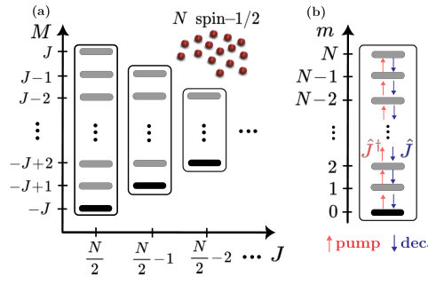
<figcaption class="paper-figure-caption"><b>Fig 1.</b> FIG. 1. Collectively pumped Dicke superradiance. (a) The Hilbert space of N spin-1/2 emitters decomposes into Dicke ladders |J, M⟩of fixed total angular momentum J. Ver- tical transitions M →M ± 1 preserve J, so that each J ladder forms an invariant dynamical subspace, remains de- coupled from all other ladders, and contains 2J + 1 states. (b) In the fully symmetric ladder J = N/2, the dynamics are restricted to the N + 1 Dicke states |m⟩, labeled by m = M + N/2 = 0, . . . , N. Collective pumping ( ˆJ†) and collective dissipation ( ˆJ) induce upward and downward transi- tions, respectively.</figcaption>
</figure>
<figure class="paper-figure-card">
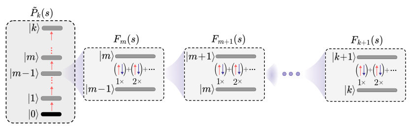
<figcaption class="paper-figure-caption"><b>Fig 2.</b> FIG. 2. Quantum-trajectory resummation. Schematic representation of the exact trajectory construction for the Laplace- transformed population Pk(s), starting from the Dicke ground state |0⟩. The direct upward trajectory |0⟩→|1⟩→· · · →|k⟩ contributes ePk(s) [Eq. (18)]. All additional trajectories are generated by inserting closed pump–decay excursions, which are resummed by the continued-fraction factors Fm(s) [Eq. (19)]. Each factor Fm(s) accounts for excursions from |m −1⟩to |m⟩ and back, including nested excursions to higher Dicke states. In particular, Fk+1(s) accounts for excursions above the final state |k⟩. Their product yields the exact population Pk(s) [Eq. (17)].</figcaption>
</figure>

**Summary.** This paper provides an exact analytical solution for the dynamics of Dicke superradiance using a novel technique based on quantum trajectories. By resumming infinite jump histories into a finite continued fraction, the authors determine the time evolution of the emitter populations. This method offers a powerful tool for analyzing complex driven-dissipative quantum systems beyond simple rate equations.

**Why it may be interesting.** This work provides a powerful, exact analytical technique (continued fractions from quantum trajectories) for solving driven-dissipative quantum systems, which is highly relevant for open quantum systems research in cavity QED and quantum optics.

Detailed structure

**Main problem.** The paper analytically solves the time evolution of an ensemble of N two-level emitters undergoing collective decay and incoherent pumping.

**Main result.** The exact dynamics are derived by constructing a finite continued fraction representation for the Laplace-transformed state populations, providing an analytical solution across various pumping regimes.

**Method.** The core method involves using quantum trajectory theory to resum infinitely many pump-decay histories into a closed-form, finite continued fraction structure in Laplace space.

**Model / system.** The system is Dicke superradiance, modeled by N two-level emitters coupled symmetrically, whose dynamics are governed by a Lindblad master equation restricted to the fully symmetric Dicke ladder.

**Key observables.** Dicke-state populations, collective emission rate (Iss), and the zero-delay second-order correlation function g(2)(0).

**Important parameters / regimes.** The pumping rate (R), decay rate (Γ), and the number of emitters (N); the analysis focuses on the balanced point (R=Γ).

**Assumptions / limitations.** The analysis assumes permutationally symmetric initial states, confining the dynamics to the fully symmetric Dicke subspace.

**Figures summary.** Figure 1 illustrates the Dicke ladder decomposition, while Figure 2 schematically shows the quantum-trajectory resummation forming the continued fraction.

**Paper structure.** The paper establishes the rate equations, derives the Laplace transform representation, and then develops the key result: the exact finite continued fraction by summing over quantum jump histories, followed by regime analyses (weak/strong pumping) and calculation of observables.

Abstract

We study the dynamics of an ensemble of $N$ two-level emitters undergoing collective decay at rate $Γ$ and collective incoherent pumping at rate $R$, confined to the fully symmetric Dicke ladder. Although the population dynamics are confined to a finite set of rate equations, their quantum-trajectory representation involves infinitely many pump-decay histories. We derive an exact finite continued fraction for the Laplace-transformed Dicke-state populations by resumming the infinitely many quantum trajectories generated by competing pump and decay processes. Our construction provides a physically transparent interpretation of the tridiagonal resolvent and extends to arbitrary permutationally symmetric initial states. In the strong- and weak-pumping regimes, we obtain perturbative transient solutions. We also identify exact relaxation eigenvalues and emission observables at balanced pump and decay strengths. Our solution provides a starting point for extending trajectory-based analytical methods to more general driven-dissipative collective systems.

[↑ back to top](#top)

### ⭐ [Quantum critical scaling in convective active matter](http://arxiv.org/abs/2610.37569v1)

**Highlighted author(s):** Jamir Marino  
**Authors:** Jamir Marino  
**Type:** theory · **Category:** statistical mechanics · **PDF:** <https://arxiv.org/pdf/2610.37569v1>  
**Analysis basis:** full PDF text, analyzed in chunks
**Topic relevance:** 🔥 `non-equilibrium universality` **4/5** · `Keldysh / 2PI / non-Gaussian methods` **3/5** · `driven-dissipative phase transition` **3/5** · `correlated / nonlocal dissipation` **1/5** · `methods for driven-dissipative` **1/5**

↔ Scroll figures horizontally

<figure class="paper-figure-card">
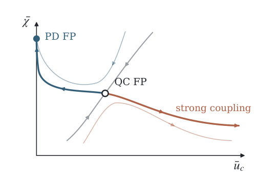
<figcaption class="paper-figure-caption"><b>Fig 1.</b> FIG. 1. Schematic RG flow projected onto the dimensionless quartic coordinate ¯𝑢𝑐and non-Gaussian-noise strength ¯𝜒. Arrows point toward longer length scales following the RG process. The QC FP is a saddle: trajectories passing near it exhibit a common critical crossover before flowing toward the PD FP or leaving the perturbative regime. At PD, the quartic Landau-Ginzburg term and both advective couplings become irrelevant, while nonlinear noise remains.</figcaption>
</figure>
<figure class="paper-figure-card">
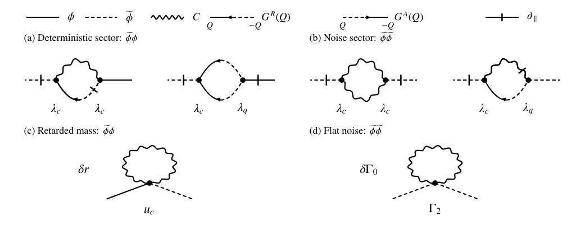
<figcaption class="paper-figure-caption"><b>Fig 2.</b> FIG. 2. One-loop corrections to the quadratic coefficients. Solid and dashed legs denote 𝜙and e𝜙, respectively. A response propagator joins a dashed half-line to a continuous half-line, with its causal arrow pointing from e𝜙to 𝜙. The symbols 𝑅, 𝐴abbreviate retarded and advanced propagators. Wavy lines denote 𝐶; a bar marks a differentiated leg. (a) The two bubbles correcting 𝐾; (b) the two bubbles correcting Γ1. Their contributions proportional to 𝜆2 𝑐and 𝜆𝑐𝜆𝑞are given in Eq. (25). (c),(d) Tadpoles proportional to 𝑢𝑐and Γ2 correct 𝑟and Γ0, respectively.</figcaption>
</figure>
<figure class="paper-figure-card">
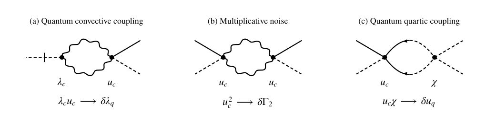
<figcaption class="paper-figure-caption"><b>Fig 3.</b> FIG. 3. Representative corrections for non-linear couplings. (a) Self-advection and the quartic nonlinearity contribute to the quantum convective coupling, renormalizing noise variance. (b) Two quartic-nonlinearity vertices generate a multiplicative-noise contribution. (c) The non-Gaussian-noise strength 𝜒contributes to the quantum quartic coupling 𝑢𝑞through 𝑢𝑐.</figcaption>
</figure>
<figure class="paper-figure-card">
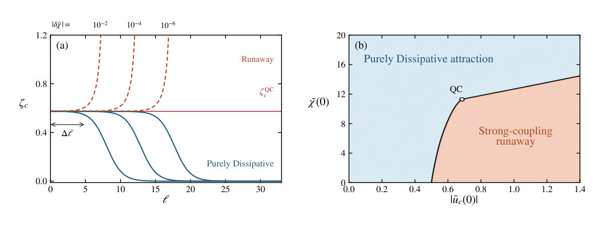
<figcaption class="paper-figure-caption"><b>Fig 4.</b> FIG. 4. QC instability and basins of attraction for 𝜖= 𝜅= 1. Blue denotes flow toward PD and orange runaway. (a) All interactions start at QC(𝑠0) except ¯𝜒(0) = ¯𝜒∗+ 𝛿¯𝜒, with |𝛿¯𝜒| = 10−2, 10−4, 10−6 from left to right. Solid blue: positive 𝛿¯𝜒shifts; dashed orange: negative 𝛿¯𝜒 shifts. The displayed RG plateau Δℓ= 4.858 is for 𝛿¯𝜒= 10−2. (b) Final attractors for initial values of (| ¯𝑢𝑐(0)|, ¯𝜒(0)) with the other four non-linear couplings set at their QC(𝑠0) values; 𝑠0 is chosen such that ¯𝜆𝑞= 0.</figcaption>
</figure>
<figure class="paper-figure-card">
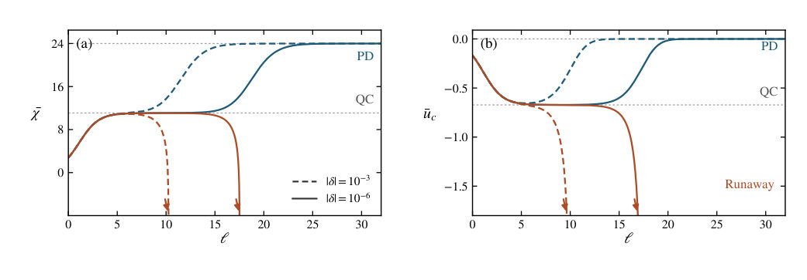
<figcaption class="paper-figure-caption"><b>Fig 5.</b> FIG. 5. Approach to and departure from QC at 𝜖= 𝜅= 1. Initial conditions are given by Eq. (62), with 𝛿= ±10−3 (dashed) and ±10−6 (solid). Positive 𝛿: blue, toward PD; negative 𝛿: orange, runaway. Panels show (a) ¯𝜒and (b) ¯𝑢𝑐; horizontal guides mark QC(𝑠0) and PD.</figcaption>
</figure>

**Summary.** This paper develops a quantum field theory for active matter exhibiting critical behavior, using renormalization group techniques. The analysis identifies a unique Quantum Convective fixed point that governs the universal scaling regime. This suggests a novel mechanism for quantum coherence to dictate universal dynamics in driven, non-equilibrium systems.

**Why it may be interesting.** This work directly addresses non-equilibrium critical phenomena in active matter, using advanced field-theoretic tools (RG) to find universal scaling laws in systems far from thermal equilibrium.

Detailed structure

**Main problem.** To construct a minimal field theory for critical quantum active matter and determine its universal scaling behavior under quantum fluctuations.

**Main result.** The analysis reveals two fixed points—Purely Dissipative (PD) and Quantum Convective (QC)—with the QC fixed point suggesting a unique, extended scaling regime distinct from conventional hydrodynamics.

**Method.** The study employs a one-loop renormalization-group (RG) analysis in $d=2-\epsilon$, analyzing the full hierarchy of correlations near the critical point.

**Model / system.** The model describes a real scalar order parameter $\phi(x, t)$ for active matter, governed by an equation incorporating Landau-Ginzburg ordering, self-advection, and non-Gaussian noise.

**Key observables.** Critical exponents, the scaling of the noise-to-diffusion ratio, and the survival of quantum coherence at the QC fixed point.

**Important parameters / regimes.** The upper critical dimension is found to be $d_c=2$; key parameters include diffusion coefficients ($\Gamma_0, \Gamma_1$) and nonlinear coupling strengths ($\lambda_c, u_c$).

**Assumptions / limitations.** The analysis relies on truncating the BBGKY hierarchy to RG relevant terms near the critical point, and the QC fixed point is treated as a saddle point governing an extended regime.

**Figures summary.** Figure 1 schematically shows the RG flow projected onto dimensionless quartic and non-Gaussian noise coordinates, illustrating the QC FP as a saddle separating flows toward PD or strong coupling.

**Paper structure.** The paper develops the field theory, performs the RG analysis in $d=2-\epsilon$, identifies the PD and QC fixed points, determines the critical exponents, and discusses the physical implications of the QC scaling regime.

Abstract

We construct a minimal field theory for critical quantum active matter, describing a nonconserved scalar order parameter with Landau-Ginzburg ordering and self-advection. When diffusive noise dominates, higher-order quantum vertices and non-Gaussian noise fluctuations remain relevant alongside the deterministic nonlinearities, with an upper critical dimension $d_c=2$. A one-loop renormalization-group analysis in $d=2-ε$ reveals a purely dissipative fixed point, where nonlinear noise suppresses convection, and a quantum convective saddle, where interactions, convection, and non-Gaussian noise coexist. We determine the critical exponents, show that the convective regime is distinct from conventional Burgers hydrodynamics, and discuss how it could govern transient universal scaling in microscopic models of quantum active matter before a crossover to semi-classical dynamics.

[↑ back to top](#top)

### [Diagonal, Switching, and Locally Optimal Unraveling for efficient quantum trajectories in metastable open quantum systems](http://arxiv.org/abs/2610.36067v1)

**Authors:** Pietro Pacchioni, Alberto Mercurio, Patrick Winkel, Fabrizio Minganti  
**Type:** theory · **Category:** other · **PDF:** <https://arxiv.org/pdf/2610.36067v1>  
**Analysis basis:** full PDF text, analyzed in chunks
**Topic relevance:** 🔥 `methods for driven-dissipative` **5/5** · 🔥 `quantum measurements` **4/5** · `driven-dissipative phase transition` **3/5** · `non-equilibrium universality` **2/5** · `Keldysh / 2PI / non-Gaussian methods` **1/5** · `Tavis-Cummings & cavity-many-emitter` **1/5** · `analog quantum simulation` **1/5** · `correlated / nonlocal dissipation` **1/5**

↔ Scroll figures horizontally

<figure class="paper-figure-card">
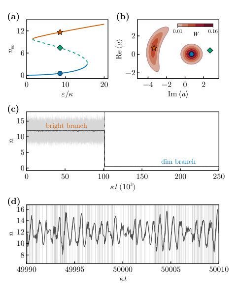
<figcaption class="paper-figure-caption"><b>Fig 1.</b> Figure 1: Characterization of the driven–dissipative Kerr resonator introduced in Sec. 2.2. (a) Number of photons according to the semiclassical solution in Eq. (8) as a func- tion of the drive ε, with the stable dim (blue) and bright (orange) branches and the unstable saddle (dashed green). The bistable window is 1.563 ≤ε/κ ≤15.670. The mark- ers indicate the working point used in the next panels. (b) Wigner function of the steady state of Eq. (7). The orange, blue and green markers indicate the position of the bright, dim, and saddle solutions of Eq. (8), respectively. (c) Photon number n(t) = ⟨ψ(t)|ˆa†ˆa|ψ(t)⟩(light gray) as a function of time for a single trajectory initialized in the...</figcaption>
</figure>
<figure class="paper-figure-card">
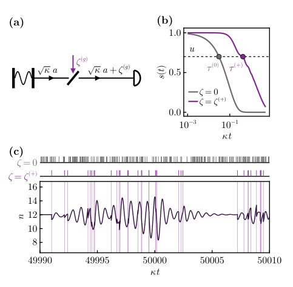
<figcaption class="paper-figure-caption"><b>Fig 2.</b> Figure 2: Dynamics of the Kerr resonator in the bright branch at the same bistable point as in Fig. 1, but in the gauge ζ = ζ(+) that minimizes the activity [see Eq. (11)]. (a) Sketch of a homodyne detection apparatus, where the cavity output field (associated with the single-photon loss jump operator √κˆa) is mixed by a beamsplitter with a coherent local os- cillator of amplitude ζ(g) prior to detection. Monitoring the resulting output port corresponds to the shifted jump operator √κˆa + ζ(g)1, i.e., the transformation described in Eq. (9). (b) Survival probability in Eq. (18) for an initial coherent state with the amplitude predicted by the semiclassical solution in Eq. (8). The dashed...</figcaption>
</figure>
<figure class="paper-figure-card">
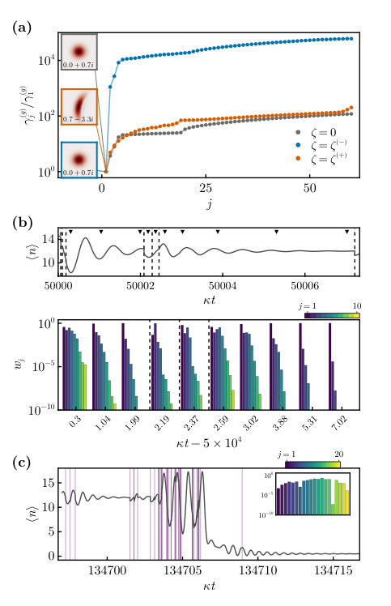
<figcaption class="paper-figure-caption"><b>Fig 3.</b> Figure 3: Properties of the spectrum and eigenvectors of the non-Hermitian Hamiltonians H(g) eff in different gauges. (a) Eigenvalue decay rates γ(g) j for the undisplaced gauge (ζ = 0) and for the two shifted ones (ζ = ζ(±)) , each normalized to its own smallest activity γ(g) 1 . Insets show the Wigner functions of the least-decaying eigenmode of each ˆH(g) eff together with their amplitudes ⟨ˆa⟩which roughly corresponds to −ζ(g). Note that these Wigner functions resemble the metastable states identifiable from Fig. 1(b). (b) Top: zoom on the dynamics in Fig. (2), i.e., a system in the bright branch evolved using the optimal gauge ζ = ζ(+), which minimizes the activity. The expectation...</figcaption>
</figure>
<figure class="paper-figure-card">
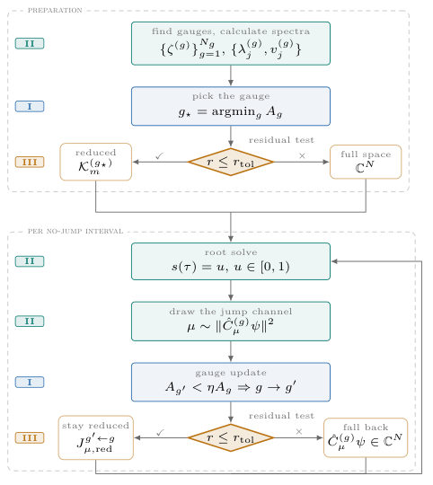
<figcaption class="paper-figure-caption"><b>Fig 4.</b> Figure 4: Schematic of the DiSLOU solver workflow. Badges on the left indicate the relevant layer. The steps labeled preparation are performed only once per evolution, while the ones labeled per no-jump interval are repeated for each no- jump evolution of each trajectory.</figcaption>
</figure>
<figure class="paper-figure-card">
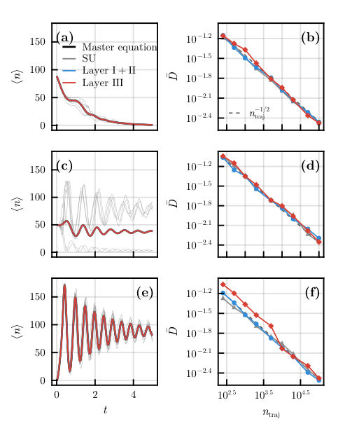
<figcaption class="paper-figure-caption"><b>Fig 5.</b> Figure 5: Accuracy and convergence for the Kerr resonator model. The rows from top to bottom refer to the dim, bistable and bright regimes, respectively. Left column, panels (a,c,e): mean photon number ⟨ˆn⟩calculated from 105 trajectories for standard unraveling (gray), Layer I+II (light blue), and Layer III (red), together with the master-equation reference (black); six trajectories appear as thin gray curves, to highlight the different behavior between the mono- and bistable regimes. Right column, panels (b,d,f): averaged trace distance D from Eq. (24) against the number of trajectories ntraj, for standard unraveling (gray triangles), Layer I+II (light blue circles), and Layer III (red...</figcaption>
</figure>

**Summary.** This paper introduces the DiSLOU method to overcome the computational bottleneck in simulating quantum trajectories within metastable open quantum systems. By combining optimal unraveling, Hamiltonian diagonalization, and subspace truncation, DiSLOU significantly accelerates simulations. It is particularly valuable for studying rare switching events in systems like driven resonators and cat-state manifolds.

**Why it may be interesting.** This work provides a highly efficient numerical framework for simulating complex, non-equilibrium dynamics in open quantum systems, which is crucial for modeling quantum devices operating near multiple stable states.

Detailed structure

**Main problem.** The paper addresses the computational challenge of simulating quantum trajectories in open quantum systems that exhibit metastability, where standard methods become prohibitively expensive.

**Main result.** The proposed DiSLOU method achieves significant speedups (over an order of magnitude) in simulating rare switching events between metastable attractors without losing accuracy.

**Method.** DiSLOU combines three layers: (i) locally optimal unraveling to minimize jumps, (ii) diagonal propagation by diagonalizing the effective Hamiltonian, and (iii) using local reduced eigenspaces to truncate the state evolution.

**Model / system.** The study focuses on open quantum systems, exemplified by the driven-dissipative Kerr resonator and two-mode parametrically coupled oscillators, whose evolution is governed by a Lindblad master equation.

**Key observables.** Switching statistics, quantum jump rates, and the fidelity of simulated rare events (e.g., bit-flips).

**Important parameters / regimes.** Metastability timescales, jump probabilities, and the system's non-Hermitian effective Hamiltonian.

**Assumptions / limitations.** The physics of interest is assumed to be dominated by the slow dynamics associated with the metastable attractors.

**Figures summary.** The figures illustrate the process of a single sampled wavefunction evolution (quantum trajectory) under an effective non-Hermitian Hamiltonian, interrupted by quantum jumps.

**Paper structure.** The paper introduces the problem of simulating metastable dynamics, details the limitations of standard quantum trajectory methods, and then systematically presents the three components of the DiSLOU method before benchmarking it on physical systems.

Abstract

Open quantum systems can display metastability, with multiple long-lived states coexisting. Examples include the bistability of bright and dim manifolds in nonlinear driven resonators, or the long-lived coherent states of opposite phases in parametrically-driven systems, the building block of cat-state-based quantum computers. Metastability often emerges at system sizes where density-matrix evolution is impractical. Quantum trajectories mitigate this issue by evolving wavefunctions rather than density matrices. Metastable states then emerge as attractors towards which the system rapidly relaxes until a rare switching event brings it to another attractor. Simulating them remains costly, as one must resolve fast intra-attractor dynamics over timescales long enough to gather switching statistics. To tackle this problem, we introduce the Diagonal, Switching, and Locally Optimal Unraveling (DiSLOU) method, which combines three optimization layers: (i) Switching among locally optimal unravelings that minimize the number of quantum jumps in each metastable region. (ii) Diagonal propagation: the no-jump evolution is accelerated by diagonalizing the non-Hermitian effective Hamiltonian once per attractor. (iii) Local reduced eigenspaces: the no-jump state can be faithfully propagated in a truncated subspace of only slowly decaying eigenmodes. We benchmark DiSLOU on the driven-dissipative Kerr resonator, finding no measurable loss of accuracy and the largest speedup in the bistable regime, where standard trajectories are most expensive. We then apply the method to the more challenging problem of accurately simulating rare bit-flip events in the cat manifold emerging in a two-mode dissipatively stabilized parametric oscillator, obtaining a performance improvement of over one order of magnitude. An implementation of DiSLOU in Julia is available as an open-source package.

[↑ back to top](#top)

### [The Disordered Universe 2025: Open Effective Field Theories](http://arxiv.org/abs/2610.36898v1)

**Authors:** Alessandro Fumagalli, Francesco Paronetto, Leonardo Stanzani, Mattia Varrone, Lucas Vicente García-Consuegra, Thomas Colas, Paolo Benincasa, Guilherme Leite Pimentel  
**Type:** theory · **Category:** statistical mechanics · **PDF:** <https://arxiv.org/pdf/2610.36898v1>  
**Analysis basis:** full PDF text, analyzed in chunks
**Topic relevance:** 🔥 `Keldysh / 2PI / non-Gaussian methods` **5/5** · `correlated / nonlocal dissipation` **3/5** · `driven-dissipative phase transition` **3/5** · `methods for driven-dissipative` **3/5** · `non-equilibrium universality` **3/5** · `quantum measurements` **1/5**

↔ Scroll figures horizontally

<figure class="paper-figure-card">
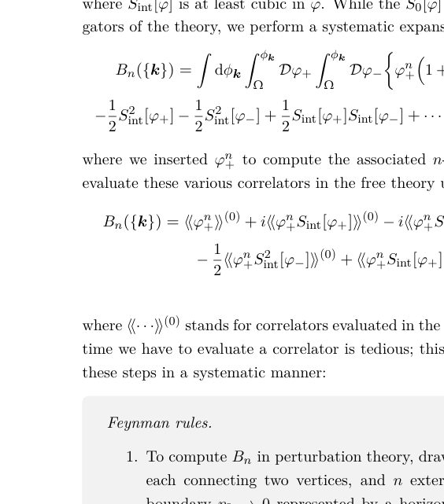
<figcaption class="paper-figure-caption"><b>Fig 1.</b> Fig. 2. Times run from bottom at η →−∞to top at η →η0.</figcaption>
</figure>
<figure class="paper-figure-card">
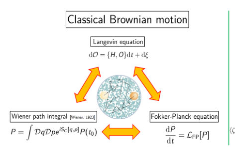
<figcaption class="paper-figure-caption"><b>Fig 2.</b> Figure 4: Classical and quantum open system correspondence. Classically, stochastic effects are</figcaption>
</figure>
<figure class="paper-figure-card">
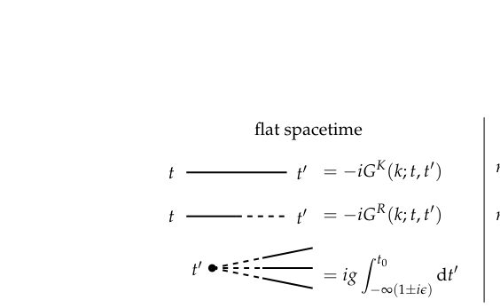
<figcaption class="paper-figure-caption"><b>Fig 3.</b> Figure 6: Feynman rules in the Keldysh basis.</figcaption>
</figure>
<figure class="paper-figure-card">
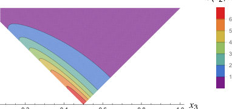
<figcaption class="paper-figure-caption"><b>Fig 4.</b> Figure 8: Shape function of the contact bispectrum generated by ˙φ3 a in Minkowski. Left: In the</figcaption>
</figure>
<figure class="paper-figure-card">
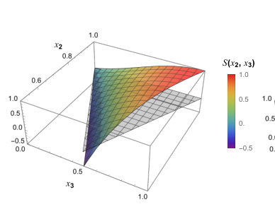
<figcaption class="paper-figure-caption"><b>Fig 5.</b> Figure 10: Shapes of the bispectrum at large dissipation γ = 5H. In this regime, the signal peaks in the</figcaption>
</figure>

**Summary.** This paper introduces Open Effective Field Theories (O-EFTs) as a necessary extension of traditional EFTs to model quantum systems interacting with unknown, noisy environments. It employs the Schwinger-Keldysh formalism to systematically calculate cosmological correlators, allowing physicists to study non-equilibrium dynamics in cosmology, such as during inflation.

**Why it may be interesting.** The explicit use of the Schwinger-Keldysh formalism to model dissipation and noise in cosmological EFTs provides a powerful, general methodology for analyzing non-equilibrium quantum field theory, which is highly relevant to open quantum systems studied in AMO physics.

Detailed structure

**Main problem.** The paper addresses the need for a systematic framework to model gravitational and cosmological sectors evolving in open, noisy, and dissipative environments, moving beyond traditional closed-system Effective Field Theories (EFTs).

**Main result.** The Open Effective Field Theory (O-EFT) framework, utilizing the Schwinger-Keldysh formalism, provides the necessary tools to systematically capture the influence of unknown, dissipative environments on quantum field dynamics.

**Method.** The core method involves using the Schwinger-Keldysh formalism to compute expectation values via a double-branch path integral, which naturally incorporates non-unitary and dissipative contributions.

**Model / system.** The primary system is cosmology, specifically analyzing the dynamics of quantum fields (like a massless scalar field $\phi$) in an expanding FLRW background metric. The formalism is applied to model open quantum systems interacting with an unobservable environment.

**Key observables.** Cosmological correlators (e.g., $\langle \prod b\phi(k_i) 
angle$), which are inferred from late-time observables like CMB anisotropies, and information-spreading measures like OTOCs.

**Important parameters / regimes.** The analysis covers inflationary scenarios, and the framework is designed to handle dissipation and noise arising from the environment.

**Assumptions / limitations.** The primary assumption is that the system's dynamics can be systematically decomposed into unitary (closed) and non-unitary (dissipative/stochastic) parts via the path integral decomposition.

**Figures summary.** Figure 1 is noted to compare the single-branch path integral (for pure states) versus the double-branch path integral (for density matrices, accommodating mixed states).

**Paper structure.** The notes outline a structured development: (1) Introducing the O-EFT formalism using Schwinger-Keldysh, (2) Applying it to a scalar field in curved spacetime, (3) Extending the formalism to inflationary cosmology, and (4) Generalizing the approach to gauge theories and gravity.

Abstract

Effective field theories (EFTs) offer a powerful method to unify diverse models under a small set of control parameters, allowing systematic expansions around well-established theories. While these techniques were traditionally developed for particle physics experiments with clean, isolated initial states, realistic macroscopic environments are often noisy and dissipative. Recognising the limitations of traditional EFTs has recently sparked intense progress at the interface of high-energy physics and condensed matter. These developments motivate a new approach to gravitation and cosmology, one that models the gravitational sector as evolving in the presence of an unobservable medium. Open Effective Field Theories provide a systematic, controllable framework for this endeavour. This chapter presents this versatile framework and illustrates how the Schwinger-Keldysh formalism captures the influence of unknown environments, manifesting as dissipation and noise, on observational probes. These notes are based on a series of lectures held during the La Ricotta Summer School "The Disordered Universe 2025" from 21 July to 1 August 2025.

[↑ back to top](#top)

### [The TEMPO network can be made independent of the system size](http://arxiv.org/abs/2610.37012v1)

**Authors:** Valentin Link  
**Type:** theory · **Category:** numerical methods · **PDF:** <https://arxiv.org/pdf/2610.37012v1>  
**Analysis basis:** full PDF text, analyzed in chunks
**Topic relevance:** 🔥 `methods for driven-dissipative` **5/5** · `correlated / nonlocal dissipation` **2/5** · `Keldysh / 2PI / non-Gaussian methods` **1/5** · `Tavis-Cummings & cavity-many-emitter` **1/5** · `analog quantum simulation` **1/5** · `driven-dissipative phase transition` **1/5**

↔ Scroll figures horizontally

<figure class="paper-figure-card">
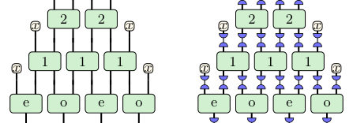
<figcaption class="paper-figure-caption"><b>Fig 1.</b> FIG. 1. (a) Graphical notation for the boundary vector x, the gate b(k) and the low-rank projector P = uuT . Bold legs describe indices with dimension d2m whereas thin legs have dimension (2m + 1)(m + 1). (b) TEMPO network as in Ref. [6], for N = 4 time steps. Applying the projector to all network bonds induces an error of O(δt2).</figcaption>
</figure>
<figure class="paper-figure-card">
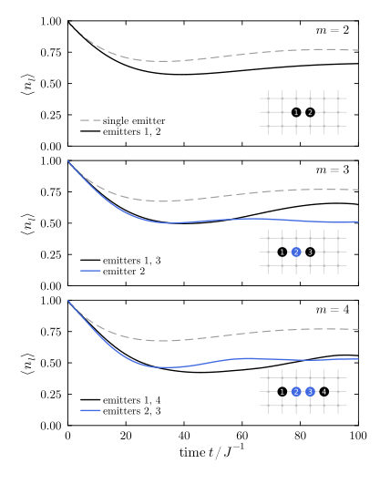
<figcaption class="paper-figure-caption"><b>Fig 2.</b> FIG. 3. Relaxation dynamics of the emitter occupation ⟨nl⟩= ⟨σ+ l σ− l ⟩for the model (10) with ωe = −4J and g2 = 0.1J2. The coupling geometry is illustrated in the insets, dashed lines show the relaxation of a single emitter. Simulations were performed using the causal TEMPO algorithm [7] at Nc = N, δt = 0.1/J with the reduced network and SVD truncation tolerances 4×10−8 (m = 2), 1.2×10−6 (m = 3) and 4×10−5</figcaption>
</figure>
<figure class="paper-figure-card">
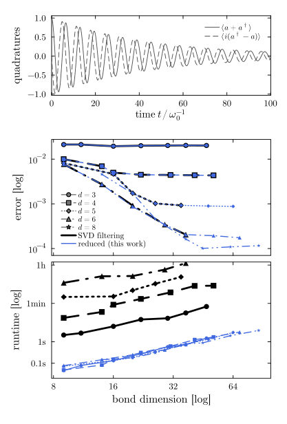
<figcaption class="paper-figure-caption"><b>Fig 3.</b> FIG. 2. Benchmark of uniTEMPO for the model (8) (η = 0.01, ωc = 3ω0) using the reduced network compared to using the full network and SVD filtering (Ref. [4]). Top: Example dynamics used to quantify the errors. Center: Error of the dynamics measured by the maximum trace norm of the dif- ference between the time-evolved system state and the exact reference. At low d errors are dominated by the Fock-space cutoff. Bottom: Runtimes reported for contracting the in- fluence functional to MPOs with different bond dimensions for δt = 0.025/ω0 on an AMD EPYC 7313 CPU (one Julia thread, two OpenBLAS threads, Julia 1.11).</figcaption>
</figure>

**Summary.** This paper introduces a significant algorithmic improvement to the Time-Evolving Matrix Product Operator (TEMPO) method for simulating open quantum systems. By exploiting a low-rank structure, the authors show that the required tensor network bond dimensions become independent of the physical system size. This breakthrough dramatically expands the accessible parameter space for studying large, complex quantum dynamics.

**Why it may be interesting.** This work is highly relevant as it provides a crucial algorithmic breakthrough for simulating complex open quantum dynamics, directly addressing the computational bottleneck associated with system size in tensor network methods.

Detailed structure

**Main problem.** The primary challenge is efficiently simulating non-Markovian open quantum system dynamics using the TEMPO method, which suffers from unfavorable scaling with system size in its standard tensor network representation.

**Main result.** The authors demonstrate a structural reduction in the internal bond dimensions of the TEMPO network to a size independent of the system size, making large-scale simulations feasible.

**Method.** The method involves exploiting a low-rank structure within the time-discretized Feynman-Vernon influence functional, allowing the bond dimensions to be reduced to $(2m+1)(m+1)$ based only on the number of coupling channels ($m$).

**Model / system.** The study models open quantum systems, exemplified by a damped harmonic oscillator coupled to a bath, or multiple emitters coupled to a bosonic lattice. The dynamics are governed by the time-evolving matrix product operator (TEMPO) formalism.

**Key observables.** Maximum trace norm deviation (for benchmark), and the relaxation dynamics of the emitter occupation $\langle n_l 
angle$ (for multi-channel systems).

**Important parameters / regimes.** The reduction maintains the standard $O(\delta t^2)$ error order. The reduced bond dimension depends only on $m$, the number of independent coupling channels.

**Assumptions / limitations.** The reduction relies on the existence of a low-rank structure within the network gates, and the error analysis confirms the preservation of the standard time-step error order.

**Figures summary.** Figure 1 illustrates the gate projection process leading to bond dimension reduction. Figure 2 benchmarks the reduced network against full and SVD filtered methods for the damped oscillator. Figure 3 shows the relaxation dynamics for the multi-channel emitter model.

**Paper structure.** The paper introduces the TEMPO method for open quantum systems, identifies the scaling bottleneck, and then presents the novel structural reduction technique. This technique is validated first on a benchmark (damped oscillator) and then applied to a multi-channel emitter model to demonstrate scalability.

Abstract

The time-evolving matrix product operator (TEMPO) method efficiently simulates non-Markovian open quantum system dynamics by contracting a two-dimensional tensor network representing the time-discretized Feynman-Vernon influence functional. The standard form of this network has an unfavorable scaling with the size of the system. We show that, within the usual second-order time-step error, the dimensions of all internal network bonds can be reduced to $(2m+1)(m+1)$, where $m$ is the number of independent coupling channels. This dimension does not depend on the number of distinct eigenvalues of the coupling operators. The system size only enters in the final boundary layer of the network, making large system sizes accessible to TEMPO methods. This structure was discovered by Claude Opus 5.5 during guided algorithm development.

[↑ back to top](#top)

### [Kinetic Slush in Dissipative Rydberg Arrays](http://arxiv.org/abs/2610.36661v1)

**Authors:** Hufeng Wen, Ya-Xin Xiang, Qun-Li Lei, Thomas Pohl, Zhengyang Bai, Yu-Qiang Ma  
**Type:** theory · **Category:** other · **PDF:** <https://arxiv.org/pdf/2610.36661v1>  
**Analysis basis:** full PDF text, analyzed in chunks
**Topic relevance:** 🔥 `Rydberg arrays` **4/5** · 🔥 `analog quantum simulation` **4/5** · 🔥 `driven-dissipative phase transition` **4/5** · 🔥 `methods for driven-dissipative` **4/5** · `correlated / nonlocal dissipation` **3/5** · `non-equilibrium universality` **3/5** · `scars & prethermalization` **2/5** · `Frenkel-Kontorova` **1/5** · `Keldysh / 2PI / non-Gaussian methods` **1/5** · `quantum measurements` **1/5**

↔ Scroll figures horizontally

<figure class="paper-figure-card">
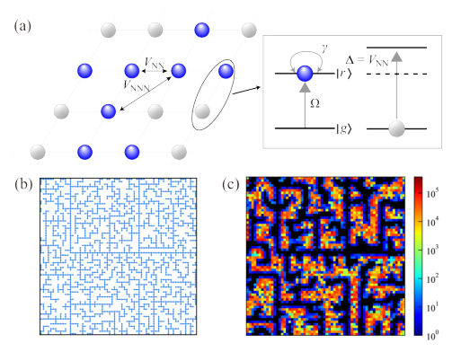
<figcaption class="paper-figure-caption"><b>Fig 1.</b> Figure 1. Model setup and frustrated Rydberg kinetics. (a) Schematic of two-level atoms on a square lattice driven by a laser with Rabi frequency Ωand detuning ∆. The condition ∆= VNN facil- itates excitation exclusively when exactly one NN is in the Rydberg state |r⟩. Under this condition, VNNN acts as a kinetic frustration that modulates the local spin-flip rate. (b) Snapshot of the steady-state spatial configuration. (c) Corresponding heatmap of local activity K j, measuring the number of spin flips at site j over an observation window T = 106. Dark-blue regions indicate low-activity, solid-like sites within the observation window, while red/yellow regions de- note highly active,...</figcaption>
</figure>
<figure class="paper-figure-card">
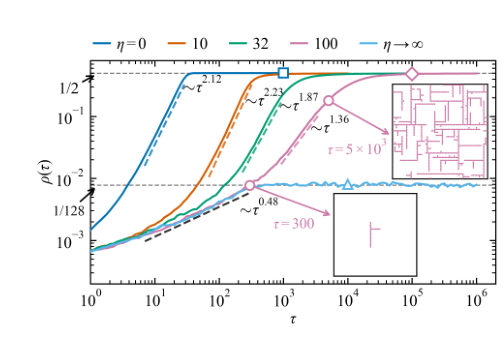
<figcaption class="paper-figure-caption"><b>Fig 2.</b> Figure 2. Dynamical relaxation under kinetic frustration. Time evolution of the Rydberg density ρ(τ) across various frustration strengths η on a 64 × 64 lattice. Solid curves denote ensemble aver- ages over 128 independent trajectories, while dashed lines show local power-law fits within the indicated time intervals. Insets display real- space snapshots of a single trajectory at τ = 300 and τ = 5000 for η = 100.</figcaption>
</figure>
<figure class="paper-figure-card">
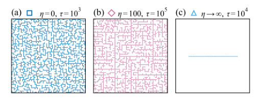
<figcaption class="paper-figure-caption"><b>Fig 3.</b> Figure 3. Spatial structure of the macroscopic steady state. (a)– (c) Steady-state spatial configurations on a 64 × 64 lattice for (a) η = 0 at τ = 103, (b) η = 100 at τ = 105, and (c) η →∞at τ = 104. The symbols in the panel titles correspond to the sampling markers in Fig. 2. The dots denote Rydberg excitations, with solid lines connecting excited nearest neighbors.</figcaption>
</figure>
<figure class="paper-figure-card">
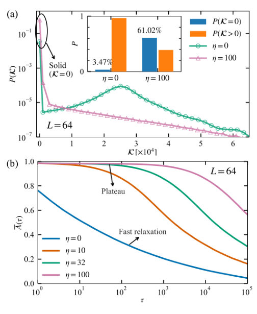
<figcaption class="paper-figure-caption"><b>Fig 4.</b> Figure 4. Spatio-temporal signatures of the kinetic slush state. (a) Local activity distribution P(K) at η = 0 and η = 100. Inset: Comparison between the fractions of sites with no observed flips (K = 0) and sites with observed flips (K &gt; 0) within the observation window; the fraction of sites with no observed flips increases from 3.47% to 61.02% as frustration is introduced. Statistics are accumu- lated over 256 independent KMC trajectories within an observation window of T = 105. (b) Site-averaged autocorrelation function ¯A(τ) for various η, showing slower relaxation with increasing η and an ex- tended plateau followed by slow decay at strong frustration.</figcaption>
</figure>
<figure class="paper-figure-card">
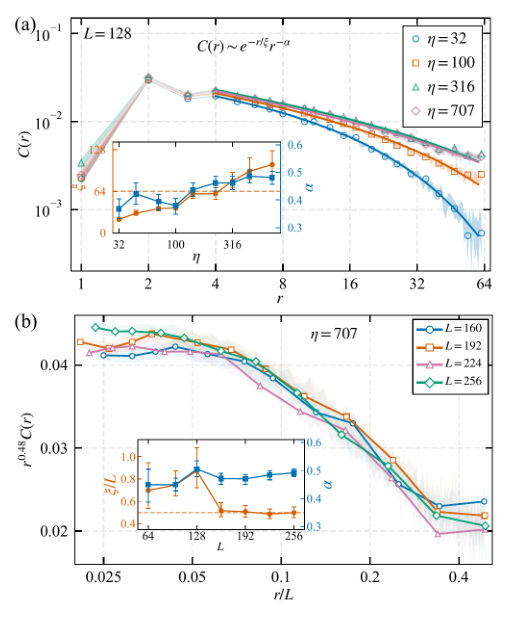
<figcaption class="paper-figure-caption"><b>Fig 5.</b> Figure 5. Spatial correlations and finite-size scaling analysis. (a) Spatial correlation function C(r) for L = 128 at different frustra- tion strengths η. Solid curves show fits to the generalized Ornstein- Zernike form. Inset: Fitted correlation length ξ (red) and exponent α (blue) versus η; the dashed line marks ξ = L/2. (b) Finite-size scal- ing of C(r) at η = 707. The rescaled correlations r0.48C(r), plotted against r/L for different system sizes L, collapse over an intermedi- ate range of scaled distances. Inset: Normalized correlation length ξ/L (red) and exponent α (blue) versus L; the dashed line marks ξ/L = 0.5. Shaded bands and error bars indicate standard errors estimated via...</figcaption>
</figure>

**Summary.** This paper explores the complex, non-equilibrium dynamics of a 'kinetic slush' phase in a 2D array of dissipative Rydberg atoms. By tuning the laser detuning and introducing kinetic frustration via next-nearest-neighbor interactions, the system exhibits a rich crossover between different growth regimes. The findings establish these driven-dissipative quantum systems as a powerful tool for engineering complex soft-matter phenomena.

**Why it may be interesting.** This work provides a concrete, controllable platform (Rydberg arrays) to model complex, non-equilibrium soft-matter physics, bridging concepts from frustrated magnetism and driven-dissipative quantum dynamics.

Detailed structure

**Main problem.** The study investigates the nonequilibrium dynamics of a kinetic slush state realized in a two-dimensional dissipative Rydberg atom array.

**Main result.** The system exhibits a slush phase characterized by dynamical heterogeneity and a crossover from isotropic spreading to one-dimensional constrained growth, tunable by kinetic frustration.

**Method.** Kinetic Monte Carlo (KMC) simulations are employed to analyze the time evolution of the system's density and spatial correlations.

**Model / system.** The system is a 2D dissipative Rydberg atom array governed by a Hamiltonian including van der Waals interactions, evolving under a Lindblad master equation in the strong dephasing regime.

**Key observables.** Mean Rydberg density $
ho(	au)$, local activity $K_j$, generalized Ornstein-Zernike spatial correlations, and fractal dimension $d_f$.

**Important parameters / regimes.** Laser detuning ($\Delta$), kinetic frustration strength ($\eta$), and the ratio of NNN coupling to dissipation ($\eta$).

**Assumptions / limitations.** The analysis relies on the strong dephasing limit ($\gamma \gg \Omega$) and often truncates interactions to nearest-neighbor and next-nearest-neighbor terms.

**Figures summary.** Figures illustrate the model setup, steady-state spatial configurations, local activity heatmaps, and the time evolution of the mean Rydberg density $
ho(	au)$ for varying frustration strengths.

**Paper structure.** The paper develops the model Hamiltonian and master equation, analyzes the dynamics in different frustration regimes ($\eta=0$, finite $\eta$, $\eta 	o \infty$), and quantifies the resulting spatial structures using correlation functions and fractal analysis.

Abstract

We investigate the nonequilibrium dynamics of a kinetic slush state realized via facilitated excitations in a two-dimensional dissipative Rydberg atom array. Utilizing kinetic Monte Carlo simulations in the strong dephasing regime, we show that tuning the laser detuning to compensate for nearest-neighbor interactions enables facilitated dynamics, while residual next-nearest-neighbor interactions induce kinetic frustration. This competition gives rise to an emergent slush phase characterized by pronounced dynamical heterogeneity and the coexistence of liquid- and solid-like configurations. By probing its nonequilibrium real-time evolution, we uncover a dynamical crossover from isotropic spreading to one-dimensional constrained growth, which can be continuously tuned by the frustration strength. Within this crossover regime, the slush dynamics generate fractal cluster geometries and generalized Ornstein-Zernike spatial correlations. Finite-size scaling analysis supports the system's proximity to criticality. Our findings establish driven-dissipative Rydberg systems as a highly controllable platform for engineering complex nonequilibrium soft-matter phenomena.

[↑ back to top](#top)

### [Emergent Fermi Surfaces in Periodically Driven Bose Gases](http://arxiv.org/abs/2610.36038v1)

**Authors:** Li-kun Shi, Oles Matsyshyn, Inti Sodemann Villadiego  
**Type:** theory · **Category:** quantum gases · **PDF:** <https://arxiv.org/pdf/2610.36038v1>  
**Analysis basis:** full PDF text, analyzed in chunks
**Topic relevance:** 🔥 `analog quantum simulation` **4/5** · `Keldysh / 2PI / non-Gaussian methods` **3/5** · `driven-dissipative phase transition` **3/5** · `methods for driven-dissipative` **3/5** · `non-equilibrium universality` **3/5** · `scars & prethermalization` **1/5**

↔ Scroll figures horizontally

<figure class="paper-figure-card">
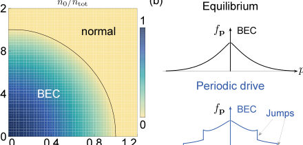
<figcaption class="paper-figure-caption"><b>Fig 1.</b> FIG. 1. (a) Condensate fraction n0/ntot as a function of bath temperature and drive amplitude. The reference scales are the undriven critical temperature kBTc/Ω= 0.3075 and the zero-temperature critical drive Ac/ √</figcaption>
</figure>
<figure class="paper-figure-card">
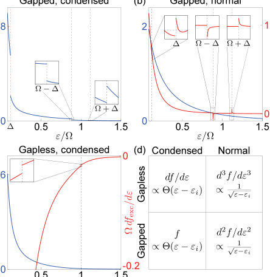
<figcaption class="paper-figure-caption"><b>Fig 2.</b> FIG. 2. Angle-averaged boson occupation fexc(ε) (blue) of bosons coupled to a gapped bath for: (a) the BEC state at kBTB/Ω= 0.05, and (b) the normal state at kBTB/Ω= 0.5, also showing is second derivative (red). (c) Angle-averaged occupation (blue) of a BEC coupled to an ohmic bath (νg = 0) at kBTB/Ω= 0.05, and its derivative (red). The driving amplitude in (a–c) is A0/ √</figcaption>
</figure>
<figure class="paper-figure-card">
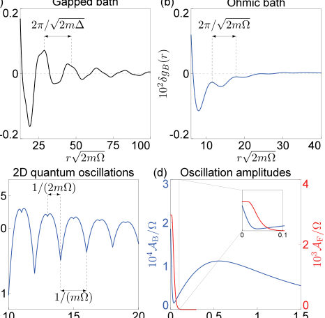
<figcaption class="paper-figure-caption"><b>Fig 3.</b> FIG. 3. (a,b) Background-subtracted density correlations δgB(r) = CB(r)/n2 tot −ˆCg/r of a 3D driven BEC for (a) gapped and (b) ohmic baths. The coefficient ˆCg is fitted to the long-distance correlation (SM Sec. C 3). The measurement direction is at arccos(1/ √</figcaption>
</figure>

**Summary.** This work demonstrates that periodically driving a Bose gas out of equilibrium can induce emergent Fermi surfaces, characterized by non-analyticities in momentum space. These signatures manifest as observable long-range oscillations in the density correlations. The findings establish non-equilibrium dynamics as a powerful route to realizing Fermi liquid physics in bosonic quantum gases.

**Why it may be interesting.** It provides a concrete, non-equilibrium mechanism for generating Fermi surface physics in bosonic systems, which is a long-standing goal in the field, offering experimental pathways using ultra-cold atoms.

Detailed structure

**Main problem.** The study investigates the emergence of Fermi surfaces in bosonic systems that are driven out of equilibrium by periodic forces.

**Main result.** Non-equilibrium driving conditions can induce non-analyticities in the momentum occupation function, mimicking Fermi surfaces, even in weakly interacting bosons.

**Method.** The analysis uses the Floquet-Boltzmann equation to model the steady-state occupation function and calculates density correlations via Fourier transforms.

**Model / system.** The model is a weakly interacting Bose gas coupled to a thermal bath and subjected to a time-periodic driving force, analyzed in both BEC and normal gas regimes.

**Key observables.** Non-analyticities (jumps) in the momentum occupation function $f_p$, Friedel oscillations in density correlations $C_B(r)$, and quantum oscillations in response to magnetic fields.

**Important parameters / regimes.** Driving frequency ($\Omega$), bath temperature ($T_B$), and driving amplitude ($A_0$).

**Assumptions / limitations.** The analysis relies on the weak coupling limit to derive the Floquet-Boltzmann equation and assumes the existence of distinct non-analytic features corresponding to Fermi surface signatures.

**Figures summary.** Figures illustrate the phase diagram, schematic occupation functions comparing equilibrium vs. driven states, and the spatial decay of density correlations showing oscillatory behavior.

**Paper structure.** The paper progresses by establishing the non-equilibrium framework via the Floquet-Boltzmann equation, identifying the momentum-space signatures (non-analyticities), and then calculating the corresponding real-space fingerprints (density correlations and kinetic energy oscillations).

Abstract

We show that the steady state of a periodically driven Bose gas coupled to a thermal bath features emergent Fermi surfaces both in its high temperature and Bose-Einstein-condensate (BEC) states. These emergent Fermi surfaces are non-analyticities in the occupation function as a function of momentum arising from the lack of detailed balance of collisions away from equilibrium. They are stronger in the BEC than in the normal gas, and can be more robust against finite temperature smearing than the usual equilibrium Fermi surfaces of Fermi gases. We also show that they give rise to analogous rich phenomena, such as Friedel oscillations in the density correlations and quantum oscillations in response to applied magnetic fields controlled by their areas, albeit with marked quantitative differences. Our results establish non-equilibrium conditions as a promising alternative pathway to achieve the long-sought-after emergence of Fermi surfaces in bosonic system. We outline strategies to experimentally discover these exotic states in ultra-cold atomic clouds.

[↑ back to top](#top)

### [Langevin dynamics towards Generalized Gibbs Ensembles](http://arxiv.org/abs/2610.37129v1)

**Authors:** Rafael González-Albaladejo, Leticia F. Cugliandolo, Gustavo S. Lozano, Daniel A. Stariolo  
**Type:** theory · **Category:** statistical mechanics · **PDF:** <https://arxiv.org/pdf/2610.37129v1>  
**Analysis basis:** full PDF text, analyzed in chunks
**Topic relevance:** 🔥 `methods for driven-dissipative` **4/5** · `non-equilibrium universality` **3/5** · `scars & prethermalization` **3/5** · `Keldysh / 2PI / non-Gaussian methods` **2/5** · `quantum measurements` **2/5** · `analog quantum simulation` **1/5** · `correlated / nonlocal dissipation` **1/5** · `driven-dissipative phase transition` **1/5**

↔ Scroll figures horizontally

<figure class="paper-figure-card">
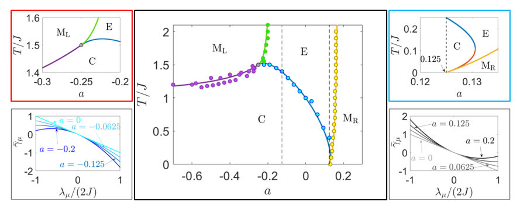
<figcaption class="paper-figure-caption"><b>Fig 1.</b> Figure 1: The full phase diagram in the (a, T/J) plane of the Generalized Neumann model HGNM = P µ ¯γµIµ with quadratic ¯γµ = aλ2 µ/J −bλµ and b = 1/2. The vertical dashed lines are situated at a = ±1/8: for a &lt; −1/8 (a &gt; 1/8), ¯γµ(λµ) has a maximum (minimum) within the interval [−2J, 2J]. There are three phases: condensed (C, with ⟨x2 N⟩/N = q ̸= 0, ⟨x2 µ̸=N⟩= O(1) and ⟨p2 µ⟩= O(1)), extended (E, with ⟨x2 µ⟩= O(1) and ⟨p2 µ⟩= O(1)) and two phases in motion (MR and ML, in which modes close to the right of the spectrum in MR and modes close to the left of the spectrum in ML increase their momentum indefinitely). The transition between the extended and condensed phase is given by Eq. (61)...</figcaption>
</figure>
<figure class="paper-figure-card">
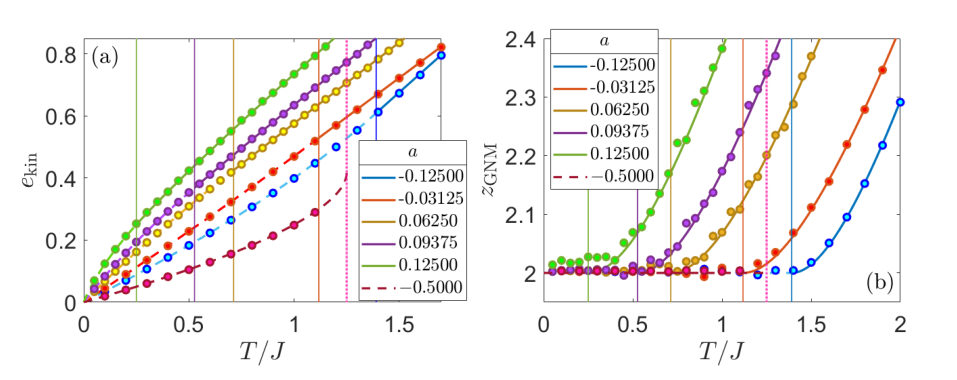
<figcaption class="paper-figure-caption"><b>Fig 2.</b> Figure 2: The (asymptotic) kinetic energy density, ekin = (2mN)−1 P µ⟨p2 µ⟩(a), and Lagrange multiplier, zGNM (b), as functions of temperature, for b = 1/2 and different values of a given in the keys. The data points stem from the numerical integration of the Langevin process, for N = 500, and are averaged over a few runs. The thin vertical lines correspond to Tc(a) towards the extended phase, given in Eq. (61) and drawn in the main central panel of Fig. 1 as a solid blue line with some numerical data points with the same blue colour. The dotted pink vertical line represents Tc(a = −0.5) = 1.25J on the violet critical line towards the moving phase ML of the phase diagram of Fig. 1. The...</figcaption>
</figure>
<figure class="paper-figure-card">
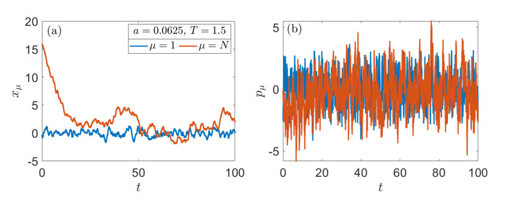
<figcaption class="paper-figure-caption"><b>Fig 3.</b> Figure 3: Typical time dependence of two coordinates (a) and two components of the momentum (b) after a quench to the extended phase.</figcaption>
</figure>
<figure class="paper-figure-card">
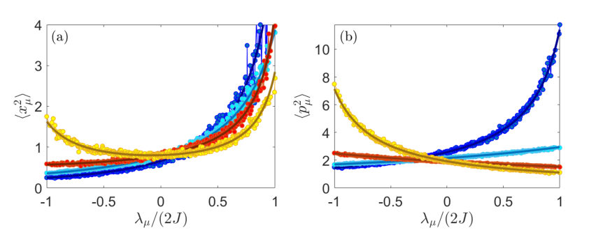
<figcaption class="paper-figure-caption"><b>Fig 4.</b> Figure 4: Mode-resolved squared positions and momenta in the extended phase, a = 0.15 (dark blue), a = 0.0625 (light blue), a = −0.0625 (red), and a = −0.19 (orange), all at T = 2. (a) Spectrum of square coordinate values, ⟨x2 µ⟩, limited to ⟨x2 µ⟩&lt; 4 to improve visualisation and (b) squared momenta components, ⟨p2 µ⟩. The asymptotic Langevin numerical data points for N = 500 are compared to the static predictions for N →∞, ⟨x2 µ⟩= ⟨p2 µ⟩/(zGNM −λµ) and ⟨p2 µ⟩, with ⟨p2 µ⟩given in Eq. (48), and ekin and zGNM replaced by their analytic expressions in Eqs. (55) and (59), respectively.</figcaption>
</figure>
<figure class="paper-figure-card">
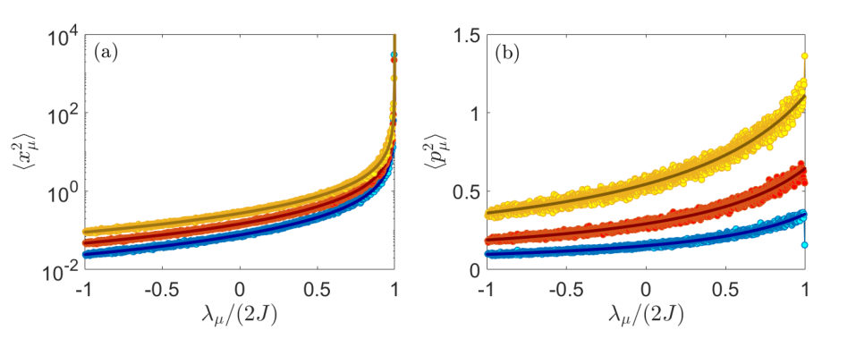
<figcaption class="paper-figure-caption"><b>Fig 5.</b> Figure 5: The spectrum of ⟨x2 µ⟩(a) and ⟨p2 µ⟩(b) for system with a = 0.09375 and N = 4000 at different temperatures, T = 0.1, 0.2, 0.4, all in the condensed phase. The data points correspond to the asymptotic (long-time limit) stochastic values obtained with condensed initial conditions at T0 = 0.5. The solid lines are the analytic predictions in Sec. 3.</figcaption>
</figure>

**Summary.** This paper introduces the use of Langevin dynamics as a powerful stochastic tool to sample the Generalized Gibbs Ensemble (GGE) measure for integrable systems. By tailoring the deterministic force, the authors show that the long-time evolution of the system samples the GGE, which is rigorously tested and confirmed using the Neumann Model. This provides a robust method for calculating non-equilibrium steady states in complex physical models.

**Why it may be interesting.** This work provides a concrete, computationally accessible stochastic tool (Langevin dynamics) to calculate equilibrium properties (GGE) in complex, non-equilibrium systems, which is highly relevant for understanding relaxation dynamics in many-body quantum systems.

Detailed structure

**Main problem.** The primary goal is to develop and apply a stochastic method to efficiently sample the Generalized Gibbs Ensemble (GGE) measure for integrable quantum and classical systems.

**Main result.** The authors successfully demonstrate that a carefully tuned Langevin process can reproduce the asymptotic statistical averages predicted by the GGE for the Neumann Model following a quench.

**Method.** The core method involves deriving the deterministic force for a Langevin process such that the long-time stochastic trajectories sample the desired GGE measure, which is shown to be equivalent to a standard Gibbs-Boltzmann measure for a modified Hamiltonian.

**Model / system.** The study uses the classical Neumann Model (a particle on a sphere with anisotropic potentials) as a benchmark, extending the analysis to the Generalized Neumann Model (GNM) which incorporates multiple conserved quantities (constants of motion).

**Key observables.** Asymptotic values of local observables, $\langle p^2(\lambda) 
angle$, and $\langle x^2(\lambda) 
angle$.

**Important parameters / regimes.** The Lagrange multipliers ($ar{\gamma}_
u$) that define the GGE, and the quench protocol parameters ($\lambda_\mu$).

**Assumptions / limitations.** The assumption that the GGE can be interpreted as a standard Boltzmann measure for a non-standard Hamiltonian, and that the Langevin process converges to this measure.

**Figures summary.** Figures illustrate mode-resolved results for Langevin dynamics on the Neumann Model under different conditions relating the Lagrange multipliers ($ar{\gamma}_\mu$ vs $ar{\gamma}_N$), showing distinct dynamic regimes.

**Paper structure.** The paper progresses from establishing the GGE framework for integrable systems, interpreting it as a standard Gibbs measure, developing the Langevin sampling technique, and finally applying this method to the Neumann Model, including detailed mathematical derivations for the Lagrange multipliers.

Abstract

In recent years, statistical physics tools have been used to study the dynamics of macroscopic quantum and classical integrable models. These studies have shown that, in the thermodynamic limit, long term time-averages of local observables equal statistical averages calculated with a Generalized Gibbs Ensemble (GGE). In the latter, the weight in phase space involves all constants of motion multiplied by Lagrange multipliers which are fixed by their initial values. We argue that the GGE can be interpreted as a proper Boltzmann measure of a different (non-standard) mechanical model. This measure can therefore be sampled with stochastic methods implemented, for example, as a Langevin process. We tailor the deterministic force in the Langevin equations so that at long times the stochastic trajectories sample the desired measure. We use the integrable Neumann Model -- the model of a classical particle constrained to move on a sphere under anisotropic harmonic potentials -- as a benchmark. We test the method in a setup where the Lagrange multipliers are fixed by the GGE governing the asymptotic dynamics of the isolated Neumann model following a quench. This problem has different phases depending on the initial conditions and quench protocol and, in all cases, with the stochastic evolution of an adequately tuned Langevin process we reproduce the asymptotic values of relevant observables.

[↑ back to top](#top)

### [Parity-doublet spin interactions in ultracold polyatomic molecules](http://arxiv.org/abs/2610.36061v1)

**Authors:** Junheng Tao, Paige Robichaud, Christian Hallas, Giseok Lee, John M. Doyle  
**Type:** both · **Category:** other · **PDF:** <https://arxiv.org/pdf/2610.36061v1>  
**Analysis basis:** full PDF text, analyzed in chunks
**Topic relevance:** 🔥 `analog quantum simulation` **4/5** · `Keldysh / 2PI / non-Gaussian methods` **3/5** · `methods for driven-dissipative` **3/5** · `quantum measurements` **3/5** · `QC/QI experiment` **2/5** · `correlated / nonlocal dissipation` **1/5** · `driven-dissipative phase transition` **1/5**

↔ Scroll figures horizontally

<figure class="paper-figure-card">
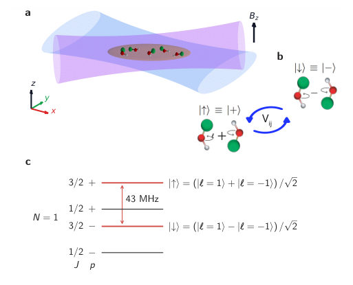
<figcaption class="paper-figure-caption"><b>Fig 1.</b> FIG. 1. Experimental setup. a Itinerant polyatomic molecules in a crossed optical dipole trap, which provides tighter confinement in z. The anisotropy enhances the OAT mean interaction strength. b The resonant dipolar exchange interaction happens between a pair of molecules that respec- tively reside in the two parity eigenstates made by superpo- sitions of opposite bending angular momentum states labeled by projections ℓ= ±1. The lab quantization axis is defined by a strong bias magnetic field along z. c The N = 1 rota- tional state diagram of ˜ X2Σ+(010) in CaOH, which contains our parity-doublet manifold. The two states that comprise our qubit system are ones of opposite parity, |+⟩and...</figcaption>
</figure>
<figure class="paper-figure-card">
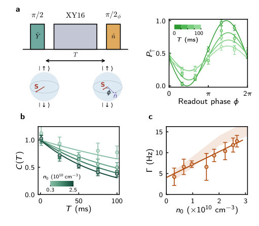
<figcaption class="paper-figure-caption"><b>Fig 2.</b> FIG. 2. Parity-doublet spin dephasing. a The Ramsey pulse sequence comprises a π/2 pulse that prepares the spin on the equator along ˆ X, and a final π/2 that reads out the pro- jection of S⊥along a certain axis ˆn defined by the pulse phase ϕ. During the interval T between these pulses, the spin system evolves under Hamiltonian (1), while dynam- ical decoupling pulses suppress the single-particle decoher- ence arising from the trap shift. On the right is an exam- ple of the measured fringes at different T indicates fast con- trast decay at 1, 25, 50, 100 ms. Error bars represent 68% confidence intervals from bootstrapping. The contrast C = S⊥(T)/S⊥(0) is extracted by fitting each Ramsey...</figcaption>
</figure>
<figure class="paper-figure-card">
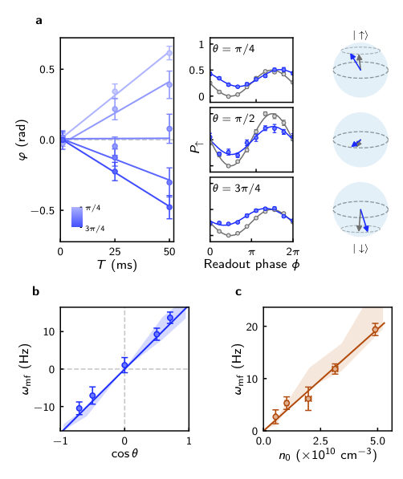
<figcaption class="paper-figure-caption"><b>Fig 3.</b> FIG. 3. Parity-doublet spin precession. a Collective spin precession phase φ as function of T for different initial angle θ. Colors from light to dark correspond to increasing θ = π/4, π/3, π/2, 2π/3, 3π/4. The initial spin is prepared by a pulse with area θ from |↑⟩, which, after time T, is rotated by the OAT interaction by azimuthal angle φ(T). Dynamical decoupling is implemented during T. We again extract φ by varying the last readout π −θ pulse phase ϕ and fitting to a sinusoidal. The middle panel presents the normalized Ramsey fringes at T = 0 (grey) and 50 ms (blue). Error bars represent 68% confidence intervals from bootstrapping. b Mean-field precession rate ωmf, extracted from...</figcaption>
</figure>
<figure class="paper-figure-card">
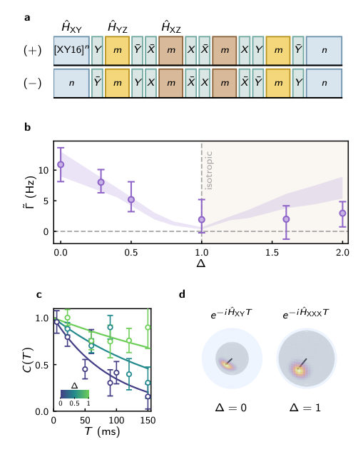
<figcaption class="paper-figure-caption"><b>Fig 4.</b> FIG. 4. Symmetry-protected collective coherence in parity- doublets. a A unit block of the Floquet pulse sequence con- tains frame-switching pulses (green) and interaction intervals (blue, yellow, and brown blocks). Here Y and ¯Y denote π/2 rotations about y and −y respectively, with BB1 compos- ite pulses. During the interaction intervals, the spin system effectively evolves under Hamiltonians ˆHAB ∝AA + BB de- pending on the frame selection. XY16 pulses are embedded within each interaction interval. The + and −cycles use op- posite frame rotations and are alternated to cancel leading- order pulse errors from the frame-switching pulses. b Engi- neered many-body dephasing rate ˜Γ as a...</figcaption>
</figure>

**Summary.** This paper reports the observation and control of resonant dipolar exchange interactions in the parity-doublet states of ultracold polyatomic molecules. By measuring both coherence decay and mean-field precession, the researchers confirmed the system's utility as a programmable, interacting quantum resource. This work advances the field by linking molecular structure to many-body physics for next-generation quantum sensors.

**Why it may be interesting.** This work directly connects molecular quantum physics (polyatomic molecules) with fundamental many-body physics (dipolar interactions) in a highly controllable, programmable quantum platform relevant for quantum sensing.

Detailed structure

**Main problem.** To establish parity-doublet states as a programmable, interacting degree of freedom in ultracold polyatomic molecules for enhanced precision measurements and tests of fundamental physics.

**Main result.** The authors observed resonant dipolar exchange interactions and demonstrated that the system's dynamics are governed by a controllable, interacting many-body Hamiltonian, opening a route to entanglement-enhanced metrology.

**Method.** The study combines experimental measurements (Ramsey decay, mean-field precession) with theoretical modeling using the Discrete Truncated Wigner Approximation (DTWA) and scattering theory.

**Model / system.** The system uses ultracold $	ext{CaOH}$ molecules trapped in a crossed optical dipole trap, utilizing the parity-doublet states derived from the $\ell$-type bending vibrational mode as a pseudo-spin qubit manifold.

**Key observables.** Density-dependent Ramsey contrast decay, spin-projection-dependent mean-field precession rate ($\omega_{mf}$), and the rate of many-body dephasing ($\Gamma$).

**Important parameters / regimes.** The system is characterized by the anisotropic dipole-dipole interaction strength $V(\mathbf{r})$ and the ability to tune the interaction anisotropy ($\Delta$) via Floquet engineering.

**Assumptions / limitations.** The dynamics are modeled using the DTWA, and scattering calculations rely on matching logarithmic derivatives at defined inner and outer boundaries.

**Figures summary.** Figures illustrate the experimental setup, the geometry of the dipolar interaction, the $	ext{N}=1$ rotational state diagram, and plots showing Ramsey contrast decay versus time and density, and spin precession phase versus initial angle.

**Paper structure.** The paper progresses from establishing the physical system and the role of parity doublets, to observing complementary signatures of dipolar interactions (decay and precession), and finally to demonstrating control by engineering the interaction anisotropy to find protected, interacting regimes.

Abstract

Precision measurements exploit internal molecular structure to search for physics beyond the Standard Model. Reaching the entanglement-enhanced regime requires preparing and preserving correlated molecular states within the same manifold used for sensing. Parity-doublet states are central to proposals for precision measurements with polyatomic molecules because they enable large molecular polarization for enhanced sensitivity, and provide internal state co-magnetometry to suppress systematic errors. Here we report the observation and control of resonant dipolar exchange interactions in a parity-doublet sensing manifold of ultracold polyatomic molecules. Using laser-cooled CaOH molecules in a crossed optical dipole trap, we encode a pseudospin in the $\ell$-type parity-doublet states and observe two complementary signatures of interactions: a density-dependent Ramsey contrast decay and a spin-projection-dependent mean-field precession whose sign reverses with the initialized population imbalance. Both observables are well described by a common discrete truncated Wigner model using independently calibrated experimental parameters. We further Floquet-engineer the interaction anisotropy and observe suppressed many-body dephasing near the SU(2)-symmetric Heisenberg point, identifying a protected regime relevant for spin squeezing and precision measurement with dense molecular ensembles. Our results establish parity doublets as a coherent, interacting, and programmable molecular degree of freedom, connecting the polyatomic precision-measurement platform to dipolar many-body physics and opening a route to entanglement-enhanced tests of fundamental physics.

[↑ back to top](#top)

### [Generation of quantum light with tunable Wigner negativity with a semiconductor quantum dot](http://arxiv.org/abs/2610.36233v1)

**Authors:** Hubert Lam, Petr Steindl, Yann Portella, Kiarn T. Laverick, Kian Hwee Lim, Juan R. Alvarez, Aristide Lemaitre, Maria Maffei, Alexia Auffeves, Dario A. Fioretto, Pascale Senellart  
**Type:** experiment · **Category:** quantum information and computing · **PDF:** <https://arxiv.org/pdf/2610.36233v1>  
**Analysis basis:** full PDF text, analyzed in chunks
**Topic relevance:** 🔥 `quantum optics experiment` **4/5** · `QC/QI experiment` **3/5** · `Tavis-Cummings & cavity-many-emitter` **2/5** · `quantum measurements` **2/5** · `analog quantum simulation` **1/5** · `driven-dissipative phase transition` **1/5** · `interference shaping light` **1/5** · `methods for driven-dissipative` **1/5**

↔ Scroll figures horizontally

<figure class="paper-figure-card">
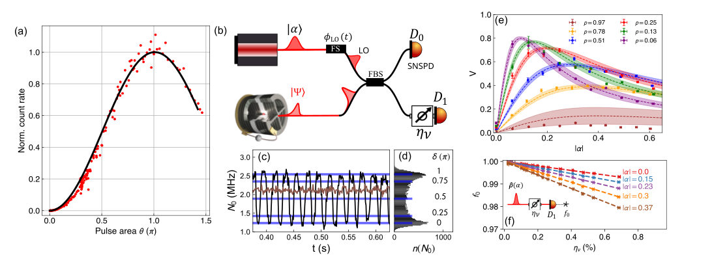
<figcaption class="paper-figure-caption"><b>Fig 1.</b> FIG. 1: (a) Normalized single-photon count rate (data points) as a function of the pulse area θ evidencing the onset of Rabi oscillations with p = sin2 θ/2 (solid line). (b) Schematic of the Wigner tomography setup: the measured field is displaced by LO on a fiber beamsplitter (FBS) with an SPNPD in each output (D0 and D1). The LO is derived from the excitation mode-locked laser and spectrally filtered with etalon-based spectral shaping; its phase ϕLO is modulated with a fiber stretcher (FS). Phase-space reconstruction is performed using zero-photon counts on D1 with variable detection efficiency ην controlled by a calibrated optical attenuator. (c) Single-photon detected count rate N0 on...</figcaption>
</figure>
<figure class="paper-figure-card">
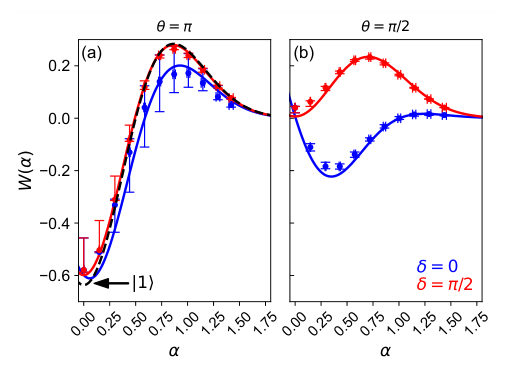
<figcaption class="paper-figure-caption"><b>Fig 2.</b> FIG. 2: Cross-sections of the reconstructed Wigner functions of the Fock superposition state √1 −p|0⟩+ √peiϕ|1⟩with (a) p = 0.97(3) (driven at θ = π) and (b) p = 0.51(1) (θ = π/2). The loss-corrected measured data (symbols) show excellent agreement with W(α) of the corresponding pure states (solid lines), in- cluding their Wigner negativity and phase-space asym- metry presented using cross-sections along two orthogo- nal phase-space directions (red δ = π/2, blue δ = 0). The asymmetry in (b) corresponds to quadrature squeezing along δ = 0 and anti-squeezing along δ = π/2. In (a), the state is compared to the perfect |1⟩(black).</figcaption>
</figure>
<figure class="paper-figure-card">
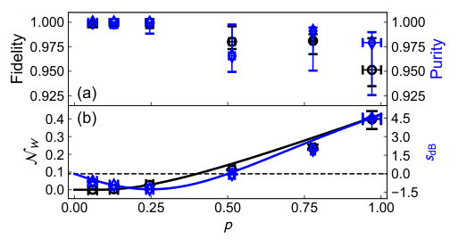
<figcaption class="paper-figure-caption"><b>Fig 3.</b> FIG. 4: Non-Gaussianity and state purity of the generated states. We quantify the Wigner negativ- ity, which is equivalent to non-Gaussianity if the state is pure [59]. (a) The reconstructed quantum state purity (blue) and its fidelity to the target vacuum-one-photon qubit (black). (b) Data points extracted from Fig. 3 quantify the photonic-qubit Wigner-negativity volume NW (black) and the quadrature squeezing parameter sdB (blue). Solid lines indicate the expected behavior for an ideal vacuum-one-photon qubit.</figcaption>
</figure>
<figure class="paper-figure-card">

<figcaption class="paper-figure-caption"><b>Fig 4.</b> FIG. 3: Propagation-loss-corrected Wigner func- tions for vacuum-one-photon superposition states √1 −p|0⟩+ √p|1⟩. (a)-(f) The point-by-point recon- structed Wigner functions W(α) for increasing single- photon population p reveal the emergence of Wigner- function negativity. Additionally, we observe a p- dependent phase-space asymmetry (better visible in the 2D plot under the 3D image), quantified in Fig. 4.</figcaption>
</figure>
<figure class="paper-figure-card">
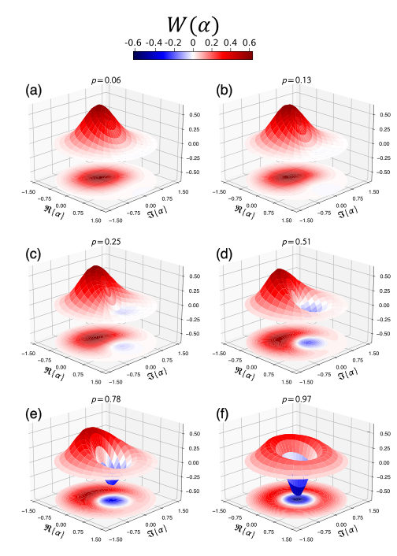
<figcaption class="paper-figure-caption"><b>Fig 5.</b> Fig. 4b reports the quantities directly linked to state nonclassicality extracted from the loss-corrected Wigner tomography. At low p, the emission quadrature vari- ance ⟨∆2xδ⟩exhibits squeezing along the δ direction, reaching at p = 0.25 the maximal quadrature squeez- ing [61] of sdB = 10 log10(4⟨∆2xδ⟩) = 1.244+0.043 −0.003 dB or 24.8+0.2 −1.0 % below the shot noise level — a value very close to the optimal of 25 % for an ideal vacuum-single- photon qubit [62, 63], reduced mostly by a small two- photon component, originating from the QD reexcitation</figcaption>
</figure>

**Summary.** This research demonstrates the generation and characterization of Wigner-negative quantum light states using a semiconductor quantum dot in a cavity. By controlling the excitation pulse, the authors tune the non-Gaussianity of the emitted light, achieving high fidelity and purity. This work presents a promising, scalable solid-state source for continuous-variable quantum computation.

**Why it may be interesting.** This work provides a concrete, solid-state platform for generating non-Gaussian quantum states, which are crucial resources for advancing continuous-variable quantum information processing, bridging fundamental quantum optics with mature semiconductor technology.

Detailed structure

**Main problem.** The paper addresses the need for high-quality quantum resources for continuous-variable optical quantum computing, specifically focusing on generating Wigner-negative states of light.

**Main result.** The authors successfully generated Wigner-negative states with tunable negativity using a semiconductor quantum dot, achieving fidelities and purities above 95% alongside near-optimal quadrature squeezing.

**Method.** The quantum states were characterized using Wigner tomography, which involved measuring the zero-photon detection probability across varying local oscillator phases and strengths.

**Model / system.** The physical system is a single semiconductor quantum dot embedded in an optical cavity, driven by coherent laser pulses to create a quantum superposition of zero and one photon.

**Key observables.** Wigner function negativity ($N_W$), state fidelity, quantum purity, and quadrature squeezing ($s_{dB}$).

**Important parameters / regimes.** The tunability parameter $p$ (related to the pulse area $	heta$), and the detection efficiency $\eta_
u$.

**Assumptions / limitations.** The reconstruction of the density matrix requires correcting for optical losses up to the solid-state device, and the analysis neglects the two-photon component of the QD emission.

**Figures summary.** Figures illustrate Rabi oscillations, the Wigner tomography setup, single-photon count rates, and reconstructed Wigner functions showing negativity for varying single-photon populations.

**Paper structure.** The paper details the experimental setup, the theoretical framework for Wigner tomography, the measurement protocols using the QD, and presents quantitative results demonstrating the tunability and high quality of the generated non-Gaussian quantum states.

Abstract

Wigner-negative states of light are key resources for quantum advantage in continuous-variable optical quantum computing. They can be produced probabilistically via frequency conversion and photon detection, or deterministically by exploiting the single-photon nonlinearity of a quantum emitter. Here, we generate such Wigner-negative states of light with a tunable negativity using a single semiconductor quantum dot in a cavity. Optical coherent control of the quantum-dot transition allows to generate a quantum superposition of zero and one photon. The generated quantum states are characterized point-by-point in the phase space through homodyne measurement. The emergence of Wigner-function negativity is observed as the excitation power is increased. After correcting for collection and propagation losses, we obtain fidelities to the ideal state and quantum purities above 95%, together with near-optimal quadrature squeezing. The ability to generate a wide variety of Wigner-negative states with mature semiconductor technology opens promising opportunities for continuous-variable optical quantum technologies.

[↑ back to top](#top)

### [Measurement-induced entanglement phases in hyperbolic gauge-Higgs models](http://arxiv.org/abs/2610.36528v1)

**Authors:** Cole Kelson-Packer, Hiroki Sukeno, Akimasa Miyake  
**Type:** theory · **Category:** statistical mechanics · **PDF:** <https://arxiv.org/pdf/2610.36528v1>  
**Analysis basis:** full PDF text, analyzed in chunks
**Topic relevance:** 🔥 `quantum measurements` **4/5** · `analog quantum simulation` **2/5** · `driven-dissipative phase transition` **2/5** · `methods for driven-dissipative` **2/5** · `non-equilibrium universality` **2/5** · `Full counting statistics` **1/5** · `correlated / nonlocal dissipation` **1/5**

↔ Scroll figures horizontally

<figure class="paper-figure-card">
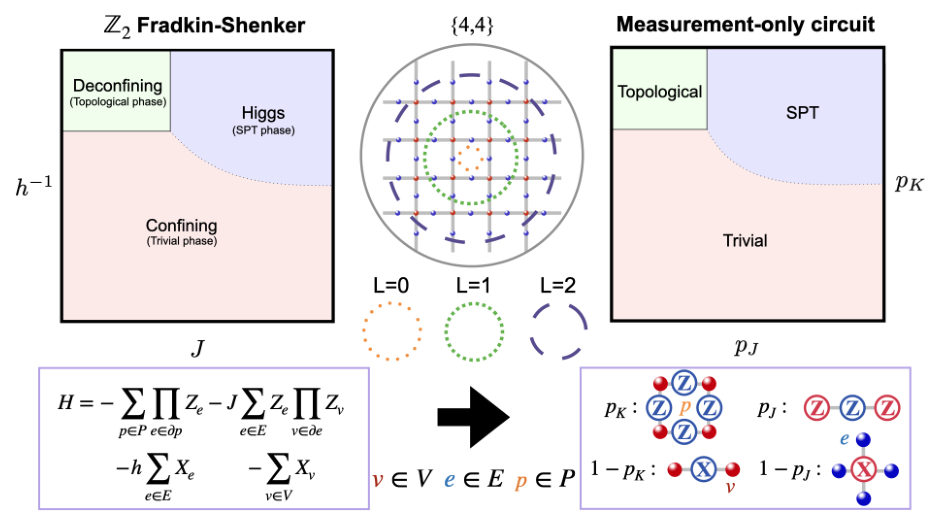
<figcaption class="paper-figure-caption"><b>Fig 1.</b> FIG. 1. Idealized phase diagrams of the Z2 Fradkin-Shenker model (left) [15, 19] and a gauge-Higgs measurement-only circuit (right) [20]. The bottom depicts the Hamiltonian and measurements considered in each respective model. The dashed lines indicate that a boundary transition separates the confined/trivial and Higgs/SPT phases. At the top center is a {4, 4} lattice with up to L = 2 layers and rough boundaries.</figcaption>
</figure>
<figure class="paper-figure-card">
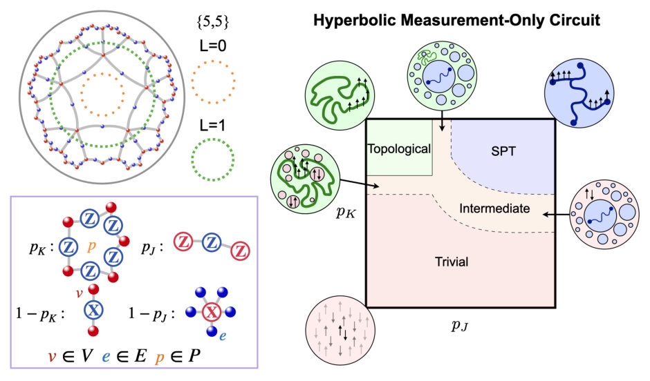
<figcaption class="paper-figure-caption"><b>Fig 2.</b> FIG. 2. Cartoon of a hyperbolic MOC. The idealized phase diagram (right) contains labels and depictions of each phase. A full intermediate phase replaces the critical line in Euclidean space. The left depicts a {5, 5} lattice with up to L = 1 layers and smooth boundaries, along with probabilistically measured stabilizers. Our diagnostics detect the boundary transition between SPT and trivial phases at the future temporal – rather than spatial – boundary. The spins in the bubbles representing different phases reflect the spatial correlation of measurement outcomes. Measurements in the trivial phase are uncorrelated, but positively correlated along loops and lines in the topological and SPT...</figcaption>
</figure>
<figure class="paper-figure-card">
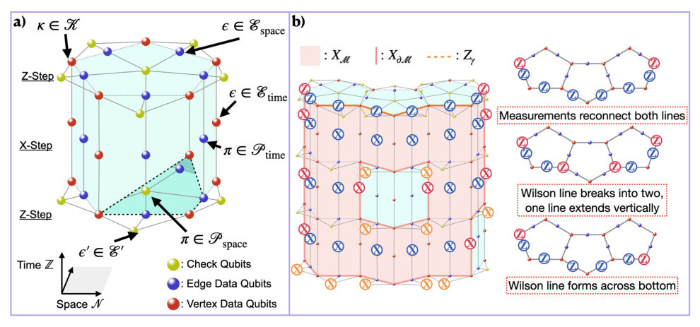
<figcaption class="paper-figure-caption"><b>Fig 3.</b> FIG. 3. Drawings of an MBQC resource cell for an MOC for N = {5, 5} (a) and a spacetime sponge (b). A P-gon replaces the top and bottom plaquettes of the cell for general {P, Q}. The full resource glues cells together such that a slice of the Z-timestep resembles {P, Q}. The spacetime sponge M is shown as an operator OM shaded red with labeled components XM, X∂M, and Zγ compatible with the measurement history {Pres}. To the right, from bottom to top, is a corresponding Wilson line’s simulated time evolution.</figcaption>
</figure>
<figure class="paper-figure-card">
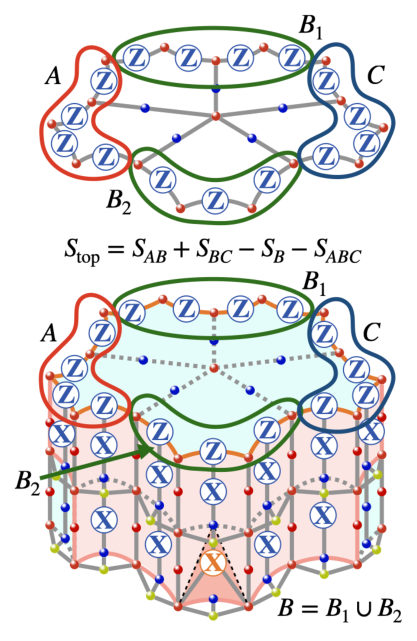
<figcaption class="paper-figure-caption"><b>Fig 4.</b> FIG. 4. Illustration of a Wilson loop operator contributing to Stop for the parties A, B, and C, shown in terms of the 2D simulated state (top) and 3D resource (bottom). Both edges and vertices are included in the A, B and C. In line with [22], we split an annulus in the lattice into quadrants, with two opposite regions given to A and C, and the remainder given to B = B1 ∪B2.</figcaption>
</figure>
<figure class="paper-figure-card">
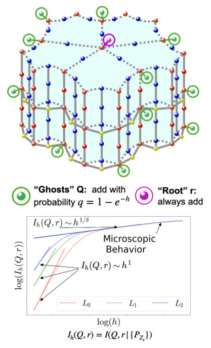
<figcaption class="paper-figure-caption"><b>Fig 5.</b> FIG. 6. Illustration of the ghost connectivity Ih(Q, r). We randomly entangle resource vertices with ghost qubits Q (cir- cled in green) and the fixed root r. The ghost connectivity Ih(Q, r) is nonzero if a sponge connects Q and r. The typi- cal behavior of Ih(Q, r) is depicted, showing how δ must be extracted from intermediate values of log(h) to avoid nonuni- versal and finite-size effects.</figcaption>
</figure>

**Summary.** This paper analyzes entanglement phases in gauge-Higgs models on hyperbolic lattices using measurement-only dynamics. By simulating spacetime evolution via a 3D resource state, the authors map out 2D phase diagrams, predicting a unique 'archipelago' phase absent in flat space. This work provides a powerful link between quantum information theory and the study of topological order in strongly correlated systems.

**Why it may be interesting.** The work connects concepts from quantum information (MBQC, resource states) directly to condensed matter phenomena (topological order, phase transitions) in a non-trivial geometric setting (hyperbolic space), offering new tools for understanding entanglement structure.

Detailed structure

**Main problem.** The study investigates the entanglement phases of gauge-Higgs models when placed on hyperbolic lattices, specifically focusing on entanglement transitions driven by non-commuting measurements.

**Main result.** The research predicts a novel 'archipelago' phase, absent in Euclidean space, where separated clusters of Symmetry-Protected Topological (SPT) order exist, and transitions into this phase follow a mean-field universality class.

**Method.** The authors employ measurement-only dynamics (MOCs) simulated using a 3D resource state inspired by measurement-based quantum computation to chart 2D phase diagrams.

**Model / system.** The system is a gauge-Higgs model defined on hyperbolic lattices, analyzed via measurement-only dynamics involving random circuits alternating between Z and X measurements.

**Key observables.** Topological entanglement entropy, generalized measurement-induced entanglement, Von Neumann entropy, and the detection of Wilson lines/loops to characterize topological order.

**Important parameters / regimes.** Measurement probabilities ($p_J, p_K$), lattice structure defined by Schläfli symbols $\{P, Q\}$, and critical exponents ($\delta$).

**Assumptions / limitations.** The analysis assumes a correspondence between $Z_2$ Euclidean lattice field theory path integrals and imaginary-time evolutions, and that entanglement entropies are independent of specific measurement outcomes.

**Figures summary.** Figures illustrate idealized phase diagrams for both Euclidean and hyperbolic settings, showing the predicted intermediate 'archipelago' phase in the hyperbolic case, and diagrams detailing the foliated resource state construction.

**Paper structure.** The paper builds from defining the physical system (gauge-Higgs on hyperbolic lattices) to detailing the simulation method (3D resource state/MBQC), mapping observables (entropy, Wilson loops) to phases (trivial, topological, SPT), and finally presenting the key results regarding the unique hyperbolic phase diagram.

Abstract

Gauge-Higgs theory in flat spacetime provides a prime theoretical model of multiple phases of matter with distinct entanglement structures. More recently, there has been interest in hyperbolic space and the influence its extensive boundaries have on these structures. Entanglement transitions between non-equilibrium phases, such as topological phases, can be realized by the competition of non-commutating measurements. Here we study the entanglement phases of gauge-Higgs models on hyperbolic lattices described by measurement-only dynamics. We chart 2D phase diagrams by employing topological entanglement entropy and introducing a generalized measurement-induced entanglement tailored for hyperbolic Higgs phases. Utilizing duality, we find a phase absent in Euclidean space, wherein the bulk lattice hosts separated clusters of symmetry-protected topological order. Transitions between this "archipelago" phase and neighboring topological and trivial phases feature a critical exponent $δ$ belonging to a mean-field universality class. Our essential tool is a 3D resource state inspired by measurement-based quantum computation that simulates the spacetime evolution of the 2D quantum state with a third direction of entanglement. This allows us to analyze spacetime "sponges" of entanglement, which map to classical percolation theory and allow us to infer values of critical points on our phase diagrams' boundaries.

[↑ back to top](#top)

### [Anomalous Structures of Fisher Zero Lines in Biorthogonal Dynamical Quantum Phase Transitions](http://arxiv.org/abs/2610.36521v1)

**Authors:** Wen-Hui Nie, Chong Li, Lin-Cheng Wang  
**Type:** theory · **Category:** statistical mechanics · **PDF:** <https://arxiv.org/pdf/2610.36521v1>  
**Analysis basis:** full PDF text, analyzed in chunks
**Topic relevance:** 🔥 `driven-dissipative phase transition` **4/5** · `non-equilibrium universality` **3/5** · `Keldysh / 2PI / non-Gaussian methods` **2/5** · `methods for driven-dissipative` **2/5** · `analog quantum simulation` **1/5** · `correlated / nonlocal dissipation` **1/5**

↔ Scroll figures horizontally

<figure class="paper-figure-card">
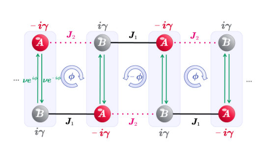
<figcaption class="paper-figure-caption"><b>Fig 1.</b> Figure 1. The ladder lattice of the generalized non-Hermitian SSH model with a Peierls phase and gain and loss. The green arrows represent the intracell hoppings ve±iϕ, while the black solid and pink dashed lines denote the real intercell couplings J1 and J2, respectively. The blue circular arrows represent synthetic gauge fields with opposite directions in adjacent pla- quettes, allowing the Peierls phase ϕ to be controlled. The on-site potentials −iγ and iγ on sites A and B describe bal- anced loss and gain.</figcaption>
</figure>
<figure class="paper-figure-card">
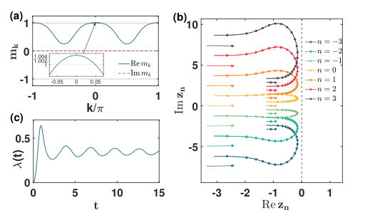
<figcaption class="paper-figure-caption"><b>Fig 2.</b> Figure 3. Results for the UU quench from (ϕi, γi) = (0, 0.2) to (ϕf, γf) = (π, 0.2). (a) The real and imaginary parts of mk as functions of k, where the blue solid and red dashed lines denote Re mk and Im mk, respectively. (b) Fisher zeros zn(k) in the complex time plane for different n, with different col- ors and symbols representing different branches. The vertical dashed line marks Re z = 0. (c) The rate function λ(t) as a function of time t.</figcaption>
</figure>
<figure class="paper-figure-card">
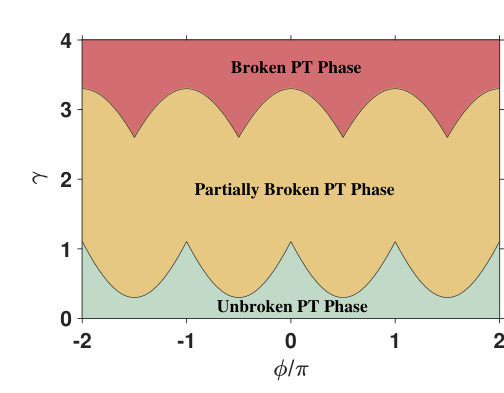
<figcaption class="paper-figure-caption"><b>Fig 3.</b> Figure 2. PT phase diagram in the (ϕ, γ) plane for v = 1, J1 = 1.8, and J2 = 0.5. The green, yellow, and red regions denote the unbroken, partially broken, and broken PT phases, respectively.</figcaption>
</figure>
<figure class="paper-figure-card">
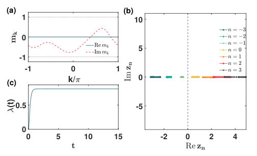
<figcaption class="paper-figure-caption"><b>Fig 4.</b> Figure 4. Results for the UB quench from (ϕi, γi) = (0, 0.5) to (ϕf, γf) = (0.5π, 3.5). (a) The real and imaginary parts of mk as functions of k, where the blue solid and red dashed lines denote Re mk and Im mk, respectively. (b) Fisher zeros zn(k) in the complex time plane for different n, with different colors and symbols representing different branches. The ver- tical dashed line marks Re z = 0. (c) The rate function λ(t) as a function of time t.</figcaption>
</figure>
<figure class="paper-figure-card">

<figcaption class="paper-figure-caption"><b>Fig 5.</b> Figure 5. Results for the BU quench from (ϕi, γi) = (π, 3.5) to (ϕf, γf) = (−π, 0.5). (a) The real and imaginary parts of mk as functions of k, where the blue solid and red dashed lines denote Re mk and Im mk, respectively. (b) Fisher zeros zn(k) in the complex time plane for different n, with different colors and symbols representing different branches. The ver- tical dashed line marks Re z = 0. (c) The rate function λ(t) as a function of time t.</figcaption>
</figure>

**Summary.** This theoretical work analyzes the complex structures of Fisher zero lines in non-Hermitian systems undergoing dynamical quantum phase transitions. By utilizing the biorthogonal framework, the authors determine critical momentum conditions based on the overlap of pre- and post-quench Bloch vectors. This provides a robust diagnostic tool for identifying nonanalyticities in the system's rate function.

**Why it may be interesting.** The connection between the geometry of zeros in the complex time plane and nonanalyticities in the rate function provides a powerful, general diagnostic tool for identifying non-equilibrium phase transitions in complex quantum systems.

Detailed structure

**Main problem.** The paper investigates the anomalous structures of Fisher zero lines in the complex time plane associated with Biorthogonal Dynamical Quantum Phase Transitions (DQPTs).

**Main result.** The anomalous structures of these zero lines, determined by the overlap parameter $m_k$, reveal the critical momentum conditions for DQPTs, even when standard formulas fail at exceptional points.

**Method.** The analysis employs the biorthogonal framework to study the Loschmidt amplitude in the complex time plane, introducing the density of Fisher zeros to characterize nonanalyticities in the rate function.

**Model / system.** The study is primarily based on non-Hermitian quenches, exemplified by a generalized non-Hermitian Su-Schrieffer-Heeger (SSH) model, analyzing the dynamics using Bloch vectors.

**Key observables.** Fisher zeros ($z_n$), the overlap parameter $m_k = \hat{\mathbf{h}}_0\cdot\hat{\mathbf{h}}_1$, and the rate function $\lambda(t)$ or its density $
ho(t)$.

**Important parameters / regimes.** The overlap parameter $m_k$, the Peierls phase ($\phi$), and the non-Hermitian gain-loss strength ($\gamma$).

**Assumptions / limitations.** The analysis relies on the biorthogonal framework, and special care must be taken at exceptional points where the standard Fisher zero formula is inapplicable.

**Figures summary.** Figures illustrate the dependence of $m_k$ on momentum $k$, the resulting complex trajectories of Fisher zeros $z_n(k)$, and the corresponding rate function $\lambda(t)$ or its density $
ho(t)$ versus time or momentum.

**Paper structure.** The paper systematically analyzes the complex structure of the Fisher zeros based on the value of $m_k$ (real, purely imaginary, or complex), derives critical conditions from the real-time axis crossing, and verifies these findings using the SSH model and the Jordan form near exceptional points.

Abstract

Fisher zero lines of the Loschmidt amplitude in non-Hermitian quenches can exhibit anomalous structures in the complex time plane, such as divergence, separation, and the restriction of all branches or a specific branch to the real or imaginary axis. Here, we use the biorthogonal framework to reveal the origin of these structures and determine the corresponding critical momentum conditions by analyzing the values of $m_k=\hat{\mathbf{h}}_0\cdot\hat{\mathbf{h}}_1$, the dot product between the normalized prequench and postquench complex Bloch vectors. When Fisher zeros continuously cover the real-time axis, the density of Fisher zeros is further introduced to identify the critical times within these critical regions, at which the rate function becomes nonanalytic. We verify our results in a generalized non-Hermitian SSH model by quenching the Peierls phase and the non-Hermitian gain-loss strength, and also use the Jordan form to analyze the dynamics at postquench exceptional points, where the conventional Fisher zero formula is not applicable.

[↑ back to top](#top)

### [Quantum Evolution Kernel for Node-Attributed Graphs](http://arxiv.org/abs/2610.36984v1)

**Authors:** Manuel Padovani, Alessandra Di Pierro, Claudia Daffara  
**Type:** both · **Category:** quantum information and computing · **PDF:** <https://arxiv.org/pdf/2610.36984v1>  
**Analysis basis:** full PDF text, analyzed in chunks
**Topic relevance:** 🔥 `Rydberg arrays` **4/5** · `QC/QI experiment` **3/5** · `analog quantum simulation` **3/5** · `quantum measurements` **2/5**

↔ Scroll figures horizontally

<figure class="paper-figure-card">

<figcaption class="paper-figure-caption"><b>Fig 1.</b> Figure 1: The picture shows the pipeline from the raw image to the final graph encodable onto the quantum device.</figcaption>
</figure>
<figure class="paper-figure-card">

<figcaption class="paper-figure-caption"><b>Fig 2.</b> Figure 2: Bayesian optimization of the evolution parameter t using the validation F1- score (80% training, 20% validation) on a 200-sample subset of the MNIST dataset. The optimal value is t = 240.1 ns (highlighted). For small t, the system does not generate sufficient entanglement, yielding low F1-score. For large t, long excitations cause oscilla- tions between entangled states, leading to a sharp drop.</figcaption>
</figure>
<figure class="paper-figure-card">

<figcaption class="paper-figure-caption"><b>Fig 3.</b> Figure 3: Comparison of the performances of different distance metrics. Wasserstein achieves the highest accuracy. Shaded regions indicate ±1 standard deviation over 5 seeds.</figcaption>
</figure>
<figure class="paper-figure-card">

<figcaption class="paper-figure-caption"><b>Fig 4.</b> Fig. 4 compares our quantum kernel (Wasserstein distance with sum aggregation) against classical baselines. The GCN achieves the highest mean accuracy, as expected. Among the WL kernels, the combined positional-angle variant performs best, slightly exceeding the mean accuracy of our quantum kernel. However, our quantum kernel matches the</figcaption>
</figure>
<figure class="paper-figure-card">

<figcaption class="paper-figure-caption"><b>Fig 5.</b> Figure 4: Comparison of our quantum kernel against classical baselines. The GCN achieves the highest accuracy, while our quantum kernel performs comparably to the po- sitional WL variant and outperforms both angle-only and featureless WL kernels. Shaded regions indicate ±1 standard deviation over 5 seeds.</figcaption>
</figure>

**Summary.** This work presents a quantum kernel method to encode node-attributed graphs onto neutral-atom quantum computers for classification. It extends previous quantum evolution kernels by incorporating node features via local Raman laser pulses in a three-level system. The authors demonstrate that using the Wasserstein distance yields strong results, benchmarking the quantum approach against state-of-the-art classical graph neural networks.

**Why it may be interesting.** It directly applies advanced quantum simulation techniques (Rydberg interactions, local rotations) to a complex data structure (graphs) using quantum machine learning concepts, bridging AMO hardware capabilities with quantum information theory.

Detailed structure

**Main problem.** The paper addresses the challenge of embedding node-attributed graphs onto neutral-atom quantum computers for classification tasks like digit recognition.

**Main result.** The proposed quantum kernel method, utilizing the Wasserstein distance, achieves competitive performance against classical baselines, though the GCN remains the top performer.

**Method.** A novel quantum evolution kernel (QEK) is proposed that extends previous work by encoding node features using local Raman laser rotations in a three-level system.

**Model / system.** The physical platform is a neutral-atom quantum computer, modeled using a Hamiltonian incorporating Rydberg blockade interactions ($H_{int}$) and local rotations ($U_{local}$).

**Key observables.** Correlation observables $\langle Z_i Z_j 
angle - \langle Z_i 
angle \langle Z_j 
angle$, and probability distributions $p(f)$ related to Hamming weight.

**Important parameters / regimes.** The method is designed for the low-data regime, and the kernel comparison favors the Wasserstein distance over the Jensen-Shannon distance.

**Assumptions / limitations.** The quantum process is simulated using Pasqal's Pulser library, which imposes constraints on the size of the experimental datasets.

**Figures summary.** Figures compare the performance of the quantum kernel against classical methods (WL, GCN) using different distance metrics, showing Wasserstein distance's superiority over JS distance.

**Paper structure.** The paper introduces the QEK for graph embedding, details the three-level encoding scheme, compares the Wasserstein distance against other metrics, and evaluates the resulting kernel against classical graph learning models.

Abstract

We present a novel approach to embed node-attributed graphs onto neutral-atom quantum computers, and propose an application to digit recognition. Our approach extends PASQAL's quantum evolution kernel (QEK) by introducing a node-level feature encoding based on three-level quantum states. To this purpose, we present a prototype showing how the resulting embedding can be leveraged to extract correlation-based information for classification tasks. The entire quantum process is simulated using Pasqal's Pulser library, which inevitably imposes constraints on the size of the experimental datasets. We compare our method with classical baselines to evaluate its potential. We show that, for the digit recognition task, our method achieves a higher mean accuracy than the more commonly used Jensen-Shannon distance-based methods by utilizing the Wasserstein distance.

[↑ back to top](#top)

### [Probability bounds on trajectory-level exceedances of quantum speed limits under continuous-measurement feedback](http://arxiv.org/abs/2610.36356v1)

**Authors:** Kohei Kobayashi  
**Type:** theory · **Category:** quantum information and computing · **PDF:** <https://arxiv.org/pdf/2610.36356v1>  
**Analysis basis:** full PDF text, analyzed in chunks
**Topic relevance:** 🔥 `quantum measurements` **4/5** · `methods for driven-dissipative` **3/5** · `Keldysh / 2PI / non-Gaussian methods` **1/5** · `correlated / nonlocal dissipation` **1/5** · `driven-dissipative phase transition` **1/5** · `non-equilibrium universality` **1/5**

↔ Scroll figures horizontally

<figure class="paper-figure-card">

<figcaption class="paper-figure-caption"><b>Fig 1.</b> FIG. 1. Analytical regimes of the model-specific probability bound in the (s, q) plane for α = 3. The</figcaption>
</figure>
<figure class="paper-figure-card">

<figcaption class="paper-figure-caption"><b>Fig 2.</b> FIG. 2. Monte Carlo comparison of the empirical exceedance probability with the probability bounds for</figcaption>
</figure>

**Summary.** This paper develops rigorous analytical upper bounds for the probability that a quantum system's evolution, governed by continuous measurement feedback, exceeds its theoretical Quantum Speed Limit. Using the fidelity dynamics, the authors derive state-independent and model-specific bounds, demonstrating that the probability can vanish entirely in certain short-time regimes. This provides a quantitative measure of how well feedback control adheres to fundamental quantum speed constraints.

**Why it may be interesting.** This work provides rigorous mathematical tools to quantify the deviation of actual quantum evolution from theoretical speed limits under realistic, noisy, and controlled measurement processes, which is crucial for quantum control theory.

Detailed structure

**Main problem.** The paper derives analytical upper bounds on the probability that a quantum trajectory, conditioned by continuous measurement feedback, exceeds a theoretically derived Quantum Speed Limit (QSL) velocity.

**Main result.** The probability bound is established using two primary methods—a variance-based bound and an exponential concentration bound—and a zero-probability regime is identified for sufficiently short times.

**Method.** The analysis employs stochastic master equations (SME) for the conditioned state and applies concentration inequalities (like Cantelli's) to the finite-time average fidelity velocity.

**Model / system.** The study analyzes general open quantum systems undergoing continuous measurement and feedback control, with a detailed application to a feedback-controlled qubit stabilization model.

**Key observables.** Finite-time average fidelity velocity ($v_c$), Quantum Speed Limit velocity ($v_{QSL}$), and the exceedance probability $	ext{Pr}[v_c \geq v_{QSL}]$.

**Important parameters / regimes.** Measurement strength ($\kappa$), feedback parameter ($\alpha$), and the time scale ($	au$).

**Assumptions / limitations.** The general bounds rely on assuming uniform bounds on the drift and diffusion coefficients of the fidelity process; model-specific bounds use purity and Bloch dynamics geometry.

**Figures summary.** Figure 1 illustrates the analytical bounds, comparing the derived $P_C$ and $P_E$ bounds, and showing the regime where the exceedance probability vanishes.

**Paper structure.** The paper first establishes the general framework using the SME and defines the QSL and exceedance velocity. It then derives general state-independent bounds, followed by a detailed application to the qubit model to derive tighter, model-specific bounds, concluding with an analysis of the zero-probability regime.

Abstract

We investigate the probability that a conditioned quantum trajectory exceeds an ensemble-derived quantum speed limit (QSL) velocity under continuous measurement-based feedback. Using the finite-time average fidelity velocity, we derive an upper bound on the exceedance probability in terms of its mean and variance. We further obtain state-independent bounds from uniform constraints on the fidelity drift and diffusion, including an exponential concentration bound. For a feedback-controlled qubit, we derive explicit model-specific bounds and show that they are nontrivial in a short-time regime. We also identify a finite-time regime in which the exceedance probability vanishes exactly due to the restricted support of the conditioned dynamics. Monte Carlo simulations confirm the analytical bounds and illustrate their tightness.

[↑ back to top](#top)

### [An open EFT for dark matter searches with matter-wave interferometers](http://arxiv.org/abs/2610.36044v1)

**Authors:** Leonardo Badurina, Kathryn M. Zurek  
**Type:** theory · **Category:** other · **PDF:** <https://arxiv.org/pdf/2610.36044v1>  
**Analysis basis:** full PDF text, analyzed in chunks
**Topic relevance:** 🔥 `Keldysh / 2PI / non-Gaussian methods` **4/5** · `methods for driven-dissipative` **2/5** · `correlated / nonlocal dissipation` **1/5** · `driven-dissipative phase transition` **1/5** · `interference shaping light` **1/5** · `quantum measurements` **1/5**

↔ Scroll figures horizontally

<figure class="paper-figure-card">

<figcaption class="paper-figure-caption"><b>Fig 1.</b> Figure 1. Summary of the logical structure of the open EFT construction presented in this work. We assume that the</figcaption>
</figure>
<figure class="paper-figure-card">

<figcaption class="paper-figure-caption"><b>Fig 2.</b> Figure 2. Spacetime diagram for the interferometric geometry considered in this work. The total interferometric time</figcaption>
</figure>
<figure class="paper-figure-card">

<figcaption class="paper-figure-caption"><b>Fig 3.</b> Figure 3. Detector-dependent normalized DM effect (see Eq. (5.23)) as a function of the (magnitude of the) three-</figcaption>
</figure>
<figure class="paper-figure-card">

<figcaption class="paper-figure-caption"><b>Fig 4.</b> Figure 4. Ratio gD(q)/gP(q) as a function of mχ for scalar DM for |q| = mχv0 with q ∥v⊕. For masses below the</figcaption>
</figure>
<figure class="paper-figure-card">

<figcaption class="paper-figure-caption"><b>Fig 5.</b> Figure 5. Projected constraints on the dimensionful coupling strength g/Λ2 as a function of the DM mass mχ for</figcaption>
</figure>

**Summary.** This paper constructs an open Effective Field Theory to model how Dark Matter interacts with Matter-Wave Interferometers. By using the Schwinger-Keldysh formalism, the authors derive an influence action that cleanly separates the measurable phase shift from the decoherence. This framework predicts that advanced interferometers can probe light DM in unexplored parameter regions.

**Why it may be interesting.** This work is highly relevant as it merges techniques from open quantum systems (SK formalism) with cutting-edge experimental proposals in AMO physics (MWIs) to probe fundamental physics (DM).

Detailed structure

**Main problem.** The paper develops a theoretical framework to study how Dark Matter (DM) interactions manifest as measurable signatures in Matter-Wave Interferometers (MWIs). It aims to provide a unified description of DM-induced phase shifts and decoherence.

**Main result.** The EFT framework successfully separates phase shift (causal response) and decoherence (environmental fluctuations), predicting that ambitious interferometers could probe Higgs-portal DM below 1 eV or reveal tachyonic behavior in mediator masses.

**Method.** The authors utilize the Schwinger-Keldysh formalism to treat the MWI as an open quantum system coupled to the DM environment, deriving an open Effective Field Theory (EFT) via an influence action.

**Model / system.** The system involves Matter-Wave Interferometers (MWIs) and Composite-Particle Interferometers (CPIs) acting as quantum probes. The environment is the dark sector, and the interaction is modeled via an open EFT derived from the Schwinger-Keldysh path integral.

**Key observables.** Phase shift ($	ext{Re } S_{IF}$) and Decoherence ($	ext{Im } S_{IF}$), which are the measurable signatures of DM interaction.

**Important parameters / regimes.** DM mass ($m_\chi$), coupling constants (e.g., Higgs-portal coupling), and the energy scale of the interaction.

**Assumptions / limitations.** The analysis extends beyond the standard heavy-probe limit and treats the system as an open quantum system coupled to an environment.

**Figures summary.** Figure 1 summarizes the logical structure of the open EFT construction, detailing the use of the Closed Time-Path (CTP) and the extraction of phase and decoherence from the influence action.

**Paper structure.** The paper builds the open EFT using the Schwinger-Keldysh formalism, derives the influence action, and then applies this framework to analyze specific DM interaction types (contact vs. long-range) to predict observable signatures in CPIs.

Abstract

Matter-wave interferometers (MWIs) are a genuine quantum probe of dark matter (DM), being sensitive to DM-induced phase shifts and loss of contrast. Treating the interferometer as an open quantum system and the dark sector as its environment, we derive an open EFT to study these signatures using the Schwinger-Keldysh formalism. Starting from a microscopic theory, we derive the interferometer's effective action, which we then project onto the many-body worldline sectors relevant for atom interferometers and MWIs employing mesoscopic objects, i.e., composite-particle interferometers (CPIs). This construction clarifies the heavy-probe limit and organizes phase shifts and decoherence as distinct real-time components of the influence action: the retarded kernel controls the causal response of the environment, while the Keldysh kernel controls environmental fluctuations and hence loss of contrast. At leading order, these kernels reduce to: (i) DM bubble diagrams in the case of four-point interactions, and (ii) dressed in-medium mediator propagators in the case of long-range interactions, where the dressing is provided by the DM environment. Within this framework, we study the signatures of elastic spin-independent sub-GeV DM scattering off nucleons and find that: (i) owing to Bose enhancements below the DM wave-particle boundary, ambitious CPIs could probe Higgs-portal DM with mass below 1 eV in an unexplored region of model space; (ii) for DM coupled to nucleons via a light hadrophilic scalar, the DM background can drive the mediator's in-medium mass tachyonic over much of parameter space; outside these regions, CPIs could probe provide powerful probes of light DM.

[↑ back to top](#top)

### [Coherent Optical Control of a Single Donor Electron Spin](http://arxiv.org/abs/2610.36423v1)

**Authors:** Yuxi Jiang, Amirehsan Alizadehherfati, Christine Falter, Jasvith R. Basani, Nils von den Driesch, Yurii Kutovyi, Jan Seelbinder, Alexander Pawlis, Edo Waks  
**Type:** experiment · **Category:** quantum information and computing · **PDF:** <https://arxiv.org/pdf/2610.36423v1>  
**Analysis basis:** full PDF text, analyzed in chunks
**Topic relevance:** 🔥 `QC/QI experiment` **4/5** · `quantum measurements` **2/5** · `quantum optics experiment` **2/5** · `interference shaping light` **1/5**

↔ Scroll figures horizontally

<figure class="paper-figure-card">

<figcaption class="paper-figure-caption"><b>Fig 1.</b> FIG. 1. A single optically addressable chlorine (Cl) donor in ZnSe. a, Schematic of</figcaption>
</figure>
<figure class="paper-figure-card">

<figcaption class="paper-figure-caption"><b>Fig 2.</b> FIG. 2. Donor spin optical pumping and spin relaxation (T1). a, Time-resolved fluorescence</figcaption>
</figure>
<figure class="paper-figure-card">

<figcaption class="paper-figure-caption"><b>Fig 3.</b> FIG. 3. Coherent population trapping (CPT) of a single donor electron spin. a, Res-</figcaption>
</figure>
<figure class="paper-figure-card">

<figcaption class="paper-figure-caption"><b>Fig 4.</b> FIG. 4. Ultrafast coherent optical control of the donor spin. a, Pulse sequence used</figcaption>
</figure>

**Summary.** This paper reports the first demonstration of coherent optical control over a single donor electron spin in a II-VI semiconductor (ZnSe). By using spin-selective optical transitions, the authors achieved spin initialization, measured coherence times, and observed quantum phenomena like Rabi oscillations and population trapping. This establishes the material as a promising platform for solid-state quantum information processing.

**Why it may be interesting.** This work provides crucial experimental validation for using semiconductor defects as solid-state qubits, directly addressing the need for optically addressable quantum memories.

Detailed structure

**Main problem.** The central challenge is achieving coherent optical control of a single donor-bound electron spin, which is a prerequisite for building scalable solid-state quantum networks.

**Main result.** The authors successfully demonstrated the first coherent optical control of a single donor electron spin in a II-VI semiconductor, confirming its potential as a solid-state optically active qubit platform.

**Method.** The research employed time-resolved fluorescence measurements, coherent population trapping (CPT) spectroscopy, and the use of off-resonant picosecond optical pulses to manipulate the spin state.

**Model / system.** The physical system is a donor-bound electron spin in a ZnSe quantum well, utilizing spin-selective donor-bound exciton (D0X) optical transitions for initialization, control, and readout.

**Key observables.** Spin Rabi oscillations, Ramsey interference fringes, high-contrast coherent population trapping dips, and spin-relaxation dynamics ($T_1$ and $T_2^*$).

**Important parameters / regimes.** Measured spin relaxation time ($T_1 \approx 18.5 \mu s$) and coherence time ($T_2^* \approx 21.9 ns$).

**Assumptions / limitations.** The observed spin relaxation is primarily attributed to charge tunneling rather than intrinsic spin-flip processes.

**Figures summary.** Figures illustrate the device structure, electronic level splitting under magnetic fields, sideband emission used for spin initialization, and CPT measurements confirming coherent control.

**Paper structure.** The paper progresses by first establishing the physical platform and measuring spin dynamics ($T_1, T_2^*$), then demonstrating coherent control via Rabi oscillations and CPT, and finally analyzing the hyperfine interaction revealed by multiple dark resonances.

Abstract

Coherent spin-photon interfaces are essential for scalable quantum networks, but their realization requires optically bright transitions, long-lived spin coherence, and complete coherent control. Donor-bound electron spins in II-VI semiconductors offer an attractive platform for optically active spin qubits because they combine strong donor-bound exciton transitions in a direct-bandgap material with a potentially nuclear-spin-free environment. However, coherent control of an individual optically active donor spin has remained elusive. Here we demonstrate optical initialization, coherent control, and readout of a single donor-bound electron spin in ZnSe. Using spin-selective donor-bound exciton optical transitions, we initialize the electron spin and directly resolve its spin-relaxation dynamics. We achieve coherent spin control with off-resonant picosecond optical pulses, as demonstrated by spin Rabi oscillations and Ramsey interference. We further coherently drive two spin-selective optical transitions and observe high-contrast coherent population trapping, demonstrating the formation of an optically controlled dark state. At higher driving strengths, multiple dark resonances reveal the hyperfine interaction between the electron and the I = 3/2 Cl nucleus. These results establish the first coherent optical control of a single donor electron spin in a II-VI semiconductor and identify isolated optical donors as a promising platform for solid-state optically active qubits.

[↑ back to top](#top)

### [Deployed entanglement-based BBM92 quantum key distribution using frequency-converted photons emitted by a quantum dot](http://arxiv.org/abs/2610.37268v1)

**Authors:** Michal Vyvlecka, Raphael Joos, Benjamin Breiholz, Emma Marmasse, Ilenia Neureuther, Timo Schnieber, Anna Frederike Köhler, Tim Strobel, Andreas Berg, Sebastian Kiesel, Tobias Bauer, Marlon Schäfer, Nand Lal Sharma, Caspar Hopfmann, Simone Luca Portalupi, Christoph Becher, Peter Michler  
**Type:** experiment · **Category:** quantum information and computing · **PDF:** <https://arxiv.org/pdf/2610.37268v1>  
**Analysis basis:** full PDF text, analyzed in chunks
**Topic relevance:** 🔥 `quantum optics experiment` **4/5** · `QC/QI experiment` **3/5** · `interference shaping light` **1/5**

↔ Scroll figures horizontally

<figure class="paper-figure-card">

<figcaption class="paper-figure-caption"><b>Fig 1.</b> FIG. 1. Experimental setup and measurement configuration. a) Map of the Vaihingen campus of the University of Stuttgart, showing the two experimental locations: Alice, at the IHFG (Allmandring 3), and Bob, at the TIK (Allmandring 30), connected by 1.59 km of deployed optical fibre. At the Alice location (see inset), the source configuration is schematically illustrated: the quantum dot emits entangled photon pairs, one of which is sent to the BB84 state-preparation unit, while the second photon is first frequency-converted to the telecom C-band and subsequently transmitted through the deployed fibre link. An automated polarization-compensation unit provides active control of the...</figcaption>
</figure>
<figure class="paper-figure-card">

<figcaption class="paper-figure-caption"><b>Fig 2.</b> FIG. 2. Key experimental figures: Key rate, secure key rate, and QBER. a) Observed raw key rate (RKR) (left scale) and QBER (right scale) as a function of the coincidence window used for the detection of the two photons. For a coincidence window of 275 ps, the secure key rate (SKR) reaches its maximum of 204 Hz, with an RKR of 502 Hz, while maintaining a QBER of 4.71 %, well below the the- oretical security threshold of 11 % for the present protocol. b) Raw key rate (left scale) and QBER (right scale) as a function of time during the 19 h-long measurement. The plotted values are hourly av- erages. The QBER remains well below the 11 % security threshold (gray dashed line) for this protocol.</figcaption>
</figure>
<figure class="paper-figure-card">

<figcaption class="paper-figure-caption"><b>Fig 3.</b> FIG. 3. Encryption and decryption of a colour image by one-time pad. (top) The original 24-bit colour image with a resolution of 943×620 pixels (shown under the gray box indicating the quantum-channel characteristics, including the measurement time and QBER) is encrypted with the raw key (left side, orange) or with the secure key (right side, green). Decryption using the raw key (bottom left) or the secure key (bottom right), after error correction and privacy amplification with an effective retention ratio of PAe f f =40.48 %. For both decrypted images, a zoom of the same respective areas highlights the removal of corrupted pixels after decryption with the secure key.</figcaption>
</figure>

**Summary.** This paper reports on a successful field deployment of an entanglement-based Quantum Key Distribution (QKD) system using quantum dots as the entangled photon source. By employing quantum frequency conversion, the system transmits quantum signals over a 1.59 km fiber link, achieving a stable secure key rate of 206 Hz. The results mark a significant step toward realizing hybrid, long-distance quantum networks.

**Why it may be interesting.** This work is highly relevant as it demonstrates the practical engineering required to move quantum communication from lab bench demonstrations to real-world, deployed infrastructure, which is a major goal in quantum networking.

Detailed structure

**Main problem.** The paper addresses the critical need for information-theoretic security in communication networks by demonstrating Quantum Key Distribution (QKD) over a deployed fiber link.

**Main result.** The authors successfully achieved a secure key rate of 206 Hz over a 1.59 km deployed fiber link, generating a total secure key length of 14.2 Mbit.

**Method.** They implemented the entanglement-based BBM92 protocol, utilizing quantum dots as entangled photon sources and quantum frequency conversion to bridge the emission wavelength to the telecom band.

**Model / system.** The system uses epitaxial quantum dots excited via two-photon excitation to generate polarization-entangled photon pairs at $\sim 780 	ext{ nm}$. These photons are then frequency-converted to the telecom C-band ($\sim 1550 	ext{ nm}$) for transmission over a real-world fiber link.

**Key observables.** Secure key rate (206 Hz), total secure key length (14.2 Mbit), and fidelity of the entangled state (91.4%).

**Important parameters / regimes.** Fiber link distance of 1.59 km; QD fine-structure splitting ($\delta=2.1(3) \mu	ext{eV}$); repetition rate of 1 GHz.

**Assumptions / limitations.** The successful integration relies on high-quality entangled sources, efficient quantum frequency conversion, and picosecond-level time synchronization in a deployed network.

**Figures summary.** Figure 1 illustrates the experimental setup map and the source configuration involving QD emission and QFC. Figure 2 likely shows the dependence of key rates and QBER on coincidence window timing. Figure 3 compares the encrypted and decrypted color images.

**Paper structure.** The paper follows a structure detailing the problem (secure communication), the physical platform (QD source + QFC), the protocol implementation (BBM92), the experimental results (key rate, key length), and concluding with the demonstration of practical network integration.

Abstract

Establishing secure communication is an important requirement in existing and future networks. Although current solutions rely on classical approaches, quantum mechanics offers the possibility of moving from computational to information-theoretic security. Quantum key distribution (QKD) has been extensively studied as a means of achieving such security. Recently, epitaxial quantum dots started to be studied and employed in quantum cryptography, because of their rapid development that made them one of the brightest sources of quantum light to date. In particular, they are known to be excellent sources of polarization-entangled photon pairs, especially droplet-etched dots operating at $\sim$780 nm. Here, we employ such a quantum dot to generate entangled photon pairs under 1 GHz excitation rate. Using quantum frequency conversion, we interface the emitted photons with the telecommunication wavelength range while preserving their polarization entanglement. This enables quantum key distribution over a 1.59 km field-deployed fibre link across the University of Stuttgart - campus Vaihingen, using the BBM92 protocol: we achieve a secure key rate of 206 Hz over 19 h of stable operation, resulting in a total secure key length of 14.2 Mbit. This key enables the safe encryption and decryption of a colour image with further implementation of error correction and privacy amplification. These results demonstrate important steps towards hybrid quantum networks by combining high-quality entangled-photon sources operated at high excitation rates, efficient frequency conversion module, and picosecond-level time synchronization in a realistic deployed network.

[↑ back to top](#top)

### [Universal Scaling of Conditional Mutual Information in Classical Stochastic Dynamics](http://arxiv.org/abs/2610.36058v1)

**Authors:** Songlei Wang, Chenguang Liang, Zhi-Cheng Yang  
**Type:** theory · **Category:** statistical mechanics · **PDF:** <https://arxiv.org/pdf/2610.36058v1>  
**Analysis basis:** full PDF text, analyzed in chunks
**Topic relevance:** 🔥 `non-equilibrium universality` **4/5** · `methods for driven-dissipative` **3/5** · `driven-dissipative phase transition` **1/5**

↔ Scroll figures horizontally

<figure class="paper-figure-card">

<figcaption class="paper-figure-caption"><b>Fig 1.</b> FIG. 1. (a) Tripartition geometry for computing the CMI. Two fixed-size regions A and C are separated by a buffer re- gion B of variable length, all embedded in an infinite one- dimensional chain. (b) Allowed stochastic updates in the three models studied in this work: from left to right, the sym- metric simple exclusion process (SSEP), parity-conserving di- rected percolation (PCDP), and directed percolation (DP). Filled and open circles represent occupied and empty sites, respectively, while arrows indicate the allowed transitions. (c) Phase diagram of the PCDP model as a function of branching rate Q, at fixed P = 0.50 and R = 0.30. The transition point Qc ≈0.135 was estimated using Monte...</figcaption>
</figure>
<figure class="paper-figure-card">

<figcaption class="paper-figure-caption"><b>Fig 2.</b> FIG. 2. Comparison of Hankel-based truncation and canoni- cal iMPS compression in critical DP. The main panel shows CMI profiles at t = 640 and 1024, computed using the same maximal bond dimension χmax = 180. The two methods agree at t = 640, whereas at t = 1024 the canonical trunca- tion scheme leads to an artificial plateau at large buffer sizes, while the Hankel-based profile continues to decay. The inset shows the Markov lengths extracted from an exponential fit of the CMI. See SM for details on the fitting and statistical errors. When not visible, the error bars are smaller than the size of the data points.</figcaption>
</figure>
<figure class="paper-figure-card">

<figcaption class="paper-figure-caption"><b>Fig 3.</b> FIG. 3. (a) Scaling collapse of CMI in the inactive phase PCDP according to Eq. (5). We take P = 0.50, R = 0.30, and Q = 0.010. Here ℓB = 2L−1 counts the total number of bonds inside a buffer. We consider buffers up to L = 150, corresponding to 300 spins and ℓB = 299. The domain-wall density ρ(t) was computed from the same time-evolved iMPS. (b) Scaling collpase of CMI at the critical point Q = 0.135 of PCDP according to Eq. (1) with ℓ(t) ∼t1/z, where z = 1.741 is the dynamical exponent at PCDP critical point. (c) Temporal CMI versus t of the infinite-system one-dimensional SSEP. Blue circles show the large-scale tensor-network results as a function of the endpoint separation t; the dashed...</figcaption>
</figure>
<figure class="paper-figure-card">

<figcaption class="paper-figure-caption"><b>Fig 4.</b> FIG. 4. Schmidt weights enter observables in quantum and probability MPS differently. (a) A diagonal one-site observ- able in a quantum MPS is evaluated through a double-layer contraction, which weights the virtual sectors through Λ2 and aligns their contributions with the Schmidt ordering. (b) The corresponding classical observable in a probability iMPS is evaluated through a single-layer contraction. The bond spec- trum then enters linearly together with the left and right en- vironments, so a canonical weight alone does not determine the importance of the associated virtual direction.</figcaption>
</figure>
<figure class="paper-figure-card">

<figcaption class="paper-figure-caption"><b>Fig 5.</b> FIG. 5. CMI scaling of DP at the critical point in the regime where 1 ≲ℓB ≪ℓ(t) ∼t1/z. We find a window where CMI follows a power-law behavior ∼1/ℓ2 B. The effective time exponent 0.271 is obtained by a least-squares fit over 2 ≤ ℓB ≤8 (shaded region) and 1024 ≤t ≤1792. Error bars denote one sampling standard error and are smaller than the symbols.</figcaption>
</figure>

**Summary.** This work establishes a universal scaling law for the Conditional Mutual Information (CMI) in classical stochastic systems whose correlation length diverges over time. By applying advanced MPS simulation techniques, the authors verify this scaling in models like directed percolation and the SSEP. This provides a general information-theoretic tool to characterize critical dynamics and memory effects in non-equilibrium statistical mechanics.

**Why it may be interesting.** The concept of CMI and its scaling behavior provides a powerful, information-theoretic diagnostic tool to characterize non-equilibrium critical dynamics and long-range correlations in classical many-body systems, bridging statistical mechanics with information theory.

Detailed structure

**Main problem.** The paper investigates the universal scaling form of Conditional Mutual Information (CMI) in classical stochastic dynamics, particularly when the characteristic Markov length diverges with time.

**Main result.** A universal scaling form for CMI is derived and verified for systems exhibiting diverging Markov lengths, such as in the inactive phase of directed percolation and in temporal CMI for the SSEP.

**Method.** The authors employ advanced numerical techniques, including a novel Hankel-based truncation scheme for Matrix Product States (MPS), to simulate CMI dynamics in 1D classical stochastic models.

**Model / system.** The study focuses on one-dimensional classical stochastic models, including parity-conserving directed percolation (PCDP) and the Symmetric Simple Exclusion Process (SSEP). These models exhibit continuous absorbing-state phase transitions.

**Key observables.** Conditional Mutual Information (CMI), the Markov length ($\xi_M$), and the domain-wall density ($
ho(t)$).

**Important parameters / regimes.** The analysis covers different regimes of PCDP (inactive phase, critical point) and temporal correlations in SSEP, with key parameters including coupling strengths ($Q$) and time ($t$).

**Assumptions / limitations.** The primary assumption is that the proposed scaling form holds universally for classical stochastic processes where the Markov length diverges, and that the Hankel scheme accurately captures long-time CMI tails.

**Figures summary.** Figures illustrate the tripartition geometry for CMI calculation and compare the accuracy of CMI profiles obtained using the Hankel-based truncation versus conventional canonical truncation in the DP model.

**Paper structure.** The paper first introduces CMI and the concept of the Markov length. It then derives and verifies the universal scaling form using PCDP dynamics in its inactive phase and at the critical point. Finally, it extends the framework to temporal CMI, applying it to the SSEP.

Abstract

Conditional mutual information (CMI) characterizes dependence between two regions conditioned on an intervening buffer. Its characteristic decay length, the Markov length, has recently been identified as a diverging length scale at mixed-state phase transitions. Here, we investigate CMI dynamics in one-dimensional classical stochastic models and propose a universal scaling form for systems whose Markov length diverges with time. We derive this form in the inactive phase of parity-conserving directed percolation, where domain-wall coarsening generates a growing length scale and a self-similar probability distribution. We introduce a Hankel-based truncation scheme that enables matrix-product-state simulations at long times and over large spatial regions. Using this method, we verify the proposed scaling both in the inactive phase and at the nonequilibrium critical point, where the dynamical critical exponent governs Markov-length growth. More broadly, the same scaling form captures cases in which collective inference sets the diverging Markov length. Despite these distinct mechanisms, the CMI between fixed microscopic regions exhibits a common scaling dimension of two. Finally, we extend this framework to temporal CMI, establishing an analogous relation between the strength of conditional dependence in time domain and its characteristic memory time.

[↑ back to top](#top)

### [Dynamical Tensor Train Approximation for Wigner--Fokker--Planck Equation with Applications to Open Quantum Systems](http://arxiv.org/abs/2610.36257v1)

**Authors:** Geshuo Wang, Jingwei Hu  
**Type:** theory · **Category:** numerical methods · **PDF:** <https://arxiv.org/pdf/2610.36257v1>  
**Analysis basis:** full PDF text, analyzed in chunks
**Topic relevance:** 🔥 `methods for driven-dissipative` **4/5** · `Keldysh / 2PI / non-Gaussian methods` **1/5** · `correlated / nonlocal dissipation` **1/5** · `driven-dissipative phase transition` **1/5**

↔ Scroll figures horizontally

<figure class="paper-figure-card">

<figcaption class="paper-figure-caption"><b>Fig 1.</b> Figure 1: Wigner function evolution for potential V (x) = arctan(10x) + π</figcaption>
</figure>
<figure class="paper-figure-card">

<figcaption class="paper-figure-caption"><b>Fig 2.</b> Figure 2: W1(x, p) + W2(x, p) for different TT ranks at t = 3.</figcaption>
</figure>
<figure class="paper-figure-card">

<figcaption class="paper-figure-caption"><b>Fig 3.</b> Figure 3: Evolution of W1(x, p) + W2(x, p) with TT rank (30, 30, 30).</figcaption>
</figure>
<figure class="paper-figure-card">

<figcaption class="paper-figure-caption"><b>Fig 4.</b> Figure 4: Position density at t = 0, 2, 4, 6 for the three Fokker–Planck parameter settings.</figcaption>
</figure>
<figure class="paper-figure-card">

<figcaption class="paper-figure-caption"><b>Fig 5.</b> Figure 5: Evolution of the effective TT ranks with δ = 10−6.</figcaption>
</figure>

**Summary.** This paper introduces a novel dynamical tensor-train approximation to solve the Wigner–Fokker–Planck equation for open quantum systems. By representing the high-dimensional Wigner function using low-rank tensor formats, the method bypasses the exponential scaling associated with full phase-space discretization. This allows for accurate and scalable simulations in complex, high-dimensional quantum regimes.

**Why it may be interesting.** This work directly addresses the computational bottleneck of simulating open quantum dynamics in high dimensions, which is a major challenge in quantum optics and open quantum systems research.

Detailed structure

**Main problem.** Developing an efficient numerical method to simulate the Wigner–Fokker–Planck (WFP) equation for open quantum systems in high-dimensional phase space.

**Main result.** The proposed dynamical tensor-train method successfully simulates the WFP equation in high dimensions (up to six dimensions) by avoiding full tensor-product computations.

**Method.** The method employs a projector-splitting integrator applied to the Wigner function represented in a Tensor-Train (TT) format, treating the nonlocal pseudo-differential operator via low-rank approximations.

**Model / system.** The system is an open quantum system whose evolution is governed by the Wigner–Fokker–Planck (WFP) equation, which includes terms for free transport, potential interaction ($\Theta[V]$), and various diffusion/friction terms.

**Key observables.** The Wigner function $W(t, x, p)$ in phase space.

**Important parameters / regimes.** Diffusion coefficients ($D_{pp}, D_{xx}, D_{xp}$), friction coefficient ($\gamma$), and the effective TT rank ($r$).

**Assumptions / limitations.** The Wigner function and potential difference are assumed to admit low-rank tensor representations (TT/CP), and the method uses a first-order projector-splitting time discretization.

**Paper structure.** The paper first defines the WFP equation and its components, identifies the curse of dimensionality, and then details the tensor-train decomposition and the projector-splitting time integration scheme to handle the evolution step-by-step.

Abstract

We develop a dynamical tensor-train method for the Wigner--Fokker--Planck equation arising in continuous-variable open quantum systems. The Wigner function is evolved directly in tensor-train form using a projector-splitting integrator, while the nonlocal Wigner pseudo-differential operator is treated through low-rank representations of the potential difference and matrix-free exponential actions. The resulting method avoids full tensor-product computations in high-dimensional phase space. Numerical experiments in one, two, and three spatial dimensions demonstrate the accuracy and scalability of the method, including simulations in a six-dimensional phase space.

[↑ back to top](#top)

### [Homodyne Unravelling and Parameter Estimation in Squeezed Thermal Baths](http://arxiv.org/abs/2610.37438v1)

**Authors:** Eoin O'Connor, Francesco Albarelli, Marco G. Genoni  
**Type:** theory · **Category:** other · **PDF:** <https://arxiv.org/pdf/2610.37438v1>  
**Analysis basis:** full PDF text, analyzed in chunks
**Topic relevance:** 🔥 `quantum measurements` **4/5** · `methods for driven-dissipative` **2/5** · `correlated / nonlocal dissipation` **1/5**

↔ Scroll figures horizontally

<figure class="paper-figure-card">

<figcaption class="paper-figure-caption"><b>Fig 1.</b> Figure 1. The time-averaged homodyne Fisher information rate, Fhom/T of the frequency of a qubit coupled to a thermal environment for (a): different values of the thermal occupation at zero squeezing (r = 0); and (b): fixed thermal occupation (¯nth = 0.2) with different values of the squeezing parameter r. The black dashed line indicates the Heisenberg limit (HL), Fhom/T = 4T, which bounds the achievable Fisher information rate for Hamiltonian frequency estimation. The results were obtained by averaging over Ntraj = 105 trajectories in (a) and Ntraj = 2 × 104 trajectories in (b). In all simulations, ω/κ = 0.5 and the qubit is prepared in the ground state of σz.</figcaption>
</figure>
<figure class="paper-figure-card">

<figcaption class="paper-figure-caption"><b>Fig 2.</b> Figure 2. The steady-state signal noise, D as a function of bath squeezing r at various temperatures. Parameters: ω/κ = 0.5</figcaption>
</figure>

**Summary.** This paper develops a novel stochastic master equation formulation for quantum systems measured in squeezed-thermal baths. By separating the evolution into monitored and unmonitored channels, it enables rigorous calculation of the Fisher information. The key finding is that environmental squeezing enhances the estimation precision, a scaling that persists even when thermal noise is present.

**Why it may be interesting.** This work provides crucial theoretical tools for quantifying measurement-induced quantum enhancement in noisy environments, which is central to quantum sensing and quantum information processing.

Detailed structure

**Main problem.** The paper derives an alternative, mathematically clean formulation of the stochastic master equation (SME) for quantum systems undergoing continuous homodyne measurement in a squeezed-thermal environment.

**Main result.** The derived SME explicitly separates the evolution into unmonitored and monitored parts, and the analysis confirms that the Fisher information rate for parameter estimation retains exponential scaling with squeezing even at non-zero temperatures.

**Method.** The authors use algebraic manipulation of the Lindblad superoperator to derive the alternative SME form, which allows the application of advanced numerical techniques and the evaluation of Cramér-Rao bounds.

**Model / system.** The system is a quantum entity (e.g., a qubit) coupled to a Markovian squeezed-thermal bath, and the measurement process is continuous homodyne detection.

**Key observables.** Fisher information rate ($F_{hom}$), steady-state Fisher information rate, and the quantum state evolution ($
ho_c$).

**Important parameters / regimes.** Squeezing parameter ($r$), thermal excitation number ($ar{n}_{	ext{th}}$), and the measurement time $T$.

**Assumptions / limitations.** The derivation relies on specific identities involving the Lindblad superoperator and assumes the equivalence of conditional dynamics between the squeezed-thermal and vacuum-input models.

**Figures summary.** Figures illustrate the time evolution of the homodyne Fisher information rate ($F_{hom}/T$) under varying thermal noise ($ar{n}_{	ext{th}}$) and squeezing ($r$), comparing results against the Heisenberg Limit.

**Paper structure.** The paper first derives the alternative SME formulation, then applies this framework to the specific problem of qubit frequency estimation, culminating in the calculation and analysis of the Fisher information rate.

Abstract

We derive an alternative formulation of the stochastic master equation describing the evolution of quantum systems continuously measured via homodyne detection in a squeezed-thermal environment. This formulation allows us to identify two distinct collapse operators, corresponding respectively to the monitored and unmonitored channels, and to express the quantum state evolution directly in terms of Kraus-like operators. As a consequence, it facilitates the application of advanced numerical methods that account for higher-order corrections and discrete-time monitoring, and it also enables the efficient numerical evaluation of Cramér-Rao bounds in parameter estimation problems. To demonstrate the latter, we evaluate the Fisher information of the continuous homodyne monitoring for qubit frequency estimation in the presence of a squeezed-thermal bath. Our results show that exponential scaling of the steady-state Fisher information rate with squeezing is retained even at non-zero temperature.

[↑ back to top](#top)

### [Adaptive Information Mining: Approaching the Quantum Limit of Super-Resolution Imaging](http://arxiv.org/abs/2610.37491v1)

**Authors:** Seungman Choi, Peter Menart, Andrew Schramka, Zubin Jacob  
**Type:** theory · **Category:** other · **PDF:** <https://arxiv.org/pdf/2610.37491v1>  
**Analysis basis:** full PDF text, analyzed in chunks
**Topic relevance:** 🔥 `quantum measurements` **4/5** · `interference shaping light` **1/5**

↔ Scroll figures horizontally

<figure class="paper-figure-card">

<figcaption class="paper-figure-caption"><b>Fig 1.</b> Fig. 1. Static direct imaging (DI) and the quantum limit. (A) Passive DI acquisition. (B, C) DI estimation performance for three sources with brightness ratio [1, 5, 20] (blue, green, and red) at a total photon budget of 14,000. Orange and gray line denote the theoretical performance of DI (√𝐶𝑅𝐿𝐵DI) and the quantum bound (√𝑄𝐶𝑅𝐿𝐵), respectively. (B) Monte Carlo simulations (500 trials) at a separation 0.33𝑅showing the distribution of DI estimates. (C) Theoretical precision of mean position and brightness versus source separation, normalized by the Rayleigh limit (R). The orange-shaded region marks the super-resolution regime, where information is lost to passive DI but remains theoretically...</figcaption>
</figure>
<figure class="paper-figure-card">

<figcaption class="paper-figure-caption"><b>Fig 2.</b> Fig. 2. Adaptive Information Mining (AIM) for sub-Rayleigh imaging. (A) AIM operating principle. The AIM module (𝚽𝑡) is adaptively modulated based on prior measurements to drive the subsequent measurement toward high-information states. (B) Temporally evolving AIM framework compared to conventional direct imaging (DI). Dual SLMs placed after the imaging lens enable adaptive, scene-dependent measurements for resolving sub-Rayleigh point sources.</figcaption>
</figure>
<figure class="paper-figure-card">

<figcaption class="paper-figure-caption"><b>Fig 3.</b> Fig. 3. Iterative workflow and temporal evolution of AIM estimation. (A) Closed-loop AIM workflow. An initial measurement is followed by a three-step iterative cycle— source estimation, information-driven SLM design, and subsequent measurement— enabling sub-Rayleigh imaging. (B) Temporal evolution of AIM estimation. Optimized dual-SLM phase masks Γ(1) and Γ(2), and corresponding measurements adapt over time to capture high-information states, enabling progressive convergence of estimated source positions (blue crosses) toward the ground truth (white circles).</figcaption>
</figure>
<figure class="paper-figure-card">

<figcaption class="paper-figure-caption"><b>Fig 4.</b> Fig. 4. Inter-source overlap suppression via AIM for a three point source scene with brightness ratios [1: 3: 6]. Columns 1-2: optimized SLM phase patterns after convergence for different separations. Columns 3-4: source-resolved responses under AIM and DI (color-coded). Columns 5: inter-source correlation matrices, where off- diagonal elements quantify inter-source correlation, highlighting the overlap reduction achieved by AIM.</figcaption>
</figure>
<figure class="paper-figure-card">

<figcaption class="paper-figure-caption"><b>Fig 5.</b> Fig. 5. Super-resolution performance of AIM using five sequential measurements, with position and brightness RMSE plotted as a function of source separation. Errors are averaged across three sources from 50 Monte Carlo trials per condition (Red cross). Yellow and red curves represent the classical CRLB for DI and AIM, respectively, while the gray curves denote the fundamental quantum CRLB. All results correspond to brightness ratios [1: 5: 20] and a total photon budget of 14,000. The total photon budget is equally distributed across each AIM measurement.</figcaption>
</figure>

**Summary.** This paper introduces Adaptive Information Mining (AIM), a novel framework for achieving super-resolution imaging by treating measurement design as an active optimization problem. By iteratively designing measurement patterns to maximize Fisher information, AIM overcomes the limitations of passive imaging, pushing estimation precision toward the fundamental quantum limit. This has practical implications for high-precision scientific instrumentation like astronomy.

**Why it may be interesting.** This work provides a powerful, information-theoretic framework for active quantum measurement, which has parallels in quantum control and optimal state estimation in open quantum systems.

Detailed structure

**Main problem.** The paper addresses the fundamental limitation of super-resolution imaging imposed by the Rayleigh limit, arguing it stems from sub-optimal measurement rather than intrinsic physics.

**Main result.** The proposed Adaptive Information Mining (AIM) framework achieves super-resolution by actively designing sequential measurements to drive estimation error significantly closer to the fundamental quantum limit than traditional direct imaging.

**Method.** AIM employs a closed-loop, information-driven cycle where the next measurement pattern is optimized to maximize the Fisher Information Matrix (FIM), thereby minimizing the uncertainty ellipsoid volume.

**Model / system.** The system involves reconfigurable imaging hardware, specifically using Spatial Light Modulators (SLMs) to dynamically shape the measurement response for incoming photons from point sources.

**Key observables.** Estimation error (RMSE), Fisher Information Matrix (FIM), Quantum Cramer-Rao Lower Bound (QCRLB), and the ability to estimate unknown source numbers or wavefront distortions.

**Important parameters / regimes.** Super-resolution regime, deep sub-Rayleigh separation, photon count, and detector read noise levels.

**Assumptions / limitations.** The core assumption is the ability to adaptively control the measurement system using reconfigurable interfaces (SLMs) based on current estimates.

**Figures summary.** Figures compare AIM vs. Direct Imaging (DI) performance across varying source separations and photon counts, demonstrating AIM's superior convergence toward the quantum limit. Other figures illustrate the iterative process and turbulence compensation.

**Paper structure.** The paper introduces the problem, details the AIM framework (iterative optimization using FIM maximization), presents results comparing AIM to DI under various noise and source conditions, and discusses extensions to turbulence and unknown source numbers.

Abstract

The "Rayleigh limit" is not an intrinsic property of light, but a consequence of sub-optimal measurement of collected photons by the imaging instrument. To overcome this limitation, we present Adaptive Information Mining, a framework that achieves super-resolution by using sequentially refined measurements for incoming photons. Our approach employs a reconfigurable imaging system that dynamically reshapes the instrument measurement responses to maximize the Fisher information and guide scene estimation toward the fundamental quantum limit, even in deep sub-Rayleigh regimes. We demonstrate that this approach achieves an estimation error 2-5 times closer to the fundamental quantum limit than traditional direct imaging when imaging point sources, without requiring any prior knowledge of their positions and brightnesses. Importantly, we demonstrate that AIM can be extended to fully blind multi-parameter estimation in scenarios involving an unknown number of sources or turbulence-induced wavefront distortions. Our approach addresses the limitations of conventional fixed imaging, offering a practical path toward quantum-limited super-resolution imaging.

[↑ back to top](#top)

### [Threshold Criteria for Bosonic and Fermionic Trimers on a Square Lattice: A Birman--Schwinger Comparison](http://arxiv.org/abs/2610.37142v1)

**Authors:** Janikul Abdullaev, Abdumalik Eshniyozov, Mikhail Dolgopolov  
**Type:** theory · **Category:** quantum gases · **PDF:** <https://arxiv.org/pdf/2610.37142v1>  
**Analysis basis:** full PDF text, analyzed in chunks
**Topic relevance:** 🔥 `analog quantum simulation` **4/5** · `Keldysh / 2PI / non-Gaussian methods` **1/5**

↔ Scroll figures horizontally

<figure class="paper-figure-card">

<figcaption class="paper-figure-caption"><b>Fig 1.</b> Figure 1: Bosonic and fermionic trimers on Z2 at K = 0. Markers show numerical Faddeev computations using a 32 × 32 momentum-grid discretization; curves show the corresponding asymptotic expansions or limiting channel equations. (a) Bosons: z1(µ)+3µ versus 1/µ and the leading Kato terms 6 −3</figcaption>
</figure>

**Summary.** This theoretical paper rigorously compares the existence and properties of three-body bound states in bosonic and fermionic lattice models using the Birman-Schwinger principle. It derives specific asymptotic formulas for the ground state energies and establishes a critical mass ratio for fermions. The findings offer deep insights into the spectral structure of few-body quantum systems relevant to ultracold atomic physics.

**Why it may be interesting.** This work provides rigorous theoretical tools (Birman-Schwinger comparison) to analyze few-body quantum systems on lattices, which is highly relevant for understanding strongly interacting ultracold atomic gases (Bose-Einstein Condensates or Fermi gases) confined in optical lattices.

Detailed structure

**Main problem.** The paper compares the threshold criteria for the existence and properties of three-particle bound states (trimers) in both bosonic and fermionic systems confined to a square lattice.

**Main result.** For bosons, the analysis confirms two bound states below the two-particle threshold for large coupling. For fermions, a critical mass ratio $\gamma_c = \pi/(\pi - 2)$ determines the onset of a doubly degenerate bound state, with the binding energy following a linear-over-logarithmic law near this critical point.

**Method.** The primary methodology involves applying the Birman-Schwinger principle, combined with symmetry reduction and strong-coupling asymptotic analysis of the Faddeev operator.

**Model / system.** The models are three-particle systems on a square lattice: three identical bosons with attractive contact interactions, and a two-fermion plus one distinguishable particle system with attractive interspecies contact.

**Key observables.** Ground-state energy asymptotics, the existence and location of bound states relative to the two-particle threshold, and the critical mass ratio $\gamma_c$.

**Important parameters / regimes.** Coupling constants ($\mu$ for bosons, $\lambda$ for fermions), the critical ratio $\gamma_c \approx 2.75194$, and the lattice structure ($\mathbb{Z}^2$).

**Assumptions / limitations.** The analysis relies on specific normalizations for interaction operators and utilizes approximations derived from the Birman-Schwinger framework, distinguishing between threshold resonances and genuine eigenvalues.

**Figures summary.** Figures illustrate the asymptotic behavior of the bosonic ground state energy, the limiting gap $\delta_\infty$, and the threshold eigenvalue/binding energy for fermions as a function of coupling or mass ratio.

**Paper structure.** The paper systematically compares the spectral analysis of the bosonic and fermionic Hamiltonians using the Birman-Schwinger method, deriving specific asymptotic formulas for the bound state energies in both cases.

Abstract

We compare two three-particle lattice models on the square lattice at total quasimomentum zero: three identical bosons with attractive contact interactions, and a two-fermion plus one distinguishable particle system with attractive interspecies contact. Using the Birman--Schwinger principle combined with symmetry reduction and strong-coupling asymptotics, we distinguish shared methodology from model-dependent spectral conclusions. For bosons, the ground-state energy behaves as minus three times the coupling plus six minus three over twice the coupling plus higher-order corrections, and exactly two bound states exist below the threshold for large coupling; the second lies at a finite distance 0.03542 below the threshold, a genuine eigenvalue rather than a threshold resonance. For fermions, the critical mass ratio is pi divided by pi minus two, approximately 2.75194; above it, a doubly degenerate level appears at strong coupling. Near onset, the binding energy follows a linear-over-logarithmic law. The results are compared with numerical finite-grid Faddeev computations and with recent three-dimensional classifications of threshold states.

[↑ back to top](#top)

### [Certification Time for Weak-Force-Mediated Entanglement between Levitated Particles](http://arxiv.org/abs/2610.37094v1)

**Authors:** Yao-Tong Chen, Salambo Dago, Oriol Romero-Isart, Andreu Riera-Campeny  
**Type:** theory · **Category:** other · **PDF:** <https://arxiv.org/pdf/2610.37094v1>  
**Analysis basis:** full PDF text, analyzed in chunks
**Topic relevance:** 🔥 `quantum measurements` **4/5**

↔ Scroll figures horizontally

<figure class="paper-figure-card">

<figcaption class="paper-figure-caption"><b>Fig 1.</b> FIG. 1. Sample complexity N⋆for entanglement certification with z = 5 and isotropic readout noise ξ = 1. The orange solid line shows the attainable bound α ≥˜ν−+ ξ, while the blue dashed line repre- sents the unphysical noise-free benchmark ξ = 0. The points cor- respond to 4000 randomly sampled two-mode Gaussian states with symplectic eigenvalues λk drawn uniformly from [1,1.6]. The covari- ance matrix is constructed as V = Sdiag(λ1,λ1,λ2,λ2)ST, where S consists of two-mode squeezing with parameter uniformly sampled from [0,1], followed by local squeezing and rotations with param- eters independently sampled for each mode from [−1/2,1/2] and [0,π], respectively, and a beam-splitter...</figcaption>
</figure>
<figure class="paper-figure-card">

<figcaption class="paper-figure-caption"><b>Fig 2.</b> FIG. 2. Ratio T⋆(tent)/T⋆(tcert) as a function of the weak-coupling pa- rameter ε = p</figcaption>
</figure>
<figure class="paper-figure-card">

<figcaption class="paper-figure-caption"><b>Fig 3.</b> FIG. 3. Minimum certifiable coupling g⋆(T) as a function of the dark-diffusion rate for release–recapture (RR) at fixed release phase θ = π and continuous monitoring (CM) strategies, with z = 5 and for different total experimental times ΩT = 107,109, and 1011. The black dash-dotted line shows the weak-coupling entanglement- generation asymptote πΓd/ √</figcaption>
</figure>

**Summary.** This paper quantifies the time and measurement resources needed to certify entanglement generated by weak forces between levitated nanoparticles. It compares two measurement strategies—release--recapture versus continuous monitoring—and finds that release--recapture is significantly more efficient. The results highlight that the certification process itself imposes a fundamental constraint on the achievable entanglement measurement.

**Why it may be interesting.** This work directly tackles the practical limitations of quantum state verification in physical systems, providing quantitative metrics for the feasibility of probing weak quantum interactions in trapped mechanical oscillators.

Detailed structure

**Main problem.** The paper addresses the statistical challenge of certifying motional entanglement generated by weak forces between levitated nanoparticles using finite, noisy measurement records.

**Main result.** Release--recapture protocols enable entanglement certification at interaction strengths significantly weaker than continuous monitoring, revealing a trade-off between entanglement generation and its certification time.

**Method.** The authors treat certification as a statistical inference problem, deriving lower bounds on the required number of measurements ($N_\star$) and translating this into an experimental certification time ($T^\star$).

**Model / system.** The system involves two identical massive particles levitated and interacting via a weak potential, analyzed using Gaussian state formalism and quantum estimation theory.

**Key observables.** Entanglement witness ($	ilde{
u}_-$), required number of measurements ($N_\star$), and total certification time ($T^\star$).

**Important parameters / regimes.** Measurement noise ($\xi$), weak-coupling parameter ($\epsilon$), and the distance from the separability threshold ($1-	ilde{
u}_-$).

**Assumptions / limitations.** The analysis relies on asymptotic normality for large $N$ and assumes perfectly calibrated measurement noise.

**Figures summary.** Figures compare the sample complexity $N_\star$ for entanglement certification across different noise levels and protocols, and show time scaling ratios between different measurement strategies.

**Paper structure.** The paper develops theoretical bounds for $N_\star$ and $T^\star$ for both release--recapture and continuous monitoring protocols, deriving scaling laws in the weak-coupling limit and comparing the resulting certification thresholds.

Abstract

Certifying motional entanglement generated by weak forces between levitated nanoparticles requires distinguishing entangled from separable states using finite, noisy measurement records. We show that the number of measurements required to certify Gaussian entanglement can vary among equally entangled states, and quantify this variation. We derive an attainable lower bound showing that, near the separability threshold, the required number of measurements diverges inversely with the square of the distance from this threshold. We translate the required number of measurements into an experimental certification time, comparing two protocols under comparable experimental conditions: release--recapture, in which particles evolve freely before measurement, and continuous monitoring, in which the steady state is measured continuously. We find that release--recapture enables entanglement certification at interaction strengths several orders of magnitude weaker. Moreover, minimizing certification time can favor states with less entanglement, revealing a trade-off between entanglement generation and its certification. These results highlight the role of certification in the design and optimization of ongoing efforts to probe weak-force-mediated entanglement between levitated nanoparticles.

[↑ back to top](#top)

### [Minimal Projective Measurement Settings for Estimating Multiple Observables](http://arxiv.org/abs/2610.36525v1)

**Authors:** Yibin Huang, Muchun Yang, D. L. Zhou  
**Type:** theory · **Category:** quantum information and computing · **PDF:** <https://arxiv.org/pdf/2610.36525v1>  
**Analysis basis:** full PDF text, analyzed in chunks
**Topic relevance:** 🔥 `quantum measurements` **4/5**

↔ Scroll figures horizontally

<figure class="paper-figure-card">

<figcaption class="paper-figure-caption"><b>Fig 1.</b> FIG. 1. Shared estimation with K fixed measurement set- tings. We assign Ni = Npi independent copies of the same state ρ to setting i. In setting i, we apply Ui and then perform an orthogonal projective measurement in the computational basis, indicated by the meter labeled Z. The double lines carry classical measurement outcomes. For every target Oj, we use the coefficients cijS collected in C to evaluate the es- timator function fij(x) in Eq. (7). We average these values separately for each setting, sum the contributions from all settings, and add the known identity component Tr(Oj)/d, as in Eq. (8). We use the same measurement data for all ob- servables. We show the first two and last...</figcaption>
</figure>
<figure class="paper-figure-card">

<figcaption class="paper-figure-caption"><b>Fig 2.</b> FIG. 2. Finite-depth measurements of 96 six-qubit observables. RMSE uses Eq. (14). (a) Clean targets from three structured 20-block circuits, measured in three settings with L = 1, 2, 4, 6, 8 blocks. (b) Perturbed targets at ϵ = 0.1, L = 8; the dashed blue reference uses the optimized clean instance. For shared designs, we fix the unitaries trained at N0 = 104 and optimize C, p at each evaluated N. Spectral reuse and Pauli GC use separately converged allocations at their evaluated budgets; lines connect these nodes as guides to the eye. Appendix A 8 reports the convergence checks. The dotted line and circle mark the perturbed residual floor and the observed crossover. The comparison uses...</figcaption>
</figure>
<figure class="paper-figure-card">

<figcaption class="paper-figure-caption"><b>Fig 3.</b> FIG. 3. Allocation convergence for the perturbed six-qubit targets (ϵ = 0.1): (a) spectral reuse and (b) Pauli GC. Both use fixed measurement bases and uniform initial allocation. The copy budgets are N = 104 and N = 175192; the latter is rounded in the legend. The vertical axis shows η = (U −L)/U, with U the best feasible MSE and L the accumulated first-order lower bound. The horizontal axis counts joint objective/gradient evaluations, including line-search and infeasible trial calls. Thin horizontal dotted lines show the selected tolerances in Table II. Open markers identify their first attainment, where the displayed traces end. The checks concern the allocation objective within each...</figcaption>
</figure>

**Summary.** This paper rigorously determines the minimum number of projective measurement settings needed to estimate multiple quantum observables accurately. By combining structural mathematical bounds with variational optimization techniques, the authors establish necessary and sufficient conditions for resource efficiency. This work is vital for designing optimal quantum measurement protocols in quantum information theory.

**Why it may be interesting.** This work provides fundamental, rigorous bounds on the experimental resources (number of measurements) needed to characterize complex quantum systems, which is crucial for designing efficient quantum characterization protocols.

Detailed structure

**Main problem.** The paper determines the minimum number of orthogonal projective measurement settings required to estimate the expectation values of multiple observables without bias for arbitrary input quantum states.

**Main result.** For estimating the collective first and second moments of two qubits, the authors certify that exactly four projective measurement settings are necessary and sufficient.

**Method.** The research combines deriving structural lower bounds (e.g., using alternating traces) with explicit constructions and optimizing the measurement settings and sample allocation using a classical variational algorithm.

**Model / system.** The model involves quantum state estimation on a $d$-dimensional system using projective measurements defined by a set of unitaries $\{U_i\}$. The target observables are the traceless components of the set $\{O_j\}$.

**Key observables.** The primary observables are the expectation values of multiple target observables $\{O_j\}_{j=1}^M$, and the diagnostic quantity is the average variance $\Gamma$.

**Important parameters / regimes.** The key parameters include the dimension $d$, the number of observables $M$, and the minimum number of settings $K^\star(V)$.

**Assumptions / limitations.** The analysis assumes a fixed-allocation, unbiased linear estimation model, and the variance formulas are derived assuming ideal measurements and Haar-random pure states.

**Figures summary.** Figure 1 illustrates the shared estimation procedure using $K$ fixed measurement settings, detailing the data flow for calculating the estimated observables $\hat{o}_j$.

**Paper structure.** The paper establishes the problem by defining the goal of minimizing $K$. It then develops structural lower bounds using theoretical tools (like alternating traces) and complements these with upper bounds derived from variational optimization techniques that jointly optimize unitaries, coefficients, and sample allocations.

Abstract

We study the minimum number of orthogonal projective measurement settings needed to estimate multiple observables without bias for arbitrary input states. We derive structural bounds that go beyond dimension counting and combine them with explicit constructions to certify minimum setting counts for selected target spaces. A classical variational algorithm searches for shared measurement bases and optimizes their readout coefficients and sample allocation. For the collective first and second moments of two qubits, we certify that four projective settings are necessary and sufficient. For this task, a numerically optimized four-setting design achieves a Haar-averaged variance within approximately $0.0341\%$ of a lower bound valid for any number of projective settings in our fixed-allocation, unbiased linear estimation model. Numerical examples show that shared measurements can improve precision relative to the comparison protocols. For finite-depth circuits, we account for reconstruction bias and identify finite-sample regimes in which this advantage persists.

[↑ back to top](#top)

### [Quantum and Classical Memory for Storage and Retrieval of Quantum Measurements](http://arxiv.org/abs/2610.36972v1)

**Authors:** Filip Turoboś, Ludmiła Marcinkowska, Zbigniew Puchała  
**Type:** theory · **Category:** quantum information and computing · **PDF:** <https://arxiv.org/pdf/2610.36972v1>  
**Analysis basis:** full PDF text, analyzed in chunks
**Topic relevance:** 🔥 `quantum measurements` **4/5**

↔ Scroll figures horizontally

<figure class="paper-figure-card">

<figcaption class="paper-figure-caption"><b>Fig 1.</b> Figure 1: Quantum memory Q in qubits as a function of the number of oracle queries N for the qubit SIC POVM (d = 2, n = 4), exact constructions only: the uncompressed direct program (⌈N log2 d⌉, Proposi- tion 14), the compressed direct program (Proposition 16), its rank-one refinement with the type kept classical and with the type in the quantum register (Proposition 19), the canonical and minimal Naimark registers (Theorem 38), and the branch pPBT register (Theorem 44). The minimal Naimark and branch pPBT curves coincide because Dmin = n = 4 = 2d; the measured-branch registers of Proposition 46 and Corollary 47 coincide with the two rank-one direct curves because the raw readout has 2d = n...</figcaption>
</figure>

**Summary.** This paper rigorously analyzes the memory overhead required to store and retrieve the statistics of unknown quantum measurements (POVMs). By establishing lower bounds on quantum and classical memory resources, it quantifies the fundamental trade-offs between measurement fidelity, required memory size, and the number of outcomes. It is crucial for understanding the resource costs in quantum information processing.

**Why it may be interesting.** This work provides fundamental resource bounds for quantum information processing tasks, directly impacting the theoretical limits of quantum measurement and quantum computation protocols.

Detailed structure

**Main problem.** The paper investigates the minimum quantum and classical memory resources required for the exact heralded storage and retrieval of unknown quantum measurements (POVMs).

**Main result.** It establishes lower bounds on the required memory ($Q+C \ge \log_2 n$) and shows that the optimal total-memory scaling is logarithmic in the number of outcomes ($n$) and the inverse of the success probability ($1/(1-p)$).

**Method.** The authors use information-theoretic techniques, constructing exact compression schemes for the measurement program and deriving lower bounds by analyzing the required resources for universal retrieval processors.

**Model / system.** The core model is the POVM measurement channel $\mathcal{M}$ acting on a $d$-dimensional system, accessed via a black-box oracle model. The analysis compares different physical implementations, such as direct program access versus structured representations like the Naimark dilation.

**Key observables.** Quantum memory ($Q$ qubits), classical memory ($C$ bits), success probability ($p$), and the dimension of the required program register.

**Important parameters / regimes.** Input dimension ($d$), number of outcomes ($n$), and the number of measurement uses ($N$).

**Assumptions / limitations.** The analysis relies on the oracle model setting and compares explicit constructions, though it derives general lower bounds.

**Figures summary.** The notes mention Figure 1 comparing $Q$ vs. $N$ for different memory types (all registers vs. polynomial registers) for the qubit SIC POVM.

**Paper structure.** The paper progresses by defining the problem in the oracle model, deriving compression results, establishing lower bounds using information theory, and comparing the resource costs of various explicit retrieval protocols (direct, Naimark, branch decomposition).

Abstract

We study the persistent quantum and classical memory required for exact heralded storage and retrieval of quantum measurements. Given only black-box access to the measurement channel, we construct an exact compression of the port-based program into an outcome-type record and a quantum register, with total dimension polynomial in the query count. For every universal retrieval processor we prove the bounds $Q+C\ge\log_2 n$ and $2Q+C\ge\log_2\bigl((n-1)d^2+1\bigr)$ on the numbers $Q$ of qubits and $C$ of bits of the program, for $n$-outcome POVMs on $\mathbb{C}^d$ with $d\ge2$. For $n\ge2$, no finite classical memory removes the need for quantum memory: any such processor requires a quantum program of dimension at least $d$, at that dimension its classical alphabet must have at least $n$ symbols, and both minima are attained by a single-query protocol with success $1/d^2$. Combining direct-program compression with a converse from approximate measurement programming gives logarithmic total-memory scaling in $1/(1-p)$ as the uniform success probability $p$ approaches one, at fixed $d,n\ge2$. At fixed input dimension and target success below one, the optimal total-memory scaling is logarithmic in $n$. We also construct self-contained programs under branch-decomposition access and compare the quantum and classical costs of all constructions, including where the outcome-type record is kept: for POVMs with $n$ nonzero rank-one effects the direct program admits a purely quantum allocation whose register is never larger than that of the minimal-Naimark unitary program and which succeeds more often whenever $n>d$.

[↑ back to top](#top)

### [Finite-temperature Quantum Quasinormal Mode Theory for Spatiotemporally-resolved Dissipative Cavity Quantum Magnonics](http://arxiv.org/abs/2610.36385v1)

**Authors:** Lars Meschede, Daniel D. A. Clarke, Ortwin Hess  
**Type:** theory · **Category:** other · **PDF:** <https://arxiv.org/pdf/2610.36385v1>  
**Analysis basis:** full PDF text, analyzed in chunks
**Topic relevance:** `Keldysh / 2PI / non-Gaussian methods` **3/5** · `analog quantum simulation` **3/5** · `correlated / nonlocal dissipation` **3/5** · `driven-dissipative phase transition` **3/5** · `methods for driven-dissipative` **3/5** · `Tavis-Cummings & cavity-many-emitter` **2/5** · `interference shaping light` **2/5** · `non-equilibrium universality` **2/5** · `quantum measurements` **1/5**

↔ Scroll figures horizontally

<figure class="paper-figure-card">

<figcaption class="paper-figure-caption"><b>Fig 1.</b> FIG. 1. Numerical investigation of a 1D YIG slab in 1D half-open space, magnetized in the positive z-direction with H0 = 1.5 Ms. (a) Magnetic flux density profiles | ˜B(R) n (z)| and complex frequencies ˜ωn of the lowest left circularly polarized QNMs for a slab of length LYIG = 500 µm. (b) Frequency- dependent magnetic Purcell factor for a QE positioned at the open end of the slab (z = LYIG), obtained from the full quan- tum QNM theory, the phenomenological QNM quantization scheme and the analytical treatment. (c) Corresponding mag- netic Purcell factor for a slab of length LYIG = 10 µm, calcu- lated from a single-mode (Kittel) expansion in the quantum QNM theory, compared with the...</figcaption>
</figure>
<figure class="paper-figure-card">

<figcaption class="paper-figure-caption"><b>Fig 2.</b> FIG. 2. Numerical investigation of a 1D YIG slab of length LYIG = 50 µm embedded in a half-open cavity of length Lcav = 40.860 mm, magnetized in the positive z-direction. The permittivity of the cavity material is defined by Eq. (51). The second-order mode of the cavity is tuned to the Kittel mode of the YIG slab, and those two QNMs are retained. Left column: Lair = 10.753 mm. Right column: Lair = 11.674 mm. (a),(f) Real parts of the QNM frequencies, Re(˜ωn), as a func- tion of bias field. (b),(g) Imaginary parts of the QNM frequen- cies, Im(˜ωn), as a function of bias field. (c),(h) QNM magnetic flux density profiles | ˜B(R) n (z)| at the bias fields H0 marked by the dashed lines in the...</figcaption>
</figure>
<figure class="paper-figure-card">

<figcaption class="paper-figure-caption"><b>Fig 3.</b> FIG. 4. Schematic representation of the investigated spher- ically symmetric, core-shell, hybrid photonic-magnonic res- onator device, comprising a YIG core and concentric YSO shell, together with embedded FQs and SQ ensembles. Rele- vant geometrical and physical parameters are indicated.</figcaption>
</figure>
<figure class="paper-figure-card">

<figcaption class="paper-figure-caption"><b>Fig 4.</b> FIG. 3. Spatiotemporally-resolved magnetic flux-density am- plitude for the decay of the two-QNM Bell state |Ψ−⟩= (|0⟩|1⟩−|1⟩|0⟩)/ √</figcaption>
</figure>
<figure class="paper-figure-card">

<figcaption class="paper-figure-caption"><b>Fig 5.</b> FIG. 5. Spatiospectral characterization of the hybrid photonic-magnonic resonator schematized in Fig. 4. (a) Scat- tering efficiency Qsca as a function of bias field H0 and frequency ω/(2π) for an incident, linearly polarized plane wave propagating along the positive z-direction. Addition- ally, the H0-dependent SQ transition frequency and the magnetic field strength profiles | ˜ H(R) n (r)| of two higher- order magnonic modes with complex frequencies ˜ωn/(2π) = (8.5159−0.0026i) GHz (lower left) and (9.8244−0.0035i) GHz (upper right) for the bias field H0 = 1.614 Ms (marked by the white dashed line) are shown. (b) Spatial magnetic field strength profiles | ˜ H(R) n | of the two hybridized...</figcaption>
</figure>

**Summary.** This paper introduces a rigorous, finite-temperature quantum theory for cavity quantum magnonics, addressing the long-standing theoretical difficulty of quantizing lossy, non-reciprocal magnetic resonators. By employing macroscopic quantum electrodynamics, the authors provide a unified framework to model complex interactions between magnons, photons, and qubits under realistic open-system and thermal conditions. This enables the quantitative design of advanced hybrid quantum devices.

**Why it may be interesting.** This work is highly relevant as it provides a systematic, first-principles quantum framework for open, dissipative quantum systems, bridging the gap between classical magnetostatics and full quantum field theory in structured media.

Detailed structure

**Main problem.** The primary challenge is developing a rigorous, unified quantum theory to describe dissipative cavity quantum magnonics, which must account for non-reciprocal media, material losses, open-cavity radiation, and finite-temperature effects.

**Main result.** The authors present a finite-temperature quantum QNM theory that successfully quantizes the resonant modes for a wide class of complex, lossy, and dispersive cavity magnonic systems.

**Method.** The theory is built upon macroscopic quantum electrodynamics and utilizes complex coordinate transformations to achieve a systematic quantization procedure for the quasinormal modes (QNMs).

**Model / system.** The system involves coupling microwave photons, collective spin excitations (magnons), and superconducting/spin qubits within a single device architecture (cavity magnonics). The theory models the dynamics using principles derived from linearized magnetodielectric resonators.

**Key observables.** Dissipative magnonic resonances (QNMs), modal interference effects, and magnon-mediated qubit synchronization.

**Important parameters / regimes.** Finite temperature ($T$), non-reciprocity, material dissipation ($\alpha$), and coupling strengths between magnons, photons, and qubits.

**Assumptions / limitations.** The theory builds upon macroscopic quantum electrodynamics and assumes the applicability of complex coordinate transformations to handle lossy, gyrotropic resonators, moving beyond ad hoc quantization schemes.

**Paper structure.** The paper likely proceeds by first establishing the physical necessity for the new theory, then detailing the mathematical framework (MQED, complex transformations), demonstrating its application to specific hybrid resonators, and finally showcasing the predicted quantum phenomena at finite temperatures.

Abstract

Cavity quantum magnonics has ushered in an unprecedented era of hybrid light-matter interfaces in which microwave photons, collective spin excitations, and superconducting or spin qubits can be coupled within a single device architecture, facilitating a versatile platform for quantum information processing. Realizing their full potential, however, requires a theory that can treat non-reciprocal magnetic media, material dissipation and open-cavity radiation losses, as well as finite-temperature fluctuations rigorously and without significant approximation. The dissipative magnonic resonances of such systems are described as quasinormal modes (QNMs), yet a consistent quantization procedure for lossy gyrotropic resonators has remained elusive. In this work, we present a finite-temperature quantum QNM theory, based on macroscopic quantum electrodynamics for non-reciprocal media and complex coordinate transformations, that achieves QNM quantization for a wide class of spatially inhomogeneous, dissipative and dispersive, cavity magnonic systems. We demonstrate the predictive capabilities of our theory via applications to hybrid dielectric-magnonic resonators interacting with both spin and superconducting qubits, evidencing modal interference effects, a continuous transition from coherent to dissipative coupling, spatiotemporal quantum field dynamics, and magnon-mediated qubit synchronization, at both zero and finite temperatures. By addressing the intricacies of modal loss and non-reciprocity in a fully quantum theory of cavity magnonics, our approach enables the quantitative design of hybrid quantum devices that operate under realistic open-system and thermal conditions, without recourse to ad hoc quantization schemes.

[↑ back to top](#top)

### [Controlled Dark-State Energy Storage and Work Extraction in V-Type Quantum Batteries](http://arxiv.org/abs/2610.36704v1)

**Authors:** Chia-Hung Chu, H. H. Jen  
**Type:** theory · **Category:** other · **PDF:** <https://arxiv.org/pdf/2610.36704v1>  
**Analysis basis:** full PDF text, analyzed in chunks
**Topic relevance:** `Tavis-Cummings & cavity-many-emitter` **3/5** · `driven-dissipative phase transition` **3/5** · `methods for driven-dissipative` **3/5** · `correlated / nonlocal dissipation` **2/5** · `non-equilibrium universality` **2/5** · `quantum measurements` **2/5** · `Keldysh / 2PI / non-Gaussian methods` **1/5** · `analog quantum simulation` **1/5** · `scars & prethermalization` **1/5**

↔ Scroll figures horizontally

<figure class="paper-figure-card">

<figcaption class="paper-figure-caption"><b>Fig 1.</b> FIG. 1. Bright-to-dark storage. (a) V-type levels and the cavity-charging and pulse-capture sequence. (b) Bright, dark, and ground state populations for a single qutrit. (c) Atomic energy and ergotropy with the pulse (solid) and without it (dashed). The cavity initially prepared in a single photon Fock state |1⟩, while the qutrit is in the ground state |g⟩, with g0 = 0.02ω and κ = 0.01ω. The gray interval marks a pulse with δ = 0.2ω, duration π/δ, and centered at ωtc = 74, where tc = (ton+toff)/2. Panels (b,c) show the time evolution in a range of 0 ≤ωt ≤200 and 950 ≤ωt ≤1000, separated by an axis break.</figcaption>
</figure>
<figure class="paper-figure-card">

<figcaption class="paper-figure-caption"><b>Fig 2.</b> FIG. 2. Stored energy and extractability as the battery size increases. Time evolution of (a) atomic energy per qutrit, (b) ergotropy per qutrit, (c) atomic purity, and (d) extractable fraction for N-qutrits battery with input Fock states |N⟩, N = 1, . . . , 5 indicated by the shared colorbar. Parameters are g0 = 0.02ω, κ = 0.01ω, and δ = 0.2ω, with bright-peak timing for each N. The windows for time evolution are chosen as 0 ≤ωt ≤200 and 950 ≤ωt ≤1000, for short- and long- time limits.</figcaption>
</figure>
<figure class="paper-figure-card">

<figcaption class="paper-figure-caption"><b>Fig 3.</b> FIG. 3. Capture and the charging timescale. (a) Captured dark population for input Fock and coherent state at δ = 0.2ω; the dashed curve for input Fock state at δ = 0.4ω is a reference for faster conversion. All pulses have area π. (b) Free evolution bright-peak times for the two initial states, shown on a logarithmic time axis. The dashed horizontal line is the minimum pulse-center time for δ = 0.2ω. Crosses in both panels replace the corresponding circle or square when the peak precedes that line and ton = 0. Parameters are N = 3 and κ = 0.01ω, with 61 samples of g0 scanned from [0.01, 0.31]ω.</figcaption>
</figure>
<figure class="paper-figure-card">

<figcaption class="paper-figure-caption"><b>Fig 4.</b> FIG. 4. Finite-time energy and extractable work under cav- ity loss. The left and right columns correspond to coherent- state and Fock-state inputs, respectively. The rows show (a,b) atomic energy Ea, (c,d) passive energy Epass = Ea −E, and (e,f) ergotropy E, all normalized by Nω. The shared color- bar indicates the cavity loss rate κ/ω. Triangles and open circles mark the pulse-on and pulse-off times, respectively, along each trajectory. Note the reduced vertical scale for the passive-energy panels. Parameters are N = 3, g0 = 0.1ω, and δ = 0.2ω, with the same nominal input energy of 3ω for both initial preparations. The pulse timing is determined sep- arately for each case using the...</figcaption>
</figure>
<figure class="paper-figure-card">

<figcaption class="paper-figure-caption"><b>Fig 5.</b> FIG. 5. Stationary extractable work and protected dark- state population. The left and right columns correspond to coherent-state and Fock-state inputs, respectively. Pan- els (a,b) show the zero-mode-projected atomic ergotropy E0/(Nω), while panels (c,d) display the normalized dark-state population ⟨ˆ ND⟩0 /N, which equals its value at pulse-off due to conservation. Each row shares a common color scale across both preparations. Parameters are N = 3 and δ = 0.2ω, with pulse timing determined by the bright-peak criterion on a 31×31 parameter grid, where g0/ω,κ/ω = 0.01, 0.02,. . . , 0.31. All 961 parameter points are evaluated for each preparation, and cell colors represent the calculated...</figcaption>
</figure>

**Summary.** This paper analyzes a quantum battery using V-type qutrits coupled to a cavity, focusing on protecting stored energy via dark-state population trapping. By controlling the system dynamics with tailored pulses, the authors demonstrate a pathway to extract useful work efficiently. The results highlight a trade-off between initial state preparation (coherent vs. Fock) and the type of extractable work measured (finite-time vs. stationary).

**Why it may be interesting.** This work directly addresses fundamental questions in open quantum systems, specifically how controlled coherent dynamics can protect quantum resources (energy) against dissipation while enabling high-efficiency work extraction.

Detailed structure

**Main problem.** The paper investigates the controlled storage of energy and the subsequent extraction of useful work from a quantum battery system.

**Main result.** Controlled dark-state population trapping protects stored energy, and the extractable work can approach the stored energy in the thermodynamic limit.

**Method.** The study uses theoretical simulations solving the Lindblad master equation to model the time evolution of the coupled atom-cavity system.

**Model / system.** The system consists of an ensemble of N V-type qutrits coupled to a lossy cavity, described by a Hamiltonian including cavity, atomic, and interaction terms, and evolving under dissipation.

**Key observables.** Atomic energy ($E_a$), passive energy ($E_{	ext{pass}}$), ergotropy ($E$), and protected dark-state population ($\langle \hat{N}_D 
angle$).

**Important parameters / regimes.** The number of atoms ($N$), cavity loss rate ($\kappa$), and the strength/duration of the splitting pulse ($\delta(t)$).

**Assumptions / limitations.** The analysis assumes Markovian dissipation and relies on symmetry arguments (excited-state exchange and ensemble permutation) to derive energy bounds.

**Figures summary.** Figures compare energy, passive energy, and ergotropy for coherent vs. Fock initial states, showing differences between finite-time and stationary work extraction.

**Paper structure.** The paper develops the model, details the dark-state storage protocol using controlled pulses, analyzes the energy bounds based on symmetry, and compares the performance of different initial state preparations (coherent vs. Fock) for work extraction.

Abstract

The performance of a quantum battery depends not only on its ability to retain stored energy against unwanted discharge but also on the amount of useful work that can be extracted from it. Here, we investigate these complementary aspects in an ensemble of V-type qutrits coupled to a lossy cavity. By applying a finite splitting pulse to the two excited states of each qutrit, cavity-bright excitations are converted into atomic dark states, whose populations remain protected upon restoring degeneracy, even while the light-matter coupling remains active. Simulations with finite-duration pulses reveal a capture window governed by the competition among energy transfer, bright-to-dark conversion, and photon leakage. We further show that if the energy is stored in the fully symmetric atomic subspace, the passive energy is bounded by twice the transition energy for number of atoms $N\geq2$. Consequently, if the stored energy scales extensively with $N$, the ratio of extractable work to stored energy approaches unity in the thermodynamic limit. Comparing different initial preparations at equal mean input energy, we find that coherent-state can yield greater finite-time ergotropy despite capturing less energy, whereas Fock-state favors greater extractable work in the stationary component. Our results demonstrate how controlled dark-state population trapping in an atom-cavity coupled system can protect stored energy while providing a conditional route toward high extractable work.

[↑ back to top](#top)

### [Experimental evidence for quantum Brownian motion in electron-metal decoherence](http://arxiv.org/abs/2610.37293v1)

**Authors:** Wayne Cheng-Wei Huang, Zilin Chen, Herman Batelaan  
**Type:** experiment · **Category:** other · **PDF:** <https://arxiv.org/pdf/2610.37293v1>  
**Analysis basis:** full PDF text, analyzed in chunks
**Topic relevance:** `correlated / nonlocal dissipation` **3/5** · `quantum measurements` **3/5** · `Keldysh / 2PI / non-Gaussian methods` **2/5** · `driven-dissipative phase transition` **2/5** · `interference shaping light` **2/5** · `methods for driven-dissipative` **2/5** · `analog quantum simulation` **1/5** · `non-equilibrium universality` **1/5** · `quantum optics experiment` **1/5**

↔ Scroll figures horizontally

<figure class="paper-figure-card">

<figcaption class="paper-figure-caption"><b>Fig 1.</b> FIG. 1. Classical and quantum Brownian motion. a, Classically, a free electron traveling above a metallic surface induces a moving image charge. Joule heating from the interaction between the image charge and ionic lattice dissipates the electron and incurs momentum fluctuation δp. Quantum mechanically, a free electron wave induces a distribution of image charges. Position-dependent phase fluctuation δφ(x) entangles electron position states with local image charges, causing a loss in the phase correlation among electron position states and leading to motional decoherence. b, In both classical and quantum Brownian motion, the dissipating force Fdrag and the fluctuating force Fth are...</figcaption>
</figure>
<figure class="paper-figure-card">

<figcaption class="paper-figure-caption"><b>Fig 2.</b> FIG. 2. Measurability of electron-metal decoherence in inter-beam and intra-beam decoherence experiments. a, Measurability diagram. The APZ theory (gold) becomes measurable for interaction strength above ∆t/y3 ≈320 ps/µm3</figcaption>
</figure>
<figure class="paper-figure-card">

<figcaption class="paper-figure-caption"><b>Fig 3.</b> FIG. 3. Electron-gold decoherence experiment with an electron diffractometer. a, The input electron wavepacket has a Gaussian profile ψ0(x) = e−4x2/L2 coh. b, The wavepacket is sliced and diffracted as it transmits through the nanograt- ing. c, The diffracted electron waves are sent into a gold- plated microchannel tilted at an angle θ. Right before the microchannel, the separation between first-order electron wavepackets is ∆xpp = 3 µm. d, After the electron waves exit the microchannel, there is a homogeneous width broadening on all diffraction orders (red solid line). The reference diffrac- tion pattern in the absence of the microchannel is shown for comparison (black solid line). The...</figcaption>
</figure>
<figure class="paper-figure-card">

<figcaption class="paper-figure-caption"><b>Fig 4.</b> FIG. 4. Experimental electron diffraction patterns. a, Comparison between electron diffraction patterns obtained with and without the microchannel in the beam path. The reference diffraction pattern (black dot) with the Lorentzian background (black dashed line) removed has fringe visibility V = 96 %. Interaction with the microchannel results in peak width broadening and fringe visibility loss that vary with the microchannel tilt angle θ (red and blue triangles). Asym- metric inward displacement of the first-order peaks is likely caused by lensing from the image charge, which gives negli- gible broadening to the diffraction peaks. The displacement associated with lensing is removed before...</figcaption>
</figure>
<figure class="paper-figure-card">

<figcaption class="paper-figure-caption"><b>Fig 5.</b> Fig. 3 using the path-integral simulation. On the screen</figcaption>
</figure>

**Summary.** This research experimentally verifies the role of quantum Brownian motion in decohering electron wave packets as they interact with metal surfaces. By employing electron diffractometers, the authors measure decoherence rates with unprecedented tunability. This establishes free-electron systems as a viable, controllable platform for studying fundamental open quantum dynamics.

**Why it may be interesting.** This work directly addresses open quantum systems by providing a measurable platform (free-electron quantum optics) to test fundamental dissipation theories like Caldeira-Leggett, which is highly relevant to understanding decoherence mechanisms in quantum devices.

Detailed structure

**Main problem.** The paper investigates the critical role of quantum Brownian motion in causing decoherence of electron motional states as they interact with metallic surfaces.

**Main result.** The authors provide clear experimental signatures of electron-metal decoherence and demonstrate its continuous tunability using electron diffractometers, confirming the theoretical predictions of the Anglin-Paz-Zurek proposal.

**Method.** The experiment uses electron diffractometers to measure intra-beam decoherence, contrasting this with traditional inter-beam interferometry setups.

**Model / system.** The system involves an electron beam passing near a gold-plated microchannel, where decoherence arises from entanglement between the electron's position and image charges induced by the metal surface, governed by quantum Brownian motion theory (Caldeira-Leggett).

**Key observables.** Fringe visibility ($V$) loss, homogeneous width broadening in diffraction patterns, and the decoherence rate ($\gamma_{dec}$)

**Important parameters / regimes.** Electron-surface distance ($y$), effective interaction strength ($\Delta t/y^3$), and the microchannel tilt angle ($	heta$)

**Assumptions / limitations.** The use of diffractometers is assumed to effectively isolate intra-beam decoherence from spurious effects that plague single-beam measurements.

**Figures summary.** Figures illustrate the link between classical and quantum Brownian motion, compare decoherence detection in inter-beam vs. intra-beam setups, and show the experimental setup using the microchannel.

**Paper structure.** The paper establishes the theoretical background (APZ proposal, quantum Brownian motion), details the experimental setup using electron diffractometers, presents measurements showing tunable decoherence rates, and concludes by validating the theory against experimental data.

Abstract

Feynman once remarked that the double-slit experiment has in its heart the only mystery of quantum mechanics. Arguably, the scientific significance of double-slit experiments lies in motional decoherence and the mechanism behind it. Decoherence of motional states underpins our understanding of quantum-to-classical transition. It is also central to the operation of miniaturized quantum electron devices and poses a resolution limit for electron microscopes. In this work, we provide experimental evidence for the critical role of quantum Brownian motion in electron motional decoherence. We demonstrate, for the first time, clear signatures of electron-metal decoherence and its continuous tunability. Our experiment concludes a two-decade long search for experimental realization of the Anglin-Paz-Zurek proposal, establishing electron-microchannel systems as viable open quantum platforms for free-electron quantum optics. The quantitative agreement between experiment and theory further paves the way for testing the Caldeira-Leggett quantum dissipation theory with free electrons.

[↑ back to top](#top)

### [Robustness of Anyonic Time-Domain Interference Against Dephasing](http://arxiv.org/abs/2610.36686v1)

**Authors:** Hai-Dong Li, Hao-Xiang Long, Gu Zhang, D. Y. Xing, Wei Chen  
**Type:** theory · **Category:** strongly correlated electrons · **PDF:** <https://arxiv.org/pdf/2610.36686v1>  
**Analysis basis:** full PDF text, analyzed in chunks
**Topic relevance:** `Full counting statistics` **3/5** · `correlated / nonlocal dissipation` **3/5** · `interference shaping light` **3/5** · `Keldysh / 2PI / non-Gaussian methods` **2/5** · `methods for driven-dissipative` **2/5** · `analog quantum simulation` **1/5** · `driven-dissipative phase transition` **1/5** · `non-equilibrium universality` **1/5** · `quantum measurements` **1/5**

↔ Scroll figures horizontally

<figure class="paper-figure-card">

<figcaption class="paper-figure-caption"><b>Fig 1.</b> FIG. 1. (a,b) Schematic illustration of the two interfering tunneling events at the QPC, |t⟩and |t′⟩, respectively. The tunneling event creates a quasiparticle (filled circle) and a quasihole (open circle), occurring (a) after and (b) before the arrival of the injected nonequilibrium anyon (red filled circle). (c) Schematic illustration of time-domain interference in the presence of environmental noise. The two paths correspond to the tunneling events in (a) and (b). The light-gray regions denote the common noise history shared by the two paths, while the dark-gray region of duration T = t −t′ denotes the remaining non-overlapping noise history that contributes to dephasing. (d) Schematic...</figcaption>
</figure>
<figure class="paper-figure-card">

<figcaption class="paper-figure-caption"><b>Fig 2.</b> FIG. 2. FP interferometer formed by fractional quantum Hall edge states. Anyons emitted from source S propagate along edge (0) and tunnel through QPC0 to form a dilute beam. QPC1 and QPC2 couple the upper (u) and lower (d) edges, enclosing a magnetic flux Φ. The fluctuating gates V u g and V d g model environmental noise, and the output current is measured at drain D.</figcaption>
</figure>
<figure class="paper-figure-card">

<figcaption class="paper-figure-caption"><b>Fig 3.</b> FIG. 3. Normalized TDB current DTDB as a function of τδ/τϕ for ν = 1/3 and different values of τδ/τg. The dashed line is a guide to the asymptotic power-law scaling DTDB ∝ (τδ/τϕ)2ν−2.</figcaption>
</figure>

**Summary.** This theoretical work compares the environmental robustness of Time-Domain Braiding (TDB) interference against standard spatial interference in fractional quantum Hall systems. The authors demonstrate that TDB interference is fundamentally more robust because the shared environmental noise causes noise contributions to cancel out in the relative phase. This results in a distinct, measurable power-law decay signature for TDB versus the exponential decay seen in spatial interference.

**Why it may be interesting.** The finding that TDB exhibits algebraic decay rather than exponential decay provides a distinct, measurable signature for anyonic physics in realistic, noisy mesoscopic devices, which is highly relevant for quantum sensing and computation.

Detailed structure

**Main problem.** The paper investigates how Time-Domain Braiding (TDB) interference compares to conventional spatial interference when subjected to environmental dephasing noise.

**Main result.** TDB interference exhibits a superior robustness, decaying only algebraically with the dephasing rate, whereas spatial interference suffers exponential suppression.

**Method.** The analysis involves calculating the noise-averaged interference current using the chiral Luttinger liquid description and comparing the resulting decay factors for both interference types.

**Model / system.** The system is modeled using a Fabry-Pérot fractional quantum Hall geometry featuring three edge channels. The physics is described using the chiral Luttinger liquid theory, incorporating tunneling events at Quantum Point Contacts (QPCs).

**Key observables.** The primary observables are the noise-averaged interference currents, $I_{TDB}$ and $I_{FP}$, and their respective decay factors ($D_{TDB}$ and $D_{FP}$).

**Important parameters / regimes.** Key parameters include the dephasing rate ($	au_\phi$), the non-overlapping temporal window ($|T|$), and the characteristic length/time scales ($	au_g, 	au_\delta$).

**Assumptions / limitations.** The analysis assumes Gaussian phase fluctuations with short-range correlations and utilizes the chiral Luttinger liquid description for edge states.

**Figures summary.** Figure 1 illustrates the conceptual difference in noise coupling between TDB and spatial interference. Figure 2 shows the proposed FQH interferometer setup where both interference types coexist.

**Paper structure.** The paper first establishes the theoretical framework by modeling both spatial and TDB interference in the FQH setup. It then derives the noise-averaged current expectation values, contrasting the exponential decay of spatial interference with the algebraic decay of TDB. Finally, it proposes the FP setup for direct experimental comparison.

Abstract

Recent anyon-collider experiments have identified time-domain braiding (TDB) as a new route to probing anyonic statistics. However, how such time-domain interference responds to environmental noise remains an open question. Here we show that TDB interference is intrinsically more robust than its spatial counterpart. In conventional spatial interference, environmental noise induces phase fluctuations that accumulate throughout all paths, leading to exponential suppression of the interference as the dephasing rate increases. In TDB, by contrast, the interfering temporal paths experience largely overlapping environmental fluctuations, whose contributions cancel out in the relative phase, so that only a small nonoverlapping temporal window contributes to dephasing. As a result, TDB interference decays only algebraically with the dephasing rate, providing a new experimental hallmark for its identification. We propose a Fabry-Perot fractional quantum Hall setup in which both types of interference coexist and experience the same environmental noise, enabling a direct comparison of their dephasing behaviors. Our results establish robustness against dephasing as a fundamental advantage of TDB and suggest new opportunities for exploiting anyonic interference in noisy mesoscopic systems.

[↑ back to top](#top)

### [Activity-based temporal hypergraphs: from individual activity to collective social dynamics](http://arxiv.org/abs/2610.36333v1)

**Authors:** Marco Mancastroppa, Giulia Cencetti, Iacopo Iacopini, Giovanni Petri, Alain Barrat  
**Type:** theory · **Category:** statistical mechanics · **PDF:** <https://arxiv.org/pdf/2610.36333v1>  
**Analysis basis:** full PDF text, analyzed in chunks
**Topic relevance:** `driven-dissipative phase transition` **3/5** · `non-equilibrium universality` **3/5** · `Keldysh / 2PI / non-Gaussian methods` **2/5** · `analog quantum simulation` **2/5** · `methods for driven-dissipative` **2/5** · `correlated / nonlocal dissipation` **1/5** · `quantum measurements` **1/5** · `scars & prethermalization` **1/5**

↔ Scroll figures horizontally

<figure class="paper-figure-card">

<figcaption class="paper-figure-caption"><b>Fig 1.</b> FIG. 1. Schematic representation of temporal hypergraphs. We show some snapshots of a temporal hypergraph, its aggregated hypergraph and the corresponding hyperedge-centered and node-centered representations, limited to nodes i, j, k, l. Note that the hyperedge-representation would require to consider all the triplets and pairs within the set {i, j, k, l}, however for simplicity we show only the hyperedges active at least once.</figcaption>
</figure>
<figure class="paper-figure-card">

<figcaption class="paper-figure-caption"><b>Fig 2.</b> FIG. 2. Schematic representation of the HAD model. We schematically show the mechanisms underlying the HAD model. We consider a population of nodes of different activity, (ai - indicated with their size). (i) Over time the nodes are activated with rates equal to their activity. When active (red), they create a hyperedge whose size m is extracted from the distribution Ψ(m), and select the nodes with which to interact uniformly at random; (ii) these mechanisms generate a temporal hypergraph HAD, which can also be aggregated to obtain a static hypergraph (iii).</figcaption>
</figure>
<figure class="paper-figure-card">

<figcaption class="paper-figure-caption"><b>Fig 3.</b> FIG. 3. Schematic representation of the HADA model. We schematically show the mechanisms underlying the HADA model. We consider a population of nodes of different activity and attractiveness (ai and bi = ai - indicated with their size). (i) Over time, the nodes are activated with rates equal to their activity. When active (red), they create a hyperedge whose size m is extracted from the distribution Ψ(m), and select the nodes with which to interact with probability proportional to their attractiveness b; (ii) these mechanisms generate a temporal hypergraph HADA, which can be aggregated to obtain a static hypergraph (iii).</figcaption>
</figure>
<figure class="paper-figure-card">

<figcaption class="paper-figure-caption"><b>Fig 4.</b> FIG. 4. Schematic representation of the HADAM model. We schematically show the mechanisms underlying the HADAM model. We consider a population of nodes of different activity and attractiveness (ai and bi = ai - indicated with their size) and with an already initialized memory matrix wi,j(t) schematically represented trough a pairwise weighted network. (i) Over time, the nodes are activated with rates equal to their activity. When active (red), they create a hyperedge whose size m is extracted from the distribution Ψ(m), and select the nodes with which to interact with both attractiveness (b) and memory (w(t)) mechanisms; (ii) these mechanisms generate a temporal hypergraph HADAM, which can...</figcaption>
</figure>
<figure class="paper-figure-card">

<figcaption class="paper-figure-caption"><b>Fig 5.</b> FIG. 5. Schematic representation of the EATH model. We schematically show the generation phases of the EATH model. (i) Generation of the nodes activity dynamics, which transition between low- and high-activity states. (ii) The overall activity of the system emerges from the activity dynamics of individual nodes and from the size distribution Ψ(m). (iii) The members of active interactions are selected with memory and activity mechanisms. The selection phase (iii) generates the actual groups dynamics and node dynamics (iv). The panel System activity shows the evolution of the number of active hyperedges Et (also for specific hyperedge sizes), and the hyperedge size distribution Ψ(m) (inset)...</figcaption>
</figure>

**Summary.** This paper introduces activity-based temporal hypergraphs as a powerful mathematical framework for modeling complex social dynamics. By focusing on node 'activity' rather than just network topology, the model can generate realistic synthetic data for processes like social contagion. It offers a flexible tool to study emergent collective behavior in systems with both time and group structure.

**Why it may be interesting.** While focused on social physics, the mathematical machinery developed—modeling non-equilibrium dynamics, emergent collective behavior, and complex temporal correlations—shares conceptual overlap with modeling non-equilibrium quantum many-body systems or open quantum systems driven by external, fluctuating fields.

Detailed structure

**Main problem.** The paper addresses the challenge of modeling complex social systems that exhibit both temporal evolution and group interactions simultaneously.

**Main result.** The proposed activity-based temporal hypergraph framework (EATH) provides a highly flexible method to generate realistic surrogates of empirical social systems, applicable to processes like contagion and opinion dynamics.

**Method.** The authors develop and compare several activity-driven models, progressing from simple activity-driven networks to higher-order activity-driven hypergraphs (HADx) and the advanced EATH model.

**Model / system.** The core model is the activity-based temporal hypergraph, which represents social interactions as hyperedges evolving over time. It moves beyond simple topology-driven models by focusing on the 'activity' of individual nodes or groups.

**Key observables.** Higher-order dynamics, average involvement of nodes, and the ability to generate synthetic datasets mimicking empirical social structures.

**Important parameters / regimes.** Activity rates ($a_i$), attractiveness parameters ($b_i$), and the size distribution ($\Psi(m)$) governing hyperedge formation.

**Assumptions / limitations.** The primary limitation discussed is the shift from topology-driven to node-driven dynamics, and the use of discrete-time approximations may lose fine-scale temporal information.

**Figures summary.** Figure 1 schematically illustrates temporal hypergraphs using node-centered and hyperedge-centered views. Figure 2 details the mechanics of the HAD model, showing node activation leading to hyperedge generation.

**Paper structure.** The paper progresses by first defining the need for temporal hypergraphs, then introducing and detailing the general activity-driven models (AD $
ightarrow$ HADx $
ightarrow$ EATH), and finally discussing the broad applicability of this framework to various complex dynamical processes.

Abstract

Temporal hypergraphs provide an interesting representation for many social systems, as they integrate both the temporal and group nature of social interactions. Designing models of time-varying hyper-networks yields thus a convenient way to generate surrogates of empirical social systems, to understand the mechanisms underlying their emergent properties, and to investigate the evolution of dynamical processes taking place on such structures. Here, we focus on a specific and powerful class of these models, the activity-based temporal hypergraphs. We show how activity mechanisms provide control over the time scale of the dynamics, allow high modelling flexibility, and capture heterogeneity in agents' behavior. We also highlight how the activity can straightforwardly be extracted from empirical data to create surrogate datasets. We present paradigmatic examples of such models: the higher-order activity-driven models (HADx), which show that different underlying rules for the selection of active interactions produce different higher-order dynamics; the Emerging Activity Temporal Hypergraph model (EATH), able to generate surrogates of empirical systems by using higher-order mechanisms driven by both activity and group memory. We conclude discussing future perspectives for activity-based temporal hypergraphs, highlighting the potential of this framework to bridge realistic modelling of social dynamics with the study of the complex dynamical process they can support, from social contagion to opinion dynamics.

[↑ back to top](#top)

### [Diagnostic-dependent lasting Mpemba effect in a parametrically driven oscillator](http://arxiv.org/abs/2610.36663v1)

**Authors:** Shu He  
**Type:** theory · **Category:** other · **PDF:** <https://arxiv.org/pdf/2610.36663v1>  
**Analysis basis:** full PDF text, analyzed in chunks
**Topic relevance:** `driven-dissipative phase transition` **3/5** · `methods for driven-dissipative` **3/5** · `non-equilibrium universality` **3/5** · `quantum measurements` **2/5** · `Keldysh / 2PI / non-Gaussian methods` **1/5** · `analog quantum simulation` **1/5** · `correlated / nonlocal dissipation` **1/5** · `scars & prethermalization` **1/5**

↔ Scroll figures horizontally

<figure class="paper-figure-card">

<figcaption class="paper-figure-caption"><b>Fig 1.</b> FIG. 1. Eventual orders for the main parameters, Eq. (5). (a) Finite-time ratios at nB = 0.33: trace distance (blue solid), relative entropy (purple dash-dotted), and HS distance (green dashed). After the entropy return at ωt = 2.62, trace distance and entropy keep opposite orders, while the HS ratio keeps crossing unity. (b) Corresponding leading periodic ratios versus ψ/π, where ψ = 2νt. (c) Trace-ratio extrema R− tr (solid) and R+ tr (dashed), and the initial ratio (dotted), versus the preparation phase φA at nB = 0.33. Horizontal dotted lines mark equal distances. (d) Leading intervals [R− X, R+ X] of the trace distance (blue) and relative entropy (purple) versus nB, with the...</figcaption>
</figure>
<figure class="paper-figure-card">

<figcaption class="paper-figure-caption"><b>Fig 2.</b> FIG. 2. Diagnostic weights and selection by weak perturbations for Eq. (5). (a) Radial-amplitude ratio xA/xB (solid) and shape-amplitude ratio yA/yB (dashed) for nB = 0.33, where xi = Tr Λi and y2 i = (Tr Λi)2 −4 det Λi. A has the larger radial deviation and the smaller shape deviation throughout the cycle. (b) Simultaneous number dephasing and Kerr interaction. The solid line is the first-order boundary K/ω = 46.4γn/ω; the shaded side favors the real branch. Full-Liouvillian calculations select the real branch (open circles) or the conjugate pair (filled squares). (c) Phase extrema R− tr (solid) and R+ tr (dashed) at fixed slow time |δ|t for nB = 0.33, with dephasing γn = 10−3ω (blue) or...</figcaption>
</figure>
<figure class="paper-figure-card">

<figcaption class="paper-figure-caption"><b>Fig 3.</b> FIG. 3. Observation window for the principal pair, nB = 0.33, with the other parameters of Eq. (5). (a) Full-Liouvillian trace-distance ratios with a vacuum bath at γn/ω = 0 (solid), 0.003 (dashed), 0.01 (dash-dotted), and 0.05 (dotted). (b) Scaled distance difference 103(DA −DB) at γn = 0.05ω. The gray band denotes |DA −DB| ≤2eD for eD = 5 × 10−4 per distance. The vertical dashed line marks the last crossing, ωtf = 5.89, after which A remains farther while both distances decay. (c) Thermal bath with γn = K = γ2 = 0 and the stationary reference recomputed at each nth: boundaries R+ tr = 1 (blue) and R− S = 1 (purple). The shaded region has opposite lasting orders and both initial ratios...</figcaption>
</figure>
<figure class="paper-figure-card">

<figcaption class="paper-figure-caption"><b>Fig 4.</b> FIG. 4. Tail convergence and spectral checks. Panels (a,b) use the principal pair, nB = 0.33, and the other parameters of Eq. (5). (a) Finite-time trace ratios for Gaussian preparations (solid) and non-Gaussian preparations with matching initial covariances (dashed), together with their common leading expression (dotted). (b) Exact Gaussian relative-entropy ratio (solid) and its leading periodic tail (dashed). The curves merge for ωt ≳10; the transient entropy reversal near ωt ≃2 is absent from the tail. Horizontal dotted lines in (a,b) mark unity. (c) Leading even decay rate ge = −maxλ̸=0 Re λ versus Fock cutoff N at K = −0.03ω, for ξ = 0.15ω (circles) and 0.1ω (squares). The stronger...</figcaption>
</figure>

**Summary.** This work analyzes the Mpemba effect in a driven parametric oscillator by comparing three quantum diagnostics: trace distance, relative entropy, and HS distance. The core finding is that these metrics can disagree on the long-term relaxation order, showing that the observed dynamics are highly dependent on the measurement tool used. This highlights the subtle, diagnostic-dependent nature of non-equilibrium quantum relaxation.

**Why it may be interesting.** It provides a deep, quantitative study of non-equilibrium quantum dynamics in an open system, directly addressing the ambiguity of using different quantum metrics to characterize system relaxation.

Detailed structure

**Main problem.** The paper investigates the 'Mpemba effect'—the non-monotonic relaxation order of quantum states—in a parametrically driven oscillator, focusing on whether the observed late-time order depends on the specific quantum diagnostic used.

**Main result.** The three primary diagnostics (trace distance, relative entropy, and Hilbert-Schmidt distance) can yield conflicting predictions for the eventual order of relaxation, demonstrating that the observed dynamics are diagnostic-dependent.

**Method.** The analysis uses quantum master equations and perturbation theory to track the time evolution of quantum state differences, comparing ratios derived from different distance metrics.

**Model / system.** The system is a detuned degenerate parametric amplifier operating below threshold, modeled by a quadratic generator Hamiltonian and analyzed via a Lindblad master equation in the elliptic regime.

**Key observables.** Trace distance, relative entropy, Hilbert-Schmidt distance, and their ratios ($R_{tr}, R_S, R_{HS}$), used to compare the relaxation order of two Gaussian preparations.

**Important parameters / regimes.** Detuning ($\omega$), parametric coupling ($\xi$), damping rate ($\kappa$), initial state parameter ($n_B$), and perturbation strengths (dephasing $\gamma_n$, Kerr $K$).

**Assumptions / limitations.** The analysis often relies on leading ratio approximations or first-order perturbation theory, which are subject to limitations regarding the full time evolution.

**Figures summary.** Figures illustrate the time evolution of ratios for the three diagnostics, showing different eventual orders at specific points in parameter space, and detail the dependence of these ratios on preparation phases and system parameters.

**Paper structure.** The paper systematically compares the dynamics using multiple diagnostics, analyzes the structural coincidence of decay rates, and then investigates how weak perturbations (like dephasing or Kerr interaction) select or lift the observed dynamical branches.

Abstract

For two Gaussian preparations of a detuned degenerate parametric amplifier below threshold, the trace distance shows a lasting Mpemba reversal, whereas the relative entropy eventually restores the initial order and the Hilbert--Schmidt distance alternates indefinitely. All three diagnostics agree on the initial order, and these orders persist on open sets of preparations and quadratic generators. The disagreement is possible because a real relaxation mode and a complex-conjugate pair share the leading decay rate, a coincidence that holds for any single-mode quadratic oscillator with linear damping in the elliptic regime. Number symmetry hides their competition in the undriven trace-distance tail, and parametric driving exposes it. Near a pure stationary state, the relative entropy strongly weights changes of the symplectic eigenvalue, which approximately follow the nonoscillating energy deviation; thermal occupation weakens this preference. A first-order splitting rule shows that weak number dephasing and two-photon loss favor the real branch, whereas a Kerr interaction with the same sign as the detuning favors the pair. We quantify the thermal-occupation and dephasing tolerances and estimate the measurement precision needed to observe the disagreement. Whether a Mpemba reversal is lasting therefore depends on the diagnostic and on the observation window.

[↑ back to top](#top)

### [Quantum Fisher Information Deficit as a Geometric Signature of Strong-to-Weak Spontaneous Symmetry Breaking](http://arxiv.org/abs/2610.37092v1)

**Authors:** Zhang-Chi Yin, Wei Zheng  
**Type:** theory · **Category:** statistical mechanics · **PDF:** <https://arxiv.org/pdf/2610.37092v1>  
**Analysis basis:** full PDF text, analyzed in chunks
**Topic relevance:** `correlated / nonlocal dissipation` **3/5** · `driven-dissipative phase transition` **3/5** · `Keldysh / 2PI / non-Gaussian methods` **2/5** · `methods for driven-dissipative` **2/5** · `non-equilibrium universality` **2/5** · `quantum measurements` **2/5** · `analog quantum simulation` **1/5**

↔ Scroll figures horizontally

<figure class="paper-figure-card">

<figcaption class="paper-figure-caption"><b>Fig 1.</b> FIG. 1. Geometry of a neutral pair rotation in a dephased Z2 spin chain. The dephasing channel E maps ρ0 to ρ, and the marked sites i, j specify the generator ˆG. At θ = 0, the green arrows show the orbit tangent vij and a reference tangent vmax with maximal Bures norm. The red curve represents the Bures distance DB between ρ and ρπ/2. We establish a quantitative relation between the QFI deficit Ds and the fidelity correlator FO.</figcaption>
</figure>
<figure class="paper-figure-card">

<figcaption class="paper-figure-caption"><b>Fig 2.</b> FIG. 2. Geometric bounds and model realizations. (a) Allowed physical region in the (FO, Ds) plane bounded by Ds = FO (solid red) and Ds = F 2 O (solid blue). Purple open circles trace a representative finite-size trajectory (L = 24) for the two- dimensional model. (b) ZXZ deficit versus the preparation field h after complete even-sublattice ˆ X dephasing, for L = 32, 64, 256 and r = L/2. Solid curves show finite-size free-fermion results; the gray dashed curve is the thermodynamic analytic reference, and the vertical dotted line marks h = 1. (c) Finite-size QFI deficit Ds versus edge-dephasing probability p for the two- dimensional Z2 model on open square lattices with L = 12, 24, 40 and...</figcaption>
</figure>

**Summary.** This work introduces the Quantum Fisher Information (QFI) deficit as a robust, geometric signature for detecting Strong-to-Weak Spontaneous Symmetry Breaking in open quantum systems. By establishing an inequality hierarchy, the authors show this deficit is equivalent to the long-range order of other correlators. Crucially, they derive a thermal lower bound for this deficit, providing a quantitative measure of symmetry breaking even when conventional order parameters vanish.

**Why it may be interesting.** It provides a powerful, information-theoretic tool (QFI geometry) to detect subtle phases of matter (SW-SSB) in open systems where traditional order parameters break down, connecting quantum information measures to fundamental statistical physics concepts.

Detailed structure

**Main problem.** The paper addresses the challenge of characterizing Strong-to-Weak Spontaneous Symmetry Breaking (SW-SSB) in open quantum systems, where conventional two-point correlators fail.

**Main result.** It establishes that the QFI deficit provides a model-independent, quantitative information-geometric characterization of thermal SW-SSB, linking it to the long-range order of fidelity and Rényi-1 correlators.

**Method.** The analysis employs the Quantum Fisher Information (QFI) deficit, $D_s$, and derives an inequality hierarchy relating it to fidelity and Rényi-1 correlators, especially for symmetry-projected Gibbs states.

**Model / system.** The study focuses on strongly $\mathbb{Z}_2$-symmetric states with local charged involutions in open quantum systems, analyzing the system using pair-generated unitary orbits.

**Key observables.** Quantum Fisher Information (QFI) deficit ($D_s$), root-fidelity correlator ($F_O$), and Rényi-1 correlator ($R_1$).

**Important parameters / regimes.** Temperature ($\beta$), system size, and the parameters governing the pair-generated unitary evolution.

**Assumptions / limitations.** The results are derived for strongly $\mathbb{Z}_2$-symmetric states with local charged involutions, and the thermal bound relies on specific inequalities.

**Figures summary.** Figures illustrate the geometry of neutral pair rotations and show the relationship between the QFI deficit and various correlators in different lattice geometries (e.g., ZXZ chain, 2D edge-dephasing).

**Paper structure.** The paper first introduces the QFI deficit as the diagnostic tool, establishes the inequality hierarchy relating $D_s$ to $F_O$ and $R_1$, then derives a lower bound for the deficit in thermal Gibbs states using injected energy, and finally applies this framework to specific lattice models.

Abstract

Recently, strong-to-weak spontaneous symmetry breaking (SW-SSB) has been established as a framework for describing quantum phases in open systems. However SW-SSB cannot be characterized by conventional charged two-point correlators. In this work, we show that, for strongly $\mathbb{Z}_2$-symmetric states with local charged involutions, SW-SSB manifests as a persistent deficit from the maximal quantum Fisher information (QFI) under symmetry-neutral pair rotations. A model-independent inequality hierarchy establishes the equivalence of this deficit with fidelity and Rényi-1 correlators as asymptotic long-range-order diagnostics. It thereby connects finite-angle state overlaps to a constraint on the infinitesimal Bures geometry along the same pair-generated orbit. For symmetry-projected Gibbs states, we further derive a lower bound on the deficit governed by the mean energy injected by the pair operation. Crucially, locality keeps this energy cost uniformly bounded in system size and endpoint separation, maintaining a finite gap below the maximal QFI at any fixed finite temperature. When ordinary charged long range order is absent, this persistent geometric constraint provides a quantitative information-geometric characterization of thermal SW-SSB.

[↑ back to top](#top)

### [Quantum hydrodynamics from Nambu's unpublished fluid notes](http://arxiv.org/abs/2610.36275v1)

**Authors:** Kazuki Ikeda  
**Type:** theory · **Category:** other · **PDF:** <https://arxiv.org/pdf/2610.36275v1>  
**Analysis basis:** full PDF text, analyzed in chunks
**Topic relevance:** `Keldysh / 2PI / non-Gaussian methods` **3/5** · `correlated / nonlocal dissipation` **3/5** · `driven-dissipative phase transition` **2/5** · `methods for driven-dissipative` **2/5** · `quantum measurements` **2/5** · `analog quantum simulation` **1/5** · `non-equilibrium universality` **1/5**

↔ Scroll figures horizontally

<figure class="paper-figure-card">

<figcaption class="paper-figure-caption"><b>Fig 1.</b> Figure 1. Momentum coherence in the two-shear model. (a) |f2(p, p′; τ)| at τ = 3. The diagonal preserves populations and the anti-diagonal preserves coherence between opposite momenta. (b) Opposite-sign coherence and an unequal-magnitude pair with p = πℏ/6, p′ = 5πℏ/6. Both panels use the Gaussian preparation of Eq. (C.1).</figcaption>
</figure>
<figure class="paper-figure-card">

<figcaption class="paper-figure-caption"><b>Fig 2.</b> Figure 2. Classical velocity error relative to the Euler solution for identical initial data. (a) Two- shear, linked (ϑ = π/4), and independent four-mode trajectories. The two corrected trajectories nearly coincide. (b) Initial error scaling, linear for two shears and quadratic for both extensions. Reference slopes indicate these orders.</figcaption>
</figure>
<figure class="paper-figure-card">

<figcaption class="paper-figure-caption"><b>Fig 3.</b> Figure 2(a) compares the two-shear trajectory with the linked model at ϑ = π/4 and the independent four-mode model. All start at the identity with ˙q = ˙r = 1 and zero added velocities. The collective trajectories follow Eq. (2.20), with an independently evolved Euler solution as reference. We measure the velocity error in the root-mean-square norm ∥f∥rms = [(2π)−3 R |f|2 d3x]1/2. Figure 2(b) shows that cancelling the initial residual changes the leading velocity error from O(τ) to O(τ 2). The linked family improves the classical trajectory over the displayed interval, with little additional change from allowing the two correcting flows to vary inde- pendently.</figcaption>
</figure>
<figure class="paper-figure-card">

<figcaption class="paper-figure-caption"><b>Fig 4.</b> Figure 3. (a) Product and (b) connection-adapted probability densities at ϑ = π/4, E = 1000 EQ, with the same phase eir. Each density is normalized to its own maximum. Arrows follow (αϑs, −βϑr). The adapted amplitude is constant along this flow.</figcaption>
</figure>
<figure class="paper-figure-card">

<figcaption class="paper-figure-caption"><b>Fig 5.</b> Figure 4. Evolution of the preparations in Figure 3. Blue solid and orange dashed curves denote product and adapted states. (a,b) Initial and later loss on Ω= (−b, b)2 with b = 0.08. (c) Preparation gain for b = 0.08 and 0.09, with the initial states held fixed. (d) Coupling second moments under Hc(k0) in the baseline domain. The vertical lines mark their first crossing time (τΞ) and the first coherence-loss crossing (τL). The diagnostic uses k = k0.</figcaption>
</figure>

**Summary.** This paper constructs a quantum hydrodynamic theory based on Nambu's work to analyze how quantum coherence evolves in fluid flow. It shows that while initial state preparation can minimize decoherence, the underlying geometric structure (connection curvature) dictates a fundamental, non-removable coupling between opposite momenta. The work is significant for bridging geometric mechanics, quantum information theory, and fluid dynamics.

**Why it may be interesting.** It provides a rigorous quantum mechanical framework for fluid dynamics, connecting geometric structures (metrics, connections) to quantum information concepts like coherence decay and noise suppression, which is highly relevant to open quantum systems.

Detailed structure

**Main problem.** The paper develops a quantum hydrodynamic theory to study the coherence preservation in incompressible fluid dynamics, building upon Nambu's unpublished notes.

**Main result.** The analysis establishes that while state preparation can substantially reduce initial decoherence, the system's evolution is governed by a connection curvature that prevents the complete removal of momentum-sign coupling.

**Method.** The theory uses mode separation into observed and environment subsystems, deriving reduced dynamics via a quantum channel formalism involving a mechanical connection and kinetic metric.

**Model / system.** The model is a quantum description of three-dimensional incompressible fluid flow, parameterized by collective coordinates, utilizing a kinetic action leading to a metric and connection structure.

**Key observables.** Quantum coherence, connection curvature, decoherence rate (quadratic decay), and the overlap function quantifying momentum-sign coherence.

**Important parameters / regimes.** The initial quantum state preparation, the finite readout interval, and the coupling strength determined by the kinetic integrals.

**Assumptions / limitations.** The analysis relies on separating modes into observed and environment subsystems and involves convergence proofs based on metric approximations in Sobolev spaces.

**Figures summary.** Not specified, but the notes reference equations detailing the Hamiltonian, connection, and coherence overlap functions.

**Paper structure.** The paper progresses by establishing the quantum hydrodynamic framework using the kinetic action, analyzing coherence protection via the mechanical connection and curvature, demonstrating the role of state preparation in mitigating decoherence, and finally proving convergence results for the decoded channel.

Abstract

We develop a quantum hydrodynamic theory based on Nambu's unpublished note \emph{A New Look at Fluid Dynamics}. The kinetic action defines a metric on configuration space and a mechanical connection coupling an observable cyclic deformation to unobserved fluid modes. Tracing out these modes yields a quantum channel for the observed deformation. We establish a criterion for the exact preservation of coherence between opposite momenta and show how nonzero connection curvature prevents this coupling from being removed. The leading quadratic decay of quantum coherence is determined by the prepared quantum state. For two shear flows, we identify an exact noiseless sign subsystem. Introducing additional generating flows cancels the initial residual of the Euler equations while producing nonzero connection curvature, governed by the same kinetic integrals that determine the classical correction. At fixed mean energy, choosing amplitudes adapted to the dominant coupling flow substantially reduces the initial decoherence, even along the direction that cancels the Euler residual. This advantage gradually diminishes under conditional evolution, eventually leading to a crossing of the decoherence curves. Our example shows that a preparation with a smaller initial coherence-decay coefficient can have a larger maximum sampled loss over a finite readout interval.

[↑ back to top](#top)

### [Qubit-environment entanglement in pure dephasing dynamics for mixed initial states](http://arxiv.org/abs/2610.36936v1)

**Authors:** Małgorzata Strzałka, Nico Peters, Laura Ares, Jan Sperling, Katarzyna Roszak  
**Type:** theory · **Category:** quantum information and computing · **PDF:** <https://arxiv.org/pdf/2610.36936v1>  
**Analysis basis:** full PDF text, analyzed in chunks
**Topic relevance:** `methods for driven-dissipative` **3/5** · `QC/QI experiment` **2/5** · `correlated / nonlocal dissipation` **2/5** · `driven-dissipative phase transition` **2/5** · `Keldysh / 2PI / non-Gaussian methods` **1/5** · `analog quantum simulation` **1/5** · `non-equilibrium universality` **1/5** · `quantum measurements` **1/5**

↔ Scroll figures horizontally

<figure class="paper-figure-card">

<figcaption class="paper-figure-caption"><b>Fig 1.</b> FIG. 1. Evolution of normalized entanglement witnesses for a proof-of-concept single-qubit environment for different initial coherence parameters, ε ∈{0.3, 0.5, 0.7, 0.9}. Solid lines show mini λi = λ−, and dashed lines depict mini Mi. Entanglement is present whenever the solid lines are below zero.</figcaption>
</figure>
<figure class="paper-figure-card">

<figcaption class="paper-figure-caption"><b>Fig 2.</b> FIG. 2. Evolution of normalized entanglement witnesses for an NV center spin qubit interacting with (a) one, (b) two, (c) three, and (d) five environmental spins for different initial qubit coherence, ε ∈{0.3, 0.5, 0.7, 0.9}. Solid lines depict mini λi, and dashed lines show mini Mi. The initial polarization of each environmental spin is p = 0.5, and the applied magnetic field is Bz = 0.1 T. Colors correspond to those in Fig. 1.</figcaption>
</figure>

**Summary.** This paper provides a comprehensive theoretical study of qubit-environment entanglement during pure dephasing, crucially extending the analysis to mixed initial qubit states. It demonstrates that for mixed states, entanglement diagnostics rely on entanglement witnesses, revealing complex dynamics like the sudden appearance of entanglement. The findings highlight the limitations of simple separability criteria and emphasize the utility of advanced diagnostic tools like minimal eigenvalues.

**Why it may be interesting.** This work is highly relevant to AMO physics and open quantum systems as it provides advanced diagnostic tools (beyond simple criteria) to quantify entanglement in realistic, decohering solid-state qubits (like NV centers) whose initial states are often mixed.

Detailed structure

**Main problem.** The study investigates qubit-environment entanglement (QEE) dynamics under pure dephasing, specifically extending the analysis to cases where the initial qubit state is mixed, overcoming previous theoretical restrictions.

**Main result.** For mixed initial states, the criteria for separability reduce to an entanglement witness, and the entanglement dynamics can exhibit features like the sudden birth of entanglement, which are forbidden for pure initial states.

**Method.** The authors use entanglement witnesses, including minors and minimal eigenvalues derived from the partially transposed density matrix, to diagnose separability and entanglement in the joint qubit-environment state.

**Model / system.** The model involves a single qubit interacting with an environment (bath) via an interaction causing pure dephasing. The system is analyzed using the joint density matrix evolving under the influence of the environment.

**Key observables.** Qubit-environment entanglement (QEE), separability criteria, entanglement witnesses (minors and minimal eigenvalues), and the evolution of these quantities over time.

**Important parameters / regimes.** The initial coherence of the qubit ($\epsilon \in [0, 1]$) is a critical parameter distinguishing pure ($\epsilon=1$) from mixed ($\epsilon<1$) initial states.

**Assumptions / limitations.** The analysis assumes an initially uncorrelated state ($\hat{\sigma}(0) = \hat{
ho}(0) \otimes \hat{R}(0)$) and focuses on pure dephasing interactions.

**Figures summary.** Figure 2 illustrates the evolution of normalized entanglement witnesses for different numbers of environmental spins, showing discrepancies between the minors and the actual entanglement behavior (birth/death) for mixed initial states.

**Paper structure.** The paper progresses by first establishing the general framework for pure dephasing (Section II), then analyzing QEE for pure initial states (Section III), and finally focusing on the extended and more complex case of QEE for mixed initial states (Section IV).

Abstract

Decoherence of qubits is one main limitation in quantum information processing, where the qubits themselves can be mixed because of decoherence and additional decoherence may generated through interactions with a bath. Here, we present a complete study of qubit-environment entanglement in the case of interactions that lead to pure dephasing of the qubit by allowing the initial state of the qubit to be mixed, exceeding previous restrictions. We find that the criteria for separability that hold for pure initial states of the qubit are reduced to witness status. Yet, the evolution of the witnesses reflects the array of features that entanglement can exhibit in the mixed case but are forbidden in the pure-qubit case. Most notably, this includes sudden birth of entanglement as the initial phase of the evolution is typically separable. Moreover, there is a stark numerical advantage to the study of entanglement for large environments when using the witness rather than the traditional measures available. We include the study of entanglement generated between a spin qubit and a sparse spin environment to illustrate the peculiarities of the evolution of entanglement in this case, as well as to emphasize the level of reliability of the entanglement witness.

[↑ back to top](#top)

### [Residual dynamics determine dissipation in strongly coupled linear Langevin systems](http://arxiv.org/abs/2610.37030v1)

**Authors:** Vansh Kharbanda, Anton F. Burnet, Benedikt Sabass  
**Type:** theory · **Category:** statistical mechanics · **PDF:** <https://arxiv.org/pdf/2610.37030v1>  
**Analysis basis:** full PDF text, analyzed in chunks
**Topic relevance:** `correlated / nonlocal dissipation` **3/5** · `non-equilibrium universality` **3/5** · `Keldysh / 2PI / non-Gaussian methods` **2/5** · `driven-dissipative phase transition` **2/5** · `methods for driven-dissipative` **2/5** · `Frenkel-Kontorova` **1/5**

↔ Scroll figures horizontally

<figure class="paper-figure-card">

<figcaption class="paper-figure-caption"><b>Fig 1.</b> FIG. 1. Coupling reduces EPR in two-dimensional systems. (a) Coupling suppresses irreversible circulation in nonzero coupling modes, reducing the total EPR from its uncoupled value Φn(0) = nΦ1 towards its strong-coupling limit. (b) Sta- tionary probability current (arrows) overlaid on the local EPR density, ϕm = j⊤ mD−1 0 jm/p(xm), for a representative nonzero mode at ωc = 0 and ωc = 3, respectively. Increasing coupling suppresses irreversible circulation and confines the probability current to a narrower region of phase space, thereby reducing the associated dissipation. Parameters: a = 1, b = 3, c = 3, d = 1, and Dx = Dy = 1.</figcaption>
</figure>
<figure class="paper-figure-card">

<figcaption class="paper-figure-caption"><b>Fig 2.</b> FIG. 2. Coupling reduces EPR in a model of bullfrog hair-cell bundles. (a) Schematic of an array of hair-cell (hc) bundles mechanically coupled through an overlying elastic membrane. The membrane couples the bundle-position coordinates. (b) Normalized steady-state EPR as a function of the membrane coupling strength ωc in the quiescent fixed-point regime at Fmax = 31 pN and Fmax = 100 pN. All remaining single- bundle parameters are those of the bullfrog hair-bundle model in Ref. [56]. The EPR decreases monotonically with increas- ing coupling and approaches a strong-coupling value close to 1/n, consistent with the prediction of the linear theory in Eq. (13).</figcaption>
</figure>
<figure class="paper-figure-card">

<figcaption class="paper-figure-caption"><b>Fig 3.</b> FIG. 3. Mechanism of asymptotic EPR reduction in a rep- resentative higher-dimensional mode. We consider d = 4 and k = 2, with directly coupled DoF um = (u1,m, u2,m)⊤and residual DoF vm = (v1,m, v2,m)⊤. (a) Marginalized proba- bility current in the coupled DoF, R ju dvm (arrows), shown over the projected EPR density ¯σu = R j⊤ u D−1 u ju/p dvm, at ωc = 0 and ωc = 30. Increasing coupling strongly sup- presses both the current and its EPR contribution ˜Φu. (b) Marginalized current in the residual DoF, R jv dum, shown over ¯σv = R j⊤ v D−1 v jv/p dum. A finite irreversible circula- tion remains at strong coupling and converges to the residual current. (c) Alignment between the fields jres and...</figcaption>
</figure>
<figure class="paper-figure-card">

<figcaption class="paper-figure-caption"><b>Fig 4.</b> FIG. 4. Dissipation in coupled heterogeneous chemotactic signaling units. (a) Schematic of chemotactic sensing along attractant and repellent gradients. (b) Schematic of neigh- boring chemoreceptor units. Light and dark green indicate the active (a = 1) and inactive (a = 0) receptor states, re- spectively. Here s denotes the ligand stimulus and m the methylation level. Nearby units can interact through shared methylation and demethylation enzymes, CheR and CheB, which are coarse-grained in Eq. (42) as diffusive coupling be- tween their methylation variables. (c) Normalized EPR as a function of coupling strength for three coupled nonlinear chemotactic signaling units with either identical or...</figcaption>
</figure>
<figure class="paper-figure-card">

<figcaption class="paper-figure-caption"><b>Fig 5.</b> FIG. 5. (a) Schematic of a single hair-cell bundle composed of rows of stereocilia. Tip links connect neighboring stereocilia and are pulled by molecular motors. Deflection of the bun- dle along its sensitive axis, labeled X, changes the tip-link tension and opens or closes the transduction channels. (b) Schematic of the square hair-bundle array used in the simu- lations, showing the membrane-mediated couplings between neighboring bundles.</figcaption>
</figure>

**Summary.** This paper develops a theoretical framework to analyze how coupling affects energy dissipation (Entropy Production Rate) in non-equilibrium systems modeled by Langevin equations. It shows that strong coupling suppresses dissipation associated with directly coupled modes, establishing a residual dynamics limit. This limit provides a quantitative criterion to determine if coupling leads to overall reduced energy cost in complex physical or biological systems.

**Why it may be interesting.** The rigorous mathematical treatment of non-equilibrium steady states, dissipation, and the identification of a residual dynamics limit provides a general theoretical tool for analyzing energy costs in complex, coupled physical systems.

Detailed structure

**Main problem.** The paper investigates how coupling between degrees of freedom affects the entropy production rate (EPR) in non-equilibrium systems, specifically determining if collective operation lowers or raises dissipation.

**Main result.** Strong coupling suppresses irreversible circulation associated with directly coupled degrees of freedom, leading to a strong-coupling limit for the EPR that can be used as a criterion to compare dissipation against the uncoupled state.

**Method.** The analysis uses modal decomposition and asymptotic analysis of linear Langevin systems, separating the dynamics into coupled and residual components.

**Model / system.** The study models linear Langevin systems, applicable to physical and biological processes like hair-cell bundles and bacterial chemotaxis, analyzed in both 2D and higher dimensions.

**Key observables.** Entropy Production Rate (EPR), Probability Current, Residual Dynamics contribution.

**Important parameters / regimes.** Coupling strength ($\omega_c$), Dimensionality ($d=2$ vs $d>2$).

**Assumptions / limitations.** The analysis assumes that the topology matrices commute pairwise ($[K_l, K_{l'}] = 0$).

**Figures summary.** Figure 1 shows coupling suppressing irreversible circulation in 2D systems, reducing total EPR towards a strong-coupling limit. Figure 2 demonstrates the monotonic decrease of normalized steady-state EPR in bullfrog hair-cell bundles with increasing coupling.

**Paper structure.** The paper establishes the theoretical framework using modal decomposition, analyzes the strong-coupling limit by separating coupled and residual dynamics, derives the EPR reduction criterion based on residual dynamics, and concludes with applications to nonlinear biological models.

Abstract

Interactions shape the properties of many physical and biological nonequilibrium systems, but whether collective operation raises or lowers entropy production remains difficult to predict. Here, we show that strong coupling suppresses irreversible circulation associated with the directly coupled degrees of freedom. In identical two-dimensional systems, this suppression is monotonic for nonzero coupling modes and guarantees a monotonic decrease of the entropy production rate (EPR), with the corresponding probability currents vanishing in the strong-coupling limit. In higher dimensions, suppressing the circulation associated with the coupled degrees of freedom does not generally eliminate all irreversible circulation, since the remaining degrees of freedom can still sustain nonequilibrium currents. The EPR of these residual dynamics sets the strong-coupling limit, providing a criterion for whether a given choice of coupled variables leads to lower dissipation than the uncoupled system. The approach to this limit depends on how the finite-coupling current correction aligns with the residual current. Further, we show that convergence to residual dynamics in the strong-coupling limit also applies to coupled non-identical systems. Finally, we demonstrate the predicted EPR reduction in nonlinear models of vertebrate hair-cell bundles and bacterial chemotaxis.

[↑ back to top](#top)

### [Quantum circuit simulation with high-order optical tensor processing](http://arxiv.org/abs/2610.36172v1)

**Authors:** Yufeng Zhang, Xuhan Guo, Zixuan Ning, Zhiliang Yuan, Yikai Su, Kaizhi Wang, Sergei Turitsyn, Zhipei Sun  
**Type:** both · **Category:** quantum information and computing · **PDF:** <https://arxiv.org/pdf/2610.36172v1>  
**Analysis basis:** full PDF text, analyzed in chunks
**Topic relevance:** `QC/QI experiment` **3/5** · `analog quantum simulation` **3/5** · `quantum optics experiment` **3/5** · `methods for driven-dissipative` **2/5** · `interference shaping light` **1/5**

↔ Scroll figures horizontally

<figure class="paper-figure-card">

<figcaption class="paper-figure-caption"><b>Fig 1.</b> Fig. 1 Concept of quantum circuit simulation with high-order optical tensor processing. Digital quantum simulation</figcaption>
</figure>
<figure class="paper-figure-card">

<figcaption class="paper-figure-caption"><b>Fig 2.</b> Fig. 2 Demonstration and evaluation of parallel optical tensor-matrix multiplication. a Principle of parallel optical</figcaption>
</figure>
<figure class="paper-figure-card">

<figcaption class="paper-figure-caption"><b>Fig 3.</b> Fig. 3 Parallel optical batch simulation of quantum gate and algorithm. a Principle of batch gate-state simulation. In an</figcaption>
</figure>
<figure class="paper-figure-card">

<figcaption class="paper-figure-caption"><b>Fig 4.</b> Fig. 4 Parallel optical simulation of quantum tensor networks using a numerical physical-optics model. a MPS</figcaption>
</figure>

**Summary.** This paper introduces a novel classical optical architecture designed to simulate quantum circuits by treating gate operations and input states as independent tensor dimensions. By jointly encoding information across spatial and wavelength degrees of freedom, it achieves high-order tensor-matrix multiplication in a single optical pass. This framework provides a powerful, highly parallel route for simulating complex quantum tasks like batch gate operations and tensor network contractions.

**Why it may be interesting.** This work directly tackles the computational bottleneck in quantum simulation by proposing a photonic hardware accelerator for tensor network contractions, a critical component in simulating many-body quantum systems.

Detailed structure

**Main problem.** Classical simulation of quantum circuits is limited by the exponential growth of the Hilbert space, necessitating novel computational architectures.

**Main result.** The authors experimentally and numerically demonstrate a unified optical framework capable of performing high-order tensor-matrix multiplications for batch gate-state simulation and tensor network contractions.

**Method.** They propose an optical quantum simulation architecture that encodes gates and input state batches into independent tensor dimensions, performing the required contractions via single optical propagation.

**Model / system.** The platform uses co-designed multidimensional encoding across spatial and wavelength degrees of freedom to realize high-order tensor processing, applicable to quantum circuit simulation tasks like the Deutsch and Grover algorithms.

**Key observables.** State fidelities (for 2- to 4-qubit gates), measured optical intensity distributions corresponding to output states, and the successful reproduction of expected logical behavior for benchmark algorithms.

**Important parameters / regimes.** The architecture achieves parallelism scaling potentially beyond $N^3$ (compared to GPU cores) by exploiting joint spatial and wavelength multiplexing.

**Assumptions / limitations.** The system assumes the detector is insensitive to optical phase and that cross-wavelength interference terms average out, allowing the detection of the incoherent sum of contributions.

**Figures summary.** Figures illustrate the concept of mapping tensor contractions onto a single optical propagation, showing experimental setups for multi-wavelength tensor-matrix multiplication, and demonstrating batch simulations for algorithms like Deutsch and Grover.

**Paper structure.** The paper introduces the problem of Hilbert space scaling, presents the optical tensor processing architecture using joint spatial/wavelength encoding, validates the concept through experimental realization of tensor-matrix multiplication, and finally applies this framework to simulate quantum algorithms (Deutsch, Grover).

Abstract

Classical simulation is essential for developing and testing quantum circuits, but the exponential growth of Hilbert space challenges conventional digital processors. Here, we introduce a classical optical quantum simulation architecture that treats gates and batches of input states as independent tensor dimensions rather than separate simulation instances, while mapping eligible tensor network contractions onto the same processor. Using co-designed multidimensional encoding and readout across spatial and wavelength degrees of freedom, we experimentally realize high-order tensor-matrix multiplication in a single propagation and process all computational-basis inputs for each 4-qubit gate. Using a physics-based optical propagation model, we further numerically evaluate the architecture for the Deutsch algorithm and for the tensor network of all 128 target instances of a 7-qubit Grover algorithm. These results establish a unified framework for gate-state batch and tensor network simulation, providing a route to exploit optical concurrency across quantum simulation tasks.

[↑ back to top](#top)

### [Typicality of entanglement growth and transport fluctuations in quantum symmetric exclusion processes](http://arxiv.org/abs/2610.36048v1)

**Authors:** Ewan McCulloch  
**Type:** theory · **Category:** statistical mechanics · **PDF:** <https://arxiv.org/pdf/2610.36048v1>  
**Analysis basis:** full PDF text, analyzed in chunks
**Topic relevance:** `Full counting statistics` **3/5** · `non-equilibrium universality` **3/5** · `Keldysh / 2PI / non-Gaussian methods` **2/5** · `methods for driven-dissipative` **2/5** · `analog quantum simulation` **1/5**

↔ Scroll figures horizontally

<figure class="paper-figure-card">

<figcaption class="paper-figure-caption"><b>Fig 1.</b> FIG. 1. Schematic of the typicality derivation. The forward and inverse moments of the QSSEP charge-transfer generating function map to classical SSEP and a Brownian energy process (BEP) [65], respectively. A field transforma- tion relates their MFT saddle problems, yielding matching large-deviation functions and establishing typicality of charge- transfer statistics, and by Ref. [15], entanglement dynamics.</figcaption>
</figure>
<figure class="paper-figure-card">

<figcaption class="paper-figure-caption"><b>Fig 2.</b> FIG. 2. Exact entanglement predictions for (a) domain-wall and (b) N´eel initial states. (a)–(b) show the noise-averaged R´enyi and von Neumann entropies, rescaled by √</figcaption>
</figure>

**Summary.** This theoretical work proves that the complex quantum dynamics of the Quantum Symmetric Exclusion Process (QSSEP) are governed by the statistics of its classical counterpart, the SSEP, even during transient evolution. Using Macroscopic Fluctuation Theory, the authors establish the typicality of entanglement growth and charge-transfer fluctuations. This provides powerful, analytically derived predictions for quantum entanglement in integrable many-body systems.

**Why it may be interesting.** The rigorous connection between quantum entanglement dynamics (entropy growth) and classical stochastic processes (SSEP) via typicality arguments is highly relevant for understanding non-equilibrium quantum many-body physics.

Detailed structure

**Main problem.** The paper establishes the typicality of charge-transfer statistics and entanglement dynamics in the quantum symmetric exclusion process (QSSEP) in the transient regime following quenches.

**Main result.** It proves that the long-time charge-transfer statistics of the QSSEP almost surely coincide with those of the classical symmetric exclusion process (SSEP), yielding asymptotically exact predictions for entanglement growth.

**Method.** The analysis heavily employs Macroscopic Fluctuation Theory (MFT) and techniques involving the comparison of forward and inverse generating functions to establish convergence to classical limits.

**Model / system.** The system is the Quantum Symmetric Exclusion Process (QSSEP), a model of stochastically hopping free fermions exhibiting diffusive transport and long-range quantum coherence. Its classical counterpart is the SSEP.

**Key observables.** Charge-transfer full counting statistics, Rényi and von Neumann entropies, and the subsystem covariance matrix eigenvalue distribution.

**Important parameters / regimes.** The analysis focuses on the transient regime, large time limits ($t 	o \infty$), and the diffusive scaling $\ell \equiv \sqrt{Dt}$.

**Assumptions / limitations.** The derivation relies on comparing the noise averages of the generating function and assuming the dominant saddles in the MFT are smoothly connected to the zero-tilt solutions.

**Figures summary.** Figures compare entanglement predictions and rescaled eigenvalue counts for domain-wall and Néel states, showing excellent agreement between analytical SSEP predictions and numerical simulations.

**Paper structure.** The paper progresses by first establishing typicality using MFT by comparing forward and inverse generating functions, then extending this proof to the complex field domain using spectral bounds, and finally deriving the asymptotic form for the von Neumann entropy.

Abstract

We use macroscopic fluctuation theory (MFT) to establish the typicality of charge-transfer statistics and entanglement dynamics in the quantum symmetric exclusion process, a model of stochastically hopping free fermions with diffusive transport and long-range quantum coherence. We show that the leading long-time charge-transfer full counting statistics of individual noise realizations coincide almost surely with those of the classical symmetric exclusion process (SSEP), in equilibrium and following quenches from arbitrary occupation-diagonal product states. Our results apply to transient fluctuations in the thermodynamic limit, extending previous work that has primarily focused on stationary regimes. Our approach compares the noise averages of the charge-transfer generating function and its inverse. The former reduces to SSEP, while the latter maps to an auxiliary Brownian energy process whose MFT saddle-point problem is related to that of SSEP, yielding matching large-deviation exponents. Through free-fermion identities relating entanglement to subsystem-number fluctuations, this establishes the self-averaging of the covariance-matrix eigenvalue distribution and of Rényi and von Neumann entropies. We obtain asymptotically exact predictions for entanglement growth from domain-wall and Néel initial states, in excellent agreement with numerical simulations.

[↑ back to top](#top)

### [Analog Quantum Experiments Meet Automatic Differentiation - from Programs to Atoms](http://arxiv.org/abs/2610.36167v1)

**Authors:** Yue Shi, Pengyu Liu, Yuxiang Peng  
**Type:** both · **Category:** quantum information and computing · **PDF:** <https://arxiv.org/pdf/2610.36167v1>  
**Analysis basis:** full PDF text, analyzed in chunks
**Topic relevance:** `QC/QI experiment` **3/5** · `analog quantum simulation` **3/5** · `methods for driven-dissipative` **2/5** · `quantum measurements` **2/5**

↔ Scroll figures horizontally

<figure class="paper-figure-card">

<figcaption class="paper-figure-caption"><b>Fig 1.</b> Figure 1. Overview of DiffSimuQ. A source experiment is transformed compositionally into a derivative program in the same language, realized either by NSR or by PSR, and sent through the same compilation stack.</figcaption>
</figure>
<figure class="paper-figure-card">

<figcaption class="paper-figure-caption"><b>Fig 2.</b> Figure 2. The finite-difference trap on a landscape narrower than the hardware’s step resolution: the illustrated secants have the wrong sign, while the shaded band shows the noise cone near the step-resolution limit.</figcaption>
</figure>
<figure class="paper-figure-card">

<figcaption class="paper-figure-caption"><b>Fig 3.</b> Figure 6. The lowering stack, with an NSR branch along the bottom (the PSR branch in Figure 7). Programs normalize to straight-line branches; extended SimuQ realizes the source Hamiltonian as machine-native segments. DiffSimuQ reuses the source to lower derivative branches as structured edits, then schedules them to controls and logs the result in the PulseLedger.</figcaption>
</figure>
<figure class="paper-figure-card">

<figcaption class="paper-figure-caption"><b>Fig 4.</b> Figure 7. One device-ready compiled PSR branch 𝐵𝑗,𝑠(𝜏) of the running instance, 𝐴𝑗= 𝑍𝑎𝑍𝑏. Space: the pair is carried to the gate zone and back. Time: active channels per stage (axis not to scale). Ledger: the PulseLedger rows for the same branch, each group labelled with the program constructor it realizes. The inserted segment ev(0, 𝜋/4,𝑠· 𝑍𝑎𝑍𝑏) is one CZ plus virtual 𝑅𝑧rotations (Appendix E).</figcaption>
</figure>
<figure class="paper-figure-card">

<figcaption class="paper-figure-caption"><b>Fig 5.</b> Figure 8. Gradient error against execution budget. NSR and PSR converge at 𝑁−1/2. FD with 𝜖∗re-tuned per 𝑁follows 𝑁−1/3 on the noiseless landscape (left) and reaches a bias floor under the device model (right, dashed); a too-small 𝜖 amplifies shot noise and setpoint error, while a too-large 𝜖is truncation-limited. Inset: error against step size at the budget marked by the vertical line.</figcaption>
</figure>

**Summary.** This paper presents DiffSimuQ, a novel framework that enables automatic differentiation for analog quantum experiments by transforming the source program into an equivalent derivative program. It achieves this using specific rules, like the Nyquist Shift Rule, which allow the derivative to be computed entirely through measurable, executable quantum operations. This breakthrough allows for robust, gradient-based optimization of quantum hardware by integrating differentiation into the quantum compilation stack.

**Why it may be interesting.** This work provides a crucial software/algorithmic tool for quantum hardware optimization, allowing researchers to treat gradient calculation as a first-class, differentiable programming construct, which is vital for variational quantum algorithms.

Detailed structure

**Main problem.** The core problem is developing a method to calculate the gradient of an expectation value derived from an analog quantum experiment, where the quantum state itself is inaccessible.

**Main result.** The authors introduce DiffSimuQ, a compositional framework that transforms an executable quantum program $P(	heta)$ into a derivative program $D_\ell[P(	heta)]$ whose expected outcome is the exact derivative.

**Method.** The method relies on two specific rules—the Nyquist Shift Rule (NSR) for general evolution and the Parameter-Shift Rule (PSR) for involutory generators—to embed differentiation directly into the quantum circuit compilation process.

**Model / system.** The system involves open-loop analog quantum experiments on $n$ qubits, governed by time-dependent Hamiltonians $H(	heta, t)$. The output is a measurement sample used to estimate an expectation value, $\langle\psi|M|\psi
angle$.

**Key observables.** The objective function $C(	heta)$ estimated from measurement samples, and its derivative $rac{\partial C}{\partial 	heta_\ell}$.

**Important parameters / regimes.** The number of qubits ($n$), the step size ($\epsilon$) in finite differences, and the relative costs of NSR vs. PSR implementations.

**Assumptions / limitations.** The framework is currently limited to open-loop experiments, excluding real-time feedback or mid-circuit measurements; hardware realization errors are treated separately from the derivative semantics.

**Figures summary.** Figures illustrate the transformation from $P(	heta)$ to $D_\ell[P(	heta)]$ via a shared compiler, and compare the performance and error characteristics of NSR, PSR, and FD.

**Paper structure.** The paper first establishes the difficulty of gradient estimation in quantum hardware, then introduces DiffSimuQ as a compositional AD framework, details the NSR and PSR realizations for continuous evolution, and concludes with compiler integration and performance analysis.

Abstract

Gradient-based optimization of analog quantum hardware poses a concrete programming problem: given an executable experiment P(θ) that returns only measurement samples, what executable experiment should the system run to obtain (d/dθ_ell)P(θ)? Conventional automatic differentiation cannot propagate through the inaccessible quantum state, while finite differences require a noise-sensitive step size and analytic gradient identities cover only parts of an experiment. We present DiffSimuQ, which shows that a broad class of open-loop analog quantum experiments is closed under automatic differentiation. A compositional transformation maps P(θ) to a derivative program D_ell[P(θ)] in the same language whose expected outcome is exactly the derivative. Only continuous evolution requires a strategy-specific rule, and we give two realizations. Our Nyquist shift rule (NSR) applies to general time-dependent evolution: we prove that the observable response to shifting the Hamiltonian along its tangent is band-limited even for non-commuting controls, enabling exact reconstruction from shifted executions. For involutory generators, a parameter-shift realization (PSR) inserts a parameter-independent operation at a sampled time. Because derivative programs remain ordinary programs, source and derivative experiments share one compiler, which reuses the source realization, lowers branches to device-ready neutral-atom controls, and selects between NSR and PSR based on estimated cost. Under device noise, the exact derivative programs differentiate the objective realized by the device, with hardware realization errors treated separately. In machine-level noisy emulation, NSR and PSR avoid the finite-difference error floor and improve closed-loop optimization; they win in complementary cost regimes, while each derivative branch at 1000 qubits add at most 0.3% to source compilation time.

[↑ back to top](#top)

### [Recovering classical gauge geometry from quantum master constraints](http://arxiv.org/abs/2610.37493v1)

**Authors:** Alejandro Corichi  
**Type:** theory · **Category:** other · **PDF:** <https://arxiv.org/pdf/2610.37493v1>  
**Analysis basis:** full PDF text, analyzed in chunks
**Topic relevance:** `Keldysh / 2PI / non-Gaussian methods` **3/5** · `methods for driven-dissipative` **2/5** · `quantum measurements` **2/5** · `analog quantum simulation` **1/5** · `correlated / nonlocal dissipation` **1/5** · `driven-dissipative phase transition` **1/5**

↔ Scroll figures horizontally

<figure class="paper-figure-card">

<figcaption class="paper-figure-caption"><b>Fig 1.</b> Figure 1: Linearized master response in a single canonical plane. Left: for m = p2/2, the zero set p = 0 is coisotropic and the flow maps (δq, δp) to (δq + t δp, δp); a circular covariance contour is sheared along the gauge direction. Right: for m = (q2 + p2)/2, the zero set is a point and an anisotropic contour rotates. The ellipses display the linear maps acting on covariance contours. The distinction is L2 = 0 versus L2 = −1. Exact quantum covariances realizing the left panel are shown in Figure 2.</figcaption>
</figure>
<figure class="paper-figure-card">

<figcaption class="paper-figure-caption"><b>Fig 2.</b> Figure 2: Exact master evolution of a coherent packet centred on the constraint surface S = E/ν of two oscillators (ν = 1, E = 2). (a) Variance along the gauge direction XC, divided by ℏ, from the exact moments (5.8) and (5.11), compared with the shear prediction 1</figcaption>
</figure>

**Summary.** This paper develops a rigorous mathematical framework to recover classical gauge symmetries from quantum constraints implemented via a master operator. It shows that the structure of the gauge directions is encoded in the response of the master dynamics, providing a powerful diagnostic tool for quantum theories with constraints. This has significant implications for understanding semiclassical limits in quantum gravity and gauge theories.

**Why it may be interesting.** Although focused on general constrained dynamics, the rigorous mathematical framework for relating classical symmetries (gauge invariance) to quantum evolution via master operators is crucial for understanding open quantum systems and decoherence in complex physical settings.

Detailed structure

**Main problem.** The paper addresses the fundamental problem of recovering the classical gauge geometry (degenerate directions) from quantum constraints when the constraints are implemented via a single positive master operator.

**Main result.** It establishes that the image of the linearized master Hamiltonian vector field is the symplectic orthogonal of the zero set, and this image is identified with the response of the master dynamics, making the gauge structure accessible to quantum states.

**Method.** The analysis employs advanced mathematical techniques including the Morse–Bott hypothesis, semiclassical quantization (coherent and Weyl symbols), and analyzing the second time derivative of quantum covariance.

**Model / system.** The work is highly general, applying to constrained Hamiltonian systems, with specific calculations performed for the two-oscillator system and the non-Abelian SL(2,R) model, drawing parallels to General Relativity.

**Key observables.** The second time derivative of the limiting Gaussian covariance of a semiclassical packet, and the spectral bottom of the master operator.

**Important parameters / regimes.** The reduced Planck constant ($\hbar$), and the structure of the master function's Hessian.

**Assumptions / limitations.** The analysis relies on the Morse–Bott hypothesis for the master function, and the results are shown to be local diagnostics rather than a full continuum constraint algebra for gravity.

**Figures summary.** Figures contrast the linearized master response for coisotropic (shear) versus second-class (rotation) zero sets, and show exact quantum covariances realizing the shear pattern.

**Paper structure.** The paper builds from classical constraint analysis to the quantum master operator formalism, deriving a local reconstruction theorem, and then applying this framework to specific models like the oscillator and SL(2,R) to verify the recovery of gauge structure.

Abstract

Exact normalizable solutions of quantum constraints form a symplectic submanifold of the space of rays, whereas classical first-class constraints define a surface on which the symplectic form is degenerate. We ask how the degenerate directions can be recovered when quantum theory is regarded as fundamental and the constraints are imposed through a single positive master operator. For a nonnegative master function whose zero set is a Morse--Bott critical manifold, the image of the linearized Hamiltonian vector field is the symplectic orthogonal of the zero set, and coisotropy is equivalent to this linearization having square zero. The image is fixed by the zero set, but the theorem identifies it with the response of the master dynamics, which makes it accessible to quantum states. Three realizations follow. The exact quantum physical space is the opposite, rotational case of the same dichotomy. For quadratic masters, the bottom of the spectrum is $(\hbar/2)\Tr_+L$, so first-class zero sets carry no offset of order $\hbar$; within the harmonic approximation this explains the $\hbar$ versus $\hbar^2$ offsets observed in tests of the master-constraint programme. Finally, the second time derivative of the limiting covariance of a semiclassical packet, which can be determined by bounded probes, has the gauge distribution as its image. Two oscillators at fixed total energy give exact master evolution, an exact realization of this covariance shear, and the reduced symplectic limit. For the non-Abelian SL(2,$\R$) model we compute the coherent and Weyl master symbols, prove essential self-adjointness and a finite-time propagation estimate, and derive the spectral bottom $\hbar^2/2$.

[↑ back to top](#top)

### [Dynamical behaviour of the mass tensor in the lattice](http://arxiv.org/abs/2610.36438v1)

**Authors:** Josué Calle, Diego Sanjinés, Evaristo Mamani  
**Type:** theory · **Category:** other · **PDF:** <https://arxiv.org/pdf/2610.36438v1>  
**Analysis basis:** full PDF text, analyzed in chunks
**Topic relevance:** `Keldysh / 2PI / non-Gaussian methods` **3/5** · `analog quantum simulation` **2/5** · `Frenkel-Kontorova` **1/5** · `driven-dissipative phase transition` **1/5** · `methods for driven-dissipative` **1/5** · `non-equilibrium universality` **1/5**

↔ Scroll figures horizontally

<figure class="paper-figure-card">

<figcaption class="paper-figure-caption"><b>Fig 1.</b> Figure 1: Values of the external field parameters α, β defined in f(ωt) = (α/a, β/b)ω cos(ωt), with a = 20b and ω high enough such that the effective Hamiltonian (9) is valid (the case of Fig. 6 below shows a numerical estimation of such a large value of ω). The black dots correspond to the parameters for which the effective masses mx, my become equal as a consequence of the condition J0(α)/J0(β) = 2.94. The trajectories in this case are ellipses.</figcaption>
</figure>
<figure class="paper-figure-card">

<figcaption class="paper-figure-caption"><b>Fig 2.</b> Figure 2: Trajectory of the particle in the continuum with field parameters α = β = 0 and initial conditions x(0)/a = 230 (a is the length of the orthorrombic cell’s largest side), y(0) = 0, kx(0) = 0 and ky(0) = 2.587 (where the latter is in units of 1/a and was determined with (19)). This result reproduces that reported by Cortés [8], wherein different masses mx, my on the X, Y axes are introduced such that ξ ≡mx/my = 2.94.</figcaption>
</figure>
<figure class="paper-figure-card">

<figcaption class="paper-figure-caption"><b>Fig 3.</b> Figure 3: Angular momentum corresponding to the trajectories with β = {0; 1.9; 2.24; 2.262; 2.363} from Fig. (4). It can be seen that the angular momentum for these trajectories is irregular, except for β = 2.262, where the trajectory is elliptical and its angular momentum is conserved</figcaption>
</figure>
<figure class="paper-figure-card">

<figcaption class="paper-figure-caption"><b>Fig 4.</b> Figure 4: Sequence of trajectories corresponding to the regions marked with circles in Fig. 5, where the chaos–order–chaos transition can be clearly seen; the “order&quot; or stationary regime includes the elliptical and quasi-elliptical trajectories (ellipse with precession), indistinguishable in region 3-4 of Fig. 5.</figcaption>
</figure>
<figure class="paper-figure-card">

<figcaption class="paper-figure-caption"><b>Fig 5.</b> Figure 5: Value of the Lyapunov exponent λ vs. β, the vertical component of the external electric field (with horizontal component α constant) for more than 1000 points. Specifically, the values of λ and β in the regions marked with the circles correspond, sequentially, to the trajectories of Fig. 4, where the transition between chaos and order can be observed. This is the phenomenon of chaos control.</figcaption>
</figure>

**Summary.** This work analyzes the dynamics of an electron in a lattice under external fields, focusing on the transition between chaotic and ordered motion. By applying a rapidly oscillating field, the authors demonstrate 'chaos control' by tuning the effective mass tensor components to force the system into stable, elliptical trajectories. This technique offers a powerful method for controlling quantum transport phenomena in engineered solid-state systems.

**Why it may be interesting.** The concept of controlling classical dynamics (chaos control) in a lattice structure by engineering effective parameters is highly relevant to understanding quantum transport and engineered quantum systems.

Detailed structure

**Main problem.** The study investigates the dynamics of a charged particle moving in a lattice under the influence of a Coulomb potential and a rapidly oscillating external field.

**Main result.** Applying the oscillating field allows for 'interaction engineering' that modifies the effective mass tensor, enabling a transition from chaotic motion to stable, elliptical trajectories (chaos control).

**Method.** The analysis employs a semiclassical model, utilizing Kapitza's time-averaging method to derive an effective Hamiltonian and calculating Lyapunov exponents to diagnose the transition between chaotic and ordered regimes.

**Model / system.** The system models an electron in an orthorhombic lattice subjected to a static Coulomb field and a time-dependent, rapidly oscillating electric field. The dynamics are governed by an effective Hamiltonian derived via time-averaging.

**Key observables.** Lyapunov exponents ($\lambda$), effective mass tensor components ($	ilde{m}_x/	ilde{m}_y$), and the induced magnetic field components ($\langle \mathbf{B} 
angle$).

**Important parameters / regimes.** The ratio of effective masses ($	ilde{m}_x/	ilde{m}_y$) and the parameters ($\alpha, eta$) controlling the external field strength, which must satisfy specific relations involving Bessel functions for chaos control.

**Assumptions / limitations.** The analysis relies on the semiclassical approximation and the continuum limit for certain derivations.

**Figures summary.** Figures illustrate the transition from chaotic (random) to stationary (elliptical) trajectories by varying field parameters, and show the resulting average magnetic field components distinguishing the two regimes.

**Paper structure.** The paper progresses from establishing the initial Hamiltonian and semiclassical equations, to applying Kapitza averaging to find the effective Hamiltonian, and finally demonstrating chaos control by tuning external field parameters to equalize effective masses.

Abstract

We study with the semiclassical model the dynamics of a particle moving in a orthorrombic lattice by the hopping mechanism in the presence of a static Coulomb field and a rapidly oscillating homogeneous field. Based on results for the anisotropic Kepler problem, where a chaotic trajectory arises due to different masses of the particle in the X and Y directions, and since this result is also obtained in the rectangular lattice at the continuum limit, the application of the oscillating field allows reparameterizing the effective masses so that they become equal in both directions. Thus, the result is an elliptic trajectory in the continuum limit of the lattice. This chaos-order transition is confirmed by the calculation of Lyapunov exponents for the different trajectories. It is also found that the application of an external magnetic field in the Z direction of the lattice yields chaos control which can be generalized beyond the simple case of the circular trajectory shown in this work. The previous scheme of chaos control was extended for trajectories in 3D in the continuum limit of the orthorrombic lattice which is also equivalent to the far region approximation where the particle moves with respect to the Coulomb field origin. In this case it found that the chaos control technique permits to observe two different dynamical regimes which, although consistent with Bohr-van Leeuwen theorem, suggests that an observable way to distinguish one from the other is to be sought.

[↑ back to top](#top)

### [Ultrafast light-electron modulation for free-electron quantum optics: fundamentals and applications](http://arxiv.org/abs/2610.36182v1)

**Authors:** Zirui Zhao, Ruoyu Chen, Changying Li, Yongcheng Ding, Zhaopin Chen, Xinbing Song, Shuaishuai Sun, Ye Tian, Kangpeng Wang, Yiming Pan  
**Type:** theory · **Category:** other · **PDF:** <https://arxiv.org/pdf/2610.36182v1>  
**Analysis basis:** full PDF text, analyzed in chunks
**Topic relevance:** `interference shaping light` **3/5** · `Keldysh / 2PI / non-Gaussian methods` **2/5** · `methods for driven-dissipative` **2/5** · `quantum measurements` **2/5**

↔ Scroll figures horizontally

<figure class="paper-figure-card">

<figcaption class="paper-figure-caption"><b>Fig 1.</b> Figure 1 | Schematic architecture of a light–electron modulator (LEM). An electron source prepares an incident quantum electron wavepacket (QEW), which interacts with a synchronized optical near field in the LEM region and is analyzed by a downstream spectrometer. In the model developed here, the interaction Hamiltonian 𝐻𝐼 = 𝛼𝑝· 𝐴 + 𝛽𝐴² contains two modulation channels: the linear 𝑝· 𝐴 coupling and the ponderomotive 𝐴² coupling.</figcaption>
</figure>
<figure class="paper-figure-card">

<figcaption class="paper-figure-caption"><b>Fig 2.</b> Figure 2 | Regime map of light–electron modulation. The map classifies LEM dynamics using two control axes: the longitudinal character of the incident electron wavepacket and the kinematic phase-matching condition. Along the wavepacket axis, the electron evolves from an extended plane-wave-like QEW to a localized wavepacket and then to a highly chirped QEW after free- space dispersion. Along the kinematic axis, swift electrons correspond to Raman–Nath-type modulation, whereas slow or detuned electrons enter Bragg-type regimes where recoil and phase mismatch become important. The resulting parameter space connects PINEM, DLA-like acceleration, spectral breathing, spectral shearing, and...</figcaption>
</figure>
<figure class="paper-figure-card">

<figcaption class="paper-figure-caption"><b>Fig 3.</b> Figure 3. Wavepacket-controlled spectral crossover between DLA-like modulation, PINEM, and APINEM. (a–c) Increasing the intrinsic longitudinal wavepacket size 𝜎𝑧0 changes the spectrum from a continuous DLA-like energy shift to an intermediate Airy-like pattern and finally to a discrete PINEM sideband comb. (d) A localized wavepacket with 𝜎𝑧0 ≪ 𝜆 can expand during pre-interaction free drift and acquire a longitudinal chirp. This chirped-QEW input produces an APINEM spectrum with periodic spectral bunching on a broad momentum envelope, distinct from both the localized DLA-like limit and the extended PINEM limit.</figcaption>
</figure>
<figure class="paper-figure-card">

<figcaption class="paper-figure-caption"><b>Fig 4.</b> Figure 4 | Phase-dependent longitudinal modulation in the localized-wavepacket limit. (a) A localized QEW samples a delay phase 𝜙 of the driving optical field. (b,f) Injection near 𝜙 = 0 produces a positive momentum shift corresponding to acceleration, whereas (d,h) injection near 𝜙 = 𝜋 produces a negative momentum shift corresponding to deceleration. (c,g) Injection near 𝜙 = 𝜋/2 produces a velocity chirp with little net energy shift and can focus the wavepacket after drift; (e,i) injection near 𝜙 = 3𝜋/2 produces the opposite chirp and defocuses the longitudinal wavepacket. The middle panels show spectral evolution, and the lower panels show the corresponding Wigner phase-space...</figcaption>
</figure>
<figure class="paper-figure-card">

<figcaption class="paper-figure-caption"><b>Fig 5.</b> Figure 5 | Pre-chirp control of APINEM spectra across different LEM regimes. The maps show APINEM spectra as functions of the initial momentum spread 𝜎𝑝, chirping length 𝜉𝑡, and coupling strength 𝑔, with the electron energy shift normalized by ℏ𝜔. In swift electrons, APINEM is embedded in a multilevel PINEM-like ladder, whereas in slow electrons, recoil and phase detuning confine the dynamics to three-level or two-level Bragg-regime subspaces. Increasing 𝜎𝑝 and 𝜉𝑡 drives the spectra from narrow sideband features to broadened, oscillatory, and branched interference patterns, demonstrating pre-chirping as a control knob for APINEM engineering across Raman–Nath and Bragg regimes.</figcaption>
</figure>

**Summary.** This paper introduces the Light-Electron Modulation (LEM) framework to unify the understanding of light-electron interactions with free-electron wavepackets. It treats the optical field as a programmable phase modulator, allowing for the coherent control of electron energy, momentum, and temporal structure. This establishes LEM as a versatile platform for advanced femtosecond-to-attosecond matter-wave control.

**Why it may be interesting.** This work is highly relevant as it provides a general, device-level platform for controlling matter-wave dynamics using light, connecting established quantum optics phenomena to free-electron quantum control.

Detailed structure

**Main problem.** The paper aims to develop a unified theoretical framework for understanding and controlling the interaction between ultrafast light and free-electron wavepackets.

**Main result.** It establishes the Light-Electron Modulation (LEM) framework, which unifies disparate light-electron interactions (like PINEM, DLA, and diffraction) into a single, programmable modulation picture.

**Method.** The authors model the interaction using the minimal-coupling Hamiltonian and analyze the system by treating the optical near field as a programmable phase modulator for the electron wavepacket.

**Model / system.** The system involves free-electron wavepackets interacting with structured optical near fields. The model utilizes the minimal-coupling Hamiltonian and classifies dynamics into longitudinal (EOM-like) and transverse (AOM-like) modulation channels.

**Key observables.** Energy spectra (sidebands), temporal density, transverse wavefronts, and the ability to control electron-photon quantum interfaces.

**Important parameters / regimes.** Wavepacket extent ($\sigma_z$), recoil, phase matching conditions, and the coupling strengths ($\alpha, eta$).

**Assumptions / limitations.** The framework assumes that the optical near field can be treated as a programmable phase modulator, and it explores the transition between localized (DLA) and extended (PINEM) wavepacket regimes.

**Figures summary.** Figures illustrate the regime map classifying dynamics based on wavepacket size and phase matching, show spectral evolution across different limits, and detail the comparison between classical (DLA) and quantum (PINEM) bunching mechanisms.

**Paper structure.** The paper progresses by first introducing the LEM concept, deriving the governing equations using the minimal-coupling Hamiltonian, and then systematically analyzing different physical regimes (DLA, PINEM, Bragg) to build a comprehensive, unified theoretical picture.

Abstract

Coherent optical modulation of free-electron wavepackets offers a route to ultrafast beam steering, energy exchange, temporal compression, and quantum-state shaping. Recent advances in photon-induced near-field electron microscopy (PINEM), ultrafast Kapitza-Dirac effect (KDE) and dielectric laser acceleration (DLA) have demonstrated strong light-electron coupling, but longitudinal energy modulation, transverse momentum transfer, and wavepacket-dependent diffraction are still commonly described with separate models. Here, we develop a unified Light-Electron Modulation (LEM) framework that treats optical near fields as programmable phase modulators for free-electron wavepackets. Within this framework, we identify longitudinal and transverse modulation channels, analogous to electro-optic phase modulation and acousto-optic diffraction of light, respectively, and show how their operation depends on wavepacket extent, recoil, phase matching, and optical-field geometry. This formulation organizes PINEM, Raman-Nath and Bragg diffraction, DLA-like acceleration, and anomalous PINEM as limiting regimes of a common modulation picture. The resulting framework provides design principles for free-electron modulators that can control energy spectra, temporal density, transverse wavefronts, and electron-photon quantum interfaces, establishing LEM as a device-level platform for programmable femtosecond-to-attosecond matter-wave control.

[↑ back to top](#top)

### [Exact decoherence dynamics of a detector coupled to vacuum fluctuations in bounded geometries](http://arxiv.org/abs/2610.37087v1)

**Authors:** Zi'an Zhao, Wenting Zhou  
**Type:** theory · **Category:** other · **PDF:** <https://arxiv.org/pdf/2610.37087v1>  
**Analysis basis:** full PDF text, analyzed in chunks
**Topic relevance:** `correlated / nonlocal dissipation` **3/5** · `Keldysh / 2PI / non-Gaussian methods` **2/5** · `methods for driven-dissipative` **2/5** · `quantum measurements` **1/5**

↔ Scroll figures horizontally

<figure class="paper-figure-card">

<figcaption class="paper-figure-caption"><b>Fig 1.</b> FIG. 1: Schematic of a detector near a perfectly reflecting planar boundary.</figcaption>
</figure>
<figure class="paper-figure-card">

<figcaption class="paper-figure-caption"><b>Fig 2.</b> FIG. 3: Asymptotic coherence for a detector located at various distances from a perfectly reflecting boundary. The dashed blue, dotted yellow, and dash-dotted green lines represent λ = 0.2, 0.6, and 1.0, respectively.</figcaption>
</figure>
<figure class="paper-figure-card">

<figcaption class="paper-figure-caption"><b>Fig 3.</b> FIG. 2: Decoherence dynamics of a detector near a perfectly reflecting boundary. The vertical axis in subfigure (2a) denotes the decoherence function in units of λ2</figcaption>
</figure>
<figure class="paper-figure-card">

<figcaption class="paper-figure-caption"><b>Fig 4.</b> FIG. 4: Schematic of a detector placed inside a cavity formed by two parallel perfectly reflecting boundaries. The detector is located at the origin, and the boundaries at z = −L1 and z = L2, with L = L1 + L2 the cavity width.</figcaption>
</figure>
<figure class="paper-figure-card">

<figcaption class="paper-figure-caption"><b>Fig 5.</b> FIG. 5: Asymptotic coherence for a detector in a cavity, located at a distance L1 ∈[10l, 90l] from one of the boundaries. The cavity width is set to be L = 100l.</figcaption>
</figure>

**Summary.** This theoretical paper calculates the decoherence of a quantum detector coupled to vacuum fluctuations in various geometries. By comparing free space, single-boundary, and cavity environments, the authors show that boundaries can suppress decoherence, leading to oscillatory dynamics and the partial preservation of quantum coherence. This demonstrates a method for engineering quantum coherence using boundary engineering.

**Why it may be interesting.** This work directly addresses the engineering of quantum coherence by manipulating the vacuum environment, which is a central theme in modern quantum optics and open quantum systems theory.

Detailed structure

**Main problem.** The paper investigates how the decoherence dynamics of a quantum detector are modified by the boundary conditions of the surrounding vacuum environment.

**Main result.** Boundary conditions can significantly alter decoherence, leading to partial coherence preservation, oscillatory dynamics, and better coherence retention compared to free space.

**Method.** The authors derive an exact general expression for the decoherence function by analyzing the reduced density matrix of the detector coupled to a vacuum scalar field.

**Model / system.** The system consists of a two-level detector coupled via a $\hat{\sigma}_z$-coupling scheme to a vacuum scalar field ($\hat{\phi}$) in different geometries: free space, near a single boundary, or inside a cavity.

**Key observables.** The decoherence function, $\gamma(\Delta t)$, and the decay of the off-diagonal elements of the detector's reduced density matrix, $e^{-\gamma(\Delta t)}$.

**Important parameters / regimes.** Detector-boundary distance ($L_1$), cavity width ($L$), and coupling strength ($\lambda$).

**Assumptions / limitations.** The analysis uses the $\hat{\sigma}_z$-coupling scheme, which allows for an exact solution without resorting to the Born-Markov approximation.

**Figures summary.** Figures illustrate the comparison of decoherence functions ($\gamma$ vs. $\Delta t$) in free space versus near boundaries, and show the oscillatory behavior and asymptotic coherence in a cavity.

**Paper structure.** The paper progresses by first establishing the general framework for decoherence in vacuum fluctuations, then analyzing the specific cases of free space, single boundaries, and finally, the more complex geometry of a confining cavity.

Abstract

The properties of quantum vacuum are highly sensitive to the underlying spacetime geometry and boundary conditions. We investigate in this paper the decoherence dynamics of a two-level system (detector) coupled to a vacuum scalar field through the $\hatσ_z$-coupling scheme under various boundary environments. By rigorously evaluating the reduced density matrix of the detector, we derive an exact general expression for the detector's decoherence function, $γ(Δt)$, and use it to characterize the dynamical decoherence of a detector in three scenarios: free space, a perfectly reflecting boundary, and a cavity formed by two parallel reflecting boundaries. We find that in free space the detector's coherence decays monotonically with time, indicating that vacuum fluctuations alone inevitably lead to a complete loss of coherence. In the single-boundary case, by contrast, the detector's coherence displays non-monotonic time evolution: $γ(Δt)$ increases with time up to a maximum and then settles to a steady value, indicating that the initial coherence can be partially preserved due to the presence of the boundary. When the detector is placed inside a cavity, its coherence evolution exhibits oscillatory behavior, and a significant fraction of the initial coherence survives. Moreover, for the same detector-boundary distance, more coherence is preserved in the cavity case than in the single-boundary case. These results provide a viable route for engineering quantum coherence via boundary conditions.

[↑ back to top](#top)

### [Continuum neural wavefunctions for anyons on a torus](http://arxiv.org/abs/2610.36567v1)

**Authors:** Ahmed Khalifa, Shubhayu Chatterjee  
**Type:** theory · **Category:** strongly correlated electrons · **PDF:** <https://arxiv.org/pdf/2610.36567v1>  
**Analysis basis:** full PDF text, analyzed in chunks
**Topic relevance:** `analog quantum simulation` **3/5** · `methods for driven-dissipative` **3/5** · `Keldysh / 2PI / non-Gaussian methods` **1/5**

↔ Scroll figures horizontally

<figure class="paper-figure-card">

<figcaption class="paper-figure-caption"><b>Fig 1.</b> FIG. 2. Analytic starting orbital texture for N = 6. Color shows the orbital pseudospin component nz, and arrows show (nx, ny). Crosses and circles mark the three vortices of each orbital function. The disjoint zero sets give a smooth normal- ized orbital vector.</figcaption>
</figure>
<figure class="paper-figure-card">

<figcaption class="paper-figure-caption"><b>Fig 2.</b> FIG. 3. Computational graph of the learned orbital-frame ansatz. (a) Periodic position and pair features pass through one shared attention encoder to give a hidden vector for each particle. (b) A particlewise readout produces displacements; their internal coordinates sample the analytic frame, and a common phase restores physical transport. The same hidden vectors are mean-pooled and augmented by the orbital weights |pk(Qθ)|2 before the complex coefficient readout. The pair factor uses the physical positions. Contracting the frame with its coefficients and multiplying by Jη gives the two-component amplitude. The final momentum projection coherently averages evaluations of this entire graph...</figcaption>
</figure>
<figure class="paper-figure-card">

<figcaption class="paper-figure-caption"><b>Fig 3.</b> FIG. 4. Training energies of the selected states, per particle in units of the average-field value πnκ (Sec. VI). Lines show the walker average of eW for the state projected through the training filter PM, averaged over logarithmically spaced up- date intervals; the N = 16 state is trained for 6×104 updates. Open circles are the frozen P2M energies of Tables I and II.</figcaption>
</figure>
<figure class="paper-figure-card">

<figcaption class="paper-figure-caption"><b>Fig 4.</b> FIG. 5. Particle-number dependence of the frozen variational states, with mean spacing a = (V/N)1/2. All states are evaluated through P2M; N = 16 uses width 256. (a) Energy in average-field units, with and without the center-of-mass part; point labels give N and error bars show two statistical standard errors. (b) Radial pair correlation at N = 4–16; the logarithmic inset shows the contact law for N = 8, 10, 12, 16. (c) Pair relative angular momentum, with two-standard-error bands and the exact two-semion result. (d) Shell-averaged static structure factor at N = 4–16. The dashed line fits the N ≥8 points with |k|a &lt; 3.6.</figcaption>
</figure>
<figure class="paper-figure-card">

<figcaption class="paper-figure-caption"><b>Fig 5.</b> FIG. 6. Pair correlations and currents beyond ED. Color maps show g2(d) for the selected N = 8, 10, 12, 16 states, on their full minimum-image separation cells in spacing units. Arrows show the measured joint pair current; every second map bin is displayed. Arrow lengths are proportional to ln(1 + j/0.05), where j = |J 2|/[ℏ/(ma)], using the same scale in all panels. This logarithmic scale makes weak currents visible while preserving their directions. Dashed circles mark the first zero of the radially averaged L(r). No rotation or reflection averaging is applied.</figcaption>
</figure>

**Summary.** This work introduces AnyFormer, a neural variational framework designed to simulate anyons on a torus by explicitly incorporating statistical interactions and global boundary constraints. By optimizing the wavefunction using Variational Monte Carlo, the authors calculate correlation functions for up to 16 semions. This provides a scalable tool for studying the collective behavior and correlation physics of bulk anyonic matter.

**Why it may be interesting.** The development of a scalable neural network method to study fractional statistics and topological matter is highly relevant for understanding strongly correlated phases beyond the reach of traditional exact diagonalization techniques.

Detailed structure

**Main problem.** The paper addresses the microscopic description of the collective behavior of interacting, mobile anyons at finite density on a torus.

**Main result.** The proposed AnyFormer framework successfully scales calculations up to 16 semions, revealing pronounced correlation holes and damped spatial oscillations in pair circulation.

**Method.** It employs a novel neural variational framework (AnyFormer) optimized via Variational Monte Carlo (VMC) to handle the complex statistical interactions and global winding constraints of the system.

**Model / system.** The system consists of anyons (specifically semions) confined to a two-dimensional torus. The wavefunction must account for non-trivial boundary conditions imposed by the toroidal geometry and the fractional exchange statistics.

**Key observables.** Pair correlations ($g_2(d)$), density fluctuations, and the pair-circulation profile.

**Important parameters / regimes.** The number of particles ($N$), the statistical parameter ($\alpha=1/2$ for semions), and the torus geometry.

**Assumptions / limitations.** The method is specialized for semions without external fields or interaction potentials, and it relies on constructing a smooth orbital frame to enforce boundary conditions.

**Figures summary.** Figures compare calculated observables like relative density and pair relative angular momentum between the neural network approach and exact diagonalization results for small particle numbers.

**Paper structure.** The paper first establishes the physical constraints of anyons on a torus, detailing the necessary two-component wavefunction structure. It then introduces the AnyFormer neural ansatz and uses VMC to optimize the system's energy, validating the results against known exact solutions for small $N$ before scaling up.

Abstract

Mobile anyons in topologically ordered phases provide a setting to investigate how fractional exchange statistics shapes collective behavior at finite density. We introduce AnyFormer: a neural variational framework for continuum anyons on a torus that explicitly incorporates statistical interactions and global winding constraints. We construct a smooth orbital frame that enforces the matrix-valued torus boundary conditions, and supplement it with an analytic pair factor that supplies the regular collision behavior. The orbital geometry and many-body amplitudes are optimized in parallel by variational Monte Carlo. We apply AnyFormer to semions without an external field or interaction potential, isolating unique correlations generated solely by statistics. Our framework closely matches exact two-semion energies and yields lower variational energies than finite-cutoff exact diagonalization for $N = 4$ and $6$ semions. Scaling up to $N = 16$ semions, well beyond the limits of continuum diagonalization, our calculations reveal states with pronounced correlation holes, suppressed long-wavelength density fluctuations, and a reversal of pair circulation at a distance set by the mean particle spacing. For $N = 12$ and $16$ semions, the circulation develops damped spatial oscillations. AnyFormer thus provides a scalable variational neural-net framework for microscopic studies of correlations, chiral motion, and collective phases of bulk anyonic matter.

[↑ back to top](#top)

### [Experimental Geometric State Preparation on the Bloch Sphere Via Linear Mechanical Resonator](http://arxiv.org/abs/2610.36322v1)

**Authors:** Abrar N-E Faiaz, Donte McMullen, Kazi T Mahmood, M. Arif Hasan, Pierre Deymier, Keith Runge, Joshua A. Levine  
**Type:** experiment · **Category:** other · **PDF:** <https://arxiv.org/pdf/2610.36322v1>  
**Analysis basis:** full PDF text, analyzed in chunks
**Topic relevance:** `analog quantum simulation` **3/5** · `quantum measurements` **2/5** · `QC/QI experiment` **1/5** · `driven-dissipative phase transition` **1/5**

↔ Scroll figures horizontally

<figure class="paper-figure-card">

<figcaption class="paper-figure-caption"><b>Fig 1.</b> Figure 1. Experimental Setup for Two-Mass System: The experimental setup shows the two-</figcaption>
</figure>
<figure class="paper-figure-card">

<figcaption class="paper-figure-caption"><b>Fig 2.</b> Figure 2: Transmission characterization of the two-mass three-spring system. Top: Steady-</figcaption>
</figure>
<figure class="paper-figure-card">

<figcaption class="paper-figure-caption"><b>Fig 3.</b> Figure 3. Time-series and frequency-domain analysis of the two-mass system driven at 99</figcaption>
</figure>
<figure class="paper-figure-card">

<figcaption class="paper-figure-caption"><b>Fig 4.</b> Figure 4. Steady-State Bloch Sphere Representation: Evolution of the system’s state on the</figcaption>
</figure>

**Summary.** This paper reports on the experimental realization of geometric state preparation on the Bloch sphere using a simple, linear two-mass mechanical resonator. By precisely controlling the relative amplitudes and phases of external driving forces, the system's steady-state motion can be steered across the two-mode manifold, mapping directly onto the Bloch sphere. This establishes a robust, classical platform for testing fundamental concepts in quantum state control.

**Why it may be interesting.** This work provides a tangible, classical, and highly controllable mechanical testbed to validate theoretical concepts of quantum state preparation and two-mode dynamics, which is valuable for developing experimental protocols for quantum systems.

Detailed structure

**Main problem.** The goal was to experimentally demonstrate and quantify the preparation of quantum-like states on the Bloch sphere using a purely classical, linear mechanical resonator.

**Main result.** The experiment successfully mapped the system's steady-state response onto the Bloch sphere, showing controllable planar rotations and continuous steering between eigenstates by tuning boundary excitation parameters.

**Method.** The researchers used a two-mass, three-spring mechanical system driven harmonically at a fixed frequency between the natural resonances, measuring modal coefficients via a scanning laser vibrometer.

**Model / system.** The physical platform is a linear two-mass, three-spring mechanical resonator. The dynamics are analyzed by linearizing the equations of motion and mapping the resulting two-mode superposition state onto the Bloch sphere coordinates ($	heta, \phi$).

**Key observables.** Bloch sphere coordinates ($	heta, \phi$), complex modal coefficients, phase difference between masses, and amplitude response.

**Important parameters / regimes.** Driving frequency (fixed between resonances), relative amplitude ratio ($\epsilon$), and relative driving phase ($\delta$).

**Assumptions / limitations.** The system operates in a linear regime, and the state reconstruction relies on normalizing the extracted modal coefficients rather than the driving force.

**Figures summary.** Figures illustrate the experimental setup, the two resonance peaks, the mapping of state evolution ($	heta$ vs $\phi$) on the Bloch sphere by varying control parameters, and histograms quantifying the repeatability error of the reconstructed angles.

**Paper structure.** The paper establishes the physical model and the mapping to the Bloch sphere, details the experimental setup and measurement protocols (driving at a fixed frequency between resonances), and then presents the results showing controlled state manipulation via parameter sweeps.

Abstract

The Bloch sphere representation, familiar from quantum two-level systems, can also describe classical linear systems whose dynamics are effectively confined to two modes. Here, we experimentally realize this framework in a linear two-mass, three-spring mechanical system by controlling superpositions of its symmetric and antisymmetric eigenmodes. The system is driven from both boundaries at a fixed frequency between the two resonances, so that the steady-state response remains within a two-mode manifold. By independently varying the relative amplitude and phase of the boundary excitations, we generate tunable modal superpositions. Scanning laser vibrometer measurements and frequency-domain analysis are used to extract the complex modal coefficients, which are then normalized and mapped onto Bloch sphere coordinates. This reconstruction reveals planar rotations of the state under phase sweeps and continuous steering between eigenstates under amplitude-ratio tuning. These results provide an experimental validation of Bloch sphere state reconstruction and steady-state geometric state preparation in a minimal linear mass-spring platform, establishing a simple classical testbed for exploring two-mode manifold dynamics.

[↑ back to top](#top)

### [New Developments in Diagrammatic Monte Carlo for Interacting Lattice Fermions: Efficient Algorithms and Applications](http://arxiv.org/abs/2610.37505v1)

**Authors:** Boyuan Shi  
**Type:** theory · **Category:** strongly correlated electrons · **PDF:** <https://arxiv.org/pdf/2610.37505v1>  
**Analysis basis:** full PDF text, analyzed in chunks
**Topic relevance:** `analog quantum simulation` **3/5** · `Keldysh / 2PI / non-Gaussian methods` **2/5** · `methods for driven-dissipative` **2/5**

↔ Scroll figures horizontally

<figure class="paper-figure-card">

<figcaption class="paper-figure-caption"><b>Fig 1.</b> Figure 1.1: Calculation and measurement in an equilibrium quantum-simulation benchmark. Both use the specified Hamiltonian, state and geometry. The return arrow represents a further calculation prompted by the comparison, such as a more temperature-sensitive ob- servable or a refined parameter grid.</figcaption>
</figure>
<figure class="paper-figure-card">

<figcaption class="paper-figure-caption"><b>Fig 2.</b> Figure 2.1: The five connected topological representatives at first non-Gaussian order. Ar- rows denote gH and wavy lines the negative screened covariance W. The displayed factors already include the multiplicity of labelled Wick pairings. Line crossings without dots are not additional vertices.</figcaption>
</figure>
<figure class="paper-figure-card">

<figcaption class="paper-figure-caption"><b>Fig 3.</b> Figure 2.2: Cumulative density estimates in Table 2.2, first reported in Ref. [1], for the 70 × 70 square-lattice SU(6) Hubbard model at T/t = 0.15. The curves show the saddle result, the saddle plus the RPA correction, and the sum through O(1/Nf). Error bars give the final-sum uncertainties listed in the table; the saddle and saddle-plus-RPA curves are deterministic numerical values. Lines are guides to the eye. Vertical separations give the density change produced by each correction.</figcaption>
</figure>
<figure class="paper-figure-card">

<figcaption class="paper-figure-caption"><b>Fig 4.</b> Figure 2.3: Additive density contributions at the state points of Fig. 2.2. The RPA increment is deterministic. The first non-Gaussian increment is δn1/Nf = n≤1/Nf −nsp −δnRPA, with the same absolute Monte Carlo uncertainty as the cumulative density. All panels share the same vertical scale, and lines are guides to the eye. The non-Gaussian contribution varies with filling as well as interaction strength.</figcaption>
</figure>
<figure class="paper-figure-card">

<figcaption class="paper-figure-caption"><b>Fig 5.</b> Figure 3.1: All-subset readout for a three-interaction envelope. Vertical arrows propagate internal states; layers ℓ= 2, 4 are omitted. Horizontal arrows close copies of those states into the named subset outputs. The original open states continue to the next layer.</figcaption>
</figure>

**Summary.** This work presents advanced diagrammatic Monte Carlo methods for calculating thermodynamic and entanglement properties of interacting lattice fermions, particularly using the Hubbard model. The authors introduce highly efficient algorithms, such as a determinant-polynomial sieve, to manage complex diagrammatic summations. The results provide quantitative benchmarks for quantities like density and Rényi entropy, offering crucial theoretical tools for simulating quantum materials.

**Why it may be interesting.** The rigorous development of diagrammatic techniques and the focus on calculating entanglement measures like Rényi entropy in lattice fermion models are highly relevant to understanding quantum correlations in strongly correlated systems, which is a major theme in AMO physics.

Detailed structure

**Main problem.** The paper addresses the calculation of thermodynamic and subsystem quantities for interacting lattice fermions, aiming to provide precise theoretical benchmarks for quantum simulators.

**Main result.** The authors developed highly efficient diagrammatic methods, achieving significant speedups (24-25 times faster) in connected sum calculations and providing quantitative results for the second Rényi entropy on large lattices.

**Method.** The core methodology involves developing diagrammatic Monte Carlo techniques, utilizing an inverse-flavour expansion around a Hartree saddle point, and employing advanced summation techniques like the determinant-polynomial sieve.

**Model / system.** The primary model is the interacting lattice fermion system, specifically exemplified by the six-flavour Hubbard model on lattices like $70	imes70$ and honeycomb lattices. The Hamiltonian involves hopping ($t$), onsite interaction ($U$), and chemical potential ($\mu$).

**Key observables.** Density, double occupancy, and the second Rényi entropy ($S_2/N_s$) are key observables. Subsystem purity is also calculated using the replica path integral.

**Important parameters / regimes.** Key parameters include the ratio of interaction to hopping ($U/t$), chemical potential ($\mu/t$), and inverse temperature ($eta t$). Calculations are performed across multiple state points and lattice sizes.

**Assumptions / limitations.** The work relies on developing expansions (inverse-flavour expansion) and making approximations regarding the summation of diagrams, though convergence checks are performed by comparing different expansion shifts.

**Figures summary.** Figures illustrate various diagram topologies, density estimates, benchmarks comparing the efficiency of the new summation sieve against older CoS baselines, and results for entropy calculations.

**Paper structure.** The paper builds from developing the foundational diagrammatic methods (inverse-flavour expansion, CoS++) to applying these methods to calculate specific thermodynamic quantities (density) and complex subsystem measures (Rényi entropy) using replica path integrals.

Abstract

This thesis develops diagrammatic methods for thermodynamic and subsystem quantities of interacting lattice fermions, providing reference calculations for quantum simulators and many-body approximations. I formulate an inverse-flavour expansion about a self-consistent Hartree saddle, enumerate non-Gaussian diagrams, and use a discrete Lehmann representation to integrate selected internal vertices analytically. Density results cover 31 state points of the six-flavour Hubbard model on a $70\times70$ lattice at $T/t=0.15$.   I generalize combinatorial summation to flavour-dependent propagators and expansion shifts. CoS++ combines partial contractions to obtain connected sums for interaction subsets. A determinant-polynomial sieve evaluates the same sums through local coefficient filters; at ninth order it is 24--25 times faster than the specified CoS baselines in three-flavour dense-random-matrix benchmarks. Thermodynamic applications include a 2048-site honeycomb lattice and a three-flavour square lattice with 1024 sites.   For the second Renyi entropy, I derive a fermionic replica path integral and a stable evaluation of its two-time Green functions. The connected-determinant calculation reaches tenth order on a $3\times3$ cluster and ninth order on larger lattices. On $50\times50$ sites at $(U/t,μ/t,βt)=(3,1,8)$, the ninth-order continuation at shift $α=1.3$ gives $S_2/N_s=0.06695$ with propagated Monte Carlo uncertainty $3.0\times10^{-5}$. Comparing two expansion shifts at their respective retained orders gives an endpoint difference of $2.6\times10^{-4}$.

[↑ back to top](#top)

### [Optimal quantum discrimination at Liouvillian exceptional points](http://arxiv.org/abs/2610.37660v1)

**Authors:** Aritra Ghosh, M. Bhattacharya  
**Type:** theory · **Category:** other · **PDF:** <https://arxiv.org/pdf/2610.37660v1>  
**Analysis basis:** full PDF text, analyzed in chunks
**Topic relevance:** `quantum measurements` **3/5** · `methods for driven-dissipative` **2/5** · `correlated / nonlocal dissipation` **1/5** · `driven-dissipative phase transition` **1/5**

↔ Scroll figures horizontally

<figure class="paper-figure-card">

<figcaption class="paper-figure-caption"><b>Fig 1.</b> FIG. 1: Separation of timescales. For the finite-dimensional gapped Lindblad systems, a generic perturbation δ of an EP of order m, the best probability P of correctly deciding whether it is present approaches 50% on the inverse-splitting timescale as δ →0. Presence and absence are equally likely. Reliable detection requires much longer observation times.</figcaption>
</figure>
<figure class="paper-figure-card">

<figcaption class="paper-figure-caption"><b>Fig 2.</b> FIG. 2: Finite improvements in EP-based detection. (a) For a single real EP2 decay block, the most- and least-informative perturbation directions have relative information rates E± = 1 ± ε, with 0 &lt; ε ≤1; the illustration uses ε = 1/2. (b) For a selected weak mechanical force and ideal collection of the cavity emission (η = 1), the optomechanical EP sensor reaches a 90% probability of a correct decision with 49.85% less observation time than a non-EP reference oscillator with the same decay rate. The curves show the weak-force limit and the time is normalized to the reference oscillator’s time to reach the same 90% target.</figcaption>
</figure>

**Summary.** This paper analyzes the fundamental limits of quantum sensing near Exceptional Points (EPs) in open quantum systems. It shows that while EPs don't fundamentally alter the scaling of detection time, they allow for a significant reduction in observation time compared to non-EP systems by selectively enhancing the Quantum Fisher Information rate. The analysis is demonstrated using a detailed optomechanical model.

**Why it may be interesting.** This work directly addresses the practical utility of non-Hermitian physics in sensing, providing quantitative guidelines for designing faster, more sensitive quantum sensors using platforms like optomechanics and superconducting qubits.

Detailed structure

**Main problem.** The paper investigates whether operating an open quantum system at an Exceptional Point (EP) provides a fundamental advantage in the observation time required for reliably detecting a weak external perturbation compared to a standard non-EP reference.

**Main result.** While EPs do not fundamentally change the scaling of detection time with perturbation strength ($\delta$), they can significantly shorten the required observation time for a fixed detection accuracy by selectively enhancing the Quantum Fisher Information (QFI) rate.

**Method.** The analysis uses quantum discrimination theory, calculating the detection probability via the state overlap and deriving the required observation time from the growth rate of the QFI, comparing EP dynamics to non-EP dynamics.

**Model / system.** The study models finite-dimensional Markovian open quantum systems governed by a Lindblad generator. A specific illustration uses an optomechanical system involving cavity and mechanical oscillators.

**Key observables.** Quantum Fisher Information (QFI) rate ($f_Q$), state overlap ($A_T$), and the required observation time ($T_{	ext{disc}}$) for a target detection probability ($p$).

**Important parameters / regimes.** Perturbation strength ($\delta$), observation time ($T$), and system parameters defining the EP structure (e.g., $\eta, u, \Gamma$).

**Assumptions / limitations.** The general analysis assumes finite-dimensional Markovian open systems with a unique stationary state and a nonzero relaxation gap. The numerical examples rely on the weak perturbation limit ($\epsilon \ll \Gamma$).

**Figures summary.** Figure 1 illustrates the separation of timescales, showing that the required detection time ($T_{	ext{disc}} \sim |\delta|^{-2}$) is much longer than the EP splitting time ($T_{	ext{split}} \sim |\delta|^{-1/m}$). Figure 2(b) shows the time advantage in the optomechanical case.

**Paper structure.** The paper first establishes the general detection limit for weak perturbations at EPs. It then derives the scaling law for the required detection time. Finally, it applies these concepts to the optomechanical model to quantify the time advantage gained by tuning the perturbation to enhance the QFI rate.

Abstract

Central to non-Hermitian sensing is the question of whether exceptional points (EPs) can make weak perturbations easier to detect. We show that despite enhanced spectral response, in finite-dimensional Lindblad systems with a unique stationary state and a nonzero relaxation gap, EPs offer no fundamental advantage in how the observation time required for reliable detection of a weak perturbation scales with the perturbation strength. We nevertheless demonstrate that by selectively choosing perturbations that enhance the quantum Fisher information rate, EPs can shorten the observation time needed to reach a predefined detection accuracy relative to a comparable non-EP reference at the same decay rate. As an illustration, we show using an optomechanical model at an EP that we can detect a weak force through the cavity output at the same reliability in less time than a non-EP reference. Our results establish fundamental limits on perturbation detection at EPs and can guide the design of faster non-Hermitian sensors based on optomechanical resonators, superconducting qubits, and trapped ions.

[↑ back to top](#top)

### [Multi-day single-cell magnetic imaging of living cancer cells using Quantum Cell Monitoring](http://arxiv.org/abs/2610.36359v1)

**Authors:** Andre Pointner, Sarah Belasi, Regine Schneider-Stock, Roland Nagy  
**Type:** experiment · **Category:** other · **PDF:** <https://arxiv.org/pdf/2610.36359v1>  
**Analysis basis:** full PDF text, analyzed in chunks
**Topic relevance:** `QC/QI experiment` **3/5** · `quantum measurements` **3/5**

↔ Scroll figures horizontally

<figure class="paper-figure-card">

<figcaption class="paper-figure-caption"><b>Fig 1.</b> Fig. 1 Widefield NV center magnetic field microscope for long-term live-cell imaging. a, Illustration of the magnetic labeling protocol. SPIONs (black) are coated in a polymer shell (green) and functionalized with Streptavidin. The primary antibody (yellow) attaches to the EpCAM surface marker (blue) of the cell membrane (brown). The biotinylated secondary antibody (pink) attaches to the primary antibody and provides a binding site for the streptavidin on the SPION surface, resulting in the attachment of SPIONs to available EpCAM surface markers. Magnetization of the sample by a pair of permanent magnets causes the superparamagnetic particles to generate a magnetic dipole field (black field...</figcaption>
</figure>
<figure class="paper-figure-card">

<figcaption class="paper-figure-caption"><b>Fig 2.</b> Fig. 2 Multi-day correlated brightfield and magnetic field imaging of SPION-labeled HT29 cells over a total of 48 h timespan. a, Full FoV brightfield image showing adherent cells with an average diameter of 20 µm on the diamond surface after 8 h seeding. Color overlays indicate segmented cell boundaries with assigned cell identities. b, Time series of correlated brightfield (top) and magnetic field (bottom) images at the ODMR measurement time points spanning the 48 h timeframe. Colored overlays remain consistent. Cell identities are omitted for visual clarity. Individual magnetic dipole signatures of cells are visible, and cell outlines are overlaid based on the brightfield segmentation...</figcaption>
</figure>
<figure class="paper-figure-card">

<figcaption class="paper-figure-caption"><b>Fig 3.</b> Fig. 3 Selected ROIs showing observable single cell behavior instances spanning mitosis, entosis and mor- phological changes. a, Cell #10 undergoing mitosis resulting in daughter cells #1023 and #1024. The magnetic dipole is clearly split up into two distinct magnetic field signatures. b, Cell #46 and #135 undergo either tumor cell cannibalism or entosis. Observable in the merging of magnetic field signatures to cell #411. c, Cell #186 undergoes morphological changes by stretching along the vertical direction. This is reflected in an elongation and partial compensation of the magnetic dipole signature, as the positive and negative lobes of the dipole field cancel out over a larger area due...</figcaption>
</figure>
<figure class="paper-figure-card">

<figcaption class="paper-figure-caption"><b>Fig 4.</b> Fig. 4 Selected ROIs showing observable cell culture dynamics captured in correlated brightfield and mag- netic field imaging of a 66 h timespan experiment. a, Spider plot showing the trajectories of cells that could be tracked for &gt;6 h continuously. The trajectories are colored by experiment and illustrate that migration is limited to a few tens of µm over the course of the experiment. b The mean-squared displacement (MSD) of the tracked cells shows a slight sub-diffusive behavior (α &lt; 1), as expected for adherent single cells in a monolayer culture [22]. Low brightfield image qual- ity, segmentation, and tracking errors in the dense cell clusters cause significant centroid noise, which...</figcaption>
</figure>

**Summary.** This paper introduces Quantum Cell Monitoring (QCM), a novel platform that uses nitrogen-vacancy (NV) centers in diamond to image living cells by detecting stray magnetic fields. By shifting the information carrier from damaging optical photons to static magnetic fields, QCM enables sustained, multi-day observation of cellular processes like mitosis and migration in cancer cells. This overcomes major limitations inherent to traditional optical microscopy.

**Why it may be interesting.** This work represents a significant engineering and experimental application of quantum sensing (NV centers) to solve a complex problem in bio-physics, demonstrating the utility of magnetic field measurements over optical ones for long-term monitoring.

Detailed structure

**Main problem.** Live-cell imaging is limited by optical damage and scattering, while magnetic resonance lacks single-cell resolution.

**Main result.** The Quantum Cell Monitoring (QCM) platform successfully tracks magnetically labeled living cancer cells for up to 72 hours, capturing dynamic events like mitosis and migration.

**Method.** The technique encodes single-cell information in stray magnetic fields generated by superparamagnetic nanoparticles, detected using Nitrogen-Vacancy (NV) centers in diamond.

**Model / system.** The system uses NV centers to measure local magnetic field shifts ($\Delta f$) caused by the magnetic dipole field ($\mathbf{B}_c(\mathbf{r})$) of labeled cells. This is achieved using a specialized, integrated live-cell incubator.

**Key observables.** Local magnetic field strength ($\mathbf{B}_c(\mathbf{r})$) and the resulting shift in the NV center's spin resonance frequency ($\Delta f$).

**Important parameters / regimes.** Tracking duration up to 72 hours; single-cell detection sensitivity ($\approx 0.15 \mu	ext{T}$ noise floor); SPION labeling density ($\approx 11.85 	imes 10^4$ per cell).

**Assumptions / limitations.** The magnetic field signature can be accurately modeled using the magnetic dipole field formula, and the measurement can be decoupled from optical noise and photodamage.

**Figures summary.** Figures illustrate the magnetic labeling protocol, the sample assembly on the diamond NV layer, the resulting NV center spin resonance shifts, and the integrated live-cell incubation system.

**Paper structure.** The paper establishes the limitations of optical imaging, introduces QCM as a solution, details the magnetic field sensing mechanism using NV centers, and presents long-term tracking results for various cell dynamics.

Abstract

Live-cell imaging of cellular and tissue samples relies predominantly on optical modalities, such as fluorescence, confocal, and multiphoton microscopy, in which cellular information is encoded in emitted photons. Photons scatter and attenuate in biological samples, restricting depth resolution, while the excitation light required to produce them induces photodamage that perturbs the very biology under observation. Magnetic fields, by contrast, traverse biological samples without attenuation at cellular length scales, but the imaging modality that extracts the encoded information, magnetic resonance imaging, cannot resolve individual cells. Here we present Quantum Cell Monitoring (QCM), a widefield nitrogen-vacancy magnetometry platform that encodes single-cell information in stray magnetic fields rather than emitted photons and reads it out at subcellular resolution. Integrated with a specialized live-cell incubator, QCM tracks magnetically labeled living cancer for up to 72 h through their individual magnetic field signatures. It captures single-cell mitosis and morphological remodeling, as well as cell cluster formation, splitting, and migration even within dense regions where brightfield contrast collapses. By shifting the carrier of single-cell information from propagating optical photons to static magnetic stray fields, QCM decouples cell from cellular optical accessibility and auto-fluorescence, enabling sustained live-cell observation in regimes inaccessible to optical microscopy.

[↑ back to top](#top)

### [Non-Hermitian Schwinger effect in an imaginary magnetic field](http://arxiv.org/abs/2610.36080v1)

**Authors:** Ahmad Jafar Arifi, Kei Suzuki  
**Type:** theory · **Category:** other · **PDF:** <https://arxiv.org/pdf/2610.36080v1>  
**Analysis basis:** full PDF text, analyzed in chunks
**Topic relevance:** `Keldysh / 2PI / non-Gaussian methods` **3/5** · `correlated / nonlocal dissipation` **1/5** · `driven-dissipative phase transition` **1/5** · `methods for driven-dissipative` **1/5**

↔ Scroll figures horizontally

<figure class="paper-figure-card">

<figcaption class="paper-figure-caption"><b>Fig 1.</b> FIG. 1. Contour prescription for the proper-time integral. (a) For a real magnetic field, the electric E poles lie on the real axis and contribute to the imaginary part of effective Lagrangian through the deformed integration contour, while the magnetic B poles remain on the imaginary axis. (b) After the analytic continuation B →iBI, the magnetic BI poles move onto the real axis and also contribute to the imaginary part.</figcaption>
</figure>
<figure class="paper-figure-card">

<figcaption class="paper-figure-caption"><b>Fig 2.</b> FIG. 3. The imaginary part of the effective Lagrangian for (a) scalar and (b) Dirac QED as a function of the imaginary (left) and real (right) magnetic fields at fixed |eE|/m2 = 0.5 (blue) and 1 (red). In the imaginary-field region, the solid lines show the full result, including both E- and BI-pole contributions, while the dotted lines show the E-pole contribution alone. A real magnetic field suppresses the scalar result and enhances the Dirac result, whereas the imaginary-field region exhibits nonmonotonic and, for Dirac QED, sign-changing behavior.</figcaption>
</figure>
<figure class="paper-figure-card">

<figcaption class="paper-figure-caption"><b>Fig 3.</b> FIG. 2. The imaginary part of the effective Lagrangian, Γ = 2ImL, for scalar and Dirac QED as functions of the electric and magnetic fields: (a) real magnetic field B and (b) imaginary magnetic field BI.</figcaption>
</figure>
<figure class="paper-figure-card">

<figcaption class="paper-figure-caption"><b>Fig 4.</b> FIG. 4. The imaginary part of the effective Lagrangian for scalar and Dirac QED along the line of |eE| = |eBI|. The scalar result is positive and increases with the field strength, whereas the Dirac result is negative and satisfies ΓDirac = −2Γscalar.</figcaption>
</figure>
<figure class="paper-figure-card">

<figcaption class="paper-figure-caption"><b>Fig 5.</b> FIG. 5. Electric-pole (left), imaginary-magnetic-pole (middle), and total (right) contributions to the imaginary part of the effective Lagrangian in scalar QED as functions of the imaginary magnetic field strength |eBI|/m2 at fixed |eE|/m2 = 1. The upper, middle, and lower rows correspond to truncation orders nmax(kmax) = 1, 2, and 3, respectively.</figcaption>
</figure>

**Summary.** This work analyzes the non-Hermitian Schwinger effect in QED using an imaginary magnetic field. The authors find that this field can induce vacuum decay independently of an electric field, a phenomenon not seen with real magnetic fields. The mathematical treatment is complex, requiring careful handling of pole structures depending on the ratio of the applied fields.

**Why it may be interesting.** The study of non-Hermitian Hamiltonians and effective Lagrangians is highly relevant to open quantum systems and quantum optics, as non-Hermiticity naturally arises when coupling to an environment or when considering decay processes.

Detailed structure

**Main problem.** The paper investigates the non-Hermitian Schwinger effect, analyzing how vacuum instability (pair creation) is modified by the presence of an imaginary magnetic field in conjunction with a real electric field.

**Main result.** An imaginary magnetic field can induce vacuum decay even when no electric field is present, and the field dependence of the decay rate exhibits complex sinusoidal-like behavior depending on whether the field ratio is rational or irrational.

**Method.** The analysis relies on calculating the one-loop effective Lagrangian using the proper-time representation, requiring careful treatment of pole structures in the integrand.

**Model / system.** The system is Scalar and Dirac Quantum Electrodynamics (QED) subjected to combined real electric ($\mathbf{E}$) and imaginary magnetic ($\mathbf{B}_I$) fields.

**Key observables.** The imaginary part of the effective Lagrangian ($	ext{Im} L$), which determines the vacuum decay rate ($\Gamma = 2 	ext{Im} L$).

**Important parameters / regimes.** Electric field strength ($\mathbf{E}$), imaginary magnetic field strength ($\mathbf{B}_I$), and the ratio $\mathbf{B}_I/\mathbf{E}$ (rational vs. irrational).

**Assumptions / limitations.** The calculation requires distinguishing between the irrational and rational ratios of the field strengths, as this dictates the pole structure and the need to treat double poles.

**Figures summary.** Figures illustrate the contour prescriptions for the proper-time integral, showing how imaginary fields shift poles onto the real axis, and plot the vacuum decay rate ($\Gamma$) in the $(	ext{E}, 	ext{B})$ and $(	ext{E}, 	ext{BI})$ planes.

**Paper structure.** The paper progresses by first establishing the general framework for the non-Hermitian Schwinger effect, then detailing the calculation of $	ext{Im} L$ by separating the analysis into the irrational and rational field ratio regimes, and finally deriving the complex Landau-level contributions.

Abstract

We investigate a non-Hermitian Schwinger effect by analyzing a one-loop effective Lagrangian of scalar and Dirac quantum electrodynamics (QED) in the presence of a real electric field and a parallel imaginary magnetic field. We show that an imaginary magnetic field produces an additional pole family in the integrand of the proper-time representation. Unlike a real magnetic field, an imaginary magnetic field can generate a nonzero imaginary part of the effective Lagrangian even in the absence of an electric field. The interplay between the two fields leads to nontrivial phenomena, such as a cancellation mechanism between the contributions of two fields. We also point out that when the ratio of two field strengths is rational, some poles among the two families coincide, and a careful treatment of double poles is required. By further examining the complex Landau-level structure of the electric-pole contribution, we find that the field dependence of the vacuum decay rate from each Landau level exhibits a sinusoidal-like behavior, and their sum determines the overall field dependence. Our results clarify the analytic structure of the QED effective Lagrangian in imaginary magnetic backgrounds and provide a basis for investigating its relation to non-Hermitian phenomena in the QED vacuum.

[↑ back to top](#top)

### [A Correspondence Between Qubit- and Boson-Based Sensing Protocols](http://arxiv.org/abs/2610.36026v1)

**Authors:** Zachary Bogorad, Roni Harnik  
**Type:** theory · **Category:** other · **PDF:** <https://arxiv.org/pdf/2610.36026v1>  
**Analysis basis:** full PDF text, analyzed in chunks
**Topic relevance:** `analog quantum simulation` **3/5** · `Tavis-Cummings & cavity-many-emitter` **1/5** · `quantum optics experiment` **1/5**

↔ Scroll figures horizontally

<figure class="paper-figure-card">

<figcaption class="paper-figure-caption"><b>Fig 1.</b> FIG. 1. Wigner distributions for the south-pole state |0⟩⊗N Q of N qubits (left) and for the bosonic vacuum |0⟩B (right); these map to one another under the HPT. The qubit Wigner distribution is approximately gaussian; this is exact on the boson side. We discuss this mapping in Section III A, while Appendix A presents our Wigner function conventions.</figcaption>
</figure>
<figure class="paper-figure-card">

<figcaption class="paper-figure-caption"><b>Fig 2.</b> FIG. 2. Wigner distributions for the permutation-symmetric, half-up state |J = N/2, M = 0⟩Q of N = 16 qubits (left) and for the bosonic state of 8 photons |N/2⟩B (right); these map to one another under the HPT. Both states have definite excitation numbers, and both Wigner functions exhibit circularly symmetric rings of alternating sign. We discuss this mapping in Section III B, while Appendix A presents our Wigner function conventions.</figcaption>
</figure>
<figure class="paper-figure-card">

<figcaption class="paper-figure-caption"><b>Fig 3.</b> FIG. 3. Wigner distributions for an example displaced coherent state of qubits (left) and of a bosonic mode (right); these map to one another under the HPT. As in the vacuum (coherent) case, the qubit distribution is approximately gaussian while gaussianity is exact for the bosonic Wigner function. We discuss this mapping in Section III C, while Appendix A presents our Wigner function conventions.</figcaption>
</figure>
<figure class="paper-figure-card">

<figcaption class="paper-figure-caption"><b>Fig 4.</b> FIG. 4. Wigner distributions for an example spin-squeezed (along Jz) state of qubits (left) and for two types of squeezing of a bosonic mode (right): x quadrature squeezing (upper-right) and number-squeezing (lower-right). The HPT map in this case is somewhat more ambiguous that in the rest of our examples; see the discussion in Sections III D and IV B 3. Appendix A presents our Wigner function conventions.</figcaption>
</figure>
<figure class="paper-figure-card">

<figcaption class="paper-figure-caption"><b>Fig 5.</b> FIG. 5. Wigner distributions for a qubit GHZ(-2) state aligned with the Jx axis (left) and for a bosonic (2-legged) cat state along the x axis (right); these map to one another under the HPT. For the qubit Wigner function, we additionally include a plot in spherical coordinates (θ, ϕ) to show the entire spherical surface. Both states have two primary lobes at the positions of their component coherent states, as well as interference fringes of alternating sign in between. We discuss this mapping in Section III E, while Appendix A presents our Wigner function conventions.</figcaption>
</figure>

**Summary.** This paper uses the Holstein-Primakoff transformation to create a unified framework connecting quantum sensing protocols in both bosonic and qubit systems. It demonstrates that this correspondence allows for the construction of superior quantum states and establishes generalized theoretical bounds on sensing precision. The work is significant for guiding the development of next-generation quantum sensors.

**Why it may be interesting.** It provides a powerful, unifying mathematical tool (HPT) to compare sensing limits across fundamentally different physical platforms (bosons vs. qubits), which is crucial for experimental quantum sensing design.

Detailed structure

**Main problem.** The paper aims to establish a unified mathematical correspondence between quantum sensing protocols based on bosonic systems and those based on qubit/qudit systems for searching for physics beyond the Standard Model.

**Main result.** The Holstein-Primakoff transformation (HPT) unifies these protocols, revealing novel generalized GHZ states and extending the Hamiltonian-Not-in-Lindblad-Span theorem for bosonic modes.

**Method.** The core method is the Holstein-Primakoff transformation (HPT), which maps operators and states between the bosonic Fock space and the symmetric qubit Hilbert space.

**Model / system.** The study compares two systems: bosonic sensors (e.g., cavities, squeezed light) and qubit/qudit sensors (e.g., trapped atoms, superconducting circuits). The HPT provides the mathematical bridge between them.

**Key observables.** Quantum Fisher Information ($F_{	ext{opt}}^Q$), Wigner functions (bosonic and spin), and the achievable scaling of sensitivity bounds.

**Important parameters / regimes.** Number of sensors ($m$), total occupation number ($n$), total spin ($J$), and time ($T$).

**Assumptions / limitations.** The analysis relies on the HPT as a mathematical correspondence and examines specific limiting regimes (e.g., South-Pole or Equatorial limits) for simplification.

**Figures summary.** Figures illustrate the Wigner distributions for state mappings, specifically showing the correspondence between the vacuum state and the fully polarized state, and between general Fock states and Dicke states.

**Paper structure.** The paper reviews the HPT, demonstrates state correspondences (e.g., Fock $\leftrightarrow$ Dicke), discusses sensing implications and scaling analysis, introduces a novel GHZ-4 protocol, and concludes with extensions to the HNLS theorem.

Abstract

Recent years have seen a surge of interest in adapting non-classical states to search for physics beyond the Standard Model, including both qubit- and boson-based systems. These two classes of systems are closely related through the Holstein--Primakoff transformation (HPT). In this work, we show that the HPT offers novel insights into inherently quantum-mechanical detection of new physics. We begin by discussing how the HPT can be used to unify certain existing qubit- and boson-based proposals in a single framework. We then show how it naturally reveals a novel generalization of GHZ states which offer superior performance for the detection of rare interactions. We demonstrate that these novel states can be readily prepared, and combine the coherent advantage of GHZ states with superior error rejection. Finally, we show that the HPT also reveals a natural extension of the Hamiltonian-Not-in-Lindblad-Span theorem for collections of bosonic modes.

[↑ back to top](#top)

### [Dynamical quantum simulations as laboratories for quantum information](http://arxiv.org/abs/2610.37589v1)

**Authors:** Su Yeon Chang, Hailey S. Murray, Brian Barch, Greeshma Oruganti, Luis Pedro García-Pintos, Martin Larocca, Mark M. Wilde, M. Cerezo  
**Type:** theory · **Category:** quantum information and computing · **PDF:** <https://arxiv.org/pdf/2610.37589v1>  
**Analysis basis:** full PDF text, analyzed in chunks
**Topic relevance:** `analog quantum simulation` **3/5** · `quantum measurements` **2/5**

↔ Scroll figures horizontally

<figure class="paper-figure-card">

<figcaption class="paper-figure-caption"><b>Fig 1.</b> Figure 1. Schematic representation of our framework. A dynamical quantum simulation prepares a family of rich many-body states as the system evolves. In the conventional view, these states are used to estimate a target dynamical quantity, such as a response function or spectrum that can be compared with experiment. Here we instead take the pre- pared states themselves as objects of study and use them to investigate quantum-information properties such as informa- tion propagation, encoding and readout, and entanglement structure.</figcaption>
</figure>
<figure class="paper-figure-card">

<figcaption class="paper-figure-caption"><b>Fig 2.</b> Figure 2. Trace distance wakes for all observation apertures. Trace distance maps for XX (a-d) and XXX (e-h) at widths k = 1, 3, 5, 7. Every panel uses the same absolute scale. At fixed time and center, the regions are nested, so enlarging the aperture cannot reduce the distinguishability. The maps locate the record over the space-time window.</figcaption>
</figure>
<figure class="paper-figure-card">

<figcaption class="paper-figure-caption"><b>Fig 3.</b> Figure 3. Trace distance at the source as a function of time for the four observation apertures k = 1, 3, 5, 7. Solid (dashed) lines correspond to the XX (XXX) chain, with colors indicating the aperture size. For k = 1, the trace distance is directly related to the conventional local retarded response through ∆1(t) = 2|GR zz(j0, j0; t)|. Increasing the aperture reveals a substantially larger and longer-lived record of the same perturbation. The more persistent oscillatory structure in XXX follows that of the quantum-wake behavior of the isotropic Heisenberg chain.</figcaption>
</figure>
<figure class="paper-figure-card">

<figcaption class="paper-figure-caption"><b>Fig 4.</b> Figure 4. Holevo-information wakes for all observation apertures. The layout and absolute spatial and temporal scales are the same as in Fig. 2. The same propagating structure is visible, but regions of small distinguishability are strongly suppressed because χR is quadratic in ∆R when the two local branches are close. For k = 1, where ∆1 is proportional to the magnitude of the local retarded Green function, this implies χ1 ∝|GR zz|2 in this regime.</figcaption>
</figure>
<figure class="paper-figure-card">

<figcaption class="paper-figure-caption"><b>Fig 5.</b> Figure 5. Weak-signal scaling and aperture dependence of the trace distance and Holevo information. Panels (a) and (b) show XR as a function of ∆2 R for the XX and XXX chains, respectively, restricted to 10−5 ≤∆R ≤0.05. Colors denote the aperture width k, and solid lines show independent power-law fits XR ∝(∆2 R)m. The fitted exponents remain close to m = 1 for every model and aperture, confirming the quadratic scaling XR ∝∆2 R when the two local branches are nearly indistinguishable. Panels (c) and (d) show the median ∆R and XR, respectively, as a function of k, with shaded regions indicating the 5th–95th percentile range over the resolved space-time points. Both quantities increase with...</figcaption>
</figure>

**Summary.** This work proposes viewing dynamical quantum simulations not just as tools to measure specific correlation functions, but as sources of rich quantum information. By analyzing the states prepared during these simulations on spin chains, the authors demonstrate how to extract entanglement measures and communication capacities. This shifts the focus from the measurement target to the inherent quantum resources within the system.

**Why it may be interesting.** It provides a powerful, general methodology for extracting deep quantum information—like entanglement structure—from standard, routine measurements in condensed matter simulations, connecting dynamics directly to quantum information theory.

Detailed structure

**Main problem.** To reframe dynamical quantum simulations, typically designed for specific response functions, as general 'laboratories' for exploring quantum information properties encoded in the prepared many-body states.

**Main result.** The prepared states allow for the direct calculation of quantum information measures like entanglement and communication rates, revealing a separation between state representation and physical readout.

**Method.** The authors analyze local-pulse protocols on spin chains, interpreting source rotations as encoding classical bits and quantifying information flow using measures like trace distance and Holevo information.

**Model / system.** The study uses local-pulse protocols to compute Green functions in finite XX and XXX spin chains, analyzing the resulting many-body states prepared by the dynamics.

**Key observables.** Bipartite and genuine multipartite entanglement, Bell state recovery rates, quantum communication rates, Holevo information ($\chi_R$), and trace distance ($\Delta_R$).

**Important parameters / regimes.** The spin chain type (XX vs. XXX), the size of the local observation region ($R$), and the pulse parameters defining the source rotation.

**Assumptions / limitations.** The framework assumes that the dynamics prepare a rich family of many-body states that can be interrogated beyond the initially targeted observable.

**Figures summary.** Figure 1 schematically contrasts the conventional view (measuring a target observable) with the proposed view (using prepared states for information analysis).

**Paper structure.** The paper progresses from establishing the conceptual shift (from observable to state) to applying this framework to specific spin chain models (XX/XXX), and finally extending the analysis to general quantum information measures like entanglement and capacity.

Abstract

Dynamical quantum simulations are commonly designed to access a particular response function or correlation function. Yet the underlying protocol prepares a family of many-body states that contains information well beyond the observable for which the simulation was originally designed. In this work, we explore the idea of using these states as laboratories for quantum information. As a case study, we consider the local-pulse protocols used to compute Green functions in finite XX and XXX spin chains, and we interpret opposite source rotations as encoding a classical bit into the many-body system. This allows us to follow how the resulting record propagates, how it is encoded across local subsystems, and how readily it can be accessed with different measurements. We also find a clear separation between representation and readout. While fermionic covariance data exactly reconstruct the signed response in the XX chain, simple spin measurements recover a larger fraction of the locally available information in the XXX chain. This reversed ordering persists when we move from finite-pulse discrimination to local source-angle estimation. Going beyond the source record, the same reduced states also allow us to reinterpret results in terms of Bell state recovery and quantum communication rates, as well as providing direct access to the evolving bipartite and genuine multipartite entanglement of the system. Our results show that dynamical quantum simulations developed for response calculations can naturally be used to ask a much broader set of quantum-information questions about the many-body states they already prepare.

[↑ back to top](#top)

### [Scaling and Renormalization in Neural Networks: An Effective Renormalization-Group Description of Grokking](http://arxiv.org/abs/2610.36113v1)

**Authors:** Min Chen, Junqi Wang, Zeguan Wu, Wenhao Huang, Junyu Liu  
**Type:** theory · **Category:** statistical mechanics · **PDF:** <https://arxiv.org/pdf/2610.36113v1>  
**Analysis basis:** full PDF text, analyzed in chunks
**Topic relevance:** `non-equilibrium universality` **3/5** · `driven-dissipative phase transition` **1/5**

↔ Scroll figures horizontally

<figure class="paper-figure-card">

<figcaption class="paper-figure-caption"><b>Fig 1.</b> Figure 1: Overview. From trained NNs (left), the critical exponents of grokking are obtained via two complementary routes. RG route (top): each hidden neuron carries a spin si, its squared weight norm, while each neuron pair is connected by a coupling Jij derived from the loss Hessian. Ordering the neurons on a chain using the Fiedler vector of this coupling graph enables adjacent neurons to be merged into blocks, where a linear fit of the coarsened couplings yields yt and yh, from which five critical exponents follow (Sections 3.2–3.3). Direct route (bottom): a physical dictionary uses the training epoch as an effective temperature, weight decay as conjugate field, and ensemble...</figcaption>
</figure>
<figure class="paper-figure-card">

<figcaption class="paper-figure-caption"><b>Fig 2.</b> Figure 2: Ensemble dynamics. (A) Train and test accuracy and the order parameter ⟨S⟩over the 30 runs. (B) Susceptibility χS = Varr S and heat-capacity proxy CH = Varr Hloss. The dotted line marks the χS peak at e = 118; the dash-dotted line marks ec = 145.</figcaption>
</figure>
<figure class="paper-figure-card">

<figcaption class="paper-figure-caption"><b>Fig 3.</b> Figure 3: Validation of the constructed real space at ec = 145. Left pair: |Jij| averaged over 20 × 20-neuron blocks, in the original neuron order and after Fiedler ordering, on a common colour scale. Right: mean |Jij| between neuron pairs at a given normalized Fiedler distance, compared with a random ordering of the same matrix.</figcaption>
</figure>
<figure class="paper-figure-card">

<figcaption class="paper-figure-caption"><b>Fig 4.</b> Figure 4: The measured local RG flow. Colour gives the size of the step. Black dots are the 65 measured coordinates. The orange and blue lines are the magnetic and thermal eigendirections of T; both point away from the center because |Λ| &gt; 1. The star is the grokking center (ec, λc) = (145, 15). The regression that produced T is shown in Figure 9 (Appendix E).</figcaption>
</figure>
<figure class="paper-figure-card">

<figcaption class="paper-figure-caption"><b>Fig 5.</b> Figure 4 illustrates the RG flow. Each point of the plane is a pair of couplings (K1, K2), and each arrow shows where one blocking step moves that point. The black dots are the 65 measured coordinates. The matrix T gives its two eigendirections drawn as the orange and blue lines through the grokking center. Two points that differ along the orange (magnetic) line are 1.57 times farther apart after each step. Two points that differ along the blue (thermal) line are 1.62 times farther apart after each step, and their order along the line is reversed, which is the meaning of the negative sign of Λt. A difference in any other direction is a combination of these two. Differences therefore grow in...</figcaption>
</figure>

**Summary.** This paper applies Renormalization Group (RG) theory, traditionally used for phase transitions, to model 'grokking'—the delayed generalization in neural networks. By mapping training dynamics onto a statistical physics Hamiltonian, the authors derive critical exponents that successfully describe the transition, establishing a quantitative physical framework for NN generalization.

**Why it may be interesting.** The application of rigorous critical phenomena tools (RG, scaling laws) to the non-equilibrium dynamics of machine learning models provides a powerful, physics-based lens for understanding generalization.

Detailed structure

**Main problem.** To determine if scaling and Renormalization Group (RG) theories can provide a quantitative physical framework to describe "grokking"—the delayed transition from memorization to generalization in deep neural networks (NNs).

**Main result.** The framework provides a consistent effective description of grokking, showing that critical exponents derived from the RG approach match empirical estimates from NN training dynamics within 1-10%.

**Method.** The authors construct an effective Hamiltonian and apply real-space RG techniques, mapping NN training dynamics onto established critical phenomena scaling laws.

**Model / system.** The system is a deep neural network (specifically, a two-layer perceptron trained on modular addition), whose dynamics are mapped onto a lattice spin model where training epochs act as inverse temperature and weight decay acts as a field.

**Key observables.** Order parameter (squared weight norm), Susceptibility ($\chi_S$), Heat Capacity ($C_H$), and critical exponents ($\alpha, eta, \gamma, 
u, \delta$).

**Important parameters / regimes.** Training epoch ($e$), weight decay ($\lambda$), and the effective spatial dimension ($d=1$) derived from the Fiedler vector ordering.

**Assumptions / limitations.** The primary assumptions involve mapping thermodynamic quantities (like variance of loss) to physical observables and assuming that the coupling structure can be effectively ordered into a 1D chain using spectral methods.

**Figures summary.** Figures illustrate the complementary routes to critical exponent determination (RG vs. Dictionary), show the spectral ordering of couplings, and display the parameter cloud mapping between RG coordinates and observed training parameters.

**Paper structure.** The paper first establishes a 'physical dictionary' mapping NN observables to thermodynamic quantities. It then develops the RG framework by constructing a coupling matrix via loss expansion and ordering it using the Fiedler vector. Finally, it executes real-space RG and derives scaling exponents, comparing them to direct estimates.

Abstract

Grokking is a delayed transition from memorization to generalization in deep neural networks (NNs). We examine whether scaling and renormalization group (RG) theories can describe this dynamics, establishing a quantitative physical framework for neural generalization transitions. For modular addition on a two-layer NN, an ensemble of trained models defines an order parameter (the squared weight norm) and fluctuation proxies for the heat capacity and the susceptibility, with training epoch and weight decay serving as thermal and field control coordinates. To bridge neural architectures to real-space RG, we construct an exact coupling matrix via a second-order expansion of the loss with respect to per-neuron norms and use its Fiedler vector to define an effective geometry. This spectral ordering yields a monotonic spatial decay of coupling strength that is absent under random permutations. We then execute real-space RG by block-spin aggregating adjacent neurons and parameterizing the coupling matrix into off-diagonal band strengths. Linearizing this local RG map yields relevant scaling exponents and five derived critical exponents, with direct empirical estimates matching RG predictions within 1-10%. Overall, our framework provides a consistent effective description of grokking, suggesting the scaling and renormalization group formalism as a tool to investigate NN dynamics.

[↑ back to top](#top)

### [Spin-polarized tunneling from a Kondo insulator: equilibrium surface magnetism versus magneto-electric response in SmB$_6$](http://arxiv.org/abs/2610.36886v1)

**Authors:** Maxim Dzero, Brian M. Andersen  
**Type:** theory · **Category:** strongly correlated electrons · **PDF:** <https://arxiv.org/pdf/2610.36886v1>  
**Analysis basis:** full PDF text, analyzed in chunks
**Topic relevance:** `Keldysh / 2PI / non-Gaussian methods` **3/5** · `quantum measurements` **1/5**

↔ Scroll figures horizontally

<figure class="paper-figure-card">

<figcaption class="paper-figure-caption"><b>Fig 1.</b> FIG. 1. Schematic representation for the microscopic origin of the bias reversal of the magnetic contrast for a spin-polarized apex in equilibrium [27]. The time-reversal-breaking surface order splits the apex states at the Fermi level EF into a filled spin-↓band below EF and an empty spin-↑band above it, separated by 2|m| (left part of each panel). The Fe1+xTe substrate is an antiferromagnet whose chemical potential µ is shifted by the bias eV relative to EF . (a) For one polarity electrons leave the tip: the current is carried by the filled spin-↓states of the apex into empty substrate states, so the contrast is set by the spin- ↓spectral weight at EF −eV . (b) For the opposite polarity...</figcaption>
</figure>
<figure class="paper-figure-card">

<figcaption class="paper-figure-caption"><b>Fig 2.</b> FIG. 2. Field-induced change of the spin-resolved spectral function of the apex due to the order-parameter channel, X∆(ω), Eq. (21), convolved with the thermal factor −∂f/∂ω at three different temperatures T = 5.2, 7.2 and 8.5 K with Tc ≈9.8 K. The results are shown per millivolt of bias for the unscreened field (κ = 1) at the tip–substrate distance d = 7 ˚A, with ℓs = 0.021 ˚A and zdf = 0.1 ˚A. Per millivolt of bias X∆is smaller than the equilibrium spectrum ρs by three to four orders of magnitude.</figcaption>
</figure>
<figure class="paper-figure-card">

<figcaption class="paper-figure-caption"><b>Fig 3.</b> FIG. 3. Magnetic contrast part of the differential tunneling conductance, ρspin(V ) = gspin(V )/e, Eq. (7), as a function of ω = eV at T = 5.2, 7.2 and 8.5 K. The field-induced contribu- tion is that of the order-parameter channel X∆, Fig. 2, for the unscreened field at d = 7 ˚A and Vc = 0. On the scale of the figure, the curves coincide with the equilibrium contribution gs(V )/e: the field-induced correction does not exceed 1% of the equilibrium part at any of the three temperatures.</figcaption>
</figure>

**Summary.** This theoretical work investigates spin-polarized tunneling from the Kondo insulator $	ext{SmB}_6$ to separate the effects of intrinsic surface magnetism from field-induced magneto-electric coupling. By analyzing the tunneling conductance, the authors show that at low biases, the equilibrium magnetic order dominates the observed contrast, suggesting that the magneto-electric effect only becomes comparable at much higher bias voltages.

**Why it may be interesting.** The detailed separation of equilibrium magnetic order from field-induced magneto-electric effects in a strongly correlated material like a Kondo insulator provides a rigorous theoretical tool for interpreting complex transport measurements in correlated electron systems.

Detailed structure

**Main problem.** The paper theoretically analyzes spin-polarized tunneling from a Kondo insulator ($	ext{SmB}_6$) to distinguish between the contribution of equilibrium surface magnetism and the magneto-electric response.

**Main result.** Within small bias windows ($|eV| \lesssim 10 	ext{ meV}$), the field-induced magneto-electric contribution is found to be negligible compared to the equilibrium contribution, which primarily dictates the energy dependence and bias reversal of the magnetic contrast.

**Method.** The analysis uses linear response theory and perturbation theory applied to the tunneling conductance, expanding the spin-resolved spectral function to first order in the electric field.

**Model / system.** The system involves spin-polarized tunneling between an $	ext{SmB}_6$ tip (a Kondo insulator candidate) and an $	ext{Fe}_{1+x}	ext{Te}$ substrate. The theory models the magnetic contrast using an eight-orbital description for $	ext{SmB}_6$.

**Key observables.** Magnetic contrast in the tunneling conductance, the ratio of equilibrium moment to field-induced response, and the bias dependence of the contrast.

**Important parameters / regimes.** Bias voltage ($V$), tip-substrate distance ($d$), and energy scales ($\sim 10 	ext{ meV}$ vs. $\sim 100 	ext{ meV}$).

**Assumptions / limitations.** The analysis assumes the electric field perturbation is small compared to the static contact potential, and that the energy dependence of the spectral function is smooth over the apex structure energy scale.

**Figures summary.** Figure 1 schematically illustrates how time-reversal symmetry breaking causes the apex states to split, leading to a bias-dependent tunneling contrast that changes sign.

**Paper structure.** The paper establishes the physical context (spin-polarized tunneling, TRSB), derives the theoretical framework by expanding the spectral function to linear order in the electric field, and then calculates and compares the magnitude of the equilibrium versus the field-induced contributions.

Abstract

We theoretically analyze the spin-polarized tunneling between SmB$_6$ tip and the bicollinear antiferromagnet Fe$_{1+x}$Te. The emergence of magnetic contrast in tunneling requires time-reversal symmetry breaking on the surface of the tip. The magnetic contrast part of the tunneling conductance then has two contributions: the first one originates from the magnetic moment due to the equilibrium long-range order on the surface, while the other is governed by the magnetic moment induced by the electric field of the junction through the surface magneto-electric effect. We show that the ratio of the equilibrium moment to the response extracted near zero bias equals, up to the sign, twice the bias at which the contrast changes sign, independently of the relative strength of the two mechanisms, so that this ratio itself does not measure the strength of the magneto-electric effect. We find that within the experimental energy window $|eV|\lesssim10$~meV the {bias-dependent} field-induced contribution is at most a few percent of the equilibrium one, and the two become comparable only at biases of order $100$~meV or higher. The ratio of the field-induced to the equilibrium contribution is inversely proportional to the distance between the tip and the substrate.

[↑ back to top](#top)

### [Consensus And Information Redistribution In Quantum Networks](http://arxiv.org/abs/2610.36391v1)

**Authors:** J. Novotný, D. Štěrba, I. Jex, H. -H. Kowalski, A. Abedi  
**Type:** theory · **Category:** quantum information and computing · **PDF:** <https://arxiv.org/pdf/2610.36391v1>  
**Analysis basis:** full PDF text, analyzed in chunks
**Topic relevance:** `quantum measurements` **3/5**

↔ Scroll figures horizontally

<figure class="paper-figure-card">

<figcaption class="paper-figure-caption"><b>Fig 1.</b> Fig. 1. Graphical comparison of classical and quantum average con- sensus. The classical protocol iteratively converges to the average of the initial node values, while the quantum protocol uses random unitary op- erations to reach a permutation-symmetric state. Local measurements estimate the average excitation, while collective measurements on m qubits provide access to moments of the excitation-number distribution up to order m.</figcaption>
</figure>
<figure class="paper-figure-card">

<figcaption class="paper-figure-caption"><b>Fig 2.</b> Fig. 2. Example of a quantum network with 5 qudits driven by random unitary interaction.</figcaption>
</figure>
<figure class="paper-figure-card">

<figcaption class="paper-figure-caption"><b>Fig 3.</b> Fig. 3. Formation of quantum consensus in a fully connected 5-qubit CNOT network, each CNOT applied with probability pe = 0.05. The initial state is |ϕ &gt;= 1/ √</figcaption>
</figure>
<figure class="paper-figure-card">

<figcaption class="paper-figure-caption"><b>Fig 4.</b> Fig. 4. Formation of quantum consensus in a fully connected 5-qubit CNOT network, each CNOT applied with probability pe = 0.05. The initial state is |ϕ &gt;= 1/ √</figcaption>
</figure>
<figure class="paper-figure-card">

<figcaption class="paper-figure-caption"><b>Fig 5.</b> Fig. 5. Formation of quantum consensus in a fully connected 5-qubit CNOT network, each CNOT applied with probability pe = 0.05. The initial state is |ϕ &gt;= 1/ √</figcaption>
</figure>

**Summary.** This work develops a theoretical framework for understanding quantum consensus in networks driven by random unitary dynamics. It shows that global information can be systematically extracted from local measurements by analyzing the moments of the excitation-number distribution. This advances the understanding of information processing in quantum networks beyond simple state reconstruction.

**Why it may be interesting.** It provides a rigorous theoretical framework for understanding information flow and measurement limitations in complex, interacting quantum systems, which is highly relevant to quantum communication and computation.

Detailed structure

**Main problem.** The paper investigates how consensus algorithms in quantum networks redistribute global quantum information, allowing global properties to be inferred from local measurements without reconstructing the full global state.

**Main result.** A general theorem establishes a unified framework for extracting globally encoded information from local measurements, showing that joint measurements on k nodes recover the first k moments of the excitation-number distribution.

**Method.** The analysis uses the attractor formalism applied to discrete random unitary dynamics to characterize the asymptotic behavior of the quantum network.

**Model / system.** The system is a qudit network (d-dimensional Hilbert space) whose dynamics are governed by discrete random unitary interactions. Specific models analyzed include CNOT networks and general two-qubit interactions.

**Key observables.** Quantum consensus states, global information, local measurements, moments of the excitation-number distribution, and the reduced state $
ho_i$.

**Important parameters / regimes.** The number of nodes (n), the dimension of the qudits (d), and the specific unitary interaction structure.

**Assumptions / limitations.** The analysis relies on the attractor framework for random unitary operations and assumes the dynamics can be modeled by random unitary evolution.

**Figures summary.** Figure 1 compares classical and quantum average consensus, showing the quantum protocol reaches a permutation-symmetric state. Other figures illustrate the network structure and dynamics.

**Paper structure.** The paper progresses by defining various forms of quantum consensus (e.g., $\sigma$EC, RSC, SSC), analyzing the asymptotic dynamics using random unitaries, and culminating in a general theorem that links joint local measurements to the recovery of global moments.

Abstract

Consensus algorithms are mechanisms driving nodes of a network to agreement. In quantum networks they also redistribute information encoded in the global quantum state, allowing global properties to be inferred from local measurements without reconstructing the global state. Motivated by this, we investigate decentralized quantum consensus in qudit networks governed by discrete random unitary dynamics. We characterize the analytic asymptotic dynamics, identify global information preserved by the evolution, and derive conditions for which different notions of quantum consensus emerge. A general theorem is derived that establishes a unified framework for extracting globally encoded information from local measurements beyond consensus states. First, we analyze CNOT networks and determine which global information can be recovered by individual nodes and which requires joint measurements on cooperating nodes. The CNOT model is well understood and presents a case with entanglement creation - a characteristic quantum feature of networks worth analyzing in detail. Second, we identify the complete class of two-qubit interactions that asymptotically achieve consensus on the average number of excitations, thereby establishing a quantum analogue of classical average consensus. We further show that joint measurements on k cooperating nodes recover exactly the first k moments of the excitation-number distribution.

[↑ back to top](#top)

### [Impurity-induced trimer formation across the BCS-BEC crossover](http://arxiv.org/abs/2610.36974v1)

**Authors:** M. C. Gordillo, J. Boronat  
**Type:** theory · **Category:** quantum gases · **PDF:** <https://arxiv.org/pdf/2610.36974v1>  
**Analysis basis:** full PDF text, analyzed in chunks
**Topic relevance:** `analog quantum simulation` **3/5**

↔ Scroll figures horizontally

<figure class="paper-figure-card">

<figcaption class="paper-figure-caption"><b>Fig 1.</b> FIG. 1. Total energy of the system as a function of −1/(kF a12) (a12 being the scattering length between the two- baths species) formed by two baths and no impurity across the BEC-BCS crossover, obtained using the P¨oschl-Teller po- tential (open circles). Results obtained with a square-well potential in Ref. 7 (PRL 2004, full circles) are included for comparison. Here, EF is the energy of two non-interacting Fermi baths. In the BEC branch, the total energy is cor- rected by subtracting the binding energy of all the N pairings between atoms belonging to different baths, Nǫb, which is zero in the BCS branch.</figcaption>
</figure>
<figure class="paper-figure-card">

<figcaption class="paper-figure-caption"><b>Fig 2.</b> FIG. 2. Same as in Fig. 1, but for a system including an impurity interacting with the particles in both baths with dif- ferent strengths, or equivalently with different negative scat- tering lengths. The error bars are of the size of the symbols and not displayed for simplicity. The corresponding scatter- ing lengths are (from lowest to highest displayed V13 values) a13= -0.54µ−1 13 , -2.89µ−1 13 , -4.62µ−1 13 , -8.64µ−1 13 ,-28.66µ−1 13 , -∞, respectively.</figcaption>
</figure>
<figure class="paper-figure-card">

<figcaption class="paper-figure-caption"><b>Fig 3.</b> FIG. 3. Energy of a system containing three isolated atoms, ǫT , in units of ǫ0. The error bars are smaller than the size of the symbols.The solid line corresponds to the two-body binding energy obtained from Eq. 10.</figcaption>
</figure>
<figure class="paper-figure-card">

<figcaption class="paper-figure-caption"><b>Fig 4.</b> FIG. 4. Energy of the system including the impurity and the two baths, after subtracting the binding energy of N-1 (1, 2) pairs and one trimer in the impurity-bath unitary limit (full circles). The energy of the two baths without impurity, under the same conditions as in Fig. 1, is also shown for comparison (open circles). The error bars are of similar size in both cases and, for clarity, are displayed only for the latter.</figcaption>
</figure>
<figure class="paper-figure-card">

<figcaption class="paper-figure-caption"><b>Fig 5.</b> FIG. 6. Average interparticle distances in the isolated trimer (squares) and in the trimer embedded in the two Fermi baths (circles), in the impurity-bath unitary limit. When not shown, the error bars are comparable to the ones displayed.</figcaption>
</figure>

**Summary.** This theoretical study uses Diffusion Monte Carlo simulations to examine how a single impurity affects two interacting Fermi baths as the system transitions from the BCS to the BEC regime. The research demonstrates the formation of stable, genuine three-body clusters (trimers) whose structure changes character across the crossover. This provides crucial insight into multi-body physics beyond simple pair correlations in ultracold atomic gases.

**Why it may be interesting.** This work provides a detailed, microscopic understanding of three-body correlations in strongly interacting quantum gases, bridging the gap between simple pairing (dimers) and genuine multi-body physics across a fundamental quantum phase transition.

Detailed structure

**Main problem.** The study investigates the formation of impurity-induced trimer clusters as a system of two interacting Fermi baths crosses the BCS-BEC crossover.

**Main result.** The authors confirm the formation of genuine three-body clusters (trimers) that evolve from Borromean structures on the BCS side to tango-like structures on the BEC side.

**Method.** The primary computational tool used is the Fixed-Node Diffusion Monte Carlo (FN-DMC) method to calculate ground state energies.

**Model / system.** The model consists of a single impurity embedded in two balanced Fermi baths, interacting via attractive Pöschl-Teller potentials. The system's behavior is mapped across the BCS-BEC crossover by varying the bath-bath interaction strength.

**Key observables.** Trimer binding energy ($\epsilon_T$), residual energy ($\Delta E$), and interparticle distances ($\langle r_{ij} 
angle$).

**Important parameters / regimes.** The BCS-BEC crossover parameter (related to bath-bath interaction strength), and the relative strengths of impurity-bath interactions ($V_{13}$).

**Assumptions / limitations.** Intra-particle interactions are neglected, and the analysis relies on the fixed-node approximation inherent to the DMC method.

**Figures summary.** Figures compare total energy vs. interaction strength, showing the effect of the impurity; they also compare isolated trimer energy vs. dimer binding energy, and plot residual energy to confirm the cluster model.

**Paper structure.** The paper systematically analyzes the energy landscape across the crossover, first establishing the general framework using DMC, then focusing on the energy difference ($\Delta E$) to confirm the cluster nature, and finally analyzing the geometry via interparticle distances.

Abstract

By means of diffusion Monte Carlo calculations, we study the behavior of a single impurity embedded in two balanced Fermi baths across the BCS-BEC crossover. The impurity interacts attractively with both baths through Pöschl-Teller potentials of different strengths. That interaction is such that does not support an impurity--bath two-body bound state. When that attraction is sufficiently strong, we observe the formation of trimers composed of the impurity and one atom from each bath. These clusters are Borromean on the BCS side, where no two-body subsystem is bound, and evolve continuously into tango-like trimers on the BEC side. Subtracting from the total energy the binding energy of one trimer and that of the remaining bath-bath dimers restores the equation of state of the impurity-free system, supporting a dilute-cluster interpretation. The analysis of interparticle distances shows that the embedded trimer is not simply a dimer dressed by the impurity, but a genuine three-body cluster formed inside the two Fermi baths.

[↑ back to top](#top)

### [Measurement incompatibility and noiseless quantum codes](http://arxiv.org/abs/2610.37347v1)

**Authors:** Yu-Xuan Zhang, Jing-Ling Chen  
**Type:** theory · **Category:** quantum information and computing · **PDF:** <https://arxiv.org/pdf/2610.37347v1>  
**Analysis basis:** full PDF text, analyzed in chunks
**Topic relevance:** `quantum measurements` **3/5**

↔ Scroll figures horizontally

<figure class="paper-figure-card">

<figcaption class="paper-figure-caption"><b>Fig 1.</b> Low-resolution page preview, page 2</figcaption>
</figure>
<figure class="paper-figure-card">

<figcaption class="paper-figure-caption"><b>Fig 2.</b> Low-resolution page preview, page 3</figcaption>
</figure>
<figure class="paper-figure-card">

<figcaption class="paper-figure-caption"><b>Fig 3.</b> Low-resolution page preview, page 4</figcaption>
</figure>
<figure class="paper-figure-card">

<figcaption class="paper-figure-caption"><b>Fig 4.</b> Low-resolution page preview, page 5</figcaption>
</figure>

**Summary.** This theoretical paper establishes a fundamental equivalence: a quantum channel preserves measurement incompatibility if and only if the input space contains a noiseless code subspace. It resolves major open conjectures by connecting measurement compatibility directly to the requirements for quantum error correction, providing explicit constructions and error bounds.

**Why it may be interesting.** It establishes a deep, quantitative link between fundamental concepts like measurement compatibility, quantum steering, and the existence of error-correcting codes, which is central to quantum information theory.

Detailed structure

**Main problem.** The paper investigates the necessary and sufficient conditions for a quantum channel to universally preserve the property of measurement incompatibility.

**Main result.** Universal preservation of measurement incompatibility is equivalent to the input space containing a noiseless code subspace of the full output dimension, resolving key conjectures in the field.

**Method.** The authors use advanced concepts from quantum information theory, including constructing rank-one Minimal Informationally Complete Measurements (MICs) and relating incompatibility to quantum steering.

**Model / system.** The study focuses on abstract quantum channels ($\Lambda: D 	o d$) acting on quantum states, analyzing the compatibility of finite families of quantum measurements.

**Key observables.** Measurement incompatibility/compatibility, noiseless code subspace existence, and the compatibility threshold.

**Important parameters / regimes.** The dimension of the input/output spaces ($D, d$), and the shift parameter ($\delta$) used in error bounding.

**Assumptions / limitations.** The analysis relies on the mathematical framework of quantum channels and the properties of informationally complete measurements.

**Paper structure.** The paper builds by first reviewing the link between incompatibility and steering, proving the main equivalence theorem using MICs, and then providing explicit constructions and error bounds for approximate encodings.

Abstract

We construct a rank-one minimal informationally complete measurement (MIC) with an invertible dual operator and prove that, for arbitrary finite input and output dimensions, a channel universally preserves measurement incompatibility if and only if its input space contains a noiseless code subspace of the full output dimension. Preserving the compatibility threshold of a finite family of binary measurements already guarantees such a code. Furthermore, for every $d\ge2$, there exists a family of binary measurements that is incompatible on the full space but compatible after compression to any proper subspace. These results resolve the conjecture of Chitambar and Zhang and the existence question posed by Uola and coauthors. We also give an explicit construction of exact encodings and show that, for a sufficiently small shift in the compatibility threshold, the transmission error of an approximate encoding is bounded by a constant times the square of the shift. These results establish a connection between measurement compatibility, quantum steering, and quantum error correction.

[↑ back to top](#top)

### [Stripe antiferromagnetic order and spin dynamics in the Shastry-Sutherland Ising compound Er2Be2GeO7](http://arxiv.org/abs/2610.36799v1)

**Authors:** Donger Cheng, Otkur Omar, Wenbin Wei, Jan Peter Embs, Xiao Wang, Cheng Su, Hui Cheng, Zhengdong Fu, Xinzhi Liu, Wentao Jin, Ze Hu, Wei Luo, Liming Wang, Jiazheng Hao, Feiran Shen, Lunhua He, Shang Gao, Erxi Feng  
**Type:** both · **Category:** strongly correlated electrons · **PDF:** <https://arxiv.org/pdf/2610.36799v1>  
**Analysis basis:** full PDF text, analyzed in chunks
**Topic relevance:** `analog quantum simulation` **3/5**

↔ Scroll figures horizontally

<figure class="paper-figure-card">

<figcaption class="paper-figure-caption"><b>Fig 1.</b> Figure 1: (a) Crystal structure of Er2Be2GeO7 viewed along the c-axis, showing magnetic ion layers separated by nonmagnetic polyhedra with the space of 4.78(2) Å. (b) The SSL motif formed by the Er3+ ions in the ab-plane. The intradimer and interdimer bond lengths are 3.31(6) Å and 3.92(4) Å, respectively. (c) Rietveld refinements of the powder XRD pattern at room temperature. Red circles, black line and blue line are the experimental, calculated intensities and difference, respectively. Green ticks represent the positions of the Bragg reflections.</figcaption>
</figure>
<figure class="paper-figure-card">

<figcaption class="paper-figure-caption"><b>Fig 2.</b> Figure 2: (a) Isothermal M(H) at representative temperatures. (b) Mag- netic susceptibility χ(T) and inverse susceptibility 1/χ(T) at 0.1 T; red line: Curie–Weiss fit. (c) Zero-field specific heat Cp. (d) Magnetic spe- cific heat Cm at selected fields and zero-field magnetic entropy S mag.</figcaption>
</figure>
<figure class="paper-figure-card">

<figcaption class="paper-figure-caption"><b>Fig 3.</b> Figure 4: (a-c) INS spectra at 5 K for Ei = 10, 30, and 60 meV showing dispersionless CEF excitations. (d) INS intensities as a function of energy transfer, integrated between scattering angles 24◦to 26◦for the three Ei. The solid line represents the CEF fits to the experimental data. Mag- netic susceptibility (e) and magnetization (f) of Er2Be2GeO7. Symbols represent the experimental data, while the solid line shows the calculated results based on the best fitted CEF parameters listed in Table 1. The good agreement confirms the reliability of the refined crystal-field scheme.</figcaption>
</figure>
<figure class="paper-figure-card">

<figcaption class="paper-figure-caption"><b>Fig 4.</b> Figure 3: NPD patterns of Er2Be2GeO7 collected at (a) 3 K and (b) 0.4 K. Data in the Q ranges of 2.58 to 2.81 Å −1 and 2.93 to 3.19 Å −1</figcaption>
</figure>
<figure class="paper-figure-card">

<figcaption class="paper-figure-caption"><b>Fig 5.</b> Figure 5: INS spectra measured on the cold neutron spectrometer FOCUS at PSI with an incident neutron energy Ei = 3.55 meV. Experimental (a) and calculated (d) INS powder spectra of Er2Be2GeO7 at T = 0.05 K without magnetic field. (b, c) Zero field INS spectra measured at T = 0.3 and 1.89 K, respectively. (e, f) INS spectra measured under magnetic fields of µ0H = 0.28 and 0.45 T at T = 0.1 K, respectively.</figcaption>
</figure>

**Summary.** This paper comprehensively studies the magnetic behavior of the frustrated Ising compound Er2Be2GeO7, revealing a stripe antiferromagnetic order and gapped spin excitations. By combining neutron scattering data with theoretical modeling, the authors successfully explain the material's magnetic transitions and the existence of fractional magnetization plateaus, highlighting the role of local crystal field effects.

**Why it may be interesting.** The combination of strong Ising anisotropy, geometric frustration (Shastry-Sutherland lattice), and the observation of fractional magnetization plateaus makes this highly relevant for understanding emergent quantum phases in correlated magnetic materials.

Detailed structure

**Main problem.** The study investigates the magnetic properties, specifically the stripe antiferromagnetic order and spin dynamics, in the rare-earth Shastry-Sutherland Ising compound Er2Be2GeO7.

**Main result.** The research reveals a k=(0,0,0) stripe-like antiferromagnetic order, characterized by a lambda-anomaly at TN=0.84 K, and successfully models the material's fractional magnetization plateaus using classical Ising theory.

**Method.** The work combines bulk measurements (specific heat, susceptibility) and neutron scattering (NPD, INS) with theoretical modeling using Mean-Field Random Phase Approximation and classical Monte Carlo simulations.

**Model / system.** The system is Er2Be2GeO7, a rare-earth Shastry-Sutherland compound exhibiting strong Ising anisotropy due to the crystal electric field. The model incorporates intra-dimer and inter-dimer exchange interactions within an Ising framework.

**Key observables.** k=(0,0,0) stripe-like magnetic order, lambda-shape specific-heat anomaly at 0.84 K, gapped magnetic excitations, and fractional magnetization plateaus (1/4, 1/2).

**Important parameters / regimes.** TN = 0.84 K; frustration parameter f ≈ 8.58(5); Ising anisotropy strength derived from CEF parameters.

**Assumptions / limitations.** The analysis assumes the parent tetragonal structure for magnetic determination due to powder resolution limits, and the theoretical modeling relies on the Ising approximation for exchange interactions.

**Figures summary.** Figures illustrate the crystal structure, the SSL motif, and show magnetic measurements including magnetization, susceptibility, and specific heat anomalies.

**Paper structure.** The paper proceeds by characterizing the magnetic order via neutron diffraction and thermodynamic measurements, followed by detailed analysis of spin dynamics using INS and theoretical modeling (MF-RPA) to explain the observed excitations and magnetization plateaus.

Abstract

In rare-earth compounds, the interplay between geometric frustration and unusual single-ion anisotropy caused by the crystal electric field often leads to exotic magnetic phases. Here, we investigate the magnetic properties of the rare-earth Shastry-Sutherland compound Er$_2$Be$_2$GeO$_7$ using bulk measurements and neutron scattering down to sub-Kelvin temperatures. A $k=(0,0,0)$ stripe-like antiferromagnetic order with locally tilted Er$^{3+}$ moments is revealed by time-of-flight neutron powder diffraction, accompanied with a $λ$-shape specific-heat anomaly at $T_N=0.84$ K. The temperature dependence of the magnetic peak intensity corresponding to the ordered moment of Er$^{3+}$ approximates to the two-dimensional Ising universality class. Thermal- and cold-neutron inelastic scattering experiments demonstrate that the strong Ising anisotropy originates from the local crystal electric field, and reveal gapped magnetic excitations with weak dispersion in the ordered state. Mean-field random-phase approximation with inequivalent nearest-neighbor couplings accounts well for the collective excitations, while classical Monte Carlo simulations yield the fractional $1/4$ and $1/2$ magnetization plateaus. Our work provides a comprehensive description of the spin correlations in Er$_2$Be$_2$GeO$_7$ with a particular focus on the classical origin of its fractional magnetization plateaus.

[↑ back to top](#top)

### [Suppressing microwave crosstalk in superconducting quantum processors by designing parasitic drive capacitances](http://arxiv.org/abs/2610.36365v1)

**Authors:** Anuj Aggarwal, Jorge Fernández-Pendás, Simon Pettersson Fors, Zakaria Mohamed, Halldór Jakobsson, Amr Osman, Janka Biznárová, Andreas Nylander, Anita Fadavi Roudsari, Marcus Rommel, Anton Frisk Kockum, Giovanna Tancredi  
**Type:** both · **Category:** quantum information and computing · **PDF:** <https://arxiv.org/pdf/2610.36365v1>  
**Analysis basis:** full PDF text, analyzed in chunks
**Topic relevance:** `QC/QI experiment` **3/5**

↔ Scroll figures horizontally

<figure class="paper-figure-card">

<figcaption class="paper-figure-caption"><b>Fig 1.</b> FIG. 1. Device micrograph with false coloring. Two floating qubits (Q1 and Q2) are coupled via a tunable coupler and a direct capacitor. Each qubit has its own XY control line and readout resonator. The full list of the device parameters is given in Table II in Appendix A.</figcaption>
</figure>
<figure class="paper-figure-card">

<figcaption class="paper-figure-caption"><b>Fig 2.</b> FIG. 2. Circuit schematic of two floating transmon qubits, Q1 and Q2, capacitively coupled to a grounded flux-tunable coupler through C1c and C2c, with direct qubit–qubit coupling through C12. The node fluxes ϕ1u, ϕ1d, ϕ2u, ϕ2d, and ϕc define the five circuit nodes, where ‘u’ and ‘d’ label the up and down flux nodes of each qubit. The XY1 (blue) and XY2 (green) drive lines couple capacitively to the circuit. Solid lines indicate coupling to the target qubit, dash-dotted lines coupling to the coupler, and dashed lines coupling to the victim qubit. The corresponding drive capacitances are labeled in the schematic. We neglect the small parasitic capacitive couplings between ϕ1u −ϕ2u, ϕ1d −ϕ2d,...</figcaption>
</figure>
<figure class="paper-figure-card">

<figcaption class="paper-figure-caption"><b>Fig 3.</b> FIG. 3. Experimental self- and cross-Rabi frequencies as a function of coupler frequency. (a, c) Measured self-Rabi rates of Q1 driven through XY1 and Q2 driven through XY2, respectively, as a function of coupler frequency. (b, d) Corresponding cross-Rabi rates of Q2 driven through XY1 and Q1 driven through XY2. At each coupler bias, the driven qubit is excited at its resonance frequency. Markers show the experimental data, while the solid curves show the fit given by Eqs. (19) and (20). The vertical dashed line in (b, d) indicates the coupler frequency at which Jeff = 0.</figcaption>
</figure>
<figure class="paper-figure-card">

<figcaption class="paper-figure-caption"><b>Fig 4.</b> FIG. 4. Measured crosstalk for the two drive lines as a func- tion of coupler frequency, expressed in dB using Eq. (21). The quantities Λ2,1 and Λ1,2 correspond to crosstalk from XY1 to Q2 and from XY2 to Q1, respectively. More negative val- ues indicate stronger isolation between the drive line and the victim qubit. The dashed blue line indicates the stronger suppression of Λ1,2 predicted by the analytical model, which is not observed experimentally. This discrepancy may arise from additional crosstalk mechanisms not accounted for in the model.</figcaption>
</figure>
<figure class="paper-figure-card">

<figcaption class="paper-figure-caption"><b>Fig 5.</b> FIG. 5. Dependence of the crosstalk-null frequencies of Rcross Q2 (blue) and Rcross Q1 (green) on the parasitic drive capacitances. (a, b) Crosstalk-null frequencies for Q2 driven through XY1 and Q1 driven through XY2 as a function of the drive-to-coupler capacitance for the floating- and grounded-qubit architectures, respectively. (c, d) Corresponding crosstalk-null frequencies as a function of the drive-to-victim capacitance for the floating- and grounded-qubit architectures, respectively. The blue circles and green squares in (a, c) indicate the fitted capacitance values from Table I for XY1 and XY2, respectively. The horizontal dashed line in (d) marks the maximum coupler frequency.</figcaption>
</figure>

**Summary.** This paper addresses microwave crosstalk in scalable superconducting quantum processors by developing a detailed circuit model. The authors experimentally and theoretically demonstrate that crosstalk nulls can be engineered by strategically designing the parasitic capacitances. This shifts the paradigm from merely minimizing unwanted couplings to actively engineering these paths for improved device performance.

**Why it may be interesting.** The work provides concrete, physically grounded design rules for superconducting quantum hardware, moving beyond simple coupling cancellation to utilize parasitic elements for error mitigation.

Detailed structure

**Main problem.** Unwanted microwave drive crosstalk is a major source of coherent errors that limits the scalability of superconducting quantum processors.

**Main result.** Crosstalk can be suppressed by engineering the parasitic capacitances, showing that these paths can be constructively utilized rather than just minimized.

**Method.** The authors developed detailed circuit models and used high-frequency expansions to analyze the effective Hamiltonian and cross-Rabi frequencies.

**Model / system.** The system is a superconducting quantum processor featuring two fixed-frequency transmon qubits coupled by a tunable coupler, modeled using a circuit Lagrangian and analyzed via an effective Hamiltonian.

**Key observables.** Cross-Rabi frequencies ($R_{	ext{cross}}$) and self-Rabi frequencies ($R_{	ext{self}}$) are used to quantify crosstalk, alongside the static ZZ interaction ($\zeta_{	ext{ZZ}}$).

**Important parameters / regimes.** Josephson energies ($E_{Jk}$), capacitances ($C_{ij}$), and the coupler frequency ($\Phi_{	ext{ext}}$) are key parameters governing the coupling and drive response.

**Assumptions / limitations.** The analysis relies on a high-frequency expansion truncated at first order, and initial models neglected certain parasitic couplings.

**Figures summary.** Figures show measured self- and cross-Rabi frequencies versus coupler frequency, demonstrating dips indicating crosstalk suppression, and compare measured/simulated Rabi oscillations.

**Paper structure.** The paper progresses from identifying the crosstalk problem to developing a detailed Hamiltonian model, analyzing the crosstalk via dressed drive amplitudes, and finally demonstrating experimental suppression by engineering parasitic capacitances.

Abstract

As superconducting quantum processors scale to large qubit counts, unwanted microwave drive crosstalk becomes an important source of coherent errors. Here, we investigate the role of parasitic coupling paths in the suppression of drive crosstalk in a processor with two fixed-frequency transmon qubits and a tunable coupler. To account for the many different coupling paths, we develop a detailed circuit model to capture the dependence of crosstalk on the coupler frequency. We experimentally demonstrate suppression of crosstalk, finding that the suppression does not originate solely from cancellation of the effective qubit-qubit coupling, but also is a result of interference between other coupling paths. Building on these insights, we show that drive crosstalk can be suppressed with the right choice of parasitic capacitances, which otherwise often are treated as unwanted design imperfections. Our results provide practical guidance for low-crosstalk device design of superconducting quantum processors and point toward a broader strategy in which parasitic coupling paths are engineered rather than simply minimized.

[↑ back to top](#top)

### [The Disordered Universe 2025: An Intro and a Vision](http://arxiv.org/abs/2610.37160v1)

**Authors:** Paolo Benincasa, Guilherme Leite Pimentel  
**Type:** theory · **Category:** disordered systems and neural networks · **PDF:** <https://arxiv.org/pdf/2610.37160v1>  
**Analysis basis:** full PDF text, analyzed in chunks
**Topic relevance:** `Keldysh / 2PI / non-Gaussian methods` **3/5**

↔ Scroll figures horizontally

<figure class="paper-figure-card">

<figcaption class="paper-figure-caption"><b>Fig 1.</b> Figure 1: Cartoon of the evolution of the Universe – It highlights three of its phases: the end of</figcaption>
</figure>
<figure class="paper-figure-card">

<figcaption class="paper-figure-caption"><b>Fig 2.</b> Figure 2: Interplay for cosmology – Unveiling the early universe physics requires being able to extract</figcaption>
</figure>
<figure class="paper-figure-card">

<figcaption class="paper-figure-caption"><b>Fig 3.</b> Figure 3: Unitary and Lorentz invariant S-matrix and cluster decomposition violation – The first</figcaption>
</figure>
<figure class="paper-figure-card">

<figcaption class="paper-figure-caption"><b>Fig 4.</b> Figure 4: Interplay for cosmology – Ideas and tools from scattering amplitudes, open quantum sys-</figcaption>
</figure>

**Summary.** This paper proposes the 'Disordered Universe' as a unifying research program for cosmology, integrating techniques from particle physics, open quantum systems, and disordered statistical mechanics. It aims to build a comprehensive microscopic theory for the early universe by analyzing global observables and correlation functions across all cosmic epochs. The work suggests that insights from spin-glass theory can provide the necessary mathematical structure to overcome current limitations in describing quantum gravity effects.

**Why it may be interesting.** The explicit drawing of parallels between the complex, non-equilibrium dynamics of the early universe and the mathematical structures found in spin glasses and disordered systems provides novel theoretical tools for analyzing quantum field theory in curved spacetime.

Detailed structure

**Main problem.** To develop a unifying framework to address open questions in cosmology across all scales, from the very late time to the early universe.

**Main result.** The paper argues that cosmology benefits from techniques developed in seemingly unrelated fields like particle scattering amplitudes and spin-glass theory to build a comprehensive microscopic theory for the early universe.

**Method.** It employs analogies between the analytic properties of scattering amplitudes in particle physics and the correlation functions observed in cosmological observables, particularly in the context of disordered systems.

**Model / system.** The primary system is the Universe, focusing on the physics of the early universe (e.g., inflation, de Sitter space). The theoretical framework integrates concepts from quantum field theory in curved spacetime, open quantum systems, and disordered statistical mechanics.

**Key observables.** Primordial fluctuations ($\langle\Phi\Phi \cdots \Phi
angle$), CMB temperature/density fluctuations ($\langle\delta T\delta T \cdots \delta T
angle$), and large-scale structure observables.

**Important parameters / regimes.** Tensor-to-scalar ratio ($r$), scalar amplitude ($A_s$), and the cosmological constant ($\Lambda$).

**Assumptions / limitations.** The standard approach to inflationary correlators is insufficient, necessitating the incorporation of principles from out-of-equilibrium complex systems and particle physics methods.

**Figures summary.** Figure 1 illustrates the connection between correlation functions from inflation, CMB, and large-scale structure. Figure 2 diagrams the interplay between cosmology, scattering amplitudes, and open quantum systems.

**Paper structure.** The paper serves as a general introduction and vision, outlining how cosmology acts as a unifier by drawing techniques from four distinct areas: cosmology, scattering amplitudes, open quantum systems, and statistical physics.

Abstract

The Disordered Universe is a novel research direction that exploits ideas and techniques coming from apparently unrelated research areas, ranging from cosmology to scattering amplitudes in particle physics and disordered complex systems, with the aim of addressing open questions in cosmology at all scales, from the very infra-red (or very late time) to the early universe. This paper acts as a general introduction and vision for a set of lectures delivered at the first La Ricotta Summer School "The Disordered Universe 2025", held from 21 July to 10 August 2025. These lectures involved open quantum systems, analytic properties of scattering amplitudes and correlation functions, foundations and quantum aspects of the de Sitter universe, as well as statistical physics out of equilibrium and spin glasses. While the lecture notes related to each course taught at the school will be published separately and are inevitably devoted to both conceptual and technical aspects of each of these topics, the school was not meant to be a collage of independent topics: the present paper has the purpose of outlining the global vision, how cosmology ends up being a unifier and benefits from both their viewpoint and techniques, how all the concepts and techniques originally coming from these four different areas are part of the same cosmological narrative, why this point of view deserves to be explored, and drawing perspectives for the future. We consider it crucial to build a microscopic theory for the early universe and maybe one that embraces all scales.

[↑ back to top](#top)

### [Topological Criticality with Charge-\(3e\) Fluctuations in the \(\mathrm{SU}(3)\) Triangular-Lattice Hofstadter--Hubbard Model](http://arxiv.org/abs/2610.37575v1)

**Authors:** Yang Liu, Ya-Hui Zhang, Xue-Yang Song  
**Type:** theory · **Category:** strongly correlated electrons · **PDF:** <https://arxiv.org/pdf/2610.37575v1>  
**Analysis basis:** full PDF text, analyzed in chunks
**Topic relevance:** `analog quantum simulation` **3/5**

↔ Scroll figures horizontally

<figure class="paper-figure-card">

<figcaption class="paper-figure-caption"><b>Fig 1.</b> FIG. 1: Diagnostics of the interaction-driven transition in the SU(3) Hofstadter–Hubbard model. At weak coupling, charge pumping is consistent with an IQH phase of Hall conductance 3e2/h. Near the transition, the pumped-charge response departs from its weak-coupling value. The chirality contributions resolved by local occupation sectors evolve as increasing repulsion favors single occupancy. These measurements are considered together with the entanglement spectrum and correlation lengths to identify the neighboring phases and transition region.</figcaption>
</figure>
<figure class="paper-figure-card">

<figcaption class="paper-figure-caption"><b>Fig 2.</b> FIG. 2: Representation-resolved entanglement spectra in Real space of SU(3)1 CSL phase: (a) vacuum, (b) ¯3, and (c) 3 topological sectors. The low-lying levels are labeled by SU(3) representations. Their multiplet organization is compared with the corresponding SU(3)1 WZW conformal towers. The red box is for convenience of view only.</figcaption>
</figure>
<figure class="paper-figure-card">

<figcaption class="paper-figure-caption"><b>Fig 3.</b> FIG. 3: Interaction dependence of the charge-3e and charge-e correlation lengths. Squares denote the charge-3e sector and triangles the charge-e sector. Where normalized values are shown, ξ0 is the value at the smallest U in the corresponding dataset. The charge-3e correlation length increases near the transition, whereas the single-electron correlation length shows no comparable enhancement.</figcaption>
</figure>
<figure class="paper-figure-card">

<figcaption class="paper-figure-caption"><b>Fig 4.</b> FIG. 4: Correlation-length analysis near the candidate IQH–CSL transition. Top: interaction dependence of the inverse correlation lengths in (a) the neutral and (b) charge-3e sectors. Bottom: bond-dimension dependence for the corresponding sectors. The fits quantify the growth of correlation lengths and assess finite-entanglement effects. Extrapolation in bond dimension is performed at fixed cylinder circumference.</figcaption>
</figure>
<figure class="paper-figure-card">

<figcaption class="paper-figure-caption"><b>Fig 5.</b> FIG. 5: Supplementary charge-3e correlation-length versus the interaction strength U for different cylinder circumferences and bond dimensions. The datasets include Ly = 4, 6, 7 at D = 8000 and Ly = 5, 6 at D = 7000.</figcaption>
</figure>

**Summary.** This work investigates a topological phase transition in the SU(3) Hofstadter-Hubbard model, where the transition between an IQH state and a chiral spin liquid occurs without closing the single-electron gap. By analyzing correlation lengths, the authors provide evidence that the critical physics is governed by gauge-invariant, composite charge-3e excitations, supporting a Chern-Simons-Higgs critical theory.

**Why it may be interesting.** The focus on fractionalized excitations (charge-3e) governing a topological phase transition, rather than single-electron excitations, provides a rich theoretical framework applicable to understanding exotic correlated materials.

Detailed structure

**Main problem.** Investigating topological criticality in systems where the transition between distinct topological states occurs without closing the single-electron gap, suggesting the role of composite excitations.

**Main result.** The transition is governed by low-energy charge-3e fluctuations, consistent with a Chern-Simons-Higgs critical theory, evidenced by the divergence of the charge-3e correlation length while the single-electron length remains short.

**Method.** Infinite Density Matrix Renormalization Group (iDMRG) calculations combined with parton mean-field theory and analysis of correlation lengths and entanglement spectra.

**Model / system.** The study uses the SU(3) triangular-lattice Hofstadter-Hubbard Model, which incorporates hopping phases to generate a magnetic flux of pi/3 per triangle.

**Key observables.** Hall conductance (sigma_xy), neutral and charge-3e correlation lengths (xi_q), and entanglement spectra.

**Important parameters / regimes.** Interaction strength U, magnetic flux pi/3, and the filling factor (one particle per site).

**Assumptions / limitations.** The single-electron gap remains open across the transition, and the analysis relies on interpreting the scaling behavior from finite bond dimensions.

**Figures summary.** Figures show diagnostics confirming the Integer Quantum Hall phase at weak coupling and the distinct enhancement of the charge-3e correlation length near the transition point.

**Paper structure.** The paper analyzes the system's topological response using iDMRG, identifies the relevant composite excitations (charge-3e monopole), and uses correlation length scaling to support a Chern-Simons-Higgs critical theory description.

Abstract

A transition between an integer quantum Hall insulator and a chiral spin liquid can become critical without closing the single-electron gap, raising the question of which composite excitations govern the change in topological order. We investigate this question in the \(\mathrm{SU}(3)\) triangular-lattice Hofstadter--Hubbard model at one particle per site and magnetic flux \(π/3\) per triangle. Using infinite density matrix renormalization group calculations, we identify a weak-coupling integer quantum Hall phase and an interaction-driven \(\mathrm{SU}(3)_1\) chiral spin liquid. Near the transition, both the neutral and charge-\(3e\) correlation lengths increase substantially, whereas the single-electron correlation length remains short, providing evidence for a Chern--Simons--Higgs critical theory, where a gauge-invariant monopole carries the quantum numbers of a fermionic \(\mathrm{SU}(3)\)-singlet trion. We discuss the implications for doping the system and recent experiments on doping \(ν=-2/3\) fractional quantum anomalous Hall in tMoTe\(_2\).

[↑ back to top](#top)

### [Constructive Cavity Method for Ising Restricted and Deep Boltzmann Machines with Gaussian Couplings](http://arxiv.org/abs/2610.36505v1)

**Authors:** Simone Franchini, Francesco Concetti, Giampiero Bardella, Liming Pan  
**Type:** theory · **Category:** disordered systems and neural networks · **PDF:** <https://arxiv.org/pdf/2610.36505v1>  
**Analysis basis:** full PDF text, analyzed in chunks
**Topic relevance:** `driven-dissipative phase transition` **2/5** · `non-equilibrium universality` **2/5** · `Keldysh / 2PI / non-Gaussian methods` **1/5** · `analog quantum simulation` **1/5** · `methods for driven-dissipative` **1/5**

↔ Scroll figures horizontally

<figure class="paper-figure-card">

<figcaption class="paper-figure-caption"><b>Fig 1.</b> Figure 1: CCM blanket geometry for a multilayer RBM/DBM. Architectural layers are indexed by p, while CCM blankets are indexed by ℓ. Each blanket Vℓis a global partition block crossing all architectural layers, and the cell Vℓ∩Lp has size λp(q(p) ℓ −q(p) ℓ−1)N + o(N).</figcaption>
</figure>

**Summary.** This work develops the Constructive Cavity Method (CCM) to calculate the free energy of deep Boltzmann machines. It achieves this by decomposing the system's structure into 'blankets' and using a generalized random energy model approach. The resulting functional provides a computable, finite-level description of the system's statistical mechanics.

**Why it may be interesting.** While primarily focused on statistical mechanics of neural networks, the rigorous mathematical machinery involving cavity methods, replica symmetry breaking, and functional evaluation shares deep theoretical parallels with analyzing complex quantum many-body systems, particularly those involving disorder or glassy dynamics.

Detailed structure

**Main problem.** The paper applies the Constructive Cavity Method (CCM) to evaluate the cavity free energy functionals for dense, Ising-type Restricted and Deep Boltzmann Machines (RBM/DBM).

**Main result.** It derives a finite-level constructive cavity functional, $PCCM_{RBM/DBM}(\zeta, q)$, by mapping the system's structure onto a blanket decomposition related to the Aizenman–Sims–Starr Random Overlap Structure.

**Method.** The core method is the Constructive Cavity Method (CCM), which uses a blanket decomposition framework combined with the Random Energy Model (REM) universality ansatz and evaluation via Poisson Point Processes (PPPs).

**Model / system.** The model is a multilayer RBM/DBM network with Gaussian couplings, analyzed using a layer-wise gauge defined by cumulative fractions $q_\ell$. The analysis focuses on the interface-only contributions.

**Key observables.** The finite-level constructive cavity functional $\mathcal{P}_{\mathrm{RBM/DBM}}^{\mathrm{CCM}}(\zeta,\mathbf q)$, and the spectral radius $
ho(K)$ used to determine stability boundaries.

**Important parameters / regimes.** Coupling strengths ($eta_p$), layer proportions ($\lambda_p$), and the layer-wise gauge coordinates ($\mathbf q_\ell$).

**Assumptions / limitations.** The derivation relies on the assumption of interface dominance and explicitly notes that selecting the physical value in non-convex multilayer regimes is a separate, unaddressed problem.

**Figures summary.** Figure 1 illustrates the CCM blanket geometry, detailing how blankets $V_\ell$ cut nodes and how edge shells $W^{(p, p+1)}_\ell$ are formed between adjacent layers.

**Paper structure.** The paper introduces the CCM framework for RBM/DBM, details the blanket decomposition and the construction of cavity/correction fields, derives the final constructive functional, and analyzes stability by examining the RS splitting-instability condition.

Abstract

We apply the Constructive Cavity Method (CCM) to the dense, Ising type, restricted and deep Boltzmann machine with Gaussian couplings between adjacent layers. After identifying the core and interface contributions, CCM identifies the blanket decomposition of the cavity variables with the Aizenman--Sims--Starr random overlap structure. We apply the Random Energy Model (REM) universality ansatz to represent the cavity free energies by those of a generalized random energy model (GREM) and evaluate them recursively through Poisson point processes (PPPs). In the layer-wise gauge each layer is cut with its own cumulative fraction $|U_\ell\cap L_p|=λ_p q_\ell^{(p)}N+o(N)$, with $\mathbf 0=\mathbf q_0\le\mathbf q_1\le\cdots\le\mathbf q_r=\mathbf 1$, where $\mathbf q_\ell=(q_\ell^{(1)},\ldots,q_\ell^{(K)})$. Here $U_\ell$ is the cumulative blanket union up to blanket $\ell$. The index $p$ labels architectural layers, whereas $\ell$ labels the blankets. The dependence on the multilayer geometry is carried by the two matrices $M=2M_0Λ$ and $M_1=ΛM_0Λ$. The constructive cavity field in layer $p$ has blanket variances $Q_\ell^{(p)}-Q_{\ell-1}^{(p)}=(M(\mathbf q_\ell-\mathbf q_{\ell-1}))_p$, while the correction field has blanket variances $Q_\ell-Q_{\ell-1}=\mathbf q_\ell^\top M_1\mathbf q_\ell-\mathbf q_{\ell-1}^\top M_1\mathbf q_{\ell-1}$. The nested REM--PPP average gives the finite-level constructive cavity functional $\mathcal{P}_{\mathrm{RBM/DBM}}^{\mathrm{CCM}}(ζ,\mathbf q)=\log2+\sum_{p=1}^Kλ_pX_0^{(p)}-\frac12\sum_{\ell=0}^{r-1}ζ_\ell(\mathbf q_{\ell+1}^\top M_1\mathbf q_{\ell+1}-\mathbf q_\ell^\top M_1\mathbf q_\ell)$. The balanced scalar gauge is recovered by imposing $\mathbf q_\ell=q_\ell\mathbf 1$. Selecting the physical value in the non-convex multilayer regime is a separate problem.

[↑ back to top](#top)

### [Magnon Super-Bloch Oscillations and Switchable Transport in Driven Magnonic Crystals](http://arxiv.org/abs/2610.36721v1)

**Authors:** Xiang Liu, Xi-guang Wang, Zhi-xiong Li, Xiufeng Han, Guang-hua Guo  
**Type:** theory · **Category:** other · **PDF:** <https://arxiv.org/pdf/2610.36721v1>  
**Analysis basis:** full PDF text, analyzed in chunks
**Topic relevance:** `analog quantum simulation` **2/5** · `Frenkel-Kontorova` **1/5** · `Keldysh / 2PI / non-Gaussian methods` **1/5** · `driven-dissipative phase transition` **1/5** · `methods for driven-dissipative` **1/5** · `non-equilibrium universality` **1/5**

↔ Scroll figures horizontally

<figure class="paper-figure-card">

<figcaption class="paper-figure-caption"><b>Fig 1.</b> FIG. 1. (a) Schematic of the magnonic crystal with spatially periodic varying anisotropy</figcaption>
</figure>
<figure class="paper-figure-card">

<figcaption class="paper-figure-caption"><b>Fig 2.</b> FIG. 2. Motion trajectories and time-windowed frequency spectra of the magnon packet</figcaption>
</figure>
<figure class="paper-figure-card">

<figcaption class="paper-figure-caption"><b>Fig 3.</b> FIG. 3. Motion trajectories and frequency spectra of the magnon packet for (a-b) ϕ = 0,</figcaption>
</figure>
<figure class="paper-figure-card">

<figcaption class="paper-figure-caption"><b>Fig 4.</b> FIG. 4. (a) Band structure for the AFM magnonic crystal. (b) Magnon BO under the</figcaption>
</figure>

**Summary.** This work predicts and analyzes Super-Bloch Oscillations in magnonic crystals driven by patterned magnetic fields. By applying a near-resonant AC drive, the system can be switched between standard Bloch Oscillation, SBO, and highly directional transport. This establishes magnonics as a versatile platform for reconfigurable wave manipulation in condensed matter devices.

**Why it may be interesting.** The concept of SBOs and phase-controlled transport in magnonics provides an analogy to wave packet control in quantum systems, offering a platform for reconfigurable devices analogous to quantum signal routing.

Detailed structure

**Main problem.** The study aims to demonstrate and analyze Super-Bloch Oscillations (SBOs) and the resulting switchable transport regimes in magnonic crystals.

**Main result.** The system can be switched between conventional Bloch Oscillation (BO), SBO, and highly directional transport by tuning the frequency and phase of an applied AC magnetic gradient field.

**Method.** The analysis uses a linearized model derived from the LLG equation, mapping the dynamics onto a Schrödinger equation to derive analytical expressions for oscillation amplitudes and drift velocity.

**Model / system.** The physical system is a magnonic crystal (e.g., YIG film) where magnon wave packets propagate under the influence of static and AC gradients of the magnetic anisotropy field.

**Key observables.** Oscillation amplitudes ($A_0, A_1$), superperiod ($T_{	ext{super}}$), drift velocity ($v_m$), and time-dependent carrier frequency evolution.

**Important parameters / regimes.** The driving fields include static and near-resonant AC gradients; key parameters involve the detuning ($\delta$) and the phase ($\phi$) of the AC drive.

**Assumptions / limitations.** The analysis relies on linearizing the magnon dynamics and projecting the motion onto the lowest magnon band.

**Figures summary.** Figures illustrate the schematic of the crystal, the dependence of motion/spectra on gradient strengths and detuning, and crucially, how the initial phase ($\phi$) controls the direction of magnon transport.

**Paper structure.** The paper progresses by first establishing the BO mechanism with a static gradient, then introducing the AC drive to generate SBOs, and finally analyzing the resonant regime where phase control enables directional transport, extending the concept to AFM crystals.

Abstract

Super-Bloch oscillations (SBOs) offer a powerful route to control wave packet propagation in driven lattices, yet their realization in magnonic systems has remained elusive. Here, we predict SBOs of magnon wave packets in periodic magnonic crystals driven by static and ac gradients of magnetic anisotropy field. A static gradient alone induces magnon Bloch oscillation (BO) with a constant carrier frequency. Remarkably, adding a near-resonant MHz-scale ac driving gives rise to a slow large-amplitude envelope oscillation, the hallmark of SBO. At exact resonance, the ac driving enables phase-controlled directional transport with a carrier-frequency shift up to GHz scale. Consequently, the same structure can be switched among three distinct regimes: conventional BO, SBO, and directed transport. Analytical expressions for the oscillation amplitudes, superperiod, drift velocity, and frequency evolution are validated by micromagnetic simulations. Extending to antiferromagnet magnonic crystals, we further demonstrate that these effects drive opposite motions of two oppositely polarized magnon modes in THz range. Our work establishes magnon SBOs as a versatile platform, opening a new avenue for reconfigurable magnonic devices.

[↑ back to top](#top)

### [Phase Transitions in Mismatched Bayesian Inference for the Ising Model](http://arxiv.org/abs/2610.36041v1)

**Authors:** Xinyu Sun, Zhou-Quan Wan, Shao-Kai Jian, Hong Yao  
**Type:** theory · **Category:** disordered systems and neural networks · **PDF:** <https://arxiv.org/pdf/2610.36041v1>  
**Analysis basis:** full PDF text, analyzed in chunks
**Topic relevance:** `Keldysh / 2PI / non-Gaussian methods` **2/5** · `quantum measurements` **2/5** · `analog quantum simulation` **1/5** · `driven-dissipative phase transition` **1/5** · `non-equilibrium universality` **1/5**

↔ Scroll figures horizontally

<figure class="paper-figure-card">

<figcaption class="paper-figure-caption"><b>Fig 1.</b> FIG. 1. A true configuration s0 generates the record Mij = s0 i s0 j + ∆zij. Inference assigns a posterior probability to can- didate configurations conditioned on the same record.</figcaption>
</figure>
<figure class="paper-figure-card">

<figcaption class="paper-figure-caption"><b>Fig 2.</b> FIG. 2. Finite-size crossings under temperature mismatch. We fix β = 0.011 and matched noise ∆= ∆Q, and vary ∆ for (a) βQ = 0.002, (b) βQ = 0.011, (c) βQ = 0.14, and (d) βQ = 0.22. Solid curves show ξP /L, associated with FM order (truth–posterior reconstruction), while dashed curves show ξQ/L, associated with SG order (posterior–posterior overlap). Different colors denote L = 4, 6, 8, 10, with N = 35840 disorder realizations for each data point.</figcaption>
</figure>
<figure class="paper-figure-card">

<figcaption class="paper-figure-caption"><b>Fig 3.</b> FIG. 3. Numerical phase diagrams of mismatched Ising in- ference in 3D. (a) Noise mismatch at β = βQ = 0. We fix ∆/∆Q = 0.25, 0.5, 0.7, 1, 1.3 and vary ∆Q to determine the FM and SG transition boundaries. In addition, we fix ∆= 2 and vary ∆Q to locate the SG–PM transition. Blue circles mark transitions detected by FM order, while yellow triangles mark those detected by SG order. The dashed line ∆= ∆Q is the Gaussian Nishimori line. The colored regions denote the informative (FM), overconfident (SG), and uninformative (PM) phases. (b) Temperature mismatch at fixed β = 0.011 and matched noise ∆= ∆Q, for βQ = 0.002, 0.011, 0.14, 0.22. To display the small splitting more clearly, we use...</figcaption>
</figure>

**Summary.** This work analyzes the failure modes of Bayesian inference applied to the Ising model when the assumed model parameters do not match reality. Using replica field theory, the authors characterize an 'overconfident phase' where the inference appears certain but fails to reconstruct the true underlying state. This provides a theoretical understanding of model mismatch in statistical inference applied to physical systems.

**Why it may be interesting.** The study provides a powerful theoretical framework for understanding how imperfect knowledge (mismatch) in physical modeling can lead to spurious, overconfident conclusions, which has parallels in complex systems modeling.

Detailed structure

**Main problem.** The paper investigates the 'overconfident phase' that can occur in Bayesian inference when the assumed model parameters mismatch the true physical parameters of an Ising model.

**Main result.** The overconfident phase is analytically shown to occur when inference underestimates measurement noise or assumes an incorrect prior temperature, mapping the problem to a spin-glass like regime.

**Method.** The analysis employs replica field theory and maps the inference problem exactly onto a correlated random-bond Ising model.

**Model / system.** The system is an Ising model on a lattice subjected to noisy bond measurements, analyzed through the lens of Bayesian inference using assumed parameters ($eta_Q, \Delta_Q$) versus true parameters ($eta, \Delta$).

**Key observables.** Truth–Posterior Reconstruction ($q_P$) and Posterior–Posterior Agreement ($q_Q$) are key diagnostics used to define the informative, uninformative, and overconfident phases.

**Important parameters / regimes.** The mismatch parameters include the true inverse temperature $eta$, measurement noise $\Delta$, and the assumed parameters $eta_Q$ and $\Delta_Q$.

**Assumptions / limitations.** The analysis relies on replica field theory and approximations near the upper critical dimension $d_c = 6$.

**Figures summary.** Figure 1 illustrates the general process of inference from true states to noisy measurements and subsequent posterior assignment.

**Paper structure.** The paper progresses by defining the mismatch problem, using replica field theory to derive an effective Hamiltonian, mapping this to a random-bond Ising model, and finally analyzing the resulting phase diagram and parameter recovery methods.

Abstract

Bayesian inference with a mismatched model can develop an overconfident phase, characterized by posterior agreement without faithful reconstruction of the true state. We study Bayesian inference from noisy bond measurements of an Ising model in its paramagnetic phase, with true inverse temperature $β$ and measurement-noise strength $Δ$, while inference assumes corresponding parameters $β_Q$ and $Δ_Q$. Using replica field theory, we analytically show that the overconfidence phase can occur when inference underestimates the measurement noise ($Δ_Q < Δ$) or assumes a lower prior temperature than the true one ($β_Q > β$). An exact change of variables maps the problem to a correlated random-bond Ising model, where the informative, uninformative, and overconfident phases correspond to ferromagnetic, paramagnetic, and spin-glass phases, respectively. We further perform Monte Carlo simulations of the mapped model in three dimensions and establish a finite overconfident region between the informative and uninformative phases, consistent with our analytical prediction. Finally, we show that the true model parameters can be inferred directly from the measurement records, providing a natural route to calibrating the inference model.

[↑ back to top](#top)

### [The Disordered Universe 2025: Statistical Systems Out of Equilibrium](http://arxiv.org/abs/2610.36997v1)

**Authors:** Weam Abou Hamdan, Martí Berenguer Mimó, Rafael Carrasco Carmona, Silvia Pla, Omkar Shetye, Tarek Anous, Paolo Benincasa, Guilherme Leite Pimentel  
**Type:** theory · **Category:** disordered systems and neural networks · **PDF:** <https://arxiv.org/pdf/2610.36997v1>  
**Analysis basis:** full PDF text, analyzed in chunks
**Topic relevance:** `Keldysh / 2PI / non-Gaussian methods` **2/5** · `analog quantum simulation` **1/5** · `driven-dissipative phase transition` **1/5** · `non-equilibrium universality` **1/5** · `scars & prethermalization` **1/5**

↔ Scroll figures horizontally

<figure class="paper-figure-card">

<figcaption class="paper-figure-caption"><b>Fig 1.</b> Figure 2: Free energy as a function of m for three different values of the temperature.</figcaption>
</figure>
<figure class="paper-figure-card">

<figcaption class="paper-figure-caption"><b>Fig 2.</b> Fig. 2 shows the free energy as a function of m for several values of the temperature. As the temper-</figcaption>
</figure>
<figure class="paper-figure-card">

<figcaption class="paper-figure-caption"><b>Fig 3.</b> Figure 3: Susceptibility χ as a function of the temperature T.</figcaption>
</figure>
<figure class="paper-figure-card">

<figcaption class="paper-figure-caption"><b>Fig 4.</b> Figure 4: Shear viscosity η as a function of the temperature. Super-exponential increase in viscosity</figcaption>
</figure>
<figure class="paper-figure-card">

<figcaption class="paper-figure-caption"><b>Fig 5.</b> Figure 5: Frustrated Ising lattice. We show an example of four spins in which three interaction terms</figcaption>
</figure>

**Summary.** This work provides a comprehensive theoretical analysis of quantum spin glasses using the spherical p-spin model. It develops techniques like the replica method and RSB to characterize the glassy phase transition. The findings are crucial as they establish spin glass models as powerful theoretical laboratories for understanding disorder in complex physical regimes, including cosmology and holography.

**Why it may be interesting.** The rigorous mathematical tools developed for spin glasses (RSB, free energy landscapes) provide powerful, transferable frameworks for understanding complex, out-of-equilibrium dynamics in quantum many-body systems.

Detailed structure

**Main problem.** The paper addresses the theoretical characterization of the glass transition in disordered systems, extending concepts from spin glasses to cosmology and holography.

**Main result.** It derives the thermodynamic and dynamic properties of the spherical p-spin model, showing a clear transition from a high-temperature paramagnetic phase to a low-temperature glassy phase characterized by spontaneous magnetization.

**Method.** The analysis heavily relies on the replica method and replica symmetry breaking (RSB) techniques, combined with mean-field approximations and saddle-point evaluations in the large-N limit.

**Model / system.** The primary model is the spherical p-spin glass, which captures frustration and quenched disorder. The framework is then applied conceptually to cosmological and holographic systems related to black hole fragmentation.

**Key observables.** Free energy per site, magnetization ($\langle m 
angle$), susceptibility ($\chi$), and real-time correlation functions.

**Important parameters / regimes.** Inverse temperature ($eta$), coupling constant ($J$), and the dimensionality parameter $p$ of the spin interaction.

**Assumptions / limitations.** The calculations are performed in the mean-field approximation and rely on the large-N limit and saddle-point approximations.

**Figures summary.** Figures illustrate the free energy landscape changing from a single minimum to two symmetric minima upon cooling, and show the divergence of susceptibility at the critical temperature.

**Paper structure.** The structure moves from classical spin glass analysis (mean-field, replica method) to the quantum extension, detailing the calculation of thermodynamic quantities and finally connecting the mathematical formalism to physical concepts in cosmology and holography.

Abstract

These lecture notes provide an introduction to quantum spin glasses, with a particular emphasis on their application to open problems in cosmology and holography. Focusing on the spherical $p$-spin model, we develop a complete and self-contained analysis of its thermodynamic and dynamical properties. We introduce the replica method, discuss both replica-symmetric and one-step replica symmetry-broken solutions, and characterise the resulting glassy phase. The framework is then extended to the quantum model, where we study the emergence of slow dynamics and the role of quantum correlations through Euclidean and real-time correlation functions. Finally, we explore how concepts such as replica symmetry breaking and disorder naturally arise in cosmological and holographic systems related to black hole fragmentation, highlighting spin glass models as useful theoretical laboratories for these phenomena. These notes are based on a series of lectures held during the La Ricotta Summer School: The Disordered Universe 2025 from 21 July to 1 August 2025.

[↑ back to top](#top)

### [A cascade of orbital-field-driven phases with a Lifshitz-type transition to unidirectional spiral order](http://arxiv.org/abs/2610.36214v1)

**Authors:** Hiroki Nakai, Hae-Young Kee  
**Type:** theory · **Category:** strongly correlated electrons · **PDF:** <https://arxiv.org/pdf/2610.36214v1>  
**Analysis basis:** full PDF text, analyzed in chunks
**Topic relevance:** `Keldysh / 2PI / non-Gaussian methods` **2/5** · `analog quantum simulation` **2/5** · `Frenkel-Kontorova` **1/5**

↔ Scroll figures horizontally

<figure class="paper-figure-card">

<figcaption class="paper-figure-caption"><b>Fig 1.</b> FIG. 1. Spin-orbital model on the honeycomb lattice. a Honeycomb lattice with the three nearest-neighbor bonds γ = x, y, z. b Trigonal crystal-field splitting of the t2g orbitals into a lower eπ g doublet and an upper a1g singlet, with one electron occupying the eπ g doublet in the d1 configuration. c Orbital pseudospins in the τ x-τ y plane and the corresponding real orbital wave functions. The red, green, and blue arrows represent the three orbital pseudospin states satisfying ⟨˜τ γ⟩= −1/2 for γ = x, y, z, respectively. d Orbital dependence of the effective spin exchange ⟨Jeff ij ⟩for a representative orbital configuration shown schematically.</figcaption>
</figure>
<figure class="paper-figure-card">

<figcaption class="paper-figure-caption"><b>Fig 2.</b> FIG. 2. A cascade of orbital-field-driven phases. Semiclassical phase diagram as a function of κ/J, obtained from site-product variational calculations and LFW theory. a-d Schematic spin-orbital configurations of the Néel AFM (a), alternating- dimer (b), uniform-dimer (c), and unidirectional spiral (d) phases. Arrows denote spins, and colored ovals indicate orbital configurations associated with FM spin pairs. In the Néel phase, no dimers are present, and the orbital degrees of freedom remain unconstrained, corresponding to a para-orbital liquid. e Correspondence between orbital configurations and colored ovals, with red, green, and blue representing x-, y-, and z-bonds, respectively. Each...</figcaption>
</figure>
<figure class="paper-figure-card">

<figcaption class="paper-figure-caption"><b>Fig 3.</b> FIG. 3. Dimer configurations with subextensive degeneracy. a Mapping of the spin-orbital configurations onto a dimer representation. FM spin pairs, indicated by spin arrows and colored ovals, are mapped onto filled and open dimers for up-up and down-down spin pairs, respectively. The oval colors and corresponding orbitals follow the convention in Fig. 2e. b Dimer configuration with nd = 0 on a hexagonal plaquette. c Representative ground state consisting of parallel xy-chains with x- or y-bond dimers. d Spin structure factor S(xy) spin (q) for the xy-chain ground-state manifold at L = 12, with a line cut at qx = π (right). e Spin structure factor Sspin(q) averaged over the full ground-state...</figcaption>
</figure>
<figure class="paper-figure-card">

<figcaption class="paper-figure-caption"><b>Fig 4.</b> FIG. 4. Quantum selection of dimer configurations. Pe- riodic dimer configurations are denoted by RmGmRmGm · · · , where R and G represent zigzag chains with dimers occupying the x- and y-bonds, respectively, and m denotes the number of consecutive chains with the same dimer pattern. a Alternating (m = 1) and uniform (m →∞) dimer configurations. b Rela- tive zero-point energy per site, [EZP(m) −EZP(m = 1)]/NJ, for m = 2, 3, 4, and m →∞, as a function of κ/J, including the hybridization term between the spin (s) and spin-orbital (so) modes. c Same as b, with the hybridization term switched off.</figcaption>
</figure>
<figure class="paper-figure-card">

<figcaption class="paper-figure-caption"><b>Fig 5.</b> FIG. 5. Goldstone-mode instability induced by spin-orbital fluctuations. a LFW spectra of the uniform-dimer configuration at κ/J = 1.5 and 3.3, with the spin and spin-orbital weights indicated in blue and red, respectively. The orbital mode is omitted for clarity. b Spin stiffnesses ρ∥and ρ⊥, defined for momenta parallel and perpendicular to the dimers, respectively. The corresponding stiffnesses ρ(0) ∥ and ρ(0) ⊥, obtained with the hybridization between the spin and spin-orbital modes switched off, are shown for comparison. c Evolution of ω2 G along the Γ-K direction across κc3. In b and c, dashed lines indicate formal continuations into the unstable regime κ &gt; κc3.</figcaption>
</figure>

**Summary.** This work explores magnetic frustration in a honeycomb lattice model driven by an orbital-field interaction. The system exhibits a sequence of magnetic phases as the field strength increases, culminating in a transition to an incommensurate spiral state. This transition is characterized by a Lifshitz instability, providing a microscopic route to understanding complex magnetic ordering in correlated materials.

**Why it may be interesting.** The mechanism of orbital-field coupling driving a Lifshitz transition is highly relevant to understanding exotic magnetic ordering in transition metal oxides, a key area in strongly correlated electron physics.

Detailed structure

**Main problem.** The paper investigates a novel frustration mechanism arising from an intrinsic bond-dependent orbital-field coupling to spin correlations, leading to a cascade of magnetic phases and a Lifshitz-type transition.

**Main result.** The system undergoes a transition from a para-orbital liquid through collinear magnet phases to an incommensurate unidirectional spiral order, signaled by a Lifshitz instability where the spin stiffness vanishes along one direction.

**Method.** The study employs variational methods on the Heisenberg model supplemented by an orbital-field interaction, analyzing quantum fluctuations via Linear Flavor-Wave theory to determine the true ground state.

**Model / system.** The model is an antiferromagnetic Heisenberg model on the honeycomb lattice, incorporating orbital degrees of freedom ($	au$) via an orbital-field Hamiltonian ($\mathcal{H}_{	ext{orb}}$). The interactions are parameterized by the ratio $\kappa/J$.

**Key observables.** Spin correlations, spin stiffness ($
ho_{\perp}$), spiral wavevector ($\mathbf{Q}_0$), and the relative zero-point energy of different dimer coverings.

**Important parameters / regimes.** The ratio $\kappa/J$ controls the phase transitions; critical points include $\kappa/J = 1/2$ and $\kappa_{c3}/J \simeq 3.303$.

**Assumptions / limitations.** The analysis relies on mapping the system to effective low-energy Hamiltonians describing Goldstone modes coupled to gapped spin-orbital fluctuations.

**Figures summary.** Figures illustrate the lattice structure and orbital pseudospins, the semiclassical phase diagram showing the cascade of phases, and the LFW spectra demonstrating the softening and Lifshitz-type instability at the critical point.

**Paper structure.** The paper progresses from defining the orbital-field frustrated model on the honeycomb lattice, analyzing the resulting subextensive degeneracy of collinear states, and finally detailing the quantum selection mechanism leading to the incommensurate spiral phase via a Lifshitz instability.

Abstract

Frustration in magnetic systems gives rise to unconventional orders and exotic spin liquids. Here, we explore a new type of frustration arising from an intrinsic bond-dependent orbital-field that couples orbital degrees of freedom to spin correlations. Introducing this orbital-field interaction into the antiferromagnetic Heisenberg model on the honeycomb lattice, we show that local spin-orbital constraints generate a subextensive degeneracy, lifted by order-by-disorder to select distinct collinear magnets in a cascade of phases as the orbital field increases from a para-orbital liquid. At larger fields, the selected phase gives way to an incommensurate unidirectional spiral that spontaneously breaks chiral symmetry. This transition is driven by the coupling of a Goldstone mode to gapped dynamical spin-orbital fluctuations. The spin stiffness becomes negative along a particular direction, while the spiral wavevector grows as the square root of the distance from the transition, signaling a Lifshitz-type transition. We present a microscopic route to realizing this orbital field and discuss candidate materials.

[↑ back to top](#top)

### [Correlation-sensitive magic-state distillation from spin-squeezed neutral atoms](http://arxiv.org/abs/2610.36963v1)

**Authors:** Ximo Wang, Ruyue Guo, Xinbo Li, Min Feng, Haozhe Wang, Zhenqi Bai, Yichi Zhang  
**Type:** theory · **Category:** quantum information and computing · **PDF:** <https://arxiv.org/pdf/2610.36963v1>  
**Analysis basis:** full PDF text, analyzed in chunks
**Topic relevance:** `Rydberg arrays` **2/5** · `analog quantum simulation` **2/5**

↔ Scroll figures horizontally

<figure class="paper-figure-card">

<figcaption class="paper-figure-caption"><b>Fig 1.</b> FIG. 1. Preparation and five-to-one magic-state distillation. (a) A collective Ry(π/2) pulse prepares five clock-state atoms, initially in |0⟩⊗5, in |+⟩⊗5. (b) Two half-duration dressing intervals and two global Xπ pulses generate finite-range Ising interactions while refocusing static single-particle Z shifts. Addressed S gates are then applied to sites 1 and 2. (c) Ancilla- assisted extraction of an inner-code stabilizer, illustrated for g1 = XZZXI. An ancilla initialized in |+⟩controls the indicated Pauli factors and is measured in the X basis. Repeating the check for g1, . . . , g4 and retaining all four +1 outcomes projects the atoms into the [[5, 1, 3]] code space. (d) Five accepted...</figcaption>
</figure>
<figure class="paper-figure-card">

<figcaption class="paper-figure-caption"><b>Fig 2.</b> FIG. 2. Encoding hierarchy. (a) Five blocks Bb, each containing five physical atoms, receive Ising evolution and two addressed S gates. (b) Joint inner acceptance Π1 · · · Π5 produces five encoded inputs Lb. (c) Alignment, independent twirls, outer BK projection, decoding, and the fixed Clifford correction produce one encoded resource; optional inner decoding Din returns a physical qubit. Pentagon sheets indicate code membership, and state symbols indicate the target direction. The simulated positions form a one-dimensional chain. Single-shot joint acceptance is ptot = p(5) in pBK, with the inner probability evaluated on the joint source.</figcaption>
</figure>
<figure class="paper-figure-card">

<figcaption class="paper-figure-caption"><b>Fig 3.</b> FIG. 3. Changing distillation gain at fixed local and pair data. The exchangeable family in Eq. (S5) has fixed single-qubit and two-qubit reduced states. (a) Correlation sums normalized as Ak/5 k  . (b) Accepted target fidelity, crossing the common input as the higher moments vary. (c) Success probability, compared with independent and identically distributed (IID) inputs of the same fidelity. Every mixture is evaluated by direct projection of all target-axis sign patterns.</figcaption>
</figure>
<figure class="paper-figure-card">

<figcaption class="paper-figure-caption"><b>Fig 4.</b> FIG. 4. Higher moments and distillation gain in the 25-atom source. The source has (θ, ϕ, R/a) = (0.4, 0.3, 4), with positions xb,j/a = b(5 + s/a) + j. Red denotes the jointly accepted source after HL alignment and independent twirls; blue denotes the product of its own five reduced states at each spacing. Panels (a)–(c) show A3, A4, A5; (d) shows G = A3 −2A5 −¯t(3 + A4); (e) shows fidelity gain relative to the mean input; and (f) shows outer success probability. Vertical guides mark the reference spacing near the local-threshold boundary; horizontal zero lines mark the purification boundary. The interior phase slice has a larger local-fidelity margin. Lines join complete code-support...</figcaption>
</figure>
<figure class="paper-figure-card">

<figcaption class="paper-figure-caption"><b>Fig 5.</b> Figure 7 shows how this bound and the ideal true-branch atom cost respond to report confusion and loss. With independent survival κ = (1 −ℓ)5, the ideal reference cost is</figcaption>
</figure>

**Summary.** This paper introduces a correlation-sensitive diagnostic for magic-state distillation in spin-squeezed neutral atoms. It shows that higher-order correlations, not just single- or two-qubit measurements, are necessary to accurately predict the distillation gain. This provides a crucial theoretical link between the correlation structure of the physical resource state and its ultimate utility in quantum computation.

**Why it may be interesting.** This work directly bridges the gap between the fundamental quantum resource theory (magic-state distillation) and the physical implementation constraints of neutral atom arrays, providing a quantitative diagnostic tool based on higher-order correlations.

Detailed structure

**Main problem.** The research addresses developing a correlation-sensitive method for magic-state distillation, aiming to predict distillation gain even when input states exceed the threshold for independent states.

**Main result.** Interblock correlations can reverse magic-state distillation, and higher-order moments provide a necessary diagnostic to predict distillation gain, which is otherwise obscured by identical low-order reduced states.

**Method.** The authors derive the correlated-input Bravyi–Kitaev map and use higher-order Pauli string expectation values (third- and fifth-order correlations) to determine the sign of the distillation gain.

**Model / system.** The process is modeled using five-to-one magic-state distillation protocols applied to spin-squeezed neutral atoms, utilizing finite-range Ising dynamics for resource preparation.

**Key observables.** Distillation Gain ($G$), Acceptance Probability ($	ext{pacc}$), Output Polarization (determined by third- and fifth-order correlations), and various higher-order Pauli string moments ($A_k$).

**Important parameters / regimes.** Block separation ($s$), circuit error rates, storage dephasing rates, and the source-contrast threshold.

**Assumptions / limitations.** The analysis assumes a circuit model incorporating readout errors, loss, and storage histories, and that the gain is determined by higher-order correlations.

**Figures summary.** Figures illustrate the five-to-one distillation process, the encoding hierarchy, and the dependence of distillation gain ($G$) on higher-order moments and the physical separation ($s$) between atomic blocks.

**Paper structure.** The paper builds from the theoretical framework of correlated distillation protocols, details the physical implementation using spin-squeezed atoms and Ising dynamics, derives the necessary moment-based diagnostics, and concludes by linking these statistical measures to physical parameters like block separation and error rates.

Abstract

We show that interblock correlations can reverse magic-state distillation even when every input exceeds the threshold for independent states. For the five-to-one Bravyi-Kitaev protocol with independent local Clifford twirls, we express the output in terms of measurable target-axis moments. Fourth-order correlations determine acceptance, while third- and fifth-order correlations determine the output polarization. This relation yields a direct sign test for distillation gain and opposite gains for inputs with identical single-qubit and two-qubit reduced states. We connect this mechanism to neutral-atom resource preparation through finite-range Ising dynamics. Block separation suppresses detrimental interblock coupling, and locally addressed Clifford phases release interaction-generated magic from a spin-squeezed precursor by changing the symmetry selected by code projection. A protocol that retains accepted source outputs achieves positive gain above a source-contrast threshold set by circuit errors and storage dephasing. The same moments specify a finite-sample experimental diagnostic. These results connect the correlation structure of a resource state to its preparation, acceptance, and distillation gain.

[↑ back to top](#top)

### [A Unified Protocol for Arbitrary Z Rotations of a Class of Bosonic cQED Qubits](http://arxiv.org/abs/2610.36754v1)

**Authors:** Vahid Shaghaghi  
**Type:** theory · **Category:** other · **PDF:** <https://arxiv.org/pdf/2610.36754v1>  
**Analysis basis:** full PDF text, analyzed in chunks
**Topic relevance:** `QC/QI experiment` **2/5** · `Tavis-Cummings & cavity-many-emitter` **1/5**

↔ Scroll figures horizontally

<figure class="paper-figure-card">

<figcaption class="paper-figure-caption"><b>Fig 1.</b> Low-resolution page preview, page 2</figcaption>
</figure>
<figure class="paper-figure-card">

<figcaption class="paper-figure-caption"><b>Fig 2.</b> Low-resolution page preview, page 3</figcaption>
</figure>
<figure class="paper-figure-card">

<figcaption class="paper-figure-caption"><b>Fig 3.</b> Low-resolution page preview, page 4</figcaption>
</figure>
<figure class="paper-figure-card">

<figcaption class="paper-figure-caption"><b>Fig 4.</b> Low-resolution page preview, page 5</figcaption>
</figure>
<figure class="paper-figure-card">

<figcaption class="paper-figure-caption"><b>Fig 5.</b> Low-resolution page preview, page 6</figcaption>
</figure>

**Summary.** This paper introduces a unified, six-step protocol for performing arbitrary Z rotations on a broad class of bosonic cQED qubits. The protocol's applicability is determined by a specific mathematical condition related to the qubit's encoding structure. It is significant because it provides a systematic tool to analyze and control quantum gates across various physical implementations in circuit QED.

**Why it may be interesting.** This work provides a general theoretical framework for controlling quantum gates in superconducting circuits, unifying disparate physical implementations under a single mathematical protocol.

Detailed structure

**Main problem.** To develop a unified, systematic protocol for implementing arbitrary Z rotations on a diverse class of bosonic cQED qubits.

**Main result.** A six-step protocol is formulated that successfully implements the Z(theta) rotation for any bosonic Fock-based cQED qubit satisfying a specific mathematical condition derived from the encoding.

**Method.** The protocol is derived by analyzing the required sequence of dispersive and Rabi interactions necessary to engineer the relative phase between logical states.

**Model / system.** The system involves bosonic cQED qubits, modeled using a dispersive Hamiltonian ($\hat{H}_{dis}$) and a Rabi Hamiltonian ($\hat{H}_{Rabi}$), realized in circuit QED architectures.

**Key observables.** The successful implementation of the Z(theta) rotation operator, and the mathematical condition governing the applicability of the protocol.

**Important parameters / regimes.** The coupling strength ($\chi$), the Rabi frequency ($\Omega_d(t)$), and the specific structure of the qubit encoding defined by GCDs of photon numbers.

**Assumptions / limitations.** The protocol is only guaranteed to work for qubits satisfying the condition that the difference between certain photon number indices ($m' - n'$) is odd.

**Paper structure.** The paper first identifies the general problem of implementing Z rotations across different bosonic qubit encodings. It then derives the six-step protocol based on Hamiltonian engineering. Finally, it rigorously tests the protocol's applicability by analyzing various known qubit types (Cat, Binomial, Dual-rail) against the necessary mathematical condition.

Abstract

Bosonic-qubit encodings provide diverse approaches to storing and processing quantum information, with logical operations often implemented through encoding-specific physical strategies. Here, we identify a class of bosonic Fock-based qubits in circuit QED for which distinct implementations of arbitrary Z rotations share a common structure. We formulate this structure as a six-step protocol that provides a unified procedure for implementing arbitrary Z rotations across this class of bosonic cQED qubits. The applicability of the protocol is determined by a specific condition on the encoding, providing a criterion for identifying bosonic Fock-based cQED qubits that admit the common implementation.

[↑ back to top](#top)

### [Analytic Bootstrap Solution for Quantum Mechanics on a Circle](http://arxiv.org/abs/2610.36031v1)

**Authors:** David Berenstein, Upamanyu Moitra  
**Type:** theory · **Category:** other · **PDF:** <https://arxiv.org/pdf/2610.36031v1>  
**Analysis basis:** full PDF text, analyzed in chunks
**Topic relevance:** `Frenkel-Kontorova` **2/5** · `analog quantum simulation` **1/5**

↔ Scroll figures horizontally

<figure class="paper-figure-card">

<figcaption class="paper-figure-caption"><b>Fig 1.</b> FIG. 1. We compute t1 = ⟨cos(θ)⟩E and J2(E) as a function of the energy at λ = 4 for the cosine potential model. We truncate the plot for t1 for visual clarity. All quantities are dimensionless in the plot.</figcaption>
</figure>
<figure class="paper-figure-card">

<figcaption class="paper-figure-caption"><b>Fig 2.</b> FIG. 2. We compute J(E) as a function of the energy at λ = 4 for the first band. All quantities are dimensionless in the plot. The central value is at E = Epeak = −6.617777867418. The bandwidth is ∆E ≃6 × 10−9 for this case.</figcaption>
</figure>
<figure class="paper-figure-card">

<figcaption class="paper-figure-caption"><b>Fig 3.</b> FIG. 3. For the seventh band the plots depict (a) the dispersion relation E(a) computed by two different methods (b) the measure µ(θ) and the phase W(θ) calculated in three ways and (c) the real and imaginary parts of the wavefunction ψ. The plots (b) and (c) correspond to the lowest red point in (a).</figcaption>
</figure>

**Summary.** This work develops a quantum mechanical bootstrap method to solve the Schrödinger equation for a particle on a circle with a periodic potential. By analyzing the asymptotic behavior of the wavefunction's Fourier coefficients, the authors derive an analytical, continued fraction representation for the energy spectrum. This provides a powerful, non-perturbative tool for calculating band structures and the density of states.

**Why it may be interesting.** The rigorous application of the bootstrap method to find exact spectral properties (like band gaps) for periodic potentials is a powerful theoretical technique applicable to many-body systems and quantum field theories.

Detailed structure

**Main problem.** The paper solves the time-independent Schrödinger equation for a particle confined to a circle with a periodic potential using a quantum mechanical bootstrap method.

**Main result.** The method yields an analytical solution for the energy spectrum and density of states, represented by generalized continued fractions, and successfully reproduces known band structures.

**Method.** The core method involves applying a bootstrap consistency condition to the Fourier coefficients of the measure, leading to recursion relations solvable via continued fractions. This is complemented by relating the energy dispersion relation to the probability current.

**Model / system.** The system is a quantum particle on a circle ($	heta \in (-\pi, \pi)$) governed by the Hamiltonian $\hat{H} = -rac{1}{2}(D_	heta)^2 + V(	heta)$, where $V(	heta)$ is a periodic potential. The covariant derivative $D_	heta$ introduces a non-trivial holonomy parameter $a$.

**Key observables.** Energy eigenvalues ($E$), the density of states ($
ho$), the quasimomentum ($a$), and the probability current ($J$).

**Important parameters / regimes.** The coupling constant $\lambda$ (e.g., $\lambda=4$ for the cosine potential) and the boundary condition parameter $a$.

**Assumptions / limitations.** The solution is assumed to be determined by the exponentially decaying (minimal) solutions to the recursion relations, and the method relies on the convergence of the bootstrap inequalities.

**Figures summary.** Figures illustrate the calculated dispersion relation $E(a)$ using two independent methods, the measure $\mu(	heta)$, and the phase $W(	heta)$, showing agreement across different computational techniques.

**Paper structure.** The paper develops the bootstrap method by analyzing the recursion relations for Fourier coefficients, deriving the differential equation for the wavefunction modulus $R(	heta)$, and finally calculating the density of states and the dispersion relation $E(a)$ using multiple consistent approaches.

Abstract

We solve the Schrödinger equation for a particle in the circle with a quantum mechanical bootstrap method. The main idea is that in physical situations one needs solutions of the recursion relations for the Fourier coefficients of the measure that vanish exponentially fast. We show that this results in a (generalized) continued fraction representation of the solution. The solution is an analytical function of the couplings and the energy. We also show how one this method directly computes the density of states and checking that the answer is physical is reduced to checking an inequality for a single variable. We also show how to reconstruct the wave function and how to extract the quasimomentum of the particle as a function of the energy. We illustrate our solution in the simplest case of the Mathieu equation, where we show that the method can easily resolve exponentially small bands in the band spectrum.

[↑ back to top](#top)

### [Perfect sampling of Ising spin glasses with bounding chains](http://arxiv.org/abs/2610.37300v1)

**Authors:** Lukas Péron, Louise Budzynski  
**Type:** both · **Category:** disordered systems and neural networks · **PDF:** <https://arxiv.org/pdf/2610.37300v1>  
**Analysis basis:** full PDF text, analyzed in chunks
**Topic relevance:** `analog quantum simulation` **2/5** · `Frenkel-Kontorova` **1/5**

↔ Scroll figures horizontally

<figure class="paper-figure-card">

<figcaption class="paper-figure-caption"><b>Fig 1.</b> Figure 1: Fraction of coalesced runs on G(n, d/n) with d = 4, i.i.d. uniform couplings in {+1, −1} (left panel) and i.i.d. standard Gaussian couplings (right panel). We set Thor = 109 single-site updates, and nruns = 50. The corresponding tree-uniqueness threshold is βuni ≃0.2554 (left) and βuni ≃0.3349 (right).</figcaption>
</figure>
<figure class="paper-figure-card">

<figcaption class="paper-figure-caption"><b>Fig 2.</b> Figure 2: Empirical mean of the rescaled coalescence time Tcoal/n as a function of n on logarithmic axes, for G(n, d/n) with d = 4. Couplings are i.i.d., drawn uniformly from {+1, −1} (left) or from the standard Gaussian distribution (right).</figcaption>
</figure>
<figure class="paper-figure-card">

<figcaption class="paper-figure-caption"><b>Fig 3.</b> Figure 3: Rescaled empirical mean coalescence time as a function of n, on random 4-regular graphs (top panels) and on periodic 2-dimensional lattices (bottom panels). Couplings are i.i.d. drawn from {+1, −1}. The curves show the corresponding rescalings of two fits: Tcoal = an log n + bn (dashed line) and Tcoal = cnδ (dotted line)</figcaption>
</figure>
<figure class="paper-figure-card">

<figcaption class="paper-figure-caption"><b>Fig 4.</b> Figure 4: Evolution of the mean number of unresolved sites E[Wt] on random d-regular graphs with d = 4, i.i.d. couplings uniform in {+1, −1}, averaged over 50 independent runs. Left panel: E[Wt] as a function of the number of single-site updates, for n = 105</figcaption>
</figure>
<figure class="paper-figure-card">

<figcaption class="paper-figure-caption"><b>Fig 5.</b> Figure 5: Number of unresolved (star) sites against iterations, averaged over nruns = 50 runs, for β values below and above βuni on small system sizes (n = 100), on G(n, 4/n) (left panel, βuni ≃0.255413) and on random 4-regular graphs (right panel, βuni ≃0.346574) with i.i.d. couplings uniform in {+1, −1}.</figcaption>
</figure>

**Summary.** This work analyzes perfect sampling algorithms for Ising spin glasses using bounding chains, establishing theoretical bounds on coalescence time for certain random graph structures. The authors compare these results across different graph types, demonstrating that algorithmic efficiency is limited by factors like the tightness of the bounding envelope or the onset of damage spreading. This provides critical insights into the computational feasibility of simulating complex disordered quantum systems.

**Why it may be interesting.** While focused on classical statistical mechanics, the techniques for analyzing convergence rates and identifying algorithmic thresholds in complex energy landscapes (like spin glasses) are highly relevant to understanding dynamics in quantum many-body systems and quantum simulation algorithms.

Detailed structure

**Main problem.** The paper investigates the efficiency and theoretical limits of perfect sampling algorithms, specifically using bounding chains, for Ising spin glasses.

**Main result.** The authors prove rapid coalescence of the bounding chain in the tree-uniqueness regime for Gaussian couplings on random graphs, while observing limitations due to the bounding envelope or damage spreading on lattices and the SK model.

**Method.** The study combines theoretical proofs, adapting coupling estimates from block dynamics, with extensive numerical simulations across various graph families.

**Model / system.** The system is the Ising spin glass defined on a graph G=(V, E) with a Gibbs measure governed by couplings J. The analysis covers sparse random graphs, periodic lattices, and the Sherrington-Kirkpatrick model.

**Key observables.** Coalescence time ($T_{	ext{coal}}$) of the bounding chain, damage spreading, and the tree-uniqueness regime.

**Important parameters / regimes.** Inverse temperature ($eta$), graph connectivity ($d$), and the system size ($n$).

**Assumptions / limitations.** The analysis often relies on the Dobrushin condition or the assumption of the tree-uniqueness regime for establishing rapid mixing/coalescence.

**Figures summary.** Figures show empirical scaling of the rescaled coalescence time ($T_{	ext{coal}}/n$) for various graph models (random $d$-regular, lattices, SK) and the evolution of the mean number of unresolved sites ($E[W_t]$) over time.

**Paper structure.** The paper progresses by defining the sampling problem, developing the bounding chain framework, proving coalescence for specific random graph models, and then empirically testing and analyzing the limitations of this method on lattices and the SK model.

Abstract

We study perfect sampling algorithms for Ising spin glasses based on coupling from the past and bounding chains, on several graph families and coupling distributions. For the single-site bounding chain, we establish coalescence in $O(n\log n)$ updates under Dobrushin conditions. On sparse random graphs, our numerical results suggest that efficient sampling extends throughout the tree-uniqueness regime, with a slowdown beyond this threshold. On Erdős-Rényi random graphs $\mathcal{G}(n,d/n)$ with standard Gaussian couplings, we introduce a block bounding chain and prove its coalescence in $O(n\log n)$ block updates in the tree-uniqueness regime for sufficiently large $d$, each block update requiring $O(n)$ operations, adapting a proof in~\cite{Efthymiou_Zampetakis_2024} for the rapid mixing of block Glauber dynamics. On periodic lattices, our experiments instead suggest that the single-site bounding chain is limited by the looseness of its bounding envelope, whereas on the Sherrington-Kirkpatrick model, slow coalescence is accompanied by damage spreading at every inverse temperature tested. These observations motivate alternative bounding representations and couplings as strategies to improve perfect sampling on spin glasses.

[↑ back to top](#top)

### [Replica Analysis of Overfitting in Vector Generalized Linear Models](http://arxiv.org/abs/2610.36904v1)

**Authors:** M Diaz-Ortiz, ACC Coolen  
**Type:** theory · **Category:** disordered systems and neural networks · **PDF:** <https://arxiv.org/pdf/2610.36904v1>  
**Analysis basis:** full PDF text, analyzed in chunks
**Topic relevance:** `Keldysh / 2PI / non-Gaussian methods` **2/5** · `methods for driven-dissipative` **1/5**

↔ Scroll figures horizontally

<figure class="paper-figure-card">

<figcaption class="paper-figure-caption"><b>Fig 1.</b> Figure 1. Estimated and theoretical values of matrix order parameters W W T (left), V V T (center), and nuisance parameter D (right) for data generated from both a weakly (top) and higher (bottom) regularised, η = 0.001 and η = 0.1 respectively, multivariate-linear regression model with NP = 108 and M = 2 with uncorrelated teacher classes. We see the characteristic signal of overfitting within this model, where noise is increasingly mistaken for signal, increasing the level of variance between the fit parameters and the teacher. This remains true when regularisation strength increases, where some variance increase can be mitigated at the cost of a shrinkage bias.</figcaption>
</figure>
<figure class="paper-figure-card">

<figcaption class="paper-figure-caption"><b>Fig 2.</b> Figure 2. Estimated and theoretical values of matrix order parameters W W T (left), V V T (center), and nuisance parameter D (right) for data generated from both a weakly (top) and higher (bottom) regularised, η = 0.001 and η = 0.1 respectively, multivariate-linear regression model with NP = 108 and M = 2 with correlated teacher classes with strength σ = 0.2. The behaviour is similar to figure 1, but with the additional cross component term becoming non-zero.</figcaption>
</figure>
<figure class="paper-figure-card">

<figcaption class="paper-figure-caption"><b>Fig 3.</b> Figure 3. Estimated values (markers with error bars) and theoretically predicted values (lines) of the matrix order parameters W W T . and V V T, the biases b, and the class weighting ω, for data generated by the unregularized baseline latent logistic regression model. Points where all simulations converged are indicated with filled markers, unfilled markers represent ζ values where not all simulations converged (and averages are computed only over those that did). The region where our solver no longer finds a solution of our RS order parameter equations is shown in gray. We see the expected overfitting signature, but note that it is made more extreme in this present model, resulting in...</figcaption>
</figure>
<figure class="paper-figure-card">

<figcaption class="paper-figure-caption"><b>Fig 4.</b> Figure 4. Estimated values (markers with error bars) and theoretically predicted values (lines) of the matrix order parameters W W T and V V T, the magnitude of biases b, and class weights ω, for data generated by the zero bias (top) and correlated baseline (bottom) models. Points where all simulations converged are indicated with filled markers, unfilled markers represent ζ values where not all simulations converged (and averages are computed only over those that did). The region where the RS solver cannot go beyond is shown in gray. Top: the removal of the bias makes the inference task harder, reducing the region of existence of solutions. Bottom: correlations make the task easier,...</figcaption>
</figure>
<figure class="paper-figure-card">

<figcaption class="paper-figure-caption"><b>Fig 5.</b> Figure 5. Estimated values (markers with error bars) and theoretically predicted values (lines) of the matrix order parameters W W T and V V T, the magnitude of biases b, and class weights ω, for data generated by the unregularised baseline but with class imbalances ω0 = 0.4 (top) and ω0 = 0.3. Points where all simulations converged are indicated with filled markers, the others by unfilled markers, and the region where the RS solver no longer finds solutions of the order parameter equations is shown in gray. In both cases the class with lower weight experiences greater overfitting, and the greater the imbalance, the more extreme this overfitting becomes.</figcaption>
</figure>

**Summary.** This paper extends the statistical physics theory of overfitting from simple GLMs to complex Vector Generalized Linear Models (VGLMs). It uses the replica method to derive the asymptotic behavior of parameter estimation in these overparameterized models. The work provides a powerful theoretical tool for understanding the limitations of data analysis in high-dimensional settings.

**Why it may be interesting.** While the core topic is statistical inference, the methodology—using replica analysis to solve complex, high-dimensional parameter estimation problems—shares deep mathematical parallels with techniques used in spin glass theory and disordered systems.

Detailed structure

**Main problem.** The paper generalizes the statistical physics theory of overfitting from standard Generalized Linear Models (GLMs) to the more complex Vector Generalized Linear Models (VGLMs).

**Main result.** The theory is successfully generalized to VGLMs, providing a solvable framework for analyzing overfitting in these complex regression models using the replica method.

**Method.** The analysis employs replica analysis, reformulating the Maximum A Posteriori (MAP) estimation as a minimization of the Kullback-Leibler divergence, and solving the resulting order parameter equations within the replica symmetric (RS) ansatz.

**Model / system.** The model is the VGLM, where the outcome is driven by an arbitrary finite number of linear combinations of covariates. The analysis is framed in the context of statistical inference and parameter estimation.

**Key observables.** Overfitting-induced inference bias ($\langlear{B}_{rm}
angle$) and inference fluctuations (second-order moments).

**Important parameters / regimes.** The ratio of parameters to samples ($\zeta = P/N$), the number of linear combinations ($M$), and the replica symmetry ansatz.

**Assumptions / limitations.** The analysis assumes a 'student-teacher scenario' (no model mismatch), independent data samples, and relies on asymptotic limits ($N, P 	o \infty$).

**Figures summary.** Not specified in the notes, but the structure suggests deriving and solving coupled equations for order parameters like W, V, U, J, and L.

**Paper structure.** The paper progresses by first establishing the VGLM framework, reformulating the estimation problem via KL divergence minimization, and then applying the replica method. It derives order parameter equations, solves them in the RS ansatz, and finally applies the theory to specific VGLM regression models.

Abstract

We show how the successful recent statistical physics based theory of overfitting in Generalized Linear Models (GLMs) can be generalized to a much larger family of regression models: the so-called Vector Generalized Linear Models (VGLMs), in which not a single linear combination of covariates drives the outcome, but where one has an arbitrary finite number of such linear combinations. The latter more general and complex models can describe more sophisticated statistical patterns in data, but are even more prone to overfitting than GLMs due to their significantly larger number of parameters; this often limits their use. We show that the generalization of the overfitting theory from GLMs to VGLMs causes many mathematical challenges that were absent from the earlier work, mostly related to the increased dimensional complexity of all order parameters in the theory, but that the new problem is once more solvable using the replica method. This opens up the field to many novel and welcome applications, especially in post-genome medical inference and data analysis, where overfitting is and remains a major barrier to progress. After developing the general VGLM overfitting theory, within the replica symmetric (RS) ansatz, we illustrate its merits and its correctness via application to several relevant VGLM regression models.

[↑ back to top](#top)

### [Three-dimensional quantum Hall insulators in magnetic pyrochlore systems](http://arxiv.org/abs/2610.36199v1)

**Authors:** Ze-Xun Lin, Robert-Jan Slager, Claudio Castelnovo  
**Type:** theory · **Category:** strongly correlated electrons · **PDF:** <https://arxiv.org/pdf/2610.36199v1>  
**Analysis basis:** full PDF text, analyzed in chunks
**Topic relevance:** `analog quantum simulation` **2/5** · `interference shaping light` **1/5**

↔ Scroll figures horizontally

<figure class="paper-figure-card">

<figcaption class="paper-figure-caption"><b>Fig 1.</b> FIG. 1. Lattice structure of A2B2O7. (a) Interpenetrating pyrochlore lattices of localized A-site moments (red) and itinerant B-site electrons (blue). The highlighted motif contains four A-tetrahedra surrounding a B-tetrahedron. (b) Three-in/one-out A-site moments (red arrows), global cubic axes, and the resulting B-site exchange-field directions (inset). The numbers indicate the four sublattices of each pyrochlore lattice. (c) Viewed along [111], the B lattice alternates between kagome planes (sites 1–3) and triangular planes (site 4).</figcaption>
</figure>
<figure class="paper-figure-card">

<figcaption class="paper-figure-caption"><b>Fig 2.</b> FIG. 2. Projected bands for J = 4|t|, Jex,4 = rJ, tij = t &lt; 0, and λij = 0. The lower panel enlarges the lowest-band gap. Colors give the site-4 probability. Energies are shifted by +J for convenience. These parameters are also used in Figs. 3 and 4.</figcaption>
</figure>
<figure class="paper-figure-card">

<figcaption class="paper-figure-caption"><b>Fig 3.</b> FIG. 3. Finite-slab energy spectrum at q3 = −1/4, 0, 1/4 for a slab composed of N = 28 unit-cell layers parallel to the 234 plane. Gray curves are the slab bands. Red and blue highlight edge states, identified here as band states that have at least half their probability in the outermost three unit-cell layers (top: red; bottom: blue; with respect to the axis perpendicular to the 234 plane). Pale-yellow shading marks the bulk indirect gap; the dashed line is its midpoint, eµ ≃−1.708|t|.</figcaption>
</figure>
<figure class="paper-figure-card">

<figcaption class="paper-figure-caption"><b>Fig 4.</b> FIG. 4. Surface Fermi loops and Fermi river at the gap midpoint. (a,b) Normalized near-µ spectral intensity on the two faces. (c) Signed energy E28−µ, with the two face-resolved zero contours. (d) Occupied-level count: the Nocc = 28 strip is bounded by these loops, while the complement has Nocc = 27. Opposite edges are identified; each loop winds geometrically as (1, 1) on the surface Brillouin-zone torus.</figcaption>
</figure>

**Summary.** This paper demonstrates a theoretical route to achieving three-dimensional Quantum Hall insulators in magnetic pyrochlore materials. The key mechanism involves using a non-coplanar magnetic texture to induce complex hopping phases, which reconstruct the electronic bands and yield a quantized bulk Hall response. This work establishes a new design principle for realizing 3D topological matter using magnetic interactions.

**Why it may be interesting.** The work provides a concrete, magnetically tunable mechanism to achieve 3D topological phases, extending the concept of QH physics beyond simple layered structures and linking it to magnetic ordering.

Detailed structure

**Main problem.** The primary goal is to realize and characterize three-dimensional (3D) Quantum Hall (QH) insulators, a phenomenon typically confined to 2D systems.

**Main result.** The system realizes a 3D QH phase characterized by a quantized bulk Hall response ($\sigma_{xy} = e^2/(ha)$) and robust chiral surface spectral flow, driven by magnetic texture and band interference.

**Method.** The study employs theoretical modeling using tight-binding Hamiltonians, analyzing topological invariants like Chern numbers, and performing calculations in the strong-coupling limit.

**Model / system.** The model consists of itinerant electrons on a pyrochlore lattice Kondo-coupled to localized magnetic moments on an interpenetrating pyrochlore lattice. The physics is governed by the interplay between magnetic texture, resulting in complex spin-dependent hopping, and quantum interference effects.

**Key observables.** Quantized bulk Hall conductivity ($\sigma_{yz}=\sigma_{zx}=\sigma_{xy}=e^2/(ha)$), Chern triplet $\mathbf{C}=(1,1,1)$, and noncontractible Fermi loops at the surface.

**Important parameters / regimes.** The magnetic texture (field-selected three-in/one-out), the ratio of exchange coupling to hopping ($J/|t|$), and the strength of non-local Kondo exchange ($J'_K/J_K$).

**Assumptions / limitations.** The analysis often proceeds in the strong-coupling limit, and the initial focus neglects spin-orbit coupling (SOC) and assumes specific magnetic textures.

**Figures summary.** Figures illustrate the lattice structure, finite-slab energy spectra showing in-gap states, and surface Brillouin zone plots revealing noncontractible Fermi loops and a 'Fermi river' at the gap midpoint.

**Paper structure.** The paper develops the model by first establishing the Hamiltonian, then analyzing the role of the magnetic texture in generating complex phases, demonstrating the topological quantization of the Hall response, and finally testing the robustness of this phase against weak interactions and non-local couplings.

Abstract

We show that a class of pyrochlore materials provides a route to realize 3D Quantum Hall insulators, based on magnetic texture and flat band interference. We study itinerant electrons on a pyrochlore lattice Kondo-coupled to localized moments living on another interpenetrating pyrochlore lattice, with the moments forming a field-selected three-in/one-out texture. The noncoplanar texture generates complex spin-dependent hopping amplitudes and unequal local exchange energies, reconstructing the compact-localized parent flat bands into narrow bands separated by a global three-dimensional gap. The low-energy states are concentrated predominantly on kagome planes within the three-dimensional lattice, reflecting the combined effects of quantum interference and the texture-induced sublattice potential. When the lowest band is fully occupied, the response is characterized by a Chern triplet $\mathbf{C}=(1,1,1)$ and reciprocal Hall vector $\mathbf{G}_{\mathrm{H}}=(2π/a)(1,1,1)$, giving $σ_{yz}=σ_{zx}=σ_{xy}=e^2/(ha)$. The quantized bulk Hall response enforces chiral surface spectral flow, visible as noncontractible Fermi loops at the surface. Our work opens a new direction in the search for three-dimensional quantum Hall physics in magnetic pyrochlore systems, and suggests a broad design principle based on the interplay of magnetic texture and flat-band interference.

[↑ back to top](#top)

### [An algebraic characterisation of $n$-qubit pure-state invariants](http://arxiv.org/abs/2610.36076v1)

**Authors:** Markus Frembs  
**Type:** theory · **Category:** quantum information and computing · **PDF:** <https://arxiv.org/pdf/2610.36076v1>  
**Analysis basis:** full PDF text, analyzed in chunks
**Topic relevance:** `quantum measurements` **2/5**

↔ Scroll figures horizontally

<figure class="paper-figure-card">

<figcaption class="paper-figure-caption"><b>Fig 1.</b> Low-resolution page preview, page 2</figcaption>
</figure>
<figure class="paper-figure-card">

<figcaption class="paper-figure-caption"><b>Fig 2.</b> Low-resolution page preview, page 3</figcaption>
</figure>
<figure class="paper-figure-card">

<figcaption class="paper-figure-caption"><b>Fig 3.</b> Low-resolution page preview, page 4</figcaption>
</figure>
<figure class="paper-figure-card">

<figcaption class="paper-figure-caption"><b>Fig 4.</b> Low-resolution page preview, page 5</figcaption>
</figure>
<figure class="paper-figure-card">

<figcaption class="paper-figure-caption"><b>Fig 5.</b> Low-resolution page preview, page 6</figcaption>
</figure>

**Summary.** This theoretical paper characterizes the mathematical structure of invariants that remain constant for any pure state of $n$ qubits. It establishes a deep connection between these quantum invariants and the geometry of symplectic Lie algebras. The findings characterize state-independent uncertainty relations and constrain the behavior of quantum channels.

**Why it may be interesting.** It provides deep mathematical constraints on the structure of quantum states, which can inform the design of robust quantum measurements or characterize fundamental limitations in quantum information processing.

Detailed structure

**Main problem.** The paper aims to fully characterize all state-independent invariants for $n$-qubit pure quantum states, which are functions of Pauli expectation values.

**Main result.** The invariants are strongly tied to the geometry of symplectic polar spaces, and the update-closed subset corresponds to symplectic Lie algebras $\mathfrak{sp}(2^{n-1})\subset\mathfrak{su}(2^n)$.

**Method.** The analysis uses the Bloch (Pauli) representation, defining quadratic and cubic invariants, and relating these constraints to the structure of symplectic and orthogonal Lie algebras.

**Model / system.** The system is the $n$-qubit pure quantum state, represented by its density matrix $
ho$ and analyzed via its Pauli expectation values ($\alpha_P$). The mathematical framework heavily involves the projective Pauli group and its associated symplectic structure.

**Key observables.** State-independent quadratic and cubic functions of Pauli expectation values, purity ($	ext{tr}[
ho^2]$), and output fidelity/purity for quantum channels.

**Important parameters / regimes.** The number of qubits, $n$, and the structure of the Pauli group $P_n$ as a symplectic vector space.

**Assumptions / limitations.** The analysis assumes the state is pure, and it distinguishes between the symplectic and orthogonal cases using the Arf invariant.

**Figures summary.** Not specified in the notes, but the analysis relies on algebraic structures like the symplectic form $\omega$ and the quadratic Casimir element $C_{\mathfrak{l}A}$.

**Paper structure.** The paper progresses from characterizing general quadratic invariants (Sec. 3) to the update-closed subset (Sec. 3.3), then analyzing the algebraic structure using Lie algebras (Sec. 4), and finally applying these findings to uncertainty relations and quantum channels (Sec. 5).

Abstract

We study the set of $n$-qubit pure quantum states. Specifically, we consider their incarnation as density matrices in Bloch representation. Building on prior work, we define a family of quadratic functions in Pauli expectation values, and fully characterise all instances that result in state-independent purity constraints. The resulting family of pure-state invariants is surprisingly rich in structure, with strong ties to the geometry of symplectic polar spaces. After charting the general landscape, we define a sub-family of pure-state invariants that satisfies the dynamical constraint of being stable under state update. We prove that it corresponds with (different embeddings of) symplectic Lie algebras $\mathfrak{sp}(2^{n-1})\subset\mathfrak{su}(2^n)$, which admit a generating set of Pauli operators. We carefully distinguish the symplectic case from its orthogonal counterpart, using the Arf invariant of quadratic refinements of the symplectic form on the projective Pauli group, which we further identify with quaternionic structures on $\mathbb{C}^{2^n}$ that are both generated by and restricted to Pauli operators. As a consequence of this analysis, we reveal previously largely overlooked structure in the $n$-qubit Pauli group. We highlight this in a number of examples. We characterise all state-independent uncertainty relations in variance for Pauli observables, as well as all Pauli channels for which the output fidelity and output purity are state-independent. We further show that the orbits of the projective stabiliser groups of pure-state invariants, which for $n\geq2$ are proper subgroups of the Clifford group, form complex projective state $2$-designs, while their unitary lifts form symplectic $2$-designs.

[↑ back to top](#top)

### [Ensemble-dependent condensate statistics and correlations in an ideal Bose gas](http://arxiv.org/abs/2610.36118v1)

**Authors:** Szymon Augustynowicz, Jan Okoński, Maciej B. Kruk, Ilja Zebergs, Jan Joachim Arlt, Kazimierz Rzążewski, Krzysztof Pawłowski  
**Type:** theory · **Category:** quantum gases · **PDF:** <https://arxiv.org/pdf/2610.36118v1>  
**Analysis basis:** full PDF text, analyzed in chunks
**Topic relevance:** `Keldysh / 2PI / non-Gaussian methods` **2/5**

↔ Scroll figures horizontally

<figure class="paper-figure-card">

<figcaption class="paper-figure-caption"><b>Fig 1.</b> FIG. 1. Ensemble dependence of condensate-number fluctua- tions for an ideal Bose gas with N = 1000 in the canonical and microcanonical ensembles and ⟨N⟩= 1000 in the grand canon- ical ensemble. Dots are simulated single realizations of the condensate occupation n0 (20 shots per temperature) in the grand canonical (green), canonical (orange), and microcanoni- cal (blue) ensembles. The mean condensate occupation is the same to leading order in N in all three ensembles and is shown as a single black line. The spread of the individual realizations is not: the grand canonical ensemble scatters over a range of order N even well below Tc, whereas fixing the atom number, and then also the energy,...</figcaption>
</figure>
<figure class="paper-figure-card">

<figcaption class="paper-figure-caption"><b>Fig 2.</b> FIG. 2. Comparison of the real part of the integrand in Eq. (21) with two saddle-point approximations. The black dashed curve denotes the exact result, the orange solid curve the saddle-point approximation with the ground-state con- tribution retained exactly (SP with exact GS), and the grey dotted curve the naive saddle-point approximation. (a) Three- dimensional harmonic trap with N = 500 and T/Tc = 0.9, where Tc = (ℏω/kB)[N/ζ(3)]1/3. (b) One-dimensional har- monic trap with N = 1000 and T/Tc = 1.2, where Tc is defined by ⟨n0⟩(Tc) = N/2.</figcaption>
</figure>
<figure class="paper-figure-card">

<figcaption class="paper-figure-caption"><b>Fig 3.</b> FIG. 3. Schematic representation of contour integration of function Re{exp [f(w) −f(w0)]} (orange line) from Fig. 2. The contour (blue line) is divided into segments of length smaller than R(w0), which ensures the convergence of Taylor expansion at each wj with j ≥0.</figcaption>
</figure>
<figure class="paper-figure-card">

<figcaption class="paper-figure-caption"><b>Fig 4.</b> FIG. 4. Canonical condensate-number fluctuations of a one- dimensional harmonically trapped ideal Bose gas. We plot VarN(n0)/N as a function of T/Tc, with ω = D/N and D = 100. The segmented-contour result (thick orange solid line) is compared with the corrected saddle-point approximation of Refs. [52, 55] (black dotted line) and with the exact recurrence result (black dashed line). Panels (a) and (b) correspond to N = 103 and N = 106, respectively. For the temperature range shown, the retained numbers of contour segments and their widths were Mt = 52–82, ∆t = 0.314–0.393 for N = 103, and Mt = 66–82, ∆t = 0.314–0.393 for N = 106.</figcaption>
</figure>
<figure class="paper-figure-card">

<figcaption class="paper-figure-caption"><b>Fig 5.</b> FIG. 5. Microcanonical condensate-number fluctuations of a one-dimensional harmonically trapped ideal Bose gas. We plot VarN,E(n0)/N as a function of T/Tc, with ω = D/N and D = 100. The solid blue curve shows the full segmented double-contour result, and the black dashed curve the single- contour approximation. In panel (a), open circles show the exact microcanonical recurrence benchmark obtained from Eq. (10). (a) N = 103; (b) N = 106.</figcaption>
</figure>

**Summary.** This theoretical paper analyzes the statistical description of ideal Bose-Einstein condensates by rigorously comparing results from the microcanonical, canonical, and grand canonical ensembles. Using a refined segmented-contour method, the authors demonstrate that ensemble choice significantly impacts higher-order correlation functions and fluctuations, even in the thermodynamic limit.

**Why it may be interesting.** This work is highly relevant as it delves into the subtle, non-trivial differences between statistical ensembles for interacting or near-critical quantum systems, which is a key theoretical challenge in modern quantum many-body physics.

Detailed structure

**Main problem.** The paper investigates how the choice of statistical ensemble (Microcanonical, Canonical, Grand Canonical) measurably affects the statistical description of Bose-Einstein condensates beyond standard equivalence theorems.

**Main result.** Ensemble effects are visible in higher-order correlation functions like g^(2)(x), and the ratio of condensate-number variances approaches a specific asymptotic value very slowly with increasing particle number.

**Method.** The authors develop and apply a segmented-contour approach to refine the saddle-point approximation, allowing for the inclusion of non-Gaussian corrections in the canonical and microcanonical ensembles.

**Model / system.** The system studied is the ideal Bose gas, modeled within a three-dimensional harmonic trap. The analysis compares results derived from the MCE, CE, and GCE frameworks.

**Key observables.** Condensate-number fluctuations (variances), second-order correlation function g^(2)(x), and the ratio of maximal microcanonical to canonical condensate-number variances.

**Important parameters / regimes.** The analysis focuses on the crossover regime near condensation and the particle number N, which dictates the slow approach to the asymptotic ratio.

**Assumptions / limitations.** The primary mathematical tools involve refining the saddle-point approximation via segmented contours, and the analysis is initially restricted to the ideal gas limit.

**Figures summary.** Figure 1 compares single realizations of condensate occupation (n0) across GCE, CE, and MCE ensembles, showing distinct statistical scatter, especially below the critical temperature.

**Paper structure.** The paper develops the mathematical framework by relating the partition functions of the different ensembles, addressing the failure of naive saddle-point approximations due to the ground-state contribution. It then applies this refined method to calculate observables like variances and correlation functions for the trapped ideal Bose gas.

Abstract

The choice of statistical ensemble has a measurable impact on the statistical description of Bose-Einstein condensates beyond the well-known grand canonical anomaly. We develop a segmented-contour approach for the ideal Bose gas, which refines the saddle-point approximation by including non-Gaussian corrections in the canonical and microcanonical ensembles. The method applies to a broad class of noninteracting spectra, and provides efficient access to condensate fluctuations, higher moments, and correlation functions.   For a three-dimensional harmonic trap with fixed anisotropy, we find that the ratio of the maxima of the microcanonical and canonical condensate-number variances approaches the theoretically predicted asymptotic value $1-3ζ(3)^2/[4ζ(2)ζ(4)]\approx 0.391$ only extremely slowly with increasing particle number. We also show that ensemble effects are visible in the second-order correlation function $g^{(2)}(x)$ near the condensation crossover. After ballistic release from a three-dimensional harmonic trap, the time evolution of $g^{(2)}(x)$ preserves the differences between statistical ensembles.

[↑ back to top](#top)

### [From QCCD Trapped-Ion Hardware to Quantum Compilers: Capabilities, Architectures, and Compilation](http://arxiv.org/abs/2610.36965v1)

**Authors:** Ludwig Schmid, Jurek Eisinger, Daniel Schoenberger, Christian D. Marciniak, Janine Hilder, Ulrich Poschinger, Robert Wille, Ferdinand Schmidt-Kaler  
**Type:** theory · **Category:** quantum information and computing · **PDF:** <https://arxiv.org/pdf/2610.36965v1>  
**Analysis basis:** full PDF text, analyzed in chunks
**Topic relevance:** `QC/QI experiment` **2/5**

↔ Scroll figures horizontally

<figure class="paper-figure-card">

<figcaption class="paper-figure-caption"><b>Fig 1.</b> FIG. 1. From hardware to architecture: The defining properties of a hardware platform (left), qubit encoding in an ion and delivery of the radiation driving the gates (Sections II B and II C), and the protocols for SPAM and auxiliary operations (Section II C), are abstracted into the data sets that define an architecture (center): the connectivity (cf. the architecture archetypes in Figure 3), the native gate set, and the operation timings and error budgets. The first two follow from one hardware property each, whereas the timings and error budgets are collected from all three, since the gate times are set by the radiation delivery and the shuttling times by the trap geometry. Each data set...</figcaption>
</figure>
<figure class="paper-figure-card">

<figcaption class="paper-figure-caption"><b>Fig 2.</b> FIG. 2. Trapped-ion operations: The qubit operations (left) are grouped by the subsections that describe them. The upper row collects the operations of Section II C 1, where the register is initialized by cooling combined with optical pumping, and read out by fluorescence detection. The lower row shows the single-qubit (SQ, Section II C 2) and two-qubit (TQ, Section II C 3) gates in their global and addressed variants. Purple beams indicate radiation driving the qubit transition, blue beams auxiliary light for pumping, cooling, and detection, with a snowflake singling out the cooling light; strips mark the ions an operation acts on. The shuttling operations (right, Section II D) move ions...</figcaption>
</figure>
<figure class="paper-figure-card">

<figcaption class="paper-figure-caption"><b>Fig 3.</b> FIG. 3. Trapped-ion architecture archetypes, grouped by how far each has been realized and named as in Table II. Yellow boxes indicate trap electrodes; multiple of them, together with the rf, generate a confining micro-potential in which trapped-ion qubits (red dots) are stored. Processing zones, laser beams, ion transport, and photonic links are marked according to the legend. See Table II for representative realizations and the compilers written for each archetype.</figcaption>
</figure>
<figure class="paper-figure-card">

<figcaption class="paper-figure-caption"><b>Fig 4.</b> FIG. 4. Compilation pipeline for trapped ions: A platform-shared synthesis stage decomposes the circuit into the native gate set (Section II C), before the architecture-specific mapping and scheduling stages diverge between the two regimes of Section IV B, summarized in Table III. In a 1D architecture (top), connectivity is established, for example, by reordering the ions along the trap axis, and the schedule is dominated by physical SWAPs. In a 2D architecture (bottom), ions are routed through junctions, and the schedule is dominated by junction transports. Every SWAP takes the same time, so a reordering appears as a run of equally long bars, whereas a transport takes longer the further...</figcaption>
</figure>
<figure class="paper-figure-card">

<figcaption class="paper-figure-caption"><b>Fig 5.</b> FIG. 5. One round of syndrome extraction on a trapped-ion register, drawn in the operation vocabulary of Figure 2. The ancilla ion (blue) is merged with the data ions (red) into a processing zone and entangled with them through the native gate set. It is then separated from them again by shuttling, because fluorescence readout is destructive and global on a crystal (Section II C 1), and measured mid-circuit. The out- come is decoded classically and fed forward in real time. This is the inner arc, which runs from the measurement to the step it conditions: an addressed gate applies the correction to the data ions, while the ancilla is reset and recooled where it was measured.</figcaption>
</figure>

**Summary.** This paper develops a crucial software abstraction layer to connect quantum compilers with the physical realities of trapped-ion quantum hardware (QCCD). By defining architectural archetypes and analyzing scaling laws, it quantifies the compilation overhead for 1D and 2D systems. The core message is that successful quantum computation requires a mandatory co-design approach between the hardware engineers and the compiler developers.

**Why it may be interesting.** This work is highly relevant as it directly tackles the software stack necessary for scaling trapped-ion quantum computation, providing a formal framework for integrating quantum algorithm design with physical hardware constraints.

Detailed structure

**Main problem.** The paper addresses the critical need to bridge the gap between the highly specific, hardware-dependent architectures of trapped-ion quantum computers (QCCD) and the abstract requirements of quantum compilers.

**Main result.** The authors found that the routing overhead for quantum circuit compilation scales cubically ($\mathcal{O}(N^3)$) for 1D QCCD and quadratically ($\mathcal{O}(N^2)$) for 2D QCCD, emphasizing that co-design is mandatory.

**Method.** The work proposes abstracting QCCD architectures and native operations into generic archetypes, allowing computer scientists to apply standardized compilation methods to solve hardware-specific resource optimization problems.

**Model / system.** The system analyzed is the shuttling-based trapped-ion quantum computer (QCCD), which utilizes segmented traps to physically move and arrange qubits encoded in trapped ions (e.g., Be+, Ca+). The architecture can be modeled as 1D or 2D layouts.

**Key observables.** Routing overhead scaling ($\mathcal{O}(N^3)$ vs $\mathcal{O}(N^2)$), gate fidelity, and resource requirements for quantum error correction.

**Important parameters / regimes.** Number of qubits ($N$), dimensionality of the trap (1D vs 2D), and the specific native operations (SPAM, SQ, TQ, shuttling).

**Assumptions / limitations.** The primary assumption is that abstracting the architecture into archetypes is sufficient to enable generic compilation methods, though hardware design choices remain open questions.

**Figures summary.** Figures illustrate the complex flow from physical hardware properties (electrode layout) through architectural abstraction, compilation stack layers (synthesis, placement/routing, scheduling), down to final hardware instructions.

**Paper structure.** The paper follows a structured approach: first, abstracting the physical operations; second, organizing the hardware into architectural archetypes; third, detailing the compilation steps; and finally, applying these concepts to 1D and 2D case studies, including error correction.

Abstract

Shuttling-based trapped-ion quantum computers (QCCD) rank among the most mature hardware platforms. Existing and envisaged devices exhibit architectural differences in terms of register layout and connectivity. Platform-specific compilers are required to translate quantum circuits into resource-optimized hardware-level command chains. Hardware platforms and compiler software stacks are mostly developed independently of one another by different research communities. This work aims to bridge these communities by abstracting QCCD architectures and native operations, enabling computer scientists to address compilation problems using generic methods without requiring a deep background in the physical operating principles of the platform. The resulting design space is organized into a small set of architectural archetypes, each posing its own compilation problem. We then select and apply compilation methods to one- and two-dimensional QCCD architectures, finding that the routing overhead scales approximately cubically with the number of qubits for the one-dimensional architecture and approximately quadratically for the two-dimensional one. Extending this to compilation with a quantum error-correction layer reveals additional differences and similarities between the physical and logical levels. We conclude that co-design is a requirement rather than an option, and this work provides the vocabulary, archetypes, and compilation abstraction it needs.

[↑ back to top](#top)

### [Many-body entanglement quantification in arbitrary states through a few partial-transpose moments](http://arxiv.org/abs/2610.36156v1)

**Authors:** Sudip Chakrabarty, A. S. Majumdar  
**Type:** theory · **Category:** quantum information and computing · **PDF:** <https://arxiv.org/pdf/2610.36156v1>  
**Analysis basis:** full PDF text, analyzed in chunks
**Topic relevance:** `analog quantum simulation` **2/5**

↔ Scroll figures horizontally

<figure class="paper-figure-card">

<figcaption class="paper-figure-caption"><b>Fig 1.</b> FIG. 1. Logarithmic negativity E and the quantifiers E4, E6, E8 for (a) the Werner state of Eq. (16) as a function of p, and (b) the pure state of Eq. (17) as a function of α2. In (a) the PT spectrum has two magnitudes and E8 coincides with E, as predicted by Theorem 2. The vertical line marks the separability threshold p = 1/3. In (b) the spectrum has three magnitudes, so E8 stays below E except at α2 = 0, 1/2, 1, and saturation needs K = 12.</figcaption>
</figure>
<figure class="paper-figure-card">

<figcaption class="paper-figure-caption"><b>Fig 2.</b> FIG. 2. Logarithmic negativity E and the quantifiers E4, E6, E8 for the ground state of (a) the transverse-field Ising model of Eq. (18) as a function of the field h, (b) the XXZ chain of Eq. (19) as a function of the anisotropy ∆, and (c) the LMG model of Eq. (20) as a function of h. In all panels n = 12, with two blocks of five sites in the middle kept and one site at each end traced out. The dotted lines mark the critical point h = 1 in (a), the boundaries ∆= ±1 of the critical phase in (b), and the finite-size entanglement peak h ≈0.73 in (c). The ordering of Eq. (14) holds at every point, and E8 recovers a large part of the gap left by E4 and E6.</figcaption>
</figure>
<figure class="paper-figure-card">

<figcaption class="paper-figure-caption"><b>Fig 3.</b> FIG. 3. Logarithmic negativity E and the quantifiers E4, E6, E8 for the Gibbs state of the transverse-field Ising model at h = 0.9 on n = 10 sites as a function of the temperature T. Two blocks of four sites are kept and the two end sites are traced out. The negativity vanishes at T ≈1.21 (dashed line). Each EK crosses zero at a lower temperature and is negative beyond it, so that the certified value E+ K of Eq. (9) is zero there.</figcaption>
</figure>
<figure class="paper-figure-card">

<figcaption class="paper-figure-caption"><b>Fig 4.</b> Figure 2 shows the result. The ordering of Eq. (14) holds at every scanned point of the three models. In the TFIM all quantifiers vanish for h →0, where the ground state is a cat state and the reduced state of AB is separable. They peak just below h = 1 and decay as the chain polarizes. Around the peak the gap to E is widest. The reason is physical. Close to the critical point the correlation length exceeds the size of the blocks, many Schmidt levels of comparable weight contribute, and the PT spectrum inherits their spread. At h = 0.85 we find E = 0.542 while E4 = 0.245, E6 = 0.290 and E8 = 0.380. Two further moments thus recover close to half of what E4 misses, and most of this gain comes...</figcaption>
</figure>
<figure class="paper-figure-card">

<figcaption class="paper-figure-caption"><b>Fig 5.</b> FIG. 6. Finite statistics for K = 6, for the Werner state at p = 1/2 and the TFIM ground state at h = 0.85 (n = 12), with independent Gaussian noise of relative width 1/ √Ns on p2, p4, p6 and 8000 trials per point. (a) Fraction of trials in which the estimated reduced mo- ments are not admissible. (b) Root-mean-square error of the estimate with respect to E. The estimate is E6 for admissible data and E4 oth- erwise. The dotted lines mark the gap E −E6 of the exact moments.</figcaption>
</figure>

**Summary.** This work develops a theoretical framework to estimate entanglement, specifically the logarithmic negativity, using only a finite set of measurable partial-transpose moments. By framing the problem as solving a truncated moment problem, the authors establish a rigorous hierarchy of lower bounds that converge to the exact entanglement value for any finite system. This offers a practical pathway for characterizing entanglement in complex quantum materials and systems.

**Why it may be interesting.** This provides a powerful, experimentally relevant tool to estimate complex entanglement measures using only measurable quantities (moments), bypassing the need for full state tomography, which is crucial for large quantum systems.

Detailed structure

**Main problem.** The central problem is quantifying the entanglement of an arbitrary many-body quantum state without needing to reconstruct the full state density matrix.

**Main result.** The logarithmic negativity can be accurately estimated by solving a truncated Hausdorff moment problem using a finite number of measurable even partial-transpose moments.

**Method.** The method involves establishing a hierarchy of lower bounds ($E_4 \le E_6 \le E_8 \le \dots$) on the logarithmic negativity by treating the squared partial-transpose spectrum as a probability measure and applying Gauss/Gauss-Radau quadrature.

**Model / system.** The theory is applied to general many-body quantum states, including ground states of interacting spin models (TFIM, XXZ, LMG) and thermal states.

**Key observables.** Logarithmic negativity ($E(
ho)$), partial-transpose moments ($p_k(
ho)$), and the derived lower bounds ($E_{2K}(
ho)$).

**Important parameters / regimes.** The order of the moment ($K$), the system size ($n$), and the coupling/field parameters ($h, \Delta, T$) of the tested Hamiltonians.

**Assumptions / limitations.** The method assumes that the entanglement measure can be bounded by moments derived from the partial transpose, and that the state is finite-dimensional, guaranteeing convergence.

**Figures summary.** Figures illustrate the convergence of the moment bounds ($E_4, E_6, E_8$) towards the true entanglement measure ($E$) for various spin models (TFIM, XXZ, LMG) and thermal states.

**Paper structure.** The paper introduces the problem, develops the moment-based bounding technique using moment theory, proves the convergence and monotonicity of the bounds, and then validates the method by applying it to several canonical quantum spin models.

Abstract

Can the entanglement of an arbitrary many-body state be quantified without reconstructing the state? We answer the question affirmatively by showing how the measure of logarithmic negativity can be estimated using a finite number of even partial transpose (PT) moments of a many-body state. Considering the squared PT spectrum as a probability measure, we solve exactly the task of a truncated Hausdorff moment problem with Gauss and Gauss-Radau quadrature. We obtain a hierarchy of lower bounds on the logarithmic negativity, which improves with increasing order of moments. Convergence to the exact value of the measure can be achieved for every state of finite dimension. We illustrate the bounds for ground states of three different interacting spin models, as well as for a thermal state. An error analysis demonstrates the efficacy of our scheme towards handling the limitation of finite statistics encountered in actual experiments with randomized measurements. Moreover, an example of density matrix renormalization group based numerical estimation is provided for handling system sizes beyond the scope of exact diagonalization.

[↑ back to top](#top)

### [Mediated Interactions between Fermi Polarons in the Strongly Interacting Regime](http://arxiv.org/abs/2610.37654v1)

**Authors:** Renato Pessoa, S. A. Vitiello, Luis A. Peña Ardila  
**Type:** theory · **Category:** quantum gases · **PDF:** <https://arxiv.org/pdf/2610.37654v1>  
**Analysis basis:** full PDF text, analyzed in chunks
**Topic relevance:** `analog quantum simulation` **2/5**

↔ Scroll figures horizontally

<figure class="paper-figure-card">

<figcaption class="paper-figure-caption"><b>Fig 1.</b> Figure 1. a) Heavy fermionic impurities (red spheres, ↓) immersed in a Fermi sea of majority atoms (blue small spheres,↑), which mediates an effective interaction between the impurities (wiggle lines) and also experience a degeneracy repulsion (red shadow). (b) Polaron energy versus impurity concentration C = N↓/N↑for different couplings X = −(kFa)−1. Fits of the QMC data using Eq. 3 yield the single polaron energy ε0 ↓, and the Landau parameter ¯fn↑. The dashed lines indicate the extrapolation to the limit C →0. (c) Induced interaction computed with QMC using different model potentials: A square-well potential (SW), the Bethe–Peierls zero-range boundary condition (BPbc), and P¨oschl–Teller...</figcaption>
</figure>
<figure class="paper-figure-card">

<figcaption class="paper-figure-caption"><b>Fig 2.</b> Figure 2. Single polaron energy as a function of the cou- pling strength X. QMC results in the C →0 limit are com- pared with direct N + 1 calculations, experimental measure- ments, and many-body theoretical predictions. The infinite- mass limit is plotted for the attractive branch (Dashed line), whereas the repulsive branch is described by the perturbative prediction of Ref. [39] (dotted line).</figcaption>
</figure>
<figure class="paper-figure-card">

<figcaption class="paper-figure-caption"><b>Fig 3.</b> Figure 3. Induced potential in the weakly interacting regime for (a) X = −10 and (b) X = −5, and in the strongly interacting regime for (c) X = −1, (d) X = −0.25, and (e) X = −0.1, using both a SW and a PT potential. In all panels, the red dashed lines represent the RKKY prediction.</figcaption>
</figure>

**Summary.** This theoretical study uses Quantum Monte Carlo simulations to calculate the mediated interactions between Fermi polarons in strongly correlated quantum matter. The authors demonstrate that the fundamental repulsive nature of the interaction survives into the strongly coupled regime, providing a robust theoretical benchmark. This work is vital for interpreting experimental measurements in ultracold Fermi gases by separating intrinsic many-body physics from finite-temperature or short-range artifacts.

**Why it may be interesting.** This work provides a rigorous, microscopic, zero-temperature benchmark for understanding how interactions persist beyond the perturbative regime, which is crucial for interpreting complex experimental results from ultracold atomic systems.

Detailed structure

**Main problem.** The study investigates the behavior of mediated interactions between quasiparticles (Fermi polarons) in the strongly correlated regime, where standard Landau Fermi-liquid theory breaks down.

**Main result.** The calculated Landau interaction between polarons remains robustly repulsive in the strongly interacting regime, contradicting some experimental trends, and the methodology successfully recovers RKKY-like behavior at weak coupling.

**Method.** The research employs zero-temperature Quantum Monte Carlo (QMC) methods, utilizing Jastrow-Slater trial wave functions, to calculate ground-state properties.

**Model / system.** The system models fermionic impurities (polarons) interacting within a surrounding Fermi sea (bath), using potentials like Pöschl-Teller or zero-range models to parameterize the interaction strength.

**Key observables.** Landau interaction parameter ($ar{f}$), real-space mediated interaction potential $V(R)$, and single polaron energy ($\epsilon_0^{\downarrow}$).

**Important parameters / regimes.** Coupling strength ($X$), impurity concentration ($C$), and the comparison between weak-coupling (RKKY) and strong-coupling (Born-Oppenheimer) limits.

**Assumptions / limitations.** Calculations are performed at zero temperature ($T=0$), and the analysis distinguishes between the mobile quasiparticle response and the fixed-scatterer potential.

**Figures summary.** Figures illustrate the polaron energy vs. coupling strength, the induced interaction vs. coupling strength (showing persistence of repulsion), and the mediated potential $V(R)$ recovering RKKY oscillations at weak coupling.

**Paper structure.** The paper systematically calculates the polaron energy and the induced interaction using QMC for various potentials, first establishing agreement with LFLT at weak coupling, then pushing into the strongly correlated regime to benchmark the interaction sign and the static impurity potential.

Abstract

Mediated interactions between quasiparticles lie at the heart of Landau Fermi-liquid theory, yet their behavior in the strongly correlated regime is not fully understood. Motivated by recent experiments [Nat. Phys. 20, 68--73 (2024)], we investigate mediated interactions between quasiparticles emerging from a Fermi sea---Fermi polarons---using zero-temperature quantum Monte Carlo methods. Our main result is that the Landau interaction between polarons remains repulsive in the strongly interacting regime for any coupling strength in the polaronic branch, in contrast to the downward trend observed experimentally near resonance. Deep in the short-range universal regime, our results are insensitive to the microscopic details of the interaction potential, providing robust evidence for the sign of the ground-state induced interaction. In addition, we determine the real-space interaction between static impurities, recovering a Ruderman-Kittel-Kasuya-Yosida (RKKY)-like behavior at weak coupling and the nonperturbative Born-Oppenheimer result at strong coupling. More broadly, our results establish a microscopic benchmark for how Landau quasiparticle interactions survive beyond the perturbative regime of strongly correlated quantum matter.

[↑ back to top](#top)

### [p-Adic statistical field theory of fluctuation effects in hierarchical neural networks](http://arxiv.org/abs/2610.36400v1)

**Authors:** W. A. Zúñiga-Galindo  
**Type:** theory · **Category:** disordered systems and neural networks · **PDF:** <https://arxiv.org/pdf/2610.36400v1>  
**Analysis basis:** full PDF text, analyzed in chunks
**Topic relevance:** `Keldysh / 2PI / non-Gaussian methods` **2/5**

↔ Scroll figures horizontally

<figure class="paper-figure-card">

<figcaption class="paper-figure-caption"><b>Fig 1.</b> FIG. 1. Neurons organized in a tree-like structure (p = 2, depth 4: levels 0, . . . , 4). The p-adic distance between two neurons is determined by the level of their last common an- cestor. With a kernel w(∥x∥p) ∝∥x∥−N−σ p , the exponent σ measures how fast coupling decays with hierarchical distance.</figcaption>
</figure>
<figure class="paper-figure-card">

<figcaption class="paper-figure-caption"><b>Fig 2.</b> FIG. 2. Connection matrices wij of two networks of 64 neurons, with σ = 1 (logarithmic color scale, common to both panels; the diagonal is excluded). In both networks the proportionality constant is fixed by the condition that the total coupling received by a neuron is w0 = P</figcaption>
</figure>
<figure class="paper-figure-card">

<figcaption class="paper-figure-caption"><b>Fig 3.</b> FIG. 3. Zero-loop propagator at three times. (a) Regular part e−αtKt(x) of the p-adic propagator (32), computed from the explicit formula (F5) of Appendix F, for p = 2, N = 1, a kernel that is constant for |x|p ≤1 and decays as |x|−(1+σ) p with σ = 1 beyond, α = 1 and f ′(0)w0 = 0.9 (so µ = 0.1). Dotted lines: the asymptote (33). The computation is for the continuum theory on Qp, not for a finite tree: the series of Eq. (F5) are summed over 300 levels, which is numerically exact. The neuron space Qp is the disjoint union of infinitely many unit balls; it is not compact, and it is not a regional network in the sense of Lemma 1, which requires finitely many regions. Restricting it to the ball...</figcaption>
</figure>
<figure class="paper-figure-card">

<figcaption class="paper-figure-caption"><b>Fig 4.</b> FIG. 4. A regional network (Lemma 1) with four regions, K = F3 a=0 B1 −2(a), B1 −2(a) = a + 4Z2 (p = 2, N = 1). Inside each region the kernel is constant, so the wavelet modes of region a relax at rate αa. The parameters are αa = (1, 1.2, 0.8, 1.5), f ′ a(0) = (1, 1.5, 0.8, 1.2) and f ′ a(0) ωa = (0.6, 0.7, 0.5, 0.9), and the interregional couplings are cab = ε d−2 ab , with dab = |a −b|2 ∈ {1/2, 1}. (a) The leading growth rate s(M) as a function of ε, and the band [−maxa µa, −mina µa] of Appendix E. The network is critical at εc ≈0.264, where µa ≈(0.003, −0.095, −0.017, 0.124): the µa are not equal, so the critical dynamics is not conservative. (b) Regional activities Ua(t) at εc, with all...</figcaption>
</figure>
<figure class="paper-figure-card">

<figcaption class="paper-figure-caption"><b>Fig 5.</b> FIG. 5. Avalanches at the critical point. (a) Probability that an avalanche has size at least S, for the hierarchical network with five values of σ and for a Euclidean chain with nearest-neighbor coupling. Dotted lines: the mean-field law S−1/2 (τS = 3/2) and the law S−0.108 of directed percolation in one dimension. (b) Avalanche-size exponent τS against σ. Filled circles: fit of the size distribution. Open squares: from the measured δ and ϑ. Cross: the Euclidean chain with nearest-neighbor coupling (simulated, fit of the size distribution); it has no parameter σ and is drawn to the right of the tree data. Dashed horizontal line: the value τS = 1.108 of directed percolation in one dimension...</figcaption>
</figure>

**Summary.** This paper develops a p-adic statistical field theory to model fluctuations in hierarchical neural networks, addressing shortcomings of classical Euclidean models. By mapping the network structure onto p-adic numbers, the authors derive a nonlocal diffusion operator and predict critical exponents and small-world behavior governed by the coupling decay rate. This provides a mathematically rigorous framework for understanding complex, structured systems beyond standard continuum approximations.

**Why it may be interesting.** The mathematical machinery developed for p-adic field theory and its application to complex, structured systems like neural networks provides novel tools for analyzing non-local correlations and critical phenomena in complex many-body systems, which has parallels in quantum many-body physics.

Detailed structure

**Main problem.** To formulate a statistical field theory describing fluctuation effects in hierarchical neural networks, overcoming the limitations of standard Euclidean models regarding network structure and small-world properties.

**Main result.** The theory successfully models the network using p-adic numbers, yielding an ultrametric Reggeon field theory whose critical behavior depends on the coupling decay exponent rather than the embedding dimension.

**Method.** The authors adapt the path integral formulation to the p-adic space, replacing the standard Laplacian with a nonlocal p-adic diffusion operator, and performing detailed loop calculations (one-loop and two-loop self-energies).

**Model / system.** The model is a neural network organized in an infinite, self-similar, tree-like structure described by p-adic numbers. It is compared against the standard Buice-Cowan theory which uses Euclidean space.

**Key observables.** Avalanche-size exponent, small-world property, power-law correlations, and the two-loop self-energy ($\Sigma_A, \Sigma_B$).

**Important parameters / regimes.** The coupling decay exponent ($\sigma$), the dimension ($N$), and the critical exponents derived from the Ginzburg criterion.

**Assumptions / limitations.** The analysis relies on the p-adic structure providing exact restrictions of the continuum theory, and the calculations involve assuming absolute convergence for the complex p-adic integrals.

**Figures summary.** Not specified in the notes, but the comparison between Euclidean and p-adic theories is central.

**Paper structure.** The paper progresses by first establishing the p-adic framework and comparing it to the Euclidean B-C theory, then deriving the necessary mathematical tools (lemmas for p-adic integration), and finally applying these tools to calculate higher-order correlation functions (one-loop and two-loop self-energies).

Abstract

The Buice-Cowan field theory [PRE 75, 051919 (2007)] describes fluctuations and correlations of neural activity through a path integral whose mean-field limit is the Wilson-Cowan equation and whose critical behavior belongs to the directed percolation class. In its continuum limit the neurons are the points of a Euclidean space and activity spreads by ordinary diffusion, which encodes neither the hierarchical organization of cortical networks nor their small-world property. We formulate a version of the theory in which the neurons are organized in an infinite, self-similar, tree-like structure, described by the p-adic numbers. The path integral carries over unchanged, and finite networks are exact restrictions of the continuum theory. The main change is in the linear response: in the Euclidean theory every short-range kernel reduces to the Laplacian, while in the p-adic theory each connectivity kernel gives its own nonlocal p-adic diffusion operator. For couplings that decay by a fixed factor per level of the hierarchy this is the Taibleson-Vladimirov operator, and the critical theory is an ultrametric Reggeon field theory whose upper critical dimension is twice the decay exponent of the coupling. Hence the decay of the coupling up the hierarchy, and not the dimension of space, decides whether mean-field exponents apply. We obtain a Ginzburg-type criterion, loop-corrected hierarchical Wilson-Cowan equations, log-periodic corrections to scaling and power-law correlations. Exact simulations on a tree support the predictions: the avalanche-size exponent takes the mean-field value 3/2 when the coupling decays slowly and decreases toward the directed-percolation value when it decays fast. The hierarchical network is also small-world when the decay exponent is smaller than the dimension, a property that the Euclidean theory obtains only by assuming long-range coupling.

[↑ back to top](#top)

### [Prepare-and-measure quantum key distribution from a bound on information leakage](http://arxiv.org/abs/2610.37296v1)

**Authors:** Abhishek Mishra, Michele Masini, Maria Balanzó-Juandó, Armin Tavakoli, Stefano Pironio  
**Type:** theory · **Category:** quantum information and computing · **PDF:** <https://arxiv.org/pdf/2610.37296v1>  
**Analysis basis:** full PDF text, analyzed in chunks
**Topic relevance:** `quantum measurements` **2/5**

↔ Scroll figures horizontally

<figure class="paper-figure-card">

<figcaption class="paper-figure-caption"><b>Fig 1.</b> FIG. 1. Prepare-and-measure QKD. Alice’s source receives her input x and emits the system Q. Eve applies an isometry U to Q and a system E0, which may be initially classically correlated or entangled with Alice’s source (wavy dashed line). She forwards B to Bob and keeps E in a quantum memory. Bob’s device measures B according to his input y and returns the outcome b.</figcaption>
</figure>
<figure class="paper-figure-card">

<figcaption class="paper-figure-caption"><b>Fig 2.</b> FIG. 2. Certified key rate per key round, K∞, (a) versus visibility v at unit detection efficiency and (b) versus detection efficiency η at unit visibility, at the honest bound G = 2. The curves are lower bounds under the leakage bound, computed as described in Appendix E; each ends at the threshold of Table III. Open circles are the device-independent rates of the entanglement-based twins of (4, 3), (4, 4) and (6, 3), computed from the same statistics (Sec. VI C). The exact DI rate upper- bounds what can be certified under the leakage bound. The circles are finite NPA relaxations of it, and where one lies below a curve, as for (4, 4) and (6, 3) near the ideal point, that relaxation has not...</figcaption>
</figure>
<figure class="paper-figure-card">

<figcaption class="paper-figure-caption"><b>Fig 3.</b> FIG. 3. Thresholds for a positive key rate as functions of the relaxation δG of the declared bound, G = 2 + δG: (a) visibility vc at η = 1 and (b) detection efficiency ηc at v = 1, computed with the relaxations of Table III. Each curve ends at the largest δG at which the ideal behaviour still certifies key. Dotted lines are the classical boundaries vcl and ηcl, below which the behaviour is classical at G = 2 + δG; those of (4, 3) and (4, 4) coincide. The dashed lines mark the error budgets of Sec. IV D, δG = 0.02 for the four-state protocols and 0.03 for (6, 3).</figcaption>
</figure>
<figure class="paper-figure-card">

<figcaption class="paper-figure-caption"><b>Fig 4.</b> FIG. 4. Lower bounds on F(S, G), the conditional entropy H(A|E) certified by the CHSH value SCHSH ≥S of Eq. (21) and the bound Pg,n ≤G, (a) for G ≤2 and (b) for G ≥2. The thick gray curve is G = 2, and the dashed curve is the device-independent CHSH bound, Eq. (54). Each curve ends at the largest value of S compatible with G. The curves are computed with the relaxation (51) on the words of length at most four and the 26-node partition. Longer words and a finer partition change them by at most 1.4 · 10−3 bits for S ≤2 √</figcaption>
</figure>

**Summary.** This paper develops a security framework for Prepare-and-Measure QKD by introducing a minimal 'leakage bound' assumption, which quantifies the maximum information about the key input that can leak from the source. It proves this single bound is sufficient to guarantee security against collective attacks, leading to improved key rate estimates compared to standard protocols.

**Why it may be interesting.** The work provides a rigorous, minimal security framework for QKD that is applicable even when the physical source characteristics are unknown, which is highly relevant for practical quantum communication implementations.

Detailed structure

**Main problem.** The paper addresses the security analysis of Prepare-and-Measure Quantum Key Distribution (QKD) protocols by replacing the need for detailed source modeling with a minimal assumption: a leakage bound (LB).

**Main result.** The leakage bound assumption is shown to be sufficient to prove security against collective attacks, and the best analyzed protocols can tolerate visibilities down to 0.84, outperforming standard BB84 thresholds.

**Method.** The analysis uses information theory bounds, semidefinite programming (SDP) relaxations, and the quantification of the optimal guessing probability ($P_{g,n}$) to establish security criteria.

**Model / system.** The model is the P&M QKD setting, involving Alice's source emitting states $
ho_{QE0}^x$, Eve's interaction, and Bob's measurement device. Security is assessed by bounding the information leakage about the input $x$.

**Key observables.** Key rate ($K_\infty$), Guessing Probability ($P_{g,n}$), Conditional von Neumann Entropy ($H(A|E\Theta)$), and the leakage bound constant ($G$).

**Important parameters / regimes.** Visibility ($v$), Quantum Bit Error Rate (QBER), and the leakage bound constant $G$.

**Assumptions / limitations.** The core assumption is the leakage bound $P_{g,n}\{
ho_{QE0}^x\} \le G$, which is minimal and does not require assumptions on the precise form or purity of the emitted states.

**Figures summary.** Figure 1 illustrates the P&M QKD process flow involving Alice's source, Eve's eavesdropping isometry, and Bob's measurement.

**Paper structure.** The paper establishes the necessity of the leakage bound (LB) as a replacement for full source modeling. It then proves that this single bound is sufficient for security against collective attacks, deriving key rate formulas using SDP relaxations and comparing results against standard protocols.

Abstract

Every quantum key distribution (QKD) protocol must limit the information available outside the users' laboratories. In device-independent QKD this is essentially the only assumption made on the devices. In a prepare-and-measure setting it cannot be imposed strictly, since the sender's device must emit a signal that depends on her private input. The natural replacement, and a minimal one, is a leakage bound: a bound on how much information about the input leaves the sender's laboratory, through the intended signal or through any side channel. We ask how far this unavoidable requirement can replace a detailed model of the source. We show that this single bound, quantified by the probability of guessing the input from everything the source emits, suffices to prove security against collective attacks. In our analysis, nothing is assumed about the precise form of the emitted states, their dimension, energy or purity, nor about the receiver's measurement device, beyond the standard requirement that it does not leak Bob's data. The standard B92 and BB84 protocols do not certify any key under this minimal leakage bound assumption. But closely related protocols can and, in the ideal limit, achieve one secret bit per key round. For noisy implementations, we compute key rates using semidefinite programming relaxations. Our best protocols tolerate visibilities down to 0.84, corresponding to an 8% quantum bit error rate, compared with the 11% threshold of standard device-dependent BB84.

[↑ back to top](#top)

### [Quantum circuits of elastic wave equations via Schrödingerisation](http://arxiv.org/abs/2610.37247v1)

**Authors:** Shi Jin, Chundan Zhang  
**Type:** theory · **Category:** quantum information and computing · **PDF:** <https://arxiv.org/pdf/2610.37247v1>  
**Analysis basis:** full PDF text, analyzed in chunks
**Topic relevance:** `analog quantum simulation` **2/5**

↔ Scroll figures horizontally

<figure class="paper-figure-card">

<figcaption class="paper-figure-caption"><b>Fig 1.</b> Fig. 9: Quantum circuit for UI,x(τ)</figcaption>
</figure>
<figure class="paper-figure-card">

<figcaption class="paper-figure-caption"><b>Fig 2.</b> Fig. 10: Quantum circuit for UI(τ)</figcaption>
</figure>
<figure class="paper-figure-card">

<figcaption class="paper-figure-caption"><b>Fig 3.</b> Fig. 12: Five components of the two-dimensional velocity–stress solution along y = 0 at T = 1.</figcaption>
</figure>
<figure class="paper-figure-card">

<figcaption class="paper-figure-caption"><b>Fig 4.</b> Fig. 14: Velocity and stress for the homogeneous impedance problem at T = 1.2.</figcaption>
</figure>
<figure class="paper-figure-card">

<figcaption class="paper-figure-caption"><b>Fig 5.</b> Fig. 13: Two-dimensional physical fields at T = 1 on the 16 × 16 computational grid. Rows cor-</figcaption>
</figure>

**Summary.** This paper develops explicit quantum circuits to simulate the time evolution of elastic wave equations using the Schrödingerisation method. By mapping the PDEs to unitary quantum evolution, the authors construct circuits for both periodic and physical boundary conditions. The work demonstrates a quantum advantage by achieving a polynomial improvement in spatial resolution scaling over classical simulation techniques.

**Why it may be interesting.** This work provides a concrete, resource-aware quantum algorithm for simulating complex, time-dependent PDEs, which is highly relevant for quantum simulation of many-body dynamics in condensed matter or AMO contexts.

Detailed structure

**Main problem.** The paper aims to construct explicit quantum circuits to simulate the time evolution governed by the elastic wave equations.

**Main result.** The authors provide circuits for both periodic and physical boundary conditions, demonstrating a polynomial improvement in spatial-resolution dependence compared to classical methods.

**Method.** The core method is Schrödingerisation, which transforms the linear Partial Differential Equations (PDEs) into a unitary evolution governed by a Schrödinger-type Hamiltonian, which is then decomposed into quantum gates.

**Model / system.** The system modeled is the elastic wave equation in homogeneous media, analyzed using the velocity-stress formulation. The evolution is discretized using Fourier spectral methods for periodic domains and staggered-grid finite differences for physical boundaries.

**Key observables.** Velocity ($v$) and Stress ($\sigma$) fields at a final time $T$; circuit complexity measured in CNOT gates.

**Important parameters / regimes.** The order of the Trotter-Suzuki approximation ($p$); spatial resolution ($d$); time $T$.

**Assumptions / limitations.** Assumes smooth auxiliary initialization and solution-state recovery for error analysis; the circuit decomposition relies on the exact factorization of the directional evolution operator due to disjoint subspaces.

**Figures summary.** Figures illustrate the quantum circuits for the directional evolution operator $\exp(iA_\ell t)$ for $d=2$ and $d=3$, and show comparisons of simulated velocity and stress fields against exact and classical solutions.

**Paper structure.** The paper first reviews the elastic wave equations and the Schrödingerisation technique. It then details the circuit construction for periodic systems using controlled rotations, followed by circuits for physical boundaries using interleaved encoding swaps. Finally, it analyzes the complexity and presents numerical comparisons.

Abstract

We construct explicit quantum circuits for the velocity-stress formulation of elastic wave equations in homogeneous media using Schrödingerisation. After rewriting the equations in symmetric matrix form(SMF), we use Fourier spectral discretization for source-driven periodic problems and staggered-grid finite differences for Dirichlet, Neumann, and impedance boundary conditions. The Schrödingerisation method transforms any linear PDEs into a system of Schrödinger-type PDEs -with unitary evolution- using the warped phase transformation that maps the equations in one higher dimension. For periodic problems, we develop circuits by combining controlled Fourier-mode rotations. For physical boundaries, interleaved encoding swaps the spatial and field-component registers, enabling a more efficient circuit construction using shift operators. We analyze $p$th-order Trotter-Suzuki formulas and derive splitting-error and CNOT-gate estimates, under the assumptions of smooth auxiliary initialization and solution-state recovery. Comparison with classical partitioned splitting methods identifies a polynomial improvement in spatial-resolution dependence for the quantum state-evolution subroutine. Noiseless circuit simulations of a forced periodic problem and an impedance problem illustrate the constructions and quantify their errors against exact solutions and classical reference computations.

[↑ back to top](#top)

### [Symmetry-resolved fermionic correlations in iron-oxide ground spaces](http://arxiv.org/abs/2610.36047v1)

**Authors:** Federico Petrovich, Daniel Staros, Daniel N. Blaschke, Jian-Xin Zhu, M. Cerezo  
**Type:** theory · **Category:** strongly correlated electrons · **PDF:** <https://arxiv.org/pdf/2610.36047v1>  
**Analysis basis:** full PDF text, analyzed in chunks
**Topic relevance:** `analog quantum simulation` **2/5**

↔ Scroll figures horizontally

<figure class="paper-figure-card">

<figcaption class="paper-figure-caption"><b>Fig 1.</b> FIG. 1. Schematic representation of our results. Dif- ferent sets of commuting symmetry operators can select dif- ferent states, here |ψ1⟩and |ψ2⟩, from the same degenerate ground space manifold. We characterize the resulting states from three perspectives: Mode entanglement probes correla- tions across a chosen partition of the fermionic modes, particle entanglement probes correlations beyond the SD description, and the dimension of the fermionic orbit characterizes the state under invertible one-particle transformations.</figcaption>
</figure>

**Summary.** This work analyzes the complex ground states of iron-oxide Mott insulators by treating them as highly degenerate fermionic systems. The authors show that simply knowing the energy is insufficient; one must use advanced tools like conserved-operator algebras to distinguish between states that look similar but possess fundamentally different underlying quantum correlations. This provides a deeper diagnostic tool for correlated electron physics.

**Why it may be interesting.** The rigorous comparison of multiple correlation diagnostics (entanglement vs. algebraic structure) provides a powerful theoretical framework for distinguishing between different physical ground states in strongly correlated materials, which is highly relevant for understanding exotic quantum phases.

Detailed structure

**Main problem.** The paper investigates how different mathematical tools—symmetry resolution, entanglement measures, and conserved-operator algebras—provide complementary insights into the complex ground states of interacting fermionic systems.

**Main result.** The study demonstrates that even when multiple symmetry resolutions select states from the same energy manifold, these states can belong to different mathematical classes (different $	ext{GL}(n, \mathbb{C})$ orbits), indicating fundamentally different correlation structures.

**Method.** The authors employ a combination of symmetry analysis (using commuting operators) and advanced algebraic techniques, specifically analyzing the dimension of the projective stabilizer algebra derived from one-body operators.

**Model / system.** The research uses iron-oxide compounds ($	ext{FeO}$ and $	ext{Fe}_2	ext{O}_2$) modeled with Hubbard and Hubbard-Hund type Hamiltonians. The analysis focuses on the highly degenerate ground state manifolds of these strongly correlated materials.

**Key observables.** Mode entanglement, fermionic non-Gaussianity, dimension of the conserved-operator algebra ($\dim_{\mathbb{C}} p[\psi]$), and the $	ext{GL}(n, \mathbb{C})$ orbit dimension.

**Important parameters / regimes.** The system size is defined by the number of orbitals (e.g., 16 spatial orbitals for $	ext{Fe}_2	ext{O}_2$) and the electron filling (e.g., $N=12$ for $	ext{FeO}$).

**Assumptions / limitations.** The analysis relies on low-energy descriptions derived from DFT and assumes the applicability of symmetry-based block diagonalization techniques.

**Figures summary.** Figure 1 schematically illustrates that different symmetry operators select distinct states from a degenerate manifold, each characterized by unique values for mode entanglement, particle entanglement, and fermionic orbit dimension.

**Paper structure.** The paper progresses by first establishing the physical models ($	ext{FeO}$, $	ext{Fe}_2	ext{O}_2$) and their symmetries, then introducing the formal machinery of conserved-operator algebras and $	ext{GL}(n, \mathbb{C})$ orbits, and finally applying this formalism to show discrepancies between different symmetry-resolved ground states.

Abstract

Symmetries of quantum systems provide a natural way to organize the eigenspaces of many-body Hamiltonians. When degeneracies exist, however, they play a more subtle role as different sets of symmetry operators can resolve the same energy subspace into states with very different correlation properties. We study this interplay using a sequence of FeO and Fe$_2$O$_2$ models. For a Hubbard model of FeO, the ground space is 16-fold degenerate. Resolving it by local magnetizations gives a basis of Slater determinants, while total-spin quantum numbers select entangled and non-Gaussian states from the same ground manifold. Adding density-density Hund interactions breaks the independent spin rotations and reduces the ground space to a spin-reversal pair with maximal magnetization. These states are extremely close to Slater determinants in their natural occupations, yet have finite two-body cumulants and conserved-operator algebras whose orbit dimensions differ substantially from the Slater values. Fe$_2$O$_2$ provides a larger example in which spatial mode entanglement can be substantial while fermionic non-Gaussianity remains weak, with the conserved-operator structure again distinguishing the state from the corresponding Slater transformation class. Together, these examples show that symmetry resolution, mode entanglement, reduced-density-matrix correlations, and conserved-operator structure provide complementary information about interacting and degenerate electronic ground states.

[↑ back to top](#top)

### [Tribocharging of Granular Materials Dictated by Geometric and Thermoelectric Effects](http://arxiv.org/abs/2610.36757v1)

**Authors:** Donggeun Kang, Ji-Ho Mun, Seungil Baek, Jaeuk Seo, Sirichok Jungthawan, Yong Woon Kim, Yong-Hyun Kim  
**Type:** theory · **Category:** statistical mechanics · **PDF:** <https://arxiv.org/pdf/2610.36757v1>  
**Analysis basis:** full PDF text, analyzed in chunks
**Topic relevance:** `Frenkel-Kontorova` **1/5** · `Keldysh / 2PI / non-Gaussian methods` **1/5** · `analog quantum simulation` **1/5** · `correlated / nonlocal dissipation` **1/5** · `driven-dissipative phase transition` **1/5** · `methods for driven-dissipative` **1/5** · `non-equilibrium universality` **1/5**

↔ Scroll figures horizontally

<figure class="paper-figure-card">

<figcaption class="paper-figure-caption"><b>Fig 1.</b> Figure 1. Thermoelectric model for granular tribocharging. (a) Upon collision, frictional heating with thermal response difference generates asymmetric surface temperature profiles through thermal diffusion, leading to a thermoelectric potential difference ∆𝑉= −𝑆∆𝑇. (b-c) Schematic potential profiles showing that the sign of Seebeck coefficient 𝑆 determines the direction of charge transfer: (b) positive and (c) negative sign. A positive (negative) Seebeck coefficient corresponds to hole-like (electron-like) charge carriers.</figcaption>
</figure>
<figure class="paper-figure-card">

<figcaption class="paper-figure-caption"><b>Fig 2.</b> Figure 2. Material-dependent thermoelectric response under identical collision geometry. (a) Temperature profile 𝑇(𝑟, 𝜃; 𝜏3) at 𝜏3 = 10-6 s for equal-sized particles (𝑅&#x27; = 𝑅( = 100 µm), where 𝑥 denotes the distance from the contact surface. Despite identical geometry and heat input, different materials exhibit distinct temperature distributions, corresponding to positive and negative 𝑆, respectively. (b) The resulting potential 𝑉(𝑟, 𝜃; 𝜏3) shows pronounced material-dependent variations in both magnitude and polarity. (c) Temperature and potential profiles for Nylon (𝑆&gt; 0) and Quartz (𝑆&lt; 0) (d) The thermoelectric response is governed by 𝑆/𝑘, whose sign and magnitude determine the direction...</figcaption>
</figure>
<figure class="paper-figure-card">

<figcaption class="paper-figure-caption"><b>Fig 3.</b> Figure 3. Geometry-driven thermoelectric asymmetry in quartz. (a-d) Temperature profiles 𝑇(𝑟, 𝜃= 0; 𝜏3) for quartz particles with increasing size disparity 𝑅&#x27; = 100 𝜇m , 𝑅( = 200 - 800 𝜇m, and 𝜏3 = 10-6s. The signed distance from the contact is defined as 𝑥= 𝑟−𝑅&#x27; &lt; 0 within particle 𝑖 and 𝑥= 𝑅( −𝑟&gt; 0 within particle 𝑗, with 𝑥= 0 at the contacting surfaces. The</figcaption>
</figure>
<figure class="paper-figure-card">

<figcaption class="paper-figure-caption"><b>Fig 4.</b> Figure 4. Size-dependent pairwise voltage and charge segregation for Quartz and Nylon with</figcaption>
</figure>

**Summary.** This work develops a comprehensive theory for tribocharging in granular materials, attributing the charge transfer to a thermoelectric voltage generated by temperature asymmetries during particle collisions. By coupling heat diffusion modeling with the Seebeck effect, the authors successfully explain complex experimental observations, such as polarity reversals dependent on both particle size and material composition.

**Why it may be interesting.** While focused on classical solid-state physics, the coupling of non-equilibrium thermodynamics (heat diffusion) with emergent macroscopic properties (charge) shares conceptual links with open quantum systems where environmental coupling drives non-equilibrium steady states.

Detailed structure

**Main problem.** The underlying mechanism of tribocharging in granular materials is poorly understood, especially the size- and material-dependent reversal of charging polarity.

**Main result.** The authors propose a theory linking charge transfer to the thermoelectric voltage generated by size-dependent temperature asymmetries induced by frictional heating during collisions.

**Method.** The theory models the thermal response using the heat diffusion equation solved via eigenfunction expansion, coupling this to the thermoelectric potential ($\Delta V = -S\Delta T$).

**Model / system.** The system is granular materials undergoing random collisions. The model incorporates particle geometry (size $R$) and intrinsic material properties ($
ho, c, k, S$) to calculate the resulting surface potential.

**Key observables.** Surface potential ($\Delta V$), charge transfer polarity, and surface charge density ($\sigma$).

**Important parameters / regimes.** Seebeck coefficient ($S$), particle size ($R$), thermal conductivity ($k$), and the Biot number ($	ext{Bi}$).

**Assumptions / limitations.** Particles are idealized spheres; heat input is modeled as a localized interfacial source; charge transfer adjusts instantaneously to the thermoelectric potential.

**Figures summary.** Figures illustrate the temperature asymmetry leading to $\Delta V = -S\Delta T$, show how the sign of $S$ dictates charge transfer direction, and confirm that the model explains size-dependent and material-dependent polarity reversals.

**Paper structure.** The paper develops the theory by first establishing the single-collision potential based on heat diffusion, then extending this to a multi-collision statistical accumulation model, and finally demonstrating how geometry and material properties govern the observed charge segregation.

Abstract

Tribocharging of granular materials is a widespread phenomenon ranging from volcanic eruptions and dust storms to pharmaceutical processing, yet its underlying mechanism remains elusive. Recent thermoelectric models have provided a quantitative framework for triboelectric charge transfer, but they have difficulty accounting for charging between identical materials. In this Letter, we propose a theory of granular tribocharging based on the interplay between particle geometry and thermoelectric response. Collision-induced frictional heating produces a size-dependent temperature asymmetry between particles, generating a thermoelectric voltage that drives charge transfer. The sign of the Seebeck coefficient determines the charging polarity, while particle size and thermal properties set its magnitude. Our multi-collision theory explains the experimentally observed size- and material-dependent reversal of charging polarity, as in quartz and nylon.

[↑ back to top](#top)

### [Stability reversal, activated escape, and mechanical response of negative-mobility particles](http://arxiv.org/abs/2610.36884v1)

**Authors:** Junteng Li, Zhihong You  
**Type:** theory · **Category:** statistical mechanics · **PDF:** <https://arxiv.org/pdf/2610.36884v1>  
**Analysis basis:** full PDF text, analyzed in chunks
**Topic relevance:** `Frenkel-Kontorova` **1/5** · `Keldysh / 2PI / non-Gaussian methods` **1/5** · `driven-dissipative phase transition` **1/5** · `methods for driven-dissipative` **1/5** · `non-equilibrium universality` **1/5**

↔ Scroll figures horizontally

<figure class="paper-figure-card">

<figcaption class="paper-figure-caption"><b>Fig 1.</b> FIG. 1. Dimensionless force–velocity relation ˜v( ˜f) = ˜f 3 −˜f, corresponding to Eq. (2). The mobility is negative for 0 &lt; | ˜f| &lt; 1 and positive for | ˜f| &gt; 1, with drift reversal at ˜f = ±1.</figcaption>
</figure>
<figure class="paper-figure-card">

<figcaption class="paper-figure-caption"><b>Fig 2.</b> FIG. 2. Stationary localization in a harmonic trap. (a) ˜U(˜x) and Φ(˜x) for κ = 1; green (red) points mark stable (unstable) fixed points of ˜B0. (b) Stationary densities for several κ. (c), (d) Normalized conditional variance κ2˜σ2 + at small (c) and large (d) κ, with the asymptotic predictions κ/2 [Eq. (5)] and 0.198√κ [Eq. (??)] (dashed). Lines are exact results and points are simulations.</figcaption>
</figure>
<figure class="paper-figure-card">

<figcaption class="paper-figure-caption"><b>Fig 3.</b> FIG. 3. First passage in the cubic trap, Eq. (6), at κ˜a = 1. (a) ˜U(˜x) (top) and Φ(˜x) (bottom) for κ = 0.02; green (red) points mark the mechanical minimum (maximum) in the top panel and stable (unstable) fixed points of ˜B0 in the bottom panel. Arrows indicate the rates ˜u, ˜r, and ˜w. (b) Density ˜p(˜x, ˜t) and (c) probability PI and PII that the particle is in the initial basin (˜x &lt; ˜s1) or the intermediate basin (˜s1 &lt; ˜x &lt; ˜s2), with survival probability S = PI + PII, for κ = 0.02. (d) Inverse MFPT versus κ, with the high-barrier (Kramers) approximation 1/(˜τ11 + ˜τ21 + ˜τ22) from Eq. (9) (dashed). Lines are Fokker–Planck results [Eq. (7) in (d)] and points are simulations.</figcaption>
</figure>
<figure class="paper-figure-card">

<figcaption class="paper-figure-caption"><b>Fig 4.</b> FIG. 4. Linear response to a uniform force ˜F = 0.005. (a) Stationary density ˜pst(˜x) at κ = 0.05. (d), (g) Linear density change κ δ˜p/ ˜F at the same κ for (d) the negative-mobility particle and (g) a passive unit-mobility particle in the same Φ, at the times κ˜t indicated in (g). Dashed lines mark the stationary limits; in (d), this limit coincides with the curves at κ˜t = 20 and 360. (b), (e), (h) Response kernel ˜Rx,F (˜t) and (c), (f), (i) step susceptibility ˜χ(˜t) of the negative-mobility particle for κ = 0.05, 0.10, and 0.20 (top to bottom). Lines are Fokker–Planck results [Eq. (18) in (b), (c), (e), (f), (h), (i)], and points are simulations. In (b), (e), and (h), circles are...</figcaption>
</figure>

**Summary.** This work explores the non-equilibrium statistical mechanics of particles with negative mobility in a potential well. The authors show that negative mobility destabilizes the potential minimum, leading to unusual bimodal localization and altering the escape dynamics. By analyzing the Fokker-Planck equation, they characterize the resulting stationary states and the system's response to external forces.

**Why it may be interesting.** The study provides a concrete, non-equilibrium example of how modifying the particle's deterministic dynamics (mobility) can fundamentally change the statistical mechanics of confinement and escape, which has parallels in non-Markovian or non-equilibrium quantum dynamics.

Detailed structure

**Main problem.** The paper investigates how introducing negative mobility fundamentally alters the stochastic behavior of particles moving in a mechanical potential landscape.

**Main result.** Negative mobility causes the mechanical potential minimum to become unstable, leading to bimodal localization and transforming conventional activated escape into a two-stage process.

**Method.** The analysis relies on solving the Fokker-Planck equation under the zero-current condition to find the stationary distribution, and using spectral expansion techniques to analyze relaxation dynamics.

**Model / system.** The system is a one-dimensional overdamped particle subject to additive noise, governed by a Langevin equation with a force-velocity relation that exhibits negative mobility in a specific force range.

**Key observables.** Stationary density ($	ilde{p}_{st}$), conditional variance ($	ilde{\sigma}^2_+$), Mean First-Passage Time ($	ilde{	au}$), and response functions ($	ilde{\chi}(t)$).

**Important parameters / regimes.** The stiffness parameter $\kappa$ of the harmonic potential, and the noise strength $D$.

**Assumptions / limitations.** The model is phenomenological, neglecting microscopic mechanisms, and assumes a spatially and force-independent diffusion coefficient $D$.

**Figures summary.** Figures illustrate the force-velocity relation showing negative mobility, the resulting bimodal stationary distribution in a harmonic trap, and the effective drift potential $\Phi(x)$.

**Paper structure.** The paper progresses from establishing the governing equations and the effect of negative mobility on confinement (stability reversal) to analyzing the resulting stationary moments and finally examining the altered activated escape and linear response dynamics.

Abstract

Understanding the fluctuations and response of particles in potential landscapes is a fundamental problem in nonequilibrium statistical physics. Here, we investigate how negative mobility reshapes the stochastic behavior of a particle moving in a mechanical potential landscape. We consider a one-dimensional overdamped particle subject to additive noise, with mobility that is negative at weak forces and positive at strong forces. In a potential well, negative mobility destabilizes the mechanical potential minimum and produces bimodal localization at two off-center positions. The same stability reversal transforms conventional Kramers escape from a potential well into a two-stage escape process involving an intermediate metastable state. When an additional spatially uniform force is applied, the mechanical perturbation translates rather than tilts the effective double well, yielding a positive response dominated at weak noise by intrawell relaxation, even though slow interwell switching dominates spontaneous positional fluctuations. These findings reveal how negative mobility reshapes the interplay among mechanical landscapes, stochastic stability, and response.

[↑ back to top](#top)

### [Coulomb Crystallization in Free Electron Beams](http://arxiv.org/abs/2610.37352v1)

**Authors:** Valerio Di Giulio, Rudolf Haindl, Armin Feist, Claus Ropers  
**Type:** both · **Category:** strongly correlated electrons · **PDF:** <https://arxiv.org/pdf/2610.37352v1>  
**Analysis basis:** full PDF text, analyzed in chunks
**Topic relevance:** `Frenkel-Kontorova` **1/5** · `analog quantum simulation` **1/5** · `non-equilibrium universality` **1/5**

↔ Scroll figures horizontally

<figure class="paper-figure-card">

<figcaption class="paper-figure-caption"><b>Fig 1.</b> Figure 1. Formation of self-trapped Coulomb crystals. (a) Overview of selected systems in which Coulomb crystals have been observed, shown as a function of the Coulomb coupling, i.e., the ratio between Coulomb energy ECoul and kinetic energy Ekin. These include externally trapped classical systems, such as ions in storage rings [3–6], and quantum Coulomb crystals (Wigner crystals), such as electrons in carbon nanotubes [11, 50] and moir´e superlattices in two-dimensional heterostructures [13]. As demonstrated in this work, N-electron beams (Ne-beams) photoemitted from a metallic nanotip in an electron microscope can also crystallize under their self-induced potential. (b) During...</figcaption>
</figure>
<figure class="paper-figure-card">

<figcaption class="paper-figure-caption"><b>Fig 2.</b> Figure 2. Coulomb crystal formation in a pulsed electron beam. (a) A laser pulse generates an N-electron pulse near a nanotip. The pulse evolves under the influence of accelerating fields provided by the extractor, held at 2 kV, and the accelerator, at 200 kV, located at distances of 500 µm and 0.9 m from the tip, respectively. (b) Evolution of the properties of an Ne-beam with N = 5 during propagation along the column against the phase diagram that determines the conditions for crystallization. We plot the aspect ratio AR = L/R and the longitudinal Coulomb coupling parameter Γ∥= e2ρ/kBT∥, computed using the longitudinal beam temperature kBT∥= me⟨(vz −vcm)2⟩z and the average linear density...</figcaption>
</figure>
<figure class="paper-figure-card">

<figcaption class="paper-figure-caption"><b>Fig 3.</b> Figure 3. Experimental observation of TCC by recorded energy-energy correlations in a transmission electron microscope. (a) Experimental setup. N-electron pulses are generated by near-threshold femtosecond photoemission from a Schottky field emitter, accelerated to 200 keV in the transmission electron microscope, energy-dispersed and detected by an event-driven camera, yielding N and {E1, . . . , EN} for each pulse. (b,c) Experimental histograms of the energy difference between the two outermost electrons (b) and all pairs of inner electrons (c) of the energy-sorted pulse, for N = 3–9 (dark to light). The outermost pair remains well separated, with a separation growing monotonically with N,...</figcaption>
</figure>
<figure class="paper-figure-card">

<figcaption class="paper-figure-caption"><b>Fig 4.</b> Figure 4. Trapping of N-electron pulses (a) A photoemitted electron pulse composed of N electrons is accelerated by the extractor and then injected into a harmonic transverse trap with trapping frequency ℏωtrap, realized either by sending the beam through a Laguerre-Gauss LG01 (see inset) mode via ponderomotive forces or by a series of static quadrupoles with alternating polarity. After the trapping stage of length Ltrap, a pulsed Coulomb crystal beam is formed thanks to the one- dimensional confinement provided by the trap, and is then brought to Ek = 200 keV by the accelerator. (b,c) Beam aspect ratio (b) and average transverse electron-electron distance (c) as a function of time elapsed...</figcaption>
</figure>
<figure class="paper-figure-card">

<figcaption class="paper-figure-caption"><b>Fig 5.</b> Figure 5. Crystallization of a continuous electron beam. (a) A continuous source produces an electron current I, which is accelerated by the extractor and injected into a transverse trap with frequency ℏωtrap, similarly to Fig. 4a, but with a trap length sufficient for thermalization. The thermalized beam exits in a gas, liquid, or crystal phase depending on the Coulomb coupling Γeq, with the Wigner-Seitz radius aws, and on the normalized linear density λ = awsI/evcm. (b-d) Longitudinal phase-space density at the trap exit for λ = 0.1 (b), 0.2 (c), and 0.7 (d), at fixed Γeq = 23. As λ decreases, the beam undergoes crystal-liquid and liquid-gas transitions, as shown by the density-density...</figcaption>
</figure>

**Summary.** This work demonstrates that electron beams can spontaneously form ordered Coulomb crystals in free space, driven by self-induced longitudinal potentials from the beam edges. By combining experiments with advanced 1D statistical models, the authors map out the conditions—including the role of weak transverse guiding—under which these strongly correlated, self-structured electron beams can be generated.

**Why it may be interesting.** The concept of self-induced potential leading to structural ordering in a non-equilibrium, propagating beam is highly relevant to understanding collective behavior in quantum systems where external confinement is absent.

Detailed structure

**Main problem.** The paper investigates the emergence of Coulomb crystallization in electron beams, specifically addressing how ordered phases can form in free space without external trapping fields.

**Main result.** Transient crystallization can occur in free electron pulses due to a self-induced longitudinal potential generated by the leading and trailing electrons, and weak transverse guiding can sustain this ordering for larger particle numbers.

**Method.** The study combines experimental measurements of energy correlations with theoretical modeling using quasi-one-dimensional statistical mechanics and many-body simulations.

**Model / system.** The system involves photoemitted electron pulses or continuous beams propagating through a vacuum. The physics is modeled using a quasi-1D approach with a softened Coulomb potential, incorporating self-consistent trapping potentials.

**Key observables.** Number-resolved energy correlations, mean-squared displacement ($\langle\delta z^2
angle$), and the phase diagram mapping ordering dynamics against beam geometry and energy ratios.

**Important parameters / regimes.** Particle number ($N$), aspect ratio ($L/R$), and the ratio of mean Coulomb interaction energy to longitudinal thermal energy ($E_{	ext{Coul}}/E_{	ext{kin}}$).

**Assumptions / limitations.** The 1D model assumes interactions are dominated by axial separations, and the self-trapping potential relies on the leading/trailing electrons providing confinement.

**Figures summary.** Figures illustrate the comparison between trapped and free-space Coulomb crystals, showing the geometry of self-confinement and the evolution of order parameters across different beam regimes.

**Paper structure.** The paper progresses from observing transient crystallization in pulsed beams (small N) to developing a 1D statistical model explaining self-confinement, and finally extending the framework to predict sustained ordering in continuous beams using weak transverse guiding.

Abstract

Classical Coulomb crystals and quantum Wigner crystals typically arise when repulsive interactions order like-charged particles in spatially confined environments. Here, we show that transient crystallization can also emerge in freely propagating electron pulses without external trapping. Experimentally, we use a transmission electron microscope to measure number-resolved energy correlations in photoemitted pulses containing up to nine electrons, revealing strong correlations at small particle numbers that progressively disappear in the pulse interior as the number increases. To explain these observations, we combine many-body simulations with a one-dimensional statistical-mechanical model, showing that the leading and trailing electrons generate a self-induced longitudinal potential that transiently confines the inner particles, enabling the formation of an ordered chain during propagation. The resulting crystallization phase diagram reveals how many-body ordering dynamics can be understood in terms of evolving macroscopic beam properties, namely its geometry and the ratio of the mean Coulomb interaction energy to the longitudinal thermal energy. Extending this framework, we theoretically demonstrate that weak transverse guiding through electrostatic or optical ponderomotive forces can sustain crystallization at larger particle numbers and predict spontaneous longitudinal periodic bunching in continuous electron beams. Our results identify conditions under which stochastic Coulomb interactions can be harnessed to generate self-structured, strongly correlated electron beams in both pulsed and continuous regimes.

[↑ back to top](#top)

### [Mesons, Confinement, and Complexity: A Krylov Space Perspective on the Long-Range Ising Chain](http://arxiv.org/abs/2610.36054v1)

**Authors:** Xuhao Jiang, Jad C. Halimeh, N. S. Srivatsa  
**Type:** theory · **Category:** other · **PDF:** <https://arxiv.org/pdf/2610.36054v1>  
**Analysis basis:** full PDF text, analyzed in chunks
**Topic relevance:** `analog quantum simulation` **1/5** · `non-equilibrium universality` **1/5** · `scars & prethermalization` **1/5**

↔ Scroll figures horizontally

<figure class="paper-figure-card">

<figcaption class="paper-figure-caption"><b>Fig 1.</b> FIG. 1. Fourier spectrum of the Krylov state complexity CKS(t) and meson masses in the long-range Ising model. The background shows log10[PK(ω)/PK,max] for L = 16 and hx = 0.30, with PK(ω) defined in Eq. (3). The discrete Fourier transform is performed over 0 ≤t ≤2000 with a time step of ∆t = 0.05. White curves show the finite-size two-kink levels m1,2,3 [19], solid where the level is a meson and dashed where it is a discretized scattering state, while colored markers indicate the spectral peaks assigned to the mesons; the weakest m3 peaks lie below the color scale. The inset shows CKS(t) for two selected values of α.</figcaption>
</figure>
<figure class="paper-figure-card">

<figcaption class="paper-figure-caption"><b>Fig 2.</b> FIG. 2. Time-averaged Krylov state complexity CKS(α, hx) over the time window t ∈[0, 200] following a quench from a fully polarized initial state under the long-range Hamiltonian ˆH(α, hx) [Eq. (1)], shown on a logarithmic color scale for system sizes (a) L = 12, (b) L = 14, and (c) L = 16. The dashed line marks α = 2, the threshold beyond which the long-range confining potential is known to saturate at large domain-wall separation [10]. For α ≲2 the complexity is suppressed by up to two orders of magnitude and depends only weakly on system size L, whereas at large α it grows rapidly and increases with L.</figcaption>
</figure>
<figure class="paper-figure-card">

<figcaption class="paper-figure-caption"><b>Fig 3.</b> FIG. 3. (a) Time-averaged Krylov state complexity CKS, scaled by Lh2 x, versus the lightest meson mass m1 for L = 12, 14, and 16. The dashed line is the leading-order result 2/m2 1. (b) Dominant oscillation frequency ωd of CKS(t) versus m1 for L = 16. The dashed line marks ωd = m1. In both panels, 1.1 ≤α ≤2, hx = 0.2 and 0.3, and time averages are taken over the time window t ∈[0, 200].</figcaption>
</figure>
<figure class="paper-figure-card">

<figcaption class="paper-figure-caption"><b>Fig 4.</b> FIG. 4. Operator Krylov dynamics of the domain wall-number operator ˆODW in the long-range transverse-field Ising chain with L = 13, hx = 0.3, and α = 1.4, for a range of inverse temperatures β. The operator Krylov basis contains at most Kmax = 5000 basis operators; numerical details are given in the Supplemental Material [19]. (a) Operator Krylov complexity CKO(t). Its approximately linear growth slows as β increases. Inset: short-time view at large β, where CKO(t) oscillates and approaches the single-meson prediction sin2(m1t). (b) Lanczos coefficients bn versus iteration n. Their staggering becomes more pronounced as β increases, reflecting the gapped low-temperature spectral function....</figcaption>
</figure>

**Summary.** This work uses Krylov complexity as a novel diagnostic tool to study confinement in the long-range transverse-field Ising chain. By analyzing the time evolution of state and operator complexity, the authors successfully link the complexity's spectral features to the meson masses arising from the effective two-kink model. This confirms complexity as a robust probe for interaction-induced confinement in quantum many-body systems.

**Why it may be interesting.** The use of complexity measures to diagnose fundamental physical phenomena like confinement and bound states provides a powerful, non-perturbative diagnostic tool applicable across different quantum many-body systems.

Detailed structure

**Main problem.** The paper investigates how confinement, arising from long-range interactions in the transverse-field Ising chain, can be diagnosed using Krylov complexity measures.

**Main result.** Krylov complexity serves as a spectroscopic probe, showing that its oscillations encode the meson spectrum in the confined regime ($\alpha < 2$).

**Method.** The study employs Krylov state and operator complexity, calculated via the Lanczos algorithm, to analyze quantum dynamics after a quench or at finite temperature.

**Model / system.** The model is a one-dimensional long-range transverse-field Ising chain with Hamiltonian $\hat{H}(\alpha, h_x) = -\sum_{i<j} J r^{\alpha}_{ij} \sigma^z_i \sigma^z_j - h_x \sum_{i=1}^L \sigma^x_i$. Confinement is induced by the power-law decay $\sim 1/r^\alpha$ without an explicit symmetry-breaking field.

**Key observables.** Krylov State Complexity ($C_{KS}(t)$), Operator Krylov Complexity ($C_{KO}(t)$), and the meson masses derived from the power spectrum of $C_{KS}(t)$.

**Important parameters / regimes.** The exponent $\alpha$ controls confinement ($\alpha < 2$ is strongly confined), the transverse field $h_x$, and the temperature $T$ (or inverse temperature $eta$).

**Assumptions / limitations.** The analysis relies on mapping the dynamics onto the Krylov subspace and using the time-averaged complexity as a diagnostic tool.

**Figures summary.** Figures illustrate the Fourier spectrum of $C_{KS}(t)$ showing peaks at meson masses, and show the dependence of $C_{KS}$ on $\alpha$ and $h_x$, highlighting the crossover between confined and deconfined regimes.

**Paper structure.** The paper systematically analyzes the state complexity after a quench, linking its oscillations to meson masses. It then extends this to operator complexity at finite temperature, demonstrating how the spectral structure is preserved at low $T$ but washed out at high $T$.

Abstract

We investigate the interplay between confinement and Krylov complexity in the long-range transverse-field Ising chain, where power-law interactions $\sim 1/r^α$ generate an effective confining potential between domain walls without an explicit symmetry-breaking field. Using the time-averaged Krylov state complexity after a quench as a diagnostic, we find that the complexity is strongly suppressed and only weakly system size-dependent at small $α$ and small transverse field $h_x$, where confinement is strongest, and crosses over to rapid growth at larger $α$, where it increases with system size. Within the confined regime, the oscillation frequencies of the complexity agree with the meson masses of an effective two-kink model, with the dominant frequency growing linearly with the lightest meson mass and the time-averaged complexity decreasing approximately as its inverse square. We further study operator Krylov complexity at finite temperature using the Wightman inner product. At low temperature, it exhibits bounded oscillations that directly encode the meson spectrum, whereas this structure is progressively washed out as the temperature increases. These results identify Krylov complexity as a spectroscopic probe of interaction-induced confinement and reproduce, in a microscopic lattice model, the hallmarks of Krylov complexity identified in confining field theories.

[↑ back to top](#top)

### [Ratchet Effects for Swarmalators on Asymmetric Substrates](http://arxiv.org/abs/2610.36318v1)

**Authors:** B. Albert, A. Libal, C. J. O. Reichhardt, C. Reichhardt  
**Type:** theory · **Category:** statistical mechanics · **PDF:** <https://arxiv.org/pdf/2610.36318v1>  
**Analysis basis:** full PDF text, analyzed in chunks
**Topic relevance:** `Frenkel-Kontorova` **1/5** · `driven-dissipative phase transition` **1/5** · `non-equilibrium universality` **1/5**

↔ Scroll figures horizontally

<figure class="paper-figure-card">

<figcaption class="paper-figure-caption"><b>Fig 1.</b> FIG. 1. Schematics of the active disk swarmalator system. (a) The basic active disk model showing a disk with a mo- tor force fm traveling at angle θi and undergoing a tumble to a new angle θi+1 after a run time of ti. (b) The re- pulsive disk-disk interaction acts out to a distance Rd. (c) The additional swarmalator force, which acts over a distance rsw &lt; r &lt; 2rsw = 4Rd, is positive or negative depending on the sign of J and the internal phase difference of the two disks. (d) The dynamics of the swarmalator phase is determined by disks within a radius 2rsw = 4Rd, and can be aligning or anti- aligning depending on the sign of K.</figcaption>
</figure>
<figure class="paper-figure-card">

<figcaption class="paper-figure-caption"><b>Fig 2.</b> FIG. 2. Representative image of an asymmetric ratchet po- tential with rr = 0.6. Green circles are the particles in the non-swarmalator normal MIPS state with J = 0 and K = 0; the phase information is suppressed since J = 0. The gray shading indicates the depth of the sawtooth substrate po- tential. The lower panel shows a side view of the substrate ratchet potential U(x).</figcaption>
</figure>
<figure class="paper-figure-card">

<figcaption class="paper-figure-caption"><b>Fig 3.</b> FIG. 3. Particle locations in the different states of the sys- tem that appear as J and K are varied in a system with no substrate potential for a density of ρ = 0.5, a run time of τ = 105, and a motor force of fm = 1.0. Color indicates the value of the phase ϕi for each particle, and we show only a quarter of the system for clarity. (a) Normal MIPS at J = 0.0 and K = 0.0. (b) The active gel at J = 1.0 and K = 1.0. (c) Superlattice MIPS for J = 1.0 and K = −0.1. (d) Frustrated cluster fluid at J = 1.5 and K = −0.1. (e) Frustrated MIPS state with J = −1.5 and K = −0.1. (f) Labyrinth state at J = −1.0 and K = 0.1.</figcaption>
</figure>
<figure class="paper-figure-card">

<figcaption class="paper-figure-caption"><b>Fig 4.</b> FIG. 4. ⟨Vx⟩vs the rising fraction rr for a system with ar = 40.0, f max r = 1.0, and fm = 1.0 for the normal MIPS with J = 0 and K = 0 (N, blue), active gel with J = 1.0 and K = 1.0 (G, orange), labyrinth with J = −1.0 and K = 0.1 (L, green), frustrated cluster fluid with J = 1.5 and K = −0.1 (FC, red), superlattice MIPS with J = 1.0 and K = −0.1 (SL, maroon), and frustrated MIPS with J = −1.5 and K = −0.1 (FM, brown). At rr = 0.5 the substrate is symmetric and there is no ratchet effect. For rr &gt; 0.5 the easy flow direction is along +x and for rr &lt; 0.5 the easy flow direction is along −x.</figcaption>
</figure>
<figure class="paper-figure-card">

<figcaption class="paper-figure-caption"><b>Fig 5.</b> FIG. 5. Snapshots of the particle positions for the system in Fig. 4 with ar = 40.0, f max r = 1.0, and fm = 1.0. Colors indicate the phase of each particle. (a) The normal MIPS state with J = 0 and K = 0 at rr = 0.8, close to the optimal ratchet effect. (b) The frustrated MIPS state with J = −1.5 and K = −0.1 at rr = 0.8, showing cluster formation. (c) The active gel state with J = 1.0 and K = 1.0 at rr = 0.8, where there is no ratchet effect. (d) The labyrinth state with J = −1.0 and K = 0.1 at rr = 0.6, which is close to the optimal rr for this state.</figcaption>
</figure>

**Summary.** This paper examines how particles with internal phase oscillators, called swarmalators, exhibit directed motion (ratcheting) when placed on an asymmetric substrate. The key finding is that the specific structural state the active matter settles into—such as a labyrinth or a gel—determines whether the ratchet effect is enhanced, suppressed, or even reversed. This highlights the crucial role of internal interactions in non-equilibrium transport.

**Why it may be interesting.** The study bridges active matter physics (non-equilibrium statistical mechanics) with pattern formation, showing how internal degrees of freedom can generate complex, directed transport phenomena that are highly sensitive to boundary conditions and local structure.

Detailed structure

**Main problem.** The study investigates how the presence of internal phase dynamics (swarmalator interactions) modifies the directed transport (ratchet effect) of active matter particles moving over an asymmetric substrate.

**Main result.** Swarmalator interactions significantly modulate the ratchet efficiency, with the labyrinth state showing the strongest effect over a wide parameter range, while the gel state's efficiency depends strongly on motor force.

**Method.** The analysis uses continuum models and simulations based on the Adorjáni model, incorporating motor forces, steric repulsion, phase-dependent swarmalator forces, and an asymmetric substrate potential.

**Model / system.** The system consists of active disks (swarmalators) whose dynamics are governed by motor forces, short-range repulsion, and internal phase interactions ($\phi_i$). These particles move on a substrate featuring a sawtooth ratchet potential.

**Key observables.** Average directed velocity ($\langle V_x 
angle$), ratchet efficiency, and the identification of steady-state structural phases (e.g., active gel, labyrinth, MIPS).

**Important parameters / regimes.** Substrate strength, substrate lattice spacing, motor force magnitude, and the coupling constants ($J$ and $K$) governing swarmalator interactions.

**Assumptions / limitations.** The model assumes overdamped dynamics and uses a finite interaction length for the swarmalator rules, deviating from the original model.

**Figures summary.** Figures illustrate the basic active disk model, the dependence of swarmalator forces on distance, phase evolution, and comparisons of ratchet efficiency across different structural states (MIPS, gel, labyrinth).

**Paper structure.** The paper introduces the Adorjáni model, details the incorporation of swarmalator forces and asymmetric substrates, and then systematically analyzes how the resulting active cluster states dictate the magnitude and nature of the directed ratchet motion.

Abstract

Swarmalators are particles which have internal degrees of freedom in the form of phase oscillators that can synchronize and change the dynamics of the particles. We explore the active matter disk swarmalator model proposed by Adorjáni [Phys. Rev. E 109, 024607 (2024)] where there is an additional attraction or repulsion determined by whether the phases of particles within a certain radius synchronize or anti-synchronize. This model in the absence of swarmalator rules forms a motility-induced phase-separated (MIPS) state at high activity, but when the swarmalator rules are present, a number of additional states appear including an active gel, labyrinth state, frustrated MIPS, and frustrated fluid states. Here we examine ratchet effects for the Adorjáni model coupled to asymmetric substrates. We find that swarmalator interactions can strongly enhance or suppress active matter ratcheting depending on the structural state of the system, and show that the ratchet efficiency depends on the substrate strength, substrate lattice spacing, and the motor force on the particles. The gel state exhibits the weakest ratcheting for small substrate spacing and can even produce a reversed ratchet motion, but shows the strongest ratcheting for large motor forces. The labyrinth state exhibits the strongest ratcheting over a wide range of parameters since the quasi-one-dimensional labyrinth morphology can match the substrate geometry well.

[↑ back to top](#top)

### [Approximate Counting for Mixed $p$-Spin Glasses in Weak External Fields via Cluster Expansion](http://arxiv.org/abs/2610.37630v1)

**Authors:** Qiang Wu  
**Type:** theory · **Category:** disordered systems and neural networks · **PDF:** <https://arxiv.org/pdf/2610.37630v1>  
**Analysis basis:** full PDF text, analyzed in chunks
**Topic relevance:** `Keldysh / 2PI / non-Gaussian methods` **1/5** · `analog quantum simulation` **1/5**

↔ Scroll figures horizontally

<figure class="paper-figure-card">

<figcaption class="paper-figure-caption"><b>Fig 1.</b> Figure 1. Branching and second-moment decay. Here b = | Br(Γ)|. Each bound concerns the sum of expected squared weights over all labeled copies of the displayed shape, under |h| ⩽ρ0N−1/4. Attaching the separate edge to the triangle removes one free vertex label without changing the two odd-degree vertices, whose squared external field factor is bh4 = O(N−1). Two triangles sharing one vertex have one more edge than vertices and also give O(N−1).</figcaption>
</figure>
<figure class="paper-figure-card">

<figcaption class="paper-figure-caption"><b>Fig 2.</b> Figure 2. Augmentation and the edge partition in Lemma 4.3. In (a), the branching set is A = {1} and the odd-degree set is ∂Γ = {1, 4}, marked by rings. In (b), two dashed edges to the auxiliary vertex 0 supply the factor bh2. Row (c) contains exactly the same edges, separated into four pieces. Repeated labels 0 and 1 denote the same vertices of A+, not new vertices. The outside vertex sets are disjoint. Only solid, original edges count toward L.</figcaption>
</figure>
<figure class="paper-figure-card">

<figcaption class="paper-figure-caption"><b>Fig 3.</b> Figure 3. The color test when combining two cycle pieces. Both cases show the same graph, with A = {a} and L ⩾6. Vertex names are outside the circles, and the numbers inside are their colors. The isolated auxiliary vertex 0 is omitted. In (a), all four outside colors are distinct, so the two cycles can be combined. In (b), the distinct vertices v and w both have color 2. Each cycle is colorful by itself, but their product contains x2 2 and is discarded. The graph itself is valid. Section 4.4 corrects this coloring restriction by reweighting and averaging.</figcaption>
</figure>

**Summary.** This paper presents advanced algorithms to approximate the partition function of mixed $p$-spin glass models, including the SK model, in weak external fields. It achieves logarithmic accuracy using sophisticated techniques like cluster expansions and reverse hypercontractivity. The work provides polynomial-time complexity guarantees for this difficult counting problem in statistical physics.

**Why it may be interesting.** The rigorous mathematical techniques developed for approximating partition functions in complex, disordered systems are highly relevant to understanding the phase transitions and ground states of quantum spin models, which often map onto spin glass physics.

Detailed structure

**Main problem.** The paper develops algorithms to approximate the partition function of mixed $p$-spin glass models, including the Sherrington-Kirkpatrick (SK) model, in the presence of weak external fields.

**Main result.** The authors provide algorithms that can approximate $\log Z_N$ to an additive error $\epsilon$ with a failure probability bounded by $\delta + 	au_N$, achieving this with a cost polynomial in $N$, $\epsilon^{-1}$, and $\delta^{-1}$.

**Method.** The core method involves using cluster expansions, building upon techniques from Aizenman–Lebowitz–Ruelle, and employing advanced tools like randomized color coding and reverse hypercontractivity to control error terms.

**Model / system.** The system studied is the mixed $p$-spin glass model, characterized by a Hamiltonian involving interactions of order $p \ge 3$. The analysis is performed for the SK model and generalized to mixed $p$-spin interactions.

**Key observables.** The primary observable is the partition function, $Z_N$, and its logarithm, $\log Z_N$. The approximation targets $\log b_{ZN}$, where $b_{ZN}$ is a normalized version of $Z_N$.

**Important parameters / regimes.** The analysis is valid in the weak external field regime $|h| \le 
ho_0 N^{-1/4}$ and below the second-moment threshold $eta_f$. The complexity depends on the desired accuracy $\epsilon$ and failure probability $\delta$.

**Assumptions / limitations.** The derivation relies on the existence of finite moments (e.g., finite fourth moment for the disorder) and the successful application of reverse hypercontractivity to convert mean-square error bounds into logarithmic accuracy.

**Paper structure.** The paper systematically develops the approximation by first establishing bounds using cluster expansions, then refining the error control using techniques like inclusion-exclusion and color coding for specific models (SK), and finally deriving the main algorithmic result with explicit complexity bounds.

Abstract

We give algorithms for approximating the partition function $Z_N$ of the Sherrington--Kirkpatrick (SK) model and finite mixed Ising $p$-spin models with $p\ge 3$. The algorithms apply at a fixed margin below the second-moment threshold $β_{\mathrm f}$ with homogeneous weak external fields $|h|\leqρ_0N^{-1/4}$, for fixed $ρ_0>0$. For any accuracy $\varepsilon\in(0,1)$ and failure parameter $δ\in(0,1)$, they approximate $\log Z_N$ to additive error $\varepsilon$. The number of exact operations is polynomial jointly in $N$, $\varepsilon^{-1}$, and $δ^{-1}$. The disorder variables have i.i.d symmetric distribution with unit variance. The failure probability is at most $δ$ plus an explicit disorder tail bound. This tail bound tends to zero under a finite fourth moment condition. Our approach builds on the cluster expansions of Aizenman--Lebowitz--Ruelle~\cite{ALR87} and Dey--Wu~\cites{DW23,DW26}. For higher-order mixtures, we retain hypergraphs using few vertices and evaluate their total weight deterministically through local spin averages and inclusion--exclusion. For SK, we impose cutoffs on the number of vertices of degree at least three and on the total number of edges. We estimate the retained sum using randomized color coding~\cite{AYZ95}. A lower tail control based on reverse hypercontractivity~\cite{MOS13} converts the mean-square approximation of the normalized partition function into logarithmic accuracy.

[↑ back to top](#top)

### [Detailed balance and phase transition in Nash equilibria of mean-field Ising game](http://arxiv.org/abs/2610.36518v1)

**Authors:** Ken Hiura, Hajime Koike, Kiyoshi Kanazawa  
**Type:** theory · **Category:** statistical mechanics · **PDF:** <https://arxiv.org/pdf/2610.36518v1>  
**Analysis basis:** full PDF text, analyzed in chunks
**Topic relevance:** `driven-dissipative phase transition` **1/5** · `non-equilibrium universality` **1/5**

↔ Scroll figures horizontally

<figure class="paper-figure-card">

<figcaption class="paper-figure-caption"><b>Fig 1.</b> FIG. 1. Stationary magnetization as a function of β with r = J = 1. Blue solid branches denote linearly stable so- lutions of Fβ(m) = 0, while yellow dashed branches denote unstable solutions. The disordered equilibrium loses stability at βc = 6, where the ordered branches bifurcate continuously. Green solid curves show the linearly stable stationary solu- tions ±mHS(β) of the model in [18] with reference jump rate σ2 = 1.</figcaption>
</figure>

**Summary.** This paper analyzes a mean-field Ising game incorporating an entropic control cost to study its equilibrium states. It demonstrates that the stationary Nash equilibria obey detailed balance and undergo a second-order phase transition characteristic of the mean-field Ising model. The work provides detailed critical dynamics, including critical slowing down, for both stationary and non-stationary regimes.

**Why it may be interesting.** The connection between game theory (Nash equilibria) and statistical physics concepts like detailed balance and phase transitions provides a powerful, non-standard framework for understanding emergent collective behavior in complex systems.

Detailed structure

**Main problem.** The study investigates the detailed balance and phase transition behavior within the Nash equilibria of a mean-field Ising game incorporating an entropic control cost.

**Main result.** The stationary Nash equilibria satisfy detailed balance and exhibit a second-order phase transition from disordered to ordered states as temperature decreases. Critical dynamics are characterized by mean-field Ising scaling exponents.

**Method.** The analysis uses the large population limit to derive a Mean-Field Game (MFG) system, followed by bifurcation analysis and center-manifold reduction to study non-stationary dynamics near criticality.

**Model / system.** The model is a finite-state mean-field game based on the Ising model, where players minimize a cost function combining ferromagnetic interaction energy and an entropic control cost. The system is analyzed in the thermodynamic limit (large population N).

**Key observables.** Magnetization ($m$), difference in value function ($\Delta$), and relaxation time ($	au$).

**Important parameters / regimes.** Inverse temperature ($eta$), critical inverse temperature ($eta_c$), and interaction strength ($J$).

**Assumptions / limitations.** The analysis relies on the mean-field approximation ($N 	o \infty$) and the use of the instantaneous relative entropy rate as the control cost.

**Figures summary.** Figure 1 illustrates the bifurcation diagram for the stationary magnetization $m$ versus $eta$, showing the pitchfork bifurcation at $eta_c = 6$ for the case $r=J=1$.

**Paper structure.** The paper first derives the MFG system in the large N limit, establishing the self-consistency equation for stationary states. It then performs a bifurcation analysis to locate the critical point $eta_c$, followed by a detailed non-stationary analysis using center-manifold reduction to characterize critical slowing down.

Abstract

We study a finite-state mean-field game with entropic control cost. In the large population limit, we show that its stationary Nash equilibria satisfy the detailed balance condition and their distributions take the Gibbsian form with the value function playing the role of a Hamiltonian. We apply the entropic control cost to a ferromagnetic mean-field Ising game and investigate its stationary and non-stationary Nash equilibria. We find that the stationary Nash equilibria exhibit a second-order phase transition from disordered to ordered equilibria as temperature decreases. A center-manifold reduction yields non-stationary Nash equilibrium near the critical temperature and reveals the critical slowing down in the relaxation toward the stationary Nash equilibrium.

[↑ back to top](#top)

### [Hierarchical connectivity sets the upper critical dimension of neural avalanches](http://arxiv.org/abs/2610.36404v1)

**Authors:** W. A. Zúñiga-Galindo  
**Type:** theory · **Category:** disordered systems and neural networks · **PDF:** <https://arxiv.org/pdf/2610.36404v1>  
**Analysis basis:** full PDF text, analyzed in chunks
**Topic relevance:** `Keldysh / 2PI / non-Gaussian methods` **1/5** · `non-equilibrium universality` **1/5**

↔ Scroll figures horizontally

<figure class="paper-figure-card">

<figcaption class="paper-figure-caption"><b>Fig 1.</b> FIG. 1. Neurons organized in a tree-like structure (p = 2, depth 4: levels 0, . . . , 4). The p-adic distance between two neurons is determined by the level of their last common an- cestor. With a kernel w(∥x∥p) ∝∥x∥−N−σ p , the exponent σ measures how fast coupling decays with hierarchical distance.</figcaption>
</figure>
<figure class="paper-figure-card">

<figcaption class="paper-figure-caption"><b>Fig 2.</b> FIG. 2. Connection matrices wij of two networks of 64 neurons with σ = 1 (logarithmic color scale; diagonal excluded; total coupling per neuron normalized to 1). (a) Hierarchical network, p = 2, N = 1, l = 6, wij ∝|i −j|−(1+σ) 2 . Neurons are ordered along the boundary of the tree; the nested blocks are the modules of levels 5, 4, . . . , 1, and w is constant on each block. (b) Euclidean ring with wij ∝|i −j|−(1+σ).</figcaption>
</figure>
<figure class="paper-figure-card">

<figcaption class="paper-figure-caption"><b>Fig 3.</b> FIG. 3. Avalanches at the critical point. (a) Probability that an avalanche has size at least S, for the hierarchical network (p = 2, N = 1, l = 40) with five values of σ, and for a Euclidean chain with nearest-neighbor coupling. Dotted lines: the mean-field law S−1/2 (τS = 3/2) and the DP law S−0.108 in one dimension. (b) τS against σ. Filled circles: maximum-likelihood fit of the size distribution (10 ≤S ≤2000). Open squares: τS = 1 + δ/(1 + ϑ + δ) from the measured survival and growth exponents. The vertical line marks σ = N/2, where N = Nc.</figcaption>
</figure>

**Summary.** This paper investigates neural avalanches on networks with hierarchical connectivity modeled using $p$-adic mathematics. It shows that this structure bypasses dimensional constraints typically found in mean-field theories, establishing a new upper critical dimension $N_c=2\sigma$. The work provides a theoretical framework for understanding how connectivity decay dictates the critical behavior of complex, non-equilibrium physical systems.

**Why it may be interesting.** While focused on neural dynamics, the use of $p$-adic analysis and the study of critical phenomena in structured, non-Euclidean lattices provides mathematical tools relevant to analyzing complex, disordered quantum systems or quantum networks with inherent hierarchical structure.

Detailed structure

**Main problem.** The paper addresses determining the upper critical dimension for neural avalanches when the underlying connectivity is hierarchical, contrasting with standard mean-field predictions.

**Main result.** Hierarchical connectivity removes the constraint that $N \ge 4$ required for mean-field behavior, establishing the upper critical dimension as $N_c = 2\sigma$.

**Method.** The analysis uses a $p$-adic formulation of the Buice--Cowan field theory, deriving the effective theory via the Taibleson–Vladimirov operator.

**Model / system.** The model describes cortical activity propagating in neuronal avalanches, formulated on the $p$-adic numbers ($\mathbb{Q}_p$) which naturally impose a tree-like, ultrametric structure.

**Key observables.** Avalanche size exponent ($	au_S$), Upper Critical Dimension ($N_c$), and critical exponents ($eta, 
u_\parallel, 
u_\perp, z$).

**Important parameters / regimes.** The coupling decay rate $\sigma$, the dimension $N$, and the parameter $p$ defining the $p$-adic structure.

**Assumptions / limitations.** The analysis relies on the $p$-adic structure ($\mathbb{Q}_p$) and assumes the validity of the Ginzburg criterion to assess mean-field breakdown.

**Figures summary.** Figure 1 illustrates the tree-like structure in $p$-adic space, while Figure 2 compares connection matrices for hierarchical versus Euclidean networks, showing coupling decay dependence on $\sigma$.

**Paper structure.** The paper progresses by setting up the generalized Doi–Peliti action on $\mathbb{Q}_p$, deriving the effective theory using the Taibleson–Vladimirov operator, establishing the critical dimension $N_c=2\sigma$, and finally comparing mean-field predictions against simulation results on the tree structure.

Abstract

Neural avalanches with size exponent $3/2$ are usually explained by mean-field critical branching, which for short-range coupling requires dimension $N\ge4$. We show that hierarchical connectivity removes this constraint. In a $p$-adic version of the Buice--Cowan field theory, a coupling that decays by $p^{-(N+σ)}$ per hierarchical level selects the Taibleson--Vladimirov operator, and the critical theory is ultrametric directed percolation with upper critical dimension $N_c=2σ$. Exact simulations on a tree give $τ_S=3/2$ for $σ\le N/2$, decreasing continuously for $σ>N/2$.

[↑ back to top](#top)

### [Intercomponent vortex interaction and dynamics in a uniform Bose quantum liquid](http://arxiv.org/abs/2610.36710v1)

**Authors:** Rabeea Kiran, Hiroki Saito, Hsiang-Hua Jen  
**Type:** theory · **Category:** quantum gases · **PDF:** <https://arxiv.org/pdf/2610.36710v1>  
**Analysis basis:** full PDF text, analyzed in chunks
**Topic relevance:** `Keldysh / 2PI / non-Gaussian methods` **1/5** · `analog quantum simulation` **1/5**

↔ Scroll figures horizontally

<figure class="paper-figure-card">

<figcaption class="paper-figure-caption"><b>Fig 1.</b> FIG. 1: Relaxed density profiles along x = 0 for vortices at (0, ±50), with β = 1. The left and right columns show the individual and total densities, respectively, for (a) ¯n = 0.612, (b) ¯n = 2.718, and (c) ¯n = 3.5. The insets in (b) and (c) enlarge the density of the non-winding component near the vortex core at (0, 50). The non-winding component remains nonzero at the vortex center and exhibits a transition from de- pletion to enhancement as the background density increases. Coordinates and densities are normalized by λ and nr, re- spectively.</figcaption>
</figure>
<figure class="paper-figure-card">

<figcaption class="paper-figure-caption"><b>Fig 2.</b> FIG. 2: Intervortex potential in Eq. (24) as a function of half separation s/2 for β = 1 and ξ = ξ−. The interaction is attractive for ¯n &lt; e, vanishes at ¯n = e, and becomes repulsive for ¯n &gt; e. The inset enlarges the positive branch of the potential.</figcaption>
</figure>
<figure class="paper-figure-card">

<figcaption class="paper-figure-caption"><b>Fig 3.</b> FIG. 3: Comparison between the asymptotic interaction po- tential U(sd/2) in Eq. (24) and numerical results obtained by pinned-core GP minimization for β = 1 and (a) ¯n = 0.612 with (b) ¯n = 3.5. The solid lines represent the analytical re- sult with ξ fitted to the numerical results in the asymptotic regime.</figcaption>
</figure>
<figure class="paper-figure-card">

<figcaption class="paper-figure-caption"><b>Fig 4.</b> FIG. 4: Real-time density snapshots of (w1, 0) and (0, w2) vortices having same circulation (wj = 1) obtained by the extended GP eq. (3) with β = 1. (a–c) show clockwise motion for ¯n = 0.612 at τ = 0, 800, and 1600; panels (d–f) show counter-clockwise motion for ¯n = 3.5 at τ = 0, 1600, and 3200. Circle and square represent component 1 and 2, respectively, and the insets enlarge the central region. The initial spacing is set to be s = 15. See the Supplemental Material [39] for animations of the dynamics in (a)-(c) and (d)-(f). Other conditions are the same as those in Fig. 1.</figcaption>
</figure>
<figure class="paper-figure-card">

<figcaption class="paper-figure-caption"><b>Fig 5.</b> FIG. 5: Initial angular velocity versus total background den- sity ¯n with s ≃15 and β = 1. The line and dots represent the analytical cutoff fit and numerical extended GP results, respectively. Negative and positive values denote clockwise and counter-clockwise motion. The inset resolves the differ- ence between the analytical zero at ¯n = e and the numerical crossing labeled ¯n = 2.928.</figcaption>
</figure>

**Summary.** This paper analyzes the interaction between vortices in a binary Bose quantum liquid using extended Gross-Pitaevskii equations incorporating quantum fluctuations. The key finding is that the inter-vortex force changes from attractive to repulsive at a critical background density. This force reversal dictates a corresponding, observable reversal in the pair's orbital motion, providing insight into density-dependent topological dynamics.

**Why it may be interesting.** This work provides a detailed, quantitative understanding of how quantum fluctuations and background density can fundamentally alter the long-range interaction forces between topological defects (vortices) in multicomponent quantum fluids, linking microscopic interactions to macroscopic dynamics.

Detailed structure

**Main problem.** The study investigates the interaction and dynamics of vortices belonging to different components within a uniform binary quantum liquid.

**Main result.** The asymptotic inter-vortex interaction potential exhibits a sign reversal from attractive to repulsive as the background density crosses a critical value. This force reversal is accompanied by a corresponding reversal of the vortex pair's orbital motion.

**Method.** The analysis involves deriving the asymptotic interaction potential using coupled extended Gross-Pitaevskii equations augmented with logarithmic beyond-mean-field corrections, complemented by real-time simulations.

**Model / system.** The system is a two-component Bose quantum liquid modeled by coupled extended Gross-Pitaevskii equations. The interactions include repulsive intracomponent and attractive intercomponent terms, and the analysis is performed in a 2D geometry.

**Key observables.** Asymptotic inter-vortex interaction potential ($U(s/2)$), orbital motion (clockwise vs. counter-clockwise), and the sign of the interaction force.

**Important parameters / regimes.** Background density ($ar{n}$), which controls the sign change at a critical density ($ar{n}_c = e^{2eta-1}$).

**Assumptions / limitations.** The analysis relies on the mean-field approximation extended with Lee-Huang-Yang (LHY) quantum fluctuation corrections, and it considers the limit of well-separated vortices.

**Figures summary.** Figures illustrate density profiles around isolated vortices and plot the inter-vortex potential $U(s/2)$ versus separation $s/2$, clearly showing the transition from attraction to repulsion.

**Paper structure.** The paper progresses from setting up the coupled extended GP equations to deriving the asymptotic interaction potential, analyzing its density dependence, and finally demonstrating the resulting reversal of vortex orbital motion via simulations.

Abstract

We investigate the interaction and dynamics of vortices belonging to different components of a binary uniform quantum liquid. Using the coupled extended Gross-Pitaevskii equations with logarithmic beyond-mean-field corrections, we derive the asymptotic interaction potential between well-separated vortices. The interaction potential retains the asymptotic form $s^{-2}$ as a function of the intervortex distance s, but its coefficient depends on the background density through the quantum fluctuation. As a result, the interaction between vortices changes from attractive to repulsive at a critical density. Real-time simulations demonstrate a corresponding reversal of orbital motion of a vortex pair from clockwise to counterclockwise, consistent with their Magnus response.

[↑ back to top](#top)

### [Magnetic structures in a model nickelate: Monte Carlo study](http://arxiv.org/abs/2610.37294v1)

**Authors:** V. S. Ryumshin, Yu. D. Panov, A. S. Moskvin  
**Type:** theory · **Category:** other · **PDF:** <https://arxiv.org/pdf/2610.37294v1>  
**Analysis basis:** full PDF text, analyzed in chunks
**Topic relevance:** `analog quantum simulation` **1/5** · `methods for driven-dissipative` **1/5**

↔ Scroll figures horizontally

<figure class="paper-figure-card">

<figcaption class="paper-figure-caption"><b>Fig 1.</b> Figure 1. Algorithm for selecting states on a pair of nodes.</figcaption>
</figure>
<figure class="paper-figure-card">

<figcaption class="paper-figure-caption"><b>Fig 2.</b> Figure 2. Reciprocal lattice image at T = 0.001; J2 = 0.3 (a), J2 = 3 (b), other parameters</figcaption>
</figure>

**Summary.** This paper uses classical Monte Carlo simulations to model the magnetic structure of a charge-disproportionated nickelate. By incorporating higher-order exchange interactions, the authors determine that the magnetic ordering is stabilized by third-neighbor interactions, yielding a characteristic $\mathbf{k} = (1/4, 1/4)$ pattern consistent with experimental findings.

**Why it may be interesting.** While focused on magnetism, the use of advanced classical simulation techniques (Monte Carlo, CUDA) to model complex correlated electronic states in transition metal oxides provides valuable insights into many-body physics relevant to strongly correlated electron systems.

Detailed structure

**Main problem.** The study aims to determine the magnetic structures present in a model nickelate, specifically investigating the influence of higher-order exchange interactions ($J_2$ and $J_3$) and charge disproportionation.

**Main result.** The research finds that the magnetic ordering is governed by interactions between second and third neighbors, confirming that an antiferromagnetic structure with a propagation vector $\mathbf{k} = (1/4, 1/4)$ is formed under specific conditions, matching experimental data.

**Method.** The study employs the classical Monte Carlo method using the Metropolis algorithm, adapted for an eight-state system, and utilizes CUDA for parallel computation.

**Model / system.** The system is a model nickelate, representing a charge-disproportionated phase of $\text{RNiO}_3$. The model Hamiltonian incorporates terms for transfer integrals, local/nonlocal correlations, and exchange integrals up to the third neighbor ($J_1, J_2, J_3$).

**Key observables.** The magnetic structure factor $S(\mathbf{q})$ is the primary observable used to characterize the magnetic order.

**Important parameters / regimes.** The key parameters are the ratios of the exchange integrals ($J_1, J_2, J_3$) and the temperature (simulations performed at very low temperatures, e.g., $T = 0.001$).

**Assumptions / limitations.** The analysis assumes a classical treatment using the Monte Carlo method and incorporates a kinematic account to conserve the average charge concentration.

**Figures summary.** Figure 1 shows the structure factor at low temperature. Figure 2 compares the reciprocal lattice image for different values of $J_2$. Figure 3 illustrates the spin sublattice for third-neighbor ordering and the competition between second and third-neighbor orders.

**Paper structure.** The paper systematically analyzes the magnetic interactions, first noting the suppression of nearest-neighbor AFM order due to charge disproportionation. It then investigates the contributions from second and third neighbors, culminating in the determination of the stable magnetic ordering vector $\mathbf{k}$ based on varying exchange integral ratios.

Abstract

Within the framework of the classical Monte Carlo method with kinematic account of constant bosons concentration a model nickelate was studied, its magnetic structures for various values of exchange integrals considering up to third-nearest neighbours were determined.

[↑ back to top](#top)

### [AlgebrasTQD: Computing Algebras and Interfaces in Twisted Quantum Doubles](http://arxiv.org/abs/2610.36029v1)

**Authors:** Alison Warman  
**Type:** theory · **Category:** strongly correlated electrons · **PDF:** <https://arxiv.org/pdf/2610.36029v1>  
**Analysis basis:** full PDF text, analyzed in chunks
**Topic relevance:** `analog quantum simulation` **1/5**

↔ Scroll figures horizontally

<figure class="paper-figure-card">

<figcaption class="paper-figure-caption"><b>Fig 1.</b> Figure 1: Left: the SymTFT slab. The symmetry boundary Lsym fixes the symmetry S, the physical boundary is specified by a condensable algebra Aphys, and anyons a that end on both boundaries become the order parameters Oa of the phase PS A. Right: a non-Lagrangian algebra defines an interface to the reduced topological order. Anyons are condensed on the interface (blue), confined (red), or pass through as anyons b of the reduced topological order (green): this is encoded in the map of anyons b 7→a of (17).</figcaption>
</figure>
<figure class="paper-figure-card">

<figcaption class="paper-figure-caption"><b>Fig 2.</b> Figure 2: The modular S matrix of Z(Vecω G ): the Hopf link of two anyons a and b is D Sab, with</figcaption>
</figure>
<figure class="paper-figure-card">

<figcaption class="paper-figure-caption"><b>Fig 3.</b> Figure 3: Hasse diagram for D(A4), whose algebras are detailed in Table 5. SPTγ denotes the non-trivial A4-SPT.</figcaption>
</figure>
<figure class="paper-figure-card">

<figcaption class="paper-figure-caption"><b>Fig 4.</b> Figure 4: Hasse diagram for Dω2(A4). The algebras are detailed in Table 6.</figcaption>
</figure>
<figure class="paper-figure-card">

<figcaption class="paper-figure-caption"><b>Fig 5.</b> Figure 5: Hasse diagram for Dω3(A4), whose algebras are detailed in Table 7.</figcaption>
</figure>

**Summary.** This paper presents AlgebrasTQD, a computational tool for analyzing condensable algebras associated with twisted quantum doubles $D_\omega(G)$. It allows for the rigorous classification of 1+1d topological phases by computing the algebra structure, identifying equivalent/inequivalent phases, and determining the nature of topological interfaces. This is vital for understanding exotic quantum matter and designing quantum error-correcting codes.

**Why it may be interesting.** This work provides a powerful, general computational tool for classifying complex topological phases that arise in condensed matter systems, connecting abstract algebra to physical observables like anyon statistics and phase transitions.

Detailed structure

**Main problem.** The paper addresses the computation and classification of condensable algebras and their corresponding topological boundaries and interfaces for twisted quantum doubles $D_\omega(G)$. This is crucial for understanding symmetry-protected topological phases in 1+1d systems.

**Main result.** The authors introduce AlgebrasTQD, an open-source code that computes the full structure of these algebras, classifies them into isomorphism classes, and identifies twin algebras, thereby advancing the classification of gapped and gapless phases.

**Method.** The methodology relies on advanced group theory and algebraic computation implemented in the GAP software package to analyze the structure of condensable algebras $A(H, F, \gamma, \epsilon)$.

**Model / system.** The theoretical framework centers on Symmetry Topological Field Theories (SymTFT) realized via twisted quantum doubles $D_\omega(G)$. These models are used to study 2+1d anyon proliferation and construct logical gates in non-Abelian topological quantum codes.

**Key observables.** Condensable algebras, anyon types, topological boundaries, interfaces, and the resulting classification of 1+1d gapped/gapless phases.

**Important parameters / regimes.** The finite group $G$ and the anomaly $\omega \in H^3(G, U(1))$ are the primary input parameters, with the code being general for any such pair.

**Assumptions / limitations.** The primary limitation noted is computational time and size, but the code is claimed to be exact for any finite group $G$ and 3-cocycle $\omega$.

**Figures summary.** Figure 1 illustrates the SymTFT slab, showing the relationship between the symmetry fixing boundary ($L_{sym}$), the physical boundary ($A_{phys}$), and the interface to a reduced topological order. Figure 2 shows the modular S matrix.

**Paper structure.** The paper introduces the problem of computing condensable algebras for $D_\omega(G)$, details the functionality of the AlgebrasTQD code (including functions for subgroups, cocycles, and algebra structure), presents the mathematical framework for classifying phases and interfaces, and concludes with applications to non-Clifford logical gates.

Abstract

We present AlgebrasTQD, an open-source code written in GAP (Groups, Algorithms, and Programming), for computing condensable algebras and the corresponding topological boundaries and interfaces of twisted quantum doubles $D^ω(G)$. These algebras can be used to classify 1+1d gapped and gapless phases whose symmetry is related by gauging to a finite group $G$ with anomaly $ω\in H^3(G,U(1))$, to study 2+1d anyon proliferation and to construct logical gates in non-Abelian topological quantum codes. The functions in AlgebrasTQD compute all condensable algebras $A(H,F,γ,ε)$ with their algebra structure and anyons, sort them into isomorphism classes and identify the twin algebras that are inequivalent but share the same anyon decomposition. AlgebrasTQD also determines all the subalgebra relations, the corresponding Hasse diagram and the types of 1+1d phases for any chosen, possibly non-invertible, group-theoretical symmetry. For non-maximal algebras, the code computes the reduced topological order with its $3$-cocycle and the map of anyons across the topological interface. Finally, AlgebrasTQD includes functions that construct certain non-Clifford logical gates via non-Abelian surface codes. We summarize the formulas that are implemented in the AlgebrasTQD code, and we illustrate its use with Abelian and non-Abelian groups including $\mathbb{Z}_2^3$ with $ω_\text{III}$, $D_8$, $A_4$ with and without anomaly, twin algebras and twin phases, and the Clifford-hierarchy gates in quantum doubles of dihedral groups. All arithmetic is exact and AlgebrasTQD can be used with any finite group $G$ and 3-cocycle $ω$, limited only by the time and size of the calculation. The code is available at https://github.com/AlisonWarman/AlgebrasTQD

[↑ back to top](#top)

### [Atom as an Agent: Emergent Order by Collective Predictive Coding](http://arxiv.org/abs/2610.36673v1)

**Authors:** Koji Hashimoto, Tadahiro Taniguchi  
**Type:** theory · **Category:** disordered systems and neural networks · **PDF:** <https://arxiv.org/pdf/2610.36673v1>  
**Analysis basis:** full PDF text, analyzed in chunks
**Topic relevance:** `analog quantum simulation` **1/5**

↔ Scroll figures horizontally

<figure class="paper-figure-card">

<figcaption class="paper-figure-caption"><b>Fig 1.</b> Fig. 1 E and M updates of the regularized free energy for the selected ferromagnetic (left) and antiferromagnetic (right) cases. The first ten epochs are shown. Blue circles mark individual Newton updates within an M-step; orange diamonds mark the subsequent E- step, with epoch zero denoting the initial E-step. Intermediate Newton updates are spaced evenly within each epoch for display; the horizontal axis is not elapsed time. The vertical axis is the difference from the final recorded free energy, divided by the number of training configurations and sites, on a logarithmic scale. Flast is the value at numerical termination, not an assumed exact minimum.</figcaption>
</figure>
<figure class="paper-figure-card">

<figcaption class="paper-figure-caption"><b>Fig 2.</b> Fig. 2 Spatial weights Wi learned independently from ferromagnetic (left) and antiferro- magnetic (right) configurations. The uniform and staggered patterns are results of learning, rather than constraints.</figcaption>
</figure>
<figure class="paper-figure-card">

<figcaption class="paper-figure-caption"><b>Fig 3.</b> Fig. 3 Temperature dependence and predictive performance of the learned Ising coor- dinate. (a) Solid curves: mean absolute collective predictive order divided by its value at T = 1.5. Dashed curves: mean absolute magnetization for the ferromagnet (F) and stag- gered magnetization for the antiferromagnet (AF), without rescaling. The nonlinear maps in Eq. (23) relate the learned coordinate to these conventional order parameters. (b) Pre- diction gain ∆NLL, Eq. (20), for the hidden 75% of spins given the observed 25%. Positive values indicate a lower prediction NLL than the independent-site reference. Vertical dotted lines mark Tc.</figcaption>
</figure>
<figure class="paper-figure-card">

<figcaption class="paper-figure-caption"><b>Fig 4.</b> Fig. 4 Collective predictive order (K = 2) inferred from low-temperature stripe configu- rations at T = 1.2, 1.4, and 1.6. Each point represents one test configuration. The separate four sectors associated with +mx, −mx, +my, and −my are observed. Colors identify the conventional stripe sectors after learning; these labels were not supplied to CPC.</figcaption>
</figure>
<figure class="paper-figure-card">

<figcaption class="paper-figure-caption"><b>Fig 5.</b> Figure 4 shows the two components of the collective predictive order bw(S) inferred from test configurations at T = 1.2, 1.4, and 1.6. The four distinguishable groups correspond to the positive and negative sectors of the two stripe orders, identified by color after learning. A polynomial map fitted to part of the test set reconstructs (mx, my) from the learned coordinate with R2 = 0.9861 on the remaining configurations. At high temperature the masked prediction gain becomes negligible or slightly negative: ∆NLL ≃−0.005 for K = 2 at T = 3.6 means that CPC predicts the hidden spins slightly worse than the independent-site reference. A fixed two-component model is therefore use- ful for the...</figcaption>
</figure>

**Summary.** This work proposes the 'Atom-as-an-Agent' principle, using Collective Predictive Coding (CPC) to model how macroscopic order emerges from local interactions in spin systems. By treating atoms as predictive agents, the authors show that a shared latent variable automatically emerges, successfully recovering known order parameters and thermodynamic behaviors. This offers a purely data-driven, machine learning approach to understanding emergent physics.

**Why it may be interesting.** It provides a novel, information-theoretic lens (CPC) to study phase transitions and order emergence, bypassing the need to explicitly derive symmetries from the Hamiltonian, which is a major challenge in many-body physics.

Detailed structure

**Main problem.** The paper addresses the fundamental question of how macroscopic order parameters emerge from microscopic interactions without relying on explicit Hamiltonian symmetries.

**Main result.** The authors demonstrate that a 'collective predictive order' can emerge automatically and robustly from observed spin configurations alone, successfully reproducing known order parameters for various spin models.

**Method.** They apply the Collective Predictive Coding (CPC) framework, treating each atom as an agent that predicts the behavior of its neighbors through inference, leading to a data-driven learning process.

**Model / system.** The study analyzes classical spin systems, including 2D ferromagnetic/antiferromagnetic Ising models, stripe-ordered models, and the Sherrington-Kirkpatrick spin-glass model.

**Key observables.** The 'collective predictive order' (a shared latent variable $w$), which is shown to correlate with known order parameters like magnetization and replica overlap.

**Important parameters / regimes.** Temperature ($T$), and the structure of the local communication rules (e.g., nearest-neighbor vs. fully connected).

**Assumptions / limitations.** The core assumption is that the emergence mechanism is purely data-driven, relying only on observed configurations rather than the underlying microscopic Hamiltonian structure.

**Figures summary.** The notes mention that the learned collective predictive order exhibits a temperature dependence matching the Landau potential for Ising models, and that the readout correlates strongly with known magnetization values.

**Paper structure.** The paper introduces CPC to physics, applies it to several spin models, details the variational inference and learning steps (E-step/M-step), and concludes by positioning this as a general 'machine learning physics' approach.

Abstract

What is the intrinsic reason of emergence of macroscopic order parameter out of microscopic systems? In this article, we apply to physics the collective predictive coding (CPC), the theory of language/symbol emergence. As our language emerges out of our human communications, physical macroscopic order parameter emerges out of communications among atoms --- each atom is regarded as an agent who predicts each other's behavior through inference. We present three examples of classical spin systems: two-dimensional ferromagnetic and antiferromagnetic Ising models, a two-dimensional spin model with competing stripe orders, and the fully connected Sherrington--Kirkpatrick spin-glass model. In all of these examples, proper macroscopic order parameters including the replica overlap emerge automatically through communication informatics of CPC, only from observed spin configurations. We call the learned macroscopic coordinate the collective predictive order. Furthermore, for the ferromagnetic and antiferromagnetic Ising models, the equilibrium distribution of the collective predictive order yields an emergent potential with the symmetry and thermal evolution characteristic of a Landau potential. Notably, the emergence of the collective predictive order does not refer to any structure of microscopic Hamiltonians/Lagrangians. Thus our ``Atom-as-an-Agent" (AaaA) principle offers a completely data-driven method for the emergence of macroscopic order, that is, machine learning physics.

[↑ back to top](#top)

### [Chaos picture of spin glasses](http://arxiv.org/abs/2610.37426v1)

**Authors:** Wenlong Wang  
**Type:** theory · **Category:** disordered systems and neural networks · **PDF:** <https://arxiv.org/pdf/2610.37426v1>  
**Analysis basis:** full PDF text, analyzed in chunks
**Topic relevance:** `analog quantum simulation` **1/5**

↔ Scroll figures horizontally

<figure class="paper-figure-card">

<figcaption class="paper-figure-caption"><b>Fig 1.</b> FIG. 1: A schematic diagram on the formation of the hierarchical energy landscape, illustrated in both the real space (a) and the phase space (b). The system first breaks the Z2 symmetry, see the Z2 barrier on the sides. As the temperature decreases, a large red cluster becomes frozen, leading to the the α (not flipped) and γ (flipped) pure states. Here, we show the γ state relative to the α state in real space for clarity. At a lower temperature, a straddling cluster further splits γ into γ1, γ2 pure states, but this cluster is absent for α and the tree becomes asymmetric. However, α may split into α1, α2 by another cluster of similar size passing through both the O(L1) and O(L3) clusters...</figcaption>
</figure>

**Summary.** This paper introduces the 'chaos picture' as a novel theoretical framework to resolve the decades-old debate in spin glass theory between the droplet and RSB pictures. It posits that the system's freezing is governed by a hierarchical shattering of the free energy landscape driven by temperature chaos. This framework successfully unifies concepts like interface geometry crossover and explains complex dynamics such as aging.

**Why it may be interesting.** The concept of 'temperature chaos' and the description of phase space fracturing provide a powerful, dynamic analogy for understanding complex energy landscapes, which has parallels in understanding quantum phase transitions or glassy dynamics in quantum many-body systems.

Detailed structure

**Main problem.** The paper aims to reconcile the long-standing theoretical conflict between the droplet picture and the replica symmetry breaking (RSB) approach in the study of spin glasses.

**Main result.** The proposed 'chaos picture' offers a coherent framework describing the progressive freezing of scale-dependent droplets in real space, mirroring a hierarchical free energy landscape fracturing in phase space.

**Method.** The authors develop a theoretical framework by analyzing the dynamics of pure states, utilizing concepts like temperature chaos and analyzing interface geometry crossovers.

**Model / system.** The system studied is the spin glass, modeled by Hamiltonians such as the Edwards-Anderson (EA) and Sherrington-Kirkpatrick (SK) models, characterized by quenched random couplings.

**Key observables.** Spin overlap (q), link overlap (ql), interface dimension (ds), and the central weight of the free energy landscape.

**Important parameters / regimes.** Temperature (T), system size (L), and dimensionality (d), particularly concerning the crossover from planar to fractal to space-filling interfaces.

**Assumptions / limitations.** The chaos picture assumes that droplet excitations and domain-wall excitations are fundamentally similar, and it provides a heuristic description of the hierarchical structure.

**Figures summary.** Figure 1 schematically illustrates the bifurcation process in both real space and phase space, linking the physical freezing process to the mathematical landscape fracturing.

**Paper structure.** The paper builds its argument by first defining the problem (reconciling droplet vs. RSB), then introducing the chaos picture as the solution, detailing how temperature chaos drives the hierarchical landscape shattering, and finally applying this framework to explain non-equilibrium dynamics like aging.

Abstract

The chaos picture is a novel, coherent, and intuitive theoretical framework for spin glasses, reconciling the 40-year-old droplet vs. replica symmetry breaking debate. First, we argue the formation of a hierarchical energy landscape by pinning and dynamic filtering of random droplets. As the temperature decreases, the chaos picture describes a progressive freezing of scale-dependent droplets in real space, which mirrors a hierarchical free energy landscape fracturing process in phase space. This bifurcation process is accompanied by temperature chaos, leading to dynamic pure state coexistence without violating the droplet scaling. Crucially, the interface geometry is not critical to these mechanisms, naturally incorporating the interface crossover from planar, fractal, to space-filling as the dimensionality increases, in line with the mean-field limit. Finally, the chaos picture provides profound insights into spin-glass dynamics such as aging, rejuvenation, and memory effect, while offering a streamlined reinterpretation of the complex metastate framework.

[↑ back to top](#top)

### [Large superconducting diode effect indicates nonuniform triplet pairing in UTe2](http://arxiv.org/abs/2610.36332v1)

**Authors:** Zheyu Wu, Daniel Shaffer, Dmitry V. Chichinadze, Mengmeng Long, Hanyi Chen, Andrej Cabala, Theodore I. Weinberger, Maurice Bal, Steffen Wiedmann, Dave Graf, Vladimir Sechovský, Michal Vališka, F. Malte Grosche, Alex Levchenko, Alexander G. Eaton  
**Type:** both · **Category:** strongly correlated electrons · **PDF:** <https://arxiv.org/pdf/2610.36332v1>  
**Analysis basis:** full PDF text, analyzed in chunks
**Topic relevance:** `Keldysh / 2PI / non-Gaussian methods` **1/5**

↔ Scroll figures horizontally

<figure class="paper-figure-card">

<figcaption class="paper-figure-caption"><b>Fig 1.</b> Fig. 1. Superconducting diode effect in UTe2. a, Resistivity 𝜌as a function of applied magnetic field H ∥[010] at various temperatures 𝑇. Throughout this Article, all currents were sourced along [100]. At low 𝑇re-entrant SC2 superconductivity occurs around 20-33 T, above which a sharp increase in 𝜌marks a metamagnetic transition into a po- larized paramagnetic (PPM) state. b, Voltage 𝑉as a function of dc current density 𝐽for positive (solid curves) and negative (dashed curves) polarity current sweeps, at indi- cated steady 𝐻values. At 33 T, 𝑉(𝐽+) = 𝑉(𝐽−) within resolution. By contrast, between 33.4-33.8 T this is no longer the case, with very different forms of 𝑉(𝐽+) compared to 𝑉(𝐽−). c,...</figcaption>
</figure>
<figure class="paper-figure-card">

<figcaption class="paper-figure-caption"><b>Fig 2.</b> Fig. 2. Coexistence of superconductivity and magnetism. a, Positive (solid) and negative (dashed) polarity current sweeps at various temperatures 𝑇in fixed fields of 33.5 T (top row) and 33.0 T (bottom row). SDE is visible at low 𝑇at 33.5 T. At 4.0 K (above 𝑇𝑐) Ohmic, reciprocal 𝑉(𝐽) is observed. b, The 1.11 K and 1.72 K resistivity 𝜌 data replotted from Fig. 1a, with zoomed inset. The small field region over which the SDE is observed between 33-34 T shows 𝜌= 0 at 1.11 K. By contrast, after warming above the 𝑇𝑐of SC2, at 1.72 K the metamagnetic transition – characterized by the sharp increase in 𝜌(marked by dashed line) – is observed to start at 33.0 T. This indicates that the SDE occurs...</figcaption>
</figure>
<figure class="paper-figure-card">

<figcaption class="paper-figure-caption"><b>Fig 3.</b> Fig. 3. Supercurrent rectification. a, 𝑉(𝐽) measured for positive (purple) and neg- ative (ochre) polarity magnetic field orientations of |𝜇0𝐻| = 33.5 T. The two curves are field-antisymmetric – that is, one can be mapped to the other by multiplying each volt- age value by -1. b, Magnitudes of the critical current densities 𝐽+ 𝑐(filled triangles) and 𝐽− 𝑐(open triangles) as a function of temperature at 𝜇0𝐻= +33.5 T, extracted from the 𝑉(𝐽) sweeps in Fig. 2a. 𝐽− 𝑐 exceeds 𝐽+ 𝑐at all temperatures where the critical currents are finite, and both are suppressed to zero by 1.4 K. c,d, Supercurrent rectification for 𝜇0𝐻= +33.5 T (c) and at 𝜇0𝐻= −33.5 T (d), as 𝐽is alternated between ±15 Acm−2. By...</figcaption>
</figure>
<figure class="paper-figure-card">

<figcaption class="paper-figure-caption"><b>Fig 4.</b> Fig. 4. Ginzburg-Landau modeling of a triplet FFLO state. Order parameters Δ, 𝑀, and 𝑞versus applied magnetic field 𝐻(GL parameters listed in the text). A non- zero 𝑞, indicating spontaneous ISB, occurs near the metamagnetic phase transition, accompanied by a non-zero diode efficiency 𝜂, shown in the inset.</figcaption>
</figure>

**Summary.** This work reports a large superconducting diode effect in UTe2, arguing that this non-reciprocal transport is an intrinsic signature of spontaneous inversion symmetry breaking. By confining the SDE to a specific magnetic/superconducting phase coexistence region, the authors strongly suggest the formation of a nonuniform, finite-momentum Cooper pair state characteristic of an FFLO phase.

**Why it may be interesting.** The connection between non-equilibrium transport phenomena (SDE) and intrinsic pairing symmetries (FFLO/ISB) in a strongly correlated material like UTe2 provides a powerful experimental diagnostic tool for exotic superconducting states.

Detailed structure

**Main problem.** To determine if the large superconducting diode effect (SDE) observed in UTe2 indicates spontaneous inversion symmetry breaking (ISB) accompanied by finite-momentum Cooper pairing, rather than being due to extrinsic effects like vortex pinning asymmetries.

**Main result.** The non-reciprocal transport (SDE) is strictly confined to a narrow field regime where superconductivity coexists with a field-induced spin-polarized state, strongly suggesting an intrinsic origin linked to spontaneous ISB and nonuniform triplet pairing.

**Method.** The study combines experimental measurements of SDE and resistivity ($
ho(H)$) with theoretical modeling using a phenomenological Ginzburg-Landau (GL) theory.

**Model / system.** The physical system is the heavy-fermion triplet superconductor UTe2. The theoretical framework involves an extended GL theory describing the interplay between magnetic order ($\mathbf{M}$) and superconducting order ($\Delta$), which can stabilize an odd-parity FFLO state.

**Key observables.** Superconducting Diode Effect (SDE) efficiency ($\eta$), electrical resistivity ($
ho$), and the coexistence region between the SC2 and Polarized Paramagnetic (PPM) states.

**Important parameters / regimes.** High magnetic field strength ($\mu_0H = 33.6 	ext{ T}$), the narrow field regime of phase coexistence, and the magnitude of the diode efficiency (up to 33%).

**Assumptions / limitations.** The primary assumption is that the confinement of the SDE to a specific phase overlap rules out purely extrinsic vortex pinning asymmetries, pointing toward an intrinsic mechanism.

**Figures summary.** Figures illustrate the $
ho(H)$ dependence, the $V(J)$ characteristics showing polarity dependence, and the phase diagram mapping out the narrow region where the SDE is observed.

**Paper structure.** The paper establishes the SDE as a probe for ISB, presents experimental evidence showing the SDE is localized to a specific SC2/PPM coexistence region, and uses GL theory to model this confinement as evidence for an intrinsic, nonuniform FFLO state.

Abstract

The superconducting diode effect (SDE) is characterized by unequal critical current magnitudes for opposite-polarity current flow, owing to broken spatial-inversion and time-reversal symmetries. For a superconducting pair wavefunction to spontaneously break inversion symmetry implies the formation of Cooper pairs with nonzero momentum, yielding a nonuniform superconducting state. For singlet superconductors, the formation of such a (FFLO) state has long been understood to provide an escape from high field Pauli pair-breaking -- how and why such an effect might occur for equal spin pairing is an open question. Here we report the observation of a large SDE in bulk specimens of the three-dimensional heavy-fermion triplet superconductor UTe$_2$, with a peak diode efficiency of 33% at the high magnetic field strength of 33.6 T, representing the highest-field observation of the SDE to date. Crucially, this nonreciprocal transport is strictly confined to a narrow field regime where superconductivity coexists with a field-induced spin-polarized state near a first-order metamagnetic phase boundary. The absence of the SDE away from this slender phase-intersection argues strongly against purely extrinsic vortex pinning asymmetries. Instead, our findings indicate spontaneous inversion symmetry breaking accompanied by finite-momentum Cooper pairing. We model this behavior using a phenomenological Ginzburg-Landau theory, demonstrating that the intertwining of magnetic and triplet superconducting orders can stabilize an odd-parity FFLO state.

[↑ back to top](#top)

### [Matrix Samplers and Quantum-Proof Extractors: Their Correspondence and Almost-Optimal Constructions](http://arxiv.org/abs/2610.37122v1)

**Authors:** Kuan Cheng, Ruiyang Wu  
**Type:** theory · **Category:** quantum information and computing · **PDF:** <https://arxiv.org/pdf/2610.37122v1>  
**Analysis basis:** full PDF text, analyzed in chunks
**Topic relevance:** `quantum measurements` **1/5**

↔ Scroll figures horizontally

<figure class="paper-figure-card">

<figcaption class="paper-figure-caption"><b>Fig 1.</b> Low-resolution page preview, page 2</figcaption>
</figure>
<figure class="paper-figure-card">

<figcaption class="paper-figure-caption"><b>Fig 2.</b> Low-resolution page preview, page 3</figcaption>
</figure>
<figure class="paper-figure-card">

<figcaption class="paper-figure-caption"><b>Fig 3.</b> Low-resolution page preview, page 4</figcaption>
</figure>
<figure class="paper-figure-card">

<figcaption class="paper-figure-caption"><b>Fig 4.</b> Low-resolution page preview, page 5</figcaption>
</figure>
<figure class="paper-figure-card">

<figcaption class="paper-figure-caption"><b>Fig 5.</b> Low-resolution page preview, page 6</figcaption>
</figure>

**Summary.** This paper proves a deep equivalence between matrix samplers and quantum-proof randomness extractors. It then constructs highly efficient, explicit versions of these tools, significantly improving the known resource bounds for both sampling and randomness extraction. This advances the theoretical understanding of how randomness can be efficiently extracted and utilized in quantum information tasks.

**Why it may be interesting.** While the focus is on abstract information theory, the techniques developed for quantifying randomness extraction and sampling bounds are fundamental tools used in analyzing quantum communication protocols and quantum computation complexity.

Detailed structure

**Main problem.** The paper establishes a formal equivalence between matrix samplers and quantum-proof randomness extractors, aiming to construct explicit, near-optimal versions of both tools.

**Main result.** They provide explicit constructions for strong matrix samplers and quantum-proof extractors, significantly improving resource bounds compared to prior work.

**Method.** The work relies on establishing a theoretical correspondence between the two concepts and then employing advanced techniques from quantum information theory, such as bounding trace distance and utilizing conditional min-entropy.

**Model / system.** The context is abstract information theory, dealing with random sampling of matrices (estimators for expected values) and the extraction of randomness from noisy quantum sources.

**Key observables.** Trace distance ($\Delta$), conditional min-entropy ($H_{\min}$), sample complexity ($t$), and random seed length ($d$).

**Important parameters / regimes.** Dimension ($D$), accuracy ($\epsilon$), failure probability ($\delta$), and entropy rate ($\mu$).

**Assumptions / limitations.** The equivalence is built upon classical results (Zuckerman, 1997) and quantum security analysis requiring bounds on conditional min-entropy.

**Figures summary.** Not specified in the notes, but the paper compares parameter trade-offs for various constructions in tables.

**Paper structure.** The paper proceeds by first establishing the equivalence (Theorem 1.5), then providing explicit constructions for the samplers (Theorem 1.6) and extractors (Theorem 1.7, 1.8), and finally deriving lower bounds on sample complexity (Chunk 3).

Abstract

We establish an equivalence between matrix samplers and quantum-proof randomness extractors. The classical sampler--extractor equivalence is established by a seminal work of Zuckerman (Random Structures & Algorithms, 1997).   Using this equivalence, we construct explicit strong matrix samplers with optimal randomness overhead and near-optimal sample complexity via constructing quantum-proof extractors. Specifically for matrix dimension $D$, accuracy $\varepsilon$ and failure probability $δ\leq\varepsilon$, our matrix sampler uses $m+O_α(\log(D/δ))$ random bits and $O_α(\varepsilon^{-2-α}\log^{1+α}(D/δ))$ samples, for any constant $α>0$. Compared with the matrix sampler of Xun and Zuckerman (CCC 2025), our construction has improvements in two aspects. Under the same optimal random seed length, we can replace the $\operatorname{poly} D$ dependence in the number of samples by $O(\log^{1-γ} D)$. Under the same scale of sample size, we can remove their $\log\log D$ factor in the length of the random seed. Our underlying strong quantum-proof extractor has output length $n-O_α(a+\log(1/η))$ and seed length at most $(1+α)\log a+(2+α)\log(1/η)+O_α(1)$ for $n$-bit sources with conditional min-entropy $n-a$ and error $η$.   We also obtain strong quantum-proof extractors for every constant entropy rate, for any error as small as $2^{-Ω(n)}$, having optimal seed length $O(\log(n/η))$ and output length $Ω(n)$, improving previous constructions.

[↑ back to top](#top)

### [Momentum-space entanglement and mutual information in Kaluza-Klein reduction](http://arxiv.org/abs/2610.37009v1)

**Authors:** Udaykrishna Thattarampilly, Yunlong Zheng  
**Type:** theory · **Category:** other · **PDF:** <https://arxiv.org/pdf/2610.37009v1>  
**Analysis basis:** full PDF text, analyzed in chunks
**Topic relevance:** `Keldysh / 2PI / non-Gaussian methods` **1/5**

↔ Scroll figures horizontally

<figure class="paper-figure-card">

<figcaption class="paper-figure-caption"><b>Fig 1.</b> Figure 1. Numerical evaluation of the kernels, for µR = 1. (a) Cubic channel: nJ(3) n in units of A3/R, from Monte Carlo (points) and direct quadrature (line). Dashed line corresponds to the asymptotic value. (b) Combined (2, 2) and mixed channels: Kn/ΛUVR for three different cutoffs, compared with the linear form of Eq. (5.10) (dashed), valid for n ≪ΛUVR. (c) (1, 3) channel: J(1,3) n /(ΛUVR)2 for three different cutoffs, compared with Eq. (5.11) (dashed). The statistical errors are below 1% in (a) and (b) and below 2% in (c).</figcaption>
</figure>

**Summary.** This work analyzes entanglement in theories compactified on a circle, focusing on the mutual information between low-energy zero modes and the massive Kaluza-Klein tower. The key finding is that while the low-energy effective action correctly describes local observables, the entanglement structure of the full quantum state is missed by this local description. This highlights a fundamental limitation in applying standard effective field theory techniques to quantum information measures.

**Why it may be interesting.** The finding that entanglement is non-local and missed by the standard derivative expansion is crucial for understanding the limitations of effective field theories derived from higher dimensions.

Detailed structure

**Main problem.** The paper investigates the momentum-space entanglement and mutual information arising from Kaluza-Klein (KK) reduction when compact extra dimensions are present.

**Main result.** The mutual information with the KK tower is not captured by the local, low-energy effective action, suggesting the effective theory describes observables but not the full quantum state.

**Method.** The authors calculate entanglement measures (mutual information) by tracing out the massive KK modes from the full higher-dimensional state, using perturbation theory in the coupling constant.

**Model / system.** The system is a five-dimensional scalar field on $M_4 	imes S^1$ with cubic or quartic self-interactions, reduced to a four-dimensional effective theory.

**Key observables.** Momentum-space entanglement, mutual information $I_n$, and the reduced density matrix $
ho_A$.

**Important parameters / regimes.** Compactification radius $R$, zero-mode cutoff $\mu$, and the mass $m_n$ of the KK level $n$.

**Assumptions / limitations.** Calculations are performed at leading order in the coupling constant, and the local effective theory is assumed to capture low-energy observables.

**Figures summary.** Not specified in the notes, but the analysis involves comparing calculated quantities against expected linear asymptotic forms.

**Paper structure.** The paper systematically analyzes the entanglement generated by interactions in the KK reduced theory, contrasting the behavior in cubic versus quartic self-interaction models.

Abstract

In theories with compact extra dimensions, the four-dimensional effective description is obtained by Kaluza-Klein reduction. The state available to a four-dimensional observer is the reduced density matrix obtained by tracing the higher-dimensional vacuum over the tower of massive modes, and it need not be pure. In this paper we study the momentum-space entanglement of this state for a five-dimensional scalar on $M_4\times S^1$ with a cubic or quartic self-interaction. We compute, at leading order in the coupling, the mutual information $I_n$ between the zero modes below a resolution scale $μ$ and a single Kaluza-Klein level $n$. When the zero modes couple linearly and without derivatives to pairs of tower modes, $I_n$ falls as $1/m_n$, where $m_n$ is the mass of level $n$. In the cubic theory, this tail is independent of the ultraviolet cutoff, with coefficient $(μR)^2/1024π^3$ for compactification radius $R$, and the mutual information with the whole tower grows logarithmically with the number of levels. In the quartic theory, the tail is masked by states containing additional hard quanta, which make $I_n$ depend on the cutoff. Compared with the corrections the tower makes to low-energy amplitudes, which are dominated by the lightest levels and captured by local operators, the mutual information with the tower is not dominated by any finite set of levels and arises from the time-nonlocal part of the effective action. The local four-dimensional effective theory therefore describes the low-energy observables of the reduced system but not its state. Unbroken supersymmetry cancels the vacuum energy of the compactification but not the mutual information, which at leading order is a sum of squared amplitudes.

[↑ back to top](#top)

### [QNETSIM for memory assisted design of satellite and hybrid quantum networks](http://arxiv.org/abs/2610.37204v1)

**Authors:** Seid Koudia, Francesco Vista, Heyang Peng, Ilora Maity, Intidhar Bedhief, Juan Carlos Hernandez Hernandez, Symeon Chatzinotas  
**Type:** theory · **Category:** quantum information and computing · **PDF:** <https://arxiv.org/pdf/2610.37204v1>  
**Analysis basis:** full PDF text, analyzed in chunks
**Topic relevance:** `methods for driven-dissipative` **1/5**

↔ Scroll figures horizontally

<figure class="paper-figure-card">

<figcaption class="paper-figure-caption"><b>Fig 1.</b> Figure 1: QNETSIM architecture and orchestration. (a) Physical models are evaluated at discrete-event boundaries, node agents execute local operations, and the resource ledger records endpoint occupancy and state descriptors. Solid arrows denote software interactions, not quantum-state copying; the instrument-valued formulation specifies the meaning of compact physical interfaces. (b) Request, generation, storage, swap, and delivery messages are scheduled operations rather than instantaneous transfers. Physical outcome, controller knowledge, and endpoint frame readiness have distinct timestamps. Local BSM operands are consumed while the original ages of surviving remote memories are...</figcaption>
</figure>
<figure class="paper-figure-card">

<figcaption class="paper-figure-caption"><b>Fig 2.</b> Figure 2: Complete S1 conditional-fidelity sweep. Rows are cases A–D; the left column varies 𝑇2, and the right varies 𝜎2 𝑅. Each curve is the median of supported run-bin means over four repeats, with no temporal smoothing. Empty-support bins remain undefined. The first two rows have co-located stations, not a 1000 km separation; the lower rows have 500 km separation and an Alice-anchored pass.</figcaption>
</figure>
<figure class="paper-figure-card">

<figcaption class="paper-figure-caption"><b>Fig 3.</b> Figure 3: Complete S1 rate sweep for the same 32 settings and 128 runs as Fig. 2. The ordinate is the mean recorded end-to-end delivery rate in pairs/s, obtained from 2 s bins; no rate multiplier or temporal smoothing is applied. The geometrical and observation-window definitions are given in Section 2.4.</figcaption>
</figure>
<figure class="paper-figure-card">

<figcaption class="paper-figure-caption"><b>Fig 4.</b> Figure 4: Dated S1 optical conditions and delivery dynamics. (a,b) Paris and Vienna downlink budgets. (c,d) Common visibility and slant range from the geometry used for the run. (e,f) Delivery rate and conditional mean fidelity from the 2 s counting bins. Time zero is the assumed pass midpoint. Rate and fidelity use bin-end times; attached optical geometry is sampled at bin midpoints. Fidelity gaps contain no deliveries. Bank occupancy is summarized in Section 2.4.2; the component budget and illumination context are given in Section 4.7.</figcaption>
</figure>
<figure class="paper-figure-card">

<figcaption class="paper-figure-caption"><b>Fig 5.</b> Figure 5: S2 space–time distribution between Luxembourg/Windhof and Singapore. (a) Mean delivered pairs per event. (b) Quality during service windows; zero intervals mark no delivery. (c) Route timeline for successive requests. (d) Recorded delivery events. Snapshot duration, request spacing, planning horizon, and delivery cadence are 150, 300, 600, and 30 s, respectively. Counts remain in their original per-event units.</figcaption>
</figure>

**Summary.** This paper introduces QNETSIM, a sophisticated discrete-event simulator designed to model the performance of future space-based and hybrid quantum networks. It integrates complex physical effects like orbital dynamics, atmospheric loss, and memory decoherence into a unified framework. The tool allows researchers to systematically explore trade-offs between network architecture and operational resource management for quantum communication.

**Why it may be interesting.** It provides a comprehensive simulation framework that bridges quantum information theory with complex classical engineering constraints (orbital mechanics, resource management), which is crucial for realizing large-scale quantum networks.

Detailed structure

**Main problem.** The core problem is designing and evaluating complex, space-based and hybrid space-ground quantum information networks that require simulating orbital dynamics alongside quantum operations.

**Main result.** The proposed simulator, QNETSIM, successfully links component characteristics and operational policies to measurable network performance indicators like fidelity, throughput, and latency, enabling systematic trade-off analysis.

**Method.** The authors developed QNETSIM, a modular discrete-event simulator, to model time-dependent quantum network processes.

**Model / system.** The system models include satellite constellations, ground stations, free-space optical links, and quantum memories, all integrated into an event-driven architecture that handles orbital geometry and probabilistic quantum operations.

**Key observables.** Entanglement fidelity, throughput, latency, availability, and memory utilization.

**Important parameters / regimes.** Optical loss, atmospheric turbulence, detector imperfections, finite memory capacity, and storage-induced decoherence.

**Assumptions / limitations.** The simulator explicitly models physical limitations (e.g., detector jitter, memory decoherence) rather than assuming ideal components.

**Figures summary.** Figures detail the layered execution and resource architecture of the simulation, showing the flow from application requests to physical outcomes across different mission scenarios.

**Paper structure.** The paper introduces the QNETSIM framework, details its modular components (orbital dynamics, memory, channels), presents evaluations across three distinct mission scenarios (onboard repeater, LEO constellation, ground-to-space link), and concludes by linking architectural choices to performance metrics.

Abstract

Space-based quantum information networks require simulation tools that capture orbital dynamics, probabilistic quantum operations, and classical coordination. We introduce QNETSIM, a modular discrete-event simulator for the design and performance evaluation of satellite and hybrid space-ground quantum networks. The framework integrates orbital geometry, free-space optical and fiber channels, quantum memories, entanglement generation, and Bell-state measurements within a common event-driven architecture. Physical models account for optical loss, atmospheric turbulence, detector imperfections, finite memory capacity, and storage-induced decoherence. Space-time routing and segmented nesting support entanglement distribution across changing topologies, while a software-defined control plane coordinates generation, storage, and swapping. Configurable scenarios encompass onboard repeaters, satellite constellations, ground-based repeaters, and direct satellite distribution. Through explicit interfaces between physical models, network protocols, and orchestration, QNETSIM links component characteristics and operational policies to entanglement fidelity, throughput, latency, availability, and memory utilization, enabling systematic exploration of architectural and resource-management trade-offs in future space-based quantum information networks.

[↑ back to top](#top)

### [Thermodynamic characterization of message-passing: Framework and initial study](http://arxiv.org/abs/2610.36348v1)

**Authors:** Kalana G. Abeywardena, Stark C. Draper  
**Type:** theory · **Category:** statistical mechanics · **PDF:** <https://arxiv.org/pdf/2610.36348v1>  
**Analysis basis:** full PDF text, analyzed in chunks
**Topic relevance:** `non-equilibrium universality` **1/5**

↔ Scroll figures horizontally

<figure class="paper-figure-card">

<figcaption class="paper-figure-caption"><b>Fig 1.</b> Fig. 1. Overall system model of a message-passing decoder, with relevant registers. The main program AD interacts with subroutines AC and AV. Memory AM holds channel observations in the first n locations and messages exchanged along the Tanner graph in the next |E| locations.</figcaption>
</figure>
<figure class="paper-figure-card">

<figcaption class="paper-figure-caption"><b>Fig 2.</b> Fig. 2. Interactions between decoder AD, memory AM, and check-node subroutine AC: (i) AD retrieves messages from AM onto mµ, (ii) forwards mµ to min,C of AC, (iii) mµ is updated using mout,C from AC, and (iv) AD writes mµ back to AM.</figcaption>
</figure>
<figure class="paper-figure-card">

<figcaption class="paper-figure-caption"><b>Fig 3.</b> Fig. 3. Interactions between decoder AD, memory AM, and variable-node subroutine AV: (i) AD retrieves messages from AM onto mµ and mµ0, (ii) forwards mµ and mµ0 to min,V and m0 of AV respectively, (iii) mµ is updated using mout,V from AV, and (iv) AD writes mµ back to AM.</figcaption>
</figure>
<figure class="paper-figure-card">

<figcaption class="paper-figure-caption"><b>Fig 4.</b> Fig. 4. Mismatch cost of main decoder program ΘD MC(·) as α and ǫ varied.</figcaption>
</figure>
<figure class="paper-figure-card">

<figcaption class="paper-figure-caption"><b>Fig 5.</b> Figure 4 plots the mismatch cost ΘD MC(pxD 0 ) as a function of the channel erasure probability ǫ</figcaption>
</figure>

**Summary.** This paper develops a thermodynamic framework using the mismatch cost to quantify the minimum energy loss associated with message-passing decoders. By analyzing the Hamming code, the authors demonstrate that the efficiency cost depends critically on not only the decoding algorithm but also on the statistical nature of the input data and the assumed hardware implementation. This suggests a path toward designing energy-efficient physical realizations of error-correcting codes.

**Why it may be interesting.** While focused on classical coding theory, the rigorous application of non-equilibrium thermodynamics (entropy production, lower bounds) to an algorithmic process provides a powerful, general methodology for analyzing energy dissipation in complex computational systems, which has parallels in open quantum systems.

Detailed structure

**Main problem.** To thermodynamically characterize message-passing decoders by establishing a computable lower bound on the entropy production (mismatch cost) associated with irreversible decoding dynamics.

**Main result.** The thermodynamic cost of decoding is jointly governed by the decoding dynamics, the statistical structure of the input data, and the underlying hardware characteristics.

**Method.** The study employs the mismatch cost framework, which quantifies excess entropy generated when the system deviates from the thermodynamically optimal initial distribution.

**Model / system.** The model is a message-passing decoder, initially studied using the [7, 4] Hamming code transmitted over a binary erasure channel (BEC). It is treated as a finite-state system evolving over time.

**Key observables.** Mismatch Cost, Entropy Production ($\Theta_{EP}$), Algorithmic State Distribution, and Thermodynamic Cost.

**Important parameters / regimes.** Erasure probability ($\epsilon$), the structure of input patterns (correctable vs. non-correctable), and the choice of thermodynamically optimal prior distribution.

**Assumptions / limitations.** The analysis abstracts away from detailed physical/circuit-level dynamics, focusing on the algorithmic state evolution, and assumes the mismatch cost provides a valid lower bound on entropy production.

**Figures summary.** Figures illustrate the mismatch cost for inputs restricted to correctable ($\mathcal{X}_D^{EE}$) versus non-correctable ($\mathcal{X}_D^{EH}$) erasure patterns, showing cost dependence on the erasure probability $\epsilon$.

**Paper structure.** The paper establishes the thermodynamic framework using the mismatch cost, applies it to the Hamming code over a BEC, and then analyzes how input statistics (correctable vs. non-correctable erasures) critically influence the resulting thermodynamic cost.

Abstract

We study the thermodynamic efficiency of message-passing decoders using the mismatch cost framework. This framework quantifies the excess entropy generated when a system operates away from the thermodynamically optimal initial distribution. It provides a computable lower bound on irrecoverable energy loss. The decoder is modeled as a main decoding program with local message updates implemented as subroutines. Memory is treated as an external copying subsystem whose thermodynamic cost is excluded. Studying the $[7,4]$ Hamming code transmitted over a binary erasure channel, we show how the channel-induced initialization statistics and the step-wise evolution of the algorithmic state distribution during decoding determine the total mismatch cost. We further show that different thermodynamically optimal state distributions, representing different underlying physical implementations of the decoder, can produce different thermodynamic costs for identical decoding dynamics. Conditioning the input distribution on correctable and non-correctable erasure patterns further reveals distinct thermodynamic signatures. These results demonstrate that thermodynamic cost is jointly governed by decoding dynamics, input statistics, and hardware characteristics. This points to opportunities for thermodynamically-informed decoder design to realize energy-efficient physical implementations.

[↑ back to top](#top)

### [Toward Circuit-Aware Mutation Testing for Quantum Programs: Exact Visibility and Execution Planning](http://arxiv.org/abs/2610.36976v1)

**Authors:** Andriy Miranskyy, Jose Campos  
**Type:** theory · **Category:** quantum information and computing · **PDF:** <https://arxiv.org/pdf/2610.36976v1>  
**Analysis basis:** full PDF text, analyzed in chunks
**Topic relevance:** `quantum measurements` **1/5**

↔ Scroll figures horizontally

<figure class="paper-figure-card">

<figcaption class="paper-figure-caption"><b>Fig 1.</b> Figure 1: Four wires q1–q4 carry gates from left to right. The blue backward cone starts at O on q3, adds q2 at the q2-control/q3-target CNOT and q1 at G12, and excludes q4. Thus, m needs analysis, whereas m′ and operations on q4 such as V cannot affect O in the ideal unitary model.</figcaption>
</figure>
<figure class="paper-figure-card">

<figcaption class="paper-figure-caption"><b>Fig 2.</b> Figure 2: Execution planning after the contract and population are fixed. Pairs settled by a certificate can bypass later analysis or execution and enter accounting with their evidence. Only certified semantic equivalence supports exclusion from the corresponding non-equivalent population; test-relative survivors remain in its denominator.</figcaption>
</figure>
<figure class="paper-figure-card">

<figcaption class="paper-figure-caption"><b>Fig 3.</b> Figure 3: Exact finite-strength gap for Ry(π/4) →Ry(π/4 + η) with input |0⟩and observable Z. Besides the unchanged angle η = 0, the sign-reversal strength η0 = −π/2 is exactly test-equivalent, while the gap reaches 1 + 1/ √</figcaption>
</figure>
<figure class="paper-figure-card">

<figcaption class="paper-figure-caption"><b>Fig 4.</b> Figure 4: Observable-direction gap for the sign reversal Ry(π/4) →Ry(−π/4) under input |0⟩. The existing Z test is invisible, intermediate axes provide partial separation, and the state-side optimum X attains the trace-norm gap √</figcaption>
</figure>
<figure class="paper-figure-card">

<figcaption class="paper-figure-caption"><b>Fig 5.</b> Figure 5: Exact correlation-mediated gap for τj = |00⟩⟨00|, an Ry(η) mutation on control qubit q, a CNOTq,r suffix, and final observable Zr. The first-order coefficient vanishes, but the exact gap grows as 1 −cos η and reaches the full observable range at |η| = π.</figcaption>
</figure>

**Summary.** This paper introduces a comprehensive, circuit-aware framework for mutation testing in quantum programs, moving beyond simple test failure detection. It mathematically distinguishes between true program faults and apparent non-faults caused by measurement limitations or input constraints. This provides quantum programmers with tools to guide test suite improvements and understand the true robustness of their quantum algorithms.

**Why it may be interesting.** While focused on software verification, the rigorous mathematical framework for determining when a physical process (quantum evolution) cannot be distinguished from a slightly perturbed one (mutation) has deep implications for characterizing noise resilience and fault tolerance in quantum hardware.

Detailed structure

**Main problem.** The paper addresses the challenge of mutation testing in quantum programs by developing a circuit-aware framework to accurately diagnose why a mutant might survive testing.

**Main result.** It provides a decision procedure and mathematical guarantees to distinguish between mutant survival due to semantic equivalence, input/measurement invisibility, or insufficient statistical evidence.

**Method.** The core method combines established mathematical checks with statistical estimates, primarily using a differential expectation-value test comparing original and mutant circuit outputs.

**Model / system.** The analysis focuses on ideal, noiseless quantum circuits composed of reversible gates acting on a fixed quantum register, followed by measurement.

**Key observables.** Expected values of observables ($	ext{Tr}(O
ho)$), the difference in expectation values ($\Delta_m$), and the state itself ($|\psi
angle$ or $
ho$).

**Important parameters / regimes.** The detection threshold ($\gamma_r$), the size of the input domain ($D_{in}$), and the specific gate/subcircuit being mutated.

**Assumptions / limitations.** The analysis is strictly limited to the ideal, noiseless quantum model, excluding noise, leakage, and mid-circuit measurements.

**Figures summary.** No specific figures were described in the notes, but the methodology involves mapping external mutation operators to internal analysis techniques.

**Paper structure.** The structure moves from defining the problem (mutant survival causes) to developing the core test (differential expectation value), establishing equivalence criteria (state-transforming vs. observational), and finally detailing advanced filtering and planning procedures.

Abstract

Mutation testing assesses test suites by introducing program changes and checking whether tests detect them. In quantum programs, a surviving mutant may leave program behavior unchanged, produce a change hidden by the chosen input or measurement, or remain undetected because statistical evidence is insufficient. We develop a circuit-aware framework to distinguish these causes and guide execution planning and test changes. The framework covers ideal, noiseless programs and mutations that replace one gate or subcircuit. The method traces how a mutation can affect measured outputs and combines established mathematical checks with statistical estimates. For supported cases, we establish conditions under which a test cannot reveal a mutation and exact formulas for its effect when the required state information is available. Under stated assumptions, we bound the mutation score while retaining surviving and unresolved mutants, and identify a restricted circuit family whose mutation effects admit efficient classical classification. The deliverables include a decision procedure, mathematical guarantees, worked examples of test changes and their implementation requirements, and a small-circuit reference implementation for differential expectation tests. These results help testers decide what to execute, what to change, and what remains unknown. The evidence is limited to proofs and executable examples under the ideal model.

[↑ back to top](#top)

### [Towards Quantum Computation of Bulk FeO](http://arxiv.org/abs/2610.36268v1)

**Authors:** Daniel Staros, Federico Petrovich, Ammar Kirmani, Daniel N. Blaschke, M. Cerezo, Jian-Xin Zhu  
**Type:** both · **Category:** strongly correlated electrons · **PDF:** <https://arxiv.org/pdf/2610.36268v1>  
**Analysis basis:** full PDF text, analyzed in chunks
**Topic relevance:** `analog quantum simulation` **1/5**

↔ Scroll figures horizontally

<figure class="paper-figure-card">

<figcaption class="paper-figure-caption"><b>Fig 1.</b> FIG. 1: Molecular geometries. (left) FeO and (right) Fe2O2 molecular structures optimized via non-spin-polarized Density Functional Theory.</figcaption>
</figure>
<figure class="paper-figure-card">

<figcaption class="paper-figure-caption"><b>Fig 2.</b> FIG. 2: Sample-based Quantum Diagonalization from IBM hardware measurements. Ground-state energy error obtained from the raw hardware-selected determinant space and after one and two Hamiltonian-connectivity expansions for (a,c) FeO and (b,d) Fe2O2. Panels (a,b) show the error as a function of the number of QPU executions, while panels (c,d) show the same error as a function of the fraction of the relevant determinant space retained in the projected diagonalization. The dashed horizontal line denotes chemical accuracy, 1 kcal/mol ≃43 meV. For FeO, Hamiltonian-connectivity expansion rapidly recovers the ground-state energy while retaining only a small fraction of the full determinant space....</figcaption>
</figure>

**Summary.** This paper investigates using quantum computation to calculate the electronic structure of correlated materials like FeO. They combine DFT-derived low-energy Hamiltonians with advanced quantum algorithms, particularly Sample-based Quantum Diagonalization (SQD). The results demonstrate that this hybrid method can accurately determine ground-state properties, offering a scalable alternative for studying strongly correlated solids on current quantum hardware.

**Why it may be interesting.** The successful application of quantum algorithms like SQD to calculate ground states of strongly correlated solids provides a concrete pathway for simulating complex materials relevant to condensed matter physics.

Detailed structure

**Main problem.** The paper addresses the challenge of calculating the electronic structure of strongly correlated materials, such as iron-based compounds, which are intractable for classical computers.

**Main result.** The combination of DFT-informed low-energy models with Sample-based Quantum Diagonalization (SQD) successfully recovers the exact ground state energy for molecular FeO and Fe2O2 using limited quantum resources.

**Method.** The study employs a hybrid quantum-classical approach, using VQE to prepare quantum states, followed by SQD to diagonalize the Hamiltonian within a sampled subspace.

**Model / system.** The system models molecular FeO and Fe2O2 using correlated effective Hamiltonians derived from d-p models, with parameters obtained via DFT/Wannier90 calculations.

**Key observables.** Ground-state energy, magnetic ground state (e.g., FeO quintet state), and electronic excitation energies.

**Important parameters / regimes.** Hamiltonian parameters include Coulomb repulsion terms (U, U', J_H) and hopping amplitudes (t) derived from DFT calculations.

**Assumptions / limitations.** The approach relies on using low-energy models derived from DFT to keep the problem tractable on near-term quantum hardware, and raw VQE alone is insufficient for chemical accuracy.

**Figures summary.** Figure 1 shows optimized molecular geometries for FeO and Fe2O2. Table S1 and Table S2 list calculated onsite energies and non-zero hopping amplitudes for the molecules.

**Paper structure.** The work proceeds by first deriving the effective Hamiltonian from DFT/PWF, then applying classical ED, VQE, and finally utilizing SQD on quantum hardware to determine ground-state properties.

Abstract

Quantum computation offers a promising path towards efficient calculations of the electronic structure of correlated materials. The properties of iron-based materials, which are key for advancing geological and astrophysical understanding, are notoriously difficult to calculate with classical computers. However, despite the many recent advances in quantum computing on near intermediate scale quantum hardware, a full treatment of the electronic structure of high-$Z$ atoms or molecules remains challenging. Here, we investigate the ground-state properties of molecular FeO and Fe$_2$O$_2$ model Hamiltonians using classical exact diagonalization, Variational Quantum Eigensolver (VQE), and Sample-based Quantum Diagonalization (SQD). The experimental quintet ground state of FeO is recovered classically and with quantum algorithms, while a nonet ground state is recovered for Fe$_2$O$_2$. Although raw VQE does not achieve chemical accuracy for the ground state of FeO or Fe$_2$O$_2$, SQD with two connectivity shells recovers the exact ground energy for both molecules utilizing remarkably few quantum computational resources. Overall, our results indicate that $ab \; initio$-informed low-energy models of correlated materials, combined with SQD, offer a new alternative for scaling up calculations of ground-state properties of strongly correlated solids on existing quantum hardware.

[↑ back to top](#top)

### [Where Does the Anion-Redox Hole Go? Reliability of Open-Shell Projection-Based Embedding for Li-Rich Cathodes, from DFT Environments to Quantum Solvers](http://arxiv.org/abs/2610.36659v1)

**Authors:** Pritam Das, Satadeep Bhattacharjee, Pil-Ryung Cha  
**Type:** theory · **Category:** strongly correlated electrons · **PDF:** <https://arxiv.org/pdf/2610.36659v1>  
**Analysis basis:** full PDF text, analyzed in chunks
**Topic relevance:** `methods for driven-dissipative` **1/5**

↔ Scroll figures horizontally

<figure class="paper-figure-card">

<figcaption class="paper-figure-caption"><b>Fig 1.</b> Figure 1: Workflow of this study. Periodic calculations locate the holes and supply geometries and point charges (1); clusters are carved around the hole-bearing oxygen pair (2); a global unrestricted Kohn–Sham (UKS) calculation is converged for each of seven environment functionals with an explicit state search (3); the occupied space is partitioned per spin by SPADE into nested active regions, with the active-space spin projection fixed by rule A (4); the embedded problem is solved by non-spin-adapted DMRG with unrestricted orbitals (5a) or, in a device-sized active space, by sample-based quantum diagonalization (SQD) with an unrestricted subspace solver (5b).</figcaption>
</figure>
<figure class="paper-figure-card">

<figcaption class="paper-figure-caption"><b>Fig 2.</b> Figure 2: Cluster model of delithiated Li2MnO3 (x = 1, cfg07, PBE+U geometry, rcut = 3.6 Å), viewed along the normal of the Mn layer that contains the target O pair; all panels share the view. (a) Periodic HSE06 magnetization density of that MnO2 layer (slab of ±2.3 Å). (b) QM cluster in its point-charge field (point charges within 3 Å of the layer as small spheres), with the nested active regions R1 (O pair), R2 (+ two Mn) and R3 (+ neighboring hole-bearing and bridging O). (c) Spin density of the embedded DMRG-in-DFT solution in R2 (HSE06 environment, state a, the lower state of the extended search, NO threshold 0.002, spin counts 32/28), environment and active densities combined, in the...</figcaption>
</figure>
<figure class="paper-figure-card">

<figcaption class="paper-figure-caption"><b>Fig 3.</b> Figure 3: Water embedding error (FCI-in-DFT, STO-3G) against the short-range exact-exchange fraction αSR of the environment functional, with restricted references. The uncorrected errors of five functionals (circles) are linear in αSR (dashed line, R2 = 0.9986). With the nonadditive exchange correction ∆x (squares; four functionals, no ∆x point for ωB97X), the spread falls from 17.9 to 3.2 kcal mol−1. For HF the correction vanishes.</figcaption>
</figure>
<figure class="paper-figure-card">

<figcaption class="paper-figure-caption"><b>Fig 4.</b> Figure 4: Hole spin (negative of the pair-O spin) on the two oxygens of the target pair, (a) and (b), from DMRG-in-DFT (x = 1, cfg07, PBE+U geometry, NO threshold 0.002), for seven environment functionals and the three nested active regions (R1, the O pair; R2, R1 and its two Mn; R3, R2 and the neighboring hole-bearing and bridging O). Filled symbols, state a (for HSE06 and BHandHLYP the lower states of the extended search); open gray symbols, the initially recorded states a′ of HSE06 and BHandHLYP (one BHandHLYP R1 option of state a′, pair-O spin +0.98, lies off scale). Where the spin inside the active region is not an integer, both admissible active-space spin projections are computed...</figcaption>
</figure>
<figure class="paper-figure-card">

<figcaption class="paper-figure-caption"><b>Fig 5.</b> Figure 5: SPADE singular values of the R2 partition (x = 1, cfg07, PBE+U geometry) for the (a) α and (b) β occupied spaces with HSE06 (state a′) and r2SCAN environments, shown around the cut, with the orbitals in order of descending singular value. Dashed lines mark SPADE’s largest-gap cut and solid lines the cuts selected by rule A; the shaded band marks singular values of 0.5–0.8, where orbitals are shared across the boundary and the largest-gap criterion becomes ambiguous. (c) IAO spin population p of the R2 atoms (eq 7) in state a for the seven environment functionals (for HSE06 and BHandHLYP the lower states of the extended search; open gray diamonds, their states a′); the shaded bands...</figcaption>
</figure>

**Summary.** This paper develops and applies a sophisticated, open-shell projection-based embedding method to study the location of redox holes in $	ext{Li}$-rich layered oxides. By coupling a correlated quantum solver (DMRG) to a DFT environment, the authors find that the hole localizes on oxygen pairs, demonstrating that methodological consistency and geometry control are more critical than the quantum solver itself. This provides a robust framework for calculating electronic structure in complex, strongly correlated solid-state materials.

**Why it may be interesting.** This work is highly relevant as it pushes the boundaries of simulating strongly correlated materials by rigorously testing advanced embedding techniques necessary for accurate prediction of redox chemistry in solid-state batteries.

Detailed structure

**Main problem.** The study addresses the complex, open-shell, and strongly correlated problem of determining where the redox hole localizes in Li-rich layered oxides.

**Main result.** The hole consistently localizes on an oxygen pair, and the primary source of uncertainty in the results stems from state control and geometry consistency, rather than the correlated solver itself.

**Method.** The authors employ a spin-unrestricted, projection-based wavefunction-in-DFT embedding technique, coupling a small active region solved by a correlated quantum solver (DMRG) to the bulk environment treated by DFT.

**Model / system.** The system modeled is delithiated $	ext{Li}_{2-x}	ext{MnO}_3$, a layered oxide cathode material. The calculation involves embedding a small cluster of interest within a larger periodic DFT environment.

**Key observables.** Hole location (e.g., on oxygen pair), $	ext{O–O}$ bond formation (Mayer bond order), and the magnitude of spin projection errors across the active/environment boundary.

**Important parameters / regimes.** Environment functional (e.g., $	ext{DFT+U}$ vs. $	ext{HSE}06$), geometry, active region size, and the degree of orbital overlap across the embedding boundary.

**Assumptions / limitations.** The method is formally exact at the DFT-in-DFT level, but the authors note that total energies are not converged at the highest orbital counts, and the choice of environment functional significantly impacts hole characterization.

**Figures summary.** Figure 1 illustrates the workflow from periodic calculations to cluster carving and active region partitioning. Figure 2 details the cluster model of delithiated $	ext{Li}_2	ext{MnO}_3$, showing magnetization density and the nested active regions.

**Paper structure.** The paper details the theoretical formalism of the open-shell projection-based embedding, applies this formalism to $	ext{Li}_{2-x}	ext{MnO}_3$ using DMRG-in-DFT across various parameter variations, and concludes by analyzing the sources of computational uncertainty.

Abstract

Anion redox in Li-rich layered oxides places holes on oxygen next to an antiferromagnetic Mn(IV) d3 lattice, a strongly correlated open-shell problem for which projection-based wavefunction-in-DFT embedding offers a route to correlated and quantum solvers, but whose errors are known mainly for closed-shell molecules. We develop a spin-unrestricted projection-based embedding, exact at the DFT-in-DFT level to the microhartree scale for closed-shell, broken-symmetry and high-spin references with point charges, and apply DMRG-in-DFT to point-charge clusters of delithiated Li(2-x)MnO3, varying the environment functional (0-100% exact exchange), geometry, active region, active-space spin, virtual space, cluster size and magnetic reference. In every setting the lowest SCF state places the hole on an oxygen pair, with no O-O bond. How the hole is shared depends on the functional together with the geometry: hybrids give a full, uncoupled hole at the DFT+U geometry but a partial, weakly covalent hole at their own geometry, a change of up to 0.5 e on one oxygen. Where spin spreads across the active/environment boundary, the integer spin projection of the active space becomes a choice worth up to 0.26 e, and at most 0.09 e once the two Mn neighbors are included. An extended state search found missed lower states for two functionals, changing a pair-oxygen spin by up to 0.45 e. Across all 82 runs the embedded mean field gives the same hole (median DMRG change 0.02-0.04 e); correlation mainly adds O-O covalency. State control and geometry consistency, not the solver, dominate the uncertainty, and total energies are not converged at 30-40 orbitals. For quantum solvers, the embedded Hamiltonian must be spin-unrestricted: a shared-orbital form reverses the hole, while sample-based quantum diagonalization reproduces exact diagonalization, as accurately as, but not better than, classical selected CI.

[↑ back to top](#top)

## Other papers (16)

*Papers from primary archives without highlighted authors or any topic match. Click to expand.*

Show other papers

### [A 3D-$Δ$PDF-like measure for hidden anisotropy in disordered materials](http://arxiv.org/abs/2610.36104v1)

**Authors:** Helena Barker, Thomas C. Nicholas, Andrew L. Goodwin  
**Type:** theory · **Category:** disordered systems and neural networks · **PDF:** <https://arxiv.org/pdf/2610.36104v1>  
**Analysis basis:** full PDF text, analyzed in chunks

↔ Scroll figures horizontally

<figure class="paper-figure-card">

<figcaption class="paper-figure-caption"><b>Fig 1.</b> FIG. 1: (a) The mixed-anion perovskite BaTaO2N forms as a dis- ordered crystal in which O and N atoms (red and blue spheres, re- spectively) decorate the same crystallographic site, subject to a strict local rule that each Ta centre (black sphere) is coordinated by exactly two N atoms and exactly four O atoms.15 Ba atoms are omitted from this representation. The local TaO4N2 coordination environment al- ways adopts a cis geometry, such that each Ta centre experiences a local environment with C2v point symmetry. The Ta–N–Ta linkages decorate the underlying cubic network topology with a labyrinthine motif (thick black sticks). (b) The local anisotropy function γTaN(r) obtained from atomistic...</figcaption>
</figure>

**Summary.** This paper introduces a novel measure, $\gamma_{ij}(r)$, to quantify hidden local structural anisotropy in disordered materials that is missed by standard pair distribution function analyses. By comparing local-coordinate correlations to bulk averages, the authors provide a diagnostic tool that reveals structural information related to local symmetry subgroups. This method is valuable for understanding the structural complexity in materials ranging from liquids to amorphous solids.

**Why it may be interesting.** While focused on structural physics, the development of a new, symmetry-constrained correlation function ($\gamma_{ij}(r)$) represents a sophisticated theoretical diagnostic tool for analyzing complex, disordered many-body systems, which has parallels in analyzing entanglement structures in quantum many-body systems.

Detailed structure

**Main problem.** The paper aims to quantify hidden local anisotropy in disordered materials, specifically identifying structural correlations that are lost when averaging over the bulk crystal symmetry.

**Main result.** A new measure, $\gamma_{ij}(r)$, is introduced which captures local structural correlations that are not accounted for by standard pair distribution functions, vanishing under the operation of the Laue group.

**Method.** The method develops an analogy to the 3D-$\Delta$PDF, defining a local anisotropy measure $\gamma_{ij}(r)$ by comparing local-coordinate pair correlations ($	ilde{G}_{ij}(r)$) to global correlations ($\Delta G_{ij}(r)$).

**Model / system.** The approach is applicable to various disordered systems, including amorphous materials, liquids (like water), and crystalline systems exhibiting local symmetry subgroups (e.g., $C_{2v}$ within $O_h$).

**Key observables.** The primary observable is $\gamma_{ij}(r) = \Delta	ilde{G}_{ij}(r) - \Delta G_{ij}(r)$, which quantifies the difference between local and average pairwise vector correlations.

**Important parameters / regimes.** The local coordinate system and the specific atomic model used to define the local correlations are crucial inputs.

**Assumptions / limitations.** The local-coordinate variants depend entirely on the physicality of the atomistic model used, and $\gamma_{ij}(r)$ encodes higher-order correlations not uniquely determined by two-body scattering measurements.

**Figures summary.** Figure 1 illustrates the concept using a mixed-anion perovskite, showing how the local $	ext{TaO}_4	ext{N}_2$ environment adopts $C_{2v}$ symmetry, and depicts the $\gamma_{	ext{TaN}}(r)$ function showing spatial variations that vanish under the Laue symmetry.

**Paper structure.** The paper introduces the concept by defining the local anisotropy measure $\gamma_{ij}(r)$ in analogy to the 3D-$\Delta$PDF, derives its properties (e.g., vanishing under Laue group operations), and applies it to model systems to demonstrate its utility in revealing hidden local symmetries.

Abstract

We introduce a simple correlation function for quantifying hidden local anisotropy in disordered materials. Developed in analogy with the three-dimensional difference pair distribution function (3D-$Δ$PDF), our approach identifies structural correlations that are lost through averaging over bulk symmetry. The same approach might be applied to models of disordered crystals, amorphous materials, and liquids alike.

[↑ back to top](#top)

### [Ancestor Lifting of Quasi-Cyclic Additive Codes and Certified Quantum Codes](http://arxiv.org/abs/2610.36700v1)

**Authors:** Liangdong Lu, Ran Xu, Ruipan Yang, Qiang Fu  
**Type:** theory · **Category:** quantum information and computing · **PDF:** <https://arxiv.org/pdf/2610.36700v1>  
**Analysis basis:** full PDF text, analyzed in chunks

↔ Scroll figures horizontally

<figure class="paper-figure-card">

<figcaption class="paper-figure-caption"><b>Fig 1.</b> Fig. 1. Representative divisor-lattice chains for the certified codes. Edge labels give d(C⊥ts m ) →dQ(C). The chains 14 →28 →56 and 31 →62 show equality and a one-unit deviation, respectively; 31 →93 and 13 →91 show mixed branches; 21 →63 shows a deviation of at least seven. The self-dual fold at 13 uses the exact dual distance 4 rather than a quantum distance.</figcaption>
</figure>
<figure class="paper-figure-card">

<figcaption class="paper-figure-caption"><b>Fig 2.</b> Fig. 2. Three-stage certification pipeline. Solid path: QC candidate generation →self-orthogonality filter →ISD screening with early exit →exact Brouwer– Zimmermann computation →independent witness re-verification. The output is a certified code; record status is assessed separately against Grassl’s code table. The dashed exit applies only to candidates with explicit witnesses but no completed BZ certificate, which are reported at evidence level only (Remark IX.1).</figcaption>
</figure>

**Summary.** This paper advances the theory of quantum error-correcting codes by analyzing quasi-cyclic additive codes over F4. Using advanced algebraic techniques like ancestor lifting and CRT decomposition, the authors systematically construct and rigorously certify numerous record-breaking binary quantum codes. This work provides a deep link between the number-theoretic structure of the code length and the achievable quantum error-correcting distance.

**Why it may be interesting.** The rigorous mathematical techniques developed for analyzing code structure (e.g., divisor-lattice connections) provide deep insights into algebraic coding theory, which underpins quantum information security and computation.

Detailed structure

**Main problem.** The paper aims to improve the minimum distances of quantum stabilizer codes by studying self-orthogonal additive codes over F4.

**Main result.** The authors certify twenty-one record-breaking binary quantum codes across Grassl's code table, connecting the divisor-lattice structure of quasi-cyclic codes to the exact certification of quantum distances.

**Method.** The research employs ancestor-lifting theorems, CRT splitting, and a rigorous three-stage certification pipeline involving ISD screening and Brouwer-Zimmermann computation.

**Model / system.** The focus is on quantum stabilizer codes, which are mathematically modeled by 1-generator (1,2)-quasi-cyclic (QC) additive codes over F4 that are self-orthogonal under the trace inner product.

**Key observables.** Minimum distance ($d_Q$), symplectic Gram rank ($r$), and the defect symbol $P(x)$.

**Important parameters / regimes.** Code parameters $[[n, k, d]]_2$, and the structure of the code length $n$ (e.g., composite lengths $n=\ell m$).

**Assumptions / limitations.** The analysis relies on the palindromic criterion for ensuring symplectic self-orthogonality, though this is noted as sufficient but not necessary.

**Figures summary.** The notes reference tables listing certified codes (e.g., Table IV) and structured data regarding code candidates and their supports (e.g., TABLE XV).

**Paper structure.** The paper builds from establishing the equivalence between quantum codes and self-orthogonal additive codes, developing algebraic tools like ancestor lifting and decomposition theorems, and culminating in the systematic certification of record-breaking code parameters.

Abstract

Additive codes over $\Ffour$ that are self-orthogonal under the trace inner product correspond to binary quantum stabilizer codes. We study 1-generator $(1,2)$-quasi-cyclic (QC) additive codes and their exact quantum distances. For composite lengths $n=\ell m$, an ancestor-lifting theorem transports dual words of the folded ancestor to the length-$n$ code. A two-layer decomposition for $\ell=2$ and a CRT splitting for odd $\ell$ yield dimension laws and explain equality, escape, and mixed-branch behavior in the certified examples. A palindromic criterion ensures symplectic self-orthogonality, while reversal pairing and a symplectic Gram rank formula describe broader construction families. Exact distances are established by information-set decoding screening, Brouwer--Zimmermann computation on the additive dual, and independent witness verification. We certify twenty-one record-breaking binary quantum codes across twenty entries of Grassl's code table, with twenty-eight certified members in total. Propagation improves thirty-four further entries, and explicit constructions are supplied for three table-tying GV entries marked Code Missing Construction. Six additional candidates are reported only with rigorous upper bounds and heuristic screening evidence. The results connect divisor-lattice structure in additive quasi-cyclic codes with reproducible certification of exact quantum distances.

[↑ back to top](#top)

### [Anisotropic Structural and Magnetic Response in Sm$_2$Ir$_8$Al$_{31}$: Al-Sublattice Reconstruction upon Sm Substitution](http://arxiv.org/abs/2610.36140v1)

**Authors:** Mingyu Xu, Weiwei Xie  
**Type:** experiment · **Category:** strongly correlated electrons · **PDF:** <https://arxiv.org/pdf/2610.36140v1>  
**Analysis basis:** full PDF text, analyzed in chunks

↔ Scroll figures horizontally

<figure class="paper-figure-card">

<figcaption class="paper-figure-caption"><b>Fig 1.</b> Fig. 1| Crystalline structure of Sm2Ir8Al31. (a) Crystal structure of Sm2Ir8Al31. (b) Powder X-ray diffraction pattern of Sm2Ir8Al31 and the corresponding Rietveld refinement. The inset shows single crystals on millimeter-grid paper.</figcaption>
</figure>
<figure class="paper-figure-card">

<figcaption class="paper-figure-caption"><b>Fig 2.</b> Fig. 2| Crystalline structure of Sm2Ir8Al31. (a) Crystal structures shown using the average cell and the √2 × √2 × 1 supercell. (b) Reciprocal-space intensity of Sm2Ir8Al31 along the xkl, hxl, and hkx directions. (c) Reciprocal-space intensity map illustrating the relationship between the average-cell and supercell reciprocal lattices. The average structure adopts the same structural framework as UIr4Al15, whereas the superstructure exhibits a (√2 × √2 × 1) enlargement of the unit cell.</figcaption>
</figure>
<figure class="paper-figure-card">

<figcaption class="paper-figure-caption"><b>Fig 3.</b> Fig. 3 | The structure comparison between Sm2Ir8Al31 and UIr4Al15. (a) Comparison of the average structures, highlighting the Al sites with pronounced positional disorder. (b) Local structural distortion around the Sm/U and Ir framework, illustrated by selected interatomic distances and bond angles. (c) Anisotropic displacement and splitting of the Al sublattice in Sm2Ir8Al31.</figcaption>
</figure>
<figure class="paper-figure-card">

<figcaption class="paper-figure-caption"><b>Fig 4.</b> Fig. 4 | Temperature-dependent properties of Sm2Ir8Al31. (a) magnetic susceptibility measured at 10 kOe for different field orientations under ZFCW and FC conditions; (b) Comparison of the atomic displacement ellipsoids of Sm2Ir8Al31 (top) and UIr4Al15 (bottom), showing different anisotropic atomic displacement patterns; The blue shading highlights the in-plane atomic displacement of the Sm and Ir2 atoms within the ab plane, which show relatively small positional changes upon replacing U with Sm. (c) normalized electrical resistance under different magnetic fields, as shown in the inset; and (d) zero-field heat capacity, with the Debye mode fitting in the inset.</figcaption>
</figure>

**Summary.** This work reports on the synthesis and characterization of $	ext{Sm}_2	ext{Ir}_8	ext{Al}_{31}$, showing that substituting U with Sm induces significant, anisotropic structural reconstruction, especially in the Al sublattice. Magnetically, the material exhibits a distinct, field-dependent anomaly near 50 K, which the authors argue is a magnetic crossover rather than a conventional phase transition, highlighting the strong coupling between structure and magnetism in these compounds.

**Why it may be interesting.** The interplay between chemical pressure, structural reconstruction (Al sublattice), and the resulting magnetic anisotropy in f-electron materials is highly relevant to understanding crystal electric field effects and magnetic ordering in correlated systems.

Detailed structure

**Main problem.** The study investigates how substituting a U element with a larger Sm element in an intermetallic compound ($	ext{UIr}_4	ext{Al}_{15}$ analog) affects the crystal structure and magnetic properties.

**Main result.** The substitution induces a strongly anisotropic structural response, causing the Al sublattice to reconstruct, and results in a magnetic anomaly near 50 K interpreted as a crossover rather than a bulk phase transition.

**Method.** The research combines single-crystal X-ray diffraction (SCXRD) to determine structure, magnetic susceptibility measurements ($\chi$) to probe magnetism, and heat capacity measurements ($C_p$) to check for thermodynamic transitions.

**Model / system.** The physical system is the intermetallic compound $	ext{Sm}_2	ext{Ir}_8	ext{Al}_{31}$, which is structurally analogous to $	ext{UIr}_4	ext{Al}_{15}$. The investigation focuses on the local environment and electronic interactions influenced by the f-element substitution.

**Key observables.** Crystal structure (tetragonal superstructure $Par{4}2_1m$), anisotropic atomic displacement ellipsoids, magnetic susceptibility ($\chi$) showing a broad anomaly near 50 K, and the absence of corresponding heat capacity anomalies.

**Important parameters / regimes.** The substitution element (U $	o$ Sm), the temperature of the magnetic anomaly ($\sim 50 	ext{ K}$), and the structural distortion magnitude.

**Assumptions / limitations.** The magnetic anomaly at 50 K is interpreted as an anisotropic magnetic crossover rather than a bulk thermodynamic phase transition due to the lack of corresponding signals in $C_p$ or lattice parameters.

**Figures summary.** Figures show the crystal structure and PXRD pattern of $	ext{Sm}_2	ext{Ir}_8	ext{Al}_{31}$; supplementary figures detail lattice parameters, temperature dependence, and structural refinement data.

**Paper structure.** The paper proceeds by synthesizing and characterizing the structure of $	ext{Sm}_2	ext{Ir}_8	ext{Al}_{31}$ via SCXRD, comparing its structural response to the parent compound $	ext{UIr}_4	ext{Al}_{15}$. It then analyzes the resulting structural distortions, particularly in the Al sublattice, before presenting magnetic susceptibility data to characterize the magnetic ground state.

Abstract

Chemical pressure plays a critical role in determining the crystal structures and physical properties of intermetallic compounds. Here, we report the synthesis, crystal structure, and physical properties of Sm$_2$Ir$_8$Al$_{31}$, a structural analog of UIr$_4$Al$_{15}$, in which the smaller 5f uranium atoms are replaced by larger 4f samarium atoms. Single-crystal X-ray diffraction reveals a tetragonal $\sqrt{2}\times\sqrt{2}\times1$ superstructure with space group $P\bar{4}2_1m$, derived from a UIr$_4$Al$_{15}$-like average structure with space group $P4_2/nmc$. Comparison with UIr$_4$Al$_{15}$ shows that chemical pressure from U-to-Sm substitution produces a strongly anisotropic structural response rather than a uniform expansion of the Ir-Al framework. While one Ir coordination environment undergoes only modest changes, the other exhibits substantial local rearrangement. The Al sublattice primarily accommodates these structural distortions, with selected Al sites showing positional splitting, anisotropic atomic displacement ellipsoids, and partial occupancies, resulting in an Al-rich composition of approximately Sm$_2$Ir$_8$Al$_{31}$. Magnetic susceptibility measurements reveal a direction dependence, including a broad anomaly near 50 K for selected magnetic-field orientations. However, the absence of corresponding anomalies in heat capacity, electrical resistivity, and lattice parameters suggests that this feature is more consistent with an anisotropic magnetic crossover than a bulk thermodynamic phase transition. These results highlight how chemical substitution at the f-element site can induce Al-sublattice reconstruction and modify the magnetic response within a closely related Ir-Al structural framework.

[↑ back to top](#top)

### [Classical Verification of Quantum Computation Beyond the Polynomial Hierarchy](http://arxiv.org/abs/2610.37635v1)

**Authors:** Atul Mantri  
**Type:** theory · **Category:** quantum information and computing · **PDF:** <https://arxiv.org/pdf/2610.37635v1>  
**Analysis basis:** full PDF text, analyzed in chunks

↔ Scroll figures horizontally

<figure class="paper-figure-card">

<figcaption class="paper-figure-caption"><b>Fig 1.</b> Figure 1: A node of the recursion with the Hadamard code. The node hides a secret s. Its code table is the codeword of s, and its value is the entry of its data table at s (the thick subtree). Every entry of both tables is the value of a smaller node, and only the leaves of the recursion are stored in the oracle.</figcaption>
</figure>

**Summary.** This paper tackles the complexity of verifying quantum computations classically, proving that for certain languages, the required verification power exceeds the Polynomial Hierarchy. The authors achieve this by constructing a specific language and deriving strong lower bounds on the communication complexity of any potential verifier protocol. This result deepens our understanding of the separation between quantum and classical computational power.

**Why it may be interesting.** This work establishes fundamental computational barriers for verifying quantum processes using classical resources, which impacts the theoretical understanding of quantum complexity classes.

Detailed structure

**Main problem.** Determining if a classical polynomial-time verifier can verify arbitrary polynomial-time quantum computations without relying on computational assumptions.

**Main result.** The authors show that, relative to a classical oracle, verification is possible for a language beyond the polynomial hierarchy ($	ext{EQPO} 
ot\subseteq 	ext{PHO}$).

**Method.** The proof constructs a language based on recursive Fourier sampling and proves a novel 'switching theorem' for correlated inputs, leading to lower bounds on the required communication complexity.

**Model / system.** The model involves classical verification of quantum computation using an oracle, structured around recursive code and data tables, and analyzed via interactive proof systems.

**Key observables.** The number of messages and oracle queries required by the verification protocol.

**Important parameters / regimes.** The height function $h(n)$ controlling the recursion depth, and the polynomial hierarchy levels ($	ext{PHO}$).

**Assumptions / limitations.** The result is conditional on the existence of a classical oracle, and the proof relies on specific structural properties of the recursive sampling process.

**Paper structure.** The paper establishes the separation $	ext{EQPO} 
ot\subseteq 	ext{PHO}$ relative to an oracle by constructing a language and proving lower bounds on the communication complexity required for its interactive proof system.

Abstract

It is not known whether a classical polynomial-time verifier can verify arbitrary polynomial-time quantum computations with an efficient quantum honest prover without computational assumptions. We show that, relative to a classical oracle, such verification is possible for a language beyond the polynomial hierarchy that is decided exactly in quantum polynomial time. The protocol is public-coin, with perfect completeness and soundness error at most 1/4. To our knowledge, no language with such a proof system was previously proved to lie outside AM relative to an oracle.   For every unbounded polynomial-time computable function, the oracle can be chosen so that the message count and the oracle query counts of the quantum algorithm, verifier, and honest prover are bounded by this function of the input length. The message count is optimal up to a constant factor, since for a suitable oracle every interactive proof system for the language uses at least a constant fraction of the messages of our protocol on infinitely many lengths, with a constant depending on its verifier.   The language is a variant of recursive Fourier sampling in which code tables encode secrets that address data tables. The tables are evaluated recursively, and the oracle stores only the leaves. The quantum algorithm recovers every secret exactly, and the verifier checks the prover's secrets recursively against random code entries. The recursion restricts the input in a correlated way, as the same secret fixes the code bits and chooses the free coordinate, so Håstad's switching lemma does not apply. We prove a switching theorem for these restrictions, which may be of independent interest. For instances of sufficient height, no constant-depth circuit of size $2^{\mathrm{poly}(n)}$ changes its output with probability above $2^{-Ω(n)}$ when the answer of a random instance is flipped by changing a single leaf.

[↑ back to top](#top)

### [Coulomb- and exchange-driven redistribution of spectral correlations](http://arxiv.org/abs/2610.36115v1)

**Authors:** Zanya Gonzalez Tellez, Miguel Angel Ocaña Bribiesca  
**Type:** theory · **Category:** strongly correlated electrons · **PDF:** <https://arxiv.org/pdf/2610.36115v1>  
**Analysis basis:** full PDF text, analyzed in chunks

↔ Scroll figures horizontally

<figure class="paper-figure-card">

<figcaption class="paper-figure-caption"><b>Fig 1.</b> Figure 1: Evolution of the electronic structure along the U cut (J = 0.0 eV). The upper panels display the total j-projected Ce-4f partial densities of states (pDOS) for (a) U = 0.0, (b) 4.08, and (c) 9.52 eV, with blue and orange lines representing the j = 5/2 and j = 7/2 components, respectively. The lower panels show the corresponding electronic band structures along the W →L path, where colored segments highlight states matching the dominant relativistic character. The shaded region marks the DOS-selected upper Ce-4f manifold used in the spectral statistical analysis.</figcaption>
</figure>
<figure class="paper-figure-card">

<figcaption class="paper-figure-caption"><b>Fig 2.</b> Figure 2: Evolution of the electronic structure along the J cut at fixed U = 6.12 eV. The upper panels show the total j-projected Ce-4f partial densities of states (pDOS) for (a) J = 0.0, (b) 0.68, and (c) 0.95 eV, with blue and orange lines denoting the j = 5/2 and j = 7/2 components, respectively. The lower panels show the corresponding electronic band structures along the W →L path, with colored segments identifying states matching the dominant relativistic character. The shaded region marks the DOS-selected high-energy Ce-4f manifold used in the spectral statistical analysis.</figcaption>
</figure>
<figure class="paper-figure-card">

<figcaption class="paper-figure-caption"><b>Fig 3.</b> Figure 3: Energy-resolved evolution of the mean reduced spacing ratio ⟨r⟩as a function of (a) Hubbard U (at J = 0.0 eV) and (b) exchange parameter J (at fixed U = 6.12 eV) for the different DOS-selected Ce-4f subwindows. Horizontal dashed lines represent the analytical Poisson, GOE, and GUE random matrix reference values.</figcaption>
</figure>
<figure class="paper-figure-card">

<figcaption class="paper-figure-caption"><b>Fig 4.</b> Figure 4: Representative nearest-neighbor spacing distributions P(s) (upper panels) and reduced spacing-ratio distributions P(r) (lower panels) for selected spectral regions of the Ce-4f manifold. The columns correspond to the central window at U = 4.08 eV (J = 0.0 eV), and the central and upper windows at U = 6.12 eV and J = 0.68 eV, respectively. Analytical RMT reference distributions (Poisson, GOE, and GUE) are shown alongside the corresponding Brody fits and mean reduced spacing ratios ⟨r⟩.</figcaption>
</figure>
<figure class="paper-figure-card">

<figcaption class="paper-figure-caption"><b>Fig 5.</b> Figure 5: Comparison of the band dynamics in the central (left panels) and upper (right panels) regions of the Ce-4f manifold at U = 6.12 eV and J = 0.68 eV. The signed scaled-velocity distributions P(˜v) (upper panels) characterize the local band slopes, while the normalized curvature- magnitude distributions P(˜c) (lower panels) display the typical curvature scale and the high-curvature tails.</figcaption>
</figure>

**Summary.** This theoretical study uses advanced spectral statistics on DFT+U+SOC calculations for $\gamma$-Ce to disentangle the effects of Coulomb (U) and exchange (J) interactions on the electronic spectrum. It finds that the spectral reorganization is highly sensitive to whether U or J is varied independently, demonstrating that the two interactions contribute distinct, non-additive effects on the $4f$ manifold's spectral correlations.

**Why it may be interesting.** The detailed spectral analysis provides a highly sensitive probe into the nature of electronic correlations, revealing internal structure (like exchange-driven clustering) that is masked by standard, integrated observables.

Detailed structure

**Main problem.** To investigate how the Coulomb (U) and exchange (J) components of local electronic interactions separately reorganize the collective structure of the electronic spectrum in $\gamma$-Ce.

**Main result.** The spectral response depends on the separate Coulomb and exchange interactions, as the exchange interaction causes a distinct clustering effect not captured by a single effective U-J parameter.

**Method.** First-principles DFT+U+SOC calculations are combined with Random Matrix Theory (RMT) spectral statistics applied to energy- and character-resolved spectral windows.

**Model / system.** The study focuses on the Ce-4f manifold in $\gamma$-Ce, modeled using the DFT+U+SOC formalism to treat local electronic correlations.

**Key observables.** Nearest-neighbor spacings, reduced spacing ratios, band velocities, band curvatures, and spectral statistics ($\langle r 
angle$, $eta_B$).

**Important parameters / regimes.** The interaction parameters U and J are varied independently, and the analysis is performed on energy-resolved subwindows and $j=5/2$ and $j=7/2$ components.

**Assumptions / limitations.** The analysis uses a static spin-polarized DFT+U+SOC description, and RMT ensembles are used only as statistical references.

**Figures summary.** Figures compare spectral statistics (velocity/curvature distributions) across different energy windows and relativistic character ($j=5/2$ vs $j=7/2$), showing distinct behaviors for U-driven migration and J-driven coexistence.

**Paper structure.** The paper systematically analyzes spectral statistics by varying U (fixing J) and varying J (fixing U), comparing the results to show that the separate roles of U and J are crucial and cannot be reduced to a single effective interaction.

Abstract

Electronic correlations reorganize not only the energies of individual electronic states but also the collective structure of the spectrum. Here, first-principles density functional theory calculations combined with random-matrix spectral statistics are used to examine this reorganization in gamma-Ce within a static spin-polarized DFT+U+SOC description. We distinguish the effects of the Coulomb interaction U from those of the exchange interaction J by analyzing nearest-neighbor spacings, reduced spacing ratios, band velocities, and band curvatures across the Ce-4f manifold. Increasing U does not produce a monotonic transition between Poisson- and Wigner-Dyson-like statistics; instead, the region of strongest level repulsion migrates across the 4f manifold as the interaction increases. Exchange produces a qualitatively different response. At fixed U, strongly repulsive and strongly clustered spectral regions coexist within the same 4f manifold even while the total spin moment and 4f occupation remain nearly unchanged. The clustering persists after resolving the spectrum into its dominant j = 5/2 and j = 7/2 components and differs strongly between calculations having the same numerical value of U-J. Within the present DFT+U+SOC description, the spectral response therefore depends on the separate Coulomb and exchange interactions and cannot be represented completely by a single effective U-J parameter. These results show that energy- and character-resolved spectral statistics expose correlation-driven electronic reorganization that is hidden by conventional integrated observables.

[↑ back to top](#top)

### [Effective Noise Thresholds for Reliable Quantum Approximation Optimisation Algorithm under Noisy Environment](http://arxiv.org/abs/2610.36597v1)

**Authors:** Yozef Tjandra, Hendrik Santoso Sugiarto, Celine Vania Setiadi, Joanna Gracia Tan, Andriyan Bayu Suksmono  
**Type:** both · **Category:** quantum information and computing · **PDF:** <https://arxiv.org/pdf/2610.36597v1>  
**Analysis basis:** full PDF text, analyzed in chunks

↔ Scroll figures horizontally

<figure class="paper-figure-card">

<figcaption class="paper-figure-caption"><b>Fig 1.</b> Figure 1. Overview of the noisy QAOA workflow and analysis pipeline used in this study. (a) Implementation overview of simulated QAOA under controlled noise. (a1) The generic scheme of the hybrid quantum-classical noisy QAOA: noisy state preparation is followed by p repetitions of the noisy cost and mixer layers, with the noise channel Eρ applied after each gate; measurement outcomes are used to evaluate the objective function ⟨˜HC⟩ρ which is minimised over the variational parameters (⃗γ,⃗β) using the COBYLA classical optimiser. (a2) Example decomposition of the noisy cost layer ˜UC(γk) into its constituent two-qubit entangling gates and associated noise channels, illustrated for a...</figcaption>
</figure>
<figure class="paper-figure-card">

<figcaption class="paper-figure-caption"><b>Fig 2.</b> Figure 2. Representative graph instances used for QAOA benchmarking. Node colours indicate a sample of optimal MaxCut bipartition solution. Bold edges denote cut edges in the optimal solution, whilst grey edges are intra-partition edges. Instances of Erd˝os–Rényi random graphs with (a) 6 nodes, (b) 9 nodes, (c) 12 nodes, and (d) 18 nodes. (e) a representative of the path graph family with 6 nodes. (f) a representative of the complete balanced bipartite graph family K4,5 with 9 nodes.</figcaption>
</figure>
<figure class="paper-figure-card">

<figcaption class="paper-figure-caption"><b>Fig 3.</b> Figure 3. QAOA approximation ratio (AR) under controlled noise for the 18-vertex complete bipartite graph K9,9, across various QAOA depths, noise rates and noise channel types. (a–c) AR as a function of noise intensity (log scale) for the amplitude damping, bit-flip and depolarising channels respectively; shown for various QAOA depths. (d–f) The corresponding AR as a function of QAOA depth, coloured by noise rate, for the same three channels. (g–i) 3D surfaces visualising the AR as a function of QAOA depth and −log(noise rate), exposing the joint dependence appearing in (a–f).</figcaption>
</figure>
<figure class="paper-figure-card">

<figcaption class="paper-figure-caption"><b>Fig 4.</b> Figure 4. The evolution of QAOA approximation ratio (AR) with respect to circuit depth under the amplitude damping noise channel, compared across graph structure and graph order. Rows correspond to graph order (n = 6,12,18 vertices) and columns correspond to noise intensity (r = 0.01,0.05,0.1,0.5). Coloured curves show path graphs (blue), complete balanced bipartite graphs (orange) and Erd˝os–Rényi random graphs (green); error bars denote the standard deviation across independent runs.</figcaption>
</figure>
<figure class="paper-figure-card">

<figcaption class="paper-figure-caption"><b>Fig 5.</b> Figure 5. Accuracy of the fitted generalised logistic surface measured using the mean absolute error (MAE) across graph structures, graph orders and noise channels.</figcaption>
</figure>

**Summary.** This work analyzes the noise resilience of the QAOA algorithm by calculating an 'effective noise threshold' for various circuit depths. By inverting the typical analysis, the authors show that deeper circuits require significantly lower noise levels to maintain reliable performance. This provides a critical diagnostic tool for benchmarking NISQ hardware for optimization problems.

**Why it may be interesting.** It provides a quantitative, depth-dependent metric ($r_\star(p)$) for assessing the practical limits of variational quantum algorithms on noisy hardware, which is crucial for designing fault-tolerant quantum algorithms.

Detailed structure

**Main problem.** The paper addresses the inverse problem for QAOA: determining the maximum noise level a given circuit depth can tolerate, rather than finding the optimal depth for a fixed noise.

**Main result.** The effective noise threshold, $r_\star(p)$, generally decreases as the QAOA depth ($p$) increases, defining critical regimes for reliable quantum computation.

**Method.** The authors simulate noisy QAOA circuits using GPU acceleration and fit the resulting approximation ratios to a generalized logistic surface to extract the inflection point, which defines the threshold.

**Model / system.** The model uses the QAOA algorithm applied to the MaxCut problem on various graph families. Noise is incorporated via multiple channels (depolarizing, bit-flip, amplitude damping) acting on the quantum state evolution.

**Key observables.** Approximation Ratio (AR), Effective Noise Threshold ($r_\star(p)$), and the noise rate ($r$).

**Important parameters / regimes.** QAOA Depth ($p \in [1, 10]$), Noise Rate ($r$), and specific graph structures (ER, Path, Bipartite).

**Assumptions / limitations.** The model assumes the noise can be characterized by fitting the AR to a generalized logistic function; hardware results are noted to understate the true noise due to modeling limitations.

**Figures summary.** Figure 1 illustrates the noisy QAOA workflow and the 3D fitting of the noise threshold using a generalized logistic surface. Other figures show representative graph instances.

**Paper structure.** The paper first establishes the noisy QAOA framework, then develops the methodology by fitting the AR vs. noise rate/depth to a logistic function to extract the noise threshold. Finally, it analyzes the implications of this threshold across different depth regimes and tests the model on hardware.

Abstract

Variational quantum algorithms are leading candidates for practical utilisation on noisy intermediate-scale quantum (NISQ) processors, but accumulating noise bounds the usefulness of circuit depths. For the quantum approximate optimisation algorithm (QAOA), this trade-off has mostly been addressed by searching for the best depth for a given device. In this work, we consider the inverse question: how much noise each depth can tolerate. Using GPU-accelerated noisy QAOA simulations for MaxCut on three graph families with 6 to 18 vertices, depths up to 10 and three noise channels, we fit the approximation ratios with a generalised logistic surface. We propose the effective noise threshold as the inflection boundary of the logistic surfaces, a noise boundary separating reliable and unreliable QAOA approximation regimes. In general, the threshold decreases as depth rises, indicating that deeper circuits demand for stricter noise requirement for reliable approximation. Its best and worst values over depth divide the noise axis into three regions: every depth remains effective, depth must be chosen with care, or no depth induces effective optimisation. Assessing on the ibm_marrakesh processor, although modelled gate errors understate factual noise, the threshold modeling remains beneficial in informing qualitative depth-dependence structure and identifying dominating noise channel in noisy QAOA.

[↑ back to top](#top)

### [Equilibrium Learning of Quantum Circuits](http://arxiv.org/abs/2610.36070v1)

**Authors:** Frank Barrows, Touheed Atif, Yiğit Subaşı, Tyler Volkoff  
**Type:** theory · **Category:** quantum information and computing · **PDF:** <https://arxiv.org/pdf/2610.36070v1>  
**Analysis basis:** full PDF text, analyzed in chunks

↔ Scroll figures horizontally

<figure class="paper-figure-card">

<figcaption class="paper-figure-caption"><b>Fig 1.</b> FIG. 1. Schematic of equilibrium learning in resistor networks and FK clock networks. (a) A resistor network relaxes to a free equilibrium under input boundary conditions (1); clamping the outputs toward their targets defines a second equilibrium (2), and the contrast between the two provides local gradient information for the trainable conductances. (b) FK analogue: the clock network of a parametrized circuit with input term 𝐻in has the history state as its free equilibrium (1); adding the output clamp 𝐻out defines the clamped equilibrium (2) used for training.</figcaption>
</figure>
<figure class="paper-figure-card">

<figcaption class="paper-figure-caption"><b>Fig 2.</b> FIG. 2. (a,b) Random-generator identity compiling: (a) geometric- mean infidelity 1 −𝐹over paired initializations, (b) paired sweep differences Δ𝑁relative to tuned QAQC, with Δ𝑁&lt; 0 indicating convergence in fewer sweeps. (c,d) Geometric-mean infidelity for unitary compiling: 𝑉= CNOT12 (c) and 𝑉= 𝐼(d).</figcaption>
</figure>
<figure class="paper-figure-card">

<figcaption class="paper-figure-caption"><b>Fig 3.</b> FIG. 3. Two-qubit trainable block 𝑈2(𝜃). This same block is used as the active circuit in the Bell state preparation, and unitary compiling benchmarks.</figcaption>
</figure>
<figure class="paper-figure-card">

<figcaption class="paper-figure-caption"><b>Fig 4.</b> FIG. 4. Four-qubit GHZ-state preparation ansatz. This is a state-preparation benchmark on four active qubits, not a universal four-qubit unitary compilation ansatz.</figcaption>
</figure>
<figure class="paper-figure-card">

<figcaption class="paper-figure-caption"><b>Fig 5.</b> FIG. 5. Unitary compiling benchmark circuit in the implementation ordering 𝐴1, 𝐴2, 𝑅1, 𝑅2. The Bell-pair preparation produces |Ω⟩𝐴𝑅, after which the trainable two-qubit circuit acts only on the active register 𝐴. Replacing 𝑈2(𝜃) by 𝑉gives the target state.</figcaption>
</figure>

**Summary.** This paper adapts the concept of equilibrium learning, typically used in electrical circuits, to optimize quantum circuits by formulating the problem using auxiliary Hamiltonians. It derives novel cost functions based on ground state properties and demonstrates that optimizing using these equilibrium observables leads to faster convergence rates compared to standard infidelity metrics during quantum circuit compilation.

**Why it may be interesting.** This work provides a powerful, physics-inspired framework (equilibrium principles) to optimize quantum circuits, which is highly relevant for developing robust quantum compilation techniques and understanding optimization landscapes in quantum computation.

Detailed structure

**Main problem.** The paper extends the principle of equilibrium learning, traditionally used in classical circuits, to train and compile parameterized quantum circuits.

**Main result.** Equilibrium cost functions derived from ground state energies and overlaps reshape the optimization landscape, leading to convergence in fewer sweeps than standard compilation infidelity cost functions in two-qubit benchmarks.

**Method.** The authors formulate the quantum compilation problem using Hamiltonians (clamped or cyclic) derived from the Feynman-Kitaev model, defining cost functions via ground state energy minimization or overlap calculation, which are then optimized using quantum estimation techniques.

**Model / system.** The model involves mapping a gate-based quantum circuit onto a Hamiltonian on a composite Hilbert space ($\mathcal{H}_C \otimes \mathcal{H}_S$) incorporating a clock register. The training process minimizes the energy or overlap between the system's ground state and a 'free history state'.

**Key observables.** Ground state energies ($E_{	ext{clamped}}, E_{	ext{cyclic}}$), Overlap functions ($C_{	ext{clamped}}, C_{	ext{cyclic}}$), and the compilation infidelity ($\epsilon$).

**Important parameters / regimes.** The coupling strengths ($J_{in}, J_{prop}, J_{out}, J_{cyc}$), the compilation error ($\epsilon$), and the number of sweeps required for convergence.

**Assumptions / limitations.** The comparison with standard QAQC does not account for the quantum resources required per sweep, and specific domain constraints are needed for the history state to reside in the lowest-energy subspace.

**Figures summary.** Figures schematically illustrate the equilibrium learning process for both resistor networks and the quantum circuit analogue, showing the free and clamped equilibria.

**Paper structure.** The paper first introduces the theoretical framework by mapping classical equilibrium learning to quantum circuits via Hamiltonians. It then derives explicit formulas for energy and overlap cost functions based on the compilation error $\epsilon$. Finally, it benchmarks these methods against standard QAQC on various state preparation and identity compiling tasks, demonstrating superior convergence speed.

Abstract

Equilibrium learning trains a physical system using observables of its relaxed states. We extend this principle to gate-based quantum circuits by embedding a parametrized circuit in a Feynman-Kitaev (FK) Hamiltonian and imposing the compilation target either through an output clamping term or through a target-dependent cyclic condition on the clock register. The ground state energies and the overlaps of the corresponding ground states with the free history state define faithful cost functions for unitary and state compilation. We show that these costs are nonlinear functions of the compilation infidelity and therefore reshape the optimization landscape. We show that starting from the free history state, quantum phase estimation can prepare the relevant ground states and estimate the cost functions with polynomial resources. In two-qubit benchmarks, optimization with the equilibrium cost functions reaches a fixed fidelity threshold in fewer sweeps than standard compilation infidelity cost function for many instances. The results demonstrate the potential for encoding quantum learning problems as computation of equilibrium observables.

[↑ back to top](#top)

### [Ground-State Properties of a Lattice-Coupled Strongly Correlated Model for Solid Oxygen under Pressure](http://arxiv.org/abs/2610.36697v1)

**Authors:** Naomichi Sato, Makoto Naka, Joji Nasu  
**Type:** theory · **Category:** strongly correlated electrons · **PDF:** <https://arxiv.org/pdf/2610.36697v1>  
**Analysis basis:** full PDF text, analyzed in chunks

↔ Scroll figures horizontally

<figure class="paper-figure-card">

<figcaption class="paper-figure-caption"><b>Fig 1.</b> Fig. 1. (a) Two-dimensional square lattice representing the molecular arrangement in the ab plane of solid oxygen. Each site represents an O2 molecule. The four sublattices A, B, C, and D, the eight nearest- neighbor bond types b1, . . . , b8, and the coordinate axes are indicated. (b) Zigzag, (c) meander, and (d) tetramer distortion patterns whose relative stability is examined in this study. Solid and dashed lines denote bond modulations +δ/2 and −δ/2, respectively. With the components ordered according to b1, . . . , b8, the corresponding modulation vectors are vZ = (1, −1, 1, −1, −1, 1, −1, 1), vM = (1, −1, 1, −1, 1, −1, −1, 1), and vT = (1, −1, 1, −1, 1, −1, 1, −1).</figcaption>
</figure>
<figure class="paper-figure-card">

<figcaption class="paper-figure-caption"><b>Fig 2.</b> Fig. 2. (a)–(c) Magnetic contributions aη to the lattice stiffness per site as functions of Jz2/J for D0/J = 0.0, 0.2, and 0.4, respectively. The symbols represent the zigzag (red), meander (blue), and tetramer (green) patterns. (d)–(f) Bare term ∆abare η and response term ∆aresponse η in the differences relative to the tetramer pattern for the same values of D0/J as in (a)–(c). Circles and squares denote the response and bare contributions, respectively. The bare contributions overlap at zero. All values and their differences are expressed in units of J.</figcaption>
</figure>
<figure class="paper-figure-card">

<figcaption class="paper-figure-caption"><b>Fig 3.</b> Fig. 3. (a) Mean-square z component of the spin, ⟨(S z)2⟩. (b) Bare and (c) response terms in the magnetic contribution to the lattice stiffness per site for the tetramer pattern. These terms are expressed in units of J. All quantities are evaluated in the undistorted system and plotted as functions of Jz2/J. Black, orange, and purple symbols correspond to D0/J = 0.0, 0.2, and 0.4, respectively.</figcaption>
</figure>

**Summary.** This work models solid oxygen, an $S=1$ magnet, using an effective spin Hamiltonian derived from a Hubbard-like model. By simulating the magnetic contribution to lattice stiffness, the authors determine that the tetramer distortion is the most stable structure. They show that the competition between different magnetic anisotropies actively drives and strengthens this preference for tetramerization.

**Why it may be interesting.** The coupling between magnetic ordering (spin anisotropy) and structural instability (lattice distortion) is a core theme in strongly correlated materials, making this relevant for understanding emergent quantum phases.

Detailed structure

**Main problem.** The study investigates the microscopic magnetic mechanism that favors specific lattice distortion patterns, particularly tetramerization, in solid oxygen under pressure.

**Main result.** The tetramer pattern is consistently found to be the most favorable distortion pattern across the studied parameter range, and the competition between different spin anisotropies enhances this tendency.

**Method.** Quantum Monte Carlo simulations are employed to calculate the magnetic contribution to the lattice stiffness, which determines the stability of various distortion patterns.

**Model / system.** The system is solid oxygen, modeled using an effective S=1 spin Hamiltonian derived from a two-orbital Peierls–Hubbard model incorporating spin-orbit coupling. This Hamiltonian includes competing easy-plane and easy-axis anisotropies.

**Key observables.** The magnetic contribution to the lattice stiffness ($a_\eta$) for zigzag, meander, and tetramer patterns, and the difference in this contribution ($\Delta a_\eta$).

**Important parameters / regimes.** The ratios of single-ion anisotropy ($D_0/J$) and uniaxial exchange anisotropy ($J_{z2}/J$), and the lattice distortion amplitude ($\delta$).

**Assumptions / limitations.** The analysis operates in the strong-coupling regime, and certain terms ($\Delta H$) are neglected due to small energy scales.

**Figures summary.** Figure 2 shows the magnetic contributions $a_\eta$ to the lattice stiffness per site as a function of $J_{z^2}/J$ for the three distortion patterns at fixed ratios of $D_0/J$.

**Paper structure.** The paper derives an effective spin Hamiltonian, calculates the magnetic contribution to the lattice stiffness using QMC simulations, and systematically compares the stability of zigzag, meander, and tetramer patterns based on the calculated $a_\eta$ values.

Abstract

Solid oxygen is an $S=1$ molecular magnet with strong   coupling between spin and lattice degrees of freedom.   Recent studies suggest that magnetic moments   coexist with tetramer distortions under pressure.   We derive an effective spin Hamiltonian from a two-orbital   Peierls--Hubbard model with spin-orbit coupling.   The resulting model contains competing easy-plane   single-ion and easy-axis exchange anisotropies.   We analyze this model on a square lattice using quantum Monte Carlo simulations   and evaluate the magnetic contribution to the lattice stiffness   for several lattice distortion patterns including the tetramer pattern.   We find that the tetramer pattern is the most favorable   among the considered distortion patterns throughout the parameter range studied.   Moreover, competition between the two anisotropies   enhances the tendency toward lattice distortion   and strengthens the preference for tetramerization over the other patterns.

[↑ back to top](#top)

### [HTM: A Hybrid Classical-Quantum Computation Model](http://arxiv.org/abs/2610.37249v1)

**Authors:** Guoqiang Shu, Zongjiang Yi, Jinyang Yao, Haomiao Dong, Zhihang Li, Fudong Liu, Zheng Shan  
**Type:** theory · **Category:** quantum information and computing · **PDF:** <https://arxiv.org/pdf/2610.37249v1>  
**Analysis basis:** full PDF text, analyzed in chunks

↔ Scroll figures horizontally

<figure class="paper-figure-card">

<figcaption class="paper-figure-caption"><b>Fig 1.</b> Fig. 1 Hybrid Turing Machine Architecture: Unified Control with Dual Read-Write Heads.</figcaption>
</figure>

**Summary.** This paper introduces the Hybrid Classical-Quantum Computation Model (HTM) to solve the architectural inconsistencies in current hybrid computing approaches. By unifying state sets and transition functions, HTM provides a rigorous theoretical foundation for scheduling and controlling joint classical-quantum tasks. This standardization is vital for advancing the engineering and development of practical quantum hardware.

**Why it may be interesting.** It provides a rigorous, formal framework for integrating classical control flow with quantum unitary evolution, which is crucial for designing next-generation quantum hardware architectures.

Detailed structure

**Main problem.** The lack of a unified theoretical model for hybrid classical-quantum computation leads to non-standardized architectures and ambiguous resource partitioning criteria.

**Main result.** The proposed Hybrid Classical-Quantum Computation Model (HTM) provides a standardized framework that unifies state representation and control logic for classical and quantum processes.

**Method.** The model defines the HTM using a unified state set and transition function, supported by a comprehensive complexity calculation method based on entanglement and superposition.

**Model / system.** The HTM is a theoretical computational model featuring a classical track and a quantum track on a shared tape, controlled by a unified controller that manages synchronization and resource sharing.

**Key observables.** Time complexity (path length/number of gates) and Space complexity (number of state records/tape cells accessed).

**Important parameters / regimes.** The number of qubits ($n$), the size of the entanglement measure ($|E|$), and the number of iterations ($K$).

**Assumptions / limitations.** The model adopts deterministic state transitions, and classical states are treated as a special, pure case of quantum states.

**Figures summary.** Figure 1 illustrates the Hybrid Turing Machine Architecture, showing the unified control managing dual read/write heads for classical and quantum operations.

**Paper structure.** The paper first identifies the gap in hybrid computation models, then formally proposes the HTM structure (7-tuple definition), details the control-sharing mechanism, and finally analyzes the resulting polynomial time complexity compared to exponential classical simulation.

Abstract

Classical and quantum computers have achieved collaborative computation and completed applications across numerous fields. Nevertheless, the absence of a unified hybrid computation model has led to issues such as non-standardized engineering architecture design, ambiguous task partitioning criteria and so on. To address these issues, this research proposes a hybrid classical-quantum computation model (HTM). By constructing unified state sets and transition function representations, HTM clarifies hybrid control logic and implements a control-sharing mechanism. Simultaneously, a comprehensive complexity calculation method based on entanglement and superposition was proposed, supporting computation task partitioning and resource scheduling. The HTM fills a theoretical gap in the classical-quantum hybrid computation area and implements the joint promotion and development of computing models and hardware.

[↑ back to top](#top)

### [Meet-in-the-Middle Compilation of the $[\mathrm{CNOT}]$ Class with Fibonacci Anyons](http://arxiv.org/abs/2610.37552v1)

**Authors:** Matvei Fedin, Andrey Morozov  
**Type:** theory · **Category:** quantum information and computing · **PDF:** <https://arxiv.org/pdf/2610.37552v1>  
**Analysis basis:** full PDF text, analyzed in chunks

↔ Scroll figures horizontally

<figure class="paper-figure-card">

<figcaption class="paper-figure-caption"><b>Fig 1.</b> Figure 1: Two fusion channels of a Fibonacci anyon pair, τ × τ = 1 + τ: vacuum (left) and τ (right). The state vector in outcome space is the carrier of quantum information.</figcaption>
</figure>
<figure class="paper-figure-card">

<figcaption class="paper-figure-caption"><b>Fig 2.</b> Figure 2: A two-qubit register of 6 τ anyons (produced by three pairs from the vacuum; time flows upwards) and the action of the generator σ3 — the exchange of anyons 3 and 4. σ3 is the only generator crossing the boundary of qubits: only it entangles them and only it hooks the non-computational state |NC⟩, Eq. (2.13).</figcaption>
</figure>
<figure class="paper-figure-card">

<figcaption class="paper-figure-caption"><b>Fig 3.</b> Figure 3: Exhaustive leakage CDFs for selected lengths in the positive restricted alphabet {σ1, σ2, σ3} (left) and the positive full alphabet {σ1, . . . , σ5} (right). Every word of each displayed length is counted with multiplicity. As the length increases, the finite discrete distributions approach the respective Haar limits F∞(ℓ) = ℓ2 and F∞(ℓ) = ℓ4 proved in Appendix B. The black dotted lines mark ℓ= φ−1. The finite-length curves were obtained by exhaustive enumeration in production machine arithmetic; they illustrate convergence but are not used to prove Haar mixing.</figcaption>
</figure>
<figure class="paper-figure-card">

<figcaption class="paper-figure-caption"><b>Fig 4.</b> Figure 4: A MITM-GEMM pipeline. The semibraids are enumerated independently, after which the values of U00(ab) = ra · cb are batch-computed using GEMM. For candidates that pass the ℓ&lt; 4bL−1 filter, the Makhlin invariants are calculated and one of two optimization criteria is applied: min S = d + 4ℓor min ℓfor d[CNOT] &lt; 10−4. The finalists undergo a rigorous check.</figcaption>
</figure>
<figure class="paper-figure-card">

<figcaption class="paper-figure-caption"><b>Fig 5.</b> Figure 5: Leakage of the best [CNOT] class gate as a function of braid length. The straight-line fit is chosen as the simplest combination of rational numbers and the golden ratio φ. The fraction of variance explained by the ℓfit function is R2 = 0.9851.</figcaption>
</figure>

**Summary.** This work develops advanced computational and mathematical techniques to find high-fidelity implementations of the CNOT gate using Fibonacci anyons. By employing a Meet-in-the-Middle search pipeline, the authors push the achievable braid length significantly while proving that exhaustive search methods provide superior asymptotic guarantees compared to random sampling for minimizing leakage.

**Why it may be interesting.** The rigorous mathematical analysis of leakage and the comparison of search algorithms provide deep theoretical tools for assessing the feasibility and error scaling of topological quantum computation protocols.

Detailed structure

**Main problem.** The paper addresses the challenge of finding low-leakage representatives for the $[\mathrm{CNOT}]$ class of two-qubit gates using Fibonacci anyons in topological quantum computation.

**Main result.** They successfully extended the exhaustive search for optimal braids to length $L=72$ and proved that exhaustive search asymptotics outperform random sampling for finding low-leakage gates.

**Method.** The authors combine a Meet-In-The-Middle (MITM) GPU pipeline with exhaustive search techniques, alongside rigorous mathematical analysis of leakage distributions via limit laws.

**Model / system.** The model is topological quantum computation utilizing Fibonacci anyons, whose dynamics are governed by the braid group. The quality of the gate is assessed by minimizing leakage ($\ell$) from the computational sector to higher fusion space states.

**Key observables.** Leakage ($\ell$), error distance ($d_{[\mathrm{CNOT}]}$), and the dimension of fusion spaces ($	ext{dim } V_{	au 	imes n}$).

**Important parameters / regimes.** Braid length ($L$), the golden ratio ($\varphi$), and the specific dimensions $d=3$ and $d=5$ related to the fusion space.

**Assumptions / limitations.** The analysis relies on the assumption that the support of the generators generates a dense subgroup of the projective unitary group $PU(d)$ to apply Haar measure convergence theorems.

**Figures summary.** Not specified, but the notes reference limit laws $F_{3,\infty}(\ell)=\ell^2$ and $F_{5,\infty}(\ell)=\ell^4$ derived from distribution function analysis.

**Paper structure.** The paper progresses from defining the physical problem (leakage in $[\mathrm{CNOT}]$) to developing advanced search algorithms (MITM, exhaustive search), followed by rigorous mathematical proofs regarding leakage bounds and asymptotic distribution laws.

Abstract

Compilation of two-qubit Fibonacci anyon gates is complicated by leakage ($\ell$) from the four-dimensional computational sector to the fifth state of the fusion space. We construct a GPU pipeline to find low-leakage representatives of the $[\text{CNOT}]$ class on different subsets of the braid group.   We exhaustively explore the full positive five-generator alphabet up to $L=21$ with minimal leakage $\ell\sim10^{-3}$ and error $d_{[\text{CNOT}]}\sim 10^{-8}$ on it. To reach larger lengths, the search space is successively narrowed to three-generator, boundary-$σ_3$, and palindromic braids, and by considering only the Garside left normal form. These optimizations allow us to reach $L=72$. For $L=69$, a braid with $\ell\sim10^{-10}$ and $d_{[\text{CNOT}]}\sim 10^{-10}$ is found.   In addition to directly enumerating optimal braids, we proved that $\ell\in\mathbb Z[\varphi]$, and any nonzero leakage obeys an exponential lower bound in the braid length, and obtained the limit laws $F_{3,\infty}(\ell)=\ell^2$ and $F_{5,\infty}(\ell)=\ell^4$ for our sets. Using asymptotics for the distribution function $F$, we showed that for sufficiently long braids, the asymptotics of exhaustive search are better than the asymptotics of random sampling for finding low-leakage braids.

[↑ back to top](#top)

### [On-the-fly Estimation of Quantum-Corrected Thermodynamics in LAMMPS](http://arxiv.org/abs/2610.37586v1)

**Authors:** Robert Ramji, Ilya Mazalov, Ricardo Buarque, Alexandria Do, Xiaoxu Ruan, Tod A. Pascal  
**Type:** theory · **Category:** statistical mechanics · **PDF:** <https://arxiv.org/pdf/2610.37586v1>  
**Analysis basis:** full PDF text, analyzed in chunks

↔ Scroll figures horizontally

<figure class="paper-figure-card">

<figcaption class="paper-figure-caption"><b>Fig 1.</b> Figure 1: Two-phase decomposition of the density of states of supercooled TIP4P/2005 water at 220 K (averaged over 100 ps analysis windows of the Table 10 dataset). Left: translational channel, showing the ∼50 cm−1 O⋯O⋯O bending and ∼250 cm−1 O⋯O stretching bands; right: rotational (librational) channel. The hard-sphere gas component (dashed) is barely visible on this scale: at 220 K the fluidicity is only 𝑓≈0.035, i.e. the supercooled liquid is almost entirely solid-like in the 2PT partition.</figcaption>
</figure>
<figure class="paper-figure-card">

<figcaption class="paper-figure-caption"><b>Fig 2.</b> Figure 2: Window-resolved (a) translational self-diffusivity and (b) fluidicity of supercooled TIP4P/2005 water at 220 K. Thin traces: one hundred consecutive 100 ps analysis windows for each of three independently seeded 10 ns trajectories; circles: 1 ns binned means; dotted line: the original-2PT reference. The window values are stationary and bracket the reference from the first window onward.</figcaption>
</figure>
<figure class="paper-figure-card">

<figcaption class="paper-figure-caption"><b>Fig 3.</b> Figure 3: Single-node scaling of FixXPT on a 128-core Perlmutter CPU node (5184-atom SPC/E water, molecular mode, one analysis window of 𝑁𝑠= 5000; mean of two replicates, with bars spanning them). (a) Loop time versus MPI rank count for the MD alone and with the FFT or multi-tau correlator in the distributed (filled) or replicated (open) layout; the dotted line is ideal scaling of the MD from one rank. (b) Node memory, the sum over ranks of each rank’s peak resident set. The distributed layout stores one copy of the window’s history across the node and the replicated layout one copy per rank. Crosses mark 41 472 atoms on 128 ranks, a single run, where the replicated FFT run exceeds the...</figcaption>
</figure>
<figure class="paper-figure-card">

<figcaption class="paper-figure-caption"><b>Fig 4.</b> Figure 4: GPU strong scaling of FixXPT on Perlmutter A100 nodes (one MPI rank per GPU, four GPUs per node, GPU- aware MPI, MD under -sf kk; 𝑁𝑠= 1000; mean of two replicates, with bars spanning them). (a) 256 000 Lennard-Jones argon atoms, monatomic mode. (b) 101 306 atoms of Lennard-Jones dimers, molecular mode. Loop time for the MD alone and with the CPU class (fix xpt) or xpt/kk in the distributed (filled) or replicated (open) layout.</figcaption>
</figure>

**Summary.** This paper introduces FixXPT, a novel, efficient LAMMPS package for calculating quantum-corrected thermodynamic properties directly during molecular dynamics simulations. It uses the Two/Three-Phase Thermodynamics method to derive observables like entropy and free energy from the velocity autocorrelation function. The work is significant for its computational scalability and its ability to provide rigorous thermodynamic data for complex liquid systems.

**Why it may be interesting.** While focused on classical MD, the rigorous treatment of quantum corrections to thermodynamics and the development of highly scalable, on-the-fly computational tools for calculating fundamental thermodynamic potentials is highly relevant to understanding quantum many-body dynamics in condensed matter.

Detailed structure

**Main problem.** The paper addresses the challenge of obtaining absolute, quantum-corrected thermodynamic quantities (like entropy and free energy) from molecular dynamics simulations, as these are not simple ensemble averages.

**Main result.** The authors introduce FixXPT, a native LAMMPS fix, which successfully calculates these observables by analyzing the density of states derived from the velocity autocorrelation function.

**Method.** The core method utilizes the Two/Three-Phase Thermodynamics (xPT) approach, decomposing the density of states into gas-like, solid-like, and optionally cage components, and implementing efficient correlators (FFT and multi-tau) for on-the-fly calculation.

**Model / system.** The method is applied to condensed phases, such as supercooled water (TIP4P/2005) and Lennard-Jones systems, allowing for the study of complex liquid states and phase behavior.

**Key observables.** Entropy, free energy, enthalpy, heat capacity, diffusivity, and fluidicity.

**Important parameters / regimes.** The partitioning modes (1PT, 2PT, 3PT), the Gaussian bandwidth parameter ($B_g$), and the simulation temperature/density.

**Assumptions / limitations.** The method relies on decomposing the total density of states and assumes the validity of the xPT framework; specific approximations are made for the gas component (e.g., Gaussian kernel model).

**Figures summary.** Figures illustrate the two-phase decomposition of the density of states for supercooled water, window-resolved self-diffusivity and fluidicity, and computational scaling tests showing the efficiency of the FixXPT implementation on both CPU and GPU architectures.

**Paper structure.** The paper details the theoretical basis of xPT, presents the implementation as a LAMMPS fix (FixXPT), provides two efficient correlator implementations, and validates the method through extensive computational scaling tests on complex liquid models.

Abstract

We present a native implementation of the Two/Three-Phase Thermodynamics (xPT, $x \in \{2,3\}$) method within the LAMMPS molecular dynamics framework, termed FixXPT. xPT is an approach for obtaining absolute, quantum-corrected thermodynamics (entropy, enthalpy, free energy, heat capacity, diffusivity) from the density of states function, obtained from the velocity autocorrelation function of an equilibrium trajectory. FixXPT addresses non-trivial integration challenges, including atom reordering, compute scheduling, FFT backends, unit systems, and partitioning of atomic velocities into molecular modes. Two autocorrelators are provided: a Wiener-Khinchin FFT correlator with one cumulative window-end operation, and an in-line multi-tau correlator whose memory footprint grows only logarithmically with the window length, removing the principal scaling bottleneck for long analysis windows. The velocity history of each window is distributed across the MPI ranks, so the memory the fix adds to a node stays nearly constant as ranks are added and its cost falls with the number of GPUs. Replaying identical velocity frames through FixXPT and the stand-alone pyxPT post-processor reproduces every thermodynamic observable of well-sampled groups to within 0.1 to 0.5% across the full analysis-mode matrix; sparsely populated ionic species agree within their statistical uncertainty, and the multi-tau VACF converges monotonically to the FFT result as its buffer grows, from 0.8% to 0.1% drift across a 16-fold buffer sweep. The code is distributed as a drop-in LAMMPS package.

[↑ back to top](#top)

### [Quantum Annealing for Gamma-ray Source Detection and Localization with AGILE Data](http://arxiv.org/abs/2610.37040v1)

**Authors:** Alessandro Rizzo, Nicolò Parmiggiani, Andrea Bulgarelli, Gabriele Panebianco, Carlo Burigana, Vincenzo Fabrizio Cardone, Farida Farsian, Massimo Meneghetti, Giuseppe Murante, Giuseppe Sarracino, Roberto Scaramella, Francesco Schillirò, Vincenzo Testa, Tiziana Trombetti, Fabio Roberto Vitello  
**Type:** theory · **Category:** quantum information and computing · **PDF:** <https://arxiv.org/pdf/2610.37040v1>  
**Analysis basis:** full PDF text, analyzed in chunks

↔ Scroll figures horizontally

<figure class="paper-figure-card">

<figcaption class="paper-figure-caption"><b>Fig 1.</b> Figure 1: A simulated AGILE count map centered at high Galactic latitude.</figcaption>
</figure>
<figure class="paper-figure-card">

<figcaption class="paper-figure-caption"><b>Fig 2.</b> Figure 2: Flux and isotropic estimates from the classical AGILEpy analysis.</figcaption>
</figure>
<figure class="paper-figure-card">

<figcaption class="paper-figure-caption"><b>Fig 3.</b> Figure 3: Localization results of the classical AGILEpy analysis.</figcaption>
</figure>
<figure class="paper-figure-card">

<figcaption class="paper-figure-caption"><b>Fig 4.</b> Figure 4: QUBO results against the true values for the source flux (left) and the background (right).</figcaption>
</figure>
<figure class="paper-figure-card">

<figcaption class="paper-figure-caption"><b>Fig 5.</b> Figure 5: QUBO versus classical detection significance ( √</figcaption>
</figure>

**Summary.** This paper proposes using quantum annealing to solve the complex parameter optimization problem involved in detecting and localizing gamma-ray sources from AGILE data. By reformulating the likelihood maximization into a QUBO, the authors show that simulated quantum annealing accurately reproduces classical results and achieves high localization success rates. This work serves as a proof-of-concept for deploying quantum computation in astrophysical data analysis.

**Why it may be interesting.** It demonstrates a direct, practical application of quantum optimization techniques (QUBO/Quantum Annealing) to a high-energy astrophysics problem, bridging quantum computation with observational physics.

Detailed structure

**Main problem.** The core challenge is performing complex parameter optimization for detecting and localizing gamma-ray sources from AGILE data.

**Main result.** The quantum annealing approach successfully reproduces classical flux and position estimates within statistical uncertainty and correctly identifies the true source location in 97% of simulated maps.

**Method.** The continuous optimization problem (maximizing likelihood) is reformulated into a Quadratic Unconstrained Binary Optimization (QUBO) problem, which is then solved using simulated quantum annealing.

**Model / system.** The analysis uses observations from AGILE's Gamma-Ray Imaging Detector (GRID) in the 30 MeV-50 GeV band. The objective function is derived from the Poisson log-likelihood, approximated by a least-squares $\chi^2$ cost function.

**Key observables.** Source fluxes, background normalization, Test Statistic (TS), and the estimated source position $(\alpha, \delta)$.

**Important parameters / regimes.** The problem involves a large number of binary variables (up to $\approx 10^3$) and is tested on simulated AGILE maps.

**Assumptions / limitations.** The method relies on the Gaussian approximation and fixed-point binary expansion to convert continuous parameters into binary variables. It also assumes the presence of a single active source.

**Figures summary.** Figures compare classical AGILEpy estimates to true values for flux and background, show localization results, and compare the QUBO-derived significance ($\sqrt{TS}$) against classical methods.

**Paper structure.** The paper introduces the scientific problem, reformulates it into a QUBO, details the simulation setup using AGILEpy, presents the results comparing quantum annealing to classical methods, and discusses limitations regarding problem size and approximations.

Abstract

The detection and localization of gamma-ray sources via maximum-likelihood analysis is a complex parameter optimization problem. We address this challenge using quantum annealing, a computational approach that solves optimization tasks by encoding them into the ground state of an Ising Hamiltonian. Specifically, we apply this method to observations from AGILE's Gamma-Ray Imaging Detector (GRID) in the 30 MeV-50 GeV band. We reformulated the standard analysis as a Quadratic Unconstrained Binary Optimization (QUBO) problem. We tested this method on a set of AGILE observations generated with AGILEpy, solving the QUBO with simulated quantum annealing. The method reproduces the classical flux and position estimates within their statistical uncertainty and identifies the correct grid node among the candidate positions in 97% of the maps. These promising results demonstrate that quantum annealing could be used in this optimization problem, laying the ground for its deployment on actual quantum annealers.

[↑ back to top](#top)

### [Quantum State Preparation for Complex-Valued Amplitudes](http://arxiv.org/abs/2610.36680v1)

**Authors:** Fred Sun  
**Type:** theory · **Category:** quantum information and computing · **PDF:** <https://arxiv.org/pdf/2610.36680v1>  
**Analysis basis:** full PDF text, analyzed in chunks

↔ Scroll figures horizontally

<figure class="paper-figure-card">

<figcaption class="paper-figure-caption"><b>Fig 1.</b> FIG. 1. One CORDIC iteration, with each slice marking the end of a stage. (1) Copy the sign of yj into sj, prepare 2−jyj, and load αj. (2) Use controlled S2C and addition to update xj+1. (3) Clear the shifted operand and multiply y by 1 + 2−2j. (4) Prepare 2−jxj+1 and use controlled S2C and addition to update yj+1. (5) Clear the shifted operand. (6) Add the signed angle −djαj to ϕ. (7) Restore and unload the angle operand. The Copy &amp; Shift gates copy the arithmetic right shift.</figcaption>
</figure>

**Summary.** This paper details a quantum circuit protocol to prepare a quantum state representing a complex number $z$ from its real and imaginary components. It leverages the CORDIC algorithm for calculating the magnitude and phase, followed by amplitude and phase gates for state construction. The method offers resource advantages over naive encoding schemes.

**Why it may be interesting.** While focused on quantum arithmetic, the ability to efficiently encode complex parameters like amplitudes is foundational for simulating quantum field theories or quantum optics phenomena where complex amplitudes are central.

Detailed structure

**Main problem.** The paper addresses the challenge of preparing a quantum state that approximates a complex number $z = x + iy$, given its real and imaginary parts stored in separate binary registers.

**Main result.** A quantum state preparation procedure is presented that successfully encodes the complex amplitude $z'/\alpha$ using $O(n^2)$ T gates and $O(n)$ additional qubits.

**Method.** The method combines the Coordinate Rotation Digital Computer (CORDIC) algorithm to compute the magnitude and argument, followed by using the Amplitude Modulation Procedure (AMP) and phase gates to construct the final state.

**Model / system.** The model is a quantum computation framework where the input is a complex number $z$ represented by fixed-point binary registers $|x
angle$ and $|y
angle$. The process relies on reversible quantum arithmetic circuits.

**Key observables.** The primary observable is the resulting quantum amplitude proportional to $z'/\alpha$, and the computed polar representation ($r', \phi'$).

**Important parameters / regimes.** The complexity scales with $n$ (number of bits) as $O(n^2)$ T gates, and the error bound is $\mathcal{O}(2^{-(n-l)/ \alpha + 2^{-n}})$.

**Assumptions / limitations.** The procedure assumes the availability of reversible arithmetic operations and that the magnitude bound allows for a smaller normalization constant compared to separate encoding methods.

**Figures summary.** Figure 1 illustrates a single iteration of the CORDIC algorithm, detailing the controlled S2C and addition steps for updating the coordinates and angle.

**Paper structure.** The paper details the CORDIC computation for magnitude and argument, followed by the amplitude encoding using AMP and phase gates. A significant portion covers the reversible implementation of arithmetic operations, such as multiplication and input state recovery.

Abstract

We present a state preparation procedure that takes binary registers containing the real and imaginary parts of a complex number $z=x+iy$ and prepares an amplitude approximating $z/α$, where $α$ is a normalization constant. The magnitude and argument are computed using the Coordinate Rotation Digital Computer (CORDIC) algorithm. We then encode the magnitude into an amplitude, and apply phase gates to introduce the argument. A reversible in-place multiplier allows the coordinate updates to use fixed precision while clearing their temporary workspace. The procedure uses $O(n^2)$ $T$ gates and $O(n)$ additional qubits. Compared with separately encoding the real and imaginary parts and combining them through LCU, the construction can allow a smaller normalization and reduce amplitude-amplification costs. The computed polar representation also remains available for further arithmetic before amplitude-encoding.

[↑ back to top](#top)

### [Radial power-like potentials: from the Bohr-Sommerfeld $\ell \neq 0$ state energies to the exact ones](http://arxiv.org/abs/2610.36421v1)

**Authors:** J. C. del Valle, A. V. Turbiner  
**Type:** theory · **Category:** other · **PDF:** <https://arxiv.org/pdf/2610.36421v1>  
**Analysis basis:** full PDF text, analyzed in chunks

↔ Scroll figures horizontally

<figure class="paper-figure-card">

<figcaption class="paper-figure-caption"><b>Fig 1.</b> Figure 1: Relative Deviation (R.D.) of the ground state energy, see (20) versus m for angular momenta ℓ= 1, 2, 3, 4, 5 in dimensions d = 2, 3. Bullets indicate actual calculations; dashed curves drawn for convenience. At m = 2, marked by black bubble, the relative deviation is zero.</figcaption>
</figure>
<figure class="paper-figure-card">

<figcaption class="paper-figure-caption"><b>Fig 2.</b> Figure 2: WKB Correction γ+ for the ground state energy, see (22) versus m for the angular momenta ℓ= 1, 2, 3, 4, 5 in dimensions d = 2, 3. Bullets indicate actual calculations; dashed curves drawn for convenience. At m = 2, see black bubble, the WKB correction vanishes.</figcaption>
</figure>
<figure class="paper-figure-card">

<figcaption class="paper-figure-caption"><b>Fig 3.</b> Figure 3: WKB Correction γ+ for the quartic potential V (r) = r4 vs nr for ℓ= 1, 2, 3, 4, 5 and d = 2, 3.</figcaption>
</figure>
<figure class="paper-figure-card">

<figcaption class="paper-figure-caption"><b>Fig 4.</b> Figure 4: Logarithmic potential: Relative Deviation (R.D), see (20), as a function of nr for the angular momenta ℓ= 1, 2, 3, 4, 5 and dimension d = 2, 3. Bullets indicate actual calculations; dashed curves drawn for illustration.</figcaption>
</figure>
<figure class="paper-figure-card">

<figcaption class="paper-figure-caption"><b>Fig 5.</b> Figure 5: Logarithmic potential: WKB Correction γ+, see (5), as a function of nr for the angular momenta ℓ= 1, 2, 3, 4, 5 and dimension d = 2, 3. Bullets indicate actual calculations; dashed curves drawn for illustration, see (40).</figcaption>
</figure>

**Summary.** This paper develops and validates a generalized Bohr-Sommerfeld quantization rule for radial potentials in arbitrary dimensions and angular momenta. By introducing a small WKB correction term ($\gamma$), the authors demonstrate that this rule accurately predicts the energy spectrum for a wide range of power-law potentials, offering a powerful analytical tool for quantum energy level estimation.

**Why it may be interesting.** This work provides a powerful, systematic analytical tool (the corrected B-S quantization rule) to estimate energy levels in complex quantum systems, which is valuable for theoretical modeling in condensed matter or atomic physics where exact solutions are rare.

Detailed structure

**Main problem.** The paper generalizes the Bohr-Sommerfeld (B-S) quantization condition from zero angular momentum ($\ell=0$) to non-zero angular momentum ($\ell 
eq 0$) for radial potentials in $d$ dimensions.

**Main result.** The proposed B-S quantization condition, when augmented with a dimensionless WKB correction ($\gamma$), successfully reproduces the exact energy spectrum for various power-like potentials, including the harmonic oscillator and Coulomb potential.

**Method.** The authors use the WKB approximation applied to the radial Schrödinger equation, proposing a generalized quantization rule and systematically testing its accuracy against highly accurate numerical solutions.

**Model / system.** The study analyzes the radial Schrödinger equation for $d$-dimensional potentials of the form $V(r) = 	ext{sign}(m) r^m$, covering cases like $r^2$ (harmonic oscillator) and $-1/r$ (Coulomb potential).

**Key observables.** Energy eigenvalues ($E$), Bohr-Sommerfeld energies ($E_{	ext{BS}}$), and the WKB correction term ($\gamma$).

**Important parameters / regimes.** Spatial dimension ($d$), angular momentum ($\ell$), radial quantum number ($n_r$), and the potential exponent ($m$).

**Assumptions / limitations.** The primary assumption is that the B-S quantization condition can be generalized and corrected by a small parameter $\gamma$ to match exact results for a wide class of potentials.

**Figures summary.** Figures illustrate the convergence of the WKB correction ($\gamma_+$) with increasing radial quantum number ($n_r$) for the quartic oscillator, and tables systematically compare $E_{	ext{exact}}$ against $E_{	ext{BS}}$ and $\gamma^+$ for various $\ell$ and $m$.

**Paper structure.** The paper introduces the generalized B-S condition, details its application to various power-law potentials ($V=r^m$), and then rigorously tests the accuracy of the approximation by calculating and analyzing the WKB correction $\gamma$ across multiple quantum numbers and angular momenta.

Abstract

Two new Bohr-Sommerfeld (B-S) type quantization conditions for $d$-dimensional radial potentials are proposed for non-singular and singular potentials, respectively. The power-like potentials \hbox{$V=\operatorname{sign}(m)\,r^m$} for $m=-3/2,-1,-1/2, 1,3,4,6$ and $V=\log r$ (that corresponds to $m=0$) are studied in detail for radial quantum numbers $n_r \in [0,100]$ and for angular momenta $\ell=1,2,3,4,5$ in dimensions $d=2,3$. It is shown that for large $n_r$ the B-S energies $E_{BS}$ always tend to the exact ones. For $m=2$ (the radial harmonic oscillator) and $m=-1$ (the $d$-dimensional analogue of the $3D$ Coulomb potential) the B-S spectrum coincides with the exact one for the first and second quantization conditions, respectively. In general, up to a small parametric shift of the radial quantum number, the analytic formulas for the energy spectrum can be written for arbitrary power-like potential. A comparison of $E_{BS}$ with the energies $E^{(L)}_{BS}$, obtained for the radial potentials modified by the Langer correction for $d=3$, are in good agreement in general: in detail, it was checked for the quartic oscillator $V=r^4$. It is demonstrated that introducing a dimensionless {\it WKB correction} $γ$ into the r.h.s. of the proposed B-S type quantization condition allows us to reproduce the exact energies with $γ$ being very small for positive degrees $m \geq 0$ and sufficiently small for non-positive ones $m < 0$ for all $n_r, \ell$ studied.

[↑ back to top](#top)

### [Security Analysis of Ekert-type QKD Protocol Coming Under Cloning Attacks](http://arxiv.org/abs/2610.37337v1)

**Authors:** Kaushiki Mukherjee, Sumana Karmakar  
**Type:** theory · **Category:** quantum information and computing · **PDF:** <https://arxiv.org/pdf/2610.37337v1>  
**Analysis basis:** full PDF text, analyzed in chunks

↔ Scroll figures horizontally

<figure class="paper-figure-card">

<figcaption class="paper-figure-caption"><b>Fig 1.</b> Figure 1: Shaded region gives a subspace in the parameter space (x1, x2, y) of ρAB specified by Eq.(12). When ρAB corresponding to any point in the region is used in PC1 QKD with θ= π</figcaption>
</figure>
<figure class="paper-figure-card">

<figcaption class="paper-figure-caption"><b>Fig 2.</b> Figure 2: Shaded region indicates a subspace in the parameter space (s1, s2, θ) for which two-qubit states(corresponding to (s1, s2) in this region) from the family specified by Eq.(14) cannot be used to design successful PC1 QKD specified by cloning parameter θ corresponding to point (s1, s2, θ) lying in this region although the protocol passes both the validation checks.</figcaption>
</figure>
<figure class="paper-figure-card">

<figcaption class="paper-figure-caption"><b>Fig 3.</b> Figure 3: At any point (θ, α) in the shaded region, f1(θ, α), given in Eq.(44) is positive. Clearly the shaded region covers the entire parameter space formed by the parameter(α) of the pure state(Eq.(7)) and the parameter(θ) characterizing the cloning operation(Eq.(6)).</figcaption>
</figure>
<figure class="paper-figure-card">

<figcaption class="paper-figure-caption"><b>Fig 4.</b> Figure 4: At any point (θ, v) in the shaded region, f2(θ, v), given in Eq.(52) is positive. Clearly the shaded region covers the entire parameter space formed by the parameter(v) of Werner state(Eq.(9)) and the parameter(θ) characterizing the cloning operation(Eq.(6)).</figcaption>
</figure>

**Summary.** This work provides a rigorous security analysis of Ekert-type QKD protocols against cloning attacks by calculating the distillable key rate using the Devetak-Winter framework. It demonstrates that simply passing standard quantum checks is insufficient for security, as the key rate must remain positive even when the eavesdropper performs complex cloning operations on the transmitted qubits.

**Why it may be interesting.** The rigorous application of key rate calculations to quantify security under specific, physically motivated attacks (cloning) provides a deeper understanding of the limitations of entanglement-based protocols beyond simple violation checks.

Detailed structure

**Main problem.** The paper analyzes the security of Ekert-type Quantum Key Distribution (QKD) protocols when subjected to cloning attacks by an untrusted eavesdropper.

**Main result.** The distillable secret key rate ($r_D$) must be calculated using the Devetak-Winter framework, showing that passing standard checks (like Bell violation) is insufficient for guaranteeing security against cloning.

**Method.** The security is quantified by calculating the Devetak-Winter key rate, $r_D = \sum (I(A:B) - \chi(A:E))$, which must be positive for a secret key to be distilled.

**Model / system.** The analysis focuses on bipartite entangled two-qubit states ($
ho_{AB}$) shared between two trusted parties (A and B), subjected to asymmetric, phase-variant cloning attacks on one or both qubits.

**Key observables.** Distillable secret key rate ($r_D$), Mutual Information ($I$), and Holevo quantity ($\chi$).

**Important parameters / regimes.** Cloning parameters ($	heta, \alpha, v$), and the local Bloch vectors characterizing the initial state $
ho_{AB}$.

**Assumptions / limitations.** The analysis assumes the specific adversarial model involving asymmetric, phase-variant cloning operations on the transmitted qubits.

**Figures summary.** Figures illustrate that the key rate remains positive ($r_D > 0$) for pure states and Werner states under single-qubit cloning attacks across defined parameter regimes.

**Paper structure.** The paper progresses by first establishing the necessary security metric ($r_D$), then analyzing the single-qubit cloning attack ($	ext{PC1QKD}$) for various state types, and finally contrasting these results with the more severe two-qubit cloning attack ($	ext{PC2QKD}$).

Abstract

We analyze the security of an Ekert type bipartite key distribution protocol coming under cloning attacks by an untrusted observer. Precisely, an eavesdropper is assumed to intercept and apply an asymmetric, phase-variant cloner on one or both qubits which are transmitted over public channel from an authenticated source to the trusted parties. We partially characterize two-qubit states from the perspective of designing a QKD protocol that can generate a distillable secret key among the trusted users even under such cloning attacks. We rely upon Devetak Winter framework for computing key rate so as to identify states, which when used in the protocol, secret-key can be distilled. Utility of an entangled state, for designing a successful QKD protocol, changes from single-qubit to double-qubits cloning attacks. Interestingly, we can distinguish some useful families of two-qubit entangled states when only one of the transmitted qubits is cloned by a malicious third party.

[↑ back to top](#top)

### [Vortex anisotropy in chiral and nematic superconductors with strain](http://arxiv.org/abs/2610.36358v1)

**Authors:** David Shuliutsky, Moshe Goldstein  
**Type:** theory · **Category:** strongly correlated electrons · **PDF:** <https://arxiv.org/pdf/2610.36358v1>  
**Analysis basis:** full PDF text, analyzed in chunks

↔ Scroll figures horizontally

<figure class="paper-figure-card">

<figcaption class="paper-figure-caption"><b>Fig 1.</b> FIG. 1. Phase diagram for a homogeneous two-component superconductor. The different colours of shaded regions indi- cate the different phases, with green, blue and red standing for normal, nematic, and quasi-chiral phases, respectively. The slope of the borderline between the normal and nematic phase is always ±1. (a) For β &gt; 0, only the normal and nematic phases are allowed. (b) For β &lt; 0, the quasi-chiral phase is also allowed. The slope of the borderline between the nematic and quasi-chiral phase is ± β 1+β .</figcaption>
</figure>
<figure class="paper-figure-card">

<figcaption class="paper-figure-caption"><b>Fig 2.</b> FIG. 2. Nematicity of a homogeneous two-component super- conductor with β &lt; 0 as a function of α for ϵ = 0.05. An initially quasi-chiral state becomes nematic at a transition point given by Eq. (7), after which it is in the nematic phase until α = |ϵ|.</figcaption>
</figure>
<figure class="paper-figure-card">

<figcaption class="paper-figure-caption"><b>Fig 3.</b> FIG. 3. The solution for the magnetic field B(r) of a single vortex core with parameters α = −1, F2 = 0, F4 = 0.1, ϵ = −0.05 in two different phases: (a) Nematic phase with β = 0.1 and (b) Quasi-chiral phase with β = −0.1. In the inset plots, the x- and y-axis profiles of the magnetic field are shown, as well as a red line showing the half-maximal magnetic field level, Bmax/2. The intersection of this line with the x and y profiles sets the major and minor radii of the ellipse approximating the shape of the vortex, also shown as the red ellipse in the main graph. Using the ratio between these radii, the anisotropy of the vortex, AB, is calculated, and is shown on the plot.</figcaption>
</figure>
<figure class="paper-figure-card">

<figcaption class="paper-figure-caption"><b>Fig 4.</b> FIG. 4. The anisotropy of the magnetic field in the vortex core AB with α = −1 as a function of F4 and the strain ϵ. (a) and (c) are in the nematic phase with β = 0.1, while (b) and (d) are in the quasi-chiral phase with β = −0.1. The anisotropy changes parametrically slower for the quasi-chiral case, as O(|ϵF4|), while it changes as O(|F4|) in the nematic case. Changing from F2 = 0 in (a) and (b) to F2 = 0.5 in (c) and (d) retains the scaling, but the anisotropy of the vortex decreases with increasing F2.</figcaption>
</figure>
<figure class="paper-figure-card">

<figcaption class="paper-figure-caption"><b>Fig 5.</b> FIG. 6. Ratio between the low temperature anisotropy of the magnetic field in the vortex core, AB with α = −1, and the anisotropy of the critical field, AHc2, near the transition (which, by Eq. (14) and Ref. 24, is independent of α for −2|ϵ/F4| &lt; α &lt; |ϵ|) as a function of F4 and the strain ϵ. (a) and (c) are in the nematic phase with β = 0.1, while (b) and (d) are in the quasi-chiral phase with β = −0.1. A clear variation of the anisotropy ratio under change of ϵ is seen in the quasi-chiral phase while it is nearly constant in the nematic phase. Changing from F2 = 0 in (a) and (b) to F2 = 0.5 in (c) and (d) retains the scaling but the anisotropy of the vortex decreases with increasing F2.</figcaption>
</figure>

**Summary.** This theoretical work analyzes vortex anisotropy in superconductors exhibiting nematic or chiral symmetry breaking, using a Ginzburg-Landau framework. By developing numerical and analytical solutions, the authors show that the strain dependence of the vortex anisotropy differs significantly between the two phases. This provides a robust theoretical tool to help experimentally distinguish between nematic and chiral superconducting states.

**Why it may be interesting.** The detailed study of symmetry breaking and phase transitions in superconducting order parameters, particularly the coupling between strain and superconducting symmetry, is highly relevant to understanding exotic quantum states in condensed matter systems.

Detailed structure

**Main problem.** The paper investigates the vortex anisotropy in unconventional superconductors that exhibit both nematic and chiral superconducting phases, specifically examining how uniaxial strain affects this anisotropy.

**Main result.** The vortex anisotropy exhibits distinct functional dependencies on strain for the nematic versus the quasi-chiral phase, providing a potential experimental diagnostic to distinguish between these two superconducting states.

**Method.** The study employs a phenomenological Ginzburg-Landau approach, utilizing numerical simulations (TDGL) and analytical perturbation theory to solve for vortex solutions.

**Model / system.** The system models unconventional superconductors with a two-component order parameter, governed by a free energy functional that includes terms for nematicity and chirality, and is perturbed by uniaxial strain.

**Key observables.** Vortex shape and anisotropy ($A_B$), critical magnetic field anisotropy ($A_{H_{c2}}$), and the nematicity parameter.

**Important parameters / regimes.** Uniaxial strain ($\epsilon$), deviation from critical temperature ($\alpha$), and phenomenological parameters ($F_4$).

**Assumptions / limitations.** The analysis relies on a phenomenological Ginzburg-Landau free energy expansion and uses approximations (e.g., Fourier series expansion, perturbative expansion) to solve the coupled differential equations.

**Figures summary.** Figures illustrate the phase diagram showing coexistence of Normal, Nematic, and Quasi-chiral phases, and plot the evolution of vortex anisotropy ($A_B$) versus temperature/strain, demonstrating different scaling behaviors for the two phases.

**Paper structure.** The paper develops the Ginzburg-Landau equations, applies numerical methods (TDGL) and analytical techniques (perturbation theory in Fourier space) to solve for vortex solutions, and compares the resulting anisotropy scaling laws for the nematic and quasi-chiral regimes.

Abstract

Unconventional superconductors with a two-component order parameter support the existence of a rotational symmetry breaking nematic phase and a time-reversal symmetry breaking chiral phase. A recent experiment on 4Hb-TaS$_2$ surprisingly shows both twofold anisotropy in $H_{c2}$, which suggests nematic superconductivity, as well as isotropic vortices at low temperatures, which suggest chiral superconductivity. To resolve this apparent conundrum we write down the appropriate Ginzburg-Landau equations and develop a numerically efficient algorithm for finding vortex solutions, allowing us to study their shape and anisotropy over a broad parameter range. We also demonstrate analytically that, to leading order, the vortex anisotropy is independent of strain in the nematic case, but is linearly dependent on it in the chiral phase, providing a possible way to distinguish the two phases. Using all these results we show that, in the presence of strain, in a large parameter regime the system behaves nematically near the transition, leading to an anisotropy of $H_{c2}$, but is dominantly chiral away from the transition, leading to parametrically smaller vortex anisotropy, in line with the experiment.

[↑ back to top](#top)

## Secondary cond-mat archives

*Papers from cond-mat.mtrl-sci, mes-hall, other, soft, supr-con. These archives are de-prioritized — they appear at the end regardless of relevance score.*

### Relevant in secondary archives (23)

### [In-situ Control of the Photon-Magnon Synchronized Mode in a Miniaturized Magnetometer](http://arxiv.org/abs/2610.36705v1)

**Authors:** Yuting Shi, Xudong Wang, Yue Zhao, Lijun Yan, Bimu Yao, Shishen Yan, Lihui Bai, Jinwei Rao  
**Type:** both · **Category:** other · **PDF:** <https://arxiv.org/pdf/2610.36705v1>  
**Analysis basis:** full PDF text, analyzed in chunks
**Topic relevance:** `analog quantum simulation` **3/5** · `driven-dissipative phase transition` **3/5** · `quantum measurements` **3/5** · `quantum optics experiment` **3/5** · `Keldysh / 2PI / non-Gaussian methods` **2/5** · `correlated / nonlocal dissipation` **2/5** · `methods for driven-dissipative` **2/5** · `QC/QI experiment` **1/5** · `Tavis-Cummings & cavity-many-emitter` **1/5** · `interference shaping light` **1/5** · `non-equilibrium universality` **1/5**

↔ Scroll figures horizontally

<figure class="paper-figure-card">

<figcaption class="paper-figure-caption"><b>Fig 1.</b> FIG. 1. (a) Schematic of the integrated planar magne- tometer. The blue component highlights the VR positioned at the waveguide end, which is utilized for in-situ tuning of the terminal impedance (reflection coefficient Γ) to modulate the standing-wave environment. A low-noise amplifier (LNA) compensates for cavity damping, while a YIG sphere inter- acts with the CPW, and a SA monitors the output signal.(b) Schematic of the coupling effect in the PMSM system. Φ rep- resents the microwave propagation phase from the cavity to the VR, and φ denotes the relative phase shift between the photon and magnon modes</figcaption>
</figure>
<figure class="paper-figure-card">

<figcaption class="paper-figure-caption"><b>Fig 2.</b> FIG. 3. (a) Extracted frequency detuning ∆ωs/2π as a func- tion of the coil current I for different reflection coefficients Γ. Hollow circles represent the experimental data, and solid black lines denote the corresponding fits using Eq. 3. The de- tuning values corresponding to the extrema of the first deriva- tive of each dispersion curve are highlighted (red stars con- nected by a dashed line) and projected onto the Y OZ plane to illustrate the evolution. (b) Extracted effective coupling strength |g|/2π as a function of Γ. (c) Maximum slope of the frequency shift with respect to the coil current, d(ω/2π)/dI, as a function of Γ.</figcaption>
</figure>
<figure class="paper-figure-card">

<figcaption class="paper-figure-caption"><b>Fig 3.</b> FIG. 2. (a) Radiation spectra of the system measured by the SA under two different coil currents at a fixed terminal resis- tance. (b-d) Mappings of the magnetometer as a function of the coil current, measured under different terminal resistances (from top to bottom: 1.2 Ω, 50.3 Ω, and 551 Ω, respectively) while maintaining the system at the same. The white dashed curves represent the theoretical fitting results based on Eq. 3.</figcaption>
</figure>
<figure class="paper-figure-card">

<figcaption class="paper-figure-caption"><b>Fig 4.</b> Figure 2 (a) presents a comparison of two emission spectra of our device measured at different magnetic fields. As the coil current is tuned, the magnetic field ex- perienced by the YIG sphere changes. Consequently, the resonant peak in the emission spectrum shifts to a higher frequency, demonstrating the magnetic-field-dependent response of the PMSM. To further characterize the in situ tunability of our device with respect to the mag- netic field and the reflection coefficient, we performed measurements at three different VR resistance values. Figures 2(b)–(d) show the corresponding spectral map- pings versus coil current for these three resistance values. All measurements are performed...</figcaption>
</figure>
<figure class="paper-figure-card">

<figcaption class="paper-figure-caption"><b>Fig 5.</b> FIG. 4. (a)-(d) Calculated effective coupling strength |g|2 (solid blue lines) and critical condition |g|2 th (dashed or- ange lines) versus the reflection amplitude Γ at four typical standing-wave phases Φ = 0, π/2, π, and 3π/2, respectively. (e) Two-dimensional colormap mapping the net coupling pa- rameter δ (δ = |g|2 −|g|2 th) across the full (Γ, Φ) parameter space. The dark red zones (δ &gt; 0) and the orange to blue zones (δ &lt; 0) denote the bistable and monostable regions, re- spectively, separated by the exact critical condition (δ = 0).</figcaption>
</figure>

**Summary.** This paper presents a miniaturized and highly tunable magnetometer based on Photon-Magnon Synchronized Modes (PMSMs). By integrating a variable resistor, the authors achieve in-situ control over the photon-magnon coupling strength by altering the electromagnetic boundary conditions. This work provides a pathway for developing compact, electrically controllable magnetic sensing devices.

**Why it may be interesting.** This work is highly relevant to open quantum systems and quantum optics because it demonstrates active, electrical control over a fundamental quantum interaction (photon-magnon coupling) in a solid-state, integrated platform, moving beyond passive sensing.

Detailed structure

**Main problem.** The goal is to develop a miniaturized and tunable magnetometer based on Photon-Magnon Synchronized Modes (PMSMs) to enhance magnetic-field sensing while overcoming the limitations of bulky, non-tunable existing devices.

**Main result.** The authors successfully realized a compact and tunable PMSM magnetometer, demonstrating that the photon-magnon coupling strength can be controlled in situ by adjusting the device's electrical impedance.

**Method.** The study combines experimental measurements on a PCB-integrated device with theoretical modeling using a non-Hermitian effective Hamiltonian.

**Model / system.** The system is a miniaturized PMSM magnetometer integrating a YIG sphere (magnon source) and a planar cavity/CPW (photon source). The dynamics are modeled using a non-Hermitian Hamiltonian, incorporating reservoir-mediated effects via a variable resistor (VR) that tunes the reflection coefficient ($\Gamma$).

**Key observables.** The primary observables include the PMSM detuning ($\Delta\omega_s$), the coupling strength ($|g|$), and the magnetic-field-dependent spectral shift ($d(\omega/2\pi)/dI$).

**Important parameters / regimes.** Key parameters include the reflection coefficient ($\Gamma$), the VR resistance ($R$), and the magnetic field/coil current ($I$), which are used to tune the system's coupling and operating point.

**Assumptions / limitations.** The analysis relies on constructing a non-Hermitian effective Hamiltonian and analyzing the system's steady state using a cubic equation derived under assumptions about fixed phase differences.

**Figures summary.** Figures illustrate the device schematic showing the VR for tuning $\Gamma$, the Hamiltonian structure, and experimental results showing how the PMSM detuning and coupling strength vary as a function of the VR setting ($\Gamma$) and the applied magnetic field current ($I$).

**Paper structure.** The paper introduces the physical problem and the miniaturized device. It develops the theoretical framework using a non-Hermitian Hamiltonian to describe the coupled photon-magnon interaction. The core of the work demonstrates the tunability by analyzing how the coupling strength and the system's bistability regime can be controlled by adjusting the reflection coefficient $\Gamma$ via the VR.

Abstract

Photon-magnon synchronized modes (PMSMs) provide a route for magnetic-field sensing by exploiting their enhanced field responsivity due to cusp points (CPs). However, the previous PMSM magnetometer relies on bulky discrete components and lacks in situ control of photon-magnon interactions, limiting its integration and adaptability. Here, we demonstrate a miniaturized PMSM magnetometer integrated on a printed circuit board. A variable resistor is used to tune the photon-magnon coupling strength in situ. By adjusting the variable resistor, the electromagnetic boundary condition of the magnetometer is altered; hence, the reservoir-mediated photon-magnon interaction is changed. The coupling strength shows a non-monotonic dependence on the reflection coefficient adjusted by the variable resistor and reaches its minimum at the impedance matching condition. Furthermore, we develop a non-Hermitian model with standing-wave interference to describe the PMSM dispersion and derive the critical condition for CP formation. This work realizes a compact and tunable PMSM magnetometer and provides a pathway for controlling photon-magnon interactions in integrated magnetic sensing systems.

[↑ back to top](#top)

### [Reconstructing chiral edge states via boundary dissipation](http://arxiv.org/abs/2610.37164v1)

**Authors:** Xin-Ran Ma, Kui Cao, Qian Du, Zheng Wei, Su-Peng Kou  
**Type:** theory · **Category:** other · **PDF:** <https://arxiv.org/pdf/2610.37164v1>  
**Analysis basis:** full PDF text, analyzed in chunks
**Topic relevance:** `analog quantum simulation` **3/5** · `correlated / nonlocal dissipation` **3/5** · `driven-dissipative phase transition` **3/5** · `methods for driven-dissipative` **3/5** · `non-equilibrium universality` **3/5** · `Keldysh / 2PI / non-Gaussian methods` **2/5** · `quantum measurements` **1/5**

↔ Scroll figures horizontally

<figure class="paper-figure-card">

<figcaption class="paper-figure-caption"><b>Fig 1.</b> FIG. 1. Boundary reconstruction in the QWZ cylinder. (a) Schematic of boundary loss applied to both orbitals at y = 1. (b) Dispersion of Re E at γ/t = 0.5, with color indicating Im E/t. (c),(d) Complex-energy spectra at γ/t = 0.12 and 8, respectively. Red denotes the lossy outer-edge branches, blue denotes the opposite-edge branch and, in (d), the re- constructed inner-edge branch, and gray denotes the remain- ing states. The sketches illustrate the spatial profiles of the modes at kx = 0. The inset in (d) magnifies the reconstructed branch, whose decay rate follows Γ ∼t2/γ in the strong-loss limit. The parameters are M/t = −1 and Ny = 40.</figcaption>
</figure>
<figure class="paper-figure-card">

<figcaption class="paper-figure-caption"><b>Fig 2.</b> FIG. 2. Boundary bases in the QWZ model. (a) Bright- dark (strong-loss) basis (D, B, tQ), where D and B are lossy outer-row states and only B couples directly to the inner-edge state tQ. (b) Weak-loss basis (n−, B, t0), obtained through the unitary transformation U(k), with t0 denoting the original topological edge state. Filled areas indicate orbital weights, outline colors indicate phases, and red shading marks the lossy row.</figcaption>
</figure>
<figure class="paper-figure-card">

<figcaption class="paper-figure-caption"><b>Fig 3.</b> FIG. 3. Energy spectra and decay mechanisms in the QWZ model. (a)–(d) Energy spectra (blue) and analytical edge-state spectra (red) at γ/t = 0.2, 0.5, 2, 7, respectively. (e) Weak-loss direct-decay coefficient Wtt/γ = Zk and dissipative coupling |Wnt|/γ = |rk|√Zk. (f) Strong-loss decay rate Γ/t ≃tZk/γ and bright–inner coupling strength Gk/t = √Zk at γ/t = 7. (g),(h) Real energies and decay rates of the three kx = 0 channels. The inset shows the smallest singular value σ = smin(V ), which vanishes at the EP. The parameters are M/t = −1, Ny = 40, with x-PBC and y-OBC.</figcaption>
</figure>
<figure class="paper-figure-card">

<figcaption class="paper-figure-caption"><b>Fig 4.</b> FIG. 4. Boundary channels and spectra in the Haldane model. (a) Schematic of boundary dissipation in the Haldane model with zigzag edges, showing nearest-neighbor hopping t1, next- nearest-neighbor hopping t2eiϕ, and onsite loss at y = 1 (red). (b) Squared intercell coupling strengths λ±/t2 1; the inset highlights the weaker coupling channel λ−. (c) Residual self-energy elements |Σreg mn|/t1 (m, n ∈{B, D}) at kx = 0.8π, evaluated along E = ϵQ −iω. (d) Real parts of the bright– inner boundary poles at kx = π. The inset shows the splitting near the EP at γEP/t1 = 2.27. The parameters: t2/t1 = 0.2, M = 0, ϕ = π/2, and Ny = 40.</figcaption>
</figure>

**Summary.** This theoretical work develops a detailed microscopic model to analyze how boundary dissipation modifies chiral edge states in topological insulators. It successfully derives distinct scaling laws for decay rates in both weak and strong loss limits. The findings offer a unified, predictive framework applicable to various engineered wave systems.

**Why it may be interesting.** The explicit derivation of decay mechanisms in topological systems under dissipation provides concrete, testable predictions for engineered quantum platforms like photonic or phononic crystals, bridging topological theory with open quantum systems.

Detailed structure

**Main problem.** The paper aims to develop a unified microscopic framework to explain how boundary dissipation affects the spatial profiles and decay mechanisms of chiral edge states in Chern insulators.

**Main result.** It establishes distinct scaling laws for decay rates in weak-loss ($\propto \gamma$) and strong-loss ($\propto 1/\gamma$) regimes, providing a unified description of boundary-state reconstruction.

**Method.** The authors use a microscopic boundary-channel framework involving Hamiltonian projection techniques to derive effective Hamiltonians and solve for the poles of the Green's function.

**Model / system.** The study analyzes Chern insulators using the Qi–Wu–Zhang (QWZ) model and the Haldane model, modeling the system on a cylinder geometry with engineered boundary loss.

**Key observables.** Decay rate ($\Gamma$), boundary reconstruction, and the location of exceptional points (EPs) in the non-Hermitian spectrum.

**Important parameters / regimes.** Loss strength ($\gamma$), intercell hopping parameters ($t_1, t_2$), and the ratio of loss regimes ($\gamma/t$).

**Assumptions / limitations.** The analysis relies on the weak-loss approximation for small $\gamma$ and assumes the existence of a spectrally isolated inner edge state for the strong-loss analysis.

**Figures summary.** Figures illustrate boundary reconstruction in the QWZ model across different loss regimes, showing the transition from direct edge damping to inner-edge decay, and detail the boundary dissipation analysis for the Haldane model.

**Paper structure.** The paper develops the microscopic boundary-channel framework, applies it to the QWZ and Haldane models, derives the distinct weak-loss and strong-loss decay rate formulas, and compares the resulting spectral features and exceptional point locations.

Abstract

Boundary dissipation can reshape the spatial profiles and decay properties of topological edge modes in Chern insulators. We develop a microscopic boundary-channel framework to explain their decay mechanisms and determine the effective decay rates in the weak- and strong-loss regimes. By retaining the lossy outer orbitals and a normalized edge state of the Hermitian inner system, we identify a directly coupled bright boundary channel, while incorporating the remaining inner states through a Feshbach self-energy. In the Qi--Wu--Zhang model, weak-loss decay is governed to leading order by the original edge state's probability weight on the lossy boundary, with coupling-induced corrections starting at cubic order. At strong loss, the reconstructed inner-edge state instead decays through virtual coupling to the damped bright channel, giving a rate proportional to the squared microscopic coupling and inversely proportional to the bare loss. The Haldane model shows that the same leading decay mechanism holds for a different intercell hopping structure, while additional matrix-valued self-energy feedback modifies the boundary spectrum at finite loss and shifts the exceptional-point threshold. These results provide a unified microscopic description of boundary-state reconstruction and its decay mechanisms, offering testable predictions to guide experiments in photonic crystals, phononic crystals, and topolectrical circuits.

[↑ back to top](#top)

### [Spectral Oscillations and Temporal Meandering of Dissipative Solitons in a Moving Intracavity Phase Potential](http://arxiv.org/abs/2610.36504v1)

**Authors:** Heng Dong, Xiankun Yao, Wen-Li Yang  
**Type:** both · **Category:** other · **PDF:** <https://arxiv.org/pdf/2610.36504v1>  
**Analysis basis:** full PDF text, analyzed in chunks
**Topic relevance:** `driven-dissipative phase transition` **3/5** · `methods for driven-dissipative` **3/5** · `Keldysh / 2PI / non-Gaussian methods` **2/5** · `non-equilibrium universality` **2/5** · `Frenkel-Kontorova` **1/5** · `analog quantum simulation` **1/5** · `correlated / nonlocal dissipation` **1/5** · `interference shaping light` **1/5** · `superradiant laser` **1/5**

↔ Scroll figures horizontally

<figure class="paper-figure-card">

<figcaption class="paper-figure-caption"><b>Fig 1.</b> Figure 1. (a) Schematic of the mode-locked fiber laser cavity, consisting of an amplifier, a saturable absorber (SA), a phase modulator (PM) driven by an RF signal, and fiber segments. DSs circulate within the cavity. (b) Schematic illustration of a DS (green pulse) interacting with a moving phase potential (red curve). The quantities vMP and vs correspond to the phase-potential velocity and the DS drift velocity, respectively, both defined relative to the unperturbed DS trajectory. Panels (i) and (ii) correspond to opposite phase gradients, yielding frequency shifts δω and drift velocities vs of opposite signs. Panel (iii) corresponds to the synchronization condition δω=δω∞, where vs=vMP...</figcaption>
</figure>
<figure class="paper-figure-card">

<figcaption class="paper-figure-caption"><b>Fig 2.</b> Figure 1(a) shows the configuration of the mode-locked fiber laser cavity, which comprises an amplifier, a saturable absorber (SA), a phase modulator (PM), and fiber segments. A phase modulation is imposed on the intracavity field. Figure 1(b) schematically depicts the relative motion between the DS and the moving phase potential. A temporal phase gradient imposed on the pulse induces an instantaneous frequency shift, [43] which is subsequently translated into temporal drift through dispersion. As a result, the DS (green pulse) acquires a drift velocity vs relative to its unperturbed trajectory in the absence of phase modulation, while the phase potential (red curve) generated by...</figcaption>
</figure>
<figure class="paper-figure-card">

<figcaption class="paper-figure-caption"><b>Fig 3.</b> Figure 2(a) and (b) show the spectral and temporal evolutions of the DS at a detuning angular frequency of 0.024, respectively. The color maps show the numerical simulation results. Pronounced periodic spectral oscillations are observed are observed in response to the moving phase potential. The green dashed line in Figure 2(a) indicates the spectral centroid. Using the centroid evolution equation obtained from the variational analysis Equation (2), the temporal trajectory can be reconstructed through  0</figcaption>
</figure>
<figure class="paper-figure-card">

<figcaption class="paper-figure-caption"><b>Fig 4.</b> Figure 2. Numerical simulation results. (a) Spectral evolution of the DS at a detuning angular frequency Δ 0.024 ω  . (b) Corresponding temporal evolution. The colormaps show the numerical simulation results, and the green dashed lines indicate the evolution of the spectral centroid and temporal positions of DS, respectively. (c) Spectral oscillation amplitude A and (d) oscillation period TO as functions of detuning angular frequency. Blue circles denote numerical results, red solid lines are theoretical predictions of Equation (2), and black solid lines indicate the ideal linear predictions. The gray dashed line marks the synchronization threshold Δω∞=0.0193.</figcaption>
</figure>
<figure class="paper-figure-card">

<figcaption class="paper-figure-caption"><b>Fig 5.</b> Figure 3. Detailed schematic of the experimental setup. EDF, erbium-doped fiber; WDM, wavelength-division multiplexer; CNT-SA, carbon- nanotube saturable absorber; VOA, Adjustable optical attenuator; PC, polarization controller; OSA, optical spectrum analyzer; OSC, oscilloscope; PD, photodetector.</figcaption>
</figure>

**Summary.** This research explores how Dissipative Solitons behave when driven by a moving phase potential in an optical cavity. The key finding is a transition from chaotic, oscillating dynamics at large driving mismatches to a controlled, synchronized locking state at small mismatches. This offers a route for electrically controlling the spectral response of nonlinear optical cavities.

**Why it may be interesting.** This work provides a concrete example of controlling nonlinear wave dynamics in an open, dissipative system, which shares mathematical parallels with driven-dissipative quantum systems and nonlinear optics.

Detailed structure

**Main problem.** The paper investigates the spectral and temporal dynamics of Dissipative Solitons (DSs) when subjected to a moving intracavity phase potential.

**Main result.** The dynamics transition from persistent spectral oscillations and temporal meandering at large detuning to a stable, synchronized locking state at small detuning.

**Method.** The study combines numerical simulations, theoretical analysis using a perturbative variational approach, and experimental validation using mode-locked fiber lasers.

**Model / system.** The system is modeled using the extended complex Ginzburg–Landau equation (ECGLE) applied to a mode-locked fiber laser cavity, where the DS interacts with a moving phase potential.

**Key observables.** Spectral oscillation amplitude and period, temporal meandering, and the synchronization threshold.

**Important parameters / regimes.** Detuning ($\Delta$), modulation depth ($M$), and the relative velocities between the DS and the potential.

**Assumptions / limitations.** The variational model provides a good description over the entire detuning range when dissipative effects are included; the soliton remains stable as a single-pulse state.

**Figures summary.** Figures illustrate the schematic setup, the relative motion between the DS and the potential, and the dependence of oscillation amplitude and period on detuning and modulation depth.

**Paper structure.** The paper establishes the physical model, analyzes the dynamics in different detuning regimes (large vs. small), derives reduced equations, and validates the theoretical predictions against both numerical simulations and experimental measurements.

Abstract

Dissipative solitons (DSs) provide a prototypical platform for studying nonequilibrium dynamics governed by the interplay between nonlinearity, dissipation, and external driving. In particular, subjected to external potentials, DSs exhibit a rich variety of nonlinear dynamical behaviors. This work investigates DS dynamics in a moving intracavity potential generated by phase modulation whose frequency is detuned from an integer multiple of the cavity repetition rate. Modulation detuning introduces a timescale mismatch between the DS and the moving potential, leading to two distinct dynamical regimes. At large detuning, the DS cannot continuously track the moving potential and exhibits persistent spectral oscillations and temporal meandering, whereas at sufficiently small detuning it enters a synchronized locking state. Furthermore, both the oscillation period and amplitude can be tuned via the modulation detuning and modulation depth. These results reveal how asynchronous driving reshapes DS dynamics and establish a route for controlling their dynamical response in nonlinear optical cavities.

[↑ back to top](#top)

### [Spin-Orbit-Torque-Driven Recurrent Motion of Synthetic Antiferromagnetic Skyrmions for Magnetic Clocking](http://arxiv.org/abs/2610.37014v1)

**Authors:** Sayan Mathur, Payal Bhattacharjee, Saswati Barman, Anjan Barman  
**Type:** theory · **Category:** other · **PDF:** <https://arxiv.org/pdf/2610.37014v1>  
**Analysis basis:** full PDF text, analyzed in chunks
**Topic relevance:** `driven-dissipative phase transition` **3/5** · `Keldysh / 2PI / non-Gaussian methods` **2/5** · `methods for driven-dissipative` **2/5** · `non-equilibrium universality` **2/5** · `Frenkel-Kontorova` **1/5** · `analog quantum simulation` **1/5** · `correlated / nonlocal dissipation` **1/5** · `quantum measurements` **1/5** · `scars & prethermalization` **1/5**

↔ Scroll figures horizontally

<figure class="paper-figure-card">

<figcaption class="paper-figure-caption"><b>Fig 1.</b> Fig. 1 (a) A schematic of the multilayer structure consisting of Pt/Co/Ru/Pt/Co under consideration; the ferromagnetic Co layers are coupled antiferromagnetically by RKKY exchange via the Ru spacer. Applying a charge current 𝑱𝑯𝑴 in the +x-direction in the Pt layers results in spin currents perpendicular to the interfaces via the spin Hall effect, with spin polarization 𝐩∥−𝒚̂ (right-handed coordinate system). Both ferromagnetic layers experience damping-like spin–orbit torques as a result of symmetric spin injection from the nearby Pt layers. (b) Ground state spin configuration and initial position of the two magnetic skyrmions at 𝒙 = 𝟏𝟎𝟎 𝒏𝒎 on two ferromagnetic layers at 𝒕 = 𝟎. (c-d)...</figcaption>
</figure>
<figure class="paper-figure-card">

<figcaption class="paper-figure-caption"><b>Fig 2.</b> Fig 2. (a) SAF skyrmion stability diagram with a given antiferromagnetic interlayer coupling σRKKY = -0.2 mJ/m2 as a function of iDMI (b) Variation in skyrmion radius on the top ferromagnetic layer (skyrmion 1; blue) and bottom ferromagnetic layer (skyrmion 2; red) as a function of iDMI strength within the stable region, with the RKKY coupling fixed at –0.2 mJ/m² (c) Phase diagram in 2D showing the stability of SAF skyrmions as a function of iDMI and antiferromagnetic RKKY coupling strength. Blue symbols represent stable, coupled SAF skyrmion pairs; the lack of skyrmion formation is shown by red symbols, and unstable or distorted skyrmion configurations are indicated by red symbols...</figcaption>
</figure>
<figure class="paper-figure-card">

<figcaption class="paper-figure-caption"><b>Fig 3.</b> Fig 3. Average skyrmion velocity in the top (blue circles) and bottom (red circles) ferromagnetic layers as a function of applied current density for iDMI strengths: (a-b) D = 3.0 mJ/m², (c-d) D = 3.5 mJ/m². In both cases, velocity increases monotonically with applied current density. (e-f) Snapshots of the motion of the magnetic skyrmions at two different times, showing the repetitive translational motion of the SAF skyrmions along the nanotrack.</figcaption>
</figure>
<figure class="paper-figure-card">

<figcaption class="paper-figure-caption"><b>Fig 4.</b> Fig 4. Variation in skyrmion radii for the top ferromagnetic layer (skyrmion 1) and bottom ferromagnetic layer (skyrmion 2) as a function of current density, with RKKY coupling fixed at –0.2 mJ/m². Panel (a) corresponds to a fixed iDMI value of 3.0 mJ/m², while panel (b) shows results for iDMI = 3.5 mJ/m².</figcaption>
</figure>
<figure class="paper-figure-card">

<figcaption class="paper-figure-caption"><b>Fig 5.</b> Fig 5. Plots of Skyrmion Hall Angle as a function of current density strength for two different iDMI values.</figcaption>
</figure>

**Summary.** This work proposes using synthetic antiferromagnetic (SAF) skyrmions in multilayered magnetic systems to create a highly efficient, field-free nanoscale clock. By utilizing the SAF structure, the detrimental Skyrmion Hall Effect is suppressed, allowing SOT to drive stable, recurrent translational motion. This demonstrates a versatile platform for next-generation spintronic functional devices.

**Why it may be interesting.** While focused on spintronics, the concept of using topological protection and controlled, cyclic dynamics (like spiking behavior) for information processing shares conceptual parallels with engineered quantum state evolution or controlled dissipation in open quantum systems.

Detailed structure

**Main problem.** The paper aims to develop a frequency-tunable, field-free magnetic clocking concept using the recurring translational motion of synthetic antiferromagnetic (SAF) skyrmions.

**Main result.** SAF skyrmions exhibit stable, continuous, and recurrent longitudinal transport when driven by Spin-Orbit Torque (SOT), enabling nanoscale timing components with high energy efficiency.

**Method.** The study employs micromagnetic simulations and analytical derivations based on the Thiele equation to model the coupled dynamics of the skyrmion pair.

**Model / system.** The physical system is a Pt/Co/Ru/Pt/Co multilayer containing SAF skyrmions. The dynamics are governed by the LLG equation and simplified using the Thiele equation, exploiting the cancellation of the net gyrovector due to opposite topological charges.

**Key observables.** Resilient longitudinal transport, oscillation frequency (tunable), energy per cycle ($\approx 0.53 	ext{ fJ}$), and the elimination of the Skyrmion Hall Effect.

**Important parameters / regimes.** Interfacial Dzyaloshinskii-Moriya interaction (iDMI), interlayer RKKY coupling ($\sigma_{	ext{RKKY}}$), and applied current density (for tuning frequency).

**Assumptions / limitations.** The skyrmion is treated as a rigid object for dynamics, and periodic boundary conditions are used to model closed-loop racetrack geometries.

**Figures summary.** Not specified (Notes only contain theoretical derivations and parameter discussions, not figure descriptions).

**Paper structure.** The paper progresses from establishing the physical necessity of SAFs to mitigate the Skyrmion Hall Effect, deriving the energy functional and radius, and finally applying the Thiele equation to predict stable, recurrent, and tunable clocking dynamics.

Abstract

Magnetic skyrmions in synthetic antiferromagnets have emerged as attractive information carriers for spintronic technologies due to their compensated topology, which mitigates the skyrmion Hall effect and facilitates reliable current-driven transport. Here we present a frequency-tunable magnetic clocking concept based on the recurring translational motion of SAF skyrmions and define the material conditions needed to realize it in a Pt/Co/Ru/Pt/Co multilayer. Using micromagnetic simulations, we investigate the combined effects of interfacial Dzyaloshinskii-Moriya interaction and interlayer Ruderman-Kittel-Kasuya-Yosida exchange coupling, delineating the parameter space in which coupled Néel-type skyrmions with opposite topological charges form a stable, topologically compensated pair. Under spin-orbit torque excitation, the SAF skyrmions exhibit resilient longitudinal transport with minimal transverse deflection using periodic boundary conditions. Periodic boundary conditions serve as an idealized model for closed-loop racetrack geometries, facilitating the study of continuous transport cycles and long-range steady-state dynamics. The oscillation frequency is readily modified by the applied current density and material characteristics, offering a pathway to field-free nanoscale timing components. Moreover, the threshold-activated initiation of recurrent transport mimics tonic-spiking behavior, indicating possible use in neuromorphic signal generation. This work establishes SAF skyrmions as versatile building elements for future spintronic functional devices by integrating topological protection, controllable transport, and cyclic dynamics.

[↑ back to top](#top)

### [Two Exceptional-Point Regimes in the Spinterface Model of Chirality-Induced Spin Selectivity](http://arxiv.org/abs/2610.37072v1)

**Authors:** Seif Alwan  
**Type:** theory · **Category:** other · **PDF:** <https://arxiv.org/pdf/2610.37072v1>  
**Analysis basis:** full PDF text, analyzed in chunks
**Topic relevance:** `Keldysh / 2PI / non-Gaussian methods` **3/5** · `driven-dissipative phase transition` **3/5** · `methods for driven-dissipative` **3/5** · `non-equilibrium universality` **3/5** · `analog quantum simulation` **1/5** · `correlated / nonlocal dissipation` **1/5**

↔ Scroll figures horizontally

<figure class="paper-figure-card">

<figcaption class="paper-figure-caption"><b>Fig 1.</b> Figure 1. Schematic of the spinterface model and its two exceptional-point schemes. The junction comprises a gold atom (Au) with a local mean-field moment mA, a chiral Rashba chain of L sites with nearest-neighbour hopping tmol and Rashba spin-flip amplitude iλR sin(φ/2), and two non-magnetic leads coupled through ΓL,R under an applied bias V . The two coloured EP stars mark the two coalescing subspaces: red Scheme B at the gold site (anti-Hermitian spin flip, spin-symmetric leads, EP at gsf = |∆εA|) and green Scheme A at the first molecular site (Hermitian spin flip, spin-dependent chain broadening γchain,σ, EP at αsf = ∆γchain/4). The dark-red box states the algebraic obstruction to mixing the...</figcaption>
</figure>
<figure class="paper-figure-card">

<figcaption class="paper-figure-caption"><b>Fig 2.</b> Figure 3. Gold-level near-EP Petermann factor. Both K1 and K2 rise sharply at the near-EP (vertical dashed line) and fall again outside. The peak value is K ≈6.7, which is con- sistent with the near-EP residual gap of ∼0.19 eV: a strict EP would have K →∞, but the dressing of the gold doublet by the molecular chain prevents the last bit of coalescence. The divergence is symmetric in gsf −gEP sf , as expected from Kmax ∼∆ε2 eff/δ2 res. Parameters as in Fig. 2.</figcaption>
</figure>
<figure class="paper-figure-card">

<figcaption class="paper-figure-caption"><b>Fig 3.</b> Figure 4 shows how the near-EP modifies the transport I-V characteristics. Panel (a) shows the spin-resolved currents I↑and I↓(in µA) at three couplings: below the near-EP (gsf = 0.18 eV), at the near-EP (gsf = 0.51 eV), and above the near-EP (gsf = 0.79 eV). Below the near- EP, the solid and dashed curves for I↑and I↓are visibly separate, indicating spin-resolved transport. At the near- EP, the two curves sit nearly on top of each other, indi- cating the coalescence of the two spin channels. Above the near-EP, they split again, but with a different sign structure. Panel (b) shows the current polarisation PJ(V ) for the three couplings. Below the near-EP, PJ is large and positive across the...</figcaption>
</figure>
<figure class="paper-figure-card">

<figcaption class="paper-figure-caption"><b>Fig 4.</b> Figure 2. Gold-level near-EP eigenpair tracking. (a) Real parts of the two gold-like eigenvalues as a function of the spin- flip coupling gsf. The two branches approach each other, reach a minimum separation at the near-EP (vertical dashed line at gsf ≈0.51 eV), and split again. The minimum separation ≈ 0.19 eV is a consequence of the dressing of the gold doublet by the molecular chain. (b) Imaginary parts. Below the near-EP the two eigenvalues have distinct imaginary parts (differential lifetimes of the two spin channels); at the near-EP they merge; above they split again with an exchanged sign structure, the sign reversal occurring at gsf ≈0.7-0.8 eV, in the broken phase just above the...</figcaption>
</figure>
<figure class="paper-figure-card">

<figcaption class="paper-figure-caption"><b>Fig 5.</b> Figure 4. Exceptional-point modification of the CISS I-V characteristics. (a) Spin-resolved currents I↑(solid) and I↓ (dashed), in µA, vs. bias V at three couplings: below the near-EP (gsf = 0.18 eV, blue), at the near-EP (gsf = 0.51 eV, orange), and above (gsf = 0.79 eV, red). At the near-EP the two spin channels nearly coalesce. (b) Current polarisation PJ(V ) for the same three couplings. Below the near-EP, PJ is large and positive across the bias window; at the near-EP, it is suppressed to ∼8% in the low-bias regime (V ≲0.5 V) with weaker suppression at higher bias; above the near-EP, it recovers at higher bias (V ≳0.7 V) but is strongly suppressed at low bias, becoming slightly negative...</figcaption>
</figure>

**Summary.** This work analyzes the spinterface model for CISS, identifying two distinct, non-mixable near-Exceptional Point (EP) regimes. By using the NEGF formalism, the authors demonstrate that these EPs manifest as unique signatures in spin-selective transport and power-law scaling of the Petermann factor. The findings establish CISS junctions as a promising solid-state platform for non-Hermitian physics.

**Why it may be interesting.** The explicit connection between topological features (EPs) in non-Hermitian physics and measurable transport phenomena (chirality-selective spin filtering) provides a concrete, solid-state platform for testing advanced quantum theories.

Detailed structure

**Main problem.** The paper investigates the behavior of chirality-induced spin selectivity (CISS) when the effective non-Hermitian Hamiltonian becomes singular, corresponding to an Exceptional Point (EP). It focuses on classifying and characterizing two distinct, non-mixable near-EP regimes.

**Main result.** The model supports two distinct near-EP regimes—a 'gold-level' (Scheme B) and a 'chain-level' (Scheme A)—which are physically separated by an algebraic obstruction. These EPs provide a solid-state platform for studying non-Hermitian spectral physics.

**Method.** The analysis uses the Non-Equilibrium Green's Function (NEGF) framework to derive an effective non-Hermitian Hamiltonian. Key diagnostics include analyzing the Petermann factor scaling and comparing observed EP locations to bare theoretical predictions.

**Model / system.** The system is the spinterface model applied to molecular junctions, involving a central molecular region coupled to leads (gold site and molecular chain). The Hamiltonian incorporates molecular hopping, electrode coupling, and spin-orbit/exchange interactions.

**Key observables.** Chirality-selective transport (conversion from achiral to purely chiral), the Petermann factor ($K_k$), and the ratio between observed and bare EP locations.

**Important parameters / regimes.** Rashba coherence length ($\lambda_R$), chain length ($L$), and the specific conditions defining the two schemes (Scheme A: Hermitian, Scheme B: Anti-Hermitian).

**Assumptions / limitations.** The analysis relies on the NEGF formalism and the assumption that the two EP regimes are algebraically distinct and cannot be mixed.

**Figures summary.** The notes reference figures showing the $L$-dependent effective splitting of the Petermann factor, illustrating collective scaling and the crossover between different physical regimes.

**Paper structure.** The paper develops the full Hamiltonian using NEGF, derives the effective non-Hermitian Hamiltonian, identifies the conditions for the two distinct EP schemes (A and B), and then analyzes the resulting transport signatures, including scaling laws and crossover points.

Abstract

The spinterface model of chirality-induced spin selectivity supports two algebraically distinct near-exceptional-point (EP) regimes, which cannot be mixed. A \emph{gold-level} near-EP involves the two gold spin states under an anti-Hermitian, electrode-mediated spin flip with spin-symmetric dissipative broadening (Scheme~B). A \emph{chain-level} near-EP involves the collective coalescence of the two molecular eigenstates with largest weight on the first molecular site under a Hermitian on-site Rashba spin flip with spin-dependent broadening (Scheme~A). Mixing the diagonal cancellation of one scheme with the off-diagonal structure of the other yields a strictly negative discriminant and admits no EP on any parameter path, making the gold/chain classification exhaustive. At the gold near-EP the spin-flip coupling is chirality-selective, converting achiral spin-valve transport into purely chiral transport across well-defined crossover points. At the chain near-EP the Petermann factor grows as a power law in chain length, with an exponent tunable by the Rashba coherence length and non-monotonic in the Rashba strength, reflecting a balance between coherent enhancement and progressive breakdown of the Scheme-A condition. Both near-EPs are dressed versions of the ideal two-state EP, and the ratio between observed and bare EP locations measures the delocalisation of the coalescing pair, providing a fit-free diagnostic of the mechanism. These results identify CISS junctions as a solid-state platform for non-Hermitian spectral physics.

[↑ back to top](#top)

### [Bright Solitons in Non-Hermitian systems: Exploring the interplay of $\mathcal{PT}$ Symmetry and Wadati Structure](http://arxiv.org/abs/2610.36706v1)

**Authors:** Sathyanarayanan Chandramouli, Ricardo Carretero-González, Dimitrios J. Frantzeskakis, Panayotis G. Kevrekidis  
**Type:** theory · **Category:** other · **PDF:** <https://arxiv.org/pdf/2610.36706v1>  
**Analysis basis:** full PDF text, analyzed in chunks
**Topic relevance:** `driven-dissipative phase transition` **3/5** · `Keldysh / 2PI / non-Gaussian methods` **2/5** · `methods for driven-dissipative` **2/5** · `non-equilibrium universality` **2/5** · `analog quantum simulation` **1/5** · `correlated / nonlocal dissipation` **1/5**

↔ Scroll figures horizontally

<figure class="paper-figure-card">

<figcaption class="paper-figure-caption"><b>Fig 1.</b> FIG. 1. The panels illustrate continuous families of solitary waves as characterized by the soliton amplitude as a function of the soliton frequency µ for: (a) the PT -symmetric Wadati potential function [see Eq. (4)] with α = 1, (b) the PT -symmetric potential [see Eq. (5)] with α = 1, and (c) the non-PT -symmetric Wadati potential function [see Eq. (6)]. The other system parameters are fixed to α = 1, x0 = 2.75, and Γ = 0.1.</figcaption>
</figure>
<figure class="paper-figure-card">

<figcaption class="paper-figure-caption"><b>Fig 2.</b> FIG. 2. Representative bright mode for the NLS with a PT -symmetric Wadati potential (blue) compared with its NCVA counterpart (red) for α = 1 and µ = 0.5. Panels (a) and (b) depict, respectively, the corresponding wavefunction amplitudes and phases</figcaption>
</figure>
<figure class="paper-figure-card">

<figcaption class="paper-figure-caption"><b>Fig 3.</b> FIG. 3. Dependence of the purely imaginary eigenvalues, Im(λ), on the strength parameter α of the PT -symmetric Wadati potential. PDE eigenvalues are shown as blue dots and their NCVA counterparts as red circles. The translational eigenvalues, with arrows indicating their motion as α increases, asymptotically approach the edges of the continuous spectrum.</figcaption>
</figure>
<figure class="paper-figure-card">

<figcaption class="paper-figure-caption"><b>Fig 4.</b> FIG. 4. Same as in Fig. 2 for a representative bright soliton for a non-Wadati, PT -symmetric potential.</figcaption>
</figure>
<figure class="paper-figure-card">

<figcaption class="paper-figure-caption"><b>Fig 5.</b> FIG. 5. Dependence of the spectrum [real part in panel (a) and imaginary part in panel (b)] on the depth parameter α of the PT -symmetric potential. PDE results are shown as blue dots and NCVA eigenvalues as red circles. For smaller α, the spectrum is purely imaginary, with translational eigenmodes approaching the edges of the continuous spectrum.</figcaption>
</figure>

**Summary.** This paper analyzes bright solitons in non-Hermitian optical systems governed by the NLS equation, classifying potentials based on $\mathcal{PT}$ symmetry and Wadati structure. Using a combination of theoretical classification and a non-conservative variational approximation, the authors demonstrate that soliton stability is highly sensitive to these symmetries. The findings highlight the critical role of these mathematical structures in determining the existence of stable localized states.

**Why it may be interesting.** This work is highly relevant to open quantum systems and quantum optics, as it provides a rigorous mathematical framework for understanding stable localized wave packets (solitons) in systems with gain and loss, a hallmark of non-Hermitian physics.

Detailed structure

**Main problem.** The study systematically investigates the existence and stability of optical solitons in non-Hermitian potentials by analyzing the interplay between $\mathcal{PT}$ symmetry and the Wadati structure.

**Main result.** Continuous families of bright solitons persist across $\mathcal{PT}$-symmetric and Wadati sectors, but small departures from the Wadati limit in non-$\mathcal{PT}$-symmetric potentials suggest the generic loss of these continuous families.

**Method.** The authors employ a classification scheme into four symmetry-defined potential cases and complement this with a low-dimensional, non-conservative variational approximation method.

**Model / system.** The system is modeled by the focusing nonlinear Schrödinger (NLS) equation with a complex localized potential, $i\Psi_t + \frac{1}{2}\Psi_{xx} + [V_R(x) + i V_I(x)] \Psi + |\Psi|^2\Psi = 0$.

**Key observables.** Existence and stability of bright solitons, soliton intensity, and the trace of the variational Jacobian matrix.

**Important parameters / regimes.** The classification depends on the presence or absence of $\mathcal{PT}$-symmetry and Wadati structure within the potential $V(x)$.

**Assumptions / limitations.** The analysis relies on the non-conservative variational approximation (NCVA) to reduce the PDE dynamics to a set of coupled ODEs governing soliton parameters.

**Figures summary.** Figures illustrate the persistence of continuous soliton families in specific symmetry sectors and show quantitative/qualitative discrepancies between the NCVA and full PDE eigenmodes.

**Paper structure.** The paper progresses by introducing the NLS model, developing the variational description, analyzing soliton existence across the four symmetry quadrants, and concluding with stability insights.

Abstract

In this study, we revisit the subject of optical solitons in non-Hermitian potentials. For the underlying model of the focusing nonlinear Schrödinger equation with a complex localized potential, we offer a classification of such models into four canonical cases. These correspond to (a) $\mathcal{PT}$-symmetric Wadati potentials, (b) $\mathcal{PT}$-symmetric non-Wadati potentials, (c) Non-$\mathcal{PT}$ but Wadati potentials, and (d) complex potentials with neither $\mathcal{PT}$ nor Wadati symmetries. We study the existence and stability of optical solitons across prototypical model variations spanning all four relevant quadrants. We complement such an investigation with a low-dimensional effective description based on a non-conservative variational approximation method. The variational framework is assessed in terms of its ability to represent the structural properties and bifurcations of solutions. {Our results suggest that continuous families of bright solitons persist across sectors (a)--(c). For non-$\mathcal{PT}$-symmetric potentials, small departures from the Wadati limit, corresponding to sector (d), suggest the loss of continuous families of bright-solitons including, more specifically, the possibility of the generic absence of single-humped localized states. The corresponding variational analysis is broadly consistent with these observations. We also highlight the usefulness and limitations for such variational approaches in describing bright solitons in the presence of non-Hermitian potentials.

[↑ back to top](#top)

### [Wavefunction-templated metamaterials](http://arxiv.org/abs/2610.37248v1)

**Authors:** Yutao Chen, Tao Xiao, Jing Li, Aodong Li, Biye Xie  
**Type:** both · **Category:** other · **PDF:** <https://arxiv.org/pdf/2610.37248v1>  
**Analysis basis:** full PDF text, analyzed in chunks
**Topic relevance:** `analog quantum simulation` **3/5** · `interference shaping light` **3/5** · `methods for driven-dissipative` **2/5** · `correlated / nonlocal dissipation` **1/5** · `driven-dissipative phase transition` **1/5**

↔ Scroll figures horizontally

<figure class="paper-figure-card">

<figcaption class="paper-figure-caption"><b>Fig 1.</b> Figure 1. Boundary-law-guided realization of metamaterials with prescribed eigenstates. a, Eigenstate</figcaption>
</figure>
<figure class="paper-figure-card">

<figcaption class="paper-figure-caption"><b>Fig 2.</b> Figure 2. Prescribed eigenstates, spectral isolation and robustness in tight-binding lattices. a–d, Re-</figcaption>
</figure>
<figure class="paper-figure-card">

<figcaption class="paper-figure-caption"><b>Fig 3.</b> Figure 3. Mapping sparse Hamiltonians to continuum acoustic eigenstates. a, Two-cavity building</figcaption>
</figure>
<figure class="paper-figure-card">

<figcaption class="paper-figure-caption"><b>Fig 4.</b> Figure 4. Experimental observation and in-gap spectroscopy of prescribed acoustic states. a–d, Ex-</figcaption>
</figure>

**Summary.** This paper introduces 'wavefunction-templated metamaterials,' a method to engineer physical structures whose eigenstates match a user-defined spatial profile. By controlling the Hamiltonian's sparsity and spectral parameters, the authors successfully demonstrated the realization and spectral isolation of these target states in both theoretical lattices and physical acoustic systems.

**Why it may be interesting.** This work provides a powerful, constructive tool for designing quantum/wave systems by specifying the desired quantum state rather than the underlying physical geometry, which is highly relevant for quantum optics and engineered wave dynamics.

Detailed structure

**Main problem.** The core problem is to reverse the conventional design paradigm in metamaterials: instead of designing a structure (Hamiltonian) to yield specific eigenmodes, the authors aim to prescribe a desired field distribution ($\psi_0$) and engineer a physically realizable structure that hosts it as a spectrally isolated eigenstate.

**Main result.** They established a framework to realize gap-isolated eigenstates with arbitrary spatial profiles in sparse, physically implementable Hamiltonians, successfully demonstrating this concept in both discrete lattice models and continuum acoustic metamaterials.

**Method.** The method involves constructing a sparse Hamiltonian that enforces local destructive-interference conditions dictated by the target wavefunction, followed by spectral reshaping within a parameterized subspace to open a protective spectral gap.

**Model / system.** The system is modeled using tight-binding Hamiltonians on discrete lattices, applicable to photonic, acoustic, thermal, and electrical-circuit metamaterials. The concept was extended to full-wave simulations of acoustic metamaterials fabricated via 3D printing.

**Key observables.** Spectral gap ($g(	heta)$), the field distribution of the eigenstate ($\psi_0$), and the measured acoustic pressure response ($P_{in}(f)$ vs $P_{out}(f)$).

**Important parameters / regimes.** The required nonlocality is determined solely by the number of 'single-contact (SC) boundary sites,' independent of the lattice size.

**Assumptions / limitations.** The construction relies on enforcing local destructive-interference conditions, and the continuum transition required imposing an additional constraint on on-site energies.

**Figures summary.** Figures illustrate the Hamiltonian construction, spectral gap opening, and the successful experimental observation of prescribed orbital-like states (S, P, D, CUHK) in fabricated acoustic metamaterials.

**Paper structure.** The paper progresses from theoretical formulation in discrete lattices (Hamiltonian construction, spectral reshaping) to numerical validation, and finally to experimental realization and measurement in physical acoustic metamaterials.

Abstract

Metamaterials, which store, guide and emit waves through their eigenmodes, have enabled the development of devices with unprecedented functionalities. Yet the spatial profiles of conventional metamaterials' eigenmodes are typically determined by their pre-determined structures (Hamiltonians). In this work, we introduce `wavefunction-templated metamaterials', a class of physically realizable metamaterials hosting diverse prescribed, spectrally isolated eigenstates. The resulting Hamiltonian geometries obey a boundary law, with the required nonlocality determined solely by single-contact boundary sites, independent of the state interior or lattice size. The sparse Hamiltonians are then Hermitianized, followed by spectral reshaping to open a protective gap around the target eigenstate. We validate our approach in discrete lattices and acoustic metamaterials. Although demonstrated in acoustics, the principle can be applied to thermal, electrical-circuit and photonic metamaterials.

[↑ back to top](#top)

### [Learning Multiscale Dynamics of Nanoparticle Self-Assembly](http://arxiv.org/abs/2610.36498v1)

**Authors:** Shuaifeng Li, Puquan Pan, Jonas Hallstrom, Nicholas Kotov, Paul Bogdan, Qian Chen, Xiaoming Mao  
**Type:** both · **Category:** statistical mechanics · **PDF:** <https://arxiv.org/pdf/2610.36498v1>  
**Analysis basis:** full PDF text, analyzed in chunks
**Topic relevance:** `methods for driven-dissipative` **3/5** · `quantum measurements` **2/5** · `Frenkel-Kontorova` **1/5** · `Keldysh / 2PI / non-Gaussian methods` **1/5** · `driven-dissipative phase transition` **1/5** · `non-equilibrium universality` **1/5**

↔ Scroll figures horizontally

<figure class="paper-figure-card">

<figcaption class="paper-figure-caption"><b>Fig 1.</b> FIG. 1. Time-varying autoregressive modeling of nanoparticle self-assembly from LPTEM data. a From top row to bottom row, representative snapshots of the raw particle positions colored by orientation angle θ and the corresponding coarse-grained continuous Eulerian fields, ρ, Q1 and Q2, at five time points (t = 0, 56, 112, 168, and 224 s) are shown in patches. b Schematic of the nearest-neighbor interaction constraint, resulting in a block-banded operator At. c Reconstruction error as a function of time for ρ, Q1 and Q2.</figcaption>
</figure>
<figure class="paper-figure-card">

<figcaption class="paper-figure-caption"><b>Fig 2.</b> FIG. 2. Long-timescale collective dynamics revealed by spectral analysis of the cumulative propagator. a Operator volatility ∥At+1 −At∥F as a function of time, with a peak indicated by a red arrow at around 110 seconds signifying a switch in dynamics. b Normalized singular value spectrum of the cumulative propagator Φ = QT t At, demonstrating that the long-timescale collective dynamics are dominated by only three modes. c, d Input and output spatial modes 1 through 3, displayed from top to bottom, in terms of density ρ, orientational order strength S, and phase angle ϕ.</figcaption>
</figure>
<figure class="paper-figure-card">

<figcaption class="paper-figure-caption"><b>Fig 3.</b> FIG. 3. Spatiotemporal impulse response of the nanoparticle self-assembly system. a Spatial maps of the impulse response to a localized density perturbation at the center of the field, shown for all three fields at t = 4.0, 8.0, and 12.0 s. b Influence radius as a function of time for each field, alongside the theoretical R ∼ √</figcaption>
</figure>
<figure class="paper-figure-card">

<figcaption class="paper-figure-caption"><b>Fig 4.</b> FIG. 4. Top three interaction patterns extracted from CP decomposition. Each row presents one rank-one com- ponent extracted by CP decomposition of the interaction ten- sor I ∈R45×N×T . a The 3 × 3 interaction stencils for all nine input-output field pairings (ρ, Q1, Q2), showing the normal- ized spatial coupling pattern for each component. b The spa- tial mode, indicating the macroscopic regions of the assembly where each interaction mechanism is most strongly active. c The temporal amplitude, showing when each mechanism is engaged during the self-assembly.</figcaption>
</figure>
<figure class="paper-figure-card">

<figcaption class="paper-figure-caption"><b>Fig 5.</b> FIG. 5. Extraction of continuum PDE coefficients from spatial moments of the learned operators. Time- resolved PDE coefficients recovered from the spatial moments of the learned 3 × 3 evolution stencils and averaged over spa- tial patches, organized by output field (columns: ∂tρ, ∂tQ1, ∂tQ2) and coefficient type (rows: diffusion D, advection v, reaction R). Line color denotes the input field (ρ: gray, Q1: blue, Q2: red); solid and dashed lines distinguish the x and y spatial directions for D and v. a The density self-diffusion is positive and grows steadily before declining as clusters con- solidate. In the orientational order equations (∂tQ1, ∂tQ2), the self-diffusion coefficients are...</figcaption>
</figure>

**Summary.** This work introduces a novel physics-informed machine learning framework to decipher the complex dynamics of nanoparticle self-assembly directly from LPTEM videos. By modeling the evolution of coarse-grained fields using a time-varying autoregressive operator, the authors achieve high interpretability. This allows for the extraction of underlying partial differential equations, providing a predictive tool for designing functional nanostructures.

**Why it may be interesting.** The method provides a powerful, data-driven bridge between noisy, high-dimensional experimental trajectories and continuum field theories, which is highly relevant for modeling complex many-body dynamics in non-equilibrium systems.

Detailed structure

**Main problem.** Understanding the complex, multiscale, and environment-dependent dynamics of nanoparticle self-assembly from stochastic, real-time experimental observations.

**Main result.** The framework successfully learns dynamics capturing both long-time phase transitions and short-timescale local evolution, extracting underlying Partial Differential Equations (PDEs) consistent with physical symmetries.

**Method.** A physics-informed, time-varying autoregressive framework is developed to model the evolution of coarse-grained Eulerian fields ($
ho, Q$) using a sparse, nearest-neighbor operator optimized on a matrix manifold.

**Model / system.** The system is nanoparticle self-assembly, observed via Liquid-phase transmission electron microscopy (LPTEM). The state is modeled by coupled continuous fields: local density ($
ho$) and orientational order parameters ($Q_1, Q_2$).

**Key observables.** Operator volatility (for phase transitions), cumulative propagator spectral decomposition, and extracted PDE coefficients.

**Important parameters / regimes.** Time-varying operator $A_t$, regularization parameters ($\lambda_1, \lambda_2, \lambda_3$), and the nearest-neighbor interaction range.

**Assumptions / limitations.** The dynamics can be linearly advanced by a time-varying operator $A_t$, and the dominant interactions are short-ranged (nearest-neighbor).

**Figures summary.** Figures show raw particle positions alongside coarse-grained Eulerian fields ($
ho, Q_1, Q_2$) at various times, illustrating the structure of the learned nearest-neighbor operator $A_t$.

**Paper structure.** The paper introduces the challenge of multiscale dynamics, details the TVAR framework with manifold optimization, analyzes dynamics using operator volatility and propagator decomposition, and concludes by extracting interpretable PDEs.

Abstract

Nanoparticle self-assembly offers a powerful route to programmable functional materials, but its dynamics remain difficult to understand because they arise from multiscale, many-body, and environment-dependent interactions. Liquid-phase transmission electron microscopy (LPTEM) enables real-time observation of these dynamics, yet extracting the underlying physical laws from highly stochastic trajectories remains a significant challenge. Here we develop a physics-informed, time-varying autoregressive framework that learns multiscale self-assembly dynamics directly from LPTEM videos. Continuous Eulerian fields with local density and orientational order are coarse-grained from individual video frames and evolved by a sparse, nearest-neighbor operator optimized over a constrained matrix manifold. This interpretable approach captures long-time large scale phase transitions by tracking operator volatility over time, and short-timescale local evolution and transport rules. Crucially, we extract the underlying partial differential equations, where expected symmetries naturally emerge, enabling the direct inference of fundamental coefficients. Our framework provides a robust, computationally efficient tool for discovering hidden physical mechanisms from observational data, opening a path toward the predictive design of self-assembled nanostructures.

[↑ back to top](#top)

### [Proximity-Induced Giant Majorana Spin Response in a UTe$_2$-Metal Film Heterostructure](http://arxiv.org/abs/2610.36053v1)

**Authors:** Jushin Tei, Makoto Shimizu, Yukio Tanaka, Satoshi Fujimoto, Takeshi Mizushima  
**Type:** theory · **Category:** other · **PDF:** <https://arxiv.org/pdf/2610.36053v1>  
**Analysis basis:** full PDF text, analyzed in chunks
**Topic relevance:** `Keldysh / 2PI / non-Gaussian methods` **3/5** · `methods for driven-dissipative` **3/5** · `correlated / nonlocal dissipation` **2/5** · `quantum measurements` **1/5**

↔ Scroll figures horizontally

<figure class="paper-figure-card">

<figcaption class="paper-figure-caption"><b>Fig 1.</b> FIG. 1. (a) Concept of Majorana Ising spin response. (b) Schematic image of the UTe2(100)–normal-metal film heterostructure. Odd-frequency pairing correlations associated with the Majorana surface states penetrate the metal film through the superconducting proximity effect and remain robust against nonmagnetic impurity scattering. NMR measurements on the metal film probe the proximity-enhanced Majorana Ising spin response. (c) Majorana Dirac cone for the Au state on the (100) surface. (d) Corresponding surface DOS. (e) Spatial and frequency dependence of the proximity-induced odd-frequency pair amplitude F odd a in the metal film coupled to UTe2 in the Au state. (f) Majorana Fermi arc for...</figcaption>
</figure>
<figure class="paper-figure-card">

<figcaption class="paper-figure-caption"><b>Fig 2.</b> FIG. 2. Temperature dependence of the dynamical spin- response components Rα(T) for the Au [(a), (b)] and B1u [(c), (d)] states. Panels (a), (c) show the clean limit, and panels (b), (d) the diffusive regime, ℓM/a = 10. The metal thickness is fixed at NM = 40. The blue, orange, and green curves represent the response components along the a, b, and c axes, respectively.</figcaption>
</figure>
<figure class="paper-figure-card">

<figcaption class="paper-figure-caption"><b>Fig 3.</b> FIG. 3. (a) Ising enhancement of the dynamical spin response Rα at T = 0.2Tc in the diffusive regime with ℓM/a = 10. (b) Ising enhancement of the uniform static spin susceptibility χα at T = 0.2Tc in the clean limit. In both panels, the metal thickness is varied from NM = 20 to 200. Because the B3u state supports no Majorana surface states on the (100) surface, none of the spin components exhibits an enhancement.</figcaption>
</figure>
<figure class="paper-figure-card">

<figcaption class="paper-figure-caption"><b>Fig 4.</b> FIG. 4. Temperature dependence of the uniform static spin susceptibility χα(T) in the metal film for the Au [(a), (b)] and B1u [(c), (d)] states. Panels (a),(c) show the clean limit and panels (b), (d) the diffusive regime, ℓM/a = 10.</figcaption>
</figure>
<figure class="paper-figure-card">

<figcaption class="paper-figure-caption"><b>Fig 5.</b> FIG. 5. Temperature dependence of the normalized Ising spin response Ra norm(T) for the Au state for several effective interface transparencies T . A pronounced Ising enhancement persists even in the tunneling regime.</figcaption>
</figure>

**Summary.** This theoretical work proposes using the superconducting proximity effect in a UTe2/Metal heterostructure to detect Majorana surface states. By measuring the enhanced Ising-anisotropic spin response via NMR, the authors provide a robust, symmetry-sensitive diagnostic tool. The key finding is that this signature persists even when the interface coupling is weak, making the detection scheme highly practical.

**Why it may be interesting.** The focus on spin response, symmetry protection, and the use of proximity effects to make surface phenomena measurable via bulk techniques (NMR) is highly relevant to open quantum systems and superconducting interfaces.

Detailed structure

**Main problem.** The paper aims to establish an experimentally accessible method to identify Majorana surface states (MSSs) by probing their intrinsic Ising spin response.

**Main result.** The superconducting proximity effect transfers Majorana correlations into an adjacent metal film, leading to a giant, symmetry-protected Ising-anisotropic enhancement of the NMR relaxation rate, which is robust even in the tunneling regime.

**Method.** Theoretical modeling using anomalous Green's functions and Dyson equations to calculate spin-lattice relaxation rates and static susceptibilities.

**Model / system.** The system is a UTe2 superconductor coupled to a normal metal film on the (100) surface. The theory models the proximity-induced odd-frequency spin-triplet correlations.

**Key observables.** Spin-lattice relaxation rate (1/T1T), static spin susceptibility ($\chi_\alpha$), and the Ising-anisotropic spin response ($R_\alpha$).

**Important parameters / regimes.** Impurity scattering rate ($\gamma_{	ext{imp}}$), proximity coupling strength ($\lambda$), and interface transparency ($T$). The analysis focuses on the diffusive regime.

**Assumptions / limitations.** The analysis assumes the neglect of lattice mismatch and interfacial reconstruction, and uses approximations like the self-consistent Born approximation.

**Figures summary.** Figures illustrate the spatial/frequency dependence of induced pair amplitudes, and show the temperature dependence of the Majorana spin response ($R_\alpha(T)$) in both clean and diffusive limits, demonstrating enhancement factors.

**Paper structure.** The paper develops the theory by first establishing the proximity effect, then calculating the response in the diffusive limit, and finally demonstrating the robustness of the Ising enhancement across varying interface transparencies (tunneling regime).

Abstract

We establish an experimentally accessible route to identifying Majorana surface states through their intrinsic Ising spin response, using UTe$_2$ as a concrete platform. The key is to extend the Majorana correlations into an adjacent metallic film via the superconducting proximity effect, thereby making the otherwise surface-localized response accessible to NMR measurements. Remarkably, disorder further sharpens the Majorana signature: impurity scattering suppresses the conventional $p$-wave proximity correlations while preserving the Majorana contribution, yielding a giant Ising-anisotropic enhancement of the NMR relaxation rate. This approach also offers a powerful means to distinguish among candidate pairing symmetries.

[↑ back to top](#top)

### [Cu intercalation and field-driven filament formation in vertically aligned MoS$_2$ memristors](http://arxiv.org/abs/2610.37152v1)

**Authors:** Touko Lehenkari, Hannu-Pekka Komsa  
**Type:** theory · **Category:** numerical methods · **PDF:** <https://arxiv.org/pdf/2610.37152v1>  
**Analysis basis:** full PDF text, analyzed in chunks
**Topic relevance:** `methods for driven-dissipative` **3/5** · `Keldysh / 2PI / non-Gaussian methods` **1/5** · `driven-dissipative phase transition` **1/5** · `non-equilibrium universality` **1/5**

↔ Scroll figures horizontally

<figure class="paper-figure-card">

<figcaption class="paper-figure-caption"><b>Fig 1.</b> FIG. 1: Benchmarking MLFFs against DFT. a A side view of the crystal structure of 2H-MoS2 with Cu ions intercalated in A and B sites. Lattice parameters used in the benchmarking of pristine 2H-MoS2 are also shown. b The relative error between MLFF and DFT results for lattice parameters, the difference in formation energy between A and B Cu adatom sites, and the migration barrier between them. The absolute values can be found in Table S1 in SI. c Binding energy per Cu for systems with multiple intercalated Cu ions calculated with the MatterSim foundation model and the finetuned model. Illustration of the structures corresponding to the different symbols and full description of the dataset...</figcaption>
</figure>
<figure class="paper-figure-card">

<figcaption class="paper-figure-caption"><b>Fig 2.</b> FIG. 2: Cu clustering structure search. a MLFF calculated binding energies Eb per Cu of 14715 unique structures with their Cu concentrations. The DFT results of the most favorable structures (7.7%, 10.0%, 11.1%, 12.2%) are marked in with black crosses. b Atomic structures of the lowest energy systems and their DFT binding energies. The upper MoS2 layer has been removed to better illustrate the Cu structure within the vdW gap. c Binding energies and atomic structures of MoS2Cu0.11 with differently filled vdW gaps.</figcaption>
</figure>
<figure class="paper-figure-card">

<figcaption class="paper-figure-caption"><b>Fig 3.</b> FIG. 3: Electronic structure of Cu-dice sublattice. a Electron localization of Cu-dice sublattice from side view as well as horizontal 2D slices from the indicated locations resulting in the Cu sublattice shown on the right. Electronic band structure and PDOS of b 2×2 2H-MoS2 and c Cu-dice MoS2 with the Fermi levels marked with dashed lines. d Charge density and Bader charge difference of Cu-dice vs. pristine MoS2 and free Cu. Green represents loss of electron charge density while red indicates gain. The Bader charges for the associated layers are marked on the side of the figure.</figcaption>
</figure>
<figure class="paper-figure-card">

<figcaption class="paper-figure-caption"><b>Fig 4.</b> FIG. 4: Dimer expansion and benchmarking against FT-MLFF. a Dimer binding energy per Cu distance. Site combinations are indicated with different colors. b Comparison of the dimer expansion and FT-MLFF calculated binding energies (per Cu) of randomly generated clusters containing four Cu atoms.</figcaption>
</figure>
<figure class="paper-figure-card">

<figcaption class="paper-figure-caption"><b>Fig 5.</b> FIG. 5: Cu-dice cluster formation and breakdown. a-d Resulting clusters from running kMC at room temperature starting from a random Cu allocation corresponding to the indicated Cu concentrations. Distances and triangle configurations corresponding to the Cu-dice clusters are marked in with purple for clarity. e The structures as well as the amount of Cu-dice triangular configurations with different temperatures starting from a random Cu-6% allocation in the simulation box.</figcaption>
</figure>

**Summary.** This work computationally investigates how $	ext{Cu}$ intercalates into $	ext{MoS}_2$ memristors to form conductive filaments. By combining $	ext{DFT}$, $	ext{MLFF}$, and $	ext{kMC}$ simulations, the authors identified a stable, metallic $	ext{Cu}$-dice lattice structure. This provides fundamental insights into the resistive switching mechanism, validating the model against experimental device performance.

**Why it may be interesting.** The use of $	ext{kMC}$ simulations to model non-equilibrium, field-driven processes in solid-state devices is a sophisticated application of computational physics, bridging quantum mechanical inputs ($	ext{DFT}$) to macroscopic device behavior.

Detailed structure

**Main problem.** To elucidate the atomic-scale mechanism governing conductive filament formation in $	ext{Cu}$-intercalated $	ext{MoS}_2$ memristors, as the exact filament structure is unknown.

**Main result.** The most stable structure is $	ext{MoS}_2	ext{Cu}_{0.11}$ featuring a metallic 'dice lattice' of $	ext{Cu}$ atoms, which is capable of forming conductive filaments under applied electric fields.

**Method.** A multi-scale computational approach combining Density-Functional Theory ($	ext{DFT}$) for parameterization, Machine Learning Force Fields ($	ext{MLFF}$) for structure enumeration, and Kinetic Monte Carlo ($	ext{kMC}$) simulations for dynamic modeling.

**Model / system.** The system is a vertically aligned $	ext{MoS}_2$ film with a $	ext{Cu}$ top electrode, modeled as an electrochemical metallization cell memristor. The simulation tracks $	ext{Cu}$ intercalation and subsequent field-driven atomic migration.

**Key observables.** Most stable $	ext{Cu}$ intercalated structure ($	ext{MoS}_2	ext{Cu}_{0.11}$), metallic character, simulated switching speed, and threshold voltage.

**Important parameters / regimes.** Electric field ($E$), temperature ($T$), $	ext{Cu}$ concentration (e.g., 11%), and calculated migration barriers ($E_a$).

**Assumptions / limitations.** The $	ext{kMC}$ simulation uses a simplified model for the electric field and assumes constant attempt frequencies for $	ext{Cu}$ clusters due to computational constraints.

**Figures summary.** Figures benchmark $	ext{MLFF}$ accuracy against $	ext{DFT}$ and illustrate the atomic structure of the stable $	ext{Cu}$-dice lattice. Other figures detail the electronic structure and the $	ext{kMC}$ simulation setup showing field effects.

**Paper structure.** The paper progresses from benchmarking advanced ML potentials against DFT, to systematically searching for the global energy minimum structure ($	ext{Cu}$ intercalation), and finally applying $	ext{kMC}$ simulations incorporating external electric fields to model the dynamic filament formation.

Abstract

Vertically-aligned MoS$_2$ films paired with a Cu top electrode have been used as electrochemical metallization cell memristor devices. The memristive switching has been attributed to the formation of conductive filaments, yet their exact structure has remained elusive. Here we carry out a multi-scale computational study of Cu intercalation, clustering, and field-driven dynamics to eventually model the filament formation under operating conditions. We use density-functional theory results to fine-tune a machine learning force field, and the most important physical phenomena are further distilled into multi-particle kinetic Monte Carlo simulations. By exhaustive enumeration of Cu intercalated structures, we find the most stable structure at MoS$_2$Cu$_{0.11}$ composition, with Cu atoms forming a dice lattice between the MoS$_2$ layers. These structures are shown to exhibit metallic character and can thus form conductive filaments under memristor operation. The simulated switching speed and threshold voltage agree well with the available experimental data. Our results give fundamental insights on the device operation mechanism and guidelines for maximizing switching speed and endurance.

[↑ back to top](#top)

### [Electric Field-Induced Hole- and Electron-Type Flat Bands in Twisted Double Bilayer Graphene](http://arxiv.org/abs/2610.37402v1)

**Authors:** Zhihao Jiang, Dongkyu Lee, Alfred J. H. Jones, Youngju Park, Paulina Majchrzak, Kimberly Hsieh, Chakradhar Sahoo, Thomas S. Nielsen, Kenji Watanabe, Takashi Taniguchi, Philip Hofmann, Yong P. Chen, Jeil Jung, Søren Ulstrup  
**Type:** both · **Category:** strongly correlated electrons · **PDF:** <https://arxiv.org/pdf/2610.37402v1>  
**Analysis basis:** full PDF text, analyzed in chunks
**Topic relevance:** `analog quantum simulation` **3/5** · `Keldysh / 2PI / non-Gaussian methods` **1/5**

↔ Scroll figures horizontally

<figure class="paper-figure-card">

<figcaption class="paper-figure-caption"><b>Fig 1.</b> FIG. 1. Tuning the electronic structure of tDBG with twist angle and electrostatic gating. a)</figcaption>
</figure>
<figure class="paper-figure-card">

<figcaption class="paper-figure-caption"><b>Fig 2.</b> FIG. 2. Experimental setup and devices. a) Schematic of photoemission experiment and het-</figcaption>
</figure>
<figure class="paper-figure-card">

<figcaption class="paper-figure-caption"><b>Fig 3.</b> FIG. 3. Hybridisation and electric-field dependent gaps in 6.0◦tDBG. a) ARPES dispersion along</figcaption>
</figure>
<figure class="paper-figure-card">

<figcaption class="paper-figure-caption"><b>Fig 4.</b> FIG. 4. Electric field-driven dispersion changes in 3.1◦tDBG. a)-b) ARPES dispersion of hyperbolic</figcaption>
</figure>
<figure class="paper-figure-card">

<figcaption class="paper-figure-caption"><b>Fig 5.</b> FIG. 5. Mixed electron- and hole-like flat bands in 3.1◦tDBG. a) ARPES spectra at the stated</figcaption>
</figure>

**Summary.** This paper experimentally and theoretically explores how applying an electric field to twisted double bilayer graphene (tDBG) can engineer its electronic structure. Key findings include the emergence of tunable flat bands and hybridization gaps at specific twist angles. This work provides a platform for investigating strongly correlated and potentially topological quantum phenomena in graphene-based heterostructures.

**Why it may be interesting.** The observation of tunable flat bands and the potential for realizing excitonic insulator states or topological phases in a tunable solid-state system like graphene is highly relevant to understanding strongly correlated electron physics.

Detailed structure

**Main problem.** The study investigates the tunable electronic structures, specifically the formation of flat bands and electron-hole excitations, in twisted double bilayer graphene (tDBG) under the influence of an external electric field.

**Main result.** The research demonstrates that applying an electric field and controlling the twist angle can induce flat bands between the valence and conduction band extrema, opening possibilities for studying correlated and topological electronic states.

**Method.** The work combines experimental measurements using micro-focused angle-resolved photoemission spectroscopy (microARPES) with theoretical calculations based on extended Hubbard Hamiltonians.

**Model / system.** The physical system is twisted double bilayer graphene (tDBG) with twist angles of 3.1° and 6.0°. The electronic structure is tuned by applying an out-of-plane electric field via gating, allowing the study of the 'cross-over regime' where interlayer polarization is significant.

**Key observables.** Band dispersion, hybridization gaps, band flattening effects, and the formation of mixed electron-hole flat bands.

**Important parameters / regimes.** Twist angles (3.1° and 6.0°), applied electric field/gate voltage (up to 12 V), and the resulting doping levels.

**Assumptions / limitations.** The study operates in the 'cross-over regime' of displacement fields and twist angles; some theoretical calculations may not fully capture the gate-voltage-induced band flattening observed experimentally.

**Figures summary.** Figures illustrate the mini-Brillouin zones, the ARPES experimental setup, and the electric-field dependence of hybridization gaps and band dispersion for both twist angles.

**Paper structure.** The paper systematically presents experimental ARPES data showing gap evolution with gate voltage, correlates these findings with theoretical spectral function calculations, and discusses the implications for correlated and topological physics.

Abstract

Application of a finite electric field and small twist angle between two graphene bilayers leads to widely tunable electronic structures that support emergent phenomena. Here, we measure the electronic structure of twisted double bilayer graphene with twist angles of 3.1$^{\circ}$ and 6.0$^{\circ}$ using micro-focused angle-resolved photoemission spectroscopy (microARPES) on \textit{in situ} gated samples. At a twist angle of 6.0$^{\circ}$, we find that the dispersion around the valence and conduction band extrema is unchanged compared to separate graphene bilayers, whereas electric field tunable hybridisation gaps and band flattening effects occur at higher binding energies. In the 3.1$^{\circ}$ structure, we find that the resulting superlattice drives dispersion changes around the valence and conduction band edges. Increasing the gate-induced doping in the bottom bilayer leads to the formation of flat bands between the valence band maximum in the bottom bilayer and conduction band minimum in the top bilayer. Our experiments establish combinations of twist angle and electric field that potentially support strong electron-hole excitations and that provide a benchmark for the theoretical description of moderately twisted double bilayer graphene.

[↑ back to top](#top)

### [Transport statistics in asymmetric coupled chaotic dots in series: Brownian motion model](http://arxiv.org/abs/2610.37090v1)

**Authors:** Ashutosh Dheer, Santosh Kumar, Jayendra N. Bandyopadhyay  
**Type:** theory · **Category:** other · **PDF:** <https://arxiv.org/pdf/2610.37090v1>  
**Analysis basis:** full PDF text, analyzed in chunks
**Topic relevance:** `Keldysh / 2PI / non-Gaussian methods` **2/5** · `methods for driven-dissipative` **2/5** · `Full counting statistics` **1/5** · `driven-dissipative phase transition` **1/5** · `non-equilibrium universality` **1/5**

↔ Scroll figures horizontally

<figure class="paper-figure-card">

<figcaption class="paper-figure-caption"><b>Fig 1.</b> FIG. 1. Schematic of two chaotic cavities coupled via a junction with n channels and connected</figcaption>
</figure>
<figure class="paper-figure-card">

<figcaption class="paper-figure-caption"><b>Fig 2.</b> FIG. 2. The coupled cavity system can be effectively reduced to a single cavity with the corre-</figcaption>
</figure>
<figure class="paper-figure-card">

<figcaption class="paper-figure-caption"><b>Fig 3.</b> FIG. 3. Comparison of the phenomenological τ-n relation (32) with the numerically fitted τ-n</figcaption>
</figure>
<figure class="paper-figure-card">

<figcaption class="paper-figure-caption"><b>Fig 4.</b> FIG. 4. Comparison of the phenomenological τ-n relation (32) with the numerically fitted τ-n</figcaption>
</figure>
<figure class="paper-figure-card">

<figcaption class="paper-figure-caption"><b>Fig 5.</b> FIG. 5. Two-quarter Sinai billiards coupled via a junction of finite width and connected to reservoirs</figcaption>
</figure>

**Summary.** This paper analyzes the transport statistics in two coupled chaotic quantum cavities exhibiting a crossover in their underlying random matrix statistics. Using Dyson's Brownian motion model, the authors derive analytical formulas for conductance and shot noise, successfully reproducing ensemble averages across the crossover regime. The work highlights the limitations of the model when calculating variances, suggesting sensitivity to microscopic fluctuations.

**Why it may be interesting.** The application of advanced RMT techniques like Dyson's Brownian motion to model transport crossovers in mesoscopic systems provides deep insights into how system connectivity affects quantum transport statistics, which is relevant to open quantum systems.

Detailed structure

**Main problem.** The paper investigates the statistics of transport properties, specifically conductance and shot noise, in a quantum system composed of two chaotic cavities coupled in series.

**Main result.** Closed-form analytical expressions for the time-dependent averages and variances of conductance and shot noise are derived, showing quantitative agreement with simulations for averages but deviations for variances.

**Method.** The study employs Random Matrix Theory (RMT) and models the system's evolution using Dyson's Brownian motion approach, treating the junction width as a time-like parameter.

**Model / system.** The system consists of two chaotic quantum cavities coupled via a tunable junction and connected to reservoirs with asymmetric leads. The underlying mathematical framework involves the crossover of the scattering matrix statistics from two independent Circular Unitary Ensembles (2CUE) to a single CUE.

**Key observables.** Conductance ($\langle g 
angle$) and shot noise power ($\langle p 
angle$ and $	ext{var}(p)$).

**Important parameters / regimes.** Lead asymmetry ($N_1 
eq N_2$), inter-cavity coupling strength (acting as the time-like parameter $	au$), and the crossover regime ($2	ext{CUE} 	o 1	ext{CUE}$).

**Assumptions / limitations.** The mapping between the physical junction width and the Brownian time parameter is phenomenological and derived by matching only the ensemble-averaged conductance, limiting the validity for higher-order statistics.

**Figures summary.** Figure 1 schematically shows the two coupled cavities. Figures 3 and 4 likely compare the analytically derived average conductance ($\langle g 
angle$) versus the Brownian time ($	au$) against numerical results from the random matrix model.

**Paper structure.** The paper develops the theoretical framework using RMT and Brownian motion, derives analytical expressions for observables, establishes a phenomenological mapping between physical parameters and the time parameter, and validates these results against both random matrix simulations and tight-binding calculations.

Abstract

We study statistics of transport properties in a system of two quantum chaotic cavities coupled in series through a tunable junction and connected to reservoirs with asymmetric leads. Within the random matrix theory framework and in the absence of time-reversal symmetry, the scattering matrix S undergoes a crossover from two independent circular unitary ensembles to a single CUE as the inter-cavity coupling increases. Modeling this crossover using Dyson's Brownian motion approach, with the junction width acting as a time-like parameter, we derive closed-form expressions for the time-dependent averages and variances of conductance and shot noise power for arbitrary lead asymmetry. These analytical results reduce to known expressions in the symmetric and fully coupled limits. The mapping between the Brownian time parameter and the physical junction width is found to be observable-dependent, reflecting the different eigenfunction correlations probed by conductance and shot noise power, and this dependence is examined and separately calibrated for each observable. Validating against random-matrix simulations and tight-binding transport calculations using Kwant, we find quantitative agreement for ensemble-averaged observables throughout the crossover, while variances, being more sensitive to microscopic fluctuations, show deviations from the Brownian-motion predictions.

[↑ back to top](#top)

### [Hydrodynamic fluctuations in Luttinger liquids](http://arxiv.org/abs/2610.37301v1)

**Authors:** Alex Levchenko  
**Type:** theory · **Category:** strongly correlated electrons · **PDF:** <https://arxiv.org/pdf/2610.37301v1>  
**Analysis basis:** full PDF text, analyzed in chunks
**Topic relevance:** `Keldysh / 2PI / non-Gaussian methods` **2/5** · `correlated / nonlocal dissipation` **1/5** · `methods for driven-dissipative` **1/5** · `non-equilibrium universality` **1/5** · `quantum measurements` **1/5**

↔ Scroll figures horizontally

<figure class="paper-figure-card">

<figcaption class="paper-figure-caption"><b>Fig 1.</b> FIG. 1. Equilibrium density-noise spectra of two coupled wires in the single-fluid regime at qd = 1, for three damping ratios ων/ωp, in units of ωp(q) and S 0 = Tn2q2/ρ ω3 p(q). Left: same-wire spectrum S 11, Eq. (18), showing the plasmon doublet ω∓. Right: cross-wire spectrum S 12: the out-of-phase plasmon produces anticorrelation, the in-phase mode positive correlation, with total weights fixed by the sum rules (19).</figcaption>
</figure>
<figure class="paper-figure-card">

<figcaption class="paper-figure-caption"><b>Fig 2.</b> FIG. 2. Two-fluid density spectra of coupled wires at qd = 1, computed from the stochastic system (20). Frequencies are in units of the plasmon frequency ωp(q) and spectra in units of S 0 = Tn2q2/ρ ω3 p(q); parameters: nd = 5, T/ωp(1/d) = 0.10, vq/ωp(q) = 0.33, K = 0.7, m∗/m0 = 1.4, n∂nv/v = 0.5, τJv/d = 200, and fast dissipation set by the second-sound damping ratios ζ2q2/ρexvq = κexq2/cvvq = 0.05. The plasmon lines are narrower than the second-sound line by a factor of order ρex/ρ; the main panels therefore show the spectra at a finite frequency resolution δω = 0.03 ωp (Gaussian), as in a bandwidth-limited noise measurement, which brings the plasmon peaks to the scale of Fig. 1. Left:...</figcaption>
</figure>
<figure class="paper-figure-card">

<figcaption class="paper-figure-caption"><b>Fig 3.</b> FIG. 3. Measured dc drag, Eq. (22), versus the ratio of the equilibra- tion rate γJ to the interwire friction rate γD. The hydrodynamic result forms the plateau; single-channel Luttinger liquids at low tempera- ture reside deep on the backscattering-limited tail rmeas D ≃γJ/2e2n2 ∝ e−D/T.</figcaption>
</figure>
<figure class="paper-figure-card">

<figcaption class="paper-figure-caption"><b>Fig 4.</b> FIG. 4. Magnitude of the finite-frequency transresistivity, Eq. (26), for three ratios γJ/γD. The knee at ωτJ ∼1 provides direct spec- troscopy of the zero-mode equilibration rate; the plateau height mea- sures the series combination of γJ and γD.</figcaption>
</figure>
<figure class="paper-figure-card">

<figcaption class="paper-figure-caption"><b>Fig 5.</b> FIG. 5. Left: near-field heat-transfer kernel KE(q, ω) of the stochastic two-fluid theory at qd = 1, computed from the two-temperature version of Eq. (20) for the parameters of Fig. 2 and shown with the same frequency resolution δω = 0.03 ωp; the plasmon doublet is accompanied by the second-sound peak at ω = vq (inset: intrinsic line shape, magnified). Right: momentum-resolved interwire heat conductance dκ12/dq. With the sharp plasmons of the two-fluid window the integral is dominated by nearly degenerate plasmon pairs at qd ≫1, up to the damping cutoff qd ≃ln( √</figcaption>
</figure>

**Summary.** This paper develops a two-fluid hydrodynamic theory for Luttinger liquids, treating the system as having a superfluid zero mode and a thermal excitation gas. By incorporating fluctuation-dissipation theorems, it predicts unique transport signatures, such as a second-sound peak and activated temperature dependence in the Coulomb drag, providing spectroscopic probes for 1D quantum liquids.

**Why it may be interesting.** The explicit derivation of noise terms and the two-fluid picture provides a powerful, non-equilibrium framework for understanding energy and momentum transport in strongly interacting 1D electron systems, connecting superfluid physics to solid-state quantum wires.

Detailed structure

**Main problem.** Developing a comprehensive theory for hydrodynamic fluctuations in one-dimensional quantum liquids, specifically Luttinger liquids.

**Main result.** The theory establishes a two-fluid description analogous to superfluid He, predicting unique noise sources and calculating transport coefficients like the Coulomb drag resistivity with activated temperature dependence.

**Method.** The authors use Onsager reciprocity and the fluctuation-dissipation theorem to extend two-fluid hydrodynamic equations with Langevin fluxes, incorporating novel noise terms from backscattering.

**Model / system.** The system is interacting electrons confined to a single-channel wire, modeled as a Luttinger liquid. The dynamics are separated into a superfluid zero mode and a normal gas of thermal excitations.

**Key observables.** Dynamic structure factors (showing a second-sound peak), Coulomb drag resistivity, and near-field heat transfer between coupled wires.

**Important parameters / regimes.** Low temperatures, backscattering rate (exponentially slow), and the ratio of fluctuation timescales ($\omega	au_J$).

**Assumptions / limitations.** The analysis relies on separating fluctuation channels based on frequency scales ($\omega	au_J$) and assumes the validity of linearized stochastic equations.

**Figures summary.** Figure 8 illustrates the thermal-channel drag kernel, which is dominated by the sound–plasmon crossover scale.

**Paper structure.** The paper reviews the Landau-Lifshitz construction, formulates stochastic two-fluid equations for the Luttinger liquid, and then applies the theory to calculate specific transport phenomena like drag and heat transfer.

Abstract

We develop the theory of hydrodynamic fluctuations for one-dimensional quantum liquids. At low temperatures the relaxation of interacting electrons in a single-channel wire separates into two classes: equilibration, which changes the numbers of right and left movers through backscattering and is exponentially slow, and thermalization, which redistributes energy and momentum at a fixed number of movers at a power-law rate. This separation of time scales gives the electron liquid a two-fluid description analogous to superfluid $^4$He, with the zero mode of the Luttinger liquid as the superfluid component and the gas of thermal excitations as the normal component. Using Onsager reciprocity and the fluctuation-dissipation theorem, we add Langevin fluxes to the two-fluid hydrodynamic equations, including a mutual-friction noise generated by rare backscattering events that has no counterpart in helium. We apply the theory to Coulomb-coupled quantum wires and calculate the dynamic structure factors, which contain a second-sound peak next to the plasmon doublet; the Coulomb drag resistivity, where intrawire equilibration acts as a bottleneck and turns the hydrodynamic drag into an activated temperature dependence; and the near-field heat transfer between the wires. Mode frequencies, spectral weights, linewidths, and the crossover scales of the transport coefficients are expressed through the thermodynamic properties of the liquid and a few dissipative coefficients, providing spectroscopic and transport probes of two-fluid behavior in one-dimensional quantum systems.

[↑ back to top](#top)

### [Algebraic flat bands and even central-band Chern numbers in a seven-orbital hopping model](http://arxiv.org/abs/2610.36738v1)

**Authors:** Weizhuo Xu, Jiachen Qian, Shuaihua Zhang, Yanling Wu, Jun Li  
**Type:** theory · **Category:** other · **PDF:** <https://arxiv.org/pdf/2610.36738v1>  
**Analysis basis:** full PDF text, analyzed in chunks
**Topic relevance:** `analog quantum simulation` **2/5** · `Keldysh / 2PI / non-Gaussian methods` **1/5**

↔ Scroll figures horizontally

<figure class="paper-figure-card">

<figcaption class="paper-figure-caption"><b>Fig 1.</b> FIG. 1. Honeycomb-vacancy geometry. (a) Repeated nearest-neighbor network with one supercell highlighted. Filled/open circles denote A/B sites; crosses mark the vacancy. Orange/gray bonds carry t/t1. (b) Orbital 0 lies outside the ring 1, . . . , 6; gray sites are periodic images. The dashed physical A rhombus uses r4 + (1, 0) and Eq. (6). The intracell loop and NNN terms define different hopping extensions.</figcaption>
</figure>
<figure class="paper-figure-card">

<figcaption class="paper-figure-caption"><b>Fig 2.</b> FIG. 2. Algebraic flat bands and weak-loop dispersion. (a) Physical honeycomb-vacancy parent at t = t1 = 1 along Γ–K–M–Γ, with K = (2π/3, 2π/3) and M = (π, 0). Numerical energies (lines) agree with the analytic spectrum (open circles); the three flat branches are 0 and ±t1. (b) Sublattice-A probabilities of the periodic zero mode on the same path. Their sum is one and the B probability vanishes; some curves overlap. (c) Central bandwidth w3 and minimum adjacent direct gap δ for the intracell-loop model at ϕ = π/2, from a 1922 mesh and grid-seeded local refinement. The marked tA = 0.3t1 point has C3 = 0. Shading denotes the sufficient triviality bound |tA| &lt; |t1|/4, rather than an inferred...</figcaption>
</figure>
<figure class="paper-figure-card">

<figcaption class="paper-figure-caption"><b>Fig 3.</b> FIG. 3. Even-Chern topology and spectral isolation in the intracell-loop model. (a) Discrete screening map at t = t1 = 1, with accepted central-band C3 = 0, 2, 4 values and masked unresolved samples. The three open markers on ϕ = 3π/8 are locally resolved paired-contact transitions from Table III; the colored screening cells are not certified boundaries. (b) Full-zone curvature for Eq. (36), using the periodic q torus. The 1922 overlap-plaquette integral is C3 = 2; symbols mark refined lower- and upper-central-gap minima. (c) Refined energy ranges of E2, E3, E4 for a directly isolated C3 = 2 example, a directly isolated C3 = 4 example, and the globally gapped C3 = 2 example; their...</figcaption>
</figure>
<figure class="paper-figure-card">

<figcaption class="paper-figure-caption"><b>Fig 4.</b> FIG. 4. Narrower C3 = −1 band in the honeycomb NNN model, at t = t1 = 1, t2 = 0.35, θ = 5π/6, and m = 0.5. (a) Physical-supercell Γ–K–M–Γ spectrum, with the central band highlighted. The dashed Fermi energy in the upper gap selects Clow,4 = −1. (b) Central-band Berry curvature in orthonormal Cartesian momentum coordinates, displayed over the fractional kx, ky torus; its normalized integral (2π)−1 R Ωd2p is −1. (c) Cartesian metric trace plotted against the curvature magnitude over the zone. Points lie above the dashed trace bound tr g = |Ω|, with a nonuniform positive trace excess. Panels (b,c) use the same canonical periodic orbital convention and a 1922 mesh. The physical-position...</figcaption>
</figure>
<figure class="paper-figure-card">

<figcaption class="paper-figure-caption"><b>Fig 5.</b> FIG. 5. Clean boundary spectral flow of the honeycomb NNN model at t = t1 = 1, t2 = 0.5, θ = π/2, and m = 0. This parameter set differs from Fig. 4: the central band has C3 = 0, while the occupied lower-three-band group has Clow,3 = −1. (a) Spectrum of a strip periodic in x and open in y, assembled directly from the integer real-space hoppings with 36 supercells across its width. Colors resolve the two edges and bulk states; the dashed Fermi level EF = −0.605t1 lies in the bulk lower gap. (b) Magnified crossings near kx = 0.902 and 0.930, with opposite Hellmann–Feynman velocities. (c) Transverse cell probabilities at the two crossings for widths 20, 36, and 48, showing approximately 99.9%...</figcaption>
</figure>

**Summary.** This work analyzes how topological properties, specifically Chern numbers, emerge when modifying a parent lattice characterized by exact flat bands. By studying a seven-orbital honeycomb model, the authors demonstrate that bond connectivity and lattice translations dictate which topological bands can stabilize. The findings provide a detailed theoretical framework for designing materials with specific, robust topological electronic properties.

**Why it may be interesting.** While focused on condensed matter topology, the rigorous mathematical framework involving band invariants, geometric tensors, and spectral flow is highly relevant to understanding topological phases in engineered quantum systems, including those realized with cold atoms or superconducting circuits.

Detailed structure

**Main problem.** The paper investigates the fundamental connection between the existence of flat-band parent structures and the emergence of isolated, topologically non-trivial Chern bands.

**Main result.** The topology of the emergent central band is constrained to have even Chern numbers, and the analysis distinguishes between individual-band topology and the more physically relevant occupied-group topology.

**Method.** The study combines analytic reductions, Bloch spectral calculations, and the computation of lattice Chern invariants and quantum geometric tensors.

**Model / system.** The model is a seven-orbital hopping system defined on a $2	imes 2$ supercell honeycomb-vacancy lattice, analyzed by modifying the hopping connectivity and phases.

**Key observables.** Chern numbers ($C$), band gaps ($\Delta$), flatness ratio ($f$), and the occupied-group invariants.

**Important parameters / regimes.** Hopping phases ($\phi$), loop amplitudes ($\eta_\phi$), and the specific bond connectivity modifications (e.g., oriented honeycomb NNN extension).

**Assumptions / limitations.** The analysis relies on specific hopping choices and the distinction between full band topology and occupied-group topology for determining the Hall response.

**Figures summary.** Figures illustrate the honeycomb-vacancy geometry, the parent spectrum showing three flat branches, and the boundary spectral flow for the honeycomb NNN model, highlighting edge-state localization.

**Paper structure.** The paper progresses by establishing the parent flat-band structure, analyzing the effect of small intracell-loop hopping, deriving constraints on the resulting Chern numbers, and finally modifying the bond connectivity to generate and characterize the emergent topological bands.

Abstract

Turning a flat-band parent into an isolated Chern band requires supervise of destructive interference, hopping phases, and the cell translations of the bonds. We study this connection in a seven-orbital 2 times 2 supercell honeycomb-vacancy lattice, combining analytic reductions with Bloch spectra, lattice Chern invariants, and quantum geometry. The parent lattice has three exact flat branches, a smooth periodic zero mode, and a compact localized state. A uniform gap bound shows that faint intracell-loop hopping preserves two topologically trivial insulating gaps. The intracell hopping graph also admits a staggered chiral coloring: reversing site amplitudes according to this coloring links opposite energies at momenta separated by half a reciprocal period. This constraint restricts the isolated central band to even Chern numbers and forbids a zero-energy insulating filling at every loop phase. Purely imaginary loop hopping admits a real gauge, whereas other phases allow paired band contacts connecting central bands with C3=2 and C3=4. On a specified strong-loop cut, third-order masses open the direct gaps; these gaps shrink faster than the bandwidth as the coupling grows. Changing the bond connectivity to an oriented honeycomb next-nearest-neighbor extension generates a narrower Chern band with nonuniform quantum geometry. These results distinguish individual-band topology from occupied-group topology and reveal how bond connectivity and cell translations determine which topological bands can emerge from an exactly flat parent.

[↑ back to top](#top)

### [Laser-Induced 90-Degree Magnetization Switching for Single-Element 2D Sensing](http://arxiv.org/abs/2610.36530v1)

**Authors:** Floris J. F. van Riel, Niels F. L. van Kempen, Bert Koopmans, Diana C. Leitao  
**Type:** both · **Category:** other · **PDF:** <https://arxiv.org/pdf/2610.36530v1>  
**Analysis basis:** full PDF text, analyzed in chunks
**Topic relevance:** `quantum measurements` **2/5**

↔ Scroll figures horizontally

<figure class="paper-figure-card">

<figcaption class="paper-figure-caption"><b>Fig 1.</b> FIG. 1. (a) Crossed ellipse geometry of the thin film device, with white and black arrows indicating two possible magnetic states of the device. The thick colored arrows labeled Mtot point in the direction of the total net magnetic moment in each state, which is the same direction as the magnetization in the center of the device. Transitioning from one state to the other is achieved by a laser pulse, with the reflective shield leaving one ellipse unaffected and switching the unshielded ellipse by 180◦. (b) Breakdown of the different materials and geometries in the stack. The thin films are patterned with four fabrication steps labeled (i) to (iv) explained in the main text. (c) A true-color...</figcaption>
</figure>
<figure class="paper-figure-card">

<figcaption class="paper-figure-caption"><b>Fig 2.</b> FIG. 2. Measurement of the longitudinal AMR (ρxx) and transversal PHE (ρxy) resistivity changes. (a) AMR response measured in a forward and backward magnetic field sweep, for Hx (red circles) and Hy (purple circles) field directions. The switching field Hswitch = 3.2 mT is indicated. (b) Angle sweeps in the presence of a 100 mT external magnetic field. ρxx is the AMR response (gray circles) and ρxy is the PHE response (black squares). Solid lines are sinusoidal fits of the measured points. A current of 1 mA was used.</figcaption>
</figure>
<figure class="paper-figure-card">

<figcaption class="paper-figure-caption"><b>Fig 3.</b> FIG. 3. (a)-(h) Simulated field response of a two-dimensional sensor with crossed ellipse geometry. Four stable states at zero field are considered, with the total net magnetization Mtot rotating by 90◦between states. A current I is applied in the x-direction and voltages are measured along either the x- or y-direction. For small external fields, the field response of both the AMR (ρxx, gray lines) and PHE (ρxy, black lines) resistivities are simulated and plotted in the graphs in terms of the parameters ¯ρ = (ρ∥+ ρ⊥)/2 and ∆ρ = ρ∥−ρ⊥as indicated in (g). The AMR and PHE signal come mostly from different parts of the cross, as indicated by the dashed gray and black lines for the state M ↓....</figcaption>
</figure>
<figure class="paper-figure-card">

<figcaption class="paper-figure-caption"><b>Fig 4.</b> FIG. 4. Demonstration of 90◦optical switching of the central part of the CE using PHE and a current of 100 µA a.c. With the device initially in the M →state (a), there is no response to an Hx field. After illumination with a single laser pulse, the device is in the M ↑state (b) and there is a positive linear response to Hx. On the other hand, starting in the M ←state (c) with no Hx response, after laser excitation the device ends up in the M ↓state (d) with negative linear Hx response. The dotted lines are the expected slopes based on measurements of the M ↑and M ↓states after manual setting with a permanent magnet.</figcaption>
</figure>

**Summary.** This work presents a novel, single-element magnetic vector sensor that uses an optically switchable thin-film bilayer patterned into a cross shape. By applying a short laser pulse, the device's magnetization can be switched by 90 degrees, enabling the electrical measurement of magnetic field components along two orthogonal axes. This demonstrates a significant step toward integrated, reprogrammable magnetic sensing technology.

**Why it may be interesting.** While primarily in condensed matter spintronics, the use of ultrafast laser pulses to deterministically switch magnetic states is highly relevant to the field of quantum optics and open quantum systems, particularly in controlling magnetic moments.

Detailed structure

**Main problem.** The goal is to create a single-element, two-dimensional magnetic vector sensor capable of reprogrammably switching its sensing axis on demand using light.

**Main result.** The authors demonstrated a proof-of-principle device where a single laser pulse can toggle the magnetization direction by 90 degrees, allowing the electrical measurement of field sensitivity along orthogonal axes (x and y).

**Method.** The study combines electrical characterization (AMR and PHE measurements) with theoretical modeling (macrospin and micromagnetic simulations) to predict and verify the switching behavior.

**Model / system.** The physical system is an anisotropic magnetoresistive (AMR) sensor built from an optically switchable Co/Gd thin-film bilayer patterned into a cross shape. The behavior is modeled using macrospin approximations and micromagnetic simulations.

**Key observables.** AMR signal ($\Delta
ho/
ho_\perp$), Planar Hall Effect (PHE) signal ($
ho_{xy}$), and the angle-dependent field sensitivity along the x and y axes.

**Important parameters / regimes.** Laser pulse energy ($\sim 2 \mu	ext{J}$), laser fluence threshold ($\gtrsim 10 	ext{ mJ cm}^{-2}$), and the magnetic anisotropy constants.

**Assumptions / limitations.** The analysis relies on macrospin approximations for field response and assumes that the measured resistance changes are dominated by the patterned magnetic film.

**Figures summary.** Figures show the crossed ellipse geometry, AMR response curves for sweeping fields along x and y axes, and time evolution of magnetization during optical switching.

**Paper structure.** The paper progresses from introducing the need for vector sensors to detailing the device structure, presenting electrical measurements of AMR/PHE, and finally supporting these findings with detailed macrospin and micromagnetic simulations of the 90-degree switching mechanism.

Abstract

Magnetoresistive sensors with multiaxial sensitivity are interesting for field mapping applications where local measurement of multiple magnetic field components is needed. Existing device designs are often discretized with separate sensing elements for each vector component, or they require complex detection schemes to distinguish the different components. In this work, we showcase a single-element two-dimensional vector sensor with on-demand reprogrammable sensing axis using light and optically switchable materials. Our device is an anisotropic magnetoresistive sensor with $90^\circ$ togglable sensitivity upon excitation with ultrashort laser pulses. The sensor consists of an optically switchable Co/Gd thin-film bilayer, patterned into a cross shape that stabilizes two orthogonal in-plane magnetization directions. By selectively addressing one diagonal of the cross, a single laser pulses toggle switches the magnetization direction in the center of the cross by $90^\circ$. Moreover, the field sensitivity of the device is toggled between the $x$- and $y$-axes, which we detected electrically with the planar Hall effect. Our results form a milestone towards optically reprogrammable integrated magnetic vector sensors.

[↑ back to top](#top)

### [Magnetic Imaging with High Spatial Resolution Using a Single Niobium-Nitride-Based Three-Dimensional Nanobridge Junction](http://arxiv.org/abs/2610.36856v1)

**Authors:** Yinping Pan, Yue Wang, Xinxin Fan, Xu Liu, Shirui Liu, Xiaoyu Liu, Ling Wu, Lu Zhang, Wei Peng, Jie Ren, Jiamin Xiong, Hao Li, Lixing You, Zhen Wang, Lei Chen  
**Type:** experiment · **Category:** other · **PDF:** <https://arxiv.org/pdf/2610.36856v1>  
**Analysis basis:** full PDF text, analyzed in chunks
**Topic relevance:** `quantum measurements` **2/5**

↔ Scroll figures horizontally

<figure class="paper-figure-card">

<figcaption class="paper-figure-caption"><b>Fig 1.</b> Figure 1. NbN-based 3D NBJ probe. (a) SEM image of the NBJ probe’s top view. (b) Cross-sectional</figcaption>
</figure>
<figure class="paper-figure-card">

<figcaption class="paper-figure-caption"><b>Fig 2.</b> Figure 2. Magnetic imaging of an Abrikosov vortex. (a) Vortex images at various tip-to-sample</figcaption>
</figure>
<figure class="paper-figure-card">

<figcaption class="paper-figure-caption"><b>Fig 3.</b> Figure 3: Magnetic imaging of Abrikosov vortices under various magnetic fields. (a) The images of</figcaption>
</figure>
<figure class="paper-figure-card">

<figcaption class="paper-figure-caption"><b>Fig 4.</b> Figure 4: Magnetic imaging of superconducting nanowires. (a) Schematic illustration of the</figcaption>
</figure>
<figure class="paper-figure-card">

<figcaption class="paper-figure-caption"><b>Fig 5.</b> Figure 5: (a) Main steps in the fabrication process of the NbN-3D-NBJ probe. (b)Schematic of the</figcaption>
</figure>

**Summary.** The authors developed and utilized a novel Niobium-Nitride-Based Three-Dimensional Nanobridge Junction (NbN-3D-NBJ) probe to overcome resolution limits in magnetic imaging. By measuring the junction's critical current while scanning, they successfully imaged Abrikosov vortices and resolved spacings as small as 80 nm. This demonstrates the probe's potential for ultra-high-resolution magnetic characterization in condensed matter systems.

**Why it may be interesting.** This work represents a significant experimental advancement in nanoscale magnetometry, providing a practical, high-resolution tool for studying superconducting phenomena, which is relevant to understanding quantum electrodynamics in condensed matter systems.

Detailed structure

**Main problem.** The primary goal is to overcome the fundamental spatial resolution limits of conventional SQUID-based magnetic imaging to achieve nanoscale mapping of magnetic fields.

**Main result.** The proposed single Niobium-Nitride-Based Three-Dimensional Nanobridge Junction (NbN-3D-NBJ) probe successfully demonstrated ultra-high spatial resolution, achieving a minimum Full Width at Half Maximum (FWHM) of 530 nm and resolving 80 nm spacings.

**Method.** Magnetic field mapping is performed by measuring the critical current ($I_c$) of the NbN-3D-NBJ as it scans over the sample surface, with the resolution being limited by the junction-to-tip distance.

**Model / system.** The system utilizes a 3D nanobridge junction fabricated from Niobium-Nitride (NbN) as a highly sensitive magnetic sensor. This probe is used to image magnetic features like Abrikosov vortices in superconducting films.

**Key observables.** Critical current ($I_c$) dependence on external magnetic field ($B_z$), Full Width at Half Maximum (FWHM) of vortex images, and magnetic noise level ($100 	ext{ nT}/\sqrt{	ext{Hz}}$).

**Important parameters / regimes.** Junction-to-tip distance ($r$), superconducting film material (Niobium), and the ability to resolve spacings down to 80 nm.

**Assumptions / limitations.** The current spatial resolution is primarily limited by the physical distance between the junction and the sample tip, rather than the intrinsic properties of the junction itself.

**Figures summary.** Figures show SEM images of the probe, cross-sections, and contour maps illustrating the magnetic field dependence of the junction voltage ($V_{	ext{NBJ}}$) and the spatial mapping of vortices and nanowire patterns.

**Paper structure.** The paper details the fabrication and setup of the 3D NbN-NBJ probe, presents measurements of its magnetic response, and then applies it to image magnetic vortices and resolve nanoscale superconducting nanowire spacings.

Abstract

The nanobridge junctions (NBJs) allow the miniaturization of the Superconducting Quantum Interference Device (SQUID) and improve the spatial resolution of scanning SQUID microscopy. However, the SQUID loop diameter imposed a fundamental limit on the resolution. In this work, we proposed a single niobium-nitride-based three-dimensional nanobridge junction (NbN-3D-NBJ) alternative to the nanoSQUID for high-resolution magnetic imaging. The critical current of an NbN-3D-NBJ showed an nearly monotonic dependence on the external magnetic field, enabling nanoscale mapping of the magnetic field distribution by measuring the junction's critical current with an intrinsic noise level of 100 nT/Hz^1/2. Using a NbN-3D-NBJ probe, we successfully imaged an Abrikosov vortex in a niobium film with a minimal full width at half maxima (FWHM) of 530 nm, constrained by the distance from the junction to the probe tip edge. Furthermore, we resolved 80 nm spacings between the superconducting nanowires utilizing a second probe with an optimized junction-to-tip distance. Thus, the single 3D NbN NBJ probe has been demonstrated as an effective approach for magnetic imaging with ultra-high spatial resolution.

[↑ back to top](#top)

### [Ferron-driven motion of non-collinear ferroelectric domain walls](http://arxiv.org/abs/2610.36614v1)

**Authors:** Huanhuan Yang, Gerrit E. W. Bauer  
**Type:** theory · **Category:** other · **PDF:** <https://arxiv.org/pdf/2610.36614v1>  
**Analysis basis:** full PDF text, analyzed in chunks
**Topic relevance:** `Frenkel-Kontorova` **1/5** · `Keldysh / 2PI / non-Gaussian methods` **1/5** · `driven-dissipative phase transition` **1/5** · `interference shaping light` **1/5** · `methods for driven-dissipative` **1/5** · `non-equilibrium universality` **1/5**

↔ Scroll figures horizontally

<figure class="paper-figure-card">

<figcaption class="paper-figure-caption"><b>Fig 1.</b> Fig. 1. (a) Illustration of a 90◦head-to-tail DW in a ferro- electric film (top) and the corresponding effective 1D model along ˆu (bottom). (b) DW energy σ versus anisotropy ratio κ = β2/β1. Gray line: 180◦Ising-wall energy. Black curves: energy of two 90◦-DWs. Insets: px(u) vs. py(u) textures nor- mal to the DW. (c) Polarization profile of a balanced 90◦DW for κ = 3 with px + py = ps. (d) Fixed-modulus 90◦DW for κ = 1.05 (|p| = ps).</figcaption>
</figure>
<figure class="paper-figure-card">

<figcaption class="paper-figure-caption"><b>Fig 2.</b> Fig. 2. (a) 90◦DW with longitudinal and transverse excita- tions and laboratory (u, v) as well as local (x, y) coordinate systems. (b) Transverse optical phonon dispersions in a uni- form domain for κ = 3 (black) and κ = 2.9 (purple). The longitudinal ferron branch (dashed line) does not depend on κ and coincides with the transverse one for κ = 3. (c) Rel- ative phase shift ∆φ(k) (black, left axis) and transmission amplitude ratio χ∥(k) (blue, right axis) of an incident ferron (longitudinal mode). (d) Normalized transmission amplitudes δpu and δpv of an incoming ferron at f = 3.5 THz (left) and the amplitudes in the lattice system δpx and δpy (right).</figcaption>
</figure>
<figure class="paper-figure-card">

<figcaption class="paper-figure-caption"><b>Fig 3.</b> Fig. 3. (a) Spatial profiles of δpx,y and δpu,v at t = 500 ps after activating a longitudinal ferron source with f = 3.5 THz at us = −200 nm. (b) Fourier spectrum of δpu(u, t) on the left (gray) and right (brown) sides of the DW. The extra peak on the right indicates partial conversion of the incoming longitu- dinal mode to a transverse mode with different wave number. (c) DW velocities as a function of amplitude for longitudinal (green) and transverse (blue) incident modes. Symbols are obtained from numerical simulations of the DW velocity. In- set: time dependent DW position under the conditions in (a). (d) DW velocity as a function of incident ferron frequencies for δpin = 0.002 C/m2.</figcaption>
</figure>
<figure class="paper-figure-card">

<figcaption class="paper-figure-caption"><b>Fig 4.</b> Fig. 4. (a) Schematic of a transverse phonon (θ-mode). (b) Frequency dispersions of the longitudinal ferrons (black) and θ-mode (purple) in the limit of weak anisotropy (κ = 1.05). (c) DW position versus time for different drive amplitudes ey0 = Ey0/(|α|ps) at f = 1 THz. The gray segment marks the linear-fitting window used to approximate the steady state DW velocity at a source-wall distance of L = 100 nm. (d) DW position versus time for different driving frequencies at fixed amplitude ey0 = 0.1. (e) DW velocity dependence on the drive frequency and electric-field amplitude. Dots correspond to the DW velocities extracted from (c) and (d) in the vicinity of u = −100 nm.</figcaption>
</figure>

**Summary.** This paper theoretically models how ferroelectric domain walls move when excited by electric polarization waves (ferrons). It shows that the non-collinear nature of the wall allows for a measurable driving force due to mode conversion, which scales with input intensity. This mechanism offers pathways for controlling DW motion for potential THz device applications.

**Why it may be interesting.** The work connects fundamental concepts of wave propagation (beam splitting, mode conversion) in ferroelectrics to macroscopic dynamics (DW motion), which is relevant for understanding energy dissipation and control in solid-state quantum devices.

Detailed structure

**Main problem.** The study investigates the motion of non-collinear ferroelectric domain walls (DWs) when driven by the propagation of ferrons, the quanta of electric polarization waves.

**Main result.** The non-collinear nature of the DW allows for a finite driving force ($\Delta J_P$) via mode conversion, which scales linearly with incident wave intensity, enabling THz device functionalities.

**Method.** The authors employ analytic and numerical calculations, linearizing the Landau-Khalatnikov-Tani (LKT) equations and using a collective-coordinate ansatz for the DW center.

**Model / system.** The system models ferroelectric materials with $90^\circ$ domain walls, governed by the Ginzburg-Landau-Devonshire free energy functional. The dynamics are analyzed by treating the DW motion as a response to momentum-flux imbalances from incident ferrons.

**Key observables.** Momentum-flux imbalance ($\Delta J_P$), DW center dynamics ($\ddot{U}$), transmission amplitude ratio ($\chi_\parallel(k)$), and source-seeking velocity ($\dot{U}_{	ext{sat}}$).

**Important parameters / regimes.** Weak-anisotropy limit ($\kappa 	o 1+$), incident wave intensity, and the damping coefficient ($\Gamma_{	ext{DW}}$).

**Assumptions / limitations.** The analysis relies on the lowest-order collective-coordinate ansatz for the DW profile and assumes linear response to the ferron current.

**Figures summary.** Figures illustrate $90^\circ$ DW profiles in different anisotropy regimes, dispersion relations showing mode splitting, and time-series data demonstrating DW velocity driven by ferron intensity.

**Paper structure.** The paper first establishes the physical mechanism where the DW acts as a beam splitter for ferron/phonon modes, leading to a driving force ($\Delta J_P$). It then analyzes the dynamics in the weak-anisotropy limit, showing both momentum-transfer driven motion and a separate source-seeking motion driven by dissipation-induced gradient forces.

Abstract

We study the propagation of ferrons, the quanta of electric polarization waves, through a ferroelectric texture. We predict by analytic and numerical calculations that a $90^\circ$ domain wall (DW) operates as a beam splitter of longitudinal ferron and transverse optical phonon modes. An associated momentum-flux imbalance leads to forces that drive DW motion. In the weak-anisotropy limit, the DW becomes a rotating texture with nearly fixed-modulus, whose low-energy dynamics is described by a sine-Gordon equation. A ferron source then attracts the DW through a damping-induced force. Both driving forces scale linearly with incident wave intensity. Our results uncover qualitatively different routes to driven ferroelectric DW motion enabled by the vector nature of the polarization and offer functionalities for THz ferroelectric devices.

[↑ back to top](#top)

### [Spin-Charge Conversion in an Epitaxial Kagome Flat-Band Metal](http://arxiv.org/abs/2610.36501v1)

**Authors:** Wenyi Zhou, Yuqing Zhu, Katherine Johnson, Hari Paudyal, Duy Nguyen, Dimitri King, Jaden Ma, Jay A. Gupta, Michael E. Flatte, Roland K. Kawakami  
**Type:** both · **Category:** other · **PDF:** <https://arxiv.org/pdf/2610.36501v1>  
**Analysis basis:** full PDF text, analyzed in chunks
**Topic relevance:** `Keldysh / 2PI / non-Gaussian methods` **1/5** · `analog quantum simulation` **1/5** · `quantum measurements` **1/5**

↔ Scroll figures horizontally

<figure class="paper-figure-card">

<figcaption class="paper-figure-caption"><b>Fig 1.</b> FIG. 1. Sample properties and characterization. (a) Atomic structure of the CoSn unit cell. (b) Calculated band structure (left) and atom-projected density of states (DOS) (right) for the CoSn, calculated with the inclusion of spin- orbit coupling (SOC). (c) RHEED pattern of a 35 nm c-plane CoSn film on an MgO(111) substrate. (d) RHEED pattern of a 20 nm Pt(111) film on an Al2O3(0001) substrate.</figcaption>
</figure>
<figure class="paper-figure-card">

<figcaption class="paper-figure-caption"><b>Fig 2.</b> FIG. 2. STM results of c-plane CoSn measured at 4.5 K. (a) Large-area topograph of a 35 nm CoSn film on MgO(111) substrate (V = +1 V, Iset = 80 pA). (b) Atomic-resolution image of the Co3Sn-terminated surface (V = −1 V, Iset = 5 nA). (c) Average dI/dV spectrum obtained from ten spectra acquired along the orange line in the top panel of (d). Spectra were taken at fixed height stabilized at V = −1 V, Iset = 6 nA. Shading denotes the standard deviation across the ten spectra. Dashed lines mark flat-band 1 (∼−0.1 V) and flat-band 2 (∼−0.25 V). (d) Top: topograph of the mapped region (V = −1 V, Iset = 6 nA). Below: constant-current dI/dV maps of the same area at the indicated sample biases.</figcaption>
</figure>
<figure class="paper-figure-card">

<figcaption class="paper-figure-caption"><b>Fig 3.</b> Figure 3a shows the magneto-optical measurement of the spin-charge conversion efficiency, following Fan et al. [20] and Lyalin et al. [21], and is outlined in the fol- lowing. In a bilayer of a ferromagnetic (FM) layer (e.g., Ni) and a spin-orbit (SO) layer (e.g., CoSn, Pt), a cur-</figcaption>
</figure>
<figure class="paper-figure-card">

<figcaption class="paper-figure-caption"><b>Fig 4.</b> FIG. 3. DL-SOT detected by current-modulated polar MOKE. (a) Schematic of experimental setup for using polar MOKE to detect the DL-SOT. An ac current through the sample along the x direction generates DL-SOT, which rotates the magnetization a small angle out-of-plane, which is detected by MOKE using a lock-in amplifier. (b) An example of a line scan across the channel of Ni/CoSn (5/35 nm) device, with the ac current density jc = 5.65 × 109 A/m2 applied to the channel. (c) The half sum [θK(+85 mT) + θK(−85 mT)]/2 of the current modulated MOKE voltages shown in (b) that corresponds to the out-of-plane Oersted field. (d) The half difference of the current modulated MOKE voltages shown in (b)...</figcaption>
</figure>
<figure class="paper-figure-card">

<figcaption class="paper-figure-caption"><b>Fig 5.</b> FIG. 4. Spin Berry curvature and intrinsic spin Hall conductivity (SHC) of CoSn calculated from the Wannier- interpolated electronic structure including spin–orbit coupling (SOC). (a) Occupied-state spin Berry curvature components evaluated at the Fermi energy. The pronounced momentum dependence, including sharp features along the Γ–A direc- tion, reflects SOC-mediated interband mixing in the CoSn electronic structure. (b) Corresponding intrinsic SHC ten- sor components as a function of energy relative to the Fermi level. The strong energy and tensor dependence of the calcu- lated SHC demonstrates the sensitivity of the intrinsic spin Hall response to the electronic structure near the Fermi...</figcaption>
</figure>

**Summary.** This work demonstrates highly efficient spin-charge conversion in epitaxial CoSn, a Kagome flat-band metal, by measuring a large spin Hall angle. The findings, supported by DFT calculations elucidating Berry curvature, establish these materials as superior candidates for next-generation, low-power spintronic devices.

**Why it may be interesting.** While focused on condensed matter magnetism/spintronics, the strong coupling between electronic structure (flat bands, Berry curvature) and transport properties provides a rich platform for understanding topological effects in quantum materials, which has parallels to topological quantum computing concepts.

Detailed structure

**Main problem.** The study investigates the often-unexplored spin transport properties and spin-charge conversion efficiency in epitaxial Kagome flat-band metals.

**Main result.** The authors found a significantly large effective spin Hall angle ($	heta_{SH} = 0.484$) in CoSn, substantially exceeding that of control materials like Pt, establishing Kagome metals as promising candidates for low-power spintronics.

**Method.** The research combines experimental measurements (STM, magneto-optical torque measurements) with theoretical calculations (DFT) to characterize spin-orbit coupling effects.

**Model / system.** The primary system is CoSn, a flat-band Kagome metal, studied in epitaxial thin films, often configured in bilayers with ferromagnetic metals like Ni.

**Key observables.** Effective spin Hall angle ($	heta_{SH}$), Spin-Orbit Torque (SOT), spin Berry curvature components ($\Omega$), and intrinsic Spin Hall Conductivity (SHC) tensor components ($\sigma$).

**Important parameters / regimes.** The high anisotropy of charge transport (in-plane vs. out-of-plane resistivity) and the comparison between $	heta_{SH}$ in CoSn vs. Pt are key parameters.

**Assumptions / limitations.** The intrinsic SHC calculation is noted to be limited in direct comparison to the measured effective $	heta_{SH}$ due to unmodeled interface and extrinsic effects.

**Figures summary.** Figures illustrate the atomic structure and electronic signatures (STM/dI/dV) of CoSn, alongside theoretical plots showing the momentum dependence of spin Berry curvature and the energy dependence of intrinsic SHC components.

**Paper structure.** The paper progresses from characterizing the electronic structure (flat bands via STM/DFT) to measuring the spin-charge conversion efficiency (SOT measurements) and finally providing a microscopic understanding of the enhancement via DFT calculations of Berry curvature and SHC.

Abstract

The formation of topological flat bands near the Fermi level in kagome-structured metals has generated substantial research interest. One key consequence of this electronic structure is the strong anisotropy in charge transport, such as the significantly higher in-plane resistivity relative to the out-of-plane direction. However, the spin transport properties of these flat-band kagome metals are still largely unexplored. In this work, we investigate spin-charge conversion in CoSn, a representative flat-band kagome metal. Scanning tunneling microscopy is employed to image the CoSn surface with atomic resolution, and $dI/dV$ spectroscopy shows clear signatures of the flat bands. Using magneto-optical techniques, we quantify the spin-orbit torque (SOT) in bilayers of ferromagnetic nickel (Ni) and c-plane CoSn thin films. We find a large effective spin Hall angle of $θ_{SH} = 0.484 \pm 0.005$ within the CoSn layers, significantly exceeding the value measured for Pt of $θ_{SH} = 0.0436 \pm 0.0003$ in Ni/Pt bilayers. Density functional theory (DFT) calculations provide a microscopic understanding of the intrinsic spin Hall effect in CoSn, elucidating the sources of Berry curvature in momentum space. These findings establish kagome metals as promising materials for efficient spin-charge conversion and low-power spintronics.

[↑ back to top](#top)

### [Structural supermodulation enables resonant Raman determination of crystalline orientation in Bi2Sr2CaCu2O8+x flakes](http://arxiv.org/abs/2610.36995v1)

**Authors:** Flavia Lo Sardo, Tommaso Confalone, Shreya Kumbhakar, Genda Gu, Ahmad Omar, Christian G. F. Blum, Daniel Wolf, Davide Massarotti, Francesco Tafuri, Axel Lubk, Kornelius Nielsch, Nicola Poccia, Golam Haider  
**Type:** experiment · **Category:** strongly correlated electrons · **PDF:** <https://arxiv.org/pdf/2610.36995v1>  
**Analysis basis:** full PDF text, analyzed in chunks
**Topic relevance:** `interference shaping light` **1/5** · `quantum measurements` **1/5**

↔ Scroll figures horizontally

<figure class="paper-figure-card">

<figcaption class="paper-figure-caption"><b>Fig 1.</b> FIG. 1. (a) Schematic of Bi-2212 unit cell; (b) Laue diffraction pattern of a bulk Bi-2212 single crystal. The colored dotted lines define the angular reference frames at 0°, 45°, 90°, and 135° (indicated in red, purple, brown, and blue, respectively); (c) Simplified schematic of the polarized Raman experimental geometry. The dash-dotted red line marks the 0° reference axis determined by Laue diffraction. The double-headed green arrow represents the in-plane polarization direction of the incident laser beam, while θ denotes the rotation of the polarized light; (d) Polarized Raman spectra highlighting the ∼27 cm−1 acoustic mode and ∼118 cm−1 c-axis vibration of Bi/Sr; (e) Angular dependence...</figcaption>
</figure>
<figure class="paper-figure-card">

<figcaption class="paper-figure-caption"><b>Fig 2.</b> FIG. 2. (a) HAADF-STEM image of the Bi-2212 crystal structure with view along the [100] zone axis obtained from a 45° cross-sectional cut. The red rectangle highlights the pe- riodic, wave-like SM of the BiO atomic layers. The brightest spots are identified with Bi atoms; (b) HAADF-STEM image of the same crystal with view along the [010] zone axis (cross sectional cut at 135°). The red rectangle highlights the Bi atoms along the a-axis; (c) Angular dependence and corre- sponding sinusoidal fits of the ∼27 cm−1 acoustic mode (pur- ple) intensity due to the SM along b and ∼118 cm−1 (black) c-axis vibration due to the vertical modulation.</figcaption>
</figure>
<figure class="paper-figure-card">

<figcaption class="paper-figure-caption"><b>Fig 3.</b> FIG. 3. (a, c, e) Optical microscope images of the exfoli- ated Bi-2212 flake (thickness ∼100 nm) showing the polarizer (P) and analyzer (A) configurations selected to isolate the different symmetry channels relative to the crystal axes. (a) Parallel geometries aligned at 14◦ (yy) and 104◦ (xx); (c) Crossed geometry aligned at 14◦/104◦ (xy); (e) Crossed ge- ometry rotated to 59◦/149◦ (x′y′); (b, d, f) Polarized Raman spectra acquired at a 532 nm excitation wavelength within the isolated symmetry channels: (b) Raman spectra related to parallel configurations xx and yy, (d) crossed configuration xy, and (f) crossed configuration x′y′.</figcaption>
</figure>
<figure class="paper-figure-card">

<figcaption class="paper-figure-caption"><b>Fig 4.</b> FIG. 4. (a–c) Color maps displaying the intensity profiles of the isolated low-frequency Raman modes as a function of the polarization rotation angle over a 180° range, recorded with a 532 nm excitation wavelength; (a) The ∼27 cm−1 SM-driven mode, showing maximum intensity at 45° (purple dashed line) and near-complete suppression at 135° (blue dashed line); (b) Coexisting spectral windows of the ∼52 cm−1 and ∼61 cm−1 excitations; the former mimics the angular response of the ∼27 cm−1 peak, whereas the structural ∼61 cm−1 mode exhibits nearly isotropic behavior; (c) The ∼118 cm−1 vibrational mode, displaying a pronounced angular modulation in counter phase to the ∼27 and ∼52 cm−1...</figcaption>
</figure>

**Summary.** This work introduces a novel, non-destructive technique using polarized resonant Raman spectroscopy to determine the crystal orientation of $	ext{Bi-2212}$ superconducting flakes. By analyzing the angular dependence and wavelength sensitivity of specific vibrational modes, the authors successfully assign the crystallographic axes by linking the signal anisotropy to the material's structural supermodulation. This rapid tool is vital for advancing device engineering in cuprate van der Waals heterostructures.

**Why it may be interesting.** The technique provides a powerful, optically accessible tool to probe the symmetry and electronic coupling mechanisms in highly anisotropic, correlated superconducting materials, which is relevant for understanding charge transport in quantum devices.

Detailed structure

**Main problem.** The primary challenge is accurately determining the crystallographic orientation (assigning the a and b axes) of strongly anisotropic $	ext{Bi}_2	ext{Sr}_2	ext{CaCu}_2	ext{O}_{8+x}$ ($	ext{Bi-2212}$) flakes, which is critical for engineering quantum devices.

**Main result.** The authors successfully developed a rapid, non-destructive method using polarized resonant Raman spectroscopy to map the crystal axes by correlating mode anisotropies with structural supermodulation propagation.

**Method.** The study combines polarized resonant Raman spectroscopy with complementary structural characterization techniques like Laue diffraction and HAADF-STEM on the same bulk crystal.

**Model / system.** The physical system is $	ext{Bi-2212}$, a $d$-wave superconductor known for its strong structural anisotropy and the presence of an incommensurate structural supermodulation ($	ext{SM}$) along the $b$ axis.

**Key observables.** The intensity maximum of the $\sim 27 	ext{ cm}^{-1}$ $	ext{SM}$ mode, the counter-phase variation of the $\sim 118 	ext{ cm}^{-1}$ $	ext{Bi/Sr}$ mode, and the polarization contrast of these modes as a function of excitation laser wavelength.

**Important parameters / regimes.** Laser wavelengths (458, 532, 660 nm); the structural supermodulation wave vector; and the relative intensity variations between the $a$ and $b$ axes.

**Assumptions / limitations.** The anisotropy observed in the Raman signal is fundamentally linked to an electronic resonance induced by the structural supermodulation, rather than solely static lattice symmetry.

**Figures summary.** Figures illustrate the $	ext{Bi-2212}$ unit cell, Laue diffraction patterns defining angular references, and plots showing the angular dependence of the $\sim 27 	ext{ cm}^{-1}$ and $\sim 118 	ext{ cm}^{-1}$ modes, correlating these with STEM images showing the supermodulation pattern.

**Paper structure.** The paper establishes the difficulty of orienting $	ext{Bi-2212}$ flakes, presents the methodology combining polarized Raman with structural probes, details the analysis showing the $b$-axis assignment via mode correlation, and concludes by validating the technique for accessing symmetry channels.

Abstract

Bi2Sr2CaCu2O8+x (Bi-2212) is a d-wave superconductor with unconventional properties intrinsic to the material itself. These properties are of growing interest for quantum technologies in electronics and photonics, and twisted Josephson junctions can make direct use of them. However, Bi-2212 is strongly anisotropic, and it is challenging to find its crystal axes in flakes in advance, which limits device engineering. Here, we show that polarized resonant Raman spectroscopy reveals the orientation of both the a and b axes of Bi-2212 optically and non-destructively. By correlating Laue diffraction, HAADF-STEM and polarized Raman scattering on the same bulk crystal, we assign the b axis, along which the incommensurate structural supermodulation propagates, to the intensity maximum of the 27 cm-1 supermodulation mode, which varies in counter-phase with the 118 cm-1 Bi/Sr mode, along the a axis. Multi-wavelength measurements (458, 532, 660 nm) show that resulting in-plane contrast peaks at 532 nm and nearly vanishes at 660 nm, indicating that the anisotropy originates from an electronic resonance induced by the supermodulation. Using this resonance, we determine the crystallographic axes of exfoliated flakes and access their symmetry channels, providing a rapid orientation tool for cuprate van der Waals heterostructures.

[↑ back to top](#top)

### [Beyond Geometry: Hole-Edge Atomic Configuration as a Design Variable in Graphyne Kirigami](http://arxiv.org/abs/2610.36468v1)

**Authors:** Guilherme B. Kanegae, Alexandre F. Fonseca  
**Type:** theory · **Category:** other · **PDF:** <https://arxiv.org/pdf/2610.36468v1>  
**Analysis basis:** full PDF text, analyzed in chunks
**Topic relevance:** `analog quantum simulation` **1/5**

↔ Scroll figures horizontally

<figure class="paper-figure-card">

<figcaption class="paper-figure-caption"><b>Fig 1.</b> Figure 1: (a) Kirigami pattern employed in this study with key geometric parameters labeled. C and H atoms are represented in orange and black, respectively. Atoms highlighted in blue were displaced rigidly during simulations. (b, c) Atomic configurations at the hole edges, terminated by (b) an acetylenic linkage or (c) a benzene ring.</figcaption>
</figure>
<figure class="paper-figure-card">

<figcaption class="paper-figure-caption"><b>Fig 2.</b> Figure 2: (a) Stress–strain curve of the representative GYK12 structure. The inset shows the stress–strain curve of pristine γ-GY. (b) Two views of a snapshot of the representative GYK12 structure at the end of the second stage of deformation (ε = 0.53), one from above (top) and the other rotated by 90◦(bottom). Atoms are colored according to the normal- ized von Mises stress distribution, as indicated by the color scale. (c) Average out-of-plane displacement (AOD) and total number of C–C bonds as functions of strain. (d) C–C bond length distributions at ε = 0, 0.30, and 0.50. The inset shows a magnification of the right side of the curves. In (a) and (c), the four deformation stages...</figcaption>
</figure>
<figure class="paper-figure-card">

<figcaption class="paper-figure-caption"><b>Fig 3.</b> Figure 3: (a) Stress-strain curves of GYK12 structures with varying number of unit cells. (b) Yield strain (εyield) as a function of the number of unit cells. The inset shows representative snapshots of the 3-, 5-, and 7-cell structures.</figcaption>
</figure>
<figure class="paper-figure-card">

<figcaption class="paper-figure-caption"><b>Fig 4.</b> Figure 4: (a, b) Yield strain (εyield) and (c, d) yield stress (σyield) as a function of α (left) and β (right). Results are normalized by the corresponding value of its pristine counterparts: γ-GY for the GYK structures (squares, triangles, and circles) and graphene for the GRK (stars). The yellow background indicates the region α &lt; 0, where internal and edge cuts do not overlap and the structure behaves as a cut-free nanoribbon without the deformation mechanism illustrated in Figure 2b. Dashed lines are guides to the eye. In all panels the error bars are smaller than the symbol size (≲0.1 in (a, b) and ≲0.002 in (c, d), see Section S5).</figcaption>
</figure>
<figure class="paper-figure-card">

<figcaption class="paper-figure-caption"><b>Fig 5.</b> Figure 5: Effective moduli of the (a, b) first, E1, and (c, d) second, E2, deformation stages as a function of α (left) and β (right). E1 was obtained from a linear fit through the origin over the entire first deformation stage and E2 from a linear fit to the region immediately preceding εyield (see Section S3). Error bars correspond to the standard deviation of the fitted slopes. Dashed lines in (a) and (c) are guides to the eye. Solid lines in (b) and (d) are least-squares fits of E = C1 exp(C2 · β) + C3 to each structure type.</figcaption>
</figure>

**Summary.** This work investigates graphyne kirigami, a material where mechanical stretchability is enhanced by patterned cuts. The authors demonstrate that the atomic arrangement at the cut edges, previously ignored, acts as a crucial, independent design variable. By tuning this hole-edge configuration, they significantly enhance the material's yield strength and overall mechanical performance.

**Why it may be interesting.** While the core physics is condensed matter mechanics, the systematic identification of atomic-scale structural variations (hole-edge configuration) as a quantifiable, tunable design parameter is analogous to engineering control over quantum boundary conditions or material interfaces in quantum devices.

Detailed structure

**Main problem.** To expand the design space for nanoscale kirigami engineering by identifying the hole-edge atomic configuration as an additional design variable beyond just cut geometry.

**Main result.** The mechanical response of graphyne kirigami is governed by both cut geometry and the local hole-edge atomic structure, with edge modification significantly boosting yield strain.

**Method.** Molecular Dynamics (MD) simulations were used to model the mechanical response of graphyne kirigami structures under tensile loading.

**Model / system.** The study focuses on Graphyne Kirigami (GYK), a porous carbon allotrope, comparing its mechanical behavior to graphene kirigami (GRK). The structure's mechanical properties depend on the cut geometry and the specific atomic arrangement at the cut edges (hole-edge configuration).

**Key observables.** Yield strain ($\epsilon_{	ext{yield}}$), yield stress ($\sigma_{	ext{yield}}$), and effective elastic moduli ($E_1, E_2$).

**Important parameters / regimes.** Cut geometry parameters ($\alpha, eta$), and the choice of hole-edge atomic configuration (e.g., acetylenic vs. benzene ring).

**Assumptions / limitations.** The analysis assumes that the mechanical response can be characterized by distinct deformation stages (flipping, stretching, fracture) and that the effective stiffness can be modeled by fitting the second deformation regime.

**Figures summary.** Figures show stress-strain curves, the evolution of bond counts/displacements during deformation, and the dependence of yield strain and effective moduli on geometric parameters ($\alpha$ and $eta$).

**Paper structure.** The paper first establishes the physical system and the new design variable (hole-edge configuration). It then uses MD simulations to characterize the mechanical response, analyzing the dependence of yield strain and effective moduli on geometric ratios ($\alpha, eta$) and the specific edge structure.

Abstract

Kirigami-inspired cuts are an established route to stretchability in two-dimensional materials. At the nanoscale, however, cut edges are not purely geometric: they comprise discrete atomic configurations that can alter the mechanical response. In graphene, a given cut geometry fixes the edge structure; graphyne, a porous carbon allotrope with an intrinsic band gap, lifts this constraint, as identical cut geometries can yield distinct hole-edge configurations. Using molecular dynamics simulations, we report the first atomistic study of $γ$-graphyne kirigami (GYK), and compared with graphene kirigami. GYK reaches yield strains up to 9.6 times that of pristine $γ$-graphyne, with a response governed by both cut geometry and local hole-edge structure. Removing just two carbon atoms at selected edge sites further raises the yield strain by up to 35%, with little loss of yield stress. These findings identify hole-edge atomic configuration as an additional design parameter, expanding the design space for nanoscale kirigami engineering.

[↑ back to top](#top)

### [Large number of hyperbolic and periodic solutions of sine-Gordon equation with nontrivial time dependence](http://arxiv.org/abs/2610.36891v1)

**Authors:** Thokala Soloman Raju, T. Shreecharan, Avinash Khare, Avadh Saxena  
**Type:** theory · **Category:** other · **PDF:** <https://arxiv.org/pdf/2610.36891v1>  
**Analysis basis:** full PDF text, analyzed in chunks
**Topic relevance:** `Frenkel-Kontorova` **1/5**

↔ Scroll figures horizontally

<figure class="paper-figure-card">

<figcaption class="paper-figure-caption"><b>Fig 1.</b> FIG. 1. A surface plot depicting the periodic two-soliton solution (21) of SGE for the parameter values A = 0.3, n = 0.2, and m = 0.8.</figcaption>
</figure>
<figure class="paper-figure-card">

<figcaption class="paper-figure-caption"><b>Fig 2.</b> FIG. 2. A surface plot depicting another periodic two-soliton solution Eq. (25) of SGE for the parameter values A = 0.3, n = 0.2, and m = 0.5.</figcaption>
</figure>
<figure class="paper-figure-card">

<figcaption class="paper-figure-caption"><b>Fig 3.</b> FIG. 3. A surface plot depicting the novel superposed periodic two-soliton solution (29) of SGE for the parameter values A = 0.3, n = 0.2, m = 0.8, D = A, and E = B.</figcaption>
</figure>
<figure class="paper-figure-card">

<figcaption class="paper-figure-caption"><b>Fig 4.</b> FIG. 4. A surface plot depicting periodic soliton-antisoliton Sol. (40) of SGE for the parameter values A = 0.3, n = 0.2, and m = 0.8.</figcaption>
</figure>
<figure class="paper-figure-card">

<figcaption class="paper-figure-caption"><b>Fig 5.</b> FIG. 5. A surface plot depicting another periodic soliton-antisoliton Sol. (45) of SGE for the parameter values A = 0.3, n = 0.2, and m = 0.8.</figcaption>
</figure>

**Summary.** This paper provides an extensive mathematical study of the Sine-Gordon equation, focusing on finding numerous exact solutions with time-dependent behavior. By reducing the problem to coupled first-order equations using specific ansatze, the authors derive periodic and superposed solutions, including complex PT-invariant forms. This work significantly expands the known solution space for this fundamental nonlinear wave equation.

**Why it may be interesting.** While the SGE is often studied in contexts like Josephson junctions (AMO/cond-mat), the rigorous mathematical derivation of a large family of periodic and superposed solutions using advanced techniques is valuable for understanding integrable nonlinear wave phenomena.

Detailed structure

**Main problem.** The primary goal is to derive a large number of exact hyperbolic and periodic solutions for the Sine-Gordon equation (SGE) when the equation exhibits nontrivial time dependence.

**Main result.** The authors successfully obtained various types of solutions, including periodic two-soliton, soliton-antisoliton, and breather solutions, as well as complex PT-invariant superposed solutions.

**Method.** The methodology involves employing specific ansatze to reduce the complex SGE problem into solving two coupled, first-order, $\phi^4$-like differential equations in the spatial and temporal coordinates.

**Model / system.** The physical model is the Sine-Gordon equation (SGE): $\phi_{xx} - \phi_{tt} = \sin(\phi)$. The analysis extends to related systems like the Sine Hyperbolic-Gordon Equation (SHGE).

**Key observables.** The solutions themselves, such as the two-soliton, soliton-antisoliton, and breather profiles, and their periodic superpositions.

**Important parameters / regimes.** Parameters like $A, n, m, \beta, \gamma$, and the constraints imposed by the coupling constants $J$ and $J-1$.

**Assumptions / limitations.** The derivation relies on imposing specific ansatze (e.g., $\phi = 4 \tan^{-1} \sqrt{F(x)G(t)}$) and making assumptions to decouple the coupled differential equations.

**Figures summary.** The figures illustrate surface plots of various periodic solutions, including the periodic two-soliton solution (Eq. 21, 25), novel superposed solutions (Eq. 29), and periodic breather/soliton-antisoliton profiles.

**Paper structure.** The paper proceeds by establishing the coupled first-order equations governing the ansatz functions $F(x)$ and $G(t)$. It then solves these equations using specific functional forms (hyperbolic or elliptic functions) to generate different classes of solutions, culminating in the presentation of various periodic and superposed solutions.

Abstract

By using suitable ansatz which reduces the problem of obtaining exact solutions of the sine-Gordon equation with nontrivial time dependence to obtaining exact solutions of two first order symmetric $φ^4$-like coupled equations in $x$ and $t$, we obtain a large number of hyperbolic and periodic solutions of the sine-Gordon equation. In particular, we not only obtain the well-known two-soliton, soliton-antisoliton and the breather solutions but also obtain periodic two-soliton, periodic soliton-antisoliton as well as periodic breather solutions. Besides, we also obtain superposed real and complex (parity-time reversal or) $\mathcal{PT}$-invariant solutions related to the two-soliton, soliton-antisoliton and the breather solutions of the sine-Gordon equation.

[↑ back to top](#top)

### [Nano-Nb Superconducting 3D Josephson Junctions Arrays in Cu-Normal Matrix: Superconducting Phase Coherence and Quantum Fluctuations Properties](http://arxiv.org/abs/2610.36482v1)

**Authors:** R. L. de Almeida, J. Albino Aguiar, J. A. H. Coaquira  
**Type:** both · **Category:** other · **PDF:** <https://arxiv.org/pdf/2610.36482v1>  
**Analysis basis:** full PDF text, analyzed in chunks
**Topic relevance:** `interference shaping light` **1/5**

↔ Scroll figures horizontally

<figure class="paper-figure-card">

<figcaption class="paper-figure-caption"><b>Fig 1.</b> Figure 1: Photo showing samples Cuxwt%Nb-11-02 (a) and the sample Cuxwt%Nb - 10-01 (b) immediately after they are melted in the arc furnace. If we look closely at the sample Cuxwt%Nb-11-02 (a) we perceive a typical brightness that is not characteristic of Cu (even this sample has x=80 % by weight of Cu). Microscopy images scanning revealed the migration of the Nb to the regions of the sample: &quot;cocoon effect&quot;.</figcaption>
</figure>
<figure class="paper-figure-card">

<figcaption class="paper-figure-caption"><b>Fig 2.</b> Figure 2: Photo showing samples Cuxwt%Nb-11-02 (a) and Cuxwt%Nb-10-01 (b) ready tobe measured in the scanning electron microscope.</figcaption>
</figure>
<figure class="paper-figure-card">

<figcaption class="paper-figure-caption"><b>Fig 3.</b> Figure 3: Electron microscopy images of sample scanning Cuxwt%Nb-10-01). As can be seen, the beam energy used for this image was Eel=30kV , the mode of obtaining the images was that of electrons backscatter. The grains of Nb in the Cu matrix dimensions smaller than 1 μm. .</figcaption>
</figure>
<figure class="paper-figure-card">

<figcaption class="paper-figure-caption"><b>Fig 4.</b> Figure 4: Electron microscopy image of scan showing the microstructure of the sample in more detail Cuxwt%Nb - 10-01. How can be the energy of the beam used for this image wasEel=30kV , the mode of obtaining the images was that of electrons backscatter. The grains of Nb in the Cu matrix have smaller dimensions than 1 μm.</figcaption>
</figure>
<figure class="paper-figure-card">

<figcaption class="paper-figure-caption"><b>Fig 5.</b> Figure 5: Electron microscopy images of scan showing the sample microstructure Cuxwt%Nb – witha better distribution of grains along the matrix. Through our analysis we obtainedthe following microstructural results found in the graph of the figure 6:</figcaption>
</figure>

**Summary.** This work investigates superconducting properties in granular $	ext{Cu-Nb}$ alloys, treating them as arrays of Josephson junctions embedded in a normal metal. By measuring transport and magnetic responses, the authors confirm the existence of two distinct superconducting transitions, attributing one to the bulk grains and the other to the weak coupling between them. The results provide quantitative parameters for the Josephson coupling and evidence of quantum interference effects.

**Why it may be interesting.** The study provides experimental evidence of quantum interference effects (oscillations) in a mesoscopic superconducting network, which is relevant to understanding phase coherence and quantum fluctuations in disordered superconducting systems.

Detailed structure

**Main problem.** To investigate the complex interplay between microstructural evolution, phase separation, superconducting phase coherence, and quantum fluctuations in granular superconducting systems.

**Main result.** The system exhibits a clear signature of a double superconducting transition ($T_c(H)$ and $T_{cJ}(H)$), confirming it is composed of superconducting grains weakly coupled within a normal matrix.

**Method.** The study combines advanced structural characterization (SEM) with comprehensive magnetotransport and magnetic susceptibility measurements (MPMS/PPMS).

**Model / system.** The physical system is a Cu-Nb granular superconductor ($	ext{Cu}_x	ext{wt\%Nb}$), where superconducting Nb precipitates are embedded in a normal Cu matrix. The behavior is modeled using effective medium-field theory.

**Key observables.** Two distinct transition temperatures ($T_c(H)$ and $T_{cJ}(H)$), double transition signatures in magnetization/transport, and quantum interference oscillations in critical current ($I_c$).

**Important parameters / regimes.** Critical fields ($H_{c1J} \approx 100 	ext{ Oe}$, $H_{c2J} \approx 200 	ext{ Oe}$), and an oscillation period of $H_{	ext{perio}} \approx 24 	ext{ Oe}$.

**Assumptions / limitations.** The analysis assumes the system can be modeled as a collection of superconducting grains immersed in a non-superconducting matrix, and that the grain spacing is regular.

**Figures summary.** Figures show microstructures revealing Nb precipitates and plots illustrate the field-dependent critical current ($I_c$) exhibiting small oscillations modulated by the external field.

**Paper structure.** The paper progresses from establishing a systematic method for sample preparation (rapid cooling) to detailed structural characterization, followed by comprehensive magnetotransport and magnetic susceptibility measurements to diagnose the superconducting coupling mechanisms.

Abstract

To address the complex interplay of microstructural evolution, phase separation, superconductivity coherence and quantum fluctuations, we prepared Cuxwt%Nb series of granular samples by rapidly cooling, where the niobium concentration varied (x = 3, 5, 15, 20). By employing this method, we successfully obtained samples characterized by well-defined precipitates of niobium, featuring regular sizes and grain spacing. The goal was to establish a systematic and robust method approach for obtaining samples with different of sub-micrometric precipitates distributions but also to investigate their superconducting properties. Structural characterization by optical and Scanning Electron Microscopy, dc Mdc[H,T] ac inductive , as well the magneto-transport measures rhodc[H,T], Rdc[V,I.H,T], I[V,H,T] and [H,T,I] were done. Also, using a micro Hall sensor with 10 measuring transverse voltage bridges regularly distributed, we were able to obtain the real external applied magnetic field value inside of the chamber sample space. Thus e studied the dependence of configuration of the Nb grains in the superconducting coupling order parameter properties that connects the grains superconductors to the normal Cu matrix. We verify through magnetization and transport measures the signature of the double transition. This, when we apply current of different intensities, in the transport measures, and different field values, in the inductive measures. This behavior is an indication that our system is made up of by a collection of superconducting grains immersed in a well-organized in a non-superconducting matrix. The results indicate that the superconducting properties of these systems are manifested usually through two transition temperatures Tc(H) e TcJ(H).

[↑ back to top](#top)

### [Water at the molecular frontier](http://arxiv.org/abs/2610.37581v1)

**Authors:** Mischa Bonn, Marie-Laure Bocquet, Andre Geim, Laura Fumagalli, Angelos Michaelides, Lyderic Bocquet  
**Type:** both · **Category:** other · **PDF:** <https://arxiv.org/pdf/2610.37581v1>  
**Analysis basis:** full PDF text, analyzed in chunks
**Topic relevance:** `non-equilibrium universality` **1/5**

↔ Scroll figures horizontally

<figure class="paper-figure-card">

<figcaption class="paper-figure-caption"><b>Fig 1.</b> Figure 1. Several important water-related technologies rely on the molecular properties of nanoscale water, including water purification, desalination, selective ion transport, and hydrogen generation from water. Despite the apparent technological impact of understanding nanoscale water, many fundamental insights are lacking. A fundamental, molecular-level understanding of nanoscale water is expected to enable novel, clever technologies beyond the current capabilities. We argue that the bottleneck for new technologies is our limited understanding of nanoscale water.</figcaption>
</figure>
<figure class="paper-figure-card">

<figcaption class="paper-figure-caption"><b>Fig 2.</b> Figure 2. A cabinet of curiosities for the structure and dielectric response of nanoconfined water. A. Simulations predict rich phase behaviour for monolayer water29. B. SFG of nanoconfined water in a graphene/CaF2 slit reveals that only below about 1 nm are genuine nanoconfinement effects observed10. C. Capillary condensation can happen in a step-wise (layer-by-layer) manner34. D. Both the in-plane and out-of-plane dielectric constants of nanoconfined water can deviate significantly from the bulk value13,14. Kelvin in disguise Capillary condensation is usually regarded as a well-understood macroscopic phenomenon, one that governs how water fills the smallest gaps in solids, rocks, powders,...</figcaption>
</figure>
<figure class="paper-figure-card">

<figcaption class="paper-figure-caption"><b>Fig 3.</b> Figure 3. Big transport changes in small spaces. A. Evidence for rapid proton conduction in carbon nanotube channels80. B. Illustration of the Grotthuss mechanism of proton transport driving proton transport in (superionic) water81. C. Exquisitely precise nanochannels can probe proton transfer rates in a single layer of nanoconfined water59. D. High in-plane ionic conductivity of nanoconfined water14. E. Water flows rapidly through carbon nanotubes but not through hBN nanotubes3.</figcaption>
</figure>

**Summary.** This perspective reviews the emerging field of water physics at the molecular frontier, where confinement in nano-channels drastically alters properties compared to bulk water. By integrating data from advanced spectroscopy, nanofluidics, and machine-learning simulations, the authors argue that a fundamental molecular understanding is needed to predict and engineer water-based technologies. This work is crucial for understanding everything from desalination to biological function.

**Why it may be interesting.** The study of water's dielectric response and ion transport under extreme confinement touches upon non-equilibrium statistical mechanics and complex many-body dynamics, offering insights into how boundary conditions fundamentally alter bulk material properties.

Detailed structure

**Main problem.** The central challenge is understanding the physical properties of water when confined to nano- and molecular-scale environments, as bulk continuum models fail to capture the true behavior.

**Main result.** Water exhibits complex, confinement-dependent behaviors—ranging from structural reshaping and anomalous transport to dielectric anisotropy—requiring a molecular-level understanding that goes beyond simple renormalization of bulk properties.

**Method.** The field advances through a convergence of atomically precise nanofluidic experiments, advanced spectroscopies (like SFG), and high-fidelity simulations utilizing machine-learning potentials.

**Model / system.** The focus is on water confined in various nanoscale geometries, such as graphene slits, nanopores, and biological membranes. The models range from continuum hydrodynamics to atomistic molecular dynamics simulations.

**Key observables.** Structure, dynamics, dielectric response ($\epsilon_{\perp}, \epsilon_{\parallel}$), ionic conductivity ($\sigma$), and hydrogen-bond dynamics.

**Important parameters / regimes.** Confinement strength (pore width), wall material properties (compliance), and temperature/pressure regimes.

**Assumptions / limitations.** The paper argues against viewing nanoscale effects as isolated anomalies, suggesting a unified molecular regime must be established.

**Figures summary.** Figures illustrate the crossover between interface-dominated and confinement-dominated regimes, showing predicted phase diagrams and measured dielectric constant deviations.

**Paper structure.** The perspective reviews the limitations of bulk theories, presents evidence from multiple experimental and simulation platforms (nanofluidics, spectroscopy, ML simulations), and concludes by outlining the necessity of a molecular-level framework.

Abstract

Much of the water that matters most - flowing through biological cells and membranes, percolating through soils and rocks, or processed by filtration and desalination technologies - is not bulk water. It is water in nano- and molecular-scale confinement or at interfaces. Nanoscale water is therefore central to many challenges of our time, from the global water crisis and the water-energy nexus to catalysis, electrochemistry, and health. Beyond its applications, nanoscale water has emerged as a rich scientific field in its own right: discoveries are accumulating rapidly, revealing that confinement and interfacial forces produce a range of behaviours absent in the bulk. Sometimes this amounts to a renormalization of bulk properties; in other cases, new and non-intuitive phenomena emerge - exotic phases, anomalous transport, and dielectric responses that defy continuum expectations. A convergence of atomically precise nanofluidic devices, novel spectroscopies and microscopy approaches, and machine-learning-accelerated simulations is now exposing the molecular mechanisms behind these behaviours. This Perspective argues that the recent findings should not be viewed as isolated nanoscale anomalies, but as evidence for a molecular regime of water in which continuum descriptions must be rethought and molecular-level understanding becomes essential. Recognising and exploring this regime should have consequences ranging from fundamental physics to the rational design of future technologies that rely on water and dissolved ions.

[↑ back to top](#top)

### Other secondary papers (6)

Show other secondary papers

### [A pathway to improve Nb$_3$Sn for SRF accelerator cavities via Zr inclusion](http://arxiv.org/abs/2610.36479v1)

**Authors:** M. Tripathi, M. S. Shakel, J. Lee, H. E. Elsayed-Ali, S. Posen, G. V. Eremeev  
**Type:** experiment · **Category:** other · **PDF:** <https://arxiv.org/pdf/2610.36479v1>  
**Analysis basis:** full PDF text, analyzed in chunks

↔ Scroll figures horizontally

<figure class="paper-figure-card">

<figcaption class="paper-figure-caption"><b>Fig 1.</b> FIG. 1. Cross-sectional STEM characterization of a representative Nb3Sn:Zr film with 23.6 at.% Zr. (a) Bright-field STEM image. (b) Enlarged view of the region marked by the dashed rectangle in (a). The yellow line indicates the path of the EDS line scan. (c) EDS line profiles of the Nb-L, Zr-L, Sn-L and O-K signals along the line in (b), across the two precipitates.</figcaption>
</figure>
<figure class="paper-figure-card">

<figcaption class="paper-figure-caption"><b>Fig 2.</b> FIG. 2. Comparative X-ray diffraction profiles for Nb3Sn thin films with Zr concentration varying from 0 at%-10.6 at% : (a) 2θ −ω scans for Nb3Sn thin films with Zr concentration varying from 0 at%-10.6 at%, (b) Peak profile of feature attributed to Nb5Sn6/NbSn2 (c) Peak profile of Nb3Sn (200) with variable Zr concentration (d) Pole-figure measurements of Nb3Sn with four different concentration values with respect to Nb χ (200) plane. (e) Illustration of Nb3Sn and Nb crystal structure along with planer orientations. (f) Intensity distribution of in χ −ϕ scan along Nb (200) direction.</figcaption>
</figure>
<figure class="paper-figure-card">

<figcaption class="paper-figure-caption"><b>Fig 3.</b> FIG. 3. Cross-sectional HAADF-STEM images of Nb3Sn films with (a) ≈0 at.% Zr and (b) ≈25 at.% Zr, with the corresponding EDS maps (Nb Lα, Sn Lα, Zr Lα and O Kα) of the regions marked by the dashed rectangles. (a) All signals decrease across the large irregular regions, identifying them as voids; the contrast in the Zr Lα map arises from overlap with the Nb Lα line. (b) The Zr and O signals increase and the Nb and Sn signals decrease across the dark regions, identifying them as ZrO2 precipitates.</figcaption>
</figure>
<figure class="paper-figure-card">

<figcaption class="paper-figure-caption"><b>Fig 4.</b> FIG. 4. Secondary-electron SEM images (scan area 4 µm × 3 µm) showing the evolution of the surface morphology of Nb3Sn films with Zr content: (a) 0, (b) 2.6, (c) 10.6, (d) 19.2, (e) 23.6 and (f) 24.8 at.% Zr. The insets show 0.6 µm × 0.6 µm areas.</figcaption>
</figure>
<figure class="paper-figure-card">

<figcaption class="paper-figure-caption"><b>Fig 5.</b> FIG. 5. (a): Resistivity as a function of temperature for Nb3Sn films with different Zr concentrations, the schematic illustrates the FIB defined current channels for transport measurements shows.(b) The variation of ρ(T) curves in the close vicinity of superconducting transition temperature for Zr concentration varying from 0-4.5 at%. (c, d) R(H) curves for samples with 0.6 at% Zr and 23.6 at% Zr, respectively, measured at temperatures T ≤TC. (e) Measured HC2 values as a function of temperature, along with extrapolation of the data points to estimate the 0 K value of HC2.</figcaption>
</figure>

**Summary.** This research investigates using Zirconium (Zr) doping during co-sputtering to enhance Nb3Sn films for use in high-performance SRF accelerator cavities. By analyzing microstructure and surface chemistry, the authors demonstrate that optimal Zr inclusion reduces material defects and stabilizes the surface oxide layer. This makes Nb3Sn:Zr a promising candidate for advancing superconducting accelerator technology.

**Why it may be interesting.** While focused on condensed matter superconductivity for accelerator physics, the detailed analysis of material defects, interface chemistry, and phase stability using advanced characterization techniques (like depth profiling) provides valuable insights into complex solid-state material engineering relevant to quantum device fabrication.

Detailed structure

**Main problem.** The primary goal is to improve the superconducting performance of Nb3Sn for use in high-field Superconducting Radio-Frequency (SRF) accelerator cavities.

**Main result.** Incorporating Zirconium (Zr) via co-sputtering significantly improves the material quality by reducing surface and bulk voids and forming a thinner surface niobium oxide layer.

**Method.** The study employs co-sputtering of Nb, Sn, and Zr, followed by extensive characterization using STEM, SEM, XPS, and ToF-SIMS.

**Model / system.** The physical system is Nb3Sn superconducting films grown on substrates, with the modification achieved by doping with Zr. The analysis focuses on the resulting microstructure, phase separation (e.g., ZrO2 precipitates), and superconducting properties.

**Key observables.** Surface morphology (void density), superconducting properties (Q0, critical current), elemental composition (Zr concentration), and oxide layer thickness.

**Important parameters / regimes.** Atomic fraction of Zr, operating magnetic fields (multi-tesla), and temperature dependence of superconducting parameters.

**Assumptions / limitations.** The improvement in performance is directly linked to the structural changes induced by Zr, such as void reduction and oxide layer modification.

**Figures summary.** Figures show cross-sectional STEM characterization of Nb3Sn:Zr films, illustrating precipitate formation and elemental distribution across the film stack.

**Paper structure.** The paper follows a structure of problem identification (SRF cavity limitations), material modification (Zr co-sputtering), detailed characterization (microstructure, chemistry, surface analysis), and concluding with the identification of the optimized material system.

Abstract

Nb$_3$Sn has the potential to exceed the performance of niobium-based superconducting radio-frequency (SRF) cavities, both in particle accelerators and in high-$Q_0$ cavities operating in multi-tesla magnetic fields for axion dark matter searches. We studied how the incorporation of Zr into the Nb$_3$Sn matrix by co-sputtering affects the microstructure and superconducting properties of Nb$_3$Sn films. As the atomic fraction of Zr increased, the surface morphology improved and the bulk and surface void densities decreased. At the optimal Zr content, the superconducting properties improved and a thinner surface niobium oxide formed. These results identify co-sputtered Nb$_3$Sn:Zr as a promising material to advance the performance limits of SRF cavities.

[↑ back to top](#top)

### [Determination of the Magnetic Penetration Depth from Finite-Element Susceptibility Calculations of Spheroidal and Cylindrical Superconductors](http://arxiv.org/abs/2610.36133v1)

**Authors:** Morgan Grant, Antony Carrington  
**Type:** theory · **Category:** other · **PDF:** <https://arxiv.org/pdf/2610.36133v1>  
**Analysis basis:** full PDF text, analyzed in chunks

↔ Scroll figures horizontally

<figure class="paper-figure-card">

<figcaption class="paper-figure-caption"><b>Fig 1.</b> FIG. 1. Geometry of superconducting samples: (top) Spheroid (a×a×c), (bottom) finite cylinder (radius a, length 2c). The applied field is aligned along the c-axis. The aspect ratio ν = c/a.</figcaption>
</figure>
<figure class="paper-figure-card">

<figcaption class="paper-figure-caption"><b>Fig 2.</b> FIG. 2. Axisymmetric mesh for the cylindrical geometry. The majority of the model is meshed using triangular elements; the inset shows the dense boundary-layer mesh at the supercon- ductor surface.</figcaption>
</figure>
<figure class="paper-figure-card">

<figcaption class="paper-figure-caption"><b>Fig 3.</b> FIG. 3. Calculated magnitude of the magnetic field, H/H0, for (a) spheroid and (b) cylinder both with ν = c/a = 0.1 and λ/a = 0.025.</figcaption>
</figure>
<figure class="paper-figure-card">

<figcaption class="paper-figure-caption"><b>Fig 4.</b> FIG. 5. Numerically calculated effective susceptibility, χ, of a superconducting sphere as a function of λ/a, compared with the exact analytical expression [Eq. (8)]. The inset shows the linear behavior for small λ/a.</figcaption>
</figure>
<figure class="paper-figure-card">

<figcaption class="paper-figure-caption"><b>Fig 5.</b> FIG. 4. Radial field profiles at z = 0 for (a) spheroid and (b) cylinder with c/a = 0.05 for various λ/a. The insets highlight the λ = 0.001a case near the surface.</figcaption>
</figure>

**Summary.** This work develops a high-precision, finite-element simulation technique to calculate the magnetic susceptibility of superconducting spheroids and cylinders. By accurately modeling geometry-dependent demagnetization effects, the authors provide reliable methods to extract the fundamental magnetic penetration depth ($\lambda$) from susceptibility measurements. This is crucial for characterizing novel superconducting materials using volume-exclusion techniques.

**Why it may be interesting.** While focused on condensed matter electromagnetism, the rigorous numerical treatment of boundary conditions and the development of generalized fitting functions for geometric parameters (like $R$) showcase advanced computational physics techniques applicable to complex quantum systems.

Detailed structure

**Main problem.** The paper addresses the challenge of accurately determining the magnetic penetration depth ($\lambda$) of superconductors from magnetic susceptibility ($\chi$) measurements, which is complicated by geometry-dependent demagnetization effects.

**Main result.** The authors provide a high-precision, finite-element analysis procedure to quantify the shape-dependent Meissner response and derive improved analytical expressions for effective demagnetization factors and sample dimensions.

**Method.** The primary method involves solving the London equation using finite-element analysis (FEA) in three dimensions for superconducting spheroids and cylinders.

**Model / system.** The system modeled is a superconductor (spheroids and cylinders) characterized by a finite magnetic penetration depth ($\lambda$). The physics is governed by the London equation and the resulting magnetic susceptibility ($\chi$).

**Key observables.** Magnetic susceptibility ($\chi$), effective demagnetization factor ($N$), effective dimension ($R$), and the magnetic moment per unit field ($m/H$).

**Important parameters / regimes.** Penetration depth ($\lambda$), aspect ratio ($
u = c/a$), and the ratio $\lambda/a$.

**Assumptions / limitations.** The analysis assumes axial symmetry for computational efficiency and relies on linear approximations for small changes in $\lambda$ when relating measurements to $\Delta\lambda$.

**Figures summary.** Figures illustrate the geometry of the modeled superconductors (spheroids/cylinders) and show calculated field profiles ($H/H_0$) and radial field distributions for varying $\lambda/a$.

**Paper structure.** The paper establishes the physical problem, details the FEA methodology for calculating $\chi(\lambda)$, presents results for demagnetization factors and effective dimensions by comparing numerical findings to known analytical solutions, and concludes with guidelines for experimental application.

Abstract

The magnetic penetration depth, $λ$, is a fundamental parameter of the superconducting state and is commonly determined from precision measurements of the magnetic susceptibility, $χ$, in the Meissner state. However, extracting $λ$ from such measurements requires an accurate treatment of geometry-dependent demagnetization effects, for which analytic results are only available in a limited number of cases. Here we present a finite-element analysis of the magnetic response of three dimensional superconducting spheroids and cylinders with finite penetration depth. By calculating the magnetic moment and susceptibility, $χ(λ)$, over a wide range of aspect ratios, we quantify the shape-dependent Meissner response and extract effective demagnetization factors in the $λ\rightarrow 0$ limit. For small but finite $λ$, we further determine effective sample dimensions from the initial variation of $χ(λ)$ and propose an improved analytical expression for these. Our results provide a high-precision procedure for determining $λ$ from volume-exclusion based susceptibility measurements and should be directly applicable to the characterization of novel superconducting materials.

[↑ back to top](#top)

### [Point-contact spectroscopy of electron-phonon interactions and anisotropy of superconducting energy gaps in $2H-NbS{{e}_{2}}$](http://arxiv.org/abs/2610.37304v1)

**Authors:** N. L. Bobrov, L. V. Tiutrina, S. B. Feodos'ev, V. V. Fisun  
**Type:** both · **Category:** other · **PDF:** <https://arxiv.org/pdf/2610.37304v1>  
**Analysis basis:** full PDF text, analyzed in chunks

↔ Scroll figures horizontally

<figure class="paper-figure-card">

<figcaption class="paper-figure-caption"><b>Fig 1.</b> Figure 1. 1 (red curve) – Dependence of the transparency coefficient 𝐷and the associated tunneling parameter 𝑍= √︀</figcaption>
</figure>
<figure class="paper-figure-card">

<figcaption class="paper-figure-caption"><b>Fig 2.</b> Figure 2. (a) 1 (black curve) – the second derivative of the 𝐼−𝑉curve for a point contact of 2𝐻−𝑁𝑏𝑆𝑒2˘𝐶𝑢, 𝑇= 4.2𝐾, 𝐻= 0, with the contact axis oriented parallel to the layers. 2 (red curve) – the superconducting background. 3, 4 – the same plots on a larger scale. (b) The second derivative of the 𝐼−𝑉curve after subtracting the superconducting background. The initial region from 0 to 8 mV was drawn by hand such that the geometric rule for sums is satisfied, allowing the integration of this curve to yield a zero background at the boundary of the EPI spectrum.</figcaption>
</figure>
<figure class="paper-figure-card">

<figcaption class="paper-figure-caption"><b>Fig 3.</b> Figure 3. 1 (black curve) – the relative change in the differ- ential resistance of a point contact, proportional to the EPI function, including the region of two-phonon processes, ob- tained by integrating the curve in Fig. 2; 2 (red curve) – the phonon state density function from [15]; 3 (blue curve) – a convolution obtained from the phonon state density function for two-phonon processes; 4 (olive curve) – a magnified section of curve 1 corresponding to a jump in differential resistance upon the transition of the superconducting region to a non- equilibrium state.</figcaption>
</figure>
<figure class="paper-figure-card">

<figcaption class="paper-figure-caption"><b>Fig 4.</b> Figure 4. 1 (black curve) – differential resistance of a point contact, obtained by integrating the second derivative of the 𝐼−𝑉curve shown in Fig.2(a); 2 (olive line) – estimate of the differential resistance of a point contact in the normal state at zero bias 𝑅𝑁 0 ∼1080 Ω; 3, 4 (blue and red curves) – calculations using the BTK formulas in the two- and three- gap approximations. Blue curve: Δ1 = 1.31 𝑚𝑒𝑉, Γ1 = 0.6 𝑚𝑒𝑉, 𝑘1 = 0.82; Δ2 = 3.02 𝑚𝑒𝑉, Γ2 = 0.3 𝑚𝑒𝑉, 𝑘2 = 0.18; 𝑍= 0.2. Scaling factor 𝑆𝐹= 1.387. Red curve: Δ1 = 0.6 𝑚𝑒𝑉, 𝑘1 = 0.388; Δ2 = 1.66 𝑚𝑒𝑉, 𝑘2 = 0.404; Δ3 = 3.1 𝑚𝑒𝑉, 𝑘3 = 0.208; 𝑘1 + 𝑘2 + 𝑘3 = 1; Γ1 = Γ2 = 0.01 𝑚𝑒𝑉, Γ3 = 0.18 𝑚𝑒𝑉, 𝑍= 0.25. Scaling factor 𝑆𝐹∼1.</figcaption>
</figure>
<figure class="paper-figure-card">

<figcaption class="paper-figure-caption"><b>Fig 5.</b> Figure 5. 1 (black curve) – the second derivative of the 𝐼−𝑉curve (see Fig.2(a)). 2 (blue curve) – calculation using the two-gap approximation. 3 (red curve) – calculation using the three-gap approximation.</figcaption>
</figure>

**Summary.** This work uses point-contact spectroscopy on 2H-NbSe2 to map out the superconducting energy gap and electron-phonon coupling. The study reveals significant anisotropy in the superconducting gaps when measured along different crystal axes. By analyzing the I-V characteristics and their derivatives, the authors confirm the role of two-phonon scattering and provide quantitative parameters for the superconducting state.

**Why it may be interesting.** The detailed analysis of energy gap anisotropy and the role of non-equilibrium phonons provides insights into the pairing mechanism and lattice dynamics in unconventional superconductors, which is relevant to understanding strongly correlated superconducting states.

Detailed structure

**Main problem.** The study investigates the electron-phonon interactions (EPI) and the superconducting energy gap anisotropy in the material 2H-NbSe2.

**Main result.** The superconducting energy gaps are found to be anisotropic, exhibiting three gaps in the ab-plane and only two in the c-direction. Furthermore, two-phonon scattering processes are responsible for features observed at energies exceeding the phonon cutoff.

**Method.** The research employs point-contact spectroscopy to measure current-voltage (I-V) characteristics, analyzing the second derivative for EPI signatures and fitting the overall transport using generalized BTK models.

**Model / system.** The physical system is the 2H-NbSe2 superconductor. The analysis uses point contacts oriented along the c-axis and in the ab-plane, requiring theoretical modeling (like BTK theory) to account for multiple superconducting gaps and contact geometry.

**Key observables.** Second derivative of the I-V curve (for EPI), superconducting energy gaps ($\Delta$), and the anisotropy of these gaps.

**Important parameters / regimes.** Phonon cutoff energy, coherence length, tunneling parameter (Z), and the relative magnitude of the gaps in different crystallographic directions.

**Assumptions / limitations.** The analysis assumes that inhomogeneous contacts are necessary to isolate the EPI function, and that the BTK model, even when generalized, provides a suitable framework for fitting the multiple gap contributions.

**Figures summary.** Figures illustrate the angular dependence of transparency coefficients and show the I-V curve and its second derivative, comparing experimental data against theoretical fits.

**Paper structure.** The paper progresses by first establishing the experimental method (point-contact spectroscopy) to probe EPI and gap structure. It then develops theoretical corrections (e.g., for backscattering) and applies generalized superconducting models (BTK) to quantify the observed anisotropy and phonon scattering mechanisms.

Abstract

The superconducting state of $2H-NbS{{e}_{2}}$ was studied using point contacts for two main orientations of the contact axis relative to the principal crystallographic orientations: along the $c$-axis and in the $ab$ plane. For contacts oriented in the $ab$ plane, dependencies proportional to the electron-phonon interaction function were obtained, which agree perfectly with the theoretical calculation. It was found that the features on the experimental curves associated with the electron-phonon interaction extend to energies twice the cutoff energy of the phonon spectrum and have an amplitude of the same order of magnitude throughout the entire energy range. It has been theoretically demonstrated that the features at energies exceeding the boundaries of the phonon density of states are caused by two-phonon scattering processes of non-equilibrium phonons on Andreev electrons. A criterion for the undisturbed nature of the crystal lattice in the region where gap features form has been found. Using $2H-NbS{{e}_{2}}-Cu$ heterocontacts in the superconducting state, a study of energy gaps was conducted for two orientations of the $NbS{e_2}$ crystal: along the $c$-axis and in the $ab$ plane. It was found that the superconducting energy gaps are anisotropic; specifically, three gaps were identified in the $ab$ plane, whereas only two were observed in the $c$ direction.

[↑ back to top](#top)

### [Rotational Perturbation Theory for Magnetic Interactions](http://arxiv.org/abs/2610.36424v1)

**Authors:** Vladimir Antropov  
**Type:** theory · **Category:** other · **PDF:** <https://arxiv.org/pdf/2610.36424v1>  
**Analysis basis:** full PDF text, analyzed in chunks

↔ Scroll figures horizontally

<figure class="paper-figure-card">

<figcaption class="paper-figure-caption"><b>Fig 1.</b> Low-resolution page preview, page 2</figcaption>
</figure>
<figure class="paper-figure-card">

<figcaption class="paper-figure-caption"><b>Fig 2.</b> Low-resolution page preview, page 3</figcaption>
</figure>
<figure class="paper-figure-card">

<figcaption class="paper-figure-caption"><b>Fig 3.</b> Low-resolution page preview, page 4</figcaption>
</figure>
<figure class="paper-figure-card">

<figcaption class="paper-figure-caption"><b>Fig 4.</b> Low-resolution page preview, page 5</figcaption>
</figure>
<figure class="paper-figure-card">

<figcaption class="paper-figure-caption"><b>Fig 5.</b> Low-resolution page preview, page 6</figcaption>
</figure>

**Summary.** This work establishes a comprehensive rotational perturbation theory for magnetic interactions, allowing researchers to calculate energy curvatures by distinguishing between field rotations and moment rotations. It provides advanced, Green-function-based methods to derive magnetic stiffness and velocities, while also cautioning users about the limitations of interpreting local exchange parameters as universally transferable constants.

**Why it may be interesting.** The rigorous development of rotational invariance and the distinction between field- and moment-based energy responses provides a powerful, general theoretical tool for analyzing magnetic excitations beyond simple mean-field approximations.

Detailed structure

**Main problem.** The paper develops rotational perturbation theory to analyze magnetic interactions in both collinear and noncollinear magnetic systems, crucially distinguishing between rotations applied to the exchange field versus rotations applied to the magnetic moments.

**Main result.** It derives Green-function expressions for energy curvatures directly from perturbation theory, establishing relationships between these curvatures and physical quantities like the inverse static susceptibility, while also highlighting that locally extracted exchange coefficients may not be transferable.

**Method.** The core method is Rotational Perturbation Theory (PT), involving the expansion of the energy functional in terms of small angular rotations, and utilizing Green's functions to calculate the resulting Hessian matrices.

**Model / system.** The study applies to magnetic systems with exchange interactions, modeled using a Hamiltonian involving the exchange field B(r) and magnetic moments M(r), examining spin spirals and general noncollinear configurations.

**Key observables.** Energy curvatures (for field and moment rotations), long-wavelength ferromagnetic spin-wave stiffness, and antiferromagnetic spin-wave velocity.

**Important parameters / regimes.** Exchange splitting, rotation angles ($	heta$), and the relationship between the field-rotation Hessian and the constrained-moment curvature.

**Assumptions / limitations.** The theory distinguishes between prescribed rotations of the exchange field and constrained rotations of the magnetic moments; calculations often rely on the long-wavelength approximation (LWA) or assume adiabatic sublattice precession.

**Paper structure.** The paper systematically develops the PT framework, derives the Hessian components using Green's functions, compares the results to known spin models, and concludes by analyzing the limitations regarding the transferability of derived exchange parameters.

Abstract

We develop rotational perturbation theory for magnetic interactions in collinear and noncollinear systems, distinguishing prescribed rotations of exchange fields from constrained rotations of magnetic moments. At the full exchange splitting, we derive Green-function expressions for prescribedfield energy curvatures directly from perturbation theory, without invoking the local force theorem; constrained-moment curvatures additionally require the stationary magnetic response and are related to the inverse static susceptibility. We examine noncollinear pair interactions and planar and conical spin spirals, and derive the long-wavelength ferromagnetic spin-wave stiffness and, assuming adiabatic sublattice precession, the antiferromagnetic spin-wave velocity. Orbital-nonlocal magnetic potentials and correlated electronic response reveal further requirements for connecting rotational curvatures to collective magnetic behavior. As a practical extension, we project the complete transverse pair Hessian onto an effective scalar Heisenberg exchange and quantify the unreconstructed curvature. Biquadratic and three-spin examples illustrate why locally extracted exchange coefficients need not represent transferable bilinear interactions.

[↑ back to top](#top)

### [Spin Relaxation and Electrical Control of Spin Transport in Few-Layer $T_{\rm d}$-MoTe$_2$](http://arxiv.org/abs/2610.36399v1)

**Authors:** T. Wakamura, M. Hashisaka, M. Bard, S. Okazaki, T. Sasagawa, T. Taniguchi, K. Watanabe, K. Muraki, N. Kumada  
**Type:** experiment · **Category:** other · **PDF:** <https://arxiv.org/pdf/2610.36399v1>  
**Analysis basis:** full PDF text, analyzed in chunks

↔ Scroll figures horizontally

<figure class="paper-figure-card">

<figcaption class="paper-figure-caption"><b>Fig 1.</b> FIG. 1. (a) Magnetoconductivity variation [∆σ(B)] at 4 K obtained from 1 L, 2 L and 4 L Td-MoTe2. Solid curves are fits by using the ILP formula. (b) ∆σ(B) for a 6 L sample at different temperatures with the fits using the ILP formula. (c) 1/τϕ obtained from the fits in (b) as a function of temperature (T ). (d) Thickness (t) dependence of the spin–orbit length (Lso). The data are obtained from the fits at 4 K (1 L – 4 L) and 3.5 K (6 L).</figcaption>
</figure>
<figure class="paper-figure-card">

<figcaption class="paper-figure-caption"><b>Fig 2.</b> FIG. 2. Gate-dependent transport for the 1 L sample at 237 mK. (a) Magnetoconductivity variation ∆σ(B) as a function of B measured at selected gate voltages (Vg). The solid lines are the fits using the equation (1). (b) Lϕ and Lso as a function of Vg. (c) Vg dependence of the resistance R. Inset: The diffusion coefficient D as a function of Vg calculated from R in the main panel. The top axis is in the unit of ∆n = Cg(Vg −V0)/e, where Cg and V0 are the capacitance of the hBN gate dielectric and the gate voltage at the charge neutrality point, respectively. (d) Vg dependence of τso calculated from Lso obtained from the fits in (a), exhibiting the threefold variation. The inset shows a similar Vg...</figcaption>
</figure>
<figure class="paper-figure-card">

<figcaption class="paper-figure-caption"><b>Fig 3.</b> FIG. 3. (a) Inverse of τso as a function of the diffusion coefficient D for a single 1 L Td-MoTe2 sample. An almost linear relation between the two quantities shows the dominant DP spin relaxation mechanism, as guided by the light-blue line proportional to D. (b) A similar plot as (a) for multiple 2 L samples. The light-blue line is proportional to D.</figcaption>
</figure>
<figure class="paper-figure-card">

<figcaption class="paper-figure-caption"><b>Fig 4.</b> FIG. 4. (a) Vertical electric field (Ez) dependence of the characteristic length (Lϕ and Lso) at different carrier densities (∆n) for the 1 L sample. (b) τϕ and τso, (c) βR and (d) αR for different ∆n plotted as a function of Ez. Correspondence between the symbol and ∆n is the same for three figures. All data are taken at T = 237 mK. (e) Schematic illustration of the dual-gate device structure.</figcaption>
</figure>
<figure class="paper-figure-card">

<figcaption class="paper-figure-caption"><b>Fig 5.</b> Figure 5 presents the fits at different r from r = 0 to r = 1000 for the samples with different thicknesses and vertical electric fields. The obtained fitting parameters and the residual sum of squares (RSS) for the condition shown in Fig. 5(a) are given in Table I as representative results. The inset of Fig. 5 shows the RSS as a function of r, which clearly shows that the better fit is obtained in the limit of r →0 (Bso1 →0) and validates the analysis using Eq. (1).</figcaption>
</figure>

**Summary.** This work reports on the electrical control of spin transport in few-layer $T_{
m d}$-MoTe$_2$ using magnetotransport measurements. By analyzing Weak Antilocalization signals, the authors demonstrated that the spin relaxation time can be tuned significantly by an external electric field. These findings establish the material as a promising platform for realizing tunable spintronic devices.

**Why it may be interesting.** The ability to electrically tune spin relaxation in a 2D material like MoTe$_2$ is highly relevant for developing spintronic devices, which often rely on controlling spin lifetimes and transport mechanisms.

Detailed structure

**Main problem.** The study investigates the electrical control of spin relaxation and spin transport in few-layer $T_{
m d}$-MoTe$_2$, a low-symmetry transition metal dichalcogenide.

**Main result.** The researchers demonstrated that the spin relaxation time ($	au_{so}$) in few-layer $T_{
m d}$-MoTe$_2$ can be electrostatically tuned by up to threefold, confirming that the D'yakonov–Perel' mechanism governs spin relaxation.

**Method.** Low-temperature magnetotransport measurements, specifically Weak Antilocalization (WAL) measurements, were performed using dual-gate structures to probe spin-orbit interactions.

**Model / system.** The physical system is few-layer $T_{
m d}$-MoTe$_2$. The analysis relies on the Iordanskii, Lyanda-Geller, and Pikus (ILP) theoretical framework to fit the magnetoconductivity data and extract characteristic spin-orbit lengths and relaxation times.

**Key observables.** Spin-orbit length ($L_{so}$), spin relaxation time ($	au_{so}$), magnetoconductivity ($\Delta\sigma(B)$), and Rashba parameters.

**Important parameters / regimes.** The tunability of $	au_{so}$ by up to threefold via gate voltage, and the identification of the D'yakonov–Perel' mechanism.

**Assumptions / limitations.** The analysis uses the ILP model, which is an approximation, and the study notes that contributions from topological channels were not explicitly included.

**Figures summary.** Figures show magnetoconductivity variations ($\Delta\sigma(B)$) at different temperatures and gate voltages, illustrating the gate-dependent modulation of $L_{\phi}$ and $	au_{so}$.

**Paper structure.** The paper proceeds by characterizing the strong spin-orbit coupling via WAL measurements, quantifying the electrical tunability of spin relaxation, and confirming the underlying physical mechanism (DP mechanism) through theoretical fitting.

Abstract

We report electrical tuning of spin relaxation in atomically thin $T_{\rm d}$-MoTe$_2$, a representative low-symmetry transition metal dichalcogenide. Weak antilocalization measurements reveal strong spin--orbit interaction with spin--orbit lengths of tens of nanometers, consistent with recent theoretical predictions. Despite the semimetallic nature of $T_{\rm d}$-MoTe$_2$, in the ultrathin limit the spin--orbit scattering time can be tuned electrostatically by up to threefold. We further investigate vertical electric field effects on the spin--orbit length and time, and demonstrate the modulation of the Rashba parameters. Relation between spin--orbit scattering time and the diffusion coefficient indicates that spin relaxation is governed by the D'yakonov--Perel' mechanism in both monolayer and bilayer $T_{\rm d}$-MoTe$_2$. These results establish few-layer $T_{\rm d}$-MoTe$_2$ as a platform for electrically tunable spin transport, thereby providing insight into spin relaxation in low-symmetry transition metal dichalcogenides.

[↑ back to top](#top)

### [Superconductivity and local stacking polymorphism in LaNiGa2 thin films](http://arxiv.org/abs/2610.37366v1)

**Authors:** Pengcheng Wang, Qingxiao Wang, Yameng Wu, Zixuan Huang, C. T. Lam, Zheyu Wang, Swee K. Goh, Xiaoying Xu, Yufan Li  
**Type:** experiment · **Category:** strongly correlated electrons · **PDF:** <https://arxiv.org/pdf/2610.37366v1>  
**Analysis basis:** full PDF text, analyzed in chunks

↔ Scroll figures horizontally

<figure class="paper-figure-card">

<figcaption class="paper-figure-caption"><b>Fig 1.</b> FIG. 1. Structural characterization and superconductivity of LaNiGa2 thin films grown</figcaption>
</figure>
<figure class="paper-figure-card">

<figcaption class="paper-figure-caption"><b>Fig 2.</b> FIG. 2. Crystal structure and epitaxial growth of LaNiGa2 thin films on MgO. (a)</figcaption>
</figure>
<figure class="paper-figure-card">

<figcaption class="paper-figure-caption"><b>Fig 3.</b> FIG. 3. Local stacking polymorphism and atomic arrangements in LaNiGa2 thin films.</figcaption>
</figure>

**Summary.** This work reports on the growth and characterization of superconducting LaNiGa2 thin films, confirming superconductivity at $\sim 1 	ext{ K}$. Crucially, atomic-resolution TEM reveals that the film exhibits local stacking polymorphism, coexisting between $	ext{Cmcm}$ and $	ext{Cmmm}$ crystal structures. This finding suggests that local structural details, rather than just the average crystal structure, govern the material's electronic and superconducting behavior.

**Why it may be interesting.** The investigation into how subtle, local structural variations (polymorphism) dictate the electronic and superconducting properties of a material is highly relevant to understanding emergent quantum phenomena in strongly correlated systems.

Detailed structure

**Main problem.** The study investigates the interplay between superconductivity and local stacking polymorphism in LaNiGa2 thin films.

**Main result.** The films exhibit superconductivity ($T_c \approx 1 	ext{ K}$) and show local structural variations, coexisting between the $	ext{Cmcm}$ and $	ext{Cmmm}$ crystal structures, which is difficult to detect with conventional XRD.

**Method.** The research combines magnetron sputtering for film growth, electrical transport measurements, and atomic-resolution transmission electron microscopy (STEM) to characterize the structure.

**Model / system.** The physical system is superconducting LaNiGa2 thin films grown epitaxially on MgO substrates. The analysis compares the structural motifs of two closely related space groups, $	ext{Cmcm}$ and $	ext{Cmmm}$, which govern the local stacking arrangement.

**Key observables.** Superconducting transition temperature ($T_c \approx 0.96 	ext{ K}$), crystallographic orientation ($	ext{(010)}$), and the coexistence of $	ext{Cmcm}$ and $	ext{Cmmm}$ local stacking domains.

**Important parameters / regimes.** Superconducting transition temperature ($\approx 1 	ext{ K}$); energy difference between structural variants ($	ext{Cmmm}$ calculated to be $12.7 	ext{ meV/atom}$ lower than $	ext{Cmcm}$).

**Assumptions / limitations.** The local structural variations observed via TEM are representative of the electronic structure influencing superconductivity, despite the near-identical lattice parameters of the two phases.

**Figures summary.** Figures show XRD scans confirming $	ext{(010)}$ orientation and $\phi$ scans detailing rotational twinning. STEM images illustrate the coexistence of $	ext{Cmcm}$ and $	ext{Cmmm}$ stacking motifs, while resistivity curves confirm the superconducting transition.

**Paper structure.** The paper first establishes the superconducting nature and crystalline growth of the films using XRD and transport measurements. It then employs atomic-resolution TEM to reveal the subtle, local structural variations (stacking polymorphism) between the $	ext{Cmcm}$ and $	ext{Cmmm}$ phases, linking this structural heterogeneity to the material's electronic properties.

Abstract

LaNiGa2 has attracted considerable interest as a candidate unconventional superconductor, particularly due to its reported time-reversal symmetry breaking and nonsymmorphic crystal structure hosting symmetry-protected electronic band degeneracies. Here, we report the growth and characterization of superconducting LaNiGa2 thin films on MgO substrates by magnetron sputtering. X-ray diffraction reveals highly crystalline, (010)-oriented films with well-defined in-plane alignment and rotational twinning. Electrical transport measurements establish superconductivity with a transition temperature of approximately 1 K. Atomic-resolution transmission electron microscopy reveals local variations in crystallographic orientation and interlayer stacking, with a predominantly Cmcm structure containing minority Cmmm regions. The coexistence of these closely related structures reveals local stacking polymorphism that is difficult to distinguish using conventional X-ray diffraction. These findings establish a superconducting LaNiGa2 thin-film platform and provide new insight into the local crystal structure of a material whose electronic properties and superconducting pairing remain under active investigation.

[↑ back to top](#top)

